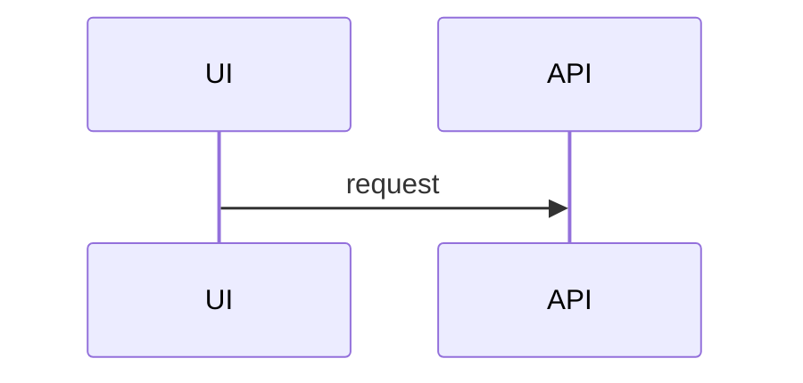

<!-- replikit:bundle {"project": "Mistral_Dynamic_Agent_Tools", "mode": "spec", "date": "2026-11-19", "commit": "50bb801", "dirty": true, "docsync": "2.0.0"} -->
# Replication bundle - Mistral_Dynamic_Agent_Tools

| | |
|---|---|
| Mode | **spec** |
| Exported | 2026-11-19 from commit `50bb801` (with uncommitted changes) |
| Files in repository | 2453 |
| File descriptions current | 0/1044 |
| Sections current | 0/26 |

> **Warning:** some descriptions are still TODO or STALE. A spec rebuild can only be as faithful as the descriptions - expect gaps where they are missing.

## How to rebuild this project with Claude

This file is a self-contained replication bundle produced by **replikit**. Give it to Claude Code (or any Claude with file and shell access) in an **empty folder** and say:

> Rebuild the project described in `Mistral_Dynamic_Agent_Tools_SPEC_REPLICATION_BUNDLE.md` into this folder, following its rebuild guide exactly. Ask me for every secret; never invent values.

With the replikit plugin installed, `/replikit:rebuild Mistral_Dynamic_Agent_Tools_SPEC_REPLICATION_BUNDLE.md` does the same.

### Step 0 - extract the bundled tool (no install needed)
The tool that wrote this bundle is embedded below in the block marked `replikit:tool`. Extract it with:

```bash
python -c "import re,sys;t=open(sys.argv[1],encoding='utf-8').read();m=re.search(r'<!-- replikit:tool -->\n(\x60{3,})python\n(.*?)\n\1\n',t,re.S);open('docsync.py','w',encoding='utf-8',newline='\n').write(m.group(2)+'\n')" Mistral_Dynamic_Agent_Tools_SPEC_REPLICATION_BUNDLE.md
```

### If this is an EXACT bundle (mode: exact)
1. `python docsync.py unpack Mistral_Dynamic_Agent_Tools_SPEC_REPLICATION_BUNDLE*.md --into .` recreates every included file **byte for byte**.
2. `python docsync.py verify Mistral_Dynamic_Agent_Tools_SPEC_REPLICATION_BUNDLE*.md --root .` must report every included file as identical.
3. Files listed as *withheld* (secrets, oversized binaries) are not in the bundle. Ask the owner for them or recreate them from `03_environment/04_external_services_and_secrets.md`. Never invent credentials.
4. Follow `03_environment/*` and `04_build_and_run/01_local_setup.md`. Install the exact versions from the lock files, create env files from the `.example` files, run the tests in `05_quality/01_testing.md`, then walk `05_quality/02_acceptance_checklist.md`.
5. Delete `docsync.py` from the root when done (the repo's own copy is under its docs folder).

### If this is a SPEC bundle (mode: spec)
No source code is included. The replica is rebuilt from the descriptions, so it matches in behaviour, not byte for byte.
1. Read Part 1 (sections) completely before writing code, especially the replication plan, data model, API contracts, gotchas and the AI models and prompts page.
2. Follow `07_replication_plan.md` phase by phase. For every file in Part 3, create it at the same path so it matches its description. Pay most attention to "Nuances and gotchas" and "How to rebuild this file". Use the exact dependency versions listed.
3. After each phase run that phase's checkpoint. At the end run `python docsync.py verify Mistral_Dynamic_Agent_Tools_SPEC_REPLICATION_BUNDLE*.md --root . --structure` so every listed path exists.
4. Report anything the descriptions did not specify, instead of guessing silently.


## Bundled tool

<!-- replikit:tool -->
````python
#!/usr/bin/env python3
"""docsync (replikit) - replication documentation that stays in step with the code.

Works in any git repository. Every source file in scope gets one Markdown
description under ``<docs>/files/<path>.md`` with two parts:

* a generated FACTS block (between ``docsync:auto`` markers), rewritten on every
  run: size, content hash, imports, imported-by, symbols, routes, tables, env vars;
* a NARRATIVE written by a person or by Claude: purpose, behaviour, nuances,
  how to rebuild it.

The tool never writes narrative. It records the source hash when the narrative
was last reviewed; when the source changes the description is STALE until it is
updated and ``review`` is run. Project-wide section docs declare the files they
describe with ``covers:`` globs and go stale the same way.

Commands
  init [--docs DIR] [--upgrade] [--no-git-hook] [--keep-all-sections]
                         set up replication docs in this repo (detects the stack)
  sync [--prune]         refresh facts, create stubs, mark orphans, rebuild index
  hook                   Claude Code PostToolUse hook (reads hook JSON on stdin)
  status [--all]         list stale / todo docs
  check [--staged]       exit 1 if docs are out of date (pre-commit / CI)
  review PATH... [--note TEXT] [--unchanged]
                         mark descriptions current against the present source
  export [--mode spec|exact] [--out FILE] [--split-mb N] [--max-binary-mb N]
         [--allow-secret PATH...]
                         write a self-contained Markdown bundle for rebuilding
  unpack BUNDLE... --into DIR [--force]
                         recreate every verbatim file from an exact bundle
  verify BUNDLE... --root DIR
                         compare a rebuilt tree with the bundle's hash manifest
  install-git-hook       install the pre-commit hook

Standard library only, Python 3.11+.
"""
from __future__ import annotations

import argparse
import ast
import base64
import datetime as _dt
import hashlib
import json
import os
import re
import shutil
import subprocess
import sys
from dataclasses import dataclass, field
from pathlib import Path

try:
    import tomllib
except ModuleNotFoundError:  # pragma: no cover
    sys.exit("docsync needs Python 3.11+ (tomllib).")

VERSION = "2.0.0"
AUTO_BEGIN = "<!-- docsync:auto:begin - generated by docsync, edits inside this block are overwritten -->"
AUTO_END = "<!-- docsync:auto:end -->"
AUTO_RE = re.compile(r"<!-- docsync:auto:begin.*?-->.*?<!-- docsync:auto:end -->", re.S)
TODO_TOKEN = "_TODO_"
DIR_DOC = "_DIR.md"
DEFAULT_DOCS = "replication"
SCRIPT = Path(__file__).resolve()
# plugin layout: <plugin>/scripts/docsync.py + <plugin>/kit/ ; project copy: <docs>/_tooling/docsync.py
KIT = SCRIPT.parent.parent / "kit"

ROOT: Path = Path.cwd()


def _out(text: str) -> None:
    """Print without crashing on consoles that cannot encode non-ASCII."""
    try:
        print(text)
    except UnicodeEncodeError:
        print(text.encode("ascii", "replace").decode("ascii"))


def git(*args: str, cwd: Path | None = None, check: bool = True) -> str:
    r = subprocess.run(["git", *args], cwd=cwd or ROOT, capture_output=True)
    if check and r.returncode:
        raise RuntimeError(r.stderr.decode("utf-8", "replace").strip() or f"git {args[0]} failed")
    return r.stdout.decode("utf-8", "replace")


def git_toplevel(start: Path) -> Path | None:
    start = start if start.is_dir() else start.parent
    while not start.exists():
        start = start.parent
    try:
        out = git("rev-parse", "--show-toplevel", cwd=start).strip()
        return Path(out) if out else None
    except Exception:
        return None


def set_root(path: Path | None = None) -> None:
    global ROOT
    env = os.environ.get("DOCSYNC_ROOT")
    base = Path(env) if env else (path or Path.cwd())
    ROOT = git_toplevel(base) or base.resolve()


def find_docs(root: Path) -> Path | None:
    env = os.environ.get("DOCSYNC_DOCS")
    if env:
        p = root / env
        return p if (p / "docsync.toml").exists() else None
    if (root / DEFAULT_DOCS / "docsync.toml").exists():
        return root / DEFAULT_DOCS
    for child in sorted(root.iterdir()) if root.exists() else []:
        if child.is_dir() and (child / "docsync.toml").exists():
            return child
    return None


# ----------------------------------------------------------------------------
# config + globbing
# ----------------------------------------------------------------------------


@dataclass
class Config:
    docs: Path
    include: list[str] = field(default_factory=lambda: ["**"])
    exclude: list[str] = field(default_factory=list)
    max_bytes: int = 1_000_000
    hook_on_todo: str = "prompt"
    check_stale: str = "block"
    check_todo: str = "warn"
    kinds: dict[str, list[str]] = field(default_factory=dict)
    export_exclude: list[str] = field(default_factory=list)

    @property
    def docs_root(self) -> str:
        return self.docs.relative_to(ROOT).as_posix()

    @property
    def files_dir(self) -> Path:
        return self.docs / "files"

    @property
    def templates(self) -> Path:
        t = self.docs / "_templates"
        return t if t.exists() else KIT / "_templates"


def load_config(docs: Path) -> Config:
    cfg = Config(docs=docs)
    data = tomllib.loads((docs / "docsync.toml").read_text(encoding="utf-8"))
    cfg.include = data.get("include", cfg.include)
    cfg.exclude = list(data.get("exclude", []))
    cfg.max_bytes = data.get("max_bytes", cfg.max_bytes)
    cfg.hook_on_todo = data.get("hook", {}).get("on_todo", cfg.hook_on_todo)
    cfg.check_stale = data.get("check", {}).get("stale", cfg.check_stale)
    cfg.check_todo = data.get("check", {}).get("todo", cfg.check_todo)
    cfg.kinds = data.get("kinds", {})
    cfg.export_exclude = data.get("export", {}).get("exclude", [])
    cfg.exclude.append(f"{cfg.docs_root}/**")  # the docs never document themselves
    cfg.exclude.append("**/*REPLICATION_BUNDLE*.md")  # nor exported bundles
    return cfg


def require_config() -> Config:
    docs = find_docs(ROOT)
    if docs is None:
        sys.exit(f"docsync: no replication docs in {ROOT} - run `docsync init` first.")
    return load_config(docs)


def glob_to_re(pattern: str) -> re.Pattern:
    out, i = "", 0
    while i < len(pattern):
        if pattern.startswith("**/", i):
            out += "(?:.*/)?"
            i += 3
        elif pattern.startswith("**", i):
            out += ".*"
            i += 2
        elif pattern[i] == "*":
            out += "[^/]*"
            i += 1
        elif pattern[i] == "?":
            out += "[^/]"
            i += 1
        else:
            out += re.escape(pattern[i])
            i += 1
    return re.compile(out + r"\Z", re.I)


class Matcher:
    def __init__(self, patterns: list[str]):
        self.res = [glob_to_re(p) for p in patterns]

    def __call__(self, path: str) -> bool:
        return any(r.match(path) for r in self.res)


def git_files() -> list[str]:
    out = git("ls-files", "--cached", "--others", "--exclude-standard", "-z")
    return sorted({p for p in out.split("\0") if p and (ROOT / p).is_file()})


def in_scope(cfg: Config, rel: str) -> bool:
    return Matcher(cfg.include)(rel) and not Matcher(cfg.exclude)(rel)


def scoped_files(cfg: Config) -> list[str]:
    inc, exc = Matcher(cfg.include), Matcher(cfg.exclude)
    return [p for p in git_files() if inc(p) and not exc(p)]


# ----------------------------------------------------------------------------
# doc IO
# ----------------------------------------------------------------------------


def parse_doc(text: str) -> tuple[dict, str]:
    if not text.startswith("---"):
        return {}, text
    end = text.find("\n---", 3)
    if end == -1:
        return {}, text
    raw, body = text[3:end].strip("\n"), text[end + 4:].lstrip("\n")
    fm: dict = {}
    key = None
    for line in raw.splitlines():
        if re.match(r"^\s+-\s", line) and key:
            if not isinstance(fm.get(key), list):
                fm[key] = []
            fm[key].append(line.split("-", 1)[1].strip().strip('"'))
            continue
        m = re.match(r"^([A-Za-z_][\w-]*):\s*(.*)$", line)
        if m:
            key, val = m.group(1), m.group(2).strip()
            fm[key] = [] if val == "" else val.strip('"')
    return fm, body


def dump_doc(fm: dict, body: str) -> str:
    lines = ["---"]
    for k, v in fm.items():
        if isinstance(v, list):
            lines.append(f"{k}:")
            lines += [f'  - "{x}"' for x in v]
        else:
            lines.append(f"{k}: {v}")
    lines.append("---")
    return "\n".join(lines) + "\n" + body.rstrip() + "\n"


def narrative_of(body: str) -> str:
    return AUTO_RE.sub("", body).strip()


def narrative_hash(body: str) -> str:
    return hashlib.sha256(narrative_of(body).encode()).hexdigest()[:16]


def replace_auto(body: str, auto: str) -> str:
    block = f"{AUTO_BEGIN}\n{auto.rstrip()}\n{AUTO_END}"
    if AUTO_RE.search(body):
        body = AUTO_RE.sub(lambda _: block, body, count=1)
    else:
        m = re.search(r"^# .*$", body, re.M)
        if m:
            body = body[: m.end()] + "\n\n" + block + "\n\n" + body[m.end():].lstrip("\n")
        else:
            body = block + "\n\n" + body
    return re.sub(re.escape(AUTO_END) + r"\n{3,}", AUTO_END + "\n\n", body)


def write_if_changed(path: Path, text: str) -> bool:
    if path.exists() and path.read_text(encoding="utf-8") == text:
        return False
    path.parent.mkdir(parents=True, exist_ok=True)
    path.write_text(text, encoding="utf-8", newline="\n")
    return True


def rel_link(from_doc: Path, to: Path) -> str:
    return Path(os.path.relpath(to, from_doc.parent)).as_posix()


def tool_cmd(cfg: Config) -> str:
    local = cfg.docs / "_tooling" / "docsync.py"
    p = local if local.exists() else SCRIPT
    try:
        return f"python {p.relative_to(ROOT).as_posix()}"
    except ValueError:
        return f'python "{p.as_posix()}"'


# ----------------------------------------------------------------------------
# fact extraction
# ----------------------------------------------------------------------------

JS_EXT = (".ts", ".tsx", ".js", ".jsx", ".mjs", ".cjs", ".mts", ".cts", ".vue", ".svelte")
CODE_EXT = set(JS_EXT) | {".py", ".go", ".java", ".kt", ".kts", ".scala", ".cs", ".rb", ".php", ".rs", ".swift",
                          ".c", ".h", ".cpp", ".hpp", ".cc", ".m", ".dart", ".ex", ".exs", ".lua", ".r",
                          ".sh", ".bash", ".ps1", ".bat", ".css", ".scss", ".sass", ".less", ".html", ".sql",
                          ".prisma", ".graphql", ".gql", ".proto"}
DOC_EXT = {".md", ".mdx", ".txt", ".rst", ".adoc"}
LANG = {
    ".py": "Python", ".ts": "TypeScript", ".tsx": "TypeScript (React)", ".js": "JavaScript", ".jsx": "JavaScript (React)",
    ".mjs": "JavaScript", ".cjs": "JavaScript", ".vue": "Vue", ".svelte": "Svelte", ".go": "Go", ".java": "Java",
    ".kt": "Kotlin", ".kts": "Kotlin script", ".scala": "Scala", ".cs": "C#", ".rb": "Ruby", ".php": "PHP",
    ".rs": "Rust", ".swift": "Swift", ".c": "C", ".h": "C header", ".cpp": "C++", ".hpp": "C++ header",
    ".dart": "Dart", ".ex": "Elixir", ".exs": "Elixir", ".json": "JSON", ".md": "Markdown", ".yaml": "YAML",
    ".yml": "YAML", ".toml": "TOML", ".sh": "Shell", ".ps1": "PowerShell", ".css": "CSS", ".scss": "SCSS",
    ".html": "HTML", ".sql": "SQL", ".prisma": "Prisma schema", ".graphql": "GraphQL", ".proto": "Protocol Buffers",
    ".txt": "Text", ".xml": "XML", ".tf": "Terraform",
}
TEXT_SNIFF = 4096
STDLIB = set(getattr(sys, "stdlib_module_names", ())) | {"__future__"}
PY_HTTP = {"get", "post", "put", "patch", "delete", "head", "options", "websocket", "api_route", "route"}


def file_hash(data: bytes) -> str:
    return hashlib.sha256(data.replace(b"\r\n", b"\n")).hexdigest()[:16]


def kind_of(cfg: Config, rel: str) -> str:
    for kind, pats in cfg.kinds.items():
        if Matcher(pats)(rel):
            return kind
    p = Path(rel)
    if p.suffix.lower() in CODE_EXT:
        return "code"
    if p.suffix.lower() in DOC_EXT or p.name.lower() in ("license", "changelog", "authors"):
        return "doc"
    return "config"


def lang_of(rel: str) -> str:
    p = Path(rel)
    if p.name.lower().startswith("dockerfile"):
        return "Dockerfile"
    if p.name.lower() == "makefile":
        return "Makefile"
    return LANG.get(p.suffix.lower(), p.suffix[1:].upper() or "file")


@dataclass
class Facts:
    rel: str
    kind: str
    lang: str
    hash: str
    lines: int
    size: int
    binary: bool = False
    summary: str = ""
    defines: list[str] = field(default_factory=list)
    routes: list[str] = field(default_factory=list)
    tables: list[str] = field(default_factory=list)
    env: list[str] = field(default_factory=list)
    api_calls: list[str] = field(default_factory=list)
    imports_internal: list[str] = field(default_factory=list)
    imports_unresolved: list[str] = field(default_factory=list)
    imports_external: list[str] = field(default_factory=list)
    stdlib: list[str] = field(default_factory=list)
    extra: list[str] = field(default_factory=list)

    def manifest(self) -> dict:
        return {"hash": self.hash, "kind": self.kind, "imports": self.imports_internal}


# --- Python -----------------------------------------------------------------


def resolve_py(rel: str, module: str, level: int, known: set[str]) -> str | None:
    parts = Path(rel).parts
    if level:
        base = list(parts[:-1])
        if level > 1:
            base = base[: len(base) - (level - 1)]
        roots = ["/".join(base)]
    else:
        roots = ["/".join(parts[:i]) for i in range(len(parts) - 1, -1, -1)]
    mod_path = module.replace(".", "/") if module else ""
    for r in roots:
        stem = f"{r}/{mod_path}".strip("/") if mod_path else r
        for cand in (f"{stem}.py", f"{stem}/__init__.py"):
            if cand in known:
                return cand
    return None


def py_facts(f: Facts, text: str, known: set[str]) -> None:
    try:
        tree = ast.parse(text)
    except SyntaxError as e:
        f.extra.append(f"Could not parse: {e.msg} (line {e.lineno})")
        return
    doc = ast.get_docstring(tree)
    if doc:
        f.summary = doc.strip().splitlines()[0]
    internal, external, unresolved = set(), set(), set()
    for node in ast.walk(tree):
        if isinstance(node, ast.Import):
            for a in node.names:
                r = resolve_py(f.rel, a.name, 0, known)
                internal.add(r) if r else external.add(a.name.split(".")[0])
        elif isinstance(node, ast.ImportFrom):
            mod = node.module or ""
            r = resolve_py(f.rel, mod, node.level, known)
            subs = [resolve_py(f.rel, (mod + "." if mod else "") + a.name, node.level, known) for a in node.names]
            subs = [s for s in subs if s]
            if r:
                internal.add(r)
            internal.update(subs)
            if not r and not subs:
                (unresolved.add("." * node.level + mod) if node.level else external.add(mod.split(".")[0]))
        elif isinstance(node, ast.Call):
            fn = node.func
            fname = ast.unparse(fn)
            if isinstance(fn, ast.Attribute) and fn.attr in ("getenv", "get") and node.args \
                    and ast.unparse(fn.value) in ("os", "os.environ", "environ"):
                a0 = node.args[0]
                if isinstance(a0, ast.Constant) and isinstance(a0.value, str):
                    f.env.append(a0.value)
            elif fname in ("path", "re_path", "url") and node.args and isinstance(node.args[0], ast.Constant) \
                    and Path(f.rel).name == "urls.py":
                view = ast.unparse(node.args[1]) if len(node.args) > 1 else ""
                f.routes.append(f"`{node.args[0].value}` -> `{view}` (Django)")
        elif isinstance(node, ast.Subscript) and ast.unparse(node.value) in ("os.environ", "environ"):
            if isinstance(node.slice, ast.Constant) and isinstance(node.slice.value, str):
                f.env.append(node.slice.value)
    prefix = ""
    for node in tree.body:
        if isinstance(node, (ast.Assign, ast.AnnAssign)):
            targets = node.targets if isinstance(node, ast.Assign) else [node.target]
            val = node.value
            if isinstance(val, ast.Call) and ast.unparse(val.func).split(".")[-1] in ("APIRouter", "Blueprint"):
                for kw in val.keywords:
                    if kw.arg in ("prefix", "url_prefix") and isinstance(kw.value, ast.Constant):
                        prefix = str(kw.value.value)
            for t in targets:
                if isinstance(t, ast.Name) and t.id.isupper() and len(t.id) > 1:
                    f.defines.append(f"const `{t.id}`")
    for node in tree.body:
        if isinstance(node, ast.ClassDef):
            bases = ", ".join(ast.unparse(b) for b in node.bases)
            methods = [n.name for n in node.body if isinstance(n, (ast.FunctionDef, ast.AsyncFunctionDef))]
            line = f"class `{node.name}({bases})`" if bases else f"class `{node.name}`"
            cdoc = ast.get_docstring(node)
            if cdoc:
                line += f" - {cdoc.strip().splitlines()[0]}"
            if methods:
                line += f"  \n  methods: {', '.join(methods[:25])}{' ...' if len(methods) > 25 else ''}"
            f.defines.append(line)
            for n in node.body:
                if isinstance(n, (ast.Assign, ast.AnnAssign)):
                    tgts = n.targets if isinstance(n, ast.Assign) else [n.target]
                    if any(isinstance(t, ast.Name) and t.id == "__tablename__" for t in tgts) and isinstance(n.value, ast.Constant):
                        f.tables.append(f"`{n.value.value}` (model `{node.name}`)")
            if any(b.split(".")[-1] == "Model" for b in bases.split(", ")) and "django" in text:
                f.tables.append(f"`{node.name}` (Django model)")
            if "BaseSettings" in bases:
                for n in node.body:
                    if isinstance(n, ast.AnnAssign) and isinstance(n.target, ast.Name):
                        f.env.append(n.target.id.upper())
        elif isinstance(node, (ast.FunctionDef, ast.AsyncFunctionDef)):
            args = [a.arg for a in node.args.args]
            pre = "async def" if isinstance(node, ast.AsyncFunctionDef) else "def"
            line = f"{pre} `{node.name}({', '.join(args)})`"
            fdoc = ast.get_docstring(node)
            if fdoc:
                line += f" - {fdoc.strip().splitlines()[0]}"
            f.defines.append(line)
            for d in node.decorator_list:
                if isinstance(d, ast.Call) and isinstance(d.func, ast.Attribute) and d.func.attr in PY_HTTP:
                    path = d.args[0].value if d.args and isinstance(d.args[0], ast.Constant) else ""
                    method = d.func.attr.upper()
                    if method in ("ROUTE", "API_ROUTE"):
                        meths = next((ast.unparse(k.value) for k in d.keywords if k.arg == "methods"), "")
                        method = f"ROUTE{(' ' + meths) if meths else ''}"
                    f.routes.append(f"`{method} {prefix}{path}` -> `{node.name}`")
                dn = ast.unparse(d.func if isinstance(d, ast.Call) else d)
                if dn.endswith(("task", "shared_task")):
                    f.extra.append(f"Background task: `{node.name}` (`@{dn}`)")
    f.imports_internal = sorted(internal - {f.rel})
    f.imports_external = sorted(e for e in external if e not in STDLIB)
    f.stdlib = sorted(e for e in external if e in STDLIB)
    f.imports_unresolved = sorted(unresolved)


# --- JavaScript / TypeScript -----------------------------------------------

JS_IMPORT = re.compile(r"""(?:import|export)\s[^'"`;]*?from\s*['"]([^'"]+)['"]|import\s*\(\s*['"]([^'"]+)['"]\s*\)|^\s*import\s+['"]([^'"]+)['"]|require\(\s*['"]([^'"]+)['"]\s*\)""", re.M)
JS_EXPORT = re.compile(r"^export\s+(default\s+)?(async\s+)?(function\*?|const|let|class|interface|type|enum)\s+([A-Za-z_$][\w$]*)", re.M)
JS_ENV = re.compile(r"(?:import\.meta\.env|process\.env)\.([A-Z_][A-Z0-9_]*)")
JS_FILE_ROUTE = re.compile(r"createFileRoute\(\s*['\"`]([^'\"`]+)['\"`]")
JS_EXPRESS = re.compile(r"\b(?:app|router|server|api)\.(get|post|put|patch|delete|all|use)\(\s*['\"`](/[^'\"`]*)['\"`]")
JS_API = re.compile(r"['\"`](/(?:api|v\d)[^'\"`\s?]*)")
_TS_ALIAS_CACHE: dict[str, list[tuple[str, str]]] = {}


def _loose_json(text: str):
    out, i, n, in_str, q = [], 0, len(text), False, ""
    while i < n:
        c = text[i]
        if in_str:
            out.append(c)
            if c == "\\" and i + 1 < n:
                out.append(text[i + 1])
                i += 2
                continue
            if c == q:
                in_str = False
        elif c in "\"'":
            in_str, q = True, c
            out.append(c)
        elif text.startswith("//", i):
            j = text.find("\n", i)
            i = n if j == -1 else j
            continue
        elif text.startswith("/*", i):
            j = text.find("*/", i + 2)
            i = n if j == -1 else j + 2
            continue
        else:
            out.append(c)
        i += 1
    s = re.sub(r",\s*([}\]])", r"\1", "".join(out))
    return json.loads(s)


def ts_aliases(rel: str) -> list[tuple[str, str]]:
    """(alias prefix, target dir) pairs from the nearest tsconfig/jsconfig, e.g. ('@/', 'web/src/')."""
    parts = Path(rel).parts
    for i in range(len(parts) - 1, -1, -1):
        d = "/".join(parts[:i])
        cfgs = sorted((ROOT / d).glob("tsconfig*.json")) + sorted((ROOT / d).glob("jsconfig*.json"))
        if not cfgs:
            continue
        if d in _TS_ALIAS_CACHE:
            return _TS_ALIAS_CACHE[d]
        pairs: list[tuple[str, str]] = []
        for c in cfgs:
            try:
                opts = _loose_json(c.read_text(encoding="utf-8")).get("compilerOptions", {})
            except Exception:
                continue
            base = opts.get("baseUrl", ".")
            for alias, targets in (opts.get("paths") or {}).items():
                if not targets:
                    continue
                a = alias.rstrip("*")
                t = os.path.normpath(f"{d}/{base}/{targets[0].rstrip('*')}").replace("\\", "/").lstrip("./")
                if t == ".":
                    t = ""
                pairs.append((a, t + ("/" if t and not t.endswith("/") else "")))
        if not pairs:
            pairs = [("@/", f"{d}/src/".lstrip("/")), ("~/", f"{d}/src/".lstrip("/"))]
        _TS_ALIAS_CACHE[d] = sorted(set(pairs), key=lambda p: -len(p[0]))
        return _TS_ALIAS_CACHE[d]
    return []


def resolve_js(rel: str, spec: str, known: set[str]) -> str | None:
    if spec.startswith("."):
        base = (Path(rel).parent / spec).as_posix()
    else:
        for a, t in ts_aliases(rel):
            if a and spec.startswith(a):
                base = t + spec[len(a):]
                break
        else:
            return None
    base = os.path.normpath(base).replace("\\", "/")
    cands = [base] + [base + e for e in JS_EXT + (".json", ".css", ".scss")] + [f"{base}/index{e}" for e in JS_EXT]
    for c in cands:
        if c in known:
            return c
    return None


def next_route(rel: str) -> str | None:
    p = Path(rel)
    parts = list(p.parts)
    for root in ("app", "pages"):
        if root in parts:
            i = parts.index(root)
            segs = [s for s in parts[i + 1:-1] if not (s.startswith("(") and s.endswith(")"))]
            stem = p.stem
            if root == "app" and stem in ("page", "route"):
                return ("API " if stem == "route" else "page ") + "/" + "/".join(segs)
            if root == "pages" and p.suffix in (".tsx", ".jsx", ".ts", ".js") and not stem.startswith("_"):
                segs = segs + ([] if stem == "index" else [stem])
                return ("API " if segs[:1] == ["api"] else "page ") + "/" + "/".join(segs)
    return None


def js_facts(f: Facts, text: str, known: set[str], deps: set[str]) -> None:
    internal, external, unresolved = set(), set(), set()
    for m in JS_IMPORT.finditer(text):
        spec = next(g for g in m.groups() if g)
        r = resolve_js(f.rel, spec, known)
        if r:
            internal.add(r)
        elif spec.startswith(".") or any(spec.startswith(a) for a, _ in ts_aliases(f.rel) if a):
            unresolved.add(spec)
        else:
            external.add("/".join(spec.split("/")[:2]) if spec.startswith("@") else spec.split("/")[0])
    for m in JS_EXPORT.finditer(text):
        f.defines.append(f"export {'default ' if m.group(1) else ''}{m.group(3)} `{m.group(4)}`")
    f.env = sorted(set(JS_ENV.findall(text)))
    f.routes = [f"page route `{r}`" for r in JS_FILE_ROUTE.findall(text)]
    f.routes += [f"`{m.upper()} {p}`" for m, p in JS_EXPRESS.findall(text)]
    if "next" in deps:
        nr = next_route(f.rel)
        if nr:
            f.routes.append(f"Next.js {nr}")
    f.api_calls = sorted(set(JS_API.findall(text)))
    m = re.match(r"\s*/\*\*?\s*(.+?)\s*(?:\*/|\n)", text)
    if m:
        f.summary = m.group(1).strip("* ")
    f.imports_internal = sorted(internal - {f.rel})
    f.imports_external = sorted(e for e in external if not e.startswith("node:"))
    f.stdlib = sorted(e for e in external if e.startswith("node:"))
    f.imports_unresolved = sorted(unresolved)


# --- other languages (regex based) ------------------------------------------


def _suffix_index(known: set[str]) -> dict[str, str]:
    idx = {}
    for k in known:
        stem = k.rsplit(".", 1)[0]
        idx.setdefault(stem.replace("/", "."), k)
    return idx


_SUFFIX_IDX: dict[str, str] = {}


def resolve_dotted(name: str, known: set[str]) -> str | None:
    global _SUFFIX_IDX
    if not _SUFFIX_IDX:
        _SUFFIX_IDX = _suffix_index(known)
    for key, path in _SUFFIX_IDX.items():
        if key.endswith("." + name) or key == name:
            return path
    return None


def generic_code_facts(f: Facts, text: str, known: set[str], go_module: str) -> None:
    ext = Path(f.rel).suffix.lower()
    imports: list[str] = []
    if ext == ".go":
        block = re.findall(r"^import\s*\((.*?)\)", text, re.S | re.M)
        imports = re.findall(r'"([^"]+)"', " ".join(block)) + re.findall(r'^import\s+(?:\w+\s+)?"([^"]+)"', text, re.M)
        f.defines += [f"func `{n}`" for n in re.findall(r"^func\s+(?:\([^)]*\)\s*)?(\w+)", text, re.M)]
        f.defines += [f"type `{n}` ({k})" for n, k in re.findall(r"^type\s+(\w+)\s+(struct|interface)", text, re.M)]
        f.env = re.findall(r'os\.(?:Getenv|LookupEnv)\(\s*"([^"]+)"', text)
        f.routes = [f"`{m} {p}`" for m, p in re.findall(r'\.(GET|POST|PUT|PATCH|DELETE|Handle|HandleFunc|Get|Post|Put|Delete)\(\s*"(/[^"]*)"', text)]
        for i in imports:
            if go_module and i.startswith(go_module):
                f.extra.append(f"Internal package: `{i[len(go_module):].lstrip('/') or '.'}`")
            elif "." in i.split("/")[0]:
                f.imports_external.append(i)
            else:
                f.stdlib.append(i)
        return
    if ext in (".java", ".kt", ".kts", ".scala"):
        imports = re.findall(r"^import\s+(?:static\s+)?([\w.]+)", text, re.M)
        f.defines += [f"{k} `{n}`" for k, n in re.findall(r"\b(class|interface|enum|record|object)\s+(\w+)", text)][:60]
        f.routes = [f"`{m.upper() or 'REQUEST'} {p}`" for m, p in re.findall(r'@(Get|Post|Put|Delete|Patch|Request)Mapping\(\s*(?:value\s*=\s*|path\s*=\s*)?"([^"]*)"', text)]
        f.env = re.findall(r'System\.getenv\(\s*"([^"]+)"', text)
        f.tables = [f"`{t}`" for t in re.findall(r'@Table\(\s*name\s*=\s*"([^"]+)"', text)]
        for i in imports:
            r = resolve_dotted(i, known)
            (f.imports_internal.append(r) if r else f.imports_external.append(".".join(i.split(".")[:2])))
    elif ext == ".cs":
        imports = re.findall(r"^using\s+([\w.]+);", text, re.M)
        f.defines += [f"{k} `{n}`" for k, n in re.findall(r"\b(class|interface|enum|record|struct)\s+(\w+)", text)][:60]
        f.routes = [f"`{m.upper()} {p}`" for m, p in re.findall(r'\[Http(Get|Post|Put|Delete|Patch)\(\s*"([^"]*)"', text)]
        f.routes += [f"`ROUTE {p}`" for p in re.findall(r'\[Route\(\s*"([^"]*)"', text)]
        f.routes += [f"`{m.upper()} {p}`" for m, p in re.findall(r'\.Map(Get|Post|Put|Delete|Patch)\(\s*"([^"]*)"', text)]
        f.env = re.findall(r'GetEnvironmentVariable\(\s*"([^"]+)"', text) + re.findall(r'Configuration\[\s*"([^"]+)"\s*\]', text)
        f.imports_external = sorted({i.split(".")[0] for i in imports})
    elif ext == ".rb":
        for spec in re.findall(r"^\s*require_relative\s+['\"]([^'\"]+)['\"]", text, re.M):
            c = os.path.normpath((Path(f.rel).parent / spec).as_posix()).replace("\\", "/")
            c = c if c.endswith(".rb") else c + ".rb"
            (f.imports_internal.append(c) if c in known else f.imports_unresolved.append(spec))
        f.imports_external = re.findall(r"^\s*require\s+['\"]([^'\"]+)['\"]", text, re.M)
        f.defines += [f"{k} `{n}`" for k, n in re.findall(r"^\s*(class|module)\s+([\w:]+)", text, re.M)]
        f.defines += [f"def `{n}`" for n in re.findall(r"^\s*def\s+([\w.?!]+)", text, re.M)][:60]
        f.routes = [f"`{m.upper()} {p}`" for m, p in re.findall(r"^\s*(get|post|put|patch|delete|resources?)\s+['\":]([\w/:.-]+)", text, re.M)]
        f.env = re.findall(r"ENV(?:\.fetch\(|\[)\s*['\"]([^'\"]+)['\"]", text)
    elif ext == ".php":
        f.imports_external = sorted({u.split("\\")[0] for u in re.findall(r"^use\s+([\w\\]+)", text, re.M)})
        f.defines += [f"{k} `{n}`" for k, n in re.findall(r"\b(class|interface|trait|enum)\s+(\w+)", text)]
        f.defines += [f"function `{n}`" for n in re.findall(r"function\s+(\w+)", text)][:60]
        f.routes = [f"`{m.upper()} {p}`" for m, p in re.findall(r"Route::(get|post|put|patch|delete|any|resource)\(\s*['\"]([^'\"]+)", text)]
        f.env = re.findall(r"(?:getenv|env)\(\s*['\"]([^'\"]+)['\"]", text)
    elif ext == ".rs":
        f.imports_external = sorted({u.split("::")[0] for u in re.findall(r"^use\s+([\w:]+)", text, re.M) if not u.startswith(("crate", "self", "super"))})
        f.extra += [f"Module: `{m}`" for m in re.findall(r"^(?:pub\s+)?mod\s+(\w+)\s*;", text, re.M)]
        f.defines += [f"fn `{n}`" for n in re.findall(r"^\s*(?:pub(?:\([^)]*\))?\s+)?(?:async\s+)?fn\s+(\w+)", text, re.M)][:60]
        f.defines += [f"{k} `{n}`" for k, n in re.findall(r"^\s*(?:pub\s+)?(struct|enum|trait)\s+(\w+)", text, re.M)]
        f.routes = [f"`{m.upper()} {p}`" for m, p in re.findall(r'#\[(get|post|put|patch|delete)\(\s*"([^"]+)"', text)]
        f.routes += [f"`ROUTE {p}`" for p in re.findall(r'\.route\(\s*"([^"]+)"', text)]
        f.env = re.findall(r'env::var\(\s*"([^"]+)"', text)
    elif ext == ".sql":
        f.tables = [f"`{t}`" for t in re.findall(r"CREATE\s+TABLE\s+(?:IF\s+NOT\s+EXISTS\s+)?[`\"\[]?([\w.]+)", text, re.I)]
    elif ext == ".prisma":
        f.tables = [f"`{t}`" for t in re.findall(r"^model\s+(\w+)\s*\{", text, re.M)]
        f.env = re.findall(r'env\("([^"]+)"\)', text)
    elif ext in (".sh", ".bash", ".ps1", ".bat"):
        f.env = re.findall(r"\$\{?([A-Z_][A-Z0-9_]{2,})", text) + re.findall(r"\$env:([A-Za-z_]\w*)", text)
    elif ext == ".graphql" or ext == ".gql":
        f.defines += [f"{k} `{n}`" for k, n in re.findall(r"^(type|input|enum|interface|scalar)\s+(\w+)", text, re.M)]
    elif ext == ".proto":
        f.defines += [f"{k} `{n}`" for k, n in re.findall(r"^(message|service|enum)\s+(\w+)", text, re.M)]
    f.imports_internal = sorted(set(f.imports_internal))
    f.imports_external = sorted(set(f.imports_external))


def other_facts(f: Facts, text: str) -> None:
    p = Path(f.rel)
    ext, name = p.suffix.lower(), p.name
    if ext == ".json":
        try:
            data = json.loads(text)
            if isinstance(data, dict):
                keys = list(data.keys())
                f.extra.append("Top-level keys: " + ", ".join(f"`{k}`" for k in keys[:30]) + (" ..." if len(keys) > 30 else ""))
                if name == "package.json":
                    for sec in ("engines", "scripts", "dependencies", "devDependencies"):
                        if isinstance(data.get(sec), dict):
                            f.extra.append(f"{sec}: " + "; ".join(f"`{k}`: {v}" for k, v in data[sec].items()))
            elif isinstance(data, list):
                f.extra.append(f"JSON array of {len(data)} items")
        except ValueError:
            pass
    elif ext in (".md", ".mdx", ".rst"):
        heads = re.findall(r"^#{1,3} (.+)$", text, re.M)[:15]
        if heads:
            f.summary = heads[0]
            f.extra.append("Headings: " + " | ".join(heads))
    elif ext in (".yaml", ".yml", ".toml"):
        keys = re.findall(r"^\[?([A-Za-z_][\w.-]*)\]?\s*[:=\]]", text, re.M)
        if keys:
            f.extra.append("Top-level keys: " + ", ".join(f"`{k}`" for k in dict.fromkeys(keys)))
        f.env = re.findall(r"\$\{([A-Z_][A-Z0-9_]*)", text)
    elif name.lower().startswith("dockerfile") or ext == ".dockerfile":
        for kw in ("FROM", "EXPOSE", "ENTRYPOINT", "CMD", "WORKDIR"):
            vals = re.findall(rf"^{kw}\s+(.+)$", text, re.M)
            if vals:
                f.extra.append(f"{kw}: " + " | ".join(f"`{v.strip()}`" for v in vals))
        f.env = re.findall(r"^(?:ENV|ARG)\s+([A-Z_][A-Z0-9_]*)", text, re.M)
    elif name.startswith(".env"):
        f.env = re.findall(r"^\s*(?:export\s+)?([A-Z_][A-Z0-9_]*)\s*=", text, re.M)
    elif name.lower() == "makefile":
        f.extra.append("Targets: " + ", ".join(f"`{t}`" for t in re.findall(r"^([\w.-]+):(?!=)", text, re.M)))


@dataclass
class Ctx:
    known: set[str]
    deps: set[str]
    go_module: str


def make_ctx(files: list[str] | None = None) -> Ctx:
    known = set(files if files is not None else git_files())
    deps, go_mod = set(), ""
    for rel in known:
        name = Path(rel).name
        try:
            if name == "package.json":
                d = json.loads((ROOT / rel).read_text(encoding="utf-8"))
                for sec in ("dependencies", "devDependencies", "peerDependencies"):
                    deps.update((d.get(sec) or {}).keys())
            elif name == "go.mod" and not go_mod:
                m = re.search(r"^module\s+(\S+)", (ROOT / rel).read_text(encoding="utf-8"), re.M)
                go_mod = m.group(1) if m else ""
        except Exception:
            pass
    return Ctx(known, deps, go_mod)


def extract(cfg: Config, rel: str, ctx: Ctx) -> Facts:
    data = (ROOT / rel).read_bytes()
    ext = Path(rel).suffix.lower()
    binary = b"\0" in data[:TEXT_SNIFF]
    lines = 0 if binary else data.count(b"\n") + (1 if data and not data.endswith(b"\n") else 0)
    f = Facts(rel=rel, kind="asset" if binary else kind_of(cfg, rel), lang=lang_of(rel), hash=file_hash(data),
              lines=lines, size=len(data), binary=binary)
    if binary:
        return f
    if len(data) > cfg.max_bytes:
        f.extra.append(f"Larger than max_bytes ({cfg.max_bytes}); contents not analysed")
        return f
    text = data.decode("utf-8", "replace")
    try:
        if ext == ".py":
            py_facts(f, text, ctx.known)
        elif ext in JS_EXT:
            js_facts(f, text, ctx.known, ctx.deps)
        elif ext in CODE_EXT:
            generic_code_facts(f, text, ctx.known, ctx.go_module)
        else:
            other_facts(f, text)
    except Exception as e:  # never let one odd file stop a sync
        f.extra.append(f"Fact extraction failed: {type(e).__name__}: {e}")
    f.env = sorted(set(f.env))
    return f


# ----------------------------------------------------------------------------
# rendering file docs
# ----------------------------------------------------------------------------


def doc_path(cfg: Config, rel: str) -> Path:
    return cfg.files_dir / (rel + ".md")


def source_of_doc(cfg: Config, doc: Path) -> str:
    return doc.relative_to(cfg.files_dir).as_posix()[:-3]


def status_line(cfg: Config, status: str, fm: dict, cur_hash: str) -> str:
    rv = fm.get("reviewed_hash") or "-"
    t = tool_cmd(cfg)
    return {
        "current": f"> **Description status: CURRENT** - reviewed {fm.get('reviewed_on', '')} against source `{rv}`.",
        "stale": f"> **Description status: STALE** - the source changed since the description was reviewed (`{rv}` -> `{cur_hash}`). Update the narrative below, then run `{t} review {fm.get('source', '')}`.",
        "todo": f"> **Description status: TODO** - no narrative yet. Fill every `_TODO_` below, then run `{t} review {fm.get('source', '')}`.",
        "orphaned": f"> **Description status: ORPHANED** - the source file no longer exists. Move this description if the file was renamed, or delete it (`{t} sync --prune`).",
    }[status]


def compute_status(fm: dict, cur_hash: str | None) -> str:
    if cur_hash is None:
        return "orphaned"
    if not fm.get("reviewed_hash"):
        return "todo"
    return "current" if fm["reviewed_hash"] == cur_hash else "stale"


def render_auto(cfg: Config, f: Facts, doc: Path, imported_by: list[str], status: str, fm: dict) -> str:
    def dl(rel: str) -> str:
        return f"[{rel}]({rel_link(doc, doc_path(cfg, rel))})"

    out = [status_line(cfg, status, fm, f.hash), "", "| Fact | Value |", "|---|---|",
           f"| Source | [`{f.rel}`]({rel_link(doc, ROOT / f.rel)}) |",
           f"| Kind / language | {f.kind} - {f.lang} |",
           f"| Size | {f.lines} lines - {f.size:,} bytes |" if not f.binary else f"| Size | binary - {f.size:,} bytes |",
           f"| Content hash | `{f.hash}` |", ""]
    if f.summary:
        out += [f"**Self-description (docstring / first heading):** {f.summary}", ""]

    def section(title: str, items: list[str]) -> None:
        if items:
            out.append(f"**{title}**")
            out.extend(f"- {i}" for i in items)
            out.append("")

    section("Defines", f.defines[:80] + (["... (truncated)"] if len(f.defines) > 80 else []))
    section("Routes", f.routes)
    section("Database tables / models", f.tables)
    section("Environment variables / settings read", [f"`{e}`" for e in f.env])
    section("Backend endpoints referenced", [f"`{a}`" for a in f.api_calls])
    section("Imports - internal", [dl(r) for r in f.imports_internal])
    section("Imports - unresolved", [f"`{u}`" for u in f.imports_unresolved])
    if f.imports_external:
        out += ["**Imports - external packages:** " + ", ".join(f"`{e}`" for e in f.imports_external), ""]
    if f.stdlib:
        out += ["**Imports - standard library:** " + ", ".join(f"`{e}`" for e in f.stdlib), ""]
    shown = [dl(r) for r in imported_by[:40]]
    if len(imported_by) > 40:
        shown.append(f"... and {len(imported_by) - 40} more")
    section(f"Imported by ({len(imported_by)})" if imported_by else "Imported by", shown)
    section("Other facts", f.extra)
    return "\n".join(out).rstrip()


def new_doc(cfg: Config, f: Facts) -> tuple[dict, str]:
    t = cfg.templates / f"file.{f.kind}.md"
    if not t.exists():
        t = cfg.templates / "file.code.md"
    tpl = t.read_text(encoding="utf-8").replace("{{source}}", f.rel).replace("{{name}}", Path(f.rel).name) \
        .replace("{{tool}}", tool_cmd(cfg))
    fm, body = parse_doc(tpl)
    fm.update({"source": f.rel, "kind": f.kind, "status": "todo", "reviewed_hash": "", "reviewed_on": "", "narrative_hash": ""})
    return fm, body


def update_file_doc(cfg: Config, f: Facts, imported_by: list[str]) -> tuple[str, bool]:
    doc = doc_path(cfg, f.rel)
    fm, body = parse_doc(doc.read_text(encoding="utf-8")) if doc.exists() else new_doc(cfg, f)
    status = compute_status(fm, f.hash)
    fm["status"] = status
    fm["source_hash"] = f.hash
    body = replace_auto(body, render_auto(cfg, f, doc, imported_by, status, fm))
    return status, write_if_changed(doc, dump_doc(fm, body))


def purpose_of(doc: Path) -> str:
    if not doc.exists():
        return ""
    _, body = parse_doc(doc.read_text(encoding="utf-8"))
    m = re.search(r"^## Purpose\s*\n(.*?)(?=^## |\Z)", narrative_of(body), re.M | re.S)
    if not m:
        return ""
    for line in m.group(1).splitlines():
        line = line.strip()
        if line and not line.startswith("<!--") and TODO_TOKEN not in line:
            return line[:200].replace("|", "/")
    return ""


# ----------------------------------------------------------------------------
# manifest (cached facts for the fast hook path)
# ----------------------------------------------------------------------------


def manifest_path(cfg: Config) -> Path:
    return cfg.docs / "_tooling" / "manifest.json"


def load_manifest(cfg: Config) -> dict:
    p = manifest_path(cfg)
    if p.exists():
        try:
            return json.loads(p.read_text(encoding="utf-8"))
        except ValueError:
            pass
    return {"files": {}}


def save_manifest(cfg: Config, man: dict) -> None:
    man["files"] = dict(sorted(man["files"].items()))
    write_if_changed(manifest_path(cfg), json.dumps(man, indent=1, sort_keys=True) + "\n")


def reverse_deps(man: dict) -> dict[str, list[str]]:
    rev: dict[str, list[str]] = {}
    for src, info in man["files"].items():
        for dep in info.get("imports", []):
            rev.setdefault(dep, []).append(src)
    return {k: sorted(v) for k, v in rev.items()}


# ----------------------------------------------------------------------------
# sections
# ----------------------------------------------------------------------------


def section_docs(cfg: Config) -> list[Path]:
    out = []
    for p in sorted(cfg.docs.rglob("*.md")):
        relp = p.relative_to(cfg.docs).as_posix()
        if relp.startswith(("files/", "_templates/", "_tooling/")):
            continue
        fm, _ = parse_doc(p.read_text(encoding="utf-8"))
        if fm.get("kind") == "section":
            out.append(p)
    return out


def covers_of(fm: dict) -> list[str]:
    cov = fm.get("covers") or []
    return [cov] if isinstance(cov, str) else cov


def covers_hash(covers: list[str], man: dict) -> tuple[str, int]:
    m = Matcher(covers)
    hashes = [f"{k}:{v['hash']}" for k, v in sorted(man["files"].items()) if m(k)]
    return hashlib.sha256("\n".join(hashes).encode()).hexdigest()[:16], len(hashes)


def refresh_section(cfg: Config, p: Path, man: dict) -> str:
    fm, body = parse_doc(p.read_text(encoding="utf-8"))
    covers = covers_of(fm)
    h, n = covers_hash(covers, man)
    status = "todo" if not fm.get("reviewed_hash") else ("current" if fm["reviewed_hash"] == h else "stale")
    fm["status"] = status
    fm["covers_hash"] = h
    relp = p.relative_to(ROOT).as_posix()
    scope = f"covers {n} files (globs in the front matter)" if covers else "not tied to specific files, so it never goes stale"
    note = {
        "current": f"> **Section status: CURRENT** - reviewed {fm.get('reviewed_on', '')}; {scope}.",
        "stale": f"> **Section status: STALE** - one or more of the {n} covered files changed since this section was reviewed. Re-check it, then run `{tool_cmd(cfg)} review {relp}`.",
        "todo": f"> **Section status: TODO** - not written yet; {scope}. Fill every `_TODO_`, then run `{tool_cmd(cfg)} review {relp}`.",
    }[status]
    write_if_changed(p, dump_doc(fm, replace_auto(body, note)))
    return status


def sections_covering(cfg: Config, rel: str) -> list[Path]:
    hits = []
    for p in section_docs(cfg):
        cov = covers_of(parse_doc(p.read_text(encoding="utf-8"))[0])
        if cov and Matcher(cov)(rel):
            hits.append(p)
    return hits


# ----------------------------------------------------------------------------
# stack detection
# ----------------------------------------------------------------------------

FRAMEWORKS = {
    "fastapi": "FastAPI", "flask": "Flask", "django": "Django", "starlette": "Starlette", "sqlalchemy": "SQLAlchemy",
    "alembic": "Alembic", "celery": "Celery", "pydantic": "Pydantic", "pytest": "pytest", "streamlit": "Streamlit",
    "express": "Express", "next": "Next.js", "react": "React", "vue": "Vue", "@angular/core": "Angular",
    "svelte": "Svelte", "@sveltejs/kit": "SvelteKit", "nuxt": "Nuxt", "@nestjs/core": "NestJS", "fastify": "Fastify",
    "hono": "Hono", "prisma": "Prisma", "@prisma/client": "Prisma", "typeorm": "TypeORM", "sequelize": "Sequelize",
    "mongoose": "Mongoose", "drizzle-orm": "Drizzle", "vite": "Vite", "webpack": "webpack", "tailwindcss": "Tailwind CSS",
    "jest": "Jest", "vitest": "Vitest", "@playwright/test": "Playwright", "cypress": "Cypress",
    "@tanstack/react-router": "TanStack Router", "@tanstack/react-query": "TanStack Query", "electron": "Electron",
    "react-native": "React Native", "expo": "Expo", "spring-boot": "Spring Boot", "rails": "Rails",
    "laravel/framework": "Laravel", "github.com/gin-gonic/gin": "Gin", "github.com/labstack/echo": "Echo",
    "github.com/gofiber/fiber": "Fiber", "actix-web": "Actix Web", "axum": "Axum", "rocket": "Rocket", "tokio": "Tokio",
    "Microsoft.AspNetCore": "ASP.NET Core", "Microsoft.EntityFrameworkCore": "Entity Framework Core",
}
LLM_SDKS = {"openai", "anthropic", "@anthropic-ai/sdk", "mistralai", "@mistralai/mistralai", "langchain", "langchain-core",
            "langchain-openai", "@langchain/core", "langgraph", "llama-index", "llama_index", "google-generativeai",
            "google-genai", "@google/generative-ai", "cohere", "transformers", "ollama", "groq", "litellm", "ai",
            "@ai-sdk/openai", "boto3-bedrock", "vertexai", "together", "replicate", "instructor", "dspy-ai", "crewai",
            "autogen", "semantic-kernel", "pinecone-client", "chromadb", "qdrant-client", "weaviate-client", "faiss-cpu"}
MANIFESTS = ("package.json", "requirements.txt", "pyproject.toml", "Pipfile", "setup.py", "setup.cfg", "environment.yml",
             "go.mod", "Cargo.toml", "pom.xml", "build.gradle", "build.gradle.kts", "Gemfile", "composer.json",
             "mix.exs", "pubspec.yaml", "Package.swift")
RUNTIME_FILES = (".python-version", ".nvmrc", ".node-version", ".tool-versions", "rust-toolchain", "rust-toolchain.toml",
                 "runtime.txt", ".ruby-version", "global.json")
MEDIA_EXT = {".png", ".jpg", ".jpeg", ".gif", ".webp", ".svg", ".ico", ".bmp", ".tiff", ".mp3", ".mp4", ".wav",
             ".webm", ".mov", ".avi", ".ogg", ".pdf", ".docx", ".pptx", ".xlsx", ".zip", ".gz", ".tar", ".woff",
             ".woff2", ".ttf", ".otf", ".psd", ".ai", ".sketch", ".fig", ".heic"}


def parse_deps(rel: str) -> list[tuple[str, str]]:
    p = ROOT / rel
    name = p.name
    out: list[tuple[str, str]] = []
    try:
        text = p.read_text(encoding="utf-8", errors="replace")
        if name == "package.json":
            d = json.loads(text)
            for sec in ("dependencies", "devDependencies", "peerDependencies"):
                out += [(k, str(v)) for k, v in (d.get(sec) or {}).items()]
        elif name.startswith("requirements") and name.endswith(".txt"):
            for line in text.splitlines():
                line = line.split("#")[0].strip()
                m = re.match(r"^([A-Za-z0-9_.\-\[\]]+)\s*(.*)$", line)
                if m and not line.startswith("-"):
                    out.append((re.sub(r"\[.*\]", "", m.group(1)).lower(), m.group(2).strip()))
        elif name == "pyproject.toml":
            d = tomllib.loads(text)
            for dep in d.get("project", {}).get("dependencies", []):
                m = re.match(r"^([A-Za-z0-9_.\-]+)(.*)$", dep)
                if m:
                    out.append((m.group(1).lower(), m.group(2).strip()))
            for k, v in (d.get("tool", {}).get("poetry", {}).get("dependencies", {}) or {}).items():
                out.append((k.lower(), str(v)))
        elif name == "go.mod":
            out += re.findall(r"^\s*(?:require\s+)?([\w./-]+\.[\w./-]+)\s+(v[\w.\-+]+)", text, re.M)
        elif name == "Cargo.toml":
            d = tomllib.loads(text)
            for k, v in (d.get("dependencies") or {}).items():
                out.append((k, v if isinstance(v, str) else str(v.get("version", ""))))
        elif name == "Gemfile":
            out += [(g, v) for g, v in re.findall(r"^\s*gem\s+['\"]([^'\"]+)['\"](?:\s*,\s*['\"]([^'\"]+))?", text, re.M)]
        elif name == "composer.json":
            d = json.loads(text)
            out += [(k, str(v)) for k, v in (d.get("require") or {}).items()]
        elif name in ("pom.xml",):
            out += [(a, v) for a, v in re.findall(r"<artifactId>([^<]+)</artifactId>\s*(?:<version>([^<]+)</version>)?", text)]
        elif name.endswith((".csproj", ".fsproj")):
            out += re.findall(r'<PackageReference\s+Include="([^"]+)"\s+Version="([^"]+)"', text)
    except Exception:
        pass
    return out


def detect_stack(files: list[str]) -> dict:
    langs: dict[str, int] = {}
    for f in files:
        ext = Path(f).suffix.lower()
        if ext in CODE_EXT:
            langs[lang_of(f)] = langs.get(lang_of(f), 0) + 1
    manifests = [f for f in files if Path(f).name in MANIFESTS or f.endswith((".csproj", ".fsproj"))]
    deps: dict[str, dict[str, str]] = {}
    for m in manifests:
        for name, ver in parse_deps(m):
            deps.setdefault(m, {})[name] = ver
    all_deps = {n for d in deps.values() for n in d}
    frameworks = sorted({label for dep, label in FRAMEWORKS.items()
                         if dep in all_deps or any(d.startswith(dep) for d in all_deps if "/" in dep or "." in dep)})
    llm = sorted(d for d in all_deps if d in LLM_SDKS or d.startswith(("langchain", "@langchain", "llama-index", "@ai-sdk")))
    runtimes: list[str] = []
    for f in files:
        name = Path(f).name
        if name in RUNTIME_FILES:
            runtimes.append(f"`{f}`: {(ROOT / f).read_text(encoding='utf-8', errors='replace').strip()[:80]}")
        elif name.lower().startswith("dockerfile"):
            for v in re.findall(r"^FROM\s+(\S+)", (ROOT / f).read_text(encoding="utf-8", errors="replace"), re.M):
                runtimes.append(f"`{f}`: base image `{v}`")
        elif name == "package.json":
            try:
                eng = json.loads((ROOT / f).read_text(encoding="utf-8")).get("engines")
                if eng:
                    runtimes.append(f"`{f}` engines: {eng}")
            except Exception:
                pass
        elif name == "pyproject.toml":
            try:
                rp = tomllib.loads((ROOT / f).read_text(encoding="utf-8")).get("project", {}).get("requires-python")
                if rp:
                    runtimes.append(f"`{f}` requires-python: {rp}")
            except Exception:
                pass
        elif name == "go.mod":
            m = re.search(r"^go\s+(\S+)", (ROOT / f).read_text(encoding="utf-8"), re.M)
            if m:
                runtimes.append(f"`{f}`: go {m.group(1)}")
    infra = [f for f in files if Path(f).name.lower().startswith(("dockerfile", "docker-compose", "compose."))
             or f.startswith((".github/workflows/", ".gitlab-ci", ".circleci/", "k8s/", "helm/", "charts/"))
             or f.endswith((".tf", "Procfile", "vercel.json", "netlify.toml", "fly.toml", "render.yaml", "app.yaml",
                            "Jenkinsfile", "azure-pipelines.yml", "Caddyfile", "nginx.conf"))]
    entry = [f for f in files if Path(f).name in ("main.py", "app.py", "manage.py", "wsgi.py", "asgi.py", "server.js",
                                                   "server.ts", "index.js", "index.ts", "main.ts", "main.tsx", "main.go",
                                                   "Program.cs", "main.rs", "Application.java", "config.ru")]
    lockfiles = [f for f in files if Path(f).name in ("package-lock.json", "yarn.lock", "pnpm-lock.yaml", "bun.lock",
                                                       "bun.lockb", "poetry.lock", "Pipfile.lock", "uv.lock", "go.sum",
                                                       "Cargo.lock", "Gemfile.lock", "composer.lock")]
    return {"languages": dict(sorted(langs.items(), key=lambda kv: -kv[1])), "manifests": manifests, "dependencies": deps,
            "frameworks": frameworks, "llm_sdks": llm, "runtimes": runtimes, "infrastructure": infra,
            "entry_points": entry, "lockfiles": lockfiles}


def bulk_media_dirs(files: list[str]) -> list[str]:
    counts: dict[str, list[int]] = {}
    for f in files:
        parts = f.split("/")[:-1]
        media = Path(f).suffix.lower() in MEDIA_EXT
        for i in range(1, len(parts) + 1):
            c = counts.setdefault("/".join(parts[:i]), [0, 0])
            c[0] += 1
            c[1] += media
    picked: list[str] = []
    for d, (total, media) in sorted(counts.items(), key=lambda kv: kv[0].count("/")):
        if total >= 15 and media / total >= 0.9 and not any(d.startswith(p + "/") for p in picked):
            picked.append(d)
    return picked


def render_stack(cfg: Config, stack: dict) -> str:
    out = ["| | |", "|---|---|",
           "| Languages (code files) | " + (", ".join(f"{k} ({v})" for k, v in stack["languages"].items()) or "-") + " |",
           "| Frameworks / libraries | " + (", ".join(stack["frameworks"]) or "-") + " |",
           "| LLM / AI SDKs | " + (", ".join(f"`{x}`" for x in stack["llm_sdks"]) or "none detected") + " |",
           "| Entry points (by name) | " + (", ".join(f"`{x}`" for x in stack["entry_points"]) or "-") + " |",
           "| Lock files | " + (", ".join(f"`{x}`" for x in stack["lockfiles"]) or "none - versions are not reproducible") + " |", ""]
    if stack["runtimes"]:
        out += ["**Runtime versions found**"] + [f"- {r}" for r in stack["runtimes"]] + [""]
    if stack["infrastructure"]:
        out += ["**Build / deploy / CI files**"] + [f"- `{x}`" for x in stack["infrastructure"]] + [""]
    for m, deps in stack["dependencies"].items():
        out += [f"<details><summary><code>{m}</code> - {len(deps)} dependencies</summary>", ""]
        out += [f"- `{n}` {v}".rstrip() for n, v in deps.items()] + ["", "</details>", ""]
    return "\n".join(out).rstrip()


def write_stack_page(cfg: Config, files: list[str]) -> None:
    page = cfg.docs / "01_overview" / "00_detected_stack.md"
    if not page.exists():
        return
    fm, body = parse_doc(page.read_text(encoding="utf-8"))
    stack = detect_stack([f for f in git_files() if not f.startswith(cfg.docs_root + "/")])
    write_if_changed(page, dump_doc(fm, replace_auto(body, render_stack(cfg, stack))))
    write_if_changed(cfg.docs / "_tooling" / "stack.json", json.dumps(stack, indent=1) + "\n")


# ----------------------------------------------------------------------------
# directory docs + index
# ----------------------------------------------------------------------------


def write_dir_docs(cfg: Config, files: list[str], statuses: dict[str, str]) -> None:
    dirs: dict[str, dict] = {"": {"files": [], "dirs": set()}}
    for rel in files:
        parts = rel.split("/")
        for i in range(len(parts)):
            d = "/".join(parts[:i])
            dirs.setdefault(d, {"files": [], "dirs": set()})
            if i < len(parts) - 1:
                dirs[d]["dirs"].add("/".join(parts[: i + 1]))
        dirs["/".join(parts[:-1])]["files"].append(rel)
    tpl = (cfg.templates / "directory.md").read_text(encoding="utf-8")
    for d, info in dirs.items():
        doc = cfg.files_dir / d / DIR_DOC if d else cfg.files_dir / DIR_DOC
        if doc.exists():
            fm, body = parse_doc(doc.read_text(encoding="utf-8"))
        else:
            fm, body = parse_doc(tpl.replace("{{dir}}", d or "(repository root)"))
            fm["directory"] = d or "."
        below = [f for f in files if d == "" or f.startswith(d + "/")]
        c = {s: sum(statuses.get(f, "todo") == s for f in below) for s in ("current", "stale", "todo")}
        lines = [f"> {len(below)} files below this folder - current {c['current']}, stale {c['stale']}, todo {c['todo']}.", ""]
        if info["dirs"]:
            lines += ["| Sub-folder | Files | Purpose |", "|---|---|---|"]
            for sd in sorted(info["dirs"]):
                sdoc = cfg.files_dir / sd / DIR_DOC
                n = sum(1 for f in files if f.startswith(sd + "/"))
                lines.append(f"| [{Path(sd).name}/]({rel_link(doc, sdoc)}) | {n} | {purpose_of(sdoc) or '-'} |")
            lines.append("")
        if info["files"]:
            lines += ["| File | Status | Purpose |", "|---|---|---|"]
            for f in sorted(info["files"]):
                fdoc = doc_path(cfg, f)
                lines.append(f"| [{Path(f).name}]({rel_link(doc, fdoc)}) | {statuses.get(f, 'todo')} | {purpose_of(fdoc) or '-'} |")
        write_if_changed(doc, dump_doc(fm, replace_auto(body, "\n".join(lines))))


def write_index(cfg: Config, files: list[str], statuses: dict[str, str], sec_status: dict[Path, str], orphans: list[str]) -> None:
    idx = cfg.docs / "00_INDEX.md"
    if not idx.exists():
        return
    fm, body = parse_doc(idx.read_text(encoding="utf-8"))
    total = len(files)
    c = {s: sum(statuses.get(f) == s for f in files) for s in ("current", "stale", "todo")}
    pct = (100 * c["current"] // total) if total else 0
    sc = {s: sum(v == s for v in sec_status.values()) for s in ("current", "stale", "todo")}
    lines = [f"**File descriptions:** {c['current']}/{total} current ({pct}%) - {c['stale']} stale - {c['todo']} todo - {len(orphans)} orphaned  ",
             f"**Sections:** {sc['current']}/{len(sec_status)} current - {sc['stale']} stale - {sc['todo']} todo", ""]
    areas: dict[str, list[str]] = {}
    for f in files:
        areas.setdefault(f.split("/")[0] if "/" in f else "(root files)", []).append(f)
    lines += ["| Area | Files | Current | Stale | Todo |", "|---|---|---|---|---|"]
    for a, fs in sorted(areas.items()):
        link = f"[{a}](files/{a}/{DIR_DOC})" if a != "(root files)" else f"[{a}](files/{DIR_DOC})"
        lines.append(f"| {link} | {len(fs)} | {sum(statuses.get(x) == 'current' for x in fs)} | "
                     f"{sum(statuses.get(x) == 'stale' for x in fs)} | {sum(statuses.get(x) == 'todo' for x in fs)} |")
    lines += ["", "| Section | Status |", "|---|---|"]
    for p, s in sec_status.items():
        r = p.relative_to(cfg.docs).as_posix()
        lines.append(f"| [{r}]({r}) | {s} |")
    stale = [f for f in files if statuses.get(f) == "stale"]
    if stale:
        lines += ["", "**Stale descriptions (fix first):**"] + [f"- [{f}](files/{f}.md)" for f in stale]
    if orphans:
        lines += ["", "**Orphaned descriptions:**"] + [f"- `{o}`" for o in orphans]
    write_if_changed(idx, dump_doc(fm, replace_auto(body, "\n".join(lines))))


# ----------------------------------------------------------------------------
# commands: sync / hook / status / check / review
# ----------------------------------------------------------------------------


def cmd_sync(cfg: Config, prune: bool = False, quiet: bool = False) -> dict[str, str]:
    files = scoped_files(cfg)
    ctx = make_ctx()
    facts = {rel: extract(cfg, rel, ctx) for rel in files}
    man = {"version": VERSION, "files": {rel: f.manifest() for rel, f in facts.items()}}
    rev = reverse_deps(man)
    statuses, changed = {}, 0
    for rel, f in facts.items():
        st, ch = update_file_doc(cfg, f, [r for r in rev.get(rel, []) if r in facts])
        statuses[rel] = st
        changed += ch
    orphans = []
    if cfg.files_dir.exists():
        for doc in cfg.files_dir.rglob("*.md"):
            if doc.name == DIR_DOC:
                continue
            src = source_of_doc(cfg, doc)
            if src in facts:
                continue
            if prune:
                doc.unlink()
                continue
            fm, body = parse_doc(doc.read_text(encoding="utf-8"))
            fm["status"] = "orphaned"
            write_if_changed(doc, dump_doc(fm, replace_auto(body, status_line(cfg, "orphaned", fm, ""))))
            orphans.append(src)
        if prune:
            alive = {""} | {"/".join(f.split("/")[:i]) for f in files for i in range(1, len(f.split("/")))}
            for dd in sorted(cfg.files_dir.rglob(DIR_DOC), reverse=True):
                d = dd.parent.relative_to(cfg.files_dir).as_posix()
                if (d if d != "." else "") not in alive:
                    dd.unlink()
            for sub in sorted((p for p in cfg.files_dir.rglob("*") if p.is_dir()), reverse=True):
                if not any(sub.iterdir()):
                    sub.rmdir()
    save_manifest(cfg, man)
    write_dir_docs(cfg, files, statuses)
    write_stack_page(cfg, files)
    sec_status = {p: refresh_section(cfg, p, man) for p in section_docs(cfg)}
    write_index(cfg, files, statuses, sec_status, sorted(orphans))
    if not quiet:
        c = {s: sum(v == s for v in statuses.values()) for s in ("current", "stale", "todo")}
        ss = {s: sum(v == s for v in sec_status.values()) for s in ("current", "stale", "todo")}
        _out(f"docsync: {len(files)} files | {changed} docs written | current {c['current']} | stale {c['stale']} | todo {c['todo']} | orphaned {len(orphans)}")
        _out(f"docsync: {len(sec_status)} sections | current {ss['current']} | stale {ss['stale']} | todo {ss['todo']}")
    return statuses


def to_rel(path_str: str) -> str | None:
    p = Path(path_str)
    if not p.is_absolute():
        p = Path.cwd() / p
    try:
        return p.resolve().relative_to(ROOT.resolve()).as_posix()
    except ValueError:
        return None


def refresh_one(cfg: Config, rel: str) -> tuple[str, bool, Facts]:
    ctx = make_ctx()
    ctx.known.add(rel)
    man = load_manifest(cfg)
    old = set(man["files"].get(rel, {}).get("imports", []))
    is_new = rel not in man["files"]
    f = extract(cfg, rel, ctx)
    man["files"][rel] = f.manifest()
    rev = reverse_deps(man)
    status, _ = update_file_doc(cfg, f, rev.get(rel, []))
    for dep in old ^ set(f.imports_internal):
        if dep in man["files"] and (ROOT / dep).is_file() and in_scope(cfg, dep):
            update_file_doc(cfg, extract(cfg, dep, ctx), rev.get(dep, []))
    save_manifest(cfg, man)
    for s in sections_covering(cfg, rel):
        refresh_section(cfg, s, man)
    return status, is_new, f


def cmd_hook() -> int:
    try:
        payload = json.loads(sys.stdin.read() or "{}")
    except ValueError:
        return 0
    ti = payload.get("tool_input") or {}
    tr = payload.get("tool_response") or {}
    path = ti.get("file_path") or ti.get("notebook_path") or (tr.get("filePath") if isinstance(tr, dict) else None)
    if not path:
        return 0
    p = Path(path)
    if not p.is_absolute():
        p = Path(payload.get("cwd") or os.getcwd()) / p
    set_root(p)
    docs = find_docs(ROOT)
    if docs is None or not p.is_file():
        return 0  # project not using replikit: stay silent
    cfg = load_config(docs)
    rel = to_rel(str(p))
    if rel is None or not in_scope(cfg, rel):
        return 0
    status, is_new, _ = refresh_one(cfg, rel)
    if status == "current" or (status == "todo" and cfg.hook_on_todo == "quiet"):
        return 0
    doc = doc_path(cfg, rel).relative_to(ROOT).as_posix()
    what = ("is new and has no description yet" if is_new else "has no description yet") if status == "todo" \
        else "changed, so its description is now STALE"
    msg = [
        f"docsync: `{rel}` {what}. Its facts block in `{doc}` was refreshed automatically.",
        f"Before finishing this task, update the narrative sections of `{doc}` so they match the code as it is now"
        + (" (fill every `_TODO_`)" if status == "todo" else " (purpose, behaviour, data, config, nuances, rebuild notes - whatever the change affected)")
        + f", then run: {tool_cmd(cfg)} review {rel} --note \"<what changed and why>\"",
        "If the description is still accurate after reading it, run the same command with --unchanged.",
        "Batch this: if you are editing several files, update their descriptions once your code changes are done.",
    ]
    secs = sections_covering(cfg, rel)
    if secs:
        msg.append("Project-level sections that describe this file and may need a matching update: "
                   + ", ".join(f"`{s.relative_to(ROOT).as_posix()}`" for s in secs)
                   + " (mark them with the same review command, passing the section path).")
    print(json.dumps({"hookSpecificOutput": {"hookEventName": "PostToolUse", "additionalContext": "\n".join(msg)}}))
    return 0


def collect_status(cfg: Config) -> tuple[dict[str, str], dict[str, str]]:
    files, out = scoped_files(cfg), {}
    hashes = {r: file_hash((ROOT / r).read_bytes()) for r in files}
    for rel in files:
        doc = doc_path(cfg, rel)
        out[rel] = compute_status(parse_doc(doc.read_text(encoding="utf-8"))[0], hashes[rel]) if doc.exists() else "todo"
    man = {"files": {r: {"hash": h} for r, h in hashes.items()}}
    secs = {}
    for p in section_docs(cfg):
        fm, _ = parse_doc(p.read_text(encoding="utf-8"))
        h, _ = covers_hash(covers_of(fm), man)
        secs[p.relative_to(ROOT).as_posix()] = "todo" if not fm.get("reviewed_hash") else ("current" if fm["reviewed_hash"] == h else "stale")
    return out, secs


def cmd_status(cfg: Config, show_all: bool) -> int:
    files, secs = collect_status(cfg)
    for group in ("stale", "todo"):
        items = [f for f, s in files.items() if s == group]
        _out(f"\n{group.upper()} files: {len(items)}")
        for f in items if (show_all or group == "stale") else items[:20]:
            _out(f"  {f}")
        if group == "todo" and not show_all and len(items) > 20:
            _out(f"  ... {len(items) - 20} more (use --all)")
    _out(f"\nCURRENT files: {sum(s == 'current' for s in files.values())}/{len(files)}")
    _out("\nSections:")
    for s, st in secs.items():
        _out(f"  {st:8} {s}")
    return 0


def cmd_check(cfg: Config, staged: bool) -> int:
    files, secs = collect_status(cfg)
    scope = set(p for p in git("diff", "--cached", "--name-only", "--diff-filter=ACMR", "-z").split("\0") if p) if staged else set(files)
    stale = sorted(f for f in scope if files.get(f) == "stale")
    todo = sorted(f for f in scope if files.get(f) == "todo")
    stale_secs = [s for s, st in secs.items() if st == "stale"]
    fail = False
    if stale:
        _out(f"docsync: {len(stale)} file description(s) are stale:")
        for f in stale:
            _out(f"  {f}  ->  {doc_path(cfg, f).relative_to(ROOT).as_posix()}")
        fail |= cfg.check_stale == "block"
    if todo:
        _out(f"docsync: {len(todo)} file(s) have no description yet" + (":" if len(todo) <= 15 else " (first 15):"))
        for f in todo[:15]:
            _out(f"  {f}")
        fail |= cfg.check_todo == "block"
    if stale_secs:
        _out("docsync: stale sections:\n  " + "\n  ".join(stale_secs))
        fail |= cfg.check_stale == "block"
    if fail:
        _out(f"\nUpdate the descriptions, then run: {tool_cmd(cfg)} review <path> --note \"...\"")
        return 1
    return 0


def cmd_review(cfg: Config, paths: list[str], note: str | None, unchanged: bool) -> int:
    rc = 0
    today = _dt.date.today().isoformat()
    docs_rel = cfg.docs_root
    for raw in paths:
        rel = to_rel(raw) or raw.replace("\\", "/")
        if rel.startswith(f"{docs_rel}/files/") and rel.endswith(".md"):
            rel = source_of_doc(cfg, ROOT / rel)
        is_section = rel.startswith(docs_rel + "/")
        if is_section:
            doc = ROOT / rel
            if not doc.exists():
                _out(f"review: no such section {rel}")
                rc = 1
                continue
            fm, body = parse_doc(doc.read_text(encoding="utf-8"))
            man = {"files": {r: {"hash": file_hash((ROOT / r).read_bytes())} for r in scoped_files(cfg)}}
            new_hash, _ = covers_hash(covers_of(fm), man)
        else:
            src = ROOT / rel
            if not src.is_file():
                _out(f"review: {rel} is not a file")
                rc = 1
                continue
            doc = doc_path(cfg, rel)
            if not doc.exists():
                refresh_one(cfg, rel)
            fm, body = parse_doc(doc.read_text(encoding="utf-8"))
            new_hash = file_hash(src.read_bytes())
        shown = doc.relative_to(ROOT).as_posix()
        if TODO_TOKEN in narrative_of(body):
            _out(f"review: {shown} still contains {TODO_TOKEN} placeholders - fill them (write 'None' or 'n/a' where nothing applies).")
            rc = 1
            continue
        if fm.get("status") == "stale" and not unchanged and fm.get("narrative_hash") == narrative_hash(body):
            _out(f"review: {shown} - source changed but the description did not. Update it, or pass --unchanged if it is still accurate.")
            rc = 1
            continue
        if note:
            entry = f"- {today} - `{new_hash[:8]}` - {note}"
            if re.search(r"^## Change log\s*$", body, re.M):
                body = re.sub(r"(^## Change log\s*\n(?:<!--.*?-->\s*\n)?)", lambda m: m.group(1) + entry + "\n", body, count=1, flags=re.M | re.S)
            else:
                body = body.rstrip() + f"\n\n## Change log\n{entry}\n"
        fm.update({"reviewed_hash": new_hash, "reviewed_on": today, "status": "current", "narrative_hash": narrative_hash(body)})
        write_if_changed(doc, dump_doc(fm, body))
        if is_section:
            refresh_section(cfg, doc, load_manifest(cfg))
        else:
            refresh_one(cfg, rel)
        _out(f"review: {rel} marked current ({new_hash[:8]})")
    return rc


# ----------------------------------------------------------------------------
# init / git hook
# ----------------------------------------------------------------------------

HOOK_SCRIPT = """#!/bin/sh
# docsync pre-commit (replikit): refresh replication docs and block commits whose
# staged files have stale descriptions. Installed by `docsync install-git-hook`.
ROOT="$(git rev-parse --show-toplevel)"
PY=""
for c in python3 python py; do
  if command -v "$c" >/dev/null 2>&1 && "$c" -c "import sys; sys.exit(0 if sys.version_info >= (3, 11) else 1)" >/dev/null 2>&1; then PY="$c"; break; fi
done
if [ -z "$PY" ]; then echo "docsync: no Python 3.11+ found, skipping doc check" >&2; exit 0; fi
"$PY" "$ROOT/{tool}" sync --quiet || exit 1
git add "$ROOT/{docs}"
"$PY" "$ROOT/{tool}" check --staged
"""


def cmd_install_git_hook(cfg: Config) -> int:
    hooks_dir = git("rev-parse", "--git-path", "hooks").strip()
    target = (ROOT / hooks_dir / "pre-commit") if not Path(hooks_dir).is_absolute() else Path(hooks_dir) / "pre-commit"
    tool = f"{cfg.docs_root}/_tooling/docsync.py"
    if target.exists() and "docsync" not in target.read_text(encoding="utf-8", errors="replace"):
        _out(f"install-git-hook: {target} already exists and is not a docsync hook. Add this to it instead:\n"
             f"  python \"$(git rev-parse --show-toplevel)/{tool}\" sync --quiet && git add {cfg.docs_root} && "
             f"python \"$(git rev-parse --show-toplevel)/{tool}\" check --staged")
        return 1
    target.parent.mkdir(parents=True, exist_ok=True)
    target.write_text(HOOK_SCRIPT.replace("{tool}", tool).replace("{docs}", cfg.docs_root), encoding="utf-8", newline="\n")
    try:
        target.chmod(0o755)
    except OSError:
        pass
    _out(f"install-git-hook: wrote {target}")
    return 0


def _prune_covers(text: str, files: list[str]) -> tuple[str, int, int]:
    fm, body = parse_doc(text)
    cov = covers_of(fm)
    if not cov:
        return text, 0, 0
    kept = [g for g in cov if any(Matcher([g])(f) for f in files)]
    fm["covers"] = kept
    n = sum(1 for f in files if kept and Matcher(kept)(f))
    return dump_doc(fm, body), len(cov), n


def cmd_init(docs_name: str, upgrade: bool, git_hook: bool, keep_all: bool) -> int:
    if not KIT.exists():
        sys.exit("docsync init must run from the replikit plugin copy (the kit/ folder is missing next to scripts/).")
    if git_toplevel(ROOT) is None:
        sys.exit(f"docsync: {ROOT} is not a git repository. Run `git init` first.")
    existing = find_docs(ROOT)
    docs = existing or ROOT / docs_name
    if existing and not upgrade:
        _out(f"docsync: already initialised at {docs.relative_to(ROOT).as_posix()} - use --upgrade to refresh tooling and templates.")
        return 1
    files = git_files()
    # tooling + templates + README are always (re)written; content docs only on first init
    for sub in ("_templates",):
        shutil.copytree(KIT / sub, docs / sub, dirs_exist_ok=True)
    (docs / "_tooling").mkdir(parents=True, exist_ok=True)
    shutil.copy2(SCRIPT, docs / "_tooling" / "docsync.py")
    shutil.copy2(KIT / "README.md", docs / "README.md")
    report = []
    stack_page = docs / "01_overview" / "00_detected_stack.md"
    if not stack_page.exists():  # generated page added in docsync 2; safe to add on upgrade
        stack_page.parent.mkdir(parents=True, exist_ok=True)
        shutil.copy2(KIT / "01_overview" / "00_detected_stack.md", stack_page)
    if not existing:
        stack = detect_stack(files)
        for src in sorted(KIT.rglob("*.md")):
            relk = src.relative_to(KIT).as_posix()
            if relk.startswith("_templates/") or relk == "README.md":
                continue
            if relk.endswith("03_ai_models_and_prompts.md") and not stack["llm_sdks"] and not keep_all:
                report.append("- skipped 06_nuances/03_ai_models_and_prompts.md (no LLM SDK detected; add it from the kit if needed)")
                continue
            text = src.read_text(encoding="utf-8")
            text, n_globs, n_files = _prune_covers(text, files)
            dest = docs / relk
            dest.parent.mkdir(parents=True, exist_ok=True)
            dest.write_text(text, encoding="utf-8", newline="\n")
            if n_globs and n_files == 0:
                report.append(f"- {relk}: none of its default `covers:` globs match this repo - set them by hand")
        toml = (KIT / "docsync.toml").read_text(encoding="utf-8")
        media = bulk_media_dirs(files)
        if media:
            extra = "\n".join(f'  "{d}/**",' for d in media)
            toml = toml.replace("  # @@AUTO_EXCLUDES@@", "  # detected by init: folders that are almost only media files\n" + extra)
            report.append("- excluded media-only folders: " + ", ".join(media))
        toml = toml.replace("  # @@AUTO_EXCLUDES@@\n", "")
        (docs / "docsync.toml").write_text(toml, encoding="utf-8", newline="\n")
    cfg = load_config(docs)
    if git_hook:
        cmd_install_git_hook(cfg)
    cmd_sync(cfg)
    _out(f"docsync: {'upgraded' if existing else 'initialised'} {cfg.docs_root}/ (docsync {VERSION})")
    for line in report:
        _out(line)
    return 0


# ----------------------------------------------------------------------------
# export / unpack / verify
# ----------------------------------------------------------------------------

SECRET_PATHS = ["**/*.pem", "**/*.key", "**/*.p12", "**/*.pfx", "**/*.jks", "**/*.keystore", "**/id_rsa*",
                "**/id_ed25519*", "**/id_ecdsa*", "**/*.secret", "**/.env", "**/.env.*", "**/.npmrc", "**/.pypirc",
                "**/credentials*.json", "**/service-account*.json", "**/*.tfstate", "**/*.tfstate.*", "**/.netrc"]
SECRET_SAFE = ["**/.env.example", "**/.env.sample", "**/.env.template", "**/.env.dist", "**/*.example", "**/*.md"]
SECRET_CONTENT = re.compile(
    r"-----BEGIN [A-Z ]*PRIVATE KEY-----|AKIA[0-9A-Z]{16}|\bsk-(?:ant-|proj-)?[A-Za-z0-9_-]{24,}|\bghp_[A-Za-z0-9]{30,}"
    r"|\bgithub_pat_[A-Za-z0-9_]{30,}|\bxox[baprs]-[A-Za-z0-9-]{10,}|\bAIza[0-9A-Za-z_-]{35}|\bglpat-[A-Za-z0-9_-]{20}")
BUNDLE_GLOB = "**/*REPLICATION_BUNDLE*.md"
FILE_MARK = re.compile(r"^<!-- replikit:file (\{.*?\}) -->\n(`{3,})[^\n]*\n", re.M)
MANIFEST_MARK = re.compile(r"^<!-- replikit:manifest -->\n(`{3,})json\n(.*?)\n\1$", re.M | re.S)
TOOL_MARK = re.compile(r"^<!-- replikit:tool -->\n(`{3,})python\n(.*?)\n\1$", re.M | re.S)


def fence_for(text: str) -> str:
    longest = max((len(m) for m in re.findall(r"`+", text)), default=0)
    return "`" * max(3, longest + 1)


def lang_tag(rel: str) -> str:
    ext = Path(rel).suffix.lower().lstrip(".")
    return {"py": "python", "ts": "ts", "tsx": "tsx", "js": "js", "jsx": "jsx", "md": "markdown", "yml": "yaml",
            "sh": "bash", "ps1": "powershell", "rs": "rust", "rb": "ruby", "cs": "csharp", "kt": "kotlin"}.get(ext, ext or "text")


def classify_secret(rel: str, data: bytes, allowed: set[str]) -> str | None:
    if rel in allowed:
        return None
    if Matcher(SECRET_PATHS)(rel) and not Matcher(SECRET_SAFE)(rel):
        return "secret-looking file name"
    if b"\0" not in data[:TEXT_SNIFF]:
        m = SECRET_CONTENT.search(data.decode("utf-8", "replace"))
        if m:
            return f"content looks like a credential ({m.group(0)[:6]}...)"
    return None


def encode_file(rel: str, data: bytes) -> tuple[dict, str]:
    meta = {"path": rel, "sha256": hashlib.sha256(data).hexdigest(), "bytes": len(data)}
    text = None
    if b"\0" not in data:
        try:
            text = data.decode("utf-8")
        except UnicodeDecodeError:
            text = None
    if text is not None:
        crlf, lf_total, cr = text.count("\r\n"), text.count("\n"), text.count("\r")
        if crlf and crlf == lf_total and cr == crlf:
            eol, body = "crlf", text.replace("\r\n", "\n")
        elif cr == 0:
            eol, body = "lf", text
        else:
            text = None  # mixed or bare CR line endings: keep exact bytes
    if text is not None:
        meta.update({"encoding": "text", "eol": eol, "final_newline": body.endswith("\n")})
        content = body if body.endswith("\n") else body + "\n"
        return meta, content
    meta["encoding"] = "base64"
    b64 = base64.b64encode(data).decode("ascii")
    return meta, "\n".join(b64[i:i + 76] for i in range(0, len(b64), 76)) + "\n"


def decode_block(meta: dict, content: str) -> bytes:
    if meta["encoding"] == "base64":
        return base64.b64decode("".join(content.split()))
    body = content
    if not meta.get("final_newline", True) and body.endswith("\n"):
        body = body[:-1]
    if meta.get("eol") == "crlf":
        body = body.replace("\n", "\r\n")
    return body.encode("utf-8")


def strip_fm(text: str) -> str:
    return parse_doc(text)[1]


def shift_headings(text: str, by: int) -> str:
    out, fence = [], None
    for line in text.splitlines():
        m = re.match(r"^(`{3,}|~{3,})", line)
        if m:
            fence = None if fence and line.startswith(fence) else (fence or m.group(1))
        if fence is None and re.match(r"^#{1,6} ", line):
            line = "#" * by + line
        out.append(line)
    return "\n".join(out)


REBUILD_GUIDE = """## How to rebuild this project with Claude

This file is a self-contained replication bundle produced by **replikit**. Give it to Claude Code (or any Claude with file and shell access) in an **empty folder** and say:

> Rebuild the project described in `{bundle}` into this folder, following its rebuild guide exactly. Ask me for every secret; never invent values.

With the replikit plugin installed, `/replikit:rebuild {bundle}` does the same.

### Step 0 - extract the bundled tool (no install needed)
The tool that wrote this bundle is embedded below in the block marked `replikit:tool`. Extract it with:

```bash
python -c "import re,sys;t=open(sys.argv[1],encoding='utf-8').read();m=re.search(r'<!-- replikit:tool -->\\n(\\x60{{3,}})python\\n(.*?)\\n\\1\\n',t,re.S);open('docsync.py','w',encoding='utf-8',newline='\\n').write(m.group(2)+'\\n')" {bundle}
```

### If this is an EXACT bundle (mode: exact)
1. `python docsync.py unpack {glob} --into .` recreates every included file **byte for byte**.
2. `python docsync.py verify {glob} --root .` must report every included file as identical.
3. Files listed as *withheld* (secrets, oversized binaries) are not in the bundle. Ask the owner for them or recreate them from `03_environment/04_external_services_and_secrets.md`. Never invent credentials.
4. Follow `03_environment/*` and `04_build_and_run/01_local_setup.md`. Install the exact versions from the lock files, create env files from the `.example` files, run the tests in `05_quality/01_testing.md`, then walk `05_quality/02_acceptance_checklist.md`.
5. Delete `docsync.py` from the root when done (the repo's own copy is under its docs folder).

### If this is a SPEC bundle (mode: spec)
No source code is included. The replica is rebuilt from the descriptions, so it matches in behaviour, not byte for byte.
1. Read Part 1 (sections) completely before writing code, especially the replication plan, data model, API contracts, gotchas and the AI models and prompts page.
2. Follow `07_replication_plan.md` phase by phase. For every file in Part 3, create it at the same path so it matches its description. Pay most attention to "Nuances and gotchas" and "How to rebuild this file". Use the exact dependency versions listed.
3. After each phase run that phase's checkpoint. At the end run `python docsync.py verify {glob} --root . --structure` so every listed path exists.
4. Report anything the descriptions did not specify, instead of guessing silently.
"""


def cmd_export(mode: str, out: str | None, split_mb: float, max_binary_mb: float, allow_secret: list[str]) -> int:
    docs = find_docs(ROOT)
    if docs is None and mode == "spec":
        sys.exit("docsync export --mode spec needs replication docs - run `docsync init` and write descriptions first.")
    cfg = load_config(docs) if docs else None
    if cfg:
        cmd_sync(cfg, quiet=True)
    project = ROOT.name
    stamp = _dt.date.today().isoformat()
    try:
        commit = git("rev-parse", "--short", "HEAD").strip()
        dirty = bool(git("status", "--porcelain").strip())
    except Exception:
        commit, dirty = "(no commits)", True
    out_path = Path(out) if out else ROOT / f"{project}_{mode.upper()}_REPLICATION_BUNDLE.md"
    if not out_path.is_absolute():
        out_path = Path.cwd() / out_path
    bundle_name = out_path.name
    glob = bundle_name.replace(".md", "*.md")
    all_files = [f for f in git_files() if not Matcher([BUNDLE_GLOB] + (cfg.export_exclude if cfg else []))(f)]
    try:
        if out_path.resolve().is_relative_to(ROOT.resolve()):
            selfrel = out_path.resolve().relative_to(ROOT.resolve()).as_posix()
            all_files = [f for f in all_files if not f.startswith(selfrel.replace(".md", ""))]
    except ValueError:
        pass
    statuses, secs = collect_status(cfg) if cfg else ({}, {})

    # ---- head: guide, status, tool
    head = [f"<!-- replikit:bundle {json.dumps({'project': project, 'mode': mode, 'date': stamp, 'commit': commit, 'dirty': dirty, 'docsync': VERSION})} -->",
            f"# Replication bundle - {project}", "",
            f"| | |", "|---|---|", f"| Mode | **{mode}** |", f"| Exported | {stamp} from commit `{commit}`{' (with uncommitted changes)' if dirty else ''} |",
            f"| Files in repository | {len(all_files)} |"]
    if cfg:
        n_cur = sum(s == "current" for s in statuses.values())
        head.append(f"| File descriptions current | {n_cur}/{len(statuses)} |")
        head.append(f"| Sections current | {sum(s == 'current' for s in secs.values())}/{len(secs)} |")
    head.append("")
    if cfg and (any(s != "current" for s in statuses.values()) or any(s != "current" for s in secs.values())):
        head += ["> **Warning:** some descriptions are still TODO or STALE. "
                 + ("An exact rebuild is unaffected, but environment set-up and verification rely on the sections." if mode == "exact"
                    else "A spec rebuild can only be as faithful as the descriptions - expect gaps where they are missing."), ""]
    head += [REBUILD_GUIDE.format(bundle=bundle_name, glob=glob), "",
             "## Bundled tool", "", "<!-- replikit:tool -->"]
    tool_src = SCRIPT.read_text(encoding="utf-8")
    tf = fence_for(tool_src)
    head += [f"{tf}python", tool_src.rstrip("\n"), tf, ""]
    chunks: list[str] = ["\n".join(head)]

    # ---- part 1: sections
    if cfg:
        sec_chunks = ["# Part 1 - Project documentation", ""]
        order = [cfg.docs / "00_INDEX.md"] + sorted(p for p in cfg.docs.rglob("*.md")
                                                     if not p.relative_to(cfg.docs).as_posix().startswith(("files/", "_templates/", "_tooling/"))
                                                     and p.name not in ("00_INDEX.md", "README.md"))
        for p in order:
            if not p.exists():
                continue
            relp = p.relative_to(cfg.docs).as_posix()
            sec_chunks += [f"<!-- replikit:section {relp} -->", shift_headings(strip_fm(p.read_text(encoding="utf-8")), 1), ""]
        chunks.append("\n".join(sec_chunks))

    # ---- part 2: tree
    tree = ["# Part 2 - Repository layout", "", "```text"] + all_files + ["```", ""]
    chunks.append("\n".join(tree))

    # ---- part 3: per-file descriptions (spec) / verbatim payload (exact)
    manifest: list[dict] = []
    withheld: list[tuple[str, str]] = []
    allowed = set(allow_secret)
    if mode == "spec":
        chunks.append("# Part 3 - File descriptions\n")
        scope = set(scoped_files(cfg))
        for rel in all_files:
            data = (ROOT / rel).read_bytes()
            manifest.append({"path": rel, "sha256": hashlib.sha256(data).hexdigest(), "bytes": len(data), "included": "description" if rel in scope else "listed"})
            if rel in scope:
                doc = doc_path(cfg, rel)
                body = strip_fm(doc.read_text(encoding="utf-8")) if doc.exists() else f"# {rel}\n\n(no description)\n"
                chunks.append(f"<!-- replikit:describe {rel} -->\n" + shift_headings(body, 1) + "\n")
        not_described = [m["path"] for m in manifest if m["included"] == "listed"]
        if not_described:
            chunks.append("## Files not described (excluded from documentation scope)\n\n" + "\n".join(f"- `{p}`" for p in not_described) + "\n")
    else:
        chunks.append("# Part 3 - Verbatim files\n\nEach block below is one file, recreated exactly by `docsync.py unpack`. "
                      "Do not hand-copy - line endings and encodings are restored by the tool.\n")
        for rel in all_files:
            data = (ROOT / rel).read_bytes()
            entry = {"path": rel, "sha256": hashlib.sha256(data).hexdigest(), "bytes": len(data)}
            reason = classify_secret(rel, data, allowed)
            if reason is None and b"\0" in data[:TEXT_SNIFF] and len(data) > max_binary_mb * 1024 * 1024:
                reason = f"binary larger than {max_binary_mb} MB"
            if reason:
                withheld.append((rel, reason))
                manifest.append({**entry, "included": "withheld", "reason": reason})
                continue
            meta, content = encode_file(rel, data)
            fence = fence_for(content)
            chunks.append(f"<!-- replikit:file {json.dumps(meta)} -->\n{fence}{'base64' if meta['encoding'] == 'base64' else lang_tag(rel)}\n{content}{fence}\n")
            manifest.append({**entry, "included": "verbatim"})
        if withheld:
            chunks.append("## Withheld files - provide these separately\n\n| File | Reason |\n|---|---|\n"
                          + "\n".join(f"| `{p}` | {r} |" for p, r in withheld) + "\n")

    man_json = json.dumps({"project": project, "mode": mode, "commit": commit, "files": manifest}, indent=0)
    chunks.append(f"# Part 4 - Manifest\n\n<!-- replikit:manifest -->\n```json\n{man_json}\n```\n")

    # ---- write, splitting into parts if large
    limit = int(split_mb * 1024 * 1024)
    parts: list[list[str]] = [[]]
    size = 0
    for ch in chunks:
        n = len(ch.encode("utf-8"))
        if parts[-1] and size + n > limit:
            parts.append([])
            size = 0
        parts[-1].append(ch)
        size += n
    out_path.parent.mkdir(parents=True, exist_ok=True)
    for old in out_path.parent.glob(out_path.stem + ".part*.md"):
        old.unlink()
    written = []
    for i, part in enumerate(parts, 1):
        p = out_path if len(parts) == 1 else out_path.with_name(f"{out_path.stem}.part{i:02d}.md")
        header = "" if i == 1 else f"<!-- replikit:bundle-part {i} of {len(parts)} - {bundle_name} -->\n\n"
        p.write_text(header + "\n".join(part), encoding="utf-8", newline="\n")
        written.append(p)
    total = sum(p.stat().st_size for p in written)
    _out(f"export: {mode} bundle written - {len(written)} file(s), {total / 1024 / 1024:.1f} MB")
    for p in written:
        _out(f"  {p}")
    if mode == "exact":
        _out(f"export: {sum(m['included'] == 'verbatim' for m in manifest)} files verbatim, {len(withheld)} withheld")
        for p, r in withheld:
            _out(f"  withheld {p}: {r}")
    return 0


def read_bundles(paths: list[str]) -> str:
    files: list[Path] = []
    for p in paths:
        pp = Path(p)
        matches = sorted(pp.parent.glob(pp.name)) if any(ch in pp.name for ch in "*?[") else [pp]
        files += [m for m in matches if m.is_file()]
    if not files:
        sys.exit("no bundle files found")
    return "\n".join(f.read_text(encoding="utf-8") for f in sorted(set(files)))


def last_manifest(text: str):
    found = None
    for found in MANIFEST_MARK.finditer(text):
        pass
    return found


def iter_file_blocks(text: str):
    pos = 0
    while True:
        m = FILE_MARK.search(text, pos)
        if not m:
            return
        meta, fence = json.loads(m.group(1)), m.group(2)
        end = text.find("\n" + fence + "\n", m.end() - 1)
        if end == -1:
            end = text.find("\n" + fence, m.end() - 1)
        yield meta, text[m.end():end + 1]
        pos = end + len(fence) + 1


def cmd_unpack(paths: list[str], into: str, force: bool) -> int:
    text = read_bundles(paths)
    dest = Path(into).resolve()
    dest.mkdir(parents=True, exist_ok=True)
    n = bad = skipped = 0
    for meta, content in iter_file_blocks(text):
        rel = meta["path"]
        if rel.startswith(("/", "\\")) or ".." in Path(rel).parts or ":" in rel.split("/")[0]:
            _out(f"unpack: refusing unsafe path {rel}")
            bad += 1
            continue
        data = decode_block(meta, content)
        if hashlib.sha256(data).hexdigest() != meta["sha256"]:
            _out(f"unpack: hash mismatch for {rel} - bundle damaged?")
            bad += 1
            continue
        target = dest / rel
        if target.exists() and not force and target.read_bytes() != data:
            _out(f"unpack: {rel} exists with different content (use --force to overwrite)")
            skipped += 1
            continue
        target.parent.mkdir(parents=True, exist_ok=True)
        target.write_bytes(data)
        n += 1
    _out(f"unpack: {n} files written to {dest}" + (f", {skipped} skipped" if skipped else "") + (f", {bad} failed" if bad else ""))
    m = last_manifest(text)
    if m:
        withheld = [f for f in json.loads(m.group(2))["files"] if f.get("included") == "withheld"]
        if withheld:
            _out(f"unpack: {len(withheld)} withheld file(s) must be supplied separately:")
            for f in withheld:
                _out(f"  {f['path']}: {f.get('reason', '')}")
    return 1 if bad else 0


def cmd_verify(paths: list[str], root: str, structure: bool) -> int:
    text = read_bundles(paths)
    m = last_manifest(text)
    if not m:
        sys.exit("verify: no manifest found in bundle")
    man = json.loads(m.group(2))
    base = Path(root).resolve()
    same, diff, missing, withheld_missing = [], [], [], []
    for f in man["files"]:
        p = base / f["path"]
        if not p.is_file():
            (withheld_missing if f.get("included") == "withheld" else missing).append(f["path"])
            continue
        if structure or man["mode"] == "spec":
            same.append(f["path"])
        elif hashlib.sha256(p.read_bytes()).hexdigest() == f["sha256"]:
            same.append(f["path"])
        else:
            diff.append(f["path"])
    label = "present" if (structure or man["mode"] == "spec") else "identical"
    _out(f"verify: {len(same)}/{len(man['files'])} files {label}, {len(diff)} differ, {len(missing)} missing, "
         f"{len(withheld_missing)} withheld and not yet supplied")
    for title, items in (("DIFFERENT", diff), ("MISSING", missing), ("WITHHELD (supply these)", withheld_missing)):
        if items:
            _out(f"\n{title}:")
            for i in items[:200]:
                _out(f"  {i}")
    return 0 if not diff and not missing else 1


# ----------------------------------------------------------------------------
# main
# ----------------------------------------------------------------------------


def main(argv: list[str] | None = None) -> int:
    ap = argparse.ArgumentParser(prog="docsync", description=__doc__, formatter_class=argparse.RawDescriptionHelpFormatter)
    ap.add_argument("--version", action="version", version=f"docsync {VERSION}")
    sub = ap.add_subparsers(dest="cmd", required=True)
    i = sub.add_parser("init")
    i.add_argument("--docs", default=DEFAULT_DOCS)
    i.add_argument("--upgrade", action="store_true")
    i.add_argument("--no-git-hook", action="store_true")
    i.add_argument("--keep-all-sections", action="store_true")
    s = sub.add_parser("sync")
    s.add_argument("--prune", action="store_true")
    s.add_argument("--quiet", action="store_true")
    sub.add_parser("hook")
    st = sub.add_parser("status")
    st.add_argument("--all", action="store_true")
    c = sub.add_parser("check")
    c.add_argument("--staged", action="store_true")
    r = sub.add_parser("review")
    r.add_argument("paths", nargs="+")
    r.add_argument("--note")
    r.add_argument("--unchanged", action="store_true")
    e = sub.add_parser("export")
    e.add_argument("--mode", choices=["spec", "exact"], default="spec")
    e.add_argument("--out")
    e.add_argument("--split-mb", type=float, default=20)
    e.add_argument("--max-binary-mb", type=float, default=5)
    e.add_argument("--allow-secret", nargs="*", default=[])
    u = sub.add_parser("unpack")
    u.add_argument("bundles", nargs="+")
    u.add_argument("--into", required=True)
    u.add_argument("--force", action="store_true")
    v = sub.add_parser("verify")
    v.add_argument("bundles", nargs="+")
    v.add_argument("--root", required=True)
    v.add_argument("--structure", action="store_true")
    sub.add_parser("install-git-hook")
    a = ap.parse_args(argv)

    if a.cmd == "hook":
        try:
            return cmd_hook()
        except Exception as ex:  # a broken hook must never block the edit itself
            print(f"docsync hook error: {ex}", file=sys.stderr)
            return 0
    if a.cmd == "unpack":
        return cmd_unpack(a.bundles, a.into, a.force)
    if a.cmd == "verify":
        return cmd_verify(a.bundles, a.root, a.structure)
    set_root()
    if a.cmd == "init":
        return cmd_init(a.docs, a.upgrade, not a.no_git_hook, a.keep_all_sections)
    if a.cmd == "export":
        return cmd_export(a.mode, a.out, a.split_mb, a.max_binary_mb, a.allow_secret)
    cfg = require_config()
    if a.cmd == "sync":
        cmd_sync(cfg, a.prune, a.quiet)
        return 0
    if a.cmd == "status":
        return cmd_status(cfg, a.all)
    if a.cmd == "check":
        return cmd_check(cfg, a.staged)
    if a.cmd == "review":
        return cmd_review(cfg, a.paths, a.note, a.unchanged)
    if a.cmd == "install-git-hook":
        return cmd_install_git_hook(cfg)
    return 2


if __name__ == "__main__":
    sys.exit(main())
````

# Part 1 - Project documentation

<!-- replikit:section 00_INDEX.md -->
## Replication documentation — index

<!-- docsync:auto:begin - generated by docsync, edits inside this block are overwritten -->
**File descriptions:** 0/1044 current (0%) - 0 stale - 1044 todo - 0 orphaned  
**Sections:** 0/26 current - 0 stale - 26 todo

| Area | Files | Current | Stale | Todo |
|---|---|---|---|---|
| [(root files)](files/_DIR.md) | 23 | 0 | 0 | 23 |
| [backend](files/backend/_DIR.md) | 407 | 0 | 0 | 407 |
| [client_explainer](files/client_explainer/_DIR.md) | 14 | 0 | 0 | 14 |
| [deploy](files/deploy/_DIR.md) | 6 | 0 | 0 | 6 |
| [frontend](files/frontend/_DIR.md) | 118 | 0 | 0 | 118 |
| [frontend-3](files/frontend-3/_DIR.md) | 385 | 0 | 0 | 385 |
| [mistral_workflows](files/mistral_workflows/_DIR.md) | 2 | 0 | 0 | 2 |
| [test_assets](files/test_assets/_DIR.md) | 8 | 0 | 0 | 8 |
| [tool-service](files/tool-service/_DIR.md) | 81 | 0 | 0 | 81 |

| Section | Status |
|---|---|
| [01_overview/01_product_summary.md](01_overview/01_product_summary.md) | todo |
| [01_overview/02_glossary.md](01_overview/02_glossary.md) | todo |
| [01_overview/03_feature_inventory.md](01_overview/03_feature_inventory.md) | todo |
| [01_overview/04_user_journeys.md](01_overview/04_user_journeys.md) | todo |
| [02_architecture/01_system_context.md](02_architecture/01_system_context.md) | todo |
| [02_architecture/02_component_map.md](02_architecture/02_component_map.md) | todo |
| [02_architecture/03_runtime_flows.md](02_architecture/03_runtime_flows.md) | todo |
| [02_architecture/04_data_model.md](02_architecture/04_data_model.md) | todo |
| [02_architecture/05_api_contracts.md](02_architecture/05_api_contracts.md) | todo |
| [02_architecture/06_design_decisions.md](02_architecture/06_design_decisions.md) | todo |
| [03_environment/01_prerequisites.md](03_environment/01_prerequisites.md) | todo |
| [03_environment/02_dependencies.md](03_environment/02_dependencies.md) | todo |
| [03_environment/03_configuration.md](03_environment/03_configuration.md) | todo |
| [03_environment/04_external_services_and_secrets.md](03_environment/04_external_services_and_secrets.md) | todo |
| [04_build_and_run/01_local_setup.md](04_build_and_run/01_local_setup.md) | todo |
| [04_build_and_run/02_build_and_deploy.md](04_build_and_run/02_build_and_deploy.md) | todo |
| [04_build_and_run/03_operations.md](04_build_and_run/03_operations.md) | todo |
| [05_quality/01_testing.md](05_quality/01_testing.md) | todo |
| [05_quality/02_acceptance_checklist.md](05_quality/02_acceptance_checklist.md) | todo |
| [05_quality/03_known_issues.md](05_quality/03_known_issues.md) | todo |
| [06_nuances/01_gotchas.md](06_nuances/01_gotchas.md) | todo |
| [06_nuances/02_conventions.md](06_nuances/02_conventions.md) | todo |
| [06_nuances/03_ai_models_and_prompts.md](06_nuances/03_ai_models_and_prompts.md) | todo |
| [06_nuances/04_security_and_access.md](06_nuances/04_security_and_access.md) | todo |
| [06_nuances/05_history.md](06_nuances/05_history.md) | todo |
| [07_replication_plan.md](07_replication_plan.md) | todo |
<!-- docsync:auto:end -->

<!-- The status block below is regenerated by docsync on every sync. -->

### Reading order for someone rebuilding the system
1. [01_overview/01_product_summary.md](01_overview/01_product_summary.md) — what it is, who uses it, which code is live
2. [01_overview/03_feature_inventory.md](01_overview/03_feature_inventory.md) — the checklist the replica is measured against
3. [02_architecture/01_system_context.md](02_architecture/01_system_context.md) → [02_component_map.md](02_architecture/02_component_map.md) → [03_runtime_flows.md](02_architecture/03_runtime_flows.md)
4. [02_architecture/04_data_model.md](02_architecture/04_data_model.md) and [05_api_contracts.md](02_architecture/05_api_contracts.md)
5. [03_environment/](03_environment/01_prerequisites.md) — versions, dependencies, configuration, accounts and secrets
6. [06_nuances/](06_nuances/01_gotchas.md) — gotchas, conventions, AI models and prompts, security, history
7. [07_replication_plan.md](07_replication_plan.md) — the phased build plan, then [05_quality/02_acceptance_checklist.md](05_quality/02_acceptance_checklist.md)
8. [files/_DIR.md](files/_DIR.md) — one description per source file, browsable by folder

### Status

<!-- replikit:section 01_overview/00_detected_stack.md -->
## Detected stack

<!-- docsync:auto:begin - generated by docsync, edits inside this block are overwritten -->
| | |
|---|---|
| Languages (code files) | Python (477), TypeScript (React) (363), TypeScript (113), JavaScript (6), HTML (5), Shell (4), CSS (3) |
| Frameworks / libraries | FastAPI, React, SQLAlchemy, Tailwind CSS, TanStack Query, TanStack Router, Vite |
| LLM / AI SDKs | `mistralai` |
| Entry points (by name) | `backend/app/main.py`, `frontend-3/src/api/index.ts`, `frontend-3/src/server.ts`, `frontend-3/src/types/index.ts`, `frontend/src/main.tsx`, `tool-service/app/main.py` |
| Lock files | `frontend-3/bun.lock`, `frontend/package-lock.json` |

**Runtime versions found**
- `backend/Dockerfile`: base image `python:3.12-slim`
- `backend/app/services/deploy_templates/Dockerfile`: base image `python:3.12-slim`
- `frontend-3/Dockerfile`: base image `node:22-slim`
- `frontend-3/Dockerfile`: base image `node:22-slim`
- `tool-service/Dockerfile`: base image `python:3.11-slim`

**Build / deploy / CI files**
- `backend/Dockerfile`
- `backend/app/services/deploy_templates/Dockerfile`
- `deploy/Caddyfile`
- `deploy/docker-compose.yml`
- `docker-compose.yml`
- `frontend-3/Dockerfile`
- `tool-service/Dockerfile`
- `tool-service/docker-compose.yml`

<details><summary><code>backend/requirements.txt</code> - 12 dependencies</summary>

- `fastapi`
- `uvicorn`
- `pydantic-settings`
- `python-dotenv`
- `mistralai` >=2.6.0
- `httpx`
- `argon2-cffi` >=23.1
- `jsonschema` >=4.20
- `paramiko`
- `sqlalchemy`
- `watchfiles`
- `neo4j`

</details>

<details><summary><code>frontend-3/package.json</code> - 83 dependencies</summary>

- `@gsap/react` 2.1.2
- `@hookform/resolvers` ^5.2.2
- `@radix-ui/react-accordion` ^1.2.12
- `@radix-ui/react-alert-dialog` ^1.1.15
- `@radix-ui/react-aspect-ratio` ^1.1.8
- `@radix-ui/react-avatar` ^1.1.11
- `@radix-ui/react-checkbox` ^1.3.3
- `@radix-ui/react-collapsible` ^1.1.12
- `@radix-ui/react-context-menu` ^2.2.16
- `@radix-ui/react-dialog` ^1.1.15
- `@radix-ui/react-dropdown-menu` ^2.1.16
- `@radix-ui/react-hover-card` ^1.1.15
- `@radix-ui/react-label` ^2.1.8
- `@radix-ui/react-menubar` ^1.1.16
- `@radix-ui/react-navigation-menu` ^1.2.14
- `@radix-ui/react-popover` ^1.1.15
- `@radix-ui/react-progress` ^1.1.8
- `@radix-ui/react-radio-group` ^1.3.8
- `@radix-ui/react-scroll-area` ^1.2.10
- `@radix-ui/react-select` ^2.2.6
- `@radix-ui/react-separator` ^1.1.8
- `@radix-ui/react-slider` ^1.3.6
- `@radix-ui/react-slot` ^1.2.4
- `@radix-ui/react-switch` ^1.2.6
- `@radix-ui/react-tabs` ^1.1.13
- `@radix-ui/react-toggle` ^1.1.10
- `@radix-ui/react-toggle-group` ^1.1.11
- `@radix-ui/react-tooltip` ^1.2.8
- `@tailwindcss/vite` ^4.2.1
- `@tanstack/react-query` ^5.101.1
- `@tanstack/react-router` 1.170.18
- `@tanstack/react-start` 1.168.32
- `@tanstack/router-plugin` 1.168.23
- `@xyflow/react` ^12.11.3
- `axios` ^1.19.0
- `class-variance-authority` ^0.7.1
- `clsx` ^2.1.1
- `cmdk` ^1.1.1
- `d3-force` ^3.0.0
- `dagre` ^0.8.5
- `date-fns` ^4.1.0
- `embla-carousel-react` ^8.6.0
- `framer-motion` ^13.1.1
- `gsap` 3.15.0
- `input-otp` ^1.4.2
- `lucide-react` ^0.575.0
- `react` ^19.2.0
- `react-day-picker` ^9.14.0
- `react-dom` ^19.2.0
- `react-hook-form` ^7.71.2
- `react-markdown` ^10.1.0
- `react-resizable-panels` ^4.6.5
- `react-syntax-highlighter` ^16.1.1
- `recharts` ^2.15.4
- `remark-gfm` ^4.0.1
- `sonner` ^2.0.7
- `tailwind-merge` ^3.5.0
- `tailwindcss` ^4.2.1
- `tw-animate-css` ^1.3.4
- `vaul` ^1.1.2
- `vite-tsconfig-paths` ^6.0.2
- `zod` ^3.24.2
- `zustand` ^5.0.15
- `@eslint/js` ^9.32.0
- `@lovable.dev/vite-tanstack-config` ^2.15.0
- `@types/d3-force` ^3.0.10
- `@types/dagre` ^0.7.54
- `@types/node` ^22.16.5
- `@types/react` ^19.2.0
- `@types/react-dom` ^19.2.0
- `@types/react-syntax-highlighter` ^15.5.13
- `@vitejs/plugin-react` ^5.2.0
- `eslint` ^9.32.0
- `eslint-config-prettier` ^10.1.1
- `eslint-plugin-prettier` ^5.2.6
- `eslint-plugin-react-hooks` ^5.2.0
- `eslint-plugin-react-refresh` ^0.4.20
- `globals` ^15.15.0
- `nitro` 3.0.260603-beta
- `prettier` ^3.7.3
- `typescript` ^5.8.3
- `typescript-eslint` ^8.56.1
- `vite` 8.1.5

</details>

<details><summary><code>frontend/package.json</code> - 37 dependencies</summary>

- `@hookform/resolvers` ^5.2.2
- `@react-sigma/core` ^5.0.6
- `@tanstack/react-query` ^5.100.5
- `@types/react-syntax-highlighter` ^15.5.13
- `@xyflow/react` ^12.10.2
- `axios` ^1.15.2
- `clsx` ^2.1.1
- `dagre` ^0.8.5
- `date-fns` ^4.1.0
- `framer-motion` ^12.38.0
- `graphology` ^0.26.0
- `lucide-react` ^1.11.0
- `react` ^19.2.5
- `react-dom` ^19.2.5
- `react-hook-form` ^7.74.0
- `react-markdown` ^10.1.0
- `react-router-dom` ^7.14.2
- `react-syntax-highlighter` ^16.1.1
- `remark-gfm` ^4.0.1
- `sigma` ^3.0.3
- `zod` ^4.3.6
- `zustand` ^5.0.12
- `@eslint/js` ^10.0.1
- `@tailwindcss/vite` ^4.2.4
- `@types/dagre` ^0.7.54
- `@types/node` ^24.12.2
- `@types/react` ^19.2.14
- `@types/react-dom` ^19.2.3
- `@vitejs/plugin-react` ^6.0.1
- `eslint` ^10.2.1
- `eslint-plugin-react-hooks` ^7.1.1
- `eslint-plugin-react-refresh` ^0.5.2
- `globals` ^17.5.0
- `tailwindcss` ^4.2.4
- `typescript` ~6.0.2
- `typescript-eslint` ^8.58.2
- `vite` ^8.0.10

</details>

<details><summary><code>tool-service/requirements.txt</code> - 9 dependencies</summary>

- `fastapi`
- `uvicorn`
- `pydantic-settings`
- `python-dotenv`
- `mistralai` >=2.8.0
- `httpx`
- `sqlalchemy`
- `jsonschema` >=4.20
- `ruff`

</details>
<!-- docsync:auto:end -->

<!-- Generated from the repository's manifests, lock files, Dockerfiles and runtime version files on every sync.
     Nothing to write here - correct mistakes in 03_environment/01_prerequisites.md instead. -->

<!-- replikit:section 01_overview/01_product_summary.md -->
## Product summary

<!-- docsync:auto:begin - generated by docsync, edits inside this block are overwritten -->
> **Section status: TODO** - not written yet; covers 64 files (globs in the front matter). Fill every `_TODO_`, then run `python replication/_tooling/docsync.py review replication/01_overview/01_product_summary.md`.
<!-- docsync:auto:end -->

<!-- Goal of this section: a rebuilder reads only this page and knows what they are building, for whom,
     and where the edges are. Keep it under two screens. Replace every _TODO_. -->

### What the system does
_TODO_ Three to five sentences in plain language. Name the problem, the user, and the outcome.

### Users and roles
| Role | What they do in the system | How they get access |
|---|---|---|
| _TODO_ | | |

### Main capabilities
<!-- One line each; details go in 03_feature_inventory.md. -->
_TODO_

### Scope and non-goals
_TODO_ What the system deliberately does not do, and features that exist in the code but are disabled, experimental or abandoned.

### Components at a glance
| Component | Folder | Language / framework | Runs as |
|---|---|---|---|
| _TODO_ | | | |

### Which code is live
_TODO_ If the repo holds several versions of a component (old frontends, archived scripts, experiments), say which one is the product and which are history.

<!-- replikit:section 01_overview/02_glossary.md -->
## Glossary

<!-- docsync:auto:begin - generated by docsync, edits inside this block are overwritten -->
> **Section status: TODO** - not written yet; not tied to specific files, so it never goes stale. Fill every `_TODO_`, then run `python replication/_tooling/docsync.py review replication/01_overview/02_glossary.md`.
<!-- docsync:auto:end -->

<!-- Every domain word, internal code name and overloaded term. If the code uses two names for one thing,
     or one name for two things, say so here. Keep alphabetical. -->

| Term | Meaning in this system | Where it lives in code | Not to be confused with |
|---|---|---|---|
| _TODO_ | | | |

<!-- replikit:section 01_overview/03_feature_inventory.md -->
## Feature inventory

<!-- docsync:auto:begin - generated by docsync, edits inside this block are overwritten -->
> **Section status: TODO** - not written yet; covers 94 files (globs in the front matter). Fill every `_TODO_`, then run `python replication/_tooling/docsync.py review replication/01_overview/03_feature_inventory.md`.
<!-- docsync:auto:end -->

<!-- The checklist a replica is measured against. One row per user-visible feature.
     "How to verify" must be concrete enough for someone else to tick it off. -->

| # | Feature | UI page(s) | Backend endpoint(s) | Core modules | How to verify it works |
|---|---|---|---|---|---|
| 1 | _TODO_ | | | | |

### Feature flags and hidden features
_TODO_ Features behind flags, admin-only screens, debug endpoints, and how to switch them on.

<!-- replikit:section 01_overview/04_user_journeys.md -->
## User journeys

<!-- docsync:auto:begin - generated by docsync, edits inside this block are overwritten -->
> **Section status: TODO** - not written yet; covers 319 files (globs in the front matter). Fill every `_TODO_`, then run `python replication/_tooling/docsync.py review replication/01_overview/04_user_journeys.md`.
<!-- docsync:auto:end -->

<!-- The main end-to-end paths, written as numbered steps a tester could follow: what the user clicks,
     what they see, what happens behind it (endpoint, background job), and what state is left behind.
     Add one subsection per journey. -->

### Journey 1: _TODO_ name
1. _TODO_

### First-run experience
_TODO_ What a brand-new install shows before any data exists: empty states, seed data, required setup steps (admin account, API keys).

<!-- replikit:section 02_architecture/01_system_context.md -->
## System context

<!-- docsync:auto:begin - generated by docsync, edits inside this block are overwritten -->
> **Section status: TODO** - not written yet; covers 13 files (globs in the front matter). Fill every `_TODO_`, then run `python replication/_tooling/docsync.py review replication/02_architecture/01_system_context.md`.
<!-- docsync:auto:end -->

<!-- The whole system on one page: every process, every external service, every arrow between them. -->

### Diagram


### Processes
| Process | Started by | Port | Talks to | State it owns |
|---|---|---|---|---|
| _TODO_ | | | | |

### External services
| Service | Used for | How we authenticate | Failure impact | Swap-out notes |
|---|---|---|---|---|
| _TODO_ | | | | |

### Trust boundaries
_TODO_ Where untrusted input enters (users, uploaded files, LLM output, generated code) and where it is checked or sandboxed.

<!-- replikit:section 02_architecture/02_component_map.md -->
## Component map

<!-- docsync:auto:begin - generated by docsync, edits inside this block are overwritten -->
> **Section status: TODO** - not written yet; covers 222 files (globs in the front matter). Fill every `_TODO_`, then run `python replication/_tooling/docsync.py review replication/02_architecture/02_component_map.md`.
<!-- docsync:auto:end -->

<!-- One subsection per major package / folder. The per-folder _DIR.md files hold the file lists;
     this page explains how the pieces fit and which way dependencies are allowed to point. -->

### Layering rules
_TODO_ Which packages may import which. Name any rule the code enforces (lint, import checks) and any that is only convention.

### Components
#### _TODO_ component name
- **Folder:** _TODO_
- **Responsibility:** _TODO_
- **Public surface:** _TODO_ (functions / classes / endpoints other components use)
- **Depends on:** _TODO_
- **Used by:** _TODO_

### Frontend ↔ backend contract
_TODO_ How the frontend reaches the backend (base URL, auth header, streaming method), where the API client lives, and how types are kept in step.

<!-- replikit:section 02_architecture/03_runtime_flows.md -->
## Runtime flows

<!-- docsync:auto:begin - generated by docsync, edits inside this block are overwritten -->
> **Section status: TODO** - not written yet; covers 111 files (globs in the front matter). Fill every `_TODO_`, then run `python replication/_tooling/docsync.py review replication/02_architecture/03_runtime_flows.md`.
<!-- docsync:auto:end -->

<!-- Sequence of the important flows, step by step, naming the function at each step.
     A replica that gets the order wrong will behave differently even with the same code pieces. -->

### Flow 1: _TODO_ name

_TODO_ Numbered steps: function called, data passed, what is persisted, what is streamed back, timeouts and retries.

### Background work
| Job / task | Trigger | Runs in | Frequency / lifetime | What it changes |
|---|---|---|---|---|
| _TODO_ | | | | |

### Streaming and progress
_TODO_ How live progress reaches the UI (SSE, websockets, polling), event names and payload shapes, reconnection behaviour.

### Concurrency
_TODO_ Locks, queues, worker pools, parallel steps, what happens with two requests at once, idempotency keys.

<!-- replikit:section 02_architecture/04_data_model.md -->
## Data model

<!-- docsync:auto:begin - generated by docsync, edits inside this block are overwritten -->
> **Section status: TODO** - not written yet; covers 20 files (globs in the front matter). Fill every `_TODO_`, then run `python replication/_tooling/docsync.py review replication/02_architecture/04_data_model.md`.
<!-- docsync:auto:end -->

<!-- Everything persisted, anywhere. The per-file docs list table names automatically ("Database tables");
     this page explains them together. -->

### Storage engines
| Store | Engine / version | Location | Created by | Backed up? |
|---|---|---|---|---|
| _TODO_ | | | | |

### Entities
```mermaid
erDiagram
  %% _TODO_ entities and relationships
```

#### _TODO_ table name
| Column | Type | Null | Default | Meaning / constraints |
|---|---|---|---|---|
| | | | | |

### Schema creation and migration
_TODO_ How tables are created (ORM create_all, migrations, ad-hoc ALTERs at start-up), and the order they run in.

### Files and blobs
_TODO_ Uploaded files, generated artefacts, caches on disk: path layout, naming, retention, cleanup jobs.

### Data in external systems
_TODO_ State that lives outside our databases (agents/workflows registered with a provider, vector indexes, secrets vault) and how it is kept in sync.

### Seed and reference data
_TODO_ Data that must exist for the system to work, and where it comes from.

<!-- replikit:section 02_architecture/05_api_contracts.md -->
## API contracts

<!-- docsync:auto:begin - generated by docsync, edits inside this block are overwritten -->
> **Section status: TODO** - not written yet; covers 54 files (globs in the front matter). Fill every `_TODO_`, then run `python replication/_tooling/docsync.py review replication/02_architecture/05_api_contracts.md`.
<!-- docsync:auto:end -->

<!-- Every endpoint the system serves or depends on. The per-file docs list routes automatically ("Routes");
     here record auth, payloads and behaviour. If an OpenAPI file is current, link it and only note the gaps. -->

### Conventions
_TODO_ Base paths, versioning, auth header, error body shape, pagination, streaming content types.

### Endpoints
| Method | Path | Auth / role | Request | Response | Side effects | Served by |
|---|---|---|---|---|---|---|
| _TODO_ | | | | | | |

### Outbound APIs
| Provider | Endpoint / SDK call | Purpose | Model / version | Timeout / retries |
|---|---|---|---|---|
| _TODO_ | | | | |

<!-- replikit:section 02_architecture/06_design_decisions.md -->
## Design decisions

<!-- docsync:auto:begin - generated by docsync, edits inside this block are overwritten -->
> **Section status: TODO** - not written yet; not tied to specific files, so it never goes stale. Fill every `_TODO_`, then run `python replication/_tooling/docsync.py review replication/02_architecture/06_design_decisions.md`.
<!-- docsync:auto:end -->

<!-- The "why" log. A rebuilder who does not know why something is odd will "fix" it.
     One entry per decision, newest first. Include decisions that were reversed. -->

### _TODO_ YYYY-MM-DD — decision title
- **Context:** _TODO_
- **Decision:** _TODO_
- **Alternatives rejected:** _TODO_
- **Consequences:** _TODO_ (what this forces elsewhere in the code)
- **Code:** _TODO_ (files that implement it)

<!-- replikit:section 03_environment/01_prerequisites.md -->
## Prerequisites

<!-- docsync:auto:begin - generated by docsync, edits inside this block are overwritten -->
> **Section status: TODO** - not written yet; covers 10 files (globs in the front matter). Fill every `_TODO_`, then run `python replication/_tooling/docsync.py review replication/03_environment/01_prerequisites.md`.
<!-- docsync:auto:end -->

<!-- Exactly what a blank machine needs before the code can run. Exact versions, not "recent". -->

| Tool | Exact version used | Why this version | Install command |
|---|---|---|---|
| _TODO_ | | | |

### Operating system notes
_TODO_ Differences between Windows, macOS, Linux and containers (path separators, line endings, shells, file locking, case sensitivity).

### Hardware and quotas
_TODO_ CPU/RAM/GPU/disk needs, and provider quotas or rate limits the account must have.

<!-- replikit:section 03_environment/02_dependencies.md -->
## Dependencies

<!-- docsync:auto:begin - generated by docsync, edits inside this block are overwritten -->
> **Section status: TODO** - not written yet; covers 6 files (globs in the front matter). Fill every `_TODO_`, then run `python replication/_tooling/docsync.py review replication/03_environment/02_dependencies.md`.
<!-- docsync:auto:end -->

<!-- Lock files are the source of truth for versions; this page explains the dependencies that matter.
     List every dependency whose version or configuration changes behaviour. -->

| Package | Component | Pinned version | What we use it for | Why pinned / known breakage on upgrade |
|---|---|---|---|---|
| _TODO_ | | | | |

### Lock files
_TODO_ Which lock files exist, which package manager produces each (pip, npm, bun ...), and the command to reproduce an identical install.

### Vendored or patched code
_TODO_ Copied-in libraries, monkey patches, forks. "None" if none.

<!-- replikit:section 03_environment/03_configuration.md -->
## Configuration

<!-- docsync:auto:begin - generated by docsync, edits inside this block are overwritten -->
> **Section status: TODO** - not written yet; covers 19 files (globs in the front matter). Fill every `_TODO_`, then run `python replication/_tooling/docsync.py review replication/03_environment/03_configuration.md`.
<!-- docsync:auto:end -->

<!-- Every knob. The per-file docs list the env vars each file reads ("Environment variables / settings read");
     collect them here with meaning and defaults. Never write real secret values. -->

| Variable / setting | Component | Default | Required? | Effect | Read in |
|---|---|---|---|---|---|
| _TODO_ | | | | | |

### Runtime-editable settings
_TODO_ Settings changed from the UI or database at runtime rather than env vars: where stored, who may change them, when they take effect.

### Precedence
_TODO_ Order in which env files, environment variables, database settings and code defaults override each other.

<!-- replikit:section 03_environment/04_external_services_and_secrets.md -->
## External services and secrets

<!-- docsync:auto:begin - generated by docsync, edits inside this block are overwritten -->
> **Section status: TODO** - not written yet; covers 11 files (globs in the front matter). Fill every `_TODO_`, then run `python replication/_tooling/docsync.py review replication/03_environment/04_external_services_and_secrets.md`.
<!-- docsync:auto:end -->

<!-- Accounts, keys and third-party resources a replica must provision. NEVER paste secret values —
     name the secret, where it is stored, and how to obtain a new one. -->

### Accounts to create
| Service | Plan / tier needed | Resources to create | Who owns the account |
|---|---|---|---|
| _TODO_ | | | |

### Secrets
| Secret | Used by | Stored in | How to generate / obtain | Rotation impact |
|---|---|---|---|---|
| _TODO_ | | | | |

### Generated keys on first start
_TODO_ Keys or files the system creates for itself on first run (encryption keys, signing keys), where, and what is lost if they are deleted.

<!-- replikit:section 04_build_and_run/01_local_setup.md -->
## Local setup

<!-- docsync:auto:begin - generated by docsync, edits inside this block are overwritten -->
> **Section status: TODO** - not written yet; covers 8 files (globs in the front matter). Fill every `_TODO_`, then run `python replication/_tooling/docsync.py review replication/04_build_and_run/01_local_setup.md`.
<!-- docsync:auto:end -->

<!-- From a fresh clone to a working system, every command, in order. Test it on a clean machine.
     After each step say what the reader should see, so they know it worked. -->

1. _TODO_ clone, then …

### Verify
_TODO_ The smallest end-to-end check that proves the install works (URL to open, request to send, expected output).

### Common setup failures
| Symptom | Cause | Fix |
|---|---|---|
| _TODO_ | | |

<!-- replikit:section 04_build_and_run/02_build_and_deploy.md -->
## Build and deploy

<!-- docsync:auto:begin - generated by docsync, edits inside this block are overwritten -->
> **Section status: TODO** - not written yet; covers 16 files (globs in the front matter). Fill every `_TODO_`, then run `python replication/_tooling/docsync.py review replication/04_build_and_run/02_build_and_deploy.md`.
<!-- docsync:auto:end -->

### Build
_TODO_ Commands that produce each deployable artefact (images, static bundles), with build args and output locations.

### Environments
| Environment | Where it runs | How it is deployed | URL | Differences from local |
|---|---|---|---|---|
| _TODO_ | | | | |

### Deploy procedure
_TODO_ Step by step, including database changes, cache warm-up, and the order services must restart in.

### Rollback
_TODO_ How to go back to the previous version, and what cannot be rolled back (schema changes, provider-side registrations).

<!-- replikit:section 04_build_and_run/03_operations.md -->
## Operations

<!-- docsync:auto:begin - generated by docsync, edits inside this block are overwritten -->
> **Section status: TODO** - not written yet; covers 14 files (globs in the front matter). Fill every `_TODO_`, then run `python replication/_tooling/docsync.py review replication/04_build_and_run/03_operations.md`.
<!-- docsync:auto:end -->

### Logs and tracing
_TODO_ Where logs go, log levels, tracing setup, the IDs that let you follow one request or run end to end.

### Health checks and monitoring
_TODO_ Health endpoints, what they check, alerts.

### Maintenance scripts
| Script | What it does | When to run it | Destructive? |
|---|---|---|---|
| _TODO_ | | | |

### Runbooks
#### _TODO_ symptom
_TODO_ Diagnosis steps and fix.

### Backups and data retention
_TODO_

<!-- replikit:section 05_quality/01_testing.md -->
## Testing

<!-- docsync:auto:begin - generated by docsync, edits inside this block are overwritten -->
> **Section status: TODO** - not written yet; covers 92 files (globs in the front matter). Fill every `_TODO_`, then run `python replication/_tooling/docsync.py review replication/05_quality/01_testing.md`.
<!-- docsync:auto:end -->

| Suite | Location | Command | Needs network / keys? | Run time |
|---|---|---|---|---|
| _TODO_ | | | | |

### Test data
_TODO_ Fixture files and sample inputs, what each one exercises.

### What is not tested
_TODO_ Areas with no automated coverage, and how they are checked by hand.

<!-- replikit:section 05_quality/02_acceptance_checklist.md -->
## Acceptance checklist

<!-- docsync:auto:begin - generated by docsync, edits inside this block are overwritten -->
> **Section status: TODO** - not written yet; not tied to specific files, so it never goes stale. Fill every `_TODO_`, then run `python replication/_tooling/docsync.py review replication/05_quality/02_acceptance_checklist.md`.
<!-- docsync:auto:end -->

<!-- How to prove a replica matches the original. Every item must be checkable with a yes/no.
     Draw items from 01_overview/03_feature_inventory.md, 02_architecture/05_api_contracts.md and the test suites. -->

### Functional parity
- [ ] _TODO_

### Data parity
- [ ] _TODO_ (same schema, same seed data, same generated identifiers format)

### Behavioural parity
- [ ] _TODO_ (same prompts and model settings, same retry/timeout behaviour, same error messages shown to users)

### Non-functional
- [ ] _TODO_ (response times, concurrency limits, security controls)

<!-- replikit:section 05_quality/03_known_issues.md -->
## Known issues and limitations

<!-- docsync:auto:begin - generated by docsync, edits inside this block are overwritten -->
> **Section status: TODO** - not written yet; not tied to specific files, so it never goes stale. Fill every `_TODO_`, then run `python replication/_tooling/docsync.py review replication/05_quality/03_known_issues.md`.
<!-- docsync:auto:end -->

| Issue | Impact | Workaround | Where in code | Planned fix |
|---|---|---|---|---|
| _TODO_ | | | | |

### Technical debt
_TODO_ Dead code, duplicated logic, half-finished migrations, TODO comments that matter.

<!-- replikit:section 06_nuances/01_gotchas.md -->
## Gotchas

<!-- docsync:auto:begin - generated by docsync, edits inside this block are overwritten -->
> **Section status: TODO** - not written yet; not tied to specific files, so it never goes stale. Fill every `_TODO_`, then run `python replication/_tooling/docsync.py review replication/06_nuances/01_gotchas.md`.
<!-- docsync:auto:end -->

<!-- The project-wide list of things that surprise people. Per-file traps go in each file's
     "Nuances and gotchas"; collect here the ones that span files or would derail a rebuild. -->

| # | Gotcha | Why it is like this | Files involved | What goes wrong if ignored |
|---|---|---|---|---|
| 1 | _TODO_ | | | |

<!-- replikit:section 06_nuances/02_conventions.md -->
## Conventions

<!-- docsync:auto:begin - generated by docsync, edits inside this block are overwritten -->
> **Section status: TODO** - not written yet; covers 4 files (globs in the front matter). Fill every `_TODO_`, then run `python replication/_tooling/docsync.py review replication/06_nuances/02_conventions.md`.
<!-- docsync:auto:end -->

### Code style
_TODO_ Formatters, linters, naming rules, file naming, import ordering.

### Patterns used everywhere
_TODO_ e.g. how errors are raised and mapped to HTTP, how services are injected, how React data fetching is done, how UI components are composed.

### UI conventions
_TODO_ Design system, component library, theming, copy/tone rules, accessibility rules.

### Git and release conventions
_TODO_ Branches, commit message style, versioning.

<!-- replikit:section 06_nuances/03_ai_models_and_prompts.md -->
## AI models and prompts

<!-- docsync:auto:begin - generated by docsync, edits inside this block are overwritten -->
> **Section status: TODO** - not written yet; covers 21 files (globs in the front matter). Fill every `_TODO_`, then run `python replication/_tooling/docsync.py review replication/06_nuances/03_ai_models_and_prompts.md`.
<!-- docsync:auto:end -->

<!-- For systems that call LLMs, behaviour lives as much in prompts and model settings as in code.
     A replica with different prompts is a different product. Delete this section only if no model is called. -->

### Models in use
| Purpose | Provider / model id | Temperature / max tokens / other params | Fallback model | Measured latency |
|---|---|---|---|---|
| _TODO_ | | | | |

### Prompts
| Prompt | Defined in | Used by | Inputs interpolated | Output format expected |
|---|---|---|---|---|
| _TODO_ | | | | |

### Output parsing and validation
_TODO_ How model output is parsed (JSON mode, schemas, regex), what happens when it is malformed, retry policy.

### Tools / function calling
_TODO_ Tools exposed to models, their schemas, who executes them, sandboxing.

### Evaluation
_TODO_ Eval sets, golden files, how prompt changes are checked before shipping.

### Cost and rate limits
_TODO_

<!-- replikit:section 06_nuances/04_security_and_access.md -->
## Security and access control

<!-- docsync:auto:begin - generated by docsync, edits inside this block are overwritten -->
> **Section status: TODO** - not written yet; covers 26 files (globs in the front matter). Fill every `_TODO_`, then run `python replication/_tooling/docsync.py review replication/06_nuances/04_security_and_access.md`.
<!-- docsync:auto:end -->

### Authentication
_TODO_ How users sign in, session/token format, expiry, where tokens are stored in the browser.

### Authorisation
| Role / permission | Can do | Enforced in |
|---|---|---|
| _TODO_ | | |

### Tenancy / isolation
_TODO_ How data is separated between workspaces, organisations or users, and every query that must filter by it.

### Untrusted code and content
_TODO_ Sandboxing of generated or uploaded code, file upload checks, prompt-injection defences.

### Secrets handling
_TODO_ Encryption at rest, key management, what is logged and what must never be.

<!-- replikit:section 06_nuances/05_history.md -->
## History

<!-- docsync:auto:begin - generated by docsync, edits inside this block are overwritten -->
> **Section status: TODO** - not written yet; not tied to specific files, so it never goes stale. Fill every `_TODO_`, then run `python replication/_tooling/docsync.py review replication/06_nuances/05_history.md`.
<!-- docsync:auto:end -->

<!-- How the system got to its current shape. Explains leftovers in the code (old folders, compatibility
     shims, renamed concepts). Use `git log` for facts; record the story behind them. -->

| Period | What changed | Why | Leftovers in the code today |
|---|---|---|---|
| _TODO_ | | | |

<!-- replikit:section 07_replication_plan.md -->
## Replication plan

<!-- docsync:auto:begin - generated by docsync, edits inside this block are overwritten -->
> **Section status: TODO** - not written yet; not tied to specific files, so it never goes stale. Fill every `_TODO_`, then run `python replication/_tooling/docsync.py review replication/07_replication_plan.md`.
<!-- docsync:auto:end -->

<!-- The ordered build plan for recreating the system from nothing, using every other page.
     Each phase ends with a checkpoint from 05_quality/02_acceptance_checklist.md, so progress is provable. -->

| Phase | Build | Read first | Checkpoint (must pass before next phase) |
|---|---|---|---|
| 0 | Accounts, keys, tooling | 03_environment/* | _TODO_ |
| 1 | _TODO_ data layer | 02_architecture/04_data_model.md | _TODO_ |
| 2 | _TODO_ core services | 02_architecture/02_component_map.md | _TODO_ |
| 3 | _TODO_ API | 02_architecture/05_api_contracts.md | _TODO_ |
| 4 | _TODO_ frontend | 01_overview/04_user_journeys.md | _TODO_ |
| 5 | _TODO_ deploy | 04_build_and_run/* | _TODO_ |

### Order-sensitive steps
_TODO_ Anything that must happen in a specific order across phases (e.g. register provider resources before seeding, generate keys before first start).

### What cannot be replicated from the repo alone
_TODO_ Data, accounts, provider-side state or manual configuration that has to be obtained or recreated separately.

# Part 2 - Repository layout

```text
.gitattributes
.gitignore
DEPLOYMENT.md
LICENSE
LOVABLE_FRONTEND_SPEC.md
MISTRAL_MCP_CREATOR_SKILL.md
Project_File_Report.pdf
README.md
analysis.md
api_documentation.md
architecture.md
backend/.dockerignore
backend/.env.example
backend/Dockerfile
backend/_archived_workflows/archive_20260519_161608/workflow_definitions_backup.json
backend/_archived_workflows/archive_20260519_161608/workflow_end_to_end_loan_approval_decisioning.py
backend/_archived_workflows/archive_20260519_161608/workflow_medical_symptom_analysis_and_guidance.py
backend/_archived_workflows/archive_20260519_161608/workflow_plant_disease_detection_and_treatment_workflow.py
backend/_archived_workflows/archive_20260519_161608/workflow_residential_mortgage_approval_workflow.py
backend/_archived_workflows/archive_20260519_214005/workflow_definitions_backup.json
backend/_archived_workflows/archive_20260519_214005/workflow_residential_mortgage_approval_workflow.py
backend/_archived_workflows/archive_20260519_214005/workflow_vehicle_finance_approval_workflow.py
backend/_diag.py
backend/app/__init__.py
backend/app/app_settings/__init__.py
backend/app/app_settings/catalog.py
backend/app/app_settings/core.py
backend/app/app_settings/registry.py
backend/app/app_settings/store.py
backend/app/app_settings/tool_service.py
backend/app/auth/__init__.py
backend/app/auth/cli.py
backend/app/auth/config.py
backend/app/auth/context.py
backend/app/auth/middleware.py
backend/app/auth/mistral_keys.py
backend/app/auth/models.py
backend/app/auth/passwords.py
backend/app/auth/permissions.py
backend/app/auth/provision.py
backend/app/auth/scoping.py
backend/app/auth/setup.py
backend/app/auth/store.py
backend/app/auth/workers.py
backend/app/build_prereqs/__init__.py
backend/app/build_prereqs/analysis.py
backend/app/build_prereqs/ask.py
backend/app/build_prereqs/code_check.py
backend/app/build_prereqs/guidance.py
backend/app/build_prereqs/layer.py
backend/app/build_prereqs/models.py
backend/app/build_prereqs/resolve.py
backend/app/catalog/__init__.py
backend/app/catalog/autotag.py
backend/app/catalog/backfill.py
backend/app/catalog/classifier.py
backend/app/catalog/match.py
backend/app/catalog/models.py
backend/app/catalog/seed/agent_types.yaml
backend/app/catalog/seed/industries.yaml
backend/app/catalog/seed/knowledge.yaml
backend/app/catalog/seed/knowledge_industries.yaml
backend/app/catalog/seed/schemes.yaml
backend/app/catalog/seed_loader.py
backend/app/catalog/store.py
backend/app/catalog/tagging.py
backend/app/catalog/vocab.py
backend/app/cleanup/__init__.py
backend/app/cleanup/targets.py
backend/app/config.py
backend/app/core/__init__.py
backend/app/core/context.py
backend/app/core/decision.py
backend/app/core/events.py
backend/app/core/layer.py
backend/app/core/model_speed.py
backend/app/core/pipeline.py
backend/app/core/runtime.py
backend/app/core/specs.py
backend/app/core/stages.py
backend/app/database.py
backend/app/db_setup.py
backend/app/db_tuning.py
backend/app/dependencies.py
backend/app/exceptions.py
backend/app/health.py
backend/app/knowledge/__init__.py
backend/app/knowledge/distill.py
backend/app/knowledge/embed.py
backend/app/knowledge/extract.py
backend/app/knowledge/ingest.py
backend/app/knowledge/models.py
backend/app/knowledge/pipeline.py
backend/app/knowledge/reference.py
backend/app/knowledge/retrieval.py
backend/app/knowledge/store.py
backend/app/layers/__init__.py
backend/app/layers/agent/__init__.py
backend/app/layers/agent/archetype.py
backend/app/layers/agent/archetype_layer.py
backend/app/layers/agent/archetype_rules.py
backend/app/layers/agent/assembly_layer.py
backend/app/layers/agent/capability_gap_layer.py
backend/app/layers/agent/facets.py
backend/app/layers/agent/guardrail_layer.py
backend/app/layers/agent/instruction_layer.py
backend/app/layers/agent/inventory_layer.py
backend/app/layers/agent/library_provisioning_layer.py
backend/app/layers/agent/requirement_layer.py
backend/app/layers/agent/rule_selection_layer.py
backend/app/layers/agent/verification_layers.py
backend/app/layers/cleanup_layer.py
backend/app/layers/codegen/__init__.py
backend/app/layers/codegen/contracts.py
backend/app/layers/codegen/feedback.py
backend/app/layers/codegen/layers.py
backend/app/layers/codegen/pipeline.py
backend/app/layers/codegen/preflight.py
backend/app/layers/codegen/profiles.py
backend/app/layers/codegen/smoke.py
backend/app/layers/execution_layer.py
backend/app/layers/knowledge_context_layer.py
backend/app/layers/process_knowledge_layer.py
backend/app/layers/revision/__init__.py
backend/app/layers/revision/apply_layers.py
backend/app/layers/revision/base.py
backend/app/layers/revision/context_layer.py
backend/app/layers/revision/fix_layers.py
backend/app/layers/revision/intent_layer.py
backend/app/layers/revision/repair_layer.py
backend/app/layers/revision/review_layers.py
backend/app/layers/workflow/__init__.py
backend/app/layers/workflow/base.py
backend/app/layers/workflow/data_contract_layer.py
backend/app/layers/workflow/dataflow_layer.py
backend/app/layers/workflow/decomposition_layer.py
backend/app/layers/workflow/design_layer.py
backend/app/layers/workflow/execution_mode_layer.py
backend/app/layers/workflow/finalize_layers.py
backend/app/layers/workflow/governance_checks.py
backend/app/layers/workflow/guardrail_layer.py
backend/app/layers/workflow/input_schema_layer.py
backend/app/layers/workflow/inventory_layer.py
backend/app/layers/workflow/issue_owners.py
backend/app/layers/workflow/oversight_layer.py
backend/app/layers/workflow/pattern_expansion_layer.py
backend/app/layers/workflow/plan_control.py
backend/app/layers/workflow/provisioning_layer.py
backend/app/layers/workflow/reuse_layer.py
backend/app/layers/workflow/rule_layers.py
backend/app/layers/workflow/template_context.py
backend/app/layers/workflow/tool_gap_layer.py
backend/app/layers/workflow/topology_layer.py
backend/app/layers/workflow/verify_layers.py
backend/app/learning/__init__.py
backend/app/llm_routes.py
backend/app/main.py
backend/app/observability/__init__.py
backend/app/observability/http.py
backend/app/observability/tracing.py
backend/app/ontology/__init__.py
backend/app/ontology/autotag.py
backend/app/ontology/backfill.py
backend/app/ontology/classifier.py
backend/app/ontology/graph.py
backend/app/ontology/knowledge.py
backend/app/ontology/matcher.py
backend/app/ontology/models.py
backend/app/ontology/seed_loader.py
backend/app/ontology/store.py
backend/app/ontology/vocab.py
backend/app/process/__init__.py
backend/app/process/ai.py
backend/app/process/classifier.py
backend/app/process/context.py
backend/app/process/models.py
backend/app/process/pipeline.py
backend/app/process/recommendations.py
backend/app/process/resolver.py
backend/app/process/store.py
backend/app/process/templates.py
backend/app/process/validation.py
backend/app/process_knowledge/__init__.py
backend/app/process_knowledge/ai.py
backend/app/process_knowledge/classifier.py
backend/app/process_knowledge/context.py
backend/app/process_knowledge/models.py
backend/app/process_knowledge/pipeline.py
backend/app/process_knowledge/resolver.py
backend/app/process_knowledge/store.py
backend/app/process_knowledge/templates.py
backend/app/process_knowledge/validation.py
backend/app/progress/__init__.py
backend/app/progress/middleware.py
backend/app/progress/tracker.py
backend/app/prompts.py
backend/app/prompts_codegen.py
backend/app/prompts_decisions.py
backend/app/rag/__init__.py
backend/app/rag/domain_search.py
backend/app/rag/entities.py
backend/app/rag/graph_store.py
backend/app/rag/ingest.py
backend/app/rag/inventory.py
backend/app/rag/library_domain.py
backend/app/rag/library_ontology.py
backend/app/rag/models.py
backend/app/rag/ontology_agent.py
backend/app/rag/optimizer.py
backend/app/rag/prompts.py
backend/app/rag/rag_tools.py
backend/app/rag/retrieval.py
backend/app/rag/schema.py
backend/app/rag/scope.py
backend/app/rag/store.py
backend/app/rag/timeline.py
backend/app/rag/unified_graph.py
backend/app/remote_server_model.py
backend/app/remote_servers/__init__.py
backend/app/remote_servers/accounts.py
backend/app/remote_servers/brev.py
backend/app/remote_servers/checks.py
backend/app/remote_servers/cloud.py
backend/app/remote_servers/deployers.py
backend/app/remote_servers/edge.py
backend/app/remote_servers/providers.py
backend/app/remote_servers/schema.py
backend/app/remote_servers/secrets.py
backend/app/remote_servers/ssh.py
backend/app/remote_servers/store.py
backend/app/routes/__init__.py
backend/app/routes/admin.py
backend/app/routes/agents.py
backend/app/routes/auth.py
backend/app/routes/chat.py
backend/app/routes/cleanup.py
backend/app/routes/connectors.py
backend/app/routes/conversations.py
backend/app/routes/executions.py
backend/app/routes/knowledge.py
backend/app/routes/libraries.py
backend/app/routes/observability.py
backend/app/routes/ontology.py
backend/app/routes/orchestrator.py
backend/app/routes/processes.py
backend/app/routes/progress.py
backend/app/routes/rag.py
backend/app/routes/remote_servers.py
backend/app/routes/reviews.py
backend/app/routes/rules.py
backend/app/routes/runs.py
backend/app/routes/safety.py
backend/app/routes/settings.py
backend/app/routes/status.py
backend/app/routes/tools.py
backend/app/routes/uploads.py
backend/app/routes/vault.py
backend/app/routes/workflow_deployment.py
backend/app/routes/workflow_revisions.py
backend/app/routes/workflows.py
backend/app/rules/__init__.py
backend/app/rules/apply.py
backend/app/rules/catalog.py
backend/app/rules/engine.py
backend/app/rules/models.py
backend/app/rules/runtime.py
backend/app/rules/schema.py
backend/app/rules/seed.py
backend/app/rules/seed.yaml
backend/app/rules/select.py
backend/app/rules/store.py
backend/app/runs/__init__.py
backend/app/runs/manager.py
backend/app/runs/models.py
backend/app/runs/recovery.py
backend/app/runs/report.py
backend/app/runs/runners.py
backend/app/runs/store.py
backend/app/safety/__init__.py
backend/app/safety/apply.py
backend/app/safety/models.py
backend/app/safety/store.py
backend/app/services/__init__.py
backend/app/services/_worker_inner.py
backend/app/services/agent_service.py
backend/app/services/attachments.py
backend/app/services/bundled_tools.py
backend/app/services/chat_service.py
backend/app/services/code_rebuild.py
backend/app/services/connector_service.py
backend/app/services/conversation_service.py
backend/app/services/conversational_workflow_service.py
backend/app/services/delete_rules.py
backend/app/services/deploy_knowledge.py
backend/app/services/deploy_templates/Dockerfile
backend/app/services/deploy_templates/bootstrap_deploy.py
backend/app/services/deploy_templates/run.sh
backend/app/services/library_service.py
backend/app/services/mistral_worker.py
backend/app/services/mistral_workflows_compiler.py
backend/app/services/orchestrator_service.py
backend/app/services/sdk_offload.py
backend/app/services/tool_registry.py
backend/app/services/tool_resolver.py
backend/app/services/tool_testing.py
backend/app/services/workflow_engine/__init__.py
backend/app/services/workflow_engine/activity_rebuild.py
backend/app/services/workflow_engine/agent_call.py
backend/app/services/workflow_engine/argument_shapes.py
backend/app/services/workflow_engine/argument_wiring.py
backend/app/services/workflow_engine/builder_context.py
backend/app/services/workflow_engine/conform.py
backend/app/services/workflow_engine/dry_run.py
backend/app/services/workflow_engine/engine.py
backend/app/services/workflow_engine/execution_logs.py
backend/app/services/workflow_engine/executions.py
backend/app/services/workflow_engine/expression_sandbox.py
backend/app/services/workflow_engine/failures.py
backend/app/services/workflow_engine/models.py
backend/app/services/workflow_engine/output_contracts.py
backend/app/services/workflow_engine/plan_test.py
backend/app/services/workflow_engine/prerequisites.py
backend/app/services/workflow_engine/reviews.py
backend/app/services/workflow_engine/rule_validation.py
backend/app/services/workflow_engine/run_history.py
backend/app/services/workflow_engine/step_runners.py
backend/app/services/workflow_engine/structured_output.py
backend/app/services/workflow_engine/validation.py
backend/app/services/workflow_packager.py
backend/app/services/workflow_planner.py
backend/app/services/workflow_revision_service.py
backend/app/vault/__init__.py
backend/app/vault/crypto.py
backend/app/vault/guard.py
backend/app/vault/models.py
backend/app/vault/redact.py
backend/app/vault/store.py
backend/app/workflow_inputs/__init__.py
backend/app/workflow_inputs/designer.py
backend/app/workflow_inputs/documents.py
backend/app/workflow_inputs/models.py
backend/app/workflow_inputs/run_input.py
backend/app/workflow_inputs/schema.py
backend/app/workflow_revisions/__init__.py
backend/app/workflow_revisions/diff.py
backend/app/workflow_revisions/fix_plan.py
backend/app/workflow_revisions/models.py
backend/app/workflow_revisions/operations.py
backend/app/workflow_revisions/store.py
backend/app/workflow_revisions/suggestions.py
backend/check_stuck.py
backend/check_tasks.py
backend/cleanup_fresh_start.py
backend/delete_all_agents.py
backend/direct_recompile.py
backend/evals/__init__.py
backend/evals/planner_benchmark.py
backend/re_register.py
backend/requirements.txt
backend/rewrite.py
backend/scripts/backfill_annotations.py
backend/scripts/brev_deploy.py
backend/tests/__init__.py
backend/tests/conftest.py
backend/tests/fixtures/p2p_recommendations.json
backend/tests/test_activity_gap.py
backend/tests/test_activity_waves.py
backend/tests/test_app_settings.py
backend/tests/test_archetype_precedence.py
backend/tests/test_argument_shapes.py
backend/tests/test_argument_wiring.py
backend/tests/test_attachments.py
backend/tests/test_auth.py
backend/tests/test_build_prereqs.py
backend/tests/test_builder_agent_evaluation.py
backend/tests/test_builder_placement.py
backend/tests/test_catalog_simplification.py
backend/tests/test_chat_playground.py
backend/tests/test_cleanup.py
backend/tests/test_code_model_guard.py
backend/tests/test_code_rebuild.py
backend/tests/test_codegen_pipeline.py
backend/tests/test_conform_arguments.py
backend/tests/test_connector_routing.py
backend/tests/test_data_contract.py
backend/tests/test_dataflow_fallback.py
backend/tests/test_decision_countdown.py
backend/tests/test_decision_routes.py
backend/tests/test_delete_rules.py
backend/tests/test_edge_block.py
backend/tests/test_execution_live_steps.py
backend/tests/test_expression_sandbox.py
backend/tests/test_fast_and_verified.py
backend/tests/test_goal_and_feedback.py
backend/tests/test_governance_runtime.py
backend/tests/test_graph_and_coverage_fixes.py
backend/tests/test_guidance_ingest.py
backend/tests/test_guidance_process_ranking.py
backend/tests/test_health.py
backend/tests/test_input_designer.py
backend/tests/test_knowledge_context.py
backend/tests/test_learning_loop.py
backend/tests/test_observability_privacy.py
backend/tests/test_output_contracts.py
backend/tests/test_plan_control.py
backend/tests/test_planner_executor.py
backend/tests/test_planning_failures.py
backend/tests/test_prerequisites.py
backend/tests/test_process_knowledge.py
backend/tests/test_rebuild_and_refine.py
backend/tests/test_recommendation_import.py
backend/tests/test_reliability.py
backend/tests/test_resilient_runs.py
backend/tests/test_run_report.py
backend/tests/test_safety_rules.py
backend/tests/test_stages.py
backend/tests/test_structured_output.py
backend/tests/test_template_context.py
backend/tests/test_tool_service_retry.py
backend/tests/test_tool_step_precheck.py
backend/tests/test_vault.py
backend/tests/test_verify_layers.py
backend/tests/test_workers.py
backend/tests/test_workflow_binding.py
backend/tests/test_workflow_inputs.py
backend/tests/test_workflow_revisions.py
backend/uploads/20260518_115259_13ceed6b.jpg
backend/uploads/20260518_115346_b9acd479.jpg
backend/uploads/20260518_122649_d8e16c3b.jpg
backend/uploads/20260518_123212_a0fedc95.jpg
backend/uploads/20260518_130123_2eb119e1.jpg
backend/uploads/20260518_163950_65ab961a.jpg
backend/uploads/20260518_165716_0b84c46d.jpg
backend/uploads/20260518_171622_33334e3f.jpg
backend/uploads/20260518_180106_902d3389.jpg
backend/uploads/20260525_145610_7acf1ff1.png
backend/uploads/20260525_145951_5f22a93e.png
backend/uploads/20260525_150155_4b644bb2.png
backend/uploads/20260525_151854_b0b703dc.png
backend/uploads/20260611_154028_68e0d4c0.jpg
backend/uploads/20260611_155058_82652c1b.jpg
backend/uploads/20261117_125015_2b482887.mp3
backend/uploads/20261117_125015_4c202a0b.png
backend/uploads/20261117_125015_4e59b495.csv
backend/uploads/20261117_125015_71985da8.pdf
backend/uploads/20261117_125015_e0a327c4.docx
backend/uploads/20261117_125111_b25d1dcf.png
backend/uploads/20261117_140511_e573ecb0.mp3
backend/uploads/20261117_140731_58f52790.mp3
backend/uploads/20261117_140731_ee29d8c4.mp3
backend/uploads/20261117_140912_84457a0f.mp3
client_explainer.zip
client_explainer/README.md
client_explainer/TCS_Composer_Explainer.html
client_explainer/TCS_Composer_Presentation.html
client_explainer/build_explainer.py
client_explainer/data/agent_run.json
client_explainer/data/invoice_workflow.json
client_explainer/data/plan_run.json
client_explainer/pitch/app.js
client_explainer/pitch/build_pitch.py
client_explainer/pitch/template.html
client_explainer/screenshots/activities.webp
client_explainer/screenshots/activity_detail.webp
client_explainer/screenshots/admin_admins.webp
client_explainer/screenshots/admin_audit.webp
client_explainer/screenshots/admin_health.webp
client_explainer/screenshots/admin_logs.webp
client_explainer/screenshots/admin_overview.webp
client_explainer/screenshots/admin_role_detail.webp
client_explainer/screenshots/admin_roles.webp
client_explainer/screenshots/admin_users.webp
client_explainer/screenshots/admin_workspaces.webp
client_explainer/screenshots/agent_build_top.webp
client_explainer/screenshots/agent_detail.webp
client_explainer/screenshots/agent_layer_assemble_the_agent.webp
client_explainer/screenshots/agent_layer_check_what_the_build_needs_from_you.webp
client_explainer/screenshots/agent_layer_choose_rules.webp
client_explainer/screenshots/agent_layer_configure_guardrails.webp
client_explainer/screenshots/agent_layer_decide_tools_connectors_libraries_model_and_identity.webp
client_explainer/screenshots/agent_layer_test_the_agent.webp
client_explainer/screenshots/agent_layer_understand_the_request.webp
client_explainer/screenshots/agent_layer_write_the_instructions.webp
client_explainer/screenshots/agents.webp
client_explainer/screenshots/catalog.webp
client_explainer/screenshots/connectors.webp
client_explainer/screenshots/knowledge.webp
client_explainer/screenshots/knowledge_sources.webp
client_explainer/screenshots/libraries.webp
client_explainer/screenshots/logs.webp
client_explainer/screenshots/logs_trace.webp
client_explainer/screenshots/mcp.webp
client_explainer/screenshots/orchestrator.webp
client_explainer/screenshots/plan_layer_check_what_the_build_needs_from_you.webp
client_explainer/screenshots/plan_layer_choose_how_each_step_runs.webp
client_explainer/screenshots/plan_layer_choose_rules_for_each_agent.webp
client_explainer/screenshots/plan_layer_choose_workflow_rules.webp
client_explainer/screenshots/plan_layer_compile.webp
client_explainer/screenshots/plan_layer_decompose_the_goal.webp
client_explainer/screenshots/plan_layer_define_the_data_contract.webp
client_explainer/screenshots/plan_layer_design_each_new_agent.webp
client_explainer/screenshots/plan_layer_design_test_scenarios.webp
client_explainer/screenshots/plan_layer_design_the_run_inputs.webp
client_explainer/screenshots/plan_layer_dry_run_and_repair.webp
client_explainer/screenshots/plan_layer_provision_the_agents.webp
client_explainer/screenshots/plan_layer_register.webp
client_explainer/screenshots/plan_layer_resolve_activities.webp
client_explainer/screenshots/plan_layer_reuse_or_create.webp
client_explainer/screenshots/plan_layer_review.webp
client_explainer/screenshots/plan_layer_review_the_whole_path.webp
client_explainer/screenshots/plan_layer_save.webp
client_explainer/screenshots/plan_layer_shape_the_graph.webp
client_explainer/screenshots/plan_layer_validate.webp
client_explainer/screenshots/plan_layer_wire_the_data.webp
client_explainer/screenshots/plan_top.webp
client_explainer/screenshots/playground.webp
client_explainer/screenshots/processes.webp
client_explainer/screenshots/remote_servers.webp
client_explainer/screenshots/reviews.webp
client_explainer/screenshots/rules.webp
client_explainer/screenshots/run_execution.webp
client_explainer/screenshots/settings.webp
client_explainer/screenshots/status.webp
client_explainer/screenshots/tcs_white.png
client_explainer/screenshots/tools.webp
client_explainer/screenshots/visual_builder.webp
client_explainer/screenshots/wf_builder.webp
client_explainer/screenshots/wf_compiled_module.webp
client_explainer/screenshots/wf_execute.webp
client_explainer/screenshots/wf_overview.webp
client_explainer/screenshots/wf_refine.webp
client_explainer/screenshots/wf_steps.webp
client_explainer/screenshots/wf_validation.webp
client_explainer/screenshots/workflow_new.webp
client_explainer/screenshots/workflow_new_ai.webp
client_explainer/screenshots/workflows.webp
client_explainer/screenshots_hd/activities.webp
client_explainer/screenshots_hd/activity_detail.webp
client_explainer/screenshots_hd/admin_admins.webp
client_explainer/screenshots_hd/admin_audit.webp
client_explainer/screenshots_hd/admin_health.webp
client_explainer/screenshots_hd/admin_logs.webp
client_explainer/screenshots_hd/admin_overview.webp
client_explainer/screenshots_hd/admin_role_detail.webp
client_explainer/screenshots_hd/admin_roles.webp
client_explainer/screenshots_hd/admin_users.webp
client_explainer/screenshots_hd/admin_workspaces.webp
client_explainer/screenshots_hd/agent_build_full.webp
client_explainer/screenshots_hd/agent_build_top.webp
client_explainer/screenshots_hd/agent_detail.webp
client_explainer/screenshots_hd/agent_detail_built.webp
client_explainer/screenshots_hd/agent_layer_assemble_the_agent.webp
client_explainer/screenshots_hd/agent_layer_check_the_decisions_fit_together.webp
client_explainer/screenshots_hd/agent_layer_check_what_the_build_needs_from_you.webp
client_explainer/screenshots_hd/agent_layer_choose_rules.webp
client_explainer/screenshots_hd/agent_layer_configure_guardrails.webp
client_explainer/screenshots_hd/agent_layer_decide_tools_connectors_libraries_model_and_identity.webp
client_explainer/screenshots_hd/agent_layer_test_the_agent.webp
client_explainer/screenshots_hd/agent_layer_understand_the_request.webp
client_explainer/screenshots_hd/agent_layer_write_the_instructions.webp
client_explainer/screenshots_hd/agents.webp
client_explainer/screenshots_hd/catalog.webp
client_explainer/screenshots_hd/connectors.webp
client_explainer/screenshots_hd/knowledge.webp
client_explainer/screenshots_hd/knowledge_sources.webp
client_explainer/screenshots_hd/libraries.webp
client_explainer/screenshots_hd/logs.webp
client_explainer/screenshots_hd/mcp.webp
client_explainer/screenshots_hd/orchestrator.webp
client_explainer/screenshots_hd/plan_full.webp
client_explainer/screenshots_hd/plan_history.webp
client_explainer/screenshots_hd/plan_layer_check_what_the_build_needs_from_you.webp
client_explainer/screenshots_hd/plan_layer_choose_how_each_step_runs.webp
client_explainer/screenshots_hd/plan_layer_choose_rules_for_each_agent.webp
client_explainer/screenshots_hd/plan_layer_choose_workflow_rules.webp
client_explainer/screenshots_hd/plan_layer_compile.webp
client_explainer/screenshots_hd/plan_layer_decompose_the_goal.webp
client_explainer/screenshots_hd/plan_layer_define_the_data_contract.webp
client_explainer/screenshots_hd/plan_layer_design_each_new_agent.webp
client_explainer/screenshots_hd/plan_layer_design_test_scenarios.webp
client_explainer/screenshots_hd/plan_layer_design_the_run_inputs.webp
client_explainer/screenshots_hd/plan_layer_dry_run_and_repair.webp
client_explainer/screenshots_hd/plan_layer_provision_the_agents.webp
client_explainer/screenshots_hd/plan_layer_register.webp
client_explainer/screenshots_hd/plan_layer_resolve_activities.webp
client_explainer/screenshots_hd/plan_layer_reuse_or_create.webp
client_explainer/screenshots_hd/plan_layer_review.webp
client_explainer/screenshots_hd/plan_layer_review_the_whole_path.webp
client_explainer/screenshots_hd/plan_layer_save.webp
client_explainer/screenshots_hd/plan_layer_shape_the_graph.webp
client_explainer/screenshots_hd/plan_layer_validate.webp
client_explainer/screenshots_hd/plan_layer_wire_the_data.webp
client_explainer/screenshots_hd/plan_top.webp
client_explainer/screenshots_hd/playground.webp
client_explainer/screenshots_hd/processes.webp
client_explainer/screenshots_hd/remote_servers.webp
client_explainer/screenshots_hd/reviews.webp
client_explainer/screenshots_hd/rules.webp
client_explainer/screenshots_hd/settings.webp
client_explainer/screenshots_hd/status.webp
client_explainer/screenshots_hd/tcs_white.png
client_explainer/screenshots_hd/tools.webp
client_explainer/screenshots_hd/visual_builder.webp
client_explainer/screenshots_hd/wf_builder.webp
client_explainer/screenshots_hd/wf_builder_canvas.webp
client_explainer/screenshots_hd/wf_execute.webp
client_explainer/screenshots_hd/wf_refine.webp
client_explainer/screenshots_hd/wf_refine_full.webp
client_explainer/screenshots_hd/workflow_new.webp
client_explainer/screenshots_hd/workflow_new_ai.webp
client_explainer/screenshots_hd/workflows.webp
client_explainer/src/app.js
client_explainer/src/content.js
client_explainer/src/journeys.js
client_explainer/src/template.html
deploy/.env.example
deploy/Caddyfile
deploy/azure/create-vm.sh
deploy/azure/deploy.sh
deploy/azure/vm-setup.sh
deploy/docker-compose.yml
deployment_command
docker-compose.yml
extracted_docs.txt
frontend-3/.dockerignore
frontend-3/.gitignore
frontend-3/.lovable/project.json
frontend-3/.prettierignore
frontend-3/.prettierrc
frontend-3/AGENTS.md
frontend-3/Dockerfile
frontend-3/README.md
frontend-3/bun.lock
frontend-3/bunfig.toml
frontend-3/components.json
frontend-3/eslint.config.js
frontend-3/package.json
frontend-3/public/favicon.ico
frontend-3/public/favicon.svg
frontend-3/public/robots.txt
frontend-3/src/api/agents.ts
frontend-3/src/api/auth.ts
frontend-3/src/api/client.ts
frontend-3/src/api/index.ts
frontend-3/src/api/knowledge.ts
frontend-3/src/api/observability.ts
frontend-3/src/api/processes.ts
frontend-3/src/api/queryKeys.ts
frontend-3/src/api/remoteServers.ts
frontend-3/src/api/revisions.ts
frontend-3/src/api/rules.ts
frontend-3/src/api/runs.ts
frontend-3/src/api/safety.ts
frontend-3/src/api/settings.ts
frontend-3/src/api/sse.ts
frontend-3/src/api/vault.ts
frontend-3/src/components/activity/ActivityTray.tsx
frontend-3/src/components/activity/LiveBar.tsx
frontend-3/src/components/activity/LiveProgress.tsx
frontend-3/src/components/activity/TopProgressBar.tsx
frontend-3/src/components/activity/usePageLoad.ts
frontend-3/src/components/admin/AdminShell.tsx
frontend-3/src/components/admin/parts.tsx
frontend-3/src/components/agents/AgentCard.tsx
frontend-3/src/components/agents/AgentClassificationModal.tsx
frontend-3/src/components/agents/CreateAgentModal.tsx
frontend-3/src/components/agents/GuardrailEditor.tsx
frontend-3/src/components/auth/AcceptLinkPage.tsx
frontend-3/src/components/auth/AccountCards.tsx
frontend-3/src/components/auth/AccountMenus.tsx
frontend-3/src/components/auth/AuthParts.tsx
frontend-3/src/components/chat/AttachmentChip.tsx
frontend-3/src/components/chat/ChatSessionSidebar.tsx
frontend-3/src/components/chat/Composer.tsx
frontend-3/src/components/chat/Markdown.tsx
frontend-3/src/components/chat/MessageList.tsx
frontend-3/src/components/chat/TierSelector.tsx
frontend-3/src/components/connectors/ConnectorCard.tsx
frontend-3/src/components/glass/GlassPanel.tsx
frontend-3/src/components/graph/GraphCanvas.tsx
frontend-3/src/components/graph/Legend.tsx
frontend-3/src/components/graph/fromDefinition.ts
frontend-3/src/components/graph/layout.ts
frontend-3/src/components/graph/nodes.tsx
frontend-3/src/components/graph/stepSummary.ts
frontend-3/src/components/graph/types.ts
frontend-3/src/components/knowledge/GuidancePanel.tsx
frontend-3/src/components/knowledge/RetrievalPanels.tsx
frontend-3/src/components/knowledge/SourcesPanel.tsx
frontend-3/src/components/landing/LandingPage.tsx
frontend-3/src/components/landing/motion.ts
frontend-3/src/components/landing/sections.tsx
frontend-3/src/components/landing/visuals.tsx
frontend-3/src/components/layout/AppConfigApplier.tsx
frontend-3/src/components/layout/AppHeader.tsx
frontend-3/src/components/layout/FeatureText.tsx
frontend-3/src/components/layout/HealthIndicator.tsx
frontend-3/src/components/layout/NavSection.tsx
frontend-3/src/components/layout/Sidebar.tsx
frontend-3/src/components/layout/ThemeToggle.tsx
frontend-3/src/components/layout/nav-items.ts
frontend-3/src/components/layout/pageCrumbs.ts
frontend-3/src/components/layout/useNav.ts
frontend-3/src/components/libraries/LibraryCard.tsx
frontend-3/src/components/libraries/LibraryFormDialog.tsx
frontend-3/src/components/libraries/LibraryPanels.tsx
frontend-3/src/components/mcp/McpServerCard.tsx
frontend-3/src/components/mcp/RegisterMcpDialog.tsx
frontend-3/src/components/mcp/servers.ts
frontend-3/src/components/observability/TraceDetailPage.tsx
frontend-3/src/components/observability/TraceView.tsx
frontend-3/src/components/observability/logMeta.tsx
frontend-3/src/components/ontology/AnnotationsTab.tsx
frontend-3/src/components/ontology/DomainCascadeSelect.tsx
frontend-3/src/components/ontology/DomainClassificationEditor.tsx
frontend-3/src/components/ontology/DomainFilterDropdown.tsx
frontend-3/src/components/ontology/EntityGraph.tsx
frontend-3/src/components/ontology/GraphCanvas.tsx
frontend-3/src/components/ontology/IngestTimeline.tsx
frontend-3/src/components/ontology/KnowledgeTab.tsx
frontend-3/src/components/ontology/LibraryDetail.tsx
frontend-3/src/components/ontology/OverviewTab.tsx
frontend-3/src/components/ontology/QueryTab.tsx
frontend-3/src/components/ontology/RagTab.tsx
frontend-3/src/components/ontology/RetrievalTab.tsx
frontend-3/src/components/ontology/ScopeTab.tsx
frontend-3/src/components/ontology/VocabularyTab.tsx
frontend-3/src/components/ontology/domainTree.ts
frontend-3/src/components/ontology/graphTones.ts
frontend-3/src/components/ontology/libraryMeta.ts
frontend-3/src/components/orchestrator/AgentDecisionCards.tsx
frontend-3/src/components/pipeline/DecisionCards.tsx
frontend-3/src/components/pipeline/PipelineTimeline.tsx
frontend-3/src/components/pipeline/usePipelineRun.ts
frontend-3/src/components/processes/AiFixDialog.tsx
frontend-3/src/components/processes/NodeFormDialog.tsx
frontend-3/src/components/processes/ProcessCascadePicker.tsx
frontend-3/src/components/processes/ProcessKnowledgeCards.tsx
frontend-3/src/components/processes/ProcessKnowledgeControl.tsx
frontend-3/src/components/processes/ProcessPanel.tsx
frontend-3/src/components/processes/ProcessTreeNav.tsx
frontend-3/src/components/processes/RecommendationImportDialog.tsx
frontend-3/src/components/processes/ValidationReportDialog.tsx
frontend-3/src/components/processes/shared.tsx
frontend-3/src/components/processes/useDocumentIngest.tsx
frontend-3/src/components/remote-servers/BuildWorkflowPanel.tsx
frontend-3/src/components/remote-servers/CheckReportView.tsx
frontend-3/src/components/remote-servers/DeleteRemoteWorkflowDialog.tsx
frontend-3/src/components/remote-servers/DeployWorkflowPanel.tsx
frontend-3/src/components/remote-servers/Deployments.tsx
frontend-3/src/components/remote-servers/ProviderAccounts.tsx
frontend-3/src/components/remote-servers/RemoteConsole.tsx
frontend-3/src/components/remote-servers/RunOnServerPanel.tsx
frontend-3/src/components/remote-servers/ServerCard.tsx
frontend-3/src/components/remote-servers/ServerForm.tsx
frontend-3/src/components/remote-servers/detail/OverviewTab.tsx
frontend-3/src/components/remote-servers/detail/ServerHeader.tsx
frontend-3/src/components/remote-servers/detail/ServerPanels.tsx
frontend-3/src/components/remote-servers/detail/SettingsTab.tsx
frontend-3/src/components/remote-servers/detail/WorkflowsTab.tsx
frontend-3/src/components/remote-servers/detail/tabs.ts
frontend-3/src/components/remote-servers/remoteShared.tsx
frontend-3/src/components/remote-servers/status.tsx
frontend-3/src/components/reviews/HumanReviewDialog.tsx
frontend-3/src/components/reviews/ReviewDecisionForm.tsx
frontend-3/src/components/rules/CategoryEditorDialog.tsx
frontend-3/src/components/rules/ManageCategoriesDialog.tsx
frontend-3/src/components/rules/RuleActivityList.tsx
frontend-3/src/components/rules/RuleCard.tsx
frontend-3/src/components/rules/RuleCreateDialog.tsx
frontend-3/src/components/rules/RuleOutcomeRow.tsx
frontend-3/src/components/rules/RuleParamsForm.tsx
frontend-3/src/components/rules/RulePills.tsx
frontend-3/src/components/rules/RuleScopingControls.tsx
frontend-3/src/components/rules/RuleSelector.tsx
frontend-3/src/components/rules/WorkflowRulesPanel.tsx
frontend-3/src/components/rules/ruleScoping.ts
frontend-3/src/components/runs/BackgroundRuns.tsx
frontend-3/src/components/runs/DecisionCountdown.tsx
frontend-3/src/components/runs/ExecutionWatcher.tsx
frontend-3/src/components/runs/NotificationsIndicator.tsx
frontend-3/src/components/runs/PlanningHistory.tsx
frontend-3/src/components/runs/PlanningReport.tsx
frontend-3/src/components/runs/RunNotices.tsx
frontend-3/src/components/runs/RunProgress.tsx
frontend-3/src/components/runs/RunQuestions.tsx
frontend-3/src/components/runs/RunsIndicator.tsx
frontend-3/src/components/runs/runMeta.ts
frontend-3/src/components/settings/CleanupPanel.tsx
frontend-3/src/components/settings/ModelPanels.tsx
frontend-3/src/components/settings/NavLayoutEditor.tsx
frontend-3/src/components/settings/ProcessTemplatesPanel.tsx
frontend-3/src/components/settings/SettingControls.tsx
frontend-3/src/components/settings/ToolSafetyPanel.tsx
frontend-3/src/components/settings/VaultPanel.tsx
frontend-3/src/components/settings/process-templates/TemplateDetail.tsx
frontend-3/src/components/settings/process-templates/TemplateMap.tsx
frontend-3/src/components/settings/process-templates/UploadTemplateDialog.tsx
frontend-3/src/components/settings/process-templates/model.ts
frontend-3/src/components/settings/settingsModel.ts
frontend-3/src/components/shared/BulkSelection.tsx
frontend-3/src/components/shared/CodeBlock.tsx
frontend-3/src/components/shared/CreatedAt.tsx
frontend-3/src/components/shared/ModelPicker.tsx
frontend-3/src/components/shared/PageHeader.tsx
frontend-3/src/components/shared/ReachabilityBadge.tsx
frontend-3/src/components/shared/ResizeHandle.tsx
frontend-3/src/components/shared/SectionCard.tsx
frontend-3/src/components/shared/SortSelect.tsx
frontend-3/src/components/tools/RebuildFromErrorDialog.tsx
frontend-3/src/components/tools/ToolCard.tsx
frontend-3/src/components/tools/ToolDetail.tsx
frontend-3/src/components/tools/ToolSynthesizer.tsx
frontend-3/src/components/tools/ToolTestDialog.tsx
frontend-3/src/components/tools/VerificationPanels.tsx
frontend-3/src/components/tools/paramForm.ts
frontend-3/src/components/ui/EmptyState.tsx
frontend-3/src/components/ui/ErrorState.tsx
frontend-3/src/components/ui/Skeletons.tsx
frontend-3/src/components/ui/StatusPill.tsx
frontend-3/src/components/ui/accordion.tsx
frontend-3/src/components/ui/alert-dialog.tsx
frontend-3/src/components/ui/alert.tsx
frontend-3/src/components/ui/aspect-ratio.tsx
frontend-3/src/components/ui/avatar.tsx
frontend-3/src/components/ui/badge.tsx
frontend-3/src/components/ui/breadcrumb.tsx
frontend-3/src/components/ui/button.tsx
frontend-3/src/components/ui/calendar.tsx
frontend-3/src/components/ui/card.tsx
frontend-3/src/components/ui/carousel.tsx
frontend-3/src/components/ui/chart.tsx
frontend-3/src/components/ui/checkbox.tsx
frontend-3/src/components/ui/collapsible.tsx
frontend-3/src/components/ui/command.tsx
frontend-3/src/components/ui/context-menu.tsx
frontend-3/src/components/ui/dialog.tsx
frontend-3/src/components/ui/drawer.tsx
frontend-3/src/components/ui/dropdown-menu.tsx
frontend-3/src/components/ui/form.tsx
frontend-3/src/components/ui/hover-card.tsx
frontend-3/src/components/ui/input-otp.tsx
frontend-3/src/components/ui/input.tsx
frontend-3/src/components/ui/label.tsx
frontend-3/src/components/ui/menubar.tsx
frontend-3/src/components/ui/navigation-menu.tsx
frontend-3/src/components/ui/pagination.tsx
frontend-3/src/components/ui/popover.tsx
frontend-3/src/components/ui/progress.tsx
frontend-3/src/components/ui/radio-group.tsx
frontend-3/src/components/ui/resizable.tsx
frontend-3/src/components/ui/scroll-area.tsx
frontend-3/src/components/ui/select.tsx
frontend-3/src/components/ui/separator.tsx
frontend-3/src/components/ui/sheet.tsx
frontend-3/src/components/ui/sidebar.tsx
frontend-3/src/components/ui/skeleton.tsx
frontend-3/src/components/ui/slider.tsx
frontend-3/src/components/ui/sonner.tsx
frontend-3/src/components/ui/switch.tsx
frontend-3/src/components/ui/table.tsx
frontend-3/src/components/ui/tabs.tsx
frontend-3/src/components/ui/textarea.tsx
frontend-3/src/components/ui/toggle-group.tsx
frontend-3/src/components/ui/toggle.tsx
frontend-3/src/components/ui/tooltip.tsx
frontend-3/src/components/vault/PrerequisitesCard.tsx
frontend-3/src/components/vault/PrerequisitesForm.tsx
frontend-3/src/components/vault/ToolCredentialsCheck.tsx
frontend-3/src/components/vault/VaultSecretDialog.tsx
frontend-3/src/components/workflows/BuilderPalette.tsx
frontend-3/src/components/workflows/BuildingBlockLegend.tsx
frontend-3/src/components/workflows/CreateModals.tsx
frontend-3/src/components/workflows/DeployAndRunPanel.tsx
frontend-3/src/components/workflows/DeployPackageModal.tsx
frontend-3/src/components/workflows/ExecutionMonitor.tsx
frontend-3/src/components/workflows/ExecutionStepTimeline.tsx
frontend-3/src/components/workflows/ExecutionsDashboard.tsx
frontend-3/src/components/workflows/FixStepButton.tsx
frontend-3/src/components/workflows/HistoryPanel.tsx
frontend-3/src/components/workflows/PlanDecisionPanel.tsx
frontend-3/src/components/workflows/PlannerCards.tsx
frontend-3/src/components/workflows/PlannerHistorySheet.tsx
frontend-3/src/components/workflows/ScenarioTestPanel.tsx
frontend-3/src/components/workflows/StepDetailsDialog.tsx
frontend-3/src/components/workflows/StepInspector.tsx
frontend-3/src/components/workflows/ValidationPanel.tsx
frontend-3/src/components/workflows/WorkflowBuilder.tsx
frontend-3/src/components/workflows/WorkflowCard.tsx
frontend-3/src/components/workflows/WorkflowClassificationModal.tsx
frontend-3/src/components/workflows/WorkflowExecutionModal.tsx
frontend-3/src/components/workflows/WorkflowPrerequisites.tsx
frontend-3/src/components/workflows/builderModel.ts
frontend-3/src/components/workflows/deploySetup.tsx
frontend-3/src/components/workflows/deploySetupModel.ts
frontend-3/src/components/workflows/live/LiveRunPanel.tsx
frontend-3/src/components/workflows/live/runModel.ts
frontend-3/src/components/workflows/refine/FixPlanProgress.tsx
frontend-3/src/components/workflows/refine/RefineCanvas.tsx
frontend-3/src/components/workflows/refine/RefineConversation.tsx
frontend-3/src/components/workflows/refine/RefineWorkspace.tsx
frontend-3/src/components/workflows/refine/RevisionMessages.tsx
frontend-3/src/components/workflows/refine/VersionHistorySheet.tsx
frontend-3/src/components/workflows/refine/revisionGraph.ts
frontend-3/src/components/workflows/refine/useWorkflowRefine.ts
frontend-3/src/components/workflows/result/ExecutionResult.tsx
frontend-3/src/components/workflows/result/resultModel.ts
frontend-3/src/components/workflows/runForm/DocumentInput.tsx
frontend-3/src/components/workflows/runForm/StructuredInput.tsx
frontend-3/src/components/workflows/runForm/WorkflowRunForm.tsx
frontend-3/src/components/workflows/runForm/fieldModel.ts
frontend-3/src/components/workflows/useExecutionStream.ts
frontend-3/src/hooks/use-mobile.tsx
frontend-3/src/lib/auth.ts
frontend-3/src/lib/bulkSelection.ts
frontend-3/src/lib/error-capture.ts
frontend-3/src/lib/error-page.ts
frontend-3/src/lib/gsap.ts
frontend-3/src/lib/lovable-error-reporting.ts
frontend-3/src/lib/models.ts
frontend-3/src/lib/ops/describe.ts
frontend-3/src/lib/ops/tracker.ts
frontend-3/src/lib/policy.tsx
frontend-3/src/lib/rebuildHandoff.ts
frontend-3/src/lib/runs/connections.ts
frontend-3/src/lib/runs/questionHosts.ts
frontend-3/src/lib/runs/synthesis.ts
frontend-3/src/lib/runs/useRun.ts
frontend-3/src/lib/runs/useSynthesisRun.ts
frontend-3/src/lib/sorting.ts
frontend-3/src/lib/status.ts
frontend-3/src/lib/terminology.ts
frontend-3/src/lib/theme.ts
frontend-3/src/lib/uiConfig.ts
frontend-3/src/lib/useFullscreen.ts
frontend-3/src/lib/utils.ts
frontend-3/src/routeTree.gen.ts
frontend-3/src/router.tsx
frontend-3/src/routes/README.md
frontend-3/src/routes/__root.tsx
frontend-3/src/routes/account.tsx
frontend-3/src/routes/admin.account.tsx
frontend-3/src/routes/admin.admins.tsx
frontend-3/src/routes/admin.audit.tsx
frontend-3/src/routes/admin.audit_.$eventId.tsx
frontend-3/src/routes/admin.health.tsx
frontend-3/src/routes/admin.index.tsx
frontend-3/src/routes/admin.login.tsx
frontend-3/src/routes/admin.logs.tsx
frontend-3/src/routes/admin.logs_.$workspaceId.$traceId.tsx
frontend-3/src/routes/admin.roles.$id.tsx
frontend-3/src/routes/admin.roles.index.tsx
frontend-3/src/routes/admin.users.$id.tsx
frontend-3/src/routes/admin.users.index.tsx
frontend-3/src/routes/admin.workspaces.$id.tsx
frontend-3/src/routes/admin.workspaces.index.tsx
frontend-3/src/routes/agents.$id.tsx
frontend-3/src/routes/agents.index.tsx
frontend-3/src/routes/connectors.$id.tsx
frontend-3/src/routes/connectors.index.tsx
frontend-3/src/routes/forgot-password.tsx
frontend-3/src/routes/health.tsx
frontend-3/src/routes/index.tsx
frontend-3/src/routes/invite.$token.tsx
frontend-3/src/routes/knowledge.tsx
frontend-3/src/routes/libraries.$id.tsx
frontend-3/src/routes/libraries.index.tsx
frontend-3/src/routes/libraries.tsx
frontend-3/src/routes/login.tsx
frontend-3/src/routes/logs.$traceId.tsx
frontend-3/src/routes/logs.execution.$executionId.tsx
frontend-3/src/routes/logs.index.tsx
frontend-3/src/routes/mcp.$serverName.tsx
frontend-3/src/routes/mcp.index.tsx
frontend-3/src/routes/ontology.tsx
frontend-3/src/routes/ontology_.libraries.$libraryId.tsx
frontend-3/src/routes/playground.tsx
frontend-3/src/routes/processes.$industryId.tsx
frontend-3/src/routes/processes.index.tsx
frontend-3/src/routes/remote-servers.$id.tsx
frontend-3/src/routes/remote-servers.index.tsx
frontend-3/src/routes/remote-servers.new.tsx
frontend-3/src/routes/reset-password.$token.tsx
frontend-3/src/routes/reviews.tsx
frontend-3/src/routes/rules.$id.tsx
frontend-3/src/routes/rules.index.tsx
frontend-3/src/routes/settings.tsx
frontend-3/src/routes/tools.$id.tsx
frontend-3/src/routes/tools.index.tsx
frontend-3/src/routes/welcome.tsx
frontend-3/src/routes/workflows.$workflowName.edit.tsx
frontend-3/src/routes/workflows.$workflowName.execute.tsx
frontend-3/src/routes/workflows.$workflowName.index.tsx
frontend-3/src/routes/workflows.$workflowName.refine.tsx
frontend-3/src/routes/workflows.activities.$id.tsx
frontend-3/src/routes/workflows.activities.index.tsx
frontend-3/src/routes/workflows.archived.tsx
frontend-3/src/routes/workflows.index.tsx
frontend-3/src/routes/workflows.new.ai.tsx
frontend-3/src/routes/workflows.new.index.tsx
frontend-3/src/routes/workflows.new.visual.tsx
frontend-3/src/server.ts
frontend-3/src/start.ts
frontend-3/src/stores/executionWatch.ts
frontend-3/src/stores/ops.ts
frontend-3/src/stores/plannerHistory.ts
frontend-3/src/stores/runs.ts
frontend-3/src/stores/sessions.ts
frontend-3/src/styles.css
frontend-3/src/types/index.ts
frontend-3/tsconfig.json
frontend-3/vite.config.ts
frontend/.gitignore
frontend/DESIGN.md
frontend/README.md
frontend/eslint.config.js
frontend/index.html
frontend/package-lock.json
frontend/package.json
frontend/public/favicon.svg
frontend/public/icons.svg
frontend/src/App.tsx
frontend/src/api/agents.ts
frontend/src/api/chat.ts
frontend/src/api/client.ts
frontend/src/api/connectors.ts
frontend/src/api/conversations.ts
frontend/src/api/executions.ts
frontend/src/api/health.ts
frontend/src/api/libraries.ts
frontend/src/api/mcp.ts
frontend/src/api/ontology.ts
frontend/src/api/orchestrator.ts
frontend/src/api/rag.ts
frontend/src/api/remoteServers.ts
frontend/src/api/sse.ts
frontend/src/api/tools.ts
frontend/src/api/uploads.ts
frontend/src/api/workflowBuilder.ts
frontend/src/api/workflowPlanner.ts
frontend/src/api/workflows.ts
frontend/src/components/layout/AppShell.tsx
frontend/src/components/layout/Sidebar.tsx
frontend/src/components/pipeline/GuardrailCard.tsx
frontend/src/components/pipeline/LibraryProvisionedCard.tsx
frontend/src/components/pipeline/PipelineTimeline.tsx
frontend/src/components/pipeline/RunHistoryPanel.tsx
frontend/src/components/pipeline/usePipelineRun.ts
frontend/src/components/pipeline/useRunHistory.ts
frontend/src/components/ui/Switch.tsx
frontend/src/components/ui/TierBadge.tsx
frontend/src/features/agents/AgentClassificationModal.tsx
frontend/src/features/agents/AgentDetail.tsx
frontend/src/features/agents/AgentStudio.tsx
frontend/src/features/agents/GuardrailEditor.tsx
frontend/src/features/chat/GeneralChat.tsx
frontend/src/features/chat/OrchestratorChat.tsx
frontend/src/features/connectors/ConnectorDetail.tsx
frontend/src/features/connectors/ConnectorRegistry.tsx
frontend/src/features/conversations/ConversationManager.tsx
frontend/src/features/health/HealthDashboard.tsx
frontend/src/features/libraries/LibraryManager.tsx
frontend/src/features/mcp/McpRegistry.tsx
frontend/src/features/mcp/McpServerDetail.tsx
frontend/src/features/mcp/RemoteServerDetail.tsx
frontend/src/features/ontology/ConceptBrowser.tsx
frontend/src/features/ontology/DomainCascadeSelect.tsx
frontend/src/features/ontology/DomainClassificationEditor.tsx
frontend/src/features/ontology/DomainFilterDropdown.tsx
frontend/src/features/ontology/IngestTimeline.tsx
frontend/src/features/ontology/KnowledgeTab.tsx
frontend/src/features/ontology/OntologyDesigner.tsx
frontend/src/features/ontology/OverviewTab.tsx
frontend/src/features/ontology/QueryTab.tsx
frontend/src/features/ontology/RagTab.tsx
frontend/src/features/ontology/RetrievalTab.tsx
frontend/src/features/ontology/RulesTab.tsx
frontend/src/features/ontology/VocabularyTab.tsx
frontend/src/features/ontology/domainTree.ts
frontend/src/features/ontology/graph/KnowledgeGraphCanvas.tsx
frontend/src/features/ontology/graph/Neo4jGraphCanvas.tsx
frontend/src/features/ontology/graph/OntologyGraphCanvas.tsx
frontend/src/features/ontology/graph/SigmaGraphCanvas.tsx
frontend/src/features/ontology/graph/clusterLayout.ts
frontend/src/features/ontology/graph/entityStyle.ts
frontend/src/features/ontology/graph/forceLayout.ts
frontend/src/features/ontology/graph/graphLayout.ts
frontend/src/features/ontology/graph/labelPalette.ts
frontend/src/features/ontology/graph/toUnifiedGraph.ts
frontend/src/features/tools/ToolLifecycle.tsx
frontend/src/features/tools/toolGalleryShared.tsx
frontend/src/features/workflows/ArchivedWorkflows.tsx
frontend/src/features/workflows/DeployPackageModal.tsx
frontend/src/features/workflows/ExecutionsDashboard.tsx
frontend/src/features/workflows/PlannerHistoryPanel.tsx
frontend/src/features/workflows/WorkflowClassificationModal.tsx
frontend/src/features/workflows/WorkflowCreateChooser.tsx
frontend/src/features/workflows/WorkflowDashboard.tsx
frontend/src/features/workflows/WorkflowExecutionModal.tsx
frontend/src/features/workflows/WorkflowExecutionPage.tsx
frontend/src/features/workflows/WorkflowHistoryPanel.tsx
frontend/src/features/workflows/WorkflowPlanner.tsx
frontend/src/features/workflows/WorkflowVisualizer.tsx
frontend/src/features/workflows/activities/ActivityGallery.tsx
frontend/src/features/workflows/builder/BuilderCanvas.tsx
frontend/src/features/workflows/builder/BuilderInspector.tsx
frontend/src/features/workflows/builder/BuilderNodes.tsx
frontend/src/features/workflows/builder/BuilderPalette.tsx
frontend/src/features/workflows/builder/BuilderPanels.tsx
frontend/src/features/workflows/builder/CreateModals.tsx
frontend/src/features/workflows/builder/WorkflowBuilder.tsx
frontend/src/features/workflows/builder/graphModel.ts
frontend/src/features/workflows/builder/useBuilderStore.ts
frontend/src/features/workflows/execution/ExecutionControls.tsx
frontend/src/features/workflows/execution/ExecutionEventLog.tsx
frontend/src/features/workflows/execution/ExecutionLogConsole.tsx
frontend/src/features/workflows/execution/ExecutionMonitor.tsx
frontend/src/features/workflows/execution/ExecutionSpanWaterfall.tsx
frontend/src/features/workflows/execution/ExecutionStatusBadge.tsx
frontend/src/features/workflows/execution/ExecutionStepTimeline.tsx
frontend/src/features/workflows/execution/resultFormat.ts
frontend/src/features/workflows/execution/useExecutionStream.ts
frontend/src/index.css
frontend/src/lib/queryClient.ts
frontend/src/lib/utils.ts
frontend/src/main.tsx
frontend/src/store/chatStore.ts
frontend/src/store/sessionStore.ts
frontend/src/styles/tokens.css
frontend/tsconfig.app.json
frontend/tsconfig.json
frontend/tsconfig.node.json
frontend/vite.config.ts
generate_report.py
hybrid_architecture_implementation.md
implementation_plan.md
mistral-agent-frontend-spec.md
mistral_workflows/workflow_insurance_claim_validation_pipeline.py
mistral_workflows/workflow_personal_loan_decision_letter.py
openapi.yaml
package.json
replication/00_INDEX.md
replication/01_overview/00_detected_stack.md
replication/01_overview/01_product_summary.md
replication/01_overview/02_glossary.md
replication/01_overview/03_feature_inventory.md
replication/01_overview/04_user_journeys.md
replication/02_architecture/01_system_context.md
replication/02_architecture/02_component_map.md
replication/02_architecture/03_runtime_flows.md
replication/02_architecture/04_data_model.md
replication/02_architecture/05_api_contracts.md
replication/02_architecture/06_design_decisions.md
replication/03_environment/01_prerequisites.md
replication/03_environment/02_dependencies.md
replication/03_environment/03_configuration.md
replication/03_environment/04_external_services_and_secrets.md
replication/04_build_and_run/01_local_setup.md
replication/04_build_and_run/02_build_and_deploy.md
replication/04_build_and_run/03_operations.md
replication/05_quality/01_testing.md
replication/05_quality/02_acceptance_checklist.md
replication/05_quality/03_known_issues.md
replication/06_nuances/01_gotchas.md
replication/06_nuances/02_conventions.md
replication/06_nuances/03_ai_models_and_prompts.md
replication/06_nuances/04_security_and_access.md
replication/06_nuances/05_history.md
replication/07_replication_plan.md
replication/README.md
replication/_templates/directory.md
replication/_templates/file.asset.md
replication/_templates/file.code.md
replication/_templates/file.config.md
replication/_templates/file.doc.md
replication/_templates/file.test.md
replication/_templates/section.md
replication/_tooling/docsync.py
replication/_tooling/manifest.json
replication/_tooling/stack.json
replication/docsync.toml
replication/files/.gitattributes.md
replication/files/.gitignore.md
replication/files/DEPLOYMENT.md.md
replication/files/LICENSE.md
replication/files/LOVABLE_FRONTEND_SPEC.md.md
replication/files/MISTRAL_MCP_CREATOR_SKILL.md.md
replication/files/README.md.md
replication/files/_DIR.md
replication/files/analysis.md.md
replication/files/api_documentation.md.md
replication/files/architecture.md.md
replication/files/backend/.dockerignore.md
replication/files/backend/Dockerfile.md
replication/files/backend/_DIR.md
replication/files/backend/_diag.py.md
replication/files/backend/app/_DIR.md
replication/files/backend/app/__init__.py.md
replication/files/backend/app/app_settings/_DIR.md
replication/files/backend/app/app_settings/__init__.py.md
replication/files/backend/app/app_settings/catalog.py.md
replication/files/backend/app/app_settings/core.py.md
replication/files/backend/app/app_settings/registry.py.md
replication/files/backend/app/app_settings/store.py.md
replication/files/backend/app/app_settings/tool_service.py.md
replication/files/backend/app/auth/_DIR.md
replication/files/backend/app/auth/__init__.py.md
replication/files/backend/app/auth/cli.py.md
replication/files/backend/app/auth/config.py.md
replication/files/backend/app/auth/context.py.md
replication/files/backend/app/auth/middleware.py.md
replication/files/backend/app/auth/mistral_keys.py.md
replication/files/backend/app/auth/models.py.md
replication/files/backend/app/auth/passwords.py.md
replication/files/backend/app/auth/permissions.py.md
replication/files/backend/app/auth/provision.py.md
replication/files/backend/app/auth/scoping.py.md
replication/files/backend/app/auth/setup.py.md
replication/files/backend/app/auth/store.py.md
replication/files/backend/app/auth/workers.py.md
replication/files/backend/app/build_prereqs/_DIR.md
replication/files/backend/app/build_prereqs/__init__.py.md
replication/files/backend/app/build_prereqs/analysis.py.md
replication/files/backend/app/build_prereqs/ask.py.md
replication/files/backend/app/build_prereqs/code_check.py.md
replication/files/backend/app/build_prereqs/guidance.py.md
replication/files/backend/app/build_prereqs/layer.py.md
replication/files/backend/app/build_prereqs/models.py.md
replication/files/backend/app/build_prereqs/resolve.py.md
replication/files/backend/app/catalog/_DIR.md
replication/files/backend/app/catalog/__init__.py.md
replication/files/backend/app/catalog/autotag.py.md
replication/files/backend/app/catalog/backfill.py.md
replication/files/backend/app/catalog/classifier.py.md
replication/files/backend/app/catalog/match.py.md
replication/files/backend/app/catalog/models.py.md
replication/files/backend/app/catalog/seed/_DIR.md
replication/files/backend/app/catalog/seed/agent_types.yaml.md
replication/files/backend/app/catalog/seed/industries.yaml.md
replication/files/backend/app/catalog/seed/knowledge.yaml.md
replication/files/backend/app/catalog/seed/knowledge_industries.yaml.md
replication/files/backend/app/catalog/seed/schemes.yaml.md
replication/files/backend/app/catalog/seed_loader.py.md
replication/files/backend/app/catalog/store.py.md
replication/files/backend/app/catalog/tagging.py.md
replication/files/backend/app/catalog/vocab.py.md
replication/files/backend/app/cleanup/_DIR.md
replication/files/backend/app/cleanup/__init__.py.md
replication/files/backend/app/cleanup/targets.py.md
replication/files/backend/app/config.py.md
replication/files/backend/app/core/_DIR.md
replication/files/backend/app/core/__init__.py.md
replication/files/backend/app/core/context.py.md
replication/files/backend/app/core/decision.py.md
replication/files/backend/app/core/events.py.md
replication/files/backend/app/core/layer.py.md
replication/files/backend/app/core/model_speed.py.md
replication/files/backend/app/core/pipeline.py.md
replication/files/backend/app/core/runtime.py.md
replication/files/backend/app/core/specs.py.md
replication/files/backend/app/core/stages.py.md
replication/files/backend/app/database.py.md
replication/files/backend/app/db_setup.py.md
replication/files/backend/app/db_tuning.py.md
replication/files/backend/app/dependencies.py.md
replication/files/backend/app/exceptions.py.md
replication/files/backend/app/health.py.md
replication/files/backend/app/knowledge/_DIR.md
replication/files/backend/app/knowledge/__init__.py.md
replication/files/backend/app/knowledge/distill.py.md
replication/files/backend/app/knowledge/embed.py.md
replication/files/backend/app/knowledge/extract.py.md
replication/files/backend/app/knowledge/ingest.py.md
replication/files/backend/app/knowledge/models.py.md
replication/files/backend/app/knowledge/pipeline.py.md
replication/files/backend/app/knowledge/reference.py.md
replication/files/backend/app/knowledge/retrieval.py.md
replication/files/backend/app/knowledge/store.py.md
replication/files/backend/app/layers/_DIR.md
replication/files/backend/app/layers/__init__.py.md
replication/files/backend/app/layers/agent/_DIR.md
replication/files/backend/app/layers/agent/__init__.py.md
replication/files/backend/app/layers/agent/archetype.py.md
replication/files/backend/app/layers/agent/archetype_layer.py.md
replication/files/backend/app/layers/agent/archetype_rules.py.md
replication/files/backend/app/layers/agent/assembly_layer.py.md
replication/files/backend/app/layers/agent/capability_gap_layer.py.md
replication/files/backend/app/layers/agent/facets.py.md
replication/files/backend/app/layers/agent/guardrail_layer.py.md
replication/files/backend/app/layers/agent/instruction_layer.py.md
replication/files/backend/app/layers/agent/inventory_layer.py.md
replication/files/backend/app/layers/agent/library_provisioning_layer.py.md
replication/files/backend/app/layers/agent/requirement_layer.py.md
replication/files/backend/app/layers/agent/rule_selection_layer.py.md
replication/files/backend/app/layers/agent/verification_layers.py.md
replication/files/backend/app/layers/cleanup_layer.py.md
replication/files/backend/app/layers/codegen/_DIR.md
replication/files/backend/app/layers/codegen/__init__.py.md
replication/files/backend/app/layers/codegen/contracts.py.md
replication/files/backend/app/layers/codegen/feedback.py.md
replication/files/backend/app/layers/codegen/layers.py.md
replication/files/backend/app/layers/codegen/pipeline.py.md
replication/files/backend/app/layers/codegen/preflight.py.md
replication/files/backend/app/layers/codegen/profiles.py.md
replication/files/backend/app/layers/codegen/smoke.py.md
replication/files/backend/app/layers/execution_layer.py.md
replication/files/backend/app/layers/knowledge_context_layer.py.md
replication/files/backend/app/layers/process_knowledge_layer.py.md
replication/files/backend/app/layers/revision/_DIR.md
replication/files/backend/app/layers/revision/__init__.py.md
replication/files/backend/app/layers/revision/apply_layers.py.md
replication/files/backend/app/layers/revision/base.py.md
replication/files/backend/app/layers/revision/context_layer.py.md
replication/files/backend/app/layers/revision/fix_layers.py.md
replication/files/backend/app/layers/revision/intent_layer.py.md
replication/files/backend/app/layers/revision/repair_layer.py.md
replication/files/backend/app/layers/revision/review_layers.py.md
replication/files/backend/app/layers/workflow/_DIR.md
replication/files/backend/app/layers/workflow/__init__.py.md
replication/files/backend/app/layers/workflow/base.py.md
replication/files/backend/app/layers/workflow/data_contract_layer.py.md
replication/files/backend/app/layers/workflow/dataflow_layer.py.md
replication/files/backend/app/layers/workflow/decomposition_layer.py.md
replication/files/backend/app/layers/workflow/design_layer.py.md
replication/files/backend/app/layers/workflow/execution_mode_layer.py.md
replication/files/backend/app/layers/workflow/finalize_layers.py.md
replication/files/backend/app/layers/workflow/governance_checks.py.md
replication/files/backend/app/layers/workflow/guardrail_layer.py.md
replication/files/backend/app/layers/workflow/input_schema_layer.py.md
replication/files/backend/app/layers/workflow/inventory_layer.py.md
replication/files/backend/app/layers/workflow/issue_owners.py.md
replication/files/backend/app/layers/workflow/oversight_layer.py.md
replication/files/backend/app/layers/workflow/pattern_expansion_layer.py.md
replication/files/backend/app/layers/workflow/plan_control.py.md
replication/files/backend/app/layers/workflow/provisioning_layer.py.md
replication/files/backend/app/layers/workflow/reuse_layer.py.md
replication/files/backend/app/layers/workflow/rule_layers.py.md
replication/files/backend/app/layers/workflow/template_context.py.md
replication/files/backend/app/layers/workflow/tool_gap_layer.py.md
replication/files/backend/app/layers/workflow/topology_layer.py.md
replication/files/backend/app/layers/workflow/verify_layers.py.md
replication/files/backend/app/learning/_DIR.md
replication/files/backend/app/learning/__init__.py.md
replication/files/backend/app/llm_routes.py.md
replication/files/backend/app/main.py.md
replication/files/backend/app/observability/_DIR.md
replication/files/backend/app/observability/__init__.py.md
replication/files/backend/app/observability/http.py.md
replication/files/backend/app/observability/tracing.py.md
replication/files/backend/app/ontology/_DIR.md
replication/files/backend/app/ontology/__init__.py.md
replication/files/backend/app/ontology/autotag.py.md
replication/files/backend/app/ontology/backfill.py.md
replication/files/backend/app/ontology/classifier.py.md
replication/files/backend/app/ontology/graph.py.md
replication/files/backend/app/ontology/knowledge.py.md
replication/files/backend/app/ontology/matcher.py.md
replication/files/backend/app/ontology/models.py.md
replication/files/backend/app/ontology/seed_loader.py.md
replication/files/backend/app/ontology/store.py.md
replication/files/backend/app/ontology/vocab.py.md
replication/files/backend/app/process/_DIR.md
replication/files/backend/app/process/__init__.py.md
replication/files/backend/app/process/ai.py.md
replication/files/backend/app/process/classifier.py.md
replication/files/backend/app/process/context.py.md
replication/files/backend/app/process/models.py.md
replication/files/backend/app/process/pipeline.py.md
replication/files/backend/app/process/recommendations.py.md
replication/files/backend/app/process/resolver.py.md
replication/files/backend/app/process/store.py.md
replication/files/backend/app/process/templates.py.md
replication/files/backend/app/process/validation.py.md
replication/files/backend/app/process_knowledge/_DIR.md
replication/files/backend/app/process_knowledge/__init__.py.md
replication/files/backend/app/process_knowledge/ai.py.md
replication/files/backend/app/process_knowledge/classifier.py.md
replication/files/backend/app/process_knowledge/context.py.md
replication/files/backend/app/process_knowledge/models.py.md
replication/files/backend/app/process_knowledge/pipeline.py.md
replication/files/backend/app/process_knowledge/resolver.py.md
replication/files/backend/app/process_knowledge/store.py.md
replication/files/backend/app/process_knowledge/templates.py.md
replication/files/backend/app/process_knowledge/validation.py.md
replication/files/backend/app/progress/_DIR.md
replication/files/backend/app/progress/__init__.py.md
replication/files/backend/app/progress/middleware.py.md
replication/files/backend/app/progress/tracker.py.md
replication/files/backend/app/prompts.py.md
replication/files/backend/app/prompts_codegen.py.md
replication/files/backend/app/prompts_decisions.py.md
replication/files/backend/app/rag/_DIR.md
replication/files/backend/app/rag/__init__.py.md
replication/files/backend/app/rag/domain_search.py.md
replication/files/backend/app/rag/entities.py.md
replication/files/backend/app/rag/graph_store.py.md
replication/files/backend/app/rag/ingest.py.md
replication/files/backend/app/rag/inventory.py.md
replication/files/backend/app/rag/library_domain.py.md
replication/files/backend/app/rag/library_ontology.py.md
replication/files/backend/app/rag/models.py.md
replication/files/backend/app/rag/ontology_agent.py.md
replication/files/backend/app/rag/optimizer.py.md
replication/files/backend/app/rag/prompts.py.md
replication/files/backend/app/rag/rag_tools.py.md
replication/files/backend/app/rag/retrieval.py.md
replication/files/backend/app/rag/schema.py.md
replication/files/backend/app/rag/scope.py.md
replication/files/backend/app/rag/store.py.md
replication/files/backend/app/rag/timeline.py.md
replication/files/backend/app/rag/unified_graph.py.md
replication/files/backend/app/remote_server_model.py.md
replication/files/backend/app/remote_servers/_DIR.md
replication/files/backend/app/remote_servers/__init__.py.md
replication/files/backend/app/remote_servers/accounts.py.md
replication/files/backend/app/remote_servers/brev.py.md
replication/files/backend/app/remote_servers/checks.py.md
replication/files/backend/app/remote_servers/cloud.py.md
replication/files/backend/app/remote_servers/deployers.py.md
replication/files/backend/app/remote_servers/edge.py.md
replication/files/backend/app/remote_servers/providers.py.md
replication/files/backend/app/remote_servers/schema.py.md
replication/files/backend/app/remote_servers/secrets.py.md
replication/files/backend/app/remote_servers/ssh.py.md
replication/files/backend/app/remote_servers/store.py.md
replication/files/backend/app/routes/_DIR.md
replication/files/backend/app/routes/__init__.py.md
replication/files/backend/app/routes/admin.py.md
replication/files/backend/app/routes/agents.py.md
replication/files/backend/app/routes/auth.py.md
replication/files/backend/app/routes/chat.py.md
replication/files/backend/app/routes/cleanup.py.md
replication/files/backend/app/routes/connectors.py.md
replication/files/backend/app/routes/conversations.py.md
replication/files/backend/app/routes/executions.py.md
replication/files/backend/app/routes/knowledge.py.md
replication/files/backend/app/routes/libraries.py.md
replication/files/backend/app/routes/observability.py.md
replication/files/backend/app/routes/ontology.py.md
replication/files/backend/app/routes/orchestrator.py.md
replication/files/backend/app/routes/processes.py.md
replication/files/backend/app/routes/progress.py.md
replication/files/backend/app/routes/rag.py.md
replication/files/backend/app/routes/remote_servers.py.md
replication/files/backend/app/routes/reviews.py.md
replication/files/backend/app/routes/rules.py.md
replication/files/backend/app/routes/runs.py.md
replication/files/backend/app/routes/safety.py.md
replication/files/backend/app/routes/settings.py.md
replication/files/backend/app/routes/status.py.md
replication/files/backend/app/routes/tools.py.md
replication/files/backend/app/routes/uploads.py.md
replication/files/backend/app/routes/vault.py.md
replication/files/backend/app/routes/workflow_deployment.py.md
replication/files/backend/app/routes/workflow_revisions.py.md
replication/files/backend/app/routes/workflows.py.md
replication/files/backend/app/rules/_DIR.md
replication/files/backend/app/rules/__init__.py.md
replication/files/backend/app/rules/apply.py.md
replication/files/backend/app/rules/catalog.py.md
replication/files/backend/app/rules/engine.py.md
replication/files/backend/app/rules/models.py.md
replication/files/backend/app/rules/runtime.py.md
replication/files/backend/app/rules/schema.py.md
replication/files/backend/app/rules/seed.py.md
replication/files/backend/app/rules/seed.yaml.md
replication/files/backend/app/rules/select.py.md
replication/files/backend/app/rules/store.py.md
replication/files/backend/app/runs/_DIR.md
replication/files/backend/app/runs/__init__.py.md
replication/files/backend/app/runs/manager.py.md
replication/files/backend/app/runs/models.py.md
replication/files/backend/app/runs/recovery.py.md
replication/files/backend/app/runs/report.py.md
replication/files/backend/app/runs/runners.py.md
replication/files/backend/app/runs/store.py.md
replication/files/backend/app/safety/_DIR.md
replication/files/backend/app/safety/__init__.py.md
replication/files/backend/app/safety/apply.py.md
replication/files/backend/app/safety/models.py.md
replication/files/backend/app/safety/store.py.md
replication/files/backend/app/services/_DIR.md
replication/files/backend/app/services/__init__.py.md
replication/files/backend/app/services/_worker_inner.py.md
replication/files/backend/app/services/agent_service.py.md
replication/files/backend/app/services/attachments.py.md
replication/files/backend/app/services/bundled_tools.py.md
replication/files/backend/app/services/chat_service.py.md
replication/files/backend/app/services/code_rebuild.py.md
replication/files/backend/app/services/connector_service.py.md
replication/files/backend/app/services/conversation_service.py.md
replication/files/backend/app/services/conversational_workflow_service.py.md
replication/files/backend/app/services/delete_rules.py.md
replication/files/backend/app/services/deploy_knowledge.py.md
replication/files/backend/app/services/deploy_templates/Dockerfile.md
replication/files/backend/app/services/deploy_templates/_DIR.md
replication/files/backend/app/services/deploy_templates/bootstrap_deploy.py.md
replication/files/backend/app/services/deploy_templates/run.sh.md
replication/files/backend/app/services/library_service.py.md
replication/files/backend/app/services/mistral_worker.py.md
replication/files/backend/app/services/mistral_workflows_compiler.py.md
replication/files/backend/app/services/orchestrator_service.py.md
replication/files/backend/app/services/sdk_offload.py.md
replication/files/backend/app/services/tool_registry.py.md
replication/files/backend/app/services/tool_resolver.py.md
replication/files/backend/app/services/tool_testing.py.md
replication/files/backend/app/services/workflow_engine/_DIR.md
replication/files/backend/app/services/workflow_engine/__init__.py.md
replication/files/backend/app/services/workflow_engine/activity_rebuild.py.md
replication/files/backend/app/services/workflow_engine/agent_call.py.md
replication/files/backend/app/services/workflow_engine/argument_shapes.py.md
replication/files/backend/app/services/workflow_engine/argument_wiring.py.md
replication/files/backend/app/services/workflow_engine/builder_context.py.md
replication/files/backend/app/services/workflow_engine/conform.py.md
replication/files/backend/app/services/workflow_engine/dry_run.py.md
replication/files/backend/app/services/workflow_engine/engine.py.md
replication/files/backend/app/services/workflow_engine/execution_logs.py.md
replication/files/backend/app/services/workflow_engine/executions.py.md
replication/files/backend/app/services/workflow_engine/expression_sandbox.py.md
replication/files/backend/app/services/workflow_engine/failures.py.md
replication/files/backend/app/services/workflow_engine/models.py.md
replication/files/backend/app/services/workflow_engine/output_contracts.py.md
replication/files/backend/app/services/workflow_engine/plan_test.py.md
replication/files/backend/app/services/workflow_engine/prerequisites.py.md
replication/files/backend/app/services/workflow_engine/reviews.py.md
replication/files/backend/app/services/workflow_engine/rule_validation.py.md
replication/files/backend/app/services/workflow_engine/run_history.py.md
replication/files/backend/app/services/workflow_engine/step_runners.py.md
replication/files/backend/app/services/workflow_engine/structured_output.py.md
replication/files/backend/app/services/workflow_engine/validation.py.md
replication/files/backend/app/services/workflow_packager.py.md
replication/files/backend/app/services/workflow_planner.py.md
replication/files/backend/app/services/workflow_revision_service.py.md
replication/files/backend/app/vault/_DIR.md
replication/files/backend/app/vault/__init__.py.md
replication/files/backend/app/vault/crypto.py.md
replication/files/backend/app/vault/guard.py.md
replication/files/backend/app/vault/models.py.md
replication/files/backend/app/vault/redact.py.md
replication/files/backend/app/vault/store.py.md
replication/files/backend/app/workflow_inputs/_DIR.md
replication/files/backend/app/workflow_inputs/__init__.py.md
replication/files/backend/app/workflow_inputs/designer.py.md
replication/files/backend/app/workflow_inputs/documents.py.md
replication/files/backend/app/workflow_inputs/models.py.md
replication/files/backend/app/workflow_inputs/run_input.py.md
replication/files/backend/app/workflow_inputs/schema.py.md
replication/files/backend/app/workflow_revisions/_DIR.md
replication/files/backend/app/workflow_revisions/__init__.py.md
replication/files/backend/app/workflow_revisions/diff.py.md
replication/files/backend/app/workflow_revisions/fix_plan.py.md
replication/files/backend/app/workflow_revisions/models.py.md
replication/files/backend/app/workflow_revisions/operations.py.md
replication/files/backend/app/workflow_revisions/store.py.md
replication/files/backend/app/workflow_revisions/suggestions.py.md
replication/files/backend/check_stuck.py.md
replication/files/backend/check_tasks.py.md
replication/files/backend/cleanup_fresh_start.py.md
replication/files/backend/delete_all_agents.py.md
replication/files/backend/direct_recompile.py.md
replication/files/backend/evals/_DIR.md
replication/files/backend/evals/__init__.py.md
replication/files/backend/evals/planner_benchmark.py.md
replication/files/backend/re_register.py.md
replication/files/backend/requirements.txt.md
replication/files/backend/rewrite.py.md
replication/files/backend/scripts/_DIR.md
replication/files/backend/scripts/backfill_annotations.py.md
replication/files/backend/scripts/brev_deploy.py.md
replication/files/backend/tests/_DIR.md
replication/files/backend/tests/__init__.py.md
replication/files/backend/tests/conftest.py.md
replication/files/backend/tests/fixtures/_DIR.md
replication/files/backend/tests/fixtures/p2p_recommendations.json.md
replication/files/backend/tests/test_activity_gap.py.md
replication/files/backend/tests/test_activity_waves.py.md
replication/files/backend/tests/test_app_settings.py.md
replication/files/backend/tests/test_archetype_precedence.py.md
replication/files/backend/tests/test_argument_shapes.py.md
replication/files/backend/tests/test_argument_wiring.py.md
replication/files/backend/tests/test_attachments.py.md
replication/files/backend/tests/test_auth.py.md
replication/files/backend/tests/test_build_prereqs.py.md
replication/files/backend/tests/test_builder_agent_evaluation.py.md
replication/files/backend/tests/test_builder_placement.py.md
replication/files/backend/tests/test_catalog_simplification.py.md
replication/files/backend/tests/test_chat_playground.py.md
replication/files/backend/tests/test_cleanup.py.md
replication/files/backend/tests/test_code_model_guard.py.md
replication/files/backend/tests/test_code_rebuild.py.md
replication/files/backend/tests/test_codegen_pipeline.py.md
replication/files/backend/tests/test_conform_arguments.py.md
replication/files/backend/tests/test_connector_routing.py.md
replication/files/backend/tests/test_data_contract.py.md
replication/files/backend/tests/test_dataflow_fallback.py.md
replication/files/backend/tests/test_decision_countdown.py.md
replication/files/backend/tests/test_decision_routes.py.md
replication/files/backend/tests/test_delete_rules.py.md
replication/files/backend/tests/test_edge_block.py.md
replication/files/backend/tests/test_execution_live_steps.py.md
replication/files/backend/tests/test_expression_sandbox.py.md
replication/files/backend/tests/test_fast_and_verified.py.md
replication/files/backend/tests/test_goal_and_feedback.py.md
replication/files/backend/tests/test_governance_runtime.py.md
replication/files/backend/tests/test_graph_and_coverage_fixes.py.md
replication/files/backend/tests/test_guidance_ingest.py.md
replication/files/backend/tests/test_guidance_process_ranking.py.md
replication/files/backend/tests/test_health.py.md
replication/files/backend/tests/test_input_designer.py.md
replication/files/backend/tests/test_knowledge_context.py.md
replication/files/backend/tests/test_learning_loop.py.md
replication/files/backend/tests/test_observability_privacy.py.md
replication/files/backend/tests/test_output_contracts.py.md
replication/files/backend/tests/test_plan_control.py.md
replication/files/backend/tests/test_planner_executor.py.md
replication/files/backend/tests/test_planning_failures.py.md
replication/files/backend/tests/test_prerequisites.py.md
replication/files/backend/tests/test_process_knowledge.py.md
replication/files/backend/tests/test_rebuild_and_refine.py.md
replication/files/backend/tests/test_recommendation_import.py.md
replication/files/backend/tests/test_reliability.py.md
replication/files/backend/tests/test_resilient_runs.py.md
replication/files/backend/tests/test_run_report.py.md
replication/files/backend/tests/test_safety_rules.py.md
replication/files/backend/tests/test_stages.py.md
replication/files/backend/tests/test_structured_output.py.md
replication/files/backend/tests/test_template_context.py.md
replication/files/backend/tests/test_tool_service_retry.py.md
replication/files/backend/tests/test_tool_step_precheck.py.md
replication/files/backend/tests/test_vault.py.md
replication/files/backend/tests/test_verify_layers.py.md
replication/files/backend/tests/test_workers.py.md
replication/files/backend/tests/test_workflow_binding.py.md
replication/files/backend/tests/test_workflow_inputs.py.md
replication/files/backend/tests/test_workflow_revisions.py.md
replication/files/client_explainer/README.md.md
replication/files/client_explainer/TCS_Composer_Explainer.html.md
replication/files/client_explainer/TCS_Composer_Presentation.html.md
replication/files/client_explainer/_DIR.md
replication/files/client_explainer/build_explainer.py.md
replication/files/client_explainer/data/_DIR.md
replication/files/client_explainer/data/agent_run.json.md
replication/files/client_explainer/data/invoice_workflow.json.md
replication/files/client_explainer/data/plan_run.json.md
replication/files/client_explainer/pitch/_DIR.md
replication/files/client_explainer/pitch/app.js.md
replication/files/client_explainer/pitch/build_pitch.py.md
replication/files/client_explainer/pitch/template.html.md
replication/files/client_explainer/src/_DIR.md
replication/files/client_explainer/src/app.js.md
replication/files/client_explainer/src/content.js.md
replication/files/client_explainer/src/journeys.js.md
replication/files/client_explainer/src/template.html.md
replication/files/deploy/Caddyfile.md
replication/files/deploy/_DIR.md
replication/files/deploy/azure/_DIR.md
replication/files/deploy/azure/create-vm.sh.md
replication/files/deploy/azure/deploy.sh.md
replication/files/deploy/azure/vm-setup.sh.md
replication/files/deploy/docker-compose.yml.md
replication/files/deployment_command.md
replication/files/docker-compose.yml.md
replication/files/extracted_docs.txt.md
replication/files/frontend-3/.dockerignore.md
replication/files/frontend-3/.gitignore.md
replication/files/frontend-3/.lovable/_DIR.md
replication/files/frontend-3/.lovable/project.json.md
replication/files/frontend-3/.prettierignore.md
replication/files/frontend-3/.prettierrc.md
replication/files/frontend-3/AGENTS.md.md
replication/files/frontend-3/Dockerfile.md
replication/files/frontend-3/README.md.md
replication/files/frontend-3/_DIR.md
replication/files/frontend-3/bunfig.toml.md
replication/files/frontend-3/components.json.md
replication/files/frontend-3/eslint.config.js.md
replication/files/frontend-3/package.json.md
replication/files/frontend-3/public/_DIR.md
replication/files/frontend-3/public/robots.txt.md
replication/files/frontend-3/src/_DIR.md
replication/files/frontend-3/src/api/_DIR.md
replication/files/frontend-3/src/api/agents.ts.md
replication/files/frontend-3/src/api/auth.ts.md
replication/files/frontend-3/src/api/client.ts.md
replication/files/frontend-3/src/api/index.ts.md
replication/files/frontend-3/src/api/knowledge.ts.md
replication/files/frontend-3/src/api/observability.ts.md
replication/files/frontend-3/src/api/processes.ts.md
replication/files/frontend-3/src/api/queryKeys.ts.md
replication/files/frontend-3/src/api/remoteServers.ts.md
replication/files/frontend-3/src/api/revisions.ts.md
replication/files/frontend-3/src/api/rules.ts.md
replication/files/frontend-3/src/api/runs.ts.md
replication/files/frontend-3/src/api/safety.ts.md
replication/files/frontend-3/src/api/settings.ts.md
replication/files/frontend-3/src/api/sse.ts.md
replication/files/frontend-3/src/api/vault.ts.md
replication/files/frontend-3/src/components/_DIR.md
replication/files/frontend-3/src/components/activity/ActivityTray.tsx.md
replication/files/frontend-3/src/components/activity/LiveBar.tsx.md
replication/files/frontend-3/src/components/activity/LiveProgress.tsx.md
replication/files/frontend-3/src/components/activity/TopProgressBar.tsx.md
replication/files/frontend-3/src/components/activity/_DIR.md
replication/files/frontend-3/src/components/activity/usePageLoad.ts.md
replication/files/frontend-3/src/components/admin/AdminShell.tsx.md
replication/files/frontend-3/src/components/admin/_DIR.md
replication/files/frontend-3/src/components/admin/parts.tsx.md
replication/files/frontend-3/src/components/agents/AgentCard.tsx.md
replication/files/frontend-3/src/components/agents/AgentClassificationModal.tsx.md
replication/files/frontend-3/src/components/agents/CreateAgentModal.tsx.md
replication/files/frontend-3/src/components/agents/GuardrailEditor.tsx.md
replication/files/frontend-3/src/components/agents/_DIR.md
replication/files/frontend-3/src/components/auth/AcceptLinkPage.tsx.md
replication/files/frontend-3/src/components/auth/AccountCards.tsx.md
replication/files/frontend-3/src/components/auth/AccountMenus.tsx.md
replication/files/frontend-3/src/components/auth/AuthParts.tsx.md
replication/files/frontend-3/src/components/auth/_DIR.md
replication/files/frontend-3/src/components/chat/AttachmentChip.tsx.md
replication/files/frontend-3/src/components/chat/ChatSessionSidebar.tsx.md
replication/files/frontend-3/src/components/chat/Composer.tsx.md
replication/files/frontend-3/src/components/chat/Markdown.tsx.md
replication/files/frontend-3/src/components/chat/MessageList.tsx.md
replication/files/frontend-3/src/components/chat/TierSelector.tsx.md
replication/files/frontend-3/src/components/chat/_DIR.md
replication/files/frontend-3/src/components/connectors/ConnectorCard.tsx.md
replication/files/frontend-3/src/components/connectors/_DIR.md
replication/files/frontend-3/src/components/glass/GlassPanel.tsx.md
replication/files/frontend-3/src/components/glass/_DIR.md
replication/files/frontend-3/src/components/graph/GraphCanvas.tsx.md
replication/files/frontend-3/src/components/graph/Legend.tsx.md
replication/files/frontend-3/src/components/graph/_DIR.md
replication/files/frontend-3/src/components/graph/fromDefinition.ts.md
replication/files/frontend-3/src/components/graph/layout.ts.md
replication/files/frontend-3/src/components/graph/nodes.tsx.md
replication/files/frontend-3/src/components/graph/stepSummary.ts.md
replication/files/frontend-3/src/components/graph/types.ts.md
replication/files/frontend-3/src/components/knowledge/GuidancePanel.tsx.md
replication/files/frontend-3/src/components/knowledge/RetrievalPanels.tsx.md
replication/files/frontend-3/src/components/knowledge/SourcesPanel.tsx.md
replication/files/frontend-3/src/components/knowledge/_DIR.md
replication/files/frontend-3/src/components/landing/LandingPage.tsx.md
replication/files/frontend-3/src/components/landing/_DIR.md
replication/files/frontend-3/src/components/landing/motion.ts.md
replication/files/frontend-3/src/components/landing/sections.tsx.md
replication/files/frontend-3/src/components/landing/visuals.tsx.md
replication/files/frontend-3/src/components/layout/AppConfigApplier.tsx.md
replication/files/frontend-3/src/components/layout/AppHeader.tsx.md
replication/files/frontend-3/src/components/layout/FeatureText.tsx.md
replication/files/frontend-3/src/components/layout/HealthIndicator.tsx.md
replication/files/frontend-3/src/components/layout/NavSection.tsx.md
replication/files/frontend-3/src/components/layout/Sidebar.tsx.md
replication/files/frontend-3/src/components/layout/ThemeToggle.tsx.md
replication/files/frontend-3/src/components/layout/_DIR.md
replication/files/frontend-3/src/components/layout/nav-items.ts.md
replication/files/frontend-3/src/components/layout/pageCrumbs.ts.md
replication/files/frontend-3/src/components/layout/useNav.ts.md
replication/files/frontend-3/src/components/libraries/LibraryCard.tsx.md
replication/files/frontend-3/src/components/libraries/LibraryFormDialog.tsx.md
replication/files/frontend-3/src/components/libraries/LibraryPanels.tsx.md
replication/files/frontend-3/src/components/libraries/_DIR.md
replication/files/frontend-3/src/components/mcp/McpServerCard.tsx.md
replication/files/frontend-3/src/components/mcp/RegisterMcpDialog.tsx.md
replication/files/frontend-3/src/components/mcp/_DIR.md
replication/files/frontend-3/src/components/mcp/servers.ts.md
replication/files/frontend-3/src/components/observability/TraceDetailPage.tsx.md
replication/files/frontend-3/src/components/observability/TraceView.tsx.md
replication/files/frontend-3/src/components/observability/_DIR.md
replication/files/frontend-3/src/components/observability/logMeta.tsx.md
replication/files/frontend-3/src/components/ontology/AnnotationsTab.tsx.md
replication/files/frontend-3/src/components/ontology/DomainCascadeSelect.tsx.md
replication/files/frontend-3/src/components/ontology/DomainClassificationEditor.tsx.md
replication/files/frontend-3/src/components/ontology/DomainFilterDropdown.tsx.md
replication/files/frontend-3/src/components/ontology/EntityGraph.tsx.md
replication/files/frontend-3/src/components/ontology/GraphCanvas.tsx.md
replication/files/frontend-3/src/components/ontology/IngestTimeline.tsx.md
replication/files/frontend-3/src/components/ontology/KnowledgeTab.tsx.md
replication/files/frontend-3/src/components/ontology/LibraryDetail.tsx.md
replication/files/frontend-3/src/components/ontology/OverviewTab.tsx.md
replication/files/frontend-3/src/components/ontology/QueryTab.tsx.md
replication/files/frontend-3/src/components/ontology/RagTab.tsx.md
replication/files/frontend-3/src/components/ontology/RetrievalTab.tsx.md
replication/files/frontend-3/src/components/ontology/ScopeTab.tsx.md
replication/files/frontend-3/src/components/ontology/VocabularyTab.tsx.md
replication/files/frontend-3/src/components/ontology/_DIR.md
replication/files/frontend-3/src/components/ontology/domainTree.ts.md
replication/files/frontend-3/src/components/ontology/graphTones.ts.md
replication/files/frontend-3/src/components/ontology/libraryMeta.ts.md
replication/files/frontend-3/src/components/orchestrator/AgentDecisionCards.tsx.md
replication/files/frontend-3/src/components/orchestrator/_DIR.md
replication/files/frontend-3/src/components/pipeline/DecisionCards.tsx.md
replication/files/frontend-3/src/components/pipeline/PipelineTimeline.tsx.md
replication/files/frontend-3/src/components/pipeline/_DIR.md
replication/files/frontend-3/src/components/pipeline/usePipelineRun.ts.md
replication/files/frontend-3/src/components/processes/AiFixDialog.tsx.md
replication/files/frontend-3/src/components/processes/NodeFormDialog.tsx.md
replication/files/frontend-3/src/components/processes/ProcessCascadePicker.tsx.md
replication/files/frontend-3/src/components/processes/ProcessKnowledgeCards.tsx.md
replication/files/frontend-3/src/components/processes/ProcessKnowledgeControl.tsx.md
replication/files/frontend-3/src/components/processes/ProcessPanel.tsx.md
replication/files/frontend-3/src/components/processes/ProcessTreeNav.tsx.md
replication/files/frontend-3/src/components/processes/RecommendationImportDialog.tsx.md
replication/files/frontend-3/src/components/processes/ValidationReportDialog.tsx.md
replication/files/frontend-3/src/components/processes/_DIR.md
replication/files/frontend-3/src/components/processes/shared.tsx.md
replication/files/frontend-3/src/components/processes/useDocumentIngest.tsx.md
replication/files/frontend-3/src/components/remote-servers/BuildWorkflowPanel.tsx.md
replication/files/frontend-3/src/components/remote-servers/CheckReportView.tsx.md
replication/files/frontend-3/src/components/remote-servers/DeleteRemoteWorkflowDialog.tsx.md
replication/files/frontend-3/src/components/remote-servers/DeployWorkflowPanel.tsx.md
replication/files/frontend-3/src/components/remote-servers/Deployments.tsx.md
replication/files/frontend-3/src/components/remote-servers/ProviderAccounts.tsx.md
replication/files/frontend-3/src/components/remote-servers/RemoteConsole.tsx.md
replication/files/frontend-3/src/components/remote-servers/RunOnServerPanel.tsx.md
replication/files/frontend-3/src/components/remote-servers/ServerCard.tsx.md
replication/files/frontend-3/src/components/remote-servers/ServerForm.tsx.md
replication/files/frontend-3/src/components/remote-servers/_DIR.md
replication/files/frontend-3/src/components/remote-servers/detail/OverviewTab.tsx.md
replication/files/frontend-3/src/components/remote-servers/detail/ServerHeader.tsx.md
replication/files/frontend-3/src/components/remote-servers/detail/ServerPanels.tsx.md
replication/files/frontend-3/src/components/remote-servers/detail/SettingsTab.tsx.md
replication/files/frontend-3/src/components/remote-servers/detail/WorkflowsTab.tsx.md
replication/files/frontend-3/src/components/remote-servers/detail/_DIR.md
replication/files/frontend-3/src/components/remote-servers/detail/tabs.ts.md
replication/files/frontend-3/src/components/remote-servers/remoteShared.tsx.md
replication/files/frontend-3/src/components/remote-servers/status.tsx.md
replication/files/frontend-3/src/components/reviews/HumanReviewDialog.tsx.md
replication/files/frontend-3/src/components/reviews/ReviewDecisionForm.tsx.md
replication/files/frontend-3/src/components/reviews/_DIR.md
replication/files/frontend-3/src/components/rules/CategoryEditorDialog.tsx.md
replication/files/frontend-3/src/components/rules/ManageCategoriesDialog.tsx.md
replication/files/frontend-3/src/components/rules/RuleActivityList.tsx.md
replication/files/frontend-3/src/components/rules/RuleCard.tsx.md
replication/files/frontend-3/src/components/rules/RuleCreateDialog.tsx.md
replication/files/frontend-3/src/components/rules/RuleOutcomeRow.tsx.md
replication/files/frontend-3/src/components/rules/RuleParamsForm.tsx.md
replication/files/frontend-3/src/components/rules/RulePills.tsx.md
replication/files/frontend-3/src/components/rules/RuleScopingControls.tsx.md
replication/files/frontend-3/src/components/rules/RuleSelector.tsx.md
replication/files/frontend-3/src/components/rules/WorkflowRulesPanel.tsx.md
replication/files/frontend-3/src/components/rules/_DIR.md
replication/files/frontend-3/src/components/rules/ruleScoping.ts.md
replication/files/frontend-3/src/components/runs/BackgroundRuns.tsx.md
replication/files/frontend-3/src/components/runs/DecisionCountdown.tsx.md
replication/files/frontend-3/src/components/runs/ExecutionWatcher.tsx.md
replication/files/frontend-3/src/components/runs/NotificationsIndicator.tsx.md
replication/files/frontend-3/src/components/runs/PlanningHistory.tsx.md
replication/files/frontend-3/src/components/runs/PlanningReport.tsx.md
replication/files/frontend-3/src/components/runs/RunNotices.tsx.md
replication/files/frontend-3/src/components/runs/RunProgress.tsx.md
replication/files/frontend-3/src/components/runs/RunQuestions.tsx.md
replication/files/frontend-3/src/components/runs/RunsIndicator.tsx.md
replication/files/frontend-3/src/components/runs/_DIR.md
replication/files/frontend-3/src/components/runs/runMeta.ts.md
replication/files/frontend-3/src/components/settings/CleanupPanel.tsx.md
replication/files/frontend-3/src/components/settings/ModelPanels.tsx.md
replication/files/frontend-3/src/components/settings/NavLayoutEditor.tsx.md
replication/files/frontend-3/src/components/settings/ProcessTemplatesPanel.tsx.md
replication/files/frontend-3/src/components/settings/SettingControls.tsx.md
replication/files/frontend-3/src/components/settings/ToolSafetyPanel.tsx.md
replication/files/frontend-3/src/components/settings/VaultPanel.tsx.md
replication/files/frontend-3/src/components/settings/_DIR.md
replication/files/frontend-3/src/components/settings/process-templates/TemplateDetail.tsx.md
replication/files/frontend-3/src/components/settings/process-templates/TemplateMap.tsx.md
replication/files/frontend-3/src/components/settings/process-templates/UploadTemplateDialog.tsx.md
replication/files/frontend-3/src/components/settings/process-templates/_DIR.md
replication/files/frontend-3/src/components/settings/process-templates/model.ts.md
replication/files/frontend-3/src/components/settings/settingsModel.ts.md
replication/files/frontend-3/src/components/shared/BulkSelection.tsx.md
replication/files/frontend-3/src/components/shared/CodeBlock.tsx.md
replication/files/frontend-3/src/components/shared/CreatedAt.tsx.md
replication/files/frontend-3/src/components/shared/ModelPicker.tsx.md
replication/files/frontend-3/src/components/shared/PageHeader.tsx.md
replication/files/frontend-3/src/components/shared/ReachabilityBadge.tsx.md
replication/files/frontend-3/src/components/shared/ResizeHandle.tsx.md
replication/files/frontend-3/src/components/shared/SectionCard.tsx.md
replication/files/frontend-3/src/components/shared/SortSelect.tsx.md
replication/files/frontend-3/src/components/shared/_DIR.md
replication/files/frontend-3/src/components/tools/RebuildFromErrorDialog.tsx.md
replication/files/frontend-3/src/components/tools/ToolCard.tsx.md
replication/files/frontend-3/src/components/tools/ToolDetail.tsx.md
replication/files/frontend-3/src/components/tools/ToolSynthesizer.tsx.md
replication/files/frontend-3/src/components/tools/ToolTestDialog.tsx.md
replication/files/frontend-3/src/components/tools/VerificationPanels.tsx.md
replication/files/frontend-3/src/components/tools/_DIR.md
replication/files/frontend-3/src/components/tools/paramForm.ts.md
replication/files/frontend-3/src/components/ui/EmptyState.tsx.md
replication/files/frontend-3/src/components/ui/ErrorState.tsx.md
replication/files/frontend-3/src/components/ui/Skeletons.tsx.md
replication/files/frontend-3/src/components/ui/StatusPill.tsx.md
replication/files/frontend-3/src/components/ui/_DIR.md
replication/files/frontend-3/src/components/ui/accordion.tsx.md
replication/files/frontend-3/src/components/ui/alert-dialog.tsx.md
replication/files/frontend-3/src/components/ui/alert.tsx.md
replication/files/frontend-3/src/components/ui/aspect-ratio.tsx.md
replication/files/frontend-3/src/components/ui/avatar.tsx.md
replication/files/frontend-3/src/components/ui/badge.tsx.md
replication/files/frontend-3/src/components/ui/breadcrumb.tsx.md
replication/files/frontend-3/src/components/ui/button.tsx.md
replication/files/frontend-3/src/components/ui/calendar.tsx.md
replication/files/frontend-3/src/components/ui/card.tsx.md
replication/files/frontend-3/src/components/ui/carousel.tsx.md
replication/files/frontend-3/src/components/ui/chart.tsx.md
replication/files/frontend-3/src/components/ui/checkbox.tsx.md
replication/files/frontend-3/src/components/ui/collapsible.tsx.md
replication/files/frontend-3/src/components/ui/command.tsx.md
replication/files/frontend-3/src/components/ui/context-menu.tsx.md
replication/files/frontend-3/src/components/ui/dialog.tsx.md
replication/files/frontend-3/src/components/ui/drawer.tsx.md
replication/files/frontend-3/src/components/ui/dropdown-menu.tsx.md
replication/files/frontend-3/src/components/ui/form.tsx.md
replication/files/frontend-3/src/components/ui/hover-card.tsx.md
replication/files/frontend-3/src/components/ui/input-otp.tsx.md
replication/files/frontend-3/src/components/ui/input.tsx.md
replication/files/frontend-3/src/components/ui/label.tsx.md
replication/files/frontend-3/src/components/ui/menubar.tsx.md
replication/files/frontend-3/src/components/ui/navigation-menu.tsx.md
replication/files/frontend-3/src/components/ui/pagination.tsx.md
replication/files/frontend-3/src/components/ui/popover.tsx.md
replication/files/frontend-3/src/components/ui/progress.tsx.md
replication/files/frontend-3/src/components/ui/radio-group.tsx.md
replication/files/frontend-3/src/components/ui/resizable.tsx.md
replication/files/frontend-3/src/components/ui/scroll-area.tsx.md
replication/files/frontend-3/src/components/ui/select.tsx.md
replication/files/frontend-3/src/components/ui/separator.tsx.md
replication/files/frontend-3/src/components/ui/sheet.tsx.md
replication/files/frontend-3/src/components/ui/sidebar.tsx.md
replication/files/frontend-3/src/components/ui/skeleton.tsx.md
replication/files/frontend-3/src/components/ui/slider.tsx.md
replication/files/frontend-3/src/components/ui/sonner.tsx.md
replication/files/frontend-3/src/components/ui/switch.tsx.md
replication/files/frontend-3/src/components/ui/table.tsx.md
replication/files/frontend-3/src/components/ui/tabs.tsx.md
replication/files/frontend-3/src/components/ui/textarea.tsx.md
replication/files/frontend-3/src/components/ui/toggle-group.tsx.md
replication/files/frontend-3/src/components/ui/toggle.tsx.md
replication/files/frontend-3/src/components/ui/tooltip.tsx.md
replication/files/frontend-3/src/components/vault/PrerequisitesCard.tsx.md
replication/files/frontend-3/src/components/vault/PrerequisitesForm.tsx.md
replication/files/frontend-3/src/components/vault/ToolCredentialsCheck.tsx.md
replication/files/frontend-3/src/components/vault/VaultSecretDialog.tsx.md
replication/files/frontend-3/src/components/vault/_DIR.md
replication/files/frontend-3/src/components/workflows/BuilderPalette.tsx.md
replication/files/frontend-3/src/components/workflows/BuildingBlockLegend.tsx.md
replication/files/frontend-3/src/components/workflows/CreateModals.tsx.md
replication/files/frontend-3/src/components/workflows/DeployAndRunPanel.tsx.md
replication/files/frontend-3/src/components/workflows/DeployPackageModal.tsx.md
replication/files/frontend-3/src/components/workflows/ExecutionMonitor.tsx.md
replication/files/frontend-3/src/components/workflows/ExecutionStepTimeline.tsx.md
replication/files/frontend-3/src/components/workflows/ExecutionsDashboard.tsx.md
replication/files/frontend-3/src/components/workflows/FixStepButton.tsx.md
replication/files/frontend-3/src/components/workflows/HistoryPanel.tsx.md
replication/files/frontend-3/src/components/workflows/PlanDecisionPanel.tsx.md
replication/files/frontend-3/src/components/workflows/PlannerCards.tsx.md
replication/files/frontend-3/src/components/workflows/PlannerHistorySheet.tsx.md
replication/files/frontend-3/src/components/workflows/ScenarioTestPanel.tsx.md
replication/files/frontend-3/src/components/workflows/StepDetailsDialog.tsx.md
replication/files/frontend-3/src/components/workflows/StepInspector.tsx.md
replication/files/frontend-3/src/components/workflows/ValidationPanel.tsx.md
replication/files/frontend-3/src/components/workflows/WorkflowBuilder.tsx.md
replication/files/frontend-3/src/components/workflows/WorkflowCard.tsx.md
replication/files/frontend-3/src/components/workflows/WorkflowClassificationModal.tsx.md
replication/files/frontend-3/src/components/workflows/WorkflowExecutionModal.tsx.md
replication/files/frontend-3/src/components/workflows/WorkflowPrerequisites.tsx.md
replication/files/frontend-3/src/components/workflows/_DIR.md
replication/files/frontend-3/src/components/workflows/builderModel.ts.md
replication/files/frontend-3/src/components/workflows/deploySetup.tsx.md
replication/files/frontend-3/src/components/workflows/deploySetupModel.ts.md
replication/files/frontend-3/src/components/workflows/live/LiveRunPanel.tsx.md
replication/files/frontend-3/src/components/workflows/live/_DIR.md
replication/files/frontend-3/src/components/workflows/live/runModel.ts.md
replication/files/frontend-3/src/components/workflows/refine/FixPlanProgress.tsx.md
replication/files/frontend-3/src/components/workflows/refine/RefineCanvas.tsx.md
replication/files/frontend-3/src/components/workflows/refine/RefineConversation.tsx.md
replication/files/frontend-3/src/components/workflows/refine/RefineWorkspace.tsx.md
replication/files/frontend-3/src/components/workflows/refine/RevisionMessages.tsx.md
replication/files/frontend-3/src/components/workflows/refine/VersionHistorySheet.tsx.md
replication/files/frontend-3/src/components/workflows/refine/_DIR.md
replication/files/frontend-3/src/components/workflows/refine/revisionGraph.ts.md
replication/files/frontend-3/src/components/workflows/refine/useWorkflowRefine.ts.md
replication/files/frontend-3/src/components/workflows/result/ExecutionResult.tsx.md
replication/files/frontend-3/src/components/workflows/result/_DIR.md
replication/files/frontend-3/src/components/workflows/result/resultModel.ts.md
replication/files/frontend-3/src/components/workflows/runForm/DocumentInput.tsx.md
replication/files/frontend-3/src/components/workflows/runForm/StructuredInput.tsx.md
replication/files/frontend-3/src/components/workflows/runForm/WorkflowRunForm.tsx.md
replication/files/frontend-3/src/components/workflows/runForm/_DIR.md
replication/files/frontend-3/src/components/workflows/runForm/fieldModel.ts.md
replication/files/frontend-3/src/components/workflows/useExecutionStream.ts.md
replication/files/frontend-3/src/hooks/_DIR.md
replication/files/frontend-3/src/hooks/use-mobile.tsx.md
replication/files/frontend-3/src/lib/_DIR.md
replication/files/frontend-3/src/lib/auth.ts.md
replication/files/frontend-3/src/lib/bulkSelection.ts.md
replication/files/frontend-3/src/lib/error-capture.ts.md
replication/files/frontend-3/src/lib/error-page.ts.md
replication/files/frontend-3/src/lib/gsap.ts.md
replication/files/frontend-3/src/lib/lovable-error-reporting.ts.md
replication/files/frontend-3/src/lib/models.ts.md
replication/files/frontend-3/src/lib/ops/_DIR.md
replication/files/frontend-3/src/lib/ops/describe.ts.md
replication/files/frontend-3/src/lib/ops/tracker.ts.md
replication/files/frontend-3/src/lib/policy.tsx.md
replication/files/frontend-3/src/lib/rebuildHandoff.ts.md
replication/files/frontend-3/src/lib/runs/_DIR.md
replication/files/frontend-3/src/lib/runs/connections.ts.md
replication/files/frontend-3/src/lib/runs/questionHosts.ts.md
replication/files/frontend-3/src/lib/runs/synthesis.ts.md
replication/files/frontend-3/src/lib/runs/useRun.ts.md
replication/files/frontend-3/src/lib/runs/useSynthesisRun.ts.md
replication/files/frontend-3/src/lib/sorting.ts.md
replication/files/frontend-3/src/lib/status.ts.md
replication/files/frontend-3/src/lib/terminology.ts.md
replication/files/frontend-3/src/lib/theme.ts.md
replication/files/frontend-3/src/lib/uiConfig.ts.md
replication/files/frontend-3/src/lib/useFullscreen.ts.md
replication/files/frontend-3/src/lib/utils.ts.md
replication/files/frontend-3/src/routeTree.gen.ts.md
replication/files/frontend-3/src/router.tsx.md
replication/files/frontend-3/src/routes/README.md.md
replication/files/frontend-3/src/routes/_DIR.md
replication/files/frontend-3/src/routes/__root.tsx.md
replication/files/frontend-3/src/routes/account.tsx.md
replication/files/frontend-3/src/routes/admin.account.tsx.md
replication/files/frontend-3/src/routes/admin.admins.tsx.md
replication/files/frontend-3/src/routes/admin.audit.tsx.md
replication/files/frontend-3/src/routes/admin.audit_.$eventId.tsx.md
replication/files/frontend-3/src/routes/admin.health.tsx.md
replication/files/frontend-3/src/routes/admin.index.tsx.md
replication/files/frontend-3/src/routes/admin.login.tsx.md
replication/files/frontend-3/src/routes/admin.logs.tsx.md
replication/files/frontend-3/src/routes/admin.logs_.$workspaceId.$traceId.tsx.md
replication/files/frontend-3/src/routes/admin.roles.$id.tsx.md
replication/files/frontend-3/src/routes/admin.roles.index.tsx.md
replication/files/frontend-3/src/routes/admin.users.$id.tsx.md
replication/files/frontend-3/src/routes/admin.users.index.tsx.md
replication/files/frontend-3/src/routes/admin.workspaces.$id.tsx.md
replication/files/frontend-3/src/routes/admin.workspaces.index.tsx.md
replication/files/frontend-3/src/routes/agents.$id.tsx.md
replication/files/frontend-3/src/routes/agents.index.tsx.md
replication/files/frontend-3/src/routes/connectors.$id.tsx.md
replication/files/frontend-3/src/routes/connectors.index.tsx.md
replication/files/frontend-3/src/routes/forgot-password.tsx.md
replication/files/frontend-3/src/routes/health.tsx.md
replication/files/frontend-3/src/routes/index.tsx.md
replication/files/frontend-3/src/routes/invite.$token.tsx.md
replication/files/frontend-3/src/routes/knowledge.tsx.md
replication/files/frontend-3/src/routes/libraries.$id.tsx.md
replication/files/frontend-3/src/routes/libraries.index.tsx.md
replication/files/frontend-3/src/routes/libraries.tsx.md
replication/files/frontend-3/src/routes/login.tsx.md
replication/files/frontend-3/src/routes/logs.$traceId.tsx.md
replication/files/frontend-3/src/routes/logs.execution.$executionId.tsx.md
replication/files/frontend-3/src/routes/logs.index.tsx.md
replication/files/frontend-3/src/routes/mcp.$serverName.tsx.md
replication/files/frontend-3/src/routes/mcp.index.tsx.md
replication/files/frontend-3/src/routes/ontology.tsx.md
replication/files/frontend-3/src/routes/ontology_.libraries.$libraryId.tsx.md
replication/files/frontend-3/src/routes/playground.tsx.md
replication/files/frontend-3/src/routes/processes.$industryId.tsx.md
replication/files/frontend-3/src/routes/processes.index.tsx.md
replication/files/frontend-3/src/routes/remote-servers.$id.tsx.md
replication/files/frontend-3/src/routes/remote-servers.index.tsx.md
replication/files/frontend-3/src/routes/remote-servers.new.tsx.md
replication/files/frontend-3/src/routes/reset-password.$token.tsx.md
replication/files/frontend-3/src/routes/reviews.tsx.md
replication/files/frontend-3/src/routes/rules.$id.tsx.md
replication/files/frontend-3/src/routes/rules.index.tsx.md
replication/files/frontend-3/src/routes/settings.tsx.md
replication/files/frontend-3/src/routes/tools.$id.tsx.md
replication/files/frontend-3/src/routes/tools.index.tsx.md
replication/files/frontend-3/src/routes/welcome.tsx.md
replication/files/frontend-3/src/routes/workflows.$workflowName.edit.tsx.md
replication/files/frontend-3/src/routes/workflows.$workflowName.execute.tsx.md
replication/files/frontend-3/src/routes/workflows.$workflowName.index.tsx.md
replication/files/frontend-3/src/routes/workflows.$workflowName.refine.tsx.md
replication/files/frontend-3/src/routes/workflows.activities.$id.tsx.md
replication/files/frontend-3/src/routes/workflows.activities.index.tsx.md
replication/files/frontend-3/src/routes/workflows.archived.tsx.md
replication/files/frontend-3/src/routes/workflows.index.tsx.md
replication/files/frontend-3/src/routes/workflows.new.ai.tsx.md
replication/files/frontend-3/src/routes/workflows.new.index.tsx.md
replication/files/frontend-3/src/routes/workflows.new.visual.tsx.md
replication/files/frontend-3/src/server.ts.md
replication/files/frontend-3/src/start.ts.md
replication/files/frontend-3/src/stores/_DIR.md
replication/files/frontend-3/src/stores/executionWatch.ts.md
replication/files/frontend-3/src/stores/ops.ts.md
replication/files/frontend-3/src/stores/plannerHistory.ts.md
replication/files/frontend-3/src/stores/runs.ts.md
replication/files/frontend-3/src/stores/sessions.ts.md
replication/files/frontend-3/src/styles.css.md
replication/files/frontend-3/src/types/_DIR.md
replication/files/frontend-3/src/types/index.ts.md
replication/files/frontend-3/tsconfig.json.md
replication/files/frontend-3/vite.config.ts.md
replication/files/frontend/.gitignore.md
replication/files/frontend/DESIGN.md.md
replication/files/frontend/README.md.md
replication/files/frontend/_DIR.md
replication/files/frontend/eslint.config.js.md
replication/files/frontend/index.html.md
replication/files/frontend/package.json.md
replication/files/frontend/src/App.tsx.md
replication/files/frontend/src/_DIR.md
replication/files/frontend/src/api/_DIR.md
replication/files/frontend/src/api/agents.ts.md
replication/files/frontend/src/api/chat.ts.md
replication/files/frontend/src/api/client.ts.md
replication/files/frontend/src/api/connectors.ts.md
replication/files/frontend/src/api/conversations.ts.md
replication/files/frontend/src/api/executions.ts.md
replication/files/frontend/src/api/health.ts.md
replication/files/frontend/src/api/libraries.ts.md
replication/files/frontend/src/api/mcp.ts.md
replication/files/frontend/src/api/ontology.ts.md
replication/files/frontend/src/api/orchestrator.ts.md
replication/files/frontend/src/api/rag.ts.md
replication/files/frontend/src/api/remoteServers.ts.md
replication/files/frontend/src/api/sse.ts.md
replication/files/frontend/src/api/tools.ts.md
replication/files/frontend/src/api/uploads.ts.md
replication/files/frontend/src/api/workflowBuilder.ts.md
replication/files/frontend/src/api/workflowPlanner.ts.md
replication/files/frontend/src/api/workflows.ts.md
replication/files/frontend/src/components/_DIR.md
replication/files/frontend/src/components/layout/AppShell.tsx.md
replication/files/frontend/src/components/layout/Sidebar.tsx.md
replication/files/frontend/src/components/layout/_DIR.md
replication/files/frontend/src/components/pipeline/GuardrailCard.tsx.md
replication/files/frontend/src/components/pipeline/LibraryProvisionedCard.tsx.md
replication/files/frontend/src/components/pipeline/PipelineTimeline.tsx.md
replication/files/frontend/src/components/pipeline/RunHistoryPanel.tsx.md
replication/files/frontend/src/components/pipeline/_DIR.md
replication/files/frontend/src/components/pipeline/usePipelineRun.ts.md
replication/files/frontend/src/components/pipeline/useRunHistory.ts.md
replication/files/frontend/src/components/ui/Switch.tsx.md
replication/files/frontend/src/components/ui/TierBadge.tsx.md
replication/files/frontend/src/components/ui/_DIR.md
replication/files/frontend/src/features/_DIR.md
replication/files/frontend/src/features/agents/AgentClassificationModal.tsx.md
replication/files/frontend/src/features/agents/AgentDetail.tsx.md
replication/files/frontend/src/features/agents/AgentStudio.tsx.md
replication/files/frontend/src/features/agents/GuardrailEditor.tsx.md
replication/files/frontend/src/features/agents/_DIR.md
replication/files/frontend/src/features/chat/GeneralChat.tsx.md
replication/files/frontend/src/features/chat/OrchestratorChat.tsx.md
replication/files/frontend/src/features/chat/_DIR.md
replication/files/frontend/src/features/connectors/ConnectorDetail.tsx.md
replication/files/frontend/src/features/connectors/ConnectorRegistry.tsx.md
replication/files/frontend/src/features/connectors/_DIR.md
replication/files/frontend/src/features/conversations/ConversationManager.tsx.md
replication/files/frontend/src/features/conversations/_DIR.md
replication/files/frontend/src/features/health/HealthDashboard.tsx.md
replication/files/frontend/src/features/health/_DIR.md
replication/files/frontend/src/features/libraries/LibraryManager.tsx.md
replication/files/frontend/src/features/libraries/_DIR.md
replication/files/frontend/src/features/mcp/McpRegistry.tsx.md
replication/files/frontend/src/features/mcp/McpServerDetail.tsx.md
replication/files/frontend/src/features/mcp/RemoteServerDetail.tsx.md
replication/files/frontend/src/features/mcp/_DIR.md
replication/files/frontend/src/features/ontology/ConceptBrowser.tsx.md
replication/files/frontend/src/features/ontology/DomainCascadeSelect.tsx.md
replication/files/frontend/src/features/ontology/DomainClassificationEditor.tsx.md
replication/files/frontend/src/features/ontology/DomainFilterDropdown.tsx.md
replication/files/frontend/src/features/ontology/IngestTimeline.tsx.md
replication/files/frontend/src/features/ontology/KnowledgeTab.tsx.md
replication/files/frontend/src/features/ontology/OntologyDesigner.tsx.md
replication/files/frontend/src/features/ontology/OverviewTab.tsx.md
replication/files/frontend/src/features/ontology/QueryTab.tsx.md
replication/files/frontend/src/features/ontology/RagTab.tsx.md
replication/files/frontend/src/features/ontology/RetrievalTab.tsx.md
replication/files/frontend/src/features/ontology/RulesTab.tsx.md
replication/files/frontend/src/features/ontology/VocabularyTab.tsx.md
replication/files/frontend/src/features/ontology/_DIR.md
replication/files/frontend/src/features/ontology/domainTree.ts.md
replication/files/frontend/src/features/ontology/graph/KnowledgeGraphCanvas.tsx.md
replication/files/frontend/src/features/ontology/graph/Neo4jGraphCanvas.tsx.md
replication/files/frontend/src/features/ontology/graph/OntologyGraphCanvas.tsx.md
replication/files/frontend/src/features/ontology/graph/SigmaGraphCanvas.tsx.md
replication/files/frontend/src/features/ontology/graph/_DIR.md
replication/files/frontend/src/features/ontology/graph/clusterLayout.ts.md
replication/files/frontend/src/features/ontology/graph/entityStyle.ts.md
replication/files/frontend/src/features/ontology/graph/forceLayout.ts.md
replication/files/frontend/src/features/ontology/graph/graphLayout.ts.md
replication/files/frontend/src/features/ontology/graph/labelPalette.ts.md
replication/files/frontend/src/features/ontology/graph/toUnifiedGraph.ts.md
replication/files/frontend/src/features/tools/ToolLifecycle.tsx.md
replication/files/frontend/src/features/tools/_DIR.md
replication/files/frontend/src/features/tools/toolGalleryShared.tsx.md
replication/files/frontend/src/features/workflows/ArchivedWorkflows.tsx.md
replication/files/frontend/src/features/workflows/DeployPackageModal.tsx.md
replication/files/frontend/src/features/workflows/ExecutionsDashboard.tsx.md
replication/files/frontend/src/features/workflows/PlannerHistoryPanel.tsx.md
replication/files/frontend/src/features/workflows/WorkflowClassificationModal.tsx.md
replication/files/frontend/src/features/workflows/WorkflowCreateChooser.tsx.md
replication/files/frontend/src/features/workflows/WorkflowDashboard.tsx.md
replication/files/frontend/src/features/workflows/WorkflowExecutionModal.tsx.md
replication/files/frontend/src/features/workflows/WorkflowExecutionPage.tsx.md
replication/files/frontend/src/features/workflows/WorkflowHistoryPanel.tsx.md
replication/files/frontend/src/features/workflows/WorkflowPlanner.tsx.md
replication/files/frontend/src/features/workflows/WorkflowVisualizer.tsx.md
replication/files/frontend/src/features/workflows/_DIR.md
replication/files/frontend/src/features/workflows/activities/ActivityGallery.tsx.md
replication/files/frontend/src/features/workflows/activities/_DIR.md
replication/files/frontend/src/features/workflows/builder/BuilderCanvas.tsx.md
replication/files/frontend/src/features/workflows/builder/BuilderInspector.tsx.md
replication/files/frontend/src/features/workflows/builder/BuilderNodes.tsx.md
replication/files/frontend/src/features/workflows/builder/BuilderPalette.tsx.md
replication/files/frontend/src/features/workflows/builder/BuilderPanels.tsx.md
replication/files/frontend/src/features/workflows/builder/CreateModals.tsx.md
replication/files/frontend/src/features/workflows/builder/WorkflowBuilder.tsx.md
replication/files/frontend/src/features/workflows/builder/_DIR.md
replication/files/frontend/src/features/workflows/builder/graphModel.ts.md
replication/files/frontend/src/features/workflows/builder/useBuilderStore.ts.md
replication/files/frontend/src/features/workflows/execution/ExecutionControls.tsx.md
replication/files/frontend/src/features/workflows/execution/ExecutionEventLog.tsx.md
replication/files/frontend/src/features/workflows/execution/ExecutionLogConsole.tsx.md
replication/files/frontend/src/features/workflows/execution/ExecutionMonitor.tsx.md
replication/files/frontend/src/features/workflows/execution/ExecutionSpanWaterfall.tsx.md
replication/files/frontend/src/features/workflows/execution/ExecutionStatusBadge.tsx.md
replication/files/frontend/src/features/workflows/execution/ExecutionStepTimeline.tsx.md
replication/files/frontend/src/features/workflows/execution/_DIR.md
replication/files/frontend/src/features/workflows/execution/resultFormat.ts.md
replication/files/frontend/src/features/workflows/execution/useExecutionStream.ts.md
replication/files/frontend/src/index.css.md
replication/files/frontend/src/lib/_DIR.md
replication/files/frontend/src/lib/queryClient.ts.md
replication/files/frontend/src/lib/utils.ts.md
replication/files/frontend/src/main.tsx.md
replication/files/frontend/src/store/_DIR.md
replication/files/frontend/src/store/chatStore.ts.md
replication/files/frontend/src/store/sessionStore.ts.md
replication/files/frontend/src/styles/_DIR.md
replication/files/frontend/src/styles/tokens.css.md
replication/files/frontend/tsconfig.app.json.md
replication/files/frontend/tsconfig.json.md
replication/files/frontend/tsconfig.node.json.md
replication/files/frontend/vite.config.ts.md
replication/files/generate_report.py.md
replication/files/hybrid_architecture_implementation.md.md
replication/files/implementation_plan.md.md
replication/files/mistral-agent-frontend-spec.md.md
replication/files/mistral_workflows/_DIR.md
replication/files/mistral_workflows/workflow_insurance_claim_validation_pipeline.py.md
replication/files/mistral_workflows/workflow_personal_loan_decision_letter.py.md
replication/files/openapi.yaml.md
replication/files/package.json.md
replication/files/scratch_tools.json.md
replication/files/sitemap_summary.txt.md
replication/files/test_assets/README.md.md
replication/files/test_assets/_DIR.md
replication/files/test_assets/best_practices/_DIR.md
replication/files/test_assets/best_practices/agent_design_guidelines.md.md
replication/files/test_assets/best_practices/guidance_items.json.md
replication/files/test_assets/process_documents/_DIR.md
replication/files/test_assets/process_documents/invoice_extraction_v2.json.md
replication/files/test_assets/recommendations/_DIR.md
replication/files/test_assets/recommendations/p2p_recommendations_enriched.json.md
replication/files/test_assets/recommendations/p2p_recommendations_flat.json.md
replication/files/test_assets/run_inputs/_DIR.md
replication/files/test_assets/run_inputs/invoice_inputs.json.md
replication/files/test_assets/scripts/_DIR.md
replication/files/test_assets/scripts/smoke_test.py.md
replication/files/tool-service/.dockerignore.md
replication/files/tool-service/Dockerfile.md
replication/files/tool-service/_DIR.md
replication/files/tool-service/app/_DIR.md
replication/files/tool-service/app/__init__.py.md
replication/files/tool-service/app/config.py.md
replication/files/tool-service/app/database.py.md
replication/files/tool-service/app/llm/_DIR.md
replication/files/tool-service/app/llm/__init__.py.md
replication/files/tool-service/app/llm/client.py.md
replication/files/tool-service/app/llm/routes.py.md
replication/files/tool-service/app/llm/speed.py.md
replication/files/tool-service/app/main.py.md
replication/files/tool-service/app/metrics.py.md
replication/files/tool-service/app/models.py.md
replication/files/tool-service/app/prompts.py.md
replication/files/tool-service/app/routes/_DIR.md
replication/files/tool-service/app/routes/__init__.py.md
replication/files/tool-service/app/routes/execution.py.md
replication/files/tool-service/app/routes/management.py.md
replication/files/tool-service/app/routes/mcp.py.md
replication/files/tool-service/app/routes/settings.py.md
replication/files/tool-service/app/routes/synthesis.py.md
replication/files/tool-service/app/runtime_config.py.md
replication/files/tool-service/app/runtime_settings.py.md
replication/files/tool-service/app/schemas.py.md
replication/files/tool-service/app/seed_native_tools.py.md
replication/files/tool-service/app/services/_DIR.md
replication/files/tool-service/app/services/__init__.py.md
replication/files/tool-service/app/services/execution_service.py.md
replication/files/tool-service/app/services/llm_fallback.py.md
replication/files/tool-service/app/services/mcp_manager.py.md
replication/files/tool-service/app/services/mcp_publisher.py.md
replication/files/tool-service/app/services/synthesis_service.py.md
replication/files/tool-service/app/synthesis/_DIR.md
replication/files/tool-service/app/synthesis/__init__.py.md
replication/files/tool-service/app/synthesis/jobs.py.md
replication/files/tool-service/app/synthesis/layers/_DIR.md
replication/files/tool-service/app/synthesis/layers/__init__.py.md
replication/files/tool-service/app/synthesis/layers/base.py.md
replication/files/tool-service/app/synthesis/layers/build.py.md
replication/files/tool-service/app/synthesis/layers/finalize.py.md
replication/files/tool-service/app/synthesis/layers/intake.py.md
replication/files/tool-service/app/synthesis/layers/planning.py.md
replication/files/tool-service/app/synthesis/pipeline.py.md
replication/files/tool-service/app/synthesis/policy.py.md
replication/files/tool-service/app/synthesis/profiles/_DIR.md
replication/files/tool-service/app/synthesis/profiles/__init__.py.md
replication/files/tool-service/app/synthesis/profiles/activity.py.md
replication/files/tool-service/app/synthesis/profiles/base.py.md
replication/files/tool-service/app/synthesis/profiles/tool.py.md
replication/files/tool-service/app/synthesis/prompts/_DIR.md
replication/files/tool-service/app/synthesis/prompts/__init__.py.md
replication/files/tool-service/app/synthesis/prompts/activity.py.md
replication/files/tool-service/app/synthesis/prompts/common.py.md
replication/files/tool-service/app/synthesis/prompts/oracle.py.md
replication/files/tool-service/app/synthesis/prompts/repair.py.md
replication/files/tool-service/app/synthesis/prompts/testplan.py.md
replication/files/tool-service/app/synthesis/prompts/tool.py.md
replication/files/tool-service/app/synthesis/registry.py.md
replication/files/tool-service/app/synthesis/sandbox.py.md
replication/files/tool-service/app/synthesis/sandbox_runner.py.md
replication/files/tool-service/app/synthesis/spec.py.md
replication/files/tool-service/app/synthesis/testplan.py.md
replication/files/tool-service/app/synthesis/verifiers.py.md
replication/files/tool-service/docker-compose.yml.md
replication/files/tool-service/dynamic_tools/_DIR.md
replication/files/tool-service/dynamic_tools/__init__.py.md
replication/files/tool-service/evals/.gitignore.md
replication/files/tool-service/evals/_DIR.md
replication/files/tool-service/evals/golden.json.md
replication/files/tool-service/evals/run_evals.py.md
replication/files/tool-service/mcp_servers/_DIR.md
replication/files/tool-service/mcp_servers/mcp_registry.json.md
replication/files/tool-service/requirements-dev.txt.md
replication/files/tool-service/requirements.txt.md
replication/files/tool-service/sandbox_requirements.txt.md
replication/files/tool-service/tests/_DIR.md
replication/files/tool-service/tests/__init__.py.md
replication/files/tool-service/tests/conftest.py.md
replication/files/tool-service/tests/samples.py.md
replication/files/tool-service/tests/test_build_budget.py.md
replication/files/tool-service/tests/test_cleanup_route.py.md
replication/files/tool-service/tests/test_feedback_rebuild.py.md
replication/files/tool-service/tests/test_jobs_routes.py.md
replication/files/tool-service/tests/test_llm_and_spec.py.md
replication/files/tool-service/tests/test_model_speed.py.md
replication/files/tool-service/tests/test_pipeline.py.md
replication/files/tool-service/tests/test_rebuild_directives.py.md
replication/files/tool-service/tests/test_registry_execution.py.md
replication/files/tool-service/tests/test_sandbox.py.md
replication/files/tool-service/tests/test_static_policy.py.md
replication/files/tool-service/tests/test_verification.py.md
replication/files/unimplemented_mistral_features.md.md
replication/files/workflows_doc.txt.md
scratch_tools.json
sitemap_summary.txt
test_assets/README.md
test_assets/best_practices/agent_design_guidelines.docx
test_assets/best_practices/agent_design_guidelines.md
test_assets/best_practices/agent_design_guidelines.pdf
test_assets/best_practices/guidance_items.json
test_assets/process_documents/invoice_extraction_v2.json
test_assets/recommendations/p2p_recommendations_enriched.json
test_assets/recommendations/p2p_recommendations_flat.json
test_assets/run_inputs/invoice_inputs.json
test_assets/scripts/smoke_test.py
tool-service/.dockerignore
tool-service/.env.example
tool-service/Dockerfile
tool-service/app/__init__.py
tool-service/app/config.py
tool-service/app/database.py
tool-service/app/llm/__init__.py
tool-service/app/llm/client.py
tool-service/app/llm/routes.py
tool-service/app/llm/speed.py
tool-service/app/main.py
tool-service/app/metrics.py
tool-service/app/models.py
tool-service/app/prompts.py
tool-service/app/routes/__init__.py
tool-service/app/routes/execution.py
tool-service/app/routes/management.py
tool-service/app/routes/mcp.py
tool-service/app/routes/settings.py
tool-service/app/routes/synthesis.py
tool-service/app/runtime_config.py
tool-service/app/runtime_settings.py
tool-service/app/schemas.py
tool-service/app/seed_native_tools.py
tool-service/app/services/__init__.py
tool-service/app/services/execution_service.py
tool-service/app/services/llm_fallback.py
tool-service/app/services/mcp_manager.py
tool-service/app/services/mcp_publisher.py
tool-service/app/services/synthesis_service.py
tool-service/app/synthesis/__init__.py
tool-service/app/synthesis/jobs.py
tool-service/app/synthesis/layers/__init__.py
tool-service/app/synthesis/layers/base.py
tool-service/app/synthesis/layers/build.py
tool-service/app/synthesis/layers/finalize.py
tool-service/app/synthesis/layers/intake.py
tool-service/app/synthesis/layers/planning.py
tool-service/app/synthesis/pipeline.py
tool-service/app/synthesis/policy.py
tool-service/app/synthesis/profiles/__init__.py
tool-service/app/synthesis/profiles/activity.py
tool-service/app/synthesis/profiles/base.py
tool-service/app/synthesis/profiles/tool.py
tool-service/app/synthesis/prompts/__init__.py
tool-service/app/synthesis/prompts/activity.py
tool-service/app/synthesis/prompts/common.py
tool-service/app/synthesis/prompts/oracle.py
tool-service/app/synthesis/prompts/repair.py
tool-service/app/synthesis/prompts/testplan.py
tool-service/app/synthesis/prompts/tool.py
tool-service/app/synthesis/registry.py
tool-service/app/synthesis/sandbox.py
tool-service/app/synthesis/sandbox_runner.py
tool-service/app/synthesis/spec.py
tool-service/app/synthesis/testplan.py
tool-service/app/synthesis/verifiers.py
tool-service/docker-compose.yml
tool-service/dynamic_tools/__init__.py
tool-service/evals/.gitignore
tool-service/evals/golden.json
tool-service/evals/run_evals.py
tool-service/mcp_servers/mcp_registry.json
tool-service/requirements-dev.txt
tool-service/requirements.txt
tool-service/sandbox_requirements.txt
tool-service/tests/__init__.py
tool-service/tests/conftest.py
tool-service/tests/samples.py
tool-service/tests/test_build_budget.py
tool-service/tests/test_cleanup_route.py
tool-service/tests/test_feedback_rebuild.py
tool-service/tests/test_jobs_routes.py
tool-service/tests/test_llm_and_spec.py
tool-service/tests/test_model_speed.py
tool-service/tests/test_pipeline.py
tool-service/tests/test_rebuild_directives.py
tool-service/tests/test_registry_execution.py
tool-service/tests/test_sandbox.py
tool-service/tests/test_static_policy.py
tool-service/tests/test_verification.py
unimplemented_mistral_features.md
workflows_doc.txt
```

# Part 3 - File descriptions

<!-- replikit:describe .gitattributes -->
## .gitattributes

<!-- docsync:auto:begin - generated by docsync, edits inside this block are overwritten -->
> **Description status: TODO** - no narrative yet. Fill every `_TODO_` below, then run `python replication/_tooling/docsync.py review .gitattributes`.

| Fact | Value |
|---|---|
| Source | [`.gitattributes`](../../.gitattributes) |
| Kind / language | config - file |
| Size | 39 lines - 705 bytes |
| Content hash | `f0c373ee4da3eb12` |
<!-- docsync:auto:end -->

<!--
HOW TO FILL THIS IN
- The generated block above lists keys, scripts, dependencies, FROM/EXPOSE lines etc. Do not edit it.
- Below: explain what each setting is for and which values are load-bearing. Replace every _TODO_; "None" where nothing applies.
- Never paste secret values. Name the secret and say where a rebuilder gets one.
- When done: python replication/_tooling/docsync.py review .gitattributes --note "first description"
-->

### Purpose
_TODO_ What this file configures and which tool or process reads it (build, runtime, CI, editor, container).

### Settings that matter
<!-- Table: key | value here | why this value | what breaks if changed. List every non-default value. -->
| Key | Value | Why | If changed |
|---|---|---|---|
| _TODO_ | | | |

### Read by
_TODO_ The program, script or service that loads this file, and when (build time, start-up, per request).

### Environment-specific differences
_TODO_ How this differs between local, Docker, staging and production, and which overrides exist. "None" if it is the same everywhere.

### Nuances and gotchas
_TODO_ Pinned versions and why, ordering that matters, options that must agree with another file.

### How to rebuild this file
_TODO_ Recreate it exactly: either the full intended content, or the generator command that produces it.

### Change log
<!-- newest first: YYYY-MM-DD · source hash · what changed and why -->

<!-- replikit:describe .gitignore -->
## .gitignore

<!-- docsync:auto:begin - generated by docsync, edits inside this block are overwritten -->
> **Description status: TODO** - no narrative yet. Fill every `_TODO_` below, then run `python replication/_tooling/docsync.py review .gitignore`.

| Fact | Value |
|---|---|
| Source | [`.gitignore`](../../.gitignore) |
| Kind / language | config - file |
| Size | 127 lines - 4,942 bytes |
| Content hash | `9bc486651326986e` |
<!-- docsync:auto:end -->

<!--
HOW TO FILL THIS IN
- The generated block above lists keys, scripts, dependencies, FROM/EXPOSE lines etc. Do not edit it.
- Below: explain what each setting is for and which values are load-bearing. Replace every _TODO_; "None" where nothing applies.
- Never paste secret values. Name the secret and say where a rebuilder gets one.
- When done: python replication/_tooling/docsync.py review .gitignore --note "first description"
-->

### Purpose
_TODO_ What this file configures and which tool or process reads it (build, runtime, CI, editor, container).

### Settings that matter
<!-- Table: key | value here | why this value | what breaks if changed. List every non-default value. -->
| Key | Value | Why | If changed |
|---|---|---|---|
| _TODO_ | | | |

### Read by
_TODO_ The program, script or service that loads this file, and when (build time, start-up, per request).

### Environment-specific differences
_TODO_ How this differs between local, Docker, staging and production, and which overrides exist. "None" if it is the same everywhere.

### Nuances and gotchas
_TODO_ Pinned versions and why, ordering that matters, options that must agree with another file.

### How to rebuild this file
_TODO_ Recreate it exactly: either the full intended content, or the generator command that produces it.

### Change log
<!-- newest first: YYYY-MM-DD · source hash · what changed and why -->

<!-- replikit:describe DEPLOYMENT.md -->
## DEPLOYMENT.md

<!-- docsync:auto:begin - generated by docsync, edits inside this block are overwritten -->
> **Description status: TODO** - no narrative yet. Fill every `_TODO_` below, then run `python replication/_tooling/docsync.py review DEPLOYMENT.md`.

| Fact | Value |
|---|---|
| Source | [`DEPLOYMENT.md`](../../DEPLOYMENT.md) |
| Kind / language | doc - Markdown |
| Size | 100 lines - 5,084 bytes |
| Content hash | `19613f29200645f9` |

**Self-description (docstring / first heading):** Deployment

**Other facts**
- Headings: Deployment | Files | First deployment | HTTPS with a domain | Updating | Operations | Security notes
<!-- docsync:auto:end -->

<!--
HOW TO FILL THIS IN
- This file is itself documentation (Markdown / text) checked into the repo. Describe it, do not copy it.
- Replace every _TODO_; "None" where nothing applies.
- When done: python replication/_tooling/docsync.py review DEPLOYMENT.md --note "first description"
-->

### Purpose
_TODO_ What this document is for and who it was written for.

### Accuracy
_TODO_ Is it still true of the current code? Name sections that are out of date, superseded by another file, or describe features that were never built.

### Used by
_TODO_ Does any program read it (prompts, seed data, a docs site), or is it for people only?

### Replication notes
_TODO_ Must a rebuilt system ship this file? If its content is consumed by code, say which parts are load-bearing.

### Change log
<!-- newest first: YYYY-MM-DD · source hash · what changed and why -->

<!-- replikit:describe LICENSE -->
## LICENSE

<!-- docsync:auto:begin - generated by docsync, edits inside this block are overwritten -->
> **Description status: TODO** - no narrative yet. Fill every `_TODO_` below, then run `python replication/_tooling/docsync.py review LICENSE`.

| Fact | Value |
|---|---|
| Source | [`LICENSE`](../../LICENSE) |
| Kind / language | doc - file |
| Size | 21 lines - 1,069 bytes |
| Content hash | `9dbb917b5b3e769a` |
<!-- docsync:auto:end -->

<!--
HOW TO FILL THIS IN
- This file is itself documentation (Markdown / text) checked into the repo. Describe it, do not copy it.
- Replace every _TODO_; "None" where nothing applies.
- When done: python replication/_tooling/docsync.py review LICENSE --note "first description"
-->

### Purpose
_TODO_ What this document is for and who it was written for.

### Accuracy
_TODO_ Is it still true of the current code? Name sections that are out of date, superseded by another file, or describe features that were never built.

### Used by
_TODO_ Does any program read it (prompts, seed data, a docs site), or is it for people only?

### Replication notes
_TODO_ Must a rebuilt system ship this file? If its content is consumed by code, say which parts are load-bearing.

### Change log
<!-- newest first: YYYY-MM-DD · source hash · what changed and why -->

<!-- replikit:describe LOVABLE_FRONTEND_SPEC.md -->
## LOVABLE_FRONTEND_SPEC.md

<!-- docsync:auto:begin - generated by docsync, edits inside this block are overwritten -->
> **Description status: TODO** - no narrative yet. Fill every `_TODO_` below, then run `python replication/_tooling/docsync.py review LOVABLE_FRONTEND_SPEC.md`.

| Fact | Value |
|---|---|
| Source | [`LOVABLE_FRONTEND_SPEC.md`](../../LOVABLE_FRONTEND_SPEC.md) |
| Kind / language | doc - Markdown |
| Size | 2191 lines - 108,260 bytes |
| Content hash | `7b46fd2ac75e0e4f` |

**Self-description (docstring / first heading):** Frontend Regeneration Spec — Agentic AI Design Patterns Platform

**Other facts**
- Headings: Frontend Regeneration Spec — Agentic AI Design Patterns Platform | 0. How to use this document | 1. Product overview | 2. Backend architecture image | 2.1 Service topology | 2.2 ASCII fallback (same picture) | 2.3 The three live surfaces | 2.4 Data-store map (which screen reads what) | 3. Connection contract | 3.1 Base URL and dev proxy | 3.2 Error envelope | 3.3 Degradation rules — build the UI to survive these | 4. Tech stack | Required (contract-bearing) | Free to improve
<!-- docsync:auto:end -->

<!--
HOW TO FILL THIS IN
- This file is itself documentation (Markdown / text) checked into the repo. Describe it, do not copy it.
- Replace every _TODO_; "None" where nothing applies.
- When done: python replication/_tooling/docsync.py review LOVABLE_FRONTEND_SPEC.md --note "first description"
-->

### Purpose
_TODO_ What this document is for and who it was written for.

### Accuracy
_TODO_ Is it still true of the current code? Name sections that are out of date, superseded by another file, or describe features that were never built.

### Used by
_TODO_ Does any program read it (prompts, seed data, a docs site), or is it for people only?

### Replication notes
_TODO_ Must a rebuilt system ship this file? If its content is consumed by code, say which parts are load-bearing.

### Change log
<!-- newest first: YYYY-MM-DD · source hash · what changed and why -->

<!-- replikit:describe MISTRAL_MCP_CREATOR_SKILL.md -->
## MISTRAL_MCP_CREATOR_SKILL.md

<!-- docsync:auto:begin - generated by docsync, edits inside this block are overwritten -->
> **Description status: TODO** - no narrative yet. Fill every `_TODO_` below, then run `python replication/_tooling/docsync.py review MISTRAL_MCP_CREATOR_SKILL.md`.

| Fact | Value |
|---|---|
| Source | [`MISTRAL_MCP_CREATOR_SKILL.md`](../../MISTRAL_MCP_CREATOR_SKILL.md) |
| Kind / language | doc - Markdown |
| Size | 656 lines - 19,760 bytes |
| Content hash | `d74f7288b2561a6b` |

**Self-description (docstring / first heading):** Mistral MCP Server — Build & Deployment Skill

**Other facts**
- Headings: Mistral MCP Server — Build & Deployment Skill | Why this skill exists | 1. The Two Transports — Know This Cold | Old SSE Transport (BROKEN with Mistral) | New Streamable HTTP Transport (REQUIRED by Mistral) | 2. Transport Detection — What Mistral's Debugger Checks | 3. Minimal Working Server (FastMCP) | server.py | FastMCP defaults to streamable-http transport | This is the ONLY transport Mistral's connector can reach | 4. Full Production Template | server.py | ── Lifespan (startup / shutdown) ────────────────────────────────────────── | ── Server definition ─────────────────────────────────────────────────────── | ── Tools ───────────────────────────────────────────────────────────────────
<!-- docsync:auto:end -->

<!--
HOW TO FILL THIS IN
- This file is itself documentation (Markdown / text) checked into the repo. Describe it, do not copy it.
- Replace every _TODO_; "None" where nothing applies.
- When done: python replication/_tooling/docsync.py review MISTRAL_MCP_CREATOR_SKILL.md --note "first description"
-->

### Purpose
_TODO_ What this document is for and who it was written for.

### Accuracy
_TODO_ Is it still true of the current code? Name sections that are out of date, superseded by another file, or describe features that were never built.

### Used by
_TODO_ Does any program read it (prompts, seed data, a docs site), or is it for people only?

### Replication notes
_TODO_ Must a rebuilt system ship this file? If its content is consumed by code, say which parts are load-bearing.

### Change log
<!-- newest first: YYYY-MM-DD · source hash · what changed and why -->

<!-- replikit:describe README.md -->
## README.md

<!-- docsync:auto:begin - generated by docsync, edits inside this block are overwritten -->
> **Description status: TODO** - no narrative yet. Fill every `_TODO_` below, then run `python replication/_tooling/docsync.py review README.md`.

| Fact | Value |
|---|---|
| Source | [`README.md`](../../README.md) |
| Kind / language | doc - Markdown |
| Size | 901 lines - 41,315 bytes |
| Content hash | `ab5997525d591ca9` |

**Self-description (docstring / first heading):** 🤖 Mistral Dynamic Agent Tools

**Other facts**
- Headings: 🤖 Mistral Dynamic Agent Tools | 📋 Table of Contents | 🔭 Overview | ✨ Key Features | 🏗️ High-Level Architecture | 🔬 Service Deep-Dives | 🟦 Backend (FastAPI) — Port 8000 | 🟧 Tool Service (Docker) — Port 9000 | 🟩 Frontend (React + Vite) — Port 5173 | 🟪 Mistral Workflows Module | ⚙️ Core Subsystems | Orchestration Engine | Dynamic Tool Synthesis Pipeline | 3-Tier Tool Execution Router | Workflow Planner (5-Phase SSE Generator)
<!-- docsync:auto:end -->

<!--
HOW TO FILL THIS IN
- This file is itself documentation (Markdown / text) checked into the repo. Describe it, do not copy it.
- Replace every _TODO_; "None" where nothing applies.
- When done: python replication/_tooling/docsync.py review README.md --note "first description"
-->

### Purpose
_TODO_ What this document is for and who it was written for.

### Accuracy
_TODO_ Is it still true of the current code? Name sections that are out of date, superseded by another file, or describe features that were never built.

### Used by
_TODO_ Does any program read it (prompts, seed data, a docs site), or is it for people only?

### Replication notes
_TODO_ Must a rebuilt system ship this file? If its content is consumed by code, say which parts are load-bearing.

### Change log
<!-- newest first: YYYY-MM-DD · source hash · what changed and why -->

<!-- replikit:describe analysis.md -->
## analysis.md

<!-- docsync:auto:begin - generated by docsync, edits inside this block are overwritten -->
> **Description status: TODO** - no narrative yet. Fill every `_TODO_` below, then run `python replication/_tooling/docsync.py review analysis.md`.

| Fact | Value |
|---|---|
| Source | [`analysis.md`](../../analysis.md) |
| Kind / language | doc - Markdown |
| Size | 366 lines - 16,182 bytes |
| Content hash | `fb688814eef53c42` |

**Self-description (docstring / first heading):** Dynamic MCP Tool Server — Analysis & Developer Guide

**Other facts**
- Headings: Dynamic MCP Tool Server — Analysis & Developer Guide | 1. What This Is | 2. Current Live State (Verified) | 3. All Endpoints — Practical Reference | HTTP REST Endpoints (for humans/scripts) | MCP Streamable HTTP Endpoint (for Mistral Connectors) | MCP SSE Endpoint (legacy, for older MCP clients) | 4. Mistral Connector Status | How to use the working connector | Option A: Direct tool call (no model) | Option B: In a conversation | Option C: Attached to an agent | 5. Architecture Overview | Key Files | 6. Resolved Issues (Fixed in Recent Commits)
<!-- docsync:auto:end -->

<!--
HOW TO FILL THIS IN
- This file is itself documentation (Markdown / text) checked into the repo. Describe it, do not copy it.
- Replace every _TODO_; "None" where nothing applies.
- When done: python replication/_tooling/docsync.py review analysis.md --note "first description"
-->

### Purpose
_TODO_ What this document is for and who it was written for.

### Accuracy
_TODO_ Is it still true of the current code? Name sections that are out of date, superseded by another file, or describe features that were never built.

### Used by
_TODO_ Does any program read it (prompts, seed data, a docs site), or is it for people only?

### Replication notes
_TODO_ Must a rebuilt system ship this file? If its content is consumed by code, say which parts are load-bearing.

### Change log
<!-- newest first: YYYY-MM-DD · source hash · what changed and why -->

<!-- replikit:describe api_documentation.md -->
## api_documentation.md

<!-- docsync:auto:begin - generated by docsync, edits inside this block are overwritten -->
> **Description status: TODO** - no narrative yet. Fill every `_TODO_` below, then run `python replication/_tooling/docsync.py review api_documentation.md`.

| Fact | Value |
|---|---|
| Source | [`api_documentation.md`](../../api_documentation.md) |
| Kind / language | doc - Markdown |
| Size | 120 lines - 6,151 bytes |
| Content hash | `31fec9115b1cd954` |

**Self-description (docstring / first heading):** Mistral Dynamic Agent Architecture — API Documentation

**Other facts**
- Headings: Mistral Dynamic Agent Architecture — API Documentation | 1. Backend Orchestrator (Port 8000) | System & Health | Agents (`/api/agents`) | Chat (`/api/chat`) | Conversations (`/api/conversations`) | Orchestrator (`/api/orchestrate`) | Workflows (`/api/workflows`) | Tools Proxy (`/api/tools`) | 2. Docker Tool Service (Port 9000) | Health | Synthesis (`/synthesize`) | Execution (`/execute`) | Tool Management (`/tools`) | Model Context Protocol (MCP) (`/servers`)
<!-- docsync:auto:end -->

<!--
HOW TO FILL THIS IN
- This file is itself documentation (Markdown / text) checked into the repo. Describe it, do not copy it.
- Replace every _TODO_; "None" where nothing applies.
- When done: python replication/_tooling/docsync.py review api_documentation.md --note "first description"
-->

### Purpose
_TODO_ What this document is for and who it was written for.

### Accuracy
_TODO_ Is it still true of the current code? Name sections that are out of date, superseded by another file, or describe features that were never built.

### Used by
_TODO_ Does any program read it (prompts, seed data, a docs site), or is it for people only?

### Replication notes
_TODO_ Must a rebuilt system ship this file? If its content is consumed by code, say which parts are load-bearing.

### Change log
<!-- newest first: YYYY-MM-DD · source hash · what changed and why -->

<!-- replikit:describe architecture.md -->
## architecture.md

<!-- docsync:auto:begin - generated by docsync, edits inside this block are overwritten -->
> **Description status: TODO** - no narrative yet. Fill every `_TODO_` below, then run `python replication/_tooling/docsync.py review architecture.md`.

| Fact | Value |
|---|---|
| Source | [`architecture.md`](../../architecture.md) |
| Kind / language | doc - Markdown |
| Size | 1036 lines - 41,932 bytes |
| Content hash | `dfa41d7a7e824590` |

**Self-description (docstring / first heading):** Architecture — Mistral Dynamic Agent Tools

**Other facts**
- Headings: Architecture — Mistral Dynamic Agent Tools | 1. What the system does | 2. System context | 2.1 The three deployable units | 2.2 Why the Tool Service is separate | 3. Backend internal structure | 3.1 The pipeline framework | 3.2 The two assembled pipelines | 4. Flow: orchestrated chat | 4.1 Streaming transport | 4.2 Agent tiers | 5. Flow: tool lifecycle | 5.1 Synthesis — six stages | 5.2 Execution — three-tier routing | 5.3 Resilience: the LLM fallback
<!-- docsync:auto:end -->

<!--
HOW TO FILL THIS IN
- This file is itself documentation (Markdown / text) checked into the repo. Describe it, do not copy it.
- Replace every _TODO_; "None" where nothing applies.
- When done: python replication/_tooling/docsync.py review architecture.md --note "first description"
-->

### Purpose
_TODO_ What this document is for and who it was written for.

### Accuracy
_TODO_ Is it still true of the current code? Name sections that are out of date, superseded by another file, or describe features that were never built.

### Used by
_TODO_ Does any program read it (prompts, seed data, a docs site), or is it for people only?

### Replication notes
_TODO_ Must a rebuilt system ship this file? If its content is consumed by code, say which parts are load-bearing.

### Change log
<!-- newest first: YYYY-MM-DD · source hash · what changed and why -->

<!-- replikit:describe backend/.dockerignore -->
## backend/.dockerignore

<!-- docsync:auto:begin - generated by docsync, edits inside this block are overwritten -->
> **Description status: TODO** - no narrative yet. Fill every `_TODO_` below, then run `python replication/_tooling/docsync.py review backend/.dockerignore`.

| Fact | Value |
|---|---|
| Source | [`backend/.dockerignore`](../../../backend/.dockerignore) |
| Kind / language | config - file |
| Size | 20 lines - 223 bytes |
| Content hash | `b1fd860bc0110027` |
<!-- docsync:auto:end -->

<!--
HOW TO FILL THIS IN
- The generated block above lists keys, scripts, dependencies, FROM/EXPOSE lines etc. Do not edit it.
- Below: explain what each setting is for and which values are load-bearing. Replace every _TODO_; "None" where nothing applies.
- Never paste secret values. Name the secret and say where a rebuilder gets one.
- When done: python replication/_tooling/docsync.py review backend/.dockerignore --note "first description"
-->

### Purpose
_TODO_ What this file configures and which tool or process reads it (build, runtime, CI, editor, container).

### Settings that matter
<!-- Table: key | value here | why this value | what breaks if changed. List every non-default value. -->
| Key | Value | Why | If changed |
|---|---|---|---|
| _TODO_ | | | |

### Read by
_TODO_ The program, script or service that loads this file, and when (build time, start-up, per request).

### Environment-specific differences
_TODO_ How this differs between local, Docker, staging and production, and which overrides exist. "None" if it is the same everywhere.

### Nuances and gotchas
_TODO_ Pinned versions and why, ordering that matters, options that must agree with another file.

### How to rebuild this file
_TODO_ Recreate it exactly: either the full intended content, or the generator command that produces it.

### Change log
<!-- newest first: YYYY-MM-DD · source hash · what changed and why -->

<!-- replikit:describe backend/.env.example -->
## backend/.env.example

<!-- docsync:auto:begin - generated by docsync, edits inside this block are overwritten -->
> **Description status: TODO** - no narrative yet. Fill every `_TODO_` below, then run `python replication/_tooling/docsync.py review backend/.env.example`.

| Fact | Value |
|---|---|
| Source | [`backend/.env.example`](../../../backend/.env.example) |
| Kind / language | config - EXAMPLE |
| Size | 144 lines - 9,663 bytes |
| Content hash | `25784b8550248c59` |

**Environment variables / settings read**
- `ADMIN_EMAIL`
- `ADMIN_INITIAL_PASSWORD`
- `API_PREFIX`
- `AUTO_APPROVE_DYNAMIC_TOOLS`
- `CORS_ORIGINS`
- `DATABASE_URL`
- `DEPLOYMENT_NAME`
- `MISTRAL_API_KEY`
- `MISTRAL_ORCHESTRATOR_MODEL`
- `MISTRAL_WORKER_ENABLED`
- `MISTRAL_WORKFLOWS_DIR`
- `OBSERVABILITY_ENABLED`
- `OBSERVABILITY_ENVIRONMENT`
- `OBSERVABILITY_REDACT`
- `TOOL_SERVICE_URL`
- `VAULT_ADMIN_TOKEN`
- `VAULT_MASTER_KEYS`
- `WORKFLOW_MAX_STEPS`
- `WORKFLOW_STEP_TIMEOUT`
<!-- docsync:auto:end -->

<!--
HOW TO FILL THIS IN
- The generated block above lists keys, scripts, dependencies, FROM/EXPOSE lines etc. Do not edit it.
- Below: explain what each setting is for and which values are load-bearing. Replace every _TODO_; "None" where nothing applies.
- Never paste secret values. Name the secret and say where a rebuilder gets one.
- When done: python replication/_tooling/docsync.py review backend/.env.example --note "first description"
-->

### Purpose
_TODO_ What this file configures and which tool or process reads it (build, runtime, CI, editor, container).

### Settings that matter
<!-- Table: key | value here | why this value | what breaks if changed. List every non-default value. -->
| Key | Value | Why | If changed |
|---|---|---|---|
| _TODO_ | | | |

### Read by
_TODO_ The program, script or service that loads this file, and when (build time, start-up, per request).

### Environment-specific differences
_TODO_ How this differs between local, Docker, staging and production, and which overrides exist. "None" if it is the same everywhere.

### Nuances and gotchas
_TODO_ Pinned versions and why, ordering that matters, options that must agree with another file.

### How to rebuild this file
_TODO_ Recreate it exactly: either the full intended content, or the generator command that produces it.

### Change log
<!-- newest first: YYYY-MM-DD · source hash · what changed and why -->

<!-- replikit:describe backend/Dockerfile -->
## backend/Dockerfile

<!-- docsync:auto:begin - generated by docsync, edits inside this block are overwritten -->
> **Description status: TODO** - no narrative yet. Fill every `_TODO_` below, then run `python replication/_tooling/docsync.py review backend/Dockerfile`.

| Fact | Value |
|---|---|
| Source | [`backend/Dockerfile`](../../../backend/Dockerfile) |
| Kind / language | config - Dockerfile |
| Size | 66 lines - 2,772 bytes |
| Content hash | `f8a9aeefa705df07` |

**Environment variables / settings read**
- `DATABASE_URL`
- `PYTHONDONTWRITEBYTECODE`
- `WITH_BREV_CLI`
- `WITH_MISTRAL_WORKFLOWS`

**Other facts**
- FROM: `python:3.12-slim`
- EXPOSE: `8000`
- CMD: `["uvicorn", "app.main:app", "--host", "0.0.0.0", "--port", "8000", \`
- WORKDIR: `/srv/backend`
<!-- docsync:auto:end -->

<!--
HOW TO FILL THIS IN
- The generated block above lists keys, scripts, dependencies, FROM/EXPOSE lines etc. Do not edit it.
- Below: explain what each setting is for and which values are load-bearing. Replace every _TODO_; "None" where nothing applies.
- Never paste secret values. Name the secret and say where a rebuilder gets one.
- When done: python replication/_tooling/docsync.py review backend/Dockerfile --note "first description"
-->

### Purpose
_TODO_ What this file configures and which tool or process reads it (build, runtime, CI, editor, container).

### Settings that matter
<!-- Table: key | value here | why this value | what breaks if changed. List every non-default value. -->
| Key | Value | Why | If changed |
|---|---|---|---|
| _TODO_ | | | |

### Read by
_TODO_ The program, script or service that loads this file, and when (build time, start-up, per request).

### Environment-specific differences
_TODO_ How this differs between local, Docker, staging and production, and which overrides exist. "None" if it is the same everywhere.

### Nuances and gotchas
_TODO_ Pinned versions and why, ordering that matters, options that must agree with another file.

### How to rebuild this file
_TODO_ Recreate it exactly: either the full intended content, or the generator command that produces it.

### Change log
<!-- newest first: YYYY-MM-DD · source hash · what changed and why -->

<!-- replikit:describe backend/_diag.py -->
## backend/_diag.py

<!-- docsync:auto:begin - generated by docsync, edits inside this block are overwritten -->
> **Description status: TODO** - no narrative yet. Fill every `_TODO_` below, then run `python replication/_tooling/docsync.py review backend/_diag.py`.

| Fact | Value |
|---|---|
| Source | [`backend/_diag.py`](../../../backend/_diag.py) |
| Kind / language | code - Python |
| Size | 33 lines - 1,225 bytes |
| Content hash | `6416d477e5d30bf9` |

**Self-description (docstring / first heading):** Check current execution status and worker health.

**Imports - internal**
- [backend/app/config.py](app/config.py.md)

**Imports - external packages:** `httpx`
<!-- docsync:auto:end -->

<!--
HOW TO FILL THIS IN
- The block above (between the docsync markers) is generated. Never edit it; it is rewritten on every sync.
- Everything below is yours. Replace every _TODO_. Write "None" where a heading does not apply — do not delete headings.
- Write for an engineer who has never seen this code base and must rebuild this file so it behaves identically.
- Explain WHY, not only what: the facts block already lists names; your job is meaning, intent and traps.
- When you finish: python replication/_tooling/docsync.py review backend/_diag.py --note "first description"
-->

### Purpose
_TODO_ One or two sentences: why this file exists, which feature or layer it belongs to, and what breaks without it.

### Responsibilities
_TODO_ Bullet list of what it does, in behavioural terms ("validates X", "streams Y to the client", "retries Z three times").

### Key elements
<!-- One sub-bullet per class / function / component / route that matters. For each: inputs, outputs,
     side effects, invariants, and the non-obvious parts of its algorithm. Skip trivial helpers. -->
_TODO_

### Control flow
<!-- For anything non-trivial: the order things happen in, including async tasks, background jobs,
     callbacks, React effects or render cycles. A numbered list or a small mermaid diagram. -->
_TODO_

### Data, state and side effects
_TODO_ Database tables read/written (and which columns matter), files on disk, caches, in-memory/global state, queues, background tasks, network calls. "None" if pure.

### Configuration
_TODO_ Environment variables, settings fields, feature flags and constants it depends on — what each one changes and its default. "None" if none.

### Interactions
_TODO_ Who calls this (beyond the import list) and what it calls: HTTP endpoints served or consumed, events, external APIs (name the exact model / endpoint / version, timeouts, retries, rate limits), UI pages that use it.

### Error handling and edge cases
_TODO_ What can fail, how it is detected, what the user or caller sees, what is retried, logged or swallowed.

### Nuances and gotchas
_TODO_ Anything a rebuilder would get wrong: ordering requirements, magic numbers and where they came from, library quirks worked around, performance tricks, backwards-compatibility shims, things that look like bugs but are deliberate.

### How to rebuild this file
_TODO_ Steps, pseudo-code or a skeleton detailed enough to recreate it with identical behaviour. Note anything generated, copied from a vendor, or that must match another file exactly (shared types, prompt text, API contracts).

### Tests
_TODO_ Which tests cover this file (paths), and what behaviour is NOT covered. "None" if untested.

### Change log
<!-- newest first: YYYY-MM-DD · source hash · what changed and why. `docsync review --note` adds lines here. -->

<!-- replikit:describe backend/app/__init__.py -->
## backend/app/__init__.py

<!-- docsync:auto:begin - generated by docsync, edits inside this block are overwritten -->
> **Description status: TODO** - no narrative yet. Fill every `_TODO_` below, then run `python replication/_tooling/docsync.py review backend/app/__init__.py`.

| Fact | Value |
|---|---|
| Source | [`backend/app/__init__.py`](../../../../backend/app/__init__.py) |
| Kind / language | code - Python |
| Size | 1 lines - 22 bytes |
| Content hash | `2099b4731ab122bc` |

**Imported by (18)**
- [backend/app/cleanup/targets.py](cleanup/targets.py.md)
- [backend/app/core/context.py](core/context.py.md)
- [backend/app/health.py](health.py.md)
- [backend/app/layers/codegen/layers.py](layers/codegen/layers.py.md)
- [backend/app/layers/codegen/pipeline.py](layers/codegen/pipeline.py.md)
- [backend/app/layers/workflow/provisioning_layer.py](layers/workflow/provisioning_layer.py.md)
- [backend/app/main.py](main.py.md)
- [backend/app/observability/tracing.py](observability/tracing.py.md)
- [backend/app/remote_servers/checks.py](remote_servers/checks.py.md)
- [backend/app/routes/admin.py](routes/admin.py.md)
- [backend/app/routes/remote_servers.py](routes/remote_servers.py.md)
- [backend/app/routes/status.py](routes/status.py.md)
- [backend/app/services/_worker_inner.py](services/_worker_inner.py.md)
- [backend/app/services/workflow_revision_service.py](services/workflow_revision_service.py.md)
- [backend/tests/test_auth.py](../tests/test_auth.py.md)
- [backend/tests/test_code_model_guard.py](../tests/test_code_model_guard.py.md)
- [backend/tests/test_health.py](../tests/test_health.py.md)
- [backend/tests/test_learning_loop.py](../tests/test_learning_loop.py.md)
<!-- docsync:auto:end -->

<!--
HOW TO FILL THIS IN
- The block above (between the docsync markers) is generated. Never edit it; it is rewritten on every sync.
- Everything below is yours. Replace every _TODO_. Write "None" where a heading does not apply — do not delete headings.
- Write for an engineer who has never seen this code base and must rebuild this file so it behaves identically.
- Explain WHY, not only what: the facts block already lists names; your job is meaning, intent and traps.
- When you finish: python replication/_tooling/docsync.py review backend/app/__init__.py --note "first description"
-->

### Purpose
_TODO_ One or two sentences: why this file exists, which feature or layer it belongs to, and what breaks without it.

### Responsibilities
_TODO_ Bullet list of what it does, in behavioural terms ("validates X", "streams Y to the client", "retries Z three times").

### Key elements
<!-- One sub-bullet per class / function / component / route that matters. For each: inputs, outputs,
     side effects, invariants, and the non-obvious parts of its algorithm. Skip trivial helpers. -->
_TODO_

### Control flow
<!-- For anything non-trivial: the order things happen in, including async tasks, background jobs,
     callbacks, React effects or render cycles. A numbered list or a small mermaid diagram. -->
_TODO_

### Data, state and side effects
_TODO_ Database tables read/written (and which columns matter), files on disk, caches, in-memory/global state, queues, background tasks, network calls. "None" if pure.

### Configuration
_TODO_ Environment variables, settings fields, feature flags and constants it depends on — what each one changes and its default. "None" if none.

### Interactions
_TODO_ Who calls this (beyond the import list) and what it calls: HTTP endpoints served or consumed, events, external APIs (name the exact model / endpoint / version, timeouts, retries, rate limits), UI pages that use it.

### Error handling and edge cases
_TODO_ What can fail, how it is detected, what the user or caller sees, what is retried, logged or swallowed.

### Nuances and gotchas
_TODO_ Anything a rebuilder would get wrong: ordering requirements, magic numbers and where they came from, library quirks worked around, performance tricks, backwards-compatibility shims, things that look like bugs but are deliberate.

### How to rebuild this file
_TODO_ Steps, pseudo-code or a skeleton detailed enough to recreate it with identical behaviour. Note anything generated, copied from a vendor, or that must match another file exactly (shared types, prompt text, API contracts).

### Tests
_TODO_ Which tests cover this file (paths), and what behaviour is NOT covered. "None" if untested.

### Change log
<!-- newest first: YYYY-MM-DD · source hash · what changed and why. `docsync review --note` adds lines here. -->

<!-- replikit:describe backend/app/app_settings/__init__.py -->
## backend/app/app_settings/__init__.py

<!-- docsync:auto:begin - generated by docsync, edits inside this block are overwritten -->
> **Description status: TODO** - no narrative yet. Fill every `_TODO_` below, then run `python replication/_tooling/docsync.py review backend/app/app_settings/__init__.py`.

| Fact | Value |
|---|---|
| Source | [`backend/app/app_settings/__init__.py`](../../../../../backend/app/app_settings/__init__.py) |
| Kind / language | code - Python |
| Size | 1 lines - 81 bytes |
| Content hash | `090f435a4ca0d0bf` |

**Self-description (docstring / first heading):** Central runtime configuration — see core.py for how a value is resolved.

**Imported by (9)**
- [backend/app/app_settings/catalog.py](catalog.py.md)
- [backend/app/cleanup/targets.py](../cleanup/targets.py.md)
- [backend/app/core/decision.py](../core/decision.py.md)
- [backend/app/health.py](../health.py.md)
- [backend/app/layers/agent/verification_layers.py](../layers/agent/verification_layers.py.md)
- [backend/app/main.py](../main.py.md)
- [backend/app/routes/settings.py](../routes/settings.py.md)
- [backend/app/services/attachments.py](../services/attachments.py.md)
- [backend/tests/test_app_settings.py](../../tests/test_app_settings.py.md)
<!-- docsync:auto:end -->

<!--
HOW TO FILL THIS IN
- The block above (between the docsync markers) is generated. Never edit it; it is rewritten on every sync.
- Everything below is yours. Replace every _TODO_. Write "None" where a heading does not apply — do not delete headings.
- Write for an engineer who has never seen this code base and must rebuild this file so it behaves identically.
- Explain WHY, not only what: the facts block already lists names; your job is meaning, intent and traps.
- When you finish: python replication/_tooling/docsync.py review backend/app/app_settings/__init__.py --note "first description"
-->

### Purpose
_TODO_ One or two sentences: why this file exists, which feature or layer it belongs to, and what breaks without it.

### Responsibilities
_TODO_ Bullet list of what it does, in behavioural terms ("validates X", "streams Y to the client", "retries Z three times").

### Key elements
<!-- One sub-bullet per class / function / component / route that matters. For each: inputs, outputs,
     side effects, invariants, and the non-obvious parts of its algorithm. Skip trivial helpers. -->
_TODO_

### Control flow
<!-- For anything non-trivial: the order things happen in, including async tasks, background jobs,
     callbacks, React effects or render cycles. A numbered list or a small mermaid diagram. -->
_TODO_

### Data, state and side effects
_TODO_ Database tables read/written (and which columns matter), files on disk, caches, in-memory/global state, queues, background tasks, network calls. "None" if pure.

### Configuration
_TODO_ Environment variables, settings fields, feature flags and constants it depends on — what each one changes and its default. "None" if none.

### Interactions
_TODO_ Who calls this (beyond the import list) and what it calls: HTTP endpoints served or consumed, events, external APIs (name the exact model / endpoint / version, timeouts, retries, rate limits), UI pages that use it.

### Error handling and edge cases
_TODO_ What can fail, how it is detected, what the user or caller sees, what is retried, logged or swallowed.

### Nuances and gotchas
_TODO_ Anything a rebuilder would get wrong: ordering requirements, magic numbers and where they came from, library quirks worked around, performance tricks, backwards-compatibility shims, things that look like bugs but are deliberate.

### How to rebuild this file
_TODO_ Steps, pseudo-code or a skeleton detailed enough to recreate it with identical behaviour. Note anything generated, copied from a vendor, or that must match another file exactly (shared types, prompt text, API contracts).

### Tests
_TODO_ Which tests cover this file (paths), and what behaviour is NOT covered. "None" if untested.

### Change log
<!-- newest first: YYYY-MM-DD · source hash · what changed and why. `docsync review --note` adds lines here. -->

<!-- replikit:describe backend/app/app_settings/catalog.py -->
## backend/app/app_settings/catalog.py

<!-- docsync:auto:begin - generated by docsync, edits inside this block are overwritten -->
> **Description status: TODO** - no narrative yet. Fill every `_TODO_` below, then run `python replication/_tooling/docsync.py review backend/app/app_settings/catalog.py`.

| Fact | Value |
|---|---|
| Source | [`backend/app/app_settings/catalog.py`](../../../../../backend/app/app_settings/catalog.py) |
| Kind / language | code - Python |
| Size | 248 lines - 9,544 bytes |
| Content hash | `e629c112d1d51fb7` |

**Self-description (docstring / first heading):** The Mistral model catalog — read live from Mistral's ``GET /v1/models``.

**Defines**
- const `_PATH`
- const `_CAPABILITY_FLAG`
- def `_path()`
- def `_normalise(card)`
- def `load()` - The cached catalog, or an empty one that says it was never fetched.
- def `_save(data)`
- def `index(catalog)` - Every id *and* alias → its card.
- def `_parse_date(value)`
- def `model_status(model, capability, idx)` - ok | unknown | deprecated | retired | incapable — plus a message.
- async def `fetch()` - Read /v1/models from Mistral and cache it. Raises on failure.
- async def `refresh()` - Fetch, diff against the cached copy, save, then review configured models.
- async def `review(apply)` - Check every configured model; with ``apply``, upgrade deprecated ones.
- def `is_stale()`
- async def `refresh_loop()` - Background task: refresh whenever the cached catalog goes stale.

**Environment variables / settings read**
- `MODEL_CATALOG_PATH`

**Imports - internal**
- [backend/app/app_settings/__init__.py](__init__.py.md)
- [backend/app/app_settings/store.py](store.py.md)
- [backend/app/app_settings/tool_service.py](tool_service.py.md)
- [backend/app/config.py](../config.py.md)

**Imports - external packages:** `httpx`

**Imports - standard library:** `__future__`, `asyncio`, `datetime`, `json`, `logging`, `os`, `pathlib`, `time`, `typing`

**Imported by (7)**
- [backend/app/core/decision.py](../core/decision.py.md)
- [backend/app/health.py](../health.py.md)
- [backend/app/layers/agent/verification_layers.py](../layers/agent/verification_layers.py.md)
- [backend/app/main.py](../main.py.md)
- [backend/app/routes/settings.py](../routes/settings.py.md)
- [backend/app/services/attachments.py](../services/attachments.py.md)
- [backend/tests/test_app_settings.py](../../tests/test_app_settings.py.md)
<!-- docsync:auto:end -->

<!--
HOW TO FILL THIS IN
- The block above (between the docsync markers) is generated. Never edit it; it is rewritten on every sync.
- Everything below is yours. Replace every _TODO_. Write "None" where a heading does not apply — do not delete headings.
- Write for an engineer who has never seen this code base and must rebuild this file so it behaves identically.
- Explain WHY, not only what: the facts block already lists names; your job is meaning, intent and traps.
- When you finish: python replication/_tooling/docsync.py review backend/app/app_settings/catalog.py --note "first description"
-->

### Purpose
_TODO_ One or two sentences: why this file exists, which feature or layer it belongs to, and what breaks without it.

### Responsibilities
_TODO_ Bullet list of what it does, in behavioural terms ("validates X", "streams Y to the client", "retries Z three times").

### Key elements
<!-- One sub-bullet per class / function / component / route that matters. For each: inputs, outputs,
     side effects, invariants, and the non-obvious parts of its algorithm. Skip trivial helpers. -->
_TODO_

### Control flow
<!-- For anything non-trivial: the order things happen in, including async tasks, background jobs,
     callbacks, React effects or render cycles. A numbered list or a small mermaid diagram. -->
_TODO_

### Data, state and side effects
_TODO_ Database tables read/written (and which columns matter), files on disk, caches, in-memory/global state, queues, background tasks, network calls. "None" if pure.

### Configuration
_TODO_ Environment variables, settings fields, feature flags and constants it depends on — what each one changes and its default. "None" if none.

### Interactions
_TODO_ Who calls this (beyond the import list) and what it calls: HTTP endpoints served or consumed, events, external APIs (name the exact model / endpoint / version, timeouts, retries, rate limits), UI pages that use it.

### Error handling and edge cases
_TODO_ What can fail, how it is detected, what the user or caller sees, what is retried, logged or swallowed.

### Nuances and gotchas
_TODO_ Anything a rebuilder would get wrong: ordering requirements, magic numbers and where they came from, library quirks worked around, performance tricks, backwards-compatibility shims, things that look like bugs but are deliberate.

### How to rebuild this file
_TODO_ Steps, pseudo-code or a skeleton detailed enough to recreate it with identical behaviour. Note anything generated, copied from a vendor, or that must match another file exactly (shared types, prompt text, API contracts).

### Tests
_TODO_ Which tests cover this file (paths), and what behaviour is NOT covered. "None" if untested.

### Change log
<!-- newest first: YYYY-MM-DD · source hash · what changed and why. `docsync review --note` adds lines here. -->

<!-- replikit:describe backend/app/app_settings/core.py -->
## backend/app/app_settings/core.py

<!-- docsync:auto:begin - generated by docsync, edits inside this block are overwritten -->
> **Description status: TODO** - no narrative yet. Fill every `_TODO_` below, then run `python replication/_tooling/docsync.py review backend/app/app_settings/core.py`.

| Fact | Value |
|---|---|
| Source | [`backend/app/app_settings/core.py`](../../../../../backend/app/app_settings/core.py) |
| Kind / language | code - Python |
| Size | 429 lines - 18,666 bytes |
| Content hash | `146e6f6c7f31c54b` |

**Self-description (docstring / first heading):** Runtime configuration — setting definitions, persisted overrides, effective values.

**Defines**
- const `WATCH_INTERVAL_SECONDS`
- const `_TRUE`
- const `_FALSE`
- class `Section`
- class `SettingDef`
- def `coerce(defn, raw)` - ``raw`` as the setting's type, or ValueError with a message worth showing.
- def `excluded_model(name, prefixes)` - True when ``name`` belongs to one of the refused model families.
- class `SettingsStore` - Definitions + overrides for one service.  
  methods: __init__, _file_mtime, _read, _save, _is_field, _from_attr, _to_attr, install, on_change, value, is_overridden, describe, export, _apply_live, update, reset, sync, _watch

**Imports - standard library:** `__future__`, `dataclasses`, `json`, `logging`, `os`, `pathlib`, `threading`, `time`, `typing`

**Imported by (4)**
- [backend/app/app_settings/registry.py](registry.py.md)
- [backend/app/app_settings/store.py](store.py.md)
- [backend/tests/test_app_settings.py](../../tests/test_app_settings.py.md)
- [backend/tests/test_code_model_guard.py](../../tests/test_code_model_guard.py.md)
<!-- docsync:auto:end -->

<!--
HOW TO FILL THIS IN
- The block above (between the docsync markers) is generated. Never edit it; it is rewritten on every sync.
- Everything below is yours. Replace every _TODO_. Write "None" where a heading does not apply — do not delete headings.
- Write for an engineer who has never seen this code base and must rebuild this file so it behaves identically.
- Explain WHY, not only what: the facts block already lists names; your job is meaning, intent and traps.
- When you finish: python replication/_tooling/docsync.py review backend/app/app_settings/core.py --note "first description"
-->

### Purpose
_TODO_ One or two sentences: why this file exists, which feature or layer it belongs to, and what breaks without it.

### Responsibilities
_TODO_ Bullet list of what it does, in behavioural terms ("validates X", "streams Y to the client", "retries Z three times").

### Key elements
<!-- One sub-bullet per class / function / component / route that matters. For each: inputs, outputs,
     side effects, invariants, and the non-obvious parts of its algorithm. Skip trivial helpers. -->
_TODO_

### Control flow
<!-- For anything non-trivial: the order things happen in, including async tasks, background jobs,
     callbacks, React effects or render cycles. A numbered list or a small mermaid diagram. -->
_TODO_

### Data, state and side effects
_TODO_ Database tables read/written (and which columns matter), files on disk, caches, in-memory/global state, queues, background tasks, network calls. "None" if pure.

### Configuration
_TODO_ Environment variables, settings fields, feature flags and constants it depends on — what each one changes and its default. "None" if none.

### Interactions
_TODO_ Who calls this (beyond the import list) and what it calls: HTTP endpoints served or consumed, events, external APIs (name the exact model / endpoint / version, timeouts, retries, rate limits), UI pages that use it.

### Error handling and edge cases
_TODO_ What can fail, how it is detected, what the user or caller sees, what is retried, logged or swallowed.

### Nuances and gotchas
_TODO_ Anything a rebuilder would get wrong: ordering requirements, magic numbers and where they came from, library quirks worked around, performance tricks, backwards-compatibility shims, things that look like bugs but are deliberate.

### How to rebuild this file
_TODO_ Steps, pseudo-code or a skeleton detailed enough to recreate it with identical behaviour. Note anything generated, copied from a vendor, or that must match another file exactly (shared types, prompt text, API contracts).

### Tests
_TODO_ Which tests cover this file (paths), and what behaviour is NOT covered. "None" if untested.

### Change log
<!-- newest first: YYYY-MM-DD · source hash · what changed and why. `docsync review --note` adds lines here. -->

<!-- replikit:describe backend/app/app_settings/registry.py -->
## backend/app/app_settings/registry.py

<!-- docsync:auto:begin - generated by docsync, edits inside this block are overwritten -->
> **Description status: TODO** - no narrative yet. Fill every `_TODO_` below, then run `python replication/_tooling/docsync.py review backend/app/app_settings/registry.py`.

| Fact | Value |
|---|---|
| Source | [`backend/app/app_settings/registry.py`](../../../../../backend/app/app_settings/registry.py) |
| Kind / language | code - Python |
| Size | 1127 lines - 81,881 bytes |
| Content hash | `404feaa0b4af423b` |

**Self-description (docstring / first heading):** Every backend setting the Settings page shows — what it does, what it affects

**Defines**
- const `SECTIONS`
- const `_ORCH`
- const `_APPLIER`
- const `_EFFORT_LABELS`
- const `DEFS`
- const `_ROUTE_JOBS`
- const `EFFECTS`
- const `ROUTE_TIMEOUT_EFFECT`
- const `UI_KEYS`
- def `_code_guard(role)` - Refuse Codestral on every route of the tool/activity code pipeline.
- def `_route_defs()` - Four rows per route in app/llm_routes.py; defaults are the code's routes.
- def `_with_effects(defs)`
- def `all_defs()`

**Imports - internal**
- [backend/app/app_settings/core.py](core.py.md)
- [backend/app/llm_routes.py](../llm_routes.py.md)

**Imports - standard library:** `__future__`, `dataclasses`

**Imported by (4)**
- [backend/app/app_settings/store.py](store.py.md)
- [backend/app/routes/settings.py](../routes/settings.py.md)
- [backend/tests/test_app_settings.py](../../tests/test_app_settings.py.md)
- [backend/tests/test_code_model_guard.py](../../tests/test_code_model_guard.py.md)
<!-- docsync:auto:end -->

<!--
HOW TO FILL THIS IN
- The block above (between the docsync markers) is generated. Never edit it; it is rewritten on every sync.
- Everything below is yours. Replace every _TODO_. Write "None" where a heading does not apply — do not delete headings.
- Write for an engineer who has never seen this code base and must rebuild this file so it behaves identically.
- Explain WHY, not only what: the facts block already lists names; your job is meaning, intent and traps.
- When you finish: python replication/_tooling/docsync.py review backend/app/app_settings/registry.py --note "first description"
-->

### Purpose
_TODO_ One or two sentences: why this file exists, which feature or layer it belongs to, and what breaks without it.

### Responsibilities
_TODO_ Bullet list of what it does, in behavioural terms ("validates X", "streams Y to the client", "retries Z three times").

### Key elements
<!-- One sub-bullet per class / function / component / route that matters. For each: inputs, outputs,
     side effects, invariants, and the non-obvious parts of its algorithm. Skip trivial helpers. -->
_TODO_

### Control flow
<!-- For anything non-trivial: the order things happen in, including async tasks, background jobs,
     callbacks, React effects or render cycles. A numbered list or a small mermaid diagram. -->
_TODO_

### Data, state and side effects
_TODO_ Database tables read/written (and which columns matter), files on disk, caches, in-memory/global state, queues, background tasks, network calls. "None" if pure.

### Configuration
_TODO_ Environment variables, settings fields, feature flags and constants it depends on — what each one changes and its default. "None" if none.

### Interactions
_TODO_ Who calls this (beyond the import list) and what it calls: HTTP endpoints served or consumed, events, external APIs (name the exact model / endpoint / version, timeouts, retries, rate limits), UI pages that use it.

### Error handling and edge cases
_TODO_ What can fail, how it is detected, what the user or caller sees, what is retried, logged or swallowed.

### Nuances and gotchas
_TODO_ Anything a rebuilder would get wrong: ordering requirements, magic numbers and where they came from, library quirks worked around, performance tricks, backwards-compatibility shims, things that look like bugs but are deliberate.

### How to rebuild this file
_TODO_ Steps, pseudo-code or a skeleton detailed enough to recreate it with identical behaviour. Note anything generated, copied from a vendor, or that must match another file exactly (shared types, prompt text, API contracts).

### Tests
_TODO_ Which tests cover this file (paths), and what behaviour is NOT covered. "None" if untested.

### Change log
<!-- newest first: YYYY-MM-DD · source hash · what changed and why. `docsync review --note` adds lines here. -->

<!-- replikit:describe backend/app/app_settings/store.py -->
## backend/app/app_settings/store.py

<!-- docsync:auto:begin - generated by docsync, edits inside this block are overwritten -->
> **Description status: TODO** - no narrative yet. Fill every `_TODO_` below, then run `python replication/_tooling/docsync.py review backend/app/app_settings/store.py`.

| Fact | Value |
|---|---|
| Source | [`backend/app/app_settings/store.py`](../../../../../backend/app/app_settings/store.py) |
| Kind / language | code - Python |
| Size | 65 lines - 2,105 bytes |
| Content hash | `bd1d9ff493c3f21a` |

**Self-description (docstring / first heading):** The backend's one settings store — every process (API, worker, scripts) builds

**Defines**
- const `_DEFAULT_PATH`
- def `get_store()`
- def `_retarget_tool_service()`
- def `_reconnect_graph()`
- def `apply_overrides(settings_obj)` - Called from app/config.py right after ``Settings()`` is built.
- def `override(key)` - A saved override as a string, for readers that only know env vars.

**Environment variables / settings read**
- `RUNTIME_SETTINGS_PATH`

**Imports - internal**
- [backend/app/app_settings/core.py](core.py.md)
- [backend/app/app_settings/registry.py](registry.py.md)
- [backend/app/config.py](../config.py.md)
- [backend/app/rag/__init__.py](../rag/__init__.py.md)
- [backend/app/rag/graph_store.py](../rag/graph_store.py.md)
- [backend/app/services/tool_resolver.py](../services/tool_resolver.py.md)

**Imports - standard library:** `__future__`, `os`, `pathlib`, `sys`, `typing`

**Imported by (6)**
- [backend/app/app_settings/catalog.py](catalog.py.md)
- [backend/app/cleanup/targets.py](../cleanup/targets.py.md)
- [backend/app/config.py](../config.py.md)
- [backend/app/llm_routes.py](../llm_routes.py.md)
- [backend/app/routes/settings.py](../routes/settings.py.md)
- [backend/tests/test_app_settings.py](../../tests/test_app_settings.py.md)
<!-- docsync:auto:end -->

<!--
HOW TO FILL THIS IN
- The block above (between the docsync markers) is generated. Never edit it; it is rewritten on every sync.
- Everything below is yours. Replace every _TODO_. Write "None" where a heading does not apply — do not delete headings.
- Write for an engineer who has never seen this code base and must rebuild this file so it behaves identically.
- Explain WHY, not only what: the facts block already lists names; your job is meaning, intent and traps.
- When you finish: python replication/_tooling/docsync.py review backend/app/app_settings/store.py --note "first description"
-->

### Purpose
_TODO_ One or two sentences: why this file exists, which feature or layer it belongs to, and what breaks without it.

### Responsibilities
_TODO_ Bullet list of what it does, in behavioural terms ("validates X", "streams Y to the client", "retries Z three times").

### Key elements
<!-- One sub-bullet per class / function / component / route that matters. For each: inputs, outputs,
     side effects, invariants, and the non-obvious parts of its algorithm. Skip trivial helpers. -->
_TODO_

### Control flow
<!-- For anything non-trivial: the order things happen in, including async tasks, background jobs,
     callbacks, React effects or render cycles. A numbered list or a small mermaid diagram. -->
_TODO_

### Data, state and side effects
_TODO_ Database tables read/written (and which columns matter), files on disk, caches, in-memory/global state, queues, background tasks, network calls. "None" if pure.

### Configuration
_TODO_ Environment variables, settings fields, feature flags and constants it depends on — what each one changes and its default. "None" if none.

### Interactions
_TODO_ Who calls this (beyond the import list) and what it calls: HTTP endpoints served or consumed, events, external APIs (name the exact model / endpoint / version, timeouts, retries, rate limits), UI pages that use it.

### Error handling and edge cases
_TODO_ What can fail, how it is detected, what the user or caller sees, what is retried, logged or swallowed.

### Nuances and gotchas
_TODO_ Anything a rebuilder would get wrong: ordering requirements, magic numbers and where they came from, library quirks worked around, performance tricks, backwards-compatibility shims, things that look like bugs but are deliberate.

### How to rebuild this file
_TODO_ Steps, pseudo-code or a skeleton detailed enough to recreate it with identical behaviour. Note anything generated, copied from a vendor, or that must match another file exactly (shared types, prompt text, API contracts).

### Tests
_TODO_ Which tests cover this file (paths), and what behaviour is NOT covered. "None" if untested.

### Change log
<!-- newest first: YYYY-MM-DD · source hash · what changed and why. `docsync review --note` adds lines here. -->

<!-- replikit:describe backend/app/app_settings/tool_service.py -->
## backend/app/app_settings/tool_service.py

<!-- docsync:auto:begin - generated by docsync, edits inside this block are overwritten -->
> **Description status: TODO** - no narrative yet. Fill every `_TODO_` below, then run `python replication/_tooling/docsync.py review backend/app/app_settings/tool_service.py`.

| Fact | Value |
|---|---|
| Source | [`backend/app/app_settings/tool_service.py`](../../../../../backend/app/app_settings/tool_service.py) |
| Kind / language | code - Python |
| Size | 53 lines - 1,534 bytes |
| Content hash | `803bbc76d48aa285` |

**Self-description (docstring / first heading):** The Tool Service's settings, read and written through its own ``/settings``

**Defines**
- const `_TIMEOUT`
- def `_url(path)`
- def `_raise_for(resp)`
- async def `get_settings()`
- async def `update(values)`
- async def `reset(keys, section)`

**Imports - internal**
- [backend/app/config.py](../config.py.md)

**Imports - external packages:** `httpx`

**Imports - standard library:** `__future__`, `typing`

**Imported by (4)**
- [backend/app/app_settings/catalog.py](catalog.py.md)
- [backend/app/cleanup/targets.py](../cleanup/targets.py.md)
- [backend/app/routes/settings.py](../routes/settings.py.md)
- [backend/tests/test_app_settings.py](../../tests/test_app_settings.py.md)
<!-- docsync:auto:end -->

<!--
HOW TO FILL THIS IN
- The block above (between the docsync markers) is generated. Never edit it; it is rewritten on every sync.
- Everything below is yours. Replace every _TODO_. Write "None" where a heading does not apply — do not delete headings.
- Write for an engineer who has never seen this code base and must rebuild this file so it behaves identically.
- Explain WHY, not only what: the facts block already lists names; your job is meaning, intent and traps.
- When you finish: python replication/_tooling/docsync.py review backend/app/app_settings/tool_service.py --note "first description"
-->

### Purpose
_TODO_ One or two sentences: why this file exists, which feature or layer it belongs to, and what breaks without it.

### Responsibilities
_TODO_ Bullet list of what it does, in behavioural terms ("validates X", "streams Y to the client", "retries Z three times").

### Key elements
<!-- One sub-bullet per class / function / component / route that matters. For each: inputs, outputs,
     side effects, invariants, and the non-obvious parts of its algorithm. Skip trivial helpers. -->
_TODO_

### Control flow
<!-- For anything non-trivial: the order things happen in, including async tasks, background jobs,
     callbacks, React effects or render cycles. A numbered list or a small mermaid diagram. -->
_TODO_

### Data, state and side effects
_TODO_ Database tables read/written (and which columns matter), files on disk, caches, in-memory/global state, queues, background tasks, network calls. "None" if pure.

### Configuration
_TODO_ Environment variables, settings fields, feature flags and constants it depends on — what each one changes and its default. "None" if none.

### Interactions
_TODO_ Who calls this (beyond the import list) and what it calls: HTTP endpoints served or consumed, events, external APIs (name the exact model / endpoint / version, timeouts, retries, rate limits), UI pages that use it.

### Error handling and edge cases
_TODO_ What can fail, how it is detected, what the user or caller sees, what is retried, logged or swallowed.

### Nuances and gotchas
_TODO_ Anything a rebuilder would get wrong: ordering requirements, magic numbers and where they came from, library quirks worked around, performance tricks, backwards-compatibility shims, things that look like bugs but are deliberate.

### How to rebuild this file
_TODO_ Steps, pseudo-code or a skeleton detailed enough to recreate it with identical behaviour. Note anything generated, copied from a vendor, or that must match another file exactly (shared types, prompt text, API contracts).

### Tests
_TODO_ Which tests cover this file (paths), and what behaviour is NOT covered. "None" if untested.

### Change log
<!-- newest first: YYYY-MM-DD · source hash · what changed and why. `docsync review --note` adds lines here. -->

<!-- replikit:describe backend/app/auth/__init__.py -->
## backend/app/auth/__init__.py

<!-- docsync:auto:begin - generated by docsync, edits inside this block are overwritten -->
> **Description status: TODO** - no narrative yet. Fill every `_TODO_` below, then run `python replication/_tooling/docsync.py review backend/app/auth/__init__.py`.

| Fact | Value |
|---|---|
| Source | [`backend/app/auth/__init__.py`](../../../../../backend/app/auth/__init__.py) |
| Kind / language | code - Python |
| Size | 19 lines - 913 bytes |
| Content hash | `a3cd8ae81c1b843d` |

**Self-description (docstring / first heading):** Accounts, workspaces and role-based access control.

**Imported by (18)**
- [backend/app/auth/cli.py](cli.py.md)
- [backend/app/auth/middleware.py](middleware.py.md)
- [backend/app/auth/provision.py](provision.py.md)
- [backend/app/auth/setup.py](setup.py.md)
- [backend/app/auth/store.py](store.py.md)
- [backend/app/auth/workers.py](workers.py.md)
- [backend/app/dependencies.py](../dependencies.py.md)
- [backend/app/health.py](../health.py.md)
- [backend/app/observability/tracing.py](../observability/tracing.py.md)
- [backend/app/routes/admin.py](../routes/admin.py.md)
- [backend/app/routes/auth.py](../routes/auth.py.md)
- [backend/app/services/mistral_worker.py](../services/mistral_worker.py.md)
- [backend/tests/conftest.py](../../tests/conftest.py.md)
- [backend/tests/test_auth.py](../../tests/test_auth.py.md)
- [backend/tests/test_health.py](../../tests/test_health.py.md)
- [backend/tests/test_observability_privacy.py](../../tests/test_observability_privacy.py.md)
- [backend/tests/test_run_report.py](../../tests/test_run_report.py.md)
- [backend/tests/test_workers.py](../../tests/test_workers.py.md)
<!-- docsync:auto:end -->

<!--
HOW TO FILL THIS IN
- The block above (between the docsync markers) is generated. Never edit it; it is rewritten on every sync.
- Everything below is yours. Replace every _TODO_. Write "None" where a heading does not apply — do not delete headings.
- Write for an engineer who has never seen this code base and must rebuild this file so it behaves identically.
- Explain WHY, not only what: the facts block already lists names; your job is meaning, intent and traps.
- When you finish: python replication/_tooling/docsync.py review backend/app/auth/__init__.py --note "first description"
-->

### Purpose
_TODO_ One or two sentences: why this file exists, which feature or layer it belongs to, and what breaks without it.

### Responsibilities
_TODO_ Bullet list of what it does, in behavioural terms ("validates X", "streams Y to the client", "retries Z three times").

### Key elements
<!-- One sub-bullet per class / function / component / route that matters. For each: inputs, outputs,
     side effects, invariants, and the non-obvious parts of its algorithm. Skip trivial helpers. -->
_TODO_

### Control flow
<!-- For anything non-trivial: the order things happen in, including async tasks, background jobs,
     callbacks, React effects or render cycles. A numbered list or a small mermaid diagram. -->
_TODO_

### Data, state and side effects
_TODO_ Database tables read/written (and which columns matter), files on disk, caches, in-memory/global state, queues, background tasks, network calls. "None" if pure.

### Configuration
_TODO_ Environment variables, settings fields, feature flags and constants it depends on — what each one changes and its default. "None" if none.

### Interactions
_TODO_ Who calls this (beyond the import list) and what it calls: HTTP endpoints served or consumed, events, external APIs (name the exact model / endpoint / version, timeouts, retries, rate limits), UI pages that use it.

### Error handling and edge cases
_TODO_ What can fail, how it is detected, what the user or caller sees, what is retried, logged or swallowed.

### Nuances and gotchas
_TODO_ Anything a rebuilder would get wrong: ordering requirements, magic numbers and where they came from, library quirks worked around, performance tricks, backwards-compatibility shims, things that look like bugs but are deliberate.

### How to rebuild this file
_TODO_ Steps, pseudo-code or a skeleton detailed enough to recreate it with identical behaviour. Note anything generated, copied from a vendor, or that must match another file exactly (shared types, prompt text, API contracts).

### Tests
_TODO_ Which tests cover this file (paths), and what behaviour is NOT covered. "None" if untested.

### Change log
<!-- newest first: YYYY-MM-DD · source hash · what changed and why. `docsync review --note` adds lines here. -->

<!-- replikit:describe backend/app/auth/cli.py -->
## backend/app/auth/cli.py

<!-- docsync:auto:begin - generated by docsync, edits inside this block are overwritten -->
> **Description status: TODO** - no narrative yet. Fill every `_TODO_` below, then run `python replication/_tooling/docsync.py review backend/app/auth/cli.py`.

| Fact | Value |
|---|---|
| Source | [`backend/app/auth/cli.py`](../../../../../backend/app/auth/cli.py) |
| Kind / language | code - Python |
| Size | 77 lines - 2,820 bytes |
| Content hash | `c4f28d04468b55d5` |

**Self-description (docstring / first heading):** Admin recovery from the server's shell.

**Defines**
- def `main(argv)`

**Imports - internal**
- [backend/app/auth/__init__.py](__init__.py.md)
- [backend/app/auth/models.py](models.py.md)
- [backend/app/auth/setup.py](setup.py.md)
- [backend/app/auth/store.py](store.py.md)
- [backend/app/database.py](../database.py.md)
- [backend/app/db_setup.py](../db_setup.py.md)

**Imports - standard library:** `__future__`, `argparse`, `getpass`, `sys`
<!-- docsync:auto:end -->

<!--
HOW TO FILL THIS IN
- The block above (between the docsync markers) is generated. Never edit it; it is rewritten on every sync.
- Everything below is yours. Replace every _TODO_. Write "None" where a heading does not apply — do not delete headings.
- Write for an engineer who has never seen this code base and must rebuild this file so it behaves identically.
- Explain WHY, not only what: the facts block already lists names; your job is meaning, intent and traps.
- When you finish: python replication/_tooling/docsync.py review backend/app/auth/cli.py --note "first description"
-->

### Purpose
_TODO_ One or two sentences: why this file exists, which feature or layer it belongs to, and what breaks without it.

### Responsibilities
_TODO_ Bullet list of what it does, in behavioural terms ("validates X", "streams Y to the client", "retries Z three times").

### Key elements
<!-- One sub-bullet per class / function / component / route that matters. For each: inputs, outputs,
     side effects, invariants, and the non-obvious parts of its algorithm. Skip trivial helpers. -->
_TODO_

### Control flow
<!-- For anything non-trivial: the order things happen in, including async tasks, background jobs,
     callbacks, React effects or render cycles. A numbered list or a small mermaid diagram. -->
_TODO_

### Data, state and side effects
_TODO_ Database tables read/written (and which columns matter), files on disk, caches, in-memory/global state, queues, background tasks, network calls. "None" if pure.

### Configuration
_TODO_ Environment variables, settings fields, feature flags and constants it depends on — what each one changes and its default. "None" if none.

### Interactions
_TODO_ Who calls this (beyond the import list) and what it calls: HTTP endpoints served or consumed, events, external APIs (name the exact model / endpoint / version, timeouts, retries, rate limits), UI pages that use it.

### Error handling and edge cases
_TODO_ What can fail, how it is detected, what the user or caller sees, what is retried, logged or swallowed.

### Nuances and gotchas
_TODO_ Anything a rebuilder would get wrong: ordering requirements, magic numbers and where they came from, library quirks worked around, performance tricks, backwards-compatibility shims, things that look like bugs but are deliberate.

### How to rebuild this file
_TODO_ Steps, pseudo-code or a skeleton detailed enough to recreate it with identical behaviour. Note anything generated, copied from a vendor, or that must match another file exactly (shared types, prompt text, API contracts).

### Tests
_TODO_ Which tests cover this file (paths), and what behaviour is NOT covered. "None" if untested.

### Change log
<!-- newest first: YYYY-MM-DD · source hash · what changed and why. `docsync review --note` adds lines here. -->

<!-- replikit:describe backend/app/auth/config.py -->
## backend/app/auth/config.py

<!-- docsync:auto:begin - generated by docsync, edits inside this block are overwritten -->
> **Description status: TODO** - no narrative yet. Fill every `_TODO_` below, then run `python replication/_tooling/docsync.py review backend/app/auth/config.py`.

| Fact | Value |
|---|---|
| Source | [`backend/app/auth/config.py`](../../../../../backend/app/auth/config.py) |
| Kind / language | code - Python |
| Size | 100 lines - 3,371 bytes |
| Content hash | `3d42a7e785814bfa` |

**Self-description (docstring / first heading):** Auth configuration, from the environment only.

**Defines**
- const `USER_COOKIE`
- const `ADMIN_COOKIE`
- const `IP_WINDOW_SECONDS`
- def `_int(name, default, lo, hi)`
- def `_bool(name, default)`
- def `user_idle_minutes()` - A user session ends after this long without a request.
- def `user_max_hours()` - …and after this long in any case, active or not.
- def `admin_idle_minutes()`
- def `admin_max_hours()`
- def `cookie_secure_mode()` - ``auto`` (Secure when the request came over HTTPS), ``true`` or ``false``.
- def `max_failed_logins()` - Failed sign-ins in a row before the account is locked.
- def `lockout_minutes()`
- def `ip_attempts_per_window()` - Sign-in attempts one address may make per window, across all accounts.
- def `invite_days()`
- def `reset_hours()`
- def `bootstrap_admin()` - ``(email, password, name)`` for the first admin, or empty strings.
- def `trust_forwarded_for()` - Take the client address from X-Forwarded-For (behind Caddy or Vite).

**Environment variables / settings read**
- `ADMIN_EMAIL`
- `ADMIN_INITIAL_PASSWORD`
- `ADMIN_NAME`
- `AUTH_COOKIE_SECURE`

**Imports - standard library:** `__future__`, `os`

**Imported by (4)**
- [backend/app/auth/middleware.py](middleware.py.md)
- [backend/app/auth/store.py](store.py.md)
- [backend/app/routes/admin.py](../routes/admin.py.md)
- [backend/app/routes/auth.py](../routes/auth.py.md)
<!-- docsync:auto:end -->

<!--
HOW TO FILL THIS IN
- The block above (between the docsync markers) is generated. Never edit it; it is rewritten on every sync.
- Everything below is yours. Replace every _TODO_. Write "None" where a heading does not apply — do not delete headings.
- Write for an engineer who has never seen this code base and must rebuild this file so it behaves identically.
- Explain WHY, not only what: the facts block already lists names; your job is meaning, intent and traps.
- When you finish: python replication/_tooling/docsync.py review backend/app/auth/config.py --note "first description"
-->

### Purpose
_TODO_ One or two sentences: why this file exists, which feature or layer it belongs to, and what breaks without it.

### Responsibilities
_TODO_ Bullet list of what it does, in behavioural terms ("validates X", "streams Y to the client", "retries Z three times").

### Key elements
<!-- One sub-bullet per class / function / component / route that matters. For each: inputs, outputs,
     side effects, invariants, and the non-obvious parts of its algorithm. Skip trivial helpers. -->
_TODO_

### Control flow
<!-- For anything non-trivial: the order things happen in, including async tasks, background jobs,
     callbacks, React effects or render cycles. A numbered list or a small mermaid diagram. -->
_TODO_

### Data, state and side effects
_TODO_ Database tables read/written (and which columns matter), files on disk, caches, in-memory/global state, queues, background tasks, network calls. "None" if pure.

### Configuration
_TODO_ Environment variables, settings fields, feature flags and constants it depends on — what each one changes and its default. "None" if none.

### Interactions
_TODO_ Who calls this (beyond the import list) and what it calls: HTTP endpoints served or consumed, events, external APIs (name the exact model / endpoint / version, timeouts, retries, rate limits), UI pages that use it.

### Error handling and edge cases
_TODO_ What can fail, how it is detected, what the user or caller sees, what is retried, logged or swallowed.

### Nuances and gotchas
_TODO_ Anything a rebuilder would get wrong: ordering requirements, magic numbers and where they came from, library quirks worked around, performance tricks, backwards-compatibility shims, things that look like bugs but are deliberate.

### How to rebuild this file
_TODO_ Steps, pseudo-code or a skeleton detailed enough to recreate it with identical behaviour. Note anything generated, copied from a vendor, or that must match another file exactly (shared types, prompt text, API contracts).

### Tests
_TODO_ Which tests cover this file (paths), and what behaviour is NOT covered. "None" if untested.

### Change log
<!-- newest first: YYYY-MM-DD · source hash · what changed and why. `docsync review --note` adds lines here. -->

<!-- replikit:describe backend/app/auth/context.py -->
## backend/app/auth/context.py

<!-- docsync:auto:begin - generated by docsync, edits inside this block are overwritten -->
> **Description status: TODO** - no narrative yet. Fill every `_TODO_` below, then run `python replication/_tooling/docsync.py review backend/app/auth/context.py`.

| Fact | Value |
|---|---|
| Source | [`backend/app/auth/context.py`](../../../../../backend/app/auth/context.py) |
| Kind / language | code - Python |
| Size | 109 lines - 3,423 bytes |
| Content hash | `fc2a74f9a4ef6e3a` |

**Self-description (docstring / first heading):** Who is making the current request, and in which workspace.

**Defines**
- class `Principal`  
  methods: is_admin, can, actor
- def `current_principal()`
- def `set_process_workspace(workspace_id)`
- def `current_workspace_id()` - The workspace data and Mistral calls are scoped to, or None (system).
- def `current_actor(default)`
- def `use_principal(principal)`
- def `use_workspace(workspace_id)` - Run code as if in ``workspace_id`` — boot provisioning, tests.
- def `unscoped()` - See every workspace's rows. For the auth store and admin maintenance only.

**Imports - standard library:** `__future__`, `contextlib`, `contextvars`, `dataclasses`, `typing`

**Imported by (23)**
- [backend/app/auth/middleware.py](middleware.py.md)
- [backend/app/auth/provision.py](provision.py.md)
- [backend/app/auth/scoping.py](scoping.py.md)
- [backend/app/auth/store.py](store.py.md)
- [backend/app/auth/workers.py](workers.py.md)
- [backend/app/dependencies.py](../dependencies.py.md)
- [backend/app/layers/workflow/plan_control.py](../layers/workflow/plan_control.py.md)
- [backend/app/observability/tracing.py](../observability/tracing.py.md)
- [backend/app/rag/store.py](../rag/store.py.md)
- [backend/app/routes/admin.py](../routes/admin.py.md)
- [backend/app/routes/auth.py](../routes/auth.py.md)
- [backend/app/routes/orchestrator.py](../routes/orchestrator.py.md)
- [backend/app/routes/status.py](../routes/status.py.md)
- [backend/app/runs/manager.py](../runs/manager.py.md)
- [backend/app/runs/recovery.py](../runs/recovery.py.md)
- [backend/app/services/_worker_inner.py](../services/_worker_inner.py.md)
- [backend/app/services/workflow_engine/engine.py](../services/workflow_engine/engine.py.md)
- [backend/app/services/workflow_engine/run_history.py](../services/workflow_engine/run_history.py.md)
- [backend/tests/conftest.py](../../tests/conftest.py.md)
- [backend/tests/test_auth.py](../../tests/test_auth.py.md)
- [backend/tests/test_observability_privacy.py](../../tests/test_observability_privacy.py.md)
- [backend/tests/test_reliability.py](../../tests/test_reliability.py.md)
- [backend/tests/test_workers.py](../../tests/test_workers.py.md)
<!-- docsync:auto:end -->

<!--
HOW TO FILL THIS IN
- The block above (between the docsync markers) is generated. Never edit it; it is rewritten on every sync.
- Everything below is yours. Replace every _TODO_. Write "None" where a heading does not apply — do not delete headings.
- Write for an engineer who has never seen this code base and must rebuild this file so it behaves identically.
- Explain WHY, not only what: the facts block already lists names; your job is meaning, intent and traps.
- When you finish: python replication/_tooling/docsync.py review backend/app/auth/context.py --note "first description"
-->

### Purpose
_TODO_ One or two sentences: why this file exists, which feature or layer it belongs to, and what breaks without it.

### Responsibilities
_TODO_ Bullet list of what it does, in behavioural terms ("validates X", "streams Y to the client", "retries Z three times").

### Key elements
<!-- One sub-bullet per class / function / component / route that matters. For each: inputs, outputs,
     side effects, invariants, and the non-obvious parts of its algorithm. Skip trivial helpers. -->
_TODO_

### Control flow
<!-- For anything non-trivial: the order things happen in, including async tasks, background jobs,
     callbacks, React effects or render cycles. A numbered list or a small mermaid diagram. -->
_TODO_

### Data, state and side effects
_TODO_ Database tables read/written (and which columns matter), files on disk, caches, in-memory/global state, queues, background tasks, network calls. "None" if pure.

### Configuration
_TODO_ Environment variables, settings fields, feature flags and constants it depends on — what each one changes and its default. "None" if none.

### Interactions
_TODO_ Who calls this (beyond the import list) and what it calls: HTTP endpoints served or consumed, events, external APIs (name the exact model / endpoint / version, timeouts, retries, rate limits), UI pages that use it.

### Error handling and edge cases
_TODO_ What can fail, how it is detected, what the user or caller sees, what is retried, logged or swallowed.

### Nuances and gotchas
_TODO_ Anything a rebuilder would get wrong: ordering requirements, magic numbers and where they came from, library quirks worked around, performance tricks, backwards-compatibility shims, things that look like bugs but are deliberate.

### How to rebuild this file
_TODO_ Steps, pseudo-code or a skeleton detailed enough to recreate it with identical behaviour. Note anything generated, copied from a vendor, or that must match another file exactly (shared types, prompt text, API contracts).

### Tests
_TODO_ Which tests cover this file (paths), and what behaviour is NOT covered. "None" if untested.

### Change log
<!-- newest first: YYYY-MM-DD · source hash · what changed and why. `docsync review --note` adds lines here. -->

<!-- replikit:describe backend/app/auth/middleware.py -->
## backend/app/auth/middleware.py

<!-- docsync:auto:begin - generated by docsync, edits inside this block are overwritten -->
> **Description status: TODO** - no narrative yet. Fill every `_TODO_` below, then run `python replication/_tooling/docsync.py review backend/app/auth/middleware.py`.

| Fact | Value |
|---|---|
| Source | [`backend/app/auth/middleware.py`](../../../../../backend/app/auth/middleware.py) |
| Kind / language | code - Python |
| Size | 196 lines - 7,752 bytes |
| Content hash | `5fdd0c77e59e0227` |

**Self-description (docstring / first heading):** Authentication and authorization for every request.

**Defines**
- const `_SAFE`
- const `_PROTECTED_PREFIXES`
- def `_headers(scope)`
- def `cookies(scope)`
- def `client_ip(scope)`
- def `is_https(scope)`
- def `_same_origin(scope)`
- async def `_send_json(send, status, body)`
- async def `resolve(kind, token)` - Session cookie → principal, off the event loop (it is a database read).
- def `_api_path(path)`
- class `AuthMiddleware`  
  methods: __init__, __call__

**Imports - internal**
- [backend/app/auth/__init__.py](__init__.py.md)
- [backend/app/auth/config.py](config.py.md)
- [backend/app/auth/context.py](context.py.md)
- [backend/app/auth/permissions.py](permissions.py.md)
- [backend/app/auth/store.py](store.py.md)
- [backend/app/config.py](../config.py.md)

**Imports - external packages:** `anyio`

**Imports - standard library:** `__future__`, `http`, `json`, `logging`, `typing`, `urllib`

**Imported by (4)**
- [backend/app/main.py](../main.py.md)
- [backend/app/routes/admin.py](../routes/admin.py.md)
- [backend/app/routes/auth.py](../routes/auth.py.md)
- [backend/tests/conftest.py](../../tests/conftest.py.md)
<!-- docsync:auto:end -->

<!--
HOW TO FILL THIS IN
- The block above (between the docsync markers) is generated. Never edit it; it is rewritten on every sync.
- Everything below is yours. Replace every _TODO_. Write "None" where a heading does not apply — do not delete headings.
- Write for an engineer who has never seen this code base and must rebuild this file so it behaves identically.
- Explain WHY, not only what: the facts block already lists names; your job is meaning, intent and traps.
- When you finish: python replication/_tooling/docsync.py review backend/app/auth/middleware.py --note "first description"
-->

### Purpose
_TODO_ One or two sentences: why this file exists, which feature or layer it belongs to, and what breaks without it.

### Responsibilities
_TODO_ Bullet list of what it does, in behavioural terms ("validates X", "streams Y to the client", "retries Z three times").

### Key elements
<!-- One sub-bullet per class / function / component / route that matters. For each: inputs, outputs,
     side effects, invariants, and the non-obvious parts of its algorithm. Skip trivial helpers. -->
_TODO_

### Control flow
<!-- For anything non-trivial: the order things happen in, including async tasks, background jobs,
     callbacks, React effects or render cycles. A numbered list or a small mermaid diagram. -->
_TODO_

### Data, state and side effects
_TODO_ Database tables read/written (and which columns matter), files on disk, caches, in-memory/global state, queues, background tasks, network calls. "None" if pure.

### Configuration
_TODO_ Environment variables, settings fields, feature flags and constants it depends on — what each one changes and its default. "None" if none.

### Interactions
_TODO_ Who calls this (beyond the import list) and what it calls: HTTP endpoints served or consumed, events, external APIs (name the exact model / endpoint / version, timeouts, retries, rate limits), UI pages that use it.

### Error handling and edge cases
_TODO_ What can fail, how it is detected, what the user or caller sees, what is retried, logged or swallowed.

### Nuances and gotchas
_TODO_ Anything a rebuilder would get wrong: ordering requirements, magic numbers and where they came from, library quirks worked around, performance tricks, backwards-compatibility shims, things that look like bugs but are deliberate.

### How to rebuild this file
_TODO_ Steps, pseudo-code or a skeleton detailed enough to recreate it with identical behaviour. Note anything generated, copied from a vendor, or that must match another file exactly (shared types, prompt text, API contracts).

### Tests
_TODO_ Which tests cover this file (paths), and what behaviour is NOT covered. "None" if untested.

### Change log
<!-- newest first: YYYY-MM-DD · source hash · what changed and why. `docsync review --note` adds lines here. -->

<!-- replikit:describe backend/app/auth/mistral_keys.py -->
## backend/app/auth/mistral_keys.py

<!-- docsync:auto:begin - generated by docsync, edits inside this block are overwritten -->
> **Description status: TODO** - no narrative yet. Fill every `_TODO_` below, then run `python replication/_tooling/docsync.py review backend/app/auth/mistral_keys.py`.

| Fact | Value |
|---|---|
| Source | [`backend/app/auth/mistral_keys.py`](../../../../../backend/app/auth/mistral_keys.py) |
| Kind / language | code - Python |
| Size | 113 lines - 3,964 bytes |
| Content hash | `0b2938ec2eb5d224` |

**Self-description (docstring / first heading):** Mistral API keys for workspaces: checking, fingerprinting and encrypting them.

**Defines**
- const `_TIMEOUT`
- class `KeyCheck`
- def `_base()`
- def `normalise(key)`
- def `fingerprint(key)`
- def `hint(key)`
- def `verify(key)` - Does Mistral accept this key? Never raises.
- def `same_workspace(old_key, new_key)` - True/False when it can be told, None when the old key sees no agent.
- def `_entry(workspace_id)`
- def `encrypt(key)`
- def `decrypt(ciphertext)`

**Imports - internal**
- [backend/app/config.py](../config.py.md)
- [backend/app/vault/__init__.py](../vault/__init__.py.md)
- [backend/app/vault/crypto.py](../vault/crypto.py.md)

**Imports - external packages:** `httpx`

**Imports - standard library:** `__future__`, `dataclasses`, `hashlib`, `logging`, `typing`

**Imported by (2)**
- [backend/app/auth/store.py](store.py.md)
- [backend/tests/test_auth.py](../../tests/test_auth.py.md)
<!-- docsync:auto:end -->

<!--
HOW TO FILL THIS IN
- The block above (between the docsync markers) is generated. Never edit it; it is rewritten on every sync.
- Everything below is yours. Replace every _TODO_. Write "None" where a heading does not apply — do not delete headings.
- Write for an engineer who has never seen this code base and must rebuild this file so it behaves identically.
- Explain WHY, not only what: the facts block already lists names; your job is meaning, intent and traps.
- When you finish: python replication/_tooling/docsync.py review backend/app/auth/mistral_keys.py --note "first description"
-->

### Purpose
_TODO_ One or two sentences: why this file exists, which feature or layer it belongs to, and what breaks without it.

### Responsibilities
_TODO_ Bullet list of what it does, in behavioural terms ("validates X", "streams Y to the client", "retries Z three times").

### Key elements
<!-- One sub-bullet per class / function / component / route that matters. For each: inputs, outputs,
     side effects, invariants, and the non-obvious parts of its algorithm. Skip trivial helpers. -->
_TODO_

### Control flow
<!-- For anything non-trivial: the order things happen in, including async tasks, background jobs,
     callbacks, React effects or render cycles. A numbered list or a small mermaid diagram. -->
_TODO_

### Data, state and side effects
_TODO_ Database tables read/written (and which columns matter), files on disk, caches, in-memory/global state, queues, background tasks, network calls. "None" if pure.

### Configuration
_TODO_ Environment variables, settings fields, feature flags and constants it depends on — what each one changes and its default. "None" if none.

### Interactions
_TODO_ Who calls this (beyond the import list) and what it calls: HTTP endpoints served or consumed, events, external APIs (name the exact model / endpoint / version, timeouts, retries, rate limits), UI pages that use it.

### Error handling and edge cases
_TODO_ What can fail, how it is detected, what the user or caller sees, what is retried, logged or swallowed.

### Nuances and gotchas
_TODO_ Anything a rebuilder would get wrong: ordering requirements, magic numbers and where they came from, library quirks worked around, performance tricks, backwards-compatibility shims, things that look like bugs but are deliberate.

### How to rebuild this file
_TODO_ Steps, pseudo-code or a skeleton detailed enough to recreate it with identical behaviour. Note anything generated, copied from a vendor, or that must match another file exactly (shared types, prompt text, API contracts).

### Tests
_TODO_ Which tests cover this file (paths), and what behaviour is NOT covered. "None" if untested.

### Change log
<!-- newest first: YYYY-MM-DD · source hash · what changed and why. `docsync review --note` adds lines here. -->

<!-- replikit:describe backend/app/auth/models.py -->
## backend/app/auth/models.py

<!-- docsync:auto:begin - generated by docsync, edits inside this block are overwritten -->
> **Description status: TODO** - no narrative yet. Fill every `_TODO_` below, then run `python replication/_tooling/docsync.py review backend/app/auth/models.py`.

| Fact | Value |
|---|---|
| Source | [`backend/app/auth/models.py`](../../../../../backend/app/auth/models.py) |
| Kind / language | code - Python |
| Size | 156 lines - 7,080 bytes |
| Content hash | `cecd5a7592d4b96b` |

**Self-description (docstring / first heading):** The auth tables. All ``auth_*`` and never workspace-scoped themselves.

**Defines**
- class `Workspace(Base)` - A group of users backed by one Mistral API key.
- class `Role(Base)`
- class `User(Base)`
- class `Membership(Base)` - A user's place in a workspace, with their role there.
- class `Admin(Base)`
- class `AuthSession(Base)` - A signed-in browser. The cookie holds a random token; only its hash is stored.
- class `AuthToken(Base)` - A one-time link: an invite, or a password reset.
- class `AuditEvent(Base)`

**Database tables / models**
- `auth_workspaces` (model `Workspace`)
- `auth_roles` (model `Role`)
- `auth_users` (model `User`)
- `auth_memberships` (model `Membership`)
- `auth_admins` (model `Admin`)
- `auth_sessions` (model `AuthSession`)
- `auth_tokens` (model `AuthToken`)
- `auth_audit` (model `AuditEvent`)

**Imports - internal**
- [backend/app/database.py](../database.py.md)

**Imports - external packages:** `sqlalchemy`

**Imported by (7)**
- [backend/app/auth/cli.py](cli.py.md)
- [backend/app/auth/setup.py](setup.py.md)
- [backend/app/auth/store.py](store.py.md)
- [backend/app/auth/workers.py](workers.py.md)
- [backend/app/db_setup.py](../db_setup.py.md)
- [backend/tests/test_auth.py](../../tests/test_auth.py.md)
- [backend/tests/test_workers.py](../../tests/test_workers.py.md)
<!-- docsync:auto:end -->

<!--
HOW TO FILL THIS IN
- The block above (between the docsync markers) is generated. Never edit it; it is rewritten on every sync.
- Everything below is yours. Replace every _TODO_. Write "None" where a heading does not apply — do not delete headings.
- Write for an engineer who has never seen this code base and must rebuild this file so it behaves identically.
- Explain WHY, not only what: the facts block already lists names; your job is meaning, intent and traps.
- When you finish: python replication/_tooling/docsync.py review backend/app/auth/models.py --note "first description"
-->

### Purpose
_TODO_ One or two sentences: why this file exists, which feature or layer it belongs to, and what breaks without it.

### Responsibilities
_TODO_ Bullet list of what it does, in behavioural terms ("validates X", "streams Y to the client", "retries Z three times").

### Key elements
<!-- One sub-bullet per class / function / component / route that matters. For each: inputs, outputs,
     side effects, invariants, and the non-obvious parts of its algorithm. Skip trivial helpers. -->
_TODO_

### Control flow
<!-- For anything non-trivial: the order things happen in, including async tasks, background jobs,
     callbacks, React effects or render cycles. A numbered list or a small mermaid diagram. -->
_TODO_

### Data, state and side effects
_TODO_ Database tables read/written (and which columns matter), files on disk, caches, in-memory/global state, queues, background tasks, network calls. "None" if pure.

### Configuration
_TODO_ Environment variables, settings fields, feature flags and constants it depends on — what each one changes and its default. "None" if none.

### Interactions
_TODO_ Who calls this (beyond the import list) and what it calls: HTTP endpoints served or consumed, events, external APIs (name the exact model / endpoint / version, timeouts, retries, rate limits), UI pages that use it.

### Error handling and edge cases
_TODO_ What can fail, how it is detected, what the user or caller sees, what is retried, logged or swallowed.

### Nuances and gotchas
_TODO_ Anything a rebuilder would get wrong: ordering requirements, magic numbers and where they came from, library quirks worked around, performance tricks, backwards-compatibility shims, things that look like bugs but are deliberate.

### How to rebuild this file
_TODO_ Steps, pseudo-code or a skeleton detailed enough to recreate it with identical behaviour. Note anything generated, copied from a vendor, or that must match another file exactly (shared types, prompt text, API contracts).

### Tests
_TODO_ Which tests cover this file (paths), and what behaviour is NOT covered. "None" if untested.

### Change log
<!-- newest first: YYYY-MM-DD · source hash · what changed and why. `docsync review --note` adds lines here. -->

<!-- replikit:describe backend/app/auth/passwords.py -->
## backend/app/auth/passwords.py

<!-- docsync:auto:begin - generated by docsync, edits inside this block are overwritten -->
> **Description status: TODO** - no narrative yet. Fill every `_TODO_` below, then run `python replication/_tooling/docsync.py review backend/app/auth/passwords.py`.

| Fact | Value |
|---|---|
| Source | [`backend/app/auth/passwords.py`](../../../../../backend/app/auth/passwords.py) |
| Kind / language | code - Python |
| Size | 93 lines - 3,481 bytes |
| Content hash | `232e6a6d0cabbeeb` |

**Self-description (docstring / first heading):** Password hashing (argon2id), the password policy, and one-time tokens.

**Defines**
- const `_DUMMY_HASH`
- const `MIN_USER_LENGTH`
- const `MIN_ADMIN_LENGTH`
- const `MAX_LENGTH`
- const `_COMMON`
- const `_GENERIC_NAME_WORDS`
- class `PasswordPolicyError(ValueError)`
- def `check_policy(password)` - Length and a blocklist, per NIST 800-63B — no composition rules.
- def `hash_password(password)`
- def `verify_password(stored, password)`
- def `needs_rehash(stored)`
- def `new_token()` - 256 bits, URL-safe. Given to the browser once; only its hash is kept.
- def `token_hash(token)`
- def `same(a, b)`

**Imports - external packages:** `argon2`

**Imports - standard library:** `__future__`, `hashlib`, `hmac`, `secrets`

**Imported by (2)**
- [backend/app/auth/store.py](store.py.md)
- [backend/tests/test_auth.py](../../tests/test_auth.py.md)
<!-- docsync:auto:end -->

<!--
HOW TO FILL THIS IN
- The block above (between the docsync markers) is generated. Never edit it; it is rewritten on every sync.
- Everything below is yours. Replace every _TODO_. Write "None" where a heading does not apply — do not delete headings.
- Write for an engineer who has never seen this code base and must rebuild this file so it behaves identically.
- Explain WHY, not only what: the facts block already lists names; your job is meaning, intent and traps.
- When you finish: python replication/_tooling/docsync.py review backend/app/auth/passwords.py --note "first description"
-->

### Purpose
_TODO_ One or two sentences: why this file exists, which feature or layer it belongs to, and what breaks without it.

### Responsibilities
_TODO_ Bullet list of what it does, in behavioural terms ("validates X", "streams Y to the client", "retries Z three times").

### Key elements
<!-- One sub-bullet per class / function / component / route that matters. For each: inputs, outputs,
     side effects, invariants, and the non-obvious parts of its algorithm. Skip trivial helpers. -->
_TODO_

### Control flow
<!-- For anything non-trivial: the order things happen in, including async tasks, background jobs,
     callbacks, React effects or render cycles. A numbered list or a small mermaid diagram. -->
_TODO_

### Data, state and side effects
_TODO_ Database tables read/written (and which columns matter), files on disk, caches, in-memory/global state, queues, background tasks, network calls. "None" if pure.

### Configuration
_TODO_ Environment variables, settings fields, feature flags and constants it depends on — what each one changes and its default. "None" if none.

### Interactions
_TODO_ Who calls this (beyond the import list) and what it calls: HTTP endpoints served or consumed, events, external APIs (name the exact model / endpoint / version, timeouts, retries, rate limits), UI pages that use it.

### Error handling and edge cases
_TODO_ What can fail, how it is detected, what the user or caller sees, what is retried, logged or swallowed.

### Nuances and gotchas
_TODO_ Anything a rebuilder would get wrong: ordering requirements, magic numbers and where they came from, library quirks worked around, performance tricks, backwards-compatibility shims, things that look like bugs but are deliberate.

### How to rebuild this file
_TODO_ Steps, pseudo-code or a skeleton detailed enough to recreate it with identical behaviour. Note anything generated, copied from a vendor, or that must match another file exactly (shared types, prompt text, API contracts).

### Tests
_TODO_ Which tests cover this file (paths), and what behaviour is NOT covered. "None" if untested.

### Change log
<!-- newest first: YYYY-MM-DD · source hash · what changed and why. `docsync review --note` adds lines here. -->

<!-- replikit:describe backend/app/auth/permissions.py -->
## backend/app/auth/permissions.py

<!-- docsync:auto:begin - generated by docsync, edits inside this block are overwritten -->
> **Description status: TODO** - no narrative yet. Fill every `_TODO_` below, then run `python replication/_tooling/docsync.py review backend/app/auth/permissions.py`.

| Fact | Value |
|---|---|
| Source | [`backend/app/auth/permissions.py`](../../../../../backend/app/auth/permissions.py) |
| Kind / language | code - Python |
| Size | 316 lines - 14,570 bytes |
| Content hash | `4aee8a0371e83ec2` |

**Self-description (docstring / first heading):** What can be granted, the built-in roles, and which API routes need what.

**Defines**
- const `PERMISSIONS`
- const `PERMISSION_KEYS`
- const `BY_KEY`
- const `_VIEW`
- const `SYSTEM_ROLES`
- const `SYSTEM_ROLE_KEYS`
- const `PUBLIC`
- const `USER`
- const `ANY`
- const `ADMIN`
- const `SELF`
- const `WRITE`
- const `RULES`
- class `Permission`
- class `SystemRole`
- def `clean_permissions(values)` - Known permission keys only, sorted, without duplicates.
- class `Rule`
- def `_r(methods, pattern, access)`
- def `export_rules()` - The route policy for the browser, which hides what the caller can't do.
- def `match(method, path)` - The rule for an ``/api``-relative path, or None (deny).

**Imports - standard library:** `__future__`, `dataclasses`, `re`, `typing`

**Imported by (7)**
- [backend/app/auth/middleware.py](middleware.py.md)
- [backend/app/auth/store.py](store.py.md)
- [backend/app/routes/admin.py](../routes/admin.py.md)
- [backend/app/routes/auth.py](../routes/auth.py.md)
- [backend/tests/conftest.py](../../tests/conftest.py.md)
- [backend/tests/test_auth.py](../../tests/test_auth.py.md)
- [backend/tests/test_run_report.py](../../tests/test_run_report.py.md)
<!-- docsync:auto:end -->

<!--
HOW TO FILL THIS IN
- The block above (between the docsync markers) is generated. Never edit it; it is rewritten on every sync.
- Everything below is yours. Replace every _TODO_. Write "None" where a heading does not apply — do not delete headings.
- Write for an engineer who has never seen this code base and must rebuild this file so it behaves identically.
- Explain WHY, not only what: the facts block already lists names; your job is meaning, intent and traps.
- When you finish: python replication/_tooling/docsync.py review backend/app/auth/permissions.py --note "first description"
-->

### Purpose
_TODO_ One or two sentences: why this file exists, which feature or layer it belongs to, and what breaks without it.

### Responsibilities
_TODO_ Bullet list of what it does, in behavioural terms ("validates X", "streams Y to the client", "retries Z three times").

### Key elements
<!-- One sub-bullet per class / function / component / route that matters. For each: inputs, outputs,
     side effects, invariants, and the non-obvious parts of its algorithm. Skip trivial helpers. -->
_TODO_

### Control flow
<!-- For anything non-trivial: the order things happen in, including async tasks, background jobs,
     callbacks, React effects or render cycles. A numbered list or a small mermaid diagram. -->
_TODO_

### Data, state and side effects
_TODO_ Database tables read/written (and which columns matter), files on disk, caches, in-memory/global state, queues, background tasks, network calls. "None" if pure.

### Configuration
_TODO_ Environment variables, settings fields, feature flags and constants it depends on — what each one changes and its default. "None" if none.

### Interactions
_TODO_ Who calls this (beyond the import list) and what it calls: HTTP endpoints served or consumed, events, external APIs (name the exact model / endpoint / version, timeouts, retries, rate limits), UI pages that use it.

### Error handling and edge cases
_TODO_ What can fail, how it is detected, what the user or caller sees, what is retried, logged or swallowed.

### Nuances and gotchas
_TODO_ Anything a rebuilder would get wrong: ordering requirements, magic numbers and where they came from, library quirks worked around, performance tricks, backwards-compatibility shims, things that look like bugs but are deliberate.

### How to rebuild this file
_TODO_ Steps, pseudo-code or a skeleton detailed enough to recreate it with identical behaviour. Note anything generated, copied from a vendor, or that must match another file exactly (shared types, prompt text, API contracts).

### Tests
_TODO_ Which tests cover this file (paths), and what behaviour is NOT covered. "None" if untested.

### Change log
<!-- newest first: YYYY-MM-DD · source hash · what changed and why. `docsync review --note` adds lines here. -->

<!-- replikit:describe backend/app/auth/provision.py -->
## backend/app/auth/provision.py

<!-- docsync:auto:begin - generated by docsync, edits inside this block are overwritten -->
> **Description status: TODO** - no narrative yet. Fill every `_TODO_` below, then run `python replication/_tooling/docsync.py review backend/app/auth/provision.py`.

| Fact | Value |
|---|---|
| Source | [`backend/app/auth/provision.py`](../../../../../backend/app/auth/provision.py) |
| Kind / language | code - Python |
| Size | 51 lines - 1,878 bytes |
| Content hash | `6038068baafa48c7` |

**Self-description (docstring / first heading):** The platform agents every Mistral workspace needs.

**Defines**
- async def `provision_workspace(workspace_id)` - Best effort; a failure is logged and retried on the next start.
- async def `provision_all()` - At start-up: every active workspace except the Default one (which the

**Imports - internal**
- [backend/app/auth/__init__.py](__init__.py.md)
- [backend/app/auth/context.py](context.py.md)
- [backend/app/auth/store.py](store.py.md)
- [backend/app/dependencies.py](../dependencies.py.md)
- [backend/app/rag/__init__.py](../rag/__init__.py.md)
- [backend/app/rag/ontology_agent.py](../rag/ontology_agent.py.md)
- [backend/app/rag/optimizer.py](../rag/optimizer.py.md)

**Imports - standard library:** `__future__`, `logging`

**Imported by (2)**
- [backend/app/main.py](../main.py.md)
- [backend/app/routes/admin.py](../routes/admin.py.md)
<!-- docsync:auto:end -->

<!--
HOW TO FILL THIS IN
- The block above (between the docsync markers) is generated. Never edit it; it is rewritten on every sync.
- Everything below is yours. Replace every _TODO_. Write "None" where a heading does not apply — do not delete headings.
- Write for an engineer who has never seen this code base and must rebuild this file so it behaves identically.
- Explain WHY, not only what: the facts block already lists names; your job is meaning, intent and traps.
- When you finish: python replication/_tooling/docsync.py review backend/app/auth/provision.py --note "first description"
-->

### Purpose
_TODO_ One or two sentences: why this file exists, which feature or layer it belongs to, and what breaks without it.

### Responsibilities
_TODO_ Bullet list of what it does, in behavioural terms ("validates X", "streams Y to the client", "retries Z three times").

### Key elements
<!-- One sub-bullet per class / function / component / route that matters. For each: inputs, outputs,
     side effects, invariants, and the non-obvious parts of its algorithm. Skip trivial helpers. -->
_TODO_

### Control flow
<!-- For anything non-trivial: the order things happen in, including async tasks, background jobs,
     callbacks, React effects or render cycles. A numbered list or a small mermaid diagram. -->
_TODO_

### Data, state and side effects
_TODO_ Database tables read/written (and which columns matter), files on disk, caches, in-memory/global state, queues, background tasks, network calls. "None" if pure.

### Configuration
_TODO_ Environment variables, settings fields, feature flags and constants it depends on — what each one changes and its default. "None" if none.

### Interactions
_TODO_ Who calls this (beyond the import list) and what it calls: HTTP endpoints served or consumed, events, external APIs (name the exact model / endpoint / version, timeouts, retries, rate limits), UI pages that use it.

### Error handling and edge cases
_TODO_ What can fail, how it is detected, what the user or caller sees, what is retried, logged or swallowed.

### Nuances and gotchas
_TODO_ Anything a rebuilder would get wrong: ordering requirements, magic numbers and where they came from, library quirks worked around, performance tricks, backwards-compatibility shims, things that look like bugs but are deliberate.

### How to rebuild this file
_TODO_ Steps, pseudo-code or a skeleton detailed enough to recreate it with identical behaviour. Note anything generated, copied from a vendor, or that must match another file exactly (shared types, prompt text, API contracts).

### Tests
_TODO_ Which tests cover this file (paths), and what behaviour is NOT covered. "None" if untested.

### Change log
<!-- newest first: YYYY-MM-DD · source hash · what changed and why. `docsync review --note` adds lines here. -->

<!-- replikit:describe backend/app/auth/scoping.py -->
## backend/app/auth/scoping.py

<!-- docsync:auto:begin - generated by docsync, edits inside this block are overwritten -->
> **Description status: TODO** - no narrative yet. Fill every `_TODO_` below, then run `python replication/_tooling/docsync.py review backend/app/auth/scoping.py`.

| Fact | Value |
|---|---|
| Source | [`backend/app/auth/scoping.py`](../../../../../backend/app/auth/scoping.py) |
| Kind / language | code - Python |
| Size | 157 lines - 5,707 bytes |
| Content hash | `268229cbc788bfb7` |

**Self-description (docstring / first heading):** Workspace isolation for the local database.

**Defines**
- const `_SCOPED`
- def `register()`
- def `scoped_models()`
- def `set_default_workspace(workspace_id)`
- def `default_workspace_id()`
- def `_criteria(state)`
- def `_stamp(session, flush_context, instances)`
- def `install()`
- def `ensure_columns(default_workspace)` - Add ``workspace_id`` to registered tables that predate it and give
- def `count_rows(workspace_id)` - Rows a workspace owns, per table — a workspace with data is not deleted.
- def `_engine_for(model)`

**Imports - internal**
- [backend/app/auth/context.py](context.py.md)
- [backend/app/database.py](../database.py.md)
- [backend/app/services/workflow_engine/__init__.py](../services/workflow_engine/__init__.py.md)
- [backend/app/services/workflow_engine/engine.py](../services/workflow_engine/engine.py.md)

**Imports - external packages:** `sqlalchemy`

**Imports - standard library:** `__future__`, `logging`, `typing`

**Imported by (6)**
- [backend/app/auth/setup.py](setup.py.md)
- [backend/app/auth/store.py](store.py.md)
- [backend/app/auth/workers.py](workers.py.md)
- [backend/app/rag/store.py](../rag/store.py.md)
- [backend/tests/test_auth.py](../../tests/test_auth.py.md)
- [backend/tests/test_workers.py](../../tests/test_workers.py.md)
<!-- docsync:auto:end -->

<!--
HOW TO FILL THIS IN
- The block above (between the docsync markers) is generated. Never edit it; it is rewritten on every sync.
- Everything below is yours. Replace every _TODO_. Write "None" where a heading does not apply — do not delete headings.
- Write for an engineer who has never seen this code base and must rebuild this file so it behaves identically.
- Explain WHY, not only what: the facts block already lists names; your job is meaning, intent and traps.
- When you finish: python replication/_tooling/docsync.py review backend/app/auth/scoping.py --note "first description"
-->

### Purpose
_TODO_ One or two sentences: why this file exists, which feature or layer it belongs to, and what breaks without it.

### Responsibilities
_TODO_ Bullet list of what it does, in behavioural terms ("validates X", "streams Y to the client", "retries Z three times").

### Key elements
<!-- One sub-bullet per class / function / component / route that matters. For each: inputs, outputs,
     side effects, invariants, and the non-obvious parts of its algorithm. Skip trivial helpers. -->
_TODO_

### Control flow
<!-- For anything non-trivial: the order things happen in, including async tasks, background jobs,
     callbacks, React effects or render cycles. A numbered list or a small mermaid diagram. -->
_TODO_

### Data, state and side effects
_TODO_ Database tables read/written (and which columns matter), files on disk, caches, in-memory/global state, queues, background tasks, network calls. "None" if pure.

### Configuration
_TODO_ Environment variables, settings fields, feature flags and constants it depends on — what each one changes and its default. "None" if none.

### Interactions
_TODO_ Who calls this (beyond the import list) and what it calls: HTTP endpoints served or consumed, events, external APIs (name the exact model / endpoint / version, timeouts, retries, rate limits), UI pages that use it.

### Error handling and edge cases
_TODO_ What can fail, how it is detected, what the user or caller sees, what is retried, logged or swallowed.

### Nuances and gotchas
_TODO_ Anything a rebuilder would get wrong: ordering requirements, magic numbers and where they came from, library quirks worked around, performance tricks, backwards-compatibility shims, things that look like bugs but are deliberate.

### How to rebuild this file
_TODO_ Steps, pseudo-code or a skeleton detailed enough to recreate it with identical behaviour. Note anything generated, copied from a vendor, or that must match another file exactly (shared types, prompt text, API contracts).

### Tests
_TODO_ Which tests cover this file (paths), and what behaviour is NOT covered. "None" if untested.

### Change log
<!-- newest first: YYYY-MM-DD · source hash · what changed and why. `docsync review --note` adds lines here. -->

<!-- replikit:describe backend/app/auth/setup.py -->
## backend/app/auth/setup.py

<!-- docsync:auto:begin - generated by docsync, edits inside this block are overwritten -->
> **Description status: TODO** - no narrative yet. Fill every `_TODO_` below, then run `python replication/_tooling/docsync.py review backend/app/auth/setup.py`.

| Fact | Value |
|---|---|
| Source | [`backend/app/auth/setup.py`](../../../../../backend/app/auth/setup.py) |
| Kind / language | code - Python |
| Size | 47 lines - 1,846 bytes |
| Content hash | `e44b8d586ad585f7` |

**Self-description (docstring / first heading):** Preparing auth at start-up: tables, built-in roles, the Default workspace,

**Defines**
- def `register_scoped_models()` - Every table whose rows belong to one workspace.
- def `prepare_auth()`

**Imports - internal**
- [backend/app/auth/__init__.py](__init__.py.md)
- [backend/app/auth/models.py](models.py.md)
- [backend/app/auth/scoping.py](scoping.py.md)
- [backend/app/auth/store.py](store.py.md)
- [backend/app/database.py](../database.py.md)
- [backend/app/remote_server_model.py](../remote_server_model.py.md)
- [backend/app/runs/models.py](../runs/models.py.md)
- [backend/app/services/workflow_engine/engine.py](../services/workflow_engine/engine.py.md)
- [backend/app/services/workflow_engine/reviews.py](../services/workflow_engine/reviews.py.md)
- [backend/app/services/workflow_engine/run_history.py](../services/workflow_engine/run_history.py.md)
- [backend/app/vault/models.py](../vault/models.py.md)
- [backend/app/workflow_revisions/models.py](../workflow_revisions/models.py.md)

**Imports - standard library:** `__future__`, `logging`

**Imported by (3)**
- [backend/app/auth/cli.py](cli.py.md)
- [backend/app/db_setup.py](../db_setup.py.md)
- [backend/tests/test_auth.py](../../tests/test_auth.py.md)
<!-- docsync:auto:end -->

<!--
HOW TO FILL THIS IN
- The block above (between the docsync markers) is generated. Never edit it; it is rewritten on every sync.
- Everything below is yours. Replace every _TODO_. Write "None" where a heading does not apply — do not delete headings.
- Write for an engineer who has never seen this code base and must rebuild this file so it behaves identically.
- Explain WHY, not only what: the facts block already lists names; your job is meaning, intent and traps.
- When you finish: python replication/_tooling/docsync.py review backend/app/auth/setup.py --note "first description"
-->

### Purpose
_TODO_ One or two sentences: why this file exists, which feature or layer it belongs to, and what breaks without it.

### Responsibilities
_TODO_ Bullet list of what it does, in behavioural terms ("validates X", "streams Y to the client", "retries Z three times").

### Key elements
<!-- One sub-bullet per class / function / component / route that matters. For each: inputs, outputs,
     side effects, invariants, and the non-obvious parts of its algorithm. Skip trivial helpers. -->
_TODO_

### Control flow
<!-- For anything non-trivial: the order things happen in, including async tasks, background jobs,
     callbacks, React effects or render cycles. A numbered list or a small mermaid diagram. -->
_TODO_

### Data, state and side effects
_TODO_ Database tables read/written (and which columns matter), files on disk, caches, in-memory/global state, queues, background tasks, network calls. "None" if pure.

### Configuration
_TODO_ Environment variables, settings fields, feature flags and constants it depends on — what each one changes and its default. "None" if none.

### Interactions
_TODO_ Who calls this (beyond the import list) and what it calls: HTTP endpoints served or consumed, events, external APIs (name the exact model / endpoint / version, timeouts, retries, rate limits), UI pages that use it.

### Error handling and edge cases
_TODO_ What can fail, how it is detected, what the user or caller sees, what is retried, logged or swallowed.

### Nuances and gotchas
_TODO_ Anything a rebuilder would get wrong: ordering requirements, magic numbers and where they came from, library quirks worked around, performance tricks, backwards-compatibility shims, things that look like bugs but are deliberate.

### How to rebuild this file
_TODO_ Steps, pseudo-code or a skeleton detailed enough to recreate it with identical behaviour. Note anything generated, copied from a vendor, or that must match another file exactly (shared types, prompt text, API contracts).

### Tests
_TODO_ Which tests cover this file (paths), and what behaviour is NOT covered. "None" if untested.

### Change log
<!-- newest first: YYYY-MM-DD · source hash · what changed and why. `docsync review --note` adds lines here. -->

<!-- replikit:describe backend/app/auth/store.py -->
## backend/app/auth/store.py

<!-- docsync:auto:begin - generated by docsync, edits inside this block are overwritten -->
> **Description status: TODO** - no narrative yet. Fill every `_TODO_` below, then run `python replication/_tooling/docsync.py review backend/app/auth/store.py`.

| Fact | Value |
|---|---|
| Source | [`backend/app/auth/store.py`](../../../../../backend/app/auth/store.py) |
| Kind / language | code - Python |
| Size | 1525 lines - 70,717 bytes |
| Content hash | `f922678454d63689` |

**Self-description (docstring / first heading):** Accounts, sessions, workspaces, roles and the audit log.

**Defines**
- const `_EMAIL`
- const `_PRINCIPAL_TTL`
- const `AUTH_ACTIONS`
- const `_KEY_TTL`
- const `_GENERIC`
- class `AuthError(Exception)`  
  methods: __init__
- def `_now()`
- def `_iso(value)`
- def `_id()`
- def `_db()`
- def `_email(value)`
- def `_name(value, what, limit)`
- def `_policy(password)`
- def `_actor_fields(actor)`
- def `forget_principals()`
- def `_audit(db, action)`
- def `audit(action)` - Record an event on its own (outside another store call).
- def `audit_log()`
- def `_event_dict(r)`
- def `_subject_summary(db, kind, ident)` - Who or what an id names now, for the audit detail view. None if unknown.
- def `audit_event(event_id)` - One audit event in full: who and what it names, as they are now, and the
- def `ensure_system_roles()` - Create or refresh the built-in roles from code. Returns how many changed.
- def `_role_dict(r, members)`
- def `list_roles()`
- def `get_role(role_id)`
- def `create_role()`
- def `update_role(role_id)`
- def `delete_role(role_id)`
- def `_forget_key(workspace_id)`
- def `workspace_key(workspace_id)` - The Mistral key a workspace's calls use. None when it has none or is disabled.
- def `_member_counts(db)`
- def `_ws_dict(w, members)`
- def `ensure_default_workspace()` - The workspace that owns everything created before workspaces existed.
- def `list_workspaces()`
- def `get_workspace(workspace_id)`
- def `_check_new_key(db, api_key)`
- def `check_key(api_key)` - Verify a key without saving it — the "Test key" button.
- def `create_workspace()`
- def `update_workspace(workspace_id)`
- def `recheck_key(workspace_id)`
- def `mark_key_invalid(workspace_id, message)` - Called when Mistral answers 401 to a workspace's key mid-request.
- def `rotate_key(workspace_id)`
- def `delete_workspace(workspace_id)`
- def `workspace_members(workspace_id)`
- def `_memberships_of(db, user_id)`
- def `_locked(row)`
- def `_user_dict(db, u)`
- def `_clean_memberships(db, memberships)`
- def `_issue_token(db)`
- def `_link(kind, token, expires)`
- def `list_users()`
- def `get_user(user_id)`
- def `create_user()`
- def `update_user(user_id)`
- def `set_memberships(user_id, memberships)`
- def `issue_link(user_id)` - A fresh invite link (never signed in) or password-reset link (active).
- def `_revoke_sessions(db, kind, subject_id)`
- def `set_user_status(user_id)`
- def `unlock_user(user_id)`
- def `revoke_user_sessions(user_id)`
- def `delete_user(user_id)` - Remove a user.
- def `_admin_dict(db, a)`
- def `admin_count()`
- def `ensure_bootstrap_admin()` - Create the first admin from ADMIN_EMAIL / ADMIN_INITIAL_PASSWORD.
- def `create_admin_with_password()` - For the CLI: an admin who can sign in at once (and must change password).
- def `list_admins()`
- def `create_admin()`
- def `_active_admins_except(db, admin_id)`
- def `update_admin(admin_id)`
- def `admin_link(admin_id)`
- def `delete_admin(admin_id)`
- def `_ip_allowed(ip)` - Is this address still under its limit of *failed* sign-ins?
- def `_ip_failed(ip)`
- def `reset_rate_limits()`
- def `_create_session(db)`
- def `_pick_workspace(db, user, preferred)`
- def `login(kind, email, password)` - Check a password and open a session. Returns ``{"token", "must_change_password"}``.
- def `_principal_for(db, s)`
- def `account_flags(principal)`
- def `resolve_session(kind, token)` - The person behind a session cookie, or None. Extends the idle window.
- ... (truncated)

**Environment variables / settings read**
- `APP_WORKSPACE_ID`

**Imports - internal**
- [backend/app/auth/__init__.py](__init__.py.md)
- [backend/app/auth/config.py](config.py.md)
- [backend/app/auth/context.py](context.py.md)
- [backend/app/auth/mistral_keys.py](mistral_keys.py.md)
- [backend/app/auth/models.py](models.py.md)
- [backend/app/auth/passwords.py](passwords.py.md)
- [backend/app/auth/permissions.py](permissions.py.md)
- [backend/app/auth/scoping.py](scoping.py.md)
- [backend/app/config.py](../config.py.md)
- [backend/app/database.py](../database.py.md)
- [backend/app/dependencies.py](../dependencies.py.md)

**Imports - external packages:** `sqlalchemy`

**Imports - standard library:** `__future__`, `collections`, `datetime`, `json`, `logging`, `os`, `re`, `threading`, `time`, `typing`, `uuid`

**Imported by (15)**
- [backend/app/auth/cli.py](cli.py.md)
- [backend/app/auth/middleware.py](middleware.py.md)
- [backend/app/auth/provision.py](provision.py.md)
- [backend/app/auth/setup.py](setup.py.md)
- [backend/app/dependencies.py](../dependencies.py.md)
- [backend/app/health.py](../health.py.md)
- [backend/app/main.py](../main.py.md)
- [backend/app/observability/tracing.py](../observability/tracing.py.md)
- [backend/app/routes/admin.py](../routes/admin.py.md)
- [backend/app/routes/auth.py](../routes/auth.py.md)
- [backend/app/services/mistral_worker.py](../services/mistral_worker.py.md)
- [backend/tests/test_auth.py](../../tests/test_auth.py.md)
- [backend/tests/test_health.py](../../tests/test_health.py.md)
- [backend/tests/test_observability_privacy.py](../../tests/test_observability_privacy.py.md)
- [backend/tests/test_workers.py](../../tests/test_workers.py.md)
<!-- docsync:auto:end -->

<!--
HOW TO FILL THIS IN
- The block above (between the docsync markers) is generated. Never edit it; it is rewritten on every sync.
- Everything below is yours. Replace every _TODO_. Write "None" where a heading does not apply — do not delete headings.
- Write for an engineer who has never seen this code base and must rebuild this file so it behaves identically.
- Explain WHY, not only what: the facts block already lists names; your job is meaning, intent and traps.
- When you finish: python replication/_tooling/docsync.py review backend/app/auth/store.py --note "first description"
-->

### Purpose
_TODO_ One or two sentences: why this file exists, which feature or layer it belongs to, and what breaks without it.

### Responsibilities
_TODO_ Bullet list of what it does, in behavioural terms ("validates X", "streams Y to the client", "retries Z three times").

### Key elements
<!-- One sub-bullet per class / function / component / route that matters. For each: inputs, outputs,
     side effects, invariants, and the non-obvious parts of its algorithm. Skip trivial helpers. -->
_TODO_

### Control flow
<!-- For anything non-trivial: the order things happen in, including async tasks, background jobs,
     callbacks, React effects or render cycles. A numbered list or a small mermaid diagram. -->
_TODO_

### Data, state and side effects
_TODO_ Database tables read/written (and which columns matter), files on disk, caches, in-memory/global state, queues, background tasks, network calls. "None" if pure.

### Configuration
_TODO_ Environment variables, settings fields, feature flags and constants it depends on — what each one changes and its default. "None" if none.

### Interactions
_TODO_ Who calls this (beyond the import list) and what it calls: HTTP endpoints served or consumed, events, external APIs (name the exact model / endpoint / version, timeouts, retries, rate limits), UI pages that use it.

### Error handling and edge cases
_TODO_ What can fail, how it is detected, what the user or caller sees, what is retried, logged or swallowed.

### Nuances and gotchas
_TODO_ Anything a rebuilder would get wrong: ordering requirements, magic numbers and where they came from, library quirks worked around, performance tricks, backwards-compatibility shims, things that look like bugs but are deliberate.

### How to rebuild this file
_TODO_ Steps, pseudo-code or a skeleton detailed enough to recreate it with identical behaviour. Note anything generated, copied from a vendor, or that must match another file exactly (shared types, prompt text, API contracts).

### Tests
_TODO_ Which tests cover this file (paths), and what behaviour is NOT covered. "None" if untested.

### Change log
<!-- newest first: YYYY-MM-DD · source hash · what changed and why. `docsync review --note` adds lines here. -->

<!-- replikit:describe backend/app/auth/workers.py -->
## backend/app/auth/workers.py

<!-- docsync:auto:begin - generated by docsync, edits inside this block are overwritten -->
> **Description status: TODO** - no narrative yet. Fill every `_TODO_` below, then run `python replication/_tooling/docsync.py review backend/app/auth/workers.py`.

| Fact | Value |
|---|---|
| Source | [`backend/app/auth/workers.py`](../../../../../backend/app/auth/workers.py) |
| Kind / language | code - Python |
| Size | 228 lines - 8,683 bytes |
| Content hash | `b4eba291cd1ba476` |

**Self-description (docstring / first heading):** One Mistral Workflows worker per workspace.

**Defines**
- const `STATUS_FILE`
- def `base_deployment()`
- def `_default_workspace()`
- def `deployment_name(workspace_id)` - The task queue of a workspace's worker.
- def `current_deployment_name()` - The task queue for the caller's workspace (the request's, or the worker's).
- def `workflows_dir()`
- def `_workflow_owners()` - Workflow name → owning workspace, for every workflow in the database.
- def `files_by_workspace(directory, owners)` - Compiled ``workflow_<name>.py`` files, grouped by the workspace that owns
- class `WorkerSpec`  
  methods: same_process
- def `fingerprint(key)`
- def `desired_workers(workspaces, keys, files)` - One worker per enabled workspace with a key and at least one published
- class `WorkerStatus`
- def `status_path(directory)`
- def `write_status(statuses)`
- def `read_status(directory)` - ``{"enabled", "updated_at", "workers": {workspace_id: {...}}}``.
- def `worker_for(workspace_id)` - The admin console's view of one workspace's worker.

**Environment variables / settings read**
- `DEPLOYMENT_NAME`
- `WORKFLOWS_DIR`

**Imports - internal**
- [backend/app/auth/__init__.py](__init__.py.md)
- [backend/app/auth/context.py](context.py.md)
- [backend/app/auth/models.py](models.py.md)
- [backend/app/auth/scoping.py](scoping.py.md)
- [backend/app/config.py](../config.py.md)
- [backend/app/database.py](../database.py.md)
- [backend/app/services/workflow_engine/__init__.py](../services/workflow_engine/__init__.py.md)
- [backend/app/services/workflow_engine/engine.py](../services/workflow_engine/engine.py.md)

**Imports - standard library:** `__future__`, `dataclasses`, `glob`, `hashlib`, `json`, `logging`, `os`, `time`, `typing`

**Imported by (8)**
- [backend/app/health.py](../health.py.md)
- [backend/app/layers/workflow/finalize_layers.py](../layers/workflow/finalize_layers.py.md)
- [backend/app/remote_servers/deployers.py](../remote_servers/deployers.py.md)
- [backend/app/routes/admin.py](../routes/admin.py.md)
- [backend/app/routes/workflows.py](../routes/workflows.py.md)
- [backend/app/services/mistral_worker.py](../services/mistral_worker.py.md)
- [backend/tests/test_health.py](../../tests/test_health.py.md)
- [backend/tests/test_workers.py](../../tests/test_workers.py.md)
<!-- docsync:auto:end -->

<!--
HOW TO FILL THIS IN
- The block above (between the docsync markers) is generated. Never edit it; it is rewritten on every sync.
- Everything below is yours. Replace every _TODO_. Write "None" where a heading does not apply — do not delete headings.
- Write for an engineer who has never seen this code base and must rebuild this file so it behaves identically.
- Explain WHY, not only what: the facts block already lists names; your job is meaning, intent and traps.
- When you finish: python replication/_tooling/docsync.py review backend/app/auth/workers.py --note "first description"
-->

### Purpose
_TODO_ One or two sentences: why this file exists, which feature or layer it belongs to, and what breaks without it.

### Responsibilities
_TODO_ Bullet list of what it does, in behavioural terms ("validates X", "streams Y to the client", "retries Z three times").

### Key elements
<!-- One sub-bullet per class / function / component / route that matters. For each: inputs, outputs,
     side effects, invariants, and the non-obvious parts of its algorithm. Skip trivial helpers. -->
_TODO_

### Control flow
<!-- For anything non-trivial: the order things happen in, including async tasks, background jobs,
     callbacks, React effects or render cycles. A numbered list or a small mermaid diagram. -->
_TODO_

### Data, state and side effects
_TODO_ Database tables read/written (and which columns matter), files on disk, caches, in-memory/global state, queues, background tasks, network calls. "None" if pure.

### Configuration
_TODO_ Environment variables, settings fields, feature flags and constants it depends on — what each one changes and its default. "None" if none.

### Interactions
_TODO_ Who calls this (beyond the import list) and what it calls: HTTP endpoints served or consumed, events, external APIs (name the exact model / endpoint / version, timeouts, retries, rate limits), UI pages that use it.

### Error handling and edge cases
_TODO_ What can fail, how it is detected, what the user or caller sees, what is retried, logged or swallowed.

### Nuances and gotchas
_TODO_ Anything a rebuilder would get wrong: ordering requirements, magic numbers and where they came from, library quirks worked around, performance tricks, backwards-compatibility shims, things that look like bugs but are deliberate.

### How to rebuild this file
_TODO_ Steps, pseudo-code or a skeleton detailed enough to recreate it with identical behaviour. Note anything generated, copied from a vendor, or that must match another file exactly (shared types, prompt text, API contracts).

### Tests
_TODO_ Which tests cover this file (paths), and what behaviour is NOT covered. "None" if untested.

### Change log
<!-- newest first: YYYY-MM-DD · source hash · what changed and why. `docsync review --note` adds lines here. -->

<!-- replikit:describe backend/app/build_prereqs/__init__.py -->
## backend/app/build_prereqs/__init__.py

<!-- docsync:auto:begin - generated by docsync, edits inside this block are overwritten -->
> **Description status: TODO** - no narrative yet. Fill every `_TODO_` below, then run `python replication/_tooling/docsync.py review backend/app/build_prereqs/__init__.py`.

| Fact | Value |
|---|---|
| Source | [`backend/app/build_prereqs/__init__.py`](../../../../../backend/app/build_prereqs/__init__.py) |
| Kind / language | code - Python |
| Size | 32 lines - 1,600 bytes |
| Content hash | `0a32d96a835d4ad8` |

**Self-description (docstring / first heading):** Build prerequisites — what a build needs from its user, settled before it starts.

**Imported by (8)**
- [backend/app/build_prereqs/code_check.py](code_check.py.md)
- [backend/app/build_prereqs/layer.py](layer.py.md)
- [backend/app/core/decision.py](../core/decision.py.md)
- [backend/app/layers/agent/capability_gap_layer.py](../layers/agent/capability_gap_layer.py.md)
- [backend/app/layers/workflow/design_layer.py](../layers/workflow/design_layer.py.md)
- [backend/app/layers/workflow/tool_gap_layer.py](../layers/workflow/tool_gap_layer.py.md)
- [backend/app/runs/runners.py](../runs/runners.py.md)
- [backend/tests/test_build_prereqs.py](../../tests/test_build_prereqs.py.md)
<!-- docsync:auto:end -->

<!--
HOW TO FILL THIS IN
- The block above (between the docsync markers) is generated. Never edit it; it is rewritten on every sync.
- Everything below is yours. Replace every _TODO_. Write "None" where a heading does not apply — do not delete headings.
- Write for an engineer who has never seen this code base and must rebuild this file so it behaves identically.
- Explain WHY, not only what: the facts block already lists names; your job is meaning, intent and traps.
- When you finish: python replication/_tooling/docsync.py review backend/app/build_prereqs/__init__.py --note "first description"
-->

### Purpose
_TODO_ One or two sentences: why this file exists, which feature or layer it belongs to, and what breaks without it.

### Responsibilities
_TODO_ Bullet list of what it does, in behavioural terms ("validates X", "streams Y to the client", "retries Z three times").

### Key elements
<!-- One sub-bullet per class / function / component / route that matters. For each: inputs, outputs,
     side effects, invariants, and the non-obvious parts of its algorithm. Skip trivial helpers. -->
_TODO_

### Control flow
<!-- For anything non-trivial: the order things happen in, including async tasks, background jobs,
     callbacks, React effects or render cycles. A numbered list or a small mermaid diagram. -->
_TODO_

### Data, state and side effects
_TODO_ Database tables read/written (and which columns matter), files on disk, caches, in-memory/global state, queues, background tasks, network calls. "None" if pure.

### Configuration
_TODO_ Environment variables, settings fields, feature flags and constants it depends on — what each one changes and its default. "None" if none.

### Interactions
_TODO_ Who calls this (beyond the import list) and what it calls: HTTP endpoints served or consumed, events, external APIs (name the exact model / endpoint / version, timeouts, retries, rate limits), UI pages that use it.

### Error handling and edge cases
_TODO_ What can fail, how it is detected, what the user or caller sees, what is retried, logged or swallowed.

### Nuances and gotchas
_TODO_ Anything a rebuilder would get wrong: ordering requirements, magic numbers and where they came from, library quirks worked around, performance tricks, backwards-compatibility shims, things that look like bugs but are deliberate.

### How to rebuild this file
_TODO_ Steps, pseudo-code or a skeleton detailed enough to recreate it with identical behaviour. Note anything generated, copied from a vendor, or that must match another file exactly (shared types, prompt text, API contracts).

### Tests
_TODO_ Which tests cover this file (paths), and what behaviour is NOT covered. "None" if untested.

### Change log
<!-- newest first: YYYY-MM-DD · source hash · what changed and why. `docsync review --note` adds lines here. -->

<!-- replikit:describe backend/app/build_prereqs/analysis.py -->
## backend/app/build_prereqs/analysis.py

<!-- docsync:auto:begin - generated by docsync, edits inside this block are overwritten -->
> **Description status: TODO** - no narrative yet. Fill every `_TODO_` below, then run `python replication/_tooling/docsync.py review backend/app/build_prereqs/analysis.py`.

| Fact | Value |
|---|---|
| Source | [`backend/app/build_prereqs/analysis.py`](../../../../../backend/app/build_prereqs/analysis.py) |
| Kind / language | code - Python |
| Size | 193 lines - 9,294 bytes |
| Content hash | `67e869cc994f795c` |

**Self-description (docstring / first heading):** The prerequisite decision: what does this build need from its user?

**Defines**
- const `MAX_ITEMS`
- const `_SYSTEM`
- const `_INFORMATION_RULE`
- def `system_prompt()`
- def `_vault_block()`
- def `workflow_user_prompt(goal, capabilities)`
- def `tool_user_prompt(task, purpose)`
- def `agent_user_prompt(query, requirement_block)`
- async def `analyse(client)` - ``(items, reasoning)``. Raises on a failed call — the layer decides what then.
- def `_snake(text)`
- def `parse_items(raw)` - The model's items, cleaned: known categories, valid names, no duplicates.

**Imports - internal**
- [backend/app/build_prereqs/models.py](models.py.md)
- [backend/app/core/decision.py](../core/decision.py.md)
- [backend/app/vault/__init__.py](../vault/__init__.py.md)
- [backend/app/vault/store.py](../vault/store.py.md)

**Imports - standard library:** `__future__`, `json`, `logging`, `re`, `typing`

**Imported by (2)**
- [backend/app/build_prereqs/layer.py](layer.py.md)
- [backend/tests/test_build_prereqs.py](../../tests/test_build_prereqs.py.md)
<!-- docsync:auto:end -->

<!--
HOW TO FILL THIS IN
- The block above (between the docsync markers) is generated. Never edit it; it is rewritten on every sync.
- Everything below is yours. Replace every _TODO_. Write "None" where a heading does not apply — do not delete headings.
- Write for an engineer who has never seen this code base and must rebuild this file so it behaves identically.
- Explain WHY, not only what: the facts block already lists names; your job is meaning, intent and traps.
- When you finish: python replication/_tooling/docsync.py review backend/app/build_prereqs/analysis.py --note "first description"
-->

### Purpose
_TODO_ One or two sentences: why this file exists, which feature or layer it belongs to, and what breaks without it.

### Responsibilities
_TODO_ Bullet list of what it does, in behavioural terms ("validates X", "streams Y to the client", "retries Z three times").

### Key elements
<!-- One sub-bullet per class / function / component / route that matters. For each: inputs, outputs,
     side effects, invariants, and the non-obvious parts of its algorithm. Skip trivial helpers. -->
_TODO_

### Control flow
<!-- For anything non-trivial: the order things happen in, including async tasks, background jobs,
     callbacks, React effects or render cycles. A numbered list or a small mermaid diagram. -->
_TODO_

### Data, state and side effects
_TODO_ Database tables read/written (and which columns matter), files on disk, caches, in-memory/global state, queues, background tasks, network calls. "None" if pure.

### Configuration
_TODO_ Environment variables, settings fields, feature flags and constants it depends on — what each one changes and its default. "None" if none.

### Interactions
_TODO_ Who calls this (beyond the import list) and what it calls: HTTP endpoints served or consumed, events, external APIs (name the exact model / endpoint / version, timeouts, retries, rate limits), UI pages that use it.

### Error handling and edge cases
_TODO_ What can fail, how it is detected, what the user or caller sees, what is retried, logged or swallowed.

### Nuances and gotchas
_TODO_ Anything a rebuilder would get wrong: ordering requirements, magic numbers and where they came from, library quirks worked around, performance tricks, backwards-compatibility shims, things that look like bugs but are deliberate.

### How to rebuild this file
_TODO_ Steps, pseudo-code or a skeleton detailed enough to recreate it with identical behaviour. Note anything generated, copied from a vendor, or that must match another file exactly (shared types, prompt text, API contracts).

### Tests
_TODO_ Which tests cover this file (paths), and what behaviour is NOT covered. "None" if untested.

### Change log
<!-- newest first: YYYY-MM-DD · source hash · what changed and why. `docsync review --note` adds lines here. -->

<!-- replikit:describe backend/app/build_prereqs/ask.py -->
## backend/app/build_prereqs/ask.py

<!-- docsync:auto:begin - generated by docsync, edits inside this block are overwritten -->
> **Description status: TODO** - no narrative yet. Fill every `_TODO_` below, then run `python replication/_tooling/docsync.py review backend/app/build_prereqs/ask.py`.

| Fact | Value |
|---|---|
| Source | [`backend/app/build_prereqs/ask.py`](../../../../../backend/app/build_prereqs/ask.py) |
| Kind / language | code - Python |
| Size | 145 lines - 5,996 bytes |
| Content hash | `00eb884fe221a3b5` |

**Self-description (docstring / first heading):** Asking the user to settle prerequisites, and validating what they answer.

**Defines**
- const `KIND`
- const `OPTIONS`
- const `ACTIONS`
- const `MAX_ROUNDS`
- const `MAX_TEXT`
- def `can_ask(ctx)`
- def `_vault_flags()`
- async def `ask(ctx, items)` - Ask about ``items``; returns the raw answer ``{"choice", "answers"?}``.
- async def `apply_answers(items, answers)` - Settle ``items`` from ``answers``. Returns problems the user must fix; an item
- def `finish_unanswered(items)` - After ``continue``: what the user left untouched is built without, the
- async def `settle_interactively(ctx, items)` - Ask until every item is settled or the user cancels. Returns the choice.

**Imports - internal**
- [backend/app/build_prereqs/models.py](models.py.md)
- [backend/app/build_prereqs/resolve.py](resolve.py.md)
- [backend/app/config.py](../config.py.md)
- [backend/app/layers/workflow/__init__.py](../layers/workflow/__init__.py.md)
- [backend/app/layers/workflow/plan_control.py](../layers/workflow/plan_control.py.md)
- [backend/app/vault/__init__.py](../vault/__init__.py.md)
- [backend/app/vault/guard.py](../vault/guard.py.md)
- [backend/app/vault/store.py](../vault/store.py.md)

**Imports - standard library:** `__future__`, `asyncio`, `logging`, `typing`

**Imported by (3)**
- [backend/app/build_prereqs/code_check.py](code_check.py.md)
- [backend/app/build_prereqs/layer.py](layer.py.md)
- [backend/tests/test_build_prereqs.py](../../tests/test_build_prereqs.py.md)
<!-- docsync:auto:end -->

<!--
HOW TO FILL THIS IN
- The block above (between the docsync markers) is generated. Never edit it; it is rewritten on every sync.
- Everything below is yours. Replace every _TODO_. Write "None" where a heading does not apply — do not delete headings.
- Write for an engineer who has never seen this code base and must rebuild this file so it behaves identically.
- Explain WHY, not only what: the facts block already lists names; your job is meaning, intent and traps.
- When you finish: python replication/_tooling/docsync.py review backend/app/build_prereqs/ask.py --note "first description"
-->

### Purpose
_TODO_ One or two sentences: why this file exists, which feature or layer it belongs to, and what breaks without it.

### Responsibilities
_TODO_ Bullet list of what it does, in behavioural terms ("validates X", "streams Y to the client", "retries Z three times").

### Key elements
<!-- One sub-bullet per class / function / component / route that matters. For each: inputs, outputs,
     side effects, invariants, and the non-obvious parts of its algorithm. Skip trivial helpers. -->
_TODO_

### Control flow
<!-- For anything non-trivial: the order things happen in, including async tasks, background jobs,
     callbacks, React effects or render cycles. A numbered list or a small mermaid diagram. -->
_TODO_

### Data, state and side effects
_TODO_ Database tables read/written (and which columns matter), files on disk, caches, in-memory/global state, queues, background tasks, network calls. "None" if pure.

### Configuration
_TODO_ Environment variables, settings fields, feature flags and constants it depends on — what each one changes and its default. "None" if none.

### Interactions
_TODO_ Who calls this (beyond the import list) and what it calls: HTTP endpoints served or consumed, events, external APIs (name the exact model / endpoint / version, timeouts, retries, rate limits), UI pages that use it.

### Error handling and edge cases
_TODO_ What can fail, how it is detected, what the user or caller sees, what is retried, logged or swallowed.

### Nuances and gotchas
_TODO_ Anything a rebuilder would get wrong: ordering requirements, magic numbers and where they came from, library quirks worked around, performance tricks, backwards-compatibility shims, things that look like bugs but are deliberate.

### How to rebuild this file
_TODO_ Steps, pseudo-code or a skeleton detailed enough to recreate it with identical behaviour. Note anything generated, copied from a vendor, or that must match another file exactly (shared types, prompt text, API contracts).

### Tests
_TODO_ Which tests cover this file (paths), and what behaviour is NOT covered. "None" if untested.

### Change log
<!-- newest first: YYYY-MM-DD · source hash · what changed and why. `docsync review --note` adds lines here. -->

<!-- replikit:describe backend/app/build_prereqs/code_check.py -->
## backend/app/build_prereqs/code_check.py

<!-- docsync:auto:begin - generated by docsync, edits inside this block are overwritten -->
> **Description status: TODO** - no narrative yet. Fill every `_TODO_` below, then run `python replication/_tooling/docsync.py review backend/app/build_prereqs/code_check.py`.

| Fact | Value |
|---|---|
| Source | [`backend/app/build_prereqs/code_check.py`](../../../../../backend/app/build_prereqs/code_check.py) |
| Kind / language | code - Python |
| Size | 125 lines - 5,785 bytes |
| Content hash | `a1ef2e335fbc3b80` |

**Self-description (docstring / first heading):** The credential check inside the code pipeline (R4b).

**Defines**
- const `_ENDPOINT_SUFFIXES`
- const `_CONFIG_SUFFIXES`
- def `item_for_name(name)` - A prerequisite item for a bare secret name from a specification.
- class `CodeCheck` - One build's view of which secret names are settled, and how to ask about more.  
  methods: __init__, can_ask, settled, settle, _remember

**Imports - internal**
- [backend/app/build_prereqs/__init__.py](__init__.py.md)
- [backend/app/build_prereqs/ask.py](ask.py.md)
- [backend/app/build_prereqs/guidance.py](guidance.py.md)
- [backend/app/build_prereqs/models.py](models.py.md)
- [backend/app/build_prereqs/resolve.py](resolve.py.md)
- [backend/app/config.py](../config.py.md)
- [backend/app/vault/__init__.py](../vault/__init__.py.md)
- [backend/app/vault/store.py](../vault/store.py.md)

**Imports - standard library:** `__future__`, `asyncio`, `logging`, `typing`

**Imported by (5)**
- [backend/app/layers/agent/capability_gap_layer.py](../layers/agent/capability_gap_layer.py.md)
- [backend/app/layers/codegen/layers.py](../layers/codegen/layers.py.md)
- [backend/app/layers/workflow/tool_gap_layer.py](../layers/workflow/tool_gap_layer.py.md)
- [backend/app/runs/runners.py](../runs/runners.py.md)
- [backend/tests/test_build_prereqs.py](../../tests/test_build_prereqs.py.md)
<!-- docsync:auto:end -->

<!--
HOW TO FILL THIS IN
- The block above (between the docsync markers) is generated. Never edit it; it is rewritten on every sync.
- Everything below is yours. Replace every _TODO_. Write "None" where a heading does not apply — do not delete headings.
- Write for an engineer who has never seen this code base and must rebuild this file so it behaves identically.
- Explain WHY, not only what: the facts block already lists names; your job is meaning, intent and traps.
- When you finish: python replication/_tooling/docsync.py review backend/app/build_prereqs/code_check.py --note "first description"
-->

### Purpose
_TODO_ One or two sentences: why this file exists, which feature or layer it belongs to, and what breaks without it.

### Responsibilities
_TODO_ Bullet list of what it does, in behavioural terms ("validates X", "streams Y to the client", "retries Z three times").

### Key elements
<!-- One sub-bullet per class / function / component / route that matters. For each: inputs, outputs,
     side effects, invariants, and the non-obvious parts of its algorithm. Skip trivial helpers. -->
_TODO_

### Control flow
<!-- For anything non-trivial: the order things happen in, including async tasks, background jobs,
     callbacks, React effects or render cycles. A numbered list or a small mermaid diagram. -->
_TODO_

### Data, state and side effects
_TODO_ Database tables read/written (and which columns matter), files on disk, caches, in-memory/global state, queues, background tasks, network calls. "None" if pure.

### Configuration
_TODO_ Environment variables, settings fields, feature flags and constants it depends on — what each one changes and its default. "None" if none.

### Interactions
_TODO_ Who calls this (beyond the import list) and what it calls: HTTP endpoints served or consumed, events, external APIs (name the exact model / endpoint / version, timeouts, retries, rate limits), UI pages that use it.

### Error handling and edge cases
_TODO_ What can fail, how it is detected, what the user or caller sees, what is retried, logged or swallowed.

### Nuances and gotchas
_TODO_ Anything a rebuilder would get wrong: ordering requirements, magic numbers and where they came from, library quirks worked around, performance tricks, backwards-compatibility shims, things that look like bugs but are deliberate.

### How to rebuild this file
_TODO_ Steps, pseudo-code or a skeleton detailed enough to recreate it with identical behaviour. Note anything generated, copied from a vendor, or that must match another file exactly (shared types, prompt text, API contracts).

### Tests
_TODO_ Which tests cover this file (paths), and what behaviour is NOT covered. "None" if untested.

### Change log
<!-- newest first: YYYY-MM-DD · source hash · what changed and why. `docsync review --note` adds lines here. -->

<!-- replikit:describe backend/app/build_prereqs/guidance.py -->
## backend/app/build_prereqs/guidance.py

<!-- docsync:auto:begin - generated by docsync, edits inside this block are overwritten -->
> **Description status: TODO** - no narrative yet. Fill every `_TODO_` below, then run `python replication/_tooling/docsync.py review backend/app/build_prereqs/guidance.py`.

| Fact | Value |
|---|---|
| Source | [`backend/app/build_prereqs/guidance.py`](../../../../../backend/app/build_prereqs/guidance.py) |
| Kind / language | code - Python |
| Size | 79 lines - 3,823 bytes |
| Content hash | `0d505b4b9ebb3443` |

**Self-description (docstring / first heading):** What later decisions and specifications are told about the settled prerequisites.

**Defines**
- def `items(ctx)`
- def `_applies(item, capability_id)`
- def `_line(item)`
- def `block(ctx, capability_id)` - A prompt section; "" when there is nothing to say.
- def `code_guidance(ctx, capability_id)` - Lines for ``CodeNeed.guidance``.
- def `settled_names(ctx)` - Names the user already settled, and how — so the code check does not ask again.

**Imports - internal**
- [backend/app/build_prereqs/models.py](models.py.md)

**Imports - standard library:** `__future__`, `typing`

**Imported by (7)**
- [backend/app/build_prereqs/code_check.py](code_check.py.md)
- [backend/app/core/decision.py](../core/decision.py.md)
- [backend/app/layers/agent/capability_gap_layer.py](../layers/agent/capability_gap_layer.py.md)
- [backend/app/layers/workflow/design_layer.py](../layers/workflow/design_layer.py.md)
- [backend/app/layers/workflow/tool_gap_layer.py](../layers/workflow/tool_gap_layer.py.md)
- [backend/app/runs/runners.py](../runs/runners.py.md)
- [backend/tests/test_build_prereqs.py](../../tests/test_build_prereqs.py.md)
<!-- docsync:auto:end -->

<!--
HOW TO FILL THIS IN
- The block above (between the docsync markers) is generated. Never edit it; it is rewritten on every sync.
- Everything below is yours. Replace every _TODO_. Write "None" where a heading does not apply — do not delete headings.
- Write for an engineer who has never seen this code base and must rebuild this file so it behaves identically.
- Explain WHY, not only what: the facts block already lists names; your job is meaning, intent and traps.
- When you finish: python replication/_tooling/docsync.py review backend/app/build_prereqs/guidance.py --note "first description"
-->

### Purpose
_TODO_ One or two sentences: why this file exists, which feature or layer it belongs to, and what breaks without it.

### Responsibilities
_TODO_ Bullet list of what it does, in behavioural terms ("validates X", "streams Y to the client", "retries Z three times").

### Key elements
<!-- One sub-bullet per class / function / component / route that matters. For each: inputs, outputs,
     side effects, invariants, and the non-obvious parts of its algorithm. Skip trivial helpers. -->
_TODO_

### Control flow
<!-- For anything non-trivial: the order things happen in, including async tasks, background jobs,
     callbacks, React effects or render cycles. A numbered list or a small mermaid diagram. -->
_TODO_

### Data, state and side effects
_TODO_ Database tables read/written (and which columns matter), files on disk, caches, in-memory/global state, queues, background tasks, network calls. "None" if pure.

### Configuration
_TODO_ Environment variables, settings fields, feature flags and constants it depends on — what each one changes and its default. "None" if none.

### Interactions
_TODO_ Who calls this (beyond the import list) and what it calls: HTTP endpoints served or consumed, events, external APIs (name the exact model / endpoint / version, timeouts, retries, rate limits), UI pages that use it.

### Error handling and edge cases
_TODO_ What can fail, how it is detected, what the user or caller sees, what is retried, logged or swallowed.

### Nuances and gotchas
_TODO_ Anything a rebuilder would get wrong: ordering requirements, magic numbers and where they came from, library quirks worked around, performance tricks, backwards-compatibility shims, things that look like bugs but are deliberate.

### How to rebuild this file
_TODO_ Steps, pseudo-code or a skeleton detailed enough to recreate it with identical behaviour. Note anything generated, copied from a vendor, or that must match another file exactly (shared types, prompt text, API contracts).

### Tests
_TODO_ Which tests cover this file (paths), and what behaviour is NOT covered. "None" if untested.

### Change log
<!-- newest first: YYYY-MM-DD · source hash · what changed and why. `docsync review --note` adds lines here. -->

<!-- replikit:describe backend/app/build_prereqs/layer.py -->
## backend/app/build_prereqs/layer.py

<!-- docsync:auto:begin - generated by docsync, edits inside this block are overwritten -->
> **Description status: TODO** - no narrative yet. Fill every `_TODO_` below, then run `python replication/_tooling/docsync.py review backend/app/build_prereqs/layer.py`.

| Fact | Value |
|---|---|
| Source | [`backend/app/build_prereqs/layer.py`](../../../../../backend/app/build_prereqs/layer.py) |
| Kind / language | code - Python |
| Size | 160 lines - 8,066 bytes |
| Content hash | `c15137f750072bc9` |

**Self-description (docstring / first heading):** BuildPrerequisitesLayer — settle what the build needs from its user, before

**Defines**
- const `STOPPED_KEY`
- class `BuildPrerequisitesLayer(Layer)`  
  methods: __init__, should_run, _prompt, process, _record, _stop

**Imports - internal**
- [backend/app/build_prereqs/__init__.py](__init__.py.md)
- [backend/app/build_prereqs/analysis.py](analysis.py.md)
- [backend/app/build_prereqs/ask.py](ask.py.md)
- [backend/app/build_prereqs/models.py](models.py.md)
- [backend/app/build_prereqs/resolve.py](resolve.py.md)
- [backend/app/config.py](../config.py.md)
- [backend/app/core/context.py](../core/context.py.md)
- [backend/app/core/layer.py](../core/layer.py.md)
- [backend/app/layers/workflow/base.py](../layers/workflow/base.py.md)

**Imports - standard library:** `__future__`, `json`, `logging`

**Imported by (3)**
- [backend/app/layers/__init__.py](../layers/__init__.py.md)
- [backend/app/runs/runners.py](../runs/runners.py.md)
- [backend/tests/test_build_prereqs.py](../../tests/test_build_prereqs.py.md)
<!-- docsync:auto:end -->

<!--
HOW TO FILL THIS IN
- The block above (between the docsync markers) is generated. Never edit it; it is rewritten on every sync.
- Everything below is yours. Replace every _TODO_. Write "None" where a heading does not apply — do not delete headings.
- Write for an engineer who has never seen this code base and must rebuild this file so it behaves identically.
- Explain WHY, not only what: the facts block already lists names; your job is meaning, intent and traps.
- When you finish: python replication/_tooling/docsync.py review backend/app/build_prereqs/layer.py --note "first description"
-->

### Purpose
_TODO_ One or two sentences: why this file exists, which feature or layer it belongs to, and what breaks without it.

### Responsibilities
_TODO_ Bullet list of what it does, in behavioural terms ("validates X", "streams Y to the client", "retries Z three times").

### Key elements
<!-- One sub-bullet per class / function / component / route that matters. For each: inputs, outputs,
     side effects, invariants, and the non-obvious parts of its algorithm. Skip trivial helpers. -->
_TODO_

### Control flow
<!-- For anything non-trivial: the order things happen in, including async tasks, background jobs,
     callbacks, React effects or render cycles. A numbered list or a small mermaid diagram. -->
_TODO_

### Data, state and side effects
_TODO_ Database tables read/written (and which columns matter), files on disk, caches, in-memory/global state, queues, background tasks, network calls. "None" if pure.

### Configuration
_TODO_ Environment variables, settings fields, feature flags and constants it depends on — what each one changes and its default. "None" if none.

### Interactions
_TODO_ Who calls this (beyond the import list) and what it calls: HTTP endpoints served or consumed, events, external APIs (name the exact model / endpoint / version, timeouts, retries, rate limits), UI pages that use it.

### Error handling and edge cases
_TODO_ What can fail, how it is detected, what the user or caller sees, what is retried, logged or swallowed.

### Nuances and gotchas
_TODO_ Anything a rebuilder would get wrong: ordering requirements, magic numbers and where they came from, library quirks worked around, performance tricks, backwards-compatibility shims, things that look like bugs but are deliberate.

### How to rebuild this file
_TODO_ Steps, pseudo-code or a skeleton detailed enough to recreate it with identical behaviour. Note anything generated, copied from a vendor, or that must match another file exactly (shared types, prompt text, API contracts).

### Tests
_TODO_ Which tests cover this file (paths), and what behaviour is NOT covered. "None" if untested.

### Change log
<!-- newest first: YYYY-MM-DD · source hash · what changed and why. `docsync review --note` adds lines here. -->

<!-- replikit:describe backend/app/build_prereqs/models.py -->
## backend/app/build_prereqs/models.py

<!-- docsync:auto:begin - generated by docsync, edits inside this block are overwritten -->
> **Description status: TODO** - no narrative yet. Fill every `_TODO_` below, then run `python replication/_tooling/docsync.py review backend/app/build_prereqs/models.py`.

| Fact | Value |
|---|---|
| Source | [`backend/app/build_prereqs/models.py`](../../../../../backend/app/build_prereqs/models.py) |
| Kind / language | code - Python |
| Size | 85 lines - 3,022 bytes |
| Content hash | `b8924642401a2bfa` |

**Self-description (docstring / first heading):** What a build needs from its user, and how each need was settled.

**Defines**
- const `CATEGORIES`
- const `VAULT_CATEGORIES`
- const `STATUSES`
- const `METADATA_KEY`
- class `PrereqItem`  
  methods: in_vault, settled, as_dict, public, from_dict
- def `summary(items)`

**Imports - standard library:** `__future__`, `dataclasses`, `typing`

**Imported by (8)**
- [backend/app/build_prereqs/analysis.py](analysis.py.md)
- [backend/app/build_prereqs/ask.py](ask.py.md)
- [backend/app/build_prereqs/code_check.py](code_check.py.md)
- [backend/app/build_prereqs/guidance.py](guidance.py.md)
- [backend/app/build_prereqs/layer.py](layer.py.md)
- [backend/app/build_prereqs/resolve.py](resolve.py.md)
- [backend/app/runs/runners.py](../runs/runners.py.md)
- [backend/tests/test_build_prereqs.py](../../tests/test_build_prereqs.py.md)
<!-- docsync:auto:end -->

<!--
HOW TO FILL THIS IN
- The block above (between the docsync markers) is generated. Never edit it; it is rewritten on every sync.
- Everything below is yours. Replace every _TODO_. Write "None" where a heading does not apply — do not delete headings.
- Write for an engineer who has never seen this code base and must rebuild this file so it behaves identically.
- Explain WHY, not only what: the facts block already lists names; your job is meaning, intent and traps.
- When you finish: python replication/_tooling/docsync.py review backend/app/build_prereqs/models.py --note "first description"
-->

### Purpose
_TODO_ One or two sentences: why this file exists, which feature or layer it belongs to, and what breaks without it.

### Responsibilities
_TODO_ Bullet list of what it does, in behavioural terms ("validates X", "streams Y to the client", "retries Z three times").

### Key elements
<!-- One sub-bullet per class / function / component / route that matters. For each: inputs, outputs,
     side effects, invariants, and the non-obvious parts of its algorithm. Skip trivial helpers. -->
_TODO_

### Control flow
<!-- For anything non-trivial: the order things happen in, including async tasks, background jobs,
     callbacks, React effects or render cycles. A numbered list or a small mermaid diagram. -->
_TODO_

### Data, state and side effects
_TODO_ Database tables read/written (and which columns matter), files on disk, caches, in-memory/global state, queues, background tasks, network calls. "None" if pure.

### Configuration
_TODO_ Environment variables, settings fields, feature flags and constants it depends on — what each one changes and its default. "None" if none.

### Interactions
_TODO_ Who calls this (beyond the import list) and what it calls: HTTP endpoints served or consumed, events, external APIs (name the exact model / endpoint / version, timeouts, retries, rate limits), UI pages that use it.

### Error handling and edge cases
_TODO_ What can fail, how it is detected, what the user or caller sees, what is retried, logged or swallowed.

### Nuances and gotchas
_TODO_ Anything a rebuilder would get wrong: ordering requirements, magic numbers and where they came from, library quirks worked around, performance tricks, backwards-compatibility shims, things that look like bugs but are deliberate.

### How to rebuild this file
_TODO_ Steps, pseudo-code or a skeleton detailed enough to recreate it with identical behaviour. Note anything generated, copied from a vendor, or that must match another file exactly (shared types, prompt text, API contracts).

### Tests
_TODO_ Which tests cover this file (paths), and what behaviour is NOT covered. "None" if untested.

### Change log
<!-- newest first: YYYY-MM-DD · source hash · what changed and why. `docsync review --note` adds lines here. -->

<!-- replikit:describe backend/app/build_prereqs/resolve.py -->
## backend/app/build_prereqs/resolve.py

<!-- docsync:auto:begin - generated by docsync, edits inside this block are overwritten -->
> **Description status: TODO** - no narrative yet. Fill every `_TODO_` below, then run `python replication/_tooling/docsync.py review backend/app/build_prereqs/resolve.py`.

| Fact | Value |
|---|---|
| Source | [`backend/app/build_prereqs/resolve.py`](../../../../../backend/app/build_prereqs/resolve.py) |
| Kind / language | code - Python |
| Size | 84 lines - 3,274 bytes |
| Content hash | `50bca59f98d1f1de` |

**Self-description (docstring / first heading):** Matching prerequisites against what already exists — the vault, and the Tool

**Defines**
- const `CERTAIN_SCORE`
- async def `attach_candidates(items)` - Fill each vault item's ``candidates``.
- def `_certain(item)`
- async def `auto_resolve(items)` - Settle what needs no question: a certain vault match, or a name the Tool
- def `settle_vault(item, secret_id, secret_name)`
- def `settle_unattended(items)` - Nobody can be asked and the policy is to proceed: build without what is

**Imports - internal**
- [backend/app/build_prereqs/models.py](models.py.md)
- [backend/app/services/tool_resolver.py](../services/tool_resolver.py.md)
- [backend/app/vault/__init__.py](../vault/__init__.py.md)
- [backend/app/vault/store.py](../vault/store.py.md)

**Imports - standard library:** `__future__`, `asyncio`, `logging`

**Imported by (4)**
- [backend/app/build_prereqs/ask.py](ask.py.md)
- [backend/app/build_prereqs/code_check.py](code_check.py.md)
- [backend/app/build_prereqs/layer.py](layer.py.md)
- [backend/tests/test_build_prereqs.py](../../tests/test_build_prereqs.py.md)
<!-- docsync:auto:end -->

<!--
HOW TO FILL THIS IN
- The block above (between the docsync markers) is generated. Never edit it; it is rewritten on every sync.
- Everything below is yours. Replace every _TODO_. Write "None" where a heading does not apply — do not delete headings.
- Write for an engineer who has never seen this code base and must rebuild this file so it behaves identically.
- Explain WHY, not only what: the facts block already lists names; your job is meaning, intent and traps.
- When you finish: python replication/_tooling/docsync.py review backend/app/build_prereqs/resolve.py --note "first description"
-->

### Purpose
_TODO_ One or two sentences: why this file exists, which feature or layer it belongs to, and what breaks without it.

### Responsibilities
_TODO_ Bullet list of what it does, in behavioural terms ("validates X", "streams Y to the client", "retries Z three times").

### Key elements
<!-- One sub-bullet per class / function / component / route that matters. For each: inputs, outputs,
     side effects, invariants, and the non-obvious parts of its algorithm. Skip trivial helpers. -->
_TODO_

### Control flow
<!-- For anything non-trivial: the order things happen in, including async tasks, background jobs,
     callbacks, React effects or render cycles. A numbered list or a small mermaid diagram. -->
_TODO_

### Data, state and side effects
_TODO_ Database tables read/written (and which columns matter), files on disk, caches, in-memory/global state, queues, background tasks, network calls. "None" if pure.

### Configuration
_TODO_ Environment variables, settings fields, feature flags and constants it depends on — what each one changes and its default. "None" if none.

### Interactions
_TODO_ Who calls this (beyond the import list) and what it calls: HTTP endpoints served or consumed, events, external APIs (name the exact model / endpoint / version, timeouts, retries, rate limits), UI pages that use it.

### Error handling and edge cases
_TODO_ What can fail, how it is detected, what the user or caller sees, what is retried, logged or swallowed.

### Nuances and gotchas
_TODO_ Anything a rebuilder would get wrong: ordering requirements, magic numbers and where they came from, library quirks worked around, performance tricks, backwards-compatibility shims, things that look like bugs but are deliberate.

### How to rebuild this file
_TODO_ Steps, pseudo-code or a skeleton detailed enough to recreate it with identical behaviour. Note anything generated, copied from a vendor, or that must match another file exactly (shared types, prompt text, API contracts).

### Tests
_TODO_ Which tests cover this file (paths), and what behaviour is NOT covered. "None" if untested.

### Change log
<!-- newest first: YYYY-MM-DD · source hash · what changed and why. `docsync review --note` adds lines here. -->

<!-- replikit:describe backend/app/catalog/__init__.py -->
## backend/app/catalog/__init__.py

<!-- docsync:auto:begin - generated by docsync, edits inside this block are overwritten -->
> **Description status: TODO** - no narrative yet. Fill every `_TODO_` below, then run `python replication/_tooling/docsync.py review backend/app/catalog/__init__.py`.

| Fact | Value |
|---|---|
| Source | [`backend/app/catalog/__init__.py`](../../../../../backend/app/catalog/__init__.py) |
| Kind / language | code - Python |
| Size | 29 lines - 961 bytes |
| Content hash | `6069351dcfbae938` |

**Self-description (docstring / first heading):** Catalog — where everything belongs.

**Imports - internal**
- [backend/app/catalog/vocab.py](vocab.py.md)

**Imported by (52)**
- [backend/app/catalog/autotag.py](autotag.py.md)
- [backend/app/catalog/backfill.py](backfill.py.md)
- [backend/app/catalog/classifier.py](classifier.py.md)
- [backend/app/catalog/match.py](match.py.md)
- [backend/app/catalog/seed_loader.py](seed_loader.py.md)
- [backend/app/catalog/tagging.py](tagging.py.md)
- [backend/app/knowledge/ingest.py](../knowledge/ingest.py.md)
- [backend/app/knowledge/reference.py](../knowledge/reference.py.md)
- [backend/app/knowledge/retrieval.py](../knowledge/retrieval.py.md)
- [backend/app/knowledge/store.py](../knowledge/store.py.md)
- [backend/app/layers/agent/archetype.py](../layers/agent/archetype.py.md)
- [backend/app/layers/agent/assembly_layer.py](../layers/agent/assembly_layer.py.md)
- [backend/app/layers/agent/inventory_layer.py](../layers/agent/inventory_layer.py.md)
- [backend/app/layers/workflow/inventory_layer.py](../layers/workflow/inventory_layer.py.md)
- [backend/app/layers/workflow/provisioning_layer.py](../layers/workflow/provisioning_layer.py.md)
- [backend/app/main.py](../main.py.md)
- [backend/app/ontology/autotag.py](../ontology/autotag.py.md)
- [backend/app/ontology/backfill.py](../ontology/backfill.py.md)
- [backend/app/ontology/classifier.py](../ontology/classifier.py.md)
- [backend/app/ontology/graph.py](../ontology/graph.py.md)
- [backend/app/ontology/matcher.py](../ontology/matcher.py.md)
- [backend/app/ontology/models.py](../ontology/models.py.md)
- [backend/app/ontology/seed_loader.py](../ontology/seed_loader.py.md)
- [backend/app/ontology/store.py](../ontology/store.py.md)
- [backend/app/ontology/vocab.py](../ontology/vocab.py.md)
- [backend/app/process/ai.py](../process/ai.py.md)
- [backend/app/process/pipeline.py](../process/pipeline.py.md)
- [backend/app/process/recommendations.py](../process/recommendations.py.md)
- [backend/app/process/resolver.py](../process/resolver.py.md)
- [backend/app/process/templates.py](../process/templates.py.md)
- [backend/app/process/validation.py](../process/validation.py.md)
- [backend/app/rag/domain_search.py](../rag/domain_search.py.md)
- [backend/app/rag/library_domain.py](../rag/library_domain.py.md)
- [backend/app/rag/unified_graph.py](../rag/unified_graph.py.md)
- [backend/app/routes/ontology.py](../routes/ontology.py.md)
- [backend/app/routes/processes.py](../routes/processes.py.md)
- [backend/app/routes/rag.py](../routes/rag.py.md)
- [backend/app/routes/workflows.py](../routes/workflows.py.md)
- [backend/app/rules/engine.py](../rules/engine.py.md)
- [backend/app/services/agent_service.py](../services/agent_service.py.md)
- ... and 12 more
<!-- docsync:auto:end -->

<!--
HOW TO FILL THIS IN
- The block above (between the docsync markers) is generated. Never edit it; it is rewritten on every sync.
- Everything below is yours. Replace every _TODO_. Write "None" where a heading does not apply — do not delete headings.
- Write for an engineer who has never seen this code base and must rebuild this file so it behaves identically.
- Explain WHY, not only what: the facts block already lists names; your job is meaning, intent and traps.
- When you finish: python replication/_tooling/docsync.py review backend/app/catalog/__init__.py --note "first description"
-->

### Purpose
_TODO_ One or two sentences: why this file exists, which feature or layer it belongs to, and what breaks without it.

### Responsibilities
_TODO_ Bullet list of what it does, in behavioural terms ("validates X", "streams Y to the client", "retries Z three times").

### Key elements
<!-- One sub-bullet per class / function / component / route that matters. For each: inputs, outputs,
     side effects, invariants, and the non-obvious parts of its algorithm. Skip trivial helpers. -->
_TODO_

### Control flow
<!-- For anything non-trivial: the order things happen in, including async tasks, background jobs,
     callbacks, React effects or render cycles. A numbered list or a small mermaid diagram. -->
_TODO_

### Data, state and side effects
_TODO_ Database tables read/written (and which columns matter), files on disk, caches, in-memory/global state, queues, background tasks, network calls. "None" if pure.

### Configuration
_TODO_ Environment variables, settings fields, feature flags and constants it depends on — what each one changes and its default. "None" if none.

### Interactions
_TODO_ Who calls this (beyond the import list) and what it calls: HTTP endpoints served or consumed, events, external APIs (name the exact model / endpoint / version, timeouts, retries, rate limits), UI pages that use it.

### Error handling and edge cases
_TODO_ What can fail, how it is detected, what the user or caller sees, what is retried, logged or swallowed.

### Nuances and gotchas
_TODO_ Anything a rebuilder would get wrong: ordering requirements, magic numbers and where they came from, library quirks worked around, performance tricks, backwards-compatibility shims, things that look like bugs but are deliberate.

### How to rebuild this file
_TODO_ Steps, pseudo-code or a skeleton detailed enough to recreate it with identical behaviour. Note anything generated, copied from a vendor, or that must match another file exactly (shared types, prompt text, API contracts).

### Tests
_TODO_ Which tests cover this file (paths), and what behaviour is NOT covered. "None" if untested.

### Change log
<!-- newest first: YYYY-MM-DD · source hash · what changed and why. `docsync review --note` adds lines here. -->

<!-- replikit:describe backend/app/catalog/autotag.py -->
## backend/app/catalog/autotag.py

<!-- docsync:auto:begin - generated by docsync, edits inside this block are overwritten -->
> **Description status: TODO** - no narrative yet. Fill every `_TODO_` below, then run `python replication/_tooling/docsync.py review backend/app/catalog/autotag.py`.

| Fact | Value |
|---|---|
| Source | [`backend/app/catalog/autotag.py`](../../../../../backend/app/catalog/autotag.py) |
| Kind / language | code - Python |
| Size | 11 lines - 265 bytes |
| Content hash | `949e3f51b7abd1a1` |

**Self-description (docstring / first heading):** Merged into :mod:`app.catalog.tagging`.

**Imports - internal**
- [backend/app/catalog/__init__.py](__init__.py.md)
- [backend/app/catalog/tagging.py](tagging.py.md)

**Imports - standard library:** `sys`

**Imported by (1)**
- [backend/app/ontology/autotag.py](../ontology/autotag.py.md)
<!-- docsync:auto:end -->

<!--
HOW TO FILL THIS IN
- The block above (between the docsync markers) is generated. Never edit it; it is rewritten on every sync.
- Everything below is yours. Replace every _TODO_. Write "None" where a heading does not apply — do not delete headings.
- Write for an engineer who has never seen this code base and must rebuild this file so it behaves identically.
- Explain WHY, not only what: the facts block already lists names; your job is meaning, intent and traps.
- When you finish: python replication/_tooling/docsync.py review backend/app/catalog/autotag.py --note "first description"
-->

### Purpose
_TODO_ One or two sentences: why this file exists, which feature or layer it belongs to, and what breaks without it.

### Responsibilities
_TODO_ Bullet list of what it does, in behavioural terms ("validates X", "streams Y to the client", "retries Z three times").

### Key elements
<!-- One sub-bullet per class / function / component / route that matters. For each: inputs, outputs,
     side effects, invariants, and the non-obvious parts of its algorithm. Skip trivial helpers. -->
_TODO_

### Control flow
<!-- For anything non-trivial: the order things happen in, including async tasks, background jobs,
     callbacks, React effects or render cycles. A numbered list or a small mermaid diagram. -->
_TODO_

### Data, state and side effects
_TODO_ Database tables read/written (and which columns matter), files on disk, caches, in-memory/global state, queues, background tasks, network calls. "None" if pure.

### Configuration
_TODO_ Environment variables, settings fields, feature flags and constants it depends on — what each one changes and its default. "None" if none.

### Interactions
_TODO_ Who calls this (beyond the import list) and what it calls: HTTP endpoints served or consumed, events, external APIs (name the exact model / endpoint / version, timeouts, retries, rate limits), UI pages that use it.

### Error handling and edge cases
_TODO_ What can fail, how it is detected, what the user or caller sees, what is retried, logged or swallowed.

### Nuances and gotchas
_TODO_ Anything a rebuilder would get wrong: ordering requirements, magic numbers and where they came from, library quirks worked around, performance tricks, backwards-compatibility shims, things that look like bugs but are deliberate.

### How to rebuild this file
_TODO_ Steps, pseudo-code or a skeleton detailed enough to recreate it with identical behaviour. Note anything generated, copied from a vendor, or that must match another file exactly (shared types, prompt text, API contracts).

### Tests
_TODO_ Which tests cover this file (paths), and what behaviour is NOT covered. "None" if untested.

### Change log
<!-- newest first: YYYY-MM-DD · source hash · what changed and why. `docsync review --note` adds lines here. -->

<!-- replikit:describe backend/app/catalog/backfill.py -->
## backend/app/catalog/backfill.py

<!-- docsync:auto:begin - generated by docsync, edits inside this block are overwritten -->
> **Description status: TODO** - no narrative yet. Fill every `_TODO_` below, then run `python replication/_tooling/docsync.py review backend/app/catalog/backfill.py`.

| Fact | Value |
|---|---|
| Source | [`backend/app/catalog/backfill.py`](../../../../../backend/app/catalog/backfill.py) |
| Kind / language | code - Python |
| Size | 11 lines - 265 bytes |
| Content hash | `949e3f51b7abd1a1` |

**Self-description (docstring / first heading):** Merged into :mod:`app.catalog.tagging`.

**Imports - internal**
- [backend/app/catalog/__init__.py](__init__.py.md)
- [backend/app/catalog/tagging.py](tagging.py.md)

**Imports - standard library:** `sys`

**Imported by (1)**
- [backend/app/ontology/backfill.py](../ontology/backfill.py.md)
<!-- docsync:auto:end -->

<!--
HOW TO FILL THIS IN
- The block above (between the docsync markers) is generated. Never edit it; it is rewritten on every sync.
- Everything below is yours. Replace every _TODO_. Write "None" where a heading does not apply — do not delete headings.
- Write for an engineer who has never seen this code base and must rebuild this file so it behaves identically.
- Explain WHY, not only what: the facts block already lists names; your job is meaning, intent and traps.
- When you finish: python replication/_tooling/docsync.py review backend/app/catalog/backfill.py --note "first description"
-->

### Purpose
_TODO_ One or two sentences: why this file exists, which feature or layer it belongs to, and what breaks without it.

### Responsibilities
_TODO_ Bullet list of what it does, in behavioural terms ("validates X", "streams Y to the client", "retries Z three times").

### Key elements
<!-- One sub-bullet per class / function / component / route that matters. For each: inputs, outputs,
     side effects, invariants, and the non-obvious parts of its algorithm. Skip trivial helpers. -->
_TODO_

### Control flow
<!-- For anything non-trivial: the order things happen in, including async tasks, background jobs,
     callbacks, React effects or render cycles. A numbered list or a small mermaid diagram. -->
_TODO_

### Data, state and side effects
_TODO_ Database tables read/written (and which columns matter), files on disk, caches, in-memory/global state, queues, background tasks, network calls. "None" if pure.

### Configuration
_TODO_ Environment variables, settings fields, feature flags and constants it depends on — what each one changes and its default. "None" if none.

### Interactions
_TODO_ Who calls this (beyond the import list) and what it calls: HTTP endpoints served or consumed, events, external APIs (name the exact model / endpoint / version, timeouts, retries, rate limits), UI pages that use it.

### Error handling and edge cases
_TODO_ What can fail, how it is detected, what the user or caller sees, what is retried, logged or swallowed.

### Nuances and gotchas
_TODO_ Anything a rebuilder would get wrong: ordering requirements, magic numbers and where they came from, library quirks worked around, performance tricks, backwards-compatibility shims, things that look like bugs but are deliberate.

### How to rebuild this file
_TODO_ Steps, pseudo-code or a skeleton detailed enough to recreate it with identical behaviour. Note anything generated, copied from a vendor, or that must match another file exactly (shared types, prompt text, API contracts).

### Tests
_TODO_ Which tests cover this file (paths), and what behaviour is NOT covered. "None" if untested.

### Change log
<!-- newest first: YYYY-MM-DD · source hash · what changed and why. `docsync review --note` adds lines here. -->

<!-- replikit:describe backend/app/catalog/classifier.py -->
## backend/app/catalog/classifier.py

<!-- docsync:auto:begin - generated by docsync, edits inside this block are overwritten -->
> **Description status: TODO** - no narrative yet. Fill every `_TODO_` below, then run `python replication/_tooling/docsync.py review backend/app/catalog/classifier.py`.

| Fact | Value |
|---|---|
| Source | [`backend/app/catalog/classifier.py`](../../../../../backend/app/catalog/classifier.py) |
| Kind / language | code - Python |
| Size | 11 lines - 265 bytes |
| Content hash | `949e3f51b7abd1a1` |

**Self-description (docstring / first heading):** Merged into :mod:`app.catalog.tagging`.

**Imports - internal**
- [backend/app/catalog/__init__.py](__init__.py.md)
- [backend/app/catalog/tagging.py](tagging.py.md)

**Imports - standard library:** `sys`

**Imported by (1)**
- [backend/app/ontology/classifier.py](../ontology/classifier.py.md)
<!-- docsync:auto:end -->

<!--
HOW TO FILL THIS IN
- The block above (between the docsync markers) is generated. Never edit it; it is rewritten on every sync.
- Everything below is yours. Replace every _TODO_. Write "None" where a heading does not apply — do not delete headings.
- Write for an engineer who has never seen this code base and must rebuild this file so it behaves identically.
- Explain WHY, not only what: the facts block already lists names; your job is meaning, intent and traps.
- When you finish: python replication/_tooling/docsync.py review backend/app/catalog/classifier.py --note "first description"
-->

### Purpose
_TODO_ One or two sentences: why this file exists, which feature or layer it belongs to, and what breaks without it.

### Responsibilities
_TODO_ Bullet list of what it does, in behavioural terms ("validates X", "streams Y to the client", "retries Z three times").

### Key elements
<!-- One sub-bullet per class / function / component / route that matters. For each: inputs, outputs,
     side effects, invariants, and the non-obvious parts of its algorithm. Skip trivial helpers. -->
_TODO_

### Control flow
<!-- For anything non-trivial: the order things happen in, including async tasks, background jobs,
     callbacks, React effects or render cycles. A numbered list or a small mermaid diagram. -->
_TODO_

### Data, state and side effects
_TODO_ Database tables read/written (and which columns matter), files on disk, caches, in-memory/global state, queues, background tasks, network calls. "None" if pure.

### Configuration
_TODO_ Environment variables, settings fields, feature flags and constants it depends on — what each one changes and its default. "None" if none.

### Interactions
_TODO_ Who calls this (beyond the import list) and what it calls: HTTP endpoints served or consumed, events, external APIs (name the exact model / endpoint / version, timeouts, retries, rate limits), UI pages that use it.

### Error handling and edge cases
_TODO_ What can fail, how it is detected, what the user or caller sees, what is retried, logged or swallowed.

### Nuances and gotchas
_TODO_ Anything a rebuilder would get wrong: ordering requirements, magic numbers and where they came from, library quirks worked around, performance tricks, backwards-compatibility shims, things that look like bugs but are deliberate.

### How to rebuild this file
_TODO_ Steps, pseudo-code or a skeleton detailed enough to recreate it with identical behaviour. Note anything generated, copied from a vendor, or that must match another file exactly (shared types, prompt text, API contracts).

### Tests
_TODO_ Which tests cover this file (paths), and what behaviour is NOT covered. "None" if untested.

### Change log
<!-- newest first: YYYY-MM-DD · source hash · what changed and why. `docsync review --note` adds lines here. -->

<!-- replikit:describe backend/app/catalog/match.py -->
## backend/app/catalog/match.py

<!-- docsync:auto:begin - generated by docsync, edits inside this block are overwritten -->
> **Description status: TODO** - no narrative yet. Fill every `_TODO_` below, then run `python replication/_tooling/docsync.py review backend/app/catalog/match.py`.

| Fact | Value |
|---|---|
| Source | [`backend/app/catalog/match.py`](../../../../../backend/app/catalog/match.py) |
| Kind / language | code - Python |
| Size | 213 lines - 8,360 bytes |
| Content hash | `96b5da02f34dde92` |

**Self-description (docstring / first heading):** Goal → concept matching.

**Defines**
- const `_WORD`
- const `GOAL_STOPWORDS`
- const `PROCESS_STOPWORDS`
- const `QUESTION_STOPWORDS`
- const `_STOPWORDS`
- def `tokens(text, stopwords)` - Lower-cased word tokens longer than two characters, minus ``stopwords``.
- def `_tokens(text)`
- def `_phrases(concept)` - Everything about a concept worth matching against.
- def `score_concepts(goal, scheme_id)` - Score every concept in a scheme against the goal, best first.
- def `match_domains(goal, threshold, limit)` - The domain concepts a goal is about. Empty when nothing matches well.
- def `scope_for_goal(goal)` - Work out which concepts a planning request should be narrowed to.
- def `describe_scope(scope)` - One human-readable line about how a request was narrowed.
- def `filter_subjects(subject_type, subject_ids, scope, predicate, always_include)` - Narrow a set of resources to those annotated within ``scope``.

**Imports - internal**
- [backend/app/catalog/__init__.py](__init__.py.md)
- [backend/app/catalog/store.py](store.py.md)
- [backend/app/catalog/vocab.py](vocab.py.md)

**Imports - standard library:** `logging`, `re`, `typing`

**Imported by (14)**
- [backend/app/catalog/tagging.py](tagging.py.md)
- [backend/app/knowledge/ingest.py](../knowledge/ingest.py.md)
- [backend/app/knowledge/reference.py](../knowledge/reference.py.md)
- [backend/app/knowledge/retrieval.py](../knowledge/retrieval.py.md)
- [backend/app/layers/agent/inventory_layer.py](../layers/agent/inventory_layer.py.md)
- [backend/app/layers/workflow/inventory_layer.py](../layers/workflow/inventory_layer.py.md)
- [backend/app/ontology/matcher.py](../ontology/matcher.py.md)
- [backend/app/process/recommendations.py](../process/recommendations.py.md)
- [backend/app/process/resolver.py](../process/resolver.py.md)
- [backend/app/rag/library_domain.py](../rag/library_domain.py.md)
- [backend/app/routes/ontology.py](../routes/ontology.py.md)
- [backend/app/routes/processes.py](../routes/processes.py.md)
- [backend/app/services/connector_service.py](../services/connector_service.py.md)
- [backend/tests/test_catalog_simplification.py](../../tests/test_catalog_simplification.py.md)
<!-- docsync:auto:end -->

<!--
HOW TO FILL THIS IN
- The block above (between the docsync markers) is generated. Never edit it; it is rewritten on every sync.
- Everything below is yours. Replace every _TODO_. Write "None" where a heading does not apply — do not delete headings.
- Write for an engineer who has never seen this code base and must rebuild this file so it behaves identically.
- Explain WHY, not only what: the facts block already lists names; your job is meaning, intent and traps.
- When you finish: python replication/_tooling/docsync.py review backend/app/catalog/match.py --note "first description"
-->

### Purpose
_TODO_ One or two sentences: why this file exists, which feature or layer it belongs to, and what breaks without it.

### Responsibilities
_TODO_ Bullet list of what it does, in behavioural terms ("validates X", "streams Y to the client", "retries Z three times").

### Key elements
<!-- One sub-bullet per class / function / component / route that matters. For each: inputs, outputs,
     side effects, invariants, and the non-obvious parts of its algorithm. Skip trivial helpers. -->
_TODO_

### Control flow
<!-- For anything non-trivial: the order things happen in, including async tasks, background jobs,
     callbacks, React effects or render cycles. A numbered list or a small mermaid diagram. -->
_TODO_

### Data, state and side effects
_TODO_ Database tables read/written (and which columns matter), files on disk, caches, in-memory/global state, queues, background tasks, network calls. "None" if pure.

### Configuration
_TODO_ Environment variables, settings fields, feature flags and constants it depends on — what each one changes and its default. "None" if none.

### Interactions
_TODO_ Who calls this (beyond the import list) and what it calls: HTTP endpoints served or consumed, events, external APIs (name the exact model / endpoint / version, timeouts, retries, rate limits), UI pages that use it.

### Error handling and edge cases
_TODO_ What can fail, how it is detected, what the user or caller sees, what is retried, logged or swallowed.

### Nuances and gotchas
_TODO_ Anything a rebuilder would get wrong: ordering requirements, magic numbers and where they came from, library quirks worked around, performance tricks, backwards-compatibility shims, things that look like bugs but are deliberate.

### How to rebuild this file
_TODO_ Steps, pseudo-code or a skeleton detailed enough to recreate it with identical behaviour. Note anything generated, copied from a vendor, or that must match another file exactly (shared types, prompt text, API contracts).

### Tests
_TODO_ Which tests cover this file (paths), and what behaviour is NOT covered. "None" if untested.

### Change log
<!-- newest first: YYYY-MM-DD · source hash · what changed and why. `docsync review --note` adds lines here. -->

<!-- replikit:describe backend/app/catalog/models.py -->
## backend/app/catalog/models.py

<!-- docsync:auto:begin - generated by docsync, edits inside this block are overwritten -->
> **Description status: TODO** - no narrative yet. Fill every `_TODO_` below, then run `python replication/_tooling/docsync.py review backend/app/catalog/models.py`.

| Fact | Value |
|---|---|
| Source | [`backend/app/catalog/models.py`](../../../../../backend/app/catalog/models.py) |
| Kind / language | code - Python |
| Size | 167 lines - 7,153 bytes |
| Content hash | `9d36f11109f8eeb4` |

**Self-description (docstring / first heading):** Ontology tables — SKOS-lite.

**Defines**
- class `ConceptScheme(Base)` - A named vocabulary. One hierarchy of concepts lives inside each.
- class `Concept(Base)` - One term. ``parent_id`` builds the is-a hierarchy inside a scheme.
- class `KnowledgeEntry(Base)` - A fact about an industry, hung off a concept in the domain tree.
- class `Annotation(Base)` - A typed link from a resource to a concept.
- class `ConceptLink(Base)` - A typed edge between two concepts in different schemes.

**Database tables / models**
- `ontology_schemes` (model `ConceptScheme`)
- `ontology_concepts` (model `Concept`)
- `industry_knowledge` (model `KnowledgeEntry`)
- `ontology_annotations` (model `Annotation`)
- `ontology_concept_links` (model `ConceptLink`)

**Imports - internal**
- [backend/app/database.py](../database.py.md)

**Imports - external packages:** `sqlalchemy`

**Imported by (10)**
- [backend/app/catalog/seed_loader.py](seed_loader.py.md)
- [backend/app/catalog/store.py](store.py.md)
- [backend/app/db_setup.py](../db_setup.py.md)
- [backend/app/ontology/models.py](../ontology/models.py.md)
- [backend/scripts/backfill_annotations.py](../../scripts/backfill_annotations.py.md)
- [backend/tests/conftest.py](../../tests/conftest.py.md)
- [backend/tests/test_catalog_simplification.py](../../tests/test_catalog_simplification.py.md)
- [backend/tests/test_guidance_ingest.py](../../tests/test_guidance_ingest.py.md)
- [backend/tests/test_knowledge_context.py](../../tests/test_knowledge_context.py.md)
- [backend/tests/test_recommendation_import.py](../../tests/test_recommendation_import.py.md)
<!-- docsync:auto:end -->

<!--
HOW TO FILL THIS IN
- The block above (between the docsync markers) is generated. Never edit it; it is rewritten on every sync.
- Everything below is yours. Replace every _TODO_. Write "None" where a heading does not apply — do not delete headings.
- Write for an engineer who has never seen this code base and must rebuild this file so it behaves identically.
- Explain WHY, not only what: the facts block already lists names; your job is meaning, intent and traps.
- When you finish: python replication/_tooling/docsync.py review backend/app/catalog/models.py --note "first description"
-->

### Purpose
_TODO_ One or two sentences: why this file exists, which feature or layer it belongs to, and what breaks without it.

### Responsibilities
_TODO_ Bullet list of what it does, in behavioural terms ("validates X", "streams Y to the client", "retries Z three times").

### Key elements
<!-- One sub-bullet per class / function / component / route that matters. For each: inputs, outputs,
     side effects, invariants, and the non-obvious parts of its algorithm. Skip trivial helpers. -->
_TODO_

### Control flow
<!-- For anything non-trivial: the order things happen in, including async tasks, background jobs,
     callbacks, React effects or render cycles. A numbered list or a small mermaid diagram. -->
_TODO_

### Data, state and side effects
_TODO_ Database tables read/written (and which columns matter), files on disk, caches, in-memory/global state, queues, background tasks, network calls. "None" if pure.

### Configuration
_TODO_ Environment variables, settings fields, feature flags and constants it depends on — what each one changes and its default. "None" if none.

### Interactions
_TODO_ Who calls this (beyond the import list) and what it calls: HTTP endpoints served or consumed, events, external APIs (name the exact model / endpoint / version, timeouts, retries, rate limits), UI pages that use it.

### Error handling and edge cases
_TODO_ What can fail, how it is detected, what the user or caller sees, what is retried, logged or swallowed.

### Nuances and gotchas
_TODO_ Anything a rebuilder would get wrong: ordering requirements, magic numbers and where they came from, library quirks worked around, performance tricks, backwards-compatibility shims, things that look like bugs but are deliberate.

### How to rebuild this file
_TODO_ Steps, pseudo-code or a skeleton detailed enough to recreate it with identical behaviour. Note anything generated, copied from a vendor, or that must match another file exactly (shared types, prompt text, API contracts).

### Tests
_TODO_ Which tests cover this file (paths), and what behaviour is NOT covered. "None" if untested.

### Change log
<!-- newest first: YYYY-MM-DD · source hash · what changed and why. `docsync review --note` adds lines here. -->

<!-- replikit:describe backend/app/catalog/seed/agent_types.yaml -->
## backend/app/catalog/seed/agent_types.yaml

<!-- docsync:auto:begin - generated by docsync, edits inside this block are overwritten -->
> **Description status: TODO** - no narrative yet. Fill every `_TODO_` below, then run `python replication/_tooling/docsync.py review backend/app/catalog/seed/agent_types.yaml`.

| Fact | Value |
|---|---|
| Source | [`backend/app/catalog/seed/agent_types.yaml`](../../../../../../backend/app/catalog/seed/agent_types.yaml) |
| Kind / language | config - YAML |
| Size | 57 lines - 2,080 bytes |
| Content hash | `e6a72ee074976663` |

**Other facts**
- Top-level keys: `schemes`, `concepts`
<!-- docsync:auto:end -->

<!--
HOW TO FILL THIS IN
- The generated block above lists keys, scripts, dependencies, FROM/EXPOSE lines etc. Do not edit it.
- Below: explain what each setting is for and which values are load-bearing. Replace every _TODO_; "None" where nothing applies.
- Never paste secret values. Name the secret and say where a rebuilder gets one.
- When done: python replication/_tooling/docsync.py review backend/app/catalog/seed/agent_types.yaml --note "first description"
-->

### Purpose
_TODO_ What this file configures and which tool or process reads it (build, runtime, CI, editor, container).

### Settings that matter
<!-- Table: key | value here | why this value | what breaks if changed. List every non-default value. -->
| Key | Value | Why | If changed |
|---|---|---|---|
| _TODO_ | | | |

### Read by
_TODO_ The program, script or service that loads this file, and when (build time, start-up, per request).

### Environment-specific differences
_TODO_ How this differs between local, Docker, staging and production, and which overrides exist. "None" if it is the same everywhere.

### Nuances and gotchas
_TODO_ Pinned versions and why, ordering that matters, options that must agree with another file.

### How to rebuild this file
_TODO_ Recreate it exactly: either the full intended content, or the generator command that produces it.

### Change log
<!-- newest first: YYYY-MM-DD · source hash · what changed and why -->

<!-- replikit:describe backend/app/catalog/seed/industries.yaml -->
## backend/app/catalog/seed/industries.yaml

<!-- docsync:auto:begin - generated by docsync, edits inside this block are overwritten -->
> **Description status: TODO** - no narrative yet. Fill every `_TODO_` below, then run `python replication/_tooling/docsync.py review backend/app/catalog/seed/industries.yaml`.

| Fact | Value |
|---|---|
| Source | [`backend/app/catalog/seed/industries.yaml`](../../../../../../backend/app/catalog/seed/industries.yaml) |
| Kind / language | config - YAML |
| Size | 671 lines - 26,144 bytes |
| Content hash | `122237b9df975865` |

**Other facts**
- Top-level keys: `concepts`
<!-- docsync:auto:end -->

<!--
HOW TO FILL THIS IN
- The generated block above lists keys, scripts, dependencies, FROM/EXPOSE lines etc. Do not edit it.
- Below: explain what each setting is for and which values are load-bearing. Replace every _TODO_; "None" where nothing applies.
- Never paste secret values. Name the secret and say where a rebuilder gets one.
- When done: python replication/_tooling/docsync.py review backend/app/catalog/seed/industries.yaml --note "first description"
-->

### Purpose
_TODO_ What this file configures and which tool or process reads it (build, runtime, CI, editor, container).

### Settings that matter
<!-- Table: key | value here | why this value | what breaks if changed. List every non-default value. -->
| Key | Value | Why | If changed |
|---|---|---|---|
| _TODO_ | | | |

### Read by
_TODO_ The program, script or service that loads this file, and when (build time, start-up, per request).

### Environment-specific differences
_TODO_ How this differs between local, Docker, staging and production, and which overrides exist. "None" if it is the same everywhere.

### Nuances and gotchas
_TODO_ Pinned versions and why, ordering that matters, options that must agree with another file.

### How to rebuild this file
_TODO_ Recreate it exactly: either the full intended content, or the generator command that produces it.

### Change log
<!-- newest first: YYYY-MM-DD · source hash · what changed and why -->

<!-- replikit:describe backend/app/catalog/seed/knowledge.yaml -->
## backend/app/catalog/seed/knowledge.yaml

<!-- docsync:auto:begin - generated by docsync, edits inside this block are overwritten -->
> **Description status: TODO** - no narrative yet. Fill every `_TODO_` below, then run `python replication/_tooling/docsync.py review backend/app/catalog/seed/knowledge.yaml`.

| Fact | Value |
|---|---|
| Source | [`backend/app/catalog/seed/knowledge.yaml`](../../../../../../backend/app/catalog/seed/knowledge.yaml) |
| Kind / language | config - YAML |
| Size | 275 lines - 15,180 bytes |
| Content hash | `84ed44e41a754469` |

**Other facts**
- Top-level keys: `entries`
<!-- docsync:auto:end -->

<!--
HOW TO FILL THIS IN
- The generated block above lists keys, scripts, dependencies, FROM/EXPOSE lines etc. Do not edit it.
- Below: explain what each setting is for and which values are load-bearing. Replace every _TODO_; "None" where nothing applies.
- Never paste secret values. Name the secret and say where a rebuilder gets one.
- When done: python replication/_tooling/docsync.py review backend/app/catalog/seed/knowledge.yaml --note "first description"
-->

### Purpose
_TODO_ What this file configures and which tool or process reads it (build, runtime, CI, editor, container).

### Settings that matter
<!-- Table: key | value here | why this value | what breaks if changed. List every non-default value. -->
| Key | Value | Why | If changed |
|---|---|---|---|
| _TODO_ | | | |

### Read by
_TODO_ The program, script or service that loads this file, and when (build time, start-up, per request).

### Environment-specific differences
_TODO_ How this differs between local, Docker, staging and production, and which overrides exist. "None" if it is the same everywhere.

### Nuances and gotchas
_TODO_ Pinned versions and why, ordering that matters, options that must agree with another file.

### How to rebuild this file
_TODO_ Recreate it exactly: either the full intended content, or the generator command that produces it.

### Change log
<!-- newest first: YYYY-MM-DD · source hash · what changed and why -->

<!-- replikit:describe backend/app/catalog/seed/knowledge_industries.yaml -->
## backend/app/catalog/seed/knowledge_industries.yaml

<!-- docsync:auto:begin - generated by docsync, edits inside this block are overwritten -->
> **Description status: TODO** - no narrative yet. Fill every `_TODO_` below, then run `python replication/_tooling/docsync.py review backend/app/catalog/seed/knowledge_industries.yaml`.

| Fact | Value |
|---|---|
| Source | [`backend/app/catalog/seed/knowledge_industries.yaml`](../../../../../../backend/app/catalog/seed/knowledge_industries.yaml) |
| Kind / language | config - YAML |
| Size | 350 lines - 19,774 bytes |
| Content hash | `3fa7a0f25f19cdaf` |

**Other facts**
- Top-level keys: `entries`
<!-- docsync:auto:end -->

<!--
HOW TO FILL THIS IN
- The generated block above lists keys, scripts, dependencies, FROM/EXPOSE lines etc. Do not edit it.
- Below: explain what each setting is for and which values are load-bearing. Replace every _TODO_; "None" where nothing applies.
- Never paste secret values. Name the secret and say where a rebuilder gets one.
- When done: python replication/_tooling/docsync.py review backend/app/catalog/seed/knowledge_industries.yaml --note "first description"
-->

### Purpose
_TODO_ What this file configures and which tool or process reads it (build, runtime, CI, editor, container).

### Settings that matter
<!-- Table: key | value here | why this value | what breaks if changed. List every non-default value. -->
| Key | Value | Why | If changed |
|---|---|---|---|
| _TODO_ | | | |

### Read by
_TODO_ The program, script or service that loads this file, and when (build time, start-up, per request).

### Environment-specific differences
_TODO_ How this differs between local, Docker, staging and production, and which overrides exist. "None" if it is the same everywhere.

### Nuances and gotchas
_TODO_ Pinned versions and why, ordering that matters, options that must agree with another file.

### How to rebuild this file
_TODO_ Recreate it exactly: either the full intended content, or the generator command that produces it.

### Change log
<!-- newest first: YYYY-MM-DD · source hash · what changed and why -->

<!-- replikit:describe backend/app/catalog/seed/schemes.yaml -->
## backend/app/catalog/seed/schemes.yaml

<!-- docsync:auto:begin - generated by docsync, edits inside this block are overwritten -->
> **Description status: TODO** - no narrative yet. Fill every `_TODO_` below, then run `python replication/_tooling/docsync.py review backend/app/catalog/seed/schemes.yaml`.

| Fact | Value |
|---|---|
| Source | [`backend/app/catalog/seed/schemes.yaml`](../../../../../../backend/app/catalog/seed/schemes.yaml) |
| Kind / language | config - YAML |
| Size | 150 lines - 5,456 bytes |
| Content hash | `045eb93d4ff5d6b6` |

**Other facts**
- Top-level keys: `schemes`, `concepts`
<!-- docsync:auto:end -->

<!--
HOW TO FILL THIS IN
- The generated block above lists keys, scripts, dependencies, FROM/EXPOSE lines etc. Do not edit it.
- Below: explain what each setting is for and which values are load-bearing. Replace every _TODO_; "None" where nothing applies.
- Never paste secret values. Name the secret and say where a rebuilder gets one.
- When done: python replication/_tooling/docsync.py review backend/app/catalog/seed/schemes.yaml --note "first description"
-->

### Purpose
_TODO_ What this file configures and which tool or process reads it (build, runtime, CI, editor, container).

### Settings that matter
<!-- Table: key | value here | why this value | what breaks if changed. List every non-default value. -->
| Key | Value | Why | If changed |
|---|---|---|---|
| _TODO_ | | | |

### Read by
_TODO_ The program, script or service that loads this file, and when (build time, start-up, per request).

### Environment-specific differences
_TODO_ How this differs between local, Docker, staging and production, and which overrides exist. "None" if it is the same everywhere.

### Nuances and gotchas
_TODO_ Pinned versions and why, ordering that matters, options that must agree with another file.

### How to rebuild this file
_TODO_ Recreate it exactly: either the full intended content, or the generator command that produces it.

### Change log
<!-- newest first: YYYY-MM-DD · source hash · what changed and why -->

<!-- replikit:describe backend/app/catalog/seed_loader.py -->
## backend/app/catalog/seed_loader.py

<!-- docsync:auto:begin - generated by docsync, edits inside this block are overwritten -->
> **Description status: TODO** - no narrative yet. Fill every `_TODO_` below, then run `python replication/_tooling/docsync.py review backend/app/catalog/seed_loader.py`.

| Fact | Value |
|---|---|
| Source | [`backend/app/catalog/seed_loader.py`](../../../../../backend/app/catalog/seed_loader.py) |
| Kind / language | code - Python |
| Size | 193 lines - 7,243 bytes |
| Content hash | `3a06c3cdd35f4298` |

**Self-description (docstring / first heading):** Seed loader — reads the YAML vocabulary into the concept store.

**Defines**
- const `SEED_DIR`
- def `_read_seed_files(path)` - Merge every seed file into one payload.
- def `load_seed(path)` - Upsert the YAML vocabulary. Returns a summary of what changed.
- def `_load_knowledge(entries)` - Upsert industry knowledge. Entries against unknown concepts are skipped.

**Imports - internal**
- [backend/app/catalog/__init__.py](__init__.py.md)
- [backend/app/catalog/models.py](models.py.md)
- [backend/app/catalog/store.py](store.py.md)
- [backend/app/database.py](../database.py.md)
- [backend/app/knowledge/__init__.py](../knowledge/__init__.py.md)
- [backend/app/knowledge/reference.py](../knowledge/reference.py.md)

**Imports - external packages:** `yaml`

**Imports - standard library:** `json`, `logging`, `pathlib`

**Imported by (4)**
- [backend/app/cleanup/targets.py](../cleanup/targets.py.md)
- [backend/app/main.py](../main.py.md)
- [backend/app/ontology/seed_loader.py](../ontology/seed_loader.py.md)
- [backend/scripts/backfill_annotations.py](../../scripts/backfill_annotations.py.md)
<!-- docsync:auto:end -->

<!--
HOW TO FILL THIS IN
- The block above (between the docsync markers) is generated. Never edit it; it is rewritten on every sync.
- Everything below is yours. Replace every _TODO_. Write "None" where a heading does not apply — do not delete headings.
- Write for an engineer who has never seen this code base and must rebuild this file so it behaves identically.
- Explain WHY, not only what: the facts block already lists names; your job is meaning, intent and traps.
- When you finish: python replication/_tooling/docsync.py review backend/app/catalog/seed_loader.py --note "first description"
-->

### Purpose
_TODO_ One or two sentences: why this file exists, which feature or layer it belongs to, and what breaks without it.

### Responsibilities
_TODO_ Bullet list of what it does, in behavioural terms ("validates X", "streams Y to the client", "retries Z three times").

### Key elements
<!-- One sub-bullet per class / function / component / route that matters. For each: inputs, outputs,
     side effects, invariants, and the non-obvious parts of its algorithm. Skip trivial helpers. -->
_TODO_

### Control flow
<!-- For anything non-trivial: the order things happen in, including async tasks, background jobs,
     callbacks, React effects or render cycles. A numbered list or a small mermaid diagram. -->
_TODO_

### Data, state and side effects
_TODO_ Database tables read/written (and which columns matter), files on disk, caches, in-memory/global state, queues, background tasks, network calls. "None" if pure.

### Configuration
_TODO_ Environment variables, settings fields, feature flags and constants it depends on — what each one changes and its default. "None" if none.

### Interactions
_TODO_ Who calls this (beyond the import list) and what it calls: HTTP endpoints served or consumed, events, external APIs (name the exact model / endpoint / version, timeouts, retries, rate limits), UI pages that use it.

### Error handling and edge cases
_TODO_ What can fail, how it is detected, what the user or caller sees, what is retried, logged or swallowed.

### Nuances and gotchas
_TODO_ Anything a rebuilder would get wrong: ordering requirements, magic numbers and where they came from, library quirks worked around, performance tricks, backwards-compatibility shims, things that look like bugs but are deliberate.

### How to rebuild this file
_TODO_ Steps, pseudo-code or a skeleton detailed enough to recreate it with identical behaviour. Note anything generated, copied from a vendor, or that must match another file exactly (shared types, prompt text, API contracts).

### Tests
_TODO_ Which tests cover this file (paths), and what behaviour is NOT covered. "None" if untested.

### Change log
<!-- newest first: YYYY-MM-DD · source hash · what changed and why. `docsync review --note` adds lines here. -->

<!-- replikit:describe backend/app/catalog/store.py -->
## backend/app/catalog/store.py

<!-- docsync:auto:begin - generated by docsync, edits inside this block are overwritten -->
> **Description status: TODO** - no narrative yet. Fill every `_TODO_` below, then run `python replication/_tooling/docsync.py review backend/app/catalog/store.py`.

| Fact | Value |
|---|---|
| Source | [`backend/app/catalog/store.py`](../../../../../backend/app/catalog/store.py) |
| Kind / language | code - Python |
| Size | 1161 lines - 42,313 bytes |
| Content hash | `93ad71e332944f73` |

**Self-description (docstring / first heading):** Concept store — reads and writes over the ontology tables.

**Defines**
- const `DOMAIN_LEVEL_NAMES`
- const `PROCESS_LEVEL_NAMES`
- def `_session()` - Yield a session, or None when the database is unavailable.
- def `_loads(raw)`
- def `_concept_dict(concept)`
- def `list_schemes()`
- def `level_name(scheme_id, level)`
- def `list_concepts(scheme_id)` - Concepts, each carrying its depth in the hierarchy.
- def `get_concept(concept_id)` - One concept, carrying the same ``level`` fields as ``list_concepts``.
- def `descendants(concept_id, include_self)` - Every concept at or below ``concept_id``.
- def `ancestors(concept_id, include_self)` - Every concept above ``concept_id``, walking parent links to the root.
- def `expand(concept_ids)` - Concepts applicable to a goal matched at ``concept_ids``.
- def `annotate(subject_type, subject_id, predicate, concept_id, source)` - Attach a concept to a resource. Idempotent — re-running is a no-op.
- def `set_annotations(subject_type, subject_id, predicate, concept_ids, source)` - Replace every annotation for one (subject, predicate) pair.
- def `annotations_for(subject_type, subject_id)` - Everything known about one resource, grouped by predicate.
- def `annotation_sources(subject_type, subject_id, predicate)` - Where each annotation came from: ``user``, ``seed`` or ``inferred``.
- def `annotations_for_many(subject_type, subject_ids)` - Bulk form of :func:`annotations_for`, keyed by subject id.
- def `subjects_with(subject_type, predicate, concept_ids)` - Every subject annotated with any of ``concept_ids`` under ``predicate``.
- def `tier_for_agent(agent_id)` - The annotated tier of one agent, or None when it has never been tagged.
- def `tiers_for_agents(agent_ids)` - Bulk tier lookup, for list endpoints that would otherwise fan out.
- def `is_seeded()` - Whether any vocabulary exists. Guards features that need one.
- def `counts()` - Row counts, for the ontology overview panel.
- class `VocabularyError(Exception)` - A vocabulary edit was rejected. The message is meant for a user.
- def `_refuse_closed(scheme_id)` - Closed vocabularies are fixed in ``vocab``; the seed writes them, nothing else.
- def `create_scheme(scheme_id, label, description)` - Add a concept scheme.
- def `update_scheme(scheme_id, label, description)`
- def `delete_scheme(scheme_id, cascade)` - Remove a scheme. Refuses to strand its concepts unless ``cascade``.
- def `create_concept(concept_id, scheme_id, label, parent_id, definition, synonyms)` - Add a concept to a scheme.
- def `update_concept(concept_id, label, parent_id, definition, synonyms, clear_parent)` - Edit a concept. ``clear_parent`` promotes it to a root.
- def `concept_usage(concept_id)` - What a delete would take with it: children, annotations, linked
- def `_document_count(concept_ids)` - Process documents filed against these concepts — 0 when the process
- def `delete_concept(concept_id, cascade)` - Remove a concept.
- def `add_annotation(subject_type, subject_id, predicate, concept_id, source)` - Add one triple, leaving the subject's other annotations alone.
- def `remove_annotation(subject_type, subject_id, predicate, concept_id)`
- def `delete_subject_annotations(subject_type, subject_id)` - Forget everything about one subject — used when it is deleted upstream.
- def `search_annotations(subject_type, predicate, concept_id, source, limit)` - Browse the annotation table. Powers the admin list and the graph.
- def `all_annotations()` - Every triple, unpaginated. Only for building the graph.
- def `link_concepts(source_id, target_id, predicate, source)` - Tie two concepts across schemes. Idempotent.
- def `unlink_concepts(source_id, target_id, predicate)` - Remove links from ``source_id`` (to ``target_id`` only, when given).
- def `all_links(predicate)`
- def `domain_of(process_id)` - The domain concept a process (or any subprocess below it) belongs to.
- def `_ancestor_chain(concept_id)` - Ancestors nearest-first — ``ancestors`` returns an unordered set.
- def `processes_under(domain_ids, include_ancestors)` - Every process and subprocess reachable from these domains.
- def `tree_parent(concept_id)` - The node above this one in the tree, crossing from a root process to its domain.
- def `tree_path(concept_id)` - Root first, ending at this node. Each entry is a concept dict with ``level_name``.
- def `tree_children(concept_id)` - Direct children: concepts parented here, plus root processes linked here.
- def `tree_descendants(concept_id, include_self)` - Everything below a node, processes under a domain included.
- def `tree_ancestors(concept_id, include_self)` - Everything above a node, a process's domains included.
- def `ensure_tree_path(domain_id, process_names)` - Find or create a chain of process nodes under a domain. Returns their ids, top down.

**Imports - internal**
- [backend/app/catalog/models.py](models.py.md)
- [backend/app/catalog/vocab.py](vocab.py.md)
- [backend/app/database.py](../database.py.md)
- [backend/app/process/__init__.py](../process/__init__.py.md)
- [backend/app/process/store.py](../process/store.py.md)
- [backend/app/process/templates.py](../process/templates.py.md)

**Imports - external packages:** `sqlalchemy`

**Imports - standard library:** `contextlib`, `json`, `logging`, `typing`

**Imported by (34)**
- [backend/app/catalog/match.py](match.py.md)
- [backend/app/catalog/seed_loader.py](seed_loader.py.md)
- [backend/app/catalog/tagging.py](tagging.py.md)
- [backend/app/knowledge/ingest.py](../knowledge/ingest.py.md)
- [backend/app/knowledge/reference.py](../knowledge/reference.py.md)
- [backend/app/knowledge/retrieval.py](../knowledge/retrieval.py.md)
- [backend/app/knowledge/store.py](../knowledge/store.py.md)
- [backend/app/layers/agent/archetype.py](../layers/agent/archetype.py.md)
- [backend/app/main.py](../main.py.md)
- [backend/app/ontology/graph.py](../ontology/graph.py.md)
- [backend/app/ontology/store.py](../ontology/store.py.md)
- [backend/app/process/ai.py](../process/ai.py.md)
- [backend/app/process/pipeline.py](../process/pipeline.py.md)
- [backend/app/process/recommendations.py](../process/recommendations.py.md)
- [backend/app/process/resolver.py](../process/resolver.py.md)
- [backend/app/process/templates.py](../process/templates.py.md)
- [backend/app/process/validation.py](../process/validation.py.md)
- [backend/app/rag/domain_search.py](../rag/domain_search.py.md)
- [backend/app/rag/library_domain.py](../rag/library_domain.py.md)
- [backend/app/rag/unified_graph.py](../rag/unified_graph.py.md)
- [backend/app/routes/ontology.py](../routes/ontology.py.md)
- [backend/app/routes/processes.py](../routes/processes.py.md)
- [backend/app/routes/rag.py](../routes/rag.py.md)
- [backend/app/routes/workflows.py](../routes/workflows.py.md)
- [backend/app/rules/engine.py](../rules/engine.py.md)
- [backend/app/services/agent_service.py](../services/agent_service.py.md)
- [backend/app/services/connector_service.py](../services/connector_service.py.md)
- [backend/app/services/delete_rules.py](../services/delete_rules.py.md)
- [backend/tests/test_archetype_precedence.py](../../tests/test_archetype_precedence.py.md)
- [backend/tests/test_catalog_simplification.py](../../tests/test_catalog_simplification.py.md)
- [backend/tests/test_graph_and_coverage_fixes.py](../../tests/test_graph_and_coverage_fixes.py.md)
- [backend/tests/test_guidance_ingest.py](../../tests/test_guidance_ingest.py.md)
- [backend/tests/test_knowledge_context.py](../../tests/test_knowledge_context.py.md)
- [backend/tests/test_recommendation_import.py](../../tests/test_recommendation_import.py.md)
<!-- docsync:auto:end -->

<!--
HOW TO FILL THIS IN
- The block above (between the docsync markers) is generated. Never edit it; it is rewritten on every sync.
- Everything below is yours. Replace every _TODO_. Write "None" where a heading does not apply — do not delete headings.
- Write for an engineer who has never seen this code base and must rebuild this file so it behaves identically.
- Explain WHY, not only what: the facts block already lists names; your job is meaning, intent and traps.
- When you finish: python replication/_tooling/docsync.py review backend/app/catalog/store.py --note "first description"
-->

### Purpose
_TODO_ One or two sentences: why this file exists, which feature or layer it belongs to, and what breaks without it.

### Responsibilities
_TODO_ Bullet list of what it does, in behavioural terms ("validates X", "streams Y to the client", "retries Z three times").

### Key elements
<!-- One sub-bullet per class / function / component / route that matters. For each: inputs, outputs,
     side effects, invariants, and the non-obvious parts of its algorithm. Skip trivial helpers. -->
_TODO_

### Control flow
<!-- For anything non-trivial: the order things happen in, including async tasks, background jobs,
     callbacks, React effects or render cycles. A numbered list or a small mermaid diagram. -->
_TODO_

### Data, state and side effects
_TODO_ Database tables read/written (and which columns matter), files on disk, caches, in-memory/global state, queues, background tasks, network calls. "None" if pure.

### Configuration
_TODO_ Environment variables, settings fields, feature flags and constants it depends on — what each one changes and its default. "None" if none.

### Interactions
_TODO_ Who calls this (beyond the import list) and what it calls: HTTP endpoints served or consumed, events, external APIs (name the exact model / endpoint / version, timeouts, retries, rate limits), UI pages that use it.

### Error handling and edge cases
_TODO_ What can fail, how it is detected, what the user or caller sees, what is retried, logged or swallowed.

### Nuances and gotchas
_TODO_ Anything a rebuilder would get wrong: ordering requirements, magic numbers and where they came from, library quirks worked around, performance tricks, backwards-compatibility shims, things that look like bugs but are deliberate.

### How to rebuild this file
_TODO_ Steps, pseudo-code or a skeleton detailed enough to recreate it with identical behaviour. Note anything generated, copied from a vendor, or that must match another file exactly (shared types, prompt text, API contracts).

### Tests
_TODO_ Which tests cover this file (paths), and what behaviour is NOT covered. "None" if untested.

### Change log
<!-- newest first: YYYY-MM-DD · source hash · what changed and why. `docsync review --note` adds lines here. -->

<!-- replikit:describe backend/app/catalog/tagging.py -->
## backend/app/catalog/tagging.py

<!-- docsync:auto:begin - generated by docsync, edits inside this block are overwritten -->
> **Description status: TODO** - no narrative yet. Fill every `_TODO_` below, then run `python replication/_tooling/docsync.py review backend/app/catalog/tagging.py`.

| Fact | Value |
|---|---|
| Source | [`backend/app/catalog/tagging.py`](../../../../../backend/app/catalog/tagging.py) |
| Kind / language | code - Python |
| Size | 842 lines - 32,822 bytes |
| Content hash | `03cd2c543682970a` |

**Self-description (docstring / first heading):** Tagging — one entry point for filing a resource under the catalog.

**Defines**
- const `_PROTECTED_SOURCES`
- const `REVIEW_PATH`
- const `_CAPABILITY_HINTS`
- const `_EXTERNALLY_PROVIDED`
- const `_TIMEOUT_MS`
- const `_SYSTEM_PROMPT`
- def `_is_protected(subject_id, predicate, subject_type)` - True when a human (or the seed) has already spoken for this predicate.
- def `_domains_for(tier, goal, name, body)` - Which domains to record.
- def `annotate_agent(agent_id)` - Tag a freshly created agent. Best effort — never raises.
- def `annotate_workflow(workflow_name)` - Classify a workflow against the same vocabulary its agents use.
- def `_text_of(agent)`
- def `_propose_domains(text)` - Domains a resource plausibly serves, best match first.
- def `_rank_domains(scored)` - Order candidate domains, breaking score ties by specificity.
- def `propose_domains_for(name, body)` - Domains for a named resource, trusting its name over its body text.
- def `_propose_capabilities(text)`
- def `_split_capabilities(capabilities)` - Partition into (requires, provides).
- def `propose_for_agents(agents)` - Suggest tier, domains and capabilities for each agent.
- def `propose_for_connectors(connectors)` - Connectors provide capabilities and, when third-party, egress.
- def `propose_for_tools(tools)`
- def `write_review(proposals, path)` - Write proposals to a review file. Nothing is committed to the store.
- def `apply_reviewed(path, source)` - Commit a reviewed proposal file to the concept store.
- def `_vocabulary_block()` - The choosable vocabulary, rendered compactly for the prompt.
- def `_valid_ids(scheme_id)`
- def `_clean(raw, allowed, limit)` - Keep only real concept ids, capped.
- async def `classify(client)` - Ask a model to classify one resource. Returns {} on any failure.
- def `apply_classification(subject_type, subject_id, result, source, include_tier)` - Write a classification into the store, without clobbering a human.
- async def `classify_and_apply(client)` - Classify one resource and record the result. Never raises.
- def `_place_norm(text)`
- def `_place_names(concept)`
- def `_place_parse(raw)`
- def `_place_result(concept_id, method, detail)`
- def `_place_match(scheme, wanted, within)`
- def `place_from_document(doc)` - The deepest concept the document's own fields name.
- def `place_from_goal(goal)` - The process (or domain) the request itself is about.
- def `place_document(raw)` - Where the document belongs, and how that was decided. Never raises.
- async def `tag(subject_type, subject_id)` - Tag one agent or workflow. ``mode`` is ``fast`` or ``accurate``.

**Imports - internal**
- [backend/app/catalog/__init__.py](__init__.py.md)
- [backend/app/catalog/match.py](match.py.md)
- [backend/app/catalog/store.py](store.py.md)
- [backend/app/catalog/vocab.py](vocab.py.md)
- [backend/app/config.py](../config.py.md)
- [backend/app/process/__init__.py](../process/__init__.py.md)
- [backend/app/process/resolver.py](../process/resolver.py.md)
- [backend/app/process/templates.py](../process/templates.py.md)

**Imports - standard library:** `__future__`, `asyncio`, `functools`, `json`, `logging`, `pathlib`, `re`, `typing`

**Imported by (15)**
- [backend/app/catalog/autotag.py](autotag.py.md)
- [backend/app/catalog/backfill.py](backfill.py.md)
- [backend/app/catalog/classifier.py](classifier.py.md)
- [backend/app/layers/agent/assembly_layer.py](../layers/agent/assembly_layer.py.md)
- [backend/app/layers/workflow/provisioning_layer.py](../layers/workflow/provisioning_layer.py.md)
- [backend/app/main.py](../main.py.md)
- [backend/app/process/classifier.py](../process/classifier.py.md)
- [backend/app/rag/library_domain.py](../rag/library_domain.py.md)
- [backend/app/routes/ontology.py](../routes/ontology.py.md)
- [backend/app/services/agent_service.py](../services/agent_service.py.md)
- [backend/app/services/conversational_workflow_service.py](../services/conversational_workflow_service.py.md)
- [backend/app/services/workflow_engine/engine.py](../services/workflow_engine/engine.py.md)
- [backend/app/services/workflow_engine/step_runners.py](../services/workflow_engine/step_runners.py.md)
- [backend/scripts/backfill_annotations.py](../../scripts/backfill_annotations.py.md)
- [backend/tests/test_catalog_simplification.py](../../tests/test_catalog_simplification.py.md)
<!-- docsync:auto:end -->

<!--
HOW TO FILL THIS IN
- The block above (between the docsync markers) is generated. Never edit it; it is rewritten on every sync.
- Everything below is yours. Replace every _TODO_. Write "None" where a heading does not apply — do not delete headings.
- Write for an engineer who has never seen this code base and must rebuild this file so it behaves identically.
- Explain WHY, not only what: the facts block already lists names; your job is meaning, intent and traps.
- When you finish: python replication/_tooling/docsync.py review backend/app/catalog/tagging.py --note "first description"
-->

### Purpose
_TODO_ One or two sentences: why this file exists, which feature or layer it belongs to, and what breaks without it.

### Responsibilities
_TODO_ Bullet list of what it does, in behavioural terms ("validates X", "streams Y to the client", "retries Z three times").

### Key elements
<!-- One sub-bullet per class / function / component / route that matters. For each: inputs, outputs,
     side effects, invariants, and the non-obvious parts of its algorithm. Skip trivial helpers. -->
_TODO_

### Control flow
<!-- For anything non-trivial: the order things happen in, including async tasks, background jobs,
     callbacks, React effects or render cycles. A numbered list or a small mermaid diagram. -->
_TODO_

### Data, state and side effects
_TODO_ Database tables read/written (and which columns matter), files on disk, caches, in-memory/global state, queues, background tasks, network calls. "None" if pure.

### Configuration
_TODO_ Environment variables, settings fields, feature flags and constants it depends on — what each one changes and its default. "None" if none.

### Interactions
_TODO_ Who calls this (beyond the import list) and what it calls: HTTP endpoints served or consumed, events, external APIs (name the exact model / endpoint / version, timeouts, retries, rate limits), UI pages that use it.

### Error handling and edge cases
_TODO_ What can fail, how it is detected, what the user or caller sees, what is retried, logged or swallowed.

### Nuances and gotchas
_TODO_ Anything a rebuilder would get wrong: ordering requirements, magic numbers and where they came from, library quirks worked around, performance tricks, backwards-compatibility shims, things that look like bugs but are deliberate.

### How to rebuild this file
_TODO_ Steps, pseudo-code or a skeleton detailed enough to recreate it with identical behaviour. Note anything generated, copied from a vendor, or that must match another file exactly (shared types, prompt text, API contracts).

### Tests
_TODO_ Which tests cover this file (paths), and what behaviour is NOT covered. "None" if untested.

### Change log
<!-- newest first: YYYY-MM-DD · source hash · what changed and why. `docsync review --note` adds lines here. -->

<!-- replikit:describe backend/app/catalog/vocab.py -->
## backend/app/catalog/vocab.py

<!-- docsync:auto:begin - generated by docsync, edits inside this block are overwritten -->
> **Description status: TODO** - no narrative yet. Fill every `_TODO_` below, then run `python replication/_tooling/docsync.py review backend/app/catalog/vocab.py`.

| Fact | Value |
|---|---|
| Source | [`backend/app/catalog/vocab.py`](../../../../../backend/app/catalog/vocab.py) |
| Kind / language | code - Python |
| Size | 321 lines - 12,743 bytes |
| Content hash | `24d90bcc063a3400` |

**Self-description (docstring / first heading):** Closed vocabularies — the enums application code branches on.

**Defines**
- const `AGENT_TIERS`
- const `DEFAULT_TIER`
- const `SYSTEM_DOMAIN`
- const `RESTRICTED_DATA_CLASSES`
- const `CAPABILITIES`
- const `CLOSED_SCHEMES`
- const `AGENT_TYPES`
- const `AGENT_PATTERNS`
- const `OVERSIGHT_APPLIES_TO`
- const `ACTION_AUTHORITIES`
- const `REVERSIBILITY`
- const `WRITING_AUTHORITIES`
- const `COSTLY_REVERSIBILITY`
- const `TREE_LEVELS`
- const `_TIER_META`
- class `Scheme(str, Enum)` - Concept schemes. Each is a separate hierarchy in the store.
- class `SubjectType(str, Enum)` - Things an annotation can be attached to.
- class `Predicate(str, Enum)` - Typed relations between a subject and a concept.
- class `ConceptLinkPredicate(str, Enum)` - Relations between two concepts in *different* schemes.
- class `AgentTier(str, Enum)` - The three-tier agent hierarchy.
- def `domains_for_tier(tier)` - The domains a tier fixes, or None when the tier does not constrain them.
- class `DataClass(str, Enum)` - Sensitivity of the data a step handles. Drives egress constraints.
- class `Capability(str, Enum)` - What a resource can do, or needs done. Closed: the rules engine reasons over it.
- def `capability_covers(required, provided)` - True when ``provided`` satisfies ``required`` — itself or something more specific.
- class `AgentType(str, Enum)` - The primary shape of an agent. ``none`` means the work needs no agent.
- class `AgentPattern(str, Enum)` - Patterns layered on a task or goal agent.
- def `agent_type_concept(value)`
- def `agent_pattern_concept(value)`
- class `OversightModel(str, Enum)`
- def `tier_labels()` - Tier vocabulary for the API and the frontend selects.
- def `tier_rules_block()` - Render the tier classification rules for the planner prompts.
- def `coerce_tier(value)` - Normalise anything tier-shaped to a valid tier value.

**Imports - standard library:** `enum`

**Imported by (30)**
- [backend/app/catalog/__init__.py](__init__.py.md)
- [backend/app/catalog/match.py](match.py.md)
- [backend/app/catalog/store.py](store.py.md)
- [backend/app/catalog/tagging.py](tagging.py.md)
- [backend/app/knowledge/ingest.py](../knowledge/ingest.py.md)
- [backend/app/knowledge/reference.py](../knowledge/reference.py.md)
- [backend/app/layers/agent/archetype.py](../layers/agent/archetype.py.md)
- [backend/app/layers/agent/archetype_rules.py](../layers/agent/archetype_rules.py.md)
- [backend/app/layers/workflow/governance_checks.py](../layers/workflow/governance_checks.py.md)
- [backend/app/layers/workflow/inventory_layer.py](../layers/workflow/inventory_layer.py.md)
- [backend/app/main.py](../main.py.md)
- [backend/app/ontology/__init__.py](../ontology/__init__.py.md)
- [backend/app/ontology/graph.py](../ontology/graph.py.md)
- [backend/app/ontology/vocab.py](../ontology/vocab.py.md)
- [backend/app/process/pipeline.py](../process/pipeline.py.md)
- [backend/app/process/recommendations.py](../process/recommendations.py.md)
- [backend/app/process/resolver.py](../process/resolver.py.md)
- [backend/app/process/templates.py](../process/templates.py.md)
- [backend/app/rag/library_domain.py](../rag/library_domain.py.md)
- [backend/app/rag/unified_graph.py](../rag/unified_graph.py.md)
- [backend/app/routes/ontology.py](../routes/ontology.py.md)
- [backend/app/routes/processes.py](../routes/processes.py.md)
- [backend/app/routes/rag.py](../routes/rag.py.md)
- [backend/app/routes/workflows.py](../routes/workflows.py.md)
- [backend/app/rules/engine.py](../rules/engine.py.md)
- [backend/app/services/agent_service.py](../services/agent_service.py.md)
- [backend/app/services/connector_service.py](../services/connector_service.py.md)
- [backend/app/services/conversational_workflow_service.py](../services/conversational_workflow_service.py.md)
- [backend/app/services/deploy_knowledge.py](../services/deploy_knowledge.py.md)
- [backend/tests/test_catalog_simplification.py](../../tests/test_catalog_simplification.py.md)
<!-- docsync:auto:end -->

<!--
HOW TO FILL THIS IN
- The block above (between the docsync markers) is generated. Never edit it; it is rewritten on every sync.
- Everything below is yours. Replace every _TODO_. Write "None" where a heading does not apply — do not delete headings.
- Write for an engineer who has never seen this code base and must rebuild this file so it behaves identically.
- Explain WHY, not only what: the facts block already lists names; your job is meaning, intent and traps.
- When you finish: python replication/_tooling/docsync.py review backend/app/catalog/vocab.py --note "first description"
-->

### Purpose
_TODO_ One or two sentences: why this file exists, which feature or layer it belongs to, and what breaks without it.

### Responsibilities
_TODO_ Bullet list of what it does, in behavioural terms ("validates X", "streams Y to the client", "retries Z three times").

### Key elements
<!-- One sub-bullet per class / function / component / route that matters. For each: inputs, outputs,
     side effects, invariants, and the non-obvious parts of its algorithm. Skip trivial helpers. -->
_TODO_

### Control flow
<!-- For anything non-trivial: the order things happen in, including async tasks, background jobs,
     callbacks, React effects or render cycles. A numbered list or a small mermaid diagram. -->
_TODO_

### Data, state and side effects
_TODO_ Database tables read/written (and which columns matter), files on disk, caches, in-memory/global state, queues, background tasks, network calls. "None" if pure.

### Configuration
_TODO_ Environment variables, settings fields, feature flags and constants it depends on — what each one changes and its default. "None" if none.

### Interactions
_TODO_ Who calls this (beyond the import list) and what it calls: HTTP endpoints served or consumed, events, external APIs (name the exact model / endpoint / version, timeouts, retries, rate limits), UI pages that use it.

### Error handling and edge cases
_TODO_ What can fail, how it is detected, what the user or caller sees, what is retried, logged or swallowed.

### Nuances and gotchas
_TODO_ Anything a rebuilder would get wrong: ordering requirements, magic numbers and where they came from, library quirks worked around, performance tricks, backwards-compatibility shims, things that look like bugs but are deliberate.

### How to rebuild this file
_TODO_ Steps, pseudo-code or a skeleton detailed enough to recreate it with identical behaviour. Note anything generated, copied from a vendor, or that must match another file exactly (shared types, prompt text, API contracts).

### Tests
_TODO_ Which tests cover this file (paths), and what behaviour is NOT covered. "None" if untested.

### Change log
<!-- newest first: YYYY-MM-DD · source hash · what changed and why. `docsync review --note` adds lines here. -->

<!-- replikit:describe backend/app/cleanup/__init__.py -->
## backend/app/cleanup/__init__.py

<!-- docsync:auto:begin - generated by docsync, edits inside this block are overwritten -->
> **Description status: TODO** - no narrative yet. Fill every `_TODO_` below, then run `python replication/_tooling/docsync.py review backend/app/cleanup/__init__.py`.

| Fact | Value |
|---|---|
| Source | [`backend/app/cleanup/__init__.py`](../../../../../backend/app/cleanup/__init__.py) |
| Kind / language | code - Python |
| Size | 16 lines - 661 bytes |
| Content hash | `51f44bbf8475bc2d` |

**Self-description (docstring / first heading):** Cleanup — Settings → Cleanup.

**Imports - internal**
- [backend/app/cleanup/targets.py](targets.py.md)

**Imported by (2)**
- [backend/app/routes/cleanup.py](../routes/cleanup.py.md)
- [backend/tests/test_cleanup.py](../../tests/test_cleanup.py.md)
<!-- docsync:auto:end -->

<!--
HOW TO FILL THIS IN
- The block above (between the docsync markers) is generated. Never edit it; it is rewritten on every sync.
- Everything below is yours. Replace every _TODO_. Write "None" where a heading does not apply — do not delete headings.
- Write for an engineer who has never seen this code base and must rebuild this file so it behaves identically.
- Explain WHY, not only what: the facts block already lists names; your job is meaning, intent and traps.
- When you finish: python replication/_tooling/docsync.py review backend/app/cleanup/__init__.py --note "first description"
-->

### Purpose
_TODO_ One or two sentences: why this file exists, which feature or layer it belongs to, and what breaks without it.

### Responsibilities
_TODO_ Bullet list of what it does, in behavioural terms ("validates X", "streams Y to the client", "retries Z three times").

### Key elements
<!-- One sub-bullet per class / function / component / route that matters. For each: inputs, outputs,
     side effects, invariants, and the non-obvious parts of its algorithm. Skip trivial helpers. -->
_TODO_

### Control flow
<!-- For anything non-trivial: the order things happen in, including async tasks, background jobs,
     callbacks, React effects or render cycles. A numbered list or a small mermaid diagram. -->
_TODO_

### Data, state and side effects
_TODO_ Database tables read/written (and which columns matter), files on disk, caches, in-memory/global state, queues, background tasks, network calls. "None" if pure.

### Configuration
_TODO_ Environment variables, settings fields, feature flags and constants it depends on — what each one changes and its default. "None" if none.

### Interactions
_TODO_ Who calls this (beyond the import list) and what it calls: HTTP endpoints served or consumed, events, external APIs (name the exact model / endpoint / version, timeouts, retries, rate limits), UI pages that use it.

### Error handling and edge cases
_TODO_ What can fail, how it is detected, what the user or caller sees, what is retried, logged or swallowed.

### Nuances and gotchas
_TODO_ Anything a rebuilder would get wrong: ordering requirements, magic numbers and where they came from, library quirks worked around, performance tricks, backwards-compatibility shims, things that look like bugs but are deliberate.

### How to rebuild this file
_TODO_ Steps, pseudo-code or a skeleton detailed enough to recreate it with identical behaviour. Note anything generated, copied from a vendor, or that must match another file exactly (shared types, prompt text, API contracts).

### Tests
_TODO_ Which tests cover this file (paths), and what behaviour is NOT covered. "None" if untested.

### Change log
<!-- newest first: YYYY-MM-DD · source hash · what changed and why. `docsync review --note` adds lines here. -->

<!-- replikit:describe backend/app/cleanup/targets.py -->
## backend/app/cleanup/targets.py

<!-- docsync:auto:begin - generated by docsync, edits inside this block are overwritten -->
> **Description status: TODO** - no narrative yet. Fill every `_TODO_` below, then run `python replication/_tooling/docsync.py review backend/app/cleanup/targets.py`.

| Fact | Value |
|---|---|
| Source | [`backend/app/cleanup/targets.py`](../../../../../backend/app/cleanup/targets.py) |
| Kind / language | code - Python |
| Size | 724 lines - 28,311 bytes |
| Content hash | `ade9f95568b9487c` |

**Self-description (docstring / first heading):** The areas Settings → Cleanup can delete, each with a preview and a purge.

**Defines**
- const `BACKEND_DIR`
- const `UPLOADS_DIR`
- const `ARCHIVED_WORKFLOWS_DIR`
- const `_MISTRAL`
- const `_TIMEOUT`
- const `_CONCURRENCY`
- const `_WORKFLOW_TABLES`
- const `_RAG_TABLES`
- const `TARGETS`
- const `_BY_ID`
- class `Target`
- def `_engine()`
- def `_existing(tables)`
- def `_count_rows(table, where)`
- def `_clear_tables()` - Delete every row of these tables, in this order. Returns the rows removed.
- def `_forget_annotations()` - Remove the graph edges of every subject of these types, but ``keep``.
- def `_files(directory, pattern)`
- def `_remove(paths)`
- def `_mistral()`
- async def `_paged(path, page_size, max_pages)` - Every item of a page-numbered Mistral listing.
- async def `_delete_each(ids, delete)` - Run ``delete`` for every id, a few at a time. Returns deleted/failed counts.
- async def `_mistral_delete(path)`
- def `_forget_executions()` - Drop the in-memory workflow executions and their log buffers.
- async def `_count_conversations()`
- async def `_purge_conversations()`
- async def `_user_agents()` - (agents to delete, ids of the platform's own agents to keep).
- async def `_count_agents()`
- async def `_purge_agents()`
- async def `_own_connectors()` - (connectors added here, ids of Mistral's directory connectors to keep).
- async def `_count_connectors()`
- async def `_purge_connectors()`
- def `_compiled_workflows()`
- async def `_remote_workflows()`
- async def `_count_workflows()`
- async def `_purge_workflows()`
- async def `_tool_service(method, path, timeout)`
- async def `_count_tools()`
- async def `_purge_tools()`
- async def `_count_libraries()`
- async def `_purge_libraries()`
- async def `_count_processes()`
- async def `_purge_processes()`
- async def `_count_rules()`
- async def `_purge_rules()`
- async def `_count_safety()`
- async def `_purge_safety()`
- async def `_count_vault()`
- async def `_purge_vault()`
- async def `_count_remote_servers()`
- async def `_purge_remote_servers()`
- async def `_count_history()`
- async def `_purge_history()`
- async def `_count_uploads()`
- async def `_purge_uploads()`
- def `_overrides(sections)`
- async def `_count_settings()`
- async def `_purge_settings()`
- async def `_count_ontology()`
- async def `_purge_ontology()`
- def `_describe(t)`
- def `busy()` - What is running now and would break if its data disappeared under it.
- async def `preview()` - Every target with what it would remove now.
- async def `run(target_ids)` - Purge these targets in registry order, then restore the fresh-install baseline.

**Imports - internal**
- [backend/app/__init__.py](../__init__.py.md)
- [backend/app/app_settings/__init__.py](../app_settings/__init__.py.md)
- [backend/app/app_settings/store.py](../app_settings/store.py.md)
- [backend/app/app_settings/tool_service.py](../app_settings/tool_service.py.md)
- [backend/app/catalog/seed_loader.py](../catalog/seed_loader.py.md)
- [backend/app/config.py](../config.py.md)
- [backend/app/database.py](../database.py.md)
- [backend/app/db_setup.py](../db_setup.py.md)
- [backend/app/process/__init__.py](../process/__init__.py.md)
- [backend/app/process/templates.py](../process/templates.py.md)
- [backend/app/progress/__init__.py](../progress/__init__.py.md)
- [backend/app/rag/__init__.py](../rag/__init__.py.md)
- [backend/app/rag/graph_store.py](../rag/graph_store.py.md)
- [backend/app/rag/optimizer.py](../rag/optimizer.py.md)
- [backend/app/rag/unified_graph.py](../rag/unified_graph.py.md)
- [backend/app/rules/__init__.py](../rules/__init__.py.md)
- [backend/app/rules/seed.py](../rules/seed.py.md)
- [backend/app/rules/store.py](../rules/store.py.md)
- [backend/app/runs/manager.py](../runs/manager.py.md)
- [backend/app/safety/__init__.py](../safety/__init__.py.md)
- [backend/app/safety/store.py](../safety/store.py.md)
- [backend/app/services/__init__.py](../services/__init__.py.md)
- [backend/app/services/connector_service.py](../services/connector_service.py.md)
- [backend/app/services/delete_rules.py](../services/delete_rules.py.md)
- [backend/app/services/library_service.py](../services/library_service.py.md)
- [backend/app/services/tool_registry.py](../services/tool_registry.py.md)
- [backend/app/services/workflow_engine/__init__.py](../services/workflow_engine/__init__.py.md)
- [backend/app/services/workflow_engine/engine.py](../services/workflow_engine/engine.py.md)
- [backend/app/services/workflow_engine/execution_logs.py](../services/workflow_engine/execution_logs.py.md)

**Imports - external packages:** `httpx`, `sqlalchemy`

**Imports - standard library:** `__future__`, `asyncio`, `dataclasses`, `logging`, `pathlib`, `shutil`, `time`, `typing`

**Imported by (3)**
- [backend/app/cleanup/__init__.py](__init__.py.md)
- [backend/app/routes/cleanup.py](../routes/cleanup.py.md)
- [backend/tests/test_cleanup.py](../../tests/test_cleanup.py.md)
<!-- docsync:auto:end -->

<!--
HOW TO FILL THIS IN
- The block above (between the docsync markers) is generated. Never edit it; it is rewritten on every sync.
- Everything below is yours. Replace every _TODO_. Write "None" where a heading does not apply — do not delete headings.
- Write for an engineer who has never seen this code base and must rebuild this file so it behaves identically.
- Explain WHY, not only what: the facts block already lists names; your job is meaning, intent and traps.
- When you finish: python replication/_tooling/docsync.py review backend/app/cleanup/targets.py --note "first description"
-->

### Purpose
_TODO_ One or two sentences: why this file exists, which feature or layer it belongs to, and what breaks without it.

### Responsibilities
_TODO_ Bullet list of what it does, in behavioural terms ("validates X", "streams Y to the client", "retries Z three times").

### Key elements
<!-- One sub-bullet per class / function / component / route that matters. For each: inputs, outputs,
     side effects, invariants, and the non-obvious parts of its algorithm. Skip trivial helpers. -->
_TODO_

### Control flow
<!-- For anything non-trivial: the order things happen in, including async tasks, background jobs,
     callbacks, React effects or render cycles. A numbered list or a small mermaid diagram. -->
_TODO_

### Data, state and side effects
_TODO_ Database tables read/written (and which columns matter), files on disk, caches, in-memory/global state, queues, background tasks, network calls. "None" if pure.

### Configuration
_TODO_ Environment variables, settings fields, feature flags and constants it depends on — what each one changes and its default. "None" if none.

### Interactions
_TODO_ Who calls this (beyond the import list) and what it calls: HTTP endpoints served or consumed, events, external APIs (name the exact model / endpoint / version, timeouts, retries, rate limits), UI pages that use it.

### Error handling and edge cases
_TODO_ What can fail, how it is detected, what the user or caller sees, what is retried, logged or swallowed.

### Nuances and gotchas
_TODO_ Anything a rebuilder would get wrong: ordering requirements, magic numbers and where they came from, library quirks worked around, performance tricks, backwards-compatibility shims, things that look like bugs but are deliberate.

### How to rebuild this file
_TODO_ Steps, pseudo-code or a skeleton detailed enough to recreate it with identical behaviour. Note anything generated, copied from a vendor, or that must match another file exactly (shared types, prompt text, API contracts).

### Tests
_TODO_ Which tests cover this file (paths), and what behaviour is NOT covered. "None" if untested.

### Change log
<!-- newest first: YYYY-MM-DD · source hash · what changed and why. `docsync review --note` adds lines here. -->

<!-- replikit:describe backend/app/config.py -->
## backend/app/config.py

<!-- docsync:auto:begin - generated by docsync, edits inside this block are overwritten -->
> **Description status: TODO** - no narrative yet. Fill every `_TODO_` below, then run `python replication/_tooling/docsync.py review backend/app/config.py`.

| Fact | Value |
|---|---|
| Source | [`backend/app/config.py`](../../../../backend/app/config.py) |
| Kind / language | code - Python |
| Size | 325 lines - 15,723 bytes |
| Content hash | `7ab207cbd805a270` |

**Self-description (docstring / first heading):** Application settings loaded from environment variables.

**Defines**
- const `TIER_LABELS`
- class `Settings(BaseSettings)` - Application configuration loaded from .env file.  
  methods: cors_origins_list, agent_model_choices
- def `resolve_agent_model(choice)` - The model an agent runs on, for the model a designer (LLM or form) chose.
- def `map_model_name(model_name)` - Map frontend/alias model names to official Mistral model names.

**Environment variables / settings read**
- `AGENT_CALL_TIMEOUT_SECONDS`
- `AGENT_CREATION_CONCURRENCY`
- `AGENT_EVALUATION`
- `AGENT_EVALUATION_TESTS`
- `AGENT_FALLBACK_MODEL`
- `AGENT_HEDGE_SECONDS`
- `AGENT_MODEL_CHOICES`
- `AGENT_MODEL_HEALTH_CHECK`
- `AGENT_MODEL_LARGE`
- `AGENT_MODEL_MEDIUM`
- `AGENT_MODEL_REASONING`
- `AGENT_MODEL_SMALL`
- `API_PREFIX`
- `AUTO_APPROVE_DYNAMIC_TOOLS`
- `AUTO_UPGRADE_DEPRECATED_MODELS`
- `CHAT_DEFAULT_MODEL`
- `CORS_ORIGINS`
- `DATABASE_URL`
- `DECISION_CONCURRENCY`
- `DECISION_HEDGE_SECONDS`
- `DECISION_MAX_RETRIES`
- `DECISION_RETRY_BASE_SECONDS`
- `DEFAULT_AGENT_MODEL`
- `DEPLOYMENT_NAME`
- `GOAL_MAX_ITERATIONS`
- `GUIDANCE_AUTO_APPROVE`
- `GUIDANCE_CONDITION_BOOST`
- `GUIDANCE_DEFAULT_MODE`
- `GUIDANCE_GOAL_WEIGHT`
- `GUIDANCE_PACK_SIZE`
- `GUIDANCE_PROCESS_RANKING`
- `GUIDANCE_PROCESS_REQUIREMENTS`
- `GUIDANCE_PROCESS_WEIGHT`
- `GUIDANCE_PROCESS_WORDS_MAX`
- `GUIDANCE_PROCESS_WORD_WEIGHT`
- `GUIDANCE_STAGE_RANKING`
- `GUIDANCE_STAGE_WEIGHT`
- `GUIDANCE_STAGE_WORDS_MAX`
- `GUIDANCE_STAGE_WORD_WEIGHT`
- `GUIDANCE_VIEW_MIN`
- `GUIDANCE_VIEW_SIZE`
- `HUMAN_REVIEW_TIMEOUT_SECONDS`
- `KNOWLEDGE_DISTILL_MODEL`
- `KNOWLEDGE_EMBED_MODEL`
- `KNOWLEDGE_OCR_MODEL`
- `KNOWLEDGE_SOURCE_MAX_MB`
- `MISTRAL_API_BASE_URL`
- `MISTRAL_API_KEY`
- `MISTRAL_CODING_MODEL`
- `MISTRAL_ORCHESTRATOR_MODEL`
- `MISTRAL_WORKER_ENABLED`
- `MISTRAL_WORKFLOWS_DIR`
- `MODEL_CATALOG_REFRESH_HOURS`
- `NEO4J_DATABASE`
- `NEO4J_PASSWORD`
- `NEO4J_URI`
- `NEO4J_USER`
- `OBSERVABILITY_CONSOLE_URL`
- `OBSERVABILITY_ENABLED`
- `OBSERVABILITY_ENDPOINT`
- `OBSERVABILITY_ENVIRONMENT`
- `OBSERVABILITY_MAX_ATTR_CHARS`
- `OBSERVABILITY_MAX_LOG_LINES`
- `OBSERVABILITY_REDACT`
- `OBSERVABILITY_SERVICE_NAME`
- `ORCHESTRATOR_FALLBACK_MODEL`
- `ORCHESTRATOR_REASONING_EFFORT`
- `PREREQ_ASK_FOR_INFORMATION`
- `PREREQ_ASK_WHEN_SATISFIED`
- `PREREQ_AUTO_USE_VAULT`
- `PREREQ_BLOCK_RUN_ON_MISSING`
- `PREREQ_CHECK_ENABLED`
- `PREREQ_CODE_CHECK`
- `PREREQ_UNATTENDED_POLICY`
- `PROCESS_COVERAGE_BLOCKING`
- `PROCESS_DOC_MAX_KB`
- `PROCESS_KNOWLEDGE_DEFAULT`
- `PROCESS_MATCH_MIN_SCORE`
- `RAG_CHUNK_CHARS`
- `RAG_CHUNK_OVERLAP`
- `RAG_EXTRACTION_CONCURRENCY`
- `RAG_EXTRACTION_MODEL`
- `RAG_MAX_CHUNKS_PER_DOC`
- `RAG_TEXT_POLL_ATTEMPTS`
- `RAG_TEXT_POLL_SECONDS`
- `REFLECTION_MODEL`
- `REUSE_MIN_CONFIDENCE`
- `RULE_SELECTION_CONCURRENCY`
- `RUN_CONCURRENCY`
- `RUN_DECISION_TIMEOUT_SECONDS`
- `SQL_TOOLS_DATABASE_URL`
- `TOOL_SERVICE_URL`
- `TOOL_SERVICE_WAIT_SECONDS`
- `TOOL_SYNTHESIS_CONCURRENCY`
- `UPLOAD_MAX_MB`
- `VAULT_ALLOW_REVEAL`
- `VAULT_AUDIT_RETENTION_DAYS`
- `VAULT_AUDIT_USE`
- `VAULT_DEFAULT_EXPIRY_DAYS`
- `VAULT_ENABLED`
- `VAULT_ENV_FALLBACK`
- `VAULT_REDACT_RESULTS`
- `VAULT_ROTATION_REMINDER_DAYS`
- `VAULT_VERSION_HISTORY`
- `WORKFLOW_BUILD_AUTO_ATTEMPTS`
- `WORKFLOW_DESIGN_CONCURRENCY`
- `WORKFLOW_DRY_RUN`
- `WORKFLOW_DRY_RUN_REPAIRS`
- `WORKFLOW_DRY_RUN_SCENARIOS`
- `WORKFLOW_DRY_RUN_TRANSIENT_RETRIES`
- `WORKFLOW_MAX_STEPS`
- `WORKFLOW_MAX_VERSIONS`
- `WORKFLOW_REGISTRATION_WAIT`
- `WORKFLOW_REVIEW_AUTO_TESTS`
- `WORKFLOW_STEP_TIMEOUT`

**Imports - internal**
- [backend/app/app_settings/store.py](app_settings/store.py.md)

**Imports - external packages:** `pydantic_settings`

**Imports - standard library:** `os`, `typing`

**Imported by (99)**
- [backend/_diag.py](../_diag.py.md)
- [backend/app/app_settings/catalog.py](app_settings/catalog.py.md)
- [backend/app/app_settings/store.py](app_settings/store.py.md)
- [backend/app/app_settings/tool_service.py](app_settings/tool_service.py.md)
- [backend/app/auth/middleware.py](auth/middleware.py.md)
- [backend/app/auth/mistral_keys.py](auth/mistral_keys.py.md)
- [backend/app/auth/store.py](auth/store.py.md)
- [backend/app/auth/workers.py](auth/workers.py.md)
- [backend/app/build_prereqs/ask.py](build_prereqs/ask.py.md)
- [backend/app/build_prereqs/code_check.py](build_prereqs/code_check.py.md)
- [backend/app/build_prereqs/layer.py](build_prereqs/layer.py.md)
- [backend/app/catalog/tagging.py](catalog/tagging.py.md)
- [backend/app/cleanup/targets.py](cleanup/targets.py.md)
- [backend/app/core/decision.py](core/decision.py.md)
- [backend/app/core/specs.py](core/specs.py.md)
- [backend/app/database.py](database.py.md)
- [backend/app/dependencies.py](dependencies.py.md)
- [backend/app/health.py](health.py.md)
- [backend/app/knowledge/distill.py](knowledge/distill.py.md)
- [backend/app/knowledge/embed.py](knowledge/embed.py.md)
- [backend/app/knowledge/extract.py](knowledge/extract.py.md)
- [backend/app/knowledge/ingest.py](knowledge/ingest.py.md)
- [backend/app/knowledge/pipeline.py](knowledge/pipeline.py.md)
- [backend/app/knowledge/retrieval.py](knowledge/retrieval.py.md)
- [backend/app/layers/agent/archetype.py](layers/agent/archetype.py.md)
- [backend/app/layers/agent/archetype_layer.py](layers/agent/archetype_layer.py.md)
- [backend/app/layers/agent/assembly_layer.py](layers/agent/assembly_layer.py.md)
- [backend/app/layers/agent/facets.py](layers/agent/facets.py.md)
- [backend/app/layers/agent/verification_layers.py](layers/agent/verification_layers.py.md)
- [backend/app/layers/codegen/layers.py](layers/codegen/layers.py.md)
- [backend/app/layers/codegen/pipeline.py](layers/codegen/pipeline.py.md)
- [backend/app/layers/knowledge_context_layer.py](layers/knowledge_context_layer.py.md)
- [backend/app/layers/workflow/design_layer.py](layers/workflow/design_layer.py.md)
- [backend/app/layers/workflow/finalize_layers.py](layers/workflow/finalize_layers.py.md)
- [backend/app/layers/workflow/inventory_layer.py](layers/workflow/inventory_layer.py.md)
- [backend/app/layers/workflow/plan_control.py](layers/workflow/plan_control.py.md)
- [backend/app/layers/workflow/provisioning_layer.py](layers/workflow/provisioning_layer.py.md)
- [backend/app/layers/workflow/reuse_layer.py](layers/workflow/reuse_layer.py.md)
- [backend/app/layers/workflow/rule_layers.py](layers/workflow/rule_layers.py.md)
- [backend/app/layers/workflow/tool_gap_layer.py](layers/workflow/tool_gap_layer.py.md)
- ... and 59 more
<!-- docsync:auto:end -->

<!--
HOW TO FILL THIS IN
- The block above (between the docsync markers) is generated. Never edit it; it is rewritten on every sync.
- Everything below is yours. Replace every _TODO_. Write "None" where a heading does not apply — do not delete headings.
- Write for an engineer who has never seen this code base and must rebuild this file so it behaves identically.
- Explain WHY, not only what: the facts block already lists names; your job is meaning, intent and traps.
- When you finish: python replication/_tooling/docsync.py review backend/app/config.py --note "first description"
-->

### Purpose
_TODO_ One or two sentences: why this file exists, which feature or layer it belongs to, and what breaks without it.

### Responsibilities
_TODO_ Bullet list of what it does, in behavioural terms ("validates X", "streams Y to the client", "retries Z three times").

### Key elements
<!-- One sub-bullet per class / function / component / route that matters. For each: inputs, outputs,
     side effects, invariants, and the non-obvious parts of its algorithm. Skip trivial helpers. -->
_TODO_

### Control flow
<!-- For anything non-trivial: the order things happen in, including async tasks, background jobs,
     callbacks, React effects or render cycles. A numbered list or a small mermaid diagram. -->
_TODO_

### Data, state and side effects
_TODO_ Database tables read/written (and which columns matter), files on disk, caches, in-memory/global state, queues, background tasks, network calls. "None" if pure.

### Configuration
_TODO_ Environment variables, settings fields, feature flags and constants it depends on — what each one changes and its default. "None" if none.

### Interactions
_TODO_ Who calls this (beyond the import list) and what it calls: HTTP endpoints served or consumed, events, external APIs (name the exact model / endpoint / version, timeouts, retries, rate limits), UI pages that use it.

### Error handling and edge cases
_TODO_ What can fail, how it is detected, what the user or caller sees, what is retried, logged or swallowed.

### Nuances and gotchas
_TODO_ Anything a rebuilder would get wrong: ordering requirements, magic numbers and where they came from, library quirks worked around, performance tricks, backwards-compatibility shims, things that look like bugs but are deliberate.

### How to rebuild this file
_TODO_ Steps, pseudo-code or a skeleton detailed enough to recreate it with identical behaviour. Note anything generated, copied from a vendor, or that must match another file exactly (shared types, prompt text, API contracts).

### Tests
_TODO_ Which tests cover this file (paths), and what behaviour is NOT covered. "None" if untested.

### Change log
<!-- newest first: YYYY-MM-DD · source hash · what changed and why. `docsync review --note` adds lines here. -->

<!-- replikit:describe backend/app/core/__init__.py -->
## backend/app/core/__init__.py

<!-- docsync:auto:begin - generated by docsync, edits inside this block are overwritten -->
> **Description status: TODO** - no narrative yet. Fill every `_TODO_` below, then run `python replication/_tooling/docsync.py review backend/app/core/__init__.py`.

| Fact | Value |
|---|---|
| Source | [`backend/app/core/__init__.py`](../../../../../backend/app/core/__init__.py) |
| Kind / language | code - Python |
| Size | 3 lines - 81 bytes |
| Content hash | `5f3232f3f1070e3a` |

**Self-description (docstring / first heading):** Core framework — Pipeline, Layer, Context, and SSE event abstractions.

**Imported by (15)**
- [backend/app/core/decision.py](decision.py.md)
- [backend/app/layers/workflow/provisioning_layer.py](../layers/workflow/provisioning_layer.py.md)
- [backend/app/services/workflow_engine/agent_call.py](../services/workflow_engine/agent_call.py.md)
- [backend/tests/test_archetype_precedence.py](../../tests/test_archetype_precedence.py.md)
- [backend/tests/test_decision_routes.py](../../tests/test_decision_routes.py.md)
- [backend/tests/test_fast_and_verified.py](../../tests/test_fast_and_verified.py.md)
- [backend/tests/test_goal_and_feedback.py](../../tests/test_goal_and_feedback.py.md)
- [backend/tests/test_governance_runtime.py](../../tests/test_governance_runtime.py.md)
- [backend/tests/test_guidance_ingest.py](../../tests/test_guidance_ingest.py.md)
- [backend/tests/test_knowledge_context.py](../../tests/test_knowledge_context.py.md)
- [backend/tests/test_planning_failures.py](../../tests/test_planning_failures.py.md)
- [backend/tests/test_process_knowledge.py](../../tests/test_process_knowledge.py.md)
- [backend/tests/test_rebuild_and_refine.py](../../tests/test_rebuild_and_refine.py.md)
- [backend/tests/test_reliability.py](../../tests/test_reliability.py.md)
- [backend/tests/test_resilient_runs.py](../../tests/test_resilient_runs.py.md)
<!-- docsync:auto:end -->

<!--
HOW TO FILL THIS IN
- The block above (between the docsync markers) is generated. Never edit it; it is rewritten on every sync.
- Everything below is yours. Replace every _TODO_. Write "None" where a heading does not apply — do not delete headings.
- Write for an engineer who has never seen this code base and must rebuild this file so it behaves identically.
- Explain WHY, not only what: the facts block already lists names; your job is meaning, intent and traps.
- When you finish: python replication/_tooling/docsync.py review backend/app/core/__init__.py --note "first description"
-->

### Purpose
_TODO_ One or two sentences: why this file exists, which feature or layer it belongs to, and what breaks without it.

### Responsibilities
_TODO_ Bullet list of what it does, in behavioural terms ("validates X", "streams Y to the client", "retries Z three times").

### Key elements
<!-- One sub-bullet per class / function / component / route that matters. For each: inputs, outputs,
     side effects, invariants, and the non-obvious parts of its algorithm. Skip trivial helpers. -->
_TODO_

### Control flow
<!-- For anything non-trivial: the order things happen in, including async tasks, background jobs,
     callbacks, React effects or render cycles. A numbered list or a small mermaid diagram. -->
_TODO_

### Data, state and side effects
_TODO_ Database tables read/written (and which columns matter), files on disk, caches, in-memory/global state, queues, background tasks, network calls. "None" if pure.

### Configuration
_TODO_ Environment variables, settings fields, feature flags and constants it depends on — what each one changes and its default. "None" if none.

### Interactions
_TODO_ Who calls this (beyond the import list) and what it calls: HTTP endpoints served or consumed, events, external APIs (name the exact model / endpoint / version, timeouts, retries, rate limits), UI pages that use it.

### Error handling and edge cases
_TODO_ What can fail, how it is detected, what the user or caller sees, what is retried, logged or swallowed.

### Nuances and gotchas
_TODO_ Anything a rebuilder would get wrong: ordering requirements, magic numbers and where they came from, library quirks worked around, performance tricks, backwards-compatibility shims, things that look like bugs but are deliberate.

### How to rebuild this file
_TODO_ Steps, pseudo-code or a skeleton detailed enough to recreate it with identical behaviour. Note anything generated, copied from a vendor, or that must match another file exactly (shared types, prompt text, API contracts).

### Tests
_TODO_ Which tests cover this file (paths), and what behaviour is NOT covered. "None" if untested.

### Change log
<!-- newest first: YYYY-MM-DD · source hash · what changed and why. `docsync review --note` adds lines here. -->

<!-- replikit:describe backend/app/core/context.py -->
## backend/app/core/context.py

<!-- docsync:auto:begin - generated by docsync, edits inside this block are overwritten -->
> **Description status: TODO** - no narrative yet. Fill every `_TODO_` below, then run `python replication/_tooling/docsync.py review backend/app/core/context.py`.

| Fact | Value |
|---|---|
| Source | [`backend/app/core/context.py`](../../../../../backend/app/core/context.py) |
| Kind / language | code - Python |
| Size | 203 lines - 8,898 bytes |
| Content hash | `cf87e24c772e7e45` |

**Self-description (docstring / first heading):** PipelineContext — Shared data object that flows through every pipeline layer.

**Defines**
- class `ImageData` - Encapsulates optional multimodal image payload.
- class `PipelineContext` - Mutable bag of state carried through every layer in the pipeline.  
  methods: emit, set_layer_summary, layer_summary, emit_layer, set_error, snapshot, merge

**Imports - internal**
- [backend/app/__init__.py](../__init__.py.md)
- [backend/app/core/events.py](events.py.md)
- [backend/app/core/specs.py](specs.py.md)
- [backend/app/progress/__init__.py](../progress/__init__.py.md)

**Imports - standard library:** `__future__`, `asyncio`, `copy`, `dataclasses`, `logging`, `typing`

**Imported by (71)**
- [backend/app/build_prereqs/layer.py](../build_prereqs/layer.py.md)
- [backend/app/core/decision.py](decision.py.md)
- [backend/app/core/layer.py](layer.py.md)
- [backend/app/core/pipeline.py](pipeline.py.md)
- [backend/app/layers/agent/archetype_layer.py](../layers/agent/archetype_layer.py.md)
- [backend/app/layers/agent/assembly_layer.py](../layers/agent/assembly_layer.py.md)
- [backend/app/layers/agent/capability_gap_layer.py](../layers/agent/capability_gap_layer.py.md)
- [backend/app/layers/agent/facets.py](../layers/agent/facets.py.md)
- [backend/app/layers/agent/guardrail_layer.py](../layers/agent/guardrail_layer.py.md)
- [backend/app/layers/agent/instruction_layer.py](../layers/agent/instruction_layer.py.md)
- [backend/app/layers/agent/inventory_layer.py](../layers/agent/inventory_layer.py.md)
- [backend/app/layers/agent/library_provisioning_layer.py](../layers/agent/library_provisioning_layer.py.md)
- [backend/app/layers/agent/requirement_layer.py](../layers/agent/requirement_layer.py.md)
- [backend/app/layers/agent/rule_selection_layer.py](../layers/agent/rule_selection_layer.py.md)
- [backend/app/layers/agent/verification_layers.py](../layers/agent/verification_layers.py.md)
- [backend/app/layers/cleanup_layer.py](../layers/cleanup_layer.py.md)
- [backend/app/layers/execution_layer.py](../layers/execution_layer.py.md)
- [backend/app/layers/knowledge_context_layer.py](../layers/knowledge_context_layer.py.md)
- [backend/app/layers/revision/apply_layers.py](../layers/revision/apply_layers.py.md)
- [backend/app/layers/revision/base.py](../layers/revision/base.py.md)
- [backend/app/layers/revision/context_layer.py](../layers/revision/context_layer.py.md)
- [backend/app/layers/revision/fix_layers.py](../layers/revision/fix_layers.py.md)
- [backend/app/layers/revision/intent_layer.py](../layers/revision/intent_layer.py.md)
- [backend/app/layers/revision/repair_layer.py](../layers/revision/repair_layer.py.md)
- [backend/app/layers/revision/review_layers.py](../layers/revision/review_layers.py.md)
- [backend/app/layers/workflow/base.py](../layers/workflow/base.py.md)
- [backend/app/layers/workflow/data_contract_layer.py](../layers/workflow/data_contract_layer.py.md)
- [backend/app/layers/workflow/dataflow_layer.py](../layers/workflow/dataflow_layer.py.md)
- [backend/app/layers/workflow/decomposition_layer.py](../layers/workflow/decomposition_layer.py.md)
- [backend/app/layers/workflow/design_layer.py](../layers/workflow/design_layer.py.md)
- [backend/app/layers/workflow/execution_mode_layer.py](../layers/workflow/execution_mode_layer.py.md)
- [backend/app/layers/workflow/finalize_layers.py](../layers/workflow/finalize_layers.py.md)
- [backend/app/layers/workflow/guardrail_layer.py](../layers/workflow/guardrail_layer.py.md)
- [backend/app/layers/workflow/input_schema_layer.py](../layers/workflow/input_schema_layer.py.md)
- [backend/app/layers/workflow/inventory_layer.py](../layers/workflow/inventory_layer.py.md)
- [backend/app/layers/workflow/oversight_layer.py](../layers/workflow/oversight_layer.py.md)
- [backend/app/layers/workflow/pattern_expansion_layer.py](../layers/workflow/pattern_expansion_layer.py.md)
- [backend/app/layers/workflow/plan_control.py](../layers/workflow/plan_control.py.md)
- [backend/app/layers/workflow/provisioning_layer.py](../layers/workflow/provisioning_layer.py.md)
- [backend/app/layers/workflow/reuse_layer.py](../layers/workflow/reuse_layer.py.md)
- ... and 31 more
<!-- docsync:auto:end -->

<!--
HOW TO FILL THIS IN
- The block above (between the docsync markers) is generated. Never edit it; it is rewritten on every sync.
- Everything below is yours. Replace every _TODO_. Write "None" where a heading does not apply — do not delete headings.
- Write for an engineer who has never seen this code base and must rebuild this file so it behaves identically.
- Explain WHY, not only what: the facts block already lists names; your job is meaning, intent and traps.
- When you finish: python replication/_tooling/docsync.py review backend/app/core/context.py --note "first description"
-->

### Purpose
_TODO_ One or two sentences: why this file exists, which feature or layer it belongs to, and what breaks without it.

### Responsibilities
_TODO_ Bullet list of what it does, in behavioural terms ("validates X", "streams Y to the client", "retries Z three times").

### Key elements
<!-- One sub-bullet per class / function / component / route that matters. For each: inputs, outputs,
     side effects, invariants, and the non-obvious parts of its algorithm. Skip trivial helpers. -->
_TODO_

### Control flow
<!-- For anything non-trivial: the order things happen in, including async tasks, background jobs,
     callbacks, React effects or render cycles. A numbered list or a small mermaid diagram. -->
_TODO_

### Data, state and side effects
_TODO_ Database tables read/written (and which columns matter), files on disk, caches, in-memory/global state, queues, background tasks, network calls. "None" if pure.

### Configuration
_TODO_ Environment variables, settings fields, feature flags and constants it depends on — what each one changes and its default. "None" if none.

### Interactions
_TODO_ Who calls this (beyond the import list) and what it calls: HTTP endpoints served or consumed, events, external APIs (name the exact model / endpoint / version, timeouts, retries, rate limits), UI pages that use it.

### Error handling and edge cases
_TODO_ What can fail, how it is detected, what the user or caller sees, what is retried, logged or swallowed.

### Nuances and gotchas
_TODO_ Anything a rebuilder would get wrong: ordering requirements, magic numbers and where they came from, library quirks worked around, performance tricks, backwards-compatibility shims, things that look like bugs but are deliberate.

### How to rebuild this file
_TODO_ Steps, pseudo-code or a skeleton detailed enough to recreate it with identical behaviour. Note anything generated, copied from a vendor, or that must match another file exactly (shared types, prompt text, API contracts).

### Tests
_TODO_ Which tests cover this file (paths), and what behaviour is NOT covered. "None" if untested.

### Change log
<!-- newest first: YYYY-MM-DD · source hash · what changed and why. `docsync review --note` adds lines here. -->

<!-- replikit:describe backend/app/core/decision.py -->
## backend/app/core/decision.py

<!-- docsync:auto:begin - generated by docsync, edits inside this block are overwritten -->
> **Description status: TODO** - no narrative yet. Fill every `_TODO_` below, then run `python replication/_tooling/docsync.py review backend/app/core/decision.py`.

| Fact | Value |
|---|---|
| Source | [`backend/app/core/decision.py`](../../../../../backend/app/core/decision.py) |
| Kind / language | code - Python |
| Size | 605 lines - 26,366 bytes |
| Content hash | `ee72e49ddee3cef2` |

**Self-description (docstring / first heading):** Decision — One focused LLM call, shared by every orchestration layer.

**Defines**
- const `DEFAULT_TIMEOUT_MS`
- const `LONG_TIMEOUT_MS`
- class `DecisionTimeout(Exception)` - A decision call exceeded its budget. Carries a message worth showing.
- class `DecisionRateLimited(Exception)` - A decision call was rate limited and never got through.
- def `_concurrency_gate()` - A fair (FIFO) queue of planning calls per Mistral key.
- def `_rate_limit_retry_after(exc)` - Seconds to wait if ``exc`` is a rate limit, else None.
- def `parse_json(raw, fallback)` - Parse a JSON response, tolerating markdown fences.
- async def `decide(client)` - Run one decision completion off the event loop, with a real timeout.
- def `reasoning_capable(model)` - Whether Mistral's model list marks ``model`` as a reasoning model.
- def `_orchestrator_effort()`
- def `_orchestrator_fallback(model)` - The second model for planning decisions; never the same as ``model``.
- def `rejects_effort(exc)` - The model refused the ``reasoning_effort`` value, or reasoning altogether.
- def `_is_timeout(exc)`
- async def `_complete(client, model, system, user, temperature, timeout_ms, effort, fallback)` - One completion, with the reasoning effort, the fallback model and the slow-model guard.
- class `DecisionLayer(Layer)` - Base for a layer whose whole job is one focused decision.  
  methods: postconditions, _checks, model_for, build_prompt, process_block, guidance_block, apply, fallback, process
- class `AgentDecisionLayer(DecisionLayer)` - A decision layer that only applies when an agent is being designed.  
  methods: should_run

**Imports - internal**
- [backend/app/app_settings/__init__.py](../app_settings/__init__.py.md)
- [backend/app/app_settings/catalog.py](../app_settings/catalog.py.md)
- [backend/app/build_prereqs/__init__.py](../build_prereqs/__init__.py.md)
- [backend/app/build_prereqs/guidance.py](../build_prereqs/guidance.py.md)
- [backend/app/config.py](../config.py.md)
- [backend/app/core/__init__.py](__init__.py.md)
- [backend/app/core/context.py](context.py.md)
- [backend/app/core/layer.py](layer.py.md)
- [backend/app/core/model_speed.py](model_speed.py.md)
- [backend/app/core/runtime.py](runtime.py.md)
- [backend/app/core/stages.py](stages.py.md)
- [backend/app/knowledge/__init__.py](../knowledge/__init__.py.md)
- [backend/app/knowledge/pipeline.py](../knowledge/pipeline.py.md)
- [backend/app/llm_routes.py](../llm_routes.py.md)
- [backend/app/process/__init__.py](../process/__init__.py.md)
- [backend/app/process/pipeline.py](../process/pipeline.py.md)

**Imports - standard library:** `__future__`, `asyncio`, `json`, `logging`, `random`, `time`, `typing`

**Imported by (40)**
- [backend/app/build_prereqs/analysis.py](../build_prereqs/analysis.py.md)
- [backend/app/knowledge/distill.py](../knowledge/distill.py.md)
- [backend/app/layers/agent/archetype_layer.py](../layers/agent/archetype_layer.py.md)
- [backend/app/layers/agent/capability_gap_layer.py](../layers/agent/capability_gap_layer.py.md)
- [backend/app/layers/agent/facets.py](../layers/agent/facets.py.md)
- [backend/app/layers/agent/guardrail_layer.py](../layers/agent/guardrail_layer.py.md)
- [backend/app/layers/agent/instruction_layer.py](../layers/agent/instruction_layer.py.md)
- [backend/app/layers/agent/requirement_layer.py](../layers/agent/requirement_layer.py.md)
- [backend/app/layers/agent/rule_selection_layer.py](../layers/agent/rule_selection_layer.py.md)
- [backend/app/layers/agent/verification_layers.py](../layers/agent/verification_layers.py.md)
- [backend/app/layers/codegen/feedback.py](../layers/codegen/feedback.py.md)
- [backend/app/layers/codegen/layers.py](../layers/codegen/layers.py.md)
- [backend/app/layers/revision/base.py](../layers/revision/base.py.md)
- [backend/app/layers/revision/repair_layer.py](../layers/revision/repair_layer.py.md)
- [backend/app/layers/workflow/base.py](../layers/workflow/base.py.md)
- [backend/app/layers/workflow/data_contract_layer.py](../layers/workflow/data_contract_layer.py.md)
- [backend/app/layers/workflow/dataflow_layer.py](../layers/workflow/dataflow_layer.py.md)
- [backend/app/layers/workflow/decomposition_layer.py](../layers/workflow/decomposition_layer.py.md)
- [backend/app/layers/workflow/design_layer.py](../layers/workflow/design_layer.py.md)
- [backend/app/layers/workflow/execution_mode_layer.py](../layers/workflow/execution_mode_layer.py.md)
- [backend/app/layers/workflow/guardrail_layer.py](../layers/workflow/guardrail_layer.py.md)
- [backend/app/layers/workflow/input_schema_layer.py](../layers/workflow/input_schema_layer.py.md)
- [backend/app/layers/workflow/topology_layer.py](../layers/workflow/topology_layer.py.md)
- [backend/app/layers/workflow/verify_layers.py](../layers/workflow/verify_layers.py.md)
- [backend/app/process/ai.py](../process/ai.py.md)
- [backend/app/rules/select.py](../rules/select.py.md)
- [backend/app/services/workflow_engine/argument_wiring.py](../services/workflow_engine/argument_wiring.py.md)
- [backend/app/services/workflow_engine/step_runners.py](../services/workflow_engine/step_runners.py.md)
- [backend/tests/test_archetype_precedence.py](../../tests/test_archetype_precedence.py.md)
- [backend/tests/test_decision_routes.py](../../tests/test_decision_routes.py.md)
- [backend/tests/test_fast_and_verified.py](../../tests/test_fast_and_verified.py.md)
- [backend/tests/test_goal_and_feedback.py](../../tests/test_goal_and_feedback.py.md)
- [backend/tests/test_governance_runtime.py](../../tests/test_governance_runtime.py.md)
- [backend/tests/test_guidance_ingest.py](../../tests/test_guidance_ingest.py.md)
- [backend/tests/test_knowledge_context.py](../../tests/test_knowledge_context.py.md)
- [backend/tests/test_planning_failures.py](../../tests/test_planning_failures.py.md)
- [backend/tests/test_process_knowledge.py](../../tests/test_process_knowledge.py.md)
- [backend/tests/test_rebuild_and_refine.py](../../tests/test_rebuild_and_refine.py.md)
- [backend/tests/test_stages.py](../../tests/test_stages.py.md)
- [backend/tests/test_workflow_revisions.py](../../tests/test_workflow_revisions.py.md)
<!-- docsync:auto:end -->

<!--
HOW TO FILL THIS IN
- The block above (between the docsync markers) is generated. Never edit it; it is rewritten on every sync.
- Everything below is yours. Replace every _TODO_. Write "None" where a heading does not apply — do not delete headings.
- Write for an engineer who has never seen this code base and must rebuild this file so it behaves identically.
- Explain WHY, not only what: the facts block already lists names; your job is meaning, intent and traps.
- When you finish: python replication/_tooling/docsync.py review backend/app/core/decision.py --note "first description"
-->

### Purpose
_TODO_ One or two sentences: why this file exists, which feature or layer it belongs to, and what breaks without it.

### Responsibilities
_TODO_ Bullet list of what it does, in behavioural terms ("validates X", "streams Y to the client", "retries Z three times").

### Key elements
<!-- One sub-bullet per class / function / component / route that matters. For each: inputs, outputs,
     side effects, invariants, and the non-obvious parts of its algorithm. Skip trivial helpers. -->
_TODO_

### Control flow
<!-- For anything non-trivial: the order things happen in, including async tasks, background jobs,
     callbacks, React effects or render cycles. A numbered list or a small mermaid diagram. -->
_TODO_

### Data, state and side effects
_TODO_ Database tables read/written (and which columns matter), files on disk, caches, in-memory/global state, queues, background tasks, network calls. "None" if pure.

### Configuration
_TODO_ Environment variables, settings fields, feature flags and constants it depends on — what each one changes and its default. "None" if none.

### Interactions
_TODO_ Who calls this (beyond the import list) and what it calls: HTTP endpoints served or consumed, events, external APIs (name the exact model / endpoint / version, timeouts, retries, rate limits), UI pages that use it.

### Error handling and edge cases
_TODO_ What can fail, how it is detected, what the user or caller sees, what is retried, logged or swallowed.

### Nuances and gotchas
_TODO_ Anything a rebuilder would get wrong: ordering requirements, magic numbers and where they came from, library quirks worked around, performance tricks, backwards-compatibility shims, things that look like bugs but are deliberate.

### How to rebuild this file
_TODO_ Steps, pseudo-code or a skeleton detailed enough to recreate it with identical behaviour. Note anything generated, copied from a vendor, or that must match another file exactly (shared types, prompt text, API contracts).

### Tests
_TODO_ Which tests cover this file (paths), and what behaviour is NOT covered. "None" if untested.

### Change log
<!-- newest first: YYYY-MM-DD · source hash · what changed and why. `docsync review --note` adds lines here. -->

<!-- replikit:describe backend/app/core/events.py -->
## backend/app/core/events.py

<!-- docsync:auto:begin - generated by docsync, edits inside this block are overwritten -->
> **Description status: TODO** - no narrative yet. Fill every `_TODO_` below, then run `python replication/_tooling/docsync.py review backend/app/core/events.py`.

| Fact | Value |
|---|---|
| Source | [`backend/app/core/events.py`](../../../../../backend/app/core/events.py) |
| Kind / language | code - Python |
| Size | 32 lines - 1,074 bytes |
| Content hash | `0b435b65ec01ee53` |

**Self-description (docstring / first heading):** SSEEvent — Typed SSE event model replacing the scattered _sse() helpers.

**Defines**
- class `SSEEvent` - A single Server-Sent Event with a typed event name and payload.  
  methods: serialize, __str__

**Imports - standard library:** `dataclasses`, `json`, `typing`

**Imported by (6)**
- [backend/app/core/context.py](context.py.md)
- [backend/app/runs/manager.py](../runs/manager.py.md)
- [backend/app/services/chat_service.py](../services/chat_service.py.md)
- [backend/app/services/orchestrator_service.py](../services/orchestrator_service.py.md)
- [backend/app/services/workflow_planner.py](../services/workflow_planner.py.md)
- [backend/tests/test_learning_loop.py](../../tests/test_learning_loop.py.md)
<!-- docsync:auto:end -->

<!--
HOW TO FILL THIS IN
- The block above (between the docsync markers) is generated. Never edit it; it is rewritten on every sync.
- Everything below is yours. Replace every _TODO_. Write "None" where a heading does not apply — do not delete headings.
- Write for an engineer who has never seen this code base and must rebuild this file so it behaves identically.
- Explain WHY, not only what: the facts block already lists names; your job is meaning, intent and traps.
- When you finish: python replication/_tooling/docsync.py review backend/app/core/events.py --note "first description"
-->

### Purpose
_TODO_ One or two sentences: why this file exists, which feature or layer it belongs to, and what breaks without it.

### Responsibilities
_TODO_ Bullet list of what it does, in behavioural terms ("validates X", "streams Y to the client", "retries Z three times").

### Key elements
<!-- One sub-bullet per class / function / component / route that matters. For each: inputs, outputs,
     side effects, invariants, and the non-obvious parts of its algorithm. Skip trivial helpers. -->
_TODO_

### Control flow
<!-- For anything non-trivial: the order things happen in, including async tasks, background jobs,
     callbacks, React effects or render cycles. A numbered list or a small mermaid diagram. -->
_TODO_

### Data, state and side effects
_TODO_ Database tables read/written (and which columns matter), files on disk, caches, in-memory/global state, queues, background tasks, network calls. "None" if pure.

### Configuration
_TODO_ Environment variables, settings fields, feature flags and constants it depends on — what each one changes and its default. "None" if none.

### Interactions
_TODO_ Who calls this (beyond the import list) and what it calls: HTTP endpoints served or consumed, events, external APIs (name the exact model / endpoint / version, timeouts, retries, rate limits), UI pages that use it.

### Error handling and edge cases
_TODO_ What can fail, how it is detected, what the user or caller sees, what is retried, logged or swallowed.

### Nuances and gotchas
_TODO_ Anything a rebuilder would get wrong: ordering requirements, magic numbers and where they came from, library quirks worked around, performance tricks, backwards-compatibility shims, things that look like bugs but are deliberate.

### How to rebuild this file
_TODO_ Steps, pseudo-code or a skeleton detailed enough to recreate it with identical behaviour. Note anything generated, copied from a vendor, or that must match another file exactly (shared types, prompt text, API contracts).

### Tests
_TODO_ Which tests cover this file (paths), and what behaviour is NOT covered. "None" if untested.

### Change log
<!-- newest first: YYYY-MM-DD · source hash · what changed and why. `docsync review --note` adds lines here. -->

<!-- replikit:describe backend/app/core/layer.py -->
## backend/app/core/layer.py

<!-- docsync:auto:begin - generated by docsync, edits inside this block are overwritten -->
> **Description status: TODO** - no narrative yet. Fill every `_TODO_` below, then run `python replication/_tooling/docsync.py review backend/app/core/layer.py`.

| Fact | Value |
|---|---|
| Source | [`backend/app/core/layer.py`](../../../../../backend/app/core/layer.py) |
| Kind / language | code - Python |
| Size | 150 lines - 6,143 bytes |
| Content hash | `3d4541603ff16807` |

**Self-description (docstring / first heading):** Layer — Abstract base class for pipeline layers + ParallelGroup.

**Defines**
- async def `_noop_next(ctx)` - A no-op next function used as the terminal in parallel branches.
- class `Layer(ABC)` - Abstract base class that all pipeline layers implement.  
  methods: describe, process, should_run
- class `ParallelGroup(Layer)` - Run multiple layers concurrently via ``asyncio.gather``.  
  methods: __init__, describe, process

**Imports - internal**
- [backend/app/core/context.py](context.py.md)
- [backend/app/observability/__init__.py](../observability/__init__.py.md)
- [backend/app/observability/tracing.py](../observability/tracing.py.md)

**Imports - standard library:** `__future__`, `abc`, `asyncio`, `logging`, `time`, `typing`

**Imported by (23)**
- [backend/app/build_prereqs/layer.py](../build_prereqs/layer.py.md)
- [backend/app/core/decision.py](decision.py.md)
- [backend/app/core/pipeline.py](pipeline.py.md)
- [backend/app/layers/__init__.py](../layers/__init__.py.md)
- [backend/app/layers/agent/archetype_layer.py](../layers/agent/archetype_layer.py.md)
- [backend/app/layers/agent/assembly_layer.py](../layers/agent/assembly_layer.py.md)
- [backend/app/layers/agent/capability_gap_layer.py](../layers/agent/capability_gap_layer.py.md)
- [backend/app/layers/agent/inventory_layer.py](../layers/agent/inventory_layer.py.md)
- [backend/app/layers/agent/library_provisioning_layer.py](../layers/agent/library_provisioning_layer.py.md)
- [backend/app/layers/agent/rule_selection_layer.py](../layers/agent/rule_selection_layer.py.md)
- [backend/app/layers/agent/verification_layers.py](../layers/agent/verification_layers.py.md)
- [backend/app/layers/cleanup_layer.py](../layers/cleanup_layer.py.md)
- [backend/app/layers/execution_layer.py](../layers/execution_layer.py.md)
- [backend/app/layers/knowledge_context_layer.py](../layers/knowledge_context_layer.py.md)
- [backend/app/layers/revision/base.py](../layers/revision/base.py.md)
- [backend/app/layers/revision/context_layer.py](../layers/revision/context_layer.py.md)
- [backend/app/layers/revision/review_layers.py](../layers/revision/review_layers.py.md)
- [backend/app/layers/workflow/base.py](../layers/workflow/base.py.md)
- [backend/app/layers/workflow/inventory_layer.py](../layers/workflow/inventory_layer.py.md)
- [backend/app/layers/workflow/oversight_layer.py](../layers/workflow/oversight_layer.py.md)
- [backend/app/layers/workflow/pattern_expansion_layer.py](../layers/workflow/pattern_expansion_layer.py.md)
- [backend/app/layers/workflow/tool_gap_layer.py](../layers/workflow/tool_gap_layer.py.md)
- [backend/tests/test_stages.py](../../tests/test_stages.py.md)
<!-- docsync:auto:end -->

<!--
HOW TO FILL THIS IN
- The block above (between the docsync markers) is generated. Never edit it; it is rewritten on every sync.
- Everything below is yours. Replace every _TODO_. Write "None" where a heading does not apply — do not delete headings.
- Write for an engineer who has never seen this code base and must rebuild this file so it behaves identically.
- Explain WHY, not only what: the facts block already lists names; your job is meaning, intent and traps.
- When you finish: python replication/_tooling/docsync.py review backend/app/core/layer.py --note "first description"
-->

### Purpose
_TODO_ One or two sentences: why this file exists, which feature or layer it belongs to, and what breaks without it.

### Responsibilities
_TODO_ Bullet list of what it does, in behavioural terms ("validates X", "streams Y to the client", "retries Z three times").

### Key elements
<!-- One sub-bullet per class / function / component / route that matters. For each: inputs, outputs,
     side effects, invariants, and the non-obvious parts of its algorithm. Skip trivial helpers. -->
_TODO_

### Control flow
<!-- For anything non-trivial: the order things happen in, including async tasks, background jobs,
     callbacks, React effects or render cycles. A numbered list or a small mermaid diagram. -->
_TODO_

### Data, state and side effects
_TODO_ Database tables read/written (and which columns matter), files on disk, caches, in-memory/global state, queues, background tasks, network calls. "None" if pure.

### Configuration
_TODO_ Environment variables, settings fields, feature flags and constants it depends on — what each one changes and its default. "None" if none.

### Interactions
_TODO_ Who calls this (beyond the import list) and what it calls: HTTP endpoints served or consumed, events, external APIs (name the exact model / endpoint / version, timeouts, retries, rate limits), UI pages that use it.

### Error handling and edge cases
_TODO_ What can fail, how it is detected, what the user or caller sees, what is retried, logged or swallowed.

### Nuances and gotchas
_TODO_ Anything a rebuilder would get wrong: ordering requirements, magic numbers and where they came from, library quirks worked around, performance tricks, backwards-compatibility shims, things that look like bugs but are deliberate.

### How to rebuild this file
_TODO_ Steps, pseudo-code or a skeleton detailed enough to recreate it with identical behaviour. Note anything generated, copied from a vendor, or that must match another file exactly (shared types, prompt text, API contracts).

### Tests
_TODO_ Which tests cover this file (paths), and what behaviour is NOT covered. "None" if untested.

### Change log
<!-- newest first: YYYY-MM-DD · source hash · what changed and why. `docsync review --note` adds lines here. -->

<!-- replikit:describe backend/app/core/model_speed.py -->
## backend/app/core/model_speed.py

<!-- docsync:auto:begin - generated by docsync, edits inside this block are overwritten -->
> **Description status: TODO** - no narrative yet. Fill every `_TODO_` below, then run `python replication/_tooling/docsync.py review backend/app/core/model_speed.py`.

| Fact | Value |
|---|---|
| Source | [`backend/app/core/model_speed.py`](../../../../../backend/app/core/model_speed.py) |
| Kind / language | code - Python |
| Size | 193 lines - 8,298 bytes |
| Content hash | `b2d3f219b0f39b65` |

**Self-description (docstring / first heading):** How fast each model answers — so a slow one cannot stall a build.

**Defines**
- const `STRIKES`
- const `OPEN_SECONDS`
- const `MAX_OPEN_SECONDS`
- const `PROBE_SECONDS`
- const `PROBE_TTL`
- const `_PROBE_SYSTEM`
- const `_PROBE_USER`
- def `_entry(model)`
- def `_prior(model)`
- def `expected(model)` - Seconds a call to ``model`` is expected to take.
- def `record(model, seconds)` - A call to ``model`` answered in ``seconds``.
- def `strike(model, seconds, why)` - ``model`` was too slow (lost a hedge, or timed out). True when it is now skipped.
- def `skipped(model)` - True while ``model`` is being skipped for answering too slowly.
- def `snapshot()` - What has been observed, for the health page and the logs.
- def `reset()`
- def `_probe_sync(client, model)` - True/False: answered inside the budget or not. None: could not be judged (not a timing failure).
- async def `responsive(client, model)` - Whether ``model`` is answering promptly right now (probed at most every ``PROBE_TTL``).
- async def `responsive_model(client, model, candidates)` - ``model`` when it is answering; else the first of ``candidates`` that is. Returns (model, note).

**Imports - internal**
- [backend/app/services/workflow_engine/failures.py](../services/workflow_engine/failures.py.md)

**Imports - standard library:** `__future__`, `asyncio`, `logging`, `threading`, `time`

**Imported by (5)**
- [backend/app/core/decision.py](decision.py.md)
- [backend/app/layers/workflow/provisioning_layer.py](../layers/workflow/provisioning_layer.py.md)
- [backend/app/services/workflow_engine/agent_call.py](../services/workflow_engine/agent_call.py.md)
- [backend/tests/test_fast_and_verified.py](../../tests/test_fast_and_verified.py.md)
- [backend/tests/test_resilient_runs.py](../../tests/test_resilient_runs.py.md)
<!-- docsync:auto:end -->

<!--
HOW TO FILL THIS IN
- The block above (between the docsync markers) is generated. Never edit it; it is rewritten on every sync.
- Everything below is yours. Replace every _TODO_. Write "None" where a heading does not apply — do not delete headings.
- Write for an engineer who has never seen this code base and must rebuild this file so it behaves identically.
- Explain WHY, not only what: the facts block already lists names; your job is meaning, intent and traps.
- When you finish: python replication/_tooling/docsync.py review backend/app/core/model_speed.py --note "first description"
-->

### Purpose
_TODO_ One or two sentences: why this file exists, which feature or layer it belongs to, and what breaks without it.

### Responsibilities
_TODO_ Bullet list of what it does, in behavioural terms ("validates X", "streams Y to the client", "retries Z three times").

### Key elements
<!-- One sub-bullet per class / function / component / route that matters. For each: inputs, outputs,
     side effects, invariants, and the non-obvious parts of its algorithm. Skip trivial helpers. -->
_TODO_

### Control flow
<!-- For anything non-trivial: the order things happen in, including async tasks, background jobs,
     callbacks, React effects or render cycles. A numbered list or a small mermaid diagram. -->
_TODO_

### Data, state and side effects
_TODO_ Database tables read/written (and which columns matter), files on disk, caches, in-memory/global state, queues, background tasks, network calls. "None" if pure.

### Configuration
_TODO_ Environment variables, settings fields, feature flags and constants it depends on — what each one changes and its default. "None" if none.

### Interactions
_TODO_ Who calls this (beyond the import list) and what it calls: HTTP endpoints served or consumed, events, external APIs (name the exact model / endpoint / version, timeouts, retries, rate limits), UI pages that use it.

### Error handling and edge cases
_TODO_ What can fail, how it is detected, what the user or caller sees, what is retried, logged or swallowed.

### Nuances and gotchas
_TODO_ Anything a rebuilder would get wrong: ordering requirements, magic numbers and where they came from, library quirks worked around, performance tricks, backwards-compatibility shims, things that look like bugs but are deliberate.

### How to rebuild this file
_TODO_ Steps, pseudo-code or a skeleton detailed enough to recreate it with identical behaviour. Note anything generated, copied from a vendor, or that must match another file exactly (shared types, prompt text, API contracts).

### Tests
_TODO_ Which tests cover this file (paths), and what behaviour is NOT covered. "None" if untested.

### Change log
<!-- newest first: YYYY-MM-DD · source hash · what changed and why. `docsync review --note` adds lines here. -->

<!-- replikit:describe backend/app/core/pipeline.py -->
## backend/app/core/pipeline.py

<!-- docsync:auto:begin - generated by docsync, edits inside this block are overwritten -->
> **Description status: TODO** - no narrative yet. Fill every `_TODO_` below, then run `python replication/_tooling/docsync.py review backend/app/core/pipeline.py`.

| Fact | Value |
|---|---|
| Source | [`backend/app/core/pipeline.py`](../../../../../backend/app/core/pipeline.py) |
| Kind / language | code - Python |
| Size | 357 lines - 16,785 bytes |
| Content hash | `f5e797bb7a40f660` |

**Self-description (docstring / first heading):** Pipeline — The executor that chains layers together in middleware fashion.

**Defines**
- class `Pipeline` - Ordered chain of Layer instances executed in middleware (onion) style.  
  methods: __init__, add, remove, manifest, flat_manifest, execute, _execute, layer_names, __repr__

**Imports - internal**
- [backend/app/core/context.py](context.py.md)
- [backend/app/core/layer.py](layer.py.md)
- [backend/app/core/stages.py](stages.py.md)
- [backend/app/observability/__init__.py](../observability/__init__.py.md)
- [backend/app/observability/tracing.py](../observability/tracing.py.md)

**Imports - external packages:** `opentelemetry`

**Imports - standard library:** `__future__`, `copy`, `logging`, `time`, `typing`

**Imported by (2)**
- [backend/app/layers/__init__.py](../layers/__init__.py.md)
- [backend/tests/test_stages.py](../../tests/test_stages.py.md)
<!-- docsync:auto:end -->

<!--
HOW TO FILL THIS IN
- The block above (between the docsync markers) is generated. Never edit it; it is rewritten on every sync.
- Everything below is yours. Replace every _TODO_. Write "None" where a heading does not apply — do not delete headings.
- Write for an engineer who has never seen this code base and must rebuild this file so it behaves identically.
- Explain WHY, not only what: the facts block already lists names; your job is meaning, intent and traps.
- When you finish: python replication/_tooling/docsync.py review backend/app/core/pipeline.py --note "first description"
-->

### Purpose
_TODO_ One or two sentences: why this file exists, which feature or layer it belongs to, and what breaks without it.

### Responsibilities
_TODO_ Bullet list of what it does, in behavioural terms ("validates X", "streams Y to the client", "retries Z three times").

### Key elements
<!-- One sub-bullet per class / function / component / route that matters. For each: inputs, outputs,
     side effects, invariants, and the non-obvious parts of its algorithm. Skip trivial helpers. -->
_TODO_

### Control flow
<!-- For anything non-trivial: the order things happen in, including async tasks, background jobs,
     callbacks, React effects or render cycles. A numbered list or a small mermaid diagram. -->
_TODO_

### Data, state and side effects
_TODO_ Database tables read/written (and which columns matter), files on disk, caches, in-memory/global state, queues, background tasks, network calls. "None" if pure.

### Configuration
_TODO_ Environment variables, settings fields, feature flags and constants it depends on — what each one changes and its default. "None" if none.

### Interactions
_TODO_ Who calls this (beyond the import list) and what it calls: HTTP endpoints served or consumed, events, external APIs (name the exact model / endpoint / version, timeouts, retries, rate limits), UI pages that use it.

### Error handling and edge cases
_TODO_ What can fail, how it is detected, what the user or caller sees, what is retried, logged or swallowed.

### Nuances and gotchas
_TODO_ Anything a rebuilder would get wrong: ordering requirements, magic numbers and where they came from, library quirks worked around, performance tricks, backwards-compatibility shims, things that look like bugs but are deliberate.

### How to rebuild this file
_TODO_ Steps, pseudo-code or a skeleton detailed enough to recreate it with identical behaviour. Note anything generated, copied from a vendor, or that must match another file exactly (shared types, prompt text, API contracts).

### Tests
_TODO_ Which tests cover this file (paths), and what behaviour is NOT covered. "None" if untested.

### Change log
<!-- newest first: YYYY-MM-DD · source hash · what changed and why. `docsync review --note` adds lines here. -->

<!-- replikit:describe backend/app/core/runtime.py -->
## backend/app/core/runtime.py

<!-- docsync:auto:begin - generated by docsync, edits inside this block are overwritten -->
> **Description status: TODO** - no narrative yet. Fill every `_TODO_` below, then run `python replication/_tooling/docsync.py review backend/app/core/runtime.py`.

| Fact | Value |
|---|---|
| Source | [`backend/app/core/runtime.py`](../../../../../backend/app/core/runtime.py) |
| Kind / language | code - Python |
| Size | 130 lines - 4,801 bytes |
| Content hash | `12c9ac2eea13119a` |

**Self-description (docstring / first heading):** Process-wide concurrency plumbing: threads, background tasks and fair queues.

**Defines**
- const `_TASKS`
- def `thread_count()` - Threads for blocking I/O: ``WORKER_THREADS``, else 8 per CPU (32–256).
- def `configure_threads()` - Size the default executor and Starlette's thread limiter. Idempotent;
- def `_done(task)`
- def `spawn(coro)` - Start a task that is guaranteed to run to the end (or to fail loudly).
- def `background_tasks()`
- async def `drain(timeout)` - At shutdown: give background tasks a moment to finish, then cancel them.
- def `current_key_id()` - A short, non-reversible id for the caller's Mistral key ("platform" if none).
- def `key_gate(name, limit, key_id)` - The FIFO semaphore ``name`` for one Mistral key, sized ``limit``.

**Environment variables / settings read**
- `WORKER_THREADS`

**Imports - internal**
- [backend/app/dependencies.py](../dependencies.py.md)

**Imports - external packages:** `anyio`

**Imports - standard library:** `__future__`, `asyncio`, `concurrent`, `hashlib`, `logging`, `os`, `typing`

**Imported by (6)**
- [backend/app/core/decision.py](decision.py.md)
- [backend/app/main.py](../main.py.md)
- [backend/app/routes/admin.py](../routes/admin.py.md)
- [backend/app/routes/workflows.py](../routes/workflows.py.md)
- [backend/app/runs/manager.py](../runs/manager.py.md)
- [backend/tests/test_reliability.py](../../tests/test_reliability.py.md)
<!-- docsync:auto:end -->

<!--
HOW TO FILL THIS IN
- The block above (between the docsync markers) is generated. Never edit it; it is rewritten on every sync.
- Everything below is yours. Replace every _TODO_. Write "None" where a heading does not apply — do not delete headings.
- Write for an engineer who has never seen this code base and must rebuild this file so it behaves identically.
- Explain WHY, not only what: the facts block already lists names; your job is meaning, intent and traps.
- When you finish: python replication/_tooling/docsync.py review backend/app/core/runtime.py --note "first description"
-->

### Purpose
_TODO_ One or two sentences: why this file exists, which feature or layer it belongs to, and what breaks without it.

### Responsibilities
_TODO_ Bullet list of what it does, in behavioural terms ("validates X", "streams Y to the client", "retries Z three times").

### Key elements
<!-- One sub-bullet per class / function / component / route that matters. For each: inputs, outputs,
     side effects, invariants, and the non-obvious parts of its algorithm. Skip trivial helpers. -->
_TODO_

### Control flow
<!-- For anything non-trivial: the order things happen in, including async tasks, background jobs,
     callbacks, React effects or render cycles. A numbered list or a small mermaid diagram. -->
_TODO_

### Data, state and side effects
_TODO_ Database tables read/written (and which columns matter), files on disk, caches, in-memory/global state, queues, background tasks, network calls. "None" if pure.

### Configuration
_TODO_ Environment variables, settings fields, feature flags and constants it depends on — what each one changes and its default. "None" if none.

### Interactions
_TODO_ Who calls this (beyond the import list) and what it calls: HTTP endpoints served or consumed, events, external APIs (name the exact model / endpoint / version, timeouts, retries, rate limits), UI pages that use it.

### Error handling and edge cases
_TODO_ What can fail, how it is detected, what the user or caller sees, what is retried, logged or swallowed.

### Nuances and gotchas
_TODO_ Anything a rebuilder would get wrong: ordering requirements, magic numbers and where they came from, library quirks worked around, performance tricks, backwards-compatibility shims, things that look like bugs but are deliberate.

### How to rebuild this file
_TODO_ Steps, pseudo-code or a skeleton detailed enough to recreate it with identical behaviour. Note anything generated, copied from a vendor, or that must match another file exactly (shared types, prompt text, API contracts).

### Tests
_TODO_ Which tests cover this file (paths), and what behaviour is NOT covered. "None" if untested.

### Change log
<!-- newest first: YYYY-MM-DD · source hash · what changed and why. `docsync review --note` adds lines here. -->

<!-- replikit:describe backend/app/core/specs.py -->
## backend/app/core/specs.py

<!-- docsync:auto:begin - generated by docsync, edits inside this block are overwritten -->
> **Description status: TODO** - no narrative yet. Fill every `_TODO_` below, then run `python replication/_tooling/docsync.py review backend/app/core/specs.py`.

| Fact | Value |
|---|---|
| Source | [`backend/app/core/specs.py`](../../../../../backend/app/core/specs.py) |
| Kind / language | code - Python |
| Size | 616 lines - 27,566 bytes |
| Content hash | `ca7f119cf8953830` |

**Self-description (docstring / first heading):** Specs — Typed carriers for the decisions each orchestration layer makes.

**Defines**
- const `V1_CATEGORIES`
- const `V2_CATEGORIES`
- def `_merge_optional(target, other)` - Copy every field ``other`` actually set onto ``target``.
- class `RequirementSpec` - What the user actually needs — decided by RequirementAnalysisLayer.  
  methods: as_prompt_block
- class `GuardrailSpec` - Mistral guardrail configuration for one agent.  
  methods: categories, as_request, describe
- class `OversightSpec` - Where a person takes part in what an agent does.  
  methods: to_dict
- class `ArchetypeSpec` - What shape of agent a capability needs — decided by AgentArchetypeLayer.  
  methods: to_dict
- class `AgentSpec` - One agent's full configuration, assembled facet by facet.  
  methods: merge_from, copy, to_config
- class `CapabilitySpec` - One capability a goal requires — produced by GoalDecompositionLayer.
- class `WorkflowSpec` - A workflow under construction, accumulated across the planning layers.
- class `WorkflowRevisionSpec` - A change to a saved workflow, accumulated across the revision layers.
- class `CodeNeed` - Something the platform must be able to execute, before anyone has
- class `CodeRequirement` - SynthesisSpec v2 as the backend authors it — the tool service's contract.  
  methods: as_request, from_dict
- class `CodeResolution` - What the code-requirement pipeline concluded for one need.  
  methods: usable, as_dict

**Imports - internal**
- [backend/app/config.py](../config.py.md)

**Imports - standard library:** `__future__`, `copy`, `dataclasses`, `json`, `typing`

**Imported by (49)**
- [backend/app/core/context.py](context.py.md)
- [backend/app/layers/agent/archetype_rules.py](../layers/agent/archetype_rules.py.md)
- [backend/app/layers/agent/capability_gap_layer.py](../layers/agent/capability_gap_layer.py.md)
- [backend/app/layers/agent/guardrail_layer.py](../layers/agent/guardrail_layer.py.md)
- [backend/app/layers/agent/requirement_layer.py](../layers/agent/requirement_layer.py.md)
- [backend/app/layers/codegen/feedback.py](../layers/codegen/feedback.py.md)
- [backend/app/layers/codegen/layers.py](../layers/codegen/layers.py.md)
- [backend/app/layers/codegen/pipeline.py](../layers/codegen/pipeline.py.md)
- [backend/app/layers/codegen/preflight.py](../layers/codegen/preflight.py.md)
- [backend/app/layers/codegen/profiles.py](../layers/codegen/profiles.py.md)
- [backend/app/layers/codegen/smoke.py](../layers/codegen/smoke.py.md)
- [backend/app/layers/workflow/decomposition_layer.py](../layers/workflow/decomposition_layer.py.md)
- [backend/app/layers/workflow/design_layer.py](../layers/workflow/design_layer.py.md)
- [backend/app/layers/workflow/inventory_layer.py](../layers/workflow/inventory_layer.py.md)
- [backend/app/layers/workflow/pattern_expansion_layer.py](../layers/workflow/pattern_expansion_layer.py.md)
- [backend/app/layers/workflow/tool_gap_layer.py](../layers/workflow/tool_gap_layer.py.md)
- [backend/app/runs/runners.py](../runs/runners.py.md)
- [backend/app/services/code_rebuild.py](../services/code_rebuild.py.md)
- [backend/app/services/tool_resolver.py](../services/tool_resolver.py.md)
- [backend/app/services/workflow_engine/activity_rebuild.py](../services/workflow_engine/activity_rebuild.py.md)
- [backend/app/services/workflow_engine/plan_test.py](../services/workflow_engine/plan_test.py.md)
- [backend/app/services/workflow_engine/step_runners.py](../services/workflow_engine/step_runners.py.md)
- [backend/app/services/workflow_revision_service.py](../services/workflow_revision_service.py.md)
- [backend/tests/test_activity_gap.py](../../tests/test_activity_gap.py.md)
- [backend/tests/test_activity_waves.py](../../tests/test_activity_waves.py.md)
- [backend/tests/test_archetype_precedence.py](../../tests/test_archetype_precedence.py.md)
- [backend/tests/test_build_prereqs.py](../../tests/test_build_prereqs.py.md)
- [backend/tests/test_builder_agent_evaluation.py](../../tests/test_builder_agent_evaluation.py.md)
- [backend/tests/test_builder_placement.py](../../tests/test_builder_placement.py.md)
- [backend/tests/test_code_rebuild.py](../../tests/test_code_rebuild.py.md)
- [backend/tests/test_codegen_pipeline.py](../../tests/test_codegen_pipeline.py.md)
- [backend/tests/test_connector_routing.py](../../tests/test_connector_routing.py.md)
- [backend/tests/test_data_contract.py](../../tests/test_data_contract.py.md)
- [backend/tests/test_dataflow_fallback.py](../../tests/test_dataflow_fallback.py.md)
- [backend/tests/test_fast_and_verified.py](../../tests/test_fast_and_verified.py.md)
- [backend/tests/test_goal_and_feedback.py](../../tests/test_goal_and_feedback.py.md)
- [backend/tests/test_governance_runtime.py](../../tests/test_governance_runtime.py.md)
- [backend/tests/test_input_designer.py](../../tests/test_input_designer.py.md)
- [backend/tests/test_learning_loop.py](../../tests/test_learning_loop.py.md)
- [backend/tests/test_plan_control.py](../../tests/test_plan_control.py.md)
- ... and 9 more
<!-- docsync:auto:end -->

<!--
HOW TO FILL THIS IN
- The block above (between the docsync markers) is generated. Never edit it; it is rewritten on every sync.
- Everything below is yours. Replace every _TODO_. Write "None" where a heading does not apply — do not delete headings.
- Write for an engineer who has never seen this code base and must rebuild this file so it behaves identically.
- Explain WHY, not only what: the facts block already lists names; your job is meaning, intent and traps.
- When you finish: python replication/_tooling/docsync.py review backend/app/core/specs.py --note "first description"
-->

### Purpose
_TODO_ One or two sentences: why this file exists, which feature or layer it belongs to, and what breaks without it.

### Responsibilities
_TODO_ Bullet list of what it does, in behavioural terms ("validates X", "streams Y to the client", "retries Z three times").

### Key elements
<!-- One sub-bullet per class / function / component / route that matters. For each: inputs, outputs,
     side effects, invariants, and the non-obvious parts of its algorithm. Skip trivial helpers. -->
_TODO_

### Control flow
<!-- For anything non-trivial: the order things happen in, including async tasks, background jobs,
     callbacks, React effects or render cycles. A numbered list or a small mermaid diagram. -->
_TODO_

### Data, state and side effects
_TODO_ Database tables read/written (and which columns matter), files on disk, caches, in-memory/global state, queues, background tasks, network calls. "None" if pure.

### Configuration
_TODO_ Environment variables, settings fields, feature flags and constants it depends on — what each one changes and its default. "None" if none.

### Interactions
_TODO_ Who calls this (beyond the import list) and what it calls: HTTP endpoints served or consumed, events, external APIs (name the exact model / endpoint / version, timeouts, retries, rate limits), UI pages that use it.

### Error handling and edge cases
_TODO_ What can fail, how it is detected, what the user or caller sees, what is retried, logged or swallowed.

### Nuances and gotchas
_TODO_ Anything a rebuilder would get wrong: ordering requirements, magic numbers and where they came from, library quirks worked around, performance tricks, backwards-compatibility shims, things that look like bugs but are deliberate.

### How to rebuild this file
_TODO_ Steps, pseudo-code or a skeleton detailed enough to recreate it with identical behaviour. Note anything generated, copied from a vendor, or that must match another file exactly (shared types, prompt text, API contracts).

### Tests
_TODO_ Which tests cover this file (paths), and what behaviour is NOT covered. "None" if untested.

### Change log
<!-- newest first: YYYY-MM-DD · source hash · what changed and why. `docsync review --note` adds lines here. -->

<!-- replikit:describe backend/app/core/stages.py -->
## backend/app/core/stages.py

<!-- docsync:auto:begin - generated by docsync, edits inside this block are overwritten -->
> **Description status: TODO** - no narrative yet. Fill every `_TODO_` below, then run `python replication/_tooling/docsync.py review backend/app/core/stages.py`.

| Fact | Value |
|---|---|
| Source | [`backend/app/core/stages.py`](../../../../../backend/app/core/stages.py) |
| Kind / language | code - Python |
| Size | 127 lines - 5,288 bytes |
| Content hash | `fa5c66a32de40806` |

**Self-description (docstring / first heading):** Stages, sublayers and backtracking — the structure every creation pipeline is built from.

**Defines**
- const `REWIND_KEY`
- const `REPAIR_ISSUES_KEY`
- const `REWIND_COUNT_KEY`
- const `MAX_REWINDS`
- class `Stage` - A named, ordered group of layers — drawn as one row with its layers inside.  
  methods: __init__, describe
- def `emit_sublayer(ctx, parent, sub_id, state)` - Announce one atomic step inside ``parent`` (pending/active/completed/failed/skipped).
- async def `sublayer(ctx, parent, sub_id, label, detail)` - Run a block as one sublayer. The block may set ``.summary`` on what it yields;
- def `request_rewind(ctx)` - Ask the pipeline to re-run from the earliest responsible layer. False when spent.
- def `repair_issues_for(ctx, layer_name)` - Problems a re-run layer must fix (consumed on read).
- def `repair_block(issues)`

**Imports - standard library:** `__future__`, `contextlib`, `time`, `typing`

**Imported by (10)**
- [backend/app/core/decision.py](decision.py.md)
- [backend/app/core/pipeline.py](pipeline.py.md)
- [backend/app/layers/__init__.py](../layers/__init__.py.md)
- [backend/app/layers/agent/verification_layers.py](../layers/agent/verification_layers.py.md)
- [backend/app/layers/workflow/design_layer.py](../layers/workflow/design_layer.py.md)
- [backend/app/layers/workflow/finalize_layers.py](../layers/workflow/finalize_layers.py.md)
- [backend/app/layers/workflow/tool_gap_layer.py](../layers/workflow/tool_gap_layer.py.md)
- [backend/app/layers/workflow/verify_layers.py](../layers/workflow/verify_layers.py.md)
- [backend/evals/planner_benchmark.py](../../evals/planner_benchmark.py.md)
- [backend/tests/test_stages.py](../../tests/test_stages.py.md)
<!-- docsync:auto:end -->

<!--
HOW TO FILL THIS IN
- The block above (between the docsync markers) is generated. Never edit it; it is rewritten on every sync.
- Everything below is yours. Replace every _TODO_. Write "None" where a heading does not apply — do not delete headings.
- Write for an engineer who has never seen this code base and must rebuild this file so it behaves identically.
- Explain WHY, not only what: the facts block already lists names; your job is meaning, intent and traps.
- When you finish: python replication/_tooling/docsync.py review backend/app/core/stages.py --note "first description"
-->

### Purpose
_TODO_ One or two sentences: why this file exists, which feature or layer it belongs to, and what breaks without it.

### Responsibilities
_TODO_ Bullet list of what it does, in behavioural terms ("validates X", "streams Y to the client", "retries Z three times").

### Key elements
<!-- One sub-bullet per class / function / component / route that matters. For each: inputs, outputs,
     side effects, invariants, and the non-obvious parts of its algorithm. Skip trivial helpers. -->
_TODO_

### Control flow
<!-- For anything non-trivial: the order things happen in, including async tasks, background jobs,
     callbacks, React effects or render cycles. A numbered list or a small mermaid diagram. -->
_TODO_

### Data, state and side effects
_TODO_ Database tables read/written (and which columns matter), files on disk, caches, in-memory/global state, queues, background tasks, network calls. "None" if pure.

### Configuration
_TODO_ Environment variables, settings fields, feature flags and constants it depends on — what each one changes and its default. "None" if none.

### Interactions
_TODO_ Who calls this (beyond the import list) and what it calls: HTTP endpoints served or consumed, events, external APIs (name the exact model / endpoint / version, timeouts, retries, rate limits), UI pages that use it.

### Error handling and edge cases
_TODO_ What can fail, how it is detected, what the user or caller sees, what is retried, logged or swallowed.

### Nuances and gotchas
_TODO_ Anything a rebuilder would get wrong: ordering requirements, magic numbers and where they came from, library quirks worked around, performance tricks, backwards-compatibility shims, things that look like bugs but are deliberate.

### How to rebuild this file
_TODO_ Steps, pseudo-code or a skeleton detailed enough to recreate it with identical behaviour. Note anything generated, copied from a vendor, or that must match another file exactly (shared types, prompt text, API contracts).

### Tests
_TODO_ Which tests cover this file (paths), and what behaviour is NOT covered. "None" if untested.

### Change log
<!-- newest first: YYYY-MM-DD · source hash · what changed and why. `docsync review --note` adds lines here. -->

<!-- replikit:describe backend/app/database.py -->
## backend/app/database.py

<!-- docsync:auto:begin - generated by docsync, edits inside this block are overwritten -->
> **Description status: TODO** - no narrative yet. Fill every `_TODO_` below, then run `python replication/_tooling/docsync.py review backend/app/database.py`.

| Fact | Value |
|---|---|
| Source | [`backend/app/database.py`](../../../../backend/app/database.py) |
| Kind / language | code - Python |
| Size | 45 lines - 1,229 bytes |
| Content hash | `78aae6ff5a8b1dfb` |

**Self-description (docstring / first heading):** Database setup — SQLAlchemy + SQLite.

**Defines**
- def `create_tables()` - Create all ORM-defined tables (safe to call multiple times).
- def `get_db()` - Dependency to get a database session.

**Imports - internal**
- [backend/app/config.py](config.py.md)
- [backend/app/db_tuning.py](db_tuning.py.md)

**Imports - external packages:** `sqlalchemy`

**Imports - standard library:** `logging`

**Imported by (64)**
- [backend/app/auth/cli.py](auth/cli.py.md)
- [backend/app/auth/models.py](auth/models.py.md)
- [backend/app/auth/scoping.py](auth/scoping.py.md)
- [backend/app/auth/setup.py](auth/setup.py.md)
- [backend/app/auth/store.py](auth/store.py.md)
- [backend/app/auth/workers.py](auth/workers.py.md)
- [backend/app/catalog/models.py](catalog/models.py.md)
- [backend/app/catalog/seed_loader.py](catalog/seed_loader.py.md)
- [backend/app/catalog/store.py](catalog/store.py.md)
- [backend/app/cleanup/targets.py](cleanup/targets.py.md)
- [backend/app/db_setup.py](db_setup.py.md)
- [backend/app/health.py](health.py.md)
- [backend/app/knowledge/models.py](knowledge/models.py.md)
- [backend/app/knowledge/reference.py](knowledge/reference.py.md)
- [backend/app/knowledge/store.py](knowledge/store.py.md)
- [backend/app/learning/__init__.py](learning/__init__.py.md)
- [backend/app/process/models.py](process/models.py.md)
- [backend/app/process/store.py](process/store.py.md)
- [backend/app/process/templates.py](process/templates.py.md)
- [backend/app/rag/library_ontology.py](rag/library_ontology.py.md)
- [backend/app/rag/models.py](rag/models.py.md)
- [backend/app/rag/schema.py](rag/schema.py.md)
- [backend/app/rag/store.py](rag/store.py.md)
- [backend/app/rag/timeline.py](rag/timeline.py.md)
- [backend/app/remote_server_model.py](remote_server_model.py.md)
- [backend/app/remote_servers/accounts.py](remote_servers/accounts.py.md)
- [backend/app/remote_servers/deployers.py](remote_servers/deployers.py.md)
- [backend/app/remote_servers/schema.py](remote_servers/schema.py.md)
- [backend/app/remote_servers/store.py](remote_servers/store.py.md)
- [backend/app/routes/remote_servers.py](routes/remote_servers.py.md)
- [backend/app/rules/models.py](rules/models.py.md)
- [backend/app/rules/schema.py](rules/schema.py.md)
- [backend/app/rules/store.py](rules/store.py.md)
- [backend/app/runs/models.py](runs/models.py.md)
- [backend/app/runs/recovery.py](runs/recovery.py.md)
- [backend/app/runs/store.py](runs/store.py.md)
- [backend/app/safety/models.py](safety/models.py.md)
- [backend/app/safety/store.py](safety/store.py.md)
- [backend/app/services/deploy_knowledge.py](services/deploy_knowledge.py.md)
- [backend/app/services/tool_registry.py](services/tool_registry.py.md)
- ... and 24 more
<!-- docsync:auto:end -->

<!--
HOW TO FILL THIS IN
- The block above (between the docsync markers) is generated. Never edit it; it is rewritten on every sync.
- Everything below is yours. Replace every _TODO_. Write "None" where a heading does not apply — do not delete headings.
- Write for an engineer who has never seen this code base and must rebuild this file so it behaves identically.
- Explain WHY, not only what: the facts block already lists names; your job is meaning, intent and traps.
- When you finish: python replication/_tooling/docsync.py review backend/app/database.py --note "first description"
-->

### Purpose
_TODO_ One or two sentences: why this file exists, which feature or layer it belongs to, and what breaks without it.

### Responsibilities
_TODO_ Bullet list of what it does, in behavioural terms ("validates X", "streams Y to the client", "retries Z three times").

### Key elements
<!-- One sub-bullet per class / function / component / route that matters. For each: inputs, outputs,
     side effects, invariants, and the non-obvious parts of its algorithm. Skip trivial helpers. -->
_TODO_

### Control flow
<!-- For anything non-trivial: the order things happen in, including async tasks, background jobs,
     callbacks, React effects or render cycles. A numbered list or a small mermaid diagram. -->
_TODO_

### Data, state and side effects
_TODO_ Database tables read/written (and which columns matter), files on disk, caches, in-memory/global state, queues, background tasks, network calls. "None" if pure.

### Configuration
_TODO_ Environment variables, settings fields, feature flags and constants it depends on — what each one changes and its default. "None" if none.

### Interactions
_TODO_ Who calls this (beyond the import list) and what it calls: HTTP endpoints served or consumed, events, external APIs (name the exact model / endpoint / version, timeouts, retries, rate limits), UI pages that use it.

### Error handling and edge cases
_TODO_ What can fail, how it is detected, what the user or caller sees, what is retried, logged or swallowed.

### Nuances and gotchas
_TODO_ Anything a rebuilder would get wrong: ordering requirements, magic numbers and where they came from, library quirks worked around, performance tricks, backwards-compatibility shims, things that look like bugs but are deliberate.

### How to rebuild this file
_TODO_ Steps, pseudo-code or a skeleton detailed enough to recreate it with identical behaviour. Note anything generated, copied from a vendor, or that must match another file exactly (shared types, prompt text, API contracts).

### Tests
_TODO_ Which tests cover this file (paths), and what behaviour is NOT covered. "None" if untested.

### Change log
<!-- newest first: YYYY-MM-DD · source hash · what changed and why. `docsync review --note` adds lines here. -->

<!-- replikit:describe backend/app/db_setup.py -->
## backend/app/db_setup.py

<!-- docsync:auto:begin - generated by docsync, edits inside this block are overwritten -->
> **Description status: TODO** - no narrative yet. Fill every `_TODO_` below, then run `python replication/_tooling/docsync.py review backend/app/db_setup.py`.

| Fact | Value |
|---|---|
| Source | [`backend/app/db_setup.py`](../../../../backend/app/db_setup.py) |
| Kind / language | code - Python |
| Size | 87 lines - 3,299 bytes |
| Content hash | `3c09eb0f75d28ab6` |

**Self-description (docstring / first heading):** Database setup shared by every process that uses the backend's database.

**Defines**
- def `prepare_database()`

**Imports - internal**
- [backend/app/auth/models.py](auth/models.py.md)
- [backend/app/auth/setup.py](auth/setup.py.md)
- [backend/app/catalog/models.py](catalog/models.py.md)
- [backend/app/database.py](database.py.md)
- [backend/app/knowledge/__init__.py](knowledge/__init__.py.md)
- [backend/app/knowledge/models.py](knowledge/models.py.md)
- [backend/app/knowledge/reference.py](knowledge/reference.py.md)
- [backend/app/learning/__init__.py](learning/__init__.py.md)
- [backend/app/process/__init__.py](process/__init__.py.md)
- [backend/app/process/models.py](process/models.py.md)
- [backend/app/process/templates.py](process/templates.py.md)
- [backend/app/rag/__init__.py](rag/__init__.py.md)
- [backend/app/rag/models.py](rag/models.py.md)
- [backend/app/rag/schema.py](rag/schema.py.md)
- [backend/app/remote_server_model.py](remote_server_model.py.md)
- [backend/app/remote_servers/__init__.py](remote_servers/__init__.py.md)
- [backend/app/remote_servers/schema.py](remote_servers/schema.py.md)
- [backend/app/rules/__init__.py](rules/__init__.py.md)
- [backend/app/rules/models.py](rules/models.py.md)
- [backend/app/rules/schema.py](rules/schema.py.md)
- [backend/app/rules/seed.py](rules/seed.py.md)
- [backend/app/runs/models.py](runs/models.py.md)
- [backend/app/safety/__init__.py](safety/__init__.py.md)
- [backend/app/safety/models.py](safety/models.py.md)
- [backend/app/safety/store.py](safety/store.py.md)
- [backend/app/services/workflow_engine/reviews.py](services/workflow_engine/reviews.py.md)
- [backend/app/services/workflow_engine/run_history.py](services/workflow_engine/run_history.py.md)
- [backend/app/vault/__init__.py](vault/__init__.py.md)
- [backend/app/vault/models.py](vault/models.py.md)
- [backend/app/vault/store.py](vault/store.py.md)
- [backend/app/workflow_inputs/models.py](workflow_inputs/models.py.md)
- [backend/app/workflow_revisions/models.py](workflow_revisions/models.py.md)

**Imports - standard library:** `logging`

**Imported by (7)**
- [backend/app/auth/cli.py](auth/cli.py.md)
- [backend/app/cleanup/targets.py](cleanup/targets.py.md)
- [backend/app/main.py](main.py.md)
- [backend/app/services/_worker_inner.py](services/_worker_inner.py.md)
- [backend/app/services/deploy_knowledge.py](services/deploy_knowledge.py.md)
- [backend/app/services/mistral_worker.py](services/mistral_worker.py.md)
- [backend/evals/planner_benchmark.py](../evals/planner_benchmark.py.md)
<!-- docsync:auto:end -->

<!--
HOW TO FILL THIS IN
- The block above (between the docsync markers) is generated. Never edit it; it is rewritten on every sync.
- Everything below is yours. Replace every _TODO_. Write "None" where a heading does not apply — do not delete headings.
- Write for an engineer who has never seen this code base and must rebuild this file so it behaves identically.
- Explain WHY, not only what: the facts block already lists names; your job is meaning, intent and traps.
- When you finish: python replication/_tooling/docsync.py review backend/app/db_setup.py --note "first description"
-->

### Purpose
_TODO_ One or two sentences: why this file exists, which feature or layer it belongs to, and what breaks without it.

### Responsibilities
_TODO_ Bullet list of what it does, in behavioural terms ("validates X", "streams Y to the client", "retries Z three times").

### Key elements
<!-- One sub-bullet per class / function / component / route that matters. For each: inputs, outputs,
     side effects, invariants, and the non-obvious parts of its algorithm. Skip trivial helpers. -->
_TODO_

### Control flow
<!-- For anything non-trivial: the order things happen in, including async tasks, background jobs,
     callbacks, React effects or render cycles. A numbered list or a small mermaid diagram. -->
_TODO_

### Data, state and side effects
_TODO_ Database tables read/written (and which columns matter), files on disk, caches, in-memory/global state, queues, background tasks, network calls. "None" if pure.

### Configuration
_TODO_ Environment variables, settings fields, feature flags and constants it depends on — what each one changes and its default. "None" if none.

### Interactions
_TODO_ Who calls this (beyond the import list) and what it calls: HTTP endpoints served or consumed, events, external APIs (name the exact model / endpoint / version, timeouts, retries, rate limits), UI pages that use it.

### Error handling and edge cases
_TODO_ What can fail, how it is detected, what the user or caller sees, what is retried, logged or swallowed.

### Nuances and gotchas
_TODO_ Anything a rebuilder would get wrong: ordering requirements, magic numbers and where they came from, library quirks worked around, performance tricks, backwards-compatibility shims, things that look like bugs but are deliberate.

### How to rebuild this file
_TODO_ Steps, pseudo-code or a skeleton detailed enough to recreate it with identical behaviour. Note anything generated, copied from a vendor, or that must match another file exactly (shared types, prompt text, API contracts).

### Tests
_TODO_ Which tests cover this file (paths), and what behaviour is NOT covered. "None" if untested.

### Change log
<!-- newest first: YYYY-MM-DD · source hash · what changed and why. `docsync review --note` adds lines here. -->

<!-- replikit:describe backend/app/db_tuning.py -->
## backend/app/db_tuning.py

<!-- docsync:auto:begin - generated by docsync, edits inside this block are overwritten -->
> **Description status: TODO** - no narrative yet. Fill every `_TODO_` below, then run `python replication/_tooling/docsync.py review backend/app/db_tuning.py`.

| Fact | Value |
|---|---|
| Source | [`backend/app/db_tuning.py`](../../../../backend/app/db_tuning.py) |
| Kind / language | code - Python |
| Size | 54 lines - 2,020 bytes |
| Content hash | `7587f74a080f6d79` |

**Self-description (docstring / first heading):** Engine settings for the backend's database, shared by every engine on it.

**Defines**
- def `engine_kwargs(url)`
- def `_sqlite_pragmas(dbapi_conn, _record)`
- def `tune(engine)`

**Imports - external packages:** `sqlalchemy`

**Imports - standard library:** `__future__`, `logging`

**Imported by (2)**
- [backend/app/database.py](database.py.md)
- [backend/app/services/workflow_engine/engine.py](services/workflow_engine/engine.py.md)
<!-- docsync:auto:end -->

<!--
HOW TO FILL THIS IN
- The block above (between the docsync markers) is generated. Never edit it; it is rewritten on every sync.
- Everything below is yours. Replace every _TODO_. Write "None" where a heading does not apply — do not delete headings.
- Write for an engineer who has never seen this code base and must rebuild this file so it behaves identically.
- Explain WHY, not only what: the facts block already lists names; your job is meaning, intent and traps.
- When you finish: python replication/_tooling/docsync.py review backend/app/db_tuning.py --note "first description"
-->

### Purpose
_TODO_ One or two sentences: why this file exists, which feature or layer it belongs to, and what breaks without it.

### Responsibilities
_TODO_ Bullet list of what it does, in behavioural terms ("validates X", "streams Y to the client", "retries Z three times").

### Key elements
<!-- One sub-bullet per class / function / component / route that matters. For each: inputs, outputs,
     side effects, invariants, and the non-obvious parts of its algorithm. Skip trivial helpers. -->
_TODO_

### Control flow
<!-- For anything non-trivial: the order things happen in, including async tasks, background jobs,
     callbacks, React effects or render cycles. A numbered list or a small mermaid diagram. -->
_TODO_

### Data, state and side effects
_TODO_ Database tables read/written (and which columns matter), files on disk, caches, in-memory/global state, queues, background tasks, network calls. "None" if pure.

### Configuration
_TODO_ Environment variables, settings fields, feature flags and constants it depends on — what each one changes and its default. "None" if none.

### Interactions
_TODO_ Who calls this (beyond the import list) and what it calls: HTTP endpoints served or consumed, events, external APIs (name the exact model / endpoint / version, timeouts, retries, rate limits), UI pages that use it.

### Error handling and edge cases
_TODO_ What can fail, how it is detected, what the user or caller sees, what is retried, logged or swallowed.

### Nuances and gotchas
_TODO_ Anything a rebuilder would get wrong: ordering requirements, magic numbers and where they came from, library quirks worked around, performance tricks, backwards-compatibility shims, things that look like bugs but are deliberate.

### How to rebuild this file
_TODO_ Steps, pseudo-code or a skeleton detailed enough to recreate it with identical behaviour. Note anything generated, copied from a vendor, or that must match another file exactly (shared types, prompt text, API contracts).

### Tests
_TODO_ Which tests cover this file (paths), and what behaviour is NOT covered. "None" if untested.

### Change log
<!-- newest first: YYYY-MM-DD · source hash · what changed and why. `docsync review --note` adds lines here. -->

<!-- replikit:describe backend/app/dependencies.py -->
## backend/app/dependencies.py

<!-- docsync:auto:begin - generated by docsync, edits inside this block are overwritten -->
> **Description status: TODO** - no narrative yet. Fill every `_TODO_` below, then run `python replication/_tooling/docsync.py review backend/app/dependencies.py`.

| Fact | Value |
|---|---|
| Source | [`backend/app/dependencies.py`](../../../../backend/app/dependencies.py) |
| Kind / language | code - Python |
| Size | 112 lines - 3,636 bytes |
| Content hash | `308f9a9acad12f2f` |

**Self-description (docstring / first heading):** Shared dependencies for FastAPI dependency injection.

**Defines**
- def `init_mistral_client()` - Initialize the Mistral client. Called at app startup.
- class `WorkspaceKeyMissing(RuntimeError)` - The current workspace has no usable Mistral key (disabled or not set).
- def `_workspace_key(workspace_id)`
- def `current_mistral_api_key()` - The Mistral key for whoever is calling: their workspace's, else the platform's.
- def `mistral_auth_headers()`
- class `MistralKeyAuth(httpx.Auth)` - httpx auth that sends the calling workspace's key on every request.  
  methods: auth_flow
- def `forget_workspace_client(workspace_id)`
- def `get_mistral_client()` - FastAPI dependency that returns the Mistral client of the caller's workspace.

**Imports - internal**
- [backend/app/auth/__init__.py](auth/__init__.py.md)
- [backend/app/auth/context.py](auth/context.py.md)
- [backend/app/auth/store.py](auth/store.py.md)
- [backend/app/config.py](config.py.md)
- [backend/app/observability/__init__.py](observability/__init__.py.md)

**Imports - external packages:** `httpx`, `mistralai`

**Imports - standard library:** `threading`, `typing`

**Imported by (40)**
- [backend/app/auth/provision.py](auth/provision.py.md)
- [backend/app/auth/store.py](auth/store.py.md)
- [backend/app/core/runtime.py](core/runtime.py.md)
- [backend/app/health.py](health.py.md)
- [backend/app/layers/codegen/pipeline.py](layers/codegen/pipeline.py.md)
- [backend/app/layers/workflow/finalize_layers.py](layers/workflow/finalize_layers.py.md)
- [backend/app/layers/workflow/inventory_layer.py](layers/workflow/inventory_layer.py.md)
- [backend/app/main.py](main.py.md)
- [backend/app/remote_servers/deployers.py](remote_servers/deployers.py.md)
- [backend/app/routes/agents.py](routes/agents.py.md)
- [backend/app/routes/chat.py](routes/chat.py.md)
- [backend/app/routes/conversations.py](routes/conversations.py.md)
- [backend/app/routes/knowledge.py](routes/knowledge.py.md)
- [backend/app/routes/observability.py](routes/observability.py.md)
- [backend/app/routes/ontology.py](routes/ontology.py.md)
- [backend/app/routes/orchestrator.py](routes/orchestrator.py.md)
- [backend/app/routes/processes.py](routes/processes.py.md)
- [backend/app/routes/rag.py](routes/rag.py.md)
- [backend/app/routes/remote_servers.py](routes/remote_servers.py.md)
- [backend/app/routes/rules.py](routes/rules.py.md)
- [backend/app/routes/runs.py](routes/runs.py.md)
- [backend/app/routes/tools.py](routes/tools.py.md)
- [backend/app/routes/workflow_deployment.py](routes/workflow_deployment.py.md)
- [backend/app/routes/workflow_revisions.py](routes/workflow_revisions.py.md)
- [backend/app/routes/workflows.py](routes/workflows.py.md)
- [backend/app/runs/recovery.py](runs/recovery.py.md)
- [backend/app/services/_worker_inner.py](services/_worker_inner.py.md)
- [backend/app/services/agent_service.py](services/agent_service.py.md)
- [backend/app/services/connector_service.py](services/connector_service.py.md)
- [backend/app/services/conversation_service.py](services/conversation_service.py.md)
- [backend/app/services/library_service.py](services/library_service.py.md)
- [backend/app/services/tool_registry.py](services/tool_registry.py.md)
- [backend/app/services/workflow_engine/executions.py](services/workflow_engine/executions.py.md)
- [backend/app/services/workflow_engine/rule_validation.py](services/workflow_engine/rule_validation.py.md)
- [backend/app/services/workflow_engine/step_runners.py](services/workflow_engine/step_runners.py.md)
- [backend/app/workflow_inputs/documents.py](workflow_inputs/documents.py.md)
- [backend/evals/planner_benchmark.py](../evals/planner_benchmark.py.md)
- [backend/scripts/backfill_annotations.py](../scripts/backfill_annotations.py.md)
- [backend/tests/test_auth.py](../tests/test_auth.py.md)
- [backend/tests/test_delete_rules.py](../tests/test_delete_rules.py.md)
<!-- docsync:auto:end -->

<!--
HOW TO FILL THIS IN
- The block above (between the docsync markers) is generated. Never edit it; it is rewritten on every sync.
- Everything below is yours. Replace every _TODO_. Write "None" where a heading does not apply — do not delete headings.
- Write for an engineer who has never seen this code base and must rebuild this file so it behaves identically.
- Explain WHY, not only what: the facts block already lists names; your job is meaning, intent and traps.
- When you finish: python replication/_tooling/docsync.py review backend/app/dependencies.py --note "first description"
-->

### Purpose
_TODO_ One or two sentences: why this file exists, which feature or layer it belongs to, and what breaks without it.

### Responsibilities
_TODO_ Bullet list of what it does, in behavioural terms ("validates X", "streams Y to the client", "retries Z three times").

### Key elements
<!-- One sub-bullet per class / function / component / route that matters. For each: inputs, outputs,
     side effects, invariants, and the non-obvious parts of its algorithm. Skip trivial helpers. -->
_TODO_

### Control flow
<!-- For anything non-trivial: the order things happen in, including async tasks, background jobs,
     callbacks, React effects or render cycles. A numbered list or a small mermaid diagram. -->
_TODO_

### Data, state and side effects
_TODO_ Database tables read/written (and which columns matter), files on disk, caches, in-memory/global state, queues, background tasks, network calls. "None" if pure.

### Configuration
_TODO_ Environment variables, settings fields, feature flags and constants it depends on — what each one changes and its default. "None" if none.

### Interactions
_TODO_ Who calls this (beyond the import list) and what it calls: HTTP endpoints served or consumed, events, external APIs (name the exact model / endpoint / version, timeouts, retries, rate limits), UI pages that use it.

### Error handling and edge cases
_TODO_ What can fail, how it is detected, what the user or caller sees, what is retried, logged or swallowed.

### Nuances and gotchas
_TODO_ Anything a rebuilder would get wrong: ordering requirements, magic numbers and where they came from, library quirks worked around, performance tricks, backwards-compatibility shims, things that look like bugs but are deliberate.

### How to rebuild this file
_TODO_ Steps, pseudo-code or a skeleton detailed enough to recreate it with identical behaviour. Note anything generated, copied from a vendor, or that must match another file exactly (shared types, prompt text, API contracts).

### Tests
_TODO_ Which tests cover this file (paths), and what behaviour is NOT covered. "None" if untested.

### Change log
<!-- newest first: YYYY-MM-DD · source hash · what changed and why. `docsync review --note` adds lines here. -->

<!-- replikit:describe backend/app/exceptions.py -->
## backend/app/exceptions.py

<!-- docsync:auto:begin - generated by docsync, edits inside this block are overwritten -->
> **Description status: TODO** - no narrative yet. Fill every `_TODO_` below, then run `python replication/_tooling/docsync.py review backend/app/exceptions.py`.

| Fact | Value |
|---|---|
| Source | [`backend/app/exceptions.py`](../../../../backend/app/exceptions.py) |
| Kind / language | code - Python |
| Size | 90 lines - 3,263 bytes |
| Content hash | `2bb658cd30076b5a` |

**Self-description (docstring / first heading):** Custom exceptions and global error handlers.

**Defines**
- class `MistralAPIError(Exception)` - Wraps errors returned by the Mistral API.  
  methods: __init__
- class `AgentNotFoundError(Exception)` - Raised when an agent is not found.  
  methods: __init__
- class `ConversationNotFoundError(Exception)` - Raised when a conversation is not found.  
  methods: __init__
- class `ToolServiceError(Exception)` - Raised when the Docker Tool Service is unreachable or returns an error.  
  methods: __init__
- class `WorkflowError(Exception)` - Raised when a workflow execution fails.  
  methods: __init__
- async def `mistral_api_error_handler(request, exc)`
- async def `agent_not_found_handler(request, exc)`
- async def `conversation_not_found_handler(request, exc)`
- async def `tool_service_error_handler(request, exc)`
- async def `workflow_error_handler(request, exc)`
- async def `generic_error_handler(request, exc)`

**Imports - external packages:** `fastapi`

**Imports - standard library:** `logging`

**Imported by (7)**
- [backend/app/main.py](main.py.md)
- [backend/app/services/agent_service.py](services/agent_service.py.md)
- [backend/app/services/chat_service.py](services/chat_service.py.md)
- [backend/app/services/connector_service.py](services/connector_service.py.md)
- [backend/app/services/conversation_service.py](services/conversation_service.py.md)
- [backend/app/services/orchestrator_service.py](services/orchestrator_service.py.md)
- [backend/app/services/workflow_packager.py](services/workflow_packager.py.md)
<!-- docsync:auto:end -->

<!--
HOW TO FILL THIS IN
- The block above (between the docsync markers) is generated. Never edit it; it is rewritten on every sync.
- Everything below is yours. Replace every _TODO_. Write "None" where a heading does not apply — do not delete headings.
- Write for an engineer who has never seen this code base and must rebuild this file so it behaves identically.
- Explain WHY, not only what: the facts block already lists names; your job is meaning, intent and traps.
- When you finish: python replication/_tooling/docsync.py review backend/app/exceptions.py --note "first description"
-->

### Purpose
_TODO_ One or two sentences: why this file exists, which feature or layer it belongs to, and what breaks without it.

### Responsibilities
_TODO_ Bullet list of what it does, in behavioural terms ("validates X", "streams Y to the client", "retries Z three times").

### Key elements
<!-- One sub-bullet per class / function / component / route that matters. For each: inputs, outputs,
     side effects, invariants, and the non-obvious parts of its algorithm. Skip trivial helpers. -->
_TODO_

### Control flow
<!-- For anything non-trivial: the order things happen in, including async tasks, background jobs,
     callbacks, React effects or render cycles. A numbered list or a small mermaid diagram. -->
_TODO_

### Data, state and side effects
_TODO_ Database tables read/written (and which columns matter), files on disk, caches, in-memory/global state, queues, background tasks, network calls. "None" if pure.

### Configuration
_TODO_ Environment variables, settings fields, feature flags and constants it depends on — what each one changes and its default. "None" if none.

### Interactions
_TODO_ Who calls this (beyond the import list) and what it calls: HTTP endpoints served or consumed, events, external APIs (name the exact model / endpoint / version, timeouts, retries, rate limits), UI pages that use it.

### Error handling and edge cases
_TODO_ What can fail, how it is detected, what the user or caller sees, what is retried, logged or swallowed.

### Nuances and gotchas
_TODO_ Anything a rebuilder would get wrong: ordering requirements, magic numbers and where they came from, library quirks worked around, performance tricks, backwards-compatibility shims, things that look like bugs but are deliberate.

### How to rebuild this file
_TODO_ Steps, pseudo-code or a skeleton detailed enough to recreate it with identical behaviour. Note anything generated, copied from a vendor, or that must match another file exactly (shared types, prompt text, API contracts).

### Tests
_TODO_ Which tests cover this file (paths), and what behaviour is NOT covered. "None" if untested.

### Change log
<!-- newest first: YYYY-MM-DD · source hash · what changed and why. `docsync review --note` adds lines here. -->

<!-- replikit:describe backend/app/health.py -->
## backend/app/health.py

<!-- docsync:auto:begin - generated by docsync, edits inside this block are overwritten -->
> **Description status: TODO** - no narrative yet. Fill every `_TODO_` below, then run `python replication/_tooling/docsync.py review backend/app/health.py`.

| Fact | Value |
|---|---|
| Source | [`backend/app/health.py`](../../../../backend/app/health.py) |
| Kind / language | code - Python |
| Size | 386 lines - 17,380 bytes |
| Content hash | `cf59bff714a91808` |

**Self-description (docstring / first heading):** System health: one set of checks, two audiences.

**Defines**
- const `VERSION`
- const `STARTED_AT`
- const `_CACHE_SECONDS`
- const `_MISTRAL_CACHE_SECONDS`
- const `_HEADLINES`
- const `_USER_NAMES`
- class `Check`
- def `_ms(start)`
- def `_database()`
- async def `_tool_service()`
- async def `_mistral(key)`
- def `_knowledge_graph()`
- def `_worker(workspace_id)` - Mistral-hosted workflow runs for one workspace. None when not in use.
- def `_observability()`
- def `_vault()`
- def `_model_catalog()`
- def `_verdict(checks)`
- async def `_cached(key, build)`
- def `clear_cache()`
- async def `user_status(workspace_id)`
- async def `admin_health()`

**Imports - internal**
- [backend/app/__init__.py](__init__.py.md)
- [backend/app/app_settings/__init__.py](app_settings/__init__.py.md)
- [backend/app/app_settings/catalog.py](app_settings/catalog.py.md)
- [backend/app/auth/__init__.py](auth/__init__.py.md)
- [backend/app/auth/store.py](auth/store.py.md)
- [backend/app/auth/workers.py](auth/workers.py.md)
- [backend/app/config.py](config.py.md)
- [backend/app/database.py](database.py.md)
- [backend/app/dependencies.py](dependencies.py.md)
- [backend/app/observability/__init__.py](observability/__init__.py.md)
- [backend/app/rag/__init__.py](rag/__init__.py.md)
- [backend/app/rag/graph_store.py](rag/graph_store.py.md)
- [backend/app/services/tool_resolver.py](services/tool_resolver.py.md)
- [backend/app/vault/__init__.py](vault/__init__.py.md)
- [backend/app/vault/store.py](vault/store.py.md)

**Imports - external packages:** `httpx`, `sqlalchemy`

**Imports - standard library:** `__future__`, `asyncio`, `dataclasses`, `hashlib`, `os`, `platform`, `time`, `typing`

**Imported by (3)**
- [backend/app/routes/admin.py](routes/admin.py.md)
- [backend/app/routes/status.py](routes/status.py.md)
- [backend/tests/test_health.py](../tests/test_health.py.md)
<!-- docsync:auto:end -->

<!--
HOW TO FILL THIS IN
- The block above (between the docsync markers) is generated. Never edit it; it is rewritten on every sync.
- Everything below is yours. Replace every _TODO_. Write "None" where a heading does not apply — do not delete headings.
- Write for an engineer who has never seen this code base and must rebuild this file so it behaves identically.
- Explain WHY, not only what: the facts block already lists names; your job is meaning, intent and traps.
- When you finish: python replication/_tooling/docsync.py review backend/app/health.py --note "first description"
-->

### Purpose
_TODO_ One or two sentences: why this file exists, which feature or layer it belongs to, and what breaks without it.

### Responsibilities
_TODO_ Bullet list of what it does, in behavioural terms ("validates X", "streams Y to the client", "retries Z three times").

### Key elements
<!-- One sub-bullet per class / function / component / route that matters. For each: inputs, outputs,
     side effects, invariants, and the non-obvious parts of its algorithm. Skip trivial helpers. -->
_TODO_

### Control flow
<!-- For anything non-trivial: the order things happen in, including async tasks, background jobs,
     callbacks, React effects or render cycles. A numbered list or a small mermaid diagram. -->
_TODO_

### Data, state and side effects
_TODO_ Database tables read/written (and which columns matter), files on disk, caches, in-memory/global state, queues, background tasks, network calls. "None" if pure.

### Configuration
_TODO_ Environment variables, settings fields, feature flags and constants it depends on — what each one changes and its default. "None" if none.

### Interactions
_TODO_ Who calls this (beyond the import list) and what it calls: HTTP endpoints served or consumed, events, external APIs (name the exact model / endpoint / version, timeouts, retries, rate limits), UI pages that use it.

### Error handling and edge cases
_TODO_ What can fail, how it is detected, what the user or caller sees, what is retried, logged or swallowed.

### Nuances and gotchas
_TODO_ Anything a rebuilder would get wrong: ordering requirements, magic numbers and where they came from, library quirks worked around, performance tricks, backwards-compatibility shims, things that look like bugs but are deliberate.

### How to rebuild this file
_TODO_ Steps, pseudo-code or a skeleton detailed enough to recreate it with identical behaviour. Note anything generated, copied from a vendor, or that must match another file exactly (shared types, prompt text, API contracts).

### Tests
_TODO_ Which tests cover this file (paths), and what behaviour is NOT covered. "None" if untested.

### Change log
<!-- newest first: YYYY-MM-DD · source hash · what changed and why. `docsync review --note` adds lines here. -->

<!-- replikit:describe backend/app/knowledge/__init__.py -->
## backend/app/knowledge/__init__.py

<!-- docsync:auto:begin - generated by docsync, edits inside this block are overwritten -->
> **Description status: TODO** - no narrative yet. Fill every `_TODO_` below, then run `python replication/_tooling/docsync.py review backend/app/knowledge/__init__.py`.

| Fact | Value |
|---|---|
| Source | [`backend/app/knowledge/__init__.py`](../../../../../backend/app/knowledge/__init__.py) |
| Kind / language | code - Python |
| Size | 10 lines - 439 bytes |
| Content hash | `43d05bc0f59e46c7` |

**Self-description (docstring / first heading):** Knowledge — short items filed on the catalog, in two kinds.

**Imported by (30)**
- [backend/app/catalog/seed_loader.py](../catalog/seed_loader.py.md)
- [backend/app/core/decision.py](../core/decision.py.md)
- [backend/app/db_setup.py](../db_setup.py.md)
- [backend/app/knowledge/embed.py](embed.py.md)
- [backend/app/knowledge/ingest.py](ingest.py.md)
- [backend/app/knowledge/pipeline.py](pipeline.py.md)
- [backend/app/knowledge/reference.py](reference.py.md)
- [backend/app/knowledge/retrieval.py](retrieval.py.md)
- [backend/app/layers/agent/archetype_layer.py](../layers/agent/archetype_layer.py.md)
- [backend/app/layers/knowledge_context_layer.py](../layers/knowledge_context_layer.py.md)
- [backend/app/layers/workflow/design_layer.py](../layers/workflow/design_layer.py.md)
- [backend/app/layers/workflow/finalize_layers.py](../layers/workflow/finalize_layers.py.md)
- [backend/app/layers/workflow/rule_layers.py](../layers/workflow/rule_layers.py.md)
- [backend/app/learning/__init__.py](../learning/__init__.py.md)
- [backend/app/ontology/graph.py](../ontology/graph.py.md)
- [backend/app/ontology/knowledge.py](../ontology/knowledge.py.md)
- [backend/app/rag/domain_search.py](../rag/domain_search.py.md)
- [backend/app/rag/rag_tools.py](../rag/rag_tools.py.md)
- [backend/app/rag/unified_graph.py](../rag/unified_graph.py.md)
- [backend/app/routes/knowledge.py](../routes/knowledge.py.md)
- [backend/app/routes/ontology.py](../routes/ontology.py.md)
- [backend/app/services/tool_registry.py](../services/tool_registry.py.md)
- [backend/tests/conftest.py](../../tests/conftest.py.md)
- [backend/tests/test_app_settings.py](../../tests/test_app_settings.py.md)
- [backend/tests/test_catalog_simplification.py](../../tests/test_catalog_simplification.py.md)
- [backend/tests/test_goal_and_feedback.py](../../tests/test_goal_and_feedback.py.md)
- [backend/tests/test_guidance_ingest.py](../../tests/test_guidance_ingest.py.md)
- [backend/tests/test_guidance_process_ranking.py](../../tests/test_guidance_process_ranking.py.md)
- [backend/tests/test_knowledge_context.py](../../tests/test_knowledge_context.py.md)
- [backend/tests/test_learning_loop.py](../../tests/test_learning_loop.py.md)
<!-- docsync:auto:end -->

<!--
HOW TO FILL THIS IN
- The block above (between the docsync markers) is generated. Never edit it; it is rewritten on every sync.
- Everything below is yours. Replace every _TODO_. Write "None" where a heading does not apply — do not delete headings.
- Write for an engineer who has never seen this code base and must rebuild this file so it behaves identically.
- Explain WHY, not only what: the facts block already lists names; your job is meaning, intent and traps.
- When you finish: python replication/_tooling/docsync.py review backend/app/knowledge/__init__.py --note "first description"
-->

### Purpose
_TODO_ One or two sentences: why this file exists, which feature or layer it belongs to, and what breaks without it.

### Responsibilities
_TODO_ Bullet list of what it does, in behavioural terms ("validates X", "streams Y to the client", "retries Z three times").

### Key elements
<!-- One sub-bullet per class / function / component / route that matters. For each: inputs, outputs,
     side effects, invariants, and the non-obvious parts of its algorithm. Skip trivial helpers. -->
_TODO_

### Control flow
<!-- For anything non-trivial: the order things happen in, including async tasks, background jobs,
     callbacks, React effects or render cycles. A numbered list or a small mermaid diagram. -->
_TODO_

### Data, state and side effects
_TODO_ Database tables read/written (and which columns matter), files on disk, caches, in-memory/global state, queues, background tasks, network calls. "None" if pure.

### Configuration
_TODO_ Environment variables, settings fields, feature flags and constants it depends on — what each one changes and its default. "None" if none.

### Interactions
_TODO_ Who calls this (beyond the import list) and what it calls: HTTP endpoints served or consumed, events, external APIs (name the exact model / endpoint / version, timeouts, retries, rate limits), UI pages that use it.

### Error handling and edge cases
_TODO_ What can fail, how it is detected, what the user or caller sees, what is retried, logged or swallowed.

### Nuances and gotchas
_TODO_ Anything a rebuilder would get wrong: ordering requirements, magic numbers and where they came from, library quirks worked around, performance tricks, backwards-compatibility shims, things that look like bugs but are deliberate.

### How to rebuild this file
_TODO_ Steps, pseudo-code or a skeleton detailed enough to recreate it with identical behaviour. Note anything generated, copied from a vendor, or that must match another file exactly (shared types, prompt text, API contracts).

### Tests
_TODO_ Which tests cover this file (paths), and what behaviour is NOT covered. "None" if untested.

### Change log
<!-- newest first: YYYY-MM-DD · source hash · what changed and why. `docsync review --note` adds lines here. -->

<!-- replikit:describe backend/app/knowledge/distill.py -->
## backend/app/knowledge/distill.py

<!-- docsync:auto:begin - generated by docsync, edits inside this block are overwritten -->
> **Description status: TODO** - no narrative yet. Fill every `_TODO_` below, then run `python replication/_tooling/docsync.py review backend/app/knowledge/distill.py`.

| Fact | Value |
|---|---|
| Source | [`backend/app/knowledge/distill.py`](../../../../../backend/app/knowledge/distill.py) |
| Kind / language | code - Python |
| Size | 245 lines - 11,955 bytes |
| Content hash | `c246f108705e060f` |

**Self-description (docstring / first heading):** Markdown → knowledge items, with mistral-large in JSON mode.

**Defines**
- const `CHUNK_CHARS`
- const `MAX_CHUNKS`
- const `CONDITION_ATTRIBUTES`
- const `EFFECT_KEYS`
- const `SYSTEM_PROMPT`
- const `USER_PROMPT`
- def `_render_attributes()`
- def `_render_effects()`
- def `chunks(text, size)` - Split on headings and page markers, then pack sections up to ``size``.
- def `clean_item(raw)` - A model-proposed item, checked against the closed lists. None when unusable.
- async def `distill(client, text)` - All items in a source. Returns ``(items, notes)``; a failed chunk is noted, not fatal.
- def `describe_vocabulary()` - For the UI: what conditions and effects may name.

**Imports - internal**
- [backend/app/config.py](../config.py.md)
- [backend/app/core/decision.py](../core/decision.py.md)
- [backend/app/knowledge/store.py](store.py.md)

**Imports - standard library:** `__future__`, `asyncio`, `logging`, `re`, `typing`

**Imported by (3)**
- [backend/app/knowledge/ingest.py](ingest.py.md)
- [backend/app/routes/knowledge.py](../routes/knowledge.py.md)
- [backend/tests/test_guidance_ingest.py](../../tests/test_guidance_ingest.py.md)
<!-- docsync:auto:end -->

<!--
HOW TO FILL THIS IN
- The block above (between the docsync markers) is generated. Never edit it; it is rewritten on every sync.
- Everything below is yours. Replace every _TODO_. Write "None" where a heading does not apply — do not delete headings.
- Write for an engineer who has never seen this code base and must rebuild this file so it behaves identically.
- Explain WHY, not only what: the facts block already lists names; your job is meaning, intent and traps.
- When you finish: python replication/_tooling/docsync.py review backend/app/knowledge/distill.py --note "first description"
-->

### Purpose
_TODO_ One or two sentences: why this file exists, which feature or layer it belongs to, and what breaks without it.

### Responsibilities
_TODO_ Bullet list of what it does, in behavioural terms ("validates X", "streams Y to the client", "retries Z three times").

### Key elements
<!-- One sub-bullet per class / function / component / route that matters. For each: inputs, outputs,
     side effects, invariants, and the non-obvious parts of its algorithm. Skip trivial helpers. -->
_TODO_

### Control flow
<!-- For anything non-trivial: the order things happen in, including async tasks, background jobs,
     callbacks, React effects or render cycles. A numbered list or a small mermaid diagram. -->
_TODO_

### Data, state and side effects
_TODO_ Database tables read/written (and which columns matter), files on disk, caches, in-memory/global state, queues, background tasks, network calls. "None" if pure.

### Configuration
_TODO_ Environment variables, settings fields, feature flags and constants it depends on — what each one changes and its default. "None" if none.

### Interactions
_TODO_ Who calls this (beyond the import list) and what it calls: HTTP endpoints served or consumed, events, external APIs (name the exact model / endpoint / version, timeouts, retries, rate limits), UI pages that use it.

### Error handling and edge cases
_TODO_ What can fail, how it is detected, what the user or caller sees, what is retried, logged or swallowed.

### Nuances and gotchas
_TODO_ Anything a rebuilder would get wrong: ordering requirements, magic numbers and where they came from, library quirks worked around, performance tricks, backwards-compatibility shims, things that look like bugs but are deliberate.

### How to rebuild this file
_TODO_ Steps, pseudo-code or a skeleton detailed enough to recreate it with identical behaviour. Note anything generated, copied from a vendor, or that must match another file exactly (shared types, prompt text, API contracts).

### Tests
_TODO_ Which tests cover this file (paths), and what behaviour is NOT covered. "None" if untested.

### Change log
<!-- newest first: YYYY-MM-DD · source hash · what changed and why. `docsync review --note` adds lines here. -->

<!-- replikit:describe backend/app/knowledge/embed.py -->
## backend/app/knowledge/embed.py

<!-- docsync:auto:begin - generated by docsync, edits inside this block are overwritten -->
> **Description status: TODO** - no narrative yet. Fill every `_TODO_` below, then run `python replication/_tooling/docsync.py review backend/app/knowledge/embed.py`.

| Fact | Value |
|---|---|
| Source | [`backend/app/knowledge/embed.py`](../../../../../backend/app/knowledge/embed.py) |
| Kind / language | code - Python |
| Size | 76 lines - 2,478 bytes |
| Content hash | `aa49942a4b90fde5` |

**Self-description (docstring / first heading):** Embeddings for knowledge items — mistral-embed, best effort.

**Defines**
- const `_CACHE`
- const `_CACHE_MAX`
- def `_key(text)`
- async def `embed_texts(client, texts)`
- async def `embed_query(client, text)` - One query vector, cached by content so repeat builds and revisions reuse it.
- def `item_text(item)`
- async def `embed_missing(client, item_ids, batch)` - Embed active and proposed items that have no vector yet. Returns how many were stored.

**Imports - internal**
- [backend/app/config.py](../config.py.md)
- [backend/app/knowledge/__init__.py](__init__.py.md)
- [backend/app/knowledge/store.py](store.py.md)

**Imports - standard library:** `__future__`, `asyncio`, `hashlib`, `logging`, `typing`

**Imported by (4)**
- [backend/app/knowledge/ingest.py](ingest.py.md)
- [backend/app/layers/knowledge_context_layer.py](../layers/knowledge_context_layer.py.md)
- [backend/app/routes/knowledge.py](../routes/knowledge.py.md)
- [backend/tests/test_guidance_process_ranking.py](../../tests/test_guidance_process_ranking.py.md)
<!-- docsync:auto:end -->

<!--
HOW TO FILL THIS IN
- The block above (between the docsync markers) is generated. Never edit it; it is rewritten on every sync.
- Everything below is yours. Replace every _TODO_. Write "None" where a heading does not apply — do not delete headings.
- Write for an engineer who has never seen this code base and must rebuild this file so it behaves identically.
- Explain WHY, not only what: the facts block already lists names; your job is meaning, intent and traps.
- When you finish: python replication/_tooling/docsync.py review backend/app/knowledge/embed.py --note "first description"
-->

### Purpose
_TODO_ One or two sentences: why this file exists, which feature or layer it belongs to, and what breaks without it.

### Responsibilities
_TODO_ Bullet list of what it does, in behavioural terms ("validates X", "streams Y to the client", "retries Z three times").

### Key elements
<!-- One sub-bullet per class / function / component / route that matters. For each: inputs, outputs,
     side effects, invariants, and the non-obvious parts of its algorithm. Skip trivial helpers. -->
_TODO_

### Control flow
<!-- For anything non-trivial: the order things happen in, including async tasks, background jobs,
     callbacks, React effects or render cycles. A numbered list or a small mermaid diagram. -->
_TODO_

### Data, state and side effects
_TODO_ Database tables read/written (and which columns matter), files on disk, caches, in-memory/global state, queues, background tasks, network calls. "None" if pure.

### Configuration
_TODO_ Environment variables, settings fields, feature flags and constants it depends on — what each one changes and its default. "None" if none.

### Interactions
_TODO_ Who calls this (beyond the import list) and what it calls: HTTP endpoints served or consumed, events, external APIs (name the exact model / endpoint / version, timeouts, retries, rate limits), UI pages that use it.

### Error handling and edge cases
_TODO_ What can fail, how it is detected, what the user or caller sees, what is retried, logged or swallowed.

### Nuances and gotchas
_TODO_ Anything a rebuilder would get wrong: ordering requirements, magic numbers and where they came from, library quirks worked around, performance tricks, backwards-compatibility shims, things that look like bugs but are deliberate.

### How to rebuild this file
_TODO_ Steps, pseudo-code or a skeleton detailed enough to recreate it with identical behaviour. Note anything generated, copied from a vendor, or that must match another file exactly (shared types, prompt text, API contracts).

### Tests
_TODO_ Which tests cover this file (paths), and what behaviour is NOT covered. "None" if untested.

### Change log
<!-- newest first: YYYY-MM-DD · source hash · what changed and why. `docsync review --note` adds lines here. -->

<!-- replikit:describe backend/app/knowledge/extract.py -->
## backend/app/knowledge/extract.py

<!-- docsync:auto:begin - generated by docsync, edits inside this block are overwritten -->
> **Description status: TODO** - no narrative yet. Fill every `_TODO_` below, then run `python replication/_tooling/docsync.py review backend/app/knowledge/extract.py`.

| Fact | Value |
|---|---|
| Source | [`backend/app/knowledge/extract.py`](../../../../../backend/app/knowledge/extract.py) |
| Kind / language | code - Python |
| Size | 175 lines - 6,626 bytes |
| Content hash | `af62757d6aa93ef1` |

**Self-description (docstring / first heading):** Any source → markdown, with page markers.

**Defines**
- const `TEXT_TYPES`
- const `OCR_TYPES`
- const `IMAGE_TYPES`
- class `ExtractionError(ValueError)` - The source could not be turned into text.
- def `_ext(filename)`
- def `_decode(data)`
- def `_html_text(html)`
- def `_pages_markdown(response)`
- async def `_ocr(client, document)`
- def `_local_pdf(data)`
- def `_local_docx(data)`
- async def `from_bytes(client, data, filename, content_type)` - Extract text from an uploaded file. Returns ``(markdown, method)``.
- async def `from_url(client, url)` - Fetch and extract a URL. Returns ``(markdown, method, title)``.

**Imports - internal**
- [backend/app/config.py](../config.py.md)

**Imports - external packages:** `bs4`, `docx`, `httpx`, `pypdf`

**Imports - standard library:** `__future__`, `asyncio`, `base64`, `io`, `json`, `logging`, `mimetypes`, `typing`

**Imported by (1)**
- [backend/app/knowledge/ingest.py](ingest.py.md)
<!-- docsync:auto:end -->

<!--
HOW TO FILL THIS IN
- The block above (between the docsync markers) is generated. Never edit it; it is rewritten on every sync.
- Everything below is yours. Replace every _TODO_. Write "None" where a heading does not apply — do not delete headings.
- Write for an engineer who has never seen this code base and must rebuild this file so it behaves identically.
- Explain WHY, not only what: the facts block already lists names; your job is meaning, intent and traps.
- When you finish: python replication/_tooling/docsync.py review backend/app/knowledge/extract.py --note "first description"
-->

### Purpose
_TODO_ One or two sentences: why this file exists, which feature or layer it belongs to, and what breaks without it.

### Responsibilities
_TODO_ Bullet list of what it does, in behavioural terms ("validates X", "streams Y to the client", "retries Z three times").

### Key elements
<!-- One sub-bullet per class / function / component / route that matters. For each: inputs, outputs,
     side effects, invariants, and the non-obvious parts of its algorithm. Skip trivial helpers. -->
_TODO_

### Control flow
<!-- For anything non-trivial: the order things happen in, including async tasks, background jobs,
     callbacks, React effects or render cycles. A numbered list or a small mermaid diagram. -->
_TODO_

### Data, state and side effects
_TODO_ Database tables read/written (and which columns matter), files on disk, caches, in-memory/global state, queues, background tasks, network calls. "None" if pure.

### Configuration
_TODO_ Environment variables, settings fields, feature flags and constants it depends on — what each one changes and its default. "None" if none.

### Interactions
_TODO_ Who calls this (beyond the import list) and what it calls: HTTP endpoints served or consumed, events, external APIs (name the exact model / endpoint / version, timeouts, retries, rate limits), UI pages that use it.

### Error handling and edge cases
_TODO_ What can fail, how it is detected, what the user or caller sees, what is retried, logged or swallowed.

### Nuances and gotchas
_TODO_ Anything a rebuilder would get wrong: ordering requirements, magic numbers and where they came from, library quirks worked around, performance tricks, backwards-compatibility shims, things that look like bugs but are deliberate.

### How to rebuild this file
_TODO_ Steps, pseudo-code or a skeleton detailed enough to recreate it with identical behaviour. Note anything generated, copied from a vendor, or that must match another file exactly (shared types, prompt text, API contracts).

### Tests
_TODO_ Which tests cover this file (paths), and what behaviour is NOT covered. "None" if untested.

### Change log
<!-- newest first: YYYY-MM-DD · source hash · what changed and why. `docsync review --note` adds lines here. -->

<!-- replikit:describe backend/app/knowledge/ingest.py -->
## backend/app/knowledge/ingest.py

<!-- docsync:auto:begin - generated by docsync, edits inside this block are overwritten -->
> **Description status: TODO** - no narrative yet. Fill every `_TODO_` below, then run `python replication/_tooling/docsync.py review backend/app/knowledge/ingest.py`.

| Fact | Value |
|---|---|
| Source | [`backend/app/knowledge/ingest.py`](../../../../../backend/app/knowledge/ingest.py) |
| Kind / language | code - Python |
| Size | 177 lines - 8,647 bytes |
| Content hash | `674ab912522e2628` |

**Self-description (docstring / first heading):** Adding a knowledge source — once, with review.

**Defines**
- const `DUPLICATE_SIMILARITY`
- const `CONFLICT_SIMILARITY`
- def `scope_for(hint, default)` - The catalog node an item's scope hint names, or ``default``.
- def `_cosine(a, b)`
- def `_polarity(item)`
- async def `check_conflicts(new_ids)` - Mark near-duplicates retired and contradictions ``conflicting``. Needs embeddings.
- async def `distill_source(client, source_id)` - Distil a source's extracted text into items. Re-running replaces its proposed items.
- async def `add_source(client)` - Add a file, URL or pasted text, extract it and distil it. Returns the source and the result.

**Imports - internal**
- [backend/app/catalog/__init__.py](../catalog/__init__.py.md)
- [backend/app/catalog/match.py](../catalog/match.py.md)
- [backend/app/catalog/store.py](../catalog/store.py.md)
- [backend/app/catalog/vocab.py](../catalog/vocab.py.md)
- [backend/app/config.py](../config.py.md)
- [backend/app/knowledge/__init__.py](__init__.py.md)
- [backend/app/knowledge/distill.py](distill.py.md)
- [backend/app/knowledge/embed.py](embed.py.md)
- [backend/app/knowledge/extract.py](extract.py.md)
- [backend/app/knowledge/retrieval.py](retrieval.py.md)
- [backend/app/knowledge/store.py](store.py.md)
- [backend/app/services/__init__.py](../services/__init__.py.md)
- [backend/app/services/library_service.py](../services/library_service.py.md)

**Imports - standard library:** `__future__`, `logging`, `time`, `typing`

**Imported by (2)**
- [backend/app/routes/knowledge.py](../routes/knowledge.py.md)
- [backend/tests/test_guidance_ingest.py](../../tests/test_guidance_ingest.py.md)
<!-- docsync:auto:end -->

<!--
HOW TO FILL THIS IN
- The block above (between the docsync markers) is generated. Never edit it; it is rewritten on every sync.
- Everything below is yours. Replace every _TODO_. Write "None" where a heading does not apply — do not delete headings.
- Write for an engineer who has never seen this code base and must rebuild this file so it behaves identically.
- Explain WHY, not only what: the facts block already lists names; your job is meaning, intent and traps.
- When you finish: python replication/_tooling/docsync.py review backend/app/knowledge/ingest.py --note "first description"
-->

### Purpose
_TODO_ One or two sentences: why this file exists, which feature or layer it belongs to, and what breaks without it.

### Responsibilities
_TODO_ Bullet list of what it does, in behavioural terms ("validates X", "streams Y to the client", "retries Z three times").

### Key elements
<!-- One sub-bullet per class / function / component / route that matters. For each: inputs, outputs,
     side effects, invariants, and the non-obvious parts of its algorithm. Skip trivial helpers. -->
_TODO_

### Control flow
<!-- For anything non-trivial: the order things happen in, including async tasks, background jobs,
     callbacks, React effects or render cycles. A numbered list or a small mermaid diagram. -->
_TODO_

### Data, state and side effects
_TODO_ Database tables read/written (and which columns matter), files on disk, caches, in-memory/global state, queues, background tasks, network calls. "None" if pure.

### Configuration
_TODO_ Environment variables, settings fields, feature flags and constants it depends on — what each one changes and its default. "None" if none.

### Interactions
_TODO_ Who calls this (beyond the import list) and what it calls: HTTP endpoints served or consumed, events, external APIs (name the exact model / endpoint / version, timeouts, retries, rate limits), UI pages that use it.

### Error handling and edge cases
_TODO_ What can fail, how it is detected, what the user or caller sees, what is retried, logged or swallowed.

### Nuances and gotchas
_TODO_ Anything a rebuilder would get wrong: ordering requirements, magic numbers and where they came from, library quirks worked around, performance tricks, backwards-compatibility shims, things that look like bugs but are deliberate.

### How to rebuild this file
_TODO_ Steps, pseudo-code or a skeleton detailed enough to recreate it with identical behaviour. Note anything generated, copied from a vendor, or that must match another file exactly (shared types, prompt text, API contracts).

### Tests
_TODO_ Which tests cover this file (paths), and what behaviour is NOT covered. "None" if untested.

### Change log
<!-- newest first: YYYY-MM-DD · source hash · what changed and why. `docsync review --note` adds lines here. -->

<!-- replikit:describe backend/app/knowledge/models.py -->
## backend/app/knowledge/models.py

<!-- docsync:auto:begin - generated by docsync, edits inside this block are overwritten -->
> **Description status: TODO** - no narrative yet. Fill every `_TODO_` below, then run `python replication/_tooling/docsync.py review backend/app/knowledge/models.py`.

| Fact | Value |
|---|---|
| Source | [`backend/app/knowledge/models.py`](../../../../../backend/app/knowledge/models.py) |
| Kind / language | code - Python |
| Size | 107 lines - 5,137 bytes |
| Content hash | `20e5f398cce1b727` |

**Self-description (docstring / first heading):** Knowledge tables.

**Defines**
- class `KnowledgeItem(Base)`
- class `KnowledgeSource(Base)`

**Database tables / models**
- `knowledge_items` (model `KnowledgeItem`)
- `knowledge_sources` (model `KnowledgeSource`)

**Imports - internal**
- [backend/app/database.py](../database.py.md)

**Imports - external packages:** `sqlalchemy`

**Imported by (7)**
- [backend/app/db_setup.py](../db_setup.py.md)
- [backend/app/knowledge/store.py](store.py.md)
- [backend/tests/conftest.py](../../tests/conftest.py.md)
- [backend/tests/test_catalog_simplification.py](../../tests/test_catalog_simplification.py.md)
- [backend/tests/test_goal_and_feedback.py](../../tests/test_goal_and_feedback.py.md)
- [backend/tests/test_guidance_ingest.py](../../tests/test_guidance_ingest.py.md)
- [backend/tests/test_knowledge_context.py](../../tests/test_knowledge_context.py.md)
<!-- docsync:auto:end -->

<!--
HOW TO FILL THIS IN
- The block above (between the docsync markers) is generated. Never edit it; it is rewritten on every sync.
- Everything below is yours. Replace every _TODO_. Write "None" where a heading does not apply — do not delete headings.
- Write for an engineer who has never seen this code base and must rebuild this file so it behaves identically.
- Explain WHY, not only what: the facts block already lists names; your job is meaning, intent and traps.
- When you finish: python replication/_tooling/docsync.py review backend/app/knowledge/models.py --note "first description"
-->

### Purpose
_TODO_ One or two sentences: why this file exists, which feature or layer it belongs to, and what breaks without it.

### Responsibilities
_TODO_ Bullet list of what it does, in behavioural terms ("validates X", "streams Y to the client", "retries Z three times").

### Key elements
<!-- One sub-bullet per class / function / component / route that matters. For each: inputs, outputs,
     side effects, invariants, and the non-obvious parts of its algorithm. Skip trivial helpers. -->
_TODO_

### Control flow
<!-- For anything non-trivial: the order things happen in, including async tasks, background jobs,
     callbacks, React effects or render cycles. A numbered list or a small mermaid diagram. -->
_TODO_

### Data, state and side effects
_TODO_ Database tables read/written (and which columns matter), files on disk, caches, in-memory/global state, queues, background tasks, network calls. "None" if pure.

### Configuration
_TODO_ Environment variables, settings fields, feature flags and constants it depends on — what each one changes and its default. "None" if none.

### Interactions
_TODO_ Who calls this (beyond the import list) and what it calls: HTTP endpoints served or consumed, events, external APIs (name the exact model / endpoint / version, timeouts, retries, rate limits), UI pages that use it.

### Error handling and edge cases
_TODO_ What can fail, how it is detected, what the user or caller sees, what is retried, logged or swallowed.

### Nuances and gotchas
_TODO_ Anything a rebuilder would get wrong: ordering requirements, magic numbers and where they came from, library quirks worked around, performance tricks, backwards-compatibility shims, things that look like bugs but are deliberate.

### How to rebuild this file
_TODO_ Steps, pseudo-code or a skeleton detailed enough to recreate it with identical behaviour. Note anything generated, copied from a vendor, or that must match another file exactly (shared types, prompt text, API contracts).

### Tests
_TODO_ Which tests cover this file (paths), and what behaviour is NOT covered. "None" if untested.

### Change log
<!-- newest first: YYYY-MM-DD · source hash · what changed and why. `docsync review --note` adds lines here. -->

<!-- replikit:describe backend/app/knowledge/pipeline.py -->
## backend/app/knowledge/pipeline.py

<!-- docsync:auto:begin - generated by docsync, edits inside this block are overwritten -->
> **Description status: TODO** - no narrative yet. Fill every `_TODO_` below, then run `python replication/_tooling/docsync.py review backend/app/knowledge/pipeline.py`.

| Fact | Value |
|---|---|
| Source | [`backend/app/knowledge/pipeline.py`](../../../../../backend/app/knowledge/pipeline.py) |
| Kind / language | code - Python |
| Size | 129 lines - 4,967 bytes |
| Content hash | `e90b4d2b6cd68e71` |

**Self-description (docstring / first heading):** The contract build layers go through to read guidance — a no-op when there is none.

**Defines**
- const `CONTEXT_KEY`
- const `USAGE_KEY`
- def `active(ctx)`
- def `items(ctx)`
- def `block(ctx, view)` - The guidance text for ``view``; "" when inactive or the view has none.
- def `record_refs(ctx, layer, data)` - Record a decision's ``guidance_refs`` answer. Unknown refs are dropped.
- def `record_applied(ctx, layer, item_ids)` - Record items a layer applied deterministically (no model answer to read).
- def `all_usage(ctx)`
- def `used_item_ids(ctx)`
- def `persist(ctx, subject_type, subject_id, subject_name)` - Write the run's guidance usage to the shared usage table. Never raises.

**Imports - internal**
- [backend/app/config.py](../config.py.md)
- [backend/app/knowledge/__init__.py](__init__.py.md)
- [backend/app/knowledge/retrieval.py](retrieval.py.md)
- [backend/app/knowledge/store.py](store.py.md)

**Imports - standard library:** `__future__`, `logging`, `typing`

**Imported by (8)**
- [backend/app/core/decision.py](../core/decision.py.md)
- [backend/app/layers/agent/archetype_layer.py](../layers/agent/archetype_layer.py.md)
- [backend/app/layers/knowledge_context_layer.py](../layers/knowledge_context_layer.py.md)
- [backend/app/layers/workflow/design_layer.py](../layers/workflow/design_layer.py.md)
- [backend/app/layers/workflow/finalize_layers.py](../layers/workflow/finalize_layers.py.md)
- [backend/app/layers/workflow/rule_layers.py](../layers/workflow/rule_layers.py.md)
- [backend/tests/test_goal_and_feedback.py](../../tests/test_goal_and_feedback.py.md)
- [backend/tests/test_knowledge_context.py](../../tests/test_knowledge_context.py.md)
<!-- docsync:auto:end -->

<!--
HOW TO FILL THIS IN
- The block above (between the docsync markers) is generated. Never edit it; it is rewritten on every sync.
- Everything below is yours. Replace every _TODO_. Write "None" where a heading does not apply — do not delete headings.
- Write for an engineer who has never seen this code base and must rebuild this file so it behaves identically.
- Explain WHY, not only what: the facts block already lists names; your job is meaning, intent and traps.
- When you finish: python replication/_tooling/docsync.py review backend/app/knowledge/pipeline.py --note "first description"
-->

### Purpose
_TODO_ One or two sentences: why this file exists, which feature or layer it belongs to, and what breaks without it.

### Responsibilities
_TODO_ Bullet list of what it does, in behavioural terms ("validates X", "streams Y to the client", "retries Z three times").

### Key elements
<!-- One sub-bullet per class / function / component / route that matters. For each: inputs, outputs,
     side effects, invariants, and the non-obvious parts of its algorithm. Skip trivial helpers. -->
_TODO_

### Control flow
<!-- For anything non-trivial: the order things happen in, including async tasks, background jobs,
     callbacks, React effects or render cycles. A numbered list or a small mermaid diagram. -->
_TODO_

### Data, state and side effects
_TODO_ Database tables read/written (and which columns matter), files on disk, caches, in-memory/global state, queues, background tasks, network calls. "None" if pure.

### Configuration
_TODO_ Environment variables, settings fields, feature flags and constants it depends on — what each one changes and its default. "None" if none.

### Interactions
_TODO_ Who calls this (beyond the import list) and what it calls: HTTP endpoints served or consumed, events, external APIs (name the exact model / endpoint / version, timeouts, retries, rate limits), UI pages that use it.

### Error handling and edge cases
_TODO_ What can fail, how it is detected, what the user or caller sees, what is retried, logged or swallowed.

### Nuances and gotchas
_TODO_ Anything a rebuilder would get wrong: ordering requirements, magic numbers and where they came from, library quirks worked around, performance tricks, backwards-compatibility shims, things that look like bugs but are deliberate.

### How to rebuild this file
_TODO_ Steps, pseudo-code or a skeleton detailed enough to recreate it with identical behaviour. Note anything generated, copied from a vendor, or that must match another file exactly (shared types, prompt text, API contracts).

### Tests
_TODO_ Which tests cover this file (paths), and what behaviour is NOT covered. "None" if untested.

### Change log
<!-- newest first: YYYY-MM-DD · source hash · what changed and why. `docsync review --note` adds lines here. -->

<!-- replikit:describe backend/app/knowledge/reference.py -->
## backend/app/knowledge/reference.py

<!-- docsync:auto:begin - generated by docsync, edits inside this block are overwritten -->
> **Description status: TODO** - no narrative yet. Fill every `_TODO_` below, then run `python replication/_tooling/docsync.py review backend/app/knowledge/reference.py`.

| Fact | Value |
|---|---|
| Source | [`backend/app/knowledge/reference.py`](../../../../../backend/app/knowledge/reference.py) |
| Kind / language | code - Python |
| Size | 320 lines - 12,725 bytes |
| Content hash | `8b150b3c647351c0` |

**Self-description (docstring / first heading):** Industry knowledge — retrieval over the domain tree.

**Defines**
- const `KINDS`
- const `_RUNTIME_AUDIENCES`
- const `_ATTRIBUTION_CONTRACT`
- def `_tokens(text)`
- def `_to_dict(item)` - A knowledge item in the shape this module has always returned.
- def `ensure_schema()` - Additive migrations — see ``app.knowledge.store.ensure_schema``.
- def `list_entries(concept_id, kind, limit)`
- def `upsert_entry(concept_id, title, body, kind, tags, source, as_of)` - Create or update one entry, keyed on (concept, title).
- def `delete_entry(entry_id)`
- def `counts()`
- def `_scope_concepts(domains)` - Which concepts a search may draw from.
- def `search(query, domains, kind, limit)` - Knowledge relevant to ``query``, optionally narrowed to a domain subtree.
- def `has_coverage(domains)` - Whether these domains can reach any knowledge at all.
- def `agent_has_coverage(agent_id)` - Whether attaching the knowledge tool to this agent would pay for itself.
- def `domains_for_agent(agent_id)` - The domains an agent is annotated against, for automatic scoping.
- def `render_for_prompt(entries)` - Format results for a model to read back.

**Imports - internal**
- [backend/app/catalog/__init__.py](../catalog/__init__.py.md)
- [backend/app/catalog/match.py](../catalog/match.py.md)
- [backend/app/catalog/store.py](../catalog/store.py.md)
- [backend/app/catalog/vocab.py](../catalog/vocab.py.md)
- [backend/app/database.py](../database.py.md)
- [backend/app/knowledge/__init__.py](__init__.py.md)
- [backend/app/knowledge/store.py](store.py.md)

**Imports - standard library:** `__future__`, `logging`, `typing`

**Imported by (9)**
- [backend/app/catalog/seed_loader.py](../catalog/seed_loader.py.md)
- [backend/app/db_setup.py](../db_setup.py.md)
- [backend/app/ontology/knowledge.py](../ontology/knowledge.py.md)
- [backend/app/rag/domain_search.py](../rag/domain_search.py.md)
- [backend/app/rag/rag_tools.py](../rag/rag_tools.py.md)
- [backend/app/routes/ontology.py](../routes/ontology.py.md)
- [backend/app/services/tool_registry.py](../services/tool_registry.py.md)
- [backend/tests/test_catalog_simplification.py](../../tests/test_catalog_simplification.py.md)
- [backend/tests/test_knowledge_context.py](../../tests/test_knowledge_context.py.md)
<!-- docsync:auto:end -->

<!--
HOW TO FILL THIS IN
- The block above (between the docsync markers) is generated. Never edit it; it is rewritten on every sync.
- Everything below is yours. Replace every _TODO_. Write "None" where a heading does not apply — do not delete headings.
- Write for an engineer who has never seen this code base and must rebuild this file so it behaves identically.
- Explain WHY, not only what: the facts block already lists names; your job is meaning, intent and traps.
- When you finish: python replication/_tooling/docsync.py review backend/app/knowledge/reference.py --note "first description"
-->

### Purpose
_TODO_ One or two sentences: why this file exists, which feature or layer it belongs to, and what breaks without it.

### Responsibilities
_TODO_ Bullet list of what it does, in behavioural terms ("validates X", "streams Y to the client", "retries Z three times").

### Key elements
<!-- One sub-bullet per class / function / component / route that matters. For each: inputs, outputs,
     side effects, invariants, and the non-obvious parts of its algorithm. Skip trivial helpers. -->
_TODO_

### Control flow
<!-- For anything non-trivial: the order things happen in, including async tasks, background jobs,
     callbacks, React effects or render cycles. A numbered list or a small mermaid diagram. -->
_TODO_

### Data, state and side effects
_TODO_ Database tables read/written (and which columns matter), files on disk, caches, in-memory/global state, queues, background tasks, network calls. "None" if pure.

### Configuration
_TODO_ Environment variables, settings fields, feature flags and constants it depends on — what each one changes and its default. "None" if none.

### Interactions
_TODO_ Who calls this (beyond the import list) and what it calls: HTTP endpoints served or consumed, events, external APIs (name the exact model / endpoint / version, timeouts, retries, rate limits), UI pages that use it.

### Error handling and edge cases
_TODO_ What can fail, how it is detected, what the user or caller sees, what is retried, logged or swallowed.

### Nuances and gotchas
_TODO_ Anything a rebuilder would get wrong: ordering requirements, magic numbers and where they came from, library quirks worked around, performance tricks, backwards-compatibility shims, things that look like bugs but are deliberate.

### How to rebuild this file
_TODO_ Steps, pseudo-code or a skeleton detailed enough to recreate it with identical behaviour. Note anything generated, copied from a vendor, or that must match another file exactly (shared types, prompt text, API contracts).

### Tests
_TODO_ Which tests cover this file (paths), and what behaviour is NOT covered. "None" if untested.

### Change log
<!-- newest first: YYYY-MM-DD · source hash · what changed and why. `docsync review --note` adds lines here. -->

<!-- replikit:describe backend/app/knowledge/retrieval.py -->
## backend/app/knowledge/retrieval.py

<!-- docsync:auto:begin - generated by docsync, edits inside this block are overwritten -->
> **Description status: TODO** - no narrative yet. Fill every `_TODO_` below, then run `python replication/_tooling/docsync.py review backend/app/knowledge/retrieval.py`.

| Fact | Value |
|---|---|
| Source | [`backend/app/knowledge/retrieval.py`](../../../../../backend/app/knowledge/retrieval.py) |
| Kind / language | code - Python |
| Size | 399 lines - 17,358 bytes |
| Content hash | `4afb45dbcad73026` |

**Self-description (docstring / first heading):** Guidance retrieval — which build guidance a run should follow.

**Defines**
- const `STRENGTH_WEIGHT`
- const `_WEIGHT_DEFAULTS`
- const `STRENGTH_LABEL`
- const `CATEGORY_VIEWS`
- const `_MISSING`
- def `weight(name)`
- def `facts_from(process_content, requirements, extra)` - The attributes conditions are checked against.
- def `get_attr(facts, path)` - Dotted lookup; list segments match if any element has the value.
- def `_norm(value)`
- def `_check(found, op, value)`
- def `evaluate(conditions, facts)` - ``true`` when every condition holds, ``false`` when any fails, else ``unknown``.
- def `scope_concepts(concept_ids)` - Nodes an item may be filed on to be in scope: down and up the one tree.
- def `scope_ids(scope, process_concepts)` - The concept ids a run is about: its matched domains plus its process nodes.
- def `_cosine(a, b)`
- def `select(goal)` - Rank the guidance for a run. Each result carries ``score`` and ``applies``.
- def `_fill_views(chosen, rest, view_min)` - Give every view at least ``view_min`` items, taking the best of the rest.
- def `ref(item)`
- def `views_for(item)`
- def `build_pack(items)` - The run's guidance. ``stages``: ``{stage ref: {"text", "vector"?}}`` for
- def `_stage_key(focus)`
- def `rank_for_stage(items, stage)` - ``items`` re-ordered for one process stage: its words and meaning added
- def `render(pack, view)` - The guidance block for one view; "" when the view has none.
- def `summary_line(pack)`

**Imports - internal**
- [backend/app/catalog/__init__.py](../catalog/__init__.py.md)
- [backend/app/catalog/match.py](../catalog/match.py.md)
- [backend/app/catalog/store.py](../catalog/store.py.md)
- [backend/app/config.py](../config.py.md)
- [backend/app/knowledge/__init__.py](__init__.py.md)
- [backend/app/knowledge/store.py](store.py.md)

**Imports - standard library:** `__future__`, `logging`, `math`, `typing`

**Imported by (9)**
- [backend/app/knowledge/ingest.py](ingest.py.md)
- [backend/app/knowledge/pipeline.py](pipeline.py.md)
- [backend/app/layers/knowledge_context_layer.py](../layers/knowledge_context_layer.py.md)
- [backend/app/layers/revision/context_layer.py](../layers/revision/context_layer.py.md)
- [backend/app/routes/knowledge.py](../routes/knowledge.py.md)
- [backend/tests/test_app_settings.py](../../tests/test_app_settings.py.md)
- [backend/tests/test_goal_and_feedback.py](../../tests/test_goal_and_feedback.py.md)
- [backend/tests/test_guidance_process_ranking.py](../../tests/test_guidance_process_ranking.py.md)
- [backend/tests/test_knowledge_context.py](../../tests/test_knowledge_context.py.md)
<!-- docsync:auto:end -->

<!--
HOW TO FILL THIS IN
- The block above (between the docsync markers) is generated. Never edit it; it is rewritten on every sync.
- Everything below is yours. Replace every _TODO_. Write "None" where a heading does not apply — do not delete headings.
- Write for an engineer who has never seen this code base and must rebuild this file so it behaves identically.
- Explain WHY, not only what: the facts block already lists names; your job is meaning, intent and traps.
- When you finish: python replication/_tooling/docsync.py review backend/app/knowledge/retrieval.py --note "first description"
-->

### Purpose
_TODO_ One or two sentences: why this file exists, which feature or layer it belongs to, and what breaks without it.

### Responsibilities
_TODO_ Bullet list of what it does, in behavioural terms ("validates X", "streams Y to the client", "retries Z three times").

### Key elements
<!-- One sub-bullet per class / function / component / route that matters. For each: inputs, outputs,
     side effects, invariants, and the non-obvious parts of its algorithm. Skip trivial helpers. -->
_TODO_

### Control flow
<!-- For anything non-trivial: the order things happen in, including async tasks, background jobs,
     callbacks, React effects or render cycles. A numbered list or a small mermaid diagram. -->
_TODO_

### Data, state and side effects
_TODO_ Database tables read/written (and which columns matter), files on disk, caches, in-memory/global state, queues, background tasks, network calls. "None" if pure.

### Configuration
_TODO_ Environment variables, settings fields, feature flags and constants it depends on — what each one changes and its default. "None" if none.

### Interactions
_TODO_ Who calls this (beyond the import list) and what it calls: HTTP endpoints served or consumed, events, external APIs (name the exact model / endpoint / version, timeouts, retries, rate limits), UI pages that use it.

### Error handling and edge cases
_TODO_ What can fail, how it is detected, what the user or caller sees, what is retried, logged or swallowed.

### Nuances and gotchas
_TODO_ Anything a rebuilder would get wrong: ordering requirements, magic numbers and where they came from, library quirks worked around, performance tricks, backwards-compatibility shims, things that look like bugs but are deliberate.

### How to rebuild this file
_TODO_ Steps, pseudo-code or a skeleton detailed enough to recreate it with identical behaviour. Note anything generated, copied from a vendor, or that must match another file exactly (shared types, prompt text, API contracts).

### Tests
_TODO_ Which tests cover this file (paths), and what behaviour is NOT covered. "None" if untested.

### Change log
<!-- newest first: YYYY-MM-DD · source hash · what changed and why. `docsync review --note` adds lines here. -->

<!-- replikit:describe backend/app/knowledge/store.py -->
## backend/app/knowledge/store.py

<!-- docsync:auto:begin - generated by docsync, edits inside this block are overwritten -->
> **Description status: TODO** - no narrative yet. Fill every `_TODO_` below, then run `python replication/_tooling/docsync.py review backend/app/knowledge/store.py`.

| Fact | Value |
|---|---|
| Source | [`backend/app/knowledge/store.py`](../../../../../backend/app/knowledge/store.py) |
| Kind / language | code - Python |
| Size | 526 lines - 21,026 bytes |
| Content hash | `e77bb2af4270936d` |

**Self-description (docstring / first heading):** Knowledge store — items, sources and usage.

**Defines**
- const `KINDS`
- const `REFERENCE_CATEGORIES`
- const `GUIDANCE_CATEGORIES`
- const `STRENGTHS`
- const `AUDIENCES`
- const `SUBJECTS`
- const `STATUSES`
- const `CONDITION_OPS`
- const `UNHELPFUL_ROLLBACKS`
- class `KnowledgeError(ValueError)` - A request the store refuses, with a message worth showing.
- def `_session()`
- def `_loads(raw, default)`
- def `_dumps(value)`
- def `content_hash(title, body)`
- def `to_dict(item)`
- def `normalise(data)` - Check and coerce one item's fields. Raises KnowledgeError with the reason.
- def `_apply(item, clean)`
- def `create_item(data)`
- def `update_item(item_id, data)`
- def `upsert_item(data)` - Create or update the item matching ``key`` fields.
- def `get_item(item_id)`
- def `list_items()`
- def `delete_item(item_id)`
- def `set_status(item_ids, status)`
- def `set_embedding(item_id, vector)`
- def `bump_stats(item_ids, field, by)`
- def `record_outcome(item_ids, accepted)` - Count a build's outcome against the guidance it used. Returns items sent back to review.
- def `counts()`
- def `has_active_guidance()`
- def `_source_dict(row)`
- def `create_source()`
- def `update_source(source_id)`
- def `get_source(source_id)`
- def `list_sources()`
- def `delete_source(source_id)`
- def `record_usage(rows, source_type)` - Write knowledge-item usage into the shared usage table.
- def `ensure_schema()` - Additive, idempotent migrations run on boot.

**Imports - internal**
- [backend/app/catalog/__init__.py](../catalog/__init__.py.md)
- [backend/app/catalog/store.py](../catalog/store.py.md)
- [backend/app/database.py](../database.py.md)
- [backend/app/knowledge/models.py](models.py.md)
- [backend/app/process/__init__.py](../process/__init__.py.md)
- [backend/app/process/store.py](../process/store.py.md)

**Imports - external packages:** `sqlalchemy`

**Imports - standard library:** `__future__`, `contextlib`, `hashlib`, `json`, `logging`, `typing`

**Imported by (18)**
- [backend/app/knowledge/distill.py](distill.py.md)
- [backend/app/knowledge/embed.py](embed.py.md)
- [backend/app/knowledge/ingest.py](ingest.py.md)
- [backend/app/knowledge/pipeline.py](pipeline.py.md)
- [backend/app/knowledge/reference.py](reference.py.md)
- [backend/app/knowledge/retrieval.py](retrieval.py.md)
- [backend/app/layers/knowledge_context_layer.py](../layers/knowledge_context_layer.py.md)
- [backend/app/learning/__init__.py](../learning/__init__.py.md)
- [backend/app/ontology/graph.py](../ontology/graph.py.md)
- [backend/app/rag/unified_graph.py](../rag/unified_graph.py.md)
- [backend/app/routes/knowledge.py](../routes/knowledge.py.md)
- [backend/tests/conftest.py](../../tests/conftest.py.md)
- [backend/tests/test_catalog_simplification.py](../../tests/test_catalog_simplification.py.md)
- [backend/tests/test_goal_and_feedback.py](../../tests/test_goal_and_feedback.py.md)
- [backend/tests/test_guidance_ingest.py](../../tests/test_guidance_ingest.py.md)
- [backend/tests/test_guidance_process_ranking.py](../../tests/test_guidance_process_ranking.py.md)
- [backend/tests/test_knowledge_context.py](../../tests/test_knowledge_context.py.md)
- [backend/tests/test_learning_loop.py](../../tests/test_learning_loop.py.md)
<!-- docsync:auto:end -->

<!--
HOW TO FILL THIS IN
- The block above (between the docsync markers) is generated. Never edit it; it is rewritten on every sync.
- Everything below is yours. Replace every _TODO_. Write "None" where a heading does not apply — do not delete headings.
- Write for an engineer who has never seen this code base and must rebuild this file so it behaves identically.
- Explain WHY, not only what: the facts block already lists names; your job is meaning, intent and traps.
- When you finish: python replication/_tooling/docsync.py review backend/app/knowledge/store.py --note "first description"
-->

### Purpose
_TODO_ One or two sentences: why this file exists, which feature or layer it belongs to, and what breaks without it.

### Responsibilities
_TODO_ Bullet list of what it does, in behavioural terms ("validates X", "streams Y to the client", "retries Z three times").

### Key elements
<!-- One sub-bullet per class / function / component / route that matters. For each: inputs, outputs,
     side effects, invariants, and the non-obvious parts of its algorithm. Skip trivial helpers. -->
_TODO_

### Control flow
<!-- For anything non-trivial: the order things happen in, including async tasks, background jobs,
     callbacks, React effects or render cycles. A numbered list or a small mermaid diagram. -->
_TODO_

### Data, state and side effects
_TODO_ Database tables read/written (and which columns matter), files on disk, caches, in-memory/global state, queues, background tasks, network calls. "None" if pure.

### Configuration
_TODO_ Environment variables, settings fields, feature flags and constants it depends on — what each one changes and its default. "None" if none.

### Interactions
_TODO_ Who calls this (beyond the import list) and what it calls: HTTP endpoints served or consumed, events, external APIs (name the exact model / endpoint / version, timeouts, retries, rate limits), UI pages that use it.

### Error handling and edge cases
_TODO_ What can fail, how it is detected, what the user or caller sees, what is retried, logged or swallowed.

### Nuances and gotchas
_TODO_ Anything a rebuilder would get wrong: ordering requirements, magic numbers and where they came from, library quirks worked around, performance tricks, backwards-compatibility shims, things that look like bugs but are deliberate.

### How to rebuild this file
_TODO_ Steps, pseudo-code or a skeleton detailed enough to recreate it with identical behaviour. Note anything generated, copied from a vendor, or that must match another file exactly (shared types, prompt text, API contracts).

### Tests
_TODO_ Which tests cover this file (paths), and what behaviour is NOT covered. "None" if untested.

### Change log
<!-- newest first: YYYY-MM-DD · source hash · what changed and why. `docsync review --note` adds lines here. -->

<!-- replikit:describe backend/app/layers/__init__.py -->
## backend/app/layers/__init__.py

<!-- docsync:auto:begin - generated by docsync, edits inside this block are overwritten -->
> **Description status: TODO** - no narrative yet. Fill every `_TODO_` below, then run `python replication/_tooling/docsync.py review backend/app/layers/__init__.py`.

| Fact | Value |
|---|---|
| Source | [`backend/app/layers/__init__.py`](../../../../../backend/app/layers/__init__.py) |
| Kind / language | code - Python |
| Size | 258 lines - 11,853 bytes |
| Content hash | `99891e2637e3f1ea` |

**Self-description (docstring / first heading):** Layers — Pipeline assembly and registration.

**Imports - internal**
- [backend/app/build_prereqs/layer.py](../build_prereqs/layer.py.md)
- [backend/app/core/layer.py](../core/layer.py.md)
- [backend/app/core/pipeline.py](../core/pipeline.py.md)
- [backend/app/core/stages.py](../core/stages.py.md)
- [backend/app/layers/agent/__init__.py](agent/__init__.py.md)
- [backend/app/layers/agent/archetype_layer.py](agent/archetype_layer.py.md)
- [backend/app/layers/agent/verification_layers.py](agent/verification_layers.py.md)
- [backend/app/layers/cleanup_layer.py](cleanup_layer.py.md)
- [backend/app/layers/execution_layer.py](execution_layer.py.md)
- [backend/app/layers/knowledge_context_layer.py](knowledge_context_layer.py.md)
- [backend/app/layers/revision/__init__.py](revision/__init__.py.md)
- [backend/app/layers/workflow/__init__.py](workflow/__init__.py.md)
- [backend/app/layers/workflow/data_contract_layer.py](workflow/data_contract_layer.py.md)
- [backend/app/layers/workflow/oversight_layer.py](workflow/oversight_layer.py.md)
- [backend/app/layers/workflow/pattern_expansion_layer.py](workflow/pattern_expansion_layer.py.md)
- [backend/app/layers/workflow/verify_layers.py](workflow/verify_layers.py.md)

**Imported by (8)**
- [backend/app/layers/workflow/verify_layers.py](workflow/verify_layers.py.md)
- [backend/app/runs/runners.py](../runs/runners.py.md)
- [backend/app/services/orchestrator_service.py](../services/orchestrator_service.py.md)
- [backend/app/services/workflow_planner.py](../services/workflow_planner.py.md)
- [backend/app/services/workflow_revision_service.py](../services/workflow_revision_service.py.md)
- [backend/evals/planner_benchmark.py](../../evals/planner_benchmark.py.md)
- [backend/tests/test_build_prereqs.py](../../tests/test_build_prereqs.py.md)
- [backend/tests/test_process_knowledge.py](../../tests/test_process_knowledge.py.md)
<!-- docsync:auto:end -->

<!--
HOW TO FILL THIS IN
- The block above (between the docsync markers) is generated. Never edit it; it is rewritten on every sync.
- Everything below is yours. Replace every _TODO_. Write "None" where a heading does not apply — do not delete headings.
- Write for an engineer who has never seen this code base and must rebuild this file so it behaves identically.
- Explain WHY, not only what: the facts block already lists names; your job is meaning, intent and traps.
- When you finish: python replication/_tooling/docsync.py review backend/app/layers/__init__.py --note "first description"
-->

### Purpose
_TODO_ One or two sentences: why this file exists, which feature or layer it belongs to, and what breaks without it.

### Responsibilities
_TODO_ Bullet list of what it does, in behavioural terms ("validates X", "streams Y to the client", "retries Z three times").

### Key elements
<!-- One sub-bullet per class / function / component / route that matters. For each: inputs, outputs,
     side effects, invariants, and the non-obvious parts of its algorithm. Skip trivial helpers. -->
_TODO_

### Control flow
<!-- For anything non-trivial: the order things happen in, including async tasks, background jobs,
     callbacks, React effects or render cycles. A numbered list or a small mermaid diagram. -->
_TODO_

### Data, state and side effects
_TODO_ Database tables read/written (and which columns matter), files on disk, caches, in-memory/global state, queues, background tasks, network calls. "None" if pure.

### Configuration
_TODO_ Environment variables, settings fields, feature flags and constants it depends on — what each one changes and its default. "None" if none.

### Interactions
_TODO_ Who calls this (beyond the import list) and what it calls: HTTP endpoints served or consumed, events, external APIs (name the exact model / endpoint / version, timeouts, retries, rate limits), UI pages that use it.

### Error handling and edge cases
_TODO_ What can fail, how it is detected, what the user or caller sees, what is retried, logged or swallowed.

### Nuances and gotchas
_TODO_ Anything a rebuilder would get wrong: ordering requirements, magic numbers and where they came from, library quirks worked around, performance tricks, backwards-compatibility shims, things that look like bugs but are deliberate.

### How to rebuild this file
_TODO_ Steps, pseudo-code or a skeleton detailed enough to recreate it with identical behaviour. Note anything generated, copied from a vendor, or that must match another file exactly (shared types, prompt text, API contracts).

### Tests
_TODO_ Which tests cover this file (paths), and what behaviour is NOT covered. "None" if untested.

### Change log
<!-- newest first: YYYY-MM-DD · source hash · what changed and why. `docsync review --note` adds lines here. -->

<!-- replikit:describe backend/app/layers/agent/__init__.py -->
## backend/app/layers/agent/__init__.py

<!-- docsync:auto:begin - generated by docsync, edits inside this block are overwritten -->
> **Description status: TODO** - no narrative yet. Fill every `_TODO_` below, then run `python replication/_tooling/docsync.py review backend/app/layers/agent/__init__.py`.

| Fact | Value |
|---|---|
| Source | [`backend/app/layers/agent/__init__.py`](../../../../../../backend/app/layers/agent/__init__.py) |
| Kind / language | code - Python |
| Size | 57 lines - 2,443 bytes |
| Content hash | `9ddcf9d3d0f7ce4b` |

**Self-description (docstring / first heading):** Agent orchestration layers — one decision each.

**Imports - internal**
- [backend/app/layers/agent/assembly_layer.py](assembly_layer.py.md)
- [backend/app/layers/agent/capability_gap_layer.py](capability_gap_layer.py.md)
- [backend/app/layers/agent/facets.py](facets.py.md)
- [backend/app/layers/agent/guardrail_layer.py](guardrail_layer.py.md)
- [backend/app/layers/agent/instruction_layer.py](instruction_layer.py.md)
- [backend/app/layers/agent/inventory_layer.py](inventory_layer.py.md)
- [backend/app/layers/agent/library_provisioning_layer.py](library_provisioning_layer.py.md)
- [backend/app/layers/agent/requirement_layer.py](requirement_layer.py.md)
- [backend/app/layers/agent/rule_selection_layer.py](rule_selection_layer.py.md)

**Imported by (8)**
- [backend/app/layers/__init__.py](../__init__.py.md)
- [backend/app/layers/agent/archetype_layer.py](archetype_layer.py.md)
- [backend/app/layers/agent/assembly_layer.py](assembly_layer.py.md)
- [backend/app/layers/workflow/provisioning_layer.py](../workflow/provisioning_layer.py.md)
- [backend/app/layers/workflow/reuse_layer.py](../workflow/reuse_layer.py.md)
- [backend/app/runs/runners.py](../../runs/runners.py.md)
- [backend/tests/test_archetype_precedence.py](../../../tests/test_archetype_precedence.py.md)
- [backend/tests/test_builder_agent_evaluation.py](../../../tests/test_builder_agent_evaluation.py.md)
<!-- docsync:auto:end -->

<!--
HOW TO FILL THIS IN
- The block above (between the docsync markers) is generated. Never edit it; it is rewritten on every sync.
- Everything below is yours. Replace every _TODO_. Write "None" where a heading does not apply — do not delete headings.
- Write for an engineer who has never seen this code base and must rebuild this file so it behaves identically.
- Explain WHY, not only what: the facts block already lists names; your job is meaning, intent and traps.
- When you finish: python replication/_tooling/docsync.py review backend/app/layers/agent/__init__.py --note "first description"
-->

### Purpose
_TODO_ One or two sentences: why this file exists, which feature or layer it belongs to, and what breaks without it.

### Responsibilities
_TODO_ Bullet list of what it does, in behavioural terms ("validates X", "streams Y to the client", "retries Z three times").

### Key elements
<!-- One sub-bullet per class / function / component / route that matters. For each: inputs, outputs,
     side effects, invariants, and the non-obvious parts of its algorithm. Skip trivial helpers. -->
_TODO_

### Control flow
<!-- For anything non-trivial: the order things happen in, including async tasks, background jobs,
     callbacks, React effects or render cycles. A numbered list or a small mermaid diagram. -->
_TODO_

### Data, state and side effects
_TODO_ Database tables read/written (and which columns matter), files on disk, caches, in-memory/global state, queues, background tasks, network calls. "None" if pure.

### Configuration
_TODO_ Environment variables, settings fields, feature flags and constants it depends on — what each one changes and its default. "None" if none.

### Interactions
_TODO_ Who calls this (beyond the import list) and what it calls: HTTP endpoints served or consumed, events, external APIs (name the exact model / endpoint / version, timeouts, retries, rate limits), UI pages that use it.

### Error handling and edge cases
_TODO_ What can fail, how it is detected, what the user or caller sees, what is retried, logged or swallowed.

### Nuances and gotchas
_TODO_ Anything a rebuilder would get wrong: ordering requirements, magic numbers and where they came from, library quirks worked around, performance tricks, backwards-compatibility shims, things that look like bugs but are deliberate.

### How to rebuild this file
_TODO_ Steps, pseudo-code or a skeleton detailed enough to recreate it with identical behaviour. Note anything generated, copied from a vendor, or that must match another file exactly (shared types, prompt text, API contracts).

### Tests
_TODO_ Which tests cover this file (paths), and what behaviour is NOT covered. "None" if untested.

### Change log
<!-- newest first: YYYY-MM-DD · source hash · what changed and why. `docsync review --note` adds lines here. -->

<!-- replikit:describe backend/app/layers/agent/archetype.py -->
## backend/app/layers/agent/archetype.py

<!-- docsync:auto:begin - generated by docsync, edits inside this block are overwritten -->
> **Description status: TODO** - no narrative yet. Fill every `_TODO_` below, then run `python replication/_tooling/docsync.py review backend/app/layers/agent/archetype.py`.

| Fact | Value |
|---|---|
| Source | [`backend/app/layers/agent/archetype.py`](../../../../../../backend/app/layers/agent/archetype.py) |
| Kind / language | code - Python |
| Size | 156 lines - 7,382 bytes |
| Content hash | `778d594f4d3c237b` |

**Self-description (docstring / first heading):** Agent archetypes — what shape of agent a capability needs, and how that shapes its design.

**Defines**
- const `TYPE_INSTRUCTIONS`
- const `PATTERN_INSTRUCTIONS`
- const `_PREFERENCE_TIERS`
- def `describe(archetype)` - The design instructions for a decided archetype; "" for none.
- def `design_block(capability)` - Archetype instructions for a workflow capability's design prompt; "" when undecided.
- def `model_for(archetype, current)` - The model an archetype prefers, when it prefers one the platform can run.
- def `tool_rounds(archetype, current)` - The archetype's round budget, never above the guardrail envelope's.
- def `tag(subject_type, subject_id, archetype)` - File the agent under its type and patterns, so reuse can match on them. Never raises.
- def `compatible(agent_id, archetype)` - Whether an existing agent may be reused for work needing this archetype.

**Imports - internal**
- [backend/app/catalog/__init__.py](../../catalog/__init__.py.md)
- [backend/app/catalog/store.py](../../catalog/store.py.md)
- [backend/app/catalog/vocab.py](../../catalog/vocab.py.md)
- [backend/app/config.py](../../config.py.md)

**Imports - standard library:** `__future__`, `logging`, `typing`

**Imported by (6)**
- [backend/app/layers/agent/assembly_layer.py](assembly_layer.py.md)
- [backend/app/layers/agent/instruction_layer.py](instruction_layer.py.md)
- [backend/app/layers/workflow/design_layer.py](../workflow/design_layer.py.md)
- [backend/app/layers/workflow/provisioning_layer.py](../workflow/provisioning_layer.py.md)
- [backend/app/layers/workflow/reuse_layer.py](../workflow/reuse_layer.py.md)
- [backend/tests/test_archetype_precedence.py](../../../tests/test_archetype_precedence.py.md)
<!-- docsync:auto:end -->

<!--
HOW TO FILL THIS IN
- The block above (between the docsync markers) is generated. Never edit it; it is rewritten on every sync.
- Everything below is yours. Replace every _TODO_. Write "None" where a heading does not apply — do not delete headings.
- Write for an engineer who has never seen this code base and must rebuild this file so it behaves identically.
- Explain WHY, not only what: the facts block already lists names; your job is meaning, intent and traps.
- When you finish: python replication/_tooling/docsync.py review backend/app/layers/agent/archetype.py --note "first description"
-->

### Purpose
_TODO_ One or two sentences: why this file exists, which feature or layer it belongs to, and what breaks without it.

### Responsibilities
_TODO_ Bullet list of what it does, in behavioural terms ("validates X", "streams Y to the client", "retries Z three times").

### Key elements
<!-- One sub-bullet per class / function / component / route that matters. For each: inputs, outputs,
     side effects, invariants, and the non-obvious parts of its algorithm. Skip trivial helpers. -->
_TODO_

### Control flow
<!-- For anything non-trivial: the order things happen in, including async tasks, background jobs,
     callbacks, React effects or render cycles. A numbered list or a small mermaid diagram. -->
_TODO_

### Data, state and side effects
_TODO_ Database tables read/written (and which columns matter), files on disk, caches, in-memory/global state, queues, background tasks, network calls. "None" if pure.

### Configuration
_TODO_ Environment variables, settings fields, feature flags and constants it depends on — what each one changes and its default. "None" if none.

### Interactions
_TODO_ Who calls this (beyond the import list) and what it calls: HTTP endpoints served or consumed, events, external APIs (name the exact model / endpoint / version, timeouts, retries, rate limits), UI pages that use it.

### Error handling and edge cases
_TODO_ What can fail, how it is detected, what the user or caller sees, what is retried, logged or swallowed.

### Nuances and gotchas
_TODO_ Anything a rebuilder would get wrong: ordering requirements, magic numbers and where they came from, library quirks worked around, performance tricks, backwards-compatibility shims, things that look like bugs but are deliberate.

### How to rebuild this file
_TODO_ Steps, pseudo-code or a skeleton detailed enough to recreate it with identical behaviour. Note anything generated, copied from a vendor, or that must match another file exactly (shared types, prompt text, API contracts).

### Tests
_TODO_ Which tests cover this file (paths), and what behaviour is NOT covered. "None" if untested.

### Change log
<!-- newest first: YYYY-MM-DD · source hash · what changed and why. `docsync review --note` adds lines here. -->

<!-- replikit:describe backend/app/layers/agent/archetype_layer.py -->
## backend/app/layers/agent/archetype_layer.py

<!-- docsync:auto:begin - generated by docsync, edits inside this block are overwritten -->
> **Description status: TODO** - no narrative yet. Fill every `_TODO_` below, then run `python replication/_tooling/docsync.py review backend/app/layers/agent/archetype_layer.py`.

| Fact | Value |
|---|---|
| Source | [`backend/app/layers/agent/archetype_layer.py`](../../../../../../backend/app/layers/agent/archetype_layer.py) |
| Kind / language | code - Python |
| Size | 170 lines - 8,807 bytes |
| Content hash | `13ab2ff19de390e8` |

**Self-description (docstring / first heading):** AgentArchetypeLayer — what shape of agent each piece of work needs.

**Defines**
- const `SYSTEM_PROMPT`
- def `_work_line(work)`
- class `AgentArchetypeLayer(Layer)`  
  methods: __init__, should_run, _targets, process

**Imports - internal**
- [backend/app/config.py](../../config.py.md)
- [backend/app/core/context.py](../../core/context.py.md)
- [backend/app/core/decision.py](../../core/decision.py.md)
- [backend/app/core/layer.py](../../core/layer.py.md)
- [backend/app/knowledge/__init__.py](../../knowledge/__init__.py.md)
- [backend/app/knowledge/pipeline.py](../../knowledge/pipeline.py.md)
- [backend/app/layers/agent/__init__.py](__init__.py.md)
- [backend/app/layers/agent/archetype_rules.py](archetype_rules.py.md)
- [backend/app/layers/workflow/base.py](../workflow/base.py.md)
- [backend/app/process/__init__.py](../../process/__init__.py.md)
- [backend/app/process/pipeline.py](../../process/pipeline.py.md)

**Imports - standard library:** `__future__`, `json`, `logging`, `typing`

**Imported by (2)**
- [backend/app/layers/__init__.py](../__init__.py.md)
- [backend/tests/test_archetype_precedence.py](../../../tests/test_archetype_precedence.py.md)
<!-- docsync:auto:end -->

<!--
HOW TO FILL THIS IN
- The block above (between the docsync markers) is generated. Never edit it; it is rewritten on every sync.
- Everything below is yours. Replace every _TODO_. Write "None" where a heading does not apply — do not delete headings.
- Write for an engineer who has never seen this code base and must rebuild this file so it behaves identically.
- Explain WHY, not only what: the facts block already lists names; your job is meaning, intent and traps.
- When you finish: python replication/_tooling/docsync.py review backend/app/layers/agent/archetype_layer.py --note "first description"
-->

### Purpose
_TODO_ One or two sentences: why this file exists, which feature or layer it belongs to, and what breaks without it.

### Responsibilities
_TODO_ Bullet list of what it does, in behavioural terms ("validates X", "streams Y to the client", "retries Z three times").

### Key elements
<!-- One sub-bullet per class / function / component / route that matters. For each: inputs, outputs,
     side effects, invariants, and the non-obvious parts of its algorithm. Skip trivial helpers. -->
_TODO_

### Control flow
<!-- For anything non-trivial: the order things happen in, including async tasks, background jobs,
     callbacks, React effects or render cycles. A numbered list or a small mermaid diagram. -->
_TODO_

### Data, state and side effects
_TODO_ Database tables read/written (and which columns matter), files on disk, caches, in-memory/global state, queues, background tasks, network calls. "None" if pure.

### Configuration
_TODO_ Environment variables, settings fields, feature flags and constants it depends on — what each one changes and its default. "None" if none.

### Interactions
_TODO_ Who calls this (beyond the import list) and what it calls: HTTP endpoints served or consumed, events, external APIs (name the exact model / endpoint / version, timeouts, retries, rate limits), UI pages that use it.

### Error handling and edge cases
_TODO_ What can fail, how it is detected, what the user or caller sees, what is retried, logged or swallowed.

### Nuances and gotchas
_TODO_ Anything a rebuilder would get wrong: ordering requirements, magic numbers and where they came from, library quirks worked around, performance tricks, backwards-compatibility shims, things that look like bugs but are deliberate.

### How to rebuild this file
_TODO_ Steps, pseudo-code or a skeleton detailed enough to recreate it with identical behaviour. Note anything generated, copied from a vendor, or that must match another file exactly (shared types, prompt text, API contracts).

### Tests
_TODO_ Which tests cover this file (paths), and what behaviour is NOT covered. "None" if untested.

### Change log
<!-- newest first: YYYY-MM-DD · source hash · what changed and why. `docsync review --note` adds lines here. -->

<!-- replikit:describe backend/app/layers/agent/archetype_rules.py -->
## backend/app/layers/agent/archetype_rules.py

<!-- docsync:auto:begin - generated by docsync, edits inside this block are overwritten -->
> **Description status: TODO** - no narrative yet. Fill every `_TODO_` below, then run `python replication/_tooling/docsync.py review backend/app/layers/agent/archetype_rules.py`.

| Fact | Value |
|---|---|
| Source | [`backend/app/layers/agent/archetype_rules.py`](../../../../../../backend/app/layers/agent/archetype_rules.py) |
| Kind / language | code - Python |
| Size | 243 lines - 12,552 bytes |
| Content hash | `8106db95734924a6` |

**Self-description (docstring / first heading):** Deciding an archetype without a model call, wherever the facts allow.

**Defines**
- const `_SUB_TYPES`
- def `_get(facts, path)`
- def `default_for(pipeline)` - What every agent was before archetypes: tool-using, and conversational in chat.
- def `from_document(facts, capability)` - Tier 2: what the process document states — its agent design and its governance.
- def `from_rules(facts)` - Tier 4: the execution profile (or, in chat, the requirement analysis) mapped to a type.
- def `from_guidance(items, strengths)` - Tiers 3 and 5: each applicable guidance effect as a partial, lowest score first.
- def `compose(base, partials)` - Apply partials lowest precedence first. Records where tiers disagreed on the type.
- def `enforce_invariants(spec)` - Tier 1: what no tier may undo.
- def `deterministic(facts, guidance_items)` - The partials tiers 2–5 yield, lowest first, and whether any of them decided the type.
- def `resolve(facts, guidance_items)` - The full archetype: default ⊕ model ⊕ tiers 5..2, then the invariants.

**Imports - internal**
- [backend/app/catalog/vocab.py](../../catalog/vocab.py.md)
- [backend/app/core/specs.py](../../core/specs.py.md)

**Imports - standard library:** `__future__`, `typing`

**Imported by (2)**
- [backend/app/layers/agent/archetype_layer.py](archetype_layer.py.md)
- [backend/tests/test_archetype_precedence.py](../../../tests/test_archetype_precedence.py.md)
<!-- docsync:auto:end -->

<!--
HOW TO FILL THIS IN
- The block above (between the docsync markers) is generated. Never edit it; it is rewritten on every sync.
- Everything below is yours. Replace every _TODO_. Write "None" where a heading does not apply — do not delete headings.
- Write for an engineer who has never seen this code base and must rebuild this file so it behaves identically.
- Explain WHY, not only what: the facts block already lists names; your job is meaning, intent and traps.
- When you finish: python replication/_tooling/docsync.py review backend/app/layers/agent/archetype_rules.py --note "first description"
-->

### Purpose
_TODO_ One or two sentences: why this file exists, which feature or layer it belongs to, and what breaks without it.

### Responsibilities
_TODO_ Bullet list of what it does, in behavioural terms ("validates X", "streams Y to the client", "retries Z three times").

### Key elements
<!-- One sub-bullet per class / function / component / route that matters. For each: inputs, outputs,
     side effects, invariants, and the non-obvious parts of its algorithm. Skip trivial helpers. -->
_TODO_

### Control flow
<!-- For anything non-trivial: the order things happen in, including async tasks, background jobs,
     callbacks, React effects or render cycles. A numbered list or a small mermaid diagram. -->
_TODO_

### Data, state and side effects
_TODO_ Database tables read/written (and which columns matter), files on disk, caches, in-memory/global state, queues, background tasks, network calls. "None" if pure.

### Configuration
_TODO_ Environment variables, settings fields, feature flags and constants it depends on — what each one changes and its default. "None" if none.

### Interactions
_TODO_ Who calls this (beyond the import list) and what it calls: HTTP endpoints served or consumed, events, external APIs (name the exact model / endpoint / version, timeouts, retries, rate limits), UI pages that use it.

### Error handling and edge cases
_TODO_ What can fail, how it is detected, what the user or caller sees, what is retried, logged or swallowed.

### Nuances and gotchas
_TODO_ Anything a rebuilder would get wrong: ordering requirements, magic numbers and where they came from, library quirks worked around, performance tricks, backwards-compatibility shims, things that look like bugs but are deliberate.

### How to rebuild this file
_TODO_ Steps, pseudo-code or a skeleton detailed enough to recreate it with identical behaviour. Note anything generated, copied from a vendor, or that must match another file exactly (shared types, prompt text, API contracts).

### Tests
_TODO_ Which tests cover this file (paths), and what behaviour is NOT covered. "None" if untested.

### Change log
<!-- newest first: YYYY-MM-DD · source hash · what changed and why. `docsync review --note` adds lines here. -->

<!-- replikit:describe backend/app/layers/agent/assembly_layer.py -->
## backend/app/layers/agent/assembly_layer.py

<!-- docsync:auto:begin - generated by docsync, edits inside this block are overwritten -->
> **Description status: TODO** - no narrative yet. Fill every `_TODO_` below, then run `python replication/_tooling/docsync.py review backend/app/layers/agent/assembly_layer.py`.

| Fact | Value |
|---|---|
| Source | [`backend/app/layers/agent/assembly_layer.py`](../../../../../../backend/app/layers/agent/assembly_layer.py) |
| Kind / language | code - Python |
| Size | 203 lines - 8,774 bytes |
| Content hash | `4fd077cc24263e9d` |

**Self-description (docstring / first heading):** AgentAssemblyLayer — Turns the accumulated spec into a live Mistral agent.

**Defines**
- const `MAX_TOOL_ROUNDS_KEY`
- class `AgentAssemblyLayer(Layer)` - Create the dynamic agent from ``ctx.agent_spec``.  
  methods: should_run, process

**Imports - internal**
- [backend/app/catalog/__init__.py](../../catalog/__init__.py.md)
- [backend/app/catalog/tagging.py](../../catalog/tagging.py.md)
- [backend/app/config.py](../../config.py.md)
- [backend/app/core/context.py](../../core/context.py.md)
- [backend/app/core/layer.py](../../core/layer.py.md)
- [backend/app/layers/agent/__init__.py](__init__.py.md)
- [backend/app/layers/agent/archetype.py](archetype.py.md)
- [backend/app/rag/rag_tools.py](../../rag/rag_tools.py.md)
- [backend/app/rules/__init__.py](../../rules/__init__.py.md)
- [backend/app/rules/apply.py](../../rules/apply.py.md)
- [backend/app/services/agent_service.py](../../services/agent_service.py.md)
- [backend/app/services/tool_registry.py](../../services/tool_registry.py.md)

**Imports - standard library:** `asyncio`, `functools`, `json`, `logging`

**Imported by (2)**
- [backend/app/layers/agent/__init__.py](__init__.py.md)
- [backend/app/layers/execution_layer.py](../execution_layer.py.md)
<!-- docsync:auto:end -->

<!--
HOW TO FILL THIS IN
- The block above (between the docsync markers) is generated. Never edit it; it is rewritten on every sync.
- Everything below is yours. Replace every _TODO_. Write "None" where a heading does not apply — do not delete headings.
- Write for an engineer who has never seen this code base and must rebuild this file so it behaves identically.
- Explain WHY, not only what: the facts block already lists names; your job is meaning, intent and traps.
- When you finish: python replication/_tooling/docsync.py review backend/app/layers/agent/assembly_layer.py --note "first description"
-->

### Purpose
_TODO_ One or two sentences: why this file exists, which feature or layer it belongs to, and what breaks without it.

### Responsibilities
_TODO_ Bullet list of what it does, in behavioural terms ("validates X", "streams Y to the client", "retries Z three times").

### Key elements
<!-- One sub-bullet per class / function / component / route that matters. For each: inputs, outputs,
     side effects, invariants, and the non-obvious parts of its algorithm. Skip trivial helpers. -->
_TODO_

### Control flow
<!-- For anything non-trivial: the order things happen in, including async tasks, background jobs,
     callbacks, React effects or render cycles. A numbered list or a small mermaid diagram. -->
_TODO_

### Data, state and side effects
_TODO_ Database tables read/written (and which columns matter), files on disk, caches, in-memory/global state, queues, background tasks, network calls. "None" if pure.

### Configuration
_TODO_ Environment variables, settings fields, feature flags and constants it depends on — what each one changes and its default. "None" if none.

### Interactions
_TODO_ Who calls this (beyond the import list) and what it calls: HTTP endpoints served or consumed, events, external APIs (name the exact model / endpoint / version, timeouts, retries, rate limits), UI pages that use it.

### Error handling and edge cases
_TODO_ What can fail, how it is detected, what the user or caller sees, what is retried, logged or swallowed.

### Nuances and gotchas
_TODO_ Anything a rebuilder would get wrong: ordering requirements, magic numbers and where they came from, library quirks worked around, performance tricks, backwards-compatibility shims, things that look like bugs but are deliberate.

### How to rebuild this file
_TODO_ Steps, pseudo-code or a skeleton detailed enough to recreate it with identical behaviour. Note anything generated, copied from a vendor, or that must match another file exactly (shared types, prompt text, API contracts).

### Tests
_TODO_ Which tests cover this file (paths), and what behaviour is NOT covered. "None" if untested.

### Change log
<!-- newest first: YYYY-MM-DD · source hash · what changed and why. `docsync review --note` adds lines here. -->

<!-- replikit:describe backend/app/layers/agent/capability_gap_layer.py -->
## backend/app/layers/agent/capability_gap_layer.py

<!-- docsync:auto:begin - generated by docsync, edits inside this block are overwritten -->
> **Description status: TODO** - no narrative yet. Fill every `_TODO_` below, then run `python replication/_tooling/docsync.py review backend/app/layers/agent/capability_gap_layer.py`.

| Fact | Value |
|---|---|
| Source | [`backend/app/layers/agent/capability_gap_layer.py`](../../../../../../backend/app/layers/agent/capability_gap_layer.py) |
| Kind / language | code - Python |
| Size | 123 lines - 5,427 bytes |
| Content hash | `dbeabe6eef17f253` |

**Self-description (docstring / first heading):** CapabilityGapLayer — Decides whether the platform is missing a capability.

**Defines**
- class `CapabilityGapLayer(Layer)` - Check for a missing capability and build it if one is needed.  
  methods: should_run, process

**Imports - internal**
- [backend/app/build_prereqs/__init__.py](../../build_prereqs/__init__.py.md)
- [backend/app/build_prereqs/code_check.py](../../build_prereqs/code_check.py.md)
- [backend/app/build_prereqs/guidance.py](../../build_prereqs/guidance.py.md)
- [backend/app/core/context.py](../../core/context.py.md)
- [backend/app/core/decision.py](../../core/decision.py.md)
- [backend/app/core/layer.py](../../core/layer.py.md)
- [backend/app/core/specs.py](../../core/specs.py.md)
- [backend/app/layers/codegen/__init__.py](../codegen/__init__.py.md)
- [backend/app/prompts.py](../../prompts.py.md)
- [backend/app/safety/__init__.py](../../safety/__init__.py.md)
- [backend/app/safety/apply.py](../../safety/apply.py.md)
- [backend/app/services/tool_registry.py](../../services/tool_registry.py.md)

**Imports - standard library:** `logging`

**Imported by (1)**
- [backend/app/layers/agent/__init__.py](__init__.py.md)
<!-- docsync:auto:end -->

<!--
HOW TO FILL THIS IN
- The block above (between the docsync markers) is generated. Never edit it; it is rewritten on every sync.
- Everything below is yours. Replace every _TODO_. Write "None" where a heading does not apply — do not delete headings.
- Write for an engineer who has never seen this code base and must rebuild this file so it behaves identically.
- Explain WHY, not only what: the facts block already lists names; your job is meaning, intent and traps.
- When you finish: python replication/_tooling/docsync.py review backend/app/layers/agent/capability_gap_layer.py --note "first description"
-->

### Purpose
_TODO_ One or two sentences: why this file exists, which feature or layer it belongs to, and what breaks without it.

### Responsibilities
_TODO_ Bullet list of what it does, in behavioural terms ("validates X", "streams Y to the client", "retries Z three times").

### Key elements
<!-- One sub-bullet per class / function / component / route that matters. For each: inputs, outputs,
     side effects, invariants, and the non-obvious parts of its algorithm. Skip trivial helpers. -->
_TODO_

### Control flow
<!-- For anything non-trivial: the order things happen in, including async tasks, background jobs,
     callbacks, React effects or render cycles. A numbered list or a small mermaid diagram. -->
_TODO_

### Data, state and side effects
_TODO_ Database tables read/written (and which columns matter), files on disk, caches, in-memory/global state, queues, background tasks, network calls. "None" if pure.

### Configuration
_TODO_ Environment variables, settings fields, feature flags and constants it depends on — what each one changes and its default. "None" if none.

### Interactions
_TODO_ Who calls this (beyond the import list) and what it calls: HTTP endpoints served or consumed, events, external APIs (name the exact model / endpoint / version, timeouts, retries, rate limits), UI pages that use it.

### Error handling and edge cases
_TODO_ What can fail, how it is detected, what the user or caller sees, what is retried, logged or swallowed.

### Nuances and gotchas
_TODO_ Anything a rebuilder would get wrong: ordering requirements, magic numbers and where they came from, library quirks worked around, performance tricks, backwards-compatibility shims, things that look like bugs but are deliberate.

### How to rebuild this file
_TODO_ Steps, pseudo-code or a skeleton detailed enough to recreate it with identical behaviour. Note anything generated, copied from a vendor, or that must match another file exactly (shared types, prompt text, API contracts).

### Tests
_TODO_ Which tests cover this file (paths), and what behaviour is NOT covered. "None" if untested.

### Change log
<!-- newest first: YYYY-MM-DD · source hash · what changed and why. `docsync review --note` adds lines here. -->

<!-- replikit:describe backend/app/layers/agent/facets.py -->
## backend/app/layers/agent/facets.py

<!-- docsync:auto:begin - generated by docsync, edits inside this block are overwritten -->
> **Description status: TODO** - no narrative yet. Fill every `_TODO_` below, then run `python replication/_tooling/docsync.py review backend/app/layers/agent/facets.py`.

| Fact | Value |
|---|---|
| Source | [`backend/app/layers/agent/facets.py`](../../../../../../backend/app/layers/agent/facets.py) |
| Kind / language | code - Python |
| Size | 361 lines - 14,895 bytes |
| Content hash | `237ec7bf9fedee64` |

**Self-description (docstring / first heading):** Facet layers — Five independent decisions about one agent, made concurrently.

**Defines**
- const `_VALID_TIERS`
- const `_LIBRARY_OWNED_KEYS`
- def `_inventory(ctx)`
- def `_requirements_block(ctx)`
- def `_kept(selected, valid, what)` - Keep only ids that exist, logging what was dropped.
- class `ToolSelectionLayer(AgentDecisionLayer)` - Decide which platform tools this agent needs.  
  methods: _selectable, build_prompt, apply, fallback
- class `ConnectorSelectionLayer(AgentDecisionLayer)` - Decide which external services this agent must reach.  
  methods: build_prompt, apply, fallback
- class `LibrarySelectionLayer(AgentDecisionLayer)` - Decide what grounding material this agent reads.  
  methods: build_prompt, apply, fallback
- class `ModelSelectionLayer(AgentDecisionLayer)` - Decide the model and sampling temperature.  
  methods: build_prompt, apply, fallback
- class `IdentityLayer(AgentDecisionLayer)` - Decide what this agent is: its tier, name and description.  
  methods: build_prompt, apply, fallback

**Imports - internal**
- [backend/app/config.py](../../config.py.md)
- [backend/app/core/context.py](../../core/context.py.md)
- [backend/app/core/decision.py](../../core/decision.py.md)
- [backend/app/layers/agent/inventory_layer.py](inventory_layer.py.md)
- [backend/app/prompts_decisions.py](../../prompts_decisions.py.md)
- [backend/app/safety/__init__.py](../../safety/__init__.py.md)
- [backend/app/safety/apply.py](../../safety/apply.py.md)

**Imports - standard library:** `json`, `logging`

**Imported by (5)**
- [backend/app/layers/agent/__init__.py](__init__.py.md)
- [backend/app/layers/agent/guardrail_layer.py](guardrail_layer.py.md)
- [backend/app/layers/agent/instruction_layer.py](instruction_layer.py.md)
- [backend/app/layers/agent/rule_selection_layer.py](rule_selection_layer.py.md)
- [backend/tests/test_fast_and_verified.py](../../../tests/test_fast_and_verified.py.md)
<!-- docsync:auto:end -->

<!--
HOW TO FILL THIS IN
- The block above (between the docsync markers) is generated. Never edit it; it is rewritten on every sync.
- Everything below is yours. Replace every _TODO_. Write "None" where a heading does not apply — do not delete headings.
- Write for an engineer who has never seen this code base and must rebuild this file so it behaves identically.
- Explain WHY, not only what: the facts block already lists names; your job is meaning, intent and traps.
- When you finish: python replication/_tooling/docsync.py review backend/app/layers/agent/facets.py --note "first description"
-->

### Purpose
_TODO_ One or two sentences: why this file exists, which feature or layer it belongs to, and what breaks without it.

### Responsibilities
_TODO_ Bullet list of what it does, in behavioural terms ("validates X", "streams Y to the client", "retries Z three times").

### Key elements
<!-- One sub-bullet per class / function / component / route that matters. For each: inputs, outputs,
     side effects, invariants, and the non-obvious parts of its algorithm. Skip trivial helpers. -->
_TODO_

### Control flow
<!-- For anything non-trivial: the order things happen in, including async tasks, background jobs,
     callbacks, React effects or render cycles. A numbered list or a small mermaid diagram. -->
_TODO_

### Data, state and side effects
_TODO_ Database tables read/written (and which columns matter), files on disk, caches, in-memory/global state, queues, background tasks, network calls. "None" if pure.

### Configuration
_TODO_ Environment variables, settings fields, feature flags and constants it depends on — what each one changes and its default. "None" if none.

### Interactions
_TODO_ Who calls this (beyond the import list) and what it calls: HTTP endpoints served or consumed, events, external APIs (name the exact model / endpoint / version, timeouts, retries, rate limits), UI pages that use it.

### Error handling and edge cases
_TODO_ What can fail, how it is detected, what the user or caller sees, what is retried, logged or swallowed.

### Nuances and gotchas
_TODO_ Anything a rebuilder would get wrong: ordering requirements, magic numbers and where they came from, library quirks worked around, performance tricks, backwards-compatibility shims, things that look like bugs but are deliberate.

### How to rebuild this file
_TODO_ Steps, pseudo-code or a skeleton detailed enough to recreate it with identical behaviour. Note anything generated, copied from a vendor, or that must match another file exactly (shared types, prompt text, API contracts).

### Tests
_TODO_ Which tests cover this file (paths), and what behaviour is NOT covered. "None" if untested.

### Change log
<!-- newest first: YYYY-MM-DD · source hash · what changed and why. `docsync review --note` adds lines here. -->

<!-- replikit:describe backend/app/layers/agent/guardrail_layer.py -->
## backend/app/layers/agent/guardrail_layer.py

<!-- docsync:auto:begin - generated by docsync, edits inside this block are overwritten -->
> **Description status: TODO** - no narrative yet. Fill every `_TODO_` below, then run `python replication/_tooling/docsync.py review backend/app/layers/agent/guardrail_layer.py`.

| Fact | Value |
|---|---|
| Source | [`backend/app/layers/agent/guardrail_layer.py`](../../../../../../backend/app/layers/agent/guardrail_layer.py) |
| Kind / language | code - Python |
| Size | 289 lines - 12,739 bytes |
| Content hash | `23d053a822106adc` |

**Self-description (docstring / first heading):** GuardrailConfigLayer — Configures the platform's moderation guardrail.

**Defines**
- const `_VALID_ACTIONS`
- const `_TOPIC_CATEGORY_DOMAINS`
- const `_CATEGORY_DISABLED`
- const `_PERSONAL_DATA_WORDS`
- def `handles_personal_data(text)` - Whether ``text`` (an agent's subject, its inputs, the goal) describes records about people.
- def `_own_topic_categories(domain)` - Topic categories that describe this agent's own subject.
- def `describe_capabilities(ctx)` - Render the assembled capabilities for a prompt.
- class `GuardrailConfigLayer(AgentDecisionLayer)` - Decide the moderation configuration from the assembled agent.  
  methods: build_prompt, apply, fallback
- def `parse_guardrails(data, domain, personal_data)` - Coerce a model-supplied guardrail block into a valid configuration.

**Imports - internal**
- [backend/app/core/context.py](../../core/context.py.md)
- [backend/app/core/decision.py](../../core/decision.py.md)
- [backend/app/core/specs.py](../../core/specs.py.md)
- [backend/app/layers/agent/facets.py](facets.py.md)
- [backend/app/prompts_decisions.py](../../prompts_decisions.py.md)

**Imports - standard library:** `json`, `logging`, `typing`

**Imported by (4)**
- [backend/app/layers/agent/__init__.py](__init__.py.md)
- [backend/app/layers/agent/instruction_layer.py](instruction_layer.py.md)
- [backend/app/layers/workflow/design_layer.py](../workflow/design_layer.py.md)
- [backend/tests/test_fast_and_verified.py](../../../tests/test_fast_and_verified.py.md)
<!-- docsync:auto:end -->

<!--
HOW TO FILL THIS IN
- The block above (between the docsync markers) is generated. Never edit it; it is rewritten on every sync.
- Everything below is yours. Replace every _TODO_. Write "None" where a heading does not apply — do not delete headings.
- Write for an engineer who has never seen this code base and must rebuild this file so it behaves identically.
- Explain WHY, not only what: the facts block already lists names; your job is meaning, intent and traps.
- When you finish: python replication/_tooling/docsync.py review backend/app/layers/agent/guardrail_layer.py --note "first description"
-->

### Purpose
_TODO_ One or two sentences: why this file exists, which feature or layer it belongs to, and what breaks without it.

### Responsibilities
_TODO_ Bullet list of what it does, in behavioural terms ("validates X", "streams Y to the client", "retries Z three times").

### Key elements
<!-- One sub-bullet per class / function / component / route that matters. For each: inputs, outputs,
     side effects, invariants, and the non-obvious parts of its algorithm. Skip trivial helpers. -->
_TODO_

### Control flow
<!-- For anything non-trivial: the order things happen in, including async tasks, background jobs,
     callbacks, React effects or render cycles. A numbered list or a small mermaid diagram. -->
_TODO_

### Data, state and side effects
_TODO_ Database tables read/written (and which columns matter), files on disk, caches, in-memory/global state, queues, background tasks, network calls. "None" if pure.

### Configuration
_TODO_ Environment variables, settings fields, feature flags and constants it depends on — what each one changes and its default. "None" if none.

### Interactions
_TODO_ Who calls this (beyond the import list) and what it calls: HTTP endpoints served or consumed, events, external APIs (name the exact model / endpoint / version, timeouts, retries, rate limits), UI pages that use it.

### Error handling and edge cases
_TODO_ What can fail, how it is detected, what the user or caller sees, what is retried, logged or swallowed.

### Nuances and gotchas
_TODO_ Anything a rebuilder would get wrong: ordering requirements, magic numbers and where they came from, library quirks worked around, performance tricks, backwards-compatibility shims, things that look like bugs but are deliberate.

### How to rebuild this file
_TODO_ Steps, pseudo-code or a skeleton detailed enough to recreate it with identical behaviour. Note anything generated, copied from a vendor, or that must match another file exactly (shared types, prompt text, API contracts).

### Tests
_TODO_ Which tests cover this file (paths), and what behaviour is NOT covered. "None" if untested.

### Change log
<!-- newest first: YYYY-MM-DD · source hash · what changed and why. `docsync review --note` adds lines here. -->

<!-- replikit:describe backend/app/layers/agent/instruction_layer.py -->
## backend/app/layers/agent/instruction_layer.py

<!-- docsync:auto:begin - generated by docsync, edits inside this block are overwritten -->
> **Description status: TODO** - no narrative yet. Fill every `_TODO_` below, then run `python replication/_tooling/docsync.py review backend/app/layers/agent/instruction_layer.py`.

| Fact | Value |
|---|---|
| Source | [`backend/app/layers/agent/instruction_layer.py`](../../../../../../backend/app/layers/agent/instruction_layer.py) |
| Kind / language | code - Python |
| Size | 197 lines - 8,577 bytes |
| Content hash | `b049c2216bf17bb4` |

**Self-description (docstring / first heading):** InstructionAuthoringLayer — Writes the agent's system instructions.

**Defines**
- const `_MIN_INSTRUCTION_CHARS`
- def `_archetype_block(ctx)` - How the decided agent type should be written into the instructions; "" when undecided.
- class `InstructionAuthoringLayer(AgentDecisionLayer)` - Author the six-section system instructions for the assembled agent.  
  methods: build_prompt, apply, fallback, _compose

**Imports - internal**
- [backend/app/core/context.py](../../core/context.py.md)
- [backend/app/core/decision.py](../../core/decision.py.md)
- [backend/app/layers/agent/archetype.py](archetype.py.md)
- [backend/app/layers/agent/facets.py](facets.py.md)
- [backend/app/layers/agent/guardrail_layer.py](guardrail_layer.py.md)
- [backend/app/prompts_decisions.py](../../prompts_decisions.py.md)
- [backend/app/rules/__init__.py](../../rules/__init__.py.md)
- [backend/app/rules/engine.py](../../rules/engine.py.md)
- [backend/app/rules/store.py](../../rules/store.py.md)

**Imports - standard library:** `logging`

**Imported by (1)**
- [backend/app/layers/agent/__init__.py](__init__.py.md)
<!-- docsync:auto:end -->

<!--
HOW TO FILL THIS IN
- The block above (between the docsync markers) is generated. Never edit it; it is rewritten on every sync.
- Everything below is yours. Replace every _TODO_. Write "None" where a heading does not apply — do not delete headings.
- Write for an engineer who has never seen this code base and must rebuild this file so it behaves identically.
- Explain WHY, not only what: the facts block already lists names; your job is meaning, intent and traps.
- When you finish: python replication/_tooling/docsync.py review backend/app/layers/agent/instruction_layer.py --note "first description"
-->

### Purpose
_TODO_ One or two sentences: why this file exists, which feature or layer it belongs to, and what breaks without it.

### Responsibilities
_TODO_ Bullet list of what it does, in behavioural terms ("validates X", "streams Y to the client", "retries Z three times").

### Key elements
<!-- One sub-bullet per class / function / component / route that matters. For each: inputs, outputs,
     side effects, invariants, and the non-obvious parts of its algorithm. Skip trivial helpers. -->
_TODO_

### Control flow
<!-- For anything non-trivial: the order things happen in, including async tasks, background jobs,
     callbacks, React effects or render cycles. A numbered list or a small mermaid diagram. -->
_TODO_

### Data, state and side effects
_TODO_ Database tables read/written (and which columns matter), files on disk, caches, in-memory/global state, queues, background tasks, network calls. "None" if pure.

### Configuration
_TODO_ Environment variables, settings fields, feature flags and constants it depends on — what each one changes and its default. "None" if none.

### Interactions
_TODO_ Who calls this (beyond the import list) and what it calls: HTTP endpoints served or consumed, events, external APIs (name the exact model / endpoint / version, timeouts, retries, rate limits), UI pages that use it.

### Error handling and edge cases
_TODO_ What can fail, how it is detected, what the user or caller sees, what is retried, logged or swallowed.

### Nuances and gotchas
_TODO_ Anything a rebuilder would get wrong: ordering requirements, magic numbers and where they came from, library quirks worked around, performance tricks, backwards-compatibility shims, things that look like bugs but are deliberate.

### How to rebuild this file
_TODO_ Steps, pseudo-code or a skeleton detailed enough to recreate it with identical behaviour. Note anything generated, copied from a vendor, or that must match another file exactly (shared types, prompt text, API contracts).

### Tests
_TODO_ Which tests cover this file (paths), and what behaviour is NOT covered. "None" if untested.

### Change log
<!-- newest first: YYYY-MM-DD · source hash · what changed and why. `docsync review --note` adds lines here. -->

<!-- replikit:describe backend/app/layers/agent/inventory_layer.py -->
## backend/app/layers/agent/inventory_layer.py

<!-- docsync:auto:begin - generated by docsync, edits inside this block are overwritten -->
> **Description status: TODO** - no narrative yet. Fill every `_TODO_` below, then run `python replication/_tooling/docsync.py review backend/app/layers/agent/inventory_layer.py`.

| Fact | Value |
|---|---|
| Source | [`backend/app/layers/agent/inventory_layer.py`](../../../../../../backend/app/layers/agent/inventory_layer.py) |
| Kind / language | code - Python |
| Size | 94 lines - 3,903 bytes |
| Content hash | `c047ddcd07acc828` |

**Self-description (docstring / first heading):** AgentInventoryLayer — Fetches what the agent could be given.

**Defines**
- const `INVENTORY_KEY`
- class `AgentInventoryLayer(Layer)` - Resolve ontology scope and fetch scoped connectors and libraries.  
  methods: should_run, process

**Imports - internal**
- [backend/app/catalog/__init__.py](../../catalog/__init__.py.md)
- [backend/app/catalog/match.py](../../catalog/match.py.md)
- [backend/app/core/context.py](../../core/context.py.md)
- [backend/app/core/layer.py](../../core/layer.py.md)
- [backend/app/rag/__init__.py](../../rag/__init__.py.md)
- [backend/app/rag/inventory.py](../../rag/inventory.py.md)
- [backend/app/services/__init__.py](../../services/__init__.py.md)
- [backend/app/services/connector_service.py](../../services/connector_service.py.md)
- [backend/app/services/library_service.py](../../services/library_service.py.md)
- [backend/app/services/tool_registry.py](../../services/tool_registry.py.md)

**Imports - standard library:** `asyncio`, `logging`

**Imported by (4)**
- [backend/app/layers/agent/__init__.py](__init__.py.md)
- [backend/app/layers/agent/facets.py](facets.py.md)
- [backend/app/layers/agent/library_provisioning_layer.py](library_provisioning_layer.py.md)
- [backend/app/layers/knowledge_context_layer.py](../knowledge_context_layer.py.md)
<!-- docsync:auto:end -->

<!--
HOW TO FILL THIS IN
- The block above (between the docsync markers) is generated. Never edit it; it is rewritten on every sync.
- Everything below is yours. Replace every _TODO_. Write "None" where a heading does not apply — do not delete headings.
- Write for an engineer who has never seen this code base and must rebuild this file so it behaves identically.
- Explain WHY, not only what: the facts block already lists names; your job is meaning, intent and traps.
- When you finish: python replication/_tooling/docsync.py review backend/app/layers/agent/inventory_layer.py --note "first description"
-->

### Purpose
_TODO_ One or two sentences: why this file exists, which feature or layer it belongs to, and what breaks without it.

### Responsibilities
_TODO_ Bullet list of what it does, in behavioural terms ("validates X", "streams Y to the client", "retries Z three times").

### Key elements
<!-- One sub-bullet per class / function / component / route that matters. For each: inputs, outputs,
     side effects, invariants, and the non-obvious parts of its algorithm. Skip trivial helpers. -->
_TODO_

### Control flow
<!-- For anything non-trivial: the order things happen in, including async tasks, background jobs,
     callbacks, React effects or render cycles. A numbered list or a small mermaid diagram. -->
_TODO_

### Data, state and side effects
_TODO_ Database tables read/written (and which columns matter), files on disk, caches, in-memory/global state, queues, background tasks, network calls. "None" if pure.

### Configuration
_TODO_ Environment variables, settings fields, feature flags and constants it depends on — what each one changes and its default. "None" if none.

### Interactions
_TODO_ Who calls this (beyond the import list) and what it calls: HTTP endpoints served or consumed, events, external APIs (name the exact model / endpoint / version, timeouts, retries, rate limits), UI pages that use it.

### Error handling and edge cases
_TODO_ What can fail, how it is detected, what the user or caller sees, what is retried, logged or swallowed.

### Nuances and gotchas
_TODO_ Anything a rebuilder would get wrong: ordering requirements, magic numbers and where they came from, library quirks worked around, performance tricks, backwards-compatibility shims, things that look like bugs but are deliberate.

### How to rebuild this file
_TODO_ Steps, pseudo-code or a skeleton detailed enough to recreate it with identical behaviour. Note anything generated, copied from a vendor, or that must match another file exactly (shared types, prompt text, API contracts).

### Tests
_TODO_ Which tests cover this file (paths), and what behaviour is NOT covered. "None" if untested.

### Change log
<!-- newest first: YYYY-MM-DD · source hash · what changed and why. `docsync review --note` adds lines here. -->

<!-- replikit:describe backend/app/layers/agent/library_provisioning_layer.py -->
## backend/app/layers/agent/library_provisioning_layer.py

<!-- docsync:auto:begin - generated by docsync, edits inside this block are overwritten -->
> **Description status: TODO** - no narrative yet. Fill every `_TODO_` below, then run `python replication/_tooling/docsync.py review backend/app/layers/agent/library_provisioning_layer.py`.

| Fact | Value |
|---|---|
| Source | [`backend/app/layers/agent/library_provisioning_layer.py`](../../../../../../backend/app/layers/agent/library_provisioning_layer.py) |
| Kind / language | code - Python |
| Size | 104 lines - 4,274 bytes |
| Content hash | `3a3253c9e10fd70c` |

**Self-description (docstring / first heading):** LibraryProvisioningLayer — Creates the document library an agent was designed

**Defines**
- class `LibraryProvisioningLayer(Layer)` - Create and attach a requested document library.  
  methods: should_run, process

**Imports - internal**
- [backend/app/core/context.py](../../core/context.py.md)
- [backend/app/core/layer.py](../../core/layer.py.md)
- [backend/app/layers/agent/inventory_layer.py](inventory_layer.py.md)
- [backend/app/services/__init__.py](../../services/__init__.py.md)
- [backend/app/services/library_service.py](../../services/library_service.py.md)

**Imports - standard library:** `logging`

**Imported by (1)**
- [backend/app/layers/agent/__init__.py](__init__.py.md)
<!-- docsync:auto:end -->

<!--
HOW TO FILL THIS IN
- The block above (between the docsync markers) is generated. Never edit it; it is rewritten on every sync.
- Everything below is yours. Replace every _TODO_. Write "None" where a heading does not apply — do not delete headings.
- Write for an engineer who has never seen this code base and must rebuild this file so it behaves identically.
- Explain WHY, not only what: the facts block already lists names; your job is meaning, intent and traps.
- When you finish: python replication/_tooling/docsync.py review backend/app/layers/agent/library_provisioning_layer.py --note "first description"
-->

### Purpose
_TODO_ One or two sentences: why this file exists, which feature or layer it belongs to, and what breaks without it.

### Responsibilities
_TODO_ Bullet list of what it does, in behavioural terms ("validates X", "streams Y to the client", "retries Z three times").

### Key elements
<!-- One sub-bullet per class / function / component / route that matters. For each: inputs, outputs,
     side effects, invariants, and the non-obvious parts of its algorithm. Skip trivial helpers. -->
_TODO_

### Control flow
<!-- For anything non-trivial: the order things happen in, including async tasks, background jobs,
     callbacks, React effects or render cycles. A numbered list or a small mermaid diagram. -->
_TODO_

### Data, state and side effects
_TODO_ Database tables read/written (and which columns matter), files on disk, caches, in-memory/global state, queues, background tasks, network calls. "None" if pure.

### Configuration
_TODO_ Environment variables, settings fields, feature flags and constants it depends on — what each one changes and its default. "None" if none.

### Interactions
_TODO_ Who calls this (beyond the import list) and what it calls: HTTP endpoints served or consumed, events, external APIs (name the exact model / endpoint / version, timeouts, retries, rate limits), UI pages that use it.

### Error handling and edge cases
_TODO_ What can fail, how it is detected, what the user or caller sees, what is retried, logged or swallowed.

### Nuances and gotchas
_TODO_ Anything a rebuilder would get wrong: ordering requirements, magic numbers and where they came from, library quirks worked around, performance tricks, backwards-compatibility shims, things that look like bugs but are deliberate.

### How to rebuild this file
_TODO_ Steps, pseudo-code or a skeleton detailed enough to recreate it with identical behaviour. Note anything generated, copied from a vendor, or that must match another file exactly (shared types, prompt text, API contracts).

### Tests
_TODO_ Which tests cover this file (paths), and what behaviour is NOT covered. "None" if untested.

### Change log
<!-- newest first: YYYY-MM-DD · source hash · what changed and why. `docsync review --note` adds lines here. -->

<!-- replikit:describe backend/app/layers/agent/requirement_layer.py -->
## backend/app/layers/agent/requirement_layer.py

<!-- docsync:auto:begin - generated by docsync, edits inside this block are overwritten -->
> **Description status: TODO** - no narrative yet. Fill every `_TODO_` below, then run `python replication/_tooling/docsync.py review backend/app/layers/agent/requirement_layer.py`.

| Fact | Value |
|---|---|
| Source | [`backend/app/layers/agent/requirement_layer.py`](../../../../../../backend/app/layers/agent/requirement_layer.py) |
| Kind / language | code - Python |
| Size | 141 lines - 5,735 bytes |
| Content hash | `56ce9177ccd58f57` |

**Self-description (docstring / first heading):** RequirementAnalysisLayer — Decides what the user actually needs.

**Defines**
- const `_TASK_TYPES`
- const `_COMPLEXITY`
- const `_MODALITY`
- def `_one_of(value, allowed, default)` - Coerce a model-supplied enum to a value the pipeline understands.
- def `_str_list(value)` - Coerce to a list of non-empty strings.
- class `RequirementAnalysisLayer(AgentDecisionLayer)` - Turn the raw query into a structured requirement spec.  
  methods: build_prompt, apply, fallback

**Imports - internal**
- [backend/app/core/context.py](../../core/context.py.md)
- [backend/app/core/decision.py](../../core/decision.py.md)
- [backend/app/core/specs.py](../../core/specs.py.md)
- [backend/app/prompts_decisions.py](../../prompts_decisions.py.md)

**Imports - standard library:** `logging`

**Imported by (1)**
- [backend/app/layers/agent/__init__.py](__init__.py.md)
<!-- docsync:auto:end -->

<!--
HOW TO FILL THIS IN
- The block above (between the docsync markers) is generated. Never edit it; it is rewritten on every sync.
- Everything below is yours. Replace every _TODO_. Write "None" where a heading does not apply — do not delete headings.
- Write for an engineer who has never seen this code base and must rebuild this file so it behaves identically.
- Explain WHY, not only what: the facts block already lists names; your job is meaning, intent and traps.
- When you finish: python replication/_tooling/docsync.py review backend/app/layers/agent/requirement_layer.py --note "first description"
-->

### Purpose
_TODO_ One or two sentences: why this file exists, which feature or layer it belongs to, and what breaks without it.

### Responsibilities
_TODO_ Bullet list of what it does, in behavioural terms ("validates X", "streams Y to the client", "retries Z three times").

### Key elements
<!-- One sub-bullet per class / function / component / route that matters. For each: inputs, outputs,
     side effects, invariants, and the non-obvious parts of its algorithm. Skip trivial helpers. -->
_TODO_

### Control flow
<!-- For anything non-trivial: the order things happen in, including async tasks, background jobs,
     callbacks, React effects or render cycles. A numbered list or a small mermaid diagram. -->
_TODO_

### Data, state and side effects
_TODO_ Database tables read/written (and which columns matter), files on disk, caches, in-memory/global state, queues, background tasks, network calls. "None" if pure.

### Configuration
_TODO_ Environment variables, settings fields, feature flags and constants it depends on — what each one changes and its default. "None" if none.

### Interactions
_TODO_ Who calls this (beyond the import list) and what it calls: HTTP endpoints served or consumed, events, external APIs (name the exact model / endpoint / version, timeouts, retries, rate limits), UI pages that use it.

### Error handling and edge cases
_TODO_ What can fail, how it is detected, what the user or caller sees, what is retried, logged or swallowed.

### Nuances and gotchas
_TODO_ Anything a rebuilder would get wrong: ordering requirements, magic numbers and where they came from, library quirks worked around, performance tricks, backwards-compatibility shims, things that look like bugs but are deliberate.

### How to rebuild this file
_TODO_ Steps, pseudo-code or a skeleton detailed enough to recreate it with identical behaviour. Note anything generated, copied from a vendor, or that must match another file exactly (shared types, prompt text, API contracts).

### Tests
_TODO_ Which tests cover this file (paths), and what behaviour is NOT covered. "None" if untested.

### Change log
<!-- newest first: YYYY-MM-DD · source hash · what changed and why. `docsync review --note` adds lines here. -->

<!-- replikit:describe backend/app/layers/agent/rule_selection_layer.py -->
## backend/app/layers/agent/rule_selection_layer.py

<!-- docsync:auto:begin - generated by docsync, edits inside this block are overwritten -->
> **Description status: TODO** - no narrative yet. Fill every `_TODO_` below, then run `python replication/_tooling/docsync.py review backend/app/layers/agent/rule_selection_layer.py`.

| Fact | Value |
|---|---|
| Source | [`backend/app/layers/agent/rule_selection_layer.py`](../../../../../../backend/app/layers/agent/rule_selection_layer.py) |
| Kind / language | code - Python |
| Size | 94 lines - 3,810 bytes |
| Content hash | `581315d23e60a8b0` |

**Self-description (docstring / first heading):** AgentRuleSelectionLayer — Decides which optional agent rules this agent follows.

**Defines**
- class `AgentRuleSelectionLayer(AgentDecisionLayer)` - Choose the optional agent rules that fit this agent.  
  methods: process, build_prompt, apply, fallback, _emit

**Imports - internal**
- [backend/app/core/context.py](../../core/context.py.md)
- [backend/app/core/decision.py](../../core/decision.py.md)
- [backend/app/core/layer.py](../../core/layer.py.md)
- [backend/app/layers/agent/facets.py](facets.py.md)
- [backend/app/rules/__init__.py](../../rules/__init__.py.md)
- [backend/app/rules/select.py](../../rules/select.py.md)
- [backend/app/rules/store.py](../../rules/store.py.md)

**Imports - standard library:** `json`, `logging`

**Imported by (1)**
- [backend/app/layers/agent/__init__.py](__init__.py.md)
<!-- docsync:auto:end -->

<!--
HOW TO FILL THIS IN
- The block above (between the docsync markers) is generated. Never edit it; it is rewritten on every sync.
- Everything below is yours. Replace every _TODO_. Write "None" where a heading does not apply — do not delete headings.
- Write for an engineer who has never seen this code base and must rebuild this file so it behaves identically.
- Explain WHY, not only what: the facts block already lists names; your job is meaning, intent and traps.
- When you finish: python replication/_tooling/docsync.py review backend/app/layers/agent/rule_selection_layer.py --note "first description"
-->

### Purpose
_TODO_ One or two sentences: why this file exists, which feature or layer it belongs to, and what breaks without it.

### Responsibilities
_TODO_ Bullet list of what it does, in behavioural terms ("validates X", "streams Y to the client", "retries Z three times").

### Key elements
<!-- One sub-bullet per class / function / component / route that matters. For each: inputs, outputs,
     side effects, invariants, and the non-obvious parts of its algorithm. Skip trivial helpers. -->
_TODO_

### Control flow
<!-- For anything non-trivial: the order things happen in, including async tasks, background jobs,
     callbacks, React effects or render cycles. A numbered list or a small mermaid diagram. -->
_TODO_

### Data, state and side effects
_TODO_ Database tables read/written (and which columns matter), files on disk, caches, in-memory/global state, queues, background tasks, network calls. "None" if pure.

### Configuration
_TODO_ Environment variables, settings fields, feature flags and constants it depends on — what each one changes and its default. "None" if none.

### Interactions
_TODO_ Who calls this (beyond the import list) and what it calls: HTTP endpoints served or consumed, events, external APIs (name the exact model / endpoint / version, timeouts, retries, rate limits), UI pages that use it.

### Error handling and edge cases
_TODO_ What can fail, how it is detected, what the user or caller sees, what is retried, logged or swallowed.

### Nuances and gotchas
_TODO_ Anything a rebuilder would get wrong: ordering requirements, magic numbers and where they came from, library quirks worked around, performance tricks, backwards-compatibility shims, things that look like bugs but are deliberate.

### How to rebuild this file
_TODO_ Steps, pseudo-code or a skeleton detailed enough to recreate it with identical behaviour. Note anything generated, copied from a vendor, or that must match another file exactly (shared types, prompt text, API contracts).

### Tests
_TODO_ Which tests cover this file (paths), and what behaviour is NOT covered. "None" if untested.

### Change log
<!-- newest first: YYYY-MM-DD · source hash · what changed and why. `docsync review --note` adds lines here. -->

<!-- replikit:describe backend/app/layers/agent/verification_layers.py -->
## backend/app/layers/agent/verification_layers.py

<!-- docsync:auto:begin - generated by docsync, edits inside this block are overwritten -->
> **Description status: TODO** - no narrative yet. Fill every `_TODO_` below, then run `python replication/_tooling/docsync.py review backend/app/layers/agent/verification_layers.py`.

| Fact | Value |
|---|---|
| Source | [`backend/app/layers/agent/verification_layers.py`](../../../../../../backend/app/layers/agent/verification_layers.py) |
| Kind / language | code - Python |
| Size | 337 lines - 18,083 bytes |
| Content hash | `b20fb32c9617a836` |

**Self-description (docstring / first heading):** Agent creation, checked — the facets fit together, and the agent does its job.

**Defines**
- const `EVAL_DESIGN_SYSTEM`
- const `JUDGE_SYSTEM`
- const `REVISE_SYSTEM`
- const `CONFIRM_REVISION_KEY`
- def `_designing(ctx)`
- class `FacetConsistencyLayer(Layer)` - Reconcile decisions made independently, before anything is created.  
  methods: should_run, process
- async def `_decide(ctx, system, user, phase)`
- async def `_ask_agent(agent_id, index, prompt)` - The agent's answer to one prompt, through the same runner workflows use, and its tool calls.
- class `AgentEvaluationLayer(Layer)` - Test the new agent, judge it, and repair its tools and instructions when it falls short.  
  methods: should_run, process, _evaluate, _run, _judge, _repair_tools, _revise

**Imports - internal**
- [backend/app/app_settings/__init__.py](../../app_settings/__init__.py.md)
- [backend/app/app_settings/catalog.py](../../app_settings/catalog.py.md)
- [backend/app/config.py](../../config.py.md)
- [backend/app/core/context.py](../../core/context.py.md)
- [backend/app/core/decision.py](../../core/decision.py.md)
- [backend/app/core/layer.py](../../core/layer.py.md)
- [backend/app/core/stages.py](../../core/stages.py.md)
- [backend/app/services/__init__.py](../../services/__init__.py.md)
- [backend/app/services/agent_service.py](../../services/agent_service.py.md)
- [backend/app/services/code_rebuild.py](../../services/code_rebuild.py.md)
- [backend/app/services/tool_registry.py](../../services/tool_registry.py.md)
- [backend/app/services/tool_resolver.py](../../services/tool_resolver.py.md)
- [backend/app/services/workflow_engine/models.py](../../services/workflow_engine/models.py.md)
- [backend/app/services/workflow_engine/step_runners.py](../../services/workflow_engine/step_runners.py.md)

**Imports - standard library:** `__future__`, `asyncio`, `json`, `logging`, `time`

**Imported by (3)**
- [backend/app/layers/__init__.py](../__init__.py.md)
- [backend/app/runs/runners.py](../../runs/runners.py.md)
- [backend/tests/test_builder_agent_evaluation.py](../../../tests/test_builder_agent_evaluation.py.md)
<!-- docsync:auto:end -->

<!--
HOW TO FILL THIS IN
- The block above (between the docsync markers) is generated. Never edit it; it is rewritten on every sync.
- Everything below is yours. Replace every _TODO_. Write "None" where a heading does not apply — do not delete headings.
- Write for an engineer who has never seen this code base and must rebuild this file so it behaves identically.
- Explain WHY, not only what: the facts block already lists names; your job is meaning, intent and traps.
- When you finish: python replication/_tooling/docsync.py review backend/app/layers/agent/verification_layers.py --note "first description"
-->

### Purpose
_TODO_ One or two sentences: why this file exists, which feature or layer it belongs to, and what breaks without it.

### Responsibilities
_TODO_ Bullet list of what it does, in behavioural terms ("validates X", "streams Y to the client", "retries Z three times").

### Key elements
<!-- One sub-bullet per class / function / component / route that matters. For each: inputs, outputs,
     side effects, invariants, and the non-obvious parts of its algorithm. Skip trivial helpers. -->
_TODO_

### Control flow
<!-- For anything non-trivial: the order things happen in, including async tasks, background jobs,
     callbacks, React effects or render cycles. A numbered list or a small mermaid diagram. -->
_TODO_

### Data, state and side effects
_TODO_ Database tables read/written (and which columns matter), files on disk, caches, in-memory/global state, queues, background tasks, network calls. "None" if pure.

### Configuration
_TODO_ Environment variables, settings fields, feature flags and constants it depends on — what each one changes and its default. "None" if none.

### Interactions
_TODO_ Who calls this (beyond the import list) and what it calls: HTTP endpoints served or consumed, events, external APIs (name the exact model / endpoint / version, timeouts, retries, rate limits), UI pages that use it.

### Error handling and edge cases
_TODO_ What can fail, how it is detected, what the user or caller sees, what is retried, logged or swallowed.

### Nuances and gotchas
_TODO_ Anything a rebuilder would get wrong: ordering requirements, magic numbers and where they came from, library quirks worked around, performance tricks, backwards-compatibility shims, things that look like bugs but are deliberate.

### How to rebuild this file
_TODO_ Steps, pseudo-code or a skeleton detailed enough to recreate it with identical behaviour. Note anything generated, copied from a vendor, or that must match another file exactly (shared types, prompt text, API contracts).

### Tests
_TODO_ Which tests cover this file (paths), and what behaviour is NOT covered. "None" if untested.

### Change log
<!-- newest first: YYYY-MM-DD · source hash · what changed and why. `docsync review --note` adds lines here. -->

<!-- replikit:describe backend/app/layers/cleanup_layer.py -->
## backend/app/layers/cleanup_layer.py

<!-- docsync:auto:begin - generated by docsync, edits inside this block are overwritten -->
> **Description status: TODO** - no narrative yet. Fill every `_TODO_` below, then run `python replication/_tooling/docsync.py review backend/app/layers/cleanup_layer.py`.

| Fact | Value |
|---|---|
| Source | [`backend/app/layers/cleanup_layer.py`](../../../../../backend/app/layers/cleanup_layer.py) |
| Kind / language | code - Python |
| Size | 48 lines - 1,823 bytes |
| Content hash | `2e94241d9c66c1bd` |

**Self-description (docstring / first heading):** CleanupLayer — Deletes the dynamic agent after execution if requested.

**Defines**
- class `CleanupLayer(Layer)` - Delete the dynamically-created agent after the pipeline finishes.  
  methods: process

**Imports - internal**
- [backend/app/core/context.py](../core/context.py.md)
- [backend/app/core/layer.py](../core/layer.py.md)

**Imports - standard library:** `asyncio`, `logging`

**Imported by (1)**
- [backend/app/layers/__init__.py](__init__.py.md)
<!-- docsync:auto:end -->

<!--
HOW TO FILL THIS IN
- The block above (between the docsync markers) is generated. Never edit it; it is rewritten on every sync.
- Everything below is yours. Replace every _TODO_. Write "None" where a heading does not apply — do not delete headings.
- Write for an engineer who has never seen this code base and must rebuild this file so it behaves identically.
- Explain WHY, not only what: the facts block already lists names; your job is meaning, intent and traps.
- When you finish: python replication/_tooling/docsync.py review backend/app/layers/cleanup_layer.py --note "first description"
-->

### Purpose
_TODO_ One or two sentences: why this file exists, which feature or layer it belongs to, and what breaks without it.

### Responsibilities
_TODO_ Bullet list of what it does, in behavioural terms ("validates X", "streams Y to the client", "retries Z three times").

### Key elements
<!-- One sub-bullet per class / function / component / route that matters. For each: inputs, outputs,
     side effects, invariants, and the non-obvious parts of its algorithm. Skip trivial helpers. -->
_TODO_

### Control flow
<!-- For anything non-trivial: the order things happen in, including async tasks, background jobs,
     callbacks, React effects or render cycles. A numbered list or a small mermaid diagram. -->
_TODO_

### Data, state and side effects
_TODO_ Database tables read/written (and which columns matter), files on disk, caches, in-memory/global state, queues, background tasks, network calls. "None" if pure.

### Configuration
_TODO_ Environment variables, settings fields, feature flags and constants it depends on — what each one changes and its default. "None" if none.

### Interactions
_TODO_ Who calls this (beyond the import list) and what it calls: HTTP endpoints served or consumed, events, external APIs (name the exact model / endpoint / version, timeouts, retries, rate limits), UI pages that use it.

### Error handling and edge cases
_TODO_ What can fail, how it is detected, what the user or caller sees, what is retried, logged or swallowed.

### Nuances and gotchas
_TODO_ Anything a rebuilder would get wrong: ordering requirements, magic numbers and where they came from, library quirks worked around, performance tricks, backwards-compatibility shims, things that look like bugs but are deliberate.

### How to rebuild this file
_TODO_ Steps, pseudo-code or a skeleton detailed enough to recreate it with identical behaviour. Note anything generated, copied from a vendor, or that must match another file exactly (shared types, prompt text, API contracts).

### Tests
_TODO_ Which tests cover this file (paths), and what behaviour is NOT covered. "None" if untested.

### Change log
<!-- newest first: YYYY-MM-DD · source hash · what changed and why. `docsync review --note` adds lines here. -->

<!-- replikit:describe backend/app/layers/codegen/__init__.py -->
## backend/app/layers/codegen/__init__.py

<!-- docsync:auto:begin - generated by docsync, edits inside this block are overwritten -->
> **Description status: TODO** - no narrative yet. Fill every `_TODO_` below, then run `python replication/_tooling/docsync.py review backend/app/layers/codegen/__init__.py`.

| Fact | Value |
|---|---|
| Source | [`backend/app/layers/codegen/__init__.py`](../../../../../../backend/app/layers/codegen/__init__.py) |
| Kind / language | code - Python |
| Size | 17 lines - 689 bytes |
| Content hash | `36ef76b14aeee71a` |

**Self-description (docstring / first heading):** Code-requirement orchestration — deciding *what* code to build.

**Imports - internal**
- [backend/app/layers/codegen/pipeline.py](pipeline.py.md)

**Imported by (16)**
- [backend/app/layers/agent/capability_gap_layer.py](../agent/capability_gap_layer.py.md)
- [backend/app/layers/codegen/layers.py](layers.py.md)
- [backend/app/layers/workflow/tool_gap_layer.py](../workflow/tool_gap_layer.py.md)
- [backend/app/services/code_rebuild.py](../../services/code_rebuild.py.md)
- [backend/app/services/tool_resolver.py](../../services/tool_resolver.py.md)
- [backend/app/services/workflow_engine/activity_rebuild.py](../../services/workflow_engine/activity_rebuild.py.md)
- [backend/app/services/workflow_engine/step_runners.py](../../services/workflow_engine/step_runners.py.md)
- [backend/tests/test_activity_gap.py](../../../tests/test_activity_gap.py.md)
- [backend/tests/test_builder_placement.py](../../../tests/test_builder_placement.py.md)
- [backend/tests/test_code_rebuild.py](../../../tests/test_code_rebuild.py.md)
- [backend/tests/test_codegen_pipeline.py](../../../tests/test_codegen_pipeline.py.md)
- [backend/tests/test_fast_and_verified.py](../../../tests/test_fast_and_verified.py.md)
- [backend/tests/test_plan_control.py](../../../tests/test_plan_control.py.md)
- [backend/tests/test_planning_failures.py](../../../tests/test_planning_failures.py.md)
- [backend/tests/test_rebuild_and_refine.py](../../../tests/test_rebuild_and_refine.py.md)
- [backend/tests/test_workflow_binding.py](../../../tests/test_workflow_binding.py.md)
<!-- docsync:auto:end -->

<!--
HOW TO FILL THIS IN
- The block above (between the docsync markers) is generated. Never edit it; it is rewritten on every sync.
- Everything below is yours. Replace every _TODO_. Write "None" where a heading does not apply — do not delete headings.
- Write for an engineer who has never seen this code base and must rebuild this file so it behaves identically.
- Explain WHY, not only what: the facts block already lists names; your job is meaning, intent and traps.
- When you finish: python replication/_tooling/docsync.py review backend/app/layers/codegen/__init__.py --note "first description"
-->

### Purpose
_TODO_ One or two sentences: why this file exists, which feature or layer it belongs to, and what breaks without it.

### Responsibilities
_TODO_ Bullet list of what it does, in behavioural terms ("validates X", "streams Y to the client", "retries Z three times").

### Key elements
<!-- One sub-bullet per class / function / component / route that matters. For each: inputs, outputs,
     side effects, invariants, and the non-obvious parts of its algorithm. Skip trivial helpers. -->
_TODO_

### Control flow
<!-- For anything non-trivial: the order things happen in, including async tasks, background jobs,
     callbacks, React effects or render cycles. A numbered list or a small mermaid diagram. -->
_TODO_

### Data, state and side effects
_TODO_ Database tables read/written (and which columns matter), files on disk, caches, in-memory/global state, queues, background tasks, network calls. "None" if pure.

### Configuration
_TODO_ Environment variables, settings fields, feature flags and constants it depends on — what each one changes and its default. "None" if none.

### Interactions
_TODO_ Who calls this (beyond the import list) and what it calls: HTTP endpoints served or consumed, events, external APIs (name the exact model / endpoint / version, timeouts, retries, rate limits), UI pages that use it.

### Error handling and edge cases
_TODO_ What can fail, how it is detected, what the user or caller sees, what is retried, logged or swallowed.

### Nuances and gotchas
_TODO_ Anything a rebuilder would get wrong: ordering requirements, magic numbers and where they came from, library quirks worked around, performance tricks, backwards-compatibility shims, things that look like bugs but are deliberate.

### How to rebuild this file
_TODO_ Steps, pseudo-code or a skeleton detailed enough to recreate it with identical behaviour. Note anything generated, copied from a vendor, or that must match another file exactly (shared types, prompt text, API contracts).

### Tests
_TODO_ Which tests cover this file (paths), and what behaviour is NOT covered. "None" if untested.

### Change log
<!-- newest first: YYYY-MM-DD · source hash · what changed and why. `docsync review --note` adds lines here. -->

<!-- replikit:describe backend/app/layers/codegen/contracts.py -->
## backend/app/layers/codegen/contracts.py

<!-- docsync:auto:begin - generated by docsync, edits inside this block are overwritten -->
> **Description status: TODO** - no narrative yet. Fill every `_TODO_` below, then run `python replication/_tooling/docsync.py review backend/app/layers/codegen/contracts.py`.

| Fact | Value |
|---|---|
| Source | [`backend/app/layers/codegen/contracts.py`](../../../../../../backend/app/layers/codegen/contracts.py) |
| Kind / language | code - Python |
| Size | 55 lines - 2,227 bytes |
| Content hash | `d37c710248382fef` |

**Self-description (docstring / first heading):** Data-flow contract checks — does every field reference exist?

**Defines**
- const `_REF`
- def `_strings(value)`
- def `check_output_references(dag, output_schemas)` - Issues for references to fields an activity's output does not have.

**Imports - standard library:** `__future__`, `re`, `typing`

**Imported by (3)**
- [backend/app/layers/workflow/dataflow_layer.py](../workflow/dataflow_layer.py.md)
- [backend/app/services/workflow_engine/activity_rebuild.py](../../services/workflow_engine/activity_rebuild.py.md)
- [backend/tests/test_codegen_pipeline.py](../../../tests/test_codegen_pipeline.py.md)
<!-- docsync:auto:end -->

<!--
HOW TO FILL THIS IN
- The block above (between the docsync markers) is generated. Never edit it; it is rewritten on every sync.
- Everything below is yours. Replace every _TODO_. Write "None" where a heading does not apply — do not delete headings.
- Write for an engineer who has never seen this code base and must rebuild this file so it behaves identically.
- Explain WHY, not only what: the facts block already lists names; your job is meaning, intent and traps.
- When you finish: python replication/_tooling/docsync.py review backend/app/layers/codegen/contracts.py --note "first description"
-->

### Purpose
_TODO_ One or two sentences: why this file exists, which feature or layer it belongs to, and what breaks without it.

### Responsibilities
_TODO_ Bullet list of what it does, in behavioural terms ("validates X", "streams Y to the client", "retries Z three times").

### Key elements
<!-- One sub-bullet per class / function / component / route that matters. For each: inputs, outputs,
     side effects, invariants, and the non-obvious parts of its algorithm. Skip trivial helpers. -->
_TODO_

### Control flow
<!-- For anything non-trivial: the order things happen in, including async tasks, background jobs,
     callbacks, React effects or render cycles. A numbered list or a small mermaid diagram. -->
_TODO_

### Data, state and side effects
_TODO_ Database tables read/written (and which columns matter), files on disk, caches, in-memory/global state, queues, background tasks, network calls. "None" if pure.

### Configuration
_TODO_ Environment variables, settings fields, feature flags and constants it depends on — what each one changes and its default. "None" if none.

### Interactions
_TODO_ Who calls this (beyond the import list) and what it calls: HTTP endpoints served or consumed, events, external APIs (name the exact model / endpoint / version, timeouts, retries, rate limits), UI pages that use it.

### Error handling and edge cases
_TODO_ What can fail, how it is detected, what the user or caller sees, what is retried, logged or swallowed.

### Nuances and gotchas
_TODO_ Anything a rebuilder would get wrong: ordering requirements, magic numbers and where they came from, library quirks worked around, performance tricks, backwards-compatibility shims, things that look like bugs but are deliberate.

### How to rebuild this file
_TODO_ Steps, pseudo-code or a skeleton detailed enough to recreate it with identical behaviour. Note anything generated, copied from a vendor, or that must match another file exactly (shared types, prompt text, API contracts).

### Tests
_TODO_ Which tests cover this file (paths), and what behaviour is NOT covered. "None" if untested.

### Change log
<!-- newest first: YYYY-MM-DD · source hash · what changed and why. `docsync review --note` adds lines here. -->

<!-- replikit:describe backend/app/layers/codegen/feedback.py -->
## backend/app/layers/codegen/feedback.py

<!-- docsync:auto:begin - generated by docsync, edits inside this block are overwritten -->
> **Description status: TODO** - no narrative yet. Fill every `_TODO_` below, then run `python replication/_tooling/docsync.py review backend/app/layers/codegen/feedback.py`.

| Fact | Value |
|---|---|
| Source | [`backend/app/layers/codegen/feedback.py`](../../../../../../backend/app/layers/codegen/feedback.py) |
| Kind / language | code - Python |
| Size | 210 lines - 9,460 bytes |
| Content hash | `912caeee3e540562` |

**Self-description (docstring / first heading):** Rebuild from an error — revise the specification before rebuilding.

**Defines**
- const `_REVISABLE`
- const `_MAX_DIRECTIVES`
- def `user_prompt(req, feedback, expected_output)`
- def `_schema_problem(schema)`
- def `_instance_problem(schema, value)`
- def `_without_required(schema)`
- def `_with_output(examples)`
- def `check_revision(original, revised)` - Problems that make a revised specification unusable. Empty: use it.
- def `directives_from(raw, comment, error)` - The user's instructions as a checklist; the comment itself when none came back.
- async def `revise_for_feedback(ctx)` - Revise ``ctx.requirement`` for a rebuild. Returns True when the spec changed.

**Imports - internal**
- [backend/app/core/decision.py](../../core/decision.py.md)
- [backend/app/core/specs.py](../../core/specs.py.md)
- [backend/app/layers/codegen/preflight.py](preflight.py.md)
- [backend/app/prompts_codegen.py](../../prompts_codegen.py.md)

**Imports - external packages:** `jsonschema`

**Imports - standard library:** `__future__`, `json`, `logging`, `typing`

**Imported by (2)**
- [backend/app/layers/codegen/pipeline.py](pipeline.py.md)
- [backend/tests/test_rebuild_and_refine.py](../../../tests/test_rebuild_and_refine.py.md)
<!-- docsync:auto:end -->

<!--
HOW TO FILL THIS IN
- The block above (between the docsync markers) is generated. Never edit it; it is rewritten on every sync.
- Everything below is yours. Replace every _TODO_. Write "None" where a heading does not apply — do not delete headings.
- Write for an engineer who has never seen this code base and must rebuild this file so it behaves identically.
- Explain WHY, not only what: the facts block already lists names; your job is meaning, intent and traps.
- When you finish: python replication/_tooling/docsync.py review backend/app/layers/codegen/feedback.py --note "first description"
-->

### Purpose
_TODO_ One or two sentences: why this file exists, which feature or layer it belongs to, and what breaks without it.

### Responsibilities
_TODO_ Bullet list of what it does, in behavioural terms ("validates X", "streams Y to the client", "retries Z three times").

### Key elements
<!-- One sub-bullet per class / function / component / route that matters. For each: inputs, outputs,
     side effects, invariants, and the non-obvious parts of its algorithm. Skip trivial helpers. -->
_TODO_

### Control flow
<!-- For anything non-trivial: the order things happen in, including async tasks, background jobs,
     callbacks, React effects or render cycles. A numbered list or a small mermaid diagram. -->
_TODO_

### Data, state and side effects
_TODO_ Database tables read/written (and which columns matter), files on disk, caches, in-memory/global state, queues, background tasks, network calls. "None" if pure.

### Configuration
_TODO_ Environment variables, settings fields, feature flags and constants it depends on — what each one changes and its default. "None" if none.

### Interactions
_TODO_ Who calls this (beyond the import list) and what it calls: HTTP endpoints served or consumed, events, external APIs (name the exact model / endpoint / version, timeouts, retries, rate limits), UI pages that use it.

### Error handling and edge cases
_TODO_ What can fail, how it is detected, what the user or caller sees, what is retried, logged or swallowed.

### Nuances and gotchas
_TODO_ Anything a rebuilder would get wrong: ordering requirements, magic numbers and where they came from, library quirks worked around, performance tricks, backwards-compatibility shims, things that look like bugs but are deliberate.

### How to rebuild this file
_TODO_ Steps, pseudo-code or a skeleton detailed enough to recreate it with identical behaviour. Note anything generated, copied from a vendor, or that must match another file exactly (shared types, prompt text, API contracts).

### Tests
_TODO_ Which tests cover this file (paths), and what behaviour is NOT covered. "None" if untested.

### Change log
<!-- newest first: YYYY-MM-DD · source hash · what changed and why. `docsync review --note` adds lines here. -->

<!-- replikit:describe backend/app/layers/codegen/layers.py -->
## backend/app/layers/codegen/layers.py

<!-- docsync:auto:begin - generated by docsync, edits inside this block are overwritten -->
> **Description status: TODO** - no narrative yet. Fill every `_TODO_` below, then run `python replication/_tooling/docsync.py review backend/app/layers/codegen/layers.py`.

| Fact | Value |
|---|---|
| Source | [`backend/app/layers/codegen/layers.py`](../../../../../../backend/app/layers/codegen/layers.py) |
| Kind / language | code - Python |
| Size | 641 lines - 31,887 bytes |
| Content hash | `3f7b89a8d1ad93e6` |

**Self-description (docstring / first heading):** The code-requirement layers, R1–R8.

**Defines**
- const `_STAGE_AT`
- const `_BUILD_BAND`
- const `_BUILD_AT`
- const `_ATTEMPTS_BAND`
- const `_ATTEMPT`
- const `MAX_REAUTHORS`
- class `RequirementContext`  
  methods: _fraction, emit, finish
- class `NeedNormalisationLayer`  
  methods: run
- class `PolicyGateLayer`  
  methods: run
- class `ReuseResolutionLayer`  
  methods: run
- def `contract_misfit(contract, tool)` - Why an existing activity cannot serve a contract-bound step; [] when it fits.
- def `_catalogue_entry(tool)`
- class `SpecAuthoringLayer`  
  methods: run
- def `requirement_from_answer(data, need, normalised)` - A CodeRequirement from the author's JSON, tolerating v1-style fields.
- def `clean_checks(raw)` - The rules a checking activity enforces: ``[{"code", "requirement"}]``, at most 12.
- class `ContractBindingLayer`  
  methods: run
- class `SpecPreflightLayer`  
  methods: run
- class `CredentialCheckLayer` - Before code is generated: can every credential the spec names be supplied?  
  methods: run
- class `SubmitAndTrackLayer`  
  methods: run
- def `example_mismatches(build, limit)` - What a failed build's code returned against the worked examples it could not match.
- class `SmokeTestLayer` - Run the version just built through the real execution path.  
  methods: run
- class `BindAndRefreshLayer`  
  methods: run

**Imports - internal**
- [backend/app/__init__.py](../../__init__.py.md)
- [backend/app/build_prereqs/code_check.py](../../build_prereqs/code_check.py.md)
- [backend/app/config.py](../../config.py.md)
- [backend/app/core/decision.py](../../core/decision.py.md)
- [backend/app/core/specs.py](../../core/specs.py.md)
- [backend/app/layers/codegen/__init__.py](__init__.py.md)
- [backend/app/layers/codegen/preflight.py](preflight.py.md)
- [backend/app/layers/codegen/profiles.py](profiles.py.md)
- [backend/app/layers/codegen/smoke.py](smoke.py.md)
- [backend/app/progress/__init__.py](../../progress/__init__.py.md)
- [backend/app/prompts_codegen.py](../../prompts_codegen.py.md)
- [backend/app/rules/__init__.py](../../rules/__init__.py.md)
- [backend/app/rules/store.py](../../rules/store.py.md)
- [backend/app/safety/__init__.py](../../safety/__init__.py.md)
- [backend/app/safety/apply.py](../../safety/apply.py.md)
- [backend/app/safety/store.py](../../safety/store.py.md)
- [backend/app/services/tool_registry.py](../../services/tool_registry.py.md)
- [backend/app/services/tool_resolver.py](../../services/tool_resolver.py.md)

**Imports - standard library:** `__future__`, `dataclasses`, `json`, `logging`, `re`, `typing`

**Imported by (7)**
- [backend/app/layers/codegen/pipeline.py](pipeline.py.md)
- [backend/tests/test_build_prereqs.py](../../../tests/test_build_prereqs.py.md)
- [backend/tests/test_codegen_pipeline.py](../../../tests/test_codegen_pipeline.py.md)
- [backend/tests/test_data_contract.py](../../../tests/test_data_contract.py.md)
- [backend/tests/test_fast_and_verified.py](../../../tests/test_fast_and_verified.py.md)
- [backend/tests/test_output_contracts.py](../../../tests/test_output_contracts.py.md)
- [backend/tests/test_planning_failures.py](../../../tests/test_planning_failures.py.md)
<!-- docsync:auto:end -->

<!--
HOW TO FILL THIS IN
- The block above (between the docsync markers) is generated. Never edit it; it is rewritten on every sync.
- Everything below is yours. Replace every _TODO_. Write "None" where a heading does not apply — do not delete headings.
- Write for an engineer who has never seen this code base and must rebuild this file so it behaves identically.
- Explain WHY, not only what: the facts block already lists names; your job is meaning, intent and traps.
- When you finish: python replication/_tooling/docsync.py review backend/app/layers/codegen/layers.py --note "first description"
-->

### Purpose
_TODO_ One or two sentences: why this file exists, which feature or layer it belongs to, and what breaks without it.

### Responsibilities
_TODO_ Bullet list of what it does, in behavioural terms ("validates X", "streams Y to the client", "retries Z three times").

### Key elements
<!-- One sub-bullet per class / function / component / route that matters. For each: inputs, outputs,
     side effects, invariants, and the non-obvious parts of its algorithm. Skip trivial helpers. -->
_TODO_

### Control flow
<!-- For anything non-trivial: the order things happen in, including async tasks, background jobs,
     callbacks, React effects or render cycles. A numbered list or a small mermaid diagram. -->
_TODO_

### Data, state and side effects
_TODO_ Database tables read/written (and which columns matter), files on disk, caches, in-memory/global state, queues, background tasks, network calls. "None" if pure.

### Configuration
_TODO_ Environment variables, settings fields, feature flags and constants it depends on — what each one changes and its default. "None" if none.

### Interactions
_TODO_ Who calls this (beyond the import list) and what it calls: HTTP endpoints served or consumed, events, external APIs (name the exact model / endpoint / version, timeouts, retries, rate limits), UI pages that use it.

### Error handling and edge cases
_TODO_ What can fail, how it is detected, what the user or caller sees, what is retried, logged or swallowed.

### Nuances and gotchas
_TODO_ Anything a rebuilder would get wrong: ordering requirements, magic numbers and where they came from, library quirks worked around, performance tricks, backwards-compatibility shims, things that look like bugs but are deliberate.

### How to rebuild this file
_TODO_ Steps, pseudo-code or a skeleton detailed enough to recreate it with identical behaviour. Note anything generated, copied from a vendor, or that must match another file exactly (shared types, prompt text, API contracts).

### Tests
_TODO_ Which tests cover this file (paths), and what behaviour is NOT covered. "None" if untested.

### Change log
<!-- newest first: YYYY-MM-DD · source hash · what changed and why. `docsync review --note` adds lines here. -->

<!-- replikit:describe backend/app/layers/codegen/pipeline.py -->
## backend/app/layers/codegen/pipeline.py

<!-- docsync:auto:begin - generated by docsync, edits inside this block are overwritten -->
> **Description status: TODO** - no narrative yet. Fill every `_TODO_` below, then run `python replication/_tooling/docsync.py review backend/app/layers/codegen/pipeline.py`.

| Fact | Value |
|---|---|
| Source | [`backend/app/layers/codegen/pipeline.py`](../../../../../../backend/app/layers/codegen/pipeline.py) |
| Kind / language | code - Python |
| Size | 266 lines - 11,479 bytes |
| Content hash | `ec10ea7e6e4867d0` |

**Self-description (docstring / first heading):** The code-requirement pipeline — from a need to a usable tool or activity.

**Defines**
- const `MAX_FEEDBACK_BUILDS`
- def `_default_client()`
- async def `resolve_code_need(need)` - Run the pipeline for one need. Never raises.
- async def `_run(ctx)`
- async def `_run_feedback(ctx)` - Rebuild an existing tool or activity after it failed at run time.
- def `_settle(ctx)` - Record, on a failure, whether a run-time retry has anything to build from.
- async def `resolve_code_needs(needs)` - Resolve several needs concurrently, sharing one catalogue fetch.

**Imports - internal**
- [backend/app/__init__.py](../../__init__.py.md)
- [backend/app/config.py](../../config.py.md)
- [backend/app/core/specs.py](../../core/specs.py.md)
- [backend/app/dependencies.py](../../dependencies.py.md)
- [backend/app/layers/codegen/feedback.py](feedback.py.md)
- [backend/app/layers/codegen/layers.py](layers.py.md)
- [backend/app/layers/codegen/profiles.py](profiles.py.md)
- [backend/app/observability/__init__.py](../../observability/__init__.py.md)
- [backend/app/progress/__init__.py](../../progress/__init__.py.md)
- [backend/app/services/tool_resolver.py](../../services/tool_resolver.py.md)

**Imports - external packages:** `mistralai`

**Imports - standard library:** `__future__`, `asyncio`, `logging`, `typing`

**Imported by (6)**
- [backend/app/layers/codegen/__init__.py](__init__.py.md)
- [backend/app/runs/runners.py](../../runs/runners.py.md)
- [backend/app/services/workflow_engine/argument_wiring.py](../../services/workflow_engine/argument_wiring.py.md)
- [backend/tests/test_builder_placement.py](../../../tests/test_builder_placement.py.md)
- [backend/tests/test_code_rebuild.py](../../../tests/test_code_rebuild.py.md)
- [backend/tests/test_codegen_pipeline.py](../../../tests/test_codegen_pipeline.py.md)
<!-- docsync:auto:end -->

<!--
HOW TO FILL THIS IN
- The block above (between the docsync markers) is generated. Never edit it; it is rewritten on every sync.
- Everything below is yours. Replace every _TODO_. Write "None" where a heading does not apply — do not delete headings.
- Write for an engineer who has never seen this code base and must rebuild this file so it behaves identically.
- Explain WHY, not only what: the facts block already lists names; your job is meaning, intent and traps.
- When you finish: python replication/_tooling/docsync.py review backend/app/layers/codegen/pipeline.py --note "first description"
-->

### Purpose
_TODO_ One or two sentences: why this file exists, which feature or layer it belongs to, and what breaks without it.

### Responsibilities
_TODO_ Bullet list of what it does, in behavioural terms ("validates X", "streams Y to the client", "retries Z three times").

### Key elements
<!-- One sub-bullet per class / function / component / route that matters. For each: inputs, outputs,
     side effects, invariants, and the non-obvious parts of its algorithm. Skip trivial helpers. -->
_TODO_

### Control flow
<!-- For anything non-trivial: the order things happen in, including async tasks, background jobs,
     callbacks, React effects or render cycles. A numbered list or a small mermaid diagram. -->
_TODO_

### Data, state and side effects
_TODO_ Database tables read/written (and which columns matter), files on disk, caches, in-memory/global state, queues, background tasks, network calls. "None" if pure.

### Configuration
_TODO_ Environment variables, settings fields, feature flags and constants it depends on — what each one changes and its default. "None" if none.

### Interactions
_TODO_ Who calls this (beyond the import list) and what it calls: HTTP endpoints served or consumed, events, external APIs (name the exact model / endpoint / version, timeouts, retries, rate limits), UI pages that use it.

### Error handling and edge cases
_TODO_ What can fail, how it is detected, what the user or caller sees, what is retried, logged or swallowed.

### Nuances and gotchas
_TODO_ Anything a rebuilder would get wrong: ordering requirements, magic numbers and where they came from, library quirks worked around, performance tricks, backwards-compatibility shims, things that look like bugs but are deliberate.

### How to rebuild this file
_TODO_ Steps, pseudo-code or a skeleton detailed enough to recreate it with identical behaviour. Note anything generated, copied from a vendor, or that must match another file exactly (shared types, prompt text, API contracts).

### Tests
_TODO_ Which tests cover this file (paths), and what behaviour is NOT covered. "None" if untested.

### Change log
<!-- newest first: YYYY-MM-DD · source hash · what changed and why. `docsync review --note` adds lines here. -->

<!-- replikit:describe backend/app/layers/codegen/preflight.py -->
## backend/app/layers/codegen/preflight.py

<!-- docsync:auto:begin - generated by docsync, edits inside this block are overwritten -->
> **Description status: TODO** - no narrative yet. Fill every `_TODO_` below, then run `python replication/_tooling/docsync.py review backend/app/layers/codegen/preflight.py`.

| Fact | Value |
|---|---|
| Source | [`backend/app/layers/codegen/preflight.py`](../../../../../../backend/app/layers/codegen/preflight.py) |
| Kind / language | code - Python |
| Size | 146 lines - 5,716 bytes |
| Content hash | `16f000d7a1575374` |

**Self-description (docstring / first heading):** R6 pre-flight — deterministic checks and repairs on an authored requirement.

**Defines**
- const `PURE`
- const `NAME_RE`
- const `_TYPE_FIXES`
- def `fix_types(schema)`
- def `_without_required(schema)`
- def `_validate(schema, value)`
- def `_schema_problem(schema)`
- def `normalise(req, taken_names)` - Local repairs: types, schema shape, name legality and uniqueness.
- def `check(req)` - Problems only the author can fix.

**Imports - internal**
- [backend/app/core/specs.py](../../core/specs.py.md)
- [backend/app/layers/codegen/profiles.py](profiles.py.md)

**Imports - external packages:** `jsonschema`

**Imports - standard library:** `__future__`, `re`, `typing`

**Imported by (2)**
- [backend/app/layers/codegen/feedback.py](feedback.py.md)
- [backend/app/layers/codegen/layers.py](layers.py.md)
<!-- docsync:auto:end -->

<!--
HOW TO FILL THIS IN
- The block above (between the docsync markers) is generated. Never edit it; it is rewritten on every sync.
- Everything below is yours. Replace every _TODO_. Write "None" where a heading does not apply — do not delete headings.
- Write for an engineer who has never seen this code base and must rebuild this file so it behaves identically.
- Explain WHY, not only what: the facts block already lists names; your job is meaning, intent and traps.
- When you finish: python replication/_tooling/docsync.py review backend/app/layers/codegen/preflight.py --note "first description"
-->

### Purpose
_TODO_ One or two sentences: why this file exists, which feature or layer it belongs to, and what breaks without it.

### Responsibilities
_TODO_ Bullet list of what it does, in behavioural terms ("validates X", "streams Y to the client", "retries Z three times").

### Key elements
<!-- One sub-bullet per class / function / component / route that matters. For each: inputs, outputs,
     side effects, invariants, and the non-obvious parts of its algorithm. Skip trivial helpers. -->
_TODO_

### Control flow
<!-- For anything non-trivial: the order things happen in, including async tasks, background jobs,
     callbacks, React effects or render cycles. A numbered list or a small mermaid diagram. -->
_TODO_

### Data, state and side effects
_TODO_ Database tables read/written (and which columns matter), files on disk, caches, in-memory/global state, queues, background tasks, network calls. "None" if pure.

### Configuration
_TODO_ Environment variables, settings fields, feature flags and constants it depends on — what each one changes and its default. "None" if none.

### Interactions
_TODO_ Who calls this (beyond the import list) and what it calls: HTTP endpoints served or consumed, events, external APIs (name the exact model / endpoint / version, timeouts, retries, rate limits), UI pages that use it.

### Error handling and edge cases
_TODO_ What can fail, how it is detected, what the user or caller sees, what is retried, logged or swallowed.

### Nuances and gotchas
_TODO_ Anything a rebuilder would get wrong: ordering requirements, magic numbers and where they came from, library quirks worked around, performance tricks, backwards-compatibility shims, things that look like bugs but are deliberate.

### How to rebuild this file
_TODO_ Steps, pseudo-code or a skeleton detailed enough to recreate it with identical behaviour. Note anything generated, copied from a vendor, or that must match another file exactly (shared types, prompt text, API contracts).

### Tests
_TODO_ Which tests cover this file (paths), and what behaviour is NOT covered. "None" if untested.

### Change log
<!-- newest first: YYYY-MM-DD · source hash · what changed and why. `docsync review --note` adds lines here. -->

<!-- replikit:describe backend/app/layers/codegen/profiles.py -->
## backend/app/layers/codegen/profiles.py

<!-- docsync:auto:begin - generated by docsync, edits inside this block are overwritten -->
> **Description status: TODO** - no narrative yet. Fill every `_TODO_` below, then run `python replication/_tooling/docsync.py review backend/app/layers/codegen/profiles.py`.

| Fact | Value |
|---|---|
| Source | [`backend/app/layers/codegen/profiles.py`](../../../../../../backend/app/layers/codegen/profiles.py) |
| Kind / language | code - Python |
| Size | 363 lines - 16,194 bytes |
| Content hash | `37cb7523bdf76298` |

**Self-description (docstring / first heading):** Requirement profiles — how authoring a tool differs from authoring an activity.

**Defines**
- const `_SNAKE`
- const `_PROSE_WORDS`
- const `_UNIT_SUFFIXES`
- const `_CONTAINERS`
- const `PROFILES`
- def `snake(text)`
- class `RequirementProfile`  
  methods: in_catalogue, author_user, context_blocks, bind_contract, preflight
- class `ActivityRequirementProfile(RequirementProfile)`  
  methods: context_blocks, bind_contract
- def `_hold_to_contract(need, req)` - The workflow's data contract is the activity's schema: set it, and check the examples fit.
- def `normalise_example_nulls(req)` - Leave out of every worked example the optional fields written as null.
- def `_strings_in(value)`
- def `_enum_values(schema)`
- def `_is_prose(text, keep)`
- def `_without_prose(value, keep, path, dropped)` - ``value`` with prose strings removed (dict keys left out, list items kept).
- def `drop_composed_text(req)` - Leave composed text out of the worked examples' outputs. Returns what was dropped.
- def `_fields(schema, depth)` - Field name → its schema, down one level of nesting.
- def `_field_names(schema, depth)`
- def `_kind(schema)`
- def `_unit_rename(a, b)` - ``a`` and ``b`` differ only by a unit suffix (``equipment_cost`` / ``equipment_cost_gbp``).
- def `_renamed_upstream_fields(need, req)` - Inputs that rename a value an upstream activity returns (``equipment_cost_gbp`` for
- def `profile_for(purpose)`

**Imports - internal**
- [backend/app/core/specs.py](../../core/specs.py.md)
- [backend/app/prompts_codegen.py](../../prompts_codegen.py.md)
- [backend/app/services/workflow_engine/conform.py](../../services/workflow_engine/conform.py.md)

**Imports - external packages:** `jsonschema`

**Imports - standard library:** `__future__`, `json`, `logging`, `re`, `typing`

**Imported by (10)**
- [backend/app/layers/codegen/layers.py](layers.py.md)
- [backend/app/layers/codegen/pipeline.py](pipeline.py.md)
- [backend/app/layers/codegen/preflight.py](preflight.py.md)
- [backend/tests/test_activity_waves.py](../../../tests/test_activity_waves.py.md)
- [backend/tests/test_build_prereqs.py](../../../tests/test_build_prereqs.py.md)
- [backend/tests/test_data_contract.py](../../../tests/test_data_contract.py.md)
- [backend/tests/test_fast_and_verified.py](../../../tests/test_fast_and_verified.py.md)
- [backend/tests/test_plan_control.py](../../../tests/test_plan_control.py.md)
- [backend/tests/test_planning_failures.py](../../../tests/test_planning_failures.py.md)
- [backend/tests/test_resilient_runs.py](../../../tests/test_resilient_runs.py.md)
<!-- docsync:auto:end -->

<!--
HOW TO FILL THIS IN
- The block above (between the docsync markers) is generated. Never edit it; it is rewritten on every sync.
- Everything below is yours. Replace every _TODO_. Write "None" where a heading does not apply — do not delete headings.
- Write for an engineer who has never seen this code base and must rebuild this file so it behaves identically.
- Explain WHY, not only what: the facts block already lists names; your job is meaning, intent and traps.
- When you finish: python replication/_tooling/docsync.py review backend/app/layers/codegen/profiles.py --note "first description"
-->

### Purpose
_TODO_ One or two sentences: why this file exists, which feature or layer it belongs to, and what breaks without it.

### Responsibilities
_TODO_ Bullet list of what it does, in behavioural terms ("validates X", "streams Y to the client", "retries Z three times").

### Key elements
<!-- One sub-bullet per class / function / component / route that matters. For each: inputs, outputs,
     side effects, invariants, and the non-obvious parts of its algorithm. Skip trivial helpers. -->
_TODO_

### Control flow
<!-- For anything non-trivial: the order things happen in, including async tasks, background jobs,
     callbacks, React effects or render cycles. A numbered list or a small mermaid diagram. -->
_TODO_

### Data, state and side effects
_TODO_ Database tables read/written (and which columns matter), files on disk, caches, in-memory/global state, queues, background tasks, network calls. "None" if pure.

### Configuration
_TODO_ Environment variables, settings fields, feature flags and constants it depends on — what each one changes and its default. "None" if none.

### Interactions
_TODO_ Who calls this (beyond the import list) and what it calls: HTTP endpoints served or consumed, events, external APIs (name the exact model / endpoint / version, timeouts, retries, rate limits), UI pages that use it.

### Error handling and edge cases
_TODO_ What can fail, how it is detected, what the user or caller sees, what is retried, logged or swallowed.

### Nuances and gotchas
_TODO_ Anything a rebuilder would get wrong: ordering requirements, magic numbers and where they came from, library quirks worked around, performance tricks, backwards-compatibility shims, things that look like bugs but are deliberate.

### How to rebuild this file
_TODO_ Steps, pseudo-code or a skeleton detailed enough to recreate it with identical behaviour. Note anything generated, copied from a vendor, or that must match another file exactly (shared types, prompt text, API contracts).

### Tests
_TODO_ Which tests cover this file (paths), and what behaviour is NOT covered. "None" if untested.

### Change log
<!-- newest first: YYYY-MM-DD · source hash · what changed and why. `docsync review --note` adds lines here. -->

<!-- replikit:describe backend/app/layers/codegen/smoke.py -->
## backend/app/layers/codegen/smoke.py

<!-- docsync:auto:begin - generated by docsync, edits inside this block are overwritten -->
> **Description status: TODO** - no narrative yet. Fill every `_TODO_` below, then run `python replication/_tooling/docsync.py review backend/app/layers/codegen/smoke.py`.

| Fact | Value |
|---|---|
| Source | [`backend/app/layers/codegen/smoke.py`](../../../../../../backend/app/layers/codegen/smoke.py) |
| Kind / language | code - Python |
| Size | 178 lines - 8,455 bytes |
| Content hash | `80759ce0698708af` |

**Self-description (docstring / first heading):** Post-build smoke test and rollback.

**Defines**
- const `MAX_SMOKE_EXAMPLES`
- def `smoke_testable(requirement)` - Only code that is safe to call for real is smoke-tested.
- async def `smoke_test(requirement, build)` - Run the built version against its worked examples. Returns the problems found.
- async def `must_run(build, inputs)` - Problems running ``build`` on each of ``inputs``, which must not error.
- async def `roll_back(build)` - Reject the version in ``build``. Returns what the tool service did.
- def `_is_argument_error(text)`
- def `_missing_required(schema, result)`
- def `values_match(expected, actual, path)` - None when ``actual`` satisfies ``expected``, else where it differs.
- def `_decimals(value)`

**Imports - internal**
- [backend/app/core/specs.py](../../core/specs.py.md)
- [backend/app/services/tool_resolver.py](../../services/tool_resolver.py.md)

**Imports - standard library:** `__future__`, `logging`, `math`, `typing`

**Imported by (4)**
- [backend/app/layers/codegen/layers.py](layers.py.md)
- [backend/app/services/tool_testing.py](../../services/tool_testing.py.md)
- [backend/app/services/workflow_engine/plan_test.py](../../services/workflow_engine/plan_test.py.md)
- [backend/tests/test_codegen_pipeline.py](../../../tests/test_codegen_pipeline.py.md)
<!-- docsync:auto:end -->

<!--
HOW TO FILL THIS IN
- The block above (between the docsync markers) is generated. Never edit it; it is rewritten on every sync.
- Everything below is yours. Replace every _TODO_. Write "None" where a heading does not apply — do not delete headings.
- Write for an engineer who has never seen this code base and must rebuild this file so it behaves identically.
- Explain WHY, not only what: the facts block already lists names; your job is meaning, intent and traps.
- When you finish: python replication/_tooling/docsync.py review backend/app/layers/codegen/smoke.py --note "first description"
-->

### Purpose
_TODO_ One or two sentences: why this file exists, which feature or layer it belongs to, and what breaks without it.

### Responsibilities
_TODO_ Bullet list of what it does, in behavioural terms ("validates X", "streams Y to the client", "retries Z three times").

### Key elements
<!-- One sub-bullet per class / function / component / route that matters. For each: inputs, outputs,
     side effects, invariants, and the non-obvious parts of its algorithm. Skip trivial helpers. -->
_TODO_

### Control flow
<!-- For anything non-trivial: the order things happen in, including async tasks, background jobs,
     callbacks, React effects or render cycles. A numbered list or a small mermaid diagram. -->
_TODO_

### Data, state and side effects
_TODO_ Database tables read/written (and which columns matter), files on disk, caches, in-memory/global state, queues, background tasks, network calls. "None" if pure.

### Configuration
_TODO_ Environment variables, settings fields, feature flags and constants it depends on — what each one changes and its default. "None" if none.

### Interactions
_TODO_ Who calls this (beyond the import list) and what it calls: HTTP endpoints served or consumed, events, external APIs (name the exact model / endpoint / version, timeouts, retries, rate limits), UI pages that use it.

### Error handling and edge cases
_TODO_ What can fail, how it is detected, what the user or caller sees, what is retried, logged or swallowed.

### Nuances and gotchas
_TODO_ Anything a rebuilder would get wrong: ordering requirements, magic numbers and where they came from, library quirks worked around, performance tricks, backwards-compatibility shims, things that look like bugs but are deliberate.

### How to rebuild this file
_TODO_ Steps, pseudo-code or a skeleton detailed enough to recreate it with identical behaviour. Note anything generated, copied from a vendor, or that must match another file exactly (shared types, prompt text, API contracts).

### Tests
_TODO_ Which tests cover this file (paths), and what behaviour is NOT covered. "None" if untested.

### Change log
<!-- newest first: YYYY-MM-DD · source hash · what changed and why. `docsync review --note` adds lines here. -->

<!-- replikit:describe backend/app/layers/execution_layer.py -->
## backend/app/layers/execution_layer.py

<!-- docsync:auto:begin - generated by docsync, edits inside this block are overwritten -->
> **Description status: TODO** - no narrative yet. Fill every `_TODO_` below, then run `python replication/_tooling/docsync.py review backend/app/layers/execution_layer.py`.

| Fact | Value |
|---|---|
| Source | [`backend/app/layers/execution_layer.py`](../../../../../backend/app/layers/execution_layer.py) |
| Kind / language | code - Python |
| Size | 780 lines - 31,801 bytes |
| Content hash | `5830d8430cbe1de4` |

**Self-description (docstring / first heading):** ExecutionLayer — Runs the agent conversation and handles the tool-call loop.

**Defines**
- const `_GUARDRAIL_STREAM_MARKERS`
- const `_CONVERSATION_AGENTS`
- const `_CONVERSATION_AGENTS_MAX`
- const `_RULES_KEY`
- const `_TOOL_STATS_KEY`
- def `_build_user_inputs(query, image)` - Build user input list, with optional multimodal image content.
- async def `_user_inputs(ctx, client, agent_id)` - The user turn with its attachments, as the agent's model accepts them.
- def `_extract_response(conv_result)` - Extract the assistant's text response from a conversation result.
- def `_extract_stream_chunk(event)` - Extract text content from a streaming event.
- async def `_execute_tool_call(tc)` - Parse and execute a single tool call. Used for concurrent execution.
- def `_is_guardrail_stream_refusal(exc)`
- def `_remember_conversation(conversation_id, agent_id)`
- async def `_agent_for_conversation(client, conversation_id)`
- async def `_process_tool_calls_parallel(client, conv_result, conversation_id, max_rounds, stats)` - Loop to process tool calls — executes all calls in a round concurrently.
- class `ExecutionLayer(Layer)` - Run the agent conversation and handle the recursive tool-call loop.  
  methods: process, _activate_rules, _max_rounds, _screen_message, _apply_answer_rules, _finish_rules, _handle_json, _deliver_without_streaming, _handle_stream, _stream
- async def `_consume_stream_and_tools(client, stream_method)` - Consume a Mistral stream, handle tool calls with parallel execution.

**Imports - internal**
- [backend/app/core/context.py](../core/context.py.md)
- [backend/app/core/layer.py](../core/layer.py.md)
- [backend/app/layers/agent/assembly_layer.py](agent/assembly_layer.py.md)
- [backend/app/rules/__init__.py](../rules/__init__.py.md)
- [backend/app/rules/engine.py](../rules/engine.py.md)
- [backend/app/rules/runtime.py](../rules/runtime.py.md)
- [backend/app/rules/store.py](../rules/store.py.md)
- [backend/app/services/__init__.py](../services/__init__.py.md)
- [backend/app/services/attachments.py](../services/attachments.py.md)
- [backend/app/services/tool_registry.py](../services/tool_registry.py.md)
- [backend/app/services/workflow_engine/__init__.py](../services/workflow_engine/__init__.py.md)
- [backend/app/services/workflow_engine/agent_call.py](../services/workflow_engine/agent_call.py.md)

**Imports - standard library:** `asyncio`, `functools`, `json`, `logging`, `typing`

**Imported by (1)**
- [backend/app/layers/__init__.py](__init__.py.md)
<!-- docsync:auto:end -->

<!--
HOW TO FILL THIS IN
- The block above (between the docsync markers) is generated. Never edit it; it is rewritten on every sync.
- Everything below is yours. Replace every _TODO_. Write "None" where a heading does not apply — do not delete headings.
- Write for an engineer who has never seen this code base and must rebuild this file so it behaves identically.
- Explain WHY, not only what: the facts block already lists names; your job is meaning, intent and traps.
- When you finish: python replication/_tooling/docsync.py review backend/app/layers/execution_layer.py --note "first description"
-->

### Purpose
_TODO_ One or two sentences: why this file exists, which feature or layer it belongs to, and what breaks without it.

### Responsibilities
_TODO_ Bullet list of what it does, in behavioural terms ("validates X", "streams Y to the client", "retries Z three times").

### Key elements
<!-- One sub-bullet per class / function / component / route that matters. For each: inputs, outputs,
     side effects, invariants, and the non-obvious parts of its algorithm. Skip trivial helpers. -->
_TODO_

### Control flow
<!-- For anything non-trivial: the order things happen in, including async tasks, background jobs,
     callbacks, React effects or render cycles. A numbered list or a small mermaid diagram. -->
_TODO_

### Data, state and side effects
_TODO_ Database tables read/written (and which columns matter), files on disk, caches, in-memory/global state, queues, background tasks, network calls. "None" if pure.

### Configuration
_TODO_ Environment variables, settings fields, feature flags and constants it depends on — what each one changes and its default. "None" if none.

### Interactions
_TODO_ Who calls this (beyond the import list) and what it calls: HTTP endpoints served or consumed, events, external APIs (name the exact model / endpoint / version, timeouts, retries, rate limits), UI pages that use it.

### Error handling and edge cases
_TODO_ What can fail, how it is detected, what the user or caller sees, what is retried, logged or swallowed.

### Nuances and gotchas
_TODO_ Anything a rebuilder would get wrong: ordering requirements, magic numbers and where they came from, library quirks worked around, performance tricks, backwards-compatibility shims, things that look like bugs but are deliberate.

### How to rebuild this file
_TODO_ Steps, pseudo-code or a skeleton detailed enough to recreate it with identical behaviour. Note anything generated, copied from a vendor, or that must match another file exactly (shared types, prompt text, API contracts).

### Tests
_TODO_ Which tests cover this file (paths), and what behaviour is NOT covered. "None" if untested.

### Change log
<!-- newest first: YYYY-MM-DD · source hash · what changed and why. `docsync review --note` adds lines here. -->

<!-- replikit:describe backend/app/layers/knowledge_context_layer.py -->
## backend/app/layers/knowledge_context_layer.py

<!-- docsync:auto:begin - generated by docsync, edits inside this block are overwritten -->
> **Description status: TODO** - no narrative yet. Fill every `_TODO_` below, then run `python replication/_tooling/docsync.py review backend/app/layers/knowledge_context_layer.py`.

| Fact | Value |
|---|---|
| Source | [`backend/app/layers/knowledge_context_layer.py`](../../../../../backend/app/layers/knowledge_context_layer.py) |
| Kind / language | code - Python |
| Size | 303 lines - 14,564 bytes |
| Content hash | `9d2f7967f601c097` |

**Self-description (docstring / first heading):** KnowledgeContextLayer — settles what the build knows before anything is decided.

**Defines**
- def `guidance_request(ctx)` - The run's guidance request: set directly, or carried in the knowledge request
- async def `resolve_guidance(ctx)` - Build and attach the run's guidance pack. Returns it, or None when there is none.
- def `view_min()` - Places every layer view keeps in the pack (Settings: GUIDANCE_VIEW_MIN), ≤ the view size.
- def `derived_requirements(content)` - Requirement facts from the process document, when that is switched on.
- def `_guidance_event(pack)`
- class `KnowledgeContextLayer(Layer)`  
  methods: __init__, should_run, _goal_and_scope, _resolve_process, process, _subject, _persist

**Imports - internal**
- [backend/app/config.py](../config.py.md)
- [backend/app/core/context.py](../core/context.py.md)
- [backend/app/core/layer.py](../core/layer.py.md)
- [backend/app/knowledge/__init__.py](../knowledge/__init__.py.md)
- [backend/app/knowledge/embed.py](../knowledge/embed.py.md)
- [backend/app/knowledge/pipeline.py](../knowledge/pipeline.py.md)
- [backend/app/knowledge/retrieval.py](../knowledge/retrieval.py.md)
- [backend/app/knowledge/store.py](../knowledge/store.py.md)
- [backend/app/layers/agent/inventory_layer.py](agent/inventory_layer.py.md)
- [backend/app/layers/workflow/__init__.py](workflow/__init__.py.md)
- [backend/app/layers/workflow/base.py](workflow/base.py.md)
- [backend/app/layers/workflow/plan_control.py](workflow/plan_control.py.md)
- [backend/app/process/__init__.py](../process/__init__.py.md)
- [backend/app/process/context.py](../process/context.py.md)
- [backend/app/process/pipeline.py](../process/pipeline.py.md)
- [backend/app/process/resolver.py](../process/resolver.py.md)

**Imports - standard library:** `__future__`, `asyncio`, `json`, `logging`, `typing`

**Imported by (7)**
- [backend/app/layers/__init__.py](__init__.py.md)
- [backend/app/layers/process_knowledge_layer.py](process_knowledge_layer.py.md)
- [backend/app/layers/revision/context_layer.py](revision/context_layer.py.md)
- [backend/app/routes/knowledge.py](../routes/knowledge.py.md)
- [backend/tests/test_goal_and_feedback.py](../../tests/test_goal_and_feedback.py.md)
- [backend/tests/test_guidance_process_ranking.py](../../tests/test_guidance_process_ranking.py.md)
- [backend/tests/test_knowledge_context.py](../../tests/test_knowledge_context.py.md)
<!-- docsync:auto:end -->

<!--
HOW TO FILL THIS IN
- The block above (between the docsync markers) is generated. Never edit it; it is rewritten on every sync.
- Everything below is yours. Replace every _TODO_. Write "None" where a heading does not apply — do not delete headings.
- Write for an engineer who has never seen this code base and must rebuild this file so it behaves identically.
- Explain WHY, not only what: the facts block already lists names; your job is meaning, intent and traps.
- When you finish: python replication/_tooling/docsync.py review backend/app/layers/knowledge_context_layer.py --note "first description"
-->

### Purpose
_TODO_ One or two sentences: why this file exists, which feature or layer it belongs to, and what breaks without it.

### Responsibilities
_TODO_ Bullet list of what it does, in behavioural terms ("validates X", "streams Y to the client", "retries Z three times").

### Key elements
<!-- One sub-bullet per class / function / component / route that matters. For each: inputs, outputs,
     side effects, invariants, and the non-obvious parts of its algorithm. Skip trivial helpers. -->
_TODO_

### Control flow
<!-- For anything non-trivial: the order things happen in, including async tasks, background jobs,
     callbacks, React effects or render cycles. A numbered list or a small mermaid diagram. -->
_TODO_

### Data, state and side effects
_TODO_ Database tables read/written (and which columns matter), files on disk, caches, in-memory/global state, queues, background tasks, network calls. "None" if pure.

### Configuration
_TODO_ Environment variables, settings fields, feature flags and constants it depends on — what each one changes and its default. "None" if none.

### Interactions
_TODO_ Who calls this (beyond the import list) and what it calls: HTTP endpoints served or consumed, events, external APIs (name the exact model / endpoint / version, timeouts, retries, rate limits), UI pages that use it.

### Error handling and edge cases
_TODO_ What can fail, how it is detected, what the user or caller sees, what is retried, logged or swallowed.

### Nuances and gotchas
_TODO_ Anything a rebuilder would get wrong: ordering requirements, magic numbers and where they came from, library quirks worked around, performance tricks, backwards-compatibility shims, things that look like bugs but are deliberate.

### How to rebuild this file
_TODO_ Steps, pseudo-code or a skeleton detailed enough to recreate it with identical behaviour. Note anything generated, copied from a vendor, or that must match another file exactly (shared types, prompt text, API contracts).

### Tests
_TODO_ Which tests cover this file (paths), and what behaviour is NOT covered. "None" if untested.

### Change log
<!-- newest first: YYYY-MM-DD · source hash · what changed and why. `docsync review --note` adds lines here. -->

<!-- replikit:describe backend/app/layers/process_knowledge_layer.py -->
## backend/app/layers/process_knowledge_layer.py

<!-- docsync:auto:begin - generated by docsync, edits inside this block are overwritten -->
> **Description status: TODO** - no narrative yet. Fill every `_TODO_` below, then run `python replication/_tooling/docsync.py review backend/app/layers/process_knowledge_layer.py`.

| Fact | Value |
|---|---|
| Source | [`backend/app/layers/process_knowledge_layer.py`](../../../../../backend/app/layers/process_knowledge_layer.py) |
| Kind / language | code - Python |
| Size | 5 lines - 293 bytes |
| Content hash | `744a6d314ae98f51` |

**Self-description (docstring / first heading):** Replaced by :class:`app.layers.knowledge_context_layer.KnowledgeContextLayer`,

**Imports - internal**
- [backend/app/layers/knowledge_context_layer.py](knowledge_context_layer.py.md)
<!-- docsync:auto:end -->

<!--
HOW TO FILL THIS IN
- The block above (between the docsync markers) is generated. Never edit it; it is rewritten on every sync.
- Everything below is yours. Replace every _TODO_. Write "None" where a heading does not apply — do not delete headings.
- Write for an engineer who has never seen this code base and must rebuild this file so it behaves identically.
- Explain WHY, not only what: the facts block already lists names; your job is meaning, intent and traps.
- When you finish: python replication/_tooling/docsync.py review backend/app/layers/process_knowledge_layer.py --note "first description"
-->

### Purpose
_TODO_ One or two sentences: why this file exists, which feature or layer it belongs to, and what breaks without it.

### Responsibilities
_TODO_ Bullet list of what it does, in behavioural terms ("validates X", "streams Y to the client", "retries Z three times").

### Key elements
<!-- One sub-bullet per class / function / component / route that matters. For each: inputs, outputs,
     side effects, invariants, and the non-obvious parts of its algorithm. Skip trivial helpers. -->
_TODO_

### Control flow
<!-- For anything non-trivial: the order things happen in, including async tasks, background jobs,
     callbacks, React effects or render cycles. A numbered list or a small mermaid diagram. -->
_TODO_

### Data, state and side effects
_TODO_ Database tables read/written (and which columns matter), files on disk, caches, in-memory/global state, queues, background tasks, network calls. "None" if pure.

### Configuration
_TODO_ Environment variables, settings fields, feature flags and constants it depends on — what each one changes and its default. "None" if none.

### Interactions
_TODO_ Who calls this (beyond the import list) and what it calls: HTTP endpoints served or consumed, events, external APIs (name the exact model / endpoint / version, timeouts, retries, rate limits), UI pages that use it.

### Error handling and edge cases
_TODO_ What can fail, how it is detected, what the user or caller sees, what is retried, logged or swallowed.

### Nuances and gotchas
_TODO_ Anything a rebuilder would get wrong: ordering requirements, magic numbers and where they came from, library quirks worked around, performance tricks, backwards-compatibility shims, things that look like bugs but are deliberate.

### How to rebuild this file
_TODO_ Steps, pseudo-code or a skeleton detailed enough to recreate it with identical behaviour. Note anything generated, copied from a vendor, or that must match another file exactly (shared types, prompt text, API contracts).

### Tests
_TODO_ Which tests cover this file (paths), and what behaviour is NOT covered. "None" if untested.

### Change log
<!-- newest first: YYYY-MM-DD · source hash · what changed and why. `docsync review --note` adds lines here. -->

<!-- replikit:describe backend/app/layers/revision/__init__.py -->
## backend/app/layers/revision/__init__.py

<!-- docsync:auto:begin - generated by docsync, edits inside this block are overwritten -->
> **Description status: TODO** - no narrative yet. Fill every `_TODO_` below, then run `python replication/_tooling/docsync.py review backend/app/layers/revision/__init__.py`.

| Fact | Value |
|---|---|
| Source | [`backend/app/layers/revision/__init__.py`](../../../../../../backend/app/layers/revision/__init__.py) |
| Kind / language | code - Python |
| Size | 58 lines - 2,441 bytes |
| Content hash | `46ebea1aa28cb459` |

**Self-description (docstring / first heading):** Workflow revision layers — change a saved workflow from an instruction.

**Imports - internal**
- [backend/app/layers/revision/apply_layers.py](apply_layers.py.md)
- [backend/app/layers/revision/context_layer.py](context_layer.py.md)
- [backend/app/layers/revision/fix_layers.py](fix_layers.py.md)
- [backend/app/layers/revision/intent_layer.py](intent_layer.py.md)
- [backend/app/layers/revision/repair_layer.py](repair_layer.py.md)
- [backend/app/layers/revision/review_layers.py](review_layers.py.md)

**Imported by (3)**
- [backend/app/layers/__init__.py](../__init__.py.md)
- [backend/tests/test_rebuild_and_refine.py](../../../tests/test_rebuild_and_refine.py.md)
- [backend/tests/test_workflow_revisions.py](../../../tests/test_workflow_revisions.py.md)
<!-- docsync:auto:end -->

<!--
HOW TO FILL THIS IN
- The block above (between the docsync markers) is generated. Never edit it; it is rewritten on every sync.
- Everything below is yours. Replace every _TODO_. Write "None" where a heading does not apply — do not delete headings.
- Write for an engineer who has never seen this code base and must rebuild this file so it behaves identically.
- Explain WHY, not only what: the facts block already lists names; your job is meaning, intent and traps.
- When you finish: python replication/_tooling/docsync.py review backend/app/layers/revision/__init__.py --note "first description"
-->

### Purpose
_TODO_ One or two sentences: why this file exists, which feature or layer it belongs to, and what breaks without it.

### Responsibilities
_TODO_ Bullet list of what it does, in behavioural terms ("validates X", "streams Y to the client", "retries Z three times").

### Key elements
<!-- One sub-bullet per class / function / component / route that matters. For each: inputs, outputs,
     side effects, invariants, and the non-obvious parts of its algorithm. Skip trivial helpers. -->
_TODO_

### Control flow
<!-- For anything non-trivial: the order things happen in, including async tasks, background jobs,
     callbacks, React effects or render cycles. A numbered list or a small mermaid diagram. -->
_TODO_

### Data, state and side effects
_TODO_ Database tables read/written (and which columns matter), files on disk, caches, in-memory/global state, queues, background tasks, network calls. "None" if pure.

### Configuration
_TODO_ Environment variables, settings fields, feature flags and constants it depends on — what each one changes and its default. "None" if none.

### Interactions
_TODO_ Who calls this (beyond the import list) and what it calls: HTTP endpoints served or consumed, events, external APIs (name the exact model / endpoint / version, timeouts, retries, rate limits), UI pages that use it.

### Error handling and edge cases
_TODO_ What can fail, how it is detected, what the user or caller sees, what is retried, logged or swallowed.

### Nuances and gotchas
_TODO_ Anything a rebuilder would get wrong: ordering requirements, magic numbers and where they came from, library quirks worked around, performance tricks, backwards-compatibility shims, things that look like bugs but are deliberate.

### How to rebuild this file
_TODO_ Steps, pseudo-code or a skeleton detailed enough to recreate it with identical behaviour. Note anything generated, copied from a vendor, or that must match another file exactly (shared types, prompt text, API contracts).

### Tests
_TODO_ Which tests cover this file (paths), and what behaviour is NOT covered. "None" if untested.

### Change log
<!-- newest first: YYYY-MM-DD · source hash · what changed and why. `docsync review --note` adds lines here. -->

<!-- replikit:describe backend/app/layers/revision/apply_layers.py -->
## backend/app/layers/revision/apply_layers.py

<!-- docsync:auto:begin - generated by docsync, edits inside this block are overwritten -->
> **Description status: TODO** - no narrative yet. Fill every `_TODO_` below, then run `python replication/_tooling/docsync.py review backend/app/layers/revision/apply_layers.py`.

| Fact | Value |
|---|---|
| Source | [`backend/app/layers/revision/apply_layers.py`](../../../../../../backend/app/layers/revision/apply_layers.py) |
| Kind / language | code - Python |
| Size | 68 lines - 2,894 bytes |
| Content hash | `994978462e1ce652` |

**Self-description (docstring / first heading):** RevisionApplyLayer and RevisionNormaliseLayer — carry the edits out, then repair.

**Defines**
- class `RevisionApplyLayer(RevisionStepLayer)` - Apply each edit operation to a copy of the workflow.  
  methods: process
- class `RevisionNormaliseLayer(RevisionStepLayer)` - Repair dangling links, divergent groups and a missing entry step.  
  methods: process

**Imports - internal**
- [backend/app/core/context.py](../../core/context.py.md)
- [backend/app/layers/revision/base.py](base.py.md)
- [backend/app/layers/revision/repair_layer.py](repair_layer.py.md)
- [backend/app/workflow_revisions/__init__.py](../../workflow_revisions/__init__.py.md)
- [backend/app/workflow_revisions/operations.py](../../workflow_revisions/operations.py.md)

**Imports - standard library:** `logging`

**Imported by (1)**
- [backend/app/layers/revision/__init__.py](__init__.py.md)
<!-- docsync:auto:end -->

<!--
HOW TO FILL THIS IN
- The block above (between the docsync markers) is generated. Never edit it; it is rewritten on every sync.
- Everything below is yours. Replace every _TODO_. Write "None" where a heading does not apply — do not delete headings.
- Write for an engineer who has never seen this code base and must rebuild this file so it behaves identically.
- Explain WHY, not only what: the facts block already lists names; your job is meaning, intent and traps.
- When you finish: python replication/_tooling/docsync.py review backend/app/layers/revision/apply_layers.py --note "first description"
-->

### Purpose
_TODO_ One or two sentences: why this file exists, which feature or layer it belongs to, and what breaks without it.

### Responsibilities
_TODO_ Bullet list of what it does, in behavioural terms ("validates X", "streams Y to the client", "retries Z three times").

### Key elements
<!-- One sub-bullet per class / function / component / route that matters. For each: inputs, outputs,
     side effects, invariants, and the non-obvious parts of its algorithm. Skip trivial helpers. -->
_TODO_

### Control flow
<!-- For anything non-trivial: the order things happen in, including async tasks, background jobs,
     callbacks, React effects or render cycles. A numbered list or a small mermaid diagram. -->
_TODO_

### Data, state and side effects
_TODO_ Database tables read/written (and which columns matter), files on disk, caches, in-memory/global state, queues, background tasks, network calls. "None" if pure.

### Configuration
_TODO_ Environment variables, settings fields, feature flags and constants it depends on — what each one changes and its default. "None" if none.

### Interactions
_TODO_ Who calls this (beyond the import list) and what it calls: HTTP endpoints served or consumed, events, external APIs (name the exact model / endpoint / version, timeouts, retries, rate limits), UI pages that use it.

### Error handling and edge cases
_TODO_ What can fail, how it is detected, what the user or caller sees, what is retried, logged or swallowed.

### Nuances and gotchas
_TODO_ Anything a rebuilder would get wrong: ordering requirements, magic numbers and where they came from, library quirks worked around, performance tricks, backwards-compatibility shims, things that look like bugs but are deliberate.

### How to rebuild this file
_TODO_ Steps, pseudo-code or a skeleton detailed enough to recreate it with identical behaviour. Note anything generated, copied from a vendor, or that must match another file exactly (shared types, prompt text, API contracts).

### Tests
_TODO_ Which tests cover this file (paths), and what behaviour is NOT covered. "None" if untested.

### Change log
<!-- newest first: YYYY-MM-DD · source hash · what changed and why. `docsync review --note` adds lines here. -->

<!-- replikit:describe backend/app/layers/revision/base.py -->
## backend/app/layers/revision/base.py

<!-- docsync:auto:begin - generated by docsync, edits inside this block are overwritten -->
> **Description status: TODO** - no narrative yet. Fill every `_TODO_` below, then run `python replication/_tooling/docsync.py review backend/app/layers/revision/base.py`.

| Fact | Value |
|---|---|
| Source | [`backend/app/layers/revision/base.py`](../../../../../../backend/app/layers/revision/base.py) |
| Kind / language | code - Python |
| Size | 33 lines - 1,162 bytes |
| Content hash | `cc65a7ef729ff214` |

**Self-description (docstring / first heading):** Base classes for the revision layers.

**Defines**
- def `revision_ready(ctx)` - True while the revision is still producing a proposal.
- class `RevisionDecisionLayer(DecisionLayer)` - A revision layer whose work is one focused LLM decision.  
  methods: should_run
- class `RevisionStepLayer(Layer)` - A revision layer that does deterministic work.  
  methods: should_run

**Imports - internal**
- [backend/app/core/context.py](../../core/context.py.md)
- [backend/app/core/decision.py](../../core/decision.py.md)
- [backend/app/core/layer.py](../../core/layer.py.md)

**Imported by (5)**
- [backend/app/layers/revision/apply_layers.py](apply_layers.py.md)
- [backend/app/layers/revision/fix_layers.py](fix_layers.py.md)
- [backend/app/layers/revision/intent_layer.py](intent_layer.py.md)
- [backend/app/layers/revision/repair_layer.py](repair_layer.py.md)
- [backend/app/layers/revision/review_layers.py](review_layers.py.md)
<!-- docsync:auto:end -->

<!--
HOW TO FILL THIS IN
- The block above (between the docsync markers) is generated. Never edit it; it is rewritten on every sync.
- Everything below is yours. Replace every _TODO_. Write "None" where a heading does not apply — do not delete headings.
- Write for an engineer who has never seen this code base and must rebuild this file so it behaves identically.
- Explain WHY, not only what: the facts block already lists names; your job is meaning, intent and traps.
- When you finish: python replication/_tooling/docsync.py review backend/app/layers/revision/base.py --note "first description"
-->

### Purpose
_TODO_ One or two sentences: why this file exists, which feature or layer it belongs to, and what breaks without it.

### Responsibilities
_TODO_ Bullet list of what it does, in behavioural terms ("validates X", "streams Y to the client", "retries Z three times").

### Key elements
<!-- One sub-bullet per class / function / component / route that matters. For each: inputs, outputs,
     side effects, invariants, and the non-obvious parts of its algorithm. Skip trivial helpers. -->
_TODO_

### Control flow
<!-- For anything non-trivial: the order things happen in, including async tasks, background jobs,
     callbacks, React effects or render cycles. A numbered list or a small mermaid diagram. -->
_TODO_

### Data, state and side effects
_TODO_ Database tables read/written (and which columns matter), files on disk, caches, in-memory/global state, queues, background tasks, network calls. "None" if pure.

### Configuration
_TODO_ Environment variables, settings fields, feature flags and constants it depends on — what each one changes and its default. "None" if none.

### Interactions
_TODO_ Who calls this (beyond the import list) and what it calls: HTTP endpoints served or consumed, events, external APIs (name the exact model / endpoint / version, timeouts, retries, rate limits), UI pages that use it.

### Error handling and edge cases
_TODO_ What can fail, how it is detected, what the user or caller sees, what is retried, logged or swallowed.

### Nuances and gotchas
_TODO_ Anything a rebuilder would get wrong: ordering requirements, magic numbers and where they came from, library quirks worked around, performance tricks, backwards-compatibility shims, things that look like bugs but are deliberate.

### How to rebuild this file
_TODO_ Steps, pseudo-code or a skeleton detailed enough to recreate it with identical behaviour. Note anything generated, copied from a vendor, or that must match another file exactly (shared types, prompt text, API contracts).

### Tests
_TODO_ Which tests cover this file (paths), and what behaviour is NOT covered. "None" if untested.

### Change log
<!-- newest first: YYYY-MM-DD · source hash · what changed and why. `docsync review --note` adds lines here. -->

<!-- replikit:describe backend/app/layers/revision/context_layer.py -->
## backend/app/layers/revision/context_layer.py

<!-- docsync:auto:begin - generated by docsync, edits inside this block are overwritten -->
> **Description status: TODO** - no narrative yet. Fill every `_TODO_` below, then run `python replication/_tooling/docsync.py review backend/app/layers/revision/context_layer.py`.

| Fact | Value |
|---|---|
| Source | [`backend/app/layers/revision/context_layer.py`](../../../../../../backend/app/layers/revision/context_layer.py) |
| Kind / language | code - Python |
| Size | 167 lines - 6,890 bytes |
| Content hash | `f164c2ea613bf26b` |

**Self-description (docstring / first heading):** RevisionContextLayer — everything an instruction is interpreted against.

**Defines**
- const `_HISTORY_TURNS`
- def `definition_payload(definition)` - A definition as the revision layers handle it: plain JSON, no record columns.
- class `RevisionContextLayer(Layer)` - Load the workflow, its issues, the conversation and the bindable catalogue.  
  methods: process
- async def `_load_process_knowledge(ctx, workflow_name)` - Ground a revision in the process the workflow was built for, if any.
- async def `_catalog(ctx)` - Agents, activities and connectors a step may bind to. Never raises.

**Imports - internal**
- [backend/app/core/context.py](../../core/context.py.md)
- [backend/app/core/layer.py](../../core/layer.py.md)
- [backend/app/knowledge/retrieval.py](../../knowledge/retrieval.py.md)
- [backend/app/layers/knowledge_context_layer.py](../knowledge_context_layer.py.md)
- [backend/app/layers/revision/repair_layer.py](repair_layer.py.md)
- [backend/app/layers/workflow/inventory_layer.py](../workflow/inventory_layer.py.md)
- [backend/app/process/__init__.py](../../process/__init__.py.md)
- [backend/app/process/context.py](../../process/context.py.md)
- [backend/app/process/pipeline.py](../../process/pipeline.py.md)
- [backend/app/process/resolver.py](../../process/resolver.py.md)
- [backend/app/services/__init__.py](../../services/__init__.py.md)
- [backend/app/services/agent_service.py](../../services/agent_service.py.md)
- [backend/app/services/connector_service.py](../../services/connector_service.py.md)
- [backend/app/services/tool_resolver.py](../../services/tool_resolver.py.md)
- [backend/app/services/workflow_engine/engine.py](../../services/workflow_engine/engine.py.md)
- [backend/app/services/workflow_engine/validation.py](../../services/workflow_engine/validation.py.md)
- [backend/app/workflow_revisions/__init__.py](../../workflow_revisions/__init__.py.md)
- [backend/app/workflow_revisions/store.py](../../workflow_revisions/store.py.md)

**Imports - standard library:** `asyncio`, `logging`

**Imported by (3)**
- [backend/app/layers/revision/__init__.py](__init__.py.md)
- [backend/tests/test_rebuild_and_refine.py](../../../tests/test_rebuild_and_refine.py.md)
- [backend/tests/test_workflow_revisions.py](../../../tests/test_workflow_revisions.py.md)
<!-- docsync:auto:end -->

<!--
HOW TO FILL THIS IN
- The block above (between the docsync markers) is generated. Never edit it; it is rewritten on every sync.
- Everything below is yours. Replace every _TODO_. Write "None" where a heading does not apply — do not delete headings.
- Write for an engineer who has never seen this code base and must rebuild this file so it behaves identically.
- Explain WHY, not only what: the facts block already lists names; your job is meaning, intent and traps.
- When you finish: python replication/_tooling/docsync.py review backend/app/layers/revision/context_layer.py --note "first description"
-->

### Purpose
_TODO_ One or two sentences: why this file exists, which feature or layer it belongs to, and what breaks without it.

### Responsibilities
_TODO_ Bullet list of what it does, in behavioural terms ("validates X", "streams Y to the client", "retries Z three times").

### Key elements
<!-- One sub-bullet per class / function / component / route that matters. For each: inputs, outputs,
     side effects, invariants, and the non-obvious parts of its algorithm. Skip trivial helpers. -->
_TODO_

### Control flow
<!-- For anything non-trivial: the order things happen in, including async tasks, background jobs,
     callbacks, React effects or render cycles. A numbered list or a small mermaid diagram. -->
_TODO_

### Data, state and side effects
_TODO_ Database tables read/written (and which columns matter), files on disk, caches, in-memory/global state, queues, background tasks, network calls. "None" if pure.

### Configuration
_TODO_ Environment variables, settings fields, feature flags and constants it depends on — what each one changes and its default. "None" if none.

### Interactions
_TODO_ Who calls this (beyond the import list) and what it calls: HTTP endpoints served or consumed, events, external APIs (name the exact model / endpoint / version, timeouts, retries, rate limits), UI pages that use it.

### Error handling and edge cases
_TODO_ What can fail, how it is detected, what the user or caller sees, what is retried, logged or swallowed.

### Nuances and gotchas
_TODO_ Anything a rebuilder would get wrong: ordering requirements, magic numbers and where they came from, library quirks worked around, performance tricks, backwards-compatibility shims, things that look like bugs but are deliberate.

### How to rebuild this file
_TODO_ Steps, pseudo-code or a skeleton detailed enough to recreate it with identical behaviour. Note anything generated, copied from a vendor, or that must match another file exactly (shared types, prompt text, API contracts).

### Tests
_TODO_ Which tests cover this file (paths), and what behaviour is NOT covered. "None" if untested.

### Change log
<!-- newest first: YYYY-MM-DD · source hash · what changed and why. `docsync review --note` adds lines here. -->

<!-- replikit:describe backend/app/layers/revision/fix_layers.py -->
## backend/app/layers/revision/fix_layers.py

<!-- docsync:auto:begin - generated by docsync, edits inside this block are overwritten -->
> **Description status: TODO** - no narrative yet. Fill every `_TODO_` below, then run `python replication/_tooling/docsync.py review backend/app/layers/revision/fix_layers.py`.

| Fact | Value |
|---|---|
| Source | [`backend/app/layers/revision/fix_layers.py`](../../../../../../backend/app/layers/revision/fix_layers.py) |
| Kind / language | code - Python |
| Size | 188 lines - 8,968 bytes |
| Content hash | `b51c1889e87a3f5e` |

**Self-description (docstring / first heading):** The layers that turn a Refine-with-AI turn into a planned fix (``app.workflow_revisions.fix_plan``).

**Defines**
- class `RevisionDiagnosisLayer(RevisionStepLayer)` - Read the failed run — its failing steps, errors, inputs and activity code.  
  methods: should_run, process
- class `RevisionPlanLayer(RevisionStepLayer)` - Publish the fix plan before anything is carried out.  
  methods: process
- def `_parse_input(preview)`
- def `pin_version(proposed, tool_name, version)` - Point every step running ``tool_name`` at ``version``. Returns the step ids changed.
- class `RevisionCodeFixLayer(RevisionStepLayer)` - Rebuild every activity whose code is at fault, and pin the proposal to the fixed version.  
  methods: process, _rebuild

**Imports - internal**
- [backend/app/core/context.py](../../core/context.py.md)
- [backend/app/layers/revision/base.py](base.py.md)
- [backend/app/layers/revision/review_layers.py](review_layers.py.md)
- [backend/app/services/code_rebuild.py](../../services/code_rebuild.py.md)
- [backend/app/workflow_revisions/__init__.py](../../workflow_revisions/__init__.py.md)
- [backend/app/workflow_revisions/fix_plan.py](../../workflow_revisions/fix_plan.py.md)

**Imports - standard library:** `__future__`, `asyncio`, `json`, `logging`, `time`

**Imported by (2)**
- [backend/app/layers/revision/__init__.py](__init__.py.md)
- [backend/tests/test_workflow_revisions.py](../../../tests/test_workflow_revisions.py.md)
<!-- docsync:auto:end -->

<!--
HOW TO FILL THIS IN
- The block above (between the docsync markers) is generated. Never edit it; it is rewritten on every sync.
- Everything below is yours. Replace every _TODO_. Write "None" where a heading does not apply — do not delete headings.
- Write for an engineer who has never seen this code base and must rebuild this file so it behaves identically.
- Explain WHY, not only what: the facts block already lists names; your job is meaning, intent and traps.
- When you finish: python replication/_tooling/docsync.py review backend/app/layers/revision/fix_layers.py --note "first description"
-->

### Purpose
_TODO_ One or two sentences: why this file exists, which feature or layer it belongs to, and what breaks without it.

### Responsibilities
_TODO_ Bullet list of what it does, in behavioural terms ("validates X", "streams Y to the client", "retries Z three times").

### Key elements
<!-- One sub-bullet per class / function / component / route that matters. For each: inputs, outputs,
     side effects, invariants, and the non-obvious parts of its algorithm. Skip trivial helpers. -->
_TODO_

### Control flow
<!-- For anything non-trivial: the order things happen in, including async tasks, background jobs,
     callbacks, React effects or render cycles. A numbered list or a small mermaid diagram. -->
_TODO_

### Data, state and side effects
_TODO_ Database tables read/written (and which columns matter), files on disk, caches, in-memory/global state, queues, background tasks, network calls. "None" if pure.

### Configuration
_TODO_ Environment variables, settings fields, feature flags and constants it depends on — what each one changes and its default. "None" if none.

### Interactions
_TODO_ Who calls this (beyond the import list) and what it calls: HTTP endpoints served or consumed, events, external APIs (name the exact model / endpoint / version, timeouts, retries, rate limits), UI pages that use it.

### Error handling and edge cases
_TODO_ What can fail, how it is detected, what the user or caller sees, what is retried, logged or swallowed.

### Nuances and gotchas
_TODO_ Anything a rebuilder would get wrong: ordering requirements, magic numbers and where they came from, library quirks worked around, performance tricks, backwards-compatibility shims, things that look like bugs but are deliberate.

### How to rebuild this file
_TODO_ Steps, pseudo-code or a skeleton detailed enough to recreate it with identical behaviour. Note anything generated, copied from a vendor, or that must match another file exactly (shared types, prompt text, API contracts).

### Tests
_TODO_ Which tests cover this file (paths), and what behaviour is NOT covered. "None" if untested.

### Change log
<!-- newest first: YYYY-MM-DD · source hash · what changed and why. `docsync review --note` adds lines here. -->

<!-- replikit:describe backend/app/layers/revision/intent_layer.py -->
## backend/app/layers/revision/intent_layer.py

<!-- docsync:auto:begin - generated by docsync, edits inside this block are overwritten -->
> **Description status: TODO** - no narrative yet. Fill every `_TODO_` below, then run `python replication/_tooling/docsync.py review backend/app/layers/revision/intent_layer.py`.

| Fact | Value |
|---|---|
| Source | [`backend/app/layers/revision/intent_layer.py`](../../../../../../backend/app/layers/revision/intent_layer.py) |
| Kind / language | code - Python |
| Size | 113 lines - 4,925 bytes |
| Content hash | `d2aa0a9803ed0793` |

**Self-description (docstring / first heading):** RevisionIntentLayer — what edits does the instruction mean?

**Defines**
- const `_TEXT_BUDGET`
- const `_MAX_OPERATIONS`
- def `_trim(value)`
- def `prompt_definition(base)` - The parts of a definition that say what it does.
- class `RevisionIntentLayer(RevisionDecisionLayer)` - Turn the instruction into edit operations, or one clarifying question.  
  methods: should_run, build_prompt, apply, fallback

**Imports - internal**
- [backend/app/core/context.py](../../core/context.py.md)
- [backend/app/layers/revision/base.py](base.py.md)
- [backend/app/prompts_decisions.py](../../prompts_decisions.py.md)
- [backend/app/workflow_revisions/__init__.py](../../workflow_revisions/__init__.py.md)
- [backend/app/workflow_revisions/fix_plan.py](../../workflow_revisions/fix_plan.py.md)
- [backend/app/workflow_revisions/operations.py](../../workflow_revisions/operations.py.md)

**Imports - standard library:** `json`, `logging`

**Imported by (2)**
- [backend/app/layers/revision/__init__.py](__init__.py.md)
- [backend/app/layers/revision/repair_layer.py](repair_layer.py.md)
<!-- docsync:auto:end -->

<!--
HOW TO FILL THIS IN
- The block above (between the docsync markers) is generated. Never edit it; it is rewritten on every sync.
- Everything below is yours. Replace every _TODO_. Write "None" where a heading does not apply — do not delete headings.
- Write for an engineer who has never seen this code base and must rebuild this file so it behaves identically.
- Explain WHY, not only what: the facts block already lists names; your job is meaning, intent and traps.
- When you finish: python replication/_tooling/docsync.py review backend/app/layers/revision/intent_layer.py --note "first description"
-->

### Purpose
_TODO_ One or two sentences: why this file exists, which feature or layer it belongs to, and what breaks without it.

### Responsibilities
_TODO_ Bullet list of what it does, in behavioural terms ("validates X", "streams Y to the client", "retries Z three times").

### Key elements
<!-- One sub-bullet per class / function / component / route that matters. For each: inputs, outputs,
     side effects, invariants, and the non-obvious parts of its algorithm. Skip trivial helpers. -->
_TODO_

### Control flow
<!-- For anything non-trivial: the order things happen in, including async tasks, background jobs,
     callbacks, React effects or render cycles. A numbered list or a small mermaid diagram. -->
_TODO_

### Data, state and side effects
_TODO_ Database tables read/written (and which columns matter), files on disk, caches, in-memory/global state, queues, background tasks, network calls. "None" if pure.

### Configuration
_TODO_ Environment variables, settings fields, feature flags and constants it depends on — what each one changes and its default. "None" if none.

### Interactions
_TODO_ Who calls this (beyond the import list) and what it calls: HTTP endpoints served or consumed, events, external APIs (name the exact model / endpoint / version, timeouts, retries, rate limits), UI pages that use it.

### Error handling and edge cases
_TODO_ What can fail, how it is detected, what the user or caller sees, what is retried, logged or swallowed.

### Nuances and gotchas
_TODO_ Anything a rebuilder would get wrong: ordering requirements, magic numbers and where they came from, library quirks worked around, performance tricks, backwards-compatibility shims, things that look like bugs but are deliberate.

### How to rebuild this file
_TODO_ Steps, pseudo-code or a skeleton detailed enough to recreate it with identical behaviour. Note anything generated, copied from a vendor, or that must match another file exactly (shared types, prompt text, API contracts).

### Tests
_TODO_ Which tests cover this file (paths), and what behaviour is NOT covered. "None" if untested.

### Change log
<!-- newest first: YYYY-MM-DD · source hash · what changed and why. `docsync review --note` adds lines here. -->

<!-- replikit:describe backend/app/layers/revision/repair_layer.py -->
## backend/app/layers/revision/repair_layer.py

<!-- docsync:auto:begin - generated by docsync, edits inside this block are overwritten -->
> **Description status: TODO** - no narrative yet. Fill every `_TODO_` below, then run `python replication/_tooling/docsync.py review backend/app/layers/revision/repair_layer.py`.

| Fact | Value |
|---|---|
| Source | [`backend/app/layers/revision/repair_layer.py`](../../../../../../backend/app/layers/revision/repair_layer.py) |
| Kind / language | code - Python |
| Size | 155 lines - 6,884 bytes |
| Content hash | `22ef85fdc62a4b58` |

**Self-description (docstring / first heading):** RevisionRepairLayer — fix what the edits broke, before the user sees them.

**Defines**
- const `MAX_ROUNDS`
- const `_MAX_OPERATIONS`
- def `_introduced_errors(validation)`
- def `_score(outcomes, validation)`
- def `prepare(base, operations)` - Apply, normalise and tidy the inputs, as the apply and normalise layers do.
- def `finalise_inputs(proposed)` - Keep the run form accurate after the edits. Returns a note when it changed.
- class `RevisionRepairLayer(RevisionStepLayer)` - Ask the editor to correct operations that failed or introduced errors.  
  methods: should_run, process, _ask

**Imports - internal**
- [backend/app/core/context.py](../../core/context.py.md)
- [backend/app/core/decision.py](../../core/decision.py.md)
- [backend/app/layers/revision/base.py](base.py.md)
- [backend/app/layers/revision/intent_layer.py](intent_layer.py.md)
- [backend/app/layers/revision/review_layers.py](review_layers.py.md)
- [backend/app/prompts_decisions.py](../../prompts_decisions.py.md)
- [backend/app/workflow_inputs/designer.py](../../workflow_inputs/designer.py.md)
- [backend/app/workflow_revisions/__init__.py](../../workflow_revisions/__init__.py.md)
- [backend/app/workflow_revisions/operations.py](../../workflow_revisions/operations.py.md)

**Imports - standard library:** `__future__`, `json`, `logging`

**Imported by (3)**
- [backend/app/layers/revision/__init__.py](__init__.py.md)
- [backend/app/layers/revision/apply_layers.py](apply_layers.py.md)
- [backend/app/layers/revision/context_layer.py](context_layer.py.md)
<!-- docsync:auto:end -->

<!--
HOW TO FILL THIS IN
- The block above (between the docsync markers) is generated. Never edit it; it is rewritten on every sync.
- Everything below is yours. Replace every _TODO_. Write "None" where a heading does not apply — do not delete headings.
- Write for an engineer who has never seen this code base and must rebuild this file so it behaves identically.
- Explain WHY, not only what: the facts block already lists names; your job is meaning, intent and traps.
- When you finish: python replication/_tooling/docsync.py review backend/app/layers/revision/repair_layer.py --note "first description"
-->

### Purpose
_TODO_ One or two sentences: why this file exists, which feature or layer it belongs to, and what breaks without it.

### Responsibilities
_TODO_ Bullet list of what it does, in behavioural terms ("validates X", "streams Y to the client", "retries Z three times").

### Key elements
<!-- One sub-bullet per class / function / component / route that matters. For each: inputs, outputs,
     side effects, invariants, and the non-obvious parts of its algorithm. Skip trivial helpers. -->
_TODO_

### Control flow
<!-- For anything non-trivial: the order things happen in, including async tasks, background jobs,
     callbacks, React effects or render cycles. A numbered list or a small mermaid diagram. -->
_TODO_

### Data, state and side effects
_TODO_ Database tables read/written (and which columns matter), files on disk, caches, in-memory/global state, queues, background tasks, network calls. "None" if pure.

### Configuration
_TODO_ Environment variables, settings fields, feature flags and constants it depends on — what each one changes and its default. "None" if none.

### Interactions
_TODO_ Who calls this (beyond the import list) and what it calls: HTTP endpoints served or consumed, events, external APIs (name the exact model / endpoint / version, timeouts, retries, rate limits), UI pages that use it.

### Error handling and edge cases
_TODO_ What can fail, how it is detected, what the user or caller sees, what is retried, logged or swallowed.

### Nuances and gotchas
_TODO_ Anything a rebuilder would get wrong: ordering requirements, magic numbers and where they came from, library quirks worked around, performance tricks, backwards-compatibility shims, things that look like bugs but are deliberate.

### How to rebuild this file
_TODO_ Steps, pseudo-code or a skeleton detailed enough to recreate it with identical behaviour. Note anything generated, copied from a vendor, or that must match another file exactly (shared types, prompt text, API contracts).

### Tests
_TODO_ Which tests cover this file (paths), and what behaviour is NOT covered. "None" if untested.

### Change log
<!-- newest first: YYYY-MM-DD · source hash · what changed and why. `docsync review --note` adds lines here. -->

<!-- replikit:describe backend/app/layers/revision/review_layers.py -->
## backend/app/layers/revision/review_layers.py

<!-- docsync:auto:begin - generated by docsync, edits inside this block are overwritten -->
> **Description status: TODO** - no narrative yet. Fill every `_TODO_` below, then run `python replication/_tooling/docsync.py review backend/app/layers/revision/review_layers.py`.

| Fact | Value |
|---|---|
| Source | [`backend/app/layers/revision/review_layers.py`](../../../../../../backend/app/layers/revision/review_layers.py) |
| Kind / language | code - Python |
| Size | 194 lines - 8,434 bytes |
| Content hash | `1e0ee7362f93d1d4` |

**Self-description (docstring / first heading):** Validation, diff and proposal — what the user reviews before anything is saved.

**Defines**
- def `_issue_key(issue)`
- async def `validation_of(base_issues, proposed, client)` - The proposal's validation, with the issues it introduces and resolves.
- class `RevisionValidationLayer(RevisionStepLayer)` - Validate the proposed definition, and compare its issues with the base's.  
  methods: process
- class `RevisionDiffLayer(RevisionStepLayer)` - Compute exactly what the proposal would change.  
  methods: process
- def `_plan_record(spec)` - The plan as stored on the revision, with each code fix's outcome.
- class `RevisionProposalLayer(Layer)` - Record the outcome — proposal, question or failure — for the user.  
  methods: should_run, process

**Imports - internal**
- [backend/app/core/context.py](../../core/context.py.md)
- [backend/app/core/layer.py](../../core/layer.py.md)
- [backend/app/layers/revision/base.py](base.py.md)
- [backend/app/services/workflow_engine/models.py](../../services/workflow_engine/models.py.md)
- [backend/app/services/workflow_engine/rule_validation.py](../../services/workflow_engine/rule_validation.py.md)
- [backend/app/workflow_revisions/__init__.py](../../workflow_revisions/__init__.py.md)
- [backend/app/workflow_revisions/diff.py](../../workflow_revisions/diff.py.md)
- [backend/app/workflow_revisions/fix_plan.py](../../workflow_revisions/fix_plan.py.md)
- [backend/app/workflow_revisions/store.py](../../workflow_revisions/store.py.md)

**Imports - external packages:** `pydantic`

**Imports - standard library:** `asyncio`, `json`, `logging`

**Imported by (3)**
- [backend/app/layers/revision/__init__.py](__init__.py.md)
- [backend/app/layers/revision/fix_layers.py](fix_layers.py.md)
- [backend/app/layers/revision/repair_layer.py](repair_layer.py.md)
<!-- docsync:auto:end -->

<!--
HOW TO FILL THIS IN
- The block above (between the docsync markers) is generated. Never edit it; it is rewritten on every sync.
- Everything below is yours. Replace every _TODO_. Write "None" where a heading does not apply — do not delete headings.
- Write for an engineer who has never seen this code base and must rebuild this file so it behaves identically.
- Explain WHY, not only what: the facts block already lists names; your job is meaning, intent and traps.
- When you finish: python replication/_tooling/docsync.py review backend/app/layers/revision/review_layers.py --note "first description"
-->

### Purpose
_TODO_ One or two sentences: why this file exists, which feature or layer it belongs to, and what breaks without it.

### Responsibilities
_TODO_ Bullet list of what it does, in behavioural terms ("validates X", "streams Y to the client", "retries Z three times").

### Key elements
<!-- One sub-bullet per class / function / component / route that matters. For each: inputs, outputs,
     side effects, invariants, and the non-obvious parts of its algorithm. Skip trivial helpers. -->
_TODO_

### Control flow
<!-- For anything non-trivial: the order things happen in, including async tasks, background jobs,
     callbacks, React effects or render cycles. A numbered list or a small mermaid diagram. -->
_TODO_

### Data, state and side effects
_TODO_ Database tables read/written (and which columns matter), files on disk, caches, in-memory/global state, queues, background tasks, network calls. "None" if pure.

### Configuration
_TODO_ Environment variables, settings fields, feature flags and constants it depends on — what each one changes and its default. "None" if none.

### Interactions
_TODO_ Who calls this (beyond the import list) and what it calls: HTTP endpoints served or consumed, events, external APIs (name the exact model / endpoint / version, timeouts, retries, rate limits), UI pages that use it.

### Error handling and edge cases
_TODO_ What can fail, how it is detected, what the user or caller sees, what is retried, logged or swallowed.

### Nuances and gotchas
_TODO_ Anything a rebuilder would get wrong: ordering requirements, magic numbers and where they came from, library quirks worked around, performance tricks, backwards-compatibility shims, things that look like bugs but are deliberate.

### How to rebuild this file
_TODO_ Steps, pseudo-code or a skeleton detailed enough to recreate it with identical behaviour. Note anything generated, copied from a vendor, or that must match another file exactly (shared types, prompt text, API contracts).

### Tests
_TODO_ Which tests cover this file (paths), and what behaviour is NOT covered. "None" if untested.

### Change log
<!-- newest first: YYYY-MM-DD · source hash · what changed and why. `docsync review --note` adds lines here. -->

<!-- replikit:describe backend/app/layers/workflow/__init__.py -->
## backend/app/layers/workflow/__init__.py

<!-- docsync:auto:begin - generated by docsync, edits inside this block are overwritten -->
> **Description status: TODO** - no narrative yet. Fill every `_TODO_` below, then run `python replication/_tooling/docsync.py review backend/app/layers/workflow/__init__.py`.

| Fact | Value |
|---|---|
| Source | [`backend/app/layers/workflow/__init__.py`](../../../../../../backend/app/layers/workflow/__init__.py) |
| Kind / language | code - Python |
| Size | 73 lines - 3,396 bytes |
| Content hash | `b30eafeafd7d7997` |

**Self-description (docstring / first heading):** Workflow orchestration layers — one decision each.

**Imports - internal**
- [backend/app/layers/workflow/dataflow_layer.py](dataflow_layer.py.md)
- [backend/app/layers/workflow/decomposition_layer.py](decomposition_layer.py.md)
- [backend/app/layers/workflow/design_layer.py](design_layer.py.md)
- [backend/app/layers/workflow/execution_mode_layer.py](execution_mode_layer.py.md)
- [backend/app/layers/workflow/finalize_layers.py](finalize_layers.py.md)
- [backend/app/layers/workflow/guardrail_layer.py](guardrail_layer.py.md)
- [backend/app/layers/workflow/input_schema_layer.py](input_schema_layer.py.md)
- [backend/app/layers/workflow/inventory_layer.py](inventory_layer.py.md)
- [backend/app/layers/workflow/provisioning_layer.py](provisioning_layer.py.md)
- [backend/app/layers/workflow/reuse_layer.py](reuse_layer.py.md)
- [backend/app/layers/workflow/rule_layers.py](rule_layers.py.md)
- [backend/app/layers/workflow/tool_gap_layer.py](tool_gap_layer.py.md)
- [backend/app/layers/workflow/topology_layer.py](topology_layer.py.md)

**Imported by (22)**
- [backend/app/build_prereqs/ask.py](../../build_prereqs/ask.py.md)
- [backend/app/layers/__init__.py](../__init__.py.md)
- [backend/app/layers/knowledge_context_layer.py](../knowledge_context_layer.py.md)
- [backend/app/layers/workflow/finalize_layers.py](finalize_layers.py.md)
- [backend/app/layers/workflow/provisioning_layer.py](provisioning_layer.py.md)
- [backend/app/layers/workflow/tool_gap_layer.py](tool_gap_layer.py.md)
- [backend/app/layers/workflow/verify_layers.py](verify_layers.py.md)
- [backend/app/runs/recovery.py](../../runs/recovery.py.md)
- [backend/app/runs/runners.py](../../runs/runners.py.md)
- [backend/evals/planner_benchmark.py](../../../evals/planner_benchmark.py.md)
- [backend/tests/test_activity_gap.py](../../../tests/test_activity_gap.py.md)
- [backend/tests/test_activity_waves.py](../../../tests/test_activity_waves.py.md)
- [backend/tests/test_connector_routing.py](../../../tests/test_connector_routing.py.md)
- [backend/tests/test_data_contract.py](../../../tests/test_data_contract.py.md)
- [backend/tests/test_dataflow_fallback.py](../../../tests/test_dataflow_fallback.py.md)
- [backend/tests/test_fast_and_verified.py](../../../tests/test_fast_and_verified.py.md)
- [backend/tests/test_goal_and_feedback.py](../../../tests/test_goal_and_feedback.py.md)
- [backend/tests/test_plan_control.py](../../../tests/test_plan_control.py.md)
- [backend/tests/test_planning_failures.py](../../../tests/test_planning_failures.py.md)
- [backend/tests/test_reliability.py](../../../tests/test_reliability.py.md)
- [backend/tests/test_resilient_runs.py](../../../tests/test_resilient_runs.py.md)
- [backend/tests/test_verify_layers.py](../../../tests/test_verify_layers.py.md)
<!-- docsync:auto:end -->

<!--
HOW TO FILL THIS IN
- The block above (between the docsync markers) is generated. Never edit it; it is rewritten on every sync.
- Everything below is yours. Replace every _TODO_. Write "None" where a heading does not apply — do not delete headings.
- Write for an engineer who has never seen this code base and must rebuild this file so it behaves identically.
- Explain WHY, not only what: the facts block already lists names; your job is meaning, intent and traps.
- When you finish: python replication/_tooling/docsync.py review backend/app/layers/workflow/__init__.py --note "first description"
-->

### Purpose
_TODO_ One or two sentences: why this file exists, which feature or layer it belongs to, and what breaks without it.

### Responsibilities
_TODO_ Bullet list of what it does, in behavioural terms ("validates X", "streams Y to the client", "retries Z three times").

### Key elements
<!-- One sub-bullet per class / function / component / route that matters. For each: inputs, outputs,
     side effects, invariants, and the non-obvious parts of its algorithm. Skip trivial helpers. -->
_TODO_

### Control flow
<!-- For anything non-trivial: the order things happen in, including async tasks, background jobs,
     callbacks, React effects or render cycles. A numbered list or a small mermaid diagram. -->
_TODO_

### Data, state and side effects
_TODO_ Database tables read/written (and which columns matter), files on disk, caches, in-memory/global state, queues, background tasks, network calls. "None" if pure.

### Configuration
_TODO_ Environment variables, settings fields, feature flags and constants it depends on — what each one changes and its default. "None" if none.

### Interactions
_TODO_ Who calls this (beyond the import list) and what it calls: HTTP endpoints served or consumed, events, external APIs (name the exact model / endpoint / version, timeouts, retries, rate limits), UI pages that use it.

### Error handling and edge cases
_TODO_ What can fail, how it is detected, what the user or caller sees, what is retried, logged or swallowed.

### Nuances and gotchas
_TODO_ Anything a rebuilder would get wrong: ordering requirements, magic numbers and where they came from, library quirks worked around, performance tricks, backwards-compatibility shims, things that look like bugs but are deliberate.

### How to rebuild this file
_TODO_ Steps, pseudo-code or a skeleton detailed enough to recreate it with identical behaviour. Note anything generated, copied from a vendor, or that must match another file exactly (shared types, prompt text, API contracts).

### Tests
_TODO_ Which tests cover this file (paths), and what behaviour is NOT covered. "None" if untested.

### Change log
<!-- newest first: YYYY-MM-DD · source hash · what changed and why. `docsync review --note` adds lines here. -->

<!-- replikit:describe backend/app/layers/workflow/base.py -->
## backend/app/layers/workflow/base.py

<!-- docsync:auto:begin - generated by docsync, edits inside this block are overwritten -->
> **Description status: TODO** - no narrative yet. Fill every `_TODO_` below, then run `python replication/_tooling/docsync.py review backend/app/layers/workflow/base.py`.

| Fact | Value |
|---|---|
| Source | [`backend/app/layers/workflow/base.py`](../../../../../../backend/app/layers/workflow/base.py) |
| Kind / language | code - Python |
| Size | 39 lines - 1,289 bytes |
| Content hash | `466f3100f50c7b7b` |

**Self-description (docstring / first heading):** Base classes for the workflow planning layers.

**Defines**
- def `workflow_ready(ctx)` - True when planning is still viable.
- class `WorkflowDecisionLayer(DecisionLayer)` - A workflow layer whose work is one focused LLM decision.  
  methods: should_run
- class `WorkflowStepLayer(Layer)` - A workflow layer that does deterministic work — I/O, validation, saving.  
  methods: should_run

**Imports - internal**
- [backend/app/core/context.py](../../core/context.py.md)
- [backend/app/core/decision.py](../../core/decision.py.md)
- [backend/app/core/layer.py](../../core/layer.py.md)

**Imports - standard library:** `logging`

**Imported by (19)**
- [backend/app/build_prereqs/layer.py](../../build_prereqs/layer.py.md)
- [backend/app/layers/agent/archetype_layer.py](../agent/archetype_layer.py.md)
- [backend/app/layers/knowledge_context_layer.py](../knowledge_context_layer.py.md)
- [backend/app/layers/workflow/data_contract_layer.py](data_contract_layer.py.md)
- [backend/app/layers/workflow/dataflow_layer.py](dataflow_layer.py.md)
- [backend/app/layers/workflow/design_layer.py](design_layer.py.md)
- [backend/app/layers/workflow/execution_mode_layer.py](execution_mode_layer.py.md)
- [backend/app/layers/workflow/finalize_layers.py](finalize_layers.py.md)
- [backend/app/layers/workflow/guardrail_layer.py](guardrail_layer.py.md)
- [backend/app/layers/workflow/input_schema_layer.py](input_schema_layer.py.md)
- [backend/app/layers/workflow/oversight_layer.py](oversight_layer.py.md)
- [backend/app/layers/workflow/pattern_expansion_layer.py](pattern_expansion_layer.py.md)
- [backend/app/layers/workflow/provisioning_layer.py](provisioning_layer.py.md)
- [backend/app/layers/workflow/reuse_layer.py](reuse_layer.py.md)
- [backend/app/layers/workflow/rule_layers.py](rule_layers.py.md)
- [backend/app/layers/workflow/tool_gap_layer.py](tool_gap_layer.py.md)
- [backend/app/layers/workflow/topology_layer.py](topology_layer.py.md)
- [backend/app/layers/workflow/verify_layers.py](verify_layers.py.md)
- [backend/tests/test_build_prereqs.py](../../../tests/test_build_prereqs.py.md)
<!-- docsync:auto:end -->

<!--
HOW TO FILL THIS IN
- The block above (between the docsync markers) is generated. Never edit it; it is rewritten on every sync.
- Everything below is yours. Replace every _TODO_. Write "None" where a heading does not apply — do not delete headings.
- Write for an engineer who has never seen this code base and must rebuild this file so it behaves identically.
- Explain WHY, not only what: the facts block already lists names; your job is meaning, intent and traps.
- When you finish: python replication/_tooling/docsync.py review backend/app/layers/workflow/base.py --note "first description"
-->

### Purpose
_TODO_ One or two sentences: why this file exists, which feature or layer it belongs to, and what breaks without it.

### Responsibilities
_TODO_ Bullet list of what it does, in behavioural terms ("validates X", "streams Y to the client", "retries Z three times").

### Key elements
<!-- One sub-bullet per class / function / component / route that matters. For each: inputs, outputs,
     side effects, invariants, and the non-obvious parts of its algorithm. Skip trivial helpers. -->
_TODO_

### Control flow
<!-- For anything non-trivial: the order things happen in, including async tasks, background jobs,
     callbacks, React effects or render cycles. A numbered list or a small mermaid diagram. -->
_TODO_

### Data, state and side effects
_TODO_ Database tables read/written (and which columns matter), files on disk, caches, in-memory/global state, queues, background tasks, network calls. "None" if pure.

### Configuration
_TODO_ Environment variables, settings fields, feature flags and constants it depends on — what each one changes and its default. "None" if none.

### Interactions
_TODO_ Who calls this (beyond the import list) and what it calls: HTTP endpoints served or consumed, events, external APIs (name the exact model / endpoint / version, timeouts, retries, rate limits), UI pages that use it.

### Error handling and edge cases
_TODO_ What can fail, how it is detected, what the user or caller sees, what is retried, logged or swallowed.

### Nuances and gotchas
_TODO_ Anything a rebuilder would get wrong: ordering requirements, magic numbers and where they came from, library quirks worked around, performance tricks, backwards-compatibility shims, things that look like bugs but are deliberate.

### How to rebuild this file
_TODO_ Steps, pseudo-code or a skeleton detailed enough to recreate it with identical behaviour. Note anything generated, copied from a vendor, or that must match another file exactly (shared types, prompt text, API contracts).

### Tests
_TODO_ Which tests cover this file (paths), and what behaviour is NOT covered. "None" if untested.

### Change log
<!-- newest first: YYYY-MM-DD · source hash · what changed and why. `docsync review --note` adds lines here. -->

<!-- replikit:describe backend/app/layers/workflow/data_contract_layer.py -->
## backend/app/layers/workflow/data_contract_layer.py

<!-- docsync:auto:begin - generated by docsync, edits inside this block are overwritten -->
> **Description status: TODO** - no narrative yet. Fill every `_TODO_` below, then run `python replication/_tooling/docsync.py review backend/app/layers/workflow/data_contract_layer.py`.

| Fact | Value |
|---|---|
| Source | [`backend/app/layers/workflow/data_contract_layer.py`](../../../../../../backend/app/layers/workflow/data_contract_layer.py) |
| Kind / language | code - Python |
| Size | 417 lines - 19,225 bytes |
| Content hash | `e19c82fd758295ac` |

**Self-description (docstring / first heading):** DataContractLayer — decide, once, every record the workflow passes between its steps.

**Defines**
- const `RUN_INPUT`
- const `_NAME`
- const `_TYPES`
- const `DATA_CONTRACT_SYSTEM_PROMPT`
- const `DATA_CONTRACT_USER_PROMPT`
- def `_clean_schema(schema)`
- def `_schema_problems(record, schema, path)`
- def `_ancestors(capabilities)`
- def `check_contract(contract, capabilities)` - Every reason the contract cannot be built to; [] when it is sound.
- def `_link_order(capabilities, contract)` - Add the dependency edge a consumer needs on its producer. Returns notes.
- class `DataContractLayer(WorkflowDecisionLayer)` - The workflow's data dictionary: records, their schemas, producers and consumers.  
  methods: should_run, build_prompt, apply, postconditions, fallback
- def `contract_of(spec)`
- def `record_schema(spec, name)`
- def `record_ref(spec, name)` - The ``{{…}}`` reference a step uses to read record ``name``.
- def `output_schema_for(spec, cap_id)` - The output a capability's step must return: ``{"<record>": <schema>}``.
- def `input_schema_for(spec, cap_id)` - The parameters an activity for this capability takes: one per consumed record.
- def `run_input_fields(spec)` - The run-input records, as workflow input fields with their full nested schema.
- def `design_block(spec, cap)` - For an agent's design: the records it reads and the exact record it must return.
- def `wiring_block(spec)` - For the data-flow decision: how every record is read, step by step.

**Imports - internal**
- [backend/app/core/context.py](../../core/context.py.md)
- [backend/app/core/decision.py](../../core/decision.py.md)
- [backend/app/layers/workflow/base.py](base.py.md)
- [backend/app/workflow_inputs/designer.py](../../workflow_inputs/designer.py.md)

**Imports - standard library:** `__future__`, `json`, `logging`, `re`, `typing`

**Imported by (7)**
- [backend/app/layers/__init__.py](../__init__.py.md)
- [backend/app/layers/workflow/dataflow_layer.py](dataflow_layer.py.md)
- [backend/app/layers/workflow/design_layer.py](design_layer.py.md)
- [backend/app/layers/workflow/tool_gap_layer.py](tool_gap_layer.py.md)
- [backend/app/layers/workflow/verify_layers.py](verify_layers.py.md)
- [backend/evals/planner_benchmark.py](../../../evals/planner_benchmark.py.md)
- [backend/tests/test_data_contract.py](../../../tests/test_data_contract.py.md)
<!-- docsync:auto:end -->

<!--
HOW TO FILL THIS IN
- The block above (between the docsync markers) is generated. Never edit it; it is rewritten on every sync.
- Everything below is yours. Replace every _TODO_. Write "None" where a heading does not apply — do not delete headings.
- Write for an engineer who has never seen this code base and must rebuild this file so it behaves identically.
- Explain WHY, not only what: the facts block already lists names; your job is meaning, intent and traps.
- When you finish: python replication/_tooling/docsync.py review backend/app/layers/workflow/data_contract_layer.py --note "first description"
-->

### Purpose
_TODO_ One or two sentences: why this file exists, which feature or layer it belongs to, and what breaks without it.

### Responsibilities
_TODO_ Bullet list of what it does, in behavioural terms ("validates X", "streams Y to the client", "retries Z three times").

### Key elements
<!-- One sub-bullet per class / function / component / route that matters. For each: inputs, outputs,
     side effects, invariants, and the non-obvious parts of its algorithm. Skip trivial helpers. -->
_TODO_

### Control flow
<!-- For anything non-trivial: the order things happen in, including async tasks, background jobs,
     callbacks, React effects or render cycles. A numbered list or a small mermaid diagram. -->
_TODO_

### Data, state and side effects
_TODO_ Database tables read/written (and which columns matter), files on disk, caches, in-memory/global state, queues, background tasks, network calls. "None" if pure.

### Configuration
_TODO_ Environment variables, settings fields, feature flags and constants it depends on — what each one changes and its default. "None" if none.

### Interactions
_TODO_ Who calls this (beyond the import list) and what it calls: HTTP endpoints served or consumed, events, external APIs (name the exact model / endpoint / version, timeouts, retries, rate limits), UI pages that use it.

### Error handling and edge cases
_TODO_ What can fail, how it is detected, what the user or caller sees, what is retried, logged or swallowed.

### Nuances and gotchas
_TODO_ Anything a rebuilder would get wrong: ordering requirements, magic numbers and where they came from, library quirks worked around, performance tricks, backwards-compatibility shims, things that look like bugs but are deliberate.

### How to rebuild this file
_TODO_ Steps, pseudo-code or a skeleton detailed enough to recreate it with identical behaviour. Note anything generated, copied from a vendor, or that must match another file exactly (shared types, prompt text, API contracts).

### Tests
_TODO_ Which tests cover this file (paths), and what behaviour is NOT covered. "None" if untested.

### Change log
<!-- newest first: YYYY-MM-DD · source hash · what changed and why. `docsync review --note` adds lines here. -->

<!-- replikit:describe backend/app/layers/workflow/dataflow_layer.py -->
## backend/app/layers/workflow/dataflow_layer.py

<!-- docsync:auto:begin - generated by docsync, edits inside this block are overwritten -->
> **Description status: TODO** - no narrative yet. Fill every `_TODO_` below, then run `python replication/_tooling/docsync.py review backend/app/layers/workflow/dataflow_layer.py`.

| Fact | Value |
|---|---|
| Source | [`backend/app/layers/workflow/dataflow_layer.py`](../../../../../../backend/app/layers/workflow/dataflow_layer.py) |
| Kind / language | code - Python |
| Size | 414 lines - 19,211 bytes |
| Content hash | `dbe29fe8f27ffc6f` |

**Self-description (docstring / first heading):** DataFlowLayer — Decides how data moves through a fixed graph.

**Defines**
- const `_PIN_KEYS`
- const `_FALLBACK_KEY`
- class `DataFlowLayer(WorkflowDecisionLayer)` - Fill in templates, arguments, expressions and the input schema.  
  methods: process, build_prompt, apply, postconditions, _compose_template, fallback
- def `_apply_contract(ctx, steps, input_schema)` - Wire activity arguments, type agent outputs and declare run inputs from the contract.
- def `_blocking_contract_issues(ctx)`
- def `_enrich_templates(ctx, steps, input_schema)` - Deterministic passes over the agent templates (``template_context``).
- def `_compose_arguments(ctx, step)` - Arguments for an activity step, wired only by exact field name. Returns (arguments, missing).
- def `_check_contracts(ctx)` - Record references to fields an activity's output schema does not have.

**Imports - internal**
- [backend/app/core/context.py](../../core/context.py.md)
- [backend/app/core/decision.py](../../core/decision.py.md)
- [backend/app/layers/codegen/contracts.py](../codegen/contracts.py.md)
- [backend/app/layers/workflow/base.py](base.py.md)
- [backend/app/layers/workflow/data_contract_layer.py](data_contract_layer.py.md)
- [backend/app/layers/workflow/template_context.py](template_context.py.md)
- [backend/app/layers/workflow/topology_layer.py](topology_layer.py.md)
- [backend/app/prompts_decisions.py](../../prompts_decisions.py.md)
- [backend/app/services/workflow_engine/argument_shapes.py](../../services/workflow_engine/argument_shapes.py.md)
- [backend/app/workflow_inputs/schema.py](../../workflow_inputs/schema.py.md)

**Imports - standard library:** `json`, `logging`

**Imported by (5)**
- [backend/app/layers/workflow/__init__.py](__init__.py.md)
- [backend/tests/test_data_contract.py](../../../tests/test_data_contract.py.md)
- [backend/tests/test_dataflow_fallback.py](../../../tests/test_dataflow_fallback.py.md)
- [backend/tests/test_fast_and_verified.py](../../../tests/test_fast_and_verified.py.md)
- [backend/tests/test_resilient_runs.py](../../../tests/test_resilient_runs.py.md)
<!-- docsync:auto:end -->

<!--
HOW TO FILL THIS IN
- The block above (between the docsync markers) is generated. Never edit it; it is rewritten on every sync.
- Everything below is yours. Replace every _TODO_. Write "None" where a heading does not apply — do not delete headings.
- Write for an engineer who has never seen this code base and must rebuild this file so it behaves identically.
- Explain WHY, not only what: the facts block already lists names; your job is meaning, intent and traps.
- When you finish: python replication/_tooling/docsync.py review backend/app/layers/workflow/dataflow_layer.py --note "first description"
-->

### Purpose
_TODO_ One or two sentences: why this file exists, which feature or layer it belongs to, and what breaks without it.

### Responsibilities
_TODO_ Bullet list of what it does, in behavioural terms ("validates X", "streams Y to the client", "retries Z three times").

### Key elements
<!-- One sub-bullet per class / function / component / route that matters. For each: inputs, outputs,
     side effects, invariants, and the non-obvious parts of its algorithm. Skip trivial helpers. -->
_TODO_

### Control flow
<!-- For anything non-trivial: the order things happen in, including async tasks, background jobs,
     callbacks, React effects or render cycles. A numbered list or a small mermaid diagram. -->
_TODO_

### Data, state and side effects
_TODO_ Database tables read/written (and which columns matter), files on disk, caches, in-memory/global state, queues, background tasks, network calls. "None" if pure.

### Configuration
_TODO_ Environment variables, settings fields, feature flags and constants it depends on — what each one changes and its default. "None" if none.

### Interactions
_TODO_ Who calls this (beyond the import list) and what it calls: HTTP endpoints served or consumed, events, external APIs (name the exact model / endpoint / version, timeouts, retries, rate limits), UI pages that use it.

### Error handling and edge cases
_TODO_ What can fail, how it is detected, what the user or caller sees, what is retried, logged or swallowed.

### Nuances and gotchas
_TODO_ Anything a rebuilder would get wrong: ordering requirements, magic numbers and where they came from, library quirks worked around, performance tricks, backwards-compatibility shims, things that look like bugs but are deliberate.

### How to rebuild this file
_TODO_ Steps, pseudo-code or a skeleton detailed enough to recreate it with identical behaviour. Note anything generated, copied from a vendor, or that must match another file exactly (shared types, prompt text, API contracts).

### Tests
_TODO_ Which tests cover this file (paths), and what behaviour is NOT covered. "None" if untested.

### Change log
<!-- newest first: YYYY-MM-DD · source hash · what changed and why. `docsync review --note` adds lines here. -->

<!-- replikit:describe backend/app/layers/workflow/decomposition_layer.py -->
## backend/app/layers/workflow/decomposition_layer.py

<!-- docsync:auto:begin - generated by docsync, edits inside this block are overwritten -->
> **Description status: TODO** - no narrative yet. Fill every `_TODO_` below, then run `python replication/_tooling/docsync.py review backend/app/layers/workflow/decomposition_layer.py`.

| Fact | Value |
|---|---|
| Source | [`backend/app/layers/workflow/decomposition_layer.py`](../../../../../../backend/app/layers/workflow/decomposition_layer.py) |
| Kind / language | code - Python |
| Size | 200 lines - 8,473 bytes |
| Content hash | `13c898ff31c582d9` |

**Self-description (docstring / first heading):** GoalDecompositionLayer — Decides what work the goal requires.

**Defines**
- const `_VALID_TIERS`
- def `_slug(text, fallback)` - Coerce to a snake_case identifier usable as a step id.
- def `_str_list(value)`
- def `_stage_ref(ctx, value)` - A capability's process stage, only if it names a real stage.
- def `_record_stage_mapping(ctx, layer, capabilities)` - Which stage each capability covers — and which stages none covers.
- class `GoalDecompositionLayer(DecisionLayer)` - Break the goal into the ordered capabilities it requires.  
  methods: build_prompt, process_block, apply, fallback

**Imports - internal**
- [backend/app/core/context.py](../../core/context.py.md)
- [backend/app/core/decision.py](../../core/decision.py.md)
- [backend/app/core/specs.py](../../core/specs.py.md)
- [backend/app/process/__init__.py](../../process/__init__.py.md)
- [backend/app/process/pipeline.py](../../process/pipeline.py.md)
- [backend/app/prompts_decisions.py](../../prompts_decisions.py.md)

**Imports - standard library:** `json`, `logging`

**Imported by (1)**
- [backend/app/layers/workflow/__init__.py](__init__.py.md)
<!-- docsync:auto:end -->

<!--
HOW TO FILL THIS IN
- The block above (between the docsync markers) is generated. Never edit it; it is rewritten on every sync.
- Everything below is yours. Replace every _TODO_. Write "None" where a heading does not apply — do not delete headings.
- Write for an engineer who has never seen this code base and must rebuild this file so it behaves identically.
- Explain WHY, not only what: the facts block already lists names; your job is meaning, intent and traps.
- When you finish: python replication/_tooling/docsync.py review backend/app/layers/workflow/decomposition_layer.py --note "first description"
-->

### Purpose
_TODO_ One or two sentences: why this file exists, which feature or layer it belongs to, and what breaks without it.

### Responsibilities
_TODO_ Bullet list of what it does, in behavioural terms ("validates X", "streams Y to the client", "retries Z three times").

### Key elements
<!-- One sub-bullet per class / function / component / route that matters. For each: inputs, outputs,
     side effects, invariants, and the non-obvious parts of its algorithm. Skip trivial helpers. -->
_TODO_

### Control flow
<!-- For anything non-trivial: the order things happen in, including async tasks, background jobs,
     callbacks, React effects or render cycles. A numbered list or a small mermaid diagram. -->
_TODO_

### Data, state and side effects
_TODO_ Database tables read/written (and which columns matter), files on disk, caches, in-memory/global state, queues, background tasks, network calls. "None" if pure.

### Configuration
_TODO_ Environment variables, settings fields, feature flags and constants it depends on — what each one changes and its default. "None" if none.

### Interactions
_TODO_ Who calls this (beyond the import list) and what it calls: HTTP endpoints served or consumed, events, external APIs (name the exact model / endpoint / version, timeouts, retries, rate limits), UI pages that use it.

### Error handling and edge cases
_TODO_ What can fail, how it is detected, what the user or caller sees, what is retried, logged or swallowed.

### Nuances and gotchas
_TODO_ Anything a rebuilder would get wrong: ordering requirements, magic numbers and where they came from, library quirks worked around, performance tricks, backwards-compatibility shims, things that look like bugs but are deliberate.

### How to rebuild this file
_TODO_ Steps, pseudo-code or a skeleton detailed enough to recreate it with identical behaviour. Note anything generated, copied from a vendor, or that must match another file exactly (shared types, prompt text, API contracts).

### Tests
_TODO_ Which tests cover this file (paths), and what behaviour is NOT covered. "None" if untested.

### Change log
<!-- newest first: YYYY-MM-DD · source hash · what changed and why. `docsync review --note` adds lines here. -->

<!-- replikit:describe backend/app/layers/workflow/design_layer.py -->
## backend/app/layers/workflow/design_layer.py

<!-- docsync:auto:begin - generated by docsync, edits inside this block are overwritten -->
> **Description status: TODO** - no narrative yet. Fill every `_TODO_` below, then run `python replication/_tooling/docsync.py review backend/app/layers/workflow/design_layer.py`.

| Fact | Value |
|---|---|
| Source | [`backend/app/layers/workflow/design_layer.py`](../../../../../../backend/app/layers/workflow/design_layer.py) |
| Kind / language | code - Python |
| Size | 352 lines - 16,852 bytes |
| Content hash | `e7efc40c6e961440` |

**Self-description (docstring / first heading):** AgentDesignLayer — Designs each new workflow agent in its own completion.

**Defines**
- const `_VALID_TIERS`
- def `_kept(selected, valid)`
- def `_str_list(value)`
- class `AgentDesignLayer(WorkflowStepLayer)` - Produce a full configuration for every capability that needs a new agent.  
  methods: process, _compose_instructions, _minimal_spec

**Imports - internal**
- [backend/app/build_prereqs/__init__.py](../../build_prereqs/__init__.py.md)
- [backend/app/build_prereqs/guidance.py](../../build_prereqs/guidance.py.md)
- [backend/app/config.py](../../config.py.md)
- [backend/app/core/context.py](../../core/context.py.md)
- [backend/app/core/decision.py](../../core/decision.py.md)
- [backend/app/core/specs.py](../../core/specs.py.md)
- [backend/app/core/stages.py](../../core/stages.py.md)
- [backend/app/knowledge/__init__.py](../../knowledge/__init__.py.md)
- [backend/app/knowledge/pipeline.py](../../knowledge/pipeline.py.md)
- [backend/app/layers/agent/archetype.py](../agent/archetype.py.md)
- [backend/app/layers/agent/guardrail_layer.py](../agent/guardrail_layer.py.md)
- [backend/app/layers/workflow/base.py](base.py.md)
- [backend/app/layers/workflow/data_contract_layer.py](data_contract_layer.py.md)
- [backend/app/process/__init__.py](../../process/__init__.py.md)
- [backend/app/process/pipeline.py](../../process/pipeline.py.md)
- [backend/app/prompts_decisions.py](../../prompts_decisions.py.md)
- [backend/app/safety/__init__.py](../../safety/__init__.py.md)
- [backend/app/safety/apply.py](../../safety/apply.py.md)
- [backend/app/services/tool_registry.py](../../services/tool_registry.py.md)

**Imports - standard library:** `asyncio`, `json`, `logging`

**Imported by (1)**
- [backend/app/layers/workflow/__init__.py](__init__.py.md)
<!-- docsync:auto:end -->

<!--
HOW TO FILL THIS IN
- The block above (between the docsync markers) is generated. Never edit it; it is rewritten on every sync.
- Everything below is yours. Replace every _TODO_. Write "None" where a heading does not apply — do not delete headings.
- Write for an engineer who has never seen this code base and must rebuild this file so it behaves identically.
- Explain WHY, not only what: the facts block already lists names; your job is meaning, intent and traps.
- When you finish: python replication/_tooling/docsync.py review backend/app/layers/workflow/design_layer.py --note "first description"
-->

### Purpose
_TODO_ One or two sentences: why this file exists, which feature or layer it belongs to, and what breaks without it.

### Responsibilities
_TODO_ Bullet list of what it does, in behavioural terms ("validates X", "streams Y to the client", "retries Z three times").

### Key elements
<!-- One sub-bullet per class / function / component / route that matters. For each: inputs, outputs,
     side effects, invariants, and the non-obvious parts of its algorithm. Skip trivial helpers. -->
_TODO_

### Control flow
<!-- For anything non-trivial: the order things happen in, including async tasks, background jobs,
     callbacks, React effects or render cycles. A numbered list or a small mermaid diagram. -->
_TODO_

### Data, state and side effects
_TODO_ Database tables read/written (and which columns matter), files on disk, caches, in-memory/global state, queues, background tasks, network calls. "None" if pure.

### Configuration
_TODO_ Environment variables, settings fields, feature flags and constants it depends on — what each one changes and its default. "None" if none.

### Interactions
_TODO_ Who calls this (beyond the import list) and what it calls: HTTP endpoints served or consumed, events, external APIs (name the exact model / endpoint / version, timeouts, retries, rate limits), UI pages that use it.

### Error handling and edge cases
_TODO_ What can fail, how it is detected, what the user or caller sees, what is retried, logged or swallowed.

### Nuances and gotchas
_TODO_ Anything a rebuilder would get wrong: ordering requirements, magic numbers and where they came from, library quirks worked around, performance tricks, backwards-compatibility shims, things that look like bugs but are deliberate.

### How to rebuild this file
_TODO_ Steps, pseudo-code or a skeleton detailed enough to recreate it with identical behaviour. Note anything generated, copied from a vendor, or that must match another file exactly (shared types, prompt text, API contracts).

### Tests
_TODO_ Which tests cover this file (paths), and what behaviour is NOT covered. "None" if untested.

### Change log
<!-- newest first: YYYY-MM-DD · source hash · what changed and why. `docsync review --note` adds lines here. -->

<!-- replikit:describe backend/app/layers/workflow/execution_mode_layer.py -->
## backend/app/layers/workflow/execution_mode_layer.py

<!-- docsync:auto:begin - generated by docsync, edits inside this block are overwritten -->
> **Description status: TODO** - no narrative yet. Fill every `_TODO_` below, then run `python replication/_tooling/docsync.py review backend/app/layers/workflow/execution_mode_layer.py`.

| Fact | Value |
|---|---|
| Source | [`backend/app/layers/workflow/execution_mode_layer.py`](../../../../../../backend/app/layers/workflow/execution_mode_layer.py) |
| Kind / language | code - Python |
| Size | 225 lines - 9,635 bytes |
| Content hash | `f5e5f1476e1e9c8b` |

**Self-description (docstring / first heading):** ExecutionModeLayer — Decides how each capability is executed, and prunes.

**Defines**
- const `_VALID_MODES`
- class `ExecutionModeLayer(WorkflowDecisionLayer)` - Route each capability to an agent, an activity, or a connector.  
  methods: build_prompt, apply, _prune, fallback

**Imports - internal**
- [backend/app/core/context.py](../../core/context.py.md)
- [backend/app/core/decision.py](../../core/decision.py.md)
- [backend/app/layers/workflow/base.py](base.py.md)
- [backend/app/prompts_decisions.py](../../prompts_decisions.py.md)

**Imports - standard library:** `json`, `logging`

**Imported by (2)**
- [backend/app/layers/workflow/__init__.py](__init__.py.md)
- [backend/tests/test_connector_routing.py](../../../tests/test_connector_routing.py.md)
<!-- docsync:auto:end -->

<!--
HOW TO FILL THIS IN
- The block above (between the docsync markers) is generated. Never edit it; it is rewritten on every sync.
- Everything below is yours. Replace every _TODO_. Write "None" where a heading does not apply — do not delete headings.
- Write for an engineer who has never seen this code base and must rebuild this file so it behaves identically.
- Explain WHY, not only what: the facts block already lists names; your job is meaning, intent and traps.
- When you finish: python replication/_tooling/docsync.py review backend/app/layers/workflow/execution_mode_layer.py --note "first description"
-->

### Purpose
_TODO_ One or two sentences: why this file exists, which feature or layer it belongs to, and what breaks without it.

### Responsibilities
_TODO_ Bullet list of what it does, in behavioural terms ("validates X", "streams Y to the client", "retries Z three times").

### Key elements
<!-- One sub-bullet per class / function / component / route that matters. For each: inputs, outputs,
     side effects, invariants, and the non-obvious parts of its algorithm. Skip trivial helpers. -->
_TODO_

### Control flow
<!-- For anything non-trivial: the order things happen in, including async tasks, background jobs,
     callbacks, React effects or render cycles. A numbered list or a small mermaid diagram. -->
_TODO_

### Data, state and side effects
_TODO_ Database tables read/written (and which columns matter), files on disk, caches, in-memory/global state, queues, background tasks, network calls. "None" if pure.

### Configuration
_TODO_ Environment variables, settings fields, feature flags and constants it depends on — what each one changes and its default. "None" if none.

### Interactions
_TODO_ Who calls this (beyond the import list) and what it calls: HTTP endpoints served or consumed, events, external APIs (name the exact model / endpoint / version, timeouts, retries, rate limits), UI pages that use it.

### Error handling and edge cases
_TODO_ What can fail, how it is detected, what the user or caller sees, what is retried, logged or swallowed.

### Nuances and gotchas
_TODO_ Anything a rebuilder would get wrong: ordering requirements, magic numbers and where they came from, library quirks worked around, performance tricks, backwards-compatibility shims, things that look like bugs but are deliberate.

### How to rebuild this file
_TODO_ Steps, pseudo-code or a skeleton detailed enough to recreate it with identical behaviour. Note anything generated, copied from a vendor, or that must match another file exactly (shared types, prompt text, API contracts).

### Tests
_TODO_ Which tests cover this file (paths), and what behaviour is NOT covered. "None" if untested.

### Change log
<!-- newest first: YYYY-MM-DD · source hash · what changed and why. `docsync review --note` adds lines here. -->

<!-- replikit:describe backend/app/layers/workflow/finalize_layers.py -->
## backend/app/layers/workflow/finalize_layers.py

<!-- docsync:auto:begin - generated by docsync, edits inside this block are overwritten -->
> **Description status: TODO** - no narrative yet. Fill every `_TODO_` below, then run `python replication/_tooling/docsync.py review backend/app/layers/workflow/finalize_layers.py`.

| Fact | Value |
|---|---|
| Source | [`backend/app/layers/workflow/finalize_layers.py`](../../../../../../backend/app/layers/workflow/finalize_layers.py) |
| Kind / language | code - Python |
| Size | 734 lines - 33,573 bytes |
| Content hash | `b5704cec0c4eaa6b` |

**Self-description (docstring / first heading):** Finalisation layers — validate, save, compile, register.

**Defines**
- const `VALIDATION_FAILED_KEY`
- const `ACCEPTED_KEY`
- const `DRAFT_KEY`
- const `_REVIEWED_HASH_KEY`
- const `_PLANNER_BLOCKING`
- def `verification_state(ctx)` - ``(verified, why not)`` — valid, and every dry-run scenario passed (when dry runs are on).
- def `retest_worthwhile(ctx)` - Whether testing again, unasked, could give a different answer.
- def `_process_coverage(ctx, layer, step_ids)` - Warnings for mandatory process controls no workflow step covers.
- class `WorkflowValidationLayer(WorkflowStepLayer)` - Check the assembled definition before anything is persisted.  
  methods: process
- class `WorkflowPersistenceLayer(WorkflowStepLayer)` - Save the definition to SQLite and classify it against the ontology.  
  methods: process
- class `WorkflowCompilationLayer(WorkflowStepLayer)` - Compile the definition to a Mistral Workflows SDK module.  
  methods: process
- async def `compile_to_disk(definition, workflow_name)` - Write the definition's SDK module where the worker loads it. Never raises.
- class `WorkflowRegistrationLayer(WorkflowStepLayer)` - Register the workflow on the Mistral server so it can be executed there.  
  methods: process
- class `WorkflowReviewLayer(WorkflowStepLayer)` - Hand the built workflow to the user: test it, refine it, accept it, or roll it back.  
  methods: process, _sync

**Imports - internal**
- [backend/app/auth/workers.py](../../auth/workers.py.md)
- [backend/app/config.py](../../config.py.md)
- [backend/app/core/context.py](../../core/context.py.md)
- [backend/app/core/stages.py](../../core/stages.py.md)
- [backend/app/dependencies.py](../../dependencies.py.md)
- [backend/app/knowledge/__init__.py](../../knowledge/__init__.py.md)
- [backend/app/knowledge/pipeline.py](../../knowledge/pipeline.py.md)
- [backend/app/layers/workflow/__init__.py](__init__.py.md)
- [backend/app/layers/workflow/base.py](base.py.md)
- [backend/app/layers/workflow/governance_checks.py](governance_checks.py.md)
- [backend/app/layers/workflow/issue_owners.py](issue_owners.py.md)
- [backend/app/layers/workflow/plan_control.py](plan_control.py.md)
- [backend/app/layers/workflow/topology_layer.py](topology_layer.py.md)
- [backend/app/layers/workflow/verify_layers.py](verify_layers.py.md)
- [backend/app/process/__init__.py](../../process/__init__.py.md)
- [backend/app/process/pipeline.py](../../process/pipeline.py.md)
- [backend/app/rules/__init__.py](../../rules/__init__.py.md)
- [backend/app/rules/engine.py](../../rules/engine.py.md)
- [backend/app/rules/runtime.py](../../rules/runtime.py.md)
- [backend/app/rules/store.py](../../rules/store.py.md)
- [backend/app/services/mistral_workflows_compiler.py](../../services/mistral_workflows_compiler.py.md)
- [backend/app/services/workflow_engine/engine.py](../../services/workflow_engine/engine.py.md)
- [backend/app/services/workflow_engine/models.py](../../services/workflow_engine/models.py.md)
- [backend/app/services/workflow_engine/plan_test.py](../../services/workflow_engine/plan_test.py.md)
- [backend/app/services/workflow_engine/rule_validation.py](../../services/workflow_engine/rule_validation.py.md)
- [backend/app/services/workflow_engine/validation.py](../../services/workflow_engine/validation.py.md)
- [backend/app/workflow_inputs/__init__.py](../../workflow_inputs/__init__.py.md)
- [backend/app/workflow_inputs/documents.py](../../workflow_inputs/documents.py.md)
- [backend/app/workflow_inputs/schema.py](../../workflow_inputs/schema.py.md)

**Imports - external packages:** `httpx`

**Imports - standard library:** `asyncio`, `json`, `logging`, `os`

**Imported by (7)**
- [backend/app/layers/workflow/__init__.py](__init__.py.md)
- [backend/evals/planner_benchmark.py](../../../evals/planner_benchmark.py.md)
- [backend/tests/test_connector_routing.py](../../../tests/test_connector_routing.py.md)
- [backend/tests/test_fast_and_verified.py](../../../tests/test_fast_and_verified.py.md)
- [backend/tests/test_plan_control.py](../../../tests/test_plan_control.py.md)
- [backend/tests/test_process_knowledge.py](../../../tests/test_process_knowledge.py.md)
- [backend/tests/test_resilient_runs.py](../../../tests/test_resilient_runs.py.md)
<!-- docsync:auto:end -->

<!--
HOW TO FILL THIS IN
- The block above (between the docsync markers) is generated. Never edit it; it is rewritten on every sync.
- Everything below is yours. Replace every _TODO_. Write "None" where a heading does not apply — do not delete headings.
- Write for an engineer who has never seen this code base and must rebuild this file so it behaves identically.
- Explain WHY, not only what: the facts block already lists names; your job is meaning, intent and traps.
- When you finish: python replication/_tooling/docsync.py review backend/app/layers/workflow/finalize_layers.py --note "first description"
-->

### Purpose
_TODO_ One or two sentences: why this file exists, which feature or layer it belongs to, and what breaks without it.

### Responsibilities
_TODO_ Bullet list of what it does, in behavioural terms ("validates X", "streams Y to the client", "retries Z three times").

### Key elements
<!-- One sub-bullet per class / function / component / route that matters. For each: inputs, outputs,
     side effects, invariants, and the non-obvious parts of its algorithm. Skip trivial helpers. -->
_TODO_

### Control flow
<!-- For anything non-trivial: the order things happen in, including async tasks, background jobs,
     callbacks, React effects or render cycles. A numbered list or a small mermaid diagram. -->
_TODO_

### Data, state and side effects
_TODO_ Database tables read/written (and which columns matter), files on disk, caches, in-memory/global state, queues, background tasks, network calls. "None" if pure.

### Configuration
_TODO_ Environment variables, settings fields, feature flags and constants it depends on — what each one changes and its default. "None" if none.

### Interactions
_TODO_ Who calls this (beyond the import list) and what it calls: HTTP endpoints served or consumed, events, external APIs (name the exact model / endpoint / version, timeouts, retries, rate limits), UI pages that use it.

### Error handling and edge cases
_TODO_ What can fail, how it is detected, what the user or caller sees, what is retried, logged or swallowed.

### Nuances and gotchas
_TODO_ Anything a rebuilder would get wrong: ordering requirements, magic numbers and where they came from, library quirks worked around, performance tricks, backwards-compatibility shims, things that look like bugs but are deliberate.

### How to rebuild this file
_TODO_ Steps, pseudo-code or a skeleton detailed enough to recreate it with identical behaviour. Note anything generated, copied from a vendor, or that must match another file exactly (shared types, prompt text, API contracts).

### Tests
_TODO_ Which tests cover this file (paths), and what behaviour is NOT covered. "None" if untested.

### Change log
<!-- newest first: YYYY-MM-DD · source hash · what changed and why. `docsync review --note` adds lines here. -->

<!-- replikit:describe backend/app/layers/workflow/governance_checks.py -->
## backend/app/layers/workflow/governance_checks.py

<!-- docsync:auto:begin - generated by docsync, edits inside this block are overwritten -->
> **Description status: TODO** - no narrative yet. Fill every `_TODO_` below, then run `python replication/_tooling/docsync.py review backend/app/layers/workflow/governance_checks.py`.

| Fact | Value |
|---|---|
| Source | [`backend/app/layers/workflow/governance_checks.py`](../../../../../../backend/app/layers/workflow/governance_checks.py) |
| Kind / language | code - Python |
| Size | 103 lines - 4,760 bytes |
| Content hash | `dffbe9b5b744b82b` |

**Self-description (docstring / first heading):** Governance and guidance checks on an assembled workflow — no model calls.

**Defines**
- def `_issue(severity, code, message, step_id, field)`
- def `_downstream(definition, start)`
- def `governance_issues(spec, definition)`
- def `guidance_compliance(spec, applied_items, conflicts)` - Must / avoid guidance with an effect, checked against the archetypes that were built.

**Imports - internal**
- [backend/app/catalog/vocab.py](../../catalog/vocab.py.md)
- [backend/app/services/workflow_engine/models.py](../../services/workflow_engine/models.py.md)

**Imports - standard library:** `__future__`, `typing`

**Imported by (2)**
- [backend/app/layers/workflow/finalize_layers.py](finalize_layers.py.md)
- [backend/tests/test_governance_runtime.py](../../../tests/test_governance_runtime.py.md)
<!-- docsync:auto:end -->

<!--
HOW TO FILL THIS IN
- The block above (between the docsync markers) is generated. Never edit it; it is rewritten on every sync.
- Everything below is yours. Replace every _TODO_. Write "None" where a heading does not apply — do not delete headings.
- Write for an engineer who has never seen this code base and must rebuild this file so it behaves identically.
- Explain WHY, not only what: the facts block already lists names; your job is meaning, intent and traps.
- When you finish: python replication/_tooling/docsync.py review backend/app/layers/workflow/governance_checks.py --note "first description"
-->

### Purpose
_TODO_ One or two sentences: why this file exists, which feature or layer it belongs to, and what breaks without it.

### Responsibilities
_TODO_ Bullet list of what it does, in behavioural terms ("validates X", "streams Y to the client", "retries Z three times").

### Key elements
<!-- One sub-bullet per class / function / component / route that matters. For each: inputs, outputs,
     side effects, invariants, and the non-obvious parts of its algorithm. Skip trivial helpers. -->
_TODO_

### Control flow
<!-- For anything non-trivial: the order things happen in, including async tasks, background jobs,
     callbacks, React effects or render cycles. A numbered list or a small mermaid diagram. -->
_TODO_

### Data, state and side effects
_TODO_ Database tables read/written (and which columns matter), files on disk, caches, in-memory/global state, queues, background tasks, network calls. "None" if pure.

### Configuration
_TODO_ Environment variables, settings fields, feature flags and constants it depends on — what each one changes and its default. "None" if none.

### Interactions
_TODO_ Who calls this (beyond the import list) and what it calls: HTTP endpoints served or consumed, events, external APIs (name the exact model / endpoint / version, timeouts, retries, rate limits), UI pages that use it.

### Error handling and edge cases
_TODO_ What can fail, how it is detected, what the user or caller sees, what is retried, logged or swallowed.

### Nuances and gotchas
_TODO_ Anything a rebuilder would get wrong: ordering requirements, magic numbers and where they came from, library quirks worked around, performance tricks, backwards-compatibility shims, things that look like bugs but are deliberate.

### How to rebuild this file
_TODO_ Steps, pseudo-code or a skeleton detailed enough to recreate it with identical behaviour. Note anything generated, copied from a vendor, or that must match another file exactly (shared types, prompt text, API contracts).

### Tests
_TODO_ Which tests cover this file (paths), and what behaviour is NOT covered. "None" if untested.

### Change log
<!-- newest first: YYYY-MM-DD · source hash · what changed and why. `docsync review --note` adds lines here. -->

<!-- replikit:describe backend/app/layers/workflow/guardrail_layer.py -->
## backend/app/layers/workflow/guardrail_layer.py

<!-- docsync:auto:begin - generated by docsync, edits inside this block are overwritten -->
> **Description status: TODO** - no narrative yet. Fill every `_TODO_` below, then run `python replication/_tooling/docsync.py review backend/app/layers/workflow/guardrail_layer.py`.

| Fact | Value |
|---|---|
| Source | [`backend/app/layers/workflow/guardrail_layer.py`](../../../../../../backend/app/layers/workflow/guardrail_layer.py) |
| Kind / language | code - Python |
| Size | 167 lines - 7,015 bytes |
| Content hash | `32e254a3d4d2aec5` |

**Self-description (docstring / first heading):** WorkflowGuardrailLayer — Reviews the assembled workflow's safety.

**Defines**
- const `_VALID_PII`
- def `_str_list(value)`
- class `WorkflowGuardrailLayer(WorkflowDecisionLayer)` - Trace the assembled workflow for exposure and gate coverage.  
  methods: build_prompt, apply, fallback

**Imports - internal**
- [backend/app/core/context.py](../../core/context.py.md)
- [backend/app/core/decision.py](../../core/decision.py.md)
- [backend/app/layers/workflow/base.py](base.py.md)
- [backend/app/prompts_decisions.py](../../prompts_decisions.py.md)

**Imports - standard library:** `json`, `logging`

**Imported by (1)**
- [backend/app/layers/workflow/__init__.py](__init__.py.md)
<!-- docsync:auto:end -->

<!--
HOW TO FILL THIS IN
- The block above (between the docsync markers) is generated. Never edit it; it is rewritten on every sync.
- Everything below is yours. Replace every _TODO_. Write "None" where a heading does not apply — do not delete headings.
- Write for an engineer who has never seen this code base and must rebuild this file so it behaves identically.
- Explain WHY, not only what: the facts block already lists names; your job is meaning, intent and traps.
- When you finish: python replication/_tooling/docsync.py review backend/app/layers/workflow/guardrail_layer.py --note "first description"
-->

### Purpose
_TODO_ One or two sentences: why this file exists, which feature or layer it belongs to, and what breaks without it.

### Responsibilities
_TODO_ Bullet list of what it does, in behavioural terms ("validates X", "streams Y to the client", "retries Z three times").

### Key elements
<!-- One sub-bullet per class / function / component / route that matters. For each: inputs, outputs,
     side effects, invariants, and the non-obvious parts of its algorithm. Skip trivial helpers. -->
_TODO_

### Control flow
<!-- For anything non-trivial: the order things happen in, including async tasks, background jobs,
     callbacks, React effects or render cycles. A numbered list or a small mermaid diagram. -->
_TODO_

### Data, state and side effects
_TODO_ Database tables read/written (and which columns matter), files on disk, caches, in-memory/global state, queues, background tasks, network calls. "None" if pure.

### Configuration
_TODO_ Environment variables, settings fields, feature flags and constants it depends on — what each one changes and its default. "None" if none.

### Interactions
_TODO_ Who calls this (beyond the import list) and what it calls: HTTP endpoints served or consumed, events, external APIs (name the exact model / endpoint / version, timeouts, retries, rate limits), UI pages that use it.

### Error handling and edge cases
_TODO_ What can fail, how it is detected, what the user or caller sees, what is retried, logged or swallowed.

### Nuances and gotchas
_TODO_ Anything a rebuilder would get wrong: ordering requirements, magic numbers and where they came from, library quirks worked around, performance tricks, backwards-compatibility shims, things that look like bugs but are deliberate.

### How to rebuild this file
_TODO_ Steps, pseudo-code or a skeleton detailed enough to recreate it with identical behaviour. Note anything generated, copied from a vendor, or that must match another file exactly (shared types, prompt text, API contracts).

### Tests
_TODO_ Which tests cover this file (paths), and what behaviour is NOT covered. "None" if untested.

### Change log
<!-- newest first: YYYY-MM-DD · source hash · what changed and why. `docsync review --note` adds lines here. -->

<!-- replikit:describe backend/app/layers/workflow/input_schema_layer.py -->
## backend/app/layers/workflow/input_schema_layer.py

<!-- docsync:auto:begin - generated by docsync, edits inside this block are overwritten -->
> **Description status: TODO** - no narrative yet. Fill every `_TODO_` below, then run `python replication/_tooling/docsync.py review backend/app/layers/workflow/input_schema_layer.py`.

| Fact | Value |
|---|---|
| Source | [`backend/app/layers/workflow/input_schema_layer.py`](../../../../../../backend/app/layers/workflow/input_schema_layer.py) |
| Kind / language | code - Python |
| Size | 166 lines - 7,579 bytes |
| Content hash | `1a71f3e857bce80d` |

**Self-description (docstring / first heading):** InputSchemaLayer — design the workflow's run inputs and their example.

**Defines**
- const `_MAX_FIELDS`
- def `planning_catalogue(ctx)` - Activity parameter/output schemas known to this plan.
- def `planning_step_outputs(ctx)` - Output names each agent step was designed to produce (capability outputs).
- def `finalise_dag_inputs(ctx, input_schema, example_payload)` - The deterministic pass over ``spec.dag``'s inputs; returns the new schema.
- class `InputSchemaLayer(WorkflowDecisionLayer)` - Design the run form: precise inputs and one coherent, valid example.  
  methods: should_run, build_prompt, apply, fallback, _emit
- def `example_for(definition)` - The example payload of a saved definition (its inputs' examples).

**Imports - internal**
- [backend/app/core/context.py](../../core/context.py.md)
- [backend/app/core/decision.py](../../core/decision.py.md)
- [backend/app/layers/workflow/base.py](base.py.md)
- [backend/app/prompts_decisions.py](../../prompts_decisions.py.md)
- [backend/app/workflow_inputs/designer.py](../../workflow_inputs/designer.py.md)

**Imports - standard library:** `__future__`, `datetime`, `json`, `logging`, `typing`

**Imported by (2)**
- [backend/app/layers/workflow/__init__.py](__init__.py.md)
- [backend/tests/test_input_designer.py](../../../tests/test_input_designer.py.md)
<!-- docsync:auto:end -->

<!--
HOW TO FILL THIS IN
- The block above (between the docsync markers) is generated. Never edit it; it is rewritten on every sync.
- Everything below is yours. Replace every _TODO_. Write "None" where a heading does not apply — do not delete headings.
- Write for an engineer who has never seen this code base and must rebuild this file so it behaves identically.
- Explain WHY, not only what: the facts block already lists names; your job is meaning, intent and traps.
- When you finish: python replication/_tooling/docsync.py review backend/app/layers/workflow/input_schema_layer.py --note "first description"
-->

### Purpose
_TODO_ One or two sentences: why this file exists, which feature or layer it belongs to, and what breaks without it.

### Responsibilities
_TODO_ Bullet list of what it does, in behavioural terms ("validates X", "streams Y to the client", "retries Z three times").

### Key elements
<!-- One sub-bullet per class / function / component / route that matters. For each: inputs, outputs,
     side effects, invariants, and the non-obvious parts of its algorithm. Skip trivial helpers. -->
_TODO_

### Control flow
<!-- For anything non-trivial: the order things happen in, including async tasks, background jobs,
     callbacks, React effects or render cycles. A numbered list or a small mermaid diagram. -->
_TODO_

### Data, state and side effects
_TODO_ Database tables read/written (and which columns matter), files on disk, caches, in-memory/global state, queues, background tasks, network calls. "None" if pure.

### Configuration
_TODO_ Environment variables, settings fields, feature flags and constants it depends on — what each one changes and its default. "None" if none.

### Interactions
_TODO_ Who calls this (beyond the import list) and what it calls: HTTP endpoints served or consumed, events, external APIs (name the exact model / endpoint / version, timeouts, retries, rate limits), UI pages that use it.

### Error handling and edge cases
_TODO_ What can fail, how it is detected, what the user or caller sees, what is retried, logged or swallowed.

### Nuances and gotchas
_TODO_ Anything a rebuilder would get wrong: ordering requirements, magic numbers and where they came from, library quirks worked around, performance tricks, backwards-compatibility shims, things that look like bugs but are deliberate.

### How to rebuild this file
_TODO_ Steps, pseudo-code or a skeleton detailed enough to recreate it with identical behaviour. Note anything generated, copied from a vendor, or that must match another file exactly (shared types, prompt text, API contracts).

### Tests
_TODO_ Which tests cover this file (paths), and what behaviour is NOT covered. "None" if untested.

### Change log
<!-- newest first: YYYY-MM-DD · source hash · what changed and why. `docsync review --note` adds lines here. -->

<!-- replikit:describe backend/app/layers/workflow/inventory_layer.py -->
## backend/app/layers/workflow/inventory_layer.py

<!-- docsync:auto:begin - generated by docsync, edits inside this block are overwritten -->
> **Description status: TODO** - no narrative yet. Fill every `_TODO_` below, then run `python replication/_tooling/docsync.py review backend/app/layers/workflow/inventory_layer.py`.

| Fact | Value |
|---|---|
| Source | [`backend/app/layers/workflow/inventory_layer.py`](../../../../../../backend/app/layers/workflow/inventory_layer.py) |
| Kind / language | code - Python |
| Size | 229 lines - 9,950 bytes |
| Content hash | `c1928a0f18a961c7` |

**Self-description (docstring / first heading):** ResourceInventoryLayer — Gathers everything the planner may draw on.

**Defines**
- const `_INSTRUCTION_BUDGET`
- def `summarise_instructions(text)` - Trim an agent's instructions to what the planner needs to recognise it.
- class `ResourceInventoryLayer(Layer)` - Fetch tools, agents, workflows, connectors and libraries; resolve scope.  
  methods: process

**Imports - internal**
- [backend/app/catalog/__init__.py](../../catalog/__init__.py.md)
- [backend/app/catalog/match.py](../../catalog/match.py.md)
- [backend/app/catalog/vocab.py](../../catalog/vocab.py.md)
- [backend/app/config.py](../../config.py.md)
- [backend/app/core/context.py](../../core/context.py.md)
- [backend/app/core/layer.py](../../core/layer.py.md)
- [backend/app/core/specs.py](../../core/specs.py.md)
- [backend/app/dependencies.py](../../dependencies.py.md)
- [backend/app/rag/__init__.py](../../rag/__init__.py.md)
- [backend/app/rag/inventory.py](../../rag/inventory.py.md)
- [backend/app/services/__init__.py](../../services/__init__.py.md)
- [backend/app/services/agent_service.py](../../services/agent_service.py.md)
- [backend/app/services/connector_service.py](../../services/connector_service.py.md)
- [backend/app/services/tool_registry.py](../../services/tool_registry.py.md)
- [backend/app/services/tool_resolver.py](../../services/tool_resolver.py.md)

**Imports - external packages:** `httpx`

**Imports - standard library:** `asyncio`, `logging`

**Imported by (2)**
- [backend/app/layers/revision/context_layer.py](../revision/context_layer.py.md)
- [backend/app/layers/workflow/__init__.py](__init__.py.md)
<!-- docsync:auto:end -->

<!--
HOW TO FILL THIS IN
- The block above (between the docsync markers) is generated. Never edit it; it is rewritten on every sync.
- Everything below is yours. Replace every _TODO_. Write "None" where a heading does not apply — do not delete headings.
- Write for an engineer who has never seen this code base and must rebuild this file so it behaves identically.
- Explain WHY, not only what: the facts block already lists names; your job is meaning, intent and traps.
- When you finish: python replication/_tooling/docsync.py review backend/app/layers/workflow/inventory_layer.py --note "first description"
-->

### Purpose
_TODO_ One or two sentences: why this file exists, which feature or layer it belongs to, and what breaks without it.

### Responsibilities
_TODO_ Bullet list of what it does, in behavioural terms ("validates X", "streams Y to the client", "retries Z three times").

### Key elements
<!-- One sub-bullet per class / function / component / route that matters. For each: inputs, outputs,
     side effects, invariants, and the non-obvious parts of its algorithm. Skip trivial helpers. -->
_TODO_

### Control flow
<!-- For anything non-trivial: the order things happen in, including async tasks, background jobs,
     callbacks, React effects or render cycles. A numbered list or a small mermaid diagram. -->
_TODO_

### Data, state and side effects
_TODO_ Database tables read/written (and which columns matter), files on disk, caches, in-memory/global state, queues, background tasks, network calls. "None" if pure.

### Configuration
_TODO_ Environment variables, settings fields, feature flags and constants it depends on — what each one changes and its default. "None" if none.

### Interactions
_TODO_ Who calls this (beyond the import list) and what it calls: HTTP endpoints served or consumed, events, external APIs (name the exact model / endpoint / version, timeouts, retries, rate limits), UI pages that use it.

### Error handling and edge cases
_TODO_ What can fail, how it is detected, what the user or caller sees, what is retried, logged or swallowed.

### Nuances and gotchas
_TODO_ Anything a rebuilder would get wrong: ordering requirements, magic numbers and where they came from, library quirks worked around, performance tricks, backwards-compatibility shims, things that look like bugs but are deliberate.

### How to rebuild this file
_TODO_ Steps, pseudo-code or a skeleton detailed enough to recreate it with identical behaviour. Note anything generated, copied from a vendor, or that must match another file exactly (shared types, prompt text, API contracts).

### Tests
_TODO_ Which tests cover this file (paths), and what behaviour is NOT covered. "None" if untested.

### Change log
<!-- newest first: YYYY-MM-DD · source hash · what changed and why. `docsync review --note` adds lines here. -->

<!-- replikit:describe backend/app/layers/workflow/issue_owners.py -->
## backend/app/layers/workflow/issue_owners.py

<!-- docsync:auto:begin - generated by docsync, edits inside this block are overwritten -->
> **Description status: TODO** - no narrative yet. Fill every `_TODO_` below, then run `python replication/_tooling/docsync.py review backend/app/layers/workflow/issue_owners.py`.

| Fact | Value |
|---|---|
| Source | [`backend/app/layers/workflow/issue_owners.py`](../../../../../../backend/app/layers/workflow/issue_owners.py) |
| Kind / language | code - Python |
| Size | 61 lines - 2,356 bytes |
| Content hash | `8b9abf5522acc640` |

**Self-description (docstring / first heading):** Which planning layer is responsible for a validation issue — so the run can go back to it.

**Defines**
- const `_OWNERS`
- def `owner_of(code)`
- def `by_owner(issues)` - Blocking issues grouped by the layer that should fix them.

**Imports - standard library:** `__future__`, `typing`

**Imported by (2)**
- [backend/app/layers/workflow/finalize_layers.py](finalize_layers.py.md)
- [backend/tests/test_verify_layers.py](../../../tests/test_verify_layers.py.md)
<!-- docsync:auto:end -->

<!--
HOW TO FILL THIS IN
- The block above (between the docsync markers) is generated. Never edit it; it is rewritten on every sync.
- Everything below is yours. Replace every _TODO_. Write "None" where a heading does not apply — do not delete headings.
- Write for an engineer who has never seen this code base and must rebuild this file so it behaves identically.
- Explain WHY, not only what: the facts block already lists names; your job is meaning, intent and traps.
- When you finish: python replication/_tooling/docsync.py review backend/app/layers/workflow/issue_owners.py --note "first description"
-->

### Purpose
_TODO_ One or two sentences: why this file exists, which feature or layer it belongs to, and what breaks without it.

### Responsibilities
_TODO_ Bullet list of what it does, in behavioural terms ("validates X", "streams Y to the client", "retries Z three times").

### Key elements
<!-- One sub-bullet per class / function / component / route that matters. For each: inputs, outputs,
     side effects, invariants, and the non-obvious parts of its algorithm. Skip trivial helpers. -->
_TODO_

### Control flow
<!-- For anything non-trivial: the order things happen in, including async tasks, background jobs,
     callbacks, React effects or render cycles. A numbered list or a small mermaid diagram. -->
_TODO_

### Data, state and side effects
_TODO_ Database tables read/written (and which columns matter), files on disk, caches, in-memory/global state, queues, background tasks, network calls. "None" if pure.

### Configuration
_TODO_ Environment variables, settings fields, feature flags and constants it depends on — what each one changes and its default. "None" if none.

### Interactions
_TODO_ Who calls this (beyond the import list) and what it calls: HTTP endpoints served or consumed, events, external APIs (name the exact model / endpoint / version, timeouts, retries, rate limits), UI pages that use it.

### Error handling and edge cases
_TODO_ What can fail, how it is detected, what the user or caller sees, what is retried, logged or swallowed.

### Nuances and gotchas
_TODO_ Anything a rebuilder would get wrong: ordering requirements, magic numbers and where they came from, library quirks worked around, performance tricks, backwards-compatibility shims, things that look like bugs but are deliberate.

### How to rebuild this file
_TODO_ Steps, pseudo-code or a skeleton detailed enough to recreate it with identical behaviour. Note anything generated, copied from a vendor, or that must match another file exactly (shared types, prompt text, API contracts).

### Tests
_TODO_ Which tests cover this file (paths), and what behaviour is NOT covered. "None" if untested.

### Change log
<!-- newest first: YYYY-MM-DD · source hash · what changed and why. `docsync review --note` adds lines here. -->

<!-- replikit:describe backend/app/layers/workflow/oversight_layer.py -->
## backend/app/layers/workflow/oversight_layer.py

<!-- docsync:auto:begin - generated by docsync, edits inside this block are overwritten -->
> **Description status: TODO** - no narrative yet. Fill every `_TODO_` below, then run `python replication/_tooling/docsync.py review backend/app/layers/workflow/oversight_layer.py`.

| Fact | Value |
|---|---|
| Source | [`backend/app/layers/workflow/oversight_layer.py`](../../../../../../backend/app/layers/workflow/oversight_layer.py) |
| Kind / language | code - Python |
| Size | 215 lines - 11,413 bytes |
| Content hash | `163f7ddd395fbf77` |

**Self-description (docstring / first heading):** OversightPlacementLayer — puts people where the governance says, and tells each

**Defines**
- const `_COMPARISON`
- def `_runtime_archetype(archetype)`
- def `_sla_seconds(text)` - '4 hours', '1 business day', '30m' → seconds. None when unreadable.
- class `OversightPlacementLayer(WorkflowStepLayer)`  
  methods: process, _gate_connectors

**Imports - internal**
- [backend/app/core/context.py](../../core/context.py.md)
- [backend/app/core/layer.py](../../core/layer.py.md)
- [backend/app/layers/workflow/base.py](base.py.md)
- [backend/app/process/__init__.py](../../process/__init__.py.md)
- [backend/app/process/pipeline.py](../../process/pipeline.py.md)

**Imports - standard library:** `__future__`, `json`, `logging`, `re`, `typing`

**Imported by (3)**
- [backend/app/layers/__init__.py](../__init__.py.md)
- [backend/tests/test_governance_runtime.py](../../../tests/test_governance_runtime.py.md)
- [backend/tests/test_planner_executor.py](../../../tests/test_planner_executor.py.md)
<!-- docsync:auto:end -->

<!--
HOW TO FILL THIS IN
- The block above (between the docsync markers) is generated. Never edit it; it is rewritten on every sync.
- Everything below is yours. Replace every _TODO_. Write "None" where a heading does not apply — do not delete headings.
- Write for an engineer who has never seen this code base and must rebuild this file so it behaves identically.
- Explain WHY, not only what: the facts block already lists names; your job is meaning, intent and traps.
- When you finish: python replication/_tooling/docsync.py review backend/app/layers/workflow/oversight_layer.py --note "first description"
-->

### Purpose
_TODO_ One or two sentences: why this file exists, which feature or layer it belongs to, and what breaks without it.

### Responsibilities
_TODO_ Bullet list of what it does, in behavioural terms ("validates X", "streams Y to the client", "retries Z three times").

### Key elements
<!-- One sub-bullet per class / function / component / route that matters. For each: inputs, outputs,
     side effects, invariants, and the non-obvious parts of its algorithm. Skip trivial helpers. -->
_TODO_

### Control flow
<!-- For anything non-trivial: the order things happen in, including async tasks, background jobs,
     callbacks, React effects or render cycles. A numbered list or a small mermaid diagram. -->
_TODO_

### Data, state and side effects
_TODO_ Database tables read/written (and which columns matter), files on disk, caches, in-memory/global state, queues, background tasks, network calls. "None" if pure.

### Configuration
_TODO_ Environment variables, settings fields, feature flags and constants it depends on — what each one changes and its default. "None" if none.

### Interactions
_TODO_ Who calls this (beyond the import list) and what it calls: HTTP endpoints served or consumed, events, external APIs (name the exact model / endpoint / version, timeouts, retries, rate limits), UI pages that use it.

### Error handling and edge cases
_TODO_ What can fail, how it is detected, what the user or caller sees, what is retried, logged or swallowed.

### Nuances and gotchas
_TODO_ Anything a rebuilder would get wrong: ordering requirements, magic numbers and where they came from, library quirks worked around, performance tricks, backwards-compatibility shims, things that look like bugs but are deliberate.

### How to rebuild this file
_TODO_ Steps, pseudo-code or a skeleton detailed enough to recreate it with identical behaviour. Note anything generated, copied from a vendor, or that must match another file exactly (shared types, prompt text, API contracts).

### Tests
_TODO_ Which tests cover this file (paths), and what behaviour is NOT covered. "None" if untested.

### Change log
<!-- newest first: YYYY-MM-DD · source hash · what changed and why. `docsync review --note` adds lines here. -->

<!-- replikit:describe backend/app/layers/workflow/pattern_expansion_layer.py -->
## backend/app/layers/workflow/pattern_expansion_layer.py

<!-- docsync:auto:begin - generated by docsync, edits inside this block are overwritten -->
> **Description status: TODO** - no narrative yet. Fill every `_TODO_` below, then run `python replication/_tooling/docsync.py review backend/app/layers/workflow/pattern_expansion_layer.py`.

| Fact | Value |
|---|---|
| Source | [`backend/app/layers/workflow/pattern_expansion_layer.py`](../../../../../../backend/app/layers/workflow/pattern_expansion_layer.py) |
| Kind / language | code - Python |
| Size | 112 lines - 5,480 bytes |
| Content hash | `1a8ed9236430fdb4` |

**Self-description (docstring / first heading):** PatternExpansionLayer — adds the sub-agents a multi-agent capability needs.

**Defines**
- const `_SUB`
- def `_slug(text)`
- def `children_of(spec, parent_id)`
- class `PatternExpansionLayer(WorkflowStepLayer)`  
  methods: process
- async def `wire_handoffs(ctx)` - Give each provisioned parent agent handoffs to its sub-agents. Never raises.

**Imports - internal**
- [backend/app/core/context.py](../../core/context.py.md)
- [backend/app/core/layer.py](../../core/layer.py.md)
- [backend/app/core/specs.py](../../core/specs.py.md)
- [backend/app/layers/workflow/base.py](base.py.md)

**Imports - standard library:** `__future__`, `asyncio`, `json`, `logging`, `re`

**Imported by (3)**
- [backend/app/layers/__init__.py](../__init__.py.md)
- [backend/app/layers/workflow/provisioning_layer.py](provisioning_layer.py.md)
- [backend/tests/test_planner_executor.py](../../../tests/test_planner_executor.py.md)
<!-- docsync:auto:end -->

<!--
HOW TO FILL THIS IN
- The block above (between the docsync markers) is generated. Never edit it; it is rewritten on every sync.
- Everything below is yours. Replace every _TODO_. Write "None" where a heading does not apply — do not delete headings.
- Write for an engineer who has never seen this code base and must rebuild this file so it behaves identically.
- Explain WHY, not only what: the facts block already lists names; your job is meaning, intent and traps.
- When you finish: python replication/_tooling/docsync.py review backend/app/layers/workflow/pattern_expansion_layer.py --note "first description"
-->

### Purpose
_TODO_ One or two sentences: why this file exists, which feature or layer it belongs to, and what breaks without it.

### Responsibilities
_TODO_ Bullet list of what it does, in behavioural terms ("validates X", "streams Y to the client", "retries Z three times").

### Key elements
<!-- One sub-bullet per class / function / component / route that matters. For each: inputs, outputs,
     side effects, invariants, and the non-obvious parts of its algorithm. Skip trivial helpers. -->
_TODO_

### Control flow
<!-- For anything non-trivial: the order things happen in, including async tasks, background jobs,
     callbacks, React effects or render cycles. A numbered list or a small mermaid diagram. -->
_TODO_

### Data, state and side effects
_TODO_ Database tables read/written (and which columns matter), files on disk, caches, in-memory/global state, queues, background tasks, network calls. "None" if pure.

### Configuration
_TODO_ Environment variables, settings fields, feature flags and constants it depends on — what each one changes and its default. "None" if none.

### Interactions
_TODO_ Who calls this (beyond the import list) and what it calls: HTTP endpoints served or consumed, events, external APIs (name the exact model / endpoint / version, timeouts, retries, rate limits), UI pages that use it.

### Error handling and edge cases
_TODO_ What can fail, how it is detected, what the user or caller sees, what is retried, logged or swallowed.

### Nuances and gotchas
_TODO_ Anything a rebuilder would get wrong: ordering requirements, magic numbers and where they came from, library quirks worked around, performance tricks, backwards-compatibility shims, things that look like bugs but are deliberate.

### How to rebuild this file
_TODO_ Steps, pseudo-code or a skeleton detailed enough to recreate it with identical behaviour. Note anything generated, copied from a vendor, or that must match another file exactly (shared types, prompt text, API contracts).

### Tests
_TODO_ Which tests cover this file (paths), and what behaviour is NOT covered. "None" if untested.

### Change log
<!-- newest first: YYYY-MM-DD · source hash · what changed and why. `docsync review --note` adds lines here. -->

<!-- replikit:describe backend/app/layers/workflow/plan_control.py -->
## backend/app/layers/workflow/plan_control.py

<!-- docsync:auto:begin - generated by docsync, edits inside this block are overwritten -->
> **Description status: TODO** - no narrative yet. Fill every `_TODO_` below, then run `python replication/_tooling/docsync.py review backend/app/layers/workflow/plan_control.py`.

| Fact | Value |
|---|---|
| Source | [`backend/app/layers/workflow/plan_control.py`](../../../../../../backend/app/layers/workflow/plan_control.py) |
| Kind / language | code - Python |
| Size | 266 lines - 11,817 bytes |
| Content hash | `75a3aca81c42441e` |

**Self-description (docstring / first heading):** User control over a workflow plan — what it created, asking, and rolling back.

**Defines**
- const `CREATED_KEY`
- const `ROLLED_BACK_KEY`
- const `BUILD_FAILED_OPTIONS`
- const `ACTIVITY_FAILED_OPTIONS`
- const `MESSAGE_OPTIONS`
- const `MAX_MESSAGE_CHARS`
- def `record_created(ctx, kind, ref, name)` - Note something this plan created, for a later rollback.
- def `created(ctx)`
- def `can_ask(ctx)`
- async def `ask_user(ctx, kind, question)` - The user's choice, or ``default`` when there is no one to ask.
- async def `ask_user_with_message(ctx, kind, question)` - ``(choice, message)``; the message is empty unless the user typed one.
- async def `ask_build_failed(ctx, entity, failures)` - Ask what to do about ``failures`` (rows with ``name`` and ``error``).
- async def `roll_back_plan(ctx, reason)` - Remove everything recorded as created, newest first, and stop planning.
- async def `_remove(ctx, item)`
- def `saved_workflow(items)` - Did the plan get as far as saving its workflow? Then what it made is in use.
- def `_in_use(items)` - Ids of ``items`` that some saved workflow refers to (by id or by name).
- async def `reclaim_unused(ctx, reason)` - Remove what an unfinished plan created and no saved workflow uses.
- def `recommended_for_activities(failing, attempts, final_statuses)` - What to do about activities that could not be built, when nobody decides.
- def `failure_rows(rows)` - The compact shape a ``build_failed`` question lists.

**Imports - internal**
- [backend/app/auth/context.py](../../auth/context.py.md)
- [backend/app/config.py](../../config.py.md)
- [backend/app/core/context.py](../../core/context.py.md)
- [backend/app/services/__init__.py](../../services/__init__.py.md)
- [backend/app/services/library_service.py](../../services/library_service.py.md)
- [backend/app/services/tool_resolver.py](../../services/tool_resolver.py.md)
- [backend/app/services/workflow_engine/__init__.py](../../services/workflow_engine/__init__.py.md)
- [backend/app/services/workflow_engine/engine.py](../../services/workflow_engine/engine.py.md)
- [backend/app/services/workflow_engine/models.py](../../services/workflow_engine/models.py.md)
- [backend/app/workflow_revisions/__init__.py](../../workflow_revisions/__init__.py.md)
- [backend/app/workflow_revisions/store.py](../../workflow_revisions/store.py.md)

**Imports - standard library:** `__future__`, `asyncio`, `json`, `logging`, `os`, `typing`

**Imported by (13)**
- [backend/app/build_prereqs/ask.py](../../build_prereqs/ask.py.md)
- [backend/app/layers/knowledge_context_layer.py](../knowledge_context_layer.py.md)
- [backend/app/layers/workflow/finalize_layers.py](finalize_layers.py.md)
- [backend/app/layers/workflow/provisioning_layer.py](provisioning_layer.py.md)
- [backend/app/layers/workflow/tool_gap_layer.py](tool_gap_layer.py.md)
- [backend/app/layers/workflow/verify_layers.py](verify_layers.py.md)
- [backend/app/runs/recovery.py](../../runs/recovery.py.md)
- [backend/app/runs/runners.py](../../runs/runners.py.md)
- [backend/evals/planner_benchmark.py](../../../evals/planner_benchmark.py.md)
- [backend/tests/test_fast_and_verified.py](../../../tests/test_fast_and_verified.py.md)
- [backend/tests/test_goal_and_feedback.py](../../../tests/test_goal_and_feedback.py.md)
- [backend/tests/test_plan_control.py](../../../tests/test_plan_control.py.md)
- [backend/tests/test_reliability.py](../../../tests/test_reliability.py.md)
<!-- docsync:auto:end -->

<!--
HOW TO FILL THIS IN
- The block above (between the docsync markers) is generated. Never edit it; it is rewritten on every sync.
- Everything below is yours. Replace every _TODO_. Write "None" where a heading does not apply — do not delete headings.
- Write for an engineer who has never seen this code base and must rebuild this file so it behaves identically.
- Explain WHY, not only what: the facts block already lists names; your job is meaning, intent and traps.
- When you finish: python replication/_tooling/docsync.py review backend/app/layers/workflow/plan_control.py --note "first description"
-->

### Purpose
_TODO_ One or two sentences: why this file exists, which feature or layer it belongs to, and what breaks without it.

### Responsibilities
_TODO_ Bullet list of what it does, in behavioural terms ("validates X", "streams Y to the client", "retries Z three times").

### Key elements
<!-- One sub-bullet per class / function / component / route that matters. For each: inputs, outputs,
     side effects, invariants, and the non-obvious parts of its algorithm. Skip trivial helpers. -->
_TODO_

### Control flow
<!-- For anything non-trivial: the order things happen in, including async tasks, background jobs,
     callbacks, React effects or render cycles. A numbered list or a small mermaid diagram. -->
_TODO_

### Data, state and side effects
_TODO_ Database tables read/written (and which columns matter), files on disk, caches, in-memory/global state, queues, background tasks, network calls. "None" if pure.

### Configuration
_TODO_ Environment variables, settings fields, feature flags and constants it depends on — what each one changes and its default. "None" if none.

### Interactions
_TODO_ Who calls this (beyond the import list) and what it calls: HTTP endpoints served or consumed, events, external APIs (name the exact model / endpoint / version, timeouts, retries, rate limits), UI pages that use it.

### Error handling and edge cases
_TODO_ What can fail, how it is detected, what the user or caller sees, what is retried, logged or swallowed.

### Nuances and gotchas
_TODO_ Anything a rebuilder would get wrong: ordering requirements, magic numbers and where they came from, library quirks worked around, performance tricks, backwards-compatibility shims, things that look like bugs but are deliberate.

### How to rebuild this file
_TODO_ Steps, pseudo-code or a skeleton detailed enough to recreate it with identical behaviour. Note anything generated, copied from a vendor, or that must match another file exactly (shared types, prompt text, API contracts).

### Tests
_TODO_ Which tests cover this file (paths), and what behaviour is NOT covered. "None" if untested.

### Change log
<!-- newest first: YYYY-MM-DD · source hash · what changed and why. `docsync review --note` adds lines here. -->

<!-- replikit:describe backend/app/layers/workflow/provisioning_layer.py -->
## backend/app/layers/workflow/provisioning_layer.py

<!-- docsync:auto:begin - generated by docsync, edits inside this block are overwritten -->
> **Description status: TODO** - no narrative yet. Fill every `_TODO_` below, then run `python replication/_tooling/docsync.py review backend/app/layers/workflow/provisioning_layer.py`.

| Fact | Value |
|---|---|
| Source | [`backend/app/layers/workflow/provisioning_layer.py`](../../../../../../backend/app/layers/workflow/provisioning_layer.py) |
| Kind / language | code - Python |
| Size | 379 lines - 18,397 bytes |
| Content hash | `a4c9f8078be27baa` |

**Self-description (docstring / first heading):** AgentProvisioningLayer — Creates the designed agents on Mistral.

**Defines**
- async def `_provision_library(cap, ctx)` - Create the empty library this agent was designed around, if it asked.
- async def `_responsive_model(ctx, model)` - The model to create an agent on: the chosen one unless it is not answering (model_speed).
- class `AgentProvisioningLayer(WorkflowStepLayer)` - Create designed agents; collect reused ones into the same record list.  
  methods: process
- def `_add_guidance(cap, message)` - Fold what the user asked for into the agent's instructions before a retry.
- def `_agent_name(cap)`

**Imports - internal**
- [backend/app/__init__.py](../../__init__.py.md)
- [backend/app/catalog/__init__.py](../../catalog/__init__.py.md)
- [backend/app/catalog/tagging.py](../../catalog/tagging.py.md)
- [backend/app/config.py](../../config.py.md)
- [backend/app/core/__init__.py](../../core/__init__.py.md)
- [backend/app/core/context.py](../../core/context.py.md)
- [backend/app/core/model_speed.py](../../core/model_speed.py.md)
- [backend/app/layers/agent/__init__.py](../agent/__init__.py.md)
- [backend/app/layers/agent/archetype.py](../agent/archetype.py.md)
- [backend/app/layers/workflow/__init__.py](__init__.py.md)
- [backend/app/layers/workflow/base.py](base.py.md)
- [backend/app/layers/workflow/pattern_expansion_layer.py](pattern_expansion_layer.py.md)
- [backend/app/layers/workflow/plan_control.py](plan_control.py.md)
- [backend/app/progress/__init__.py](../../progress/__init__.py.md)
- [backend/app/rag/rag_tools.py](../../rag/rag_tools.py.md)
- [backend/app/rules/__init__.py](../../rules/__init__.py.md)
- [backend/app/rules/apply.py](../../rules/apply.py.md)
- [backend/app/services/__init__.py](../../services/__init__.py.md)
- [backend/app/services/agent_service.py](../../services/agent_service.py.md)
- [backend/app/services/library_service.py](../../services/library_service.py.md)
- [backend/app/services/tool_registry.py](../../services/tool_registry.py.md)

**Imports - standard library:** `asyncio`, `functools`, `json`, `logging`

**Imported by (2)**
- [backend/app/layers/workflow/__init__.py](__init__.py.md)
- [backend/tests/test_plan_control.py](../../../tests/test_plan_control.py.md)
<!-- docsync:auto:end -->

<!--
HOW TO FILL THIS IN
- The block above (between the docsync markers) is generated. Never edit it; it is rewritten on every sync.
- Everything below is yours. Replace every _TODO_. Write "None" where a heading does not apply — do not delete headings.
- Write for an engineer who has never seen this code base and must rebuild this file so it behaves identically.
- Explain WHY, not only what: the facts block already lists names; your job is meaning, intent and traps.
- When you finish: python replication/_tooling/docsync.py review backend/app/layers/workflow/provisioning_layer.py --note "first description"
-->

### Purpose
_TODO_ One or two sentences: why this file exists, which feature or layer it belongs to, and what breaks without it.

### Responsibilities
_TODO_ Bullet list of what it does, in behavioural terms ("validates X", "streams Y to the client", "retries Z three times").

### Key elements
<!-- One sub-bullet per class / function / component / route that matters. For each: inputs, outputs,
     side effects, invariants, and the non-obvious parts of its algorithm. Skip trivial helpers. -->
_TODO_

### Control flow
<!-- For anything non-trivial: the order things happen in, including async tasks, background jobs,
     callbacks, React effects or render cycles. A numbered list or a small mermaid diagram. -->
_TODO_

### Data, state and side effects
_TODO_ Database tables read/written (and which columns matter), files on disk, caches, in-memory/global state, queues, background tasks, network calls. "None" if pure.

### Configuration
_TODO_ Environment variables, settings fields, feature flags and constants it depends on — what each one changes and its default. "None" if none.

### Interactions
_TODO_ Who calls this (beyond the import list) and what it calls: HTTP endpoints served or consumed, events, external APIs (name the exact model / endpoint / version, timeouts, retries, rate limits), UI pages that use it.

### Error handling and edge cases
_TODO_ What can fail, how it is detected, what the user or caller sees, what is retried, logged or swallowed.

### Nuances and gotchas
_TODO_ Anything a rebuilder would get wrong: ordering requirements, magic numbers and where they came from, library quirks worked around, performance tricks, backwards-compatibility shims, things that look like bugs but are deliberate.

### How to rebuild this file
_TODO_ Steps, pseudo-code or a skeleton detailed enough to recreate it with identical behaviour. Note anything generated, copied from a vendor, or that must match another file exactly (shared types, prompt text, API contracts).

### Tests
_TODO_ Which tests cover this file (paths), and what behaviour is NOT covered. "None" if untested.

### Change log
<!-- newest first: YYYY-MM-DD · source hash · what changed and why. `docsync review --note` adds lines here. -->

<!-- replikit:describe backend/app/layers/workflow/reuse_layer.py -->
## backend/app/layers/workflow/reuse_layer.py

<!-- docsync:auto:begin - generated by docsync, edits inside this block are overwritten -->
> **Description status: TODO** - no narrative yet. Fill every `_TODO_` below, then run `python replication/_tooling/docsync.py review backend/app/layers/workflow/reuse_layer.py`.

| Fact | Value |
|---|---|
| Source | [`backend/app/layers/workflow/reuse_layer.py`](../../../../../../backend/app/layers/workflow/reuse_layer.py) |
| Kind / language | code - Python |
| Size | 243 lines - 10,103 bytes |
| Content hash | `8d847bec31830e66` |

**Self-description (docstring / first heading):** CapabilityReuseLayer — Decides, per capability, reuse or create.

**Defines**
- const `_SENSITIVE_MARKERS`
- def `_describe_exposure(spec)` - State what this workflow handles, for the safety-fit judgement.
- class `CapabilityReuseLayer(WorkflowDecisionLayer)` - Match each required capability against the existing agent inventory.  
  methods: build_prompt, apply, fallback

**Imports - internal**
- [backend/app/config.py](../../config.py.md)
- [backend/app/core/context.py](../../core/context.py.md)
- [backend/app/layers/agent/__init__.py](../agent/__init__.py.md)
- [backend/app/layers/agent/archetype.py](../agent/archetype.py.md)
- [backend/app/layers/workflow/base.py](base.py.md)
- [backend/app/prompts_decisions.py](../../prompts_decisions.py.md)

**Imports - standard library:** `json`, `logging`

**Imported by (1)**
- [backend/app/layers/workflow/__init__.py](__init__.py.md)
<!-- docsync:auto:end -->

<!--
HOW TO FILL THIS IN
- The block above (between the docsync markers) is generated. Never edit it; it is rewritten on every sync.
- Everything below is yours. Replace every _TODO_. Write "None" where a heading does not apply — do not delete headings.
- Write for an engineer who has never seen this code base and must rebuild this file so it behaves identically.
- Explain WHY, not only what: the facts block already lists names; your job is meaning, intent and traps.
- When you finish: python replication/_tooling/docsync.py review backend/app/layers/workflow/reuse_layer.py --note "first description"
-->

### Purpose
_TODO_ One or two sentences: why this file exists, which feature or layer it belongs to, and what breaks without it.

### Responsibilities
_TODO_ Bullet list of what it does, in behavioural terms ("validates X", "streams Y to the client", "retries Z three times").

### Key elements
<!-- One sub-bullet per class / function / component / route that matters. For each: inputs, outputs,
     side effects, invariants, and the non-obvious parts of its algorithm. Skip trivial helpers. -->
_TODO_

### Control flow
<!-- For anything non-trivial: the order things happen in, including async tasks, background jobs,
     callbacks, React effects or render cycles. A numbered list or a small mermaid diagram. -->
_TODO_

### Data, state and side effects
_TODO_ Database tables read/written (and which columns matter), files on disk, caches, in-memory/global state, queues, background tasks, network calls. "None" if pure.

### Configuration
_TODO_ Environment variables, settings fields, feature flags and constants it depends on — what each one changes and its default. "None" if none.

### Interactions
_TODO_ Who calls this (beyond the import list) and what it calls: HTTP endpoints served or consumed, events, external APIs (name the exact model / endpoint / version, timeouts, retries, rate limits), UI pages that use it.

### Error handling and edge cases
_TODO_ What can fail, how it is detected, what the user or caller sees, what is retried, logged or swallowed.

### Nuances and gotchas
_TODO_ Anything a rebuilder would get wrong: ordering requirements, magic numbers and where they came from, library quirks worked around, performance tricks, backwards-compatibility shims, things that look like bugs but are deliberate.

### How to rebuild this file
_TODO_ Steps, pseudo-code or a skeleton detailed enough to recreate it with identical behaviour. Note anything generated, copied from a vendor, or that must match another file exactly (shared types, prompt text, API contracts).

### Tests
_TODO_ Which tests cover this file (paths), and what behaviour is NOT covered. "None" if untested.

### Change log
<!-- newest first: YYYY-MM-DD · source hash · what changed and why. `docsync review --note` adds lines here. -->

<!-- replikit:describe backend/app/layers/workflow/rule_layers.py -->
## backend/app/layers/workflow/rule_layers.py

<!-- docsync:auto:begin - generated by docsync, edits inside this block are overwritten -->
> **Description status: TODO** - no narrative yet. Fill every `_TODO_` below, then run `python replication/_tooling/docsync.py review backend/app/layers/workflow/rule_layers.py`.

| Fact | Value |
|---|---|
| Source | [`backend/app/layers/workflow/rule_layers.py`](../../../../../../backend/app/layers/workflow/rule_layers.py) |
| Kind / language | code - Python |
| Size | 152 lines - 6,452 bytes |
| Content hash | `99d4497e15f8572b` |

**Self-description (docstring / first heading):** Workflow rule layers — the planner picks rules for each agent and the workflow.

**Defines**
- class `WorkflowAgentRulesLayer(WorkflowStepLayer)` - Choose optional agent rules for every agent the workflow will create.  
  methods: process
- class `WorkflowRuleSelectionLayer(WorkflowStepLayer)` - Choose optional workflow rules for the assembled workflow.  
  methods: process

**Imports - internal**
- [backend/app/config.py](../../config.py.md)
- [backend/app/core/context.py](../../core/context.py.md)
- [backend/app/knowledge/__init__.py](../../knowledge/__init__.py.md)
- [backend/app/knowledge/pipeline.py](../../knowledge/pipeline.py.md)
- [backend/app/layers/workflow/base.py](base.py.md)
- [backend/app/process/__init__.py](../../process/__init__.py.md)
- [backend/app/process/pipeline.py](../../process/pipeline.py.md)
- [backend/app/rules/__init__.py](../../rules/__init__.py.md)
- [backend/app/rules/select.py](../../rules/select.py.md)
- [backend/app/rules/store.py](../../rules/store.py.md)

**Imports - standard library:** `asyncio`, `json`, `logging`

**Imported by (1)**
- [backend/app/layers/workflow/__init__.py](__init__.py.md)
<!-- docsync:auto:end -->

<!--
HOW TO FILL THIS IN
- The block above (between the docsync markers) is generated. Never edit it; it is rewritten on every sync.
- Everything below is yours. Replace every _TODO_. Write "None" where a heading does not apply — do not delete headings.
- Write for an engineer who has never seen this code base and must rebuild this file so it behaves identically.
- Explain WHY, not only what: the facts block already lists names; your job is meaning, intent and traps.
- When you finish: python replication/_tooling/docsync.py review backend/app/layers/workflow/rule_layers.py --note "first description"
-->

### Purpose
_TODO_ One or two sentences: why this file exists, which feature or layer it belongs to, and what breaks without it.

### Responsibilities
_TODO_ Bullet list of what it does, in behavioural terms ("validates X", "streams Y to the client", "retries Z three times").

### Key elements
<!-- One sub-bullet per class / function / component / route that matters. For each: inputs, outputs,
     side effects, invariants, and the non-obvious parts of its algorithm. Skip trivial helpers. -->
_TODO_

### Control flow
<!-- For anything non-trivial: the order things happen in, including async tasks, background jobs,
     callbacks, React effects or render cycles. A numbered list or a small mermaid diagram. -->
_TODO_

### Data, state and side effects
_TODO_ Database tables read/written (and which columns matter), files on disk, caches, in-memory/global state, queues, background tasks, network calls. "None" if pure.

### Configuration
_TODO_ Environment variables, settings fields, feature flags and constants it depends on — what each one changes and its default. "None" if none.

### Interactions
_TODO_ Who calls this (beyond the import list) and what it calls: HTTP endpoints served or consumed, events, external APIs (name the exact model / endpoint / version, timeouts, retries, rate limits), UI pages that use it.

### Error handling and edge cases
_TODO_ What can fail, how it is detected, what the user or caller sees, what is retried, logged or swallowed.

### Nuances and gotchas
_TODO_ Anything a rebuilder would get wrong: ordering requirements, magic numbers and where they came from, library quirks worked around, performance tricks, backwards-compatibility shims, things that look like bugs but are deliberate.

### How to rebuild this file
_TODO_ Steps, pseudo-code or a skeleton detailed enough to recreate it with identical behaviour. Note anything generated, copied from a vendor, or that must match another file exactly (shared types, prompt text, API contracts).

### Tests
_TODO_ Which tests cover this file (paths), and what behaviour is NOT covered. "None" if untested.

### Change log
<!-- newest first: YYYY-MM-DD · source hash · what changed and why. `docsync review --note` adds lines here. -->

<!-- replikit:describe backend/app/layers/workflow/template_context.py -->
## backend/app/layers/workflow/template_context.py

<!-- docsync:auto:begin - generated by docsync, edits inside this block are overwritten -->
> **Description status: TODO** - no narrative yet. Fill every `_TODO_` below, then run `python replication/_tooling/docsync.py review backend/app/layers/workflow/template_context.py`.

| Fact | Value |
|---|---|
| Source | [`backend/app/layers/workflow/template_context.py`](../../../../../../backend/app/layers/workflow/template_context.py) |
| Kind / language | code - Python |
| Size | 290 lines - 13,463 bytes |
| Content hash | `8be082cfb66bd3d0` |

**Self-description (docstring / first heading):** What an agent step is handed, checked and explained — deterministic, after the data-flow decision.

**Defines**
- const `_REF`
- const `_STEP_OUT`
- const `LEGEND_MARKER`
- const `_LEGEND_BUDGET`
- const `_NOTE_BUDGET`
- const `_GENERIC`
- def `_tokens(name)`
- def `_matches(wanted, candidate)` - Same name, or one name's words contained in the other's ("credit_file" ~ "internal_credit_file").
- def `_loosely(wanted, step_name)` - An input named after a whole step ("affordability_results" ~ "Affordability calculation").
- def `_refs(template)`
- def `_ancestors(steps)`
- def `_output_fields(step, cap, activities)`
- def `ensure_capability_inputs(steps, capabilities, input_schema, activities)` - Wire every input an agent capability declares into its template. Returns one note per change.
- def `_label(name)`
- def `_covered(wanted, refs, by_id, caps, activities)`
- def `_source(wanted, step_id, ancestors, by_id, caps, activities, input_names, records)` - Where ``wanted`` comes from: an earlier step's output, a run input, or the run's input record.
- def `_schema_fields(step, activities)`
- def `_snake(name)`
- def `_schema_notes(schema, prefix, depth)`
- def `add_value_legend(steps, provisioned_agents, activities, input_schema)` - Append to each agent template what the values it is handed mean. Returns templates changed.

**Imports - standard library:** `__future__`, `re`, `typing`

**Imported by (2)**
- [backend/app/layers/workflow/dataflow_layer.py](dataflow_layer.py.md)
- [backend/tests/test_template_context.py](../../../tests/test_template_context.py.md)
<!-- docsync:auto:end -->

<!--
HOW TO FILL THIS IN
- The block above (between the docsync markers) is generated. Never edit it; it is rewritten on every sync.
- Everything below is yours. Replace every _TODO_. Write "None" where a heading does not apply — do not delete headings.
- Write for an engineer who has never seen this code base and must rebuild this file so it behaves identically.
- Explain WHY, not only what: the facts block already lists names; your job is meaning, intent and traps.
- When you finish: python replication/_tooling/docsync.py review backend/app/layers/workflow/template_context.py --note "first description"
-->

### Purpose
_TODO_ One or two sentences: why this file exists, which feature or layer it belongs to, and what breaks without it.

### Responsibilities
_TODO_ Bullet list of what it does, in behavioural terms ("validates X", "streams Y to the client", "retries Z three times").

### Key elements
<!-- One sub-bullet per class / function / component / route that matters. For each: inputs, outputs,
     side effects, invariants, and the non-obvious parts of its algorithm. Skip trivial helpers. -->
_TODO_

### Control flow
<!-- For anything non-trivial: the order things happen in, including async tasks, background jobs,
     callbacks, React effects or render cycles. A numbered list or a small mermaid diagram. -->
_TODO_

### Data, state and side effects
_TODO_ Database tables read/written (and which columns matter), files on disk, caches, in-memory/global state, queues, background tasks, network calls. "None" if pure.

### Configuration
_TODO_ Environment variables, settings fields, feature flags and constants it depends on — what each one changes and its default. "None" if none.

### Interactions
_TODO_ Who calls this (beyond the import list) and what it calls: HTTP endpoints served or consumed, events, external APIs (name the exact model / endpoint / version, timeouts, retries, rate limits), UI pages that use it.

### Error handling and edge cases
_TODO_ What can fail, how it is detected, what the user or caller sees, what is retried, logged or swallowed.

### Nuances and gotchas
_TODO_ Anything a rebuilder would get wrong: ordering requirements, magic numbers and where they came from, library quirks worked around, performance tricks, backwards-compatibility shims, things that look like bugs but are deliberate.

### How to rebuild this file
_TODO_ Steps, pseudo-code or a skeleton detailed enough to recreate it with identical behaviour. Note anything generated, copied from a vendor, or that must match another file exactly (shared types, prompt text, API contracts).

### Tests
_TODO_ Which tests cover this file (paths), and what behaviour is NOT covered. "None" if untested.

### Change log
<!-- newest first: YYYY-MM-DD · source hash · what changed and why. `docsync review --note` adds lines here. -->

<!-- replikit:describe backend/app/layers/workflow/tool_gap_layer.py -->
## backend/app/layers/workflow/tool_gap_layer.py

<!-- docsync:auto:begin - generated by docsync, edits inside this block are overwritten -->
> **Description status: TODO** - no narrative yet. Fill every `_TODO_` below, then run `python replication/_tooling/docsync.py review backend/app/layers/workflow/tool_gap_layer.py`.

| Fact | Value |
|---|---|
| Source | [`backend/app/layers/workflow/tool_gap_layer.py`](../../../../../../backend/app/layers/workflow/tool_gap_layer.py) |
| Kind / language | code - Python |
| Size | 423 lines - 21,752 bytes |
| Content hash | `434da8c4e05b65ab` |

**Self-description (docstring / first heading):** ActivityGapLayer — Resolves the workflow's deterministic steps to activities.

**Defines**
- const `_FINAL_FAILURES`
- const `AGENT_HANDOVER_NOTE`
- class `ActivityGapLayer(WorkflowStepLayer)` - Resolve activity capabilities against the catalogue, building what is missing.  
  methods: process
- def `_resolved(resolution)`
- def `hand_to_agent(ctx, cap, resolution)` - Re-route a capability whose activity could not be built to an agent.
- def `activity_waves(activity_caps, capabilities)` - For each activity capability, how many activities must be built before it.
- def `share_upstream_schemas(needs, at, activity_caps, resolutions)` - Give each need in this wave the authored output schema of every activity it reads from.
- def `_catalogue(catalogue, name, req, output_schema, version)` - List an activity in the plan's inventory, for the data-flow layer.
- def `_short(text, limit)`
- async def `_retry(resolutions, needs, at, ctx, relay, code_check)` - Build ``needs[at]`` again, one at a time, keeping any improvement.
- def `_record_new(ctx, resolutions, recorded)` - Add newly built activities to the plan's created ledger (for rollback).

**Imports - internal**
- [backend/app/build_prereqs/__init__.py](../../build_prereqs/__init__.py.md)
- [backend/app/build_prereqs/code_check.py](../../build_prereqs/code_check.py.md)
- [backend/app/build_prereqs/guidance.py](../../build_prereqs/guidance.py.md)
- [backend/app/config.py](../../config.py.md)
- [backend/app/core/context.py](../../core/context.py.md)
- [backend/app/core/layer.py](../../core/layer.py.md)
- [backend/app/core/specs.py](../../core/specs.py.md)
- [backend/app/core/stages.py](../../core/stages.py.md)
- [backend/app/layers/codegen/__init__.py](../codegen/__init__.py.md)
- [backend/app/layers/workflow/__init__.py](__init__.py.md)
- [backend/app/layers/workflow/base.py](base.py.md)
- [backend/app/layers/workflow/data_contract_layer.py](data_contract_layer.py.md)
- [backend/app/layers/workflow/plan_control.py](plan_control.py.md)

**Imports - standard library:** `json`, `logging`

**Imported by (5)**
- [backend/app/layers/workflow/__init__.py](__init__.py.md)
- [backend/tests/test_activity_gap.py](../../../tests/test_activity_gap.py.md)
- [backend/tests/test_activity_waves.py](../../../tests/test_activity_waves.py.md)
- [backend/tests/test_fast_and_verified.py](../../../tests/test_fast_and_verified.py.md)
- [backend/tests/test_plan_control.py](../../../tests/test_plan_control.py.md)
<!-- docsync:auto:end -->

<!--
HOW TO FILL THIS IN
- The block above (between the docsync markers) is generated. Never edit it; it is rewritten on every sync.
- Everything below is yours. Replace every _TODO_. Write "None" where a heading does not apply — do not delete headings.
- Write for an engineer who has never seen this code base and must rebuild this file so it behaves identically.
- Explain WHY, not only what: the facts block already lists names; your job is meaning, intent and traps.
- When you finish: python replication/_tooling/docsync.py review backend/app/layers/workflow/tool_gap_layer.py --note "first description"
-->

### Purpose
_TODO_ One or two sentences: why this file exists, which feature or layer it belongs to, and what breaks without it.

### Responsibilities
_TODO_ Bullet list of what it does, in behavioural terms ("validates X", "streams Y to the client", "retries Z three times").

### Key elements
<!-- One sub-bullet per class / function / component / route that matters. For each: inputs, outputs,
     side effects, invariants, and the non-obvious parts of its algorithm. Skip trivial helpers. -->
_TODO_

### Control flow
<!-- For anything non-trivial: the order things happen in, including async tasks, background jobs,
     callbacks, React effects or render cycles. A numbered list or a small mermaid diagram. -->
_TODO_

### Data, state and side effects
_TODO_ Database tables read/written (and which columns matter), files on disk, caches, in-memory/global state, queues, background tasks, network calls. "None" if pure.

### Configuration
_TODO_ Environment variables, settings fields, feature flags and constants it depends on — what each one changes and its default. "None" if none.

### Interactions
_TODO_ Who calls this (beyond the import list) and what it calls: HTTP endpoints served or consumed, events, external APIs (name the exact model / endpoint / version, timeouts, retries, rate limits), UI pages that use it.

### Error handling and edge cases
_TODO_ What can fail, how it is detected, what the user or caller sees, what is retried, logged or swallowed.

### Nuances and gotchas
_TODO_ Anything a rebuilder would get wrong: ordering requirements, magic numbers and where they came from, library quirks worked around, performance tricks, backwards-compatibility shims, things that look like bugs but are deliberate.

### How to rebuild this file
_TODO_ Steps, pseudo-code or a skeleton detailed enough to recreate it with identical behaviour. Note anything generated, copied from a vendor, or that must match another file exactly (shared types, prompt text, API contracts).

### Tests
_TODO_ Which tests cover this file (paths), and what behaviour is NOT covered. "None" if untested.

### Change log
<!-- newest first: YYYY-MM-DD · source hash · what changed and why. `docsync review --note` adds lines here. -->

<!-- replikit:describe backend/app/layers/workflow/topology_layer.py -->
## backend/app/layers/workflow/topology_layer.py

<!-- docsync:auto:begin - generated by docsync, edits inside this block are overwritten -->
> **Description status: TODO** - no narrative yet. Fill every `_TODO_` below, then run `python replication/_tooling/docsync.py review backend/app/layers/workflow/topology_layer.py`.

| Fact | Value |
|---|---|
| Source | [`backend/app/layers/workflow/topology_layer.py`](../../../../../../backend/app/layers/workflow/topology_layer.py) |
| Kind / language | code - Python |
| Size | 467 lines - 20,643 bytes |
| Content hash | `757789bbaec7f383` |

**Self-description (docstring / first heading):** StepTopologyLayer — Decides the shape of the execution graph.

**Defines**
- const `_VALID_TYPES`
- const `BINDING_KEYS`
- def `_depends_on(a, b, deps)` - True when capability ``a`` depends on ``b``, directly or transitively.
- def `_dependency_order(ids, deps)` - Order ids so each comes after the ones it depends on; stable otherwise.
- def `_repair_fan_outs(steps, deps)` - Make a step with several continuations actually run all of them.
- def `normalise_graph(steps, deps)` - Fan-outs made runnable and parallel groups converged. Returns what was changed.
- def `_reachable(steps, entry)`
- def `_wire_unreachable_conditions(steps, entry, deps)` - Route a condition nobody points at from the steps it depends on.
- class `StepTopologyLayer(WorkflowDecisionLayer)` - Decide steps, types, edges, parallel groups and bindings.  
  methods: build_prompt, apply, fallback
- def `_pin_activity(ctx, step_id, tool_name, config)` - Pin the activity version a step was planned against, and keep its requirement.

**Imports - internal**
- [backend/app/core/context.py](../../core/context.py.md)
- [backend/app/core/decision.py](../../core/decision.py.md)
- [backend/app/layers/workflow/base.py](base.py.md)
- [backend/app/prompts_decisions.py](../../prompts_decisions.py.md)

**Imports - standard library:** `copy`, `json`, `logging`

**Imported by (8)**
- [backend/app/layers/workflow/__init__.py](__init__.py.md)
- [backend/app/layers/workflow/dataflow_layer.py](dataflow_layer.py.md)
- [backend/app/layers/workflow/finalize_layers.py](finalize_layers.py.md)
- [backend/app/services/workflow_engine/builder_context.py](../../services/workflow_engine/builder_context.py.md)
- [backend/tests/test_connector_routing.py](../../../tests/test_connector_routing.py.md)
- [backend/tests/test_graph_and_coverage_fixes.py](../../../tests/test_graph_and_coverage_fixes.py.md)
- [backend/tests/test_planner_executor.py](../../../tests/test_planner_executor.py.md)
- [backend/tests/test_workflow_binding.py](../../../tests/test_workflow_binding.py.md)
<!-- docsync:auto:end -->

<!--
HOW TO FILL THIS IN
- The block above (between the docsync markers) is generated. Never edit it; it is rewritten on every sync.
- Everything below is yours. Replace every _TODO_. Write "None" where a heading does not apply — do not delete headings.
- Write for an engineer who has never seen this code base and must rebuild this file so it behaves identically.
- Explain WHY, not only what: the facts block already lists names; your job is meaning, intent and traps.
- When you finish: python replication/_tooling/docsync.py review backend/app/layers/workflow/topology_layer.py --note "first description"
-->

### Purpose
_TODO_ One or two sentences: why this file exists, which feature or layer it belongs to, and what breaks without it.

### Responsibilities
_TODO_ Bullet list of what it does, in behavioural terms ("validates X", "streams Y to the client", "retries Z three times").

### Key elements
<!-- One sub-bullet per class / function / component / route that matters. For each: inputs, outputs,
     side effects, invariants, and the non-obvious parts of its algorithm. Skip trivial helpers. -->
_TODO_

### Control flow
<!-- For anything non-trivial: the order things happen in, including async tasks, background jobs,
     callbacks, React effects or render cycles. A numbered list or a small mermaid diagram. -->
_TODO_

### Data, state and side effects
_TODO_ Database tables read/written (and which columns matter), files on disk, caches, in-memory/global state, queues, background tasks, network calls. "None" if pure.

### Configuration
_TODO_ Environment variables, settings fields, feature flags and constants it depends on — what each one changes and its default. "None" if none.

### Interactions
_TODO_ Who calls this (beyond the import list) and what it calls: HTTP endpoints served or consumed, events, external APIs (name the exact model / endpoint / version, timeouts, retries, rate limits), UI pages that use it.

### Error handling and edge cases
_TODO_ What can fail, how it is detected, what the user or caller sees, what is retried, logged or swallowed.

### Nuances and gotchas
_TODO_ Anything a rebuilder would get wrong: ordering requirements, magic numbers and where they came from, library quirks worked around, performance tricks, backwards-compatibility shims, things that look like bugs but are deliberate.

### How to rebuild this file
_TODO_ Steps, pseudo-code or a skeleton detailed enough to recreate it with identical behaviour. Note anything generated, copied from a vendor, or that must match another file exactly (shared types, prompt text, API contracts).

### Tests
_TODO_ Which tests cover this file (paths), and what behaviour is NOT covered. "None" if untested.

### Change log
<!-- newest first: YYYY-MM-DD · source hash · what changed and why. `docsync review --note` adds lines here. -->

<!-- replikit:describe backend/app/layers/workflow/verify_layers.py -->
## backend/app/layers/workflow/verify_layers.py

<!-- docsync:auto:begin - generated by docsync, edits inside this block are overwritten -->
> **Description status: TODO** - no narrative yet. Fill every `_TODO_` below, then run `python replication/_tooling/docsync.py review backend/app/layers/workflow/verify_layers.py`.

| Fact | Value |
|---|---|
| Source | [`backend/app/layers/workflow/verify_layers.py`](../../../../../../backend/app/layers/workflow/verify_layers.py) |
| Kind / language | code - Python |
| Size | 909 lines - 48,432 bytes |
| Content hash | `bfbf6d0fd3324a56` |

**Self-description (docstring / first heading):** The Verify stage — a planned workflow is run before anyone relies on it.

**Defines**
- const `SCENARIOS_KEY`
- const `RESULT_KEY`
- const `CONFIRM_REPAIR_KEY`
- const `PROPOSE_ATTEMPTS`
- const `SCENARIO_CONCURRENCY`
- const `TRANSIENT_WAIT`
- const `SCENARIO_SYSTEM_PROMPT`
- const `SCENARIO_USER_PROMPT`
- const `EXPECTATION_REVIEW_SYSTEM`
- const `RELAXABLE_CATEGORIES`
- def `_definition(ctx)`
- def `_example(definition)`
- class `ScenarioDesignLayer(WorkflowDecisionLayer)` - Test scenarios with the outcomes the process rules determine.  
  methods: should_run, build_prompt, apply, postconditions, fallback
- def `_compare(actual, expectation)`
- def `_missing()`
- def `_live_connectors(ctx)` - Agents with Mistral connectors attached: those run on Mistral and a dry run cannot stub them.
- def `expectation_step(path)` - The step id an expectation path reads: ``step_<id>_output.…`` → ``<id>``.
- def `_words(name)`
- def `check_expectation_paths(definition, catalog, scenarios)` - Make every expectation name a field its step really returns. Returns one note per change.
- async def `_live_catalog()`
- async def `run_scenario(ctx, workflow_name, scenario)` - Run one scenario as a dry run and say whether it passed, and why not.
- async def `review_expectations(ctx, parent, round_no, scenarios, outcomes)` - Correct expectations the workflow rightly did not meet. Returns how many were corrected.
- async def `relax_blocking_guardrails(ctx, parent, round_no, failed)` - Exempt the data categories that blocked agents this plan created. Returns what changed.
- class `_SubSink` - Receives a nested revision run's events and shows them as sublayers of ``parent``.  
  methods: __init__, put_nowait
- def `design_problems(outcome)` - The problems of a scenario that a change to the workflow could fix.
- def `_instruction(failed)`
- async def `_record_versions(ctx, revision)` - Activity versions a repair built belong to the plan: a rollback removes them too.
- async def `repair(ctx, workflow_name, parent, round_no, failed)` - Plan and apply a fix for the failed scenarios. Returns what happened.
- def `_score(outcomes)` - Higher is better.
- async def `_blocking_issues(ctx, definition)` - Validation errors of ``definition`` (rules and argument shapes included).
- async def `_restore(ctx, workflow_name, snapshot, label)`
- async def `run_verification(ctx, parent)` - Run every scenario; repair and re-run what fails, up to the configured rounds.
- class `WorkflowDryRunLayer(WorkflowStepLayer)` - Run the scenarios end to end; repair and re-run what fails.  
  methods: should_run, process

**Imports - internal**
- [backend/app/config.py](../../config.py.md)
- [backend/app/core/context.py](../../core/context.py.md)
- [backend/app/core/decision.py](../../core/decision.py.md)
- [backend/app/core/stages.py](../../core/stages.py.md)
- [backend/app/layers/__init__.py](../__init__.py.md)
- [backend/app/layers/workflow/__init__.py](__init__.py.md)
- [backend/app/layers/workflow/base.py](base.py.md)
- [backend/app/layers/workflow/data_contract_layer.py](data_contract_layer.py.md)
- [backend/app/layers/workflow/plan_control.py](plan_control.py.md)
- [backend/app/services/__init__.py](../../services/__init__.py.md)
- [backend/app/services/agent_service.py](../../services/agent_service.py.md)
- [backend/app/services/tool_resolver.py](../../services/tool_resolver.py.md)
- [backend/app/services/workflow_engine/__init__.py](../../services/workflow_engine/__init__.py.md)
- [backend/app/services/workflow_engine/argument_shapes.py](../../services/workflow_engine/argument_shapes.py.md)
- [backend/app/services/workflow_engine/dry_run.py](../../services/workflow_engine/dry_run.py.md)
- [backend/app/services/workflow_engine/engine.py](../../services/workflow_engine/engine.py.md)
- [backend/app/services/workflow_engine/failures.py](../../services/workflow_engine/failures.py.md)
- [backend/app/services/workflow_engine/rule_validation.py](../../services/workflow_engine/rule_validation.py.md)
- [backend/app/services/workflow_engine/step_runners.py](../../services/workflow_engine/step_runners.py.md)
- [backend/app/services/workflow_engine/structured_output.py](../../services/workflow_engine/structured_output.py.md)
- [backend/app/services/workflow_revision_service.py](../../services/workflow_revision_service.py.md)
- [backend/app/workflow_inputs/__init__.py](../../workflow_inputs/__init__.py.md)
- [backend/app/workflow_inputs/designer.py](../../workflow_inputs/designer.py.md)
- [backend/app/workflow_inputs/run_input.py](../../workflow_inputs/run_input.py.md)

**Imports - standard library:** `__future__`, `asyncio`, `json`, `logging`, `re`, `typing`, `uuid`

**Imported by (8)**
- [backend/app/layers/__init__.py](../__init__.py.md)
- [backend/app/layers/workflow/finalize_layers.py](finalize_layers.py.md)
- [backend/app/runs/runners.py](../../runs/runners.py.md)
- [backend/tests/test_fast_and_verified.py](../../../tests/test_fast_and_verified.py.md)
- [backend/tests/test_plan_control.py](../../../tests/test_plan_control.py.md)
- [backend/tests/test_planning_failures.py](../../../tests/test_planning_failures.py.md)
- [backend/tests/test_resilient_runs.py](../../../tests/test_resilient_runs.py.md)
- [backend/tests/test_verify_layers.py](../../../tests/test_verify_layers.py.md)
<!-- docsync:auto:end -->

<!--
HOW TO FILL THIS IN
- The block above (between the docsync markers) is generated. Never edit it; it is rewritten on every sync.
- Everything below is yours. Replace every _TODO_. Write "None" where a heading does not apply — do not delete headings.
- Write for an engineer who has never seen this code base and must rebuild this file so it behaves identically.
- Explain WHY, not only what: the facts block already lists names; your job is meaning, intent and traps.
- When you finish: python replication/_tooling/docsync.py review backend/app/layers/workflow/verify_layers.py --note "first description"
-->

### Purpose
_TODO_ One or two sentences: why this file exists, which feature or layer it belongs to, and what breaks without it.

### Responsibilities
_TODO_ Bullet list of what it does, in behavioural terms ("validates X", "streams Y to the client", "retries Z three times").

### Key elements
<!-- One sub-bullet per class / function / component / route that matters. For each: inputs, outputs,
     side effects, invariants, and the non-obvious parts of its algorithm. Skip trivial helpers. -->
_TODO_

### Control flow
<!-- For anything non-trivial: the order things happen in, including async tasks, background jobs,
     callbacks, React effects or render cycles. A numbered list or a small mermaid diagram. -->
_TODO_

### Data, state and side effects
_TODO_ Database tables read/written (and which columns matter), files on disk, caches, in-memory/global state, queues, background tasks, network calls. "None" if pure.

### Configuration
_TODO_ Environment variables, settings fields, feature flags and constants it depends on — what each one changes and its default. "None" if none.

### Interactions
_TODO_ Who calls this (beyond the import list) and what it calls: HTTP endpoints served or consumed, events, external APIs (name the exact model / endpoint / version, timeouts, retries, rate limits), UI pages that use it.

### Error handling and edge cases
_TODO_ What can fail, how it is detected, what the user or caller sees, what is retried, logged or swallowed.

### Nuances and gotchas
_TODO_ Anything a rebuilder would get wrong: ordering requirements, magic numbers and where they came from, library quirks worked around, performance tricks, backwards-compatibility shims, things that look like bugs but are deliberate.

### How to rebuild this file
_TODO_ Steps, pseudo-code or a skeleton detailed enough to recreate it with identical behaviour. Note anything generated, copied from a vendor, or that must match another file exactly (shared types, prompt text, API contracts).

### Tests
_TODO_ Which tests cover this file (paths), and what behaviour is NOT covered. "None" if untested.

### Change log
<!-- newest first: YYYY-MM-DD · source hash · what changed and why. `docsync review --note` adds lines here. -->

<!-- replikit:describe backend/app/learning/__init__.py -->
## backend/app/learning/__init__.py

<!-- docsync:auto:begin - generated by docsync, edits inside this block are overwritten -->
> **Description status: TODO** - no narrative yet. Fill every `_TODO_` below, then run `python replication/_tooling/docsync.py review backend/app/learning/__init__.py`.

| Fact | Value |
|---|---|
| Source | [`backend/app/learning/__init__.py`](../../../../../backend/app/learning/__init__.py) |
| Kind / language | code - Python |
| Size | 130 lines - 6,415 bytes |
| Content hash | `86f5604287f4776c` |

**Self-description (docstring / first heading):** The learning loop — fixes that keep recurring become build guidance.

**Defines**
- const `PROPOSE_AFTER`
- const `_ADVICE`
- class `BuildLesson(Base)`
- def `signatures(revision)` - ``(signature, detail)`` for each fix an applied revision made.
- def `record_fix(workflow_name, revision)` - Count the fixes in ``revision``; propose guidance for any now recurring. Returns new item ids.
- def `_propose(signature, count, examples)`

**Database tables / models**
- `build_lessons` (model `BuildLesson`)

**Imports - internal**
- [backend/app/database.py](../database.py.md)
- [backend/app/knowledge/__init__.py](../knowledge/__init__.py.md)
- [backend/app/knowledge/store.py](../knowledge/store.py.md)

**Imports - external packages:** `sqlalchemy`

**Imports - standard library:** `__future__`, `datetime`, `json`, `logging`, `typing`

**Imported by (3)**
- [backend/app/db_setup.py](../db_setup.py.md)
- [backend/app/services/workflow_revision_service.py](../services/workflow_revision_service.py.md)
- [backend/tests/test_learning_loop.py](../../tests/test_learning_loop.py.md)
<!-- docsync:auto:end -->

<!--
HOW TO FILL THIS IN
- The block above (between the docsync markers) is generated. Never edit it; it is rewritten on every sync.
- Everything below is yours. Replace every _TODO_. Write "None" where a heading does not apply — do not delete headings.
- Write for an engineer who has never seen this code base and must rebuild this file so it behaves identically.
- Explain WHY, not only what: the facts block already lists names; your job is meaning, intent and traps.
- When you finish: python replication/_tooling/docsync.py review backend/app/learning/__init__.py --note "first description"
-->

### Purpose
_TODO_ One or two sentences: why this file exists, which feature or layer it belongs to, and what breaks without it.

### Responsibilities
_TODO_ Bullet list of what it does, in behavioural terms ("validates X", "streams Y to the client", "retries Z three times").

### Key elements
<!-- One sub-bullet per class / function / component / route that matters. For each: inputs, outputs,
     side effects, invariants, and the non-obvious parts of its algorithm. Skip trivial helpers. -->
_TODO_

### Control flow
<!-- For anything non-trivial: the order things happen in, including async tasks, background jobs,
     callbacks, React effects or render cycles. A numbered list or a small mermaid diagram. -->
_TODO_

### Data, state and side effects
_TODO_ Database tables read/written (and which columns matter), files on disk, caches, in-memory/global state, queues, background tasks, network calls. "None" if pure.

### Configuration
_TODO_ Environment variables, settings fields, feature flags and constants it depends on — what each one changes and its default. "None" if none.

### Interactions
_TODO_ Who calls this (beyond the import list) and what it calls: HTTP endpoints served or consumed, events, external APIs (name the exact model / endpoint / version, timeouts, retries, rate limits), UI pages that use it.

### Error handling and edge cases
_TODO_ What can fail, how it is detected, what the user or caller sees, what is retried, logged or swallowed.

### Nuances and gotchas
_TODO_ Anything a rebuilder would get wrong: ordering requirements, magic numbers and where they came from, library quirks worked around, performance tricks, backwards-compatibility shims, things that look like bugs but are deliberate.

### How to rebuild this file
_TODO_ Steps, pseudo-code or a skeleton detailed enough to recreate it with identical behaviour. Note anything generated, copied from a vendor, or that must match another file exactly (shared types, prompt text, API contracts).

### Tests
_TODO_ Which tests cover this file (paths), and what behaviour is NOT covered. "None" if untested.

### Change log
<!-- newest first: YYYY-MM-DD · source hash · what changed and why. `docsync review --note` adds lines here. -->

<!-- replikit:describe backend/app/llm_routes.py -->
## backend/app/llm_routes.py

<!-- docsync:auto:begin - generated by docsync, edits inside this block are overwritten -->
> **Description status: TODO** - no narrative yet. Fill every `_TODO_` below, then run `python replication/_tooling/docsync.py review backend/app/llm_routes.py`.

| Fact | Value |
|---|---|
| Source | [`backend/app/llm_routes.py`](../../../../backend/app/llm_routes.py) |
| Kind / language | code - Python |
| Size | 184 lines - 8,154 bytes |
| Content hash | `a651566b4898445e` |

**Self-description (docstring / first heading):** Model routing for the backend's model jobs — which model does which job.

**Defines**
- const `PRIMARY`
- const `FALLBACK`
- const `LIGHT`
- const `_ROUTES`
- const `CODE_ROLES`
- const `EXCLUDED_CODE_MODELS`
- def `other_model(model, fallback)` - ``fallback``, unless it is ``model`` itself — then the other of the two defaults.
- class `ModelRoute`
- def `_excluded(model)`
- def `_guard_code_route(role, route, base)` - Keep Codestral off the code routes, whatever the environment or an old override says.
- def `_env(role, field)`
- def `route_for(role)`
- def `all_routes()`
- def `extract_text(content)` - The answer text of a message, skipping reasoning ("thinking") chunks.

**Imports - internal**
- [backend/app/app_settings/store.py](app_settings/store.py.md)

**Imports - standard library:** `__future__`, `dataclasses`, `logging`, `os`, `typing`

**Imported by (8)**
- [backend/app/app_settings/registry.py](app_settings/registry.py.md)
- [backend/app/core/decision.py](core/decision.py.md)
- [backend/app/services/workflow_engine/structured_output.py](services/workflow_engine/structured_output.py.md)
- [backend/tests/test_app_settings.py](../tests/test_app_settings.py.md)
- [backend/tests/test_code_model_guard.py](../tests/test_code_model_guard.py.md)
- [backend/tests/test_decision_routes.py](../tests/test_decision_routes.py.md)
- [backend/tests/test_fast_and_verified.py](../tests/test_fast_and_verified.py.md)
- [backend/tests/test_rebuild_and_refine.py](../tests/test_rebuild_and_refine.py.md)
<!-- docsync:auto:end -->

<!--
HOW TO FILL THIS IN
- The block above (between the docsync markers) is generated. Never edit it; it is rewritten on every sync.
- Everything below is yours. Replace every _TODO_. Write "None" where a heading does not apply — do not delete headings.
- Write for an engineer who has never seen this code base and must rebuild this file so it behaves identically.
- Explain WHY, not only what: the facts block already lists names; your job is meaning, intent and traps.
- When you finish: python replication/_tooling/docsync.py review backend/app/llm_routes.py --note "first description"
-->

### Purpose
_TODO_ One or two sentences: why this file exists, which feature or layer it belongs to, and what breaks without it.

### Responsibilities
_TODO_ Bullet list of what it does, in behavioural terms ("validates X", "streams Y to the client", "retries Z three times").

### Key elements
<!-- One sub-bullet per class / function / component / route that matters. For each: inputs, outputs,
     side effects, invariants, and the non-obvious parts of its algorithm. Skip trivial helpers. -->
_TODO_

### Control flow
<!-- For anything non-trivial: the order things happen in, including async tasks, background jobs,
     callbacks, React effects or render cycles. A numbered list or a small mermaid diagram. -->
_TODO_

### Data, state and side effects
_TODO_ Database tables read/written (and which columns matter), files on disk, caches, in-memory/global state, queues, background tasks, network calls. "None" if pure.

### Configuration
_TODO_ Environment variables, settings fields, feature flags and constants it depends on — what each one changes and its default. "None" if none.

### Interactions
_TODO_ Who calls this (beyond the import list) and what it calls: HTTP endpoints served or consumed, events, external APIs (name the exact model / endpoint / version, timeouts, retries, rate limits), UI pages that use it.

### Error handling and edge cases
_TODO_ What can fail, how it is detected, what the user or caller sees, what is retried, logged or swallowed.

### Nuances and gotchas
_TODO_ Anything a rebuilder would get wrong: ordering requirements, magic numbers and where they came from, library quirks worked around, performance tricks, backwards-compatibility shims, things that look like bugs but are deliberate.

### How to rebuild this file
_TODO_ Steps, pseudo-code or a skeleton detailed enough to recreate it with identical behaviour. Note anything generated, copied from a vendor, or that must match another file exactly (shared types, prompt text, API contracts).

### Tests
_TODO_ Which tests cover this file (paths), and what behaviour is NOT covered. "None" if untested.

### Change log
<!-- newest first: YYYY-MM-DD · source hash · what changed and why. `docsync review --note` adds lines here. -->

<!-- replikit:describe backend/app/main.py -->
## backend/app/main.py

<!-- docsync:auto:begin - generated by docsync, edits inside this block are overwritten -->
> **Description status: TODO** - no narrative yet. Fill every `_TODO_` below, then run `python replication/_tooling/docsync.py review backend/app/main.py`.

| Fact | Value |
|---|---|
| Source | [`backend/app/main.py`](../../../../backend/app/main.py) |
| Kind / language | code - Python |
| Size | 595 lines - 26,328 bytes |
| Content hash | `2e201ae20787973c` |

**Self-description (docstring / first heading):** Mistral Dynamic Agent Backend — FastAPI Application Entry Point.

**Defines**
- async def `lifespan(app)` - Startup / shutdown lifecycle.
- async def `_auth_error_handler(request, exc)`
- async def `_workspace_key_handler(request, exc)`
- async def `health_check()` - Simple health check endpoint.

**Routes**
- `GET /health` -> `health_check`

**Imports - internal**
- [backend/app/__init__.py](__init__.py.md)
- [backend/app/app_settings/__init__.py](app_settings/__init__.py.md)
- [backend/app/app_settings/catalog.py](app_settings/catalog.py.md)
- [backend/app/auth/middleware.py](auth/middleware.py.md)
- [backend/app/auth/provision.py](auth/provision.py.md)
- [backend/app/auth/store.py](auth/store.py.md)
- [backend/app/catalog/__init__.py](catalog/__init__.py.md)
- [backend/app/catalog/seed_loader.py](catalog/seed_loader.py.md)
- [backend/app/catalog/store.py](catalog/store.py.md)
- [backend/app/catalog/tagging.py](catalog/tagging.py.md)
- [backend/app/catalog/vocab.py](catalog/vocab.py.md)
- [backend/app/config.py](config.py.md)
- [backend/app/core/runtime.py](core/runtime.py.md)
- [backend/app/db_setup.py](db_setup.py.md)
- [backend/app/dependencies.py](dependencies.py.md)
- [backend/app/exceptions.py](exceptions.py.md)
- [backend/app/observability/__init__.py](observability/__init__.py.md)
- [backend/app/observability/http.py](observability/http.py.md)
- [backend/app/progress/middleware.py](progress/middleware.py.md)
- [backend/app/progress/tracker.py](progress/tracker.py.md)
- [backend/app/rag/__init__.py](rag/__init__.py.md)
- [backend/app/rag/graph_store.py](rag/graph_store.py.md)
- [backend/app/rag/library_domain.py](rag/library_domain.py.md)
- [backend/app/rag/ontology_agent.py](rag/ontology_agent.py.md)
- [backend/app/rag/optimizer.py](rag/optimizer.py.md)
- [backend/app/rag/rag_tools.py](rag/rag_tools.py.md)
- [backend/app/rag/timeline.py](rag/timeline.py.md)
- [backend/app/rag/unified_graph.py](rag/unified_graph.py.md)
- [backend/app/remote_servers/deployers.py](remote_servers/deployers.py.md)
- [backend/app/routes/__init__.py](routes/__init__.py.md)
- [backend/app/routes/admin.py](routes/admin.py.md)
- [backend/app/routes/agents.py](routes/agents.py.md)
- [backend/app/routes/auth.py](routes/auth.py.md)
- [backend/app/routes/chat.py](routes/chat.py.md)
- [backend/app/routes/cleanup.py](routes/cleanup.py.md)
- [backend/app/routes/connectors.py](routes/connectors.py.md)
- [backend/app/routes/conversations.py](routes/conversations.py.md)
- [backend/app/routes/executions.py](routes/executions.py.md)
- [backend/app/routes/knowledge.py](routes/knowledge.py.md)
- [backend/app/routes/libraries.py](routes/libraries.py.md)
- [backend/app/routes/observability.py](routes/observability.py.md)
- [backend/app/routes/ontology.py](routes/ontology.py.md)
- [backend/app/routes/orchestrator.py](routes/orchestrator.py.md)
- [backend/app/routes/processes.py](routes/processes.py.md)
- [backend/app/routes/progress.py](routes/progress.py.md)
- [backend/app/routes/rag.py](routes/rag.py.md)
- [backend/app/routes/remote_servers.py](routes/remote_servers.py.md)
- [backend/app/routes/reviews.py](routes/reviews.py.md)
- [backend/app/routes/rules.py](routes/rules.py.md)
- [backend/app/routes/runs.py](routes/runs.py.md)
- [backend/app/routes/safety.py](routes/safety.py.md)
- [backend/app/routes/settings.py](routes/settings.py.md)
- [backend/app/routes/status.py](routes/status.py.md)
- [backend/app/routes/tools.py](routes/tools.py.md)
- [backend/app/routes/uploads.py](routes/uploads.py.md)
- [backend/app/routes/vault.py](routes/vault.py.md)
- [backend/app/routes/workflow_deployment.py](routes/workflow_deployment.py.md)
- [backend/app/routes/workflow_revisions.py](routes/workflow_revisions.py.md)
- [backend/app/routes/workflows.py](routes/workflows.py.md)
- [backend/app/rules/__init__.py](rules/__init__.py.md)
- [backend/app/rules/seed.py](rules/seed.py.md)
- [backend/app/rules/store.py](rules/store.py.md)
- [backend/app/runs/__init__.py](runs/__init__.py.md)
- [backend/app/runs/manager.py](runs/manager.py.md)
- [backend/app/runs/recovery.py](runs/recovery.py.md)
- [backend/app/runs/store.py](runs/store.py.md)
- [backend/app/services/__init__.py](services/__init__.py.md)
- [backend/app/services/agent_service.py](services/agent_service.py.md)
- [backend/app/services/tool_registry.py](services/tool_registry.py.md)
- [backend/app/services/tool_resolver.py](services/tool_resolver.py.md)
- [backend/app/services/workflow_engine/__init__.py](services/workflow_engine/__init__.py.md)
- [backend/app/services/workflow_engine/engine.py](services/workflow_engine/engine.py.md)
- [backend/app/services/workflow_engine/execution_logs.py](services/workflow_engine/execution_logs.py.md)
- [backend/app/services/workflow_engine/run_history.py](services/workflow_engine/run_history.py.md)

**Imports - external packages:** `fastapi`

**Imports - standard library:** `asyncio`, `contextlib`, `logging`, `os`, `subprocess`, `sys`

**Imported by (8)**
- [backend/tests/test_auth.py](../tests/test_auth.py.md)
- [backend/tests/test_delete_rules.py](../tests/test_delete_rules.py.md)
- [backend/tests/test_goal_and_feedback.py](../tests/test_goal_and_feedback.py.md)
- [backend/tests/test_governance_runtime.py](../tests/test_governance_runtime.py.md)
- [backend/tests/test_guidance_ingest.py](../tests/test_guidance_ingest.py.md)
- [backend/tests/test_health.py](../tests/test_health.py.md)
- [backend/tests/test_process_knowledge.py](../tests/test_process_knowledge.py.md)
- [backend/tests/test_safety_rules.py](../tests/test_safety_rules.py.md)
<!-- docsync:auto:end -->

<!--
HOW TO FILL THIS IN
- The block above (between the docsync markers) is generated. Never edit it; it is rewritten on every sync.
- Everything below is yours. Replace every _TODO_. Write "None" where a heading does not apply — do not delete headings.
- Write for an engineer who has never seen this code base and must rebuild this file so it behaves identically.
- Explain WHY, not only what: the facts block already lists names; your job is meaning, intent and traps.
- When you finish: python replication/_tooling/docsync.py review backend/app/main.py --note "first description"
-->

### Purpose
_TODO_ One or two sentences: why this file exists, which feature or layer it belongs to, and what breaks without it.

### Responsibilities
_TODO_ Bullet list of what it does, in behavioural terms ("validates X", "streams Y to the client", "retries Z three times").

### Key elements
<!-- One sub-bullet per class / function / component / route that matters. For each: inputs, outputs,
     side effects, invariants, and the non-obvious parts of its algorithm. Skip trivial helpers. -->
_TODO_

### Control flow
<!-- For anything non-trivial: the order things happen in, including async tasks, background jobs,
     callbacks, React effects or render cycles. A numbered list or a small mermaid diagram. -->
_TODO_

### Data, state and side effects
_TODO_ Database tables read/written (and which columns matter), files on disk, caches, in-memory/global state, queues, background tasks, network calls. "None" if pure.

### Configuration
_TODO_ Environment variables, settings fields, feature flags and constants it depends on — what each one changes and its default. "None" if none.

### Interactions
_TODO_ Who calls this (beyond the import list) and what it calls: HTTP endpoints served or consumed, events, external APIs (name the exact model / endpoint / version, timeouts, retries, rate limits), UI pages that use it.

### Error handling and edge cases
_TODO_ What can fail, how it is detected, what the user or caller sees, what is retried, logged or swallowed.

### Nuances and gotchas
_TODO_ Anything a rebuilder would get wrong: ordering requirements, magic numbers and where they came from, library quirks worked around, performance tricks, backwards-compatibility shims, things that look like bugs but are deliberate.

### How to rebuild this file
_TODO_ Steps, pseudo-code or a skeleton detailed enough to recreate it with identical behaviour. Note anything generated, copied from a vendor, or that must match another file exactly (shared types, prompt text, API contracts).

### Tests
_TODO_ Which tests cover this file (paths), and what behaviour is NOT covered. "None" if untested.

### Change log
<!-- newest first: YYYY-MM-DD · source hash · what changed and why. `docsync review --note` adds lines here. -->

<!-- replikit:describe backend/app/observability/__init__.py -->
## backend/app/observability/__init__.py

<!-- docsync:auto:begin - generated by docsync, edits inside this block are overwritten -->
> **Description status: TODO** - no narrative yet. Fill every `_TODO_` below, then run `python replication/_tooling/docsync.py review backend/app/observability/__init__.py`.

| Fact | Value |
|---|---|
| Source | [`backend/app/observability/__init__.py`](../../../../../backend/app/observability/__init__.py) |
| Kind / language | code - Python |
| Size | 18 lines - 379 bytes |
| Content hash | `b31047946293bcb2` |

**Self-description (docstring / first heading):** Observability — traces of every action, exported to Mistral. See ``tracing``.

**Imports - internal**
- [backend/app/observability/tracing.py](tracing.py.md)

**Imported by (17)**
- [backend/app/core/layer.py](../core/layer.py.md)
- [backend/app/core/pipeline.py](../core/pipeline.py.md)
- [backend/app/dependencies.py](../dependencies.py.md)
- [backend/app/health.py](../health.py.md)
- [backend/app/layers/codegen/pipeline.py](../layers/codegen/pipeline.py.md)
- [backend/app/main.py](../main.py.md)
- [backend/app/observability/http.py](http.py.md)
- [backend/app/routes/admin.py](../routes/admin.py.md)
- [backend/app/routes/observability.py](../routes/observability.py.md)
- [backend/app/routes/workflows.py](../routes/workflows.py.md)
- [backend/app/rules/runtime.py](../rules/runtime.py.md)
- [backend/app/runs/manager.py](../runs/manager.py.md)
- [backend/app/services/_worker_inner.py](../services/_worker_inner.py.md)
- [backend/app/services/tool_registry.py](../services/tool_registry.py.md)
- [backend/app/services/workflow_engine/engine.py](../services/workflow_engine/engine.py.md)
- [backend/app/services/workflow_engine/step_runners.py](../services/workflow_engine/step_runners.py.md)
- [backend/tests/test_observability_privacy.py](../../tests/test_observability_privacy.py.md)
<!-- docsync:auto:end -->

<!--
HOW TO FILL THIS IN
- The block above (between the docsync markers) is generated. Never edit it; it is rewritten on every sync.
- Everything below is yours. Replace every _TODO_. Write "None" where a heading does not apply — do not delete headings.
- Write for an engineer who has never seen this code base and must rebuild this file so it behaves identically.
- Explain WHY, not only what: the facts block already lists names; your job is meaning, intent and traps.
- When you finish: python replication/_tooling/docsync.py review backend/app/observability/__init__.py --note "first description"
-->

### Purpose
_TODO_ One or two sentences: why this file exists, which feature or layer it belongs to, and what breaks without it.

### Responsibilities
_TODO_ Bullet list of what it does, in behavioural terms ("validates X", "streams Y to the client", "retries Z three times").

### Key elements
<!-- One sub-bullet per class / function / component / route that matters. For each: inputs, outputs,
     side effects, invariants, and the non-obvious parts of its algorithm. Skip trivial helpers. -->
_TODO_

### Control flow
<!-- For anything non-trivial: the order things happen in, including async tasks, background jobs,
     callbacks, React effects or render cycles. A numbered list or a small mermaid diagram. -->
_TODO_

### Data, state and side effects
_TODO_ Database tables read/written (and which columns matter), files on disk, caches, in-memory/global state, queues, background tasks, network calls. "None" if pure.

### Configuration
_TODO_ Environment variables, settings fields, feature flags and constants it depends on — what each one changes and its default. "None" if none.

### Interactions
_TODO_ Who calls this (beyond the import list) and what it calls: HTTP endpoints served or consumed, events, external APIs (name the exact model / endpoint / version, timeouts, retries, rate limits), UI pages that use it.

### Error handling and edge cases
_TODO_ What can fail, how it is detected, what the user or caller sees, what is retried, logged or swallowed.

### Nuances and gotchas
_TODO_ Anything a rebuilder would get wrong: ordering requirements, magic numbers and where they came from, library quirks worked around, performance tricks, backwards-compatibility shims, things that look like bugs but are deliberate.

### How to rebuild this file
_TODO_ Steps, pseudo-code or a skeleton detailed enough to recreate it with identical behaviour. Note anything generated, copied from a vendor, or that must match another file exactly (shared types, prompt text, API contracts).

### Tests
_TODO_ Which tests cover this file (paths), and what behaviour is NOT covered. "None" if untested.

### Change log
<!-- newest first: YYYY-MM-DD · source hash · what changed and why. `docsync review --note` adds lines here. -->

<!-- replikit:describe backend/app/observability/http.py -->
## backend/app/observability/http.py

<!-- docsync:auto:begin - generated by docsync, edits inside this block are overwritten -->
> **Description status: TODO** - no narrative yet. Fill every `_TODO_` below, then run `python replication/_tooling/docsync.py review backend/app/observability/http.py`.

| Fact | Value |
|---|---|
| Source | [`backend/app/observability/http.py`](../../../../../backend/app/observability/http.py) |
| Kind / language | code - Python |
| Size | 141 lines - 5,819 bytes |
| Content hash | `acd49e92a28c8103` |

**Self-description (docstring / first heading):** HTTP actions — one trace per user action against the API.

**Defines**
- const `_UNTRACED_METHODS`
- const `_UNTRACED_PREFIXES`
- const `_BODY_LIMIT`
- const `PRIVATE_PREFIXES`
- const `_NO_BODY_PREFIXES`
- def `_api(path)`
- def `is_private_path(path)`
- def `_scrub_query(query)`
- class `ActionTracingMiddleware`  
  methods: __init__, __call__

**Imports - internal**
- [backend/app/config.py](../config.py.md)
- [backend/app/observability/__init__.py](__init__.py.md)
- [backend/app/observability/tracing.py](tracing.py.md)

**Imports - standard library:** `__future__`, `json`, `time`, `typing`, `urllib`

**Imported by (3)**
- [backend/app/main.py](../main.py.md)
- [backend/app/routes/observability.py](../routes/observability.py.md)
- [backend/tests/test_observability_privacy.py](../../tests/test_observability_privacy.py.md)
<!-- docsync:auto:end -->

<!--
HOW TO FILL THIS IN
- The block above (between the docsync markers) is generated. Never edit it; it is rewritten on every sync.
- Everything below is yours. Replace every _TODO_. Write "None" where a heading does not apply — do not delete headings.
- Write for an engineer who has never seen this code base and must rebuild this file so it behaves identically.
- Explain WHY, not only what: the facts block already lists names; your job is meaning, intent and traps.
- When you finish: python replication/_tooling/docsync.py review backend/app/observability/http.py --note "first description"
-->

### Purpose
_TODO_ One or two sentences: why this file exists, which feature or layer it belongs to, and what breaks without it.

### Responsibilities
_TODO_ Bullet list of what it does, in behavioural terms ("validates X", "streams Y to the client", "retries Z three times").

### Key elements
<!-- One sub-bullet per class / function / component / route that matters. For each: inputs, outputs,
     side effects, invariants, and the non-obvious parts of its algorithm. Skip trivial helpers. -->
_TODO_

### Control flow
<!-- For anything non-trivial: the order things happen in, including async tasks, background jobs,
     callbacks, React effects or render cycles. A numbered list or a small mermaid diagram. -->
_TODO_

### Data, state and side effects
_TODO_ Database tables read/written (and which columns matter), files on disk, caches, in-memory/global state, queues, background tasks, network calls. "None" if pure.

### Configuration
_TODO_ Environment variables, settings fields, feature flags and constants it depends on — what each one changes and its default. "None" if none.

### Interactions
_TODO_ Who calls this (beyond the import list) and what it calls: HTTP endpoints served or consumed, events, external APIs (name the exact model / endpoint / version, timeouts, retries, rate limits), UI pages that use it.

### Error handling and edge cases
_TODO_ What can fail, how it is detected, what the user or caller sees, what is retried, logged or swallowed.

### Nuances and gotchas
_TODO_ Anything a rebuilder would get wrong: ordering requirements, magic numbers and where they came from, library quirks worked around, performance tricks, backwards-compatibility shims, things that look like bugs but are deliberate.

### How to rebuild this file
_TODO_ Steps, pseudo-code or a skeleton detailed enough to recreate it with identical behaviour. Note anything generated, copied from a vendor, or that must match another file exactly (shared types, prompt text, API contracts).

### Tests
_TODO_ Which tests cover this file (paths), and what behaviour is NOT covered. "None" if untested.

### Change log
<!-- newest first: YYYY-MM-DD · source hash · what changed and why. `docsync review --note` adds lines here. -->

<!-- replikit:describe backend/app/observability/tracing.py -->
## backend/app/observability/tracing.py

<!-- docsync:auto:begin - generated by docsync, edits inside this block are overwritten -->
> **Description status: TODO** - no narrative yet. Fill every `_TODO_` below, then run `python replication/_tooling/docsync.py review backend/app/observability/tracing.py`.

| Fact | Value |
|---|---|
| Source | [`backend/app/observability/tracing.py`](../../../../../backend/app/observability/tracing.py) |
| Kind / language | code - Python |
| Size | 785 lines - 30,231 bytes |
| Content hash | `fe23c287a37a1278` |

**Self-description (docstring / first heading):** Tracing — every action this backend takes, exported to Mistral Observability.

**Defines**
- const `TRACER_NAME`
- const `GEN_AI_WORKFLOW_NAME`
- const `_FORCED_IDS`
- const `WORKSPACE_ATTRIBUTE`
- const `PRIVATE_ATTRIBUTE`
- const `_PRIVATE`
- const `_SECRET_WORDS`
- const `REDACTED`
- const `_CURRENT_LOGS`
- const `_PROGRESS_KINDS`
- const `RULE_VERDICT`
- const `_RULE_TALLY`
- def `_digest(namespace, value)`
- def `execution_trace_id(execution_id)` - The trace id every span of one workflow execution shares.
- def `execution_root_span_id(execution_id)`
- def `execution_trace_hex(execution_id)`
- class `_IdGenerator(RandomIdGenerator)` - Random ids, except where a workflow root span needs its derived ones.  
  methods: generate_trace_id, generate_span_id
- def `_make_exporter(key)`
- def `private()` - Run the body with nothing exported to Mistral.
- def `is_private()`
- def `is_secret_field(name)`
- def `scrub(value)` - ``value`` with every secret-named field masked, at any depth.
- class `_WorkspaceTagger(SpanProcessor)`  
  methods: on_start
- class `_WorkspaceRoutingExporter(SpanExporter)` - A SpanExporter that sends each workspace's spans with its own key.  
  methods: __init__, _for_key, _key_of, export, shutdown, force_flush
- def `enabled()`
- def `_endpoint()`
- def `setup(component)` - Create the provider and its Mistral exporter. Idempotent; never raises.
- def `shutdown()` - Flush buffered spans. Called on process exit so the last run is not lost.
- def `flush()`
- def `instrument_client(client)` - Bind a Mistral client to this provider so its calls become spans.
- class `_ModelCallSteps(SpanProcessor)` - Spans the Mistral SDK opens itself — model, embedding and OCR calls —  
  methods: __init__, on_start, on_end
- def `tracer()`
- def `_truncate(text)`
- def `encode(value)` - An attribute value OpenTelemetry accepts, with large payloads clipped.
- def `set_attrs(span, attrs)`
- def `mark_error(span, error)`
- class `_SpanLogs`  
  methods: __init__
- class `_SpanLogHandler(logging.Handler)`  
  methods: emit
- def `_install_log_capture()`
- def `span(name)` - Open an app span (see ``_span``), shown live as a step of the current
- def `_span(name)` - Open an app span, current for the body, ended (with its logs) on exit.
- def `start_detached(name)` - A span the caller ends itself, parented explicitly and never made current.
- def `begin_logs()` - Start capturing log lines for a span that is not opened with ``span()``.
- def `finish_logs(target, handle)` - Stop capturing and attach what was captured. Call before ending ``target``.
- def `event_span(name)` - A zero-length span recording one thing that happened — a rule verdict.
- def `current_span()`
- def `annotate(attrs)` - Add attributes to whatever span is current (no-op outside one).
- def `current_trace_id()`
- def `rule_tally()`
- def `tally_attrs(tally)`
- def `record_rule_outcome(event)` - One rule verdict as a span under whatever is running — step, tool call,
- def `workflow_root_ids(execution_id)`
- def `workflow_remote_parent(execution_id)` - The root of an execution's trace, as a parent a worker can attach to.
- def `temporal_activity_info()` - The workflow execution this code runs under, when inside a Temporal activity.

**Environment variables / settings read**
- `MISTRAL_OTLP_TRACES_ENDPOINT`

**Imports - internal**
- [backend/app/__init__.py](../__init__.py.md)
- [backend/app/auth/__init__.py](../auth/__init__.py.md)
- [backend/app/auth/context.py](../auth/context.py.md)
- [backend/app/auth/store.py](../auth/store.py.md)
- [backend/app/config.py](../config.py.md)
- [backend/app/progress/__init__.py](../progress/__init__.py.md)

**Imports - external packages:** `mistralai`, `opentelemetry`, `temporalio`

**Imports - standard library:** `__future__`, `contextlib`, `contextvars`, `dataclasses`, `hashlib`, `json`, `logging`, `os`, `re`, `time`, `typing`

**Imported by (13)**
- [backend/app/core/layer.py](../core/layer.py.md)
- [backend/app/core/pipeline.py](../core/pipeline.py.md)
- [backend/app/observability/__init__.py](__init__.py.md)
- [backend/app/observability/http.py](http.py.md)
- [backend/app/routes/admin.py](../routes/admin.py.md)
- [backend/app/routes/observability.py](../routes/observability.py.md)
- [backend/app/routes/workflows.py](../routes/workflows.py.md)
- [backend/app/rules/runtime.py](../rules/runtime.py.md)
- [backend/app/runs/manager.py](../runs/manager.py.md)
- [backend/app/services/tool_registry.py](../services/tool_registry.py.md)
- [backend/app/services/workflow_engine/engine.py](../services/workflow_engine/engine.py.md)
- [backend/app/services/workflow_engine/step_runners.py](../services/workflow_engine/step_runners.py.md)
- [backend/tests/test_observability_privacy.py](../../tests/test_observability_privacy.py.md)
<!-- docsync:auto:end -->

<!--
HOW TO FILL THIS IN
- The block above (between the docsync markers) is generated. Never edit it; it is rewritten on every sync.
- Everything below is yours. Replace every _TODO_. Write "None" where a heading does not apply — do not delete headings.
- Write for an engineer who has never seen this code base and must rebuild this file so it behaves identically.
- Explain WHY, not only what: the facts block already lists names; your job is meaning, intent and traps.
- When you finish: python replication/_tooling/docsync.py review backend/app/observability/tracing.py --note "first description"
-->

### Purpose
_TODO_ One or two sentences: why this file exists, which feature or layer it belongs to, and what breaks without it.

### Responsibilities
_TODO_ Bullet list of what it does, in behavioural terms ("validates X", "streams Y to the client", "retries Z three times").

### Key elements
<!-- One sub-bullet per class / function / component / route that matters. For each: inputs, outputs,
     side effects, invariants, and the non-obvious parts of its algorithm. Skip trivial helpers. -->
_TODO_

### Control flow
<!-- For anything non-trivial: the order things happen in, including async tasks, background jobs,
     callbacks, React effects or render cycles. A numbered list or a small mermaid diagram. -->
_TODO_

### Data, state and side effects
_TODO_ Database tables read/written (and which columns matter), files on disk, caches, in-memory/global state, queues, background tasks, network calls. "None" if pure.

### Configuration
_TODO_ Environment variables, settings fields, feature flags and constants it depends on — what each one changes and its default. "None" if none.

### Interactions
_TODO_ Who calls this (beyond the import list) and what it calls: HTTP endpoints served or consumed, events, external APIs (name the exact model / endpoint / version, timeouts, retries, rate limits), UI pages that use it.

### Error handling and edge cases
_TODO_ What can fail, how it is detected, what the user or caller sees, what is retried, logged or swallowed.

### Nuances and gotchas
_TODO_ Anything a rebuilder would get wrong: ordering requirements, magic numbers and where they came from, library quirks worked around, performance tricks, backwards-compatibility shims, things that look like bugs but are deliberate.

### How to rebuild this file
_TODO_ Steps, pseudo-code or a skeleton detailed enough to recreate it with identical behaviour. Note anything generated, copied from a vendor, or that must match another file exactly (shared types, prompt text, API contracts).

### Tests
_TODO_ Which tests cover this file (paths), and what behaviour is NOT covered. "None" if untested.

### Change log
<!-- newest first: YYYY-MM-DD · source hash · what changed and why. `docsync review --note` adds lines here. -->

<!-- replikit:describe backend/app/ontology/__init__.py -->
## backend/app/ontology/__init__.py

<!-- docsync:auto:begin - generated by docsync, edits inside this block are overwritten -->
> **Description status: TODO** - no narrative yet. Fill every `_TODO_` below, then run `python replication/_tooling/docsync.py review backend/app/ontology/__init__.py`.

| Fact | Value |
|---|---|
| Source | [`backend/app/ontology/__init__.py`](../../../../../backend/app/ontology/__init__.py) |
| Kind / language | code - Python |
| Size | 19 lines - 461 bytes |
| Content hash | `ddb5cc82f48fd934` |

**Self-description (docstring / first heading):** Ontology graph views.

**Imports - internal**
- [backend/app/catalog/vocab.py](../catalog/vocab.py.md)

**Imported by (3)**
- [backend/app/routes/ontology.py](../routes/ontology.py.md)
- [backend/tests/test_catalog_simplification.py](../../tests/test_catalog_simplification.py.md)
- [backend/tests/test_process_knowledge.py](../../tests/test_process_knowledge.py.md)
<!-- docsync:auto:end -->

<!--
HOW TO FILL THIS IN
- The block above (between the docsync markers) is generated. Never edit it; it is rewritten on every sync.
- Everything below is yours. Replace every _TODO_. Write "None" where a heading does not apply — do not delete headings.
- Write for an engineer who has never seen this code base and must rebuild this file so it behaves identically.
- Explain WHY, not only what: the facts block already lists names; your job is meaning, intent and traps.
- When you finish: python replication/_tooling/docsync.py review backend/app/ontology/__init__.py --note "first description"
-->

### Purpose
_TODO_ One or two sentences: why this file exists, which feature or layer it belongs to, and what breaks without it.

### Responsibilities
_TODO_ Bullet list of what it does, in behavioural terms ("validates X", "streams Y to the client", "retries Z three times").

### Key elements
<!-- One sub-bullet per class / function / component / route that matters. For each: inputs, outputs,
     side effects, invariants, and the non-obvious parts of its algorithm. Skip trivial helpers. -->
_TODO_

### Control flow
<!-- For anything non-trivial: the order things happen in, including async tasks, background jobs,
     callbacks, React effects or render cycles. A numbered list or a small mermaid diagram. -->
_TODO_

### Data, state and side effects
_TODO_ Database tables read/written (and which columns matter), files on disk, caches, in-memory/global state, queues, background tasks, network calls. "None" if pure.

### Configuration
_TODO_ Environment variables, settings fields, feature flags and constants it depends on — what each one changes and its default. "None" if none.

### Interactions
_TODO_ Who calls this (beyond the import list) and what it calls: HTTP endpoints served or consumed, events, external APIs (name the exact model / endpoint / version, timeouts, retries, rate limits), UI pages that use it.

### Error handling and edge cases
_TODO_ What can fail, how it is detected, what the user or caller sees, what is retried, logged or swallowed.

### Nuances and gotchas
_TODO_ Anything a rebuilder would get wrong: ordering requirements, magic numbers and where they came from, library quirks worked around, performance tricks, backwards-compatibility shims, things that look like bugs but are deliberate.

### How to rebuild this file
_TODO_ Steps, pseudo-code or a skeleton detailed enough to recreate it with identical behaviour. Note anything generated, copied from a vendor, or that must match another file exactly (shared types, prompt text, API contracts).

### Tests
_TODO_ Which tests cover this file (paths), and what behaviour is NOT covered. "None" if untested.

### Change log
<!-- newest first: YYYY-MM-DD · source hash · what changed and why. `docsync review --note` adds lines here. -->

<!-- replikit:describe backend/app/ontology/autotag.py -->
## backend/app/ontology/autotag.py

<!-- docsync:auto:begin - generated by docsync, edits inside this block are overwritten -->
> **Description status: TODO** - no narrative yet. Fill every `_TODO_` below, then run `python replication/_tooling/docsync.py review backend/app/ontology/autotag.py`.

| Fact | Value |
|---|---|
| Source | [`backend/app/ontology/autotag.py`](../../../../../backend/app/ontology/autotag.py) |
| Kind / language | code - Python |
| Size | 11 lines - 294 bytes |
| Content hash | `7a646a3d67636bde` |

**Self-description (docstring / first heading):** Moved to :mod:`app.catalog.autotag`.

**Imports - internal**
- [backend/app/catalog/__init__.py](../catalog/__init__.py.md)
- [backend/app/catalog/autotag.py](../catalog/autotag.py.md)

**Imports - standard library:** `sys`

**Imported by (1)**
- [backend/tests/test_catalog_simplification.py](../../tests/test_catalog_simplification.py.md)
<!-- docsync:auto:end -->

<!--
HOW TO FILL THIS IN
- The block above (between the docsync markers) is generated. Never edit it; it is rewritten on every sync.
- Everything below is yours. Replace every _TODO_. Write "None" where a heading does not apply — do not delete headings.
- Write for an engineer who has never seen this code base and must rebuild this file so it behaves identically.
- Explain WHY, not only what: the facts block already lists names; your job is meaning, intent and traps.
- When you finish: python replication/_tooling/docsync.py review backend/app/ontology/autotag.py --note "first description"
-->

### Purpose
_TODO_ One or two sentences: why this file exists, which feature or layer it belongs to, and what breaks without it.

### Responsibilities
_TODO_ Bullet list of what it does, in behavioural terms ("validates X", "streams Y to the client", "retries Z three times").

### Key elements
<!-- One sub-bullet per class / function / component / route that matters. For each: inputs, outputs,
     side effects, invariants, and the non-obvious parts of its algorithm. Skip trivial helpers. -->
_TODO_

### Control flow
<!-- For anything non-trivial: the order things happen in, including async tasks, background jobs,
     callbacks, React effects or render cycles. A numbered list or a small mermaid diagram. -->
_TODO_

### Data, state and side effects
_TODO_ Database tables read/written (and which columns matter), files on disk, caches, in-memory/global state, queues, background tasks, network calls. "None" if pure.

### Configuration
_TODO_ Environment variables, settings fields, feature flags and constants it depends on — what each one changes and its default. "None" if none.

### Interactions
_TODO_ Who calls this (beyond the import list) and what it calls: HTTP endpoints served or consumed, events, external APIs (name the exact model / endpoint / version, timeouts, retries, rate limits), UI pages that use it.

### Error handling and edge cases
_TODO_ What can fail, how it is detected, what the user or caller sees, what is retried, logged or swallowed.

### Nuances and gotchas
_TODO_ Anything a rebuilder would get wrong: ordering requirements, magic numbers and where they came from, library quirks worked around, performance tricks, backwards-compatibility shims, things that look like bugs but are deliberate.

### How to rebuild this file
_TODO_ Steps, pseudo-code or a skeleton detailed enough to recreate it with identical behaviour. Note anything generated, copied from a vendor, or that must match another file exactly (shared types, prompt text, API contracts).

### Tests
_TODO_ Which tests cover this file (paths), and what behaviour is NOT covered. "None" if untested.

### Change log
<!-- newest first: YYYY-MM-DD · source hash · what changed and why. `docsync review --note` adds lines here. -->

<!-- replikit:describe backend/app/ontology/backfill.py -->
## backend/app/ontology/backfill.py

<!-- docsync:auto:begin - generated by docsync, edits inside this block are overwritten -->
> **Description status: TODO** - no narrative yet. Fill every `_TODO_` below, then run `python replication/_tooling/docsync.py review backend/app/ontology/backfill.py`.

| Fact | Value |
|---|---|
| Source | [`backend/app/ontology/backfill.py`](../../../../../backend/app/ontology/backfill.py) |
| Kind / language | code - Python |
| Size | 11 lines - 297 bytes |
| Content hash | `67cea4527b8a5397` |

**Self-description (docstring / first heading):** Moved to :mod:`app.catalog.backfill`.

**Imports - internal**
- [backend/app/catalog/__init__.py](../catalog/__init__.py.md)
- [backend/app/catalog/backfill.py](../catalog/backfill.py.md)

**Imports - standard library:** `sys`

**Imported by (1)**
- [backend/tests/test_catalog_simplification.py](../../tests/test_catalog_simplification.py.md)
<!-- docsync:auto:end -->

<!--
HOW TO FILL THIS IN
- The block above (between the docsync markers) is generated. Never edit it; it is rewritten on every sync.
- Everything below is yours. Replace every _TODO_. Write "None" where a heading does not apply — do not delete headings.
- Write for an engineer who has never seen this code base and must rebuild this file so it behaves identically.
- Explain WHY, not only what: the facts block already lists names; your job is meaning, intent and traps.
- When you finish: python replication/_tooling/docsync.py review backend/app/ontology/backfill.py --note "first description"
-->

### Purpose
_TODO_ One or two sentences: why this file exists, which feature or layer it belongs to, and what breaks without it.

### Responsibilities
_TODO_ Bullet list of what it does, in behavioural terms ("validates X", "streams Y to the client", "retries Z three times").

### Key elements
<!-- One sub-bullet per class / function / component / route that matters. For each: inputs, outputs,
     side effects, invariants, and the non-obvious parts of its algorithm. Skip trivial helpers. -->
_TODO_

### Control flow
<!-- For anything non-trivial: the order things happen in, including async tasks, background jobs,
     callbacks, React effects or render cycles. A numbered list or a small mermaid diagram. -->
_TODO_

### Data, state and side effects
_TODO_ Database tables read/written (and which columns matter), files on disk, caches, in-memory/global state, queues, background tasks, network calls. "None" if pure.

### Configuration
_TODO_ Environment variables, settings fields, feature flags and constants it depends on — what each one changes and its default. "None" if none.

### Interactions
_TODO_ Who calls this (beyond the import list) and what it calls: HTTP endpoints served or consumed, events, external APIs (name the exact model / endpoint / version, timeouts, retries, rate limits), UI pages that use it.

### Error handling and edge cases
_TODO_ What can fail, how it is detected, what the user or caller sees, what is retried, logged or swallowed.

### Nuances and gotchas
_TODO_ Anything a rebuilder would get wrong: ordering requirements, magic numbers and where they came from, library quirks worked around, performance tricks, backwards-compatibility shims, things that look like bugs but are deliberate.

### How to rebuild this file
_TODO_ Steps, pseudo-code or a skeleton detailed enough to recreate it with identical behaviour. Note anything generated, copied from a vendor, or that must match another file exactly (shared types, prompt text, API contracts).

### Tests
_TODO_ Which tests cover this file (paths), and what behaviour is NOT covered. "None" if untested.

### Change log
<!-- newest first: YYYY-MM-DD · source hash · what changed and why. `docsync review --note` adds lines here. -->

<!-- replikit:describe backend/app/ontology/classifier.py -->
## backend/app/ontology/classifier.py

<!-- docsync:auto:begin - generated by docsync, edits inside this block are overwritten -->
> **Description status: TODO** - no narrative yet. Fill every `_TODO_` below, then run `python replication/_tooling/docsync.py review backend/app/ontology/classifier.py`.

| Fact | Value |
|---|---|
| Source | [`backend/app/ontology/classifier.py`](../../../../../backend/app/ontology/classifier.py) |
| Kind / language | code - Python |
| Size | 11 lines - 303 bytes |
| Content hash | `540eb720d5bfdc1f` |

**Self-description (docstring / first heading):** Moved to :mod:`app.catalog.classifier`.

**Imports - internal**
- [backend/app/catalog/__init__.py](../catalog/__init__.py.md)
- [backend/app/catalog/classifier.py](../catalog/classifier.py.md)

**Imports - standard library:** `sys`

**Imported by (1)**
- [backend/tests/test_catalog_simplification.py](../../tests/test_catalog_simplification.py.md)
<!-- docsync:auto:end -->

<!--
HOW TO FILL THIS IN
- The block above (between the docsync markers) is generated. Never edit it; it is rewritten on every sync.
- Everything below is yours. Replace every _TODO_. Write "None" where a heading does not apply — do not delete headings.
- Write for an engineer who has never seen this code base and must rebuild this file so it behaves identically.
- Explain WHY, not only what: the facts block already lists names; your job is meaning, intent and traps.
- When you finish: python replication/_tooling/docsync.py review backend/app/ontology/classifier.py --note "first description"
-->

### Purpose
_TODO_ One or two sentences: why this file exists, which feature or layer it belongs to, and what breaks without it.

### Responsibilities
_TODO_ Bullet list of what it does, in behavioural terms ("validates X", "streams Y to the client", "retries Z three times").

### Key elements
<!-- One sub-bullet per class / function / component / route that matters. For each: inputs, outputs,
     side effects, invariants, and the non-obvious parts of its algorithm. Skip trivial helpers. -->
_TODO_

### Control flow
<!-- For anything non-trivial: the order things happen in, including async tasks, background jobs,
     callbacks, React effects or render cycles. A numbered list or a small mermaid diagram. -->
_TODO_

### Data, state and side effects
_TODO_ Database tables read/written (and which columns matter), files on disk, caches, in-memory/global state, queues, background tasks, network calls. "None" if pure.

### Configuration
_TODO_ Environment variables, settings fields, feature flags and constants it depends on — what each one changes and its default. "None" if none.

### Interactions
_TODO_ Who calls this (beyond the import list) and what it calls: HTTP endpoints served or consumed, events, external APIs (name the exact model / endpoint / version, timeouts, retries, rate limits), UI pages that use it.

### Error handling and edge cases
_TODO_ What can fail, how it is detected, what the user or caller sees, what is retried, logged or swallowed.

### Nuances and gotchas
_TODO_ Anything a rebuilder would get wrong: ordering requirements, magic numbers and where they came from, library quirks worked around, performance tricks, backwards-compatibility shims, things that look like bugs but are deliberate.

### How to rebuild this file
_TODO_ Steps, pseudo-code or a skeleton detailed enough to recreate it with identical behaviour. Note anything generated, copied from a vendor, or that must match another file exactly (shared types, prompt text, API contracts).

### Tests
_TODO_ Which tests cover this file (paths), and what behaviour is NOT covered. "None" if untested.

### Change log
<!-- newest first: YYYY-MM-DD · source hash · what changed and why. `docsync review --note` adds lines here. -->

<!-- replikit:describe backend/app/ontology/graph.py -->
## backend/app/ontology/graph.py

<!-- docsync:auto:begin - generated by docsync, edits inside this block are overwritten -->
> **Description status: TODO** - no narrative yet. Fill every `_TODO_` below, then run `python replication/_tooling/docsync.py review backend/app/ontology/graph.py`.

| Fact | Value |
|---|---|
| Source | [`backend/app/ontology/graph.py`](../../../../../backend/app/ontology/graph.py) |
| Kind / language | code - Python |
| Size | 683 lines - 29,076 bytes |
| Content hash | `fb5da00cd74ecd69` |

**Self-description (docstring / first heading):** The knowledge graph — one connected view of the whole platform.

**Defines**
- const `COMPOSITION_KINDS`
- const `_EDGE_LABELS`
- const `PROCESS_KINDS`
- const `KNOWLEDGE_KINDS`
- const `NODE_KINDS`
- def `_node(node_id, kind, label)`
- def `_concept_kind(concept)` - A concept's node kind, which for domains is its depth.
- async def `_fetch_inventory(client)` - Agents, tools, connectors and workflows, concurrently and best-effort.
- async def `_libraries()` - Document libraries, for the resource graph.
- def `_subject_nodes(inventory)` - One node per resource, keyed by the id annotations use.
- def `_rollup_counts(concepts, annotations, known_subjects)` - How many resources sit at or below each concept, by kind.
- def `_agent_tool_names(agent)` - Tool keys off an agent's ``tools`` array, which is heterogeneous.
- def `_composition_edges(inventory, nodes)` - Who uses whom: workflow → agent → tool.
- def `_attach_process_counts(nodes, concepts, links)`
- def `_process_documents(concept_ids)` - Each process's active document, or its newest when none is active.
- def `_prune_to_reachable(nodes, edges, roots, hops)` - Keep ``roots`` plus everything within ``hops`` of them, edges undirected.
- def `_add_knowledge_items(nodes, edges)` - Active knowledge items as nodes, each ``about`` the node it is filed on.
- async def `build_graph(client, kinds, scheme, root_concept, subject_type, search, include_orphans, hops, include_processes)` - Assemble the whole graph, optionally narrowed.

**Imports - internal**
- [backend/app/catalog/__init__.py](../catalog/__init__.py.md)
- [backend/app/catalog/store.py](../catalog/store.py.md)
- [backend/app/catalog/vocab.py](../catalog/vocab.py.md)
- [backend/app/knowledge/__init__.py](../knowledge/__init__.py.md)
- [backend/app/knowledge/store.py](../knowledge/store.py.md)
- [backend/app/process/__init__.py](../process/__init__.py.md)
- [backend/app/process/store.py](../process/store.py.md)
- [backend/app/services/__init__.py](../services/__init__.py.md)
- [backend/app/services/agent_service.py](../services/agent_service.py.md)
- [backend/app/services/connector_service.py](../services/connector_service.py.md)
- [backend/app/services/library_service.py](../services/library_service.py.md)
- [backend/app/services/tool_resolver.py](../services/tool_resolver.py.md)
- [backend/app/services/workflow_engine/engine.py](../services/workflow_engine/engine.py.md)

**Imports - standard library:** `__future__`, `asyncio`, `logging`, `typing`

**Imported by (3)**
- [backend/app/routes/ontology.py](../routes/ontology.py.md)
- [backend/tests/test_catalog_simplification.py](../../tests/test_catalog_simplification.py.md)
- [backend/tests/test_process_knowledge.py](../../tests/test_process_knowledge.py.md)
<!-- docsync:auto:end -->

<!--
HOW TO FILL THIS IN
- The block above (between the docsync markers) is generated. Never edit it; it is rewritten on every sync.
- Everything below is yours. Replace every _TODO_. Write "None" where a heading does not apply — do not delete headings.
- Write for an engineer who has never seen this code base and must rebuild this file so it behaves identically.
- Explain WHY, not only what: the facts block already lists names; your job is meaning, intent and traps.
- When you finish: python replication/_tooling/docsync.py review backend/app/ontology/graph.py --note "first description"
-->

### Purpose
_TODO_ One or two sentences: why this file exists, which feature or layer it belongs to, and what breaks without it.

### Responsibilities
_TODO_ Bullet list of what it does, in behavioural terms ("validates X", "streams Y to the client", "retries Z three times").

### Key elements
<!-- One sub-bullet per class / function / component / route that matters. For each: inputs, outputs,
     side effects, invariants, and the non-obvious parts of its algorithm. Skip trivial helpers. -->
_TODO_

### Control flow
<!-- For anything non-trivial: the order things happen in, including async tasks, background jobs,
     callbacks, React effects or render cycles. A numbered list or a small mermaid diagram. -->
_TODO_

### Data, state and side effects
_TODO_ Database tables read/written (and which columns matter), files on disk, caches, in-memory/global state, queues, background tasks, network calls. "None" if pure.

### Configuration
_TODO_ Environment variables, settings fields, feature flags and constants it depends on — what each one changes and its default. "None" if none.

### Interactions
_TODO_ Who calls this (beyond the import list) and what it calls: HTTP endpoints served or consumed, events, external APIs (name the exact model / endpoint / version, timeouts, retries, rate limits), UI pages that use it.

### Error handling and edge cases
_TODO_ What can fail, how it is detected, what the user or caller sees, what is retried, logged or swallowed.

### Nuances and gotchas
_TODO_ Anything a rebuilder would get wrong: ordering requirements, magic numbers and where they came from, library quirks worked around, performance tricks, backwards-compatibility shims, things that look like bugs but are deliberate.

### How to rebuild this file
_TODO_ Steps, pseudo-code or a skeleton detailed enough to recreate it with identical behaviour. Note anything generated, copied from a vendor, or that must match another file exactly (shared types, prompt text, API contracts).

### Tests
_TODO_ Which tests cover this file (paths), and what behaviour is NOT covered. "None" if untested.

### Change log
<!-- newest first: YYYY-MM-DD · source hash · what changed and why. `docsync review --note` adds lines here. -->

<!-- replikit:describe backend/app/ontology/knowledge.py -->
## backend/app/ontology/knowledge.py

<!-- docsync:auto:begin - generated by docsync, edits inside this block are overwritten -->
> **Description status: TODO** - no narrative yet. Fill every `_TODO_` below, then run `python replication/_tooling/docsync.py review backend/app/ontology/knowledge.py`.

| Fact | Value |
|---|---|
| Source | [`backend/app/ontology/knowledge.py`](../../../../../backend/app/ontology/knowledge.py) |
| Kind / language | code - Python |
| Size | 11 lines - 306 bytes |
| Content hash | `6a26cc4c2cc6da0a` |

**Self-description (docstring / first heading):** Moved to :mod:`app.knowledge.reference`.

**Imports - internal**
- [backend/app/knowledge/__init__.py](../knowledge/__init__.py.md)
- [backend/app/knowledge/reference.py](../knowledge/reference.py.md)

**Imports - standard library:** `sys`

**Imported by (2)**
- [backend/tests/test_catalog_simplification.py](../../tests/test_catalog_simplification.py.md)
- [backend/tests/test_process_knowledge.py](../../tests/test_process_knowledge.py.md)
<!-- docsync:auto:end -->

<!--
HOW TO FILL THIS IN
- The block above (between the docsync markers) is generated. Never edit it; it is rewritten on every sync.
- Everything below is yours. Replace every _TODO_. Write "None" where a heading does not apply — do not delete headings.
- Write for an engineer who has never seen this code base and must rebuild this file so it behaves identically.
- Explain WHY, not only what: the facts block already lists names; your job is meaning, intent and traps.
- When you finish: python replication/_tooling/docsync.py review backend/app/ontology/knowledge.py --note "first description"
-->

### Purpose
_TODO_ One or two sentences: why this file exists, which feature or layer it belongs to, and what breaks without it.

### Responsibilities
_TODO_ Bullet list of what it does, in behavioural terms ("validates X", "streams Y to the client", "retries Z three times").

### Key elements
<!-- One sub-bullet per class / function / component / route that matters. For each: inputs, outputs,
     side effects, invariants, and the non-obvious parts of its algorithm. Skip trivial helpers. -->
_TODO_

### Control flow
<!-- For anything non-trivial: the order things happen in, including async tasks, background jobs,
     callbacks, React effects or render cycles. A numbered list or a small mermaid diagram. -->
_TODO_

### Data, state and side effects
_TODO_ Database tables read/written (and which columns matter), files on disk, caches, in-memory/global state, queues, background tasks, network calls. "None" if pure.

### Configuration
_TODO_ Environment variables, settings fields, feature flags and constants it depends on — what each one changes and its default. "None" if none.

### Interactions
_TODO_ Who calls this (beyond the import list) and what it calls: HTTP endpoints served or consumed, events, external APIs (name the exact model / endpoint / version, timeouts, retries, rate limits), UI pages that use it.

### Error handling and edge cases
_TODO_ What can fail, how it is detected, what the user or caller sees, what is retried, logged or swallowed.

### Nuances and gotchas
_TODO_ Anything a rebuilder would get wrong: ordering requirements, magic numbers and where they came from, library quirks worked around, performance tricks, backwards-compatibility shims, things that look like bugs but are deliberate.

### How to rebuild this file
_TODO_ Steps, pseudo-code or a skeleton detailed enough to recreate it with identical behaviour. Note anything generated, copied from a vendor, or that must match another file exactly (shared types, prompt text, API contracts).

### Tests
_TODO_ Which tests cover this file (paths), and what behaviour is NOT covered. "None" if untested.

### Change log
<!-- newest first: YYYY-MM-DD · source hash · what changed and why. `docsync review --note` adds lines here. -->

<!-- replikit:describe backend/app/ontology/matcher.py -->
## backend/app/ontology/matcher.py

<!-- docsync:auto:begin - generated by docsync, edits inside this block are overwritten -->
> **Description status: TODO** - no narrative yet. Fill every `_TODO_` below, then run `python replication/_tooling/docsync.py review backend/app/ontology/matcher.py`.

| Fact | Value |
|---|---|
| Source | [`backend/app/ontology/matcher.py`](../../../../../backend/app/ontology/matcher.py) |
| Kind / language | code - Python |
| Size | 11 lines - 288 bytes |
| Content hash | `0b51c8cbd9cad16a` |

**Self-description (docstring / first heading):** Moved to :mod:`app.catalog.match`.

**Imports - internal**
- [backend/app/catalog/__init__.py](../catalog/__init__.py.md)
- [backend/app/catalog/match.py](../catalog/match.py.md)

**Imports - standard library:** `sys`

**Imported by (1)**
- [backend/tests/test_catalog_simplification.py](../../tests/test_catalog_simplification.py.md)
<!-- docsync:auto:end -->

<!--
HOW TO FILL THIS IN
- The block above (between the docsync markers) is generated. Never edit it; it is rewritten on every sync.
- Everything below is yours. Replace every _TODO_. Write "None" where a heading does not apply — do not delete headings.
- Write for an engineer who has never seen this code base and must rebuild this file so it behaves identically.
- Explain WHY, not only what: the facts block already lists names; your job is meaning, intent and traps.
- When you finish: python replication/_tooling/docsync.py review backend/app/ontology/matcher.py --note "first description"
-->

### Purpose
_TODO_ One or two sentences: why this file exists, which feature or layer it belongs to, and what breaks without it.

### Responsibilities
_TODO_ Bullet list of what it does, in behavioural terms ("validates X", "streams Y to the client", "retries Z three times").

### Key elements
<!-- One sub-bullet per class / function / component / route that matters. For each: inputs, outputs,
     side effects, invariants, and the non-obvious parts of its algorithm. Skip trivial helpers. -->
_TODO_

### Control flow
<!-- For anything non-trivial: the order things happen in, including async tasks, background jobs,
     callbacks, React effects or render cycles. A numbered list or a small mermaid diagram. -->
_TODO_

### Data, state and side effects
_TODO_ Database tables read/written (and which columns matter), files on disk, caches, in-memory/global state, queues, background tasks, network calls. "None" if pure.

### Configuration
_TODO_ Environment variables, settings fields, feature flags and constants it depends on — what each one changes and its default. "None" if none.

### Interactions
_TODO_ Who calls this (beyond the import list) and what it calls: HTTP endpoints served or consumed, events, external APIs (name the exact model / endpoint / version, timeouts, retries, rate limits), UI pages that use it.

### Error handling and edge cases
_TODO_ What can fail, how it is detected, what the user or caller sees, what is retried, logged or swallowed.

### Nuances and gotchas
_TODO_ Anything a rebuilder would get wrong: ordering requirements, magic numbers and where they came from, library quirks worked around, performance tricks, backwards-compatibility shims, things that look like bugs but are deliberate.

### How to rebuild this file
_TODO_ Steps, pseudo-code or a skeleton detailed enough to recreate it with identical behaviour. Note anything generated, copied from a vendor, or that must match another file exactly (shared types, prompt text, API contracts).

### Tests
_TODO_ Which tests cover this file (paths), and what behaviour is NOT covered. "None" if untested.

### Change log
<!-- newest first: YYYY-MM-DD · source hash · what changed and why. `docsync review --note` adds lines here. -->

<!-- replikit:describe backend/app/ontology/models.py -->
## backend/app/ontology/models.py

<!-- docsync:auto:begin - generated by docsync, edits inside this block are overwritten -->
> **Description status: TODO** - no narrative yet. Fill every `_TODO_` below, then run `python replication/_tooling/docsync.py review backend/app/ontology/models.py`.

| Fact | Value |
|---|---|
| Source | [`backend/app/ontology/models.py`](../../../../../backend/app/ontology/models.py) |
| Kind / language | code - Python |
| Size | 11 lines - 291 bytes |
| Content hash | `5695230ae93ebf50` |

**Self-description (docstring / first heading):** Moved to :mod:`app.catalog.models`.

**Imports - internal**
- [backend/app/catalog/__init__.py](../catalog/__init__.py.md)
- [backend/app/catalog/models.py](../catalog/models.py.md)

**Imports - standard library:** `sys`

**Imported by (1)**
- [backend/tests/test_process_knowledge.py](../../tests/test_process_knowledge.py.md)
<!-- docsync:auto:end -->

<!--
HOW TO FILL THIS IN
- The block above (between the docsync markers) is generated. Never edit it; it is rewritten on every sync.
- Everything below is yours. Replace every _TODO_. Write "None" where a heading does not apply — do not delete headings.
- Write for an engineer who has never seen this code base and must rebuild this file so it behaves identically.
- Explain WHY, not only what: the facts block already lists names; your job is meaning, intent and traps.
- When you finish: python replication/_tooling/docsync.py review backend/app/ontology/models.py --note "first description"
-->

### Purpose
_TODO_ One or two sentences: why this file exists, which feature or layer it belongs to, and what breaks without it.

### Responsibilities
_TODO_ Bullet list of what it does, in behavioural terms ("validates X", "streams Y to the client", "retries Z three times").

### Key elements
<!-- One sub-bullet per class / function / component / route that matters. For each: inputs, outputs,
     side effects, invariants, and the non-obvious parts of its algorithm. Skip trivial helpers. -->
_TODO_

### Control flow
<!-- For anything non-trivial: the order things happen in, including async tasks, background jobs,
     callbacks, React effects or render cycles. A numbered list or a small mermaid diagram. -->
_TODO_

### Data, state and side effects
_TODO_ Database tables read/written (and which columns matter), files on disk, caches, in-memory/global state, queues, background tasks, network calls. "None" if pure.

### Configuration
_TODO_ Environment variables, settings fields, feature flags and constants it depends on — what each one changes and its default. "None" if none.

### Interactions
_TODO_ Who calls this (beyond the import list) and what it calls: HTTP endpoints served or consumed, events, external APIs (name the exact model / endpoint / version, timeouts, retries, rate limits), UI pages that use it.

### Error handling and edge cases
_TODO_ What can fail, how it is detected, what the user or caller sees, what is retried, logged or swallowed.

### Nuances and gotchas
_TODO_ Anything a rebuilder would get wrong: ordering requirements, magic numbers and where they came from, library quirks worked around, performance tricks, backwards-compatibility shims, things that look like bugs but are deliberate.

### How to rebuild this file
_TODO_ Steps, pseudo-code or a skeleton detailed enough to recreate it with identical behaviour. Note anything generated, copied from a vendor, or that must match another file exactly (shared types, prompt text, API contracts).

### Tests
_TODO_ Which tests cover this file (paths), and what behaviour is NOT covered. "None" if untested.

### Change log
<!-- newest first: YYYY-MM-DD · source hash · what changed and why. `docsync review --note` adds lines here. -->

<!-- replikit:describe backend/app/ontology/seed_loader.py -->
## backend/app/ontology/seed_loader.py

<!-- docsync:auto:begin - generated by docsync, edits inside this block are overwritten -->
> **Description status: TODO** - no narrative yet. Fill every `_TODO_` below, then run `python replication/_tooling/docsync.py review backend/app/ontology/seed_loader.py`.

| Fact | Value |
|---|---|
| Source | [`backend/app/ontology/seed_loader.py`](../../../../../backend/app/ontology/seed_loader.py) |
| Kind / language | code - Python |
| Size | 11 lines - 306 bytes |
| Content hash | `4ef337cbd57e5f4a` |

**Self-description (docstring / first heading):** Moved to :mod:`app.catalog.seed_loader`.

**Imports - internal**
- [backend/app/catalog/__init__.py](../catalog/__init__.py.md)
- [backend/app/catalog/seed_loader.py](../catalog/seed_loader.py.md)

**Imports - standard library:** `sys`
<!-- docsync:auto:end -->

<!--
HOW TO FILL THIS IN
- The block above (between the docsync markers) is generated. Never edit it; it is rewritten on every sync.
- Everything below is yours. Replace every _TODO_. Write "None" where a heading does not apply — do not delete headings.
- Write for an engineer who has never seen this code base and must rebuild this file so it behaves identically.
- Explain WHY, not only what: the facts block already lists names; your job is meaning, intent and traps.
- When you finish: python replication/_tooling/docsync.py review backend/app/ontology/seed_loader.py --note "first description"
-->

### Purpose
_TODO_ One or two sentences: why this file exists, which feature or layer it belongs to, and what breaks without it.

### Responsibilities
_TODO_ Bullet list of what it does, in behavioural terms ("validates X", "streams Y to the client", "retries Z three times").

### Key elements
<!-- One sub-bullet per class / function / component / route that matters. For each: inputs, outputs,
     side effects, invariants, and the non-obvious parts of its algorithm. Skip trivial helpers. -->
_TODO_

### Control flow
<!-- For anything non-trivial: the order things happen in, including async tasks, background jobs,
     callbacks, React effects or render cycles. A numbered list or a small mermaid diagram. -->
_TODO_

### Data, state and side effects
_TODO_ Database tables read/written (and which columns matter), files on disk, caches, in-memory/global state, queues, background tasks, network calls. "None" if pure.

### Configuration
_TODO_ Environment variables, settings fields, feature flags and constants it depends on — what each one changes and its default. "None" if none.

### Interactions
_TODO_ Who calls this (beyond the import list) and what it calls: HTTP endpoints served or consumed, events, external APIs (name the exact model / endpoint / version, timeouts, retries, rate limits), UI pages that use it.

### Error handling and edge cases
_TODO_ What can fail, how it is detected, what the user or caller sees, what is retried, logged or swallowed.

### Nuances and gotchas
_TODO_ Anything a rebuilder would get wrong: ordering requirements, magic numbers and where they came from, library quirks worked around, performance tricks, backwards-compatibility shims, things that look like bugs but are deliberate.

### How to rebuild this file
_TODO_ Steps, pseudo-code or a skeleton detailed enough to recreate it with identical behaviour. Note anything generated, copied from a vendor, or that must match another file exactly (shared types, prompt text, API contracts).

### Tests
_TODO_ Which tests cover this file (paths), and what behaviour is NOT covered. "None" if untested.

### Change log
<!-- newest first: YYYY-MM-DD · source hash · what changed and why. `docsync review --note` adds lines here. -->

<!-- replikit:describe backend/app/ontology/store.py -->
## backend/app/ontology/store.py

<!-- docsync:auto:begin - generated by docsync, edits inside this block are overwritten -->
> **Description status: TODO** - no narrative yet. Fill every `_TODO_` below, then run `python replication/_tooling/docsync.py review backend/app/ontology/store.py`.

| Fact | Value |
|---|---|
| Source | [`backend/app/ontology/store.py`](../../../../../backend/app/ontology/store.py) |
| Kind / language | code - Python |
| Size | 11 lines - 288 bytes |
| Content hash | `594502af43ef41bb` |

**Self-description (docstring / first heading):** Moved to :mod:`app.catalog.store`.

**Imports - internal**
- [backend/app/catalog/__init__.py](../catalog/__init__.py.md)
- [backend/app/catalog/store.py](../catalog/store.py.md)

**Imports - standard library:** `sys`

**Imported by (2)**
- [backend/tests/test_catalog_simplification.py](../../tests/test_catalog_simplification.py.md)
- [backend/tests/test_process_knowledge.py](../../tests/test_process_knowledge.py.md)
<!-- docsync:auto:end -->

<!--
HOW TO FILL THIS IN
- The block above (between the docsync markers) is generated. Never edit it; it is rewritten on every sync.
- Everything below is yours. Replace every _TODO_. Write "None" where a heading does not apply — do not delete headings.
- Write for an engineer who has never seen this code base and must rebuild this file so it behaves identically.
- Explain WHY, not only what: the facts block already lists names; your job is meaning, intent and traps.
- When you finish: python replication/_tooling/docsync.py review backend/app/ontology/store.py --note "first description"
-->

### Purpose
_TODO_ One or two sentences: why this file exists, which feature or layer it belongs to, and what breaks without it.

### Responsibilities
_TODO_ Bullet list of what it does, in behavioural terms ("validates X", "streams Y to the client", "retries Z three times").

### Key elements
<!-- One sub-bullet per class / function / component / route that matters. For each: inputs, outputs,
     side effects, invariants, and the non-obvious parts of its algorithm. Skip trivial helpers. -->
_TODO_

### Control flow
<!-- For anything non-trivial: the order things happen in, including async tasks, background jobs,
     callbacks, React effects or render cycles. A numbered list or a small mermaid diagram. -->
_TODO_

### Data, state and side effects
_TODO_ Database tables read/written (and which columns matter), files on disk, caches, in-memory/global state, queues, background tasks, network calls. "None" if pure.

### Configuration
_TODO_ Environment variables, settings fields, feature flags and constants it depends on — what each one changes and its default. "None" if none.

### Interactions
_TODO_ Who calls this (beyond the import list) and what it calls: HTTP endpoints served or consumed, events, external APIs (name the exact model / endpoint / version, timeouts, retries, rate limits), UI pages that use it.

### Error handling and edge cases
_TODO_ What can fail, how it is detected, what the user or caller sees, what is retried, logged or swallowed.

### Nuances and gotchas
_TODO_ Anything a rebuilder would get wrong: ordering requirements, magic numbers and where they came from, library quirks worked around, performance tricks, backwards-compatibility shims, things that look like bugs but are deliberate.

### How to rebuild this file
_TODO_ Steps, pseudo-code or a skeleton detailed enough to recreate it with identical behaviour. Note anything generated, copied from a vendor, or that must match another file exactly (shared types, prompt text, API contracts).

### Tests
_TODO_ Which tests cover this file (paths), and what behaviour is NOT covered. "None" if untested.

### Change log
<!-- newest first: YYYY-MM-DD · source hash · what changed and why. `docsync review --note` adds lines here. -->

<!-- replikit:describe backend/app/ontology/vocab.py -->
## backend/app/ontology/vocab.py

<!-- docsync:auto:begin - generated by docsync, edits inside this block are overwritten -->
> **Description status: TODO** - no narrative yet. Fill every `_TODO_` below, then run `python replication/_tooling/docsync.py review backend/app/ontology/vocab.py`.

| Fact | Value |
|---|---|
| Source | [`backend/app/ontology/vocab.py`](../../../../../backend/app/ontology/vocab.py) |
| Kind / language | code - Python |
| Size | 11 lines - 288 bytes |
| Content hash | `34d921e69ca53f7e` |

**Self-description (docstring / first heading):** Moved to :mod:`app.catalog.vocab`.

**Imports - internal**
- [backend/app/catalog/__init__.py](../catalog/__init__.py.md)
- [backend/app/catalog/vocab.py](../catalog/vocab.py.md)

**Imports - standard library:** `sys`

**Imported by (1)**
- [backend/tests/test_process_knowledge.py](../../tests/test_process_knowledge.py.md)
<!-- docsync:auto:end -->

<!--
HOW TO FILL THIS IN
- The block above (between the docsync markers) is generated. Never edit it; it is rewritten on every sync.
- Everything below is yours. Replace every _TODO_. Write "None" where a heading does not apply — do not delete headings.
- Write for an engineer who has never seen this code base and must rebuild this file so it behaves identically.
- Explain WHY, not only what: the facts block already lists names; your job is meaning, intent and traps.
- When you finish: python replication/_tooling/docsync.py review backend/app/ontology/vocab.py --note "first description"
-->

### Purpose
_TODO_ One or two sentences: why this file exists, which feature or layer it belongs to, and what breaks without it.

### Responsibilities
_TODO_ Bullet list of what it does, in behavioural terms ("validates X", "streams Y to the client", "retries Z three times").

### Key elements
<!-- One sub-bullet per class / function / component / route that matters. For each: inputs, outputs,
     side effects, invariants, and the non-obvious parts of its algorithm. Skip trivial helpers. -->
_TODO_

### Control flow
<!-- For anything non-trivial: the order things happen in, including async tasks, background jobs,
     callbacks, React effects or render cycles. A numbered list or a small mermaid diagram. -->
_TODO_

### Data, state and side effects
_TODO_ Database tables read/written (and which columns matter), files on disk, caches, in-memory/global state, queues, background tasks, network calls. "None" if pure.

### Configuration
_TODO_ Environment variables, settings fields, feature flags and constants it depends on — what each one changes and its default. "None" if none.

### Interactions
_TODO_ Who calls this (beyond the import list) and what it calls: HTTP endpoints served or consumed, events, external APIs (name the exact model / endpoint / version, timeouts, retries, rate limits), UI pages that use it.

### Error handling and edge cases
_TODO_ What can fail, how it is detected, what the user or caller sees, what is retried, logged or swallowed.

### Nuances and gotchas
_TODO_ Anything a rebuilder would get wrong: ordering requirements, magic numbers and where they came from, library quirks worked around, performance tricks, backwards-compatibility shims, things that look like bugs but are deliberate.

### How to rebuild this file
_TODO_ Steps, pseudo-code or a skeleton detailed enough to recreate it with identical behaviour. Note anything generated, copied from a vendor, or that must match another file exactly (shared types, prompt text, API contracts).

### Tests
_TODO_ Which tests cover this file (paths), and what behaviour is NOT covered. "None" if untested.

### Change log
<!-- newest first: YYYY-MM-DD · source hash · what changed and why. `docsync review --note` adds lines here. -->

<!-- replikit:describe backend/app/process/__init__.py -->
## backend/app/process/__init__.py

<!-- docsync:auto:begin - generated by docsync, edits inside this block are overwritten -->
> **Description status: TODO** - no narrative yet. Fill every `_TODO_` below, then run `python replication/_tooling/docsync.py review backend/app/process/__init__.py`.

| Fact | Value |
|---|---|
| Source | [`backend/app/process/__init__.py`](../../../../../backend/app/process/__init__.py) |
| Kind / language | code - Python |
| Size | 15 lines - 726 bytes |
| Content hash | `cae54bdf069b9f25` |

**Self-description (docstring / first heading):** Process knowledge — business-process documents that ground agent and workflow

**Imported by (39)**
- [backend/app/catalog/store.py](../catalog/store.py.md)
- [backend/app/catalog/tagging.py](../catalog/tagging.py.md)
- [backend/app/cleanup/targets.py](../cleanup/targets.py.md)
- [backend/app/core/decision.py](../core/decision.py.md)
- [backend/app/db_setup.py](../db_setup.py.md)
- [backend/app/knowledge/store.py](../knowledge/store.py.md)
- [backend/app/layers/agent/archetype_layer.py](../layers/agent/archetype_layer.py.md)
- [backend/app/layers/knowledge_context_layer.py](../layers/knowledge_context_layer.py.md)
- [backend/app/layers/revision/context_layer.py](../layers/revision/context_layer.py.md)
- [backend/app/layers/workflow/decomposition_layer.py](../layers/workflow/decomposition_layer.py.md)
- [backend/app/layers/workflow/design_layer.py](../layers/workflow/design_layer.py.md)
- [backend/app/layers/workflow/finalize_layers.py](../layers/workflow/finalize_layers.py.md)
- [backend/app/layers/workflow/oversight_layer.py](../layers/workflow/oversight_layer.py.md)
- [backend/app/layers/workflow/rule_layers.py](../layers/workflow/rule_layers.py.md)
- [backend/app/ontology/graph.py](../ontology/graph.py.md)
- [backend/app/process/ai.py](ai.py.md)
- [backend/app/process/pipeline.py](pipeline.py.md)
- [backend/app/process/recommendations.py](recommendations.py.md)
- [backend/app/process/resolver.py](resolver.py.md)
- [backend/app/process/store.py](store.py.md)
- [backend/app/process_knowledge/ai.py](../process_knowledge/ai.py.md)
- [backend/app/process_knowledge/classifier.py](../process_knowledge/classifier.py.md)
- [backend/app/process_knowledge/context.py](../process_knowledge/context.py.md)
- [backend/app/process_knowledge/models.py](../process_knowledge/models.py.md)
- [backend/app/process_knowledge/pipeline.py](../process_knowledge/pipeline.py.md)
- [backend/app/process_knowledge/resolver.py](../process_knowledge/resolver.py.md)
- [backend/app/process_knowledge/store.py](../process_knowledge/store.py.md)
- [backend/app/process_knowledge/templates.py](../process_knowledge/templates.py.md)
- [backend/app/process_knowledge/validation.py](../process_knowledge/validation.py.md)
- [backend/app/routes/knowledge.py](../routes/knowledge.py.md)
- [backend/app/routes/ontology.py](../routes/ontology.py.md)
- [backend/app/routes/processes.py](../routes/processes.py.md)
- [backend/tests/test_archetype_precedence.py](../../tests/test_archetype_precedence.py.md)
- [backend/tests/test_catalog_simplification.py](../../tests/test_catalog_simplification.py.md)
- [backend/tests/test_goal_and_feedback.py](../../tests/test_goal_and_feedback.py.md)
- [backend/tests/test_governance_runtime.py](../../tests/test_governance_runtime.py.md)
- [backend/tests/test_guidance_process_ranking.py](../../tests/test_guidance_process_ranking.py.md)
- [backend/tests/test_knowledge_context.py](../../tests/test_knowledge_context.py.md)
- [backend/tests/test_recommendation_import.py](../../tests/test_recommendation_import.py.md)
<!-- docsync:auto:end -->

<!--
HOW TO FILL THIS IN
- The block above (between the docsync markers) is generated. Never edit it; it is rewritten on every sync.
- Everything below is yours. Replace every _TODO_. Write "None" where a heading does not apply — do not delete headings.
- Write for an engineer who has never seen this code base and must rebuild this file so it behaves identically.
- Explain WHY, not only what: the facts block already lists names; your job is meaning, intent and traps.
- When you finish: python replication/_tooling/docsync.py review backend/app/process/__init__.py --note "first description"
-->

### Purpose
_TODO_ One or two sentences: why this file exists, which feature or layer it belongs to, and what breaks without it.

### Responsibilities
_TODO_ Bullet list of what it does, in behavioural terms ("validates X", "streams Y to the client", "retries Z three times").

### Key elements
<!-- One sub-bullet per class / function / component / route that matters. For each: inputs, outputs,
     side effects, invariants, and the non-obvious parts of its algorithm. Skip trivial helpers. -->
_TODO_

### Control flow
<!-- For anything non-trivial: the order things happen in, including async tasks, background jobs,
     callbacks, React effects or render cycles. A numbered list or a small mermaid diagram. -->
_TODO_

### Data, state and side effects
_TODO_ Database tables read/written (and which columns matter), files on disk, caches, in-memory/global state, queues, background tasks, network calls. "None" if pure.

### Configuration
_TODO_ Environment variables, settings fields, feature flags and constants it depends on — what each one changes and its default. "None" if none.

### Interactions
_TODO_ Who calls this (beyond the import list) and what it calls: HTTP endpoints served or consumed, events, external APIs (name the exact model / endpoint / version, timeouts, retries, rate limits), UI pages that use it.

### Error handling and edge cases
_TODO_ What can fail, how it is detected, what the user or caller sees, what is retried, logged or swallowed.

### Nuances and gotchas
_TODO_ Anything a rebuilder would get wrong: ordering requirements, magic numbers and where they came from, library quirks worked around, performance tricks, backwards-compatibility shims, things that look like bugs but are deliberate.

### How to rebuild this file
_TODO_ Steps, pseudo-code or a skeleton detailed enough to recreate it with identical behaviour. Note anything generated, copied from a vendor, or that must match another file exactly (shared types, prompt text, API contracts).

### Tests
_TODO_ Which tests cover this file (paths), and what behaviour is NOT covered. "None" if untested.

### Change log
<!-- newest first: YYYY-MM-DD · source hash · what changed and why. `docsync review --note` adds lines here. -->

<!-- replikit:describe backend/app/process/ai.py -->
## backend/app/process/ai.py

<!-- docsync:auto:begin - generated by docsync, edits inside this block are overwritten -->
> **Description status: TODO** - no narrative yet. Fill every `_TODO_` below, then run `python replication/_tooling/docsync.py review backend/app/process/ai.py`.

| Fact | Value |
|---|---|
| Source | [`backend/app/process/ai.py`](../../../../../backend/app/process/ai.py) |
| Kind / language | code - Python |
| Size | 161 lines - 6,369 bytes |
| Content hash | `094a1a882286591e` |

**Self-description (docstring / first heading):** AI help for process documents: fix one that fails the template, or draft one

**Defines**
- const `_MAX_ATTEMPTS`
- const `_MAX_INPUT_CHARS`
- const `_SYSTEM`
- const `_FIX_USER`
- const `_DRAFT_USER`
- def `_issues_text(report)`
- def `_placement_text(concept_id)`
- async def `_ask(client, user, phase)`
- async def `_loop(client, first_user, template, concept_id, phase)`
- async def `fix(client, raw, template)` - Restructure ``raw`` (text or parsed JSON) to satisfy ``template``.
- async def `draft(client, text, template)` - Turn prose into a document that satisfies ``template``.

**Imports - internal**
- [backend/app/catalog/__init__.py](../catalog/__init__.py.md)
- [backend/app/catalog/store.py](../catalog/store.py.md)
- [backend/app/config.py](../config.py.md)
- [backend/app/core/decision.py](../core/decision.py.md)
- [backend/app/process/__init__.py](__init__.py.md)
- [backend/app/process/resolver.py](resolver.py.md)
- [backend/app/process/templates.py](templates.py.md)
- [backend/app/process/validation.py](validation.py.md)

**Imports - standard library:** `__future__`, `json`, `logging`, `typing`

**Imported by (2)**
- [backend/app/process_knowledge/ai.py](../process_knowledge/ai.py.md)
- [backend/app/routes/processes.py](../routes/processes.py.md)
<!-- docsync:auto:end -->

<!--
HOW TO FILL THIS IN
- The block above (between the docsync markers) is generated. Never edit it; it is rewritten on every sync.
- Everything below is yours. Replace every _TODO_. Write "None" where a heading does not apply — do not delete headings.
- Write for an engineer who has never seen this code base and must rebuild this file so it behaves identically.
- Explain WHY, not only what: the facts block already lists names; your job is meaning, intent and traps.
- When you finish: python replication/_tooling/docsync.py review backend/app/process/ai.py --note "first description"
-->

### Purpose
_TODO_ One or two sentences: why this file exists, which feature or layer it belongs to, and what breaks without it.

### Responsibilities
_TODO_ Bullet list of what it does, in behavioural terms ("validates X", "streams Y to the client", "retries Z three times").

### Key elements
<!-- One sub-bullet per class / function / component / route that matters. For each: inputs, outputs,
     side effects, invariants, and the non-obvious parts of its algorithm. Skip trivial helpers. -->
_TODO_

### Control flow
<!-- For anything non-trivial: the order things happen in, including async tasks, background jobs,
     callbacks, React effects or render cycles. A numbered list or a small mermaid diagram. -->
_TODO_

### Data, state and side effects
_TODO_ Database tables read/written (and which columns matter), files on disk, caches, in-memory/global state, queues, background tasks, network calls. "None" if pure.

### Configuration
_TODO_ Environment variables, settings fields, feature flags and constants it depends on — what each one changes and its default. "None" if none.

### Interactions
_TODO_ Who calls this (beyond the import list) and what it calls: HTTP endpoints served or consumed, events, external APIs (name the exact model / endpoint / version, timeouts, retries, rate limits), UI pages that use it.

### Error handling and edge cases
_TODO_ What can fail, how it is detected, what the user or caller sees, what is retried, logged or swallowed.

### Nuances and gotchas
_TODO_ Anything a rebuilder would get wrong: ordering requirements, magic numbers and where they came from, library quirks worked around, performance tricks, backwards-compatibility shims, things that look like bugs but are deliberate.

### How to rebuild this file
_TODO_ Steps, pseudo-code or a skeleton detailed enough to recreate it with identical behaviour. Note anything generated, copied from a vendor, or that must match another file exactly (shared types, prompt text, API contracts).

### Tests
_TODO_ Which tests cover this file (paths), and what behaviour is NOT covered. "None" if untested.

### Change log
<!-- newest first: YYYY-MM-DD · source hash · what changed and why. `docsync review --note` adds lines here. -->

<!-- replikit:describe backend/app/process/classifier.py -->
## backend/app/process/classifier.py

<!-- docsync:auto:begin - generated by docsync, edits inside this block are overwritten -->
> **Description status: TODO** - no narrative yet. Fill every `_TODO_` below, then run `python replication/_tooling/docsync.py review backend/app/process/classifier.py`.

| Fact | Value |
|---|---|
| Source | [`backend/app/process/classifier.py`](../../../../../backend/app/process/classifier.py) |
| Kind / language | code - Python |
| Size | 12 lines - 365 bytes |
| Content hash | `0c9d56b8217635c1` |

**Self-description (docstring / first heading):** Where a process document belongs — now :func:`app.catalog.tagging.place_document`.

**Imports - internal**
- [backend/app/catalog/tagging.py](../catalog/tagging.py.md)

**Imported by (3)**
- [backend/app/process_knowledge/classifier.py](../process_knowledge/classifier.py.md)
- [backend/app/routes/processes.py](../routes/processes.py.md)
- [backend/tests/test_catalog_simplification.py](../../tests/test_catalog_simplification.py.md)
<!-- docsync:auto:end -->

<!--
HOW TO FILL THIS IN
- The block above (between the docsync markers) is generated. Never edit it; it is rewritten on every sync.
- Everything below is yours. Replace every _TODO_. Write "None" where a heading does not apply — do not delete headings.
- Write for an engineer who has never seen this code base and must rebuild this file so it behaves identically.
- Explain WHY, not only what: the facts block already lists names; your job is meaning, intent and traps.
- When you finish: python replication/_tooling/docsync.py review backend/app/process/classifier.py --note "first description"
-->

### Purpose
_TODO_ One or two sentences: why this file exists, which feature or layer it belongs to, and what breaks without it.

### Responsibilities
_TODO_ Bullet list of what it does, in behavioural terms ("validates X", "streams Y to the client", "retries Z three times").

### Key elements
<!-- One sub-bullet per class / function / component / route that matters. For each: inputs, outputs,
     side effects, invariants, and the non-obvious parts of its algorithm. Skip trivial helpers. -->
_TODO_

### Control flow
<!-- For anything non-trivial: the order things happen in, including async tasks, background jobs,
     callbacks, React effects or render cycles. A numbered list or a small mermaid diagram. -->
_TODO_

### Data, state and side effects
_TODO_ Database tables read/written (and which columns matter), files on disk, caches, in-memory/global state, queues, background tasks, network calls. "None" if pure.

### Configuration
_TODO_ Environment variables, settings fields, feature flags and constants it depends on — what each one changes and its default. "None" if none.

### Interactions
_TODO_ Who calls this (beyond the import list) and what it calls: HTTP endpoints served or consumed, events, external APIs (name the exact model / endpoint / version, timeouts, retries, rate limits), UI pages that use it.

### Error handling and edge cases
_TODO_ What can fail, how it is detected, what the user or caller sees, what is retried, logged or swallowed.

### Nuances and gotchas
_TODO_ Anything a rebuilder would get wrong: ordering requirements, magic numbers and where they came from, library quirks worked around, performance tricks, backwards-compatibility shims, things that look like bugs but are deliberate.

### How to rebuild this file
_TODO_ Steps, pseudo-code or a skeleton detailed enough to recreate it with identical behaviour. Note anything generated, copied from a vendor, or that must match another file exactly (shared types, prompt text, API contracts).

### Tests
_TODO_ Which tests cover this file (paths), and what behaviour is NOT covered. "None" if untested.

### Change log
<!-- newest first: YYYY-MM-DD · source hash · what changed and why. `docsync review --note` adds lines here. -->

<!-- replikit:describe backend/app/process/context.py -->
## backend/app/process/context.py

<!-- docsync:auto:begin - generated by docsync, edits inside this block are overwritten -->
> **Description status: TODO** - no narrative yet. Fill every `_TODO_` below, then run `python replication/_tooling/docsync.py review backend/app/process/context.py`.

| Fact | Value |
|---|---|
| Source | [`backend/app/process/context.py`](../../../../../backend/app/process/context.py) |
| Kind / language | code - Python |
| Size | 478 lines - 24,017 bytes |
| Content hash | `ff703b1399238e7a` |

**Self-description (docstring / first heading):** ProcessContext — the selected documents, shaped for each layer that reads them.

**Defines**
- const `_VIEW_CHARS`
- const `_SECTIONS`
- const `_PREFIX`
- const `V2_SECTIONS`
- const `_INTEGRATION_PREFIX`
- const `_HORIZON_COMPLEXITY`
- const `_MODE_TASK`
- def `_label(item, section)`
- def `_item_id(item, index)`
- def `build(documents)` - Assemble the context from resolved documents (primary first).
- def `_v2_sections(primary, content, refs)` - The v2 sections, and reference ids for each declared integration.
- def `_stage_line(s)`
- def `_simple(items)`
- def `_section(title, lines)`
- def `_focus_stages(ctx, focus)`
- def `_related_to(items, stage_ids, stage_controls)`
- def `render(ctx, view)` - The text block for one layer. Empty string when there is nothing useful.
- def `_kv(title, data, keys)`
- def `_integration_lines(ctx)`
- def `_v2_view(ctx, view, stages)` - Template-v2 facts for a view. Empty for a v1 document, so v1 views are unchanged.
- def `_words(item)`
- def `query_text(ctx)` - The process in words, for ranking guidance against it.
- def `stage_texts(ctx)` - ``{stage ref: text}`` — each stage with the controls, risks and data that concern it.
- def `derived_requirements(content)` - Requirement facts a process document settles; only the ones it does.
- def `refs_instruction(extra)`
- def `summary_line(ctx)`
- def `to_event(ctx)` - The ``process_knowledge`` SSE payload.

**Imports - standard library:** `__future__`, `json`, `typing`

**Imported by (5)**
- [backend/app/layers/knowledge_context_layer.py](../layers/knowledge_context_layer.py.md)
- [backend/app/layers/revision/context_layer.py](../layers/revision/context_layer.py.md)
- [backend/app/process/pipeline.py](pipeline.py.md)
- [backend/app/process_knowledge/context.py](../process_knowledge/context.py.md)
- [backend/tests/test_guidance_process_ranking.py](../../tests/test_guidance_process_ranking.py.md)
<!-- docsync:auto:end -->

<!--
HOW TO FILL THIS IN
- The block above (between the docsync markers) is generated. Never edit it; it is rewritten on every sync.
- Everything below is yours. Replace every _TODO_. Write "None" where a heading does not apply — do not delete headings.
- Write for an engineer who has never seen this code base and must rebuild this file so it behaves identically.
- Explain WHY, not only what: the facts block already lists names; your job is meaning, intent and traps.
- When you finish: python replication/_tooling/docsync.py review backend/app/process/context.py --note "first description"
-->

### Purpose
_TODO_ One or two sentences: why this file exists, which feature or layer it belongs to, and what breaks without it.

### Responsibilities
_TODO_ Bullet list of what it does, in behavioural terms ("validates X", "streams Y to the client", "retries Z three times").

### Key elements
<!-- One sub-bullet per class / function / component / route that matters. For each: inputs, outputs,
     side effects, invariants, and the non-obvious parts of its algorithm. Skip trivial helpers. -->
_TODO_

### Control flow
<!-- For anything non-trivial: the order things happen in, including async tasks, background jobs,
     callbacks, React effects or render cycles. A numbered list or a small mermaid diagram. -->
_TODO_

### Data, state and side effects
_TODO_ Database tables read/written (and which columns matter), files on disk, caches, in-memory/global state, queues, background tasks, network calls. "None" if pure.

### Configuration
_TODO_ Environment variables, settings fields, feature flags and constants it depends on — what each one changes and its default. "None" if none.

### Interactions
_TODO_ Who calls this (beyond the import list) and what it calls: HTTP endpoints served or consumed, events, external APIs (name the exact model / endpoint / version, timeouts, retries, rate limits), UI pages that use it.

### Error handling and edge cases
_TODO_ What can fail, how it is detected, what the user or caller sees, what is retried, logged or swallowed.

### Nuances and gotchas
_TODO_ Anything a rebuilder would get wrong: ordering requirements, magic numbers and where they came from, library quirks worked around, performance tricks, backwards-compatibility shims, things that look like bugs but are deliberate.

### How to rebuild this file
_TODO_ Steps, pseudo-code or a skeleton detailed enough to recreate it with identical behaviour. Note anything generated, copied from a vendor, or that must match another file exactly (shared types, prompt text, API contracts).

### Tests
_TODO_ Which tests cover this file (paths), and what behaviour is NOT covered. "None" if untested.

### Change log
<!-- newest first: YYYY-MM-DD · source hash · what changed and why. `docsync review --note` adds lines here. -->

<!-- replikit:describe backend/app/process/models.py -->
## backend/app/process/models.py

<!-- docsync:auto:begin - generated by docsync, edits inside this block are overwritten -->
> **Description status: TODO** - no narrative yet. Fill every `_TODO_` below, then run `python replication/_tooling/docsync.py review backend/app/process/models.py`.

| Fact | Value |
|---|---|
| Source | [`backend/app/process/models.py`](../../../../../backend/app/process/models.py) |
| Kind / language | code - Python |
| Size | 93 lines - 4,395 bytes |
| Content hash | `db308ae6b2dd7c82` |

**Self-description (docstring / first heading):** Process knowledge tables.

**Defines**
- class `ProcessTemplate(Base)`
- class `ProcessDocument(Base)`
- class `ProcessUsage(Base)`

**Database tables / models**
- `process_templates` (model `ProcessTemplate`)
- `process_documents` (model `ProcessDocument`)
- `process_usage` (model `ProcessUsage`)

**Imports - internal**
- [backend/app/database.py](../database.py.md)

**Imports - external packages:** `sqlalchemy`

**Imported by (10)**
- [backend/app/db_setup.py](../db_setup.py.md)
- [backend/app/process/store.py](store.py.md)
- [backend/app/process/templates.py](templates.py.md)
- [backend/app/process_knowledge/models.py](../process_knowledge/models.py.md)
- [backend/tests/conftest.py](../../tests/conftest.py.md)
- [backend/tests/test_catalog_simplification.py](../../tests/test_catalog_simplification.py.md)
- [backend/tests/test_goal_and_feedback.py](../../tests/test_goal_and_feedback.py.md)
- [backend/tests/test_guidance_ingest.py](../../tests/test_guidance_ingest.py.md)
- [backend/tests/test_knowledge_context.py](../../tests/test_knowledge_context.py.md)
- [backend/tests/test_recommendation_import.py](../../tests/test_recommendation_import.py.md)
<!-- docsync:auto:end -->

<!--
HOW TO FILL THIS IN
- The block above (between the docsync markers) is generated. Never edit it; it is rewritten on every sync.
- Everything below is yours. Replace every _TODO_. Write "None" where a heading does not apply — do not delete headings.
- Write for an engineer who has never seen this code base and must rebuild this file so it behaves identically.
- Explain WHY, not only what: the facts block already lists names; your job is meaning, intent and traps.
- When you finish: python replication/_tooling/docsync.py review backend/app/process/models.py --note "first description"
-->

### Purpose
_TODO_ One or two sentences: why this file exists, which feature or layer it belongs to, and what breaks without it.

### Responsibilities
_TODO_ Bullet list of what it does, in behavioural terms ("validates X", "streams Y to the client", "retries Z three times").

### Key elements
<!-- One sub-bullet per class / function / component / route that matters. For each: inputs, outputs,
     side effects, invariants, and the non-obvious parts of its algorithm. Skip trivial helpers. -->
_TODO_

### Control flow
<!-- For anything non-trivial: the order things happen in, including async tasks, background jobs,
     callbacks, React effects or render cycles. A numbered list or a small mermaid diagram. -->
_TODO_

### Data, state and side effects
_TODO_ Database tables read/written (and which columns matter), files on disk, caches, in-memory/global state, queues, background tasks, network calls. "None" if pure.

### Configuration
_TODO_ Environment variables, settings fields, feature flags and constants it depends on — what each one changes and its default. "None" if none.

### Interactions
_TODO_ Who calls this (beyond the import list) and what it calls: HTTP endpoints served or consumed, events, external APIs (name the exact model / endpoint / version, timeouts, retries, rate limits), UI pages that use it.

### Error handling and edge cases
_TODO_ What can fail, how it is detected, what the user or caller sees, what is retried, logged or swallowed.

### Nuances and gotchas
_TODO_ Anything a rebuilder would get wrong: ordering requirements, magic numbers and where they came from, library quirks worked around, performance tricks, backwards-compatibility shims, things that look like bugs but are deliberate.

### How to rebuild this file
_TODO_ Steps, pseudo-code or a skeleton detailed enough to recreate it with identical behaviour. Note anything generated, copied from a vendor, or that must match another file exactly (shared types, prompt text, API contracts).

### Tests
_TODO_ Which tests cover this file (paths), and what behaviour is NOT covered. "None" if untested.

### Change log
<!-- newest first: YYYY-MM-DD · source hash · what changed and why. `docsync review --note` adds lines here. -->

<!-- replikit:describe backend/app/process/pipeline.py -->
## backend/app/process/pipeline.py

<!-- docsync:auto:begin - generated by docsync, edits inside this block are overwritten -->
> **Description status: TODO** - no narrative yet. Fill every `_TODO_` below, then run `python replication/_tooling/docsync.py review backend/app/process/pipeline.py`.

| Fact | Value |
|---|---|
| Source | [`backend/app/process/pipeline.py`](../../../../../backend/app/process/pipeline.py) |
| Kind / language | code - Python |
| Size | 151 lines - 6,160 bytes |
| Content hash | `e9c91fa67d7f6184` |

**Self-description (docstring / first heading):** The process-knowledge contract every pipeline layer goes through.

**Defines**
- const `CONTEXT_KEY`
- const `USAGE_KEY`
- def `active(ctx)` - The run's process context, or None when the feature is off or found nothing.
- def `block(ctx, view)` - The prompt text for ``view``; "" when inactive (the prompt is then unchanged).
- def `record(ctx, layer, items)` - Record what ``layer`` used. Unknown refs are dropped, so only real
- def `record_refs(ctx, layer, data)` - Record a decision's ``process_refs`` answer.
- def `usage_for(ctx, layer)`
- def `all_usage(ctx)`
- def `persist(ctx, subject_type, subject_id, subject_name)` - Write the run's usage to the database and annotate the subject with

**Imports - internal**
- [backend/app/catalog/__init__.py](../catalog/__init__.py.md)
- [backend/app/catalog/store.py](../catalog/store.py.md)
- [backend/app/catalog/vocab.py](../catalog/vocab.py.md)
- [backend/app/process/__init__.py](__init__.py.md)
- [backend/app/process/context.py](context.py.md)
- [backend/app/process/store.py](store.py.md)

**Imports - standard library:** `__future__`, `logging`, `typing`

**Imported by (12)**
- [backend/app/core/decision.py](../core/decision.py.md)
- [backend/app/layers/agent/archetype_layer.py](../layers/agent/archetype_layer.py.md)
- [backend/app/layers/knowledge_context_layer.py](../layers/knowledge_context_layer.py.md)
- [backend/app/layers/revision/context_layer.py](../layers/revision/context_layer.py.md)
- [backend/app/layers/workflow/decomposition_layer.py](../layers/workflow/decomposition_layer.py.md)
- [backend/app/layers/workflow/design_layer.py](../layers/workflow/design_layer.py.md)
- [backend/app/layers/workflow/finalize_layers.py](../layers/workflow/finalize_layers.py.md)
- [backend/app/layers/workflow/oversight_layer.py](../layers/workflow/oversight_layer.py.md)
- [backend/app/layers/workflow/rule_layers.py](../layers/workflow/rule_layers.py.md)
- [backend/app/process_knowledge/pipeline.py](../process_knowledge/pipeline.py.md)
- [backend/tests/test_archetype_precedence.py](../../tests/test_archetype_precedence.py.md)
- [backend/tests/test_governance_runtime.py](../../tests/test_governance_runtime.py.md)
<!-- docsync:auto:end -->

<!--
HOW TO FILL THIS IN
- The block above (between the docsync markers) is generated. Never edit it; it is rewritten on every sync.
- Everything below is yours. Replace every _TODO_. Write "None" where a heading does not apply — do not delete headings.
- Write for an engineer who has never seen this code base and must rebuild this file so it behaves identically.
- Explain WHY, not only what: the facts block already lists names; your job is meaning, intent and traps.
- When you finish: python replication/_tooling/docsync.py review backend/app/process/pipeline.py --note "first description"
-->

### Purpose
_TODO_ One or two sentences: why this file exists, which feature or layer it belongs to, and what breaks without it.

### Responsibilities
_TODO_ Bullet list of what it does, in behavioural terms ("validates X", "streams Y to the client", "retries Z three times").

### Key elements
<!-- One sub-bullet per class / function / component / route that matters. For each: inputs, outputs,
     side effects, invariants, and the non-obvious parts of its algorithm. Skip trivial helpers. -->
_TODO_

### Control flow
<!-- For anything non-trivial: the order things happen in, including async tasks, background jobs,
     callbacks, React effects or render cycles. A numbered list or a small mermaid diagram. -->
_TODO_

### Data, state and side effects
_TODO_ Database tables read/written (and which columns matter), files on disk, caches, in-memory/global state, queues, background tasks, network calls. "None" if pure.

### Configuration
_TODO_ Environment variables, settings fields, feature flags and constants it depends on — what each one changes and its default. "None" if none.

### Interactions
_TODO_ Who calls this (beyond the import list) and what it calls: HTTP endpoints served or consumed, events, external APIs (name the exact model / endpoint / version, timeouts, retries, rate limits), UI pages that use it.

### Error handling and edge cases
_TODO_ What can fail, how it is detected, what the user or caller sees, what is retried, logged or swallowed.

### Nuances and gotchas
_TODO_ Anything a rebuilder would get wrong: ordering requirements, magic numbers and where they came from, library quirks worked around, performance tricks, backwards-compatibility shims, things that look like bugs but are deliberate.

### How to rebuild this file
_TODO_ Steps, pseudo-code or a skeleton detailed enough to recreate it with identical behaviour. Note anything generated, copied from a vendor, or that must match another file exactly (shared types, prompt text, API contracts).

### Tests
_TODO_ Which tests cover this file (paths), and what behaviour is NOT covered. "None" if untested.

### Change log
<!-- newest first: YYYY-MM-DD · source hash · what changed and why. `docsync review --note` adds lines here. -->

<!-- replikit:describe backend/app/process/recommendations.py -->
## backend/app/process/recommendations.py

<!-- docsync:auto:begin - generated by docsync, edits inside this block are overwritten -->
> **Description status: TODO** - no narrative yet. Fill every `_TODO_` below, then run `python replication/_tooling/docsync.py review backend/app/process/recommendations.py`.

| Fact | Value |
|---|---|
| Source | [`backend/app/process/recommendations.py`](../../../../../backend/app/process/recommendations.py) |
| Kind / language | code - Python |
| Size | 344 lines - 18,083 bytes |
| Content hash | `4ccb8c4bec4c0416` |

**Self-description (docstring / first heading):** Transformation recommendations → process documents.

**Defines**
- const `REQUIRED_FOR_MAPPING`
- const `_CATEGORY`
- const `_IMPLEMENTATION_FOR_CATEGORY`
- const `_DATA_CLASS_V1`
- class `ImportError_(ValueError)` - The file could not be read as recommendations.
- def `slug(text, limit)`
- def `_get(data, path)`
- def `_missing(value)`
- def `missing_attributes(doc)` - Which mapping attributes a process document lacks. Shared by the importer and the UI.
- def `parse(raw)` - Normalise either shape to ``{"engagement": {...}, "recommendations": [...], "shape": ...}``.
- def `_oversight(text)`
- def `_split(text)`
- def `from_flat(row, index)` - One flat-export row in the structured shape. Inferred fields are listed in ``_inferred``.
- def `_default_stages(rec, implementation, oversight)`
- def `to_process_document(rec, engagement)` - One recommendation as a template-v2 process document.
- def `_match_domain(text)`
- def `import_recommendations(raw)` - Import a recommendation file. Returns a per-recommendation report.

**Imports - internal**
- [backend/app/catalog/__init__.py](../catalog/__init__.py.md)
- [backend/app/catalog/match.py](../catalog/match.py.md)
- [backend/app/catalog/store.py](../catalog/store.py.md)
- [backend/app/catalog/vocab.py](../catalog/vocab.py.md)
- [backend/app/process/__init__.py](__init__.py.md)
- [backend/app/process/store.py](store.py.md)
- [backend/app/process/templates.py](templates.py.md)
- [backend/app/process/validation.py](validation.py.md)

**Imports - standard library:** `__future__`, `json`, `logging`, `re`, `typing`

**Imported by (2)**
- [backend/app/routes/knowledge.py](../routes/knowledge.py.md)
- [backend/tests/test_recommendation_import.py](../../tests/test_recommendation_import.py.md)
<!-- docsync:auto:end -->

<!--
HOW TO FILL THIS IN
- The block above (between the docsync markers) is generated. Never edit it; it is rewritten on every sync.
- Everything below is yours. Replace every _TODO_. Write "None" where a heading does not apply — do not delete headings.
- Write for an engineer who has never seen this code base and must rebuild this file so it behaves identically.
- Explain WHY, not only what: the facts block already lists names; your job is meaning, intent and traps.
- When you finish: python replication/_tooling/docsync.py review backend/app/process/recommendations.py --note "first description"
-->

### Purpose
_TODO_ One or two sentences: why this file exists, which feature or layer it belongs to, and what breaks without it.

### Responsibilities
_TODO_ Bullet list of what it does, in behavioural terms ("validates X", "streams Y to the client", "retries Z three times").

### Key elements
<!-- One sub-bullet per class / function / component / route that matters. For each: inputs, outputs,
     side effects, invariants, and the non-obvious parts of its algorithm. Skip trivial helpers. -->
_TODO_

### Control flow
<!-- For anything non-trivial: the order things happen in, including async tasks, background jobs,
     callbacks, React effects or render cycles. A numbered list or a small mermaid diagram. -->
_TODO_

### Data, state and side effects
_TODO_ Database tables read/written (and which columns matter), files on disk, caches, in-memory/global state, queues, background tasks, network calls. "None" if pure.

### Configuration
_TODO_ Environment variables, settings fields, feature flags and constants it depends on — what each one changes and its default. "None" if none.

### Interactions
_TODO_ Who calls this (beyond the import list) and what it calls: HTTP endpoints served or consumed, events, external APIs (name the exact model / endpoint / version, timeouts, retries, rate limits), UI pages that use it.

### Error handling and edge cases
_TODO_ What can fail, how it is detected, what the user or caller sees, what is retried, logged or swallowed.

### Nuances and gotchas
_TODO_ Anything a rebuilder would get wrong: ordering requirements, magic numbers and where they came from, library quirks worked around, performance tricks, backwards-compatibility shims, things that look like bugs but are deliberate.

### How to rebuild this file
_TODO_ Steps, pseudo-code or a skeleton detailed enough to recreate it with identical behaviour. Note anything generated, copied from a vendor, or that must match another file exactly (shared types, prompt text, API contracts).

### Tests
_TODO_ Which tests cover this file (paths), and what behaviour is NOT covered. "None" if untested.

### Change log
<!-- newest first: YYYY-MM-DD · source hash · what changed and why. `docsync review --note` adds lines here. -->

<!-- replikit:describe backend/app/process/resolver.py -->
## backend/app/process/resolver.py

<!-- docsync:auto:begin - generated by docsync, edits inside this block are overwritten -->
> **Description status: TODO** - no narrative yet. Fill every `_TODO_` below, then run `python replication/_tooling/docsync.py review backend/app/process/resolver.py`.

| Fact | Value |
|---|---|
| Source | [`backend/app/process/resolver.py`](../../../../../backend/app/process/resolver.py) |
| Kind / language | code - Python |
| Size | 216 lines - 9,619 bytes |
| Content hash | `91d889b016c809fa` |

**Self-description (docstring / first heading):** Which process documents a build should use.

**Defines**
- const `_MAX_RELATED`
- def `_tokens(text)`
- def `breadcrumb(concept_id)` - Industry › Domain › Subdomain › Process › Subprocess for a process concept.
- def `_decorate(doc)`
- def `score(goal_tokens, concept, doc, scope_domains)` - How well a process matches a goal, and why.
- def `candidates_for(goal, scope, limit)` - Processes the goal could use, best first, each with its score and reason.
- def `resolve(goal, scope, document_ids)` - Pick the documents for one build. Never raises.
- def `_from_inventory(goal, scope, scope_label, threshold)`
- def `documents_for_subject(subject_type, subject_id)` - Active documents of the processes a built agent or workflow implements.

**Imports - internal**
- [backend/app/catalog/__init__.py](../catalog/__init__.py.md)
- [backend/app/catalog/match.py](../catalog/match.py.md)
- [backend/app/catalog/store.py](../catalog/store.py.md)
- [backend/app/catalog/vocab.py](../catalog/vocab.py.md)
- [backend/app/config.py](../config.py.md)
- [backend/app/process/__init__.py](__init__.py.md)
- [backend/app/process/store.py](store.py.md)

**Imports - standard library:** `__future__`, `logging`, `typing`

**Imported by (8)**
- [backend/app/catalog/tagging.py](../catalog/tagging.py.md)
- [backend/app/layers/knowledge_context_layer.py](../layers/knowledge_context_layer.py.md)
- [backend/app/layers/revision/context_layer.py](../layers/revision/context_layer.py.md)
- [backend/app/process/ai.py](ai.py.md)
- [backend/app/process_knowledge/resolver.py](../process_knowledge/resolver.py.md)
- [backend/app/routes/ontology.py](../routes/ontology.py.md)
- [backend/app/routes/processes.py](../routes/processes.py.md)
- [backend/tests/test_catalog_simplification.py](../../tests/test_catalog_simplification.py.md)
<!-- docsync:auto:end -->

<!--
HOW TO FILL THIS IN
- The block above (between the docsync markers) is generated. Never edit it; it is rewritten on every sync.
- Everything below is yours. Replace every _TODO_. Write "None" where a heading does not apply — do not delete headings.
- Write for an engineer who has never seen this code base and must rebuild this file so it behaves identically.
- Explain WHY, not only what: the facts block already lists names; your job is meaning, intent and traps.
- When you finish: python replication/_tooling/docsync.py review backend/app/process/resolver.py --note "first description"
-->

### Purpose
_TODO_ One or two sentences: why this file exists, which feature or layer it belongs to, and what breaks without it.

### Responsibilities
_TODO_ Bullet list of what it does, in behavioural terms ("validates X", "streams Y to the client", "retries Z three times").

### Key elements
<!-- One sub-bullet per class / function / component / route that matters. For each: inputs, outputs,
     side effects, invariants, and the non-obvious parts of its algorithm. Skip trivial helpers. -->
_TODO_

### Control flow
<!-- For anything non-trivial: the order things happen in, including async tasks, background jobs,
     callbacks, React effects or render cycles. A numbered list or a small mermaid diagram. -->
_TODO_

### Data, state and side effects
_TODO_ Database tables read/written (and which columns matter), files on disk, caches, in-memory/global state, queues, background tasks, network calls. "None" if pure.

### Configuration
_TODO_ Environment variables, settings fields, feature flags and constants it depends on — what each one changes and its default. "None" if none.

### Interactions
_TODO_ Who calls this (beyond the import list) and what it calls: HTTP endpoints served or consumed, events, external APIs (name the exact model / endpoint / version, timeouts, retries, rate limits), UI pages that use it.

### Error handling and edge cases
_TODO_ What can fail, how it is detected, what the user or caller sees, what is retried, logged or swallowed.

### Nuances and gotchas
_TODO_ Anything a rebuilder would get wrong: ordering requirements, magic numbers and where they came from, library quirks worked around, performance tricks, backwards-compatibility shims, things that look like bugs but are deliberate.

### How to rebuild this file
_TODO_ Steps, pseudo-code or a skeleton detailed enough to recreate it with identical behaviour. Note anything generated, copied from a vendor, or that must match another file exactly (shared types, prompt text, API contracts).

### Tests
_TODO_ Which tests cover this file (paths), and what behaviour is NOT covered. "None" if untested.

### Change log
<!-- newest first: YYYY-MM-DD · source hash · what changed and why. `docsync review --note` adds lines here. -->

<!-- replikit:describe backend/app/process/store.py -->
## backend/app/process/store.py

<!-- docsync:auto:begin - generated by docsync, edits inside this block are overwritten -->
> **Description status: TODO** - no narrative yet. Fill every `_TODO_` below, then run `python replication/_tooling/docsync.py review backend/app/process/store.py`.

| Fact | Value |
|---|---|
| Source | [`backend/app/process/store.py`](../../../../../backend/app/process/store.py) |
| Kind / language | code - Python |
| Size | 480 lines - 20,168 bytes |
| Content hash | `6ab6fd3e8939a9ac` |

**Self-description (docstring / first heading):** Process documents and usage — reads and writes.

**Defines**
- const `_PROCESS_ROWS`
- def `_loads(raw, default)`
- def `_title(doc, fallback)`
- def `to_dict(row)`
- def `_session()`
- def `template_for_document(concept_id, classification)` - The template a document is checked against: its process's, or — for an
- def `save_document(raw)` - Validate and store one document. Returns ``{document, report}``.
- def `get_document(document_id)`
- def `get_documents(ids)`
- def `list_documents(concept_id)`
- def `active_for(concept_ids)` - The active (valid) document of each concept that has one.
- def `activate(document_id)`
- def `file_document(document_id, concept_id)` - Move an unfiled (orchestration) upload under a process, re-validating
- def `delete_document(document_id)` - Delete one document. Refused while builds recorded using it, unless forced.
- def `count_for_concepts(concept_ids)`
- def `delete_for_concepts(concept_ids)`
- def `_stored_classification(document_id)`
- def `revalidate_all()` - Re-check every stored document against the template that now applies to it.
- def `documents_by_concept_counts()` - ``{concept_id: {total, valid, invalid, stale, active_id, active_version}}``.
- def `record_usage(rows)`
- def `_usage_dict(row)`
- def `usage()` - Usage rows, newest first. ``source_type=None`` returns every kind.
- def `usage_summary(concept_ids)` - Per concept: distinct agents and workflows built with it, and when last.

**Imports - internal**
- [backend/app/database.py](../database.py.md)
- [backend/app/process/__init__.py](__init__.py.md)
- [backend/app/process/models.py](models.py.md)
- [backend/app/process/templates.py](templates.py.md)
- [backend/app/process/validation.py](validation.py.md)

**Imports - external packages:** `sqlalchemy`

**Imports - standard library:** `__future__`, `json`, `logging`, `typing`

**Imported by (12)**
- [backend/app/catalog/store.py](../catalog/store.py.md)
- [backend/app/knowledge/store.py](../knowledge/store.py.md)
- [backend/app/ontology/graph.py](../ontology/graph.py.md)
- [backend/app/process/pipeline.py](pipeline.py.md)
- [backend/app/process/recommendations.py](recommendations.py.md)
- [backend/app/process/resolver.py](resolver.py.md)
- [backend/app/process_knowledge/store.py](../process_knowledge/store.py.md)
- [backend/app/routes/processes.py](../routes/processes.py.md)
- [backend/tests/test_catalog_simplification.py](../../tests/test_catalog_simplification.py.md)
- [backend/tests/test_goal_and_feedback.py](../../tests/test_goal_and_feedback.py.md)
- [backend/tests/test_knowledge_context.py](../../tests/test_knowledge_context.py.md)
- [backend/tests/test_recommendation_import.py](../../tests/test_recommendation_import.py.md)
<!-- docsync:auto:end -->

<!--
HOW TO FILL THIS IN
- The block above (between the docsync markers) is generated. Never edit it; it is rewritten on every sync.
- Everything below is yours. Replace every _TODO_. Write "None" where a heading does not apply — do not delete headings.
- Write for an engineer who has never seen this code base and must rebuild this file so it behaves identically.
- Explain WHY, not only what: the facts block already lists names; your job is meaning, intent and traps.
- When you finish: python replication/_tooling/docsync.py review backend/app/process/store.py --note "first description"
-->

### Purpose
_TODO_ One or two sentences: why this file exists, which feature or layer it belongs to, and what breaks without it.

### Responsibilities
_TODO_ Bullet list of what it does, in behavioural terms ("validates X", "streams Y to the client", "retries Z three times").

### Key elements
<!-- One sub-bullet per class / function / component / route that matters. For each: inputs, outputs,
     side effects, invariants, and the non-obvious parts of its algorithm. Skip trivial helpers. -->
_TODO_

### Control flow
<!-- For anything non-trivial: the order things happen in, including async tasks, background jobs,
     callbacks, React effects or render cycles. A numbered list or a small mermaid diagram. -->
_TODO_

### Data, state and side effects
_TODO_ Database tables read/written (and which columns matter), files on disk, caches, in-memory/global state, queues, background tasks, network calls. "None" if pure.

### Configuration
_TODO_ Environment variables, settings fields, feature flags and constants it depends on — what each one changes and its default. "None" if none.

### Interactions
_TODO_ Who calls this (beyond the import list) and what it calls: HTTP endpoints served or consumed, events, external APIs (name the exact model / endpoint / version, timeouts, retries, rate limits), UI pages that use it.

### Error handling and edge cases
_TODO_ What can fail, how it is detected, what the user or caller sees, what is retried, logged or swallowed.

### Nuances and gotchas
_TODO_ Anything a rebuilder would get wrong: ordering requirements, magic numbers and where they came from, library quirks worked around, performance tricks, backwards-compatibility shims, things that look like bugs but are deliberate.

### How to rebuild this file
_TODO_ Steps, pseudo-code or a skeleton detailed enough to recreate it with identical behaviour. Note anything generated, copied from a vendor, or that must match another file exactly (shared types, prompt text, API contracts).

### Tests
_TODO_ Which tests cover this file (paths), and what behaviour is NOT covered. "None" if untested.

### Change log
<!-- newest first: YYYY-MM-DD · source hash · what changed and why. `docsync review --note` adds lines here. -->

<!-- replikit:describe backend/app/process/templates.py -->
## backend/app/process/templates.py

<!-- docsync:auto:begin - generated by docsync, edits inside this block are overwritten -->
> **Description status: TODO** - no narrative yet. Fill every `_TODO_` below, then run `python replication/_tooling/docsync.py review backend/app/process/templates.py`.

| Fact | Value |
|---|---|
| Source | [`backend/app/process/templates.py`](../../../../../backend/app/process/templates.py) |
| Kind / language | code - Python |
| Size | 938 lines - 41,969 bytes |
| Content hash | `06ebd46f2c25ea66` |

**Self-description (docstring / first heading):** Process templates — the format every process document must follow.

**Defines**
- const `SCHEMA_DIALECT`
- const `_ID_PATTERN`
- const `_ID`
- const `_STR_LIST`
- const `DEFAULT_SCHEMA`
- const `_AUTH`
- const `_SIDE_EFFECT`
- const `_LEVEL`
- const `_DATA_CLASS`
- const `V2_PROPERTIES`
- const `V2_STAGE_PROPERTIES`
- const `DEFAULT_EXAMPLE`
- const `GLOBAL`
- def `_enum()`
- def `_obj(properties, required, description)`
- def `_list_of(item)`
- def `_json_type(value)`
- def `infer_schema(example)` - A schema an example document satisfies, with every present key required.
- def `skeleton_from_schema(schema)` - A fill-in-the-blanks document shaped like ``schema``.
- def `check_schema(schema)` - Problems with ``schema`` as a JSON Schema. Empty when it is usable.
- def `looks_like_schema(data)` - Whether an uploaded template is a schema rather than an example.
- def `scope_chain(concept_id)` - Scopes whose template would apply to ``concept_id``, nearest first.
- def `scope_path(concept_id)` - Industry › Domain › … for a scope; "All industries" for the global one.
- def `_to_dict(row)`
- def `ensure_schema()` - Add ``concept_id`` to a templates table created before templates had
- def `ensure_builtin()` - Seed the built-in global template once, and keep a global one active.
- def `list_templates(concept_id)` - Templates set at one scope (``None``: the global one), or at every scope.
- def `_active_by_scope()`
- def `scopes()` - Every scope with an active template of its own.
- def `get_template(template_id)` - One template by id, or the active global one when no id is given.
- def `_fallback()`
- def `template_for(concept_id)` - The template a document filed at ``concept_id`` is checked against.
- def `default_template()` - The global default template.
- def `create_template(name, schema)` - Save a template version at a scope. ``make_default`` activates it there.
- def `set_default(template_id)` - Make a template the active one at its own scope.
- def `clear_scope(concept_id)` - Stop a node overriding: its documents fall back to the inherited template.
- def `delete_template(template_id)`
- def `delete_for_concepts(concept_ids)` - Templates set on concepts that are being deleted go with them.
- def `download_payload(template, kind)` - What the download buttons hand out: ``schema``, ``example`` or ``blank``.

**Imports - internal**
- [backend/app/catalog/__init__.py](../catalog/__init__.py.md)
- [backend/app/catalog/store.py](../catalog/store.py.md)
- [backend/app/catalog/vocab.py](../catalog/vocab.py.md)
- [backend/app/database.py](../database.py.md)
- [backend/app/process/models.py](models.py.md)

**Imports - external packages:** `jsonschema`, `sqlalchemy`

**Imports - standard library:** `__future__`, `copy`, `json`, `logging`, `typing`

**Imported by (10)**
- [backend/app/catalog/store.py](../catalog/store.py.md)
- [backend/app/catalog/tagging.py](../catalog/tagging.py.md)
- [backend/app/cleanup/targets.py](../cleanup/targets.py.md)
- [backend/app/db_setup.py](../db_setup.py.md)
- [backend/app/process/ai.py](ai.py.md)
- [backend/app/process/recommendations.py](recommendations.py.md)
- [backend/app/process/store.py](store.py.md)
- [backend/app/process_knowledge/templates.py](../process_knowledge/templates.py.md)
- [backend/app/routes/processes.py](../routes/processes.py.md)
- [backend/tests/test_recommendation_import.py](../../tests/test_recommendation_import.py.md)
<!-- docsync:auto:end -->

<!--
HOW TO FILL THIS IN
- The block above (between the docsync markers) is generated. Never edit it; it is rewritten on every sync.
- Everything below is yours. Replace every _TODO_. Write "None" where a heading does not apply — do not delete headings.
- Write for an engineer who has never seen this code base and must rebuild this file so it behaves identically.
- Explain WHY, not only what: the facts block already lists names; your job is meaning, intent and traps.
- When you finish: python replication/_tooling/docsync.py review backend/app/process/templates.py --note "first description"
-->

### Purpose
_TODO_ One or two sentences: why this file exists, which feature or layer it belongs to, and what breaks without it.

### Responsibilities
_TODO_ Bullet list of what it does, in behavioural terms ("validates X", "streams Y to the client", "retries Z three times").

### Key elements
<!-- One sub-bullet per class / function / component / route that matters. For each: inputs, outputs,
     side effects, invariants, and the non-obvious parts of its algorithm. Skip trivial helpers. -->
_TODO_

### Control flow
<!-- For anything non-trivial: the order things happen in, including async tasks, background jobs,
     callbacks, React effects or render cycles. A numbered list or a small mermaid diagram. -->
_TODO_

### Data, state and side effects
_TODO_ Database tables read/written (and which columns matter), files on disk, caches, in-memory/global state, queues, background tasks, network calls. "None" if pure.

### Configuration
_TODO_ Environment variables, settings fields, feature flags and constants it depends on — what each one changes and its default. "None" if none.

### Interactions
_TODO_ Who calls this (beyond the import list) and what it calls: HTTP endpoints served or consumed, events, external APIs (name the exact model / endpoint / version, timeouts, retries, rate limits), UI pages that use it.

### Error handling and edge cases
_TODO_ What can fail, how it is detected, what the user or caller sees, what is retried, logged or swallowed.

### Nuances and gotchas
_TODO_ Anything a rebuilder would get wrong: ordering requirements, magic numbers and where they came from, library quirks worked around, performance tricks, backwards-compatibility shims, things that look like bugs but are deliberate.

### How to rebuild this file
_TODO_ Steps, pseudo-code or a skeleton detailed enough to recreate it with identical behaviour. Note anything generated, copied from a vendor, or that must match another file exactly (shared types, prompt text, API contracts).

### Tests
_TODO_ Which tests cover this file (paths), and what behaviour is NOT covered. "None" if untested.

### Change log
<!-- newest first: YYYY-MM-DD · source hash · what changed and why. `docsync review --note` adds lines here. -->

<!-- replikit:describe backend/app/process/validation.py -->
## backend/app/process/validation.py

<!-- docsync:auto:begin - generated by docsync, edits inside this block are overwritten -->
> **Description status: TODO** - no narrative yet. Fill every `_TODO_` below, then run `python replication/_tooling/docsync.py review backend/app/process/validation.py`.

| Fact | Value |
|---|---|
| Source | [`backend/app/process/validation.py`](../../../../../backend/app/process/validation.py) |
| Kind / language | code - Python |
| Size | 628 lines - 29,532 bytes |
| Content hash | `540ca869c8b725bd` |

**Self-description (docstring / first heading):** Process document validation — one checker for every place a document enters.

**Defines**
- const `_MAX_ISSUES`
- def `_issue(severity, code, path, message)`
- def `_short(value, limit)`
- def `_path(parts)`
- def `_type_name(value)`
- def `_decode(raw, max_kb)`
- def `_syntax_hint(text, err)`
- def `_parse(text)`
- def `_schema_issues(doc, schema)`
- def `_type_fix(expected, found)`
- def `_unknown_fields(doc, schema, path)` - Keys the template does not describe. Warnings unless it forbids extras
- def `_ids(items)`
- def `_semantic_issues(doc)`
- def `_v2_issues(doc, stages)` - Consistency of the v2 sections. Warnings only: a document is still usable,
- def `_find_cycle(graph)`
- def `_norm(text)`
- def `_placement_issues(doc, concept_id)`
- def `validate(raw, template)` - Check one document. Never raises; everything wrong is in the report.
- def `_stats(doc)`
- def `public_report(report)` - The report without the parsed document, for storage and the API.

**Imports - internal**
- [backend/app/catalog/__init__.py](../catalog/__init__.py.md)
- [backend/app/catalog/store.py](../catalog/store.py.md)
- [backend/app/config.py](../config.py.md)

**Imports - external packages:** `jsonschema`

**Imports - standard library:** `__future__`, `json`, `re`, `typing`

**Imported by (6)**
- [backend/app/process/ai.py](ai.py.md)
- [backend/app/process/recommendations.py](recommendations.py.md)
- [backend/app/process/store.py](store.py.md)
- [backend/app/process_knowledge/validation.py](../process_knowledge/validation.py.md)
- [backend/app/routes/processes.py](../routes/processes.py.md)
- [backend/tests/test_recommendation_import.py](../../tests/test_recommendation_import.py.md)
<!-- docsync:auto:end -->

<!--
HOW TO FILL THIS IN
- The block above (between the docsync markers) is generated. Never edit it; it is rewritten on every sync.
- Everything below is yours. Replace every _TODO_. Write "None" where a heading does not apply — do not delete headings.
- Write for an engineer who has never seen this code base and must rebuild this file so it behaves identically.
- Explain WHY, not only what: the facts block already lists names; your job is meaning, intent and traps.
- When you finish: python replication/_tooling/docsync.py review backend/app/process/validation.py --note "first description"
-->

### Purpose
_TODO_ One or two sentences: why this file exists, which feature or layer it belongs to, and what breaks without it.

### Responsibilities
_TODO_ Bullet list of what it does, in behavioural terms ("validates X", "streams Y to the client", "retries Z three times").

### Key elements
<!-- One sub-bullet per class / function / component / route that matters. For each: inputs, outputs,
     side effects, invariants, and the non-obvious parts of its algorithm. Skip trivial helpers. -->
_TODO_

### Control flow
<!-- For anything non-trivial: the order things happen in, including async tasks, background jobs,
     callbacks, React effects or render cycles. A numbered list or a small mermaid diagram. -->
_TODO_

### Data, state and side effects
_TODO_ Database tables read/written (and which columns matter), files on disk, caches, in-memory/global state, queues, background tasks, network calls. "None" if pure.

### Configuration
_TODO_ Environment variables, settings fields, feature flags and constants it depends on — what each one changes and its default. "None" if none.

### Interactions
_TODO_ Who calls this (beyond the import list) and what it calls: HTTP endpoints served or consumed, events, external APIs (name the exact model / endpoint / version, timeouts, retries, rate limits), UI pages that use it.

### Error handling and edge cases
_TODO_ What can fail, how it is detected, what the user or caller sees, what is retried, logged or swallowed.

### Nuances and gotchas
_TODO_ Anything a rebuilder would get wrong: ordering requirements, magic numbers and where they came from, library quirks worked around, performance tricks, backwards-compatibility shims, things that look like bugs but are deliberate.

### How to rebuild this file
_TODO_ Steps, pseudo-code or a skeleton detailed enough to recreate it with identical behaviour. Note anything generated, copied from a vendor, or that must match another file exactly (shared types, prompt text, API contracts).

### Tests
_TODO_ Which tests cover this file (paths), and what behaviour is NOT covered. "None" if untested.

### Change log
<!-- newest first: YYYY-MM-DD · source hash · what changed and why. `docsync review --note` adds lines here. -->

<!-- replikit:describe backend/app/process_knowledge/__init__.py -->
## backend/app/process_knowledge/__init__.py

<!-- docsync:auto:begin - generated by docsync, edits inside this block are overwritten -->
> **Description status: TODO** - no narrative yet. Fill every `_TODO_` below, then run `python replication/_tooling/docsync.py review backend/app/process_knowledge/__init__.py`.

| Fact | Value |
|---|---|
| Source | [`backend/app/process_knowledge/__init__.py`](../../../../../backend/app/process_knowledge/__init__.py) |
| Kind / language | code - Python |
| Size | 1 lines - 75 bytes |
| Content hash | `eeee4b213db429b0` |

**Self-description (docstring / first heading):** Moved to :mod:`app.process`. The submodules here alias the new ones.

**Imported by (1)**
- [backend/tests/test_process_knowledge.py](../../tests/test_process_knowledge.py.md)
<!-- docsync:auto:end -->

<!--
HOW TO FILL THIS IN
- The block above (between the docsync markers) is generated. Never edit it; it is rewritten on every sync.
- Everything below is yours. Replace every _TODO_. Write "None" where a heading does not apply — do not delete headings.
- Write for an engineer who has never seen this code base and must rebuild this file so it behaves identically.
- Explain WHY, not only what: the facts block already lists names; your job is meaning, intent and traps.
- When you finish: python replication/_tooling/docsync.py review backend/app/process_knowledge/__init__.py --note "first description"
-->

### Purpose
_TODO_ One or two sentences: why this file exists, which feature or layer it belongs to, and what breaks without it.

### Responsibilities
_TODO_ Bullet list of what it does, in behavioural terms ("validates X", "streams Y to the client", "retries Z three times").

### Key elements
<!-- One sub-bullet per class / function / component / route that matters. For each: inputs, outputs,
     side effects, invariants, and the non-obvious parts of its algorithm. Skip trivial helpers. -->
_TODO_

### Control flow
<!-- For anything non-trivial: the order things happen in, including async tasks, background jobs,
     callbacks, React effects or render cycles. A numbered list or a small mermaid diagram. -->
_TODO_

### Data, state and side effects
_TODO_ Database tables read/written (and which columns matter), files on disk, caches, in-memory/global state, queues, background tasks, network calls. "None" if pure.

### Configuration
_TODO_ Environment variables, settings fields, feature flags and constants it depends on — what each one changes and its default. "None" if none.

### Interactions
_TODO_ Who calls this (beyond the import list) and what it calls: HTTP endpoints served or consumed, events, external APIs (name the exact model / endpoint / version, timeouts, retries, rate limits), UI pages that use it.

### Error handling and edge cases
_TODO_ What can fail, how it is detected, what the user or caller sees, what is retried, logged or swallowed.

### Nuances and gotchas
_TODO_ Anything a rebuilder would get wrong: ordering requirements, magic numbers and where they came from, library quirks worked around, performance tricks, backwards-compatibility shims, things that look like bugs but are deliberate.

### How to rebuild this file
_TODO_ Steps, pseudo-code or a skeleton detailed enough to recreate it with identical behaviour. Note anything generated, copied from a vendor, or that must match another file exactly (shared types, prompt text, API contracts).

### Tests
_TODO_ Which tests cover this file (paths), and what behaviour is NOT covered. "None" if untested.

### Change log
<!-- newest first: YYYY-MM-DD · source hash · what changed and why. `docsync review --note` adds lines here. -->

<!-- replikit:describe backend/app/process_knowledge/ai.py -->
## backend/app/process_knowledge/ai.py

<!-- docsync:auto:begin - generated by docsync, edits inside this block are overwritten -->
> **Description status: TODO** - no narrative yet. Fill every `_TODO_` below, then run `python replication/_tooling/docsync.py review backend/app/process_knowledge/ai.py`.

| Fact | Value |
|---|---|
| Source | [`backend/app/process_knowledge/ai.py`](../../../../../backend/app/process_knowledge/ai.py) |
| Kind / language | code - Python |
| Size | 11 lines - 279 bytes |
| Content hash | `9388c76be7379fbb` |

**Self-description (docstring / first heading):** Moved to :mod:`app.process.ai`.

**Imports - internal**
- [backend/app/process/__init__.py](../process/__init__.py.md)
- [backend/app/process/ai.py](../process/ai.py.md)

**Imports - standard library:** `sys`
<!-- docsync:auto:end -->

<!--
HOW TO FILL THIS IN
- The block above (between the docsync markers) is generated. Never edit it; it is rewritten on every sync.
- Everything below is yours. Replace every _TODO_. Write "None" where a heading does not apply — do not delete headings.
- Write for an engineer who has never seen this code base and must rebuild this file so it behaves identically.
- Explain WHY, not only what: the facts block already lists names; your job is meaning, intent and traps.
- When you finish: python replication/_tooling/docsync.py review backend/app/process_knowledge/ai.py --note "first description"
-->

### Purpose
_TODO_ One or two sentences: why this file exists, which feature or layer it belongs to, and what breaks without it.

### Responsibilities
_TODO_ Bullet list of what it does, in behavioural terms ("validates X", "streams Y to the client", "retries Z three times").

### Key elements
<!-- One sub-bullet per class / function / component / route that matters. For each: inputs, outputs,
     side effects, invariants, and the non-obvious parts of its algorithm. Skip trivial helpers. -->
_TODO_

### Control flow
<!-- For anything non-trivial: the order things happen in, including async tasks, background jobs,
     callbacks, React effects or render cycles. A numbered list or a small mermaid diagram. -->
_TODO_

### Data, state and side effects
_TODO_ Database tables read/written (and which columns matter), files on disk, caches, in-memory/global state, queues, background tasks, network calls. "None" if pure.

### Configuration
_TODO_ Environment variables, settings fields, feature flags and constants it depends on — what each one changes and its default. "None" if none.

### Interactions
_TODO_ Who calls this (beyond the import list) and what it calls: HTTP endpoints served or consumed, events, external APIs (name the exact model / endpoint / version, timeouts, retries, rate limits), UI pages that use it.

### Error handling and edge cases
_TODO_ What can fail, how it is detected, what the user or caller sees, what is retried, logged or swallowed.

### Nuances and gotchas
_TODO_ Anything a rebuilder would get wrong: ordering requirements, magic numbers and where they came from, library quirks worked around, performance tricks, backwards-compatibility shims, things that look like bugs but are deliberate.

### How to rebuild this file
_TODO_ Steps, pseudo-code or a skeleton detailed enough to recreate it with identical behaviour. Note anything generated, copied from a vendor, or that must match another file exactly (shared types, prompt text, API contracts).

### Tests
_TODO_ Which tests cover this file (paths), and what behaviour is NOT covered. "None" if untested.

### Change log
<!-- newest first: YYYY-MM-DD · source hash · what changed and why. `docsync review --note` adds lines here. -->

<!-- replikit:describe backend/app/process_knowledge/classifier.py -->
## backend/app/process_knowledge/classifier.py

<!-- docsync:auto:begin - generated by docsync, edits inside this block are overwritten -->
> **Description status: TODO** - no narrative yet. Fill every `_TODO_` below, then run `python replication/_tooling/docsync.py review backend/app/process_knowledge/classifier.py`.

| Fact | Value |
|---|---|
| Source | [`backend/app/process_knowledge/classifier.py`](../../../../../backend/app/process_knowledge/classifier.py) |
| Kind / language | code - Python |
| Size | 11 lines - 303 bytes |
| Content hash | `6612182ee076b25a` |

**Self-description (docstring / first heading):** Moved to :mod:`app.process.classifier`.

**Imports - internal**
- [backend/app/process/__init__.py](../process/__init__.py.md)
- [backend/app/process/classifier.py](../process/classifier.py.md)

**Imports - standard library:** `sys`

**Imported by (1)**
- [backend/tests/test_process_knowledge.py](../../tests/test_process_knowledge.py.md)
<!-- docsync:auto:end -->

<!--
HOW TO FILL THIS IN
- The block above (between the docsync markers) is generated. Never edit it; it is rewritten on every sync.
- Everything below is yours. Replace every _TODO_. Write "None" where a heading does not apply — do not delete headings.
- Write for an engineer who has never seen this code base and must rebuild this file so it behaves identically.
- Explain WHY, not only what: the facts block already lists names; your job is meaning, intent and traps.
- When you finish: python replication/_tooling/docsync.py review backend/app/process_knowledge/classifier.py --note "first description"
-->

### Purpose
_TODO_ One or two sentences: why this file exists, which feature or layer it belongs to, and what breaks without it.

### Responsibilities
_TODO_ Bullet list of what it does, in behavioural terms ("validates X", "streams Y to the client", "retries Z three times").

### Key elements
<!-- One sub-bullet per class / function / component / route that matters. For each: inputs, outputs,
     side effects, invariants, and the non-obvious parts of its algorithm. Skip trivial helpers. -->
_TODO_

### Control flow
<!-- For anything non-trivial: the order things happen in, including async tasks, background jobs,
     callbacks, React effects or render cycles. A numbered list or a small mermaid diagram. -->
_TODO_

### Data, state and side effects
_TODO_ Database tables read/written (and which columns matter), files on disk, caches, in-memory/global state, queues, background tasks, network calls. "None" if pure.

### Configuration
_TODO_ Environment variables, settings fields, feature flags and constants it depends on — what each one changes and its default. "None" if none.

### Interactions
_TODO_ Who calls this (beyond the import list) and what it calls: HTTP endpoints served or consumed, events, external APIs (name the exact model / endpoint / version, timeouts, retries, rate limits), UI pages that use it.

### Error handling and edge cases
_TODO_ What can fail, how it is detected, what the user or caller sees, what is retried, logged or swallowed.

### Nuances and gotchas
_TODO_ Anything a rebuilder would get wrong: ordering requirements, magic numbers and where they came from, library quirks worked around, performance tricks, backwards-compatibility shims, things that look like bugs but are deliberate.

### How to rebuild this file
_TODO_ Steps, pseudo-code or a skeleton detailed enough to recreate it with identical behaviour. Note anything generated, copied from a vendor, or that must match another file exactly (shared types, prompt text, API contracts).

### Tests
_TODO_ Which tests cover this file (paths), and what behaviour is NOT covered. "None" if untested.

### Change log
<!-- newest first: YYYY-MM-DD · source hash · what changed and why. `docsync review --note` adds lines here. -->

<!-- replikit:describe backend/app/process_knowledge/context.py -->
## backend/app/process_knowledge/context.py

<!-- docsync:auto:begin - generated by docsync, edits inside this block are overwritten -->
> **Description status: TODO** - no narrative yet. Fill every `_TODO_` below, then run `python replication/_tooling/docsync.py review backend/app/process_knowledge/context.py`.

| Fact | Value |
|---|---|
| Source | [`backend/app/process_knowledge/context.py`](../../../../../backend/app/process_knowledge/context.py) |
| Kind / language | code - Python |
| Size | 11 lines - 294 bytes |
| Content hash | `5034f896e6ae34c9` |

**Self-description (docstring / first heading):** Moved to :mod:`app.process.context`.

**Imports - internal**
- [backend/app/process/__init__.py](../process/__init__.py.md)
- [backend/app/process/context.py](../process/context.py.md)

**Imports - standard library:** `sys`

**Imported by (1)**
- [backend/tests/test_process_knowledge.py](../../tests/test_process_knowledge.py.md)
<!-- docsync:auto:end -->

<!--
HOW TO FILL THIS IN
- The block above (between the docsync markers) is generated. Never edit it; it is rewritten on every sync.
- Everything below is yours. Replace every _TODO_. Write "None" where a heading does not apply — do not delete headings.
- Write for an engineer who has never seen this code base and must rebuild this file so it behaves identically.
- Explain WHY, not only what: the facts block already lists names; your job is meaning, intent and traps.
- When you finish: python replication/_tooling/docsync.py review backend/app/process_knowledge/context.py --note "first description"
-->

### Purpose
_TODO_ One or two sentences: why this file exists, which feature or layer it belongs to, and what breaks without it.

### Responsibilities
_TODO_ Bullet list of what it does, in behavioural terms ("validates X", "streams Y to the client", "retries Z three times").

### Key elements
<!-- One sub-bullet per class / function / component / route that matters. For each: inputs, outputs,
     side effects, invariants, and the non-obvious parts of its algorithm. Skip trivial helpers. -->
_TODO_

### Control flow
<!-- For anything non-trivial: the order things happen in, including async tasks, background jobs,
     callbacks, React effects or render cycles. A numbered list or a small mermaid diagram. -->
_TODO_

### Data, state and side effects
_TODO_ Database tables read/written (and which columns matter), files on disk, caches, in-memory/global state, queues, background tasks, network calls. "None" if pure.

### Configuration
_TODO_ Environment variables, settings fields, feature flags and constants it depends on — what each one changes and its default. "None" if none.

### Interactions
_TODO_ Who calls this (beyond the import list) and what it calls: HTTP endpoints served or consumed, events, external APIs (name the exact model / endpoint / version, timeouts, retries, rate limits), UI pages that use it.

### Error handling and edge cases
_TODO_ What can fail, how it is detected, what the user or caller sees, what is retried, logged or swallowed.

### Nuances and gotchas
_TODO_ Anything a rebuilder would get wrong: ordering requirements, magic numbers and where they came from, library quirks worked around, performance tricks, backwards-compatibility shims, things that look like bugs but are deliberate.

### How to rebuild this file
_TODO_ Steps, pseudo-code or a skeleton detailed enough to recreate it with identical behaviour. Note anything generated, copied from a vendor, or that must match another file exactly (shared types, prompt text, API contracts).

### Tests
_TODO_ Which tests cover this file (paths), and what behaviour is NOT covered. "None" if untested.

### Change log
<!-- newest first: YYYY-MM-DD · source hash · what changed and why. `docsync review --note` adds lines here. -->

<!-- replikit:describe backend/app/process_knowledge/models.py -->
## backend/app/process_knowledge/models.py

<!-- docsync:auto:begin - generated by docsync, edits inside this block are overwritten -->
> **Description status: TODO** - no narrative yet. Fill every `_TODO_` below, then run `python replication/_tooling/docsync.py review backend/app/process_knowledge/models.py`.

| Fact | Value |
|---|---|
| Source | [`backend/app/process_knowledge/models.py`](../../../../../backend/app/process_knowledge/models.py) |
| Kind / language | code - Python |
| Size | 11 lines - 291 bytes |
| Content hash | `d5e1a56675cea608` |

**Self-description (docstring / first heading):** Moved to :mod:`app.process.models`.

**Imports - internal**
- [backend/app/process/__init__.py](../process/__init__.py.md)
- [backend/app/process/models.py](../process/models.py.md)

**Imports - standard library:** `sys`

**Imported by (1)**
- [backend/tests/test_process_knowledge.py](../../tests/test_process_knowledge.py.md)
<!-- docsync:auto:end -->

<!--
HOW TO FILL THIS IN
- The block above (between the docsync markers) is generated. Never edit it; it is rewritten on every sync.
- Everything below is yours. Replace every _TODO_. Write "None" where a heading does not apply — do not delete headings.
- Write for an engineer who has never seen this code base and must rebuild this file so it behaves identically.
- Explain WHY, not only what: the facts block already lists names; your job is meaning, intent and traps.
- When you finish: python replication/_tooling/docsync.py review backend/app/process_knowledge/models.py --note "first description"
-->

### Purpose
_TODO_ One or two sentences: why this file exists, which feature or layer it belongs to, and what breaks without it.

### Responsibilities
_TODO_ Bullet list of what it does, in behavioural terms ("validates X", "streams Y to the client", "retries Z three times").

### Key elements
<!-- One sub-bullet per class / function / component / route that matters. For each: inputs, outputs,
     side effects, invariants, and the non-obvious parts of its algorithm. Skip trivial helpers. -->
_TODO_

### Control flow
<!-- For anything non-trivial: the order things happen in, including async tasks, background jobs,
     callbacks, React effects or render cycles. A numbered list or a small mermaid diagram. -->
_TODO_

### Data, state and side effects
_TODO_ Database tables read/written (and which columns matter), files on disk, caches, in-memory/global state, queues, background tasks, network calls. "None" if pure.

### Configuration
_TODO_ Environment variables, settings fields, feature flags and constants it depends on — what each one changes and its default. "None" if none.

### Interactions
_TODO_ Who calls this (beyond the import list) and what it calls: HTTP endpoints served or consumed, events, external APIs (name the exact model / endpoint / version, timeouts, retries, rate limits), UI pages that use it.

### Error handling and edge cases
_TODO_ What can fail, how it is detected, what the user or caller sees, what is retried, logged or swallowed.

### Nuances and gotchas
_TODO_ Anything a rebuilder would get wrong: ordering requirements, magic numbers and where they came from, library quirks worked around, performance tricks, backwards-compatibility shims, things that look like bugs but are deliberate.

### How to rebuild this file
_TODO_ Steps, pseudo-code or a skeleton detailed enough to recreate it with identical behaviour. Note anything generated, copied from a vendor, or that must match another file exactly (shared types, prompt text, API contracts).

### Tests
_TODO_ Which tests cover this file (paths), and what behaviour is NOT covered. "None" if untested.

### Change log
<!-- newest first: YYYY-MM-DD · source hash · what changed and why. `docsync review --note` adds lines here. -->

<!-- replikit:describe backend/app/process_knowledge/pipeline.py -->
## backend/app/process_knowledge/pipeline.py

<!-- docsync:auto:begin - generated by docsync, edits inside this block are overwritten -->
> **Description status: TODO** - no narrative yet. Fill every `_TODO_` below, then run `python replication/_tooling/docsync.py review backend/app/process_knowledge/pipeline.py`.

| Fact | Value |
|---|---|
| Source | [`backend/app/process_knowledge/pipeline.py`](../../../../../backend/app/process_knowledge/pipeline.py) |
| Kind / language | code - Python |
| Size | 11 lines - 297 bytes |
| Content hash | `d41a86cd6de4e85f` |

**Self-description (docstring / first heading):** Moved to :mod:`app.process.pipeline`.

**Imports - internal**
- [backend/app/process/__init__.py](../process/__init__.py.md)
- [backend/app/process/pipeline.py](../process/pipeline.py.md)

**Imports - standard library:** `sys`

**Imported by (1)**
- [backend/tests/test_process_knowledge.py](../../tests/test_process_knowledge.py.md)
<!-- docsync:auto:end -->

<!--
HOW TO FILL THIS IN
- The block above (between the docsync markers) is generated. Never edit it; it is rewritten on every sync.
- Everything below is yours. Replace every _TODO_. Write "None" where a heading does not apply — do not delete headings.
- Write for an engineer who has never seen this code base and must rebuild this file so it behaves identically.
- Explain WHY, not only what: the facts block already lists names; your job is meaning, intent and traps.
- When you finish: python replication/_tooling/docsync.py review backend/app/process_knowledge/pipeline.py --note "first description"
-->

### Purpose
_TODO_ One or two sentences: why this file exists, which feature or layer it belongs to, and what breaks without it.

### Responsibilities
_TODO_ Bullet list of what it does, in behavioural terms ("validates X", "streams Y to the client", "retries Z three times").

### Key elements
<!-- One sub-bullet per class / function / component / route that matters. For each: inputs, outputs,
     side effects, invariants, and the non-obvious parts of its algorithm. Skip trivial helpers. -->
_TODO_

### Control flow
<!-- For anything non-trivial: the order things happen in, including async tasks, background jobs,
     callbacks, React effects or render cycles. A numbered list or a small mermaid diagram. -->
_TODO_

### Data, state and side effects
_TODO_ Database tables read/written (and which columns matter), files on disk, caches, in-memory/global state, queues, background tasks, network calls. "None" if pure.

### Configuration
_TODO_ Environment variables, settings fields, feature flags and constants it depends on — what each one changes and its default. "None" if none.

### Interactions
_TODO_ Who calls this (beyond the import list) and what it calls: HTTP endpoints served or consumed, events, external APIs (name the exact model / endpoint / version, timeouts, retries, rate limits), UI pages that use it.

### Error handling and edge cases
_TODO_ What can fail, how it is detected, what the user or caller sees, what is retried, logged or swallowed.

### Nuances and gotchas
_TODO_ Anything a rebuilder would get wrong: ordering requirements, magic numbers and where they came from, library quirks worked around, performance tricks, backwards-compatibility shims, things that look like bugs but are deliberate.

### How to rebuild this file
_TODO_ Steps, pseudo-code or a skeleton detailed enough to recreate it with identical behaviour. Note anything generated, copied from a vendor, or that must match another file exactly (shared types, prompt text, API contracts).

### Tests
_TODO_ Which tests cover this file (paths), and what behaviour is NOT covered. "None" if untested.

### Change log
<!-- newest first: YYYY-MM-DD · source hash · what changed and why. `docsync review --note` adds lines here. -->

<!-- replikit:describe backend/app/process_knowledge/resolver.py -->
## backend/app/process_knowledge/resolver.py

<!-- docsync:auto:begin - generated by docsync, edits inside this block are overwritten -->
> **Description status: TODO** - no narrative yet. Fill every `_TODO_` below, then run `python replication/_tooling/docsync.py review backend/app/process_knowledge/resolver.py`.

| Fact | Value |
|---|---|
| Source | [`backend/app/process_knowledge/resolver.py`](../../../../../backend/app/process_knowledge/resolver.py) |
| Kind / language | code - Python |
| Size | 11 lines - 297 bytes |
| Content hash | `7e733bb07af7ef50` |

**Self-description (docstring / first heading):** Moved to :mod:`app.process.resolver`.

**Imports - internal**
- [backend/app/process/__init__.py](../process/__init__.py.md)
- [backend/app/process/resolver.py](../process/resolver.py.md)

**Imports - standard library:** `sys`

**Imported by (1)**
- [backend/tests/test_process_knowledge.py](../../tests/test_process_knowledge.py.md)
<!-- docsync:auto:end -->

<!--
HOW TO FILL THIS IN
- The block above (between the docsync markers) is generated. Never edit it; it is rewritten on every sync.
- Everything below is yours. Replace every _TODO_. Write "None" where a heading does not apply — do not delete headings.
- Write for an engineer who has never seen this code base and must rebuild this file so it behaves identically.
- Explain WHY, not only what: the facts block already lists names; your job is meaning, intent and traps.
- When you finish: python replication/_tooling/docsync.py review backend/app/process_knowledge/resolver.py --note "first description"
-->

### Purpose
_TODO_ One or two sentences: why this file exists, which feature or layer it belongs to, and what breaks without it.

### Responsibilities
_TODO_ Bullet list of what it does, in behavioural terms ("validates X", "streams Y to the client", "retries Z three times").

### Key elements
<!-- One sub-bullet per class / function / component / route that matters. For each: inputs, outputs,
     side effects, invariants, and the non-obvious parts of its algorithm. Skip trivial helpers. -->
_TODO_

### Control flow
<!-- For anything non-trivial: the order things happen in, including async tasks, background jobs,
     callbacks, React effects or render cycles. A numbered list or a small mermaid diagram. -->
_TODO_

### Data, state and side effects
_TODO_ Database tables read/written (and which columns matter), files on disk, caches, in-memory/global state, queues, background tasks, network calls. "None" if pure.

### Configuration
_TODO_ Environment variables, settings fields, feature flags and constants it depends on — what each one changes and its default. "None" if none.

### Interactions
_TODO_ Who calls this (beyond the import list) and what it calls: HTTP endpoints served or consumed, events, external APIs (name the exact model / endpoint / version, timeouts, retries, rate limits), UI pages that use it.

### Error handling and edge cases
_TODO_ What can fail, how it is detected, what the user or caller sees, what is retried, logged or swallowed.

### Nuances and gotchas
_TODO_ Anything a rebuilder would get wrong: ordering requirements, magic numbers and where they came from, library quirks worked around, performance tricks, backwards-compatibility shims, things that look like bugs but are deliberate.

### How to rebuild this file
_TODO_ Steps, pseudo-code or a skeleton detailed enough to recreate it with identical behaviour. Note anything generated, copied from a vendor, or that must match another file exactly (shared types, prompt text, API contracts).

### Tests
_TODO_ Which tests cover this file (paths), and what behaviour is NOT covered. "None" if untested.

### Change log
<!-- newest first: YYYY-MM-DD · source hash · what changed and why. `docsync review --note` adds lines here. -->

<!-- replikit:describe backend/app/process_knowledge/store.py -->
## backend/app/process_knowledge/store.py

<!-- docsync:auto:begin - generated by docsync, edits inside this block are overwritten -->
> **Description status: TODO** - no narrative yet. Fill every `_TODO_` below, then run `python replication/_tooling/docsync.py review backend/app/process_knowledge/store.py`.

| Fact | Value |
|---|---|
| Source | [`backend/app/process_knowledge/store.py`](../../../../../backend/app/process_knowledge/store.py) |
| Kind / language | code - Python |
| Size | 11 lines - 288 bytes |
| Content hash | `e63488bb17e97fef` |

**Self-description (docstring / first heading):** Moved to :mod:`app.process.store`.

**Imports - internal**
- [backend/app/process/__init__.py](../process/__init__.py.md)
- [backend/app/process/store.py](../process/store.py.md)

**Imports - standard library:** `sys`

**Imported by (2)**
- [backend/tests/test_catalog_simplification.py](../../tests/test_catalog_simplification.py.md)
- [backend/tests/test_process_knowledge.py](../../tests/test_process_knowledge.py.md)
<!-- docsync:auto:end -->

<!--
HOW TO FILL THIS IN
- The block above (between the docsync markers) is generated. Never edit it; it is rewritten on every sync.
- Everything below is yours. Replace every _TODO_. Write "None" where a heading does not apply — do not delete headings.
- Write for an engineer who has never seen this code base and must rebuild this file so it behaves identically.
- Explain WHY, not only what: the facts block already lists names; your job is meaning, intent and traps.
- When you finish: python replication/_tooling/docsync.py review backend/app/process_knowledge/store.py --note "first description"
-->

### Purpose
_TODO_ One or two sentences: why this file exists, which feature or layer it belongs to, and what breaks without it.

### Responsibilities
_TODO_ Bullet list of what it does, in behavioural terms ("validates X", "streams Y to the client", "retries Z three times").

### Key elements
<!-- One sub-bullet per class / function / component / route that matters. For each: inputs, outputs,
     side effects, invariants, and the non-obvious parts of its algorithm. Skip trivial helpers. -->
_TODO_

### Control flow
<!-- For anything non-trivial: the order things happen in, including async tasks, background jobs,
     callbacks, React effects or render cycles. A numbered list or a small mermaid diagram. -->
_TODO_

### Data, state and side effects
_TODO_ Database tables read/written (and which columns matter), files on disk, caches, in-memory/global state, queues, background tasks, network calls. "None" if pure.

### Configuration
_TODO_ Environment variables, settings fields, feature flags and constants it depends on — what each one changes and its default. "None" if none.

### Interactions
_TODO_ Who calls this (beyond the import list) and what it calls: HTTP endpoints served or consumed, events, external APIs (name the exact model / endpoint / version, timeouts, retries, rate limits), UI pages that use it.

### Error handling and edge cases
_TODO_ What can fail, how it is detected, what the user or caller sees, what is retried, logged or swallowed.

### Nuances and gotchas
_TODO_ Anything a rebuilder would get wrong: ordering requirements, magic numbers and where they came from, library quirks worked around, performance tricks, backwards-compatibility shims, things that look like bugs but are deliberate.

### How to rebuild this file
_TODO_ Steps, pseudo-code or a skeleton detailed enough to recreate it with identical behaviour. Note anything generated, copied from a vendor, or that must match another file exactly (shared types, prompt text, API contracts).

### Tests
_TODO_ Which tests cover this file (paths), and what behaviour is NOT covered. "None" if untested.

### Change log
<!-- newest first: YYYY-MM-DD · source hash · what changed and why. `docsync review --note` adds lines here. -->

<!-- replikit:describe backend/app/process_knowledge/templates.py -->
## backend/app/process_knowledge/templates.py

<!-- docsync:auto:begin - generated by docsync, edits inside this block are overwritten -->
> **Description status: TODO** - no narrative yet. Fill every `_TODO_` below, then run `python replication/_tooling/docsync.py review backend/app/process_knowledge/templates.py`.

| Fact | Value |
|---|---|
| Source | [`backend/app/process_knowledge/templates.py`](../../../../../backend/app/process_knowledge/templates.py) |
| Kind / language | code - Python |
| Size | 11 lines - 300 bytes |
| Content hash | `d51f9b79a2cc6199` |

**Self-description (docstring / first heading):** Moved to :mod:`app.process.templates`.

**Imports - internal**
- [backend/app/process/__init__.py](../process/__init__.py.md)
- [backend/app/process/templates.py](../process/templates.py.md)

**Imports - standard library:** `sys`

**Imported by (1)**
- [backend/tests/test_process_knowledge.py](../../tests/test_process_knowledge.py.md)
<!-- docsync:auto:end -->

<!--
HOW TO FILL THIS IN
- The block above (between the docsync markers) is generated. Never edit it; it is rewritten on every sync.
- Everything below is yours. Replace every _TODO_. Write "None" where a heading does not apply — do not delete headings.
- Write for an engineer who has never seen this code base and must rebuild this file so it behaves identically.
- Explain WHY, not only what: the facts block already lists names; your job is meaning, intent and traps.
- When you finish: python replication/_tooling/docsync.py review backend/app/process_knowledge/templates.py --note "first description"
-->

### Purpose
_TODO_ One or two sentences: why this file exists, which feature or layer it belongs to, and what breaks without it.

### Responsibilities
_TODO_ Bullet list of what it does, in behavioural terms ("validates X", "streams Y to the client", "retries Z three times").

### Key elements
<!-- One sub-bullet per class / function / component / route that matters. For each: inputs, outputs,
     side effects, invariants, and the non-obvious parts of its algorithm. Skip trivial helpers. -->
_TODO_

### Control flow
<!-- For anything non-trivial: the order things happen in, including async tasks, background jobs,
     callbacks, React effects or render cycles. A numbered list or a small mermaid diagram. -->
_TODO_

### Data, state and side effects
_TODO_ Database tables read/written (and which columns matter), files on disk, caches, in-memory/global state, queues, background tasks, network calls. "None" if pure.

### Configuration
_TODO_ Environment variables, settings fields, feature flags and constants it depends on — what each one changes and its default. "None" if none.

### Interactions
_TODO_ Who calls this (beyond the import list) and what it calls: HTTP endpoints served or consumed, events, external APIs (name the exact model / endpoint / version, timeouts, retries, rate limits), UI pages that use it.

### Error handling and edge cases
_TODO_ What can fail, how it is detected, what the user or caller sees, what is retried, logged or swallowed.

### Nuances and gotchas
_TODO_ Anything a rebuilder would get wrong: ordering requirements, magic numbers and where they came from, library quirks worked around, performance tricks, backwards-compatibility shims, things that look like bugs but are deliberate.

### How to rebuild this file
_TODO_ Steps, pseudo-code or a skeleton detailed enough to recreate it with identical behaviour. Note anything generated, copied from a vendor, or that must match another file exactly (shared types, prompt text, API contracts).

### Tests
_TODO_ Which tests cover this file (paths), and what behaviour is NOT covered. "None" if untested.

### Change log
<!-- newest first: YYYY-MM-DD · source hash · what changed and why. `docsync review --note` adds lines here. -->

<!-- replikit:describe backend/app/process_knowledge/validation.py -->
## backend/app/process_knowledge/validation.py

<!-- docsync:auto:begin - generated by docsync, edits inside this block are overwritten -->
> **Description status: TODO** - no narrative yet. Fill every `_TODO_` below, then run `python replication/_tooling/docsync.py review backend/app/process_knowledge/validation.py`.

| Fact | Value |
|---|---|
| Source | [`backend/app/process_knowledge/validation.py`](../../../../../backend/app/process_knowledge/validation.py) |
| Kind / language | code - Python |
| Size | 11 lines - 303 bytes |
| Content hash | `d9f303606b728dc4` |

**Self-description (docstring / first heading):** Moved to :mod:`app.process.validation`.

**Imports - internal**
- [backend/app/process/__init__.py](../process/__init__.py.md)
- [backend/app/process/validation.py](../process/validation.py.md)

**Imports - standard library:** `sys`

**Imported by (1)**
- [backend/tests/test_process_knowledge.py](../../tests/test_process_knowledge.py.md)
<!-- docsync:auto:end -->

<!--
HOW TO FILL THIS IN
- The block above (between the docsync markers) is generated. Never edit it; it is rewritten on every sync.
- Everything below is yours. Replace every _TODO_. Write "None" where a heading does not apply — do not delete headings.
- Write for an engineer who has never seen this code base and must rebuild this file so it behaves identically.
- Explain WHY, not only what: the facts block already lists names; your job is meaning, intent and traps.
- When you finish: python replication/_tooling/docsync.py review backend/app/process_knowledge/validation.py --note "first description"
-->

### Purpose
_TODO_ One or two sentences: why this file exists, which feature or layer it belongs to, and what breaks without it.

### Responsibilities
_TODO_ Bullet list of what it does, in behavioural terms ("validates X", "streams Y to the client", "retries Z three times").

### Key elements
<!-- One sub-bullet per class / function / component / route that matters. For each: inputs, outputs,
     side effects, invariants, and the non-obvious parts of its algorithm. Skip trivial helpers. -->
_TODO_

### Control flow
<!-- For anything non-trivial: the order things happen in, including async tasks, background jobs,
     callbacks, React effects or render cycles. A numbered list or a small mermaid diagram. -->
_TODO_

### Data, state and side effects
_TODO_ Database tables read/written (and which columns matter), files on disk, caches, in-memory/global state, queues, background tasks, network calls. "None" if pure.

### Configuration
_TODO_ Environment variables, settings fields, feature flags and constants it depends on — what each one changes and its default. "None" if none.

### Interactions
_TODO_ Who calls this (beyond the import list) and what it calls: HTTP endpoints served or consumed, events, external APIs (name the exact model / endpoint / version, timeouts, retries, rate limits), UI pages that use it.

### Error handling and edge cases
_TODO_ What can fail, how it is detected, what the user or caller sees, what is retried, logged or swallowed.

### Nuances and gotchas
_TODO_ Anything a rebuilder would get wrong: ordering requirements, magic numbers and where they came from, library quirks worked around, performance tricks, backwards-compatibility shims, things that look like bugs but are deliberate.

### How to rebuild this file
_TODO_ Steps, pseudo-code or a skeleton detailed enough to recreate it with identical behaviour. Note anything generated, copied from a vendor, or that must match another file exactly (shared types, prompt text, API contracts).

### Tests
_TODO_ Which tests cover this file (paths), and what behaviour is NOT covered. "None" if untested.

### Change log
<!-- newest first: YYYY-MM-DD · source hash · what changed and why. `docsync review --note` adds lines here. -->

<!-- replikit:describe backend/app/progress/__init__.py -->
## backend/app/progress/__init__.py

<!-- docsync:auto:begin - generated by docsync, edits inside this block are overwritten -->
> **Description status: TODO** - no narrative yet. Fill every `_TODO_` below, then run `python replication/_tooling/docsync.py review backend/app/progress/__init__.py`.

| Fact | Value |
|---|---|
| Source | [`backend/app/progress/__init__.py`](../../../../../backend/app/progress/__init__.py) |
| Kind / language | code - Python |
| Size | 35 lines - 1,244 bytes |
| Content hash | `6382f89d42616e8b` |

**Self-description (docstring / first heading):** Live progress for ordinary requests — what a request is doing, while it does it.

**Imports - internal**
- [backend/app/progress/tracker.py](tracker.py.md)

**Imported by (9)**
- [backend/app/cleanup/targets.py](../cleanup/targets.py.md)
- [backend/app/core/context.py](../core/context.py.md)
- [backend/app/layers/codegen/layers.py](../layers/codegen/layers.py.md)
- [backend/app/layers/codegen/pipeline.py](../layers/codegen/pipeline.py.md)
- [backend/app/layers/workflow/provisioning_layer.py](../layers/workflow/provisioning_layer.py.md)
- [backend/app/observability/tracing.py](../observability/tracing.py.md)
- [backend/app/remote_servers/checks.py](../remote_servers/checks.py.md)
- [backend/app/routes/progress.py](../routes/progress.py.md)
- [backend/app/routes/remote_servers.py](../routes/remote_servers.py.md)
<!-- docsync:auto:end -->

<!--
HOW TO FILL THIS IN
- The block above (between the docsync markers) is generated. Never edit it; it is rewritten on every sync.
- Everything below is yours. Replace every _TODO_. Write "None" where a heading does not apply — do not delete headings.
- Write for an engineer who has never seen this code base and must rebuild this file so it behaves identically.
- Explain WHY, not only what: the facts block already lists names; your job is meaning, intent and traps.
- When you finish: python replication/_tooling/docsync.py review backend/app/progress/__init__.py --note "first description"
-->

### Purpose
_TODO_ One or two sentences: why this file exists, which feature or layer it belongs to, and what breaks without it.

### Responsibilities
_TODO_ Bullet list of what it does, in behavioural terms ("validates X", "streams Y to the client", "retries Z three times").

### Key elements
<!-- One sub-bullet per class / function / component / route that matters. For each: inputs, outputs,
     side effects, invariants, and the non-obvious parts of its algorithm. Skip trivial helpers. -->
_TODO_

### Control flow
<!-- For anything non-trivial: the order things happen in, including async tasks, background jobs,
     callbacks, React effects or render cycles. A numbered list or a small mermaid diagram. -->
_TODO_

### Data, state and side effects
_TODO_ Database tables read/written (and which columns matter), files on disk, caches, in-memory/global state, queues, background tasks, network calls. "None" if pure.

### Configuration
_TODO_ Environment variables, settings fields, feature flags and constants it depends on — what each one changes and its default. "None" if none.

### Interactions
_TODO_ Who calls this (beyond the import list) and what it calls: HTTP endpoints served or consumed, events, external APIs (name the exact model / endpoint / version, timeouts, retries, rate limits), UI pages that use it.

### Error handling and edge cases
_TODO_ What can fail, how it is detected, what the user or caller sees, what is retried, logged or swallowed.

### Nuances and gotchas
_TODO_ Anything a rebuilder would get wrong: ordering requirements, magic numbers and where they came from, library quirks worked around, performance tricks, backwards-compatibility shims, things that look like bugs but are deliberate.

### How to rebuild this file
_TODO_ Steps, pseudo-code or a skeleton detailed enough to recreate it with identical behaviour. Note anything generated, copied from a vendor, or that must match another file exactly (shared types, prompt text, API contracts).

### Tests
_TODO_ Which tests cover this file (paths), and what behaviour is NOT covered. "None" if untested.

### Change log
<!-- newest first: YYYY-MM-DD · source hash · what changed and why. `docsync review --note` adds lines here. -->

<!-- replikit:describe backend/app/progress/middleware.py -->
## backend/app/progress/middleware.py

<!-- docsync:auto:begin - generated by docsync, edits inside this block are overwritten -->
> **Description status: TODO** - no narrative yet. Fill every `_TODO_` below, then run `python replication/_tooling/docsync.py review backend/app/progress/middleware.py`.

| Fact | Value |
|---|---|
| Source | [`backend/app/progress/middleware.py`](../../../../../backend/app/progress/middleware.py) |
| Kind / language | code - Python |
| Size | 62 lines - 2,130 bytes |
| Content hash | `c08d8be432896096` |

**Self-description (docstring / first heading):** Binds a request to its op — every request that carries an ``X-Op-Id`` header.

**Defines**
- const `_HEADER`
- const `_SKIP_PREFIXES`
- class `OpProgressMiddleware`  
  methods: __init__, __call__

**Imports - internal**
- [backend/app/progress/tracker.py](tracker.py.md)

**Imports - standard library:** `__future__`, `time`, `typing`

**Imported by (1)**
- [backend/app/main.py](../main.py.md)
<!-- docsync:auto:end -->

<!--
HOW TO FILL THIS IN
- The block above (between the docsync markers) is generated. Never edit it; it is rewritten on every sync.
- Everything below is yours. Replace every _TODO_. Write "None" where a heading does not apply — do not delete headings.
- Write for an engineer who has never seen this code base and must rebuild this file so it behaves identically.
- Explain WHY, not only what: the facts block already lists names; your job is meaning, intent and traps.
- When you finish: python replication/_tooling/docsync.py review backend/app/progress/middleware.py --note "first description"
-->

### Purpose
_TODO_ One or two sentences: why this file exists, which feature or layer it belongs to, and what breaks without it.

### Responsibilities
_TODO_ Bullet list of what it does, in behavioural terms ("validates X", "streams Y to the client", "retries Z three times").

### Key elements
<!-- One sub-bullet per class / function / component / route that matters. For each: inputs, outputs,
     side effects, invariants, and the non-obvious parts of its algorithm. Skip trivial helpers. -->
_TODO_

### Control flow
<!-- For anything non-trivial: the order things happen in, including async tasks, background jobs,
     callbacks, React effects or render cycles. A numbered list or a small mermaid diagram. -->
_TODO_

### Data, state and side effects
_TODO_ Database tables read/written (and which columns matter), files on disk, caches, in-memory/global state, queues, background tasks, network calls. "None" if pure.

### Configuration
_TODO_ Environment variables, settings fields, feature flags and constants it depends on — what each one changes and its default. "None" if none.

### Interactions
_TODO_ Who calls this (beyond the import list) and what it calls: HTTP endpoints served or consumed, events, external APIs (name the exact model / endpoint / version, timeouts, retries, rate limits), UI pages that use it.

### Error handling and edge cases
_TODO_ What can fail, how it is detected, what the user or caller sees, what is retried, logged or swallowed.

### Nuances and gotchas
_TODO_ Anything a rebuilder would get wrong: ordering requirements, magic numbers and where they came from, library quirks worked around, performance tricks, backwards-compatibility shims, things that look like bugs but are deliberate.

### How to rebuild this file
_TODO_ Steps, pseudo-code or a skeleton detailed enough to recreate it with identical behaviour. Note anything generated, copied from a vendor, or that must match another file exactly (shared types, prompt text, API contracts).

### Tests
_TODO_ Which tests cover this file (paths), and what behaviour is NOT covered. "None" if untested.

### Change log
<!-- newest first: YYYY-MM-DD · source hash · what changed and why. `docsync review --note` adds lines here. -->

<!-- replikit:describe backend/app/progress/tracker.py -->
## backend/app/progress/tracker.py

<!-- docsync:auto:begin - generated by docsync, edits inside this block are overwritten -->
> **Description status: TODO** - no narrative yet. Fill every `_TODO_` below, then run `python replication/_tooling/docsync.py review backend/app/progress/tracker.py`.

| Fact | Value |
|---|---|
| Source | [`backend/app/progress/tracker.py`](../../../../../backend/app/progress/tracker.py) |
| Kind / language | code - Python |
| Size | 396 lines - 14,485 bytes |
| Content hash | `380d884ecd663103` |

**Self-description (docstring / first heading):** Ops — one request's progress feed, and the registry that holds them.

**Defines**
- const `_OP_ID`
- const `_MAX_OPS`
- const `_RETAIN_S`
- const `_UNCLAIMED_S`
- const `_MAX_EVENTS`
- const `_MAX_LOGS`
- const `_KEEPALIVE_S`
- const `_CHATTER`
- const `_CURRENT`
- const `_RANGE`
- const `PIPELINE_EVENTS`
- def `_payload(data)`
- def `_frame(seq, event, data)`
- class `Meter` - How far one piece of work has measurably got, from reports at any depth.  
  methods: __init__, measure, _value
- class `Op`  
  methods: finished, emit, end, _wake, next_step
- class `OpRegistry`  
  methods: __init__, valid, get_or_create, begin, _prune, stream
- def `current()` - The op or run the running code reports to, if any.
- def `bind(op)`
- def `unbind(token)`
- def `detach()` - Stop reporting from this context on — for work that outlives its request
- def `report(label)` - Say what the work is doing now; ``done``/``total`` say how far through its
- def `part(index, count, label)` - Run a block as part ``index`` of ``count`` equal parts of the current work.
- def `note(text)` - A line of detail under the current stage.
- def `step_begin(kind, name)`
- def `step_end(handle, error)`
- def `stage(label)` - A named step with a start and an end, shown as one row with its timing.
- def `pipeline_event(event, data)`
- class `_LogForwarder(logging.Handler)` - The app's own log lines (and anyone's warnings) during a tagged request.  
  methods: emit
- def `install_log_forwarding()`

**Imports - standard library:** `__future__`, `asyncio`, `collections`, `contextlib`, `contextvars`, `dataclasses`, `json`, `logging`, `re`, `threading`, `time`, `typing`

**Imported by (4)**
- [backend/app/main.py](../main.py.md)
- [backend/app/progress/__init__.py](__init__.py.md)
- [backend/app/progress/middleware.py](middleware.py.md)
- [backend/app/runs/manager.py](../runs/manager.py.md)
<!-- docsync:auto:end -->

<!--
HOW TO FILL THIS IN
- The block above (between the docsync markers) is generated. Never edit it; it is rewritten on every sync.
- Everything below is yours. Replace every _TODO_. Write "None" where a heading does not apply — do not delete headings.
- Write for an engineer who has never seen this code base and must rebuild this file so it behaves identically.
- Explain WHY, not only what: the facts block already lists names; your job is meaning, intent and traps.
- When you finish: python replication/_tooling/docsync.py review backend/app/progress/tracker.py --note "first description"
-->

### Purpose
_TODO_ One or two sentences: why this file exists, which feature or layer it belongs to, and what breaks without it.

### Responsibilities
_TODO_ Bullet list of what it does, in behavioural terms ("validates X", "streams Y to the client", "retries Z three times").

### Key elements
<!-- One sub-bullet per class / function / component / route that matters. For each: inputs, outputs,
     side effects, invariants, and the non-obvious parts of its algorithm. Skip trivial helpers. -->
_TODO_

### Control flow
<!-- For anything non-trivial: the order things happen in, including async tasks, background jobs,
     callbacks, React effects or render cycles. A numbered list or a small mermaid diagram. -->
_TODO_

### Data, state and side effects
_TODO_ Database tables read/written (and which columns matter), files on disk, caches, in-memory/global state, queues, background tasks, network calls. "None" if pure.

### Configuration
_TODO_ Environment variables, settings fields, feature flags and constants it depends on — what each one changes and its default. "None" if none.

### Interactions
_TODO_ Who calls this (beyond the import list) and what it calls: HTTP endpoints served or consumed, events, external APIs (name the exact model / endpoint / version, timeouts, retries, rate limits), UI pages that use it.

### Error handling and edge cases
_TODO_ What can fail, how it is detected, what the user or caller sees, what is retried, logged or swallowed.

### Nuances and gotchas
_TODO_ Anything a rebuilder would get wrong: ordering requirements, magic numbers and where they came from, library quirks worked around, performance tricks, backwards-compatibility shims, things that look like bugs but are deliberate.

### How to rebuild this file
_TODO_ Steps, pseudo-code or a skeleton detailed enough to recreate it with identical behaviour. Note anything generated, copied from a vendor, or that must match another file exactly (shared types, prompt text, API contracts).

### Tests
_TODO_ Which tests cover this file (paths), and what behaviour is NOT covered. "None" if untested.

### Change log
<!-- newest first: YYYY-MM-DD · source hash · what changed and why. `docsync review --note` adds lines here. -->

<!-- replikit:describe backend/app/prompts.py -->
## backend/app/prompts.py

<!-- docsync:auto:begin - generated by docsync, edits inside this block are overwritten -->
> **Description status: TODO** - no narrative yet. Fill every `_TODO_` below, then run `python replication/_tooling/docsync.py review backend/app/prompts.py`.

| Fact | Value |
|---|---|
| Source | [`backend/app/prompts.py`](../../../../backend/app/prompts.py) |
| Kind / language | code - Python |
| Size | 1110 lines - 55,208 bytes |
| Content hash | `957dcb96468f0edd` |

**Self-description (docstring / first heading):** Centralized Prompt Registry — All LLM prompts used by the backend service.

**Defines**
- const `_AGENT_TIER_CLASSIFICATION_RULES`
- const `_AGENT_SCHEMA_DEFINITION`
- const `_MODEL_SELECTION_TABLE`
- const `_TOOL_SAFETY_BLOCKLIST`
- const `ORCHESTRATOR_SYSTEM_PROMPT`
- const `ORCHESTRATOR_SYSTEM_PROMPT`
- const `ORCHESTRATOR_USER_PROMPT`
- const `SYNTHESIS_CHECK_SYSTEM_PROMPT`
- const `SYNTHESIS_CHECK_SYSTEM_PROMPT`
- const `SYNTHESIS_CHECK_USER_PROMPT`
- const `WORKFLOW_ANALYSIS_SYSTEM_PROMPT`
- const `WORKFLOW_ANALYSIS_SYSTEM_PROMPT`
- const `WORKFLOW_ANALYSIS_USER_PROMPT`
- const `WORKFLOW_DAG_SYSTEM_PROMPT`
- const `WORKFLOW_DAG_USER_PROMPT`
- const `CONVERSATIONAL_GATEWAY_SYSTEM_PROMPT`
- const `CONVERSATIONAL_GATEWAY_USER_PROMPT`

**Imported by (4)**
- [backend/app/layers/agent/capability_gap_layer.py](layers/agent/capability_gap_layer.py.md)
- [backend/app/prompts_decisions.py](prompts_decisions.py.md)
- [backend/app/services/conversational_workflow_service.py](services/conversational_workflow_service.py.md)
- [backend/tests/test_safety_rules.py](../tests/test_safety_rules.py.md)
<!-- docsync:auto:end -->

<!--
HOW TO FILL THIS IN
- The block above (between the docsync markers) is generated. Never edit it; it is rewritten on every sync.
- Everything below is yours. Replace every _TODO_. Write "None" where a heading does not apply — do not delete headings.
- Write for an engineer who has never seen this code base and must rebuild this file so it behaves identically.
- Explain WHY, not only what: the facts block already lists names; your job is meaning, intent and traps.
- When you finish: python replication/_tooling/docsync.py review backend/app/prompts.py --note "first description"
-->

### Purpose
_TODO_ One or two sentences: why this file exists, which feature or layer it belongs to, and what breaks without it.

### Responsibilities
_TODO_ Bullet list of what it does, in behavioural terms ("validates X", "streams Y to the client", "retries Z three times").

### Key elements
<!-- One sub-bullet per class / function / component / route that matters. For each: inputs, outputs,
     side effects, invariants, and the non-obvious parts of its algorithm. Skip trivial helpers. -->
_TODO_

### Control flow
<!-- For anything non-trivial: the order things happen in, including async tasks, background jobs,
     callbacks, React effects or render cycles. A numbered list or a small mermaid diagram. -->
_TODO_

### Data, state and side effects
_TODO_ Database tables read/written (and which columns matter), files on disk, caches, in-memory/global state, queues, background tasks, network calls. "None" if pure.

### Configuration
_TODO_ Environment variables, settings fields, feature flags and constants it depends on — what each one changes and its default. "None" if none.

### Interactions
_TODO_ Who calls this (beyond the import list) and what it calls: HTTP endpoints served or consumed, events, external APIs (name the exact model / endpoint / version, timeouts, retries, rate limits), UI pages that use it.

### Error handling and edge cases
_TODO_ What can fail, how it is detected, what the user or caller sees, what is retried, logged or swallowed.

### Nuances and gotchas
_TODO_ Anything a rebuilder would get wrong: ordering requirements, magic numbers and where they came from, library quirks worked around, performance tricks, backwards-compatibility shims, things that look like bugs but are deliberate.

### How to rebuild this file
_TODO_ Steps, pseudo-code or a skeleton detailed enough to recreate it with identical behaviour. Note anything generated, copied from a vendor, or that must match another file exactly (shared types, prompt text, API contracts).

### Tests
_TODO_ Which tests cover this file (paths), and what behaviour is NOT covered. "None" if untested.

### Change log
<!-- newest first: YYYY-MM-DD · source hash · what changed and why. `docsync review --note` adds lines here. -->

<!-- replikit:describe backend/app/prompts_codegen.py -->
## backend/app/prompts_codegen.py

<!-- docsync:auto:begin - generated by docsync, edits inside this block are overwritten -->
> **Description status: TODO** - no narrative yet. Fill every `_TODO_` below, then run `python replication/_tooling/docsync.py review backend/app/prompts_codegen.py`.

| Fact | Value |
|---|---|
| Source | [`backend/app/prompts_codegen.py`](../../../../backend/app/prompts_codegen.py) |
| Kind / language | code - Python |
| Size | 205 lines - 10,643 bytes |
| Content hash | `af5cdb3c19a0aaa3` |

**Self-description (docstring / first heading):** Prompts for the code-requirement pipeline (app/layers/codegen).

**Defines**
- const `NEED_NORMALISE_SYSTEM`
- const `REUSE_SYSTEM`
- const `REUSE_EXTRA_ACTIVITY`
- const `REUSE_EXTRA_TOOL`
- const `_SPEC_SHAPE`
- const `TOOL_SPEC_SYSTEM`
- const `ACTIVITY_SPEC_SYSTEM`
- const `SPEC_REVISION_SYSTEM`

**Imported by (4)**
- [backend/app/layers/codegen/feedback.py](layers/codegen/feedback.py.md)
- [backend/app/layers/codegen/layers.py](layers/codegen/layers.py.md)
- [backend/app/layers/codegen/profiles.py](layers/codegen/profiles.py.md)
- [backend/tests/test_safety_rules.py](../tests/test_safety_rules.py.md)
<!-- docsync:auto:end -->

<!--
HOW TO FILL THIS IN
- The block above (between the docsync markers) is generated. Never edit it; it is rewritten on every sync.
- Everything below is yours. Replace every _TODO_. Write "None" where a heading does not apply — do not delete headings.
- Write for an engineer who has never seen this code base and must rebuild this file so it behaves identically.
- Explain WHY, not only what: the facts block already lists names; your job is meaning, intent and traps.
- When you finish: python replication/_tooling/docsync.py review backend/app/prompts_codegen.py --note "first description"
-->

### Purpose
_TODO_ One or two sentences: why this file exists, which feature or layer it belongs to, and what breaks without it.

### Responsibilities
_TODO_ Bullet list of what it does, in behavioural terms ("validates X", "streams Y to the client", "retries Z three times").

### Key elements
<!-- One sub-bullet per class / function / component / route that matters. For each: inputs, outputs,
     side effects, invariants, and the non-obvious parts of its algorithm. Skip trivial helpers. -->
_TODO_

### Control flow
<!-- For anything non-trivial: the order things happen in, including async tasks, background jobs,
     callbacks, React effects or render cycles. A numbered list or a small mermaid diagram. -->
_TODO_

### Data, state and side effects
_TODO_ Database tables read/written (and which columns matter), files on disk, caches, in-memory/global state, queues, background tasks, network calls. "None" if pure.

### Configuration
_TODO_ Environment variables, settings fields, feature flags and constants it depends on — what each one changes and its default. "None" if none.

### Interactions
_TODO_ Who calls this (beyond the import list) and what it calls: HTTP endpoints served or consumed, events, external APIs (name the exact model / endpoint / version, timeouts, retries, rate limits), UI pages that use it.

### Error handling and edge cases
_TODO_ What can fail, how it is detected, what the user or caller sees, what is retried, logged or swallowed.

### Nuances and gotchas
_TODO_ Anything a rebuilder would get wrong: ordering requirements, magic numbers and where they came from, library quirks worked around, performance tricks, backwards-compatibility shims, things that look like bugs but are deliberate.

### How to rebuild this file
_TODO_ Steps, pseudo-code or a skeleton detailed enough to recreate it with identical behaviour. Note anything generated, copied from a vendor, or that must match another file exactly (shared types, prompt text, API contracts).

### Tests
_TODO_ Which tests cover this file (paths), and what behaviour is NOT covered. "None" if untested.

### Change log
<!-- newest first: YYYY-MM-DD · source hash · what changed and why. `docsync review --note` adds lines here. -->

<!-- replikit:describe backend/app/prompts_decisions.py -->
## backend/app/prompts_decisions.py

<!-- docsync:auto:begin - generated by docsync, edits inside this block are overwritten -->
> **Description status: TODO** - no narrative yet. Fill every `_TODO_` below, then run `python replication/_tooling/docsync.py review backend/app/prompts_decisions.py`.

| Fact | Value |
|---|---|
| Source | [`backend/app/prompts_decisions.py`](../../../../backend/app/prompts_decisions.py) |
| Kind / language | code - Python |
| Size | 1798 lines - 77,416 bytes |
| Content hash | `f962158a673a9da5` |

**Self-description (docstring / first heading):** Decision Prompts — One prompt per orchestration decision.

**Defines**
- const `_SINGLE_DECISION_CONTRACT`
- const `REQUIREMENT_ANALYSIS_SYSTEM_PROMPT`
- const `REQUIREMENT_ANALYSIS_USER_PROMPT`
- const `TOOL_SELECTION_SYSTEM_PROMPT`
- const `TOOL_SELECTION_USER_PROMPT`
- const `CONNECTOR_SELECTION_SYSTEM_PROMPT`
- const `CONNECTOR_SELECTION_USER_PROMPT`
- const `LIBRARY_SELECTION_SYSTEM_PROMPT`
- const `LIBRARY_SELECTION_USER_PROMPT`
- const `MODEL_SELECTION_SYSTEM_PROMPT`
- const `MODEL_SELECTION_USER_PROMPT`
- const `IDENTITY_SYSTEM_PROMPT`
- const `IDENTITY_USER_PROMPT`
- const `GUARDRAIL_CONFIG_SYSTEM_PROMPT`
- const `GUARDRAIL_CONFIG_USER_PROMPT`
- const `INSTRUCTION_AUTHORING_SYSTEM_PROMPT`
- const `INSTRUCTION_AUTHORING_USER_PROMPT`
- const `GOAL_DECOMPOSITION_SYSTEM_PROMPT`
- const `GOAL_DECOMPOSITION_USER_PROMPT`
- const `CAPABILITY_REUSE_SYSTEM_PROMPT`
- const `CAPABILITY_REUSE_USER_PROMPT`
- const `AGENT_DESIGN_SYSTEM_PROMPT`
- const `AGENT_DESIGN_USER_PROMPT`
- const `STEP_TOPOLOGY_SYSTEM_PROMPT`
- const `STEP_TOPOLOGY_USER_PROMPT`
- const `DATA_FLOW_SYSTEM_PROMPT`
- const `DATA_FLOW_USER_PROMPT`
- const `INPUT_SCHEMA_SYSTEM_PROMPT`
- const `WORKFLOW_GUARDRAIL_SYSTEM_PROMPT`
- const `WORKFLOW_GUARDRAIL_USER_PROMPT`
- const `EXECUTION_MODE_SYSTEM_PROMPT`
- const `EXECUTION_MODE_USER_PROMPT`
- const `RULE_SELECTION_SYSTEM_PROMPT`
- const `AGENT_RULE_SELECTION_USER_PROMPT`
- const `WORKFLOW_RULE_SELECTION_USER_PROMPT`
- const `REVISION_INTENT_SYSTEM_PROMPT`
- const `REVISION_INTENT_USER_PROMPT`
- const `REVISION_REPAIR_ADDENDUM`
- def `_with_sandbox_contracts()`

**Imports - internal**
- [backend/app/prompts.py](prompts.py.md)
- [backend/app/services/workflow_engine/expression_sandbox.py](services/workflow_engine/expression_sandbox.py.md)

**Imported by (16)**
- [backend/app/layers/agent/facets.py](layers/agent/facets.py.md)
- [backend/app/layers/agent/guardrail_layer.py](layers/agent/guardrail_layer.py.md)
- [backend/app/layers/agent/instruction_layer.py](layers/agent/instruction_layer.py.md)
- [backend/app/layers/agent/requirement_layer.py](layers/agent/requirement_layer.py.md)
- [backend/app/layers/revision/intent_layer.py](layers/revision/intent_layer.py.md)
- [backend/app/layers/revision/repair_layer.py](layers/revision/repair_layer.py.md)
- [backend/app/layers/workflow/dataflow_layer.py](layers/workflow/dataflow_layer.py.md)
- [backend/app/layers/workflow/decomposition_layer.py](layers/workflow/decomposition_layer.py.md)
- [backend/app/layers/workflow/design_layer.py](layers/workflow/design_layer.py.md)
- [backend/app/layers/workflow/execution_mode_layer.py](layers/workflow/execution_mode_layer.py.md)
- [backend/app/layers/workflow/guardrail_layer.py](layers/workflow/guardrail_layer.py.md)
- [backend/app/layers/workflow/input_schema_layer.py](layers/workflow/input_schema_layer.py.md)
- [backend/app/layers/workflow/reuse_layer.py](layers/workflow/reuse_layer.py.md)
- [backend/app/layers/workflow/topology_layer.py](layers/workflow/topology_layer.py.md)
- [backend/app/rules/select.py](rules/select.py.md)
- [backend/tests/test_safety_rules.py](../tests/test_safety_rules.py.md)
<!-- docsync:auto:end -->

<!--
HOW TO FILL THIS IN
- The block above (between the docsync markers) is generated. Never edit it; it is rewritten on every sync.
- Everything below is yours. Replace every _TODO_. Write "None" where a heading does not apply — do not delete headings.
- Write for an engineer who has never seen this code base and must rebuild this file so it behaves identically.
- Explain WHY, not only what: the facts block already lists names; your job is meaning, intent and traps.
- When you finish: python replication/_tooling/docsync.py review backend/app/prompts_decisions.py --note "first description"
-->

### Purpose
_TODO_ One or two sentences: why this file exists, which feature or layer it belongs to, and what breaks without it.

### Responsibilities
_TODO_ Bullet list of what it does, in behavioural terms ("validates X", "streams Y to the client", "retries Z three times").

### Key elements
<!-- One sub-bullet per class / function / component / route that matters. For each: inputs, outputs,
     side effects, invariants, and the non-obvious parts of its algorithm. Skip trivial helpers. -->
_TODO_

### Control flow
<!-- For anything non-trivial: the order things happen in, including async tasks, background jobs,
     callbacks, React effects or render cycles. A numbered list or a small mermaid diagram. -->
_TODO_

### Data, state and side effects
_TODO_ Database tables read/written (and which columns matter), files on disk, caches, in-memory/global state, queues, background tasks, network calls. "None" if pure.

### Configuration
_TODO_ Environment variables, settings fields, feature flags and constants it depends on — what each one changes and its default. "None" if none.

### Interactions
_TODO_ Who calls this (beyond the import list) and what it calls: HTTP endpoints served or consumed, events, external APIs (name the exact model / endpoint / version, timeouts, retries, rate limits), UI pages that use it.

### Error handling and edge cases
_TODO_ What can fail, how it is detected, what the user or caller sees, what is retried, logged or swallowed.

### Nuances and gotchas
_TODO_ Anything a rebuilder would get wrong: ordering requirements, magic numbers and where they came from, library quirks worked around, performance tricks, backwards-compatibility shims, things that look like bugs but are deliberate.

### How to rebuild this file
_TODO_ Steps, pseudo-code or a skeleton detailed enough to recreate it with identical behaviour. Note anything generated, copied from a vendor, or that must match another file exactly (shared types, prompt text, API contracts).

### Tests
_TODO_ Which tests cover this file (paths), and what behaviour is NOT covered. "None" if untested.

### Change log
<!-- newest first: YYYY-MM-DD · source hash · what changed and why. `docsync review --note` adds lines here. -->

<!-- replikit:describe backend/app/rag/__init__.py -->
## backend/app/rag/__init__.py

<!-- docsync:auto:begin - generated by docsync, edits inside this block are overwritten -->
> **Description status: TODO** - no narrative yet. Fill every `_TODO_` below, then run `python replication/_tooling/docsync.py review backend/app/rag/__init__.py`.

| Fact | Value |
|---|---|
| Source | [`backend/app/rag/__init__.py`](../../../../../backend/app/rag/__init__.py) |
| Kind / language | code - Python |
| Size | 20 lines - 1,064 bytes |
| Content hash | `4443b79e8cd5db12` |

**Self-description (docstring / first heading):** Graph RAG — documents in, a knowledge graph out, both retrieved at query time.

**Imported by (27)**
- [backend/app/app_settings/store.py](../app_settings/store.py.md)
- [backend/app/auth/provision.py](../auth/provision.py.md)
- [backend/app/cleanup/targets.py](../cleanup/targets.py.md)
- [backend/app/db_setup.py](../db_setup.py.md)
- [backend/app/health.py](../health.py.md)
- [backend/app/layers/agent/inventory_layer.py](../layers/agent/inventory_layer.py.md)
- [backend/app/layers/workflow/inventory_layer.py](../layers/workflow/inventory_layer.py.md)
- [backend/app/main.py](../main.py.md)
- [backend/app/rag/domain_search.py](domain_search.py.md)
- [backend/app/rag/entities.py](entities.py.md)
- [backend/app/rag/ingest.py](ingest.py.md)
- [backend/app/rag/inventory.py](inventory.py.md)
- [backend/app/rag/library_domain.py](library_domain.py.md)
- [backend/app/rag/ontology_agent.py](ontology_agent.py.md)
- [backend/app/rag/optimizer.py](optimizer.py.md)
- [backend/app/rag/rag_tools.py](rag_tools.py.md)
- [backend/app/rag/retrieval.py](retrieval.py.md)
- [backend/app/rag/unified_graph.py](unified_graph.py.md)
- [backend/app/routes/agents.py](../routes/agents.py.md)
- [backend/app/routes/rag.py](../routes/rag.py.md)
- [backend/app/rules/engine.py](../rules/engine.py.md)
- [backend/app/services/agent_service.py](../services/agent_service.py.md)
- [backend/app/services/delete_rules.py](../services/delete_rules.py.md)
- [backend/app/services/deploy_knowledge.py](../services/deploy_knowledge.py.md)
- [backend/app/services/library_service.py](../services/library_service.py.md)
- [backend/app/services/tool_registry.py](../services/tool_registry.py.md)
- [backend/tests/test_delete_rules.py](../../tests/test_delete_rules.py.md)
<!-- docsync:auto:end -->

<!--
HOW TO FILL THIS IN
- The block above (between the docsync markers) is generated. Never edit it; it is rewritten on every sync.
- Everything below is yours. Replace every _TODO_. Write "None" where a heading does not apply — do not delete headings.
- Write for an engineer who has never seen this code base and must rebuild this file so it behaves identically.
- Explain WHY, not only what: the facts block already lists names; your job is meaning, intent and traps.
- When you finish: python replication/_tooling/docsync.py review backend/app/rag/__init__.py --note "first description"
-->

### Purpose
_TODO_ One or two sentences: why this file exists, which feature or layer it belongs to, and what breaks without it.

### Responsibilities
_TODO_ Bullet list of what it does, in behavioural terms ("validates X", "streams Y to the client", "retries Z three times").

### Key elements
<!-- One sub-bullet per class / function / component / route that matters. For each: inputs, outputs,
     side effects, invariants, and the non-obvious parts of its algorithm. Skip trivial helpers. -->
_TODO_

### Control flow
<!-- For anything non-trivial: the order things happen in, including async tasks, background jobs,
     callbacks, React effects or render cycles. A numbered list or a small mermaid diagram. -->
_TODO_

### Data, state and side effects
_TODO_ Database tables read/written (and which columns matter), files on disk, caches, in-memory/global state, queues, background tasks, network calls. "None" if pure.

### Configuration
_TODO_ Environment variables, settings fields, feature flags and constants it depends on — what each one changes and its default. "None" if none.

### Interactions
_TODO_ Who calls this (beyond the import list) and what it calls: HTTP endpoints served or consumed, events, external APIs (name the exact model / endpoint / version, timeouts, retries, rate limits), UI pages that use it.

### Error handling and edge cases
_TODO_ What can fail, how it is detected, what the user or caller sees, what is retried, logged or swallowed.

### Nuances and gotchas
_TODO_ Anything a rebuilder would get wrong: ordering requirements, magic numbers and where they came from, library quirks worked around, performance tricks, backwards-compatibility shims, things that look like bugs but are deliberate.

### How to rebuild this file
_TODO_ Steps, pseudo-code or a skeleton detailed enough to recreate it with identical behaviour. Note anything generated, copied from a vendor, or that must match another file exactly (shared types, prompt text, API contracts).

### Tests
_TODO_ Which tests cover this file (paths), and what behaviour is NOT covered. "None" if untested.

### Change log
<!-- newest first: YYYY-MM-DD · source hash · what changed and why. `docsync review --note` adds lines here. -->

<!-- replikit:describe backend/app/rag/domain_search.py -->
## backend/app/rag/domain_search.py

<!-- docsync:auto:begin - generated by docsync, edits inside this block are overwritten -->
> **Description status: TODO** - no narrative yet. Fill every `_TODO_` below, then run `python replication/_tooling/docsync.py review backend/app/rag/domain_search.py`.

| Fact | Value |
|---|---|
| Source | [`backend/app/rag/domain_search.py`](../../../../../backend/app/rag/domain_search.py) |
| Kind / language | code - Python |
| Size | 233 lines - 10,237 bytes |
| Content hash | `c9da809e3c67b9da` |

**Self-description (docstring / first heading):** One tool for everything an agent knows that is not the document text itself.

**Defines**
- const `_CONTRACT`
- async def `search(client, query)` - Search the document graph and the industry corpus together.
- def `render(result)` - Format both sources for a model to read back, under one contract.
- def `has_coverage(library_ids, domains)` - Whether this tool would return anything for an agent.

**Imports - internal**
- [backend/app/catalog/__init__.py](../catalog/__init__.py.md)
- [backend/app/catalog/store.py](../catalog/store.py.md)
- [backend/app/knowledge/__init__.py](../knowledge/__init__.py.md)
- [backend/app/knowledge/reference.py](../knowledge/reference.py.md)
- [backend/app/rag/__init__.py](__init__.py.md)
- [backend/app/rag/graph_store.py](graph_store.py.md)
- [backend/app/rag/retrieval.py](retrieval.py.md)
- [backend/app/rag/timeline.py](timeline.py.md)

**Imports - standard library:** `__future__`, `asyncio`, `logging`, `typing`

**Imported by (3)**
- [backend/app/rag/rag_tools.py](rag_tools.py.md)
- [backend/app/routes/rag.py](../routes/rag.py.md)
- [backend/app/services/tool_registry.py](../services/tool_registry.py.md)
<!-- docsync:auto:end -->

<!--
HOW TO FILL THIS IN
- The block above (between the docsync markers) is generated. Never edit it; it is rewritten on every sync.
- Everything below is yours. Replace every _TODO_. Write "None" where a heading does not apply — do not delete headings.
- Write for an engineer who has never seen this code base and must rebuild this file so it behaves identically.
- Explain WHY, not only what: the facts block already lists names; your job is meaning, intent and traps.
- When you finish: python replication/_tooling/docsync.py review backend/app/rag/domain_search.py --note "first description"
-->

### Purpose
_TODO_ One or two sentences: why this file exists, which feature or layer it belongs to, and what breaks without it.

### Responsibilities
_TODO_ Bullet list of what it does, in behavioural terms ("validates X", "streams Y to the client", "retries Z three times").

### Key elements
<!-- One sub-bullet per class / function / component / route that matters. For each: inputs, outputs,
     side effects, invariants, and the non-obvious parts of its algorithm. Skip trivial helpers. -->
_TODO_

### Control flow
<!-- For anything non-trivial: the order things happen in, including async tasks, background jobs,
     callbacks, React effects or render cycles. A numbered list or a small mermaid diagram. -->
_TODO_

### Data, state and side effects
_TODO_ Database tables read/written (and which columns matter), files on disk, caches, in-memory/global state, queues, background tasks, network calls. "None" if pure.

### Configuration
_TODO_ Environment variables, settings fields, feature flags and constants it depends on — what each one changes and its default. "None" if none.

### Interactions
_TODO_ Who calls this (beyond the import list) and what it calls: HTTP endpoints served or consumed, events, external APIs (name the exact model / endpoint / version, timeouts, retries, rate limits), UI pages that use it.

### Error handling and edge cases
_TODO_ What can fail, how it is detected, what the user or caller sees, what is retried, logged or swallowed.

### Nuances and gotchas
_TODO_ Anything a rebuilder would get wrong: ordering requirements, magic numbers and where they came from, library quirks worked around, performance tricks, backwards-compatibility shims, things that look like bugs but are deliberate.

### How to rebuild this file
_TODO_ Steps, pseudo-code or a skeleton detailed enough to recreate it with identical behaviour. Note anything generated, copied from a vendor, or that must match another file exactly (shared types, prompt text, API contracts).

### Tests
_TODO_ Which tests cover this file (paths), and what behaviour is NOT covered. "None" if untested.

### Change log
<!-- newest first: YYYY-MM-DD · source hash · what changed and why. `docsync review --note` adds lines here. -->

<!-- replikit:describe backend/app/rag/entities.py -->
## backend/app/rag/entities.py

<!-- docsync:auto:begin - generated by docsync, edits inside this block are overwritten -->
> **Description status: TODO** - no narrative yet. Fill every `_TODO_` below, then run `python replication/_tooling/docsync.py review backend/app/rag/entities.py`.

| Fact | Value |
|---|---|
| Source | [`backend/app/rag/entities.py`](../../../../../backend/app/rag/entities.py) |
| Kind / language | code - Python |
| Size | 472 lines - 19,140 bytes |
| Content hash | `361f10e9debd5f7f` |

**Self-description (docstring / first heading):** Normalising, merging and shaping what the extractor returned.

**Defines**
- const `_TYPE_LOOKUP`
- const `_WHITESPACE`
- const `_TRIM`
- const `_NON_WORD`
- const `_PREDICATE_CLEAN`
- const `MAX_EVIDENCE`
- const `MAX_DESCRIPTION`
- const `MAX_NAME`
- def `normalize_name(name)` - The comparison form of an entity name.
- class `Schema` - A library's approved vocabulary, in the form coercion needs.  
  methods: __init__, for_library, match_type, match_predicate
- def `coerce_type(value, schema)` - Map whatever the model said onto the closed type vocabulary.
- def `_generic_type(value)` - Map onto the built-in vocabulary. The pre-ontology behaviour.
- def `coerce_predicate(value, schema)` - A lower_snake_case verb phrase, mapped onto the schema where there is one.
- def `_clean_text(value, limit)`
- def `_confidence(value, default)`
- def `normalize_entity(raw)` - One extracted entity in canonical form, or None if unusable.
- def `normalize_relation(raw)` - One extracted relation in canonical form, or None if unusable.
- def `merge(chunk_results)` - Fold per-chunk extractions into one draft.
- def `resolve(payload)` - Drop relations whose endpoints are not in the entity list.
- def `to_graph_rows(payload)` - Shape a resolved draft into the rows ``graph_store.commit_document`` unwinds.
- def `sanitize_draft(payload, schema)` - Re-normalise a draft that came back from the review UI.

**Imports - internal**
- [backend/app/rag/__init__.py](__init__.py.md)
- [backend/app/rag/library_ontology.py](library_ontology.py.md)
- [backend/app/rag/prompts.py](prompts.py.md)

**Imports - standard library:** `__future__`, `re`, `typing`

**Imported by (2)**
- [backend/app/rag/ingest.py](ingest.py.md)
- [backend/app/routes/rag.py](../routes/rag.py.md)
<!-- docsync:auto:end -->

<!--
HOW TO FILL THIS IN
- The block above (between the docsync markers) is generated. Never edit it; it is rewritten on every sync.
- Everything below is yours. Replace every _TODO_. Write "None" where a heading does not apply — do not delete headings.
- Write for an engineer who has never seen this code base and must rebuild this file so it behaves identically.
- Explain WHY, not only what: the facts block already lists names; your job is meaning, intent and traps.
- When you finish: python replication/_tooling/docsync.py review backend/app/rag/entities.py --note "first description"
-->

### Purpose
_TODO_ One or two sentences: why this file exists, which feature or layer it belongs to, and what breaks without it.

### Responsibilities
_TODO_ Bullet list of what it does, in behavioural terms ("validates X", "streams Y to the client", "retries Z three times").

### Key elements
<!-- One sub-bullet per class / function / component / route that matters. For each: inputs, outputs,
     side effects, invariants, and the non-obvious parts of its algorithm. Skip trivial helpers. -->
_TODO_

### Control flow
<!-- For anything non-trivial: the order things happen in, including async tasks, background jobs,
     callbacks, React effects or render cycles. A numbered list or a small mermaid diagram. -->
_TODO_

### Data, state and side effects
_TODO_ Database tables read/written (and which columns matter), files on disk, caches, in-memory/global state, queues, background tasks, network calls. "None" if pure.

### Configuration
_TODO_ Environment variables, settings fields, feature flags and constants it depends on — what each one changes and its default. "None" if none.

### Interactions
_TODO_ Who calls this (beyond the import list) and what it calls: HTTP endpoints served or consumed, events, external APIs (name the exact model / endpoint / version, timeouts, retries, rate limits), UI pages that use it.

### Error handling and edge cases
_TODO_ What can fail, how it is detected, what the user or caller sees, what is retried, logged or swallowed.

### Nuances and gotchas
_TODO_ Anything a rebuilder would get wrong: ordering requirements, magic numbers and where they came from, library quirks worked around, performance tricks, backwards-compatibility shims, things that look like bugs but are deliberate.

### How to rebuild this file
_TODO_ Steps, pseudo-code or a skeleton detailed enough to recreate it with identical behaviour. Note anything generated, copied from a vendor, or that must match another file exactly (shared types, prompt text, API contracts).

### Tests
_TODO_ Which tests cover this file (paths), and what behaviour is NOT covered. "None" if untested.

### Change log
<!-- newest first: YYYY-MM-DD · source hash · what changed and why. `docsync review --note` adds lines here. -->

<!-- replikit:describe backend/app/rag/graph_store.py -->
## backend/app/rag/graph_store.py

<!-- docsync:auto:begin - generated by docsync, edits inside this block are overwritten -->
> **Description status: TODO** - no narrative yet. Fill every `_TODO_` below, then run `python replication/_tooling/docsync.py review backend/app/rag/graph_store.py`.

| Fact | Value |
|---|---|
| Source | [`backend/app/rag/graph_store.py`](../../../../../backend/app/rag/graph_store.py) |
| Kind / language | code - Python |
| Size | 943 lines - 36,447 bytes |
| Content hash | `d009e753e6628c74` |

**Self-description (docstring / first heading):** The knowledge graph itself — Neo4j over Bolt.

**Defines**
- const `RETRY_AFTER_SECONDS`
- const `_WRITE_KEYWORDS`
- const `_CONSTRAINTS`
- const `_FULLTEXT`
- const `_LUCENE_SPECIAL`
- const `_QUERY_STOPWORDS`
- def `_get_driver()` - The shared Bolt driver, or None when the graph cannot be reached.
- def `reset_connection()` - Forget a cached failure so the next call retries.
- def `close()` - Release the driver on shutdown.
- def `reset()` - Drop the driver and any cached failure, so the next call reconnects
- def `available()`
- def `status()` - Whether the graph is usable, and why not when it is not.
- def `_run(query)` - Execute one Cypher statement. Returns [] when the graph is unavailable.
- def `run_cypher(query, params, limit)` - Run an arbitrary, read-only Cypher query and shape it as a graph.
- def `ensure_constraints()` - Create constraints and the entity full-text index. Idempotent.
- def `commit_document()` - Replace this document's slice of the graph with an approved draft.
- def `delete_document_graph(document_id, library_id)` - Remove one document and everything it alone contributed.
- def `delete_library_graph(library_id)` - Remove a whole library's graph, for when the library itself is deleted.
- def `stats(library_ids)` - Entity, relation and document counts, per library and in total.
- def `has_coverage(library_ids)` - Whether these libraries hold any graph at all.
- def `_lucene_query(text, extra_terms)` - Turn a question into a full-text query the index will accept.
- def `match_entities(query)` - Entities whose name, aliases or description match the query.
- def `neighborhood(seeds)` - Every relation within ``hops`` of the matched entities.
- def `entity_context(seeds)` - The document passages the matched entities were extracted from.
- def `snapshot()` - Nodes and edges for a graph view.

**Imports - internal**
- [backend/app/config.py](../config.py.md)

**Imports - external packages:** `neo4j`

**Imports - standard library:** `__future__`, `logging`, `re`, `threading`, `time`, `typing`

**Imported by (14)**
- [backend/app/app_settings/store.py](../app_settings/store.py.md)
- [backend/app/cleanup/targets.py](../cleanup/targets.py.md)
- [backend/app/health.py](../health.py.md)
- [backend/app/main.py](../main.py.md)
- [backend/app/rag/domain_search.py](domain_search.py.md)
- [backend/app/rag/ingest.py](ingest.py.md)
- [backend/app/rag/inventory.py](inventory.py.md)
- [backend/app/rag/retrieval.py](retrieval.py.md)
- [backend/app/rag/unified_graph.py](unified_graph.py.md)
- [backend/app/routes/rag.py](../routes/rag.py.md)
- [backend/app/services/delete_rules.py](../services/delete_rules.py.md)
- [backend/app/services/deploy_knowledge.py](../services/deploy_knowledge.py.md)
- [backend/app/services/library_service.py](../services/library_service.py.md)
- [backend/tests/test_delete_rules.py](../../tests/test_delete_rules.py.md)
<!-- docsync:auto:end -->

<!--
HOW TO FILL THIS IN
- The block above (between the docsync markers) is generated. Never edit it; it is rewritten on every sync.
- Everything below is yours. Replace every _TODO_. Write "None" where a heading does not apply — do not delete headings.
- Write for an engineer who has never seen this code base and must rebuild this file so it behaves identically.
- Explain WHY, not only what: the facts block already lists names; your job is meaning, intent and traps.
- When you finish: python replication/_tooling/docsync.py review backend/app/rag/graph_store.py --note "first description"
-->

### Purpose
_TODO_ One or two sentences: why this file exists, which feature or layer it belongs to, and what breaks without it.

### Responsibilities
_TODO_ Bullet list of what it does, in behavioural terms ("validates X", "streams Y to the client", "retries Z three times").

### Key elements
<!-- One sub-bullet per class / function / component / route that matters. For each: inputs, outputs,
     side effects, invariants, and the non-obvious parts of its algorithm. Skip trivial helpers. -->
_TODO_

### Control flow
<!-- For anything non-trivial: the order things happen in, including async tasks, background jobs,
     callbacks, React effects or render cycles. A numbered list or a small mermaid diagram. -->
_TODO_

### Data, state and side effects
_TODO_ Database tables read/written (and which columns matter), files on disk, caches, in-memory/global state, queues, background tasks, network calls. "None" if pure.

### Configuration
_TODO_ Environment variables, settings fields, feature flags and constants it depends on — what each one changes and its default. "None" if none.

### Interactions
_TODO_ Who calls this (beyond the import list) and what it calls: HTTP endpoints served or consumed, events, external APIs (name the exact model / endpoint / version, timeouts, retries, rate limits), UI pages that use it.

### Error handling and edge cases
_TODO_ What can fail, how it is detected, what the user or caller sees, what is retried, logged or swallowed.

### Nuances and gotchas
_TODO_ Anything a rebuilder would get wrong: ordering requirements, magic numbers and where they came from, library quirks worked around, performance tricks, backwards-compatibility shims, things that look like bugs but are deliberate.

### How to rebuild this file
_TODO_ Steps, pseudo-code or a skeleton detailed enough to recreate it with identical behaviour. Note anything generated, copied from a vendor, or that must match another file exactly (shared types, prompt text, API contracts).

### Tests
_TODO_ Which tests cover this file (paths), and what behaviour is NOT covered. "None" if untested.

### Change log
<!-- newest first: YYYY-MM-DD · source hash · what changed and why. `docsync review --note` adds lines here. -->

<!-- replikit:describe backend/app/rag/ingest.py -->
## backend/app/rag/ingest.py

<!-- docsync:auto:begin - generated by docsync, edits inside this block are overwritten -->
> **Description status: TODO** - no narrative yet. Fill every `_TODO_` below, then run `python replication/_tooling/docsync.py review backend/app/rag/ingest.py`.

| Fact | Value |
|---|---|
| Source | [`backend/app/rag/ingest.py`](../../../../../backend/app/rag/ingest.py) |
| Kind / language | code - Python |
| Size | 505 lines - 20,639 bytes |
| Content hash | `0dae981824b14296` |

**Self-description (docstring / first heading):** Upload to draft: the ingestion pipeline.

**Defines**
- const `_TERMINAL_FAILURES`
- const `_READY`
- const `_FENCE`
- def `_parse_json(raw)` - Parse a model's JSON reply, tolerating a code fence around it.
- def `chunk_text(text)` - Split a document into overlapping excerpts.
- async def `fetch_text(client, library_id, mistral_doc_id)` - Wait for Mistral to finish indexing, then pull the extracted text.
- async def `extract_chunks(client)` - Run entity extraction over every chunk, bounded in parallel.
- async def `ingest(client, document_id, rules)` - Take one document from uploaded to a reviewable draft.
- def `schedule(client, document_id, rules)` - Run an ingest in the background. Never blocks, never raises.
- async def `commit(document_id, library_name)` - Write an approved draft into the graph.

**Imports - internal**
- [backend/app/config.py](../config.py.md)
- [backend/app/rag/__init__.py](__init__.py.md)
- [backend/app/rag/entities.py](entities.py.md)
- [backend/app/rag/graph_store.py](graph_store.py.md)
- [backend/app/rag/library_ontology.py](library_ontology.py.md)
- [backend/app/rag/prompts.py](prompts.py.md)
- [backend/app/rag/store.py](store.py.md)
- [backend/app/rag/timeline.py](timeline.py.md)

**Imports - standard library:** `__future__`, `asyncio`, `functools`, `json`, `logging`, `re`, `typing`

**Imported by (2)**
- [backend/app/routes/rag.py](../routes/rag.py.md)
- [backend/app/workflow_inputs/documents.py](../workflow_inputs/documents.py.md)
<!-- docsync:auto:end -->

<!--
HOW TO FILL THIS IN
- The block above (between the docsync markers) is generated. Never edit it; it is rewritten on every sync.
- Everything below is yours. Replace every _TODO_. Write "None" where a heading does not apply — do not delete headings.
- Write for an engineer who has never seen this code base and must rebuild this file so it behaves identically.
- Explain WHY, not only what: the facts block already lists names; your job is meaning, intent and traps.
- When you finish: python replication/_tooling/docsync.py review backend/app/rag/ingest.py --note "first description"
-->

### Purpose
_TODO_ One or two sentences: why this file exists, which feature or layer it belongs to, and what breaks without it.

### Responsibilities
_TODO_ Bullet list of what it does, in behavioural terms ("validates X", "streams Y to the client", "retries Z three times").

### Key elements
<!-- One sub-bullet per class / function / component / route that matters. For each: inputs, outputs,
     side effects, invariants, and the non-obvious parts of its algorithm. Skip trivial helpers. -->
_TODO_

### Control flow
<!-- For anything non-trivial: the order things happen in, including async tasks, background jobs,
     callbacks, React effects or render cycles. A numbered list or a small mermaid diagram. -->
_TODO_

### Data, state and side effects
_TODO_ Database tables read/written (and which columns matter), files on disk, caches, in-memory/global state, queues, background tasks, network calls. "None" if pure.

### Configuration
_TODO_ Environment variables, settings fields, feature flags and constants it depends on — what each one changes and its default. "None" if none.

### Interactions
_TODO_ Who calls this (beyond the import list) and what it calls: HTTP endpoints served or consumed, events, external APIs (name the exact model / endpoint / version, timeouts, retries, rate limits), UI pages that use it.

### Error handling and edge cases
_TODO_ What can fail, how it is detected, what the user or caller sees, what is retried, logged or swallowed.

### Nuances and gotchas
_TODO_ Anything a rebuilder would get wrong: ordering requirements, magic numbers and where they came from, library quirks worked around, performance tricks, backwards-compatibility shims, things that look like bugs but are deliberate.

### How to rebuild this file
_TODO_ Steps, pseudo-code or a skeleton detailed enough to recreate it with identical behaviour. Note anything generated, copied from a vendor, or that must match another file exactly (shared types, prompt text, API contracts).

### Tests
_TODO_ Which tests cover this file (paths), and what behaviour is NOT covered. "None" if untested.

### Change log
<!-- newest first: YYYY-MM-DD · source hash · what changed and why. `docsync review --note` adds lines here. -->

<!-- replikit:describe backend/app/rag/inventory.py -->
## backend/app/rag/inventory.py

<!-- docsync:auto:begin - generated by docsync, edits inside this block are overwritten -->
> **Description status: TODO** - no narrative yet. Fill every `_TODO_` below, then run `python replication/_tooling/docsync.py review backend/app/rag/inventory.py`.

| Fact | Value |
|---|---|
| Source | [`backend/app/rag/inventory.py`](../../../../../backend/app/rag/inventory.py) |
| Kind / language | code - Python |
| Size | 102 lines - 3,714 bytes |
| Content hash | `60f3e1bb59db377f` |

**Self-description (docstring / first heading):** The library inventory the planners see.

**Defines**
- const `_EMPTY`
- async def `describe_for_prompt(scope, limit)` - Return ``(description_block, valid_library_ids)`` for a planner prompt.

**Imports - internal**
- [backend/app/rag/__init__.py](__init__.py.md)
- [backend/app/rag/graph_store.py](graph_store.py.md)
- [backend/app/rag/library_domain.py](library_domain.py.md)
- [backend/app/rag/library_ontology.py](library_ontology.py.md)
- [backend/app/rag/store.py](store.py.md)
- [backend/app/services/__init__.py](../services/__init__.py.md)
- [backend/app/services/library_service.py](../services/library_service.py.md)

**Imports - standard library:** `__future__`, `json`, `logging`, `typing`

**Imported by (2)**
- [backend/app/layers/agent/inventory_layer.py](../layers/agent/inventory_layer.py.md)
- [backend/app/layers/workflow/inventory_layer.py](../layers/workflow/inventory_layer.py.md)
<!-- docsync:auto:end -->

<!--
HOW TO FILL THIS IN
- The block above (between the docsync markers) is generated. Never edit it; it is rewritten on every sync.
- Everything below is yours. Replace every _TODO_. Write "None" where a heading does not apply — do not delete headings.
- Write for an engineer who has never seen this code base and must rebuild this file so it behaves identically.
- Explain WHY, not only what: the facts block already lists names; your job is meaning, intent and traps.
- When you finish: python replication/_tooling/docsync.py review backend/app/rag/inventory.py --note "first description"
-->

### Purpose
_TODO_ One or two sentences: why this file exists, which feature or layer it belongs to, and what breaks without it.

### Responsibilities
_TODO_ Bullet list of what it does, in behavioural terms ("validates X", "streams Y to the client", "retries Z three times").

### Key elements
<!-- One sub-bullet per class / function / component / route that matters. For each: inputs, outputs,
     side effects, invariants, and the non-obvious parts of its algorithm. Skip trivial helpers. -->
_TODO_

### Control flow
<!-- For anything non-trivial: the order things happen in, including async tasks, background jobs,
     callbacks, React effects or render cycles. A numbered list or a small mermaid diagram. -->
_TODO_

### Data, state and side effects
_TODO_ Database tables read/written (and which columns matter), files on disk, caches, in-memory/global state, queues, background tasks, network calls. "None" if pure.

### Configuration
_TODO_ Environment variables, settings fields, feature flags and constants it depends on — what each one changes and its default. "None" if none.

### Interactions
_TODO_ Who calls this (beyond the import list) and what it calls: HTTP endpoints served or consumed, events, external APIs (name the exact model / endpoint / version, timeouts, retries, rate limits), UI pages that use it.

### Error handling and edge cases
_TODO_ What can fail, how it is detected, what the user or caller sees, what is retried, logged or swallowed.

### Nuances and gotchas
_TODO_ Anything a rebuilder would get wrong: ordering requirements, magic numbers and where they came from, library quirks worked around, performance tricks, backwards-compatibility shims, things that look like bugs but are deliberate.

### How to rebuild this file
_TODO_ Steps, pseudo-code or a skeleton detailed enough to recreate it with identical behaviour. Note anything generated, copied from a vendor, or that must match another file exactly (shared types, prompt text, API contracts).

### Tests
_TODO_ Which tests cover this file (paths), and what behaviour is NOT covered. "None" if untested.

### Change log
<!-- newest first: YYYY-MM-DD · source hash · what changed and why. `docsync review --note` adds lines here. -->

<!-- replikit:describe backend/app/rag/library_domain.py -->
## backend/app/rag/library_domain.py

<!-- docsync:auto:begin - generated by docsync, edits inside this block are overwritten -->
> **Description status: TODO** - no narrative yet. Fill every `_TODO_` below, then run `python replication/_tooling/docsync.py review backend/app/rag/library_domain.py`.

| Fact | Value |
|---|---|
| Source | [`backend/app/rag/library_domain.py`](../../../../../backend/app/rag/library_domain.py) |
| Kind / language | code - Python |
| Size | 236 lines - 8,186 bytes |
| Content hash | `a75ec7ade8962108` |

**Self-description (docstring / first heading):** Which domain a library serves — the join between the two ontologies.

**Defines**
- def `domains_for(library_id)` - The domains this library is annotated against.
- def `domains_for_many(library_ids)` - One query for a whole page of libraries.
- def `set_domains(library_id, domains, source)` - Record which domains a library serves, replacing whatever was there.
- def `clear_domains(library_id)` - Forget a deleted library's annotations.
- async def `classify(client, library_id)` - Ask a model which domain this library serves, and record the answer.
- def `schedule_classification(client, library_id)` - Classify in the background. Never blocks, never raises.
- async def `backfill(client, limit)` - Classify every library that has no domain yet. Idempotent.
- def `in_scope(library_ids, scope)` - Narrow libraries to those serving the goal's domain.

**Imports - internal**
- [backend/app/catalog/__init__.py](../catalog/__init__.py.md)
- [backend/app/catalog/match.py](../catalog/match.py.md)
- [backend/app/catalog/store.py](../catalog/store.py.md)
- [backend/app/catalog/tagging.py](../catalog/tagging.py.md)
- [backend/app/catalog/vocab.py](../catalog/vocab.py.md)
- [backend/app/rag/__init__.py](__init__.py.md)
- [backend/app/rag/library_ontology.py](library_ontology.py.md)
- [backend/app/services/__init__.py](../services/__init__.py.md)
- [backend/app/services/library_service.py](../services/library_service.py.md)

**Imports - standard library:** `__future__`, `asyncio`, `logging`, `typing`

**Imported by (7)**
- [backend/app/main.py](../main.py.md)
- [backend/app/rag/inventory.py](inventory.py.md)
- [backend/app/rag/unified_graph.py](unified_graph.py.md)
- [backend/app/routes/rag.py](../routes/rag.py.md)
- [backend/app/rules/engine.py](../rules/engine.py.md)
- [backend/app/services/library_service.py](../services/library_service.py.md)
- [backend/tests/test_catalog_simplification.py](../../tests/test_catalog_simplification.py.md)
<!-- docsync:auto:end -->

<!--
HOW TO FILL THIS IN
- The block above (between the docsync markers) is generated. Never edit it; it is rewritten on every sync.
- Everything below is yours. Replace every _TODO_. Write "None" where a heading does not apply — do not delete headings.
- Write for an engineer who has never seen this code base and must rebuild this file so it behaves identically.
- Explain WHY, not only what: the facts block already lists names; your job is meaning, intent and traps.
- When you finish: python replication/_tooling/docsync.py review backend/app/rag/library_domain.py --note "first description"
-->

### Purpose
_TODO_ One or two sentences: why this file exists, which feature or layer it belongs to, and what breaks without it.

### Responsibilities
_TODO_ Bullet list of what it does, in behavioural terms ("validates X", "streams Y to the client", "retries Z three times").

### Key elements
<!-- One sub-bullet per class / function / component / route that matters. For each: inputs, outputs,
     side effects, invariants, and the non-obvious parts of its algorithm. Skip trivial helpers. -->
_TODO_

### Control flow
<!-- For anything non-trivial: the order things happen in, including async tasks, background jobs,
     callbacks, React effects or render cycles. A numbered list or a small mermaid diagram. -->
_TODO_

### Data, state and side effects
_TODO_ Database tables read/written (and which columns matter), files on disk, caches, in-memory/global state, queues, background tasks, network calls. "None" if pure.

### Configuration
_TODO_ Environment variables, settings fields, feature flags and constants it depends on — what each one changes and its default. "None" if none.

### Interactions
_TODO_ Who calls this (beyond the import list) and what it calls: HTTP endpoints served or consumed, events, external APIs (name the exact model / endpoint / version, timeouts, retries, rate limits), UI pages that use it.

### Error handling and edge cases
_TODO_ What can fail, how it is detected, what the user or caller sees, what is retried, logged or swallowed.

### Nuances and gotchas
_TODO_ Anything a rebuilder would get wrong: ordering requirements, magic numbers and where they came from, library quirks worked around, performance tricks, backwards-compatibility shims, things that look like bugs but are deliberate.

### How to rebuild this file
_TODO_ Steps, pseudo-code or a skeleton detailed enough to recreate it with identical behaviour. Note anything generated, copied from a vendor, or that must match another file exactly (shared types, prompt text, API contracts).

### Tests
_TODO_ Which tests cover this file (paths), and what behaviour is NOT covered. "None" if untested.

### Change log
<!-- newest first: YYYY-MM-DD · source hash · what changed and why. `docsync review --note` adds lines here. -->

<!-- replikit:describe backend/app/rag/library_ontology.py -->
## backend/app/rag/library_ontology.py

<!-- docsync:auto:begin - generated by docsync, edits inside this block are overwritten -->
> **Description status: TODO** - no narrative yet. Fill every `_TODO_` below, then run `python replication/_tooling/docsync.py review backend/app/rag/library_ontology.py`.

| Fact | Value |
|---|---|
| Source | [`backend/app/rag/library_ontology.py`](../../../../../backend/app/rag/library_ontology.py) |
| Kind / language | code - Python |
| Size | 357 lines - 11,621 bytes |
| Content hash | `330c1b76b9f889ce` |

**Self-description (docstring / first heading):** The library's content schema — reads, writes and the approval lifecycle.

**Defines**
- def `_session()`
- def `_loads(raw, default)`
- def `_to_dict(row)`
- def `_clean_name(value, limit)` - A type or predicate name, normalised the way the extractor will see it.
- def `_clean_types(raw)` - Entity types in canonical form, deduplicated, order preserved.
- def `_clean_predicates(raw)` - Predicates in canonical lower_snake_case form.
- def `_clean_names(raw)`
- def `get_approved(library_id)` - The schema governing extraction in this library, if one is approved.
- def `get_draft(library_id)`
- def `history(library_id, limit)`
- def `type_names(library_id)`
- def `predicate_names(library_id)`
- def `stale_documents(library_id)` - Documents in the graph that were extracted under an older schema.
- def `save_draft()` - Create or replace this library's draft schema.
- def `approve(library_id)` - Promote the draft, superseding whatever governed extraction before.
- def `discard_draft(library_id)`
- def `delete_for_library(library_id)` - Drop every version, for when the library itself is deleted.

**Imports - internal**
- [backend/app/database.py](../database.py.md)
- [backend/app/rag/models.py](models.py.md)

**Imports - standard library:** `__future__`, `contextlib`, `datetime`, `json`, `logging`, `re`, `typing`

**Imported by (7)**
- [backend/app/rag/entities.py](entities.py.md)
- [backend/app/rag/ingest.py](ingest.py.md)
- [backend/app/rag/inventory.py](inventory.py.md)
- [backend/app/rag/library_domain.py](library_domain.py.md)
- [backend/app/rag/ontology_agent.py](ontology_agent.py.md)
- [backend/app/routes/rag.py](../routes/rag.py.md)
- [backend/app/services/library_service.py](../services/library_service.py.md)
<!-- docsync:auto:end -->

<!--
HOW TO FILL THIS IN
- The block above (between the docsync markers) is generated. Never edit it; it is rewritten on every sync.
- Everything below is yours. Replace every _TODO_. Write "None" where a heading does not apply — do not delete headings.
- Write for an engineer who has never seen this code base and must rebuild this file so it behaves identically.
- Explain WHY, not only what: the facts block already lists names; your job is meaning, intent and traps.
- When you finish: python replication/_tooling/docsync.py review backend/app/rag/library_ontology.py --note "first description"
-->

### Purpose
_TODO_ One or two sentences: why this file exists, which feature or layer it belongs to, and what breaks without it.

### Responsibilities
_TODO_ Bullet list of what it does, in behavioural terms ("validates X", "streams Y to the client", "retries Z three times").

### Key elements
<!-- One sub-bullet per class / function / component / route that matters. For each: inputs, outputs,
     side effects, invariants, and the non-obvious parts of its algorithm. Skip trivial helpers. -->
_TODO_

### Control flow
<!-- For anything non-trivial: the order things happen in, including async tasks, background jobs,
     callbacks, React effects or render cycles. A numbered list or a small mermaid diagram. -->
_TODO_

### Data, state and side effects
_TODO_ Database tables read/written (and which columns matter), files on disk, caches, in-memory/global state, queues, background tasks, network calls. "None" if pure.

### Configuration
_TODO_ Environment variables, settings fields, feature flags and constants it depends on — what each one changes and its default. "None" if none.

### Interactions
_TODO_ Who calls this (beyond the import list) and what it calls: HTTP endpoints served or consumed, events, external APIs (name the exact model / endpoint / version, timeouts, retries, rate limits), UI pages that use it.

### Error handling and edge cases
_TODO_ What can fail, how it is detected, what the user or caller sees, what is retried, logged or swallowed.

### Nuances and gotchas
_TODO_ Anything a rebuilder would get wrong: ordering requirements, magic numbers and where they came from, library quirks worked around, performance tricks, backwards-compatibility shims, things that look like bugs but are deliberate.

### How to rebuild this file
_TODO_ Steps, pseudo-code or a skeleton detailed enough to recreate it with identical behaviour. Note anything generated, copied from a vendor, or that must match another file exactly (shared types, prompt text, API contracts).

### Tests
_TODO_ Which tests cover this file (paths), and what behaviour is NOT covered. "None" if untested.

### Change log
<!-- newest first: YYYY-MM-DD · source hash · what changed and why. `docsync review --note` adds lines here. -->

<!-- replikit:describe backend/app/rag/models.py -->
## backend/app/rag/models.py

<!-- docsync:auto:begin - generated by docsync, edits inside this block are overwritten -->
> **Description status: TODO** - no narrative yet. Fill every `_TODO_` below, then run `python replication/_tooling/docsync.py review backend/app/rag/models.py`.

| Fact | Value |
|---|---|
| Source | [`backend/app/rag/models.py`](../../../../../backend/app/rag/models.py) |
| Kind / language | code - Python |
| Size | 286 lines - 12,280 bytes |
| Content hash | `881623530db28cee` |

**Self-description (docstring / first heading):** Relational tables for graph RAG.

**Defines**
- const `DOCUMENT_STATUSES`
- const `UNGRAPHED_STATUSES`
- class `RagDocument(Base)` - One uploaded document, tracked from upload through to committed graph.
- class `ExtractionDraft(Base)` - What a model proposed for one document, before anyone approved it.
- class `LibraryOntology(Base)` - The content schema for one library: what may be extracted from it.
- class `ExtractionRule(Base)` - Per-library default extraction rules.
- class `SystemAgent(Base)` - Agents the platform owns rather than the user.
- class `RagEvent(Base)` - One stage of one processing run — the timeline.

**Database tables / models**
- `rag_documents` (model `RagDocument`)
- `rag_extraction_drafts` (model `ExtractionDraft`)
- `rag_library_ontology` (model `LibraryOntology`)
- `rag_extraction_rules` (model `ExtractionRule`)
- `rag_system_agents` (model `SystemAgent`)
- `rag_events` (model `RagEvent`)

**Imports - internal**
- [backend/app/database.py](../database.py.md)

**Imports - external packages:** `sqlalchemy`

**Imported by (4)**
- [backend/app/db_setup.py](../db_setup.py.md)
- [backend/app/rag/library_ontology.py](library_ontology.py.md)
- [backend/app/rag/store.py](store.py.md)
- [backend/app/rag/timeline.py](timeline.py.md)
<!-- docsync:auto:end -->

<!--
HOW TO FILL THIS IN
- The block above (between the docsync markers) is generated. Never edit it; it is rewritten on every sync.
- Everything below is yours. Replace every _TODO_. Write "None" where a heading does not apply — do not delete headings.
- Write for an engineer who has never seen this code base and must rebuild this file so it behaves identically.
- Explain WHY, not only what: the facts block already lists names; your job is meaning, intent and traps.
- When you finish: python replication/_tooling/docsync.py review backend/app/rag/models.py --note "first description"
-->

### Purpose
_TODO_ One or two sentences: why this file exists, which feature or layer it belongs to, and what breaks without it.

### Responsibilities
_TODO_ Bullet list of what it does, in behavioural terms ("validates X", "streams Y to the client", "retries Z three times").

### Key elements
<!-- One sub-bullet per class / function / component / route that matters. For each: inputs, outputs,
     side effects, invariants, and the non-obvious parts of its algorithm. Skip trivial helpers. -->
_TODO_

### Control flow
<!-- For anything non-trivial: the order things happen in, including async tasks, background jobs,
     callbacks, React effects or render cycles. A numbered list or a small mermaid diagram. -->
_TODO_

### Data, state and side effects
_TODO_ Database tables read/written (and which columns matter), files on disk, caches, in-memory/global state, queues, background tasks, network calls. "None" if pure.

### Configuration
_TODO_ Environment variables, settings fields, feature flags and constants it depends on — what each one changes and its default. "None" if none.

### Interactions
_TODO_ Who calls this (beyond the import list) and what it calls: HTTP endpoints served or consumed, events, external APIs (name the exact model / endpoint / version, timeouts, retries, rate limits), UI pages that use it.

### Error handling and edge cases
_TODO_ What can fail, how it is detected, what the user or caller sees, what is retried, logged or swallowed.

### Nuances and gotchas
_TODO_ Anything a rebuilder would get wrong: ordering requirements, magic numbers and where they came from, library quirks worked around, performance tricks, backwards-compatibility shims, things that look like bugs but are deliberate.

### How to rebuild this file
_TODO_ Steps, pseudo-code or a skeleton detailed enough to recreate it with identical behaviour. Note anything generated, copied from a vendor, or that must match another file exactly (shared types, prompt text, API contracts).

### Tests
_TODO_ Which tests cover this file (paths), and what behaviour is NOT covered. "None" if untested.

### Change log
<!-- newest first: YYYY-MM-DD · source hash · what changed and why. `docsync review --note` adds lines here. -->

<!-- replikit:describe backend/app/rag/ontology_agent.py -->
## backend/app/rag/ontology_agent.py

<!-- docsync:auto:begin - generated by docsync, edits inside this block are overwritten -->
> **Description status: TODO** - no narrative yet. Fill every `_TODO_` below, then run `python replication/_tooling/docsync.py review backend/app/rag/ontology_agent.py`.

| Fact | Value |
|---|---|
| Source | [`backend/app/rag/ontology_agent.py`](../../../../../backend/app/rag/ontology_agent.py) |
| Kind / language | code - Python |
| Size | 376 lines - 15,586 bytes |
| Content hash | `329a83c00838b6ba` |

**Self-description (docstring / first heading):** The Ontology Architect — proposes a library's content schema.

**Defines**
- const `ARCHITECT_KEY`
- const `ARCHITECT_NAME`
- const `ARCHITECT_METADATA`
- const `SAMPLE_DOCUMENTS`
- const `SAMPLE_CHARS`
- const `_FENCE`
- const `ARCHITECT_INSTRUCTIONS`
- def `_parse(raw)`
- async def `_find_existing(client, max_pages)` - An architect already in the workspace, matched on its metadata.
- async def `ensure_agent(client, reset)` - Create the architect if it does not exist. Idempotent.
- async def `attach_library(client, agent_id, library_id)` - Give the architect search access to a library it is being asked about.
- async def `_sample_library(client, library_id)` - Excerpts from a few documents, and the ids they came from.
- async def `propose(client, library_id, library_name)` - Read a sample of the library and propose a schema, as a draft.
- def `status()`
- def `is_protected(agent_id)`

**Imports - internal**
- [backend/app/config.py](../config.py.md)
- [backend/app/rag/__init__.py](__init__.py.md)
- [backend/app/rag/library_ontology.py](library_ontology.py.md)
- [backend/app/rag/scope.py](scope.py.md)
- [backend/app/rag/store.py](store.py.md)
- [backend/app/rag/timeline.py](timeline.py.md)

**Imports - external packages:** `mistralai`

**Imports - standard library:** `__future__`, `asyncio`, `functools`, `json`, `logging`, `re`, `typing`

**Imported by (3)**
- [backend/app/auth/provision.py](../auth/provision.py.md)
- [backend/app/main.py](../main.py.md)
- [backend/app/routes/rag.py](../routes/rag.py.md)
<!-- docsync:auto:end -->

<!--
HOW TO FILL THIS IN
- The block above (between the docsync markers) is generated. Never edit it; it is rewritten on every sync.
- Everything below is yours. Replace every _TODO_. Write "None" where a heading does not apply — do not delete headings.
- Write for an engineer who has never seen this code base and must rebuild this file so it behaves identically.
- Explain WHY, not only what: the facts block already lists names; your job is meaning, intent and traps.
- When you finish: python replication/_tooling/docsync.py review backend/app/rag/ontology_agent.py --note "first description"
-->

### Purpose
_TODO_ One or two sentences: why this file exists, which feature or layer it belongs to, and what breaks without it.

### Responsibilities
_TODO_ Bullet list of what it does, in behavioural terms ("validates X", "streams Y to the client", "retries Z three times").

### Key elements
<!-- One sub-bullet per class / function / component / route that matters. For each: inputs, outputs,
     side effects, invariants, and the non-obvious parts of its algorithm. Skip trivial helpers. -->
_TODO_

### Control flow
<!-- For anything non-trivial: the order things happen in, including async tasks, background jobs,
     callbacks, React effects or render cycles. A numbered list or a small mermaid diagram. -->
_TODO_

### Data, state and side effects
_TODO_ Database tables read/written (and which columns matter), files on disk, caches, in-memory/global state, queues, background tasks, network calls. "None" if pure.

### Configuration
_TODO_ Environment variables, settings fields, feature flags and constants it depends on — what each one changes and its default. "None" if none.

### Interactions
_TODO_ Who calls this (beyond the import list) and what it calls: HTTP endpoints served or consumed, events, external APIs (name the exact model / endpoint / version, timeouts, retries, rate limits), UI pages that use it.

### Error handling and edge cases
_TODO_ What can fail, how it is detected, what the user or caller sees, what is retried, logged or swallowed.

### Nuances and gotchas
_TODO_ Anything a rebuilder would get wrong: ordering requirements, magic numbers and where they came from, library quirks worked around, performance tricks, backwards-compatibility shims, things that look like bugs but are deliberate.

### How to rebuild this file
_TODO_ Steps, pseudo-code or a skeleton detailed enough to recreate it with identical behaviour. Note anything generated, copied from a vendor, or that must match another file exactly (shared types, prompt text, API contracts).

### Tests
_TODO_ Which tests cover this file (paths), and what behaviour is NOT covered. "None" if untested.

### Change log
<!-- newest first: YYYY-MM-DD · source hash · what changed and why. `docsync review --note` adds lines here. -->

<!-- replikit:describe backend/app/rag/optimizer.py -->
## backend/app/rag/optimizer.py

<!-- docsync:auto:begin - generated by docsync, edits inside this block are overwritten -->
> **Description status: TODO** - no narrative yet. Fill every `_TODO_` below, then run `python replication/_tooling/docsync.py review backend/app/rag/optimizer.py`.

| Fact | Value |
|---|---|
| Source | [`backend/app/rag/optimizer.py`](../../../../../backend/app/rag/optimizer.py) |
| Kind / language | code - Python |
| Size | 551 lines - 22,925 bytes |
| Content hash | `7cce9c98a64d4110` |

**Self-description (docstring / first heading):** The query optimiser every RAG query passes through.

**Defines**
- const `OPTIMIZER_KEY`
- const `OPTIMIZER_NAME`
- const `OPTIMIZER_METADATA`
- const `MAX_SUB_QUERIES`
- const `MAX_ENTITY_HINTS`
- const `REWRITE_DIRECTIVE`
- const `OPTIMIZER_INSTRUCTIONS`
- const `OPTIMIZER_INSTRUCTIONS`
- const `_CACHE`
- const `_CACHE_LIMIT`
- const `_FENCE`
- const `_SENTENCE_STARTERS`
- def `_cache_key(query)`
- def `_parse(raw)`
- def `_strings(value, limit)`
- def `passthrough(query, reason)` - The plan used when optimisation is unavailable.
- def `toolkit_available()` - Whether Mistral's search toolkit is importable in this environment.
- def `backend_name()`
- async def `_toolkit_plan(client, query, instructions)` - Run the toolkit's own rewriter and extender.
- def `_capitalised_terms(text)` - Proper-noun-looking spans, as a fallback source of entity hints.
- async def `_native_plan(client, query, instructions, agent_id)` - One call producing rewrite, sub-queries and hints together.
- async def `optimize(client, query)` - Preprocess one query. Never raises, never blocks retrieval.
- def `search_terms(plan)` - Every phrasing worth matching entities against, best first.
- async def `_find_existing_agent(client, max_pages)` - An optimiser already in the workspace, if there is one.
- async def `ensure_system_agent(client, reset)` - Create the optimiser agent if it does not exist. Idempotent.
- def `is_protected(agent_id, metadata)` - Whether this agent is platform-owned and must not be deleted.
- def `status()` - What the optimiser is and where it runs — for the UI and diagnostics.

**Imports - internal**
- [backend/app/config.py](../config.py.md)
- [backend/app/rag/__init__.py](__init__.py.md)
- [backend/app/rag/store.py](store.py.md)
- [backend/app/rag/timeline.py](timeline.py.md)

**Imports - external packages:** `mistralai`

**Imports - standard library:** `__future__`, `asyncio`, `functools`, `json`, `logging`, `re`, `typing`

**Imported by (6)**
- [backend/app/auth/provision.py](../auth/provision.py.md)
- [backend/app/cleanup/targets.py](../cleanup/targets.py.md)
- [backend/app/main.py](../main.py.md)
- [backend/app/rag/retrieval.py](retrieval.py.md)
- [backend/app/routes/rag.py](../routes/rag.py.md)
- [backend/app/services/agent_service.py](../services/agent_service.py.md)
<!-- docsync:auto:end -->

<!--
HOW TO FILL THIS IN
- The block above (between the docsync markers) is generated. Never edit it; it is rewritten on every sync.
- Everything below is yours. Replace every _TODO_. Write "None" where a heading does not apply — do not delete headings.
- Write for an engineer who has never seen this code base and must rebuild this file so it behaves identically.
- Explain WHY, not only what: the facts block already lists names; your job is meaning, intent and traps.
- When you finish: python replication/_tooling/docsync.py review backend/app/rag/optimizer.py --note "first description"
-->

### Purpose
_TODO_ One or two sentences: why this file exists, which feature or layer it belongs to, and what breaks without it.

### Responsibilities
_TODO_ Bullet list of what it does, in behavioural terms ("validates X", "streams Y to the client", "retries Z three times").

### Key elements
<!-- One sub-bullet per class / function / component / route that matters. For each: inputs, outputs,
     side effects, invariants, and the non-obvious parts of its algorithm. Skip trivial helpers. -->
_TODO_

### Control flow
<!-- For anything non-trivial: the order things happen in, including async tasks, background jobs,
     callbacks, React effects or render cycles. A numbered list or a small mermaid diagram. -->
_TODO_

### Data, state and side effects
_TODO_ Database tables read/written (and which columns matter), files on disk, caches, in-memory/global state, queues, background tasks, network calls. "None" if pure.

### Configuration
_TODO_ Environment variables, settings fields, feature flags and constants it depends on — what each one changes and its default. "None" if none.

### Interactions
_TODO_ Who calls this (beyond the import list) and what it calls: HTTP endpoints served or consumed, events, external APIs (name the exact model / endpoint / version, timeouts, retries, rate limits), UI pages that use it.

### Error handling and edge cases
_TODO_ What can fail, how it is detected, what the user or caller sees, what is retried, logged or swallowed.

### Nuances and gotchas
_TODO_ Anything a rebuilder would get wrong: ordering requirements, magic numbers and where they came from, library quirks worked around, performance tricks, backwards-compatibility shims, things that look like bugs but are deliberate.

### How to rebuild this file
_TODO_ Steps, pseudo-code or a skeleton detailed enough to recreate it with identical behaviour. Note anything generated, copied from a vendor, or that must match another file exactly (shared types, prompt text, API contracts).

### Tests
_TODO_ Which tests cover this file (paths), and what behaviour is NOT covered. "None" if untested.

### Change log
<!-- newest first: YYYY-MM-DD · source hash · what changed and why. `docsync review --note` adds lines here. -->

<!-- replikit:describe backend/app/rag/prompts.py -->
## backend/app/rag/prompts.py

<!-- docsync:auto:begin - generated by docsync, edits inside this block are overwritten -->
> **Description status: TODO** - no narrative yet. Fill every `_TODO_` below, then run `python replication/_tooling/docsync.py review backend/app/rag/prompts.py`.

| Fact | Value |
|---|---|
| Source | [`backend/app/rag/prompts.py`](../../../../../backend/app/rag/prompts.py) |
| Kind / language | code - Python |
| Size | 230 lines - 8,816 bytes |
| Content hash | `7da856ebb85fca49` |

**Self-description (docstring / first heading):** The extraction contract — what a model is told to pull out of a document.

**Defines**
- const `ENTITY_TYPES`
- const `_CONTRACT_HEAD`
- const `_GENERIC_TYPES_BLOCK`
- const `_GENERIC_PREDICATE_BLOCK`
- const `_CONTRACT_RULES`
- const `_LIBRARY_HEADER`
- const `_RULES_HEADER`
- const `DEFAULT_EXTRACTION_INSTRUCTIONS`
- def `_types_block(ontology)` - The entity vocabulary, from the library's ontology or the defaults.
- def `_predicates_block(ontology)` - The relation vocabulary. Closed when the library defines one.
- def `build_system_prompt(rules, ontology)` - Assemble the extraction instruction for one document.
- def `build_user_prompt()` - One excerpt, labelled with where it came from.

**Imports - standard library:** `__future__`, `typing`

**Imported by (3)**
- [backend/app/rag/entities.py](entities.py.md)
- [backend/app/rag/ingest.py](ingest.py.md)
- [backend/app/routes/rag.py](../routes/rag.py.md)
<!-- docsync:auto:end -->

<!--
HOW TO FILL THIS IN
- The block above (between the docsync markers) is generated. Never edit it; it is rewritten on every sync.
- Everything below is yours. Replace every _TODO_. Write "None" where a heading does not apply — do not delete headings.
- Write for an engineer who has never seen this code base and must rebuild this file so it behaves identically.
- Explain WHY, not only what: the facts block already lists names; your job is meaning, intent and traps.
- When you finish: python replication/_tooling/docsync.py review backend/app/rag/prompts.py --note "first description"
-->

### Purpose
_TODO_ One or two sentences: why this file exists, which feature or layer it belongs to, and what breaks without it.

### Responsibilities
_TODO_ Bullet list of what it does, in behavioural terms ("validates X", "streams Y to the client", "retries Z three times").

### Key elements
<!-- One sub-bullet per class / function / component / route that matters. For each: inputs, outputs,
     side effects, invariants, and the non-obvious parts of its algorithm. Skip trivial helpers. -->
_TODO_

### Control flow
<!-- For anything non-trivial: the order things happen in, including async tasks, background jobs,
     callbacks, React effects or render cycles. A numbered list or a small mermaid diagram. -->
_TODO_

### Data, state and side effects
_TODO_ Database tables read/written (and which columns matter), files on disk, caches, in-memory/global state, queues, background tasks, network calls. "None" if pure.

### Configuration
_TODO_ Environment variables, settings fields, feature flags and constants it depends on — what each one changes and its default. "None" if none.

### Interactions
_TODO_ Who calls this (beyond the import list) and what it calls: HTTP endpoints served or consumed, events, external APIs (name the exact model / endpoint / version, timeouts, retries, rate limits), UI pages that use it.

### Error handling and edge cases
_TODO_ What can fail, how it is detected, what the user or caller sees, what is retried, logged or swallowed.

### Nuances and gotchas
_TODO_ Anything a rebuilder would get wrong: ordering requirements, magic numbers and where they came from, library quirks worked around, performance tricks, backwards-compatibility shims, things that look like bugs but are deliberate.

### How to rebuild this file
_TODO_ Steps, pseudo-code or a skeleton detailed enough to recreate it with identical behaviour. Note anything generated, copied from a vendor, or that must match another file exactly (shared types, prompt text, API contracts).

### Tests
_TODO_ Which tests cover this file (paths), and what behaviour is NOT covered. "None" if untested.

### Change log
<!-- newest first: YYYY-MM-DD · source hash · what changed and why. `docsync review --note` adds lines here. -->

<!-- replikit:describe backend/app/rag/rag_tools.py -->
## backend/app/rag/rag_tools.py

<!-- docsync:auto:begin - generated by docsync, edits inside this block are overwritten -->
> **Description status: TODO** - no narrative yet. Fill every `_TODO_` below, then run `python replication/_tooling/docsync.py review backend/app/rag/rag_tools.py`.

| Fact | Value |
|---|---|
| Source | [`backend/app/rag/rag_tools.py`](../../../../../backend/app/rag/rag_tools.py) |
| Kind / language | code - Python |
| Size | 258 lines - 9,928 bytes |
| Content hash | `da7ab03fe1786d29` |

**Self-description (docstring / first heading):** Attaching the grounded-knowledge tool to agents.

**Defines**
- const `_DOCUMENT_LIBRARY`
- def `_key_matches(key, name)` - Whether a tool *key* names this tool.
- def `tool_key_present(tool_keys, name)`
- def `with_rag_tools(tool_keys, library_ids, knowledge_graph)` - Return ``tool_keys`` with the knowledge-graph tool added or removed.
- def `has_knowledge_graph(tools)` - Whether an agent currently carries the tool. The UI reads this.
- def `spec_present(tools, name)` - Whether a resolved ``tools`` array already carries this tool.
- def `library_ids_of(tools)` - The libraries a resolved ``tools`` array searches.
- def `agent_has_coverage(tools, agent_id)` - Whether the tool would return anything for this agent.
- async def `attach_to_agent(client, agent_id, existing_tools)` - Add the graph tool to one live agent. Returns True when it wrote.
- async def `detach_from_agent(client, agent_id, existing_tools)` - Remove the graph tool from one agent, leaving its others alone.
- def `_invalidate(agent_id)` - Drop this agent's cached library scope after its tools change.
- async def `backfill_rag_tool(client, page_size)` - Migrate agents off the two retired retrieval tools. Idempotent.

**Imports - internal**
- [backend/app/knowledge/__init__.py](../knowledge/__init__.py.md)
- [backend/app/knowledge/reference.py](../knowledge/reference.py.md)
- [backend/app/rag/__init__.py](__init__.py.md)
- [backend/app/rag/domain_search.py](domain_search.py.md)
- [backend/app/rag/scope.py](scope.py.md)
- [backend/app/services/__init__.py](../services/__init__.py.md)
- [backend/app/services/agent_service.py](../services/agent_service.py.md)
- [backend/app/services/tool_registry.py](../services/tool_registry.py.md)

**Imports - standard library:** `__future__`, `asyncio`, `functools`, `logging`, `typing`

**Imported by (5)**
- [backend/app/layers/agent/assembly_layer.py](../layers/agent/assembly_layer.py.md)
- [backend/app/layers/workflow/provisioning_layer.py](../layers/workflow/provisioning_layer.py.md)
- [backend/app/main.py](../main.py.md)
- [backend/app/routes/rag.py](../routes/rag.py.md)
- [backend/app/services/agent_service.py](../services/agent_service.py.md)
<!-- docsync:auto:end -->

<!--
HOW TO FILL THIS IN
- The block above (between the docsync markers) is generated. Never edit it; it is rewritten on every sync.
- Everything below is yours. Replace every _TODO_. Write "None" where a heading does not apply — do not delete headings.
- Write for an engineer who has never seen this code base and must rebuild this file so it behaves identically.
- Explain WHY, not only what: the facts block already lists names; your job is meaning, intent and traps.
- When you finish: python replication/_tooling/docsync.py review backend/app/rag/rag_tools.py --note "first description"
-->

### Purpose
_TODO_ One or two sentences: why this file exists, which feature or layer it belongs to, and what breaks without it.

### Responsibilities
_TODO_ Bullet list of what it does, in behavioural terms ("validates X", "streams Y to the client", "retries Z three times").

### Key elements
<!-- One sub-bullet per class / function / component / route that matters. For each: inputs, outputs,
     side effects, invariants, and the non-obvious parts of its algorithm. Skip trivial helpers. -->
_TODO_

### Control flow
<!-- For anything non-trivial: the order things happen in, including async tasks, background jobs,
     callbacks, React effects or render cycles. A numbered list or a small mermaid diagram. -->
_TODO_

### Data, state and side effects
_TODO_ Database tables read/written (and which columns matter), files on disk, caches, in-memory/global state, queues, background tasks, network calls. "None" if pure.

### Configuration
_TODO_ Environment variables, settings fields, feature flags and constants it depends on — what each one changes and its default. "None" if none.

### Interactions
_TODO_ Who calls this (beyond the import list) and what it calls: HTTP endpoints served or consumed, events, external APIs (name the exact model / endpoint / version, timeouts, retries, rate limits), UI pages that use it.

### Error handling and edge cases
_TODO_ What can fail, how it is detected, what the user or caller sees, what is retried, logged or swallowed.

### Nuances and gotchas
_TODO_ Anything a rebuilder would get wrong: ordering requirements, magic numbers and where they came from, library quirks worked around, performance tricks, backwards-compatibility shims, things that look like bugs but are deliberate.

### How to rebuild this file
_TODO_ Steps, pseudo-code or a skeleton detailed enough to recreate it with identical behaviour. Note anything generated, copied from a vendor, or that must match another file exactly (shared types, prompt text, API contracts).

### Tests
_TODO_ Which tests cover this file (paths), and what behaviour is NOT covered. "None" if untested.

### Change log
<!-- newest first: YYYY-MM-DD · source hash · what changed and why. `docsync review --note` adds lines here. -->

<!-- replikit:describe backend/app/rag/retrieval.py -->
## backend/app/rag/retrieval.py

<!-- docsync:auto:begin - generated by docsync, edits inside this block are overwritten -->
> **Description status: TODO** - no narrative yet. Fill every `_TODO_` below, then run `python replication/_tooling/docsync.py review backend/app/rag/retrieval.py`.

| Fact | Value |
|---|---|
| Source | [`backend/app/rag/retrieval.py`](../../../../../backend/app/rag/retrieval.py) |
| Kind / language | code - Python |
| Size | 293 lines - 11,594 bytes |
| Content hash | `f9d1af771f3bb804` |

**Self-description (docstring / first heading):** Graph retrieval — match entities, then walk out from them.

**Defines**
- const `_SEED_BONUS`
- const `_HOP_PENALTY`
- const `_ATTRIBUTION_CONTRACT`
- def `_seed_key(entity)`
- def `_rank_entities(matches, limit)` - Best match per entity, highest score first.
- def `_rank_relations(relations, seeds, limit)` - Deduplicate triples and order them by how close they are to the question.
- async def `retrieve(client, query)` - Run one graph retrieval, start to finish.
- def `render_for_prompt(result)` - Format a retrieval for a model to read back.

**Imports - internal**
- [backend/app/rag/__init__.py](__init__.py.md)
- [backend/app/rag/graph_store.py](graph_store.py.md)
- [backend/app/rag/optimizer.py](optimizer.py.md)
- [backend/app/rag/timeline.py](timeline.py.md)

**Imports - standard library:** `__future__`, `logging`, `typing`

**Imported by (2)**
- [backend/app/rag/domain_search.py](domain_search.py.md)
- [backend/app/routes/rag.py](../routes/rag.py.md)
<!-- docsync:auto:end -->

<!--
HOW TO FILL THIS IN
- The block above (between the docsync markers) is generated. Never edit it; it is rewritten on every sync.
- Everything below is yours. Replace every _TODO_. Write "None" where a heading does not apply — do not delete headings.
- Write for an engineer who has never seen this code base and must rebuild this file so it behaves identically.
- Explain WHY, not only what: the facts block already lists names; your job is meaning, intent and traps.
- When you finish: python replication/_tooling/docsync.py review backend/app/rag/retrieval.py --note "first description"
-->

### Purpose
_TODO_ One or two sentences: why this file exists, which feature or layer it belongs to, and what breaks without it.

### Responsibilities
_TODO_ Bullet list of what it does, in behavioural terms ("validates X", "streams Y to the client", "retries Z three times").

### Key elements
<!-- One sub-bullet per class / function / component / route that matters. For each: inputs, outputs,
     side effects, invariants, and the non-obvious parts of its algorithm. Skip trivial helpers. -->
_TODO_

### Control flow
<!-- For anything non-trivial: the order things happen in, including async tasks, background jobs,
     callbacks, React effects or render cycles. A numbered list or a small mermaid diagram. -->
_TODO_

### Data, state and side effects
_TODO_ Database tables read/written (and which columns matter), files on disk, caches, in-memory/global state, queues, background tasks, network calls. "None" if pure.

### Configuration
_TODO_ Environment variables, settings fields, feature flags and constants it depends on — what each one changes and its default. "None" if none.

### Interactions
_TODO_ Who calls this (beyond the import list) and what it calls: HTTP endpoints served or consumed, events, external APIs (name the exact model / endpoint / version, timeouts, retries, rate limits), UI pages that use it.

### Error handling and edge cases
_TODO_ What can fail, how it is detected, what the user or caller sees, what is retried, logged or swallowed.

### Nuances and gotchas
_TODO_ Anything a rebuilder would get wrong: ordering requirements, magic numbers and where they came from, library quirks worked around, performance tricks, backwards-compatibility shims, things that look like bugs but are deliberate.

### How to rebuild this file
_TODO_ Steps, pseudo-code or a skeleton detailed enough to recreate it with identical behaviour. Note anything generated, copied from a vendor, or that must match another file exactly (shared types, prompt text, API contracts).

### Tests
_TODO_ Which tests cover this file (paths), and what behaviour is NOT covered. "None" if untested.

### Change log
<!-- newest first: YYYY-MM-DD · source hash · what changed and why. `docsync review --note` adds lines here. -->

<!-- replikit:describe backend/app/rag/schema.py -->
## backend/app/rag/schema.py

<!-- docsync:auto:begin - generated by docsync, edits inside this block are overwritten -->
> **Description status: TODO** - no narrative yet. Fill every `_TODO_` below, then run `python replication/_tooling/docsync.py review backend/app/rag/schema.py`.

| Fact | Value |
|---|---|
| Source | [`backend/app/rag/schema.py`](../../../../../backend/app/rag/schema.py) |
| Kind / language | code - Python |
| Size | 95 lines - 3,224 bytes |
| Content hash | `665b744cd75a50e9` |

**Self-description (docstring / first heading):** Additive column migrations for the RAG tables.

**Defines**
- const `_EXPECTED`
- def `ensure_schema()` - Add any column this package expects but an older table lacks.

**Imports - internal**
- [backend/app/database.py](../database.py.md)

**Imports - external packages:** `sqlalchemy`

**Imports - standard library:** `__future__`, `logging`

**Imported by (1)**
- [backend/app/db_setup.py](../db_setup.py.md)
<!-- docsync:auto:end -->

<!--
HOW TO FILL THIS IN
- The block above (between the docsync markers) is generated. Never edit it; it is rewritten on every sync.
- Everything below is yours. Replace every _TODO_. Write "None" where a heading does not apply — do not delete headings.
- Write for an engineer who has never seen this code base and must rebuild this file so it behaves identically.
- Explain WHY, not only what: the facts block already lists names; your job is meaning, intent and traps.
- When you finish: python replication/_tooling/docsync.py review backend/app/rag/schema.py --note "first description"
-->

### Purpose
_TODO_ One or two sentences: why this file exists, which feature or layer it belongs to, and what breaks without it.

### Responsibilities
_TODO_ Bullet list of what it does, in behavioural terms ("validates X", "streams Y to the client", "retries Z three times").

### Key elements
<!-- One sub-bullet per class / function / component / route that matters. For each: inputs, outputs,
     side effects, invariants, and the non-obvious parts of its algorithm. Skip trivial helpers. -->
_TODO_

### Control flow
<!-- For anything non-trivial: the order things happen in, including async tasks, background jobs,
     callbacks, React effects or render cycles. A numbered list or a small mermaid diagram. -->
_TODO_

### Data, state and side effects
_TODO_ Database tables read/written (and which columns matter), files on disk, caches, in-memory/global state, queues, background tasks, network calls. "None" if pure.

### Configuration
_TODO_ Environment variables, settings fields, feature flags and constants it depends on — what each one changes and its default. "None" if none.

### Interactions
_TODO_ Who calls this (beyond the import list) and what it calls: HTTP endpoints served or consumed, events, external APIs (name the exact model / endpoint / version, timeouts, retries, rate limits), UI pages that use it.

### Error handling and edge cases
_TODO_ What can fail, how it is detected, what the user or caller sees, what is retried, logged or swallowed.

### Nuances and gotchas
_TODO_ Anything a rebuilder would get wrong: ordering requirements, magic numbers and where they came from, library quirks worked around, performance tricks, backwards-compatibility shims, things that look like bugs but are deliberate.

### How to rebuild this file
_TODO_ Steps, pseudo-code or a skeleton detailed enough to recreate it with identical behaviour. Note anything generated, copied from a vendor, or that must match another file exactly (shared types, prompt text, API contracts).

### Tests
_TODO_ Which tests cover this file (paths), and what behaviour is NOT covered. "None" if untested.

### Change log
<!-- newest first: YYYY-MM-DD · source hash · what changed and why. `docsync review --note` adds lines here. -->

<!-- replikit:describe backend/app/rag/scope.py -->
## backend/app/rag/scope.py

<!-- docsync:auto:begin - generated by docsync, edits inside this block are overwritten -->
> **Description status: TODO** - no narrative yet. Fill every `_TODO_` below, then run `python replication/_tooling/docsync.py review backend/app/rag/scope.py`.

| Fact | Value |
|---|---|
| Source | [`backend/app/rag/scope.py`](../../../../../backend/app/rag/scope.py) |
| Kind / language | code - Python |
| Size | 111 lines - 3,802 bytes |
| Content hash | `47d09f6e693bd451` |

**Self-description (docstring / first heading):** Which libraries a graph lookup may search.

**Defines**
- const `CURRENT_LIBRARIES`
- const `_TTL_SECONDS`
- def `library_ids_from_tools(tools)` - Pull library ids out of a resolved ``tools`` array.
- def `invalidate(agent_id)` - Drop cached scope after an agent's tools change.
- def `libraries_for_agent(client, agent_id)` - The libraries this agent searches. Cached, and never fatal.
- def `resolve(client, agent_id)` - The scope for a graph lookup, following the order above.

**Imports - standard library:** `__future__`, `contextvars`, `logging`, `threading`, `time`, `typing`

**Imported by (7)**
- [backend/app/rag/ontology_agent.py](ontology_agent.py.md)
- [backend/app/rag/rag_tools.py](rag_tools.py.md)
- [backend/app/routes/agents.py](../routes/agents.py.md)
- [backend/app/rules/engine.py](../rules/engine.py.md)
- [backend/app/services/agent_service.py](../services/agent_service.py.md)
- [backend/app/services/tool_registry.py](../services/tool_registry.py.md)
- [backend/app/services/workflow_packager.py](../services/workflow_packager.py.md)
<!-- docsync:auto:end -->

<!--
HOW TO FILL THIS IN
- The block above (between the docsync markers) is generated. Never edit it; it is rewritten on every sync.
- Everything below is yours. Replace every _TODO_. Write "None" where a heading does not apply — do not delete headings.
- Write for an engineer who has never seen this code base and must rebuild this file so it behaves identically.
- Explain WHY, not only what: the facts block already lists names; your job is meaning, intent and traps.
- When you finish: python replication/_tooling/docsync.py review backend/app/rag/scope.py --note "first description"
-->

### Purpose
_TODO_ One or two sentences: why this file exists, which feature or layer it belongs to, and what breaks without it.

### Responsibilities
_TODO_ Bullet list of what it does, in behavioural terms ("validates X", "streams Y to the client", "retries Z three times").

### Key elements
<!-- One sub-bullet per class / function / component / route that matters. For each: inputs, outputs,
     side effects, invariants, and the non-obvious parts of its algorithm. Skip trivial helpers. -->
_TODO_

### Control flow
<!-- For anything non-trivial: the order things happen in, including async tasks, background jobs,
     callbacks, React effects or render cycles. A numbered list or a small mermaid diagram. -->
_TODO_

### Data, state and side effects
_TODO_ Database tables read/written (and which columns matter), files on disk, caches, in-memory/global state, queues, background tasks, network calls. "None" if pure.

### Configuration
_TODO_ Environment variables, settings fields, feature flags and constants it depends on — what each one changes and its default. "None" if none.

### Interactions
_TODO_ Who calls this (beyond the import list) and what it calls: HTTP endpoints served or consumed, events, external APIs (name the exact model / endpoint / version, timeouts, retries, rate limits), UI pages that use it.

### Error handling and edge cases
_TODO_ What can fail, how it is detected, what the user or caller sees, what is retried, logged or swallowed.

### Nuances and gotchas
_TODO_ Anything a rebuilder would get wrong: ordering requirements, magic numbers and where they came from, library quirks worked around, performance tricks, backwards-compatibility shims, things that look like bugs but are deliberate.

### How to rebuild this file
_TODO_ Steps, pseudo-code or a skeleton detailed enough to recreate it with identical behaviour. Note anything generated, copied from a vendor, or that must match another file exactly (shared types, prompt text, API contracts).

### Tests
_TODO_ Which tests cover this file (paths), and what behaviour is NOT covered. "None" if untested.

### Change log
<!-- newest first: YYYY-MM-DD · source hash · what changed and why. `docsync review --note` adds lines here. -->

<!-- replikit:describe backend/app/rag/store.py -->
## backend/app/rag/store.py

<!-- docsync:auto:begin - generated by docsync, edits inside this block are overwritten -->
> **Description status: TODO** - no narrative yet. Fill every `_TODO_` below, then run `python replication/_tooling/docsync.py review backend/app/rag/store.py`.

| Fact | Value |
|---|---|
| Source | [`backend/app/rag/store.py`](../../../../../backend/app/rag/store.py) |
| Kind / language | code - Python |
| Size | 373 lines - 12,363 bytes |
| Content hash | `022fae6af5c10e71` |

**Self-description (docstring / first heading):** Persistence for documents, drafts and rules.

**Defines**
- def `_session()`
- def `_document_dict(row)`
- def `_draft_dict(row)`
- def `upsert_document()` - Record an uploaded document, or refresh the row if it already exists.
- def `get_document(document_id)`
- def `list_documents(library_id, status, limit)`
- def `update_document(document_id)` - Patch a document row. Unknown keys are ignored rather than raising.
- def `delete_document(document_id)` - Remove a document row and its draft. The graph slice is the caller's job.
- def `counts_by_library()` - Per-library document counts by status, for the overview cards.
- def `save_draft()` - Write the one draft for a document, replacing any previous proposal.
- def `get_draft(document_id)`
- def `set_draft_status(document_id, status)`
- def `get_rules(library_id)`
- def `_system_key(key)` - Platform agents live in one Mistral workspace each, so the registration
- def `get_system_agent(key)` - The platform-owned agent registered under ``key``, if there is one.
- def `set_system_agent(key, agent_id, name, model)` - Register a platform-owned agent, replacing any previous registration.
- def `system_agent_ids()` - Every protected agent id, for the delete guard.
- def `clear_system_agent(key)` - Forget a registration whose agent no longer exists upstream.
- def `set_rules(library_id, rules)`

**Imports - internal**
- [backend/app/auth/context.py](../auth/context.py.md)
- [backend/app/auth/scoping.py](../auth/scoping.py.md)
- [backend/app/database.py](../database.py.md)
- [backend/app/rag/models.py](models.py.md)

**Imports - standard library:** `__future__`, `contextlib`, `json`, `logging`, `typing`

**Imported by (9)**
- [backend/app/rag/ingest.py](ingest.py.md)
- [backend/app/rag/inventory.py](inventory.py.md)
- [backend/app/rag/ontology_agent.py](ontology_agent.py.md)
- [backend/app/rag/optimizer.py](optimizer.py.md)
- [backend/app/routes/rag.py](../routes/rag.py.md)
- [backend/app/services/agent_service.py](../services/agent_service.py.md)
- [backend/app/services/delete_rules.py](../services/delete_rules.py.md)
- [backend/app/services/library_service.py](../services/library_service.py.md)
- [backend/tests/test_delete_rules.py](../../tests/test_delete_rules.py.md)
<!-- docsync:auto:end -->

<!--
HOW TO FILL THIS IN
- The block above (between the docsync markers) is generated. Never edit it; it is rewritten on every sync.
- Everything below is yours. Replace every _TODO_. Write "None" where a heading does not apply — do not delete headings.
- Write for an engineer who has never seen this code base and must rebuild this file so it behaves identically.
- Explain WHY, not only what: the facts block already lists names; your job is meaning, intent and traps.
- When you finish: python replication/_tooling/docsync.py review backend/app/rag/store.py --note "first description"
-->

### Purpose
_TODO_ One or two sentences: why this file exists, which feature or layer it belongs to, and what breaks without it.

### Responsibilities
_TODO_ Bullet list of what it does, in behavioural terms ("validates X", "streams Y to the client", "retries Z three times").

### Key elements
<!-- One sub-bullet per class / function / component / route that matters. For each: inputs, outputs,
     side effects, invariants, and the non-obvious parts of its algorithm. Skip trivial helpers. -->
_TODO_

### Control flow
<!-- For anything non-trivial: the order things happen in, including async tasks, background jobs,
     callbacks, React effects or render cycles. A numbered list or a small mermaid diagram. -->
_TODO_

### Data, state and side effects
_TODO_ Database tables read/written (and which columns matter), files on disk, caches, in-memory/global state, queues, background tasks, network calls. "None" if pure.

### Configuration
_TODO_ Environment variables, settings fields, feature flags and constants it depends on — what each one changes and its default. "None" if none.

### Interactions
_TODO_ Who calls this (beyond the import list) and what it calls: HTTP endpoints served or consumed, events, external APIs (name the exact model / endpoint / version, timeouts, retries, rate limits), UI pages that use it.

### Error handling and edge cases
_TODO_ What can fail, how it is detected, what the user or caller sees, what is retried, logged or swallowed.

### Nuances and gotchas
_TODO_ Anything a rebuilder would get wrong: ordering requirements, magic numbers and where they came from, library quirks worked around, performance tricks, backwards-compatibility shims, things that look like bugs but are deliberate.

### How to rebuild this file
_TODO_ Steps, pseudo-code or a skeleton detailed enough to recreate it with identical behaviour. Note anything generated, copied from a vendor, or that must match another file exactly (shared types, prompt text, API contracts).

### Tests
_TODO_ Which tests cover this file (paths), and what behaviour is NOT covered. "None" if untested.

### Change log
<!-- newest first: YYYY-MM-DD · source hash · what changed and why. `docsync review --note` adds lines here. -->

<!-- replikit:describe backend/app/rag/timeline.py -->
## backend/app/rag/timeline.py

<!-- docsync:auto:begin - generated by docsync, edits inside this block are overwritten -->
> **Description status: TODO** - no narrative yet. Fill every `_TODO_` below, then run `python replication/_tooling/docsync.py review backend/app/rag/timeline.py`.

| Fact | Value |
|---|---|
| Source | [`backend/app/rag/timeline.py`](../../../../../backend/app/rag/timeline.py) |
| Kind / language | code - Python |
| Size | 449 lines - 15,026 bytes |
| Content hash | `7e810a814d4b64e4` |

**Self-description (docstring / first heading):** The processing timeline — what ran, in what order, for how long.

**Defines**
- const `CURRENT_TRACE`
- const `CURRENT_STAGE`
- const `CURRENT_SCOPE`
- const `CURRENT_SUBJECT`
- def `_next_seq(trace_id)`
- def `_now()`
- def `_dumps(meta)`
- def `start(scope, subject)` - Open a trace and make it current. Returns the trace id.
- def `adopt(trace_id, scope, subject)` - Continue an existing trace in this context.
- def `ensure(scope, subject)` - Open a trace only if none is current, and return whichever applies.
- class `Stage` - Handle for one open stage. Returned by :func:`stage`.  
  methods: __init__, set, note, skip
- def `stage(name)` - Record one stage, nesting under whatever stage is currently open.
- def `event(name)` - Record a stage that has no duration — a decision, not a step.
- def `_open(trace_id, name, parent_id, meta)` - Write the row for a stage that has just begun. Returns its id.
- def `_close(event_id)` - Stamp a stage with its outcome and how long it took.
- def `_to_dict(row)`
- def `events_for(trace_id)` - Every stage in one trace, in the order the stages were opened.
- def `traces(subject, scope, limit)` - Recent traces, newest first, summarised for a list view.
- def `prune(keep_traces)` - Drop the oldest traces once the table grows past a useful size.

**Imports - internal**
- [backend/app/database.py](../database.py.md)
- [backend/app/rag/models.py](models.py.md)

**Imports - external packages:** `sqlalchemy`

**Imports - standard library:** `__future__`, `contextlib`, `contextvars`, `datetime`, `json`, `logging`, `threading`, `typing`, `uuid`

**Imported by (8)**
- [backend/app/main.py](../main.py.md)
- [backend/app/rag/domain_search.py](domain_search.py.md)
- [backend/app/rag/ingest.py](ingest.py.md)
- [backend/app/rag/ontology_agent.py](ontology_agent.py.md)
- [backend/app/rag/optimizer.py](optimizer.py.md)
- [backend/app/rag/retrieval.py](retrieval.py.md)
- [backend/app/routes/rag.py](../routes/rag.py.md)
- [backend/app/services/tool_registry.py](../services/tool_registry.py.md)
<!-- docsync:auto:end -->

<!--
HOW TO FILL THIS IN
- The block above (between the docsync markers) is generated. Never edit it; it is rewritten on every sync.
- Everything below is yours. Replace every _TODO_. Write "None" where a heading does not apply — do not delete headings.
- Write for an engineer who has never seen this code base and must rebuild this file so it behaves identically.
- Explain WHY, not only what: the facts block already lists names; your job is meaning, intent and traps.
- When you finish: python replication/_tooling/docsync.py review backend/app/rag/timeline.py --note "first description"
-->

### Purpose
_TODO_ One or two sentences: why this file exists, which feature or layer it belongs to, and what breaks without it.

### Responsibilities
_TODO_ Bullet list of what it does, in behavioural terms ("validates X", "streams Y to the client", "retries Z three times").

### Key elements
<!-- One sub-bullet per class / function / component / route that matters. For each: inputs, outputs,
     side effects, invariants, and the non-obvious parts of its algorithm. Skip trivial helpers. -->
_TODO_

### Control flow
<!-- For anything non-trivial: the order things happen in, including async tasks, background jobs,
     callbacks, React effects or render cycles. A numbered list or a small mermaid diagram. -->
_TODO_

### Data, state and side effects
_TODO_ Database tables read/written (and which columns matter), files on disk, caches, in-memory/global state, queues, background tasks, network calls. "None" if pure.

### Configuration
_TODO_ Environment variables, settings fields, feature flags and constants it depends on — what each one changes and its default. "None" if none.

### Interactions
_TODO_ Who calls this (beyond the import list) and what it calls: HTTP endpoints served or consumed, events, external APIs (name the exact model / endpoint / version, timeouts, retries, rate limits), UI pages that use it.

### Error handling and edge cases
_TODO_ What can fail, how it is detected, what the user or caller sees, what is retried, logged or swallowed.

### Nuances and gotchas
_TODO_ Anything a rebuilder would get wrong: ordering requirements, magic numbers and where they came from, library quirks worked around, performance tricks, backwards-compatibility shims, things that look like bugs but are deliberate.

### How to rebuild this file
_TODO_ Steps, pseudo-code or a skeleton detailed enough to recreate it with identical behaviour. Note anything generated, copied from a vendor, or that must match another file exactly (shared types, prompt text, API contracts).

### Tests
_TODO_ Which tests cover this file (paths), and what behaviour is NOT covered. "None" if untested.

### Change log
<!-- newest first: YYYY-MM-DD · source hash · what changed and why. `docsync review --note` adds lines here. -->

<!-- replikit:describe backend/app/rag/unified_graph.py -->
## backend/app/rag/unified_graph.py

<!-- docsync:auto:begin - generated by docsync, edits inside this block are overwritten -->
> **Description status: TODO** - no narrative yet. Fill every `_TODO_` below, then run `python replication/_tooling/docsync.py review backend/app/rag/unified_graph.py`.

| Fact | Value |
|---|---|
| Source | [`backend/app/rag/unified_graph.py`](../../../../../backend/app/rag/unified_graph.py) |
| Kind / language | code - Python |
| Size | 475 lines - 19,369 bytes |
| Content hash | `867feb9ddd3d3d27` |

**Self-description (docstring / first heading):** One graph, four levels.

**Defines**
- const `NO_LIMIT`
- def `sync_taxonomy(limit_concepts)` - Rebuild the taxonomy mirror in Neo4j from SQLite.
- def `sync_knowledge()` - Mirror what the catalog adds on top of the concept tree. Additive and rebuilt each time.
- def `link_library(library_id, concept_ids)` - Refresh one library's domain edges after its annotation changes.
- def `snapshot()` - One graph at one of three scopes: a document, a library, or everything.

**Imports - internal**
- [backend/app/catalog/__init__.py](../catalog/__init__.py.md)
- [backend/app/catalog/store.py](../catalog/store.py.md)
- [backend/app/catalog/vocab.py](../catalog/vocab.py.md)
- [backend/app/knowledge/__init__.py](../knowledge/__init__.py.md)
- [backend/app/knowledge/store.py](../knowledge/store.py.md)
- [backend/app/rag/__init__.py](__init__.py.md)
- [backend/app/rag/graph_store.py](graph_store.py.md)
- [backend/app/rag/library_domain.py](library_domain.py.md)

**Imports - standard library:** `__future__`, `logging`, `typing`

**Imported by (4)**
- [backend/app/cleanup/targets.py](../cleanup/targets.py.md)
- [backend/app/main.py](../main.py.md)
- [backend/app/routes/rag.py](../routes/rag.py.md)
- [backend/tests/test_catalog_simplification.py](../../tests/test_catalog_simplification.py.md)
<!-- docsync:auto:end -->

<!--
HOW TO FILL THIS IN
- The block above (between the docsync markers) is generated. Never edit it; it is rewritten on every sync.
- Everything below is yours. Replace every _TODO_. Write "None" where a heading does not apply — do not delete headings.
- Write for an engineer who has never seen this code base and must rebuild this file so it behaves identically.
- Explain WHY, not only what: the facts block already lists names; your job is meaning, intent and traps.
- When you finish: python replication/_tooling/docsync.py review backend/app/rag/unified_graph.py --note "first description"
-->

### Purpose
_TODO_ One or two sentences: why this file exists, which feature or layer it belongs to, and what breaks without it.

### Responsibilities
_TODO_ Bullet list of what it does, in behavioural terms ("validates X", "streams Y to the client", "retries Z three times").

### Key elements
<!-- One sub-bullet per class / function / component / route that matters. For each: inputs, outputs,
     side effects, invariants, and the non-obvious parts of its algorithm. Skip trivial helpers. -->
_TODO_

### Control flow
<!-- For anything non-trivial: the order things happen in, including async tasks, background jobs,
     callbacks, React effects or render cycles. A numbered list or a small mermaid diagram. -->
_TODO_

### Data, state and side effects
_TODO_ Database tables read/written (and which columns matter), files on disk, caches, in-memory/global state, queues, background tasks, network calls. "None" if pure.

### Configuration
_TODO_ Environment variables, settings fields, feature flags and constants it depends on — what each one changes and its default. "None" if none.

### Interactions
_TODO_ Who calls this (beyond the import list) and what it calls: HTTP endpoints served or consumed, events, external APIs (name the exact model / endpoint / version, timeouts, retries, rate limits), UI pages that use it.

### Error handling and edge cases
_TODO_ What can fail, how it is detected, what the user or caller sees, what is retried, logged or swallowed.

### Nuances and gotchas
_TODO_ Anything a rebuilder would get wrong: ordering requirements, magic numbers and where they came from, library quirks worked around, performance tricks, backwards-compatibility shims, things that look like bugs but are deliberate.

### How to rebuild this file
_TODO_ Steps, pseudo-code or a skeleton detailed enough to recreate it with identical behaviour. Note anything generated, copied from a vendor, or that must match another file exactly (shared types, prompt text, API contracts).

### Tests
_TODO_ Which tests cover this file (paths), and what behaviour is NOT covered. "None" if untested.

### Change log
<!-- newest first: YYYY-MM-DD · source hash · what changed and why. `docsync review --note` adds lines here. -->

<!-- replikit:describe backend/app/remote_server_model.py -->
## backend/app/remote_server_model.py

<!-- docsync:auto:begin - generated by docsync, edits inside this block are overwritten -->
> **Description status: TODO** - no narrative yet. Fill every `_TODO_` below, then run `python replication/_tooling/docsync.py review backend/app/remote_server_model.py`.

| Fact | Value |
|---|---|
| Source | [`backend/app/remote_server_model.py`](../../../../backend/app/remote_server_model.py) |
| Kind / language | code - Python |
| Size | 71 lines - 3,529 bytes |
| Content hash | `313d99805fdca6b1` |

**Self-description (docstring / first heading):** SQLAlchemy models for Remote Servers — user-configured deployment targets.

**Defines**
- class `RemoteServer(Base)` - A remote server that can receive tool code or a workflow package.
- class `RemoteDeployment(Base)` - One push of a tool or a workflow package to a remote server.
- class `ProviderAccount(Base)` - A login shared by every server of one provider (e.g. the Brev CLI's).

**Database tables / models**
- `remote_servers` (model `RemoteServer`)
- `remote_deployments` (model `RemoteDeployment`)
- `remote_provider_accounts` (model `ProviderAccount`)

**Imports - internal**
- [backend/app/database.py](database.py.md)

**Imports - external packages:** `sqlalchemy`

**Imported by (6)**
- [backend/app/auth/setup.py](auth/setup.py.md)
- [backend/app/db_setup.py](db_setup.py.md)
- [backend/app/remote_servers/accounts.py](remote_servers/accounts.py.md)
- [backend/app/remote_servers/deployers.py](remote_servers/deployers.py.md)
- [backend/app/remote_servers/store.py](remote_servers/store.py.md)
- [backend/app/routes/remote_servers.py](routes/remote_servers.py.md)
<!-- docsync:auto:end -->

<!--
HOW TO FILL THIS IN
- The block above (between the docsync markers) is generated. Never edit it; it is rewritten on every sync.
- Everything below is yours. Replace every _TODO_. Write "None" where a heading does not apply — do not delete headings.
- Write for an engineer who has never seen this code base and must rebuild this file so it behaves identically.
- Explain WHY, not only what: the facts block already lists names; your job is meaning, intent and traps.
- When you finish: python replication/_tooling/docsync.py review backend/app/remote_server_model.py --note "first description"
-->

### Purpose
_TODO_ One or two sentences: why this file exists, which feature or layer it belongs to, and what breaks without it.

### Responsibilities
_TODO_ Bullet list of what it does, in behavioural terms ("validates X", "streams Y to the client", "retries Z three times").

### Key elements
<!-- One sub-bullet per class / function / component / route that matters. For each: inputs, outputs,
     side effects, invariants, and the non-obvious parts of its algorithm. Skip trivial helpers. -->
_TODO_

### Control flow
<!-- For anything non-trivial: the order things happen in, including async tasks, background jobs,
     callbacks, React effects or render cycles. A numbered list or a small mermaid diagram. -->
_TODO_

### Data, state and side effects
_TODO_ Database tables read/written (and which columns matter), files on disk, caches, in-memory/global state, queues, background tasks, network calls. "None" if pure.

### Configuration
_TODO_ Environment variables, settings fields, feature flags and constants it depends on — what each one changes and its default. "None" if none.

### Interactions
_TODO_ Who calls this (beyond the import list) and what it calls: HTTP endpoints served or consumed, events, external APIs (name the exact model / endpoint / version, timeouts, retries, rate limits), UI pages that use it.

### Error handling and edge cases
_TODO_ What can fail, how it is detected, what the user or caller sees, what is retried, logged or swallowed.

### Nuances and gotchas
_TODO_ Anything a rebuilder would get wrong: ordering requirements, magic numbers and where they came from, library quirks worked around, performance tricks, backwards-compatibility shims, things that look like bugs but are deliberate.

### How to rebuild this file
_TODO_ Steps, pseudo-code or a skeleton detailed enough to recreate it with identical behaviour. Note anything generated, copied from a vendor, or that must match another file exactly (shared types, prompt text, API contracts).

### Tests
_TODO_ Which tests cover this file (paths), and what behaviour is NOT covered. "None" if untested.

### Change log
<!-- newest first: YYYY-MM-DD · source hash · what changed and why. `docsync review --note` adds lines here. -->

<!-- replikit:describe backend/app/remote_servers/__init__.py -->
## backend/app/remote_servers/__init__.py

<!-- docsync:auto:begin - generated by docsync, edits inside this block are overwritten -->
> **Description status: TODO** - no narrative yet. Fill every `_TODO_` below, then run `python replication/_tooling/docsync.py review backend/app/remote_servers/__init__.py`.

| Fact | Value |
|---|---|
| Source | [`backend/app/remote_servers/__init__.py`](../../../../../backend/app/remote_servers/__init__.py) |
| Kind / language | code - Python |
| Size | 9 lines - 449 bytes |
| Content hash | `dc060419509c3bb9` |

**Self-description (docstring / first heading):** Remote servers — deployment targets for dynamic tools and workflow packages.

**Imported by (8)**
- [backend/app/db_setup.py](../db_setup.py.md)
- [backend/app/remote_servers/accounts.py](accounts.py.md)
- [backend/app/remote_servers/checks.py](checks.py.md)
- [backend/app/remote_servers/deployers.py](deployers.py.md)
- [backend/app/remote_servers/ssh.py](ssh.py.md)
- [backend/app/remote_servers/store.py](store.py.md)
- [backend/app/routes/remote_servers.py](../routes/remote_servers.py.md)
- [backend/scripts/brev_deploy.py](../../scripts/brev_deploy.py.md)
<!-- docsync:auto:end -->

<!--
HOW TO FILL THIS IN
- The block above (between the docsync markers) is generated. Never edit it; it is rewritten on every sync.
- Everything below is yours. Replace every _TODO_. Write "None" where a heading does not apply — do not delete headings.
- Write for an engineer who has never seen this code base and must rebuild this file so it behaves identically.
- Explain WHY, not only what: the facts block already lists names; your job is meaning, intent and traps.
- When you finish: python replication/_tooling/docsync.py review backend/app/remote_servers/__init__.py --note "first description"
-->

### Purpose
_TODO_ One or two sentences: why this file exists, which feature or layer it belongs to, and what breaks without it.

### Responsibilities
_TODO_ Bullet list of what it does, in behavioural terms ("validates X", "streams Y to the client", "retries Z three times").

### Key elements
<!-- One sub-bullet per class / function / component / route that matters. For each: inputs, outputs,
     side effects, invariants, and the non-obvious parts of its algorithm. Skip trivial helpers. -->
_TODO_

### Control flow
<!-- For anything non-trivial: the order things happen in, including async tasks, background jobs,
     callbacks, React effects or render cycles. A numbered list or a small mermaid diagram. -->
_TODO_

### Data, state and side effects
_TODO_ Database tables read/written (and which columns matter), files on disk, caches, in-memory/global state, queues, background tasks, network calls. "None" if pure.

### Configuration
_TODO_ Environment variables, settings fields, feature flags and constants it depends on — what each one changes and its default. "None" if none.

### Interactions
_TODO_ Who calls this (beyond the import list) and what it calls: HTTP endpoints served or consumed, events, external APIs (name the exact model / endpoint / version, timeouts, retries, rate limits), UI pages that use it.

### Error handling and edge cases
_TODO_ What can fail, how it is detected, what the user or caller sees, what is retried, logged or swallowed.

### Nuances and gotchas
_TODO_ Anything a rebuilder would get wrong: ordering requirements, magic numbers and where they came from, library quirks worked around, performance tricks, backwards-compatibility shims, things that look like bugs but are deliberate.

### How to rebuild this file
_TODO_ Steps, pseudo-code or a skeleton detailed enough to recreate it with identical behaviour. Note anything generated, copied from a vendor, or that must match another file exactly (shared types, prompt text, API contracts).

### Tests
_TODO_ Which tests cover this file (paths), and what behaviour is NOT covered. "None" if untested.

### Change log
<!-- newest first: YYYY-MM-DD · source hash · what changed and why. `docsync review --note` adds lines here. -->

<!-- replikit:describe backend/app/remote_servers/accounts.py -->
## backend/app/remote_servers/accounts.py

<!-- docsync:auto:begin - generated by docsync, edits inside this block are overwritten -->
> **Description status: TODO** - no narrative yet. Fill every `_TODO_` below, then run `python replication/_tooling/docsync.py review backend/app/remote_servers/accounts.py`.

| Fact | Value |
|---|---|
| Source | [`backend/app/remote_servers/accounts.py`](../../../../../backend/app/remote_servers/accounts.py) |
| Kind / language | code - Python |
| Size | 205 lines - 7,905 bytes |
| Content hash | `d8af4f5be85ea542` |

**Self-description (docstring / first heading):** Provider accounts — one login shared by every server of a provider.

**Defines**
- class `AccountError(ValueError)`
- def `account_providers()`
- def `_require(provider_id)`
- def `_stored(provider_id)`
- def `_store(provider_id, values)`
- def `remembered_token(provider_id)`
- def `_brev_status()`
- def `_brev_login(values, remember)`
- def `_cloud_status(provider_id)`
- def `_settings(provider, values)` - Non-secret account values, safe to send back (e.g. AWS regions).
- def `status(provider_id)`
- def `login(provider_id, values)` - Log in (CLI) or verify and store credentials (API); returns the new status.
- def `set_org(provider_id, org)`
- def `logout(provider_id)` - Log out and forget stored credentials — for Brev, otherwise
- def `start_instance(provider_id, ref)`

**Imports - internal**
- [backend/app/database.py](../database.py.md)
- [backend/app/remote_server_model.py](../remote_server_model.py.md)
- [backend/app/remote_servers/__init__.py](__init__.py.md)
- [backend/app/remote_servers/brev.py](brev.py.md)
- [backend/app/remote_servers/cloud.py](cloud.py.md)
- [backend/app/remote_servers/providers.py](providers.py.md)
- [backend/app/remote_servers/secrets.py](secrets.py.md)

**Imports - standard library:** `__future__`, `datetime`

**Imported by (2)**
- [backend/app/remote_servers/deployers.py](deployers.py.md)
- [backend/app/routes/remote_servers.py](../routes/remote_servers.py.md)
<!-- docsync:auto:end -->

<!--
HOW TO FILL THIS IN
- The block above (between the docsync markers) is generated. Never edit it; it is rewritten on every sync.
- Everything below is yours. Replace every _TODO_. Write "None" where a heading does not apply — do not delete headings.
- Write for an engineer who has never seen this code base and must rebuild this file so it behaves identically.
- Explain WHY, not only what: the facts block already lists names; your job is meaning, intent and traps.
- When you finish: python replication/_tooling/docsync.py review backend/app/remote_servers/accounts.py --note "first description"
-->

### Purpose
_TODO_ One or two sentences: why this file exists, which feature or layer it belongs to, and what breaks without it.

### Responsibilities
_TODO_ Bullet list of what it does, in behavioural terms ("validates X", "streams Y to the client", "retries Z three times").

### Key elements
<!-- One sub-bullet per class / function / component / route that matters. For each: inputs, outputs,
     side effects, invariants, and the non-obvious parts of its algorithm. Skip trivial helpers. -->
_TODO_

### Control flow
<!-- For anything non-trivial: the order things happen in, including async tasks, background jobs,
     callbacks, React effects or render cycles. A numbered list or a small mermaid diagram. -->
_TODO_

### Data, state and side effects
_TODO_ Database tables read/written (and which columns matter), files on disk, caches, in-memory/global state, queues, background tasks, network calls. "None" if pure.

### Configuration
_TODO_ Environment variables, settings fields, feature flags and constants it depends on — what each one changes and its default. "None" if none.

### Interactions
_TODO_ Who calls this (beyond the import list) and what it calls: HTTP endpoints served or consumed, events, external APIs (name the exact model / endpoint / version, timeouts, retries, rate limits), UI pages that use it.

### Error handling and edge cases
_TODO_ What can fail, how it is detected, what the user or caller sees, what is retried, logged or swallowed.

### Nuances and gotchas
_TODO_ Anything a rebuilder would get wrong: ordering requirements, magic numbers and where they came from, library quirks worked around, performance tricks, backwards-compatibility shims, things that look like bugs but are deliberate.

### How to rebuild this file
_TODO_ Steps, pseudo-code or a skeleton detailed enough to recreate it with identical behaviour. Note anything generated, copied from a vendor, or that must match another file exactly (shared types, prompt text, API contracts).

### Tests
_TODO_ Which tests cover this file (paths), and what behaviour is NOT covered. "None" if untested.

### Change log
<!-- newest first: YYYY-MM-DD · source hash · what changed and why. `docsync review --note` adds lines here. -->

<!-- replikit:describe backend/app/remote_servers/brev.py -->
## backend/app/remote_servers/brev.py

<!-- docsync:auto:begin - generated by docsync, edits inside this block are overwritten -->
> **Description status: TODO** - no narrative yet. Fill every `_TODO_` below, then run `python replication/_tooling/docsync.py review backend/app/remote_servers/brev.py`.

| Fact | Value |
|---|---|
| Source | [`backend/app/remote_servers/brev.py`](../../../../../backend/app/remote_servers/brev.py) |
| Kind / language | code - Python |
| Size | 294 lines - 12,727 bytes |
| Content hash | `a5c4aa8545e607f2` |

**Self-description (docstring / first heading):** NVIDIA Brev CLI helpers — blocking; call them via ``asyncio.to_thread``.

**Defines**
- const `ANSI`
- const `PREP_SCRIPT`
- const `_LOGGED_OUT`
- const `LOGIN_ADVICE`
- class `BrevError(RuntimeError)`
- class `BrevNotInstalled(BrevError)`
- class `BrevLoginRequired(BrevError)`
- def `cli_prefix()`
- def `_brev_binary()` - Path to the CLI. Its installer puts it in ~/.local/bin, which is not on
- def `run()` - Run a command where the Brev CLI lives. Returns stdout+stderr, ANSI-stripped.
- def `clean_token(token)` - Accept the bare token or the whole `brev login --token …` command the console shows.
- def `login(token)`
- def `logout()`
- def `set_org(org)`
- def `orgs()` - Organizations from `brev org ls`; the active one is marked with '*'.
- def `list_instances()` - [{name, status}] from `brev ls`, columns located by its header row.
- def `instance_status(name)` - STATUS column of `brev ls` for this instance.
- def `require_running(name)`
- def `_fix_ssh_permissions()` - ssh refuses a group/world-writable ~/.ssh/config ("Bad owner or
- def `ssh_details(name)` - host / port / username / private_key for an instance, via `brev refresh` + `ssh -G`.
- def `cert_params(name)` - The `brev mint-cert` arguments Brev's SSH config uses for this instance.
- def `override_port(details, public_host, public_port)` - Port for a public-host override. Left empty, it is Brev's own port when
- def `resolve_connection(name, public_host, public_port)` - The instance's current SSH settings — after a stop/start Brev can hand
- def `mint_cert(env, port_id, linux_user)` - A fresh (private key, certificate) pair for one SSH connection.

**Environment variables / settings read**
- `BREV_CLI`
- `BREV_NATIVE`
- `BREV_WSL_DISTRO`

**Imports - standard library:** `__future__`, `functools`, `os`, `re`, `shlex`, `subprocess`, `sys`

**Imported by (4)**
- [backend/app/remote_servers/accounts.py](accounts.py.md)
- [backend/app/remote_servers/deployers.py](deployers.py.md)
- [backend/app/remote_servers/ssh.py](ssh.py.md)
- [backend/scripts/brev_deploy.py](../../scripts/brev_deploy.py.md)
<!-- docsync:auto:end -->

<!--
HOW TO FILL THIS IN
- The block above (between the docsync markers) is generated. Never edit it; it is rewritten on every sync.
- Everything below is yours. Replace every _TODO_. Write "None" where a heading does not apply — do not delete headings.
- Write for an engineer who has never seen this code base and must rebuild this file so it behaves identically.
- Explain WHY, not only what: the facts block already lists names; your job is meaning, intent and traps.
- When you finish: python replication/_tooling/docsync.py review backend/app/remote_servers/brev.py --note "first description"
-->

### Purpose
_TODO_ One or two sentences: why this file exists, which feature or layer it belongs to, and what breaks without it.

### Responsibilities
_TODO_ Bullet list of what it does, in behavioural terms ("validates X", "streams Y to the client", "retries Z three times").

### Key elements
<!-- One sub-bullet per class / function / component / route that matters. For each: inputs, outputs,
     side effects, invariants, and the non-obvious parts of its algorithm. Skip trivial helpers. -->
_TODO_

### Control flow
<!-- For anything non-trivial: the order things happen in, including async tasks, background jobs,
     callbacks, React effects or render cycles. A numbered list or a small mermaid diagram. -->
_TODO_

### Data, state and side effects
_TODO_ Database tables read/written (and which columns matter), files on disk, caches, in-memory/global state, queues, background tasks, network calls. "None" if pure.

### Configuration
_TODO_ Environment variables, settings fields, feature flags and constants it depends on — what each one changes and its default. "None" if none.

### Interactions
_TODO_ Who calls this (beyond the import list) and what it calls: HTTP endpoints served or consumed, events, external APIs (name the exact model / endpoint / version, timeouts, retries, rate limits), UI pages that use it.

### Error handling and edge cases
_TODO_ What can fail, how it is detected, what the user or caller sees, what is retried, logged or swallowed.

### Nuances and gotchas
_TODO_ Anything a rebuilder would get wrong: ordering requirements, magic numbers and where they came from, library quirks worked around, performance tricks, backwards-compatibility shims, things that look like bugs but are deliberate.

### How to rebuild this file
_TODO_ Steps, pseudo-code or a skeleton detailed enough to recreate it with identical behaviour. Note anything generated, copied from a vendor, or that must match another file exactly (shared types, prompt text, API contracts).

### Tests
_TODO_ Which tests cover this file (paths), and what behaviour is NOT covered. "None" if untested.

### Change log
<!-- newest first: YYYY-MM-DD · source hash · what changed and why. `docsync review --note` adds lines here. -->

<!-- replikit:describe backend/app/remote_servers/checks.py -->
## backend/app/remote_servers/checks.py

<!-- docsync:auto:begin - generated by docsync, edits inside this block are overwritten -->
> **Description status: TODO** - no narrative yet. Fill every `_TODO_` below, then run `python replication/_tooling/docsync.py review backend/app/remote_servers/checks.py`.

| Fact | Value |
|---|---|
| Source | [`backend/app/remote_servers/checks.py`](../../../../../backend/app/remote_servers/checks.py) |
| Kind / language | code - Python |
| Size | 395 lines - 17,421 bytes |
| Content hash | `d28533692d4a438a` |

**Self-description (docstring / first heading):** Server diagnostics — a step-by-step report of whether a server is usable.

**Defines**
- const `_CONNECTIVITY`
- const `_FACTS_SCRIPT`
- class `_Report`  
  methods: __init__, add, result
- def `http_auth(config, secrets)` - Headers and basic-auth tuple for an HTTP provider.
- def `_verify_tls(config)`
- async def `_dns(report, host, port)`
- async def `_port_open(host, port, timeout)`
- def `_private_address(host)` - The address if ``host`` is (or resolves to) a private / non-routable IP.
- async def `_explain_unreachable(host, port, timed_out)` - Turn a failed connect into the most likely cause, by probing the host a bit more.
- async def `_tcp(report, host, port)`
- def `_cert_expiry(host, port)`
- async def `_tls(report, host, port, verify)`
- async def `_check_http(provider, config, secrets, report)`
- def `_parse_facts(text)`
- def `_int(v)`
- def `_evaluate_host(report, f)`
- async def `_check_ssh(config, secrets, report)`
- async def `run_checks(provider_id, config, secrets)`

**Imports - internal**
- [backend/app/__init__.py](../__init__.py.md)
- [backend/app/progress/__init__.py](../progress/__init__.py.md)
- [backend/app/remote_servers/__init__.py](__init__.py.md)
- [backend/app/remote_servers/edge.py](edge.py.md)
- [backend/app/remote_servers/providers.py](providers.py.md)
- [backend/app/remote_servers/ssh.py](ssh.py.md)

**Imports - external packages:** `httpx`

**Imports - standard library:** `__future__`, `asyncio`, `datetime`, `ipaddress`, `socket`, `ssl`, `time`, `urllib`

**Imported by (2)**
- [backend/app/remote_servers/deployers.py](deployers.py.md)
- [backend/app/routes/remote_servers.py](../routes/remote_servers.py.md)
<!-- docsync:auto:end -->

<!--
HOW TO FILL THIS IN
- The block above (between the docsync markers) is generated. Never edit it; it is rewritten on every sync.
- Everything below is yours. Replace every _TODO_. Write "None" where a heading does not apply — do not delete headings.
- Write for an engineer who has never seen this code base and must rebuild this file so it behaves identically.
- Explain WHY, not only what: the facts block already lists names; your job is meaning, intent and traps.
- When you finish: python replication/_tooling/docsync.py review backend/app/remote_servers/checks.py --note "first description"
-->

### Purpose
_TODO_ One or two sentences: why this file exists, which feature or layer it belongs to, and what breaks without it.

### Responsibilities
_TODO_ Bullet list of what it does, in behavioural terms ("validates X", "streams Y to the client", "retries Z three times").

### Key elements
<!-- One sub-bullet per class / function / component / route that matters. For each: inputs, outputs,
     side effects, invariants, and the non-obvious parts of its algorithm. Skip trivial helpers. -->
_TODO_

### Control flow
<!-- For anything non-trivial: the order things happen in, including async tasks, background jobs,
     callbacks, React effects or render cycles. A numbered list or a small mermaid diagram. -->
_TODO_

### Data, state and side effects
_TODO_ Database tables read/written (and which columns matter), files on disk, caches, in-memory/global state, queues, background tasks, network calls. "None" if pure.

### Configuration
_TODO_ Environment variables, settings fields, feature flags and constants it depends on — what each one changes and its default. "None" if none.

### Interactions
_TODO_ Who calls this (beyond the import list) and what it calls: HTTP endpoints served or consumed, events, external APIs (name the exact model / endpoint / version, timeouts, retries, rate limits), UI pages that use it.

### Error handling and edge cases
_TODO_ What can fail, how it is detected, what the user or caller sees, what is retried, logged or swallowed.

### Nuances and gotchas
_TODO_ Anything a rebuilder would get wrong: ordering requirements, magic numbers and where they came from, library quirks worked around, performance tricks, backwards-compatibility shims, things that look like bugs but are deliberate.

### How to rebuild this file
_TODO_ Steps, pseudo-code or a skeleton detailed enough to recreate it with identical behaviour. Note anything generated, copied from a vendor, or that must match another file exactly (shared types, prompt text, API contracts).

### Tests
_TODO_ Which tests cover this file (paths), and what behaviour is NOT covered. "None" if untested.

### Change log
<!-- newest first: YYYY-MM-DD · source hash · what changed and why. `docsync review --note` adds lines here. -->

<!-- replikit:describe backend/app/remote_servers/cloud.py -->
## backend/app/remote_servers/cloud.py

<!-- docsync:auto:begin - generated by docsync, edits inside this block are overwritten -->
> **Description status: TODO** - no narrative yet. Fill every `_TODO_` below, then run `python replication/_tooling/docsync.py review backend/app/remote_servers/cloud.py`.

| Fact | Value |
|---|---|
| Source | [`backend/app/remote_servers/cloud.py`](../../../../../backend/app/remote_servers/cloud.py) |
| Kind / language | code - Python |
| Size | 365 lines - 17,126 bytes |
| Content hash | `5460f52bf92263c8` |

**Self-description (docstring / first heading):** Cloud provider APIs for provider accounts — list VMs, start one, say who we are.

**Defines**
- const `TIMEOUT`
- const `ADAPTERS`
- class `CloudError(RuntimeError)`
- def `_http(method, url)`
- def `_json_error(r)`
- def `_require(values)`
- def `_instance(ref, name, state, public_ip, private_ip, location, config)`
- def `_sign(key, msg)`
- def `_aws_get(creds, service, region, host, params)`
- class `AWS`  
  methods: creds, identity, instances, start
- def `_b64(data)`
- class `GCP`  
  methods: creds, _token, _get, identity, instances, start
- class `Azure`  
  methods: creds, _token, _list, identity, instances, start
- class `DigitalOcean`  
  methods: creds, _call, identity, instances, start

**Imports - external packages:** `cryptography`, `httpx`

**Imports - standard library:** `__future__`, `base64`, `datetime`, `hashlib`, `hmac`, `json`, `time`, `urllib`, `xml`

**Imported by (1)**
- [backend/app/remote_servers/accounts.py](accounts.py.md)
<!-- docsync:auto:end -->

<!--
HOW TO FILL THIS IN
- The block above (between the docsync markers) is generated. Never edit it; it is rewritten on every sync.
- Everything below is yours. Replace every _TODO_. Write "None" where a heading does not apply — do not delete headings.
- Write for an engineer who has never seen this code base and must rebuild this file so it behaves identically.
- Explain WHY, not only what: the facts block already lists names; your job is meaning, intent and traps.
- When you finish: python replication/_tooling/docsync.py review backend/app/remote_servers/cloud.py --note "first description"
-->

### Purpose
_TODO_ One or two sentences: why this file exists, which feature or layer it belongs to, and what breaks without it.

### Responsibilities
_TODO_ Bullet list of what it does, in behavioural terms ("validates X", "streams Y to the client", "retries Z three times").

### Key elements
<!-- One sub-bullet per class / function / component / route that matters. For each: inputs, outputs,
     side effects, invariants, and the non-obvious parts of its algorithm. Skip trivial helpers. -->
_TODO_

### Control flow
<!-- For anything non-trivial: the order things happen in, including async tasks, background jobs,
     callbacks, React effects or render cycles. A numbered list or a small mermaid diagram. -->
_TODO_

### Data, state and side effects
_TODO_ Database tables read/written (and which columns matter), files on disk, caches, in-memory/global state, queues, background tasks, network calls. "None" if pure.

### Configuration
_TODO_ Environment variables, settings fields, feature flags and constants it depends on — what each one changes and its default. "None" if none.

### Interactions
_TODO_ Who calls this (beyond the import list) and what it calls: HTTP endpoints served or consumed, events, external APIs (name the exact model / endpoint / version, timeouts, retries, rate limits), UI pages that use it.

### Error handling and edge cases
_TODO_ What can fail, how it is detected, what the user or caller sees, what is retried, logged or swallowed.

### Nuances and gotchas
_TODO_ Anything a rebuilder would get wrong: ordering requirements, magic numbers and where they came from, library quirks worked around, performance tricks, backwards-compatibility shims, things that look like bugs but are deliberate.

### How to rebuild this file
_TODO_ Steps, pseudo-code or a skeleton detailed enough to recreate it with identical behaviour. Note anything generated, copied from a vendor, or that must match another file exactly (shared types, prompt text, API contracts).

### Tests
_TODO_ Which tests cover this file (paths), and what behaviour is NOT covered. "None" if untested.

### Change log
<!-- newest first: YYYY-MM-DD · source hash · what changed and why. `docsync review --note` adds lines here. -->

<!-- replikit:describe backend/app/remote_servers/deployers.py -->
## backend/app/remote_servers/deployers.py

<!-- docsync:auto:begin - generated by docsync, edits inside this block are overwritten -->
> **Description status: TODO** - no narrative yet. Fill every `_TODO_` below, then run `python replication/_tooling/docsync.py review backend/app/remote_servers/deployers.py`.

| Fact | Value |
|---|---|
| Source | [`backend/app/remote_servers/deployers.py`](../../../../../backend/app/remote_servers/deployers.py) |
| Kind / language | code - Python |
| Size | 1106 lines - 51,155 bytes |
| Content hash | `98b0ee8254835f2e` |

**Self-description (docstring / first heading):** Deployers — push a dynamic tool or a workflow package to a remote server.

**Defines**
- const `_TASKS`
- const `_MISSING`
- const `_BOOTSTRAP`
- const `_WORKER_READY`
- const `_WORKER_FAILED`
- const `_CANCEL`
- const `_WORKFLOW_DIR`
- const `_MAX_COMMAND_LOG`
- const `ANSI_ESCAPE`
- const `_PLAIN_OUTPUT`
- const `_ENV_KEY`
- const `BUILD_SERVICES`
- const `_LIST_SCRIPT`
- class `DeployError(RuntimeError)`
- def `_now()`
- def `_error_text(e)`
- class `_DeployLog` - Appends to a deployment row's log, flushing at most once a second.  
  methods: __init__, write, _timed_flush, step, flush
- async def `send_tool(db, server, tool_id)` - POST a dynamic tool's source to a tool-purpose server's endpoint.
- def `start_workflow_deployment(db, server, workflow_name, options)`
- async def `_build_package(workflow_name, setup)`
- async def `_run_workflow_deployment(dep_id, server_id, workflow_name, options)`
- def `_merge_env(base, overrides)`
- def `_missing_env(base, template)` - Template entries whose key ``base`` does not have, with the template's value.
- def `_env_keys(text)`
- def `_env_typo_warnings(base, overrides)` - A new key that is a near-miss of one already in .env is likely a typo
- def `_read_remote_file(client, path)` - A remote file's text, or None when it does not exist.
- def `_write_remote_file(client, path, content)` - Replace a remote file with mode 600, atomically (temp file + mv).
- def `_deploy_over_ssh(log, config, secrets, workflow_name, manifest, zip_bytes, env_overrides, options)`
- def `_env_value(env_text, key)` - The last value of ``key`` in .env text, without surrounding quotes.
- def `_check_worker_env(log, env_text)` - What the worker needs from .env to be reachable by runs from this app.
- def `_start_worker_command()` - The package's only service: the worker, which creates the agents on
- def `_wait_for_worker(log, client, qdir, timeout)` - Follow the fresh worker container's log until it polls its task queue.
- async def `_deploy_over_http(log, config, secrets, workflow_name, manifest, zip_bytes, env_overrides)`
- def `start_brev_provision(db, server)`
- def `_is_overlay_address(host)` - 100.64.0.0/10 — the shared/CGNAT range Brev's private network hands out.
- def `_resolve_brev(log, instance, token, public_host, public_port)`
- def `_prepare_brev_vm(log, details)` - Install the deploy prerequisites; returns the host key fingerprint seen.
- def `_save_brev_connection(server_id, details, fingerprint)` - Store host / port / user / key on the server; returns (provider, config, secrets).
- async def `_run_brev_provision(dep_id, server_id, instance)`
- def `start_remote_command(db, server)` - ``env`` is merged into the workflow's .env before the command runs.
- def `cancel_command(dep_id)`
- async def `_run_remote_command(dep_id, server_id, command, workflow, timeout, cancel, env)`
- def `_command_over_ssh(log, config, secrets, command, workflow, timeout, cancel, env)`
- def `clean_env(values, what)` - Validate KEY=VALUE pairs: shell-safe names, single-line values.
- def `_merge_remote_env(log, client, where, env)`
- def `build_compose_command()` - The shell for building (and optionally starting) a deployed workflow's worker.
- def `build_delete_command(workflow)` - The shell for deleting a deployed workflow package; runs in the deploy directory.
- def `remote_env_info(config, secrets, workflow)` - DEPLOYMENT_NAME from a deployed workflow's .env, and a hash of its
- def `list_remote_workflows(config, secrets)` - Workflows unpacked under the server's deploy directory, with container state.
- def `recover_interrupted()` - Deployments in flight when the backend stopped died with it.

**Imports - internal**
- [backend/app/auth/workers.py](../auth/workers.py.md)
- [backend/app/config.py](../config.py.md)
- [backend/app/database.py](../database.py.md)
- [backend/app/dependencies.py](../dependencies.py.md)
- [backend/app/remote_server_model.py](../remote_server_model.py.md)
- [backend/app/remote_servers/__init__.py](__init__.py.md)
- [backend/app/remote_servers/accounts.py](accounts.py.md)
- [backend/app/remote_servers/brev.py](brev.py.md)
- [backend/app/remote_servers/checks.py](checks.py.md)
- [backend/app/remote_servers/edge.py](edge.py.md)
- [backend/app/remote_servers/providers.py](providers.py.md)
- [backend/app/remote_servers/secrets.py](secrets.py.md)
- [backend/app/remote_servers/ssh.py](ssh.py.md)
- [backend/app/remote_servers/store.py](store.py.md)
- [backend/app/services/__init__.py](../services/__init__.py.md)
- [backend/app/services/tool_resolver.py](../services/tool_resolver.py.md)
- [backend/app/services/workflow_engine/engine.py](../services/workflow_engine/engine.py.md)
- [backend/app/services/workflow_engine/models.py](../services/workflow_engine/models.py.md)
- [backend/app/services/workflow_packager.py](../services/workflow_packager.py.md)

**Imports - external packages:** `httpx`, `sqlalchemy`

**Imports - standard library:** `__future__`, `asyncio`, `datetime`, `difflib`, `io`, `ipaddress`, `json`, `logging`, `posixpath`, `re`, `shlex`, `threading`, `time`

**Imported by (2)**
- [backend/app/main.py](../main.py.md)
- [backend/app/routes/remote_servers.py](../routes/remote_servers.py.md)
<!-- docsync:auto:end -->

<!--
HOW TO FILL THIS IN
- The block above (between the docsync markers) is generated. Never edit it; it is rewritten on every sync.
- Everything below is yours. Replace every _TODO_. Write "None" where a heading does not apply — do not delete headings.
- Write for an engineer who has never seen this code base and must rebuild this file so it behaves identically.
- Explain WHY, not only what: the facts block already lists names; your job is meaning, intent and traps.
- When you finish: python replication/_tooling/docsync.py review backend/app/remote_servers/deployers.py --note "first description"
-->

### Purpose
_TODO_ One or two sentences: why this file exists, which feature or layer it belongs to, and what breaks without it.

### Responsibilities
_TODO_ Bullet list of what it does, in behavioural terms ("validates X", "streams Y to the client", "retries Z three times").

### Key elements
<!-- One sub-bullet per class / function / component / route that matters. For each: inputs, outputs,
     side effects, invariants, and the non-obvious parts of its algorithm. Skip trivial helpers. -->
_TODO_

### Control flow
<!-- For anything non-trivial: the order things happen in, including async tasks, background jobs,
     callbacks, React effects or render cycles. A numbered list or a small mermaid diagram. -->
_TODO_

### Data, state and side effects
_TODO_ Database tables read/written (and which columns matter), files on disk, caches, in-memory/global state, queues, background tasks, network calls. "None" if pure.

### Configuration
_TODO_ Environment variables, settings fields, feature flags and constants it depends on — what each one changes and its default. "None" if none.

### Interactions
_TODO_ Who calls this (beyond the import list) and what it calls: HTTP endpoints served or consumed, events, external APIs (name the exact model / endpoint / version, timeouts, retries, rate limits), UI pages that use it.

### Error handling and edge cases
_TODO_ What can fail, how it is detected, what the user or caller sees, what is retried, logged or swallowed.

### Nuances and gotchas
_TODO_ Anything a rebuilder would get wrong: ordering requirements, magic numbers and where they came from, library quirks worked around, performance tricks, backwards-compatibility shims, things that look like bugs but are deliberate.

### How to rebuild this file
_TODO_ Steps, pseudo-code or a skeleton detailed enough to recreate it with identical behaviour. Note anything generated, copied from a vendor, or that must match another file exactly (shared types, prompt text, API contracts).

### Tests
_TODO_ Which tests cover this file (paths), and what behaviour is NOT covered. "None" if untested.

### Change log
<!-- newest first: YYYY-MM-DD · source hash · what changed and why. `docsync review --note` adds lines here. -->

<!-- replikit:describe backend/app/remote_servers/edge.py -->
## backend/app/remote_servers/edge.py

<!-- docsync:auto:begin - generated by docsync, edits inside this block are overwritten -->
> **Description status: TODO** - no narrative yet. Fill every `_TODO_` below, then run `python replication/_tooling/docsync.py review backend/app/remote_servers/edge.py`.

| Fact | Value |
|---|---|
| Source | [`backend/app/remote_servers/edge.py`](../../../../../backend/app/remote_servers/edge.py) |
| Kind / language | code - Python |
| Size | 43 lines - 1,991 bytes |
| Content hash | `62a07884c1cbb6bb` |

**Self-description (docstring / first heading):** Recognising a request blocked by an edge proxy rather than by the server.

**Defines**
- const `_CHALLENGE_MARKERS`
- const `EDGE_BLOCK_ADVICE`
- def `edge_block(resp)` - A short description when ``resp`` is an edge-proxy challenge, else None.

**Imports - external packages:** `httpx`

**Imports - standard library:** `__future__`, `typing`

**Imported by (3)**
- [backend/app/remote_servers/checks.py](checks.py.md)
- [backend/app/remote_servers/deployers.py](deployers.py.md)
- [backend/tests/test_edge_block.py](../../tests/test_edge_block.py.md)
<!-- docsync:auto:end -->

<!--
HOW TO FILL THIS IN
- The block above (between the docsync markers) is generated. Never edit it; it is rewritten on every sync.
- Everything below is yours. Replace every _TODO_. Write "None" where a heading does not apply — do not delete headings.
- Write for an engineer who has never seen this code base and must rebuild this file so it behaves identically.
- Explain WHY, not only what: the facts block already lists names; your job is meaning, intent and traps.
- When you finish: python replication/_tooling/docsync.py review backend/app/remote_servers/edge.py --note "first description"
-->

### Purpose
_TODO_ One or two sentences: why this file exists, which feature or layer it belongs to, and what breaks without it.

### Responsibilities
_TODO_ Bullet list of what it does, in behavioural terms ("validates X", "streams Y to the client", "retries Z three times").

### Key elements
<!-- One sub-bullet per class / function / component / route that matters. For each: inputs, outputs,
     side effects, invariants, and the non-obvious parts of its algorithm. Skip trivial helpers. -->
_TODO_

### Control flow
<!-- For anything non-trivial: the order things happen in, including async tasks, background jobs,
     callbacks, React effects or render cycles. A numbered list or a small mermaid diagram. -->
_TODO_

### Data, state and side effects
_TODO_ Database tables read/written (and which columns matter), files on disk, caches, in-memory/global state, queues, background tasks, network calls. "None" if pure.

### Configuration
_TODO_ Environment variables, settings fields, feature flags and constants it depends on — what each one changes and its default. "None" if none.

### Interactions
_TODO_ Who calls this (beyond the import list) and what it calls: HTTP endpoints served or consumed, events, external APIs (name the exact model / endpoint / version, timeouts, retries, rate limits), UI pages that use it.

### Error handling and edge cases
_TODO_ What can fail, how it is detected, what the user or caller sees, what is retried, logged or swallowed.

### Nuances and gotchas
_TODO_ Anything a rebuilder would get wrong: ordering requirements, magic numbers and where they came from, library quirks worked around, performance tricks, backwards-compatibility shims, things that look like bugs but are deliberate.

### How to rebuild this file
_TODO_ Steps, pseudo-code or a skeleton detailed enough to recreate it with identical behaviour. Note anything generated, copied from a vendor, or that must match another file exactly (shared types, prompt text, API contracts).

### Tests
_TODO_ Which tests cover this file (paths), and what behaviour is NOT covered. "None" if untested.

### Change log
<!-- newest first: YYYY-MM-DD · source hash · what changed and why. `docsync review --note` adds lines here. -->

<!-- replikit:describe backend/app/remote_servers/providers.py -->
## backend/app/remote_servers/providers.py

<!-- docsync:auto:begin - generated by docsync, edits inside this block are overwritten -->
> **Description status: TODO** - no narrative yet. Fill every `_TODO_` below, then run `python replication/_tooling/docsync.py review backend/app/remote_servers/providers.py`.

| Fact | Value |
|---|---|
| Source | [`backend/app/remote_servers/providers.py`](../../../../../backend/app/remote_servers/providers.py) |
| Kind / language | code - Python |
| Size | 357 lines - 18,845 bytes |
| Content hash | `763f7515466d409e` |

**Self-description (docstring / first heading):** Provider catalog — every kind of server a user can add, and what it needs.

**Defines**
- const `PURPOSES`
- const `WORKFLOW_ACTIONS`
- const `BOOTSTRAP_COMMAND`
- const `_DC`
- const `_COMPOSE`
- const `COMMAND_PRESETS`
- const `_HTTP_AUTH_FIELDS`
- const `PROVIDERS`
- const `PROVIDERS_BY_ID`
- def `_f(key, label, type_)`
- def `_ssh_fields()`
- def `_ssh_deploy_fields()`
- def `_cloud_account(label, console_url, match, description, fields)` - A cloud API login (app/remote_servers/cloud.py). ``match`` names the
- def `catalog()`
- def `get_provider(provider_id)`
- def `secret_keys(provider_id)`

**Imports - standard library:** `__future__`

**Imported by (5)**
- [backend/app/remote_servers/accounts.py](accounts.py.md)
- [backend/app/remote_servers/checks.py](checks.py.md)
- [backend/app/remote_servers/deployers.py](deployers.py.md)
- [backend/app/remote_servers/store.py](store.py.md)
- [backend/app/routes/remote_servers.py](../routes/remote_servers.py.md)
<!-- docsync:auto:end -->

<!--
HOW TO FILL THIS IN
- The block above (between the docsync markers) is generated. Never edit it; it is rewritten on every sync.
- Everything below is yours. Replace every _TODO_. Write "None" where a heading does not apply — do not delete headings.
- Write for an engineer who has never seen this code base and must rebuild this file so it behaves identically.
- Explain WHY, not only what: the facts block already lists names; your job is meaning, intent and traps.
- When you finish: python replication/_tooling/docsync.py review backend/app/remote_servers/providers.py --note "first description"
-->

### Purpose
_TODO_ One or two sentences: why this file exists, which feature or layer it belongs to, and what breaks without it.

### Responsibilities
_TODO_ Bullet list of what it does, in behavioural terms ("validates X", "streams Y to the client", "retries Z three times").

### Key elements
<!-- One sub-bullet per class / function / component / route that matters. For each: inputs, outputs,
     side effects, invariants, and the non-obvious parts of its algorithm. Skip trivial helpers. -->
_TODO_

### Control flow
<!-- For anything non-trivial: the order things happen in, including async tasks, background jobs,
     callbacks, React effects or render cycles. A numbered list or a small mermaid diagram. -->
_TODO_

### Data, state and side effects
_TODO_ Database tables read/written (and which columns matter), files on disk, caches, in-memory/global state, queues, background tasks, network calls. "None" if pure.

### Configuration
_TODO_ Environment variables, settings fields, feature flags and constants it depends on — what each one changes and its default. "None" if none.

### Interactions
_TODO_ Who calls this (beyond the import list) and what it calls: HTTP endpoints served or consumed, events, external APIs (name the exact model / endpoint / version, timeouts, retries, rate limits), UI pages that use it.

### Error handling and edge cases
_TODO_ What can fail, how it is detected, what the user or caller sees, what is retried, logged or swallowed.

### Nuances and gotchas
_TODO_ Anything a rebuilder would get wrong: ordering requirements, magic numbers and where they came from, library quirks worked around, performance tricks, backwards-compatibility shims, things that look like bugs but are deliberate.

### How to rebuild this file
_TODO_ Steps, pseudo-code or a skeleton detailed enough to recreate it with identical behaviour. Note anything generated, copied from a vendor, or that must match another file exactly (shared types, prompt text, API contracts).

### Tests
_TODO_ Which tests cover this file (paths), and what behaviour is NOT covered. "None" if untested.

### Change log
<!-- newest first: YYYY-MM-DD · source hash · what changed and why. `docsync review --note` adds lines here. -->

<!-- replikit:describe backend/app/remote_servers/schema.py -->
## backend/app/remote_servers/schema.py

<!-- docsync:auto:begin - generated by docsync, edits inside this block are overwritten -->
> **Description status: TODO** - no narrative yet. Fill every `_TODO_` below, then run `python replication/_tooling/docsync.py review backend/app/remote_servers/schema.py`.

| Fact | Value |
|---|---|
| Source | [`backend/app/remote_servers/schema.py`](../../../../../backend/app/remote_servers/schema.py) |
| Kind / language | code - Python |
| Size | 50 lines - 1,508 bytes |
| Content hash | `7cee8866359e4790` |

**Self-description (docstring / first heading):** Additive column migrations for remote_servers.

**Defines**
- const `_EXPECTED`
- def `ensure_schema()`

**Imports - internal**
- [backend/app/database.py](../database.py.md)

**Imports - external packages:** `sqlalchemy`

**Imports - standard library:** `__future__`, `logging`

**Imported by (1)**
- [backend/app/db_setup.py](../db_setup.py.md)
<!-- docsync:auto:end -->

<!--
HOW TO FILL THIS IN
- The block above (between the docsync markers) is generated. Never edit it; it is rewritten on every sync.
- Everything below is yours. Replace every _TODO_. Write "None" where a heading does not apply — do not delete headings.
- Write for an engineer who has never seen this code base and must rebuild this file so it behaves identically.
- Explain WHY, not only what: the facts block already lists names; your job is meaning, intent and traps.
- When you finish: python replication/_tooling/docsync.py review backend/app/remote_servers/schema.py --note "first description"
-->

### Purpose
_TODO_ One or two sentences: why this file exists, which feature or layer it belongs to, and what breaks without it.

### Responsibilities
_TODO_ Bullet list of what it does, in behavioural terms ("validates X", "streams Y to the client", "retries Z three times").

### Key elements
<!-- One sub-bullet per class / function / component / route that matters. For each: inputs, outputs,
     side effects, invariants, and the non-obvious parts of its algorithm. Skip trivial helpers. -->
_TODO_

### Control flow
<!-- For anything non-trivial: the order things happen in, including async tasks, background jobs,
     callbacks, React effects or render cycles. A numbered list or a small mermaid diagram. -->
_TODO_

### Data, state and side effects
_TODO_ Database tables read/written (and which columns matter), files on disk, caches, in-memory/global state, queues, background tasks, network calls. "None" if pure.

### Configuration
_TODO_ Environment variables, settings fields, feature flags and constants it depends on — what each one changes and its default. "None" if none.

### Interactions
_TODO_ Who calls this (beyond the import list) and what it calls: HTTP endpoints served or consumed, events, external APIs (name the exact model / endpoint / version, timeouts, retries, rate limits), UI pages that use it.

### Error handling and edge cases
_TODO_ What can fail, how it is detected, what the user or caller sees, what is retried, logged or swallowed.

### Nuances and gotchas
_TODO_ Anything a rebuilder would get wrong: ordering requirements, magic numbers and where they came from, library quirks worked around, performance tricks, backwards-compatibility shims, things that look like bugs but are deliberate.

### How to rebuild this file
_TODO_ Steps, pseudo-code or a skeleton detailed enough to recreate it with identical behaviour. Note anything generated, copied from a vendor, or that must match another file exactly (shared types, prompt text, API contracts).

### Tests
_TODO_ Which tests cover this file (paths), and what behaviour is NOT covered. "None" if untested.

### Change log
<!-- newest first: YYYY-MM-DD · source hash · what changed and why. `docsync review --note` adds lines here. -->

<!-- replikit:describe backend/app/remote_servers/secrets.py -->
## backend/app/remote_servers/secrets.py

<!-- docsync:auto:begin - generated by docsync, edits inside this block are overwritten -->
> **Description status: TODO** - no narrative yet. Fill every `_TODO_` below, then run `python replication/_tooling/docsync.py review backend/app/remote_servers/secrets.py`.

| Fact | Value |
|---|---|
| Source | [`backend/app/remote_servers/secrets.py`](../../../../../backend/app/remote_servers/secrets.py) |
| Kind / language | code - Python |
| Size | 57 lines - 1,717 bytes |
| Content hash | `debe0759f148b45c` |

**Self-description (docstring / first heading):** At-rest encryption for remote-server credentials.

**Defines**
- const `_KEY_FILE`
- def `_fernet()`
- def `encrypt(values)`
- def `decrypt(blob)`

**Environment variables / settings read**
- `REMOTE_SERVER_SECRET_KEY`

**Imports - external packages:** `cryptography`

**Imports - standard library:** `__future__`, `functools`, `json`, `logging`, `os`, `pathlib`

**Imported by (4)**
- [backend/app/remote_servers/accounts.py](accounts.py.md)
- [backend/app/remote_servers/deployers.py](deployers.py.md)
- [backend/app/remote_servers/store.py](store.py.md)
- [backend/app/routes/remote_servers.py](../routes/remote_servers.py.md)
<!-- docsync:auto:end -->

<!--
HOW TO FILL THIS IN
- The block above (between the docsync markers) is generated. Never edit it; it is rewritten on every sync.
- Everything below is yours. Replace every _TODO_. Write "None" where a heading does not apply — do not delete headings.
- Write for an engineer who has never seen this code base and must rebuild this file so it behaves identically.
- Explain WHY, not only what: the facts block already lists names; your job is meaning, intent and traps.
- When you finish: python replication/_tooling/docsync.py review backend/app/remote_servers/secrets.py --note "first description"
-->

### Purpose
_TODO_ One or two sentences: why this file exists, which feature or layer it belongs to, and what breaks without it.

### Responsibilities
_TODO_ Bullet list of what it does, in behavioural terms ("validates X", "streams Y to the client", "retries Z three times").

### Key elements
<!-- One sub-bullet per class / function / component / route that matters. For each: inputs, outputs,
     side effects, invariants, and the non-obvious parts of its algorithm. Skip trivial helpers. -->
_TODO_

### Control flow
<!-- For anything non-trivial: the order things happen in, including async tasks, background jobs,
     callbacks, React effects or render cycles. A numbered list or a small mermaid diagram. -->
_TODO_

### Data, state and side effects
_TODO_ Database tables read/written (and which columns matter), files on disk, caches, in-memory/global state, queues, background tasks, network calls. "None" if pure.

### Configuration
_TODO_ Environment variables, settings fields, feature flags and constants it depends on — what each one changes and its default. "None" if none.

### Interactions
_TODO_ Who calls this (beyond the import list) and what it calls: HTTP endpoints served or consumed, events, external APIs (name the exact model / endpoint / version, timeouts, retries, rate limits), UI pages that use it.

### Error handling and edge cases
_TODO_ What can fail, how it is detected, what the user or caller sees, what is retried, logged or swallowed.

### Nuances and gotchas
_TODO_ Anything a rebuilder would get wrong: ordering requirements, magic numbers and where they came from, library quirks worked around, performance tricks, backwards-compatibility shims, things that look like bugs but are deliberate.

### How to rebuild this file
_TODO_ Steps, pseudo-code or a skeleton detailed enough to recreate it with identical behaviour. Note anything generated, copied from a vendor, or that must match another file exactly (shared types, prompt text, API contracts).

### Tests
_TODO_ Which tests cover this file (paths), and what behaviour is NOT covered. "None" if untested.

### Change log
<!-- newest first: YYYY-MM-DD · source hash · what changed and why. `docsync review --note` adds lines here. -->

<!-- replikit:describe backend/app/remote_servers/ssh.py -->
## backend/app/remote_servers/ssh.py

<!-- docsync:auto:begin - generated by docsync, edits inside this block are overwritten -->
> **Description status: TODO** - no narrative yet. Fill every `_TODO_` below, then run `python replication/_tooling/docsync.py review backend/app/remote_servers/ssh.py`.

| Fact | Value |
|---|---|
| Source | [`backend/app/remote_servers/ssh.py`](../../../../../backend/app/remote_servers/ssh.py) |
| Kind / language | code - Python |
| Size | 243 lines - 10,174 bytes |
| Content hash | `b9749bc125771433` |

**Self-description (docstring / first heading):** Thin, blocking SSH helpers over paramiko. Call them via ``asyncio.to_thread``.

**Defines**
- class `SSHError(RuntimeError)`
- def `_paramiko()`
- def `_parse_with_paramiko(text, passphrase)`
- def `_to_openssh(text, passphrase)` - Re-encode a key paramiko cannot read (e.g. PKCS#8 "BEGIN PRIVATE KEY", as
- def `_load_key(text, passphrase)`
- def `fingerprint(key)`
- def `connect(config, secrets)` - Open an authenticated SSHClient. Raises SSHError with a readable message.
- def `_connect(config, secrets)`
- def `run(client, command)` - Run a command, stdout+stderr combined. Returns (exit_code, output).
- def `shell_path(path)` - Quote a remote path for sh, keeping a leading ~ expandable.

**Imports - internal**
- [backend/app/remote_servers/__init__.py](__init__.py.md)
- [backend/app/remote_servers/brev.py](brev.py.md)
- [backend/app/remote_servers/store.py](store.py.md)

**Imports - external packages:** `cryptography`, `paramiko`

**Imports - standard library:** `__future__`, `base64`, `hashlib`, `io`, `logging`, `shlex`, `socket`, `threading`, `time`, `typing`

**Imported by (2)**
- [backend/app/remote_servers/checks.py](checks.py.md)
- [backend/app/remote_servers/deployers.py](deployers.py.md)
<!-- docsync:auto:end -->

<!--
HOW TO FILL THIS IN
- The block above (between the docsync markers) is generated. Never edit it; it is rewritten on every sync.
- Everything below is yours. Replace every _TODO_. Write "None" where a heading does not apply — do not delete headings.
- Write for an engineer who has never seen this code base and must rebuild this file so it behaves identically.
- Explain WHY, not only what: the facts block already lists names; your job is meaning, intent and traps.
- When you finish: python replication/_tooling/docsync.py review backend/app/remote_servers/ssh.py --note "first description"
-->

### Purpose
_TODO_ One or two sentences: why this file exists, which feature or layer it belongs to, and what breaks without it.

### Responsibilities
_TODO_ Bullet list of what it does, in behavioural terms ("validates X", "streams Y to the client", "retries Z three times").

### Key elements
<!-- One sub-bullet per class / function / component / route that matters. For each: inputs, outputs,
     side effects, invariants, and the non-obvious parts of its algorithm. Skip trivial helpers. -->
_TODO_

### Control flow
<!-- For anything non-trivial: the order things happen in, including async tasks, background jobs,
     callbacks, React effects or render cycles. A numbered list or a small mermaid diagram. -->
_TODO_

### Data, state and side effects
_TODO_ Database tables read/written (and which columns matter), files on disk, caches, in-memory/global state, queues, background tasks, network calls. "None" if pure.

### Configuration
_TODO_ Environment variables, settings fields, feature flags and constants it depends on — what each one changes and its default. "None" if none.

### Interactions
_TODO_ Who calls this (beyond the import list) and what it calls: HTTP endpoints served or consumed, events, external APIs (name the exact model / endpoint / version, timeouts, retries, rate limits), UI pages that use it.

### Error handling and edge cases
_TODO_ What can fail, how it is detected, what the user or caller sees, what is retried, logged or swallowed.

### Nuances and gotchas
_TODO_ Anything a rebuilder would get wrong: ordering requirements, magic numbers and where they came from, library quirks worked around, performance tricks, backwards-compatibility shims, things that look like bugs but are deliberate.

### How to rebuild this file
_TODO_ Steps, pseudo-code or a skeleton detailed enough to recreate it with identical behaviour. Note anything generated, copied from a vendor, or that must match another file exactly (shared types, prompt text, API contracts).

### Tests
_TODO_ Which tests cover this file (paths), and what behaviour is NOT covered. "None" if untested.

### Change log
<!-- newest first: YYYY-MM-DD · source hash · what changed and why. `docsync review --note` adds lines here. -->

<!-- replikit:describe backend/app/remote_servers/store.py -->
## backend/app/remote_servers/store.py

<!-- docsync:auto:begin - generated by docsync, edits inside this block are overwritten -->
> **Description status: TODO** - no narrative yet. Fill every `_TODO_` below, then run `python replication/_tooling/docsync.py review backend/app/remote_servers/store.py`.

| Fact | Value |
|---|---|
| Source | [`backend/app/remote_servers/store.py`](../../../../../backend/app/remote_servers/store.py) |
| Kind / language | code - Python |
| Size | 206 lines - 7,146 bytes |
| Content hash | `369732f8bc620eb5` |

**Self-description (docstring / first heading):** Row <-> API conversion, validation and secret handling for remote servers.

**Defines**
- class `ValidationError(ValueError)`
- def `_loads(text, default)`
- def `_iso(dt)`
- def `server_config(server)` - Non-secret config, with legacy rows (url only) normalised.
- def `server_secrets(server)`
- def `display_address(provider_id, config)`
- def `to_dict(server)`
- def `deployment_to_dict(dep)`
- def `_coerce(field, value)`
- def `_visible(field, values)`
- def `normalise(provider_id, purpose, config, secrets)` - Validate a provider's config and merge secrets.
- def `update_brev_connection(instance, fresh)` - Save re-resolved SSH settings on every Brev server for ``instance``.
- def `parse_env_lines(text)`

**Imports - internal**
- [backend/app/database.py](../database.py.md)
- [backend/app/remote_server_model.py](../remote_server_model.py.md)
- [backend/app/remote_servers/__init__.py](__init__.py.md)
- [backend/app/remote_servers/providers.py](providers.py.md)
- [backend/app/remote_servers/secrets.py](secrets.py.md)

**Imports - standard library:** `__future__`, `datetime`, `json`, `typing`

**Imported by (3)**
- [backend/app/remote_servers/deployers.py](deployers.py.md)
- [backend/app/remote_servers/ssh.py](ssh.py.md)
- [backend/app/routes/remote_servers.py](../routes/remote_servers.py.md)
<!-- docsync:auto:end -->

<!--
HOW TO FILL THIS IN
- The block above (between the docsync markers) is generated. Never edit it; it is rewritten on every sync.
- Everything below is yours. Replace every _TODO_. Write "None" where a heading does not apply — do not delete headings.
- Write for an engineer who has never seen this code base and must rebuild this file so it behaves identically.
- Explain WHY, not only what: the facts block already lists names; your job is meaning, intent and traps.
- When you finish: python replication/_tooling/docsync.py review backend/app/remote_servers/store.py --note "first description"
-->

### Purpose
_TODO_ One or two sentences: why this file exists, which feature or layer it belongs to, and what breaks without it.

### Responsibilities
_TODO_ Bullet list of what it does, in behavioural terms ("validates X", "streams Y to the client", "retries Z three times").

### Key elements
<!-- One sub-bullet per class / function / component / route that matters. For each: inputs, outputs,
     side effects, invariants, and the non-obvious parts of its algorithm. Skip trivial helpers. -->
_TODO_

### Control flow
<!-- For anything non-trivial: the order things happen in, including async tasks, background jobs,
     callbacks, React effects or render cycles. A numbered list or a small mermaid diagram. -->
_TODO_

### Data, state and side effects
_TODO_ Database tables read/written (and which columns matter), files on disk, caches, in-memory/global state, queues, background tasks, network calls. "None" if pure.

### Configuration
_TODO_ Environment variables, settings fields, feature flags and constants it depends on — what each one changes and its default. "None" if none.

### Interactions
_TODO_ Who calls this (beyond the import list) and what it calls: HTTP endpoints served or consumed, events, external APIs (name the exact model / endpoint / version, timeouts, retries, rate limits), UI pages that use it.

### Error handling and edge cases
_TODO_ What can fail, how it is detected, what the user or caller sees, what is retried, logged or swallowed.

### Nuances and gotchas
_TODO_ Anything a rebuilder would get wrong: ordering requirements, magic numbers and where they came from, library quirks worked around, performance tricks, backwards-compatibility shims, things that look like bugs but are deliberate.

### How to rebuild this file
_TODO_ Steps, pseudo-code or a skeleton detailed enough to recreate it with identical behaviour. Note anything generated, copied from a vendor, or that must match another file exactly (shared types, prompt text, API contracts).

### Tests
_TODO_ Which tests cover this file (paths), and what behaviour is NOT covered. "None" if untested.

### Change log
<!-- newest first: YYYY-MM-DD · source hash · what changed and why. `docsync review --note` adds lines here. -->

<!-- replikit:describe backend/app/routes/__init__.py -->
## backend/app/routes/__init__.py

<!-- docsync:auto:begin - generated by docsync, edits inside this block are overwritten -->
> **Description status: TODO** - no narrative yet. Fill every `_TODO_` below, then run `python replication/_tooling/docsync.py review backend/app/routes/__init__.py`.

| Fact | Value |
|---|---|
| Source | [`backend/app/routes/__init__.py`](../../../../../backend/app/routes/__init__.py) |
| Kind / language | code - Python |
| Size | 1 lines - 25 bytes |
| Content hash | `548de1ca5948e828` |

**Imported by (7)**
- [backend/app/main.py](../main.py.md)
- [backend/app/routes/admin.py](admin.py.md)
- [backend/tests/test_build_prereqs.py](../../tests/test_build_prereqs.py.md)
- [backend/tests/test_cleanup.py](../../tests/test_cleanup.py.md)
- [backend/tests/test_observability_privacy.py](../../tests/test_observability_privacy.py.md)
- [backend/tests/test_prerequisites.py](../../tests/test_prerequisites.py.md)
- [backend/tests/test_vault.py](../../tests/test_vault.py.md)
<!-- docsync:auto:end -->

<!--
HOW TO FILL THIS IN
- The block above (between the docsync markers) is generated. Never edit it; it is rewritten on every sync.
- Everything below is yours. Replace every _TODO_. Write "None" where a heading does not apply — do not delete headings.
- Write for an engineer who has never seen this code base and must rebuild this file so it behaves identically.
- Explain WHY, not only what: the facts block already lists names; your job is meaning, intent and traps.
- When you finish: python replication/_tooling/docsync.py review backend/app/routes/__init__.py --note "first description"
-->

### Purpose
_TODO_ One or two sentences: why this file exists, which feature or layer it belongs to, and what breaks without it.

### Responsibilities
_TODO_ Bullet list of what it does, in behavioural terms ("validates X", "streams Y to the client", "retries Z three times").

### Key elements
<!-- One sub-bullet per class / function / component / route that matters. For each: inputs, outputs,
     side effects, invariants, and the non-obvious parts of its algorithm. Skip trivial helpers. -->
_TODO_

### Control flow
<!-- For anything non-trivial: the order things happen in, including async tasks, background jobs,
     callbacks, React effects or render cycles. A numbered list or a small mermaid diagram. -->
_TODO_

### Data, state and side effects
_TODO_ Database tables read/written (and which columns matter), files on disk, caches, in-memory/global state, queues, background tasks, network calls. "None" if pure.

### Configuration
_TODO_ Environment variables, settings fields, feature flags and constants it depends on — what each one changes and its default. "None" if none.

### Interactions
_TODO_ Who calls this (beyond the import list) and what it calls: HTTP endpoints served or consumed, events, external APIs (name the exact model / endpoint / version, timeouts, retries, rate limits), UI pages that use it.

### Error handling and edge cases
_TODO_ What can fail, how it is detected, what the user or caller sees, what is retried, logged or swallowed.

### Nuances and gotchas
_TODO_ Anything a rebuilder would get wrong: ordering requirements, magic numbers and where they came from, library quirks worked around, performance tricks, backwards-compatibility shims, things that look like bugs but are deliberate.

### How to rebuild this file
_TODO_ Steps, pseudo-code or a skeleton detailed enough to recreate it with identical behaviour. Note anything generated, copied from a vendor, or that must match another file exactly (shared types, prompt text, API contracts).

### Tests
_TODO_ Which tests cover this file (paths), and what behaviour is NOT covered. "None" if untested.

### Change log
<!-- newest first: YYYY-MM-DD · source hash · what changed and why. `docsync review --note` adds lines here. -->

<!-- replikit:describe backend/app/routes/admin.py -->
## backend/app/routes/admin.py

<!-- docsync:auto:begin - generated by docsync, edits inside this block are overwritten -->
> **Description status: TODO** - no narrative yet. Fill every `_TODO_` below, then run `python replication/_tooling/docsync.py review backend/app/routes/admin.py`.

| Fact | Value |
|---|---|
| Source | [`backend/app/routes/admin.py`](../../../../../backend/app/routes/admin.py) |
| Kind / language | code - Python |
| Size | 550 lines - 20,844 bytes |
| Content hash | `5cbb36e316b94fb0` |

**Self-description (docstring / first heading):** The admin portal's API: workspaces, users, roles, admins and the audit log.

**Defines**
- def `_me()`
- class `LoginBody(BaseModel)`
- class `PasswordBody(BaseModel)`
- def `admin_login(body, request, response)`
- def `admin_logout(request, response)`
- def `admin_me()`
- def `admin_password(body, request)`
- def `admin_sessions()`
- def `admin_revoke_session(session_id)`
- def `overview()`
- def `permissions()`
- class `WorkspaceCreate(BaseModel)`
- class `WorkspaceUpdate(BaseModel)`
- class `KeyBody(BaseModel)`
- def `_provision_later(workspace_id)` - Create the workspace's platform agents in its own Mistral workspace.
- def `_worker_summary(workspaces)` - Each workspace's workflow worker, from the supervisor's status file.
- def `list_workspaces()`
- def `check_key(body)`
- async def `create_workspace(body)`
- def `get_workspace(workspace_id)`
- def `update_workspace(workspace_id, body)`
- def `delete_workspace(workspace_id)`
- def `recheck_key(workspace_id)`
- async def `rotate_key(workspace_id, body)`
- def `workspace_members(workspace_id)`
- class `MembershipBody(BaseModel)`
- class `UserCreate(BaseModel)`
- class `UserUpdate(BaseModel)`
- class `MembershipsBody(BaseModel)`
- def `list_users(q, workspace_id, status)`
- def `create_user(body)`
- def `get_user(user_id)`
- def `update_user(user_id, body)`
- def `set_memberships(user_id, body)`
- def `user_link(user_id)`
- def `disable_user(user_id)`
- def `enable_user(user_id)`
- def `unlock_user(user_id)`
- def `revoke_user_sessions(user_id)`
- def `delete_user(user_id)`
- class `RoleBody(BaseModel)`
- def `list_roles()`
- def `create_role(body)`
- def `get_role(role_id)`
- def `update_role(role_id, body)`
- def `delete_role(role_id, reassign_to)`
- class `AdminCreate(BaseModel)`
- class `AdminUpdate(BaseModel)`
- def `list_admins()`
- def `create_admin(body)`
- def `update_admin(admin_id, body)`
- def `admin_link(admin_id)`
- def `delete_admin(admin_id)`
- async def `system_health(refresh)` - Every component, with latency and details; ``refresh`` skips the cache.
- def `audit(limit, offset, action, actor, workspace_id, target_id)`
- def `audit_event(event_id)` - One audit event in full, with the events around it.
- def `_encode_cursor(state)`
- def `_decode_cursor(cursor)`
- def `_people()` - ``user:<id>`` / ``admin:<id>`` → who that is, deleted accounts included.
- def `_actor(ref, people)`
- async def `activity_logs(workspace_id, user_id, kind, status, q, hours, page_size, cursor)` - Every user's actions, newest first, across one workspace or all of them.
- async def `activity_trace(workspace_id, trace_id)` - One action in full — every span, rule verdict and model call — read from

**Routes**
- `POST /admin/auth/login` -> `admin_login`
- `POST /admin/auth/logout` -> `admin_logout`
- `GET /admin/auth/me` -> `admin_me`
- `POST /admin/auth/password` -> `admin_password`
- `GET /admin/auth/sessions` -> `admin_sessions`
- `DELETE /admin/auth/sessions/{session_id}` -> `admin_revoke_session`
- `GET /admin/overview` -> `overview`
- `GET /admin/permissions` -> `permissions`
- `GET /admin/workspaces` -> `list_workspaces`
- `POST /admin/workspaces/check-key` -> `check_key`
- `POST /admin/workspaces` -> `create_workspace`
- `GET /admin/workspaces/{workspace_id}` -> `get_workspace`
- `PATCH /admin/workspaces/{workspace_id}` -> `update_workspace`
- `DELETE /admin/workspaces/{workspace_id}` -> `delete_workspace`
- `POST /admin/workspaces/{workspace_id}/check` -> `recheck_key`
- `POST /admin/workspaces/{workspace_id}/rotate-key` -> `rotate_key`
- `GET /admin/workspaces/{workspace_id}/members` -> `workspace_members`
- `GET /admin/users` -> `list_users`
- `POST /admin/users` -> `create_user`
- `GET /admin/users/{user_id}` -> `get_user`
- `PATCH /admin/users/{user_id}` -> `update_user`
- `PUT /admin/users/{user_id}/memberships` -> `set_memberships`
- `POST /admin/users/{user_id}/link` -> `user_link`
- `POST /admin/users/{user_id}/disable` -> `disable_user`
- `POST /admin/users/{user_id}/enable` -> `enable_user`
- `POST /admin/users/{user_id}/unlock` -> `unlock_user`
- `POST /admin/users/{user_id}/sessions/revoke` -> `revoke_user_sessions`
- `DELETE /admin/users/{user_id}` -> `delete_user`
- `GET /admin/roles` -> `list_roles`
- `POST /admin/roles` -> `create_role`
- `GET /admin/roles/{role_id}` -> `get_role`
- `PATCH /admin/roles/{role_id}` -> `update_role`
- `DELETE /admin/roles/{role_id}` -> `delete_role`
- `GET /admin/admins` -> `list_admins`
- `POST /admin/admins` -> `create_admin`
- `PATCH /admin/admins/{admin_id}` -> `update_admin`
- `POST /admin/admins/{admin_id}/link` -> `admin_link`
- `DELETE /admin/admins/{admin_id}` -> `delete_admin`
- `GET /admin/health` -> `system_health`
- `GET /admin/audit` -> `audit`
- `GET /admin/audit/{event_id}` -> `audit_event`
- `GET /admin/logs` -> `activity_logs`
- `GET /admin/logs/{workspace_id}/traces/{trace_id}` -> `activity_trace`

**Imports - internal**
- [backend/app/__init__.py](../__init__.py.md)
- [backend/app/auth/__init__.py](../auth/__init__.py.md)
- [backend/app/auth/config.py](../auth/config.py.md)
- [backend/app/auth/context.py](../auth/context.py.md)
- [backend/app/auth/middleware.py](../auth/middleware.py.md)
- [backend/app/auth/permissions.py](../auth/permissions.py.md)
- [backend/app/auth/provision.py](../auth/provision.py.md)
- [backend/app/auth/store.py](../auth/store.py.md)
- [backend/app/auth/workers.py](../auth/workers.py.md)
- [backend/app/core/runtime.py](../core/runtime.py.md)
- [backend/app/health.py](../health.py.md)
- [backend/app/observability/__init__.py](../observability/__init__.py.md)
- [backend/app/observability/tracing.py](../observability/tracing.py.md)
- [backend/app/routes/__init__.py](__init__.py.md)
- [backend/app/routes/auth.py](auth.py.md)
- [backend/app/routes/observability.py](observability.py.md)

**Imports - external packages:** `fastapi`, `pydantic`

**Imports - standard library:** `__future__`, `asyncio`, `base64`, `json`, `logging`, `typing`

**Imported by (2)**
- [backend/app/main.py](../main.py.md)
- [backend/tests/test_observability_privacy.py](../../tests/test_observability_privacy.py.md)
<!-- docsync:auto:end -->

<!--
HOW TO FILL THIS IN
- The block above (between the docsync markers) is generated. Never edit it; it is rewritten on every sync.
- Everything below is yours. Replace every _TODO_. Write "None" where a heading does not apply — do not delete headings.
- Write for an engineer who has never seen this code base and must rebuild this file so it behaves identically.
- Explain WHY, not only what: the facts block already lists names; your job is meaning, intent and traps.
- When you finish: python replication/_tooling/docsync.py review backend/app/routes/admin.py --note "first description"
-->

### Purpose
_TODO_ One or two sentences: why this file exists, which feature or layer it belongs to, and what breaks without it.

### Responsibilities
_TODO_ Bullet list of what it does, in behavioural terms ("validates X", "streams Y to the client", "retries Z three times").

### Key elements
<!-- One sub-bullet per class / function / component / route that matters. For each: inputs, outputs,
     side effects, invariants, and the non-obvious parts of its algorithm. Skip trivial helpers. -->
_TODO_

### Control flow
<!-- For anything non-trivial: the order things happen in, including async tasks, background jobs,
     callbacks, React effects or render cycles. A numbered list or a small mermaid diagram. -->
_TODO_

### Data, state and side effects
_TODO_ Database tables read/written (and which columns matter), files on disk, caches, in-memory/global state, queues, background tasks, network calls. "None" if pure.

### Configuration
_TODO_ Environment variables, settings fields, feature flags and constants it depends on — what each one changes and its default. "None" if none.

### Interactions
_TODO_ Who calls this (beyond the import list) and what it calls: HTTP endpoints served or consumed, events, external APIs (name the exact model / endpoint / version, timeouts, retries, rate limits), UI pages that use it.

### Error handling and edge cases
_TODO_ What can fail, how it is detected, what the user or caller sees, what is retried, logged or swallowed.

### Nuances and gotchas
_TODO_ Anything a rebuilder would get wrong: ordering requirements, magic numbers and where they came from, library quirks worked around, performance tricks, backwards-compatibility shims, things that look like bugs but are deliberate.

### How to rebuild this file
_TODO_ Steps, pseudo-code or a skeleton detailed enough to recreate it with identical behaviour. Note anything generated, copied from a vendor, or that must match another file exactly (shared types, prompt text, API contracts).

### Tests
_TODO_ Which tests cover this file (paths), and what behaviour is NOT covered. "None" if untested.

### Change log
<!-- newest first: YYYY-MM-DD · source hash · what changed and why. `docsync review --note` adds lines here. -->

<!-- replikit:describe backend/app/routes/agents.py -->
## backend/app/routes/agents.py

<!-- docsync:auto:begin - generated by docsync, edits inside this block are overwritten -->
> **Description status: TODO** - no narrative yet. Fill every `_TODO_` below, then run `python replication/_tooling/docsync.py review backend/app/routes/agents.py`.

| Fact | Value |
|---|---|
| Source | [`backend/app/routes/agents.py`](../../../../../backend/app/routes/agents.py) |
| Kind / language | code - Python |
| Size | 196 lines - 7,504 bytes |
| Content hash | `feaa8b9e845b75b1` |

**Self-description (docstring / first heading):** Agent Routes — CRUD /api/agents

**Defines**
- const `_AGENT_SORTS`
- class `ConnectorRef(BaseModel)` - A connector attached to an agent, with an optional tool allow/deny list.
- class `GuardrailCategoryThresholdsRequest(BaseModel)` - Per-category moderation thresholds (0-1). Unset categories use the model default.
- class `GuardrailModerationConfigRequest(BaseModel)`
- class `GuardrailConfigRequest(BaseModel)`
- class `AgentRuleRef(BaseModel)` - An optional agent rule selected at creation, and who chose it.
- class `CreateAgentRequest(BaseModel)`
- class `UpdateAgentRequest(BaseModel)`
- async def `list_agents(page, page_size, sort, client)` - List saved agents.
- async def `get_agent(agent_id, client)` - Get a specific agent by ID.
- async def `create_agent(request, client)` - Create a permanent agent.
- async def `update_agent(agent_id, request, client)` - Update agent config.
- async def `delete_agent(agent_id, client)` - Delete an agent.

**Routes**
- `GET /agents` -> `list_agents`
- `GET /agents/{agent_id}` -> `get_agent`
- `POST /agents` -> `create_agent`
- `PATCH /agents/{agent_id}` -> `update_agent`
- `DELETE /agents/{agent_id}` -> `delete_agent`

**Imports - internal**
- [backend/app/config.py](../config.py.md)
- [backend/app/dependencies.py](../dependencies.py.md)
- [backend/app/rag/__init__.py](../rag/__init__.py.md)
- [backend/app/rag/scope.py](../rag/scope.py.md)
- [backend/app/services/__init__.py](../services/__init__.py.md)
- [backend/app/services/agent_service.py](../services/agent_service.py.md)
- [backend/app/services/delete_rules.py](../services/delete_rules.py.md)

**Imports - external packages:** `fastapi`, `pydantic`

**Imports - standard library:** `typing`

**Imported by (1)**
- [backend/app/main.py](../main.py.md)
<!-- docsync:auto:end -->

<!--
HOW TO FILL THIS IN
- The block above (between the docsync markers) is generated. Never edit it; it is rewritten on every sync.
- Everything below is yours. Replace every _TODO_. Write "None" where a heading does not apply — do not delete headings.
- Write for an engineer who has never seen this code base and must rebuild this file so it behaves identically.
- Explain WHY, not only what: the facts block already lists names; your job is meaning, intent and traps.
- When you finish: python replication/_tooling/docsync.py review backend/app/routes/agents.py --note "first description"
-->

### Purpose
_TODO_ One or two sentences: why this file exists, which feature or layer it belongs to, and what breaks without it.

### Responsibilities
_TODO_ Bullet list of what it does, in behavioural terms ("validates X", "streams Y to the client", "retries Z three times").

### Key elements
<!-- One sub-bullet per class / function / component / route that matters. For each: inputs, outputs,
     side effects, invariants, and the non-obvious parts of its algorithm. Skip trivial helpers. -->
_TODO_

### Control flow
<!-- For anything non-trivial: the order things happen in, including async tasks, background jobs,
     callbacks, React effects or render cycles. A numbered list or a small mermaid diagram. -->
_TODO_

### Data, state and side effects
_TODO_ Database tables read/written (and which columns matter), files on disk, caches, in-memory/global state, queues, background tasks, network calls. "None" if pure.

### Configuration
_TODO_ Environment variables, settings fields, feature flags and constants it depends on — what each one changes and its default. "None" if none.

### Interactions
_TODO_ Who calls this (beyond the import list) and what it calls: HTTP endpoints served or consumed, events, external APIs (name the exact model / endpoint / version, timeouts, retries, rate limits), UI pages that use it.

### Error handling and edge cases
_TODO_ What can fail, how it is detected, what the user or caller sees, what is retried, logged or swallowed.

### Nuances and gotchas
_TODO_ Anything a rebuilder would get wrong: ordering requirements, magic numbers and where they came from, library quirks worked around, performance tricks, backwards-compatibility shims, things that look like bugs but are deliberate.

### How to rebuild this file
_TODO_ Steps, pseudo-code or a skeleton detailed enough to recreate it with identical behaviour. Note anything generated, copied from a vendor, or that must match another file exactly (shared types, prompt text, API contracts).

### Tests
_TODO_ Which tests cover this file (paths), and what behaviour is NOT covered. "None" if untested.

### Change log
<!-- newest first: YYYY-MM-DD · source hash · what changed and why. `docsync review --note` adds lines here. -->

<!-- replikit:describe backend/app/routes/auth.py -->
## backend/app/routes/auth.py

<!-- docsync:auto:begin - generated by docsync, edits inside this block are overwritten -->
> **Description status: TODO** - no narrative yet. Fill every `_TODO_` below, then run `python replication/_tooling/docsync.py review backend/app/routes/auth.py`.

| Fact | Value |
|---|---|
| Source | [`backend/app/routes/auth.py`](../../../../../backend/app/routes/auth.py) |
| Kind / language | code - Python |
| Size | 193 lines - 7,118 bytes |
| Content hash | `f08bf775e81140b4` |

**Self-description (docstring / first heading):** Sign-in, sign-out and the signed-in user's own account.

**Defines**
- def `_secure(request)`
- def `set_session_cookie(response, request, kind, token)`
- def `clear_session_cookie(response, request, kind)`
- def `_meta(request)`
- def `_user(request)`
- def `_admin(request)`
- def `require_user(request)`
- def `principal_payload(p)`
- class `LoginBody(BaseModel)`
- class `PasswordBody(BaseModel)`
- class `ProfileBody(BaseModel)`
- class `WorkspaceBody(BaseModel)`
- class `AcceptBody(BaseModel)`
- def `session(request)` - Who is signed in on this browser, as a user and/or as an admin.
- def `policy()` - Which permission each API route needs, so the interface can hide what
- def `check(request)` - For the reverse proxy's forward_auth on files it serves itself.
- def `login(body, request, response)`
- def `logout(request, response)`
- def `logout_all(request, response)`
- def `switch_workspace(body, request)`
- def `change_password(body, request)`
- def `update_profile(body, request)`
- def `list_sessions(request)`
- def `revoke_session(session_id, request)`
- def `link_info(token)` - What an invite or reset link is for, before the person sets a password.
- def `accept_link(token, body, request, response)`

**Routes**
- `GET /auth/session` -> `session`
- `GET /auth/policy` -> `policy`
- `GET /auth/check` -> `check`
- `POST /auth/login` -> `login`
- `POST /auth/logout` -> `logout`
- `POST /auth/logout-all` -> `logout_all`
- `POST /auth/workspace` -> `switch_workspace`
- `POST /auth/password` -> `change_password`
- `PATCH /auth/profile` -> `update_profile`
- `GET /auth/sessions` -> `list_sessions`
- `DELETE /auth/sessions/{session_id}` -> `revoke_session`
- `GET /auth/links/{token}` -> `link_info`
- `POST /auth/links/{token}` -> `accept_link`

**Imports - internal**
- [backend/app/auth/__init__.py](../auth/__init__.py.md)
- [backend/app/auth/config.py](../auth/config.py.md)
- [backend/app/auth/context.py](../auth/context.py.md)
- [backend/app/auth/middleware.py](../auth/middleware.py.md)
- [backend/app/auth/permissions.py](../auth/permissions.py.md)
- [backend/app/auth/store.py](../auth/store.py.md)

**Imports - external packages:** `fastapi`, `pydantic`

**Imports - standard library:** `__future__`, `typing`

**Imported by (2)**
- [backend/app/main.py](../main.py.md)
- [backend/app/routes/admin.py](admin.py.md)
<!-- docsync:auto:end -->

<!--
HOW TO FILL THIS IN
- The block above (between the docsync markers) is generated. Never edit it; it is rewritten on every sync.
- Everything below is yours. Replace every _TODO_. Write "None" where a heading does not apply — do not delete headings.
- Write for an engineer who has never seen this code base and must rebuild this file so it behaves identically.
- Explain WHY, not only what: the facts block already lists names; your job is meaning, intent and traps.
- When you finish: python replication/_tooling/docsync.py review backend/app/routes/auth.py --note "first description"
-->

### Purpose
_TODO_ One or two sentences: why this file exists, which feature or layer it belongs to, and what breaks without it.

### Responsibilities
_TODO_ Bullet list of what it does, in behavioural terms ("validates X", "streams Y to the client", "retries Z three times").

### Key elements
<!-- One sub-bullet per class / function / component / route that matters. For each: inputs, outputs,
     side effects, invariants, and the non-obvious parts of its algorithm. Skip trivial helpers. -->
_TODO_

### Control flow
<!-- For anything non-trivial: the order things happen in, including async tasks, background jobs,
     callbacks, React effects or render cycles. A numbered list or a small mermaid diagram. -->
_TODO_

### Data, state and side effects
_TODO_ Database tables read/written (and which columns matter), files on disk, caches, in-memory/global state, queues, background tasks, network calls. "None" if pure.

### Configuration
_TODO_ Environment variables, settings fields, feature flags and constants it depends on — what each one changes and its default. "None" if none.

### Interactions
_TODO_ Who calls this (beyond the import list) and what it calls: HTTP endpoints served or consumed, events, external APIs (name the exact model / endpoint / version, timeouts, retries, rate limits), UI pages that use it.

### Error handling and edge cases
_TODO_ What can fail, how it is detected, what the user or caller sees, what is retried, logged or swallowed.

### Nuances and gotchas
_TODO_ Anything a rebuilder would get wrong: ordering requirements, magic numbers and where they came from, library quirks worked around, performance tricks, backwards-compatibility shims, things that look like bugs but are deliberate.

### How to rebuild this file
_TODO_ Steps, pseudo-code or a skeleton detailed enough to recreate it with identical behaviour. Note anything generated, copied from a vendor, or that must match another file exactly (shared types, prompt text, API contracts).

### Tests
_TODO_ Which tests cover this file (paths), and what behaviour is NOT covered. "None" if untested.

### Change log
<!-- newest first: YYYY-MM-DD · source hash · what changed and why. `docsync review --note` adds lines here. -->

<!-- replikit:describe backend/app/routes/chat.py -->
## backend/app/routes/chat.py

<!-- docsync:auto:begin - generated by docsync, edits inside this block are overwritten -->
> **Description status: TODO** - no narrative yet. Fill every `_TODO_` below, then run `python replication/_tooling/docsync.py review backend/app/routes/chat.py`.

| Fact | Value |
|---|---|
| Source | [`backend/app/routes/chat.py`](../../../../../backend/app/routes/chat.py) |
| Kind / language | code - Python |
| Size | 64 lines - 2,319 bytes |
| Content hash | `089af42e8e59ce5e` |

**Self-description (docstring / first heading):** Chat Routes — POST /api/chat/completions and /api/chat/stream

**Defines**
- class `ChatMessage(BaseModel)`
- class `ChatCompletionRequest(BaseModel)` - Matches Mistral OpenAPI ChatCompletionRequest schema.
- async def `chat_completions(request, client)` - Direct chat completion — bypasses orchestrator.
- async def `chat_stream(request, client)` - Direct chat — SSE stream.

**Routes**
- `POST /chat/completions` -> `chat_completions`
- `POST /chat/stream` -> `chat_stream`

**Imports - internal**
- [backend/app/dependencies.py](../dependencies.py.md)
- [backend/app/services/chat_service.py](../services/chat_service.py.md)

**Imports - external packages:** `fastapi`, `pydantic`

**Imports - standard library:** `typing`

**Imported by (1)**
- [backend/app/main.py](../main.py.md)
<!-- docsync:auto:end -->

<!--
HOW TO FILL THIS IN
- The block above (between the docsync markers) is generated. Never edit it; it is rewritten on every sync.
- Everything below is yours. Replace every _TODO_. Write "None" where a heading does not apply — do not delete headings.
- Write for an engineer who has never seen this code base and must rebuild this file so it behaves identically.
- Explain WHY, not only what: the facts block already lists names; your job is meaning, intent and traps.
- When you finish: python replication/_tooling/docsync.py review backend/app/routes/chat.py --note "first description"
-->

### Purpose
_TODO_ One or two sentences: why this file exists, which feature or layer it belongs to, and what breaks without it.

### Responsibilities
_TODO_ Bullet list of what it does, in behavioural terms ("validates X", "streams Y to the client", "retries Z three times").

### Key elements
<!-- One sub-bullet per class / function / component / route that matters. For each: inputs, outputs,
     side effects, invariants, and the non-obvious parts of its algorithm. Skip trivial helpers. -->
_TODO_

### Control flow
<!-- For anything non-trivial: the order things happen in, including async tasks, background jobs,
     callbacks, React effects or render cycles. A numbered list or a small mermaid diagram. -->
_TODO_

### Data, state and side effects
_TODO_ Database tables read/written (and which columns matter), files on disk, caches, in-memory/global state, queues, background tasks, network calls. "None" if pure.

### Configuration
_TODO_ Environment variables, settings fields, feature flags and constants it depends on — what each one changes and its default. "None" if none.

### Interactions
_TODO_ Who calls this (beyond the import list) and what it calls: HTTP endpoints served or consumed, events, external APIs (name the exact model / endpoint / version, timeouts, retries, rate limits), UI pages that use it.

### Error handling and edge cases
_TODO_ What can fail, how it is detected, what the user or caller sees, what is retried, logged or swallowed.

### Nuances and gotchas
_TODO_ Anything a rebuilder would get wrong: ordering requirements, magic numbers and where they came from, library quirks worked around, performance tricks, backwards-compatibility shims, things that look like bugs but are deliberate.

### How to rebuild this file
_TODO_ Steps, pseudo-code or a skeleton detailed enough to recreate it with identical behaviour. Note anything generated, copied from a vendor, or that must match another file exactly (shared types, prompt text, API contracts).

### Tests
_TODO_ Which tests cover this file (paths), and what behaviour is NOT covered. "None" if untested.

### Change log
<!-- newest first: YYYY-MM-DD · source hash · what changed and why. `docsync review --note` adds lines here. -->

<!-- replikit:describe backend/app/routes/cleanup.py -->
## backend/app/routes/cleanup.py

<!-- docsync:auto:begin - generated by docsync, edits inside this block are overwritten -->
> **Description status: TODO** - no narrative yet. Fill every `_TODO_` below, then run `python replication/_tooling/docsync.py review backend/app/routes/cleanup.py`.

| Fact | Value |
|---|---|
| Source | [`backend/app/routes/cleanup.py`](../../../../../backend/app/routes/cleanup.py) |
| Kind / language | code - Python |
| Size | 66 lines - 2,256 bytes |
| Content hash | `f7347468f7102e7d` |

**Self-description (docstring / first heading):** Cleanup — delete what the project has accumulated, by area or all of it, and

**Defines**
- const `CONFIRM_PHRASE`
- class `CleanupRequest(BaseModel)`
- async def `cleanup_preview()` - Every area cleanup can delete, with what it holds now.
- async def `run_cleanup(body, x_vault_token)` - Delete the chosen areas, then restore the fresh-install defaults.

**Routes**
- `GET /settings/cleanup` -> `cleanup_preview`
- `POST /settings/cleanup` -> `run_cleanup`

**Imports - internal**
- [backend/app/cleanup/__init__.py](../cleanup/__init__.py.md)
- [backend/app/cleanup/targets.py](../cleanup/targets.py.md)
- [backend/app/vault/guard.py](../vault/guard.py.md)

**Imports - external packages:** `fastapi`, `pydantic`

**Imports - standard library:** `__future__`, `logging`, `typing`

**Imported by (2)**
- [backend/app/main.py](../main.py.md)
- [backend/tests/test_cleanup.py](../../tests/test_cleanup.py.md)
<!-- docsync:auto:end -->

<!--
HOW TO FILL THIS IN
- The block above (between the docsync markers) is generated. Never edit it; it is rewritten on every sync.
- Everything below is yours. Replace every _TODO_. Write "None" where a heading does not apply — do not delete headings.
- Write for an engineer who has never seen this code base and must rebuild this file so it behaves identically.
- Explain WHY, not only what: the facts block already lists names; your job is meaning, intent and traps.
- When you finish: python replication/_tooling/docsync.py review backend/app/routes/cleanup.py --note "first description"
-->

### Purpose
_TODO_ One or two sentences: why this file exists, which feature or layer it belongs to, and what breaks without it.

### Responsibilities
_TODO_ Bullet list of what it does, in behavioural terms ("validates X", "streams Y to the client", "retries Z three times").

### Key elements
<!-- One sub-bullet per class / function / component / route that matters. For each: inputs, outputs,
     side effects, invariants, and the non-obvious parts of its algorithm. Skip trivial helpers. -->
_TODO_

### Control flow
<!-- For anything non-trivial: the order things happen in, including async tasks, background jobs,
     callbacks, React effects or render cycles. A numbered list or a small mermaid diagram. -->
_TODO_

### Data, state and side effects
_TODO_ Database tables read/written (and which columns matter), files on disk, caches, in-memory/global state, queues, background tasks, network calls. "None" if pure.

### Configuration
_TODO_ Environment variables, settings fields, feature flags and constants it depends on — what each one changes and its default. "None" if none.

### Interactions
_TODO_ Who calls this (beyond the import list) and what it calls: HTTP endpoints served or consumed, events, external APIs (name the exact model / endpoint / version, timeouts, retries, rate limits), UI pages that use it.

### Error handling and edge cases
_TODO_ What can fail, how it is detected, what the user or caller sees, what is retried, logged or swallowed.

### Nuances and gotchas
_TODO_ Anything a rebuilder would get wrong: ordering requirements, magic numbers and where they came from, library quirks worked around, performance tricks, backwards-compatibility shims, things that look like bugs but are deliberate.

### How to rebuild this file
_TODO_ Steps, pseudo-code or a skeleton detailed enough to recreate it with identical behaviour. Note anything generated, copied from a vendor, or that must match another file exactly (shared types, prompt text, API contracts).

### Tests
_TODO_ Which tests cover this file (paths), and what behaviour is NOT covered. "None" if untested.

### Change log
<!-- newest first: YYYY-MM-DD · source hash · what changed and why. `docsync review --note` adds lines here. -->

<!-- replikit:describe backend/app/routes/connectors.py -->
## backend/app/routes/connectors.py

<!-- docsync:auto:begin - generated by docsync, edits inside this block are overwritten -->
> **Description status: TODO** - no narrative yet. Fill every `_TODO_` below, then run `python replication/_tooling/docsync.py review backend/app/routes/connectors.py`.

| Fact | Value |
|---|---|
| Source | [`backend/app/routes/connectors.py`](../../../../../backend/app/routes/connectors.py) |
| Kind / language | code - Python |
| Size | 225 lines - 9,051 bytes |
| Content hash | `badea6a109e637ee` |

**Self-description (docstring / first heading):** Connector Routes — CRUD /api/connectors

**Defines**
- class `AuthData(BaseModel)` - OAuth2 client credentials for a connector that needs its own app registration.
- class `CreateConnectorRequest(BaseModel)`
- class `UpdateConnectorRequest(BaseModel)`
- class `CallToolRequest(BaseModel)`
- class `CredentialsRequest(BaseModel)`
- class `ActivationRequest(BaseModel)`
- async def `list_connectors(page_size, cursor)` - List all connectors visible to this API key, directory ones included.
- async def `get_connector(connector_id)` - Get one connector by id or name.
- async def `create_connector(request)` - Register an MCP server URL as a new custom connector.
- async def `update_connector(connector_id, request)` - Update a custom connector's metadata.
- async def `delete_connector(connector_id)` - Delete a custom connector, and its edges in the knowledge graph.
- async def `list_connector_tools(connector_id)` - List the tools a connector exposes.
- async def `call_connector_tool(connector_id, tool_name, request)` - Invoke a connector tool directly — used by the UI's test action.
- async def `get_auth_methods(connector_id)` - Describe the authentication methods a connector supports.
- async def `get_auth_url(connector_id, credentials_name)` - Start an OAuth2 flow. The returned URL expires — fetch it on demand.
- async def `list_credentials(connector_id, scope)` - List stored credentials at a scope (organization | workspace | user).
- async def `set_credentials(connector_id, request, scope)` - Store a named credential, e.g. {"bearer_token": "..."}, or take fields from the
- async def `_from_vault(connector_id, fields)`
- async def `delete_credentials(connector_id, scope, credentials_name)` - Delete one named credential, or every credential at this scope.
- async def `set_activation(connector_id, request, scope)` - Activate or deactivate a connector, optionally filtering its tools.

**Routes**
- `GET /connectors` -> `list_connectors`
- `GET /connectors/{connector_id}` -> `get_connector`
- `POST /connectors` -> `create_connector`
- `PATCH /connectors/{connector_id}` -> `update_connector`
- `DELETE /connectors/{connector_id}` -> `delete_connector`
- `GET /connectors/{connector_id}/tools` -> `list_connector_tools`
- `POST /connectors/{connector_id}/tools/{tool_name}/call` -> `call_connector_tool`
- `GET /connectors/{connector_id}/authentication` -> `get_auth_methods`
- `GET /connectors/{connector_id}/auth-url` -> `get_auth_url`
- `GET /connectors/{connector_id}/credentials` -> `list_credentials`
- `POST /connectors/{connector_id}/credentials` -> `set_credentials`
- `DELETE /connectors/{connector_id}/credentials` -> `delete_credentials`
- `POST /connectors/{connector_id}/activation` -> `set_activation`

**Imports - internal**
- [backend/app/services/__init__.py](../services/__init__.py.md)
- [backend/app/services/connector_service.py](../services/connector_service.py.md)
- [backend/app/services/delete_rules.py](../services/delete_rules.py.md)
- [backend/app/vault/__init__.py](../vault/__init__.py.md)
- [backend/app/vault/store.py](../vault/store.py.md)

**Imports - external packages:** `fastapi`, `pydantic`

**Imports - standard library:** `asyncio`, `logging`, `typing`

**Imported by (1)**
- [backend/app/main.py](../main.py.md)
<!-- docsync:auto:end -->

<!--
HOW TO FILL THIS IN
- The block above (between the docsync markers) is generated. Never edit it; it is rewritten on every sync.
- Everything below is yours. Replace every _TODO_. Write "None" where a heading does not apply — do not delete headings.
- Write for an engineer who has never seen this code base and must rebuild this file so it behaves identically.
- Explain WHY, not only what: the facts block already lists names; your job is meaning, intent and traps.
- When you finish: python replication/_tooling/docsync.py review backend/app/routes/connectors.py --note "first description"
-->

### Purpose
_TODO_ One or two sentences: why this file exists, which feature or layer it belongs to, and what breaks without it.

### Responsibilities
_TODO_ Bullet list of what it does, in behavioural terms ("validates X", "streams Y to the client", "retries Z three times").

### Key elements
<!-- One sub-bullet per class / function / component / route that matters. For each: inputs, outputs,
     side effects, invariants, and the non-obvious parts of its algorithm. Skip trivial helpers. -->
_TODO_

### Control flow
<!-- For anything non-trivial: the order things happen in, including async tasks, background jobs,
     callbacks, React effects or render cycles. A numbered list or a small mermaid diagram. -->
_TODO_

### Data, state and side effects
_TODO_ Database tables read/written (and which columns matter), files on disk, caches, in-memory/global state, queues, background tasks, network calls. "None" if pure.

### Configuration
_TODO_ Environment variables, settings fields, feature flags and constants it depends on — what each one changes and its default. "None" if none.

### Interactions
_TODO_ Who calls this (beyond the import list) and what it calls: HTTP endpoints served or consumed, events, external APIs (name the exact model / endpoint / version, timeouts, retries, rate limits), UI pages that use it.

### Error handling and edge cases
_TODO_ What can fail, how it is detected, what the user or caller sees, what is retried, logged or swallowed.

### Nuances and gotchas
_TODO_ Anything a rebuilder would get wrong: ordering requirements, magic numbers and where they came from, library quirks worked around, performance tricks, backwards-compatibility shims, things that look like bugs but are deliberate.

### How to rebuild this file
_TODO_ Steps, pseudo-code or a skeleton detailed enough to recreate it with identical behaviour. Note anything generated, copied from a vendor, or that must match another file exactly (shared types, prompt text, API contracts).

### Tests
_TODO_ Which tests cover this file (paths), and what behaviour is NOT covered. "None" if untested.

### Change log
<!-- newest first: YYYY-MM-DD · source hash · what changed and why. `docsync review --note` adds lines here. -->

<!-- replikit:describe backend/app/routes/conversations.py -->
## backend/app/routes/conversations.py

<!-- docsync:auto:begin - generated by docsync, edits inside this block are overwritten -->
> **Description status: TODO** - no narrative yet. Fill every `_TODO_` below, then run `python replication/_tooling/docsync.py review backend/app/routes/conversations.py`.

| Fact | Value |
|---|---|
| Source | [`backend/app/routes/conversations.py`](../../../../../backend/app/routes/conversations.py) |
| Kind / language | code - Python |
| Size | 35 lines - 1,275 bytes |
| Content hash | `9f834c2a08718881` |

**Self-description (docstring / first heading):** Conversation Routes — CRUD /api/conversations

**Defines**
- async def `list_conversations(client)` - List all conversations.
- async def `get_conversation(conversation_id, client)` - Get a specific conversation.
- async def `get_conversation_history(conversation_id, client)` - Get all entries in a conversation.
- async def `delete_conversation(conversation_id, client)` - Delete a conversation.

**Routes**
- `GET /conversations` -> `list_conversations`
- `GET /conversations/{conversation_id}` -> `get_conversation`
- `GET /conversations/{conversation_id}/history` -> `get_conversation_history`
- `DELETE /conversations/{conversation_id}` -> `delete_conversation`

**Imports - internal**
- [backend/app/dependencies.py](../dependencies.py.md)
- [backend/app/services/__init__.py](../services/__init__.py.md)
- [backend/app/services/conversation_service.py](../services/conversation_service.py.md)

**Imports - external packages:** `fastapi`

**Imported by (1)**
- [backend/app/main.py](../main.py.md)
<!-- docsync:auto:end -->

<!--
HOW TO FILL THIS IN
- The block above (between the docsync markers) is generated. Never edit it; it is rewritten on every sync.
- Everything below is yours. Replace every _TODO_. Write "None" where a heading does not apply — do not delete headings.
- Write for an engineer who has never seen this code base and must rebuild this file so it behaves identically.
- Explain WHY, not only what: the facts block already lists names; your job is meaning, intent and traps.
- When you finish: python replication/_tooling/docsync.py review backend/app/routes/conversations.py --note "first description"
-->

### Purpose
_TODO_ One or two sentences: why this file exists, which feature or layer it belongs to, and what breaks without it.

### Responsibilities
_TODO_ Bullet list of what it does, in behavioural terms ("validates X", "streams Y to the client", "retries Z three times").

### Key elements
<!-- One sub-bullet per class / function / component / route that matters. For each: inputs, outputs,
     side effects, invariants, and the non-obvious parts of its algorithm. Skip trivial helpers. -->
_TODO_

### Control flow
<!-- For anything non-trivial: the order things happen in, including async tasks, background jobs,
     callbacks, React effects or render cycles. A numbered list or a small mermaid diagram. -->
_TODO_

### Data, state and side effects
_TODO_ Database tables read/written (and which columns matter), files on disk, caches, in-memory/global state, queues, background tasks, network calls. "None" if pure.

### Configuration
_TODO_ Environment variables, settings fields, feature flags and constants it depends on — what each one changes and its default. "None" if none.

### Interactions
_TODO_ Who calls this (beyond the import list) and what it calls: HTTP endpoints served or consumed, events, external APIs (name the exact model / endpoint / version, timeouts, retries, rate limits), UI pages that use it.

### Error handling and edge cases
_TODO_ What can fail, how it is detected, what the user or caller sees, what is retried, logged or swallowed.

### Nuances and gotchas
_TODO_ Anything a rebuilder would get wrong: ordering requirements, magic numbers and where they came from, library quirks worked around, performance tricks, backwards-compatibility shims, things that look like bugs but are deliberate.

### How to rebuild this file
_TODO_ Steps, pseudo-code or a skeleton detailed enough to recreate it with identical behaviour. Note anything generated, copied from a vendor, or that must match another file exactly (shared types, prompt text, API contracts).

### Tests
_TODO_ Which tests cover this file (paths), and what behaviour is NOT covered. "None" if untested.

### Change log
<!-- newest first: YYYY-MM-DD · source hash · what changed and why. `docsync review --note` adds lines here. -->

<!-- replikit:describe backend/app/routes/executions.py -->
## backend/app/routes/executions.py

<!-- docsync:auto:begin - generated by docsync, edits inside this block are overwritten -->
> **Description status: TODO** - no narrative yet. Fill every `_TODO_` below, then run `python replication/_tooling/docsync.py review backend/app/routes/executions.py`.

| Fact | Value |
|---|---|
| Source | [`backend/app/routes/executions.py`](../../../../../backend/app/routes/executions.py) |
| Kind / language | code - Python |
| Size | 367 lines - 14,963 bytes |
| Content hash | `4d1c614c625fa280` |

**Self-description (docstring / first heading):** Workflow Execution Routes.

**Defines**
- def `_sse(event, data)` - Frame a payload as an SSE message.
- def `_http_error(e, what)` - Map an SDK failure onto a status the UI can act on.
- class `InvocationRequest(BaseModel)` - Body shared by signals, queries and updates.  
  methods: resolved_name, resolved_input
- class `ResetRequest(BaseModel)`
- class `BatchRequest(BaseModel)`
- async def `list_executions(workflow_identifier, status, search, user_id, page_size, next_page_token)` - List executions across all workflows, merged with local DAG-engine runs.
- async def `batch_cancel_executions(request)` - Gracefully cancel several executions in one call.
- async def `batch_terminate_executions(request)` - Hard-stop several executions in one call.
- async def `get_execution(execution_id, with_steps)` - Execution detail, from Mistral if it lives there and locally otherwise.
- async def `get_execution_steps(execution_id, include_internal)` - Per-step progress only — cheaper than the full detail for polling.
- async def `get_execution_history(execution_id, decode_payloads)` - Raw event history — the source of the ``event_id`` a reset targets.
- async def `get_trace_info(execution_id)` - Whether trace data has been collected for this execution.
- async def `get_trace_summary(execution_id)` - Hierarchical span tree — what ran, nested, with durations.
- async def `get_trace_events(execution_id, merge_same_id_events, include_internal_events)` - Flat trace event list, including the per-step progress lifecycle.
- async def `get_trace_otel(execution_id)` - OpenTelemetry trace payload, for export into an APM tool.
- async def `get_execution_logs(execution_id, limit, since)` - Execution logs — the engine's own narration plus any platform logs.
- async def `stream_execution(execution_id)` - SSE stream of status, step progress and workflow-published events.
- async def `signal_execution(execution_id, request)` - Deliver a signal to a running execution (fire and forget).
- async def `signal_execution_legacy(execution_id, request)`
- async def `query_execution(execution_id, request)` - Read state out of a running execution via a query handler.
- async def `update_execution(execution_id, request)` - Send an update — a signal that returns a value once the handler runs.
- async def `cancel_execution(execution_id)` - Graceful cancel — cleanup handlers still run.
- async def `terminate_execution(execution_id)` - Hard stop — no cleanup.
- async def `reset_execution(execution_id, request)` - Rewind to a history event and replay from there.
- async def `get_workflow_metrics(workflow_name, start_time, end_time)` - Aggregate metrics: run counts, success/error split, latency, retry rate.

**Routes**
- `GET /workflows/executions` -> `list_executions`
- `POST /workflows/executions/cancel` -> `batch_cancel_executions`
- `POST /workflows/executions/terminate` -> `batch_terminate_executions`
- `GET /workflows/executions/{execution_id}` -> `get_execution`
- `GET /workflows/executions/{execution_id}/steps` -> `get_execution_steps`
- `GET /workflows/executions/{execution_id}/history` -> `get_execution_history`
- `GET /workflows/executions/{execution_id}/trace/info` -> `get_trace_info`
- `GET /workflows/executions/{execution_id}/trace/summary` -> `get_trace_summary`
- `GET /workflows/executions/{execution_id}/trace/events` -> `get_trace_events`
- `GET /workflows/executions/{execution_id}/trace/otel` -> `get_trace_otel`
- `GET /workflows/executions/{execution_id}/logs` -> `get_execution_logs`
- `GET /workflows/executions/{execution_id}/stream` -> `stream_execution`
- `POST /workflows/executions/{execution_id}/signals` -> `signal_execution`
- `POST /workflows/executions/{execution_id}/signal` -> `signal_execution_legacy`
- `POST /workflows/executions/{execution_id}/queries` -> `query_execution`
- `POST /workflows/executions/{execution_id}/updates` -> `update_execution`
- `POST /workflows/executions/{execution_id}/cancel` -> `cancel_execution`
- `POST /workflows/executions/{execution_id}/terminate` -> `terminate_execution`
- `POST /workflows/executions/{execution_id}/reset` -> `reset_execution`
- `GET /workflows/{workflow_name}/metrics` -> `get_workflow_metrics`

**Imports - internal**
- [backend/app/services/workflow_engine/__init__.py](../services/workflow_engine/__init__.py.md)
- [backend/app/services/workflow_engine/executions.py](../services/workflow_engine/executions.py.md)

**Imports - external packages:** `fastapi`, `pydantic`

**Imports - standard library:** `asyncio`, `datetime`, `json`, `logging`, `typing`

**Imported by (1)**
- [backend/app/main.py](../main.py.md)
<!-- docsync:auto:end -->

<!--
HOW TO FILL THIS IN
- The block above (between the docsync markers) is generated. Never edit it; it is rewritten on every sync.
- Everything below is yours. Replace every _TODO_. Write "None" where a heading does not apply — do not delete headings.
- Write for an engineer who has never seen this code base and must rebuild this file so it behaves identically.
- Explain WHY, not only what: the facts block already lists names; your job is meaning, intent and traps.
- When you finish: python replication/_tooling/docsync.py review backend/app/routes/executions.py --note "first description"
-->

### Purpose
_TODO_ One or two sentences: why this file exists, which feature or layer it belongs to, and what breaks without it.

### Responsibilities
_TODO_ Bullet list of what it does, in behavioural terms ("validates X", "streams Y to the client", "retries Z three times").

### Key elements
<!-- One sub-bullet per class / function / component / route that matters. For each: inputs, outputs,
     side effects, invariants, and the non-obvious parts of its algorithm. Skip trivial helpers. -->
_TODO_

### Control flow
<!-- For anything non-trivial: the order things happen in, including async tasks, background jobs,
     callbacks, React effects or render cycles. A numbered list or a small mermaid diagram. -->
_TODO_

### Data, state and side effects
_TODO_ Database tables read/written (and which columns matter), files on disk, caches, in-memory/global state, queues, background tasks, network calls. "None" if pure.

### Configuration
_TODO_ Environment variables, settings fields, feature flags and constants it depends on — what each one changes and its default. "None" if none.

### Interactions
_TODO_ Who calls this (beyond the import list) and what it calls: HTTP endpoints served or consumed, events, external APIs (name the exact model / endpoint / version, timeouts, retries, rate limits), UI pages that use it.

### Error handling and edge cases
_TODO_ What can fail, how it is detected, what the user or caller sees, what is retried, logged or swallowed.

### Nuances and gotchas
_TODO_ Anything a rebuilder would get wrong: ordering requirements, magic numbers and where they came from, library quirks worked around, performance tricks, backwards-compatibility shims, things that look like bugs but are deliberate.

### How to rebuild this file
_TODO_ Steps, pseudo-code or a skeleton detailed enough to recreate it with identical behaviour. Note anything generated, copied from a vendor, or that must match another file exactly (shared types, prompt text, API contracts).

### Tests
_TODO_ Which tests cover this file (paths), and what behaviour is NOT covered. "None" if untested.

### Change log
<!-- newest first: YYYY-MM-DD · source hash · what changed and why. `docsync review --note` adds lines here. -->

<!-- replikit:describe backend/app/routes/knowledge.py -->
## backend/app/routes/knowledge.py

<!-- docsync:auto:begin - generated by docsync, edits inside this block are overwritten -->
> **Description status: TODO** - no narrative yet. Fill every `_TODO_` below, then run `python replication/_tooling/docsync.py review backend/app/routes/knowledge.py`.

| Fact | Value |
|---|---|
| Source | [`backend/app/routes/knowledge.py`](../../../../../backend/app/routes/knowledge.py) |
| Kind / language | code - Python |
| Size | 278 lines - 11,112 bytes |
| Content hash | `b03fd4f8aab3be32` |

**Self-description (docstring / first heading):** Knowledge routes — the Knowledge page (guidance, reference, sources) and the

**Defines**
- class `ItemBody(BaseModel)`
- class `StatusBody(BaseModel)`
- class `RetrieveBody(BaseModel)`
- def `_bad(e)`
- async def `list_items(kind, status, category, concept_id, source_id, limit)`
- async def `create_item(body)`
- async def `get_item(item_id)`
- async def `update_item(item_id, body)`
- async def `delete_item(item_id)`
- async def `set_status(body)`
- async def `counts()`
- async def `vocabulary()`
- async def `list_sources()`
- async def `add_source(file, url, text, title, concept_id, library_id, auto_approve, client)`
- async def `redistill(source_id, client)`
- async def `delete_source(source_id, items)`
- async def `retrieve(body, client)` - Exactly what a build with this goal, scope and facts would be given.
- async def `feedback()` - Guidance by how builds that used it ended: used, accepted, rolled back.
- async def `embed_missing(client)`
- async def `import_recommendations(file, content, domain_id, save)`
- async def `missing_attributes(document)`

**Routes**
- `GET /knowledge/items` -> `list_items`
- `POST /knowledge/items` -> `create_item`
- `GET /knowledge/items/{item_id}` -> `get_item`
- `PUT /knowledge/items/{item_id}` -> `update_item`
- `DELETE /knowledge/items/{item_id}` -> `delete_item`
- `POST /knowledge/items/status` -> `set_status`
- `GET /knowledge/counts` -> `counts`
- `GET /knowledge/vocabulary` -> `vocabulary`
- `GET /knowledge/sources` -> `list_sources`
- `POST /knowledge/sources` -> `add_source`
- `POST /knowledge/sources/{source_id}/distill` -> `redistill`
- `DELETE /knowledge/sources/{source_id}` -> `delete_source`
- `POST /knowledge/retrieve` -> `retrieve`
- `GET /knowledge/feedback` -> `feedback`
- `POST /knowledge/embed` -> `embed_missing`
- `POST /processes/recommendations/import` -> `import_recommendations`
- `POST /processes/recommendations/missing` -> `missing_attributes`

**Imports - internal**
- [backend/app/config.py](../config.py.md)
- [backend/app/dependencies.py](../dependencies.py.md)
- [backend/app/knowledge/__init__.py](../knowledge/__init__.py.md)
- [backend/app/knowledge/distill.py](../knowledge/distill.py.md)
- [backend/app/knowledge/embed.py](../knowledge/embed.py.md)
- [backend/app/knowledge/ingest.py](../knowledge/ingest.py.md)
- [backend/app/knowledge/retrieval.py](../knowledge/retrieval.py.md)
- [backend/app/knowledge/store.py](../knowledge/store.py.md)
- [backend/app/layers/knowledge_context_layer.py](../layers/knowledge_context_layer.py.md)
- [backend/app/process/__init__.py](../process/__init__.py.md)
- [backend/app/process/recommendations.py](../process/recommendations.py.md)

**Imports - external packages:** `fastapi`, `pydantic`

**Imports - standard library:** `__future__`, `logging`, `typing`

**Imported by (1)**
- [backend/app/main.py](../main.py.md)
<!-- docsync:auto:end -->

<!--
HOW TO FILL THIS IN
- The block above (between the docsync markers) is generated. Never edit it; it is rewritten on every sync.
- Everything below is yours. Replace every _TODO_. Write "None" where a heading does not apply — do not delete headings.
- Write for an engineer who has never seen this code base and must rebuild this file so it behaves identically.
- Explain WHY, not only what: the facts block already lists names; your job is meaning, intent and traps.
- When you finish: python replication/_tooling/docsync.py review backend/app/routes/knowledge.py --note "first description"
-->

### Purpose
_TODO_ One or two sentences: why this file exists, which feature or layer it belongs to, and what breaks without it.

### Responsibilities
_TODO_ Bullet list of what it does, in behavioural terms ("validates X", "streams Y to the client", "retries Z three times").

### Key elements
<!-- One sub-bullet per class / function / component / route that matters. For each: inputs, outputs,
     side effects, invariants, and the non-obvious parts of its algorithm. Skip trivial helpers. -->
_TODO_

### Control flow
<!-- For anything non-trivial: the order things happen in, including async tasks, background jobs,
     callbacks, React effects or render cycles. A numbered list or a small mermaid diagram. -->
_TODO_

### Data, state and side effects
_TODO_ Database tables read/written (and which columns matter), files on disk, caches, in-memory/global state, queues, background tasks, network calls. "None" if pure.

### Configuration
_TODO_ Environment variables, settings fields, feature flags and constants it depends on — what each one changes and its default. "None" if none.

### Interactions
_TODO_ Who calls this (beyond the import list) and what it calls: HTTP endpoints served or consumed, events, external APIs (name the exact model / endpoint / version, timeouts, retries, rate limits), UI pages that use it.

### Error handling and edge cases
_TODO_ What can fail, how it is detected, what the user or caller sees, what is retried, logged or swallowed.

### Nuances and gotchas
_TODO_ Anything a rebuilder would get wrong: ordering requirements, magic numbers and where they came from, library quirks worked around, performance tricks, backwards-compatibility shims, things that look like bugs but are deliberate.

### How to rebuild this file
_TODO_ Steps, pseudo-code or a skeleton detailed enough to recreate it with identical behaviour. Note anything generated, copied from a vendor, or that must match another file exactly (shared types, prompt text, API contracts).

### Tests
_TODO_ Which tests cover this file (paths), and what behaviour is NOT covered. "None" if untested.

### Change log
<!-- newest first: YYYY-MM-DD · source hash · what changed and why. `docsync review --note` adds lines here. -->

<!-- replikit:describe backend/app/routes/libraries.py -->
## backend/app/routes/libraries.py

<!-- docsync:auto:begin - generated by docsync, edits inside this block are overwritten -->
> **Description status: TODO** - no narrative yet. Fill every `_TODO_` below, then run `python replication/_tooling/docsync.py review backend/app/routes/libraries.py`.

| Fact | Value |
|---|---|
| Source | [`backend/app/routes/libraries.py`](../../../../../backend/app/routes/libraries.py) |
| Kind / language | code - Python |
| Size | 140 lines - 5,169 bytes |
| Content hash | `f56e0295d54006dd` |

**Self-description (docstring / first heading):** Library Routes — CRUD /api/libraries

**Defines**
- class `CreateLibraryRequest(BaseModel)`
- class `UpdateLibraryRequest(BaseModel)`
- class `WebpageRequest(BaseModel)`
- async def `list_libraries()` - List all Mistral document libraries.
- async def `create_library(request)` - Create a new document library.
- async def `update_library(library_id, request)` - Update a library's name and/or description.
- async def `delete_library(library_id)` - Delete a document library — refused while any agent has it attached.
- async def `list_documents(library_id)` - List all documents in a library.
- async def `upload_document(library_id, file)` - Upload a document to a library (multipart form upload).
- async def `upload_webpage(library_id, request)` - Fetch a webpage and upload its content as a document.
- async def `delete_document(library_id, document_id)` - Remove a document from a library, and its slice of the knowledge graph.

**Routes**
- `GET /libraries` -> `list_libraries`
- `POST /libraries` -> `create_library`
- `PUT /libraries/{library_id}` -> `update_library`
- `DELETE /libraries/{library_id}` -> `delete_library`
- `GET /libraries/{library_id}/documents` -> `list_documents`
- `POST /libraries/{library_id}/documents` -> `upload_document`
- `POST /libraries/{library_id}/documents/webpage` -> `upload_webpage`
- `DELETE /libraries/{library_id}/documents/{document_id}` -> `delete_document`

**Imports - internal**
- [backend/app/services/__init__.py](../services/__init__.py.md)
- [backend/app/services/delete_rules.py](../services/delete_rules.py.md)
- [backend/app/services/library_service.py](../services/library_service.py.md)

**Imports - external packages:** `fastapi`, `pydantic`

**Imports - standard library:** `typing`

**Imported by (1)**
- [backend/app/main.py](../main.py.md)
<!-- docsync:auto:end -->

<!--
HOW TO FILL THIS IN
- The block above (between the docsync markers) is generated. Never edit it; it is rewritten on every sync.
- Everything below is yours. Replace every _TODO_. Write "None" where a heading does not apply — do not delete headings.
- Write for an engineer who has never seen this code base and must rebuild this file so it behaves identically.
- Explain WHY, not only what: the facts block already lists names; your job is meaning, intent and traps.
- When you finish: python replication/_tooling/docsync.py review backend/app/routes/libraries.py --note "first description"
-->

### Purpose
_TODO_ One or two sentences: why this file exists, which feature or layer it belongs to, and what breaks without it.

### Responsibilities
_TODO_ Bullet list of what it does, in behavioural terms ("validates X", "streams Y to the client", "retries Z three times").

### Key elements
<!-- One sub-bullet per class / function / component / route that matters. For each: inputs, outputs,
     side effects, invariants, and the non-obvious parts of its algorithm. Skip trivial helpers. -->
_TODO_

### Control flow
<!-- For anything non-trivial: the order things happen in, including async tasks, background jobs,
     callbacks, React effects or render cycles. A numbered list or a small mermaid diagram. -->
_TODO_

### Data, state and side effects
_TODO_ Database tables read/written (and which columns matter), files on disk, caches, in-memory/global state, queues, background tasks, network calls. "None" if pure.

### Configuration
_TODO_ Environment variables, settings fields, feature flags and constants it depends on — what each one changes and its default. "None" if none.

### Interactions
_TODO_ Who calls this (beyond the import list) and what it calls: HTTP endpoints served or consumed, events, external APIs (name the exact model / endpoint / version, timeouts, retries, rate limits), UI pages that use it.

### Error handling and edge cases
_TODO_ What can fail, how it is detected, what the user or caller sees, what is retried, logged or swallowed.

### Nuances and gotchas
_TODO_ Anything a rebuilder would get wrong: ordering requirements, magic numbers and where they came from, library quirks worked around, performance tricks, backwards-compatibility shims, things that look like bugs but are deliberate.

### How to rebuild this file
_TODO_ Steps, pseudo-code or a skeleton detailed enough to recreate it with identical behaviour. Note anything generated, copied from a vendor, or that must match another file exactly (shared types, prompt text, API contracts).

### Tests
_TODO_ Which tests cover this file (paths), and what behaviour is NOT covered. "None" if untested.

### Change log
<!-- newest first: YYYY-MM-DD · source hash · what changed and why. `docsync review --note` adds lines here. -->

<!-- replikit:describe backend/app/routes/observability.py -->
## backend/app/routes/observability.py

<!-- docsync:auto:begin - generated by docsync, edits inside this block are overwritten -->
> **Description status: TODO** - no narrative yet. Fill every `_TODO_` below, then run `python replication/_tooling/docsync.py review backend/app/routes/observability.py`.

| Fact | Value |
|---|---|
| Source | [`backend/app/routes/observability.py`](../../../../../backend/app/routes/observability.py) |
| Kind / language | code - Python |
| Size | 514 lines - 19,694 bytes |
| Content hash | `7d67bb0c60089c39` |

**Self-description (docstring / first heading):** Observability routes — the Logs page's window onto traces stored on Mistral.

**Defines**
- const `_ROOT_KINDS`
- const `_HTTP_METHODS`
- const `_LLM_PREFIXES`
- const `_MAX_SPANS`
- const `ACTION_KINDS`
- def `_client()`
- def `_api()`
- def `_quote(value)`
- def `_iso(value)`
- def `_ms(ns)`
- def `_kind_of_root(name)`
- def `_private_name(name)`
- def `_private_span(span)`
- def `_scrub_attrs(attrs)`
- def `_console_link(trace_id)`
- def `_upstream_error(e)`
- def `_trace_row(t)`
- def `_span_kind(s, attrs)`
- def `_parent_id(value)`
- def `_span_row(s)`
- def `_rule_row(span, trace_id)`
- async def `status()` - Whether tracing is on, and where the traces go.
- def `_window(hours)`
- async def `list_traces(kind, workflow, status, q, execution_id, hours, page_size, cursor)` - Every traced action, newest first — one row per trace.
- async def `_all_spans(trace_id)`
- async def `get_trace(trace_id)` - One trace: its summary, every span, and the rule verdicts reached in it.
- async def `trace_detail(trace_id)` - A trace read from the calling workspace's Mistral. ``hide_private``
- async def `get_execution_trace(execution_id)` - A workflow execution's trace, found from its execution id.
- async def `list_rule_verdicts(verdict, rule, workflow, hours, page_size, cursor)` - Every rule verdict reached, across all traces, newest first.
- async def `list_traced_workflows(hours)` - Workflow names that have traces, for the grouping filter.
- def `_action_row(raw)`
- async def `search_actions()` - Actions on the calling workspace's Mistral, newest first.

**Routes**
- `GET /observability/status` -> `status`
- `GET /observability/traces` -> `list_traces`
- `GET /observability/traces/{trace_id}` -> `get_trace`
- `GET /observability/executions/{execution_id}` -> `get_execution_trace`
- `GET /observability/rules` -> `list_rule_verdicts`
- `GET /observability/workflows` -> `list_traced_workflows`

**Imports - internal**
- [backend/app/config.py](../config.py.md)
- [backend/app/dependencies.py](../dependencies.py.md)
- [backend/app/observability/__init__.py](../observability/__init__.py.md)
- [backend/app/observability/http.py](../observability/http.py.md)
- [backend/app/observability/tracing.py](../observability/tracing.py.md)

**Imports - external packages:** `fastapi`, `mistralai`

**Imports - standard library:** `__future__`, `asyncio`, `datetime`, `json`, `logging`, `typing`

**Imported by (3)**
- [backend/app/main.py](../main.py.md)
- [backend/app/routes/admin.py](admin.py.md)
- [backend/tests/test_observability_privacy.py](../../tests/test_observability_privacy.py.md)
<!-- docsync:auto:end -->

<!--
HOW TO FILL THIS IN
- The block above (between the docsync markers) is generated. Never edit it; it is rewritten on every sync.
- Everything below is yours. Replace every _TODO_. Write "None" where a heading does not apply — do not delete headings.
- Write for an engineer who has never seen this code base and must rebuild this file so it behaves identically.
- Explain WHY, not only what: the facts block already lists names; your job is meaning, intent and traps.
- When you finish: python replication/_tooling/docsync.py review backend/app/routes/observability.py --note "first description"
-->

### Purpose
_TODO_ One or two sentences: why this file exists, which feature or layer it belongs to, and what breaks without it.

### Responsibilities
_TODO_ Bullet list of what it does, in behavioural terms ("validates X", "streams Y to the client", "retries Z three times").

### Key elements
<!-- One sub-bullet per class / function / component / route that matters. For each: inputs, outputs,
     side effects, invariants, and the non-obvious parts of its algorithm. Skip trivial helpers. -->
_TODO_

### Control flow
<!-- For anything non-trivial: the order things happen in, including async tasks, background jobs,
     callbacks, React effects or render cycles. A numbered list or a small mermaid diagram. -->
_TODO_

### Data, state and side effects
_TODO_ Database tables read/written (and which columns matter), files on disk, caches, in-memory/global state, queues, background tasks, network calls. "None" if pure.

### Configuration
_TODO_ Environment variables, settings fields, feature flags and constants it depends on — what each one changes and its default. "None" if none.

### Interactions
_TODO_ Who calls this (beyond the import list) and what it calls: HTTP endpoints served or consumed, events, external APIs (name the exact model / endpoint / version, timeouts, retries, rate limits), UI pages that use it.

### Error handling and edge cases
_TODO_ What can fail, how it is detected, what the user or caller sees, what is retried, logged or swallowed.

### Nuances and gotchas
_TODO_ Anything a rebuilder would get wrong: ordering requirements, magic numbers and where they came from, library quirks worked around, performance tricks, backwards-compatibility shims, things that look like bugs but are deliberate.

### How to rebuild this file
_TODO_ Steps, pseudo-code or a skeleton detailed enough to recreate it with identical behaviour. Note anything generated, copied from a vendor, or that must match another file exactly (shared types, prompt text, API contracts).

### Tests
_TODO_ Which tests cover this file (paths), and what behaviour is NOT covered. "None" if untested.

### Change log
<!-- newest first: YYYY-MM-DD · source hash · what changed and why. `docsync review --note` adds lines here. -->

<!-- replikit:describe backend/app/routes/ontology.py -->
## backend/app/routes/ontology.py

<!-- docsync:auto:begin - generated by docsync, edits inside this block are overwritten -->
> **Description status: TODO** - no narrative yet. Fill every `_TODO_` below, then run `python replication/_tooling/docsync.py review backend/app/routes/ontology.py`.

| Fact | Value |
|---|---|
| Source | [`backend/app/routes/ontology.py`](../../../../../backend/app/routes/ontology.py) |
| Kind / language | code - Python |
| Size | 505 lines - 18,402 bytes |
| Content hash | `5a141fb7fe2d33d2` |

**Self-description (docstring / first heading):** Ontology Routes — /api/ontology

**Defines**
- def `_vocab_guard(fn)` - Map a VocabularyError onto a 4xx with its message intact.
- class `AnnotateRequest(BaseModel)`
- class `BulkAnnotationsRequest(BaseModel)`
- class `SchemeRequest(BaseModel)`
- class `SchemeUpdate(BaseModel)`
- class `ConceptRequest(BaseModel)`
- class `ConceptUpdate(BaseModel)`
- class `AnnotationTriple(BaseModel)`
- class `KnowledgeRequest(BaseModel)`
- class `ClassifyRequest(BaseModel)`
- async def `overview()` - Vocabulary sizes and whether the store has been seeded.
- async def `get_tiers()` - The agent tier vocabulary — the single source for the UI selects.
- async def `get_schemes()`
- async def `get_concepts(scheme)` - Concepts, optionally within one scheme.
- async def `get_descendants(concept_id)`
- async def `get_concept_usage(concept_id)` - What deleting this concept would take with it.
- async def `create_scheme(request)`
- async def `update_scheme(scheme_id, request)`
- async def `delete_scheme(scheme_id, cascade)`
- async def `create_concept(request)`
- async def `update_concept(concept_id, request)`
- async def `delete_concept(concept_id, cascade)`
- async def `search_annotations(subject_type, predicate, concept_id, source, limit)` - Browse the annotation table directly.
- async def `get_annotations_bulk(request)` - Annotations for many subjects at once, keyed by subject id.
- async def `get_annotations(subject_type, subject_id)`
- async def `put_annotations(request)` - Replace the concepts for one (subject, predicate) pair.
- async def `add_annotation(request)` - Add a single triple without disturbing the subject's others.
- async def `remove_annotation(subject_type, subject_id, predicate, concept_id)`
- async def `clear_subject(subject_type, subject_id)` - Forget everything recorded about one subject.
- async def `get_graph(kinds, scheme, root_concept, subject_type, search, include_orphans, hops, include_processes)` - The whole knowledge graph: vocabulary plus everything annotated against it.
- async def `scope_goal(goal)` - How the planner would narrow a goal — the same matcher it calls, shown.
- async def `scope_goal_graph(goal)` - The subgraph a goal is narrowed to: matched domains, their subtree, and
- async def `classify_resource(request)` - Classify a resource against the vocabulary with an LLM.
- async def `list_knowledge(concept_id, kind, limit)` - Browse the knowledge base, optionally filtered to one concept or kind.
- async def `search_knowledge(query, domains, kind, limit)` - Preview exactly what the agent tool would retrieve for a query.
- async def `create_knowledge(request)`
- async def `delete_knowledge(entry_id)`
- async def `knowledge_for_agent(agent_id, query)` - What this specific agent would retrieve — the tool's own scoping, shown.

**Routes**
- `GET /ontology` -> `overview`
- `GET /ontology/tiers` -> `get_tiers`
- `GET /ontology/schemes` -> `get_schemes`
- `GET /ontology/concepts` -> `get_concepts`
- `GET /ontology/concepts/{concept_id}/descendants` -> `get_descendants`
- `GET /ontology/concepts/{concept_id}/usage` -> `get_concept_usage`
- `POST /ontology/schemes` -> `create_scheme`
- `PATCH /ontology/schemes/{scheme_id}` -> `update_scheme`
- `DELETE /ontology/schemes/{scheme_id}` -> `delete_scheme`
- `POST /ontology/concepts` -> `create_concept`
- `PATCH /ontology/concepts/{concept_id}` -> `update_concept`
- `DELETE /ontology/concepts/{concept_id}` -> `delete_concept`
- `GET /ontology/annotations` -> `search_annotations`
- `POST /ontology/annotations/bulk` -> `get_annotations_bulk`
- `GET /ontology/annotations/{subject_type}/{subject_id}` -> `get_annotations`
- `PUT /ontology/annotations` -> `put_annotations`
- `POST /ontology/annotations/one` -> `add_annotation`
- `DELETE /ontology/annotations/one` -> `remove_annotation`
- `DELETE /ontology/annotations/{subject_type}/{subject_id}` -> `clear_subject`
- `GET /ontology/graph` -> `get_graph`
- `GET /ontology/scope` -> `scope_goal`
- `GET /ontology/scope/graph` -> `scope_goal_graph`
- `POST /ontology/classify` -> `classify_resource`
- `GET /ontology/knowledge` -> `list_knowledge`
- `GET /ontology/knowledge/search` -> `search_knowledge`
- `POST /ontology/knowledge` -> `create_knowledge`
- `DELETE /ontology/knowledge/{entry_id}` -> `delete_knowledge`
- `GET /ontology/knowledge/agent/{agent_id}` -> `knowledge_for_agent`

**Imports - internal**
- [backend/app/catalog/__init__.py](../catalog/__init__.py.md)
- [backend/app/catalog/match.py](../catalog/match.py.md)
- [backend/app/catalog/store.py](../catalog/store.py.md)
- [backend/app/catalog/tagging.py](../catalog/tagging.py.md)
- [backend/app/catalog/vocab.py](../catalog/vocab.py.md)
- [backend/app/config.py](../config.py.md)
- [backend/app/dependencies.py](../dependencies.py.md)
- [backend/app/knowledge/__init__.py](../knowledge/__init__.py.md)
- [backend/app/knowledge/reference.py](../knowledge/reference.py.md)
- [backend/app/ontology/__init__.py](../ontology/__init__.py.md)
- [backend/app/ontology/graph.py](../ontology/graph.py.md)
- [backend/app/process/__init__.py](../process/__init__.py.md)
- [backend/app/process/resolver.py](../process/resolver.py.md)
- [backend/app/services/__init__.py](../services/__init__.py.md)
- [backend/app/services/delete_rules.py](../services/delete_rules.py.md)

**Imports - external packages:** `fastapi`, `pydantic`

**Imports - standard library:** `logging`, `typing`

**Imported by (1)**
- [backend/app/main.py](../main.py.md)
<!-- docsync:auto:end -->

<!--
HOW TO FILL THIS IN
- The block above (between the docsync markers) is generated. Never edit it; it is rewritten on every sync.
- Everything below is yours. Replace every _TODO_. Write "None" where a heading does not apply — do not delete headings.
- Write for an engineer who has never seen this code base and must rebuild this file so it behaves identically.
- Explain WHY, not only what: the facts block already lists names; your job is meaning, intent and traps.
- When you finish: python replication/_tooling/docsync.py review backend/app/routes/ontology.py --note "first description"
-->

### Purpose
_TODO_ One or two sentences: why this file exists, which feature or layer it belongs to, and what breaks without it.

### Responsibilities
_TODO_ Bullet list of what it does, in behavioural terms ("validates X", "streams Y to the client", "retries Z three times").

### Key elements
<!-- One sub-bullet per class / function / component / route that matters. For each: inputs, outputs,
     side effects, invariants, and the non-obvious parts of its algorithm. Skip trivial helpers. -->
_TODO_

### Control flow
<!-- For anything non-trivial: the order things happen in, including async tasks, background jobs,
     callbacks, React effects or render cycles. A numbered list or a small mermaid diagram. -->
_TODO_

### Data, state and side effects
_TODO_ Database tables read/written (and which columns matter), files on disk, caches, in-memory/global state, queues, background tasks, network calls. "None" if pure.

### Configuration
_TODO_ Environment variables, settings fields, feature flags and constants it depends on — what each one changes and its default. "None" if none.

### Interactions
_TODO_ Who calls this (beyond the import list) and what it calls: HTTP endpoints served or consumed, events, external APIs (name the exact model / endpoint / version, timeouts, retries, rate limits), UI pages that use it.

### Error handling and edge cases
_TODO_ What can fail, how it is detected, what the user or caller sees, what is retried, logged or swallowed.

### Nuances and gotchas
_TODO_ Anything a rebuilder would get wrong: ordering requirements, magic numbers and where they came from, library quirks worked around, performance tricks, backwards-compatibility shims, things that look like bugs but are deliberate.

### How to rebuild this file
_TODO_ Steps, pseudo-code or a skeleton detailed enough to recreate it with identical behaviour. Note anything generated, copied from a vendor, or that must match another file exactly (shared types, prompt text, API contracts).

### Tests
_TODO_ Which tests cover this file (paths), and what behaviour is NOT covered. "None" if untested.

### Change log
<!-- newest first: YYYY-MM-DD · source hash · what changed and why. `docsync review --note` adds lines here. -->

<!-- replikit:describe backend/app/routes/orchestrator.py -->
## backend/app/routes/orchestrator.py

<!-- docsync:auto:begin - generated by docsync, edits inside this block are overwritten -->
> **Description status: TODO** - no narrative yet. Fill every `_TODO_` below, then run `python replication/_tooling/docsync.py review backend/app/routes/orchestrator.py`.

| Fact | Value |
|---|---|
| Source | [`backend/app/routes/orchestrator.py`](../../../../../backend/app/routes/orchestrator.py) |
| Kind / language | code - Python |
| Size | 82 lines - 3,096 bytes |
| Content hash | `890b51d796604e71` |

**Self-description (docstring / first heading):** Orchestrator Routes — POST /api/orchestrate and /api/orchestrate/stream

**Defines**
- def `_check_design_allowed(request)` - Talking to an existing agent needs chat.use (the route rule); designing
- class `OrchestrateRequest(BaseModel)`
- async def `orchestrate_endpoint(request, client)` - Full orchestration — JSON response.
- async def `orchestrate_stream_endpoint(request, client)` - Full orchestration — SSE stream.

**Routes**
- `POST /orchestrate` -> `orchestrate_endpoint`
- `POST /orchestrate/stream` -> `orchestrate_stream_endpoint`

**Imports - internal**
- [backend/app/auth/context.py](../auth/context.py.md)
- [backend/app/dependencies.py](../dependencies.py.md)
- [backend/app/services/orchestrator_service.py](../services/orchestrator_service.py.md)

**Imports - external packages:** `fastapi`, `pydantic`

**Imports - standard library:** `json`, `typing`

**Imported by (1)**
- [backend/app/main.py](../main.py.md)
<!-- docsync:auto:end -->

<!--
HOW TO FILL THIS IN
- The block above (between the docsync markers) is generated. Never edit it; it is rewritten on every sync.
- Everything below is yours. Replace every _TODO_. Write "None" where a heading does not apply — do not delete headings.
- Write for an engineer who has never seen this code base and must rebuild this file so it behaves identically.
- Explain WHY, not only what: the facts block already lists names; your job is meaning, intent and traps.
- When you finish: python replication/_tooling/docsync.py review backend/app/routes/orchestrator.py --note "first description"
-->

### Purpose
_TODO_ One or two sentences: why this file exists, which feature or layer it belongs to, and what breaks without it.

### Responsibilities
_TODO_ Bullet list of what it does, in behavioural terms ("validates X", "streams Y to the client", "retries Z three times").

### Key elements
<!-- One sub-bullet per class / function / component / route that matters. For each: inputs, outputs,
     side effects, invariants, and the non-obvious parts of its algorithm. Skip trivial helpers. -->
_TODO_

### Control flow
<!-- For anything non-trivial: the order things happen in, including async tasks, background jobs,
     callbacks, React effects or render cycles. A numbered list or a small mermaid diagram. -->
_TODO_

### Data, state and side effects
_TODO_ Database tables read/written (and which columns matter), files on disk, caches, in-memory/global state, queues, background tasks, network calls. "None" if pure.

### Configuration
_TODO_ Environment variables, settings fields, feature flags and constants it depends on — what each one changes and its default. "None" if none.

### Interactions
_TODO_ Who calls this (beyond the import list) and what it calls: HTTP endpoints served or consumed, events, external APIs (name the exact model / endpoint / version, timeouts, retries, rate limits), UI pages that use it.

### Error handling and edge cases
_TODO_ What can fail, how it is detected, what the user or caller sees, what is retried, logged or swallowed.

### Nuances and gotchas
_TODO_ Anything a rebuilder would get wrong: ordering requirements, magic numbers and where they came from, library quirks worked around, performance tricks, backwards-compatibility shims, things that look like bugs but are deliberate.

### How to rebuild this file
_TODO_ Steps, pseudo-code or a skeleton detailed enough to recreate it with identical behaviour. Note anything generated, copied from a vendor, or that must match another file exactly (shared types, prompt text, API contracts).

### Tests
_TODO_ Which tests cover this file (paths), and what behaviour is NOT covered. "None" if untested.

### Change log
<!-- newest first: YYYY-MM-DD · source hash · what changed and why. `docsync review --note` adds lines here. -->

<!-- replikit:describe backend/app/routes/processes.py -->
## backend/app/routes/processes.py

<!-- docsync:auto:begin - generated by docsync, edits inside this block are overwritten -->
> **Description status: TODO** - no narrative yet. Fill every `_TODO_` below, then run `python replication/_tooling/docsync.py review backend/app/routes/processes.py`.

| Fact | Value |
|---|---|
| Source | [`backend/app/routes/processes.py`](../../../../../backend/app/routes/processes.py) |
| Kind / language | code - Python |
| Size | 790 lines - 36,230 bytes |
| Content hash | `7b6faec813a35653` |

**Self-description (docstring / first heading):** Process knowledge routes — the Processes page, the Settings template section and

**Defines**
- const `LEVELS`
- const `_SOURCES`
- def `_guard(fn)`
- async def `_read(file)` - Read an upload, refusing early rather than buffering a huge file.
- def `_slug(text)`
- def `_unique_id(base)`
- def `_level_of(concept)`
- async def `config()`
- def `_tree()`
- async def `tree()`
- def `_industries()`
- async def `industries()`
- class `NodeCreate(BaseModel)`
- class `NodeUpdate(BaseModel)`
- def `_create(body)`
- async def `create_node(body)`
- def `_node(concept_id)`
- async def `get_node(concept_id)`
- def `_update(concept_id, body)`
- async def `update_node(concept_id, body)`
- async def `delete_node(concept_id, cascade)`
- class `DocumentJson(BaseModel)`
- def `_process_concept(concept_id)`
- def `_content_arg(content)` - Parsed content as-is; a string is validated as file text.
- async def `upload_document(concept_id, file, template_id, replace_id)`
- async def `save_document_json(concept_id, body)`
- def `_save_unfiled(data)` - Store an orchestration-page upload, checked against the template of
- async def `upload_unfiled(file, concept_id, template_id, goal, classify_as)` - An upload from an orchestration page.
- class `UnfiledJson(DocumentJson)`
- async def `save_unfiled_json(body, concept_id)`
- async def `validate_upload(file, concept_id, template_id, goal, classify_as)` - Check a file without storing it — against its process's template, or
- async def `classify_upload(file, goal, classify_as)` - Where an upload would be classified, and the template that would check it.
- async def `list_documents(concept_id, unfiled)`
- async def `get_document(document_id)`
- async def `download_document(document_id)`
- async def `reupload_document(document_id, file)`
- async def `activate_document(document_id)`
- class `FileRequest(BaseModel)`
- async def `file_document(document_id, body)`
- async def `delete_document(document_id, force)`
- class `FixRequest(BaseModel)`
- class `DraftRequest(BaseModel)`
- def `_template_or_404(template_id, scope)` - A specific template, or the one that applies at ``scope``.
- async def `fix_document(body)`
- async def `draft_document(body)`
- def `_template_ref(ref)`
- def `_scope_arg(concept_id)` - "global" in a path means the global scope.
- def `_template_summary(template)`
- def `_download(template, kind)`
- async def `list_templates(concept_id, all)` - Templates set at one scope (``concept_id``; none: the global scope), or at all.
- async def `template_scopes()` - Every node with an active template of its own, and how many documents
- async def `get_template_for(concept_id)` - The template that applies at a node, and where it is set.
- async def `download_template_for(concept_id, kind)`
- async def `clear_template_scope(concept_id)` - Stop a node overriding: its documents use the inherited template again.
- async def `get_template(ref)`
- async def `download_template(ref, kind)`
- async def `preview_template(file)` - Read an uploaded template: use it as a schema, or infer one from an example.
- class `TemplateCreate(BaseModel)`
- async def `create_template(body)`
- async def `make_default(template_id)` - Make a template the active one at its own scope.
- async def `delete_template(template_id)`
- async def `usage(document_id, concept_id, subject_type, subject_id, limit)`
- async def `resolve(goal)` - What the process-knowledge layer would pick for this goal, without building.

**Routes**
- `GET /processes/config` -> `config`
- `GET /processes/tree` -> `tree`
- `GET /processes/industries` -> `industries`
- `POST /processes/concepts` -> `create_node`
- `GET /processes/concepts/{concept_id}` -> `get_node`
- `PATCH /processes/concepts/{concept_id}` -> `update_node`
- `DELETE /processes/concepts/{concept_id}` -> `delete_node`
- `POST /processes/concepts/{concept_id}/documents` -> `upload_document`
- `POST /processes/concepts/{concept_id}/documents/json` -> `save_document_json`
- `POST /processes/documents` -> `upload_unfiled`
- `POST /processes/documents/json` -> `save_unfiled_json`
- `POST /processes/validate` -> `validate_upload`
- `POST /processes/classify` -> `classify_upload`
- `GET /processes/documents` -> `list_documents`
- `GET /processes/documents/{document_id}` -> `get_document`
- `GET /processes/documents/{document_id}/download` -> `download_document`
- `PUT /processes/documents/{document_id}` -> `reupload_document`
- `POST /processes/documents/{document_id}/activate` -> `activate_document`
- `POST /processes/documents/{document_id}/file` -> `file_document`
- `DELETE /processes/documents/{document_id}` -> `delete_document`
- `POST /processes/fix` -> `fix_document`
- `POST /processes/draft` -> `draft_document`
- `GET /processes/templates` -> `list_templates`
- `GET /processes/templates/scopes` -> `template_scopes`
- `GET /processes/templates/for/{concept_id}` -> `get_template_for`
- `GET /processes/templates/for/{concept_id}/download` -> `download_template_for`
- `POST /processes/templates/scope/{concept_id}/clear` -> `clear_template_scope`
- `GET /processes/templates/{ref}` -> `get_template`
- `GET /processes/templates/{ref}/download` -> `download_template`
- `POST /processes/templates/preview` -> `preview_template`
- `POST /processes/templates` -> `create_template`
- `POST /processes/templates/{template_id}/default` -> `make_default`
- `DELETE /processes/templates/{template_id}` -> `delete_template`
- `GET /processes/usage` -> `usage`
- `GET /processes/resolve` -> `resolve`

**Imports - internal**
- [backend/app/catalog/__init__.py](../catalog/__init__.py.md)
- [backend/app/catalog/match.py](../catalog/match.py.md)
- [backend/app/catalog/store.py](../catalog/store.py.md)
- [backend/app/catalog/vocab.py](../catalog/vocab.py.md)
- [backend/app/config.py](../config.py.md)
- [backend/app/dependencies.py](../dependencies.py.md)
- [backend/app/process/__init__.py](../process/__init__.py.md)
- [backend/app/process/ai.py](../process/ai.py.md)
- [backend/app/process/classifier.py](../process/classifier.py.md)
- [backend/app/process/resolver.py](../process/resolver.py.md)
- [backend/app/process/store.py](../process/store.py.md)
- [backend/app/process/templates.py](../process/templates.py.md)
- [backend/app/process/validation.py](../process/validation.py.md)
- [backend/app/services/__init__.py](../services/__init__.py.md)
- [backend/app/services/delete_rules.py](../services/delete_rules.py.md)

**Imports - external packages:** `fastapi`, `pydantic`

**Imports - standard library:** `__future__`, `asyncio`, `json`, `logging`, `re`, `typing`

**Imported by (1)**
- [backend/app/main.py](../main.py.md)
<!-- docsync:auto:end -->

<!--
HOW TO FILL THIS IN
- The block above (between the docsync markers) is generated. Never edit it; it is rewritten on every sync.
- Everything below is yours. Replace every _TODO_. Write "None" where a heading does not apply — do not delete headings.
- Write for an engineer who has never seen this code base and must rebuild this file so it behaves identically.
- Explain WHY, not only what: the facts block already lists names; your job is meaning, intent and traps.
- When you finish: python replication/_tooling/docsync.py review backend/app/routes/processes.py --note "first description"
-->

### Purpose
_TODO_ One or two sentences: why this file exists, which feature or layer it belongs to, and what breaks without it.

### Responsibilities
_TODO_ Bullet list of what it does, in behavioural terms ("validates X", "streams Y to the client", "retries Z three times").

### Key elements
<!-- One sub-bullet per class / function / component / route that matters. For each: inputs, outputs,
     side effects, invariants, and the non-obvious parts of its algorithm. Skip trivial helpers. -->
_TODO_

### Control flow
<!-- For anything non-trivial: the order things happen in, including async tasks, background jobs,
     callbacks, React effects or render cycles. A numbered list or a small mermaid diagram. -->
_TODO_

### Data, state and side effects
_TODO_ Database tables read/written (and which columns matter), files on disk, caches, in-memory/global state, queues, background tasks, network calls. "None" if pure.

### Configuration
_TODO_ Environment variables, settings fields, feature flags and constants it depends on — what each one changes and its default. "None" if none.

### Interactions
_TODO_ Who calls this (beyond the import list) and what it calls: HTTP endpoints served or consumed, events, external APIs (name the exact model / endpoint / version, timeouts, retries, rate limits), UI pages that use it.

### Error handling and edge cases
_TODO_ What can fail, how it is detected, what the user or caller sees, what is retried, logged or swallowed.

### Nuances and gotchas
_TODO_ Anything a rebuilder would get wrong: ordering requirements, magic numbers and where they came from, library quirks worked around, performance tricks, backwards-compatibility shims, things that look like bugs but are deliberate.

### How to rebuild this file
_TODO_ Steps, pseudo-code or a skeleton detailed enough to recreate it with identical behaviour. Note anything generated, copied from a vendor, or that must match another file exactly (shared types, prompt text, API contracts).

### Tests
_TODO_ Which tests cover this file (paths), and what behaviour is NOT covered. "None" if untested.

### Change log
<!-- newest first: YYYY-MM-DD · source hash · what changed and why. `docsync review --note` adds lines here. -->

<!-- replikit:describe backend/app/routes/progress.py -->
## backend/app/routes/progress.py

<!-- docsync:auto:begin - generated by docsync, edits inside this block are overwritten -->
> **Description status: TODO** - no narrative yet. Fill every `_TODO_` below, then run `python replication/_tooling/docsync.py review backend/app/routes/progress.py`.

| Fact | Value |
|---|---|
| Source | [`backend/app/routes/progress.py`](../../../../../backend/app/routes/progress.py) |
| Kind / language | code - Python |
| Size | 34 lines - 1,116 bytes |
| Content hash | `f355bc6d886452de` |

**Self-description (docstring / first heading):** Op progress routes — follow what a tagged request is doing.

**Defines**
- const `_SSE_HEADERS`
- async def `stream_op_events(op_id, after, last_event_id)`

**Routes**
- `GET /ops/{op_id}/events` -> `stream_op_events`

**Imports - internal**
- [backend/app/progress/__init__.py](../progress/__init__.py.md)

**Imports - external packages:** `fastapi`

**Imports - standard library:** `typing`

**Imported by (1)**
- [backend/app/main.py](../main.py.md)
<!-- docsync:auto:end -->

<!--
HOW TO FILL THIS IN
- The block above (between the docsync markers) is generated. Never edit it; it is rewritten on every sync.
- Everything below is yours. Replace every _TODO_. Write "None" where a heading does not apply — do not delete headings.
- Write for an engineer who has never seen this code base and must rebuild this file so it behaves identically.
- Explain WHY, not only what: the facts block already lists names; your job is meaning, intent and traps.
- When you finish: python replication/_tooling/docsync.py review backend/app/routes/progress.py --note "first description"
-->

### Purpose
_TODO_ One or two sentences: why this file exists, which feature or layer it belongs to, and what breaks without it.

### Responsibilities
_TODO_ Bullet list of what it does, in behavioural terms ("validates X", "streams Y to the client", "retries Z three times").

### Key elements
<!-- One sub-bullet per class / function / component / route that matters. For each: inputs, outputs,
     side effects, invariants, and the non-obvious parts of its algorithm. Skip trivial helpers. -->
_TODO_

### Control flow
<!-- For anything non-trivial: the order things happen in, including async tasks, background jobs,
     callbacks, React effects or render cycles. A numbered list or a small mermaid diagram. -->
_TODO_

### Data, state and side effects
_TODO_ Database tables read/written (and which columns matter), files on disk, caches, in-memory/global state, queues, background tasks, network calls. "None" if pure.

### Configuration
_TODO_ Environment variables, settings fields, feature flags and constants it depends on — what each one changes and its default. "None" if none.

### Interactions
_TODO_ Who calls this (beyond the import list) and what it calls: HTTP endpoints served or consumed, events, external APIs (name the exact model / endpoint / version, timeouts, retries, rate limits), UI pages that use it.

### Error handling and edge cases
_TODO_ What can fail, how it is detected, what the user or caller sees, what is retried, logged or swallowed.

### Nuances and gotchas
_TODO_ Anything a rebuilder would get wrong: ordering requirements, magic numbers and where they came from, library quirks worked around, performance tricks, backwards-compatibility shims, things that look like bugs but are deliberate.

### How to rebuild this file
_TODO_ Steps, pseudo-code or a skeleton detailed enough to recreate it with identical behaviour. Note anything generated, copied from a vendor, or that must match another file exactly (shared types, prompt text, API contracts).

### Tests
_TODO_ Which tests cover this file (paths), and what behaviour is NOT covered. "None" if untested.

### Change log
<!-- newest first: YYYY-MM-DD · source hash · what changed and why. `docsync review --note` adds lines here. -->

<!-- replikit:describe backend/app/routes/rag.py -->
## backend/app/routes/rag.py

<!-- docsync:auto:begin - generated by docsync, edits inside this block are overwritten -->
> **Description status: TODO** - no narrative yet. Fill every `_TODO_` below, then run `python replication/_tooling/docsync.py review backend/app/routes/rag.py`.

| Fact | Value |
|---|---|
| Source | [`backend/app/routes/rag.py`](../../../../../backend/app/routes/rag.py) |
| Kind / language | code - Python |
| Size | 793 lines - 30,727 bytes |
| Content hash | `2beed6b4c9b4502d` |

**Self-description (docstring / first heading):** Graph RAG routes — /api/rag

**Defines**
- class `RulesRequest(BaseModel)`
- class `ExtractRequest(BaseModel)`
- class `OntologyRequest(BaseModel)`
- class `DomainRequest(BaseModel)`
- class `DraftRequest(BaseModel)`
- async def `_library_name(library_id)` - Best-effort display name. Never fatal — the id is a usable fallback.
- async def `rag_status()` - Whether the graph is reachable, and what it holds.
- async def `overview()` - Every library with its document counts and graph size — the card grid.
- async def `list_documents(library_id)` - Documents in a library, with their processing state.
- async def `upload_document(library_id, file, rules, auto_extract, client)` - Upload a document and, by default, start building its graph.
- async def `extract_document(document_id, request, client)` - (Re-)extract a document, optionally under new rules.
- async def `delete_document(document_id, drop_from_library)` - Remove a document, its draft and everything it alone contributed.
- async def `get_rules(library_id)` - The library's default extraction rules, plus the built-in contract.
- async def `set_rules(library_id, request)` - Set the default rules new uploads in this library inherit.
- async def `get_library_domains(library_id)` - Which domains this library serves, and the vocabulary to choose from.
- async def `set_library_domains(library_id, request)` - Assign the domains this library serves, by hand.
- async def `classify_library_domain(library_id, client)` - Have a model work out the domain from the library and its ontology.
- async def `get_ontology(library_id)` - The schema governing this library, the pending draft, and what is stale.
- async def `propose_ontology(library_id, client)` - Have the architect read the library and propose a schema, as a draft.
- async def `save_ontology(library_id, request)` - Save a hand-written or hand-edited draft schema.
- async def `approve_ontology(library_id)` - Promote the draft. Documents extracted under an older version go stale.
- async def `discard_ontology_draft(library_id)` - Throw away the pending draft, leaving the approved schema untouched.
- async def `get_draft(document_id)` - What extraction proposed, for review.
- async def `update_draft(document_id, request)` - Save a reviewer's edits.
- async def `commit_draft(document_id)` - Write the approved draft into the knowledge graph.
- async def `unified_graph_view(library_id, document_id, entity_limit, include_documents)` - Concepts, libraries, documents and entities as one interconnected graph.
- async def `sync_taxonomy()` - Rebuild the taxonomy mirror in Neo4j from SQLite.
- class `CypherQueryRequest(BaseModel)`
- async def `query_graph(body)` - Run a read-only Cypher query against the knowledge graph directly.
- async def `graph(library_id, document_id, limit)` - Nodes and edges for a graph view: one document, one library, or all.
- class `SearchRequest(BaseModel)`
- async def `search(request, client)` - Run the agent's own retrieval and return every stage of it.
- async def `sync_agent_tools(client)` - Move agents off the two retired retrieval tools. Idempotent.
- async def `optimizer_status()` - What the query optimiser is, where it runs, and whether it exists yet.
- async def `optimizer_ensure(reset, client)` - Create the optimiser agent if it is missing. Idempotent.
- async def `optimizer_preview(request, client)` - Show what the optimiser does to a query, without retrieving anything.
- async def `list_traces(subject, scope, limit)` - Recent processing runs, newest first.
- async def `get_trace(trace_id)` - Every stage of one run, in order, with timings.
- def `_sse(event, data)` - Frame a payload as an SSE message.
- async def `stream_trace(trace_id)` - Live SSE stream of one run's stages.

**Routes**
- `GET /rag/status` -> `rag_status`
- `GET /rag/overview` -> `overview`
- `GET /rag/libraries/{library_id}/documents` -> `list_documents`
- `POST /rag/libraries/{library_id}/documents` -> `upload_document`
- `POST /rag/documents/{document_id}/extract` -> `extract_document`
- `DELETE /rag/documents/{document_id}` -> `delete_document`
- `GET /rag/libraries/{library_id}/rules` -> `get_rules`
- `PUT /rag/libraries/{library_id}/rules` -> `set_rules`
- `GET /rag/libraries/{library_id}/domains` -> `get_library_domains`
- `PUT /rag/libraries/{library_id}/domains` -> `set_library_domains`
- `POST /rag/libraries/{library_id}/domains/classify` -> `classify_library_domain`
- `GET /rag/libraries/{library_id}/ontology` -> `get_ontology`
- `POST /rag/libraries/{library_id}/ontology/propose` -> `propose_ontology`
- `PUT /rag/libraries/{library_id}/ontology` -> `save_ontology`
- `POST /rag/libraries/{library_id}/ontology/approve` -> `approve_ontology`
- `DELETE /rag/libraries/{library_id}/ontology/draft` -> `discard_ontology_draft`
- `GET /rag/documents/{document_id}/draft` -> `get_draft`
- `PUT /rag/documents/{document_id}/draft` -> `update_draft`
- `POST /rag/documents/{document_id}/commit` -> `commit_draft`
- `GET /rag/graph/unified` -> `unified_graph_view`
- `POST /rag/graph/sync-taxonomy` -> `sync_taxonomy`
- `POST /rag/graph/query` -> `query_graph`
- `GET /rag/graph` -> `graph`
- `POST /rag/search` -> `search`
- `POST /rag/agents/sync` -> `sync_agent_tools`
- `GET /rag/optimizer` -> `optimizer_status`
- `POST /rag/optimizer/ensure` -> `optimizer_ensure`
- `POST /rag/optimizer/preview` -> `optimizer_preview`
- `GET /rag/timeline` -> `list_traces`
- `GET /rag/timeline/{trace_id}` -> `get_trace`
- `GET /rag/timeline/{trace_id}/stream` -> `stream_trace`

**Imports - internal**
- [backend/app/catalog/__init__.py](../catalog/__init__.py.md)
- [backend/app/catalog/store.py](../catalog/store.py.md)
- [backend/app/catalog/vocab.py](../catalog/vocab.py.md)
- [backend/app/dependencies.py](../dependencies.py.md)
- [backend/app/rag/__init__.py](../rag/__init__.py.md)
- [backend/app/rag/domain_search.py](../rag/domain_search.py.md)
- [backend/app/rag/entities.py](../rag/entities.py.md)
- [backend/app/rag/graph_store.py](../rag/graph_store.py.md)
- [backend/app/rag/ingest.py](../rag/ingest.py.md)
- [backend/app/rag/library_domain.py](../rag/library_domain.py.md)
- [backend/app/rag/library_ontology.py](../rag/library_ontology.py.md)
- [backend/app/rag/ontology_agent.py](../rag/ontology_agent.py.md)
- [backend/app/rag/optimizer.py](../rag/optimizer.py.md)
- [backend/app/rag/prompts.py](../rag/prompts.py.md)
- [backend/app/rag/rag_tools.py](../rag/rag_tools.py.md)
- [backend/app/rag/retrieval.py](../rag/retrieval.py.md)
- [backend/app/rag/store.py](../rag/store.py.md)
- [backend/app/rag/timeline.py](../rag/timeline.py.md)
- [backend/app/rag/unified_graph.py](../rag/unified_graph.py.md)
- [backend/app/services/__init__.py](../services/__init__.py.md)
- [backend/app/services/library_service.py](../services/library_service.py.md)

**Imports - external packages:** `fastapi`, `pydantic`

**Imports - standard library:** `__future__`, `asyncio`, `json`, `logging`, `typing`

**Imported by (1)**
- [backend/app/main.py](../main.py.md)
<!-- docsync:auto:end -->

<!--
HOW TO FILL THIS IN
- The block above (between the docsync markers) is generated. Never edit it; it is rewritten on every sync.
- Everything below is yours. Replace every _TODO_. Write "None" where a heading does not apply — do not delete headings.
- Write for an engineer who has never seen this code base and must rebuild this file so it behaves identically.
- Explain WHY, not only what: the facts block already lists names; your job is meaning, intent and traps.
- When you finish: python replication/_tooling/docsync.py review backend/app/routes/rag.py --note "first description"
-->

### Purpose
_TODO_ One or two sentences: why this file exists, which feature or layer it belongs to, and what breaks without it.

### Responsibilities
_TODO_ Bullet list of what it does, in behavioural terms ("validates X", "streams Y to the client", "retries Z three times").

### Key elements
<!-- One sub-bullet per class / function / component / route that matters. For each: inputs, outputs,
     side effects, invariants, and the non-obvious parts of its algorithm. Skip trivial helpers. -->
_TODO_

### Control flow
<!-- For anything non-trivial: the order things happen in, including async tasks, background jobs,
     callbacks, React effects or render cycles. A numbered list or a small mermaid diagram. -->
_TODO_

### Data, state and side effects
_TODO_ Database tables read/written (and which columns matter), files on disk, caches, in-memory/global state, queues, background tasks, network calls. "None" if pure.

### Configuration
_TODO_ Environment variables, settings fields, feature flags and constants it depends on — what each one changes and its default. "None" if none.

### Interactions
_TODO_ Who calls this (beyond the import list) and what it calls: HTTP endpoints served or consumed, events, external APIs (name the exact model / endpoint / version, timeouts, retries, rate limits), UI pages that use it.

### Error handling and edge cases
_TODO_ What can fail, how it is detected, what the user or caller sees, what is retried, logged or swallowed.

### Nuances and gotchas
_TODO_ Anything a rebuilder would get wrong: ordering requirements, magic numbers and where they came from, library quirks worked around, performance tricks, backwards-compatibility shims, things that look like bugs but are deliberate.

### How to rebuild this file
_TODO_ Steps, pseudo-code or a skeleton detailed enough to recreate it with identical behaviour. Note anything generated, copied from a vendor, or that must match another file exactly (shared types, prompt text, API contracts).

### Tests
_TODO_ Which tests cover this file (paths), and what behaviour is NOT covered. "None" if untested.

### Change log
<!-- newest first: YYYY-MM-DD · source hash · what changed and why. `docsync review --note` adds lines here. -->

<!-- replikit:describe backend/app/routes/remote_servers.py -->
## backend/app/routes/remote_servers.py

<!-- docsync:auto:begin - generated by docsync, edits inside this block are overwritten -->
> **Description status: TODO** - no narrative yet. Fill every `_TODO_` below, then run `python replication/_tooling/docsync.py review backend/app/routes/remote_servers.py`.

| Fact | Value |
|---|---|
| Source | [`backend/app/routes/remote_servers.py`](../../../../../backend/app/routes/remote_servers.py) |
| Kind / language | code - Python |
| Size | 613 lines - 27,616 bytes |
| Content hash | `f4e4be1314665597` |

**Self-description (docstring / first heading):** Remote Server Routes — deployment targets for tools and workflow packages.

**Defines**
- def `_require_db(db)`
- def `_get_server(db, server_id)`
- def `_save_check(db, server, result)`
- def `_parse_body(body)` - Accept the structured body, and the legacy {name, url, description} one.
- async def `list_providers()` - Server kinds, the fields each needs, and workflow post-deploy actions.
- async def `list_accounts()` - Login state of every provider that has an account — checked in parallel,
- async def `get_account(provider)`
- async def `account_login(provider, request)` - Body: {values: {field: value}, remember?} — the fields of the provider's
- async def `account_start_instance(provider, request)` - Start a stopped cloud VM. Body: {ref} — an instance's ``ref`` from the account status.
- async def `account_set_org(provider, request)`
- async def `account_logout(provider)`
- async def `list_remote_servers(purpose, db)`
- async def `add_remote_server(request, db)`
- async def `test_connection(request, db)` - Run diagnostics on unsaved settings (the add/edit form).
- async def `check_all(purpose, db)` - Run diagnostics on every saved server concurrently.
- async def `check_reachability(request)` - Legacy: quick reachability of a bare URL.
- async def `get_deployment(deployment_id, db)`
- async def `cancel_deployment(deployment_id, db)` - Stop a running console command (e.g. a `logs -f`).
- async def `list_all_deployments(workflow_name, limit, db)` - Recent deployments across servers — optionally for one workflow.
- async def `get_remote_server(server_id, db)`
- async def `update_remote_server(server_id, request, db)`
- async def `delete_remote_server(server_id, db)`
- async def `check_server(server_id, db)` - Full diagnostics for a saved server; the result is stored on it.
- async def `provision_server(server_id, db)` - (Re-)resolve a Brev server's SSH access and prepare the VM; poll the returned deployment.
- async def `run_command(server_id, request, db)` - Run a console command (or a preset) over SSH; poll the returned deployment.
- def `_require_ssh(server)`
- async def `build_workflow(server_id, request, db)` - Build (and optionally start) a deployed workflow's Docker stack on the server.
- async def `delete_remote_workflow(server_id, request, db)` - Delete a deployed workflow package from the server; poll the returned deployment.
- async def `run_workflow_on_server(server_id, request, db)` - Start a run of a deployed workflow on this server's worker.
- async def `remote_workflows(server_id, db)` - Workflows currently unpacked on an SSH server, with their containers.
- async def `list_server_deployments(server_id, db)`
- async def `send_tool_to_remote(server_id, request, db)` - POST a dynamic tool's source code to a tool-deployment server.
- async def `deploy_workflow(server_id, request, db)` - Start deploying a workflow package; poll the returned deployment.

**Routes**
- `GET /remote-servers/providers` -> `list_providers`
- `GET /remote-servers/accounts` -> `list_accounts`
- `GET /remote-servers/accounts/{provider}` -> `get_account`
- `POST /remote-servers/accounts/{provider}/login` -> `account_login`
- `POST /remote-servers/accounts/{provider}/start` -> `account_start_instance`
- `POST /remote-servers/accounts/{provider}/org` -> `account_set_org`
- `POST /remote-servers/accounts/{provider}/logout` -> `account_logout`
- `GET /remote-servers` -> `list_remote_servers`
- `POST /remote-servers` -> `add_remote_server`
- `POST /remote-servers/test` -> `test_connection`
- `POST /remote-servers/check-all` -> `check_all`
- `POST /remote-servers/check` -> `check_reachability`
- `GET /remote-servers/deployments/{deployment_id}` -> `get_deployment`
- `POST /remote-servers/deployments/{deployment_id}/cancel` -> `cancel_deployment`
- `GET /remote-servers/deployments` -> `list_all_deployments`
- `GET /remote-servers/{server_id}` -> `get_remote_server`
- `PUT /remote-servers/{server_id}` -> `update_remote_server`
- `DELETE /remote-servers/{server_id}` -> `delete_remote_server`
- `POST /remote-servers/{server_id}/check` -> `check_server`
- `POST /remote-servers/{server_id}/provision` -> `provision_server`
- `POST /remote-servers/{server_id}/commands` -> `run_command`
- `POST /remote-servers/{server_id}/build` -> `build_workflow`
- `POST /remote-servers/{server_id}/delete-workflow` -> `delete_remote_workflow`
- `POST /remote-servers/{server_id}/run-workflow` -> `run_workflow_on_server`
- `GET /remote-servers/{server_id}/remote-workflows` -> `remote_workflows`
- `GET /remote-servers/{server_id}/deployments` -> `list_server_deployments`
- `POST /remote-servers/{server_id}/send-tool` -> `send_tool_to_remote`
- `POST /remote-servers/{server_id}/deploy-workflow` -> `deploy_workflow`

**Imports - internal**
- [backend/app/__init__.py](../__init__.py.md)
- [backend/app/config.py](../config.py.md)
- [backend/app/database.py](../database.py.md)
- [backend/app/dependencies.py](../dependencies.py.md)
- [backend/app/progress/__init__.py](../progress/__init__.py.md)
- [backend/app/remote_server_model.py](../remote_server_model.py.md)
- [backend/app/remote_servers/__init__.py](../remote_servers/__init__.py.md)
- [backend/app/remote_servers/accounts.py](../remote_servers/accounts.py.md)
- [backend/app/remote_servers/checks.py](../remote_servers/checks.py.md)
- [backend/app/remote_servers/deployers.py](../remote_servers/deployers.py.md)
- [backend/app/remote_servers/providers.py](../remote_servers/providers.py.md)
- [backend/app/remote_servers/secrets.py](../remote_servers/secrets.py.md)
- [backend/app/remote_servers/store.py](../remote_servers/store.py.md)
- [backend/app/routes/workflows.py](workflows.py.md)
- [backend/app/services/workflow_engine/engine.py](../services/workflow_engine/engine.py.md)

**Imports - external packages:** `fastapi`, `sqlalchemy`

**Imports - standard library:** `asyncio`, `datetime`, `hashlib`, `json`, `logging`, `typing`

**Imported by (1)**
- [backend/app/main.py](../main.py.md)
<!-- docsync:auto:end -->

<!--
HOW TO FILL THIS IN
- The block above (between the docsync markers) is generated. Never edit it; it is rewritten on every sync.
- Everything below is yours. Replace every _TODO_. Write "None" where a heading does not apply — do not delete headings.
- Write for an engineer who has never seen this code base and must rebuild this file so it behaves identically.
- Explain WHY, not only what: the facts block already lists names; your job is meaning, intent and traps.
- When you finish: python replication/_tooling/docsync.py review backend/app/routes/remote_servers.py --note "first description"
-->

### Purpose
_TODO_ One or two sentences: why this file exists, which feature or layer it belongs to, and what breaks without it.

### Responsibilities
_TODO_ Bullet list of what it does, in behavioural terms ("validates X", "streams Y to the client", "retries Z three times").

### Key elements
<!-- One sub-bullet per class / function / component / route that matters. For each: inputs, outputs,
     side effects, invariants, and the non-obvious parts of its algorithm. Skip trivial helpers. -->
_TODO_

### Control flow
<!-- For anything non-trivial: the order things happen in, including async tasks, background jobs,
     callbacks, React effects or render cycles. A numbered list or a small mermaid diagram. -->
_TODO_

### Data, state and side effects
_TODO_ Database tables read/written (and which columns matter), files on disk, caches, in-memory/global state, queues, background tasks, network calls. "None" if pure.

### Configuration
_TODO_ Environment variables, settings fields, feature flags and constants it depends on — what each one changes and its default. "None" if none.

### Interactions
_TODO_ Who calls this (beyond the import list) and what it calls: HTTP endpoints served or consumed, events, external APIs (name the exact model / endpoint / version, timeouts, retries, rate limits), UI pages that use it.

### Error handling and edge cases
_TODO_ What can fail, how it is detected, what the user or caller sees, what is retried, logged or swallowed.

### Nuances and gotchas
_TODO_ Anything a rebuilder would get wrong: ordering requirements, magic numbers and where they came from, library quirks worked around, performance tricks, backwards-compatibility shims, things that look like bugs but are deliberate.

### How to rebuild this file
_TODO_ Steps, pseudo-code or a skeleton detailed enough to recreate it with identical behaviour. Note anything generated, copied from a vendor, or that must match another file exactly (shared types, prompt text, API contracts).

### Tests
_TODO_ Which tests cover this file (paths), and what behaviour is NOT covered. "None" if untested.

### Change log
<!-- newest first: YYYY-MM-DD · source hash · what changed and why. `docsync review --note` adds lines here. -->

<!-- replikit:describe backend/app/routes/reviews.py -->
## backend/app/routes/reviews.py

<!-- docsync:auto:begin - generated by docsync, edits inside this block are overwritten -->
> **Description status: TODO** - no narrative yet. Fill every `_TODO_` below, then run `python replication/_tooling/docsync.py review backend/app/routes/reviews.py`.

| Fact | Value |
|---|---|
| Source | [`backend/app/routes/reviews.py`](../../../../../backend/app/routes/reviews.py) |
| Kind / language | code - Python |
| Size | 52 lines - 1,719 bytes |
| Content hash | `889347f889721074` |

**Self-description (docstring / first heading):** Human review routes — the review inbox.

**Defines**
- class `DecisionBody(BaseModel)`
- async def `list_reviews(status, execution_id)`
- async def `get_review(review_id)`
- async def `decide(review_id, body)`

**Routes**
- `GET /reviews` -> `list_reviews`
- `GET /reviews/{review_id}` -> `get_review`
- `POST /reviews/{review_id}/decision` -> `decide`

**Imports - internal**
- [backend/app/services/workflow_engine/__init__.py](../services/workflow_engine/__init__.py.md)
- [backend/app/services/workflow_engine/reviews.py](../services/workflow_engine/reviews.py.md)

**Imports - external packages:** `fastapi`, `pydantic`

**Imports - standard library:** `__future__`, `typing`

**Imported by (1)**
- [backend/app/main.py](../main.py.md)
<!-- docsync:auto:end -->

<!--
HOW TO FILL THIS IN
- The block above (between the docsync markers) is generated. Never edit it; it is rewritten on every sync.
- Everything below is yours. Replace every _TODO_. Write "None" where a heading does not apply — do not delete headings.
- Write for an engineer who has never seen this code base and must rebuild this file so it behaves identically.
- Explain WHY, not only what: the facts block already lists names; your job is meaning, intent and traps.
- When you finish: python replication/_tooling/docsync.py review backend/app/routes/reviews.py --note "first description"
-->

### Purpose
_TODO_ One or two sentences: why this file exists, which feature or layer it belongs to, and what breaks without it.

### Responsibilities
_TODO_ Bullet list of what it does, in behavioural terms ("validates X", "streams Y to the client", "retries Z three times").

### Key elements
<!-- One sub-bullet per class / function / component / route that matters. For each: inputs, outputs,
     side effects, invariants, and the non-obvious parts of its algorithm. Skip trivial helpers. -->
_TODO_

### Control flow
<!-- For anything non-trivial: the order things happen in, including async tasks, background jobs,
     callbacks, React effects or render cycles. A numbered list or a small mermaid diagram. -->
_TODO_

### Data, state and side effects
_TODO_ Database tables read/written (and which columns matter), files on disk, caches, in-memory/global state, queues, background tasks, network calls. "None" if pure.

### Configuration
_TODO_ Environment variables, settings fields, feature flags and constants it depends on — what each one changes and its default. "None" if none.

### Interactions
_TODO_ Who calls this (beyond the import list) and what it calls: HTTP endpoints served or consumed, events, external APIs (name the exact model / endpoint / version, timeouts, retries, rate limits), UI pages that use it.

### Error handling and edge cases
_TODO_ What can fail, how it is detected, what the user or caller sees, what is retried, logged or swallowed.

### Nuances and gotchas
_TODO_ Anything a rebuilder would get wrong: ordering requirements, magic numbers and where they came from, library quirks worked around, performance tricks, backwards-compatibility shims, things that look like bugs but are deliberate.

### How to rebuild this file
_TODO_ Steps, pseudo-code or a skeleton detailed enough to recreate it with identical behaviour. Note anything generated, copied from a vendor, or that must match another file exactly (shared types, prompt text, API contracts).

### Tests
_TODO_ Which tests cover this file (paths), and what behaviour is NOT covered. "None" if untested.

### Change log
<!-- newest first: YYYY-MM-DD · source hash · what changed and why. `docsync review --note` adds lines here. -->

<!-- replikit:describe backend/app/routes/rules.py -->
## backend/app/routes/rules.py

<!-- docsync:auto:begin - generated by docsync, edits inside this block are overwritten -->
> **Description status: TODO** - no narrative yet. Fill every `_TODO_` below, then run `python replication/_tooling/docsync.py review backend/app/routes/rules.py`.

| Fact | Value |
|---|---|
| Source | [`backend/app/routes/rules.py`](../../../../../backend/app/routes/rules.py) |
| Kind / language | code - Python |
| Size | 315 lines - 11,825 bytes |
| Content hash | `bea7821724010d73` |

**Self-description (docstring / first heading):** Rules Routes — /api/rules

**Defines**
- def `_guard(fn)`
- class `RuleCreate(BaseModel)`
- class `RuleUpdate(BaseModel)`
- class `CategoryCreate(BaseModel)`
- class `CategoryUpdate(BaseModel)`
- class `RuleRefBody(BaseModel)`
- class `AgentRulesBody(BaseModel)`
- class `SuggestBody(BaseModel)`
- async def `list_rule_types(scope)`
- async def `list_rules(scope)`
- async def `create_rule(body)`
- async def `list_categories()`
- async def `create_category(body)`
- async def `update_category(category_id, body)`
- async def `delete_category(category_id)`
- async def `update_rule(rule_id, body)`
- async def `delete_rule(rule_id)`
- async def `restore_rule(rule_id)`
- async def `get_agent_rules(agent_id)`
- async def `set_agent_rules(agent_id, body, client)` - Replace an agent's rule selection, then apply creation-time rules to it.
- async def `get_agent_activity(agent_id)`
- async def `get_workflow_rules(workflow_name)`
- async def `list_events(scope, subject_id, rule_id, outcome, include_passed, limit)`
- async def `suggest_rules(body, client)`

**Routes**
- `GET /rules/types` -> `list_rule_types`
- `GET /rules` -> `list_rules`
- `POST /rules` -> `create_rule`
- `GET /rules/categories` -> `list_categories`
- `POST /rules/categories` -> `create_category`
- `PATCH /rules/categories/{category_id}` -> `update_category`
- `DELETE /rules/categories/{category_id}` -> `delete_category`
- `PATCH /rules/{rule_id}` -> `update_rule`
- `DELETE /rules/{rule_id}` -> `delete_rule`
- `POST /rules/{rule_id}/restore` -> `restore_rule`
- `GET /rules/agents/{agent_id}` -> `get_agent_rules`
- `PUT /rules/agents/{agent_id}` -> `set_agent_rules`
- `GET /rules/agents/{agent_id}/activity` -> `get_agent_activity`
- `GET /rules/workflows/{workflow_name}` -> `get_workflow_rules`
- `GET /rules/events` -> `list_events`
- `POST /rules/suggest` -> `suggest_rules`

**Imports - internal**
- [backend/app/dependencies.py](../dependencies.py.md)
- [backend/app/rules/__init__.py](../rules/__init__.py.md)
- [backend/app/rules/apply.py](../rules/apply.py.md)
- [backend/app/rules/catalog.py](../rules/catalog.py.md)
- [backend/app/rules/runtime.py](../rules/runtime.py.md)
- [backend/app/rules/seed.py](../rules/seed.py.md)
- [backend/app/rules/select.py](../rules/select.py.md)
- [backend/app/rules/store.py](../rules/store.py.md)
- [backend/app/services/__init__.py](../services/__init__.py.md)
- [backend/app/services/agent_service.py](../services/agent_service.py.md)
- [backend/app/services/workflow_engine/engine.py](../services/workflow_engine/engine.py.md)

**Imports - external packages:** `fastapi`, `pydantic`

**Imports - standard library:** `logging`, `typing`

**Imported by (1)**
- [backend/app/main.py](../main.py.md)
<!-- docsync:auto:end -->

<!--
HOW TO FILL THIS IN
- The block above (between the docsync markers) is generated. Never edit it; it is rewritten on every sync.
- Everything below is yours. Replace every _TODO_. Write "None" where a heading does not apply — do not delete headings.
- Write for an engineer who has never seen this code base and must rebuild this file so it behaves identically.
- Explain WHY, not only what: the facts block already lists names; your job is meaning, intent and traps.
- When you finish: python replication/_tooling/docsync.py review backend/app/routes/rules.py --note "first description"
-->

### Purpose
_TODO_ One or two sentences: why this file exists, which feature or layer it belongs to, and what breaks without it.

### Responsibilities
_TODO_ Bullet list of what it does, in behavioural terms ("validates X", "streams Y to the client", "retries Z three times").

### Key elements
<!-- One sub-bullet per class / function / component / route that matters. For each: inputs, outputs,
     side effects, invariants, and the non-obvious parts of its algorithm. Skip trivial helpers. -->
_TODO_

### Control flow
<!-- For anything non-trivial: the order things happen in, including async tasks, background jobs,
     callbacks, React effects or render cycles. A numbered list or a small mermaid diagram. -->
_TODO_

### Data, state and side effects
_TODO_ Database tables read/written (and which columns matter), files on disk, caches, in-memory/global state, queues, background tasks, network calls. "None" if pure.

### Configuration
_TODO_ Environment variables, settings fields, feature flags and constants it depends on — what each one changes and its default. "None" if none.

### Interactions
_TODO_ Who calls this (beyond the import list) and what it calls: HTTP endpoints served or consumed, events, external APIs (name the exact model / endpoint / version, timeouts, retries, rate limits), UI pages that use it.

### Error handling and edge cases
_TODO_ What can fail, how it is detected, what the user or caller sees, what is retried, logged or swallowed.

### Nuances and gotchas
_TODO_ Anything a rebuilder would get wrong: ordering requirements, magic numbers and where they came from, library quirks worked around, performance tricks, backwards-compatibility shims, things that look like bugs but are deliberate.

### How to rebuild this file
_TODO_ Steps, pseudo-code or a skeleton detailed enough to recreate it with identical behaviour. Note anything generated, copied from a vendor, or that must match another file exactly (shared types, prompt text, API contracts).

### Tests
_TODO_ Which tests cover this file (paths), and what behaviour is NOT covered. "None" if untested.

### Change log
<!-- newest first: YYYY-MM-DD · source hash · what changed and why. `docsync review --note` adds lines here. -->

<!-- replikit:describe backend/app/routes/runs.py -->
## backend/app/routes/runs.py

<!-- docsync:auto:begin - generated by docsync, edits inside this block are overwritten -->
> **Description status: TODO** - no narrative yet. Fill every `_TODO_` below, then run `python replication/_tooling/docsync.py review backend/app/routes/runs.py`.

| Fact | Value |
|---|---|
| Source | [`backend/app/routes/runs.py`](../../../../../backend/app/routes/runs.py) |
| Kind / language | code - Python |
| Size | 316 lines - 13,319 bytes |
| Content hash | `6d87369f14662950` |

**Self-description (docstring / first heading):** Background run routes — start creation pipelines that outlive the request.

**Defines**
- const `_SSE_HEADERS`
- class `GuidanceRequest(BaseModel)` - Build guidance for the run: auto (whatever is in scope), off, or selected items.
- class `ProcessKnowledgeRequest(BaseModel)` - The orchestration page's knowledge controls: process documents and build guidance.
- class `WorkflowPlanRun(BaseModel)`
- class `AgentRun(BaseModel)`
- class `WorkflowRefineRun(BaseModel)`
- class `StepPlacement(BaseModel)` - Where a new activity goes on the builder canvas, so it is written to fit there.
- class `SynthesisRun(BaseModel)`
- async def `start_workflow_plan(body, client)`
- async def `start_workflow_refine(body, client)` - Refine with AI as a run: the analysis, the fix plan and each item's progress stream live.
- class `WorkflowVerifyRun(BaseModel)`
- async def `start_workflow_verify(body, client)` - Test a saved workflow on designed scenarios (dry run); each repair is put to the user.
- class `AgentEvaluateRun(BaseModel)`
- async def `start_agent_evaluate(body, client)` - Test an existing agent on designed prompts; revised instructions are put to the user.
- async def `start_agent(body, client)`
- async def `start_synthesis(body)`
- async def `list_runs(status, kind, limit)`
- async def `get_run(run_id)`
- async def `stream_run_events(run_id, after, last_event_id)`
- async def `run_report(run_id)` - The run's planning report: when each layer ran and for how long, every
- async def `cancel_run(run_id)`
- class `RebuildRun(BaseModel)` - Rebuild a tool or activity version from a failure seen while running it.
- async def `start_rebuild(body)`
- class `PrerequisiteAnswer(BaseModel)` - How one build prerequisite was settled (``app.build_prereqs.ask``).
- class `DecisionAnswer(BaseModel)`
- class `ExtendDecision(BaseModel)`
- async def `extend_decision(run_id, decision_id, body)` - Keep a question waiting longer before its recommended choice is taken.
- async def `answer_decision(run_id, decision_id, body)` - Answer a question a running run is waiting on (``decision_required`` event).

**Routes**
- `POST /runs/workflow-plan` -> `start_workflow_plan`
- `POST /runs/workflow-refine` -> `start_workflow_refine`
- `POST /runs/workflow-verify` -> `start_workflow_verify`
- `POST /runs/agent-evaluate` -> `start_agent_evaluate`
- `POST /runs/agent` -> `start_agent`
- `POST /runs/synthesis` -> `start_synthesis`
- `GET /runs` -> `list_runs`
- `GET /runs/{run_id}` -> `get_run`
- `GET /runs/{run_id}/events` -> `stream_run_events`
- `GET /runs/{run_id}/report` -> `run_report`
- `POST /runs/{run_id}/cancel` -> `cancel_run`
- `POST /runs/rebuild` -> `start_rebuild`
- `POST /runs/{run_id}/decisions/{decision_id}/extend` -> `extend_decision`
- `POST /runs/{run_id}/decisions/{decision_id}` -> `answer_decision`

**Imports - internal**
- [backend/app/dependencies.py](../dependencies.py.md)
- [backend/app/runs/__init__.py](../runs/__init__.py.md)
- [backend/app/runs/manager.py](../runs/manager.py.md)
- [backend/app/runs/runners.py](../runs/runners.py.md)
- [backend/app/services/__init__.py](../services/__init__.py.md)
- [backend/app/services/code_rebuild.py](../services/code_rebuild.py.md)
- [backend/app/services/tool_resolver.py](../services/tool_resolver.py.md)
- [backend/app/services/workflow_revision_service.py](../services/workflow_revision_service.py.md)

**Imports - external packages:** `fastapi`, `pydantic`

**Imports - standard library:** `functools`, `typing`

**Imported by (2)**
- [backend/app/main.py](../main.py.md)
- [backend/tests/test_knowledge_context.py](../../tests/test_knowledge_context.py.md)
<!-- docsync:auto:end -->

<!--
HOW TO FILL THIS IN
- The block above (between the docsync markers) is generated. Never edit it; it is rewritten on every sync.
- Everything below is yours. Replace every _TODO_. Write "None" where a heading does not apply — do not delete headings.
- Write for an engineer who has never seen this code base and must rebuild this file so it behaves identically.
- Explain WHY, not only what: the facts block already lists names; your job is meaning, intent and traps.
- When you finish: python replication/_tooling/docsync.py review backend/app/routes/runs.py --note "first description"
-->

### Purpose
_TODO_ One or two sentences: why this file exists, which feature or layer it belongs to, and what breaks without it.

### Responsibilities
_TODO_ Bullet list of what it does, in behavioural terms ("validates X", "streams Y to the client", "retries Z three times").

### Key elements
<!-- One sub-bullet per class / function / component / route that matters. For each: inputs, outputs,
     side effects, invariants, and the non-obvious parts of its algorithm. Skip trivial helpers. -->
_TODO_

### Control flow
<!-- For anything non-trivial: the order things happen in, including async tasks, background jobs,
     callbacks, React effects or render cycles. A numbered list or a small mermaid diagram. -->
_TODO_

### Data, state and side effects
_TODO_ Database tables read/written (and which columns matter), files on disk, caches, in-memory/global state, queues, background tasks, network calls. "None" if pure.

### Configuration
_TODO_ Environment variables, settings fields, feature flags and constants it depends on — what each one changes and its default. "None" if none.

### Interactions
_TODO_ Who calls this (beyond the import list) and what it calls: HTTP endpoints served or consumed, events, external APIs (name the exact model / endpoint / version, timeouts, retries, rate limits), UI pages that use it.

### Error handling and edge cases
_TODO_ What can fail, how it is detected, what the user or caller sees, what is retried, logged or swallowed.

### Nuances and gotchas
_TODO_ Anything a rebuilder would get wrong: ordering requirements, magic numbers and where they came from, library quirks worked around, performance tricks, backwards-compatibility shims, things that look like bugs but are deliberate.

### How to rebuild this file
_TODO_ Steps, pseudo-code or a skeleton detailed enough to recreate it with identical behaviour. Note anything generated, copied from a vendor, or that must match another file exactly (shared types, prompt text, API contracts).

### Tests
_TODO_ Which tests cover this file (paths), and what behaviour is NOT covered. "None" if untested.

### Change log
<!-- newest first: YYYY-MM-DD · source hash · what changed and why. `docsync review --note` adds lines here. -->

<!-- replikit:describe backend/app/routes/safety.py -->
## backend/app/routes/safety.py

<!-- docsync:auto:begin - generated by docsync, edits inside this block are overwritten -->
> **Description status: TODO** - no narrative yet. Fill every `_TODO_` below, then run `python replication/_tooling/docsync.py review backend/app/routes/safety.py`.

| Fact | Value |
|---|---|
| Source | [`backend/app/routes/safety.py`](../../../../../backend/app/routes/safety.py) |
| Kind / language | code - Python |
| Size | 89 lines - 2,861 bytes |
| Content hash | `e50d4b954dd9cca3` |

**Self-description (docstring / first heading):** Tool safety rule routes — the Settings page's "Tool safety" section.

**Defines**
- def `_guard(fn)`
- def `_payload()`
- async def `list_rules()`
- class `RuleCreate(BaseModel)`
- class `RuleUpdate(BaseModel)`
- async def `create_rule(body)`
- async def `update_rule(rule_id, body)`
- async def `delete_rule(rule_id)`
- async def `turn_all_off()`

**Routes**
- `GET /safety-rules` -> `list_rules`
- `POST /safety-rules` -> `create_rule`
- `PATCH /safety-rules/{rule_id}` -> `update_rule`
- `DELETE /safety-rules/{rule_id}` -> `delete_rule`
- `POST /safety-rules/turn-off` -> `turn_all_off`

**Imports - internal**
- [backend/app/safety/__init__.py](../safety/__init__.py.md)
- [backend/app/safety/store.py](../safety/store.py.md)

**Imports - external packages:** `fastapi`, `pydantic`

**Imports - standard library:** `__future__`, `typing`

**Imported by (1)**
- [backend/app/main.py](../main.py.md)
<!-- docsync:auto:end -->

<!--
HOW TO FILL THIS IN
- The block above (between the docsync markers) is generated. Never edit it; it is rewritten on every sync.
- Everything below is yours. Replace every _TODO_. Write "None" where a heading does not apply — do not delete headings.
- Write for an engineer who has never seen this code base and must rebuild this file so it behaves identically.
- Explain WHY, not only what: the facts block already lists names; your job is meaning, intent and traps.
- When you finish: python replication/_tooling/docsync.py review backend/app/routes/safety.py --note "first description"
-->

### Purpose
_TODO_ One or two sentences: why this file exists, which feature or layer it belongs to, and what breaks without it.

### Responsibilities
_TODO_ Bullet list of what it does, in behavioural terms ("validates X", "streams Y to the client", "retries Z three times").

### Key elements
<!-- One sub-bullet per class / function / component / route that matters. For each: inputs, outputs,
     side effects, invariants, and the non-obvious parts of its algorithm. Skip trivial helpers. -->
_TODO_

### Control flow
<!-- For anything non-trivial: the order things happen in, including async tasks, background jobs,
     callbacks, React effects or render cycles. A numbered list or a small mermaid diagram. -->
_TODO_

### Data, state and side effects
_TODO_ Database tables read/written (and which columns matter), files on disk, caches, in-memory/global state, queues, background tasks, network calls. "None" if pure.

### Configuration
_TODO_ Environment variables, settings fields, feature flags and constants it depends on — what each one changes and its default. "None" if none.

### Interactions
_TODO_ Who calls this (beyond the import list) and what it calls: HTTP endpoints served or consumed, events, external APIs (name the exact model / endpoint / version, timeouts, retries, rate limits), UI pages that use it.

### Error handling and edge cases
_TODO_ What can fail, how it is detected, what the user or caller sees, what is retried, logged or swallowed.

### Nuances and gotchas
_TODO_ Anything a rebuilder would get wrong: ordering requirements, magic numbers and where they came from, library quirks worked around, performance tricks, backwards-compatibility shims, things that look like bugs but are deliberate.

### How to rebuild this file
_TODO_ Steps, pseudo-code or a skeleton detailed enough to recreate it with identical behaviour. Note anything generated, copied from a vendor, or that must match another file exactly (shared types, prompt text, API contracts).

### Tests
_TODO_ Which tests cover this file (paths), and what behaviour is NOT covered. "None" if untested.

### Change log
<!-- newest first: YYYY-MM-DD · source hash · what changed and why. `docsync review --note` adds lines here. -->

<!-- replikit:describe backend/app/routes/settings.py -->
## backend/app/routes/settings.py

<!-- docsync:auto:begin - generated by docsync, edits inside this block are overwritten -->
> **Description status: TODO** - no narrative yet. Fill every `_TODO_` below, then run `python replication/_tooling/docsync.py review backend/app/routes/settings.py`.

| Fact | Value |
|---|---|
| Source | [`backend/app/routes/settings.py`](../../../../../backend/app/routes/settings.py) |
| Kind / language | code - Python |
| Size | 191 lines - 7,020 bytes |
| Content hash | `1f8c169d72ca7e26` |

**Self-description (docstring / first heading):** Settings — every configurable value of the backend and the Tool Service in one

**Defines**
- class `UpdateRequest(BaseModel)`
- class `ResetRequest(BaseModel)`
- def `_with_status(sections, idx)`
- def `_catalog_meta()`
- async def `_payload()`
- async def `get_settings()`
- async def `update_settings(body)`
- async def `reset_settings(body)`
- async def `model_catalog()`
- async def `refresh_models()` - Re-read the model list from Mistral now, and review configured models.
- async def `review_models(apply)` - Check configured models against the cached catalog; ``apply`` upgrades deprecated ones.
- async def `public_config()` - What the UI reads — model pickers, defaults, the model list and the

**Routes**
- `GET /settings` -> `get_settings`
- `PUT /settings` -> `update_settings`
- `POST /settings/reset` -> `reset_settings`
- `GET /settings/models/catalog` -> `model_catalog`
- `POST /settings/models/refresh` -> `refresh_models`
- `POST /settings/models/review` -> `review_models`
- `GET /settings/public` -> `public_config`

**Imports - internal**
- [backend/app/app_settings/__init__.py](../app_settings/__init__.py.md)
- [backend/app/app_settings/catalog.py](../app_settings/catalog.py.md)
- [backend/app/app_settings/registry.py](../app_settings/registry.py.md)
- [backend/app/app_settings/store.py](../app_settings/store.py.md)
- [backend/app/app_settings/tool_service.py](../app_settings/tool_service.py.md)
- [backend/app/config.py](../config.py.md)

**Imports - external packages:** `fastapi`, `pydantic`

**Imports - standard library:** `__future__`, `logging`, `typing`

**Imported by (1)**
- [backend/app/main.py](../main.py.md)
<!-- docsync:auto:end -->

<!--
HOW TO FILL THIS IN
- The block above (between the docsync markers) is generated. Never edit it; it is rewritten on every sync.
- Everything below is yours. Replace every _TODO_. Write "None" where a heading does not apply — do not delete headings.
- Write for an engineer who has never seen this code base and must rebuild this file so it behaves identically.
- Explain WHY, not only what: the facts block already lists names; your job is meaning, intent and traps.
- When you finish: python replication/_tooling/docsync.py review backend/app/routes/settings.py --note "first description"
-->

### Purpose
_TODO_ One or two sentences: why this file exists, which feature or layer it belongs to, and what breaks without it.

### Responsibilities
_TODO_ Bullet list of what it does, in behavioural terms ("validates X", "streams Y to the client", "retries Z three times").

### Key elements
<!-- One sub-bullet per class / function / component / route that matters. For each: inputs, outputs,
     side effects, invariants, and the non-obvious parts of its algorithm. Skip trivial helpers. -->
_TODO_

### Control flow
<!-- For anything non-trivial: the order things happen in, including async tasks, background jobs,
     callbacks, React effects or render cycles. A numbered list or a small mermaid diagram. -->
_TODO_

### Data, state and side effects
_TODO_ Database tables read/written (and which columns matter), files on disk, caches, in-memory/global state, queues, background tasks, network calls. "None" if pure.

### Configuration
_TODO_ Environment variables, settings fields, feature flags and constants it depends on — what each one changes and its default. "None" if none.

### Interactions
_TODO_ Who calls this (beyond the import list) and what it calls: HTTP endpoints served or consumed, events, external APIs (name the exact model / endpoint / version, timeouts, retries, rate limits), UI pages that use it.

### Error handling and edge cases
_TODO_ What can fail, how it is detected, what the user or caller sees, what is retried, logged or swallowed.

### Nuances and gotchas
_TODO_ Anything a rebuilder would get wrong: ordering requirements, magic numbers and where they came from, library quirks worked around, performance tricks, backwards-compatibility shims, things that look like bugs but are deliberate.

### How to rebuild this file
_TODO_ Steps, pseudo-code or a skeleton detailed enough to recreate it with identical behaviour. Note anything generated, copied from a vendor, or that must match another file exactly (shared types, prompt text, API contracts).

### Tests
_TODO_ Which tests cover this file (paths), and what behaviour is NOT covered. "None" if untested.

### Change log
<!-- newest first: YYYY-MM-DD · source hash · what changed and why. `docsync review --note` adds lines here. -->

<!-- replikit:describe backend/app/routes/status.py -->
## backend/app/routes/status.py

<!-- docsync:auto:begin - generated by docsync, edits inside this block are overwritten -->
> **Description status: TODO** - no narrative yet. Fill every `_TODO_` below, then run `python replication/_tooling/docsync.py review backend/app/routes/status.py`.

| Fact | Value |
|---|---|
| Source | [`backend/app/routes/status.py`](../../../../../backend/app/routes/status.py) |
| Kind / language | code - Python |
| Size | 15 lines - 432 bytes |
| Content hash | `cf3c0ecec602c5c0` |

**Self-description (docstring / first heading):** Is the platform live? — the signed-in user's view (app.health).

**Defines**
- async def `system_status()` - Plain-language status for the caller's workspace. No internals.

**Routes**
- `GET /status` -> `system_status`

**Imports - internal**
- [backend/app/__init__.py](../__init__.py.md)
- [backend/app/auth/context.py](../auth/context.py.md)
- [backend/app/health.py](../health.py.md)

**Imports - external packages:** `fastapi`

**Imported by (1)**
- [backend/app/main.py](../main.py.md)
<!-- docsync:auto:end -->

<!--
HOW TO FILL THIS IN
- The block above (between the docsync markers) is generated. Never edit it; it is rewritten on every sync.
- Everything below is yours. Replace every _TODO_. Write "None" where a heading does not apply — do not delete headings.
- Write for an engineer who has never seen this code base and must rebuild this file so it behaves identically.
- Explain WHY, not only what: the facts block already lists names; your job is meaning, intent and traps.
- When you finish: python replication/_tooling/docsync.py review backend/app/routes/status.py --note "first description"
-->

### Purpose
_TODO_ One or two sentences: why this file exists, which feature or layer it belongs to, and what breaks without it.

### Responsibilities
_TODO_ Bullet list of what it does, in behavioural terms ("validates X", "streams Y to the client", "retries Z three times").

### Key elements
<!-- One sub-bullet per class / function / component / route that matters. For each: inputs, outputs,
     side effects, invariants, and the non-obvious parts of its algorithm. Skip trivial helpers. -->
_TODO_

### Control flow
<!-- For anything non-trivial: the order things happen in, including async tasks, background jobs,
     callbacks, React effects or render cycles. A numbered list or a small mermaid diagram. -->
_TODO_

### Data, state and side effects
_TODO_ Database tables read/written (and which columns matter), files on disk, caches, in-memory/global state, queues, background tasks, network calls. "None" if pure.

### Configuration
_TODO_ Environment variables, settings fields, feature flags and constants it depends on — what each one changes and its default. "None" if none.

### Interactions
_TODO_ Who calls this (beyond the import list) and what it calls: HTTP endpoints served or consumed, events, external APIs (name the exact model / endpoint / version, timeouts, retries, rate limits), UI pages that use it.

### Error handling and edge cases
_TODO_ What can fail, how it is detected, what the user or caller sees, what is retried, logged or swallowed.

### Nuances and gotchas
_TODO_ Anything a rebuilder would get wrong: ordering requirements, magic numbers and where they came from, library quirks worked around, performance tricks, backwards-compatibility shims, things that look like bugs but are deliberate.

### How to rebuild this file
_TODO_ Steps, pseudo-code or a skeleton detailed enough to recreate it with identical behaviour. Note anything generated, copied from a vendor, or that must match another file exactly (shared types, prompt text, API contracts).

### Tests
_TODO_ Which tests cover this file (paths), and what behaviour is NOT covered. "None" if untested.

### Change log
<!-- newest first: YYYY-MM-DD · source hash · what changed and why. `docsync review --note` adds lines here. -->

<!-- replikit:describe backend/app/routes/tools.py -->
## backend/app/routes/tools.py

<!-- docsync:auto:begin - generated by docsync, edits inside this block are overwritten -->
> **Description status: TODO** - no narrative yet. Fill every `_TODO_` below, then run `python replication/_tooling/docsync.py review backend/app/routes/tools.py`.

| Fact | Value |
|---|---|
| Source | [`backend/app/routes/tools.py`](../../../../../backend/app/routes/tools.py) |
| Kind / language | code - Python |
| Size | 284 lines - 11,650 bytes |
| Content hash | `01dc8e0e118c2b27` |

**Self-description (docstring / first heading):** Tool Proxy Routes — Proxy to Docker Tool Service for tool management,

**Defines**
- async def `get_pending_tools()` - Proxy → Docker Tool Service: list pending tools.
- async def `approve_tool(tool_id)` - Proxy → Docker Tool Service: approve a pending tool.
- async def `reject_tool(tool_id)` - Proxy → Docker Tool Service: reject a pending tool.
- async def `delete_tool(tool_id, client)` - Delete a tool or activity, following the delete rules.
- async def `update_tool(tool_id, request)` - Proxy → Docker Tool Service: update a tool's code and description.
- async def `list_all_tools()` - Proxy → Docker Tool Service: list all tools, and append native tools.
- async def `get_tool_by_hash(hash)` - Proxy → Docker Tool Service: find tool by SHA-256 hash.
- async def `get_tool(tool_id)` - Single tool (dynamic, native, built-in, or pending) for the tool/activity detail pages.
- async def `list_tool_versions(name)` - Proxy → Tool Service: every version of one tool, newest first.
- async def `activate_tool_version(tool_id)` - Proxy → Tool Service: make an approved version the active one.
- async def `test_tool_version(tool_id, request)` - Run this exact version with the given arguments, and judge the result.
- async def `synthesize_tool(request)` - Proxy → Docker Tool Service: trigger tool synthesis.
- async def `list_mcp_servers()` - Proxy → Docker Tool Service: list MCP servers.
- async def `register_mcp_server(request)` - Proxy → Docker Tool Service: register MCP server.
- async def `execute_mcp_tool(server_name, tool_name, request)` - Proxy → Docker Tool Service: execute MCP tool.
- async def `mcp_health_check()` - Proxy → Docker Tool Service: ping all MCP servers.
- async def `delete_mcp_server(server_name)` - Proxy → Docker Tool Service: delete an MCP server.
- async def `disconnect_mcp_server(server_name)` - Proxy → Docker Tool Service: disconnect an MCP server.
- async def `reconnect_mcp_server(server_name)` - Proxy → Docker Tool Service: reconnect an MCP server.
- async def `get_mcp_server_tools(server_name)` - Proxy → Docker Tool Service: get tools from an MCP server.
- async def `publish_tool_to_mcp(tool_id, request)` - Proxy → Docker Tool Service: publish a tool to an MCP server.

**Routes**
- `GET /tools/pending` -> `get_pending_tools`
- `POST /tools/{tool_id}/approve` -> `approve_tool`
- `POST /tools/{tool_id}/reject` -> `reject_tool`
- `DELETE /tools/{tool_id}` -> `delete_tool`
- `PUT /tools/{tool_id}` -> `update_tool`
- `GET /tools` -> `list_all_tools`
- `GET /tools/by-hash/{hash}` -> `get_tool_by_hash`
- `GET /tools/{tool_id}` -> `get_tool`
- `GET /tools/{name}/versions` -> `list_tool_versions`
- `POST /tools/{tool_id}/activate` -> `activate_tool_version`
- `POST /tools/{tool_id}/test` -> `test_tool_version`
- `POST /tools/synthesize` -> `synthesize_tool`
- `GET /mcp/servers` -> `list_mcp_servers`
- `POST /mcp/servers` -> `register_mcp_server`
- `POST /mcp/execute/{server_name}/{tool_name}` -> `execute_mcp_tool`
- `POST /mcp/health-check` -> `mcp_health_check`
- `DELETE /mcp/servers/{server_name}` -> `delete_mcp_server`
- `POST /mcp/servers/{server_name}/disconnect` -> `disconnect_mcp_server`
- `POST /mcp/servers/{server_name}/reconnect` -> `reconnect_mcp_server`
- `GET /mcp/servers/{server_name}/tools` -> `get_mcp_server_tools`
- `POST /tools/{tool_id}/publish-mcp` -> `publish_tool_to_mcp`

**Imports - internal**
- [backend/app/dependencies.py](../dependencies.py.md)
- [backend/app/services/__init__.py](../services/__init__.py.md)
- [backend/app/services/delete_rules.py](../services/delete_rules.py.md)
- [backend/app/services/tool_registry.py](../services/tool_registry.py.md)
- [backend/app/services/tool_resolver.py](../services/tool_resolver.py.md)
- [backend/app/services/tool_testing.py](../services/tool_testing.py.md)

**Imports - external packages:** `fastapi`

**Imports - standard library:** `json`

**Imported by (1)**
- [backend/app/main.py](../main.py.md)
<!-- docsync:auto:end -->

<!--
HOW TO FILL THIS IN
- The block above (between the docsync markers) is generated. Never edit it; it is rewritten on every sync.
- Everything below is yours. Replace every _TODO_. Write "None" where a heading does not apply — do not delete headings.
- Write for an engineer who has never seen this code base and must rebuild this file so it behaves identically.
- Explain WHY, not only what: the facts block already lists names; your job is meaning, intent and traps.
- When you finish: python replication/_tooling/docsync.py review backend/app/routes/tools.py --note "first description"
-->

### Purpose
_TODO_ One or two sentences: why this file exists, which feature or layer it belongs to, and what breaks without it.

### Responsibilities
_TODO_ Bullet list of what it does, in behavioural terms ("validates X", "streams Y to the client", "retries Z three times").

### Key elements
<!-- One sub-bullet per class / function / component / route that matters. For each: inputs, outputs,
     side effects, invariants, and the non-obvious parts of its algorithm. Skip trivial helpers. -->
_TODO_

### Control flow
<!-- For anything non-trivial: the order things happen in, including async tasks, background jobs,
     callbacks, React effects or render cycles. A numbered list or a small mermaid diagram. -->
_TODO_

### Data, state and side effects
_TODO_ Database tables read/written (and which columns matter), files on disk, caches, in-memory/global state, queues, background tasks, network calls. "None" if pure.

### Configuration
_TODO_ Environment variables, settings fields, feature flags and constants it depends on — what each one changes and its default. "None" if none.

### Interactions
_TODO_ Who calls this (beyond the import list) and what it calls: HTTP endpoints served or consumed, events, external APIs (name the exact model / endpoint / version, timeouts, retries, rate limits), UI pages that use it.

### Error handling and edge cases
_TODO_ What can fail, how it is detected, what the user or caller sees, what is retried, logged or swallowed.

### Nuances and gotchas
_TODO_ Anything a rebuilder would get wrong: ordering requirements, magic numbers and where they came from, library quirks worked around, performance tricks, backwards-compatibility shims, things that look like bugs but are deliberate.

### How to rebuild this file
_TODO_ Steps, pseudo-code or a skeleton detailed enough to recreate it with identical behaviour. Note anything generated, copied from a vendor, or that must match another file exactly (shared types, prompt text, API contracts).

### Tests
_TODO_ Which tests cover this file (paths), and what behaviour is NOT covered. "None" if untested.

### Change log
<!-- newest first: YYYY-MM-DD · source hash · what changed and why. `docsync review --note` adds lines here. -->

<!-- replikit:describe backend/app/routes/uploads.py -->
## backend/app/routes/uploads.py

<!-- docsync:auto:begin - generated by docsync, edits inside this block are overwritten -->
> **Description status: TODO** - no narrative yet. Fill every `_TODO_` below, then run `python replication/_tooling/docsync.py review backend/app/routes/uploads.py`.

| Fact | Value |
|---|---|
| Source | [`backend/app/routes/uploads.py`](../../../../../backend/app/routes/uploads.py) |
| Kind / language | code - Python |
| Size | 116 lines - 3,993 bytes |
| Content hash | `a05d18388176650c` |

**Self-description (docstring / first heading):** Upload Routes — Handle file uploads (images) for workflow inputs.

**Defines**
- const `UPLOAD_DIR`
- const `ALLOWED_MIME_TYPES`
- async def `upload_image(file)` - Upload an image file for use in workflows.
- async def `upload_file(file)` - Upload an image, audio, document (PDF, Word, PowerPoint, Excel) or text file to attach to a message.
- async def `input_support(model, agent_id, api)` - What a model takes: per kind, sent as-is ("native") or converted to text ("text").

**Routes**
- `POST /uploads/image` -> `upload_image`
- `POST /uploads/file` -> `upload_file`
- `GET /uploads/support` -> `input_support`

**Imports - internal**
- [backend/app/config.py](../config.py.md)
- [backend/app/services/__init__.py](../services/__init__.py.md)
- [backend/app/services/attachments.py](../services/attachments.py.md)
- [backend/app/services/workflow_engine/__init__.py](../services/workflow_engine/__init__.py.md)
- [backend/app/services/workflow_engine/agent_call.py](../services/workflow_engine/agent_call.py.md)

**Imports - external packages:** `fastapi`

**Imports - standard library:** `asyncio`, `base64`, `datetime`, `logging`, `os`, `uuid`

**Imported by (1)**
- [backend/app/main.py](../main.py.md)
<!-- docsync:auto:end -->

<!--
HOW TO FILL THIS IN
- The block above (between the docsync markers) is generated. Never edit it; it is rewritten on every sync.
- Everything below is yours. Replace every _TODO_. Write "None" where a heading does not apply — do not delete headings.
- Write for an engineer who has never seen this code base and must rebuild this file so it behaves identically.
- Explain WHY, not only what: the facts block already lists names; your job is meaning, intent and traps.
- When you finish: python replication/_tooling/docsync.py review backend/app/routes/uploads.py --note "first description"
-->

### Purpose
_TODO_ One or two sentences: why this file exists, which feature or layer it belongs to, and what breaks without it.

### Responsibilities
_TODO_ Bullet list of what it does, in behavioural terms ("validates X", "streams Y to the client", "retries Z three times").

### Key elements
<!-- One sub-bullet per class / function / component / route that matters. For each: inputs, outputs,
     side effects, invariants, and the non-obvious parts of its algorithm. Skip trivial helpers. -->
_TODO_

### Control flow
<!-- For anything non-trivial: the order things happen in, including async tasks, background jobs,
     callbacks, React effects or render cycles. A numbered list or a small mermaid diagram. -->
_TODO_

### Data, state and side effects
_TODO_ Database tables read/written (and which columns matter), files on disk, caches, in-memory/global state, queues, background tasks, network calls. "None" if pure.

### Configuration
_TODO_ Environment variables, settings fields, feature flags and constants it depends on — what each one changes and its default. "None" if none.

### Interactions
_TODO_ Who calls this (beyond the import list) and what it calls: HTTP endpoints served or consumed, events, external APIs (name the exact model / endpoint / version, timeouts, retries, rate limits), UI pages that use it.

### Error handling and edge cases
_TODO_ What can fail, how it is detected, what the user or caller sees, what is retried, logged or swallowed.

### Nuances and gotchas
_TODO_ Anything a rebuilder would get wrong: ordering requirements, magic numbers and where they came from, library quirks worked around, performance tricks, backwards-compatibility shims, things that look like bugs but are deliberate.

### How to rebuild this file
_TODO_ Steps, pseudo-code or a skeleton detailed enough to recreate it with identical behaviour. Note anything generated, copied from a vendor, or that must match another file exactly (shared types, prompt text, API contracts).

### Tests
_TODO_ Which tests cover this file (paths), and what behaviour is NOT covered. "None" if untested.

### Change log
<!-- newest first: YYYY-MM-DD · source hash · what changed and why. `docsync review --note` adds lines here. -->

<!-- replikit:describe backend/app/routes/vault.py -->
## backend/app/routes/vault.py

<!-- docsync:auto:begin - generated by docsync, edits inside this block are overwritten -->
> **Description status: TODO** - no narrative yet. Fill every `_TODO_` below, then run `python replication/_tooling/docsync.py review backend/app/routes/vault.py`.

| Fact | Value |
|---|---|
| Source | [`backend/app/routes/vault.py`](../../../../../backend/app/routes/vault.py) |
| Kind / language | code - Python |
| Size | 227 lines - 9,309 bytes |
| Content hash | `a815ca4aa07e6433` |

**Self-description (docstring / first heading):** Vault routes — the Settings page's "Vault" section, and the lookups builds use.

**Defines**
- async def `_call(fn)`
- def `_flags()`
- async def `overview()`
- class `SecretCreate(BaseModel)`
- class `SecretUpdate(BaseModel)`
- class `SecretValue(BaseModel)`
- class `Rollback(BaseModel)`
- async def `create_secret(body)`
- async def `get_secret(ref)`
- async def `update_secret(ref, body)`
- async def `set_value(ref, body)`
- async def `reveal(ref)`
- async def `versions(ref)`
- async def `rollback(ref, body)`
- async def `delete_secret(ref)`
- async def `status(names, consumer)`
- async def `tool_requirements(tools)` - The credentials each named tool or activity reads, and whether each would
- async def `candidates(name, service, label, kind, limit)`
- async def `audit(secret_id, action, limit)`
- async def `rotate_key()`
- async def `generate_key()` - A fresh key. Not stored: the operator puts it first in ``VAULT_MASTER_KEYS``.

**Routes**
- `GET /vault` -> `overview`
- `POST /vault/secrets` -> `create_secret`
- `GET /vault/secrets/{ref}` -> `get_secret`
- `PATCH /vault/secrets/{ref}` -> `update_secret`
- `PUT /vault/secrets/{ref}/value` -> `set_value`
- `POST /vault/secrets/{ref}/reveal` -> `reveal`
- `GET /vault/secrets/{ref}/versions` -> `versions`
- `POST /vault/secrets/{ref}/rollback` -> `rollback`
- `DELETE /vault/secrets/{ref}` -> `delete_secret`
- `GET /vault/status` -> `status`
- `GET /vault/tool-requirements` -> `tool_requirements`
- `GET /vault/candidates` -> `candidates`
- `GET /vault/audit` -> `audit`
- `POST /vault/rotate-key` -> `rotate_key`
- `POST /vault/generate-key` -> `generate_key`

**Imports - internal**
- [backend/app/config.py](../config.py.md)
- [backend/app/services/tool_resolver.py](../services/tool_resolver.py.md)
- [backend/app/vault/__init__.py](../vault/__init__.py.md)
- [backend/app/vault/crypto.py](../vault/crypto.py.md)
- [backend/app/vault/guard.py](../vault/guard.py.md)
- [backend/app/vault/store.py](../vault/store.py.md)

**Imports - external packages:** `fastapi`, `pydantic`

**Imports - standard library:** `__future__`, `asyncio`, `typing`

**Imported by (3)**
- [backend/app/main.py](../main.py.md)
- [backend/tests/test_build_prereqs.py](../../tests/test_build_prereqs.py.md)
- [backend/tests/test_vault.py](../../tests/test_vault.py.md)
<!-- docsync:auto:end -->

<!--
HOW TO FILL THIS IN
- The block above (between the docsync markers) is generated. Never edit it; it is rewritten on every sync.
- Everything below is yours. Replace every _TODO_. Write "None" where a heading does not apply — do not delete headings.
- Write for an engineer who has never seen this code base and must rebuild this file so it behaves identically.
- Explain WHY, not only what: the facts block already lists names; your job is meaning, intent and traps.
- When you finish: python replication/_tooling/docsync.py review backend/app/routes/vault.py --note "first description"
-->

### Purpose
_TODO_ One or two sentences: why this file exists, which feature or layer it belongs to, and what breaks without it.

### Responsibilities
_TODO_ Bullet list of what it does, in behavioural terms ("validates X", "streams Y to the client", "retries Z three times").

### Key elements
<!-- One sub-bullet per class / function / component / route that matters. For each: inputs, outputs,
     side effects, invariants, and the non-obvious parts of its algorithm. Skip trivial helpers. -->
_TODO_

### Control flow
<!-- For anything non-trivial: the order things happen in, including async tasks, background jobs,
     callbacks, React effects or render cycles. A numbered list or a small mermaid diagram. -->
_TODO_

### Data, state and side effects
_TODO_ Database tables read/written (and which columns matter), files on disk, caches, in-memory/global state, queues, background tasks, network calls. "None" if pure.

### Configuration
_TODO_ Environment variables, settings fields, feature flags and constants it depends on — what each one changes and its default. "None" if none.

### Interactions
_TODO_ Who calls this (beyond the import list) and what it calls: HTTP endpoints served or consumed, events, external APIs (name the exact model / endpoint / version, timeouts, retries, rate limits), UI pages that use it.

### Error handling and edge cases
_TODO_ What can fail, how it is detected, what the user or caller sees, what is retried, logged or swallowed.

### Nuances and gotchas
_TODO_ Anything a rebuilder would get wrong: ordering requirements, magic numbers and where they came from, library quirks worked around, performance tricks, backwards-compatibility shims, things that look like bugs but are deliberate.

### How to rebuild this file
_TODO_ Steps, pseudo-code or a skeleton detailed enough to recreate it with identical behaviour. Note anything generated, copied from a vendor, or that must match another file exactly (shared types, prompt text, API contracts).

### Tests
_TODO_ Which tests cover this file (paths), and what behaviour is NOT covered. "None" if untested.

### Change log
<!-- newest first: YYYY-MM-DD · source hash · what changed and why. `docsync review --note` adds lines here. -->

<!-- replikit:describe backend/app/routes/workflow_deployment.py -->
## backend/app/routes/workflow_deployment.py

<!-- docsync:auto:begin - generated by docsync, edits inside this block are overwritten -->
> **Description status: TODO** - no narrative yet. Fill every `_TODO_` below, then run `python replication/_tooling/docsync.py review backend/app/routes/workflow_deployment.py`.

| Fact | Value |
|---|---|
| Source | [`backend/app/routes/workflow_deployment.py`](../../../../../backend/app/routes/workflow_deployment.py) |
| Kind / language | code - Python |
| Size | 73 lines - 2,976 bytes |
| Content hash | `1f22a5baee7ec8dd` |

**Self-description (docstring / first heading):** Workflow Deployment Routes — package a workflow for deployment elsewhere.

**Defines**
- async def `get_deployment_manifest(workflow_name)` - What a deployment package for this workflow would contain.
- async def `_package(workflow_name, setup)`
- async def `get_deployment_package(workflow_name)` - Download a self-contained deployment .zip, with a .env.template to fill in.
- async def `build_deployment_package(workflow_name, setup)` - Download the .zip built with the operator's setup answers: a filled-in

**Routes**
- `GET /workflows/{workflow_name}/deployment/manifest` -> `get_deployment_manifest`
- `GET /workflows/{workflow_name}/deployment/package` -> `get_deployment_package`
- `POST /workflows/{workflow_name}/deployment/package` -> `build_deployment_package`

**Imports - internal**
- [backend/app/dependencies.py](../dependencies.py.md)
- [backend/app/services/__init__.py](../services/__init__.py.md)
- [backend/app/services/workflow_engine/engine.py](../services/workflow_engine/engine.py.md)
- [backend/app/services/workflow_engine/models.py](../services/workflow_engine/models.py.md)
- [backend/app/services/workflow_packager.py](../services/workflow_packager.py.md)

**Imports - external packages:** `fastapi`

**Imports - standard library:** `asyncio`, `io`, `logging`

**Imported by (1)**
- [backend/app/main.py](../main.py.md)
<!-- docsync:auto:end -->

<!--
HOW TO FILL THIS IN
- The block above (between the docsync markers) is generated. Never edit it; it is rewritten on every sync.
- Everything below is yours. Replace every _TODO_. Write "None" where a heading does not apply — do not delete headings.
- Write for an engineer who has never seen this code base and must rebuild this file so it behaves identically.
- Explain WHY, not only what: the facts block already lists names; your job is meaning, intent and traps.
- When you finish: python replication/_tooling/docsync.py review backend/app/routes/workflow_deployment.py --note "first description"
-->

### Purpose
_TODO_ One or two sentences: why this file exists, which feature or layer it belongs to, and what breaks without it.

### Responsibilities
_TODO_ Bullet list of what it does, in behavioural terms ("validates X", "streams Y to the client", "retries Z three times").

### Key elements
<!-- One sub-bullet per class / function / component / route that matters. For each: inputs, outputs,
     side effects, invariants, and the non-obvious parts of its algorithm. Skip trivial helpers. -->
_TODO_

### Control flow
<!-- For anything non-trivial: the order things happen in, including async tasks, background jobs,
     callbacks, React effects or render cycles. A numbered list or a small mermaid diagram. -->
_TODO_

### Data, state and side effects
_TODO_ Database tables read/written (and which columns matter), files on disk, caches, in-memory/global state, queues, background tasks, network calls. "None" if pure.

### Configuration
_TODO_ Environment variables, settings fields, feature flags and constants it depends on — what each one changes and its default. "None" if none.

### Interactions
_TODO_ Who calls this (beyond the import list) and what it calls: HTTP endpoints served or consumed, events, external APIs (name the exact model / endpoint / version, timeouts, retries, rate limits), UI pages that use it.

### Error handling and edge cases
_TODO_ What can fail, how it is detected, what the user or caller sees, what is retried, logged or swallowed.

### Nuances and gotchas
_TODO_ Anything a rebuilder would get wrong: ordering requirements, magic numbers and where they came from, library quirks worked around, performance tricks, backwards-compatibility shims, things that look like bugs but are deliberate.

### How to rebuild this file
_TODO_ Steps, pseudo-code or a skeleton detailed enough to recreate it with identical behaviour. Note anything generated, copied from a vendor, or that must match another file exactly (shared types, prompt text, API contracts).

### Tests
_TODO_ Which tests cover this file (paths), and what behaviour is NOT covered. "None" if untested.

### Change log
<!-- newest first: YYYY-MM-DD · source hash · what changed and why. `docsync review --note` adds lines here. -->

<!-- replikit:describe backend/app/routes/workflow_revisions.py -->
## backend/app/routes/workflow_revisions.py

<!-- docsync:auto:begin - generated by docsync, edits inside this block are overwritten -->
> **Description status: TODO** - no narrative yet. Fill every `_TODO_` below, then run `python replication/_tooling/docsync.py review backend/app/routes/workflow_revisions.py`.

| Fact | Value |
|---|---|
| Source | [`backend/app/routes/workflow_revisions.py`](../../../../../backend/app/routes/workflow_revisions.py) |
| Kind / language | code - Python |
| Size | 134 lines - 5,199 bytes |
| Content hash | `d56a1053c8dd501c` |

**Self-description (docstring / first heading):** Workflow revision routes — change a saved workflow by instruction, review, apply, undo.

**Defines**
- class `ProposeRevisionRequest(BaseModel)`
- class `ApplyRevisionRequest(BaseModel)`
- def `_http(e)`
- async def `list_revisions(workflow_name)`
- async def `propose_revision(workflow_name, body, client)`
- async def `get_revision(workflow_name, revision_id)`
- async def `apply_revision(workflow_name, revision_id, body)`
- async def `discard_revision(workflow_name, revision_id)`
- async def `revision_suggestions(workflow_name, client)`
- async def `list_versions(workflow_name)`
- async def `get_version(workflow_name, version_no)`
- async def `restore_version(workflow_name, version_no)`
- async def `undo_last_change(workflow_name)`

**Routes**
- `GET /workflows/{workflow_name}/revisions` -> `list_revisions`
- `POST /workflows/{workflow_name}/revisions` -> `propose_revision`
- `GET /workflows/{workflow_name}/revisions/{revision_id}` -> `get_revision`
- `POST /workflows/{workflow_name}/revisions/{revision_id}/apply` -> `apply_revision`
- `POST /workflows/{workflow_name}/revisions/{revision_id}/discard` -> `discard_revision`
- `GET /workflows/{workflow_name}/revision-suggestions` -> `revision_suggestions`
- `GET /workflows/{workflow_name}/versions` -> `list_versions`
- `GET /workflows/{workflow_name}/versions/{version_no}` -> `get_version`
- `POST /workflows/{workflow_name}/versions/{version_no}/restore` -> `restore_version`
- `POST /workflows/{workflow_name}/undo` -> `undo_last_change`

**Imports - internal**
- [backend/app/dependencies.py](../dependencies.py.md)
- [backend/app/services/__init__.py](../services/__init__.py.md)
- [backend/app/services/workflow_revision_service.py](../services/workflow_revision_service.py.md)

**Imports - external packages:** `fastapi`, `pydantic`

**Imports - standard library:** `typing`

**Imported by (1)**
- [backend/app/main.py](../main.py.md)
<!-- docsync:auto:end -->

<!--
HOW TO FILL THIS IN
- The block above (between the docsync markers) is generated. Never edit it; it is rewritten on every sync.
- Everything below is yours. Replace every _TODO_. Write "None" where a heading does not apply — do not delete headings.
- Write for an engineer who has never seen this code base and must rebuild this file so it behaves identically.
- Explain WHY, not only what: the facts block already lists names; your job is meaning, intent and traps.
- When you finish: python replication/_tooling/docsync.py review backend/app/routes/workflow_revisions.py --note "first description"
-->

### Purpose
_TODO_ One or two sentences: why this file exists, which feature or layer it belongs to, and what breaks without it.

### Responsibilities
_TODO_ Bullet list of what it does, in behavioural terms ("validates X", "streams Y to the client", "retries Z three times").

### Key elements
<!-- One sub-bullet per class / function / component / route that matters. For each: inputs, outputs,
     side effects, invariants, and the non-obvious parts of its algorithm. Skip trivial helpers. -->
_TODO_

### Control flow
<!-- For anything non-trivial: the order things happen in, including async tasks, background jobs,
     callbacks, React effects or render cycles. A numbered list or a small mermaid diagram. -->
_TODO_

### Data, state and side effects
_TODO_ Database tables read/written (and which columns matter), files on disk, caches, in-memory/global state, queues, background tasks, network calls. "None" if pure.

### Configuration
_TODO_ Environment variables, settings fields, feature flags and constants it depends on — what each one changes and its default. "None" if none.

### Interactions
_TODO_ Who calls this (beyond the import list) and what it calls: HTTP endpoints served or consumed, events, external APIs (name the exact model / endpoint / version, timeouts, retries, rate limits), UI pages that use it.

### Error handling and edge cases
_TODO_ What can fail, how it is detected, what the user or caller sees, what is retried, logged or swallowed.

### Nuances and gotchas
_TODO_ Anything a rebuilder would get wrong: ordering requirements, magic numbers and where they came from, library quirks worked around, performance tricks, backwards-compatibility shims, things that look like bugs but are deliberate.

### How to rebuild this file
_TODO_ Steps, pseudo-code or a skeleton detailed enough to recreate it with identical behaviour. Note anything generated, copied from a vendor, or that must match another file exactly (shared types, prompt text, API contracts).

### Tests
_TODO_ Which tests cover this file (paths), and what behaviour is NOT covered. "None" if untested.

### Change log
<!-- newest first: YYYY-MM-DD · source hash · what changed and why. `docsync review --note` adds lines here. -->

<!-- replikit:describe backend/app/routes/workflows.py -->
## backend/app/routes/workflows.py

<!-- docsync:auto:begin - generated by docsync, edits inside this block are overwritten -->
> **Description status: TODO** - no narrative yet. Fill every `_TODO_` below, then run `python replication/_tooling/docsync.py review backend/app/routes/workflows.py`.

| Fact | Value |
|---|---|
| Source | [`backend/app/routes/workflows.py`](../../../../../backend/app/routes/workflows.py) |
| Kind / language | code - Python |
| Size | 1315 lines - 54,313 bytes |
| Content hash | `c5ceb700a4578ed7` |

**Self-description (docstring / first heading):** Workflow Routes — CRUD and execution for dynamic workflows.

**Defines**
- const `WORKER_DEPLOYMENT`
- const `REGISTRATION_POLL_SECONDS`
- def `worker_deployment()`
- def `_mistral_headers()`
- def `_mistral_get(path, timeout)`
- def `_mistral_post(path, body, timeout)`
- def `_mistral_put(path, body, timeout)`
- def `_get_mistral_workflow_id(workflow_name)` - Fetch the Mistral server workflow ID for the given workflow name.
- class `PlanWorkflowRequest(BaseModel)`
- async def `plan_workflow_endpoint(request)` - Stream a multi-phase workflow planning process via SSE.
- async def `create_workflow(request)` - Create a new workflow definition.
- async def `update_workflow(workflow_name, request)` - Draft-save an existing workflow definition.
- async def `rebuild_step_activity_endpoint(workflow_name, step_id)` - Retry building the activity behind one step.
- async def `_validate_with_rules(definition)` - Structural validation plus the workflow rules — see ``rule_validation``.
- async def `validate_workflow_endpoint(request)` - Validate a definition without persisting it.
- class `WireArgumentsRequest(BaseModel)`
- async def `wire_arguments_endpoint(request)` - Propose arguments for one activity step: kept, same-name, then model-matched.
- class `FixFanOutsRequest(BaseModel)`
- async def `fix_fan_outs_endpoint(request)` - Make steps that list several continuations runnable (parallel group or chain).
- async def `preview_script(request)` - Compile an unsaved definition to Mistral Workflows SDK Python.
- async def `get_workflow_script(workflow_name)` - Return the compiled script for a saved workflow.
- async def `publish_workflow(workflow_name)` - Compile, deploy and register a saved workflow on Mistral.
- async def `get_builder_catalog()` - Everything the builder palette needs, in one round trip.
- async def `list_all_workflows()` - List all workflow definitions, merged with Mistral server status.
- async def `get_workflow_detail(workflow_name)` - Get a workflow definition, merged with Mistral server data.
- def `_delayed_mistral_archive(remote_id)`
- async def `archive_workflow_endpoint(workflow_name, background_tasks)` - Archive a workflow (locally + on Mistral server).
- async def `delete_workflow_endpoint(workflow_name)` - Delete a workflow: its definition, its compiled module, and (archived) its
- async def `unarchive_workflow_endpoint(workflow_name)` - Unarchive a workflow (locally + on Mistral server).
- def `_check_required_inputs(workflow, payload)` - Raise 422 unless the payload is exactly what the workflow's inputs declare.
- async def `upload_input_document(workflow_name, field, file)` - Upload a document for one of the workflow's document inputs.
- async def `delete_input_document(workflow_name, field, document_id)` - Take back a document uploaded on the run form.
- async def `workflow_prerequisites(workflow_name)` - What must be in place before this workflow can run, with how to fix each item.
- async def `_require_prerequisites(workflow)` - Raise 409 with the prerequisite report while any blocking item is unmet.
- async def `mistral_execute(workflow_name, inputs, deployment, execution_id)` - Start a run on Mistral, routed to the worker polling ``deployment``.
- def `_trace_dispatch(workflow_name, inputs, deployment, data, started_ns)` - Open the root of a Mistral-hosted run's trace.
- async def `execute_workflow_endpoint(workflow_name, request)` - Execute a workflow.
- async def `get_workflow_executions(workflow_name, status, search, page_size, next_page_token)` - List this workflow's executions (Mistral runs merged with local runs).
- def `_find_remote_workflow(workflow_name)` - Look a workflow up on Mistral by name. Returns the record or None.
- def `_sync_remote_metadata(remote_id, workflow)` - Push description to Mistral. Best effort — never fatal.
- async def `_await_worker_registration(workflow_name, timeout_s)` - Poll until the worker has registered the workflow, or the wait runs out.
- async def `register_workflow_on_mistral(workflow_name, wait_seconds)` - Compile the workflow and get it onto Mistral.
- async def `export_to_mistral(workflow_name)` - Compile to Mistral Workflows SDK Python code and write to disk (worker auto-reloads).

**Routes**
- `POST /workflows/plan` -> `plan_workflow_endpoint`
- `POST /workflows` -> `create_workflow`
- `PUT /workflows/{workflow_name}` -> `update_workflow`
- `POST /workflows/{workflow_name}/steps/{step_id}/rebuild-activity` -> `rebuild_step_activity_endpoint`
- `POST /workflows/validate` -> `validate_workflow_endpoint`
- `POST /workflows/wire-arguments` -> `wire_arguments_endpoint`
- `POST /workflows/fix-fan-outs` -> `fix_fan_outs_endpoint`
- `POST /workflows/script/preview` -> `preview_script`
- `GET /workflows/{workflow_name}/script` -> `get_workflow_script`
- `POST /workflows/{workflow_name}/publish` -> `publish_workflow`
- `GET /workflows/builder/catalog` -> `get_builder_catalog`
- `GET /workflows` -> `list_all_workflows`
- `GET /workflows/{workflow_name}` -> `get_workflow_detail`
- `PUT /workflows/{workflow_name}/archive` -> `archive_workflow_endpoint`
- `DELETE /workflows/{workflow_name}` -> `delete_workflow_endpoint`
- `PUT /workflows/{workflow_name}/unarchive` -> `unarchive_workflow_endpoint`
- `POST /workflows/{workflow_name}/inputs/{field}/documents` -> `upload_input_document`
- `DELETE /workflows/{workflow_name}/inputs/{field}/documents/{document_id}` -> `delete_input_document`
- `GET /workflows/{workflow_name}/prerequisites` -> `workflow_prerequisites`
- `POST /workflows/{workflow_name}/execute` -> `execute_workflow_endpoint`
- `GET /workflows/{workflow_name}/executions` -> `get_workflow_executions`
- `POST /workflows/{workflow_name}/register` -> `register_workflow_on_mistral`
- `POST /workflows/{workflow_name}/export` -> `export_to_mistral`

**Environment variables / settings read**
- `DEPLOYMENT_NAME`

**Imports - internal**
- [backend/app/auth/workers.py](../auth/workers.py.md)
- [backend/app/catalog/__init__.py](../catalog/__init__.py.md)
- [backend/app/catalog/store.py](../catalog/store.py.md)
- [backend/app/catalog/vocab.py](../catalog/vocab.py.md)
- [backend/app/config.py](../config.py.md)
- [backend/app/core/runtime.py](../core/runtime.py.md)
- [backend/app/dependencies.py](../dependencies.py.md)
- [backend/app/observability/__init__.py](../observability/__init__.py.md)
- [backend/app/observability/tracing.py](../observability/tracing.py.md)
- [backend/app/services/__init__.py](../services/__init__.py.md)
- [backend/app/services/agent_service.py](../services/agent_service.py.md)
- [backend/app/services/connector_service.py](../services/connector_service.py.md)
- [backend/app/services/delete_rules.py](../services/delete_rules.py.md)
- [backend/app/services/mistral_workflows_compiler.py](../services/mistral_workflows_compiler.py.md)
- [backend/app/services/tool_registry.py](../services/tool_registry.py.md)
- [backend/app/services/tool_resolver.py](../services/tool_resolver.py.md)
- [backend/app/services/workflow_engine/__init__.py](../services/workflow_engine/__init__.py.md)
- [backend/app/services/workflow_engine/activity_rebuild.py](../services/workflow_engine/activity_rebuild.py.md)
- [backend/app/services/workflow_engine/argument_wiring.py](../services/workflow_engine/argument_wiring.py.md)
- [backend/app/services/workflow_engine/builder_context.py](../services/workflow_engine/builder_context.py.md)
- [backend/app/services/workflow_engine/engine.py](../services/workflow_engine/engine.py.md)
- [backend/app/services/workflow_engine/executions.py](../services/workflow_engine/executions.py.md)
- [backend/app/services/workflow_engine/models.py](../services/workflow_engine/models.py.md)
- [backend/app/services/workflow_engine/prerequisites.py](../services/workflow_engine/prerequisites.py.md)
- [backend/app/services/workflow_engine/rule_validation.py](../services/workflow_engine/rule_validation.py.md)
- [backend/app/services/workflow_engine/validation.py](../services/workflow_engine/validation.py.md)
- [backend/app/services/workflow_planner.py](../services/workflow_planner.py.md)
- [backend/app/services/workflow_revision_service.py](../services/workflow_revision_service.py.md)
- [backend/app/workflow_inputs/__init__.py](../workflow_inputs/__init__.py.md)
- [backend/app/workflow_inputs/documents.py](../workflow_inputs/documents.py.md)
- [backend/app/workflow_inputs/run_input.py](../workflow_inputs/run_input.py.md)
- [backend/app/workflow_revisions/__init__.py](../workflow_revisions/__init__.py.md)
- [backend/app/workflow_revisions/store.py](../workflow_revisions/store.py.md)

**Imports - external packages:** `fastapi`, `httpx`, `pydantic`

**Imports - standard library:** `asyncio`, `collections`, `datetime`, `logging`, `os`, `time`, `typing`, `uuid`

**Imported by (3)**
- [backend/app/main.py](../main.py.md)
- [backend/app/routes/remote_servers.py](remote_servers.py.md)
- [backend/tests/test_prerequisites.py](../../tests/test_prerequisites.py.md)
<!-- docsync:auto:end -->

<!--
HOW TO FILL THIS IN
- The block above (between the docsync markers) is generated. Never edit it; it is rewritten on every sync.
- Everything below is yours. Replace every _TODO_. Write "None" where a heading does not apply — do not delete headings.
- Write for an engineer who has never seen this code base and must rebuild this file so it behaves identically.
- Explain WHY, not only what: the facts block already lists names; your job is meaning, intent and traps.
- When you finish: python replication/_tooling/docsync.py review backend/app/routes/workflows.py --note "first description"
-->

### Purpose
_TODO_ One or two sentences: why this file exists, which feature or layer it belongs to, and what breaks without it.

### Responsibilities
_TODO_ Bullet list of what it does, in behavioural terms ("validates X", "streams Y to the client", "retries Z three times").

### Key elements
<!-- One sub-bullet per class / function / component / route that matters. For each: inputs, outputs,
     side effects, invariants, and the non-obvious parts of its algorithm. Skip trivial helpers. -->
_TODO_

### Control flow
<!-- For anything non-trivial: the order things happen in, including async tasks, background jobs,
     callbacks, React effects or render cycles. A numbered list or a small mermaid diagram. -->
_TODO_

### Data, state and side effects
_TODO_ Database tables read/written (and which columns matter), files on disk, caches, in-memory/global state, queues, background tasks, network calls. "None" if pure.

### Configuration
_TODO_ Environment variables, settings fields, feature flags and constants it depends on — what each one changes and its default. "None" if none.

### Interactions
_TODO_ Who calls this (beyond the import list) and what it calls: HTTP endpoints served or consumed, events, external APIs (name the exact model / endpoint / version, timeouts, retries, rate limits), UI pages that use it.

### Error handling and edge cases
_TODO_ What can fail, how it is detected, what the user or caller sees, what is retried, logged or swallowed.

### Nuances and gotchas
_TODO_ Anything a rebuilder would get wrong: ordering requirements, magic numbers and where they came from, library quirks worked around, performance tricks, backwards-compatibility shims, things that look like bugs but are deliberate.

### How to rebuild this file
_TODO_ Steps, pseudo-code or a skeleton detailed enough to recreate it with identical behaviour. Note anything generated, copied from a vendor, or that must match another file exactly (shared types, prompt text, API contracts).

### Tests
_TODO_ Which tests cover this file (paths), and what behaviour is NOT covered. "None" if untested.

### Change log
<!-- newest first: YYYY-MM-DD · source hash · what changed and why. `docsync review --note` adds lines here. -->

<!-- replikit:describe backend/app/rules/__init__.py -->
## backend/app/rules/__init__.py

<!-- docsync:auto:begin - generated by docsync, edits inside this block are overwritten -->
> **Description status: TODO** - no narrative yet. Fill every `_TODO_` below, then run `python replication/_tooling/docsync.py review backend/app/rules/__init__.py`.

| Fact | Value |
|---|---|
| Source | [`backend/app/rules/__init__.py`](../../../../../backend/app/rules/__init__.py) |
| Kind / language | code - Python |
| Size | 21 lines - 854 bytes |
| Content hash | `0896bcf15c9e040c` |

**Self-description (docstring / first heading):** Rules — what agents and workflows must follow, configured on the Rules page.

**Imported by (25)**
- [backend/app/cleanup/targets.py](../cleanup/targets.py.md)
- [backend/app/db_setup.py](../db_setup.py.md)
- [backend/app/layers/agent/assembly_layer.py](../layers/agent/assembly_layer.py.md)
- [backend/app/layers/agent/instruction_layer.py](../layers/agent/instruction_layer.py.md)
- [backend/app/layers/agent/rule_selection_layer.py](../layers/agent/rule_selection_layer.py.md)
- [backend/app/layers/codegen/layers.py](../layers/codegen/layers.py.md)
- [backend/app/layers/execution_layer.py](../layers/execution_layer.py.md)
- [backend/app/layers/workflow/finalize_layers.py](../layers/workflow/finalize_layers.py.md)
- [backend/app/layers/workflow/provisioning_layer.py](../layers/workflow/provisioning_layer.py.md)
- [backend/app/layers/workflow/rule_layers.py](../layers/workflow/rule_layers.py.md)
- [backend/app/main.py](../main.py.md)
- [backend/app/routes/rules.py](../routes/rules.py.md)
- [backend/app/rules/apply.py](apply.py.md)
- [backend/app/rules/engine.py](engine.py.md)
- [backend/app/rules/runtime.py](runtime.py.md)
- [backend/app/rules/seed.py](seed.py.md)
- [backend/app/rules/select.py](select.py.md)
- [backend/app/rules/store.py](store.py.md)
- [backend/app/services/agent_service.py](../services/agent_service.py.md)
- [backend/app/services/conversational_workflow_service.py](../services/conversational_workflow_service.py.md)
- [backend/app/services/tool_registry.py](../services/tool_registry.py.md)
- [backend/app/services/workflow_engine/engine.py](../services/workflow_engine/engine.py.md)
- [backend/app/services/workflow_engine/rule_validation.py](../services/workflow_engine/rule_validation.py.md)
- [backend/app/services/workflow_engine/step_runners.py](../services/workflow_engine/step_runners.py.md)
- [backend/tests/test_graph_and_coverage_fixes.py](../../tests/test_graph_and_coverage_fixes.py.md)
<!-- docsync:auto:end -->

<!--
HOW TO FILL THIS IN
- The block above (between the docsync markers) is generated. Never edit it; it is rewritten on every sync.
- Everything below is yours. Replace every _TODO_. Write "None" where a heading does not apply — do not delete headings.
- Write for an engineer who has never seen this code base and must rebuild this file so it behaves identically.
- Explain WHY, not only what: the facts block already lists names; your job is meaning, intent and traps.
- When you finish: python replication/_tooling/docsync.py review backend/app/rules/__init__.py --note "first description"
-->

### Purpose
_TODO_ One or two sentences: why this file exists, which feature or layer it belongs to, and what breaks without it.

### Responsibilities
_TODO_ Bullet list of what it does, in behavioural terms ("validates X", "streams Y to the client", "retries Z three times").

### Key elements
<!-- One sub-bullet per class / function / component / route that matters. For each: inputs, outputs,
     side effects, invariants, and the non-obvious parts of its algorithm. Skip trivial helpers. -->
_TODO_

### Control flow
<!-- For anything non-trivial: the order things happen in, including async tasks, background jobs,
     callbacks, React effects or render cycles. A numbered list or a small mermaid diagram. -->
_TODO_

### Data, state and side effects
_TODO_ Database tables read/written (and which columns matter), files on disk, caches, in-memory/global state, queues, background tasks, network calls. "None" if pure.

### Configuration
_TODO_ Environment variables, settings fields, feature flags and constants it depends on — what each one changes and its default. "None" if none.

### Interactions
_TODO_ Who calls this (beyond the import list) and what it calls: HTTP endpoints served or consumed, events, external APIs (name the exact model / endpoint / version, timeouts, retries, rate limits), UI pages that use it.

### Error handling and edge cases
_TODO_ What can fail, how it is detected, what the user or caller sees, what is retried, logged or swallowed.

### Nuances and gotchas
_TODO_ Anything a rebuilder would get wrong: ordering requirements, magic numbers and where they came from, library quirks worked around, performance tricks, backwards-compatibility shims, things that look like bugs but are deliberate.

### How to rebuild this file
_TODO_ Steps, pseudo-code or a skeleton detailed enough to recreate it with identical behaviour. Note anything generated, copied from a vendor, or that must match another file exactly (shared types, prompt text, API contracts).

### Tests
_TODO_ Which tests cover this file (paths), and what behaviour is NOT covered. "None" if untested.

### Change log
<!-- newest first: YYYY-MM-DD · source hash · what changed and why. `docsync review --note` adds lines here. -->

<!-- replikit:describe backend/app/rules/apply.py -->
## backend/app/rules/apply.py

<!-- docsync:auto:begin - generated by docsync, edits inside this block are overwritten -->
> **Description status: TODO** - no narrative yet. Fill every `_TODO_` below, then run `python replication/_tooling/docsync.py review backend/app/rules/apply.py`.

| Fact | Value |
|---|---|
| Source | [`backend/app/rules/apply.py`](../../../../../backend/app/rules/apply.py) |
| Kind / language | code - Python |
| Size | 121 lines - 4,339 bytes |
| Content hash | `75edc7bcbf93b8e4` |

**Self-description (docstring / first heading):** The creation gate — one function every agent-creation path calls.

**Defines**
- class `PreparedAgent`  
  methods: blocked, block_message, filter_connector_refs
- def `_selected_ids(selection)`
- def `prepare_agent()` - Apply creation-time rules to a configuration about to be created.
- def `finish_agent(agent_id, prepared, selection, default_source)` - Store the agent's selection and record the creation outcomes.

**Imports - internal**
- [backend/app/rules/__init__.py](__init__.py.md)
- [backend/app/rules/engine.py](engine.py.md)
- [backend/app/rules/runtime.py](runtime.py.md)
- [backend/app/rules/store.py](store.py.md)

**Imports - standard library:** `__future__`, `dataclasses`, `logging`, `typing`

**Imported by (6)**
- [backend/app/layers/agent/assembly_layer.py](../layers/agent/assembly_layer.py.md)
- [backend/app/layers/workflow/provisioning_layer.py](../layers/workflow/provisioning_layer.py.md)
- [backend/app/routes/rules.py](../routes/rules.py.md)
- [backend/app/services/agent_service.py](../services/agent_service.py.md)
- [backend/app/services/conversational_workflow_service.py](../services/conversational_workflow_service.py.md)
- [backend/app/services/workflow_engine/step_runners.py](../services/workflow_engine/step_runners.py.md)
<!-- docsync:auto:end -->

<!--
HOW TO FILL THIS IN
- The block above (between the docsync markers) is generated. Never edit it; it is rewritten on every sync.
- Everything below is yours. Replace every _TODO_. Write "None" where a heading does not apply — do not delete headings.
- Write for an engineer who has never seen this code base and must rebuild this file so it behaves identically.
- Explain WHY, not only what: the facts block already lists names; your job is meaning, intent and traps.
- When you finish: python replication/_tooling/docsync.py review backend/app/rules/apply.py --note "first description"
-->

### Purpose
_TODO_ One or two sentences: why this file exists, which feature or layer it belongs to, and what breaks without it.

### Responsibilities
_TODO_ Bullet list of what it does, in behavioural terms ("validates X", "streams Y to the client", "retries Z three times").

### Key elements
<!-- One sub-bullet per class / function / component / route that matters. For each: inputs, outputs,
     side effects, invariants, and the non-obvious parts of its algorithm. Skip trivial helpers. -->
_TODO_

### Control flow
<!-- For anything non-trivial: the order things happen in, including async tasks, background jobs,
     callbacks, React effects or render cycles. A numbered list or a small mermaid diagram. -->
_TODO_

### Data, state and side effects
_TODO_ Database tables read/written (and which columns matter), files on disk, caches, in-memory/global state, queues, background tasks, network calls. "None" if pure.

### Configuration
_TODO_ Environment variables, settings fields, feature flags and constants it depends on — what each one changes and its default. "None" if none.

### Interactions
_TODO_ Who calls this (beyond the import list) and what it calls: HTTP endpoints served or consumed, events, external APIs (name the exact model / endpoint / version, timeouts, retries, rate limits), UI pages that use it.

### Error handling and edge cases
_TODO_ What can fail, how it is detected, what the user or caller sees, what is retried, logged or swallowed.

### Nuances and gotchas
_TODO_ Anything a rebuilder would get wrong: ordering requirements, magic numbers and where they came from, library quirks worked around, performance tricks, backwards-compatibility shims, things that look like bugs but are deliberate.

### How to rebuild this file
_TODO_ Steps, pseudo-code or a skeleton detailed enough to recreate it with identical behaviour. Note anything generated, copied from a vendor, or that must match another file exactly (shared types, prompt text, API contracts).

### Tests
_TODO_ Which tests cover this file (paths), and what behaviour is NOT covered. "None" if untested.

### Change log
<!-- newest first: YYYY-MM-DD · source hash · what changed and why. `docsync review --note` adds lines here. -->

<!-- replikit:describe backend/app/rules/catalog.py -->
## backend/app/rules/catalog.py

<!-- docsync:auto:begin - generated by docsync, edits inside this block are overwritten -->
> **Description status: TODO** - no narrative yet. Fill every `_TODO_` below, then run `python replication/_tooling/docsync.py review backend/app/rules/catalog.py`.

| Fact | Value |
|---|---|
| Source | [`backend/app/rules/catalog.py`](../../../../../backend/app/rules/catalog.py) |
| Kind / language | code - Python |
| Size | 527 lines - 28,079 bytes |
| Content hash | `daa7d68fb203f2f0` |

**Self-description (docstring / first heading):** Rule catalog — every kind of rule the platform knows how to enforce.

**Defines**
- const `SCOPES`
- const `BUILTIN_CATEGORIES`
- const `BUILTIN_CATEGORY_IDS`
- const `PATTERN_MODES`
- const `ENFORCEMENTS`
- const `OUTCOMES`
- const `CHECKPOINTS`
- const `PII_TYPES`
- const `MODERATION_CATEGORIES`
- const `STRICTNESS`
- const `DATA_CLASSES`
- const `DEFAULT_BLOCKED_PHRASES`
- const `RULE_TYPES`
- class `ParamField`
- class `RuleType`  
  methods: defaults, to_dict
- def `_types()`
- def `get_type(key)`
- def `types_for(scope)`
- def `normalise_params(rule_type, params)` - Fill defaults and drop keys the type does not declare.
- def `render_summary(rule_type, params)` - The rule's plain-language sentence, rendered from its params.

**Imports - standard library:** `__future__`, `dataclasses`, `typing`

**Imported by (3)**
- [backend/app/routes/rules.py](../routes/rules.py.md)
- [backend/app/rules/engine.py](engine.py.md)
- [backend/app/rules/store.py](store.py.md)
<!-- docsync:auto:end -->

<!--
HOW TO FILL THIS IN
- The block above (between the docsync markers) is generated. Never edit it; it is rewritten on every sync.
- Everything below is yours. Replace every _TODO_. Write "None" where a heading does not apply — do not delete headings.
- Write for an engineer who has never seen this code base and must rebuild this file so it behaves identically.
- Explain WHY, not only what: the facts block already lists names; your job is meaning, intent and traps.
- When you finish: python replication/_tooling/docsync.py review backend/app/rules/catalog.py --note "first description"
-->

### Purpose
_TODO_ One or two sentences: why this file exists, which feature or layer it belongs to, and what breaks without it.

### Responsibilities
_TODO_ Bullet list of what it does, in behavioural terms ("validates X", "streams Y to the client", "retries Z three times").

### Key elements
<!-- One sub-bullet per class / function / component / route that matters. For each: inputs, outputs,
     side effects, invariants, and the non-obvious parts of its algorithm. Skip trivial helpers. -->
_TODO_

### Control flow
<!-- For anything non-trivial: the order things happen in, including async tasks, background jobs,
     callbacks, React effects or render cycles. A numbered list or a small mermaid diagram. -->
_TODO_

### Data, state and side effects
_TODO_ Database tables read/written (and which columns matter), files on disk, caches, in-memory/global state, queues, background tasks, network calls. "None" if pure.

### Configuration
_TODO_ Environment variables, settings fields, feature flags and constants it depends on — what each one changes and its default. "None" if none.

### Interactions
_TODO_ Who calls this (beyond the import list) and what it calls: HTTP endpoints served or consumed, events, external APIs (name the exact model / endpoint / version, timeouts, retries, rate limits), UI pages that use it.

### Error handling and edge cases
_TODO_ What can fail, how it is detected, what the user or caller sees, what is retried, logged or swallowed.

### Nuances and gotchas
_TODO_ Anything a rebuilder would get wrong: ordering requirements, magic numbers and where they came from, library quirks worked around, performance tricks, backwards-compatibility shims, things that look like bugs but are deliberate.

### How to rebuild this file
_TODO_ Steps, pseudo-code or a skeleton detailed enough to recreate it with identical behaviour. Note anything generated, copied from a vendor, or that must match another file exactly (shared types, prompt text, API contracts).

### Tests
_TODO_ Which tests cover this file (paths), and what behaviour is NOT covered. "None" if untested.

### Change log
<!-- newest first: YYYY-MM-DD · source hash · what changed and why. `docsync review --note` adds lines here. -->

<!-- replikit:describe backend/app/rules/engine.py -->
## backend/app/rules/engine.py

<!-- docsync:auto:begin - generated by docsync, edits inside this block are overwritten -->
> **Description status: TODO** - no narrative yet. Fill every `_TODO_` below, then run `python replication/_tooling/docsync.py review backend/app/rules/engine.py`.

| Fact | Value |
|---|---|
| Source | [`backend/app/rules/engine.py`](../../../../../backend/app/rules/engine.py) |
| Kind / language | code - Python |
| Size | 896 lines - 42,235 bytes |
| Content hash | `45397c5e9bc10930` |

**Self-description (docstring / first heading):** Rules engine — the checks themselves.

**Defines**
- const `_PII_PATTERNS`
- const `_PII_ORDER`
- const `_SQL_WRITE`
- const `_WORKFLOW_CHECKS`
- def `_outcome(rule, checkpoint, outcome, message, detail)`
- def `_of_type(rules)`
- def `_safe(fn)` - Run one rule's check; on an internal error, log and report nothing.
- def `_luhn(digits)`
- def `redact(text, types)` - Replace personal data of ``types`` with a marker. Returns counts per type.
- def `_find_phrases(text, phrases)`
- def `_pattern_hits(text, params)` - What a custom pattern rule found in ``text``. Invalid regexes match nothing.
- def `_custom_refusal(rule, default)`
- def `summary_lines(rules)` - The rules as short bullet lines, for prompts.
- def `_merge_moderation(guardrails, categories, threshold)` - Add moderation thresholds to a guardrail request list, stricter wins.
- def `check_agent_config(config, rules)` - Apply creation-time agent rules to a configuration.
- def `blocking(outcomes)`
- def `check_message(text, rules)` - Screen a user message. Returns outcomes and a refusal message, if any.
- def `_sql_is_read_only(query)`
- def `check_tool_call(tool_name, arguments, rules)` - Gate one tool call. Returns outcomes and a refusal reason, if any.
- def `answer_rules(rules)` - Rules that inspect the answer — their presence disables token streaming.
- def `_parse_json_object(text)`
- def `check_answer(text, rules)` - Check (and possibly correct) an answer. Returns text, outcomes, refusal.
- def `tool_round_limit(rules, default)`
- def `tool_limit_outcomes(rules, rounds_used, hit_limit)`
- def `_issue(rule, message, step_id, field, severity)`
- def `_labels(concept_ids)`
- def `_upstream_of(definition)` - Every step that runs before each step (edges, branches and parallel groups).
- def `_supplied_by_workflow(step, definition, upstream)` - Capabilities the workflow itself gives an agent step: what it is handed, not what it fetches.
- def `_capability_coverage(rule, definition, agents_by_id, connectors_by_id)` - Recreated from the ontology check: each agent can reach what it needs —
- def `_data_classes_in_path(definition)` - Data classes each step inherits from the steps before it.
- def `_sensitive_data_internal(rule, definition, agents_by_id, connectors_by_id)`
- def `_screen_input_first(rule, definition, agents_by_id, connectors_by_id)`
- def `_documents_match_domain(rule, definition, agents_by_id, connectors_by_id)`
- def `_step_limit(rule, definition, agents_by_id, connectors_by_id)`
- def `_blocked_connectors(rule, definition, agents_by_id, connectors_by_id)`
- def `check_workflow(definition, agents_by_id, connectors_by_id, rules)` - Structure-time workflow rules. Returns ValidationIssues.
- def `workflow_validation_outcomes(rules, issues)` - One outcome per structure-time rule, from the issues it produced.
- def `check_workflow_input(input_vars, rules)`
- def `step_limit(rules, default)`
- def `agent_step_tool_limit(rules, default)`
- def `check_connector_step(step, connector_id, rules)` - Runtime gate for one connector step.
- def `redact_step_result(text, rules)`

**Imports - internal**
- [backend/app/catalog/__init__.py](../catalog/__init__.py.md)
- [backend/app/catalog/store.py](../catalog/store.py.md)
- [backend/app/catalog/vocab.py](../catalog/vocab.py.md)
- [backend/app/rag/__init__.py](../rag/__init__.py.md)
- [backend/app/rag/library_domain.py](../rag/library_domain.py.md)
- [backend/app/rag/scope.py](../rag/scope.py.md)
- [backend/app/rules/__init__.py](__init__.py.md)
- [backend/app/rules/catalog.py](catalog.py.md)
- [backend/app/services/workflow_engine/models.py](../services/workflow_engine/models.py.md)

**Imports - standard library:** `__future__`, `json`, `logging`, `re`, `typing`

**Imported by (9)**
- [backend/app/layers/agent/instruction_layer.py](../layers/agent/instruction_layer.py.md)
- [backend/app/layers/execution_layer.py](../layers/execution_layer.py.md)
- [backend/app/layers/workflow/finalize_layers.py](../layers/workflow/finalize_layers.py.md)
- [backend/app/rules/apply.py](apply.py.md)
- [backend/app/rules/runtime.py](runtime.py.md)
- [backend/app/services/workflow_engine/engine.py](../services/workflow_engine/engine.py.md)
- [backend/app/services/workflow_engine/rule_validation.py](../services/workflow_engine/rule_validation.py.md)
- [backend/app/services/workflow_engine/step_runners.py](../services/workflow_engine/step_runners.py.md)
- [backend/tests/test_graph_and_coverage_fixes.py](../../tests/test_graph_and_coverage_fixes.py.md)
<!-- docsync:auto:end -->

<!--
HOW TO FILL THIS IN
- The block above (between the docsync markers) is generated. Never edit it; it is rewritten on every sync.
- Everything below is yours. Replace every _TODO_. Write "None" where a heading does not apply — do not delete headings.
- Write for an engineer who has never seen this code base and must rebuild this file so it behaves identically.
- Explain WHY, not only what: the facts block already lists names; your job is meaning, intent and traps.
- When you finish: python replication/_tooling/docsync.py review backend/app/rules/engine.py --note "first description"
-->

### Purpose
_TODO_ One or two sentences: why this file exists, which feature or layer it belongs to, and what breaks without it.

### Responsibilities
_TODO_ Bullet list of what it does, in behavioural terms ("validates X", "streams Y to the client", "retries Z three times").

### Key elements
<!-- One sub-bullet per class / function / component / route that matters. For each: inputs, outputs,
     side effects, invariants, and the non-obvious parts of its algorithm. Skip trivial helpers. -->
_TODO_

### Control flow
<!-- For anything non-trivial: the order things happen in, including async tasks, background jobs,
     callbacks, React effects or render cycles. A numbered list or a small mermaid diagram. -->
_TODO_

### Data, state and side effects
_TODO_ Database tables read/written (and which columns matter), files on disk, caches, in-memory/global state, queues, background tasks, network calls. "None" if pure.

### Configuration
_TODO_ Environment variables, settings fields, feature flags and constants it depends on — what each one changes and its default. "None" if none.

### Interactions
_TODO_ Who calls this (beyond the import list) and what it calls: HTTP endpoints served or consumed, events, external APIs (name the exact model / endpoint / version, timeouts, retries, rate limits), UI pages that use it.

### Error handling and edge cases
_TODO_ What can fail, how it is detected, what the user or caller sees, what is retried, logged or swallowed.

### Nuances and gotchas
_TODO_ Anything a rebuilder would get wrong: ordering requirements, magic numbers and where they came from, library quirks worked around, performance tricks, backwards-compatibility shims, things that look like bugs but are deliberate.

### How to rebuild this file
_TODO_ Steps, pseudo-code or a skeleton detailed enough to recreate it with identical behaviour. Note anything generated, copied from a vendor, or that must match another file exactly (shared types, prompt text, API contracts).

### Tests
_TODO_ Which tests cover this file (paths), and what behaviour is NOT covered. "None" if untested.

### Change log
<!-- newest first: YYYY-MM-DD · source hash · what changed and why. `docsync review --note` adds lines here. -->

<!-- replikit:describe backend/app/rules/models.py -->
## backend/app/rules/models.py

<!-- docsync:auto:begin - generated by docsync, edits inside this block are overwritten -->
> **Description status: TODO** - no narrative yet. Fill every `_TODO_` below, then run `python replication/_tooling/docsync.py review backend/app/rules/models.py`.

| Fact | Value |
|---|---|
| Source | [`backend/app/rules/models.py`](../../../../../backend/app/rules/models.py) |
| Kind / language | code - Python |
| Size | 122 lines - 5,028 bytes |
| Content hash | `4d644db6d206931a` |

**Self-description (docstring / first heading):** Rules tables.

**Defines**
- class `Rule(Base)` - A configured instance of a rule type (see ``rules.catalog``).
- class `RuleCategory(Base)` - A category a person created to group their rules.
- class `RuleAssignment(Base)` - One rule selected for one agent, and who selected it.
- class `RuleEvent(Base)` - One evaluation of one rule, with its outcome.

**Database tables / models**
- `rules` (model `Rule`)
- `rule_categories` (model `RuleCategory`)
- `rule_assignments` (model `RuleAssignment`)
- `rule_events` (model `RuleEvent`)

**Imports - internal**
- [backend/app/database.py](../database.py.md)

**Imports - external packages:** `sqlalchemy`

**Imported by (2)**
- [backend/app/db_setup.py](../db_setup.py.md)
- [backend/app/rules/store.py](store.py.md)
<!-- docsync:auto:end -->

<!--
HOW TO FILL THIS IN
- The block above (between the docsync markers) is generated. Never edit it; it is rewritten on every sync.
- Everything below is yours. Replace every _TODO_. Write "None" where a heading does not apply — do not delete headings.
- Write for an engineer who has never seen this code base and must rebuild this file so it behaves identically.
- Explain WHY, not only what: the facts block already lists names; your job is meaning, intent and traps.
- When you finish: python replication/_tooling/docsync.py review backend/app/rules/models.py --note "first description"
-->

### Purpose
_TODO_ One or two sentences: why this file exists, which feature or layer it belongs to, and what breaks without it.

### Responsibilities
_TODO_ Bullet list of what it does, in behavioural terms ("validates X", "streams Y to the client", "retries Z three times").

### Key elements
<!-- One sub-bullet per class / function / component / route that matters. For each: inputs, outputs,
     side effects, invariants, and the non-obvious parts of its algorithm. Skip trivial helpers. -->
_TODO_

### Control flow
<!-- For anything non-trivial: the order things happen in, including async tasks, background jobs,
     callbacks, React effects or render cycles. A numbered list or a small mermaid diagram. -->
_TODO_

### Data, state and side effects
_TODO_ Database tables read/written (and which columns matter), files on disk, caches, in-memory/global state, queues, background tasks, network calls. "None" if pure.

### Configuration
_TODO_ Environment variables, settings fields, feature flags and constants it depends on — what each one changes and its default. "None" if none.

### Interactions
_TODO_ Who calls this (beyond the import list) and what it calls: HTTP endpoints served or consumed, events, external APIs (name the exact model / endpoint / version, timeouts, retries, rate limits), UI pages that use it.

### Error handling and edge cases
_TODO_ What can fail, how it is detected, what the user or caller sees, what is retried, logged or swallowed.

### Nuances and gotchas
_TODO_ Anything a rebuilder would get wrong: ordering requirements, magic numbers and where they came from, library quirks worked around, performance tricks, backwards-compatibility shims, things that look like bugs but are deliberate.

### How to rebuild this file
_TODO_ Steps, pseudo-code or a skeleton detailed enough to recreate it with identical behaviour. Note anything generated, copied from a vendor, or that must match another file exactly (shared types, prompt text, API contracts).

### Tests
_TODO_ Which tests cover this file (paths), and what behaviour is NOT covered. "None" if untested.

### Change log
<!-- newest first: YYYY-MM-DD · source hash · what changed and why. `docsync review --note` adds lines here. -->

<!-- replikit:describe backend/app/rules/runtime.py -->
## backend/app/rules/runtime.py

<!-- docsync:auto:begin - generated by docsync, edits inside this block are overwritten -->
> **Description status: TODO** - no narrative yet. Fill every `_TODO_` below, then run `python replication/_tooling/docsync.py review backend/app/rules/runtime.py`.

| Fact | Value |
|---|---|
| Source | [`backend/app/rules/runtime.py`](../../../../../backend/app/rules/runtime.py) |
| Kind / language | code - Python |
| Size | 183 lines - 6,695 bytes |
| Content hash | `29e3a862a0f47333` |

**Self-description (docstring / first heading):** Rules runtime — which rules are in force for the code running right now.

**Defines**
- const `ACTIVE_RULES`
- const `WORKFLOW_RULES`
- class `RuleContext`
- def `_reset(var, token)`
- def `activate(rules, scope, subject_id, conversation_id)`
- def `reset(token)`
- def `current()`
- def `activate_workflow(rules, workflow_name)`
- def `reset_workflow(token)`
- def `current_workflow()`
- def `record(outcomes)` - Attach subject and run identifiers to outcomes, then persist them.
- def `record_current(outcomes)` - Record outcomes against whatever subject is active.
- def `guard_tool_call(tool_name, arguments)` - Check a tool call against the active rules. Returns a refusal or None.
- def `summarise(outcomes)` - Collapse a turn's outcomes to one entry per rule, worst outcome first.

**Imports - internal**
- [backend/app/observability/__init__.py](../observability/__init__.py.md)
- [backend/app/observability/tracing.py](../observability/tracing.py.md)
- [backend/app/rules/__init__.py](__init__.py.md)
- [backend/app/rules/engine.py](engine.py.md)
- [backend/app/rules/store.py](store.py.md)
- [backend/app/services/workflow_engine/__init__.py](../services/workflow_engine/__init__.py.md)
- [backend/app/services/workflow_engine/execution_logs.py](../services/workflow_engine/execution_logs.py.md)

**Imports - standard library:** `__future__`, `contextvars`, `dataclasses`, `logging`, `typing`

**Imported by (9)**
- [backend/app/layers/execution_layer.py](../layers/execution_layer.py.md)
- [backend/app/layers/workflow/finalize_layers.py](../layers/workflow/finalize_layers.py.md)
- [backend/app/routes/rules.py](../routes/rules.py.md)
- [backend/app/rules/apply.py](apply.py.md)
- [backend/app/services/agent_service.py](../services/agent_service.py.md)
- [backend/app/services/tool_registry.py](../services/tool_registry.py.md)
- [backend/app/services/workflow_engine/engine.py](../services/workflow_engine/engine.py.md)
- [backend/app/services/workflow_engine/rule_validation.py](../services/workflow_engine/rule_validation.py.md)
- [backend/app/services/workflow_engine/step_runners.py](../services/workflow_engine/step_runners.py.md)
<!-- docsync:auto:end -->

<!--
HOW TO FILL THIS IN
- The block above (between the docsync markers) is generated. Never edit it; it is rewritten on every sync.
- Everything below is yours. Replace every _TODO_. Write "None" where a heading does not apply — do not delete headings.
- Write for an engineer who has never seen this code base and must rebuild this file so it behaves identically.
- Explain WHY, not only what: the facts block already lists names; your job is meaning, intent and traps.
- When you finish: python replication/_tooling/docsync.py review backend/app/rules/runtime.py --note "first description"
-->

### Purpose
_TODO_ One or two sentences: why this file exists, which feature or layer it belongs to, and what breaks without it.

### Responsibilities
_TODO_ Bullet list of what it does, in behavioural terms ("validates X", "streams Y to the client", "retries Z three times").

### Key elements
<!-- One sub-bullet per class / function / component / route that matters. For each: inputs, outputs,
     side effects, invariants, and the non-obvious parts of its algorithm. Skip trivial helpers. -->
_TODO_

### Control flow
<!-- For anything non-trivial: the order things happen in, including async tasks, background jobs,
     callbacks, React effects or render cycles. A numbered list or a small mermaid diagram. -->
_TODO_

### Data, state and side effects
_TODO_ Database tables read/written (and which columns matter), files on disk, caches, in-memory/global state, queues, background tasks, network calls. "None" if pure.

### Configuration
_TODO_ Environment variables, settings fields, feature flags and constants it depends on — what each one changes and its default. "None" if none.

### Interactions
_TODO_ Who calls this (beyond the import list) and what it calls: HTTP endpoints served or consumed, events, external APIs (name the exact model / endpoint / version, timeouts, retries, rate limits), UI pages that use it.

### Error handling and edge cases
_TODO_ What can fail, how it is detected, what the user or caller sees, what is retried, logged or swallowed.

### Nuances and gotchas
_TODO_ Anything a rebuilder would get wrong: ordering requirements, magic numbers and where they came from, library quirks worked around, performance tricks, backwards-compatibility shims, things that look like bugs but are deliberate.

### How to rebuild this file
_TODO_ Steps, pseudo-code or a skeleton detailed enough to recreate it with identical behaviour. Note anything generated, copied from a vendor, or that must match another file exactly (shared types, prompt text, API contracts).

### Tests
_TODO_ Which tests cover this file (paths), and what behaviour is NOT covered. "None" if untested.

### Change log
<!-- newest first: YYYY-MM-DD · source hash · what changed and why. `docsync review --note` adds lines here. -->

<!-- replikit:describe backend/app/rules/schema.py -->
## backend/app/rules/schema.py

<!-- docsync:auto:begin - generated by docsync, edits inside this block are overwritten -->
> **Description status: TODO** - no narrative yet. Fill every `_TODO_` below, then run `python replication/_tooling/docsync.py review backend/app/rules/schema.py`.

| Fact | Value |
|---|---|
| Source | [`backend/app/rules/schema.py`](../../../../../backend/app/rules/schema.py) |
| Kind / language | code - Python |
| Size | 54 lines - 1,553 bytes |
| Content hash | `4cbdb9631b11015d` |

**Self-description (docstring / first heading):** Additive column migrations for the rules tables.

**Defines**
- const `_EXPECTED`
- def `ensure_schema()`

**Imports - internal**
- [backend/app/database.py](../database.py.md)

**Imports - external packages:** `sqlalchemy`

**Imports - standard library:** `__future__`, `logging`

**Imported by (1)**
- [backend/app/db_setup.py](../db_setup.py.md)
<!-- docsync:auto:end -->

<!--
HOW TO FILL THIS IN
- The block above (between the docsync markers) is generated. Never edit it; it is rewritten on every sync.
- Everything below is yours. Replace every _TODO_. Write "None" where a heading does not apply — do not delete headings.
- Write for an engineer who has never seen this code base and must rebuild this file so it behaves identically.
- Explain WHY, not only what: the facts block already lists names; your job is meaning, intent and traps.
- When you finish: python replication/_tooling/docsync.py review backend/app/rules/schema.py --note "first description"
-->

### Purpose
_TODO_ One or two sentences: why this file exists, which feature or layer it belongs to, and what breaks without it.

### Responsibilities
_TODO_ Bullet list of what it does, in behavioural terms ("validates X", "streams Y to the client", "retries Z three times").

### Key elements
<!-- One sub-bullet per class / function / component / route that matters. For each: inputs, outputs,
     side effects, invariants, and the non-obvious parts of its algorithm. Skip trivial helpers. -->
_TODO_

### Control flow
<!-- For anything non-trivial: the order things happen in, including async tasks, background jobs,
     callbacks, React effects or render cycles. A numbered list or a small mermaid diagram. -->
_TODO_

### Data, state and side effects
_TODO_ Database tables read/written (and which columns matter), files on disk, caches, in-memory/global state, queues, background tasks, network calls. "None" if pure.

### Configuration
_TODO_ Environment variables, settings fields, feature flags and constants it depends on — what each one changes and its default. "None" if none.

### Interactions
_TODO_ Who calls this (beyond the import list) and what it calls: HTTP endpoints served or consumed, events, external APIs (name the exact model / endpoint / version, timeouts, retries, rate limits), UI pages that use it.

### Error handling and edge cases
_TODO_ What can fail, how it is detected, what the user or caller sees, what is retried, logged or swallowed.

### Nuances and gotchas
_TODO_ Anything a rebuilder would get wrong: ordering requirements, magic numbers and where they came from, library quirks worked around, performance tricks, backwards-compatibility shims, things that look like bugs but are deliberate.

### How to rebuild this file
_TODO_ Steps, pseudo-code or a skeleton detailed enough to recreate it with identical behaviour. Note anything generated, copied from a vendor, or that must match another file exactly (shared types, prompt text, API contracts).

### Tests
_TODO_ Which tests cover this file (paths), and what behaviour is NOT covered. "None" if untested.

### Change log
<!-- newest first: YYYY-MM-DD · source hash · what changed and why. `docsync review --note` adds lines here. -->

<!-- replikit:describe backend/app/rules/seed.py -->
## backend/app/rules/seed.py

<!-- docsync:auto:begin - generated by docsync, edits inside this block are overwritten -->
> **Description status: TODO** - no narrative yet. Fill every `_TODO_` below, then run `python replication/_tooling/docsync.py review backend/app/rules/seed.py`.

| Fact | Value |
|---|---|
| Source | [`backend/app/rules/seed.py`](../../../../../backend/app/rules/seed.py) |
| Kind / language | code - Python |
| Size | 42 lines - 1,103 bytes |
| Content hash | `d8e3e8de588ce9ff` |

**Self-description (docstring / first heading):** Seed the recommended rules. Insert-if-missing, so edits survive restarts.

**Defines**
- const `SEED_FILE`
- def `_entries()`
- def `defaults_for(rule_id)` - The shipped configuration of a recommended rule, for "Restore default".
- def `load_seed()`

**Imports - internal**
- [backend/app/rules/__init__.py](__init__.py.md)
- [backend/app/rules/store.py](store.py.md)

**Imports - external packages:** `yaml`

**Imports - standard library:** `__future__`, `logging`, `pathlib`, `typing`

**Imported by (4)**
- [backend/app/cleanup/targets.py](../cleanup/targets.py.md)
- [backend/app/db_setup.py](../db_setup.py.md)
- [backend/app/main.py](../main.py.md)
- [backend/app/routes/rules.py](../routes/rules.py.md)
<!-- docsync:auto:end -->

<!--
HOW TO FILL THIS IN
- The block above (between the docsync markers) is generated. Never edit it; it is rewritten on every sync.
- Everything below is yours. Replace every _TODO_. Write "None" where a heading does not apply — do not delete headings.
- Write for an engineer who has never seen this code base and must rebuild this file so it behaves identically.
- Explain WHY, not only what: the facts block already lists names; your job is meaning, intent and traps.
- When you finish: python replication/_tooling/docsync.py review backend/app/rules/seed.py --note "first description"
-->

### Purpose
_TODO_ One or two sentences: why this file exists, which feature or layer it belongs to, and what breaks without it.

### Responsibilities
_TODO_ Bullet list of what it does, in behavioural terms ("validates X", "streams Y to the client", "retries Z three times").

### Key elements
<!-- One sub-bullet per class / function / component / route that matters. For each: inputs, outputs,
     side effects, invariants, and the non-obvious parts of its algorithm. Skip trivial helpers. -->
_TODO_

### Control flow
<!-- For anything non-trivial: the order things happen in, including async tasks, background jobs,
     callbacks, React effects or render cycles. A numbered list or a small mermaid diagram. -->
_TODO_

### Data, state and side effects
_TODO_ Database tables read/written (and which columns matter), files on disk, caches, in-memory/global state, queues, background tasks, network calls. "None" if pure.

### Configuration
_TODO_ Environment variables, settings fields, feature flags and constants it depends on — what each one changes and its default. "None" if none.

### Interactions
_TODO_ Who calls this (beyond the import list) and what it calls: HTTP endpoints served or consumed, events, external APIs (name the exact model / endpoint / version, timeouts, retries, rate limits), UI pages that use it.

### Error handling and edge cases
_TODO_ What can fail, how it is detected, what the user or caller sees, what is retried, logged or swallowed.

### Nuances and gotchas
_TODO_ Anything a rebuilder would get wrong: ordering requirements, magic numbers and where they came from, library quirks worked around, performance tricks, backwards-compatibility shims, things that look like bugs but are deliberate.

### How to rebuild this file
_TODO_ Steps, pseudo-code or a skeleton detailed enough to recreate it with identical behaviour. Note anything generated, copied from a vendor, or that must match another file exactly (shared types, prompt text, API contracts).

### Tests
_TODO_ Which tests cover this file (paths), and what behaviour is NOT covered. "None" if untested.

### Change log
<!-- newest first: YYYY-MM-DD · source hash · what changed and why. `docsync review --note` adds lines here. -->

<!-- replikit:describe backend/app/rules/seed.yaml -->
## backend/app/rules/seed.yaml

<!-- docsync:auto:begin - generated by docsync, edits inside this block are overwritten -->
> **Description status: TODO** - no narrative yet. Fill every `_TODO_` below, then run `python replication/_tooling/docsync.py review backend/app/rules/seed.yaml`.

| Fact | Value |
|---|---|
| Source | [`backend/app/rules/seed.yaml`](../../../../../backend/app/rules/seed.yaml) |
| Kind / language | config - YAML |
| Size | 139 lines - 3,982 bytes |
| Content hash | `f55891989f42db43` |

**Other facts**
- Top-level keys: `rules`
<!-- docsync:auto:end -->

<!--
HOW TO FILL THIS IN
- The generated block above lists keys, scripts, dependencies, FROM/EXPOSE lines etc. Do not edit it.
- Below: explain what each setting is for and which values are load-bearing. Replace every _TODO_; "None" where nothing applies.
- Never paste secret values. Name the secret and say where a rebuilder gets one.
- When done: python replication/_tooling/docsync.py review backend/app/rules/seed.yaml --note "first description"
-->

### Purpose
_TODO_ What this file configures and which tool or process reads it (build, runtime, CI, editor, container).

### Settings that matter
<!-- Table: key | value here | why this value | what breaks if changed. List every non-default value. -->
| Key | Value | Why | If changed |
|---|---|---|---|
| _TODO_ | | | |

### Read by
_TODO_ The program, script or service that loads this file, and when (build time, start-up, per request).

### Environment-specific differences
_TODO_ How this differs between local, Docker, staging and production, and which overrides exist. "None" if it is the same everywhere.

### Nuances and gotchas
_TODO_ Pinned versions and why, ordering that matters, options that must agree with another file.

### How to rebuild this file
_TODO_ Recreate it exactly: either the full intended content, or the generator command that produces it.

### Change log
<!-- newest first: YYYY-MM-DD · source hash · what changed and why -->

<!-- replikit:describe backend/app/rules/select.py -->
## backend/app/rules/select.py

<!-- docsync:auto:begin - generated by docsync, edits inside this block are overwritten -->
> **Description status: TODO** - no narrative yet. Fill every `_TODO_` below, then run `python replication/_tooling/docsync.py review backend/app/rules/select.py`.

| Fact | Value |
|---|---|
| Source | [`backend/app/rules/select.py`](../../../../../backend/app/rules/select.py) |
| Kind / language | code - Python |
| Size | 156 lines - 5,697 bytes |
| Content hash | `6bef1130a4a6fb93` |

**Self-description (docstring / first heading):** Rule selection — the LLM decides which optional rules fit one subject.

**Defines**
- def `_rules_block(rules)`
- def `build_prompt(scope, subject)`
- def `parse_selection(data, scope)` - Keep only real, optional rule ids. Returns ``(selection, reasoning)``.
- def `agent_subject()`
- def `workflow_subject(definition)`
- async def `select_rules(client, scope, subject)` - Ask the model which optional rules fit. Never raises.

**Imports - internal**
- [backend/app/config.py](../config.py.md)
- [backend/app/core/decision.py](../core/decision.py.md)
- [backend/app/prompts_decisions.py](../prompts_decisions.py.md)
- [backend/app/rules/__init__.py](__init__.py.md)
- [backend/app/rules/store.py](store.py.md)

**Imports - standard library:** `__future__`, `json`, `logging`, `typing`

**Imported by (3)**
- [backend/app/layers/agent/rule_selection_layer.py](../layers/agent/rule_selection_layer.py.md)
- [backend/app/layers/workflow/rule_layers.py](../layers/workflow/rule_layers.py.md)
- [backend/app/routes/rules.py](../routes/rules.py.md)
<!-- docsync:auto:end -->

<!--
HOW TO FILL THIS IN
- The block above (between the docsync markers) is generated. Never edit it; it is rewritten on every sync.
- Everything below is yours. Replace every _TODO_. Write "None" where a heading does not apply — do not delete headings.
- Write for an engineer who has never seen this code base and must rebuild this file so it behaves identically.
- Explain WHY, not only what: the facts block already lists names; your job is meaning, intent and traps.
- When you finish: python replication/_tooling/docsync.py review backend/app/rules/select.py --note "first description"
-->

### Purpose
_TODO_ One or two sentences: why this file exists, which feature or layer it belongs to, and what breaks without it.

### Responsibilities
_TODO_ Bullet list of what it does, in behavioural terms ("validates X", "streams Y to the client", "retries Z three times").

### Key elements
<!-- One sub-bullet per class / function / component / route that matters. For each: inputs, outputs,
     side effects, invariants, and the non-obvious parts of its algorithm. Skip trivial helpers. -->
_TODO_

### Control flow
<!-- For anything non-trivial: the order things happen in, including async tasks, background jobs,
     callbacks, React effects or render cycles. A numbered list or a small mermaid diagram. -->
_TODO_

### Data, state and side effects
_TODO_ Database tables read/written (and which columns matter), files on disk, caches, in-memory/global state, queues, background tasks, network calls. "None" if pure.

### Configuration
_TODO_ Environment variables, settings fields, feature flags and constants it depends on — what each one changes and its default. "None" if none.

### Interactions
_TODO_ Who calls this (beyond the import list) and what it calls: HTTP endpoints served or consumed, events, external APIs (name the exact model / endpoint / version, timeouts, retries, rate limits), UI pages that use it.

### Error handling and edge cases
_TODO_ What can fail, how it is detected, what the user or caller sees, what is retried, logged or swallowed.

### Nuances and gotchas
_TODO_ Anything a rebuilder would get wrong: ordering requirements, magic numbers and where they came from, library quirks worked around, performance tricks, backwards-compatibility shims, things that look like bugs but are deliberate.

### How to rebuild this file
_TODO_ Steps, pseudo-code or a skeleton detailed enough to recreate it with identical behaviour. Note anything generated, copied from a vendor, or that must match another file exactly (shared types, prompt text, API contracts).

### Tests
_TODO_ Which tests cover this file (paths), and what behaviour is NOT covered. "None" if untested.

### Change log
<!-- newest first: YYYY-MM-DD · source hash · what changed and why. `docsync review --note` adds lines here. -->

<!-- replikit:describe backend/app/rules/store.py -->
## backend/app/rules/store.py

<!-- docsync:auto:begin - generated by docsync, edits inside this block are overwritten -->
> **Description status: TODO** - no narrative yet. Fill every `_TODO_` below, then run `python replication/_tooling/docsync.py review backend/app/rules/store.py`.

| Fact | Value |
|---|---|
| Source | [`backend/app/rules/store.py`](../../../../../backend/app/rules/store.py) |
| Kind / language | code - Python |
| Size | 765 lines - 29,577 bytes |
| Content hash | `7a79df84c809d40c` |

**Self-description (docstring / first heading):** Rules store — CRUD for rules, agent selections and rule events.

**Defines**
- const `_EVENTS_PER_SUBJECT`
- const `_CACHE_TTL`
- const `_CATEGORY_SCOPES`
- const `_CATEGORY_ENFORCEMENTS`
- const `_CATEGORY_APPLIES`
- const `_CATEGORY_COLORS`
- class `RuleError(Exception)` - A rule operation failed for a reason a person can act on.
- def `_session()`
- def `_utc_iso(value)` - Stored times are naive UTC; say so, or browsers read them as local time.
- def `_targets(raw)`
- def `_clean_targets(targets)`
- def `_rule_dict(rule)`
- def `_invalidate()`
- def `_all_rules_cached()`
- def `list_rules(scope)`
- def `get_rule(rule_id)`
- def `_slug(text)`
- def `_validated(rule_type_key, enforcement, params)`
- def `create_rule()`
- def `update_rule(rule_id, changes)`
- def `delete_rule(rule_id)`
- def `replace_rule(rule_id, values)` - Overwrite a rule's configuration wholesale (used by "Restore default").
- def `insert_if_missing(values)` - Seed one rule unless a row with its id already exists.
- def `_checked_category(category)` - A known category id, or None. Unknown ids are refused, not stored.
- def `_scope_of(type_keys)`
- def `_category_dict(c, counts)`
- def `list_categories()` - Built-in categories first, then the ones people created, with rule counts.
- def `_checked_category_config(values)` - Validate the configurable fields of a category; returns column values.
- def `create_category()`
- def `update_category(category_id, changes)`
- def `delete_category(category_id)` - Delete a custom category; its rules go back to their type's own category.
- def `effective_rules(scope, selected_ids, subject_id)` - Enabled rules of ``scope`` that apply: always on, selected, or targeted at ``subject_id``.
- def `selectable_rules(scope)` - Enabled rules a person or the orchestrator may attach.
- def `always_on_rules(scope)`
- def `agent_assignments(agent_id)`
- def `rules_for_agent(agent_id)` - Effective agent rules for one agent — always-on plus its selection.
- def `agent_rule_entries(agent_id)` - Every rule that applies to an agent, with who put it there and why.
- def `set_agent_rules(agent_id, selection, default_source)` - Replace an agent's selection. ``selection`` items: ``{rule_id, source?, reason?}``.
- def `record_events(events)` - Persist rule outcomes. Best effort — never raises.
- def `_event_dict(e)`
- def `list_events()`
- def `agent_activity(agent_id)` - Per-rule outcome counts and latest events for one agent.
- def `rule_usage()` - For the Rules page cards: agents using each rule and last-7-day outcomes.
- def `prune_events()` - Keep the newest ``_EVENTS_PER_SUBJECT`` events per subject.

**Imports - internal**
- [backend/app/database.py](../database.py.md)
- [backend/app/rules/__init__.py](__init__.py.md)
- [backend/app/rules/catalog.py](catalog.py.md)
- [backend/app/rules/models.py](models.py.md)

**Imports - standard library:** `__future__`, `contextlib`, `datetime`, `json`, `logging`, `re`, `time`, `typing`

**Imported by (17)**
- [backend/app/cleanup/targets.py](../cleanup/targets.py.md)
- [backend/app/layers/agent/instruction_layer.py](../layers/agent/instruction_layer.py.md)
- [backend/app/layers/agent/rule_selection_layer.py](../layers/agent/rule_selection_layer.py.md)
- [backend/app/layers/codegen/layers.py](../layers/codegen/layers.py.md)
- [backend/app/layers/execution_layer.py](../layers/execution_layer.py.md)
- [backend/app/layers/workflow/finalize_layers.py](../layers/workflow/finalize_layers.py.md)
- [backend/app/layers/workflow/rule_layers.py](../layers/workflow/rule_layers.py.md)
- [backend/app/main.py](../main.py.md)
- [backend/app/routes/rules.py](../routes/rules.py.md)
- [backend/app/rules/apply.py](apply.py.md)
- [backend/app/rules/runtime.py](runtime.py.md)
- [backend/app/rules/seed.py](seed.py.md)
- [backend/app/rules/select.py](select.py.md)
- [backend/app/services/agent_service.py](../services/agent_service.py.md)
- [backend/app/services/workflow_engine/engine.py](../services/workflow_engine/engine.py.md)
- [backend/app/services/workflow_engine/rule_validation.py](../services/workflow_engine/rule_validation.py.md)
- [backend/app/services/workflow_engine/step_runners.py](../services/workflow_engine/step_runners.py.md)
<!-- docsync:auto:end -->

<!--
HOW TO FILL THIS IN
- The block above (between the docsync markers) is generated. Never edit it; it is rewritten on every sync.
- Everything below is yours. Replace every _TODO_. Write "None" where a heading does not apply — do not delete headings.
- Write for an engineer who has never seen this code base and must rebuild this file so it behaves identically.
- Explain WHY, not only what: the facts block already lists names; your job is meaning, intent and traps.
- When you finish: python replication/_tooling/docsync.py review backend/app/rules/store.py --note "first description"
-->

### Purpose
_TODO_ One or two sentences: why this file exists, which feature or layer it belongs to, and what breaks without it.

### Responsibilities
_TODO_ Bullet list of what it does, in behavioural terms ("validates X", "streams Y to the client", "retries Z three times").

### Key elements
<!-- One sub-bullet per class / function / component / route that matters. For each: inputs, outputs,
     side effects, invariants, and the non-obvious parts of its algorithm. Skip trivial helpers. -->
_TODO_

### Control flow
<!-- For anything non-trivial: the order things happen in, including async tasks, background jobs,
     callbacks, React effects or render cycles. A numbered list or a small mermaid diagram. -->
_TODO_

### Data, state and side effects
_TODO_ Database tables read/written (and which columns matter), files on disk, caches, in-memory/global state, queues, background tasks, network calls. "None" if pure.

### Configuration
_TODO_ Environment variables, settings fields, feature flags and constants it depends on — what each one changes and its default. "None" if none.

### Interactions
_TODO_ Who calls this (beyond the import list) and what it calls: HTTP endpoints served or consumed, events, external APIs (name the exact model / endpoint / version, timeouts, retries, rate limits), UI pages that use it.

### Error handling and edge cases
_TODO_ What can fail, how it is detected, what the user or caller sees, what is retried, logged or swallowed.

### Nuances and gotchas
_TODO_ Anything a rebuilder would get wrong: ordering requirements, magic numbers and where they came from, library quirks worked around, performance tricks, backwards-compatibility shims, things that look like bugs but are deliberate.

### How to rebuild this file
_TODO_ Steps, pseudo-code or a skeleton detailed enough to recreate it with identical behaviour. Note anything generated, copied from a vendor, or that must match another file exactly (shared types, prompt text, API contracts).

### Tests
_TODO_ Which tests cover this file (paths), and what behaviour is NOT covered. "None" if untested.

### Change log
<!-- newest first: YYYY-MM-DD · source hash · what changed and why. `docsync review --note` adds lines here. -->

<!-- replikit:describe backend/app/runs/__init__.py -->
## backend/app/runs/__init__.py

<!-- docsync:auto:begin - generated by docsync, edits inside this block are overwritten -->
> **Description status: TODO** - no narrative yet. Fill every `_TODO_` below, then run `python replication/_tooling/docsync.py review backend/app/runs/__init__.py`.

| Fact | Value |
|---|---|
| Source | [`backend/app/runs/__init__.py`](../../../../../backend/app/runs/__init__.py) |
| Kind / language | code - Python |
| Size | 19 lines - 917 bytes |
| Content hash | `400a1bde044b27d8` |

**Self-description (docstring / first heading):** Background runs — long creation pipelines decoupled from the HTTP request.

**Imported by (10)**
- [backend/app/main.py](../main.py.md)
- [backend/app/routes/runs.py](../routes/runs.py.md)
- [backend/app/runs/manager.py](manager.py.md)
- [backend/app/runs/recovery.py](recovery.py.md)
- [backend/tests/test_build_prereqs.py](../../tests/test_build_prereqs.py.md)
- [backend/tests/test_builder_agent_evaluation.py](../../tests/test_builder_agent_evaluation.py.md)
- [backend/tests/test_builder_placement.py](../../tests/test_builder_placement.py.md)
- [backend/tests/test_reliability.py](../../tests/test_reliability.py.md)
- [backend/tests/test_run_report.py](../../tests/test_run_report.py.md)
- [backend/tests/test_verify_layers.py](../../tests/test_verify_layers.py.md)
<!-- docsync:auto:end -->

<!--
HOW TO FILL THIS IN
- The block above (between the docsync markers) is generated. Never edit it; it is rewritten on every sync.
- Everything below is yours. Replace every _TODO_. Write "None" where a heading does not apply — do not delete headings.
- Write for an engineer who has never seen this code base and must rebuild this file so it behaves identically.
- Explain WHY, not only what: the facts block already lists names; your job is meaning, intent and traps.
- When you finish: python replication/_tooling/docsync.py review backend/app/runs/__init__.py --note "first description"
-->

### Purpose
_TODO_ One or two sentences: why this file exists, which feature or layer it belongs to, and what breaks without it.

### Responsibilities
_TODO_ Bullet list of what it does, in behavioural terms ("validates X", "streams Y to the client", "retries Z three times").

### Key elements
<!-- One sub-bullet per class / function / component / route that matters. For each: inputs, outputs,
     side effects, invariants, and the non-obvious parts of its algorithm. Skip trivial helpers. -->
_TODO_

### Control flow
<!-- For anything non-trivial: the order things happen in, including async tasks, background jobs,
     callbacks, React effects or render cycles. A numbered list or a small mermaid diagram. -->
_TODO_

### Data, state and side effects
_TODO_ Database tables read/written (and which columns matter), files on disk, caches, in-memory/global state, queues, background tasks, network calls. "None" if pure.

### Configuration
_TODO_ Environment variables, settings fields, feature flags and constants it depends on — what each one changes and its default. "None" if none.

### Interactions
_TODO_ Who calls this (beyond the import list) and what it calls: HTTP endpoints served or consumed, events, external APIs (name the exact model / endpoint / version, timeouts, retries, rate limits), UI pages that use it.

### Error handling and edge cases
_TODO_ What can fail, how it is detected, what the user or caller sees, what is retried, logged or swallowed.

### Nuances and gotchas
_TODO_ Anything a rebuilder would get wrong: ordering requirements, magic numbers and where they came from, library quirks worked around, performance tricks, backwards-compatibility shims, things that look like bugs but are deliberate.

### How to rebuild this file
_TODO_ Steps, pseudo-code or a skeleton detailed enough to recreate it with identical behaviour. Note anything generated, copied from a vendor, or that must match another file exactly (shared types, prompt text, API contracts).

### Tests
_TODO_ Which tests cover this file (paths), and what behaviour is NOT covered. "None" if untested.

### Change log
<!-- newest first: YYYY-MM-DD · source hash · what changed and why. `docsync review --note` adds lines here. -->

<!-- replikit:describe backend/app/runs/manager.py -->
## backend/app/runs/manager.py

<!-- docsync:auto:begin - generated by docsync, edits inside this block are overwritten -->
> **Description status: TODO** - no narrative yet. Fill every `_TODO_` below, then run `python replication/_tooling/docsync.py review backend/app/runs/manager.py`.

| Fact | Value |
|---|---|
| Source | [`backend/app/runs/manager.py`](../../../../../backend/app/runs/manager.py) |
| Kind / language | code - Python |
| Size | 618 lines - 26,700 bytes |
| Content hash | `51338edf7e76007c` |

**Self-description (docstring / first heading):** Run manager — owns background runs for the lifetime of the process.

**Defines**
- const `_FLUSH_INTERVAL_S`
- const `_RETAIN_FINISHED_S`
- const `_KEEPALIVE_S`
- const `_MAX_LOGS`
- const `DECISION_TIMEOUT_S`
- const `DECISION_EXTEND_S`
- const `DECISION_MAX_WAIT_S`
- def `decision_timeout()` - How long a question waits before its recommended choice is taken (Settings page).
- def `_iso(epoch)`
- def `_payload(data)` - The SSE ``data`` payload exactly as ``SSEEvent.serialize`` would send it.
- def `frame(seq, event, data)`
- def `_parse(data)`
- def `_utcnow_iso()`
- class `RunOutcome`
- class `LiveRun`  
  methods: put_nowait, emit, next_step, saw, payload, ask, extend, answer, _track, progress, snapshot, flush, _flush_loop
- def `_coalesce(batch)` - Merge consecutive text chunks — an answer is thousands of token frames.
- class `RunManager`  
  methods: __init__, _slot, start, _drive, _drive_run, extend, answer, cancel, shutdown, report, live, active, get, list_runs, stream

**Imports - internal**
- [backend/app/auth/context.py](../auth/context.py.md)
- [backend/app/config.py](../config.py.md)
- [backend/app/core/events.py](../core/events.py.md)
- [backend/app/core/runtime.py](../core/runtime.py.md)
- [backend/app/observability/__init__.py](../observability/__init__.py.md)
- [backend/app/observability/tracing.py](../observability/tracing.py.md)
- [backend/app/progress/tracker.py](../progress/tracker.py.md)
- [backend/app/runs/__init__.py](__init__.py.md)
- [backend/app/runs/report.py](report.py.md)
- [backend/app/runs/store.py](store.py.md)

**Imports - standard library:** `__future__`, `asyncio`, `contextlib`, `dataclasses`, `datetime`, `json`, `logging`, `time`, `typing`, `uuid`

**Imported by (8)**
- [backend/app/cleanup/targets.py](../cleanup/targets.py.md)
- [backend/app/main.py](../main.py.md)
- [backend/app/routes/runs.py](../routes/runs.py.md)
- [backend/app/runs/runners.py](runners.py.md)
- [backend/tests/test_decision_countdown.py](../../tests/test_decision_countdown.py.md)
- [backend/tests/test_plan_control.py](../../tests/test_plan_control.py.md)
- [backend/tests/test_reliability.py](../../tests/test_reliability.py.md)
- [backend/tests/test_run_report.py](../../tests/test_run_report.py.md)
<!-- docsync:auto:end -->

<!--
HOW TO FILL THIS IN
- The block above (between the docsync markers) is generated. Never edit it; it is rewritten on every sync.
- Everything below is yours. Replace every _TODO_. Write "None" where a heading does not apply — do not delete headings.
- Write for an engineer who has never seen this code base and must rebuild this file so it behaves identically.
- Explain WHY, not only what: the facts block already lists names; your job is meaning, intent and traps.
- When you finish: python replication/_tooling/docsync.py review backend/app/runs/manager.py --note "first description"
-->

### Purpose
_TODO_ One or two sentences: why this file exists, which feature or layer it belongs to, and what breaks without it.

### Responsibilities
_TODO_ Bullet list of what it does, in behavioural terms ("validates X", "streams Y to the client", "retries Z three times").

### Key elements
<!-- One sub-bullet per class / function / component / route that matters. For each: inputs, outputs,
     side effects, invariants, and the non-obvious parts of its algorithm. Skip trivial helpers. -->
_TODO_

### Control flow
<!-- For anything non-trivial: the order things happen in, including async tasks, background jobs,
     callbacks, React effects or render cycles. A numbered list or a small mermaid diagram. -->
_TODO_

### Data, state and side effects
_TODO_ Database tables read/written (and which columns matter), files on disk, caches, in-memory/global state, queues, background tasks, network calls. "None" if pure.

### Configuration
_TODO_ Environment variables, settings fields, feature flags and constants it depends on — what each one changes and its default. "None" if none.

### Interactions
_TODO_ Who calls this (beyond the import list) and what it calls: HTTP endpoints served or consumed, events, external APIs (name the exact model / endpoint / version, timeouts, retries, rate limits), UI pages that use it.

### Error handling and edge cases
_TODO_ What can fail, how it is detected, what the user or caller sees, what is retried, logged or swallowed.

### Nuances and gotchas
_TODO_ Anything a rebuilder would get wrong: ordering requirements, magic numbers and where they came from, library quirks worked around, performance tricks, backwards-compatibility shims, things that look like bugs but are deliberate.

### How to rebuild this file
_TODO_ Steps, pseudo-code or a skeleton detailed enough to recreate it with identical behaviour. Note anything generated, copied from a vendor, or that must match another file exactly (shared types, prompt text, API contracts).

### Tests
_TODO_ Which tests cover this file (paths), and what behaviour is NOT covered. "None" if untested.

### Change log
<!-- newest first: YYYY-MM-DD · source hash · what changed and why. `docsync review --note` adds lines here. -->

<!-- replikit:describe backend/app/runs/models.py -->
## backend/app/runs/models.py

<!-- docsync:auto:begin - generated by docsync, edits inside this block are overwritten -->
> **Description status: TODO** - no narrative yet. Fill every `_TODO_` below, then run `python replication/_tooling/docsync.py review backend/app/runs/models.py`.

| Fact | Value |
|---|---|
| Source | [`backend/app/runs/models.py`](../../../../../backend/app/runs/models.py) |
| Kind / language | code - Python |
| Size | 62 lines - 2,814 bytes |
| Content hash | `5c8a25926b00f29a` |

**Self-description (docstring / first heading):** Tables for background runs.

**Defines**
- const `RUN_STATUSES`
- const `TERMINAL_STATUSES`
- class `PipelineRunRecord(Base)`
- class `PipelineRunEvent(Base)`

**Database tables / models**
- `pipeline_runs` (model `PipelineRunRecord`)
- `pipeline_run_events` (model `PipelineRunEvent`)

**Imports - internal**
- [backend/app/database.py](../database.py.md)

**Imports - external packages:** `sqlalchemy`

**Imported by (4)**
- [backend/app/auth/setup.py](../auth/setup.py.md)
- [backend/app/db_setup.py](../db_setup.py.md)
- [backend/app/runs/recovery.py](recovery.py.md)
- [backend/app/runs/store.py](store.py.md)
<!-- docsync:auto:end -->

<!--
HOW TO FILL THIS IN
- The block above (between the docsync markers) is generated. Never edit it; it is rewritten on every sync.
- Everything below is yours. Replace every _TODO_. Write "None" where a heading does not apply — do not delete headings.
- Write for an engineer who has never seen this code base and must rebuild this file so it behaves identically.
- Explain WHY, not only what: the facts block already lists names; your job is meaning, intent and traps.
- When you finish: python replication/_tooling/docsync.py review backend/app/runs/models.py --note "first description"
-->

### Purpose
_TODO_ One or two sentences: why this file exists, which feature or layer it belongs to, and what breaks without it.

### Responsibilities
_TODO_ Bullet list of what it does, in behavioural terms ("validates X", "streams Y to the client", "retries Z three times").

### Key elements
<!-- One sub-bullet per class / function / component / route that matters. For each: inputs, outputs,
     side effects, invariants, and the non-obvious parts of its algorithm. Skip trivial helpers. -->
_TODO_

### Control flow
<!-- For anything non-trivial: the order things happen in, including async tasks, background jobs,
     callbacks, React effects or render cycles. A numbered list or a small mermaid diagram. -->
_TODO_

### Data, state and side effects
_TODO_ Database tables read/written (and which columns matter), files on disk, caches, in-memory/global state, queues, background tasks, network calls. "None" if pure.

### Configuration
_TODO_ Environment variables, settings fields, feature flags and constants it depends on — what each one changes and its default. "None" if none.

### Interactions
_TODO_ Who calls this (beyond the import list) and what it calls: HTTP endpoints served or consumed, events, external APIs (name the exact model / endpoint / version, timeouts, retries, rate limits), UI pages that use it.

### Error handling and edge cases
_TODO_ What can fail, how it is detected, what the user or caller sees, what is retried, logged or swallowed.

### Nuances and gotchas
_TODO_ Anything a rebuilder would get wrong: ordering requirements, magic numbers and where they came from, library quirks worked around, performance tricks, backwards-compatibility shims, things that look like bugs but are deliberate.

### How to rebuild this file
_TODO_ Steps, pseudo-code or a skeleton detailed enough to recreate it with identical behaviour. Note anything generated, copied from a vendor, or that must match another file exactly (shared types, prompt text, API contracts).

### Tests
_TODO_ Which tests cover this file (paths), and what behaviour is NOT covered. "None" if untested.

### Change log
<!-- newest first: YYYY-MM-DD · source hash · what changed and why. `docsync review --note` adds lines here. -->

<!-- replikit:describe backend/app/runs/recovery.py -->
## backend/app/runs/recovery.py

<!-- docsync:auto:begin - generated by docsync, edits inside this block are overwritten -->
> **Description status: TODO** - no narrative yet. Fill every `_TODO_` below, then run `python replication/_tooling/docsync.py review backend/app/runs/recovery.py`.

| Fact | Value |
|---|---|
| Source | [`backend/app/runs/recovery.py`](../../../../../backend/app/runs/recovery.py) |
| Kind / language | code - Python |
| Size | 150 lines - 6,033 bytes |
| Content hash | `6d660c80ff09f3c5` |

**Self-description (docstring / first heading):** After a restart: clean up what interrupted workflow plans left behind.

**Defines**
- const `_LOOKBACK`
- def `_pending_runs()`
- def `_items_of(run_id)` - What the plan created and had not already removed, from its event log.
- def `_store_outcome(run_id, result)`
- async def `reclaim_interrupted_plans()` - Best effort; anything that fails is reported on the run and retried never.
- def `close_stuck_work()` - At start-up: ingests a previous process was in the middle of.

**Imports - internal**
- [backend/app/auth/context.py](../auth/context.py.md)
- [backend/app/core/context.py](../core/context.py.md)
- [backend/app/database.py](../database.py.md)
- [backend/app/dependencies.py](../dependencies.py.md)
- [backend/app/layers/workflow/__init__.py](../layers/workflow/__init__.py.md)
- [backend/app/layers/workflow/plan_control.py](../layers/workflow/plan_control.py.md)
- [backend/app/runs/__init__.py](__init__.py.md)
- [backend/app/runs/models.py](models.py.md)
- [backend/app/runs/store.py](store.py.md)

**Imports - external packages:** `sqlalchemy`

**Imports - standard library:** `__future__`, `asyncio`, `datetime`, `json`, `logging`

**Imported by (2)**
- [backend/app/main.py](../main.py.md)
- [backend/tests/test_reliability.py](../../tests/test_reliability.py.md)
<!-- docsync:auto:end -->

<!--
HOW TO FILL THIS IN
- The block above (between the docsync markers) is generated. Never edit it; it is rewritten on every sync.
- Everything below is yours. Replace every _TODO_. Write "None" where a heading does not apply — do not delete headings.
- Write for an engineer who has never seen this code base and must rebuild this file so it behaves identically.
- Explain WHY, not only what: the facts block already lists names; your job is meaning, intent and traps.
- When you finish: python replication/_tooling/docsync.py review backend/app/runs/recovery.py --note "first description"
-->

### Purpose
_TODO_ One or two sentences: why this file exists, which feature or layer it belongs to, and what breaks without it.

### Responsibilities
_TODO_ Bullet list of what it does, in behavioural terms ("validates X", "streams Y to the client", "retries Z three times").

### Key elements
<!-- One sub-bullet per class / function / component / route that matters. For each: inputs, outputs,
     side effects, invariants, and the non-obvious parts of its algorithm. Skip trivial helpers. -->
_TODO_

### Control flow
<!-- For anything non-trivial: the order things happen in, including async tasks, background jobs,
     callbacks, React effects or render cycles. A numbered list or a small mermaid diagram. -->
_TODO_

### Data, state and side effects
_TODO_ Database tables read/written (and which columns matter), files on disk, caches, in-memory/global state, queues, background tasks, network calls. "None" if pure.

### Configuration
_TODO_ Environment variables, settings fields, feature flags and constants it depends on — what each one changes and its default. "None" if none.

### Interactions
_TODO_ Who calls this (beyond the import list) and what it calls: HTTP endpoints served or consumed, events, external APIs (name the exact model / endpoint / version, timeouts, retries, rate limits), UI pages that use it.

### Error handling and edge cases
_TODO_ What can fail, how it is detected, what the user or caller sees, what is retried, logged or swallowed.

### Nuances and gotchas
_TODO_ Anything a rebuilder would get wrong: ordering requirements, magic numbers and where they came from, library quirks worked around, performance tricks, backwards-compatibility shims, things that look like bugs but are deliberate.

### How to rebuild this file
_TODO_ Steps, pseudo-code or a skeleton detailed enough to recreate it with identical behaviour. Note anything generated, copied from a vendor, or that must match another file exactly (shared types, prompt text, API contracts).

### Tests
_TODO_ Which tests cover this file (paths), and what behaviour is NOT covered. "None" if untested.

### Change log
<!-- newest first: YYYY-MM-DD · source hash · what changed and why. `docsync review --note` adds lines here. -->

<!-- replikit:describe backend/app/runs/report.py -->
## backend/app/runs/report.py

<!-- docsync:auto:begin - generated by docsync, edits inside this block are overwritten -->
> **Description status: TODO** - no narrative yet. Fill every `_TODO_` below, then run `python replication/_tooling/docsync.py review backend/app/runs/report.py`.

| Fact | Value |
|---|---|
| Source | [`backend/app/runs/report.py`](../../../../../backend/app/runs/report.py) |
| Kind / language | code - Python |
| Size | 238 lines - 10,213 bytes |
| Content hash | `a9b4e8dbc3ce5bc0` |

**Self-description (docstring / first heading):** The planning report of a background run — what happened, when, and for how long.

**Defines**
- def `_parse(data)`
- def `_ms(iso)`
- def `_flatten(entries, depth, parent)` - Manifest entries in display order, stages before their layers.
- def `build_report(summary, events)`

**Imports - standard library:** `__future__`, `datetime`, `json`, `time`, `typing`

**Imported by (2)**
- [backend/app/runs/manager.py](manager.py.md)
- [backend/tests/test_run_report.py](../../tests/test_run_report.py.md)
<!-- docsync:auto:end -->

<!--
HOW TO FILL THIS IN
- The block above (between the docsync markers) is generated. Never edit it; it is rewritten on every sync.
- Everything below is yours. Replace every _TODO_. Write "None" where a heading does not apply — do not delete headings.
- Write for an engineer who has never seen this code base and must rebuild this file so it behaves identically.
- Explain WHY, not only what: the facts block already lists names; your job is meaning, intent and traps.
- When you finish: python replication/_tooling/docsync.py review backend/app/runs/report.py --note "first description"
-->

### Purpose
_TODO_ One or two sentences: why this file exists, which feature or layer it belongs to, and what breaks without it.

### Responsibilities
_TODO_ Bullet list of what it does, in behavioural terms ("validates X", "streams Y to the client", "retries Z three times").

### Key elements
<!-- One sub-bullet per class / function / component / route that matters. For each: inputs, outputs,
     side effects, invariants, and the non-obvious parts of its algorithm. Skip trivial helpers. -->
_TODO_

### Control flow
<!-- For anything non-trivial: the order things happen in, including async tasks, background jobs,
     callbacks, React effects or render cycles. A numbered list or a small mermaid diagram. -->
_TODO_

### Data, state and side effects
_TODO_ Database tables read/written (and which columns matter), files on disk, caches, in-memory/global state, queues, background tasks, network calls. "None" if pure.

### Configuration
_TODO_ Environment variables, settings fields, feature flags and constants it depends on — what each one changes and its default. "None" if none.

### Interactions
_TODO_ Who calls this (beyond the import list) and what it calls: HTTP endpoints served or consumed, events, external APIs (name the exact model / endpoint / version, timeouts, retries, rate limits), UI pages that use it.

### Error handling and edge cases
_TODO_ What can fail, how it is detected, what the user or caller sees, what is retried, logged or swallowed.

### Nuances and gotchas
_TODO_ Anything a rebuilder would get wrong: ordering requirements, magic numbers and where they came from, library quirks worked around, performance tricks, backwards-compatibility shims, things that look like bugs but are deliberate.

### How to rebuild this file
_TODO_ Steps, pseudo-code or a skeleton detailed enough to recreate it with identical behaviour. Note anything generated, copied from a vendor, or that must match another file exactly (shared types, prompt text, API contracts).

### Tests
_TODO_ Which tests cover this file (paths), and what behaviour is NOT covered. "None" if untested.

### Change log
<!-- newest first: YYYY-MM-DD · source hash · what changed and why. `docsync review --note` adds lines here. -->

<!-- replikit:describe backend/app/runs/runners.py -->
## backend/app/runs/runners.py

<!-- docsync:auto:begin - generated by docsync, edits inside this block are overwritten -->
> **Description status: TODO** - no narrative yet. Fill every `_TODO_` below, then run `python replication/_tooling/docsync.py review backend/app/runs/runners.py`.

| Fact | Value |
|---|---|
| Source | [`backend/app/runs/runners.py`](../../../../../backend/app/runs/runners.py) |
| Kind / language | code - Python |
| Size | 484 lines - 22,864 bytes |
| Content hash | `295eb6ea5d8cbf29` |

**Self-description (docstring / first heading):** Runners — the existing creation pipelines, adapted to background runs.

**Defines**
- def `_as_dict(value)`
- async def `workflow_plan(run)`
- async def `workflow_refine(run)` - Refine with AI: read the failed run, analyse, plan, edit, fix activity code, check, propose.
- async def `_agents_with_connectors(client, definition)` - The workflow's agents that have Mistral connectors (a dry run cannot stub those).
- async def `workflow_verify(run)` - Test a saved workflow on scenarios, as the planner's Verify stage does.
- def `_tool_names(tools)`
- async def `agent_evaluate(run)` - Test an agent a person created (the builder's agent form), as agent design does.
- async def `agent(run)`
- def `_prerequisites_stop(ctx, result)` - A build stopped at its prerequisites — by the user, or because nobody could be
- async def `_synthesise_in_place(ctx, task, placement, relay, code_check, guidance)` - An activity for a place on the builder canvas, through the code-requirement pipeline.
- async def `synthesis(run)` - Tool or activity synthesis, framed as a one-layer pipeline.
- async def `rebuild(run)` - Rebuild a tool or activity from a failure (see ``app.services.code_rebuild``).

**Imports - internal**
- [backend/app/build_prereqs/__init__.py](../build_prereqs/__init__.py.md)
- [backend/app/build_prereqs/code_check.py](../build_prereqs/code_check.py.md)
- [backend/app/build_prereqs/guidance.py](../build_prereqs/guidance.py.md)
- [backend/app/build_prereqs/layer.py](../build_prereqs/layer.py.md)
- [backend/app/build_prereqs/models.py](../build_prereqs/models.py.md)
- [backend/app/core/context.py](../core/context.py.md)
- [backend/app/core/specs.py](../core/specs.py.md)
- [backend/app/layers/__init__.py](../layers/__init__.py.md)
- [backend/app/layers/agent/__init__.py](../layers/agent/__init__.py.md)
- [backend/app/layers/agent/verification_layers.py](../layers/agent/verification_layers.py.md)
- [backend/app/layers/codegen/pipeline.py](../layers/codegen/pipeline.py.md)
- [backend/app/layers/workflow/__init__.py](../layers/workflow/__init__.py.md)
- [backend/app/layers/workflow/plan_control.py](../layers/workflow/plan_control.py.md)
- [backend/app/layers/workflow/verify_layers.py](../layers/workflow/verify_layers.py.md)
- [backend/app/runs/manager.py](manager.py.md)
- [backend/app/services/__init__.py](../services/__init__.py.md)
- [backend/app/services/agent_service.py](../services/agent_service.py.md)
- [backend/app/services/code_rebuild.py](../services/code_rebuild.py.md)
- [backend/app/services/orchestrator_service.py](../services/orchestrator_service.py.md)
- [backend/app/services/tool_registry.py](../services/tool_registry.py.md)
- [backend/app/services/tool_resolver.py](../services/tool_resolver.py.md)
- [backend/app/services/workflow_engine/builder_context.py](../services/workflow_engine/builder_context.py.md)
- [backend/app/services/workflow_engine/engine.py](../services/workflow_engine/engine.py.md)
- [backend/app/services/workflow_engine/rule_validation.py](../services/workflow_engine/rule_validation.py.md)
- [backend/app/services/workflow_revision_service.py](../services/workflow_revision_service.py.md)

**Imports - standard library:** `__future__`, `asyncio`, `time`, `typing`

**Imported by (5)**
- [backend/app/routes/runs.py](../routes/runs.py.md)
- [backend/tests/test_build_prereqs.py](../../tests/test_build_prereqs.py.md)
- [backend/tests/test_builder_agent_evaluation.py](../../tests/test_builder_agent_evaluation.py.md)
- [backend/tests/test_builder_placement.py](../../tests/test_builder_placement.py.md)
- [backend/tests/test_verify_layers.py](../../tests/test_verify_layers.py.md)
<!-- docsync:auto:end -->

<!--
HOW TO FILL THIS IN
- The block above (between the docsync markers) is generated. Never edit it; it is rewritten on every sync.
- Everything below is yours. Replace every _TODO_. Write "None" where a heading does not apply — do not delete headings.
- Write for an engineer who has never seen this code base and must rebuild this file so it behaves identically.
- Explain WHY, not only what: the facts block already lists names; your job is meaning, intent and traps.
- When you finish: python replication/_tooling/docsync.py review backend/app/runs/runners.py --note "first description"
-->

### Purpose
_TODO_ One or two sentences: why this file exists, which feature or layer it belongs to, and what breaks without it.

### Responsibilities
_TODO_ Bullet list of what it does, in behavioural terms ("validates X", "streams Y to the client", "retries Z three times").

### Key elements
<!-- One sub-bullet per class / function / component / route that matters. For each: inputs, outputs,
     side effects, invariants, and the non-obvious parts of its algorithm. Skip trivial helpers. -->
_TODO_

### Control flow
<!-- For anything non-trivial: the order things happen in, including async tasks, background jobs,
     callbacks, React effects or render cycles. A numbered list or a small mermaid diagram. -->
_TODO_

### Data, state and side effects
_TODO_ Database tables read/written (and which columns matter), files on disk, caches, in-memory/global state, queues, background tasks, network calls. "None" if pure.

### Configuration
_TODO_ Environment variables, settings fields, feature flags and constants it depends on — what each one changes and its default. "None" if none.

### Interactions
_TODO_ Who calls this (beyond the import list) and what it calls: HTTP endpoints served or consumed, events, external APIs (name the exact model / endpoint / version, timeouts, retries, rate limits), UI pages that use it.

### Error handling and edge cases
_TODO_ What can fail, how it is detected, what the user or caller sees, what is retried, logged or swallowed.

### Nuances and gotchas
_TODO_ Anything a rebuilder would get wrong: ordering requirements, magic numbers and where they came from, library quirks worked around, performance tricks, backwards-compatibility shims, things that look like bugs but are deliberate.

### How to rebuild this file
_TODO_ Steps, pseudo-code or a skeleton detailed enough to recreate it with identical behaviour. Note anything generated, copied from a vendor, or that must match another file exactly (shared types, prompt text, API contracts).

### Tests
_TODO_ Which tests cover this file (paths), and what behaviour is NOT covered. "None" if untested.

### Change log
<!-- newest first: YYYY-MM-DD · source hash · what changed and why. `docsync review --note` adds lines here. -->

<!-- replikit:describe backend/app/runs/store.py -->
## backend/app/runs/store.py

<!-- docsync:auto:begin - generated by docsync, edits inside this block are overwritten -->
> **Description status: TODO** - no narrative yet. Fill every `_TODO_` below, then run `python replication/_tooling/docsync.py review backend/app/runs/store.py`.

| Fact | Value |
|---|---|
| Source | [`backend/app/runs/store.py`](../../../../../backend/app/runs/store.py) |
| Kind / language | code - Python |
| Size | 255 lines - 8,122 bytes |
| Content hash | `d032cd8af840a66e` |

**Self-description (docstring / first heading):** SQLite persistence for background runs.

**Defines**
- def `_now()`
- def `_iso(value)`
- def `_loads(text, default)`
- def `to_dict(row)`
- def `create_run(run_id, kind, title, request)`
- def `write_batch(run_id, events, fields)` - Append events and update the run row in one transaction.
- def `get_run(run_id)`
- def `list_runs()`
- def `events_after(run_id, after)`
- def `events_with_times(run_id)` - The whole event log with when each event was emitted (None where not kept).
- def `ensure_schema()` - Additive migration: ``pipeline_run_events.at`` on databases made before it.
- def `mark_interrupted()` - Close out runs a previous process left ``running``.
- def `prune(keep_runs)` - Keep the most recent runs; event logs are diagnostic, not an archive.

**Imports - internal**
- [backend/app/database.py](../database.py.md)
- [backend/app/runs/models.py](models.py.md)

**Imports - external packages:** `sqlalchemy`

**Imports - standard library:** `__future__`, `datetime`, `json`, `logging`, `typing`

**Imported by (5)**
- [backend/app/main.py](../main.py.md)
- [backend/app/runs/manager.py](manager.py.md)
- [backend/app/runs/recovery.py](recovery.py.md)
- [backend/tests/test_reliability.py](../../tests/test_reliability.py.md)
- [backend/tests/test_run_report.py](../../tests/test_run_report.py.md)
<!-- docsync:auto:end -->

<!--
HOW TO FILL THIS IN
- The block above (between the docsync markers) is generated. Never edit it; it is rewritten on every sync.
- Everything below is yours. Replace every _TODO_. Write "None" where a heading does not apply — do not delete headings.
- Write for an engineer who has never seen this code base and must rebuild this file so it behaves identically.
- Explain WHY, not only what: the facts block already lists names; your job is meaning, intent and traps.
- When you finish: python replication/_tooling/docsync.py review backend/app/runs/store.py --note "first description"
-->

### Purpose
_TODO_ One or two sentences: why this file exists, which feature or layer it belongs to, and what breaks without it.

### Responsibilities
_TODO_ Bullet list of what it does, in behavioural terms ("validates X", "streams Y to the client", "retries Z three times").

### Key elements
<!-- One sub-bullet per class / function / component / route that matters. For each: inputs, outputs,
     side effects, invariants, and the non-obvious parts of its algorithm. Skip trivial helpers. -->
_TODO_

### Control flow
<!-- For anything non-trivial: the order things happen in, including async tasks, background jobs,
     callbacks, React effects or render cycles. A numbered list or a small mermaid diagram. -->
_TODO_

### Data, state and side effects
_TODO_ Database tables read/written (and which columns matter), files on disk, caches, in-memory/global state, queues, background tasks, network calls. "None" if pure.

### Configuration
_TODO_ Environment variables, settings fields, feature flags and constants it depends on — what each one changes and its default. "None" if none.

### Interactions
_TODO_ Who calls this (beyond the import list) and what it calls: HTTP endpoints served or consumed, events, external APIs (name the exact model / endpoint / version, timeouts, retries, rate limits), UI pages that use it.

### Error handling and edge cases
_TODO_ What can fail, how it is detected, what the user or caller sees, what is retried, logged or swallowed.

### Nuances and gotchas
_TODO_ Anything a rebuilder would get wrong: ordering requirements, magic numbers and where they came from, library quirks worked around, performance tricks, backwards-compatibility shims, things that look like bugs but are deliberate.

### How to rebuild this file
_TODO_ Steps, pseudo-code or a skeleton detailed enough to recreate it with identical behaviour. Note anything generated, copied from a vendor, or that must match another file exactly (shared types, prompt text, API contracts).

### Tests
_TODO_ Which tests cover this file (paths), and what behaviour is NOT covered. "None" if untested.

### Change log
<!-- newest first: YYYY-MM-DD · source hash · what changed and why. `docsync review --note` adds lines here. -->

<!-- replikit:describe backend/app/safety/__init__.py -->
## backend/app/safety/__init__.py

<!-- docsync:auto:begin - generated by docsync, edits inside this block are overwritten -->
> **Description status: TODO** - no narrative yet. Fill every `_TODO_` below, then run `python replication/_tooling/docsync.py review backend/app/safety/__init__.py`.

| Fact | Value |
|---|---|
| Source | [`backend/app/safety/__init__.py`](../../../../../backend/app/safety/__init__.py) |
| Kind / language | code - Python |
| Size | 16 lines - 657 bytes |
| Content hash | `aadfa9d15b878ef1` |

**Self-description (docstring / first heading):** Tool safety rules — what the AI may not design, request or build as a tool.

**Imported by (10)**
- [backend/app/cleanup/targets.py](../cleanup/targets.py.md)
- [backend/app/db_setup.py](../db_setup.py.md)
- [backend/app/layers/agent/capability_gap_layer.py](../layers/agent/capability_gap_layer.py.md)
- [backend/app/layers/agent/facets.py](../layers/agent/facets.py.md)
- [backend/app/layers/codegen/layers.py](../layers/codegen/layers.py.md)
- [backend/app/layers/workflow/design_layer.py](../layers/workflow/design_layer.py.md)
- [backend/app/routes/safety.py](../routes/safety.py.md)
- [backend/app/safety/apply.py](apply.py.md)
- [backend/tests/test_codegen_pipeline.py](../../tests/test_codegen_pipeline.py.md)
- [backend/tests/test_safety_rules.py](../../tests/test_safety_rules.py.md)
<!-- docsync:auto:end -->

<!--
HOW TO FILL THIS IN
- The block above (between the docsync markers) is generated. Never edit it; it is rewritten on every sync.
- Everything below is yours. Replace every _TODO_. Write "None" where a heading does not apply — do not delete headings.
- Write for an engineer who has never seen this code base and must rebuild this file so it behaves identically.
- Explain WHY, not only what: the facts block already lists names; your job is meaning, intent and traps.
- When you finish: python replication/_tooling/docsync.py review backend/app/safety/__init__.py --note "first description"
-->

### Purpose
_TODO_ One or two sentences: why this file exists, which feature or layer it belongs to, and what breaks without it.

### Responsibilities
_TODO_ Bullet list of what it does, in behavioural terms ("validates X", "streams Y to the client", "retries Z three times").

### Key elements
<!-- One sub-bullet per class / function / component / route that matters. For each: inputs, outputs,
     side effects, invariants, and the non-obvious parts of its algorithm. Skip trivial helpers. -->
_TODO_

### Control flow
<!-- For anything non-trivial: the order things happen in, including async tasks, background jobs,
     callbacks, React effects or render cycles. A numbered list or a small mermaid diagram. -->
_TODO_

### Data, state and side effects
_TODO_ Database tables read/written (and which columns matter), files on disk, caches, in-memory/global state, queues, background tasks, network calls. "None" if pure.

### Configuration
_TODO_ Environment variables, settings fields, feature flags and constants it depends on — what each one changes and its default. "None" if none.

### Interactions
_TODO_ Who calls this (beyond the import list) and what it calls: HTTP endpoints served or consumed, events, external APIs (name the exact model / endpoint / version, timeouts, retries, rate limits), UI pages that use it.

### Error handling and edge cases
_TODO_ What can fail, how it is detected, what the user or caller sees, what is retried, logged or swallowed.

### Nuances and gotchas
_TODO_ Anything a rebuilder would get wrong: ordering requirements, magic numbers and where they came from, library quirks worked around, performance tricks, backwards-compatibility shims, things that look like bugs but are deliberate.

### How to rebuild this file
_TODO_ Steps, pseudo-code or a skeleton detailed enough to recreate it with identical behaviour. Note anything generated, copied from a vendor, or that must match another file exactly (shared types, prompt text, API contracts).

### Tests
_TODO_ Which tests cover this file (paths), and what behaviour is NOT covered. "None" if untested.

### Change log
<!-- newest first: YYYY-MM-DD · source hash · what changed and why. `docsync review --note` adds lines here. -->

<!-- replikit:describe backend/app/safety/apply.py -->
## backend/app/safety/apply.py

<!-- docsync:auto:begin - generated by docsync, edits inside this block are overwritten -->
> **Description status: TODO** - no narrative yet. Fill every `_TODO_` below, then run `python replication/_tooling/docsync.py review backend/app/safety/apply.py`.

| Fact | Value |
|---|---|
| Source | [`backend/app/safety/apply.py`](../../../../../backend/app/safety/apply.py) |
| Kind / language | code - Python |
| Size | 128 lines - 5,835 bytes |
| Content hash | `0cc8c26066f82ae6` |

**Self-description (docstring / first heading):** Applying tool safety rules: prompt guidance, and the build screen's verdict.

**Defines**
- const `MARKER`
- const `_PREFIX`
- const `_VERB`
- const `_TAIL`
- def `guidance(point)` - The rules for a guidance point, as prompt text; "" when none are on.
- def `apply(prompt, point)` - Fill ``MARKER`` in ``prompt`` with the point's rules, or remove it.
- def `_lower_first(text)`
- def `screen_point(purpose, origin)`
- def `screen_prompt(rules)`
- def `judge(rules, verdict)` - Turn the screen's answer into ``{blocked, reason, warnings}``.

**Imports - internal**
- [backend/app/safety/__init__.py](__init__.py.md)
- [backend/app/safety/store.py](store.py.md)

**Imports - standard library:** `__future__`, `logging`, `typing`

**Imported by (5)**
- [backend/app/layers/agent/capability_gap_layer.py](../layers/agent/capability_gap_layer.py.md)
- [backend/app/layers/agent/facets.py](../layers/agent/facets.py.md)
- [backend/app/layers/codegen/layers.py](../layers/codegen/layers.py.md)
- [backend/app/layers/workflow/design_layer.py](../layers/workflow/design_layer.py.md)
- [backend/tests/test_safety_rules.py](../../tests/test_safety_rules.py.md)
<!-- docsync:auto:end -->

<!--
HOW TO FILL THIS IN
- The block above (between the docsync markers) is generated. Never edit it; it is rewritten on every sync.
- Everything below is yours. Replace every _TODO_. Write "None" where a heading does not apply — do not delete headings.
- Write for an engineer who has never seen this code base and must rebuild this file so it behaves identically.
- Explain WHY, not only what: the facts block already lists names; your job is meaning, intent and traps.
- When you finish: python replication/_tooling/docsync.py review backend/app/safety/apply.py --note "first description"
-->

### Purpose
_TODO_ One or two sentences: why this file exists, which feature or layer it belongs to, and what breaks without it.

### Responsibilities
_TODO_ Bullet list of what it does, in behavioural terms ("validates X", "streams Y to the client", "retries Z three times").

### Key elements
<!-- One sub-bullet per class / function / component / route that matters. For each: inputs, outputs,
     side effects, invariants, and the non-obvious parts of its algorithm. Skip trivial helpers. -->
_TODO_

### Control flow
<!-- For anything non-trivial: the order things happen in, including async tasks, background jobs,
     callbacks, React effects or render cycles. A numbered list or a small mermaid diagram. -->
_TODO_

### Data, state and side effects
_TODO_ Database tables read/written (and which columns matter), files on disk, caches, in-memory/global state, queues, background tasks, network calls. "None" if pure.

### Configuration
_TODO_ Environment variables, settings fields, feature flags and constants it depends on — what each one changes and its default. "None" if none.

### Interactions
_TODO_ Who calls this (beyond the import list) and what it calls: HTTP endpoints served or consumed, events, external APIs (name the exact model / endpoint / version, timeouts, retries, rate limits), UI pages that use it.

### Error handling and edge cases
_TODO_ What can fail, how it is detected, what the user or caller sees, what is retried, logged or swallowed.

### Nuances and gotchas
_TODO_ Anything a rebuilder would get wrong: ordering requirements, magic numbers and where they came from, library quirks worked around, performance tricks, backwards-compatibility shims, things that look like bugs but are deliberate.

### How to rebuild this file
_TODO_ Steps, pseudo-code or a skeleton detailed enough to recreate it with identical behaviour. Note anything generated, copied from a vendor, or that must match another file exactly (shared types, prompt text, API contracts).

### Tests
_TODO_ Which tests cover this file (paths), and what behaviour is NOT covered. "None" if untested.

### Change log
<!-- newest first: YYYY-MM-DD · source hash · what changed and why. `docsync review --note` adds lines here. -->

<!-- replikit:describe backend/app/safety/models.py -->
## backend/app/safety/models.py

<!-- docsync:auto:begin - generated by docsync, edits inside this block are overwritten -->
> **Description status: TODO** - no narrative yet. Fill every `_TODO_` below, then run `python replication/_tooling/docsync.py review backend/app/safety/models.py`.

| Fact | Value |
|---|---|
| Source | [`backend/app/safety/models.py`](../../../../../backend/app/safety/models.py) |
| Kind / language | code - Python |
| Size | 24 lines - 1,077 bytes |
| Content hash | `c50fb1572ecda342` |

**Self-description (docstring / first heading):** The tool safety rules table.

**Defines**
- class `SafetyRule(Base)`

**Database tables / models**
- `tool_safety_rules` (model `SafetyRule`)

**Imports - internal**
- [backend/app/database.py](../database.py.md)

**Imports - external packages:** `sqlalchemy`

**Imported by (3)**
- [backend/app/db_setup.py](../db_setup.py.md)
- [backend/app/safety/store.py](store.py.md)
- [backend/tests/test_safety_rules.py](../../tests/test_safety_rules.py.md)
<!-- docsync:auto:end -->

<!--
HOW TO FILL THIS IN
- The block above (between the docsync markers) is generated. Never edit it; it is rewritten on every sync.
- Everything below is yours. Replace every _TODO_. Write "None" where a heading does not apply — do not delete headings.
- Write for an engineer who has never seen this code base and must rebuild this file so it behaves identically.
- Explain WHY, not only what: the facts block already lists names; your job is meaning, intent and traps.
- When you finish: python replication/_tooling/docsync.py review backend/app/safety/models.py --note "first description"
-->

### Purpose
_TODO_ One or two sentences: why this file exists, which feature or layer it belongs to, and what breaks without it.

### Responsibilities
_TODO_ Bullet list of what it does, in behavioural terms ("validates X", "streams Y to the client", "retries Z three times").

### Key elements
<!-- One sub-bullet per class / function / component / route that matters. For each: inputs, outputs,
     side effects, invariants, and the non-obvious parts of its algorithm. Skip trivial helpers. -->
_TODO_

### Control flow
<!-- For anything non-trivial: the order things happen in, including async tasks, background jobs,
     callbacks, React effects or render cycles. A numbered list or a small mermaid diagram. -->
_TODO_

### Data, state and side effects
_TODO_ Database tables read/written (and which columns matter), files on disk, caches, in-memory/global state, queues, background tasks, network calls. "None" if pure.

### Configuration
_TODO_ Environment variables, settings fields, feature flags and constants it depends on — what each one changes and its default. "None" if none.

### Interactions
_TODO_ Who calls this (beyond the import list) and what it calls: HTTP endpoints served or consumed, events, external APIs (name the exact model / endpoint / version, timeouts, retries, rate limits), UI pages that use it.

### Error handling and edge cases
_TODO_ What can fail, how it is detected, what the user or caller sees, what is retried, logged or swallowed.

### Nuances and gotchas
_TODO_ Anything a rebuilder would get wrong: ordering requirements, magic numbers and where they came from, library quirks worked around, performance tricks, backwards-compatibility shims, things that look like bugs but are deliberate.

### How to rebuild this file
_TODO_ Steps, pseudo-code or a skeleton detailed enough to recreate it with identical behaviour. Note anything generated, copied from a vendor, or that must match another file exactly (shared types, prompt text, API contracts).

### Tests
_TODO_ Which tests cover this file (paths), and what behaviour is NOT covered. "None" if untested.

### Change log
<!-- newest first: YYYY-MM-DD · source hash · what changed and why. `docsync review --note` adds lines here. -->

<!-- replikit:describe backend/app/safety/store.py -->
## backend/app/safety/store.py

<!-- docsync:auto:begin - generated by docsync, edits inside this block are overwritten -->
> **Description status: TODO** - no narrative yet. Fill every `_TODO_` below, then run `python replication/_tooling/docsync.py review backend/app/safety/store.py`.

| Fact | Value |
|---|---|
| Source | [`backend/app/safety/store.py`](../../../../../backend/app/safety/store.py) |
| Kind / language | code - Python |
| Size | 253 lines - 9,713 bytes |
| Content hash | `8ec56fcc740b3e4f` |

**Self-description (docstring / first heading):** Tool safety rules — storage, the built-in set, and where a rule can apply.

**Defines**
- const `POINTS`
- const `STRICTNESS`
- const `BUILTIN`
- class `SafetyRuleError(ValueError)` - A rule write the store refuses; the message is for the user.
- def `_loads(raw)`
- def `_to_dict(row)`
- def `_clean_points(points)`
- def `_session()`
- def `seed()` - Insert missing built-in rules, off. Never touches an existing row, so a
- def `list_rules()`
- def `rules_for(point)` - The rules switched on for one place. Empty unless someone turned one on.
- def `_slug(text)`
- def `create_rule()`
- def `update_rule(rule_id)`
- def `delete_rule(rule_id)`
- def `turn_all_off()`

**Imports - internal**
- [backend/app/database.py](../database.py.md)
- [backend/app/safety/models.py](models.py.md)

**Imports - standard library:** `__future__`, `json`, `logging`, `re`, `typing`

**Imported by (7)**
- [backend/app/cleanup/targets.py](../cleanup/targets.py.md)
- [backend/app/db_setup.py](../db_setup.py.md)
- [backend/app/layers/codegen/layers.py](../layers/codegen/layers.py.md)
- [backend/app/routes/safety.py](../routes/safety.py.md)
- [backend/app/safety/apply.py](apply.py.md)
- [backend/tests/test_codegen_pipeline.py](../../tests/test_codegen_pipeline.py.md)
- [backend/tests/test_safety_rules.py](../../tests/test_safety_rules.py.md)
<!-- docsync:auto:end -->

<!--
HOW TO FILL THIS IN
- The block above (between the docsync markers) is generated. Never edit it; it is rewritten on every sync.
- Everything below is yours. Replace every _TODO_. Write "None" where a heading does not apply — do not delete headings.
- Write for an engineer who has never seen this code base and must rebuild this file so it behaves identically.
- Explain WHY, not only what: the facts block already lists names; your job is meaning, intent and traps.
- When you finish: python replication/_tooling/docsync.py review backend/app/safety/store.py --note "first description"
-->

### Purpose
_TODO_ One or two sentences: why this file exists, which feature or layer it belongs to, and what breaks without it.

### Responsibilities
_TODO_ Bullet list of what it does, in behavioural terms ("validates X", "streams Y to the client", "retries Z three times").

### Key elements
<!-- One sub-bullet per class / function / component / route that matters. For each: inputs, outputs,
     side effects, invariants, and the non-obvious parts of its algorithm. Skip trivial helpers. -->
_TODO_

### Control flow
<!-- For anything non-trivial: the order things happen in, including async tasks, background jobs,
     callbacks, React effects or render cycles. A numbered list or a small mermaid diagram. -->
_TODO_

### Data, state and side effects
_TODO_ Database tables read/written (and which columns matter), files on disk, caches, in-memory/global state, queues, background tasks, network calls. "None" if pure.

### Configuration
_TODO_ Environment variables, settings fields, feature flags and constants it depends on — what each one changes and its default. "None" if none.

### Interactions
_TODO_ Who calls this (beyond the import list) and what it calls: HTTP endpoints served or consumed, events, external APIs (name the exact model / endpoint / version, timeouts, retries, rate limits), UI pages that use it.

### Error handling and edge cases
_TODO_ What can fail, how it is detected, what the user or caller sees, what is retried, logged or swallowed.

### Nuances and gotchas
_TODO_ Anything a rebuilder would get wrong: ordering requirements, magic numbers and where they came from, library quirks worked around, performance tricks, backwards-compatibility shims, things that look like bugs but are deliberate.

### How to rebuild this file
_TODO_ Steps, pseudo-code or a skeleton detailed enough to recreate it with identical behaviour. Note anything generated, copied from a vendor, or that must match another file exactly (shared types, prompt text, API contracts).

### Tests
_TODO_ Which tests cover this file (paths), and what behaviour is NOT covered. "None" if untested.

### Change log
<!-- newest first: YYYY-MM-DD · source hash · what changed and why. `docsync review --note` adds lines here. -->

<!-- replikit:describe backend/app/services/__init__.py -->
## backend/app/services/__init__.py

<!-- docsync:auto:begin - generated by docsync, edits inside this block are overwritten -->
> **Description status: TODO** - no narrative yet. Fill every `_TODO_` below, then run `python replication/_tooling/docsync.py review backend/app/services/__init__.py`.

| Fact | Value |
|---|---|
| Source | [`backend/app/services/__init__.py`](../../../../../backend/app/services/__init__.py) |
| Kind / language | code - Python |
| Size | 1 lines - 27 bytes |
| Content hash | `ecbf5d9b15eb484d` |

**Imported by (63)**
- [backend/app/cleanup/targets.py](../cleanup/targets.py.md)
- [backend/app/knowledge/ingest.py](../knowledge/ingest.py.md)
- [backend/app/layers/agent/inventory_layer.py](../layers/agent/inventory_layer.py.md)
- [backend/app/layers/agent/library_provisioning_layer.py](../layers/agent/library_provisioning_layer.py.md)
- [backend/app/layers/agent/verification_layers.py](../layers/agent/verification_layers.py.md)
- [backend/app/layers/execution_layer.py](../layers/execution_layer.py.md)
- [backend/app/layers/revision/context_layer.py](../layers/revision/context_layer.py.md)
- [backend/app/layers/workflow/inventory_layer.py](../layers/workflow/inventory_layer.py.md)
- [backend/app/layers/workflow/plan_control.py](../layers/workflow/plan_control.py.md)
- [backend/app/layers/workflow/provisioning_layer.py](../layers/workflow/provisioning_layer.py.md)
- [backend/app/layers/workflow/verify_layers.py](../layers/workflow/verify_layers.py.md)
- [backend/app/main.py](../main.py.md)
- [backend/app/ontology/graph.py](../ontology/graph.py.md)
- [backend/app/rag/inventory.py](../rag/inventory.py.md)
- [backend/app/rag/library_domain.py](../rag/library_domain.py.md)
- [backend/app/rag/rag_tools.py](../rag/rag_tools.py.md)
- [backend/app/remote_servers/deployers.py](../remote_servers/deployers.py.md)
- [backend/app/routes/agents.py](../routes/agents.py.md)
- [backend/app/routes/connectors.py](../routes/connectors.py.md)
- [backend/app/routes/conversations.py](../routes/conversations.py.md)
- [backend/app/routes/libraries.py](../routes/libraries.py.md)
- [backend/app/routes/ontology.py](../routes/ontology.py.md)
- [backend/app/routes/processes.py](../routes/processes.py.md)
- [backend/app/routes/rag.py](../routes/rag.py.md)
- [backend/app/routes/rules.py](../routes/rules.py.md)
- [backend/app/routes/runs.py](../routes/runs.py.md)
- [backend/app/routes/tools.py](../routes/tools.py.md)
- [backend/app/routes/uploads.py](../routes/uploads.py.md)
- [backend/app/routes/workflow_deployment.py](../routes/workflow_deployment.py.md)
- [backend/app/routes/workflow_revisions.py](../routes/workflow_revisions.py.md)
- [backend/app/routes/workflows.py](../routes/workflows.py.md)
- [backend/app/runs/runners.py](../runs/runners.py.md)
- [backend/app/services/chat_service.py](chat_service.py.md)
- [backend/app/services/delete_rules.py](delete_rules.py.md)
- [backend/app/services/deploy_templates/bootstrap_deploy.py](deploy_templates/bootstrap_deploy.py.md)
- [backend/app/services/tool_registry.py](tool_registry.py.md)
- [backend/app/services/workflow_engine/agent_call.py](workflow_engine/agent_call.py.md)
- [backend/app/services/workflow_engine/prerequisites.py](workflow_engine/prerequisites.py.md)
- [backend/app/services/workflow_engine/rule_validation.py](workflow_engine/rule_validation.py.md)
- [backend/app/services/workflow_engine/step_runners.py](workflow_engine/step_runners.py.md)
- ... and 23 more
<!-- docsync:auto:end -->

<!--
HOW TO FILL THIS IN
- The block above (between the docsync markers) is generated. Never edit it; it is rewritten on every sync.
- Everything below is yours. Replace every _TODO_. Write "None" where a heading does not apply — do not delete headings.
- Write for an engineer who has never seen this code base and must rebuild this file so it behaves identically.
- Explain WHY, not only what: the facts block already lists names; your job is meaning, intent and traps.
- When you finish: python replication/_tooling/docsync.py review backend/app/services/__init__.py --note "first description"
-->

### Purpose
_TODO_ One or two sentences: why this file exists, which feature or layer it belongs to, and what breaks without it.

### Responsibilities
_TODO_ Bullet list of what it does, in behavioural terms ("validates X", "streams Y to the client", "retries Z three times").

### Key elements
<!-- One sub-bullet per class / function / component / route that matters. For each: inputs, outputs,
     side effects, invariants, and the non-obvious parts of its algorithm. Skip trivial helpers. -->
_TODO_

### Control flow
<!-- For anything non-trivial: the order things happen in, including async tasks, background jobs,
     callbacks, React effects or render cycles. A numbered list or a small mermaid diagram. -->
_TODO_

### Data, state and side effects
_TODO_ Database tables read/written (and which columns matter), files on disk, caches, in-memory/global state, queues, background tasks, network calls. "None" if pure.

### Configuration
_TODO_ Environment variables, settings fields, feature flags and constants it depends on — what each one changes and its default. "None" if none.

### Interactions
_TODO_ Who calls this (beyond the import list) and what it calls: HTTP endpoints served or consumed, events, external APIs (name the exact model / endpoint / version, timeouts, retries, rate limits), UI pages that use it.

### Error handling and edge cases
_TODO_ What can fail, how it is detected, what the user or caller sees, what is retried, logged or swallowed.

### Nuances and gotchas
_TODO_ Anything a rebuilder would get wrong: ordering requirements, magic numbers and where they came from, library quirks worked around, performance tricks, backwards-compatibility shims, things that look like bugs but are deliberate.

### How to rebuild this file
_TODO_ Steps, pseudo-code or a skeleton detailed enough to recreate it with identical behaviour. Note anything generated, copied from a vendor, or that must match another file exactly (shared types, prompt text, API contracts).

### Tests
_TODO_ Which tests cover this file (paths), and what behaviour is NOT covered. "None" if untested.

### Change log
<!-- newest first: YYYY-MM-DD · source hash · what changed and why. `docsync review --note` adds lines here. -->

<!-- replikit:describe backend/app/services/_worker_inner.py -->
## backend/app/services/_worker_inner.py

<!-- docsync:auto:begin - generated by docsync, edits inside this block are overwritten -->
> **Description status: TODO** - no narrative yet. Fill every `_TODO_` below, then run `python replication/_tooling/docsync.py review backend/app/services/_worker_inner.py`.

| Fact | Value |
|---|---|
| Source | [`backend/app/services/_worker_inner.py`](../../../../../backend/app/services/_worker_inner.py) |
| Kind / language | code - Python |
| Size | 297 lines - 12,429 bytes |
| Content hash | `8a09c94d1f826349` |

**Self-description (docstring / first heading):** _worker_inner.py — Inner worker process.

**Defines**
- def `_is_activity_fn(obj)` - Return True if obj is decorated with @workflows.activity().
- def `_assigned_files()` - The workflow files this worker serves, or None for all of them.
- def `discover_workflows_and_activities(workflows_dir)` - Import every workflow_*.py and return (workflow_classes, activity_fns).
- async def `run()`

**Environment variables / settings read**
- `APP_WORKSPACE_ID`
- `DEPLOYMENT_NAME`
- `MISTRAL_WORKER_DEPLOYMENT_NAME`
- `MISTRAL_WORKER_TASK_QUEUE`
- `MISTRAL_WORKER__TEMPORAL__TASK_QUEUE`
- `WORKER_WORKFLOW_FILES`
- `WORKFLOWS_DIR`

**Imports - internal**
- [backend/app/__init__.py](../__init__.py.md)
- [backend/app/auth/context.py](../auth/context.py.md)
- [backend/app/db_setup.py](../db_setup.py.md)
- [backend/app/dependencies.py](../dependencies.py.md)
- [backend/app/observability/__init__.py](../observability/__init__.py.md)

**Imports - external packages:** `dotenv`, `mistralai`, `temporalio`

**Imports - standard library:** `asyncio`, `glob`, `importlib`, `json`, `logging`, `os`, `pathlib`, `sys`
<!-- docsync:auto:end -->

<!--
HOW TO FILL THIS IN
- The block above (between the docsync markers) is generated. Never edit it; it is rewritten on every sync.
- Everything below is yours. Replace every _TODO_. Write "None" where a heading does not apply — do not delete headings.
- Write for an engineer who has never seen this code base and must rebuild this file so it behaves identically.
- Explain WHY, not only what: the facts block already lists names; your job is meaning, intent and traps.
- When you finish: python replication/_tooling/docsync.py review backend/app/services/_worker_inner.py --note "first description"
-->

### Purpose
_TODO_ One or two sentences: why this file exists, which feature or layer it belongs to, and what breaks without it.

### Responsibilities
_TODO_ Bullet list of what it does, in behavioural terms ("validates X", "streams Y to the client", "retries Z three times").

### Key elements
<!-- One sub-bullet per class / function / component / route that matters. For each: inputs, outputs,
     side effects, invariants, and the non-obvious parts of its algorithm. Skip trivial helpers. -->
_TODO_

### Control flow
<!-- For anything non-trivial: the order things happen in, including async tasks, background jobs,
     callbacks, React effects or render cycles. A numbered list or a small mermaid diagram. -->
_TODO_

### Data, state and side effects
_TODO_ Database tables read/written (and which columns matter), files on disk, caches, in-memory/global state, queues, background tasks, network calls. "None" if pure.

### Configuration
_TODO_ Environment variables, settings fields, feature flags and constants it depends on — what each one changes and its default. "None" if none.

### Interactions
_TODO_ Who calls this (beyond the import list) and what it calls: HTTP endpoints served or consumed, events, external APIs (name the exact model / endpoint / version, timeouts, retries, rate limits), UI pages that use it.

### Error handling and edge cases
_TODO_ What can fail, how it is detected, what the user or caller sees, what is retried, logged or swallowed.

### Nuances and gotchas
_TODO_ Anything a rebuilder would get wrong: ordering requirements, magic numbers and where they came from, library quirks worked around, performance tricks, backwards-compatibility shims, things that look like bugs but are deliberate.

### How to rebuild this file
_TODO_ Steps, pseudo-code or a skeleton detailed enough to recreate it with identical behaviour. Note anything generated, copied from a vendor, or that must match another file exactly (shared types, prompt text, API contracts).

### Tests
_TODO_ Which tests cover this file (paths), and what behaviour is NOT covered. "None" if untested.

### Change log
<!-- newest first: YYYY-MM-DD · source hash · what changed and why. `docsync review --note` adds lines here. -->

<!-- replikit:describe backend/app/services/agent_service.py -->
## backend/app/services/agent_service.py

<!-- docsync:auto:begin - generated by docsync, edits inside this block are overwritten -->
> **Description status: TODO** - no narrative yet. Fill every `_TODO_` below, then run `python replication/_tooling/docsync.py review backend/app/services/agent_service.py`.

| Fact | Value |
|---|---|
| Source | [`backend/app/services/agent_service.py`](../../../../../backend/app/services/agent_service.py) |
| Kind / language | code - Python |
| Size | 796 lines - 33,977 bytes |
| Content hash | `fc1f58b2c31dc476` |

**Self-description (docstring / first heading):** Agent Service — Mistral Agents API wrapper.

**Defines**
- const `_V1_THRESHOLD_FIELDS`
- const `_V2_THRESHOLD_FIELDS`
- const `_FOUNDATION_KEYWORDS`
- const `_USECASE_KEYWORDS`
- def `_has_graph_tool(tools)` - Whether this agent has knowledge-graph access turned on.
- def `_connector_refs(tools)` - Read the connector selections back off an agent's `tools` array.
- def `_current_attachments(agent_id)` - Read an agent's live `tools` array back into the three inputs of get_tools().
- def `_tool_key(tool)` - A tool entry's key, whether it arrived as a key, a {name} or a full spec.
- def `_keep_tools(tools, keep_keys)` - Filter a tool list to the surviving keys, preserving each entry's shape.
- def `_apply_update_rules(agent_id, agent, data)` - Re-run creation-time rules on an edit, so edits cannot bypass them.
- def `_moderation_config(raw)` - Build a ModerationLlmv1Config/v2Config from the request dict, or None if empty.
- def `_build_guardrails(raw_list)` - Turn the request's guardrail dicts into SDK GuardrailConfig objects.
- def `build_guardrails(raw_list)` - Public alias for :func:`_build_guardrails`.
- def `_extract_completion_args(agent)` - Extract completion_args from a raw Mistral agent dict into a flat dict.
- def `_infer_tier(name, instructions)` - Guess the agent tier from its name and instructions. Fallback only.
- def `record_agent_annotations(agent_id, data, source)` - Mirror an agent's tier, domains and capabilities into the concept store.
- def `schedule_classification(client)` - Classify a resource in the background. Never blocks, never raises.
- def `_resolve_tier(agent_id, name, instructions, explicit)` - Apply the authority order above to land on a single tier value.
- async def `list_agents(client, page, page_size)` - List all agents via direct HTTP (bypasses SDK sentinel serialization).
- async def `get_agent(client, agent_id)` - Get a single agent by ID (uses direct HTTP for reliable field access).
- async def `create_agent(client, data)` - Create a new agent.
- async def `update_agent(client, agent_id, data, skip_rules)` - Update an agent.
- async def `delete_agent(client, agent_id)` - Delete an agent, unless the platform owns it.

**Imports - internal**
- [backend/app/catalog/__init__.py](../catalog/__init__.py.md)
- [backend/app/catalog/store.py](../catalog/store.py.md)
- [backend/app/catalog/tagging.py](../catalog/tagging.py.md)
- [backend/app/catalog/vocab.py](../catalog/vocab.py.md)
- [backend/app/config.py](../config.py.md)
- [backend/app/dependencies.py](../dependencies.py.md)
- [backend/app/exceptions.py](../exceptions.py.md)
- [backend/app/rag/__init__.py](../rag/__init__.py.md)
- [backend/app/rag/optimizer.py](../rag/optimizer.py.md)
- [backend/app/rag/rag_tools.py](../rag/rag_tools.py.md)
- [backend/app/rag/scope.py](../rag/scope.py.md)
- [backend/app/rag/store.py](../rag/store.py.md)
- [backend/app/rules/__init__.py](../rules/__init__.py.md)
- [backend/app/rules/apply.py](../rules/apply.py.md)
- [backend/app/rules/runtime.py](../rules/runtime.py.md)
- [backend/app/rules/store.py](../rules/store.py.md)
- [backend/app/services/connector_service.py](connector_service.py.md)
- [backend/app/services/tool_registry.py](tool_registry.py.md)
- [backend/app/workflow_inputs/__init__.py](../workflow_inputs/__init__.py.md)
- [backend/app/workflow_inputs/documents.py](../workflow_inputs/documents.py.md)

**Imports - external packages:** `httpx`, `mistralai`

**Imports - standard library:** `asyncio`, `functools`, `logging`

**Imported by (29)**
- [backend/app/layers/agent/assembly_layer.py](../layers/agent/assembly_layer.py.md)
- [backend/app/layers/agent/verification_layers.py](../layers/agent/verification_layers.py.md)
- [backend/app/layers/revision/context_layer.py](../layers/revision/context_layer.py.md)
- [backend/app/layers/workflow/inventory_layer.py](../layers/workflow/inventory_layer.py.md)
- [backend/app/layers/workflow/provisioning_layer.py](../layers/workflow/provisioning_layer.py.md)
- [backend/app/layers/workflow/verify_layers.py](../layers/workflow/verify_layers.py.md)
- [backend/app/main.py](../main.py.md)
- [backend/app/ontology/graph.py](../ontology/graph.py.md)
- [backend/app/rag/rag_tools.py](../rag/rag_tools.py.md)
- [backend/app/routes/agents.py](../routes/agents.py.md)
- [backend/app/routes/rules.py](../routes/rules.py.md)
- [backend/app/routes/workflows.py](../routes/workflows.py.md)
- [backend/app/runs/runners.py](../runs/runners.py.md)
- [backend/app/services/conversational_workflow_service.py](conversational_workflow_service.py.md)
- [backend/app/services/delete_rules.py](delete_rules.py.md)
- [backend/app/services/workflow_engine/agent_call.py](workflow_engine/agent_call.py.md)
- [backend/app/services/workflow_engine/prerequisites.py](workflow_engine/prerequisites.py.md)
- [backend/app/services/workflow_engine/rule_validation.py](workflow_engine/rule_validation.py.md)
- [backend/app/services/workflow_engine/step_runners.py](workflow_engine/step_runners.py.md)
- [backend/app/services/workflow_packager.py](workflow_packager.py.md)
- [backend/app/workflow_inputs/documents.py](../workflow_inputs/documents.py.md)
- [backend/cleanup_fresh_start.py](../../cleanup_fresh_start.py.md)
- [backend/delete_all_agents.py](../../delete_all_agents.py.md)
- [backend/scripts/backfill_annotations.py](../../scripts/backfill_annotations.py.md)
- [backend/tests/test_builder_agent_evaluation.py](../../tests/test_builder_agent_evaluation.py.md)
- [backend/tests/test_delete_rules.py](../../tests/test_delete_rules.py.md)
- [backend/tests/test_fast_and_verified.py](../../tests/test_fast_and_verified.py.md)
- [backend/tests/test_prerequisites.py](../../tests/test_prerequisites.py.md)
- [backend/tests/test_resilient_runs.py](../../tests/test_resilient_runs.py.md)
<!-- docsync:auto:end -->

<!--
HOW TO FILL THIS IN
- The block above (between the docsync markers) is generated. Never edit it; it is rewritten on every sync.
- Everything below is yours. Replace every _TODO_. Write "None" where a heading does not apply — do not delete headings.
- Write for an engineer who has never seen this code base and must rebuild this file so it behaves identically.
- Explain WHY, not only what: the facts block already lists names; your job is meaning, intent and traps.
- When you finish: python replication/_tooling/docsync.py review backend/app/services/agent_service.py --note "first description"
-->

### Purpose
_TODO_ One or two sentences: why this file exists, which feature or layer it belongs to, and what breaks without it.

### Responsibilities
_TODO_ Bullet list of what it does, in behavioural terms ("validates X", "streams Y to the client", "retries Z three times").

### Key elements
<!-- One sub-bullet per class / function / component / route that matters. For each: inputs, outputs,
     side effects, invariants, and the non-obvious parts of its algorithm. Skip trivial helpers. -->
_TODO_

### Control flow
<!-- For anything non-trivial: the order things happen in, including async tasks, background jobs,
     callbacks, React effects or render cycles. A numbered list or a small mermaid diagram. -->
_TODO_

### Data, state and side effects
_TODO_ Database tables read/written (and which columns matter), files on disk, caches, in-memory/global state, queues, background tasks, network calls. "None" if pure.

### Configuration
_TODO_ Environment variables, settings fields, feature flags and constants it depends on — what each one changes and its default. "None" if none.

### Interactions
_TODO_ Who calls this (beyond the import list) and what it calls: HTTP endpoints served or consumed, events, external APIs (name the exact model / endpoint / version, timeouts, retries, rate limits), UI pages that use it.

### Error handling and edge cases
_TODO_ What can fail, how it is detected, what the user or caller sees, what is retried, logged or swallowed.

### Nuances and gotchas
_TODO_ Anything a rebuilder would get wrong: ordering requirements, magic numbers and where they came from, library quirks worked around, performance tricks, backwards-compatibility shims, things that look like bugs but are deliberate.

### How to rebuild this file
_TODO_ Steps, pseudo-code or a skeleton detailed enough to recreate it with identical behaviour. Note anything generated, copied from a vendor, or that must match another file exactly (shared types, prompt text, API contracts).

### Tests
_TODO_ Which tests cover this file (paths), and what behaviour is NOT covered. "None" if untested.

### Change log
<!-- newest first: YYYY-MM-DD · source hash · what changed and why. `docsync review --note` adds lines here. -->

<!-- replikit:describe backend/app/services/attachments.py -->
## backend/app/services/attachments.py

<!-- docsync:auto:begin - generated by docsync, edits inside this block are overwritten -->
> **Description status: TODO** - no narrative yet. Fill every `_TODO_` below, then run `python replication/_tooling/docsync.py review backend/app/services/attachments.py`.

| Fact | Value |
|---|---|
| Source | [`backend/app/services/attachments.py`](../../../../../backend/app/services/attachments.py) |
| Kind / language | code - Python |
| Size | 404 lines - 19,728 bytes |
| Content hash | `5f244f0de42fe44c` |

**Self-description (docstring / first heading):** Files people hand to a model — images, audio, documents, text files — and the

**Defines**
- const `UPLOAD_DIR`
- const `KINDS`
- const `FILE_TYPES`
- const `_MIME_KIND`
- const `MAX_TEXT_CHARS`
- const `OCR_MODEL`
- const `TRANSCRIBE_MODEL`
- const `LISTEN_MODEL`
- const `_ID`
- const `_REFUSED`
- const `_INTRO`
- class `AttachmentError(Exception)` - A file a person can act on: wrong type, too large, empty, unknown.
- def `kind_of(filename, mime)`
- def `mime_of(filename, mime)`
- def `accepted_extensions(kinds)`
- def `save(filename, content, mime)` - Store an upload; returns what a client keeps to refer to it.
- def `load(upload_id)` - The bytes of an upload. Ids are checked, so a path can never be smuggled in.
- def `exists(upload_id)`
- def `_card(model)`
- def `support(model, api)` - How each kind reaches ``model``: "native", or "text" (converted before sending).
- def `refused_kinds(exc)` - The kinds a model refused, read from the error; empty for any other failure.
- def `remember_refusal(model, kinds)`
- async def `_ocr(client, upload_id, mime, kind)`
- async def `_transcribe(client, upload_id, filename)`
- async def `_listen(client, upload_id)` - What a recording sounds like, from a model that listens (for audio without speech).
- async def `audio_as_text(client, upload_id, filename)` - A recording for a model that cannot listen: its transcript, or, without speech, what it sounds like.
- async def `audio_note(client, upload_id, filename)` - The label sent with a recording to a model that listens — saying so when there is no speech.
- def `_text_file(upload_id, filename)`
- def `is_attachment(chunk)`
- async def `chunks_for(client, attachment, model, api, force_text)` - The content chunks one attachment becomes for ``model`` on ``api``.
- async def `resolve_content(client, content, model, api, force_text)` - A message's content with every attachment reference replaced by real chunks.
- async def `resolve_messages(client, messages, model, api, force_text)`
- def `has_attachments(messages)`
- def `describe_support(model, api)` - For a client: per kind, whether it is sent as-is or converted, and the extensions.

**Imports - internal**
- [backend/app/app_settings/__init__.py](../app_settings/__init__.py.md)
- [backend/app/app_settings/catalog.py](../app_settings/catalog.py.md)

**Imports - standard library:** `__future__`, `asyncio`, `base64`, `datetime`, `functools`, `logging`, `mimetypes`, `os`, `re`, `threading`, `typing`, `uuid`

**Imported by (6)**
- [backend/app/layers/execution_layer.py](../layers/execution_layer.py.md)
- [backend/app/routes/uploads.py](../routes/uploads.py.md)
- [backend/app/services/chat_service.py](chat_service.py.md)
- [backend/app/services/workflow_engine/step_runners.py](workflow_engine/step_runners.py.md)
- [backend/app/workflow_inputs/documents.py](../workflow_inputs/documents.py.md)
- [backend/tests/test_attachments.py](../../tests/test_attachments.py.md)
<!-- docsync:auto:end -->

<!--
HOW TO FILL THIS IN
- The block above (between the docsync markers) is generated. Never edit it; it is rewritten on every sync.
- Everything below is yours. Replace every _TODO_. Write "None" where a heading does not apply — do not delete headings.
- Write for an engineer who has never seen this code base and must rebuild this file so it behaves identically.
- Explain WHY, not only what: the facts block already lists names; your job is meaning, intent and traps.
- When you finish: python replication/_tooling/docsync.py review backend/app/services/attachments.py --note "first description"
-->

### Purpose
_TODO_ One or two sentences: why this file exists, which feature or layer it belongs to, and what breaks without it.

### Responsibilities
_TODO_ Bullet list of what it does, in behavioural terms ("validates X", "streams Y to the client", "retries Z three times").

### Key elements
<!-- One sub-bullet per class / function / component / route that matters. For each: inputs, outputs,
     side effects, invariants, and the non-obvious parts of its algorithm. Skip trivial helpers. -->
_TODO_

### Control flow
<!-- For anything non-trivial: the order things happen in, including async tasks, background jobs,
     callbacks, React effects or render cycles. A numbered list or a small mermaid diagram. -->
_TODO_

### Data, state and side effects
_TODO_ Database tables read/written (and which columns matter), files on disk, caches, in-memory/global state, queues, background tasks, network calls. "None" if pure.

### Configuration
_TODO_ Environment variables, settings fields, feature flags and constants it depends on — what each one changes and its default. "None" if none.

### Interactions
_TODO_ Who calls this (beyond the import list) and what it calls: HTTP endpoints served or consumed, events, external APIs (name the exact model / endpoint / version, timeouts, retries, rate limits), UI pages that use it.

### Error handling and edge cases
_TODO_ What can fail, how it is detected, what the user or caller sees, what is retried, logged or swallowed.

### Nuances and gotchas
_TODO_ Anything a rebuilder would get wrong: ordering requirements, magic numbers and where they came from, library quirks worked around, performance tricks, backwards-compatibility shims, things that look like bugs but are deliberate.

### How to rebuild this file
_TODO_ Steps, pseudo-code or a skeleton detailed enough to recreate it with identical behaviour. Note anything generated, copied from a vendor, or that must match another file exactly (shared types, prompt text, API contracts).

### Tests
_TODO_ Which tests cover this file (paths), and what behaviour is NOT covered. "None" if untested.

### Change log
<!-- newest first: YYYY-MM-DD · source hash · what changed and why. `docsync review --note` adds lines here. -->

<!-- replikit:describe backend/app/services/bundled_tools.py -->
## backend/app/services/bundled_tools.py

<!-- docsync:auto:begin - generated by docsync, edits inside this block are overwritten -->
> **Description status: TODO** - no narrative yet. Fill every `_TODO_` below, then run `python replication/_tooling/docsync.py review backend/app/services/bundled_tools.py`.

| Fact | Value |
|---|---|
| Source | [`backend/app/services/bundled_tools.py`](../../../../../backend/app/services/bundled_tools.py) |
| Kind / language | code - Python |
| Size | 265 lines - 10,530 bytes |
| Content hash | `8e60446e497c78e3` |

**Self-description (docstring / first heading):** Bundled tools — run a deployment package's tool and activity code in-process.

**Defines**
- const `_DEFAULT_DIR`
- const `_TRUE`
- const `_FALSE`
- def `_dir()`
- def `_load_registry()`
- def `enabled()` - True in a deployed worker: tools come from the package, not the Tool Service.
- def `names()`
- def `_entry(name, version)`
- def `has(name)`
- def `schema(name)` - The function schema agents and argument resolution see.
- def `schemas()`
- def `_coerce_value(value, definition, lenient)`
- def `_coerce(arguments, input_schema, lenient)`
- def `_schema_problem(schema_, value, label)`
- def `_error(error_type, message, detail)`
- def `_load(name, version_no, module_file)`
- def `execute(name, arguments, version)` - Run one bundled tool. Same reply shape as the Tool Service's /execute:

**Environment variables / settings read**
- `BUNDLED_TOOLS_DIR`

**Imports - internal**
- [backend/app/vault/__init__.py](../vault/__init__.py.md)
- [backend/app/vault/redact.py](../vault/redact.py.md)
- [backend/app/vault/store.py](../vault/store.py.md)

**Imports - external packages:** `jsonschema`

**Imports - standard library:** `__future__`, `collections`, `importlib`, `json`, `logging`, `os`, `pathlib`, `threading`, `typing`

**Imported by (2)**
- [backend/app/services/tool_registry.py](tool_registry.py.md)
- [backend/app/services/workflow_engine/step_runners.py](workflow_engine/step_runners.py.md)
<!-- docsync:auto:end -->

<!--
HOW TO FILL THIS IN
- The block above (between the docsync markers) is generated. Never edit it; it is rewritten on every sync.
- Everything below is yours. Replace every _TODO_. Write "None" where a heading does not apply — do not delete headings.
- Write for an engineer who has never seen this code base and must rebuild this file so it behaves identically.
- Explain WHY, not only what: the facts block already lists names; your job is meaning, intent and traps.
- When you finish: python replication/_tooling/docsync.py review backend/app/services/bundled_tools.py --note "first description"
-->

### Purpose
_TODO_ One or two sentences: why this file exists, which feature or layer it belongs to, and what breaks without it.

### Responsibilities
_TODO_ Bullet list of what it does, in behavioural terms ("validates X", "streams Y to the client", "retries Z three times").

### Key elements
<!-- One sub-bullet per class / function / component / route that matters. For each: inputs, outputs,
     side effects, invariants, and the non-obvious parts of its algorithm. Skip trivial helpers. -->
_TODO_

### Control flow
<!-- For anything non-trivial: the order things happen in, including async tasks, background jobs,
     callbacks, React effects or render cycles. A numbered list or a small mermaid diagram. -->
_TODO_

### Data, state and side effects
_TODO_ Database tables read/written (and which columns matter), files on disk, caches, in-memory/global state, queues, background tasks, network calls. "None" if pure.

### Configuration
_TODO_ Environment variables, settings fields, feature flags and constants it depends on — what each one changes and its default. "None" if none.

### Interactions
_TODO_ Who calls this (beyond the import list) and what it calls: HTTP endpoints served or consumed, events, external APIs (name the exact model / endpoint / version, timeouts, retries, rate limits), UI pages that use it.

### Error handling and edge cases
_TODO_ What can fail, how it is detected, what the user or caller sees, what is retried, logged or swallowed.

### Nuances and gotchas
_TODO_ Anything a rebuilder would get wrong: ordering requirements, magic numbers and where they came from, library quirks worked around, performance tricks, backwards-compatibility shims, things that look like bugs but are deliberate.

### How to rebuild this file
_TODO_ Steps, pseudo-code or a skeleton detailed enough to recreate it with identical behaviour. Note anything generated, copied from a vendor, or that must match another file exactly (shared types, prompt text, API contracts).

### Tests
_TODO_ Which tests cover this file (paths), and what behaviour is NOT covered. "None" if untested.

### Change log
<!-- newest first: YYYY-MM-DD · source hash · what changed and why. `docsync review --note` adds lines here. -->

<!-- replikit:describe backend/app/services/chat_service.py -->
## backend/app/services/chat_service.py

<!-- docsync:auto:begin - generated by docsync, edits inside this block are overwritten -->
> **Description status: TODO** - no narrative yet. Fill every `_TODO_` below, then run `python replication/_tooling/docsync.py review backend/app/services/chat_service.py`.

| Fact | Value |
|---|---|
| Source | [`backend/app/services/chat_service.py`](../../../../../backend/app/services/chat_service.py) |
| Kind / language | code - Python |
| Size | 400 lines - 16,714 bytes |
| Content hash | `14f348df05ee1dc5` |

**Self-description (docstring / first heading):** Service layer for Chat Completion operations.

**Defines**
- def `_choice_message(choice)` - The assistant message on a choice, whatever shape it arrived in.
- def `_kind(chunk)`
- def `_text_of(chunk)`
- def `split_content(content)` - ``(answer, thinking)`` from a message's or a delta's content, whatever its shape.
- def `_has_content(content)`
- async def `_prepared(client, kwargs, force_text)` - ``kwargs`` with every attachment turned into what the target model accepts.
- def `_refusal(kwargs, exc)` - The kinds the model refused in this call (remembered); empty for any other error.
- def `clean_history(raw)` - The conversation as Mistral accepts it.
- def `_sampling(data, kwargs)` - Temperature and top_p as every model accepts them.
- async def `chat_completion(client, data)` - Perform a (non-streaming) chat completion with tool execution loop.
- async def `stream_chat_completion(client, data)` - Perform a streaming chat completion. Yields SSE-formatted chunks.
- def `_readable(exc)` - Mistral's own message out of an SDK error, without the HTTP body around it.

**Imports - internal**
- [backend/app/config.py](../config.py.md)
- [backend/app/core/events.py](../core/events.py.md)
- [backend/app/exceptions.py](../exceptions.py.md)
- [backend/app/services/__init__.py](__init__.py.md)
- [backend/app/services/attachments.py](attachments.py.md)
- [backend/app/services/sdk_offload.py](sdk_offload.py.md)
- [backend/app/services/tool_registry.py](tool_registry.py.md)
- [backend/app/services/workflow_engine/__init__.py](workflow_engine/__init__.py.md)
- [backend/app/services/workflow_engine/agent_call.py](workflow_engine/agent_call.py.md)

**Imports - external packages:** `mistralai`

**Imports - standard library:** `asyncio`, `functools`, `json`, `logging`, `re`, `typing`

**Imported by (3)**
- [backend/app/routes/chat.py](../routes/chat.py.md)
- [backend/tests/test_attachments.py](../../tests/test_attachments.py.md)
- [backend/tests/test_chat_playground.py](../../tests/test_chat_playground.py.md)
<!-- docsync:auto:end -->

<!--
HOW TO FILL THIS IN
- The block above (between the docsync markers) is generated. Never edit it; it is rewritten on every sync.
- Everything below is yours. Replace every _TODO_. Write "None" where a heading does not apply — do not delete headings.
- Write for an engineer who has never seen this code base and must rebuild this file so it behaves identically.
- Explain WHY, not only what: the facts block already lists names; your job is meaning, intent and traps.
- When you finish: python replication/_tooling/docsync.py review backend/app/services/chat_service.py --note "first description"
-->

### Purpose
_TODO_ One or two sentences: why this file exists, which feature or layer it belongs to, and what breaks without it.

### Responsibilities
_TODO_ Bullet list of what it does, in behavioural terms ("validates X", "streams Y to the client", "retries Z three times").

### Key elements
<!-- One sub-bullet per class / function / component / route that matters. For each: inputs, outputs,
     side effects, invariants, and the non-obvious parts of its algorithm. Skip trivial helpers. -->
_TODO_

### Control flow
<!-- For anything non-trivial: the order things happen in, including async tasks, background jobs,
     callbacks, React effects or render cycles. A numbered list or a small mermaid diagram. -->
_TODO_

### Data, state and side effects
_TODO_ Database tables read/written (and which columns matter), files on disk, caches, in-memory/global state, queues, background tasks, network calls. "None" if pure.

### Configuration
_TODO_ Environment variables, settings fields, feature flags and constants it depends on — what each one changes and its default. "None" if none.

### Interactions
_TODO_ Who calls this (beyond the import list) and what it calls: HTTP endpoints served or consumed, events, external APIs (name the exact model / endpoint / version, timeouts, retries, rate limits), UI pages that use it.

### Error handling and edge cases
_TODO_ What can fail, how it is detected, what the user or caller sees, what is retried, logged or swallowed.

### Nuances and gotchas
_TODO_ Anything a rebuilder would get wrong: ordering requirements, magic numbers and where they came from, library quirks worked around, performance tricks, backwards-compatibility shims, things that look like bugs but are deliberate.

### How to rebuild this file
_TODO_ Steps, pseudo-code or a skeleton detailed enough to recreate it with identical behaviour. Note anything generated, copied from a vendor, or that must match another file exactly (shared types, prompt text, API contracts).

### Tests
_TODO_ Which tests cover this file (paths), and what behaviour is NOT covered. "None" if untested.

### Change log
<!-- newest first: YYYY-MM-DD · source hash · what changed and why. `docsync review --note` adds lines here. -->

<!-- replikit:describe backend/app/services/code_rebuild.py -->
## backend/app/services/code_rebuild.py

<!-- docsync:auto:begin - generated by docsync, edits inside this block are overwritten -->
> **Description status: TODO** - no narrative yet. Fill every `_TODO_` below, then run `python replication/_tooling/docsync.py review backend/app/services/code_rebuild.py`.

| Fact | Value |
|---|---|
| Source | [`backend/app/services/code_rebuild.py`](../../../../../backend/app/services/code_rebuild.py) |
| Kind / language | code - Python |
| Size | 169 lines - 8,333 bytes |
| Content hash | `9bf854bbc7f0bc70` |

**Self-description (docstring / first heading):** Rebuild a tool or activity from a failure seen while running it.

**Defines**
- const `_SPEC_FIELDS`
- class `RebuildError(ValueError)` - The rebuild cannot start (unknown version, nothing to say about it).
- def `spec_from_record(record)` - The specification a stored version was built from (older rows: from its schema).
- def `build_request(record)` - The requirement to rebuild from, and the guidance the safety screen sees.
- async def `rebuild_from_failure(tool_id)` - Rebuild version ``tool_id``. Returns the outcome, never raises after it starts.
- def `repin_workflows(name, old_version, new_version, requirement)` - Point workflow steps that ran the failed version at the rebuilt one.

**Imports - internal**
- [backend/app/core/specs.py](../core/specs.py.md)
- [backend/app/layers/codegen/__init__.py](../layers/codegen/__init__.py.md)
- [backend/app/services/tool_resolver.py](tool_resolver.py.md)
- [backend/app/services/workflow_engine/engine.py](workflow_engine/engine.py.md)
- [backend/app/services/workflow_engine/models.py](workflow_engine/models.py.md)

**Imports - standard library:** `__future__`, `asyncio`, `copy`, `logging`, `typing`

**Imported by (6)**
- [backend/app/layers/agent/verification_layers.py](../layers/agent/verification_layers.py.md)
- [backend/app/layers/revision/fix_layers.py](../layers/revision/fix_layers.py.md)
- [backend/app/routes/runs.py](../routes/runs.py.md)
- [backend/app/runs/runners.py](../runs/runners.py.md)
- [backend/tests/test_code_rebuild.py](../../tests/test_code_rebuild.py.md)
- [backend/tests/test_workflow_revisions.py](../../tests/test_workflow_revisions.py.md)
<!-- docsync:auto:end -->

<!--
HOW TO FILL THIS IN
- The block above (between the docsync markers) is generated. Never edit it; it is rewritten on every sync.
- Everything below is yours. Replace every _TODO_. Write "None" where a heading does not apply — do not delete headings.
- Write for an engineer who has never seen this code base and must rebuild this file so it behaves identically.
- Explain WHY, not only what: the facts block already lists names; your job is meaning, intent and traps.
- When you finish: python replication/_tooling/docsync.py review backend/app/services/code_rebuild.py --note "first description"
-->

### Purpose
_TODO_ One or two sentences: why this file exists, which feature or layer it belongs to, and what breaks without it.

### Responsibilities
_TODO_ Bullet list of what it does, in behavioural terms ("validates X", "streams Y to the client", "retries Z three times").

### Key elements
<!-- One sub-bullet per class / function / component / route that matters. For each: inputs, outputs,
     side effects, invariants, and the non-obvious parts of its algorithm. Skip trivial helpers. -->
_TODO_

### Control flow
<!-- For anything non-trivial: the order things happen in, including async tasks, background jobs,
     callbacks, React effects or render cycles. A numbered list or a small mermaid diagram. -->
_TODO_

### Data, state and side effects
_TODO_ Database tables read/written (and which columns matter), files on disk, caches, in-memory/global state, queues, background tasks, network calls. "None" if pure.

### Configuration
_TODO_ Environment variables, settings fields, feature flags and constants it depends on — what each one changes and its default. "None" if none.

### Interactions
_TODO_ Who calls this (beyond the import list) and what it calls: HTTP endpoints served or consumed, events, external APIs (name the exact model / endpoint / version, timeouts, retries, rate limits), UI pages that use it.

### Error handling and edge cases
_TODO_ What can fail, how it is detected, what the user or caller sees, what is retried, logged or swallowed.

### Nuances and gotchas
_TODO_ Anything a rebuilder would get wrong: ordering requirements, magic numbers and where they came from, library quirks worked around, performance tricks, backwards-compatibility shims, things that look like bugs but are deliberate.

### How to rebuild this file
_TODO_ Steps, pseudo-code or a skeleton detailed enough to recreate it with identical behaviour. Note anything generated, copied from a vendor, or that must match another file exactly (shared types, prompt text, API contracts).

### Tests
_TODO_ Which tests cover this file (paths), and what behaviour is NOT covered. "None" if untested.

### Change log
<!-- newest first: YYYY-MM-DD · source hash · what changed and why. `docsync review --note` adds lines here. -->

<!-- replikit:describe backend/app/services/connector_service.py -->
## backend/app/services/connector_service.py

<!-- docsync:auto:begin - generated by docsync, edits inside this block are overwritten -->
> **Description status: TODO** - no narrative yet. Fill every `_TODO_` below, then run `python replication/_tooling/docsync.py review backend/app/services/connector_service.py`.

| Fact | Value |
|---|---|
| Source | [`backend/app/services/connector_service.py`](../../../../../backend/app/services/connector_service.py) |
| Kind / language | code - Python |
| Size | 580 lines - 22,687 bytes |
| Content hash | `33793dc3dea42e5f` |

**Self-description (docstring / first heading):** Connector Service — Mistral Beta Connectors API wrapper.

**Defines**
- const `SCOPES`
- const `_TOOL_EQUIVALENT_CONNECTORS`
- def `_fail(action, exc)` - Normalise an httpx failure into a MistralAPIError carrying the API's own message.
- async def `_request(method, path, action)` - Issue a request and return the decoded body, or None for empty responses.
- def `_normalise(raw)` - Flatten a raw Connector object into the shape the frontend consumes.
- def `_normalise_tool(raw)` - Flatten an MCPTool into {name, description, parameters, required}.
- def `_unwrap_list(payload)` - Pull the item array out of a response that may or may not be paginated.
- async def `list_connectors(page_size, cursor)` - List every connector visible to this API key, directory ones included.
- async def `get_connector(connector_id)` - Fetch a single connector by id or name.
- def `_annotate_connector(connector_id, domains)` - Record what a connector provides, and which domains it serves.
- async def `create_connector(data)` - Register an MCP server URL as a custom connector.
- async def `update_connector(connector_id, data)` - Patch a custom connector. Directory connectors reject this upstream.
- async def `delete_connector(connector_id)` - Permanently remove a custom connector.
- async def `list_connector_tools(connector_id)` - List the tools a connector exposes.
- async def `call_connector_tool(connector_id, tool_name, arguments, credentials_name)` - Invoke a connector tool directly, outside any agent or conversation.
- def `flatten_tool_result(result)` - Reduce an MCP tool result to something a workflow variable can hold.
- async def `get_auth_methods(connector_id)` - Describe how a connector expects to be authenticated.
- async def `get_auth_url(connector_id, credentials_name)` - Start an OAuth2 flow and return the URL the user must visit.
- def `_check_scope(scope)`
- async def `list_credentials(connector_id, scope)` - List stored credentials for a connector at one scope.
- async def `set_credentials(connector_id, scope, name, credentials, is_default)` - Store a named credential (typically ``{"bearer_token": ...}``).
- async def `delete_credentials(connector_id, scope, credentials_name)` - Delete one named credential, or all of them at this scope.
- async def `set_activation(connector_id, scope, active, tool_configuration)` - Activate or deactivate a connector for a scope.
- def `build_connector_tool_specs(connectors)` - Turn UI connector selections into Mistral ``tools`` entries.
- async def `describe_for_prompt(scope)` - Render the connector inventory for an LLM prompt.
- def `extract_connector_refs(tools)` - Inverse of :func:`build_connector_tool_specs` — read selections back off an agent.

**Imports - internal**
- [backend/app/catalog/__init__.py](../catalog/__init__.py.md)
- [backend/app/catalog/match.py](../catalog/match.py.md)
- [backend/app/catalog/store.py](../catalog/store.py.md)
- [backend/app/catalog/vocab.py](../catalog/vocab.py.md)
- [backend/app/config.py](../config.py.md)
- [backend/app/dependencies.py](../dependencies.py.md)
- [backend/app/exceptions.py](../exceptions.py.md)

**Imports - external packages:** `httpx`

**Imports - standard library:** `logging`, `typing`

**Imported by (15)**
- [backend/app/cleanup/targets.py](../cleanup/targets.py.md)
- [backend/app/layers/agent/inventory_layer.py](../layers/agent/inventory_layer.py.md)
- [backend/app/layers/revision/context_layer.py](../layers/revision/context_layer.py.md)
- [backend/app/layers/workflow/inventory_layer.py](../layers/workflow/inventory_layer.py.md)
- [backend/app/ontology/graph.py](../ontology/graph.py.md)
- [backend/app/routes/connectors.py](../routes/connectors.py.md)
- [backend/app/routes/workflows.py](../routes/workflows.py.md)
- [backend/app/services/agent_service.py](agent_service.py.md)
- [backend/app/services/tool_registry.py](tool_registry.py.md)
- [backend/app/services/workflow_engine/prerequisites.py](workflow_engine/prerequisites.py.md)
- [backend/app/services/workflow_engine/rule_validation.py](workflow_engine/rule_validation.py.md)
- [backend/app/services/workflow_engine/step_runners.py](workflow_engine/step_runners.py.md)
- [backend/app/services/workflow_packager.py](workflow_packager.py.md)
- [backend/scripts/backfill_annotations.py](../../scripts/backfill_annotations.py.md)
- [backend/tests/test_prerequisites.py](../../tests/test_prerequisites.py.md)
<!-- docsync:auto:end -->

<!--
HOW TO FILL THIS IN
- The block above (between the docsync markers) is generated. Never edit it; it is rewritten on every sync.
- Everything below is yours. Replace every _TODO_. Write "None" where a heading does not apply — do not delete headings.
- Write for an engineer who has never seen this code base and must rebuild this file so it behaves identically.
- Explain WHY, not only what: the facts block already lists names; your job is meaning, intent and traps.
- When you finish: python replication/_tooling/docsync.py review backend/app/services/connector_service.py --note "first description"
-->

### Purpose
_TODO_ One or two sentences: why this file exists, which feature or layer it belongs to, and what breaks without it.

### Responsibilities
_TODO_ Bullet list of what it does, in behavioural terms ("validates X", "streams Y to the client", "retries Z three times").

### Key elements
<!-- One sub-bullet per class / function / component / route that matters. For each: inputs, outputs,
     side effects, invariants, and the non-obvious parts of its algorithm. Skip trivial helpers. -->
_TODO_

### Control flow
<!-- For anything non-trivial: the order things happen in, including async tasks, background jobs,
     callbacks, React effects or render cycles. A numbered list or a small mermaid diagram. -->
_TODO_

### Data, state and side effects
_TODO_ Database tables read/written (and which columns matter), files on disk, caches, in-memory/global state, queues, background tasks, network calls. "None" if pure.

### Configuration
_TODO_ Environment variables, settings fields, feature flags and constants it depends on — what each one changes and its default. "None" if none.

### Interactions
_TODO_ Who calls this (beyond the import list) and what it calls: HTTP endpoints served or consumed, events, external APIs (name the exact model / endpoint / version, timeouts, retries, rate limits), UI pages that use it.

### Error handling and edge cases
_TODO_ What can fail, how it is detected, what the user or caller sees, what is retried, logged or swallowed.

### Nuances and gotchas
_TODO_ Anything a rebuilder would get wrong: ordering requirements, magic numbers and where they came from, library quirks worked around, performance tricks, backwards-compatibility shims, things that look like bugs but are deliberate.

### How to rebuild this file
_TODO_ Steps, pseudo-code or a skeleton detailed enough to recreate it with identical behaviour. Note anything generated, copied from a vendor, or that must match another file exactly (shared types, prompt text, API contracts).

### Tests
_TODO_ Which tests cover this file (paths), and what behaviour is NOT covered. "None" if untested.

### Change log
<!-- newest first: YYYY-MM-DD · source hash · what changed and why. `docsync review --note` adds lines here. -->

<!-- replikit:describe backend/app/services/conversation_service.py -->
## backend/app/services/conversation_service.py

<!-- docsync:auto:begin - generated by docsync, edits inside this block are overwritten -->
> **Description status: TODO** - no narrative yet. Fill every `_TODO_` below, then run `python replication/_tooling/docsync.py review backend/app/services/conversation_service.py`.

| Fact | Value |
|---|---|
| Source | [`backend/app/services/conversation_service.py`](../../../../../backend/app/services/conversation_service.py) |
| Kind / language | code - Python |
| Size | 105 lines - 4,120 bytes |
| Content hash | `1a8b3bb20ffc16e5` |

**Self-description (docstring / first heading):** Conversation Service — Mistral Conversations API wrapper.

**Defines**
- async def `list_conversations(client)` - List conversation threads via direct HTTP (bypasses SDK sentinel serialization).
- async def `get_conversation(client, conversation_id)` - Get a single conversation by ID.
- async def `get_conversation_history(client, conversation_id)` - Get conversation history (all entries).
- async def `delete_conversation(client, conversation_id)` - Delete a conversation.
- async def `create_conversation(client)` - Create a new conversation thread.

**Imports - internal**
- [backend/app/config.py](../config.py.md)
- [backend/app/dependencies.py](../dependencies.py.md)
- [backend/app/exceptions.py](../exceptions.py.md)

**Imports - external packages:** `httpx`, `mistralai`

**Imports - standard library:** `asyncio`, `logging`

**Imported by (1)**
- [backend/app/routes/conversations.py](../routes/conversations.py.md)
<!-- docsync:auto:end -->

<!--
HOW TO FILL THIS IN
- The block above (between the docsync markers) is generated. Never edit it; it is rewritten on every sync.
- Everything below is yours. Replace every _TODO_. Write "None" where a heading does not apply — do not delete headings.
- Write for an engineer who has never seen this code base and must rebuild this file so it behaves identically.
- Explain WHY, not only what: the facts block already lists names; your job is meaning, intent and traps.
- When you finish: python replication/_tooling/docsync.py review backend/app/services/conversation_service.py --note "first description"
-->

### Purpose
_TODO_ One or two sentences: why this file exists, which feature or layer it belongs to, and what breaks without it.

### Responsibilities
_TODO_ Bullet list of what it does, in behavioural terms ("validates X", "streams Y to the client", "retries Z three times").

### Key elements
<!-- One sub-bullet per class / function / component / route that matters. For each: inputs, outputs,
     side effects, invariants, and the non-obvious parts of its algorithm. Skip trivial helpers. -->
_TODO_

### Control flow
<!-- For anything non-trivial: the order things happen in, including async tasks, background jobs,
     callbacks, React effects or render cycles. A numbered list or a small mermaid diagram. -->
_TODO_

### Data, state and side effects
_TODO_ Database tables read/written (and which columns matter), files on disk, caches, in-memory/global state, queues, background tasks, network calls. "None" if pure.

### Configuration
_TODO_ Environment variables, settings fields, feature flags and constants it depends on — what each one changes and its default. "None" if none.

### Interactions
_TODO_ Who calls this (beyond the import list) and what it calls: HTTP endpoints served or consumed, events, external APIs (name the exact model / endpoint / version, timeouts, retries, rate limits), UI pages that use it.

### Error handling and edge cases
_TODO_ What can fail, how it is detected, what the user or caller sees, what is retried, logged or swallowed.

### Nuances and gotchas
_TODO_ Anything a rebuilder would get wrong: ordering requirements, magic numbers and where they came from, library quirks worked around, performance tricks, backwards-compatibility shims, things that look like bugs but are deliberate.

### How to rebuild this file
_TODO_ Steps, pseudo-code or a skeleton detailed enough to recreate it with identical behaviour. Note anything generated, copied from a vendor, or that must match another file exactly (shared types, prompt text, API contracts).

### Tests
_TODO_ Which tests cover this file (paths), and what behaviour is NOT covered. "None" if untested.

### Change log
<!-- newest first: YYYY-MM-DD · source hash · what changed and why. `docsync review --note` adds lines here. -->

<!-- replikit:describe backend/app/services/conversational_workflow_service.py -->
## backend/app/services/conversational_workflow_service.py

<!-- docsync:auto:begin - generated by docsync, edits inside this block are overwritten -->
> **Description status: TODO** - no narrative yet. Fill every `_TODO_` below, then run `python replication/_tooling/docsync.py review backend/app/services/conversational_workflow_service.py`.

| Fact | Value |
|---|---|
| Source | [`backend/app/services/conversational_workflow_service.py`](../../../../../backend/app/services/conversational_workflow_service.py) |
| Kind / language | code - Python |
| Size | 235 lines - 9,007 bytes |
| Content hash | `0ff77c955eec694a` |

**Self-description (docstring / first heading):** Conversational Workflow Service.

**Defines**
- const `_TRIGGER_TOOL`
- def `_build_input_schema_desc(input_schema)` - Format the workflow input_schema as a human-readable bullet list.
- async def `create_conversational_agent(client, workflow_name, workflow_description, input_schema)` - Create (or return an existing) Mistral agent configured as a conversational
- async def `publish_as_le_chat(client, workflow_name, workflow_description, input_schema, existing_agent_id)` - High-level function: ensures the workflow has a conversational le Chat agent.
- async def `get_le_chat_url(agent_id)` - Returns the le Chat URL for a workflow's gateway agent.

**Imports - internal**
- [backend/app/catalog/__init__.py](../catalog/__init__.py.md)
- [backend/app/catalog/tagging.py](../catalog/tagging.py.md)
- [backend/app/catalog/vocab.py](../catalog/vocab.py.md)
- [backend/app/config.py](../config.py.md)
- [backend/app/prompts.py](../prompts.py.md)
- [backend/app/rules/__init__.py](../rules/__init__.py.md)
- [backend/app/rules/apply.py](../rules/apply.py.md)
- [backend/app/services/agent_service.py](agent_service.py.md)

**Imports - external packages:** `mistralai`

**Imports - standard library:** `asyncio`, `functools`, `json`, `logging`, `typing`
<!-- docsync:auto:end -->

<!--
HOW TO FILL THIS IN
- The block above (between the docsync markers) is generated. Never edit it; it is rewritten on every sync.
- Everything below is yours. Replace every _TODO_. Write "None" where a heading does not apply — do not delete headings.
- Write for an engineer who has never seen this code base and must rebuild this file so it behaves identically.
- Explain WHY, not only what: the facts block already lists names; your job is meaning, intent and traps.
- When you finish: python replication/_tooling/docsync.py review backend/app/services/conversational_workflow_service.py --note "first description"
-->

### Purpose
_TODO_ One or two sentences: why this file exists, which feature or layer it belongs to, and what breaks without it.

### Responsibilities
_TODO_ Bullet list of what it does, in behavioural terms ("validates X", "streams Y to the client", "retries Z three times").

### Key elements
<!-- One sub-bullet per class / function / component / route that matters. For each: inputs, outputs,
     side effects, invariants, and the non-obvious parts of its algorithm. Skip trivial helpers. -->
_TODO_

### Control flow
<!-- For anything non-trivial: the order things happen in, including async tasks, background jobs,
     callbacks, React effects or render cycles. A numbered list or a small mermaid diagram. -->
_TODO_

### Data, state and side effects
_TODO_ Database tables read/written (and which columns matter), files on disk, caches, in-memory/global state, queues, background tasks, network calls. "None" if pure.

### Configuration
_TODO_ Environment variables, settings fields, feature flags and constants it depends on — what each one changes and its default. "None" if none.

### Interactions
_TODO_ Who calls this (beyond the import list) and what it calls: HTTP endpoints served or consumed, events, external APIs (name the exact model / endpoint / version, timeouts, retries, rate limits), UI pages that use it.

### Error handling and edge cases
_TODO_ What can fail, how it is detected, what the user or caller sees, what is retried, logged or swallowed.

### Nuances and gotchas
_TODO_ Anything a rebuilder would get wrong: ordering requirements, magic numbers and where they came from, library quirks worked around, performance tricks, backwards-compatibility shims, things that look like bugs but are deliberate.

### How to rebuild this file
_TODO_ Steps, pseudo-code or a skeleton detailed enough to recreate it with identical behaviour. Note anything generated, copied from a vendor, or that must match another file exactly (shared types, prompt text, API contracts).

### Tests
_TODO_ Which tests cover this file (paths), and what behaviour is NOT covered. "None" if untested.

### Change log
<!-- newest first: YYYY-MM-DD · source hash · what changed and why. `docsync review --note` adds lines here. -->

<!-- replikit:describe backend/app/services/delete_rules.py -->
## backend/app/services/delete_rules.py

<!-- docsync:auto:begin - generated by docsync, edits inside this block are overwritten -->
> **Description status: TODO** - no narrative yet. Fill every `_TODO_` below, then run `python replication/_tooling/docsync.py review backend/app/services/delete_rules.py`.

| Fact | Value |
|---|---|
| Source | [`backend/app/services/delete_rules.py`](../../../../../backend/app/services/delete_rules.py) |
| Kind / language | code - Python |
| Size | 217 lines - 8,811 bytes |
| Content hash | `785c1cb6bf36f9f4` |

**Self-description (docstring / first heading):** Delete rules — what a delete is refused over, what it detaches, and what it

**Defines**
- class `InUse(Exception)` - The delete is refused because other things still use the item.  
  methods: __init__
- def `_names(items, key, limit)`
- def `_all_agents_raw(page_size, max_pages)` - Every agent with its raw ``tools`` array (tools, libraries and connectors).
- def `_function_names(tools)`
- def `_library_ids(tools)`
- def `agents_using_tool(tool_name)`
- def `agents_using_library(library_id)`
- def `workflows_using_tool(tool_name)` - Workflows with a step that runs ``tool_name``, archived ones included.
- def `check_tool_deletable(tool_name, purpose)` - Raise :class:`InUse` when workflows still run the tool as a step.
- def `check_library_deletable(library_id, library_name)` - Raise :class:`InUse` when any agent has the library attached.
- async def `detach_tool_from_agents(client, tool_name)` - Remove ``tool_name`` from every agent that has it. Returns the agents changed.
- def `forget_in_graph(subject_type, subject_id)` - Remove a deleted item's edges from the knowledge graph.
- def `forget_concepts_in_neo4j(concept_ids)` - Drop deleted concepts from the Neo4j taxonomy mirror.
- def `forget_library_document_in_graph(library_id, mistral_doc_id)` - A document deleted from a library: its graph slice and local tracking row.

**Imports - internal**
- [backend/app/catalog/__init__.py](../catalog/__init__.py.md)
- [backend/app/catalog/store.py](../catalog/store.py.md)
- [backend/app/rag/__init__.py](../rag/__init__.py.md)
- [backend/app/rag/graph_store.py](../rag/graph_store.py.md)
- [backend/app/rag/store.py](../rag/store.py.md)
- [backend/app/services/__init__.py](__init__.py.md)
- [backend/app/services/agent_service.py](agent_service.py.md)
- [backend/app/services/workflow_engine/engine.py](workflow_engine/engine.py.md)

**Imports - standard library:** `__future__`, `logging`, `typing`

**Imported by (9)**
- [backend/app/cleanup/targets.py](../cleanup/targets.py.md)
- [backend/app/routes/agents.py](../routes/agents.py.md)
- [backend/app/routes/connectors.py](../routes/connectors.py.md)
- [backend/app/routes/libraries.py](../routes/libraries.py.md)
- [backend/app/routes/ontology.py](../routes/ontology.py.md)
- [backend/app/routes/processes.py](../routes/processes.py.md)
- [backend/app/routes/tools.py](../routes/tools.py.md)
- [backend/app/routes/workflows.py](../routes/workflows.py.md)
- [backend/tests/test_delete_rules.py](../../tests/test_delete_rules.py.md)
<!-- docsync:auto:end -->

<!--
HOW TO FILL THIS IN
- The block above (between the docsync markers) is generated. Never edit it; it is rewritten on every sync.
- Everything below is yours. Replace every _TODO_. Write "None" where a heading does not apply — do not delete headings.
- Write for an engineer who has never seen this code base and must rebuild this file so it behaves identically.
- Explain WHY, not only what: the facts block already lists names; your job is meaning, intent and traps.
- When you finish: python replication/_tooling/docsync.py review backend/app/services/delete_rules.py --note "first description"
-->

### Purpose
_TODO_ One or two sentences: why this file exists, which feature or layer it belongs to, and what breaks without it.

### Responsibilities
_TODO_ Bullet list of what it does, in behavioural terms ("validates X", "streams Y to the client", "retries Z three times").

### Key elements
<!-- One sub-bullet per class / function / component / route that matters. For each: inputs, outputs,
     side effects, invariants, and the non-obvious parts of its algorithm. Skip trivial helpers. -->
_TODO_

### Control flow
<!-- For anything non-trivial: the order things happen in, including async tasks, background jobs,
     callbacks, React effects or render cycles. A numbered list or a small mermaid diagram. -->
_TODO_

### Data, state and side effects
_TODO_ Database tables read/written (and which columns matter), files on disk, caches, in-memory/global state, queues, background tasks, network calls. "None" if pure.

### Configuration
_TODO_ Environment variables, settings fields, feature flags and constants it depends on — what each one changes and its default. "None" if none.

### Interactions
_TODO_ Who calls this (beyond the import list) and what it calls: HTTP endpoints served or consumed, events, external APIs (name the exact model / endpoint / version, timeouts, retries, rate limits), UI pages that use it.

### Error handling and edge cases
_TODO_ What can fail, how it is detected, what the user or caller sees, what is retried, logged or swallowed.

### Nuances and gotchas
_TODO_ Anything a rebuilder would get wrong: ordering requirements, magic numbers and where they came from, library quirks worked around, performance tricks, backwards-compatibility shims, things that look like bugs but are deliberate.

### How to rebuild this file
_TODO_ Steps, pseudo-code or a skeleton detailed enough to recreate it with identical behaviour. Note anything generated, copied from a vendor, or that must match another file exactly (shared types, prompt text, API contracts).

### Tests
_TODO_ Which tests cover this file (paths), and what behaviour is NOT covered. "None" if untested.

### Change log
<!-- newest first: YYYY-MM-DD · source hash · what changed and why. `docsync review --note` adds lines here. -->

<!-- replikit:describe backend/app/services/deploy_knowledge.py -->
## backend/app/services/deploy_knowledge.py

<!-- docsync:auto:begin - generated by docsync, edits inside this block are overwritten -->
> **Description status: TODO** - no narrative yet. Fill every `_TODO_` below, then run `python replication/_tooling/docsync.py review backend/app/services/deploy_knowledge.py`.

| Fact | Value |
|---|---|
| Source | [`backend/app/services/deploy_knowledge.py`](../../../../../backend/app/services/deploy_knowledge.py) |
| Kind / language | code - Python |
| Size | 258 lines - 11,134 bytes |
| Content hash | `0931f74efe5762bc` |

**Self-description (docstring / first heading):** Deploy knowledge — carry an agent's knowledge graph into a deployment package.

**Defines**
- const `_TABLES`
- const `_LIBRARY_TABLES`
- const `_BATCH`
- class `KnowledgeExportError(RuntimeError)`
- def `_jsonable(value)`
- def `_export_graph(library_ids)`
- def `_export_rows(library_ids)`
- def `export_knowledge(library_ids)` - The graph of these libraries plus the reference tables, as one JSON document.
- def `export_rules(agent_ids)` - The platform's rules and categories, and these agents' rule selections —
- def `import_rules(data, agent_ids)` - Load an ``export_rules`` document, re-keyed to the deployed agents.
- def `summary(data)`
- def `_wait_for_graph(timeout)`
- def `_batched(rows, size)`
- def `_import_graph(data, timeout)`
- def `_rekey(table, row, agent_ids)` - The deployed agents can have new ids; what is attached to them follows.
- def `_import_rows(data, agent_ids)`
- def `import_knowledge(data, agent_ids, graph_timeout)` - Load an export into this deployment. Returns a one-line summary.

**Imports - internal**
- [backend/app/catalog/vocab.py](../catalog/vocab.py.md)
- [backend/app/database.py](../database.py.md)
- [backend/app/db_setup.py](../db_setup.py.md)
- [backend/app/rag/__init__.py](../rag/__init__.py.md)
- [backend/app/rag/graph_store.py](../rag/graph_store.py.md)

**Imports - external packages:** `sqlalchemy`

**Imports - standard library:** `__future__`, `collections`, `hashlib`, `json`, `logging`, `time`

**Imported by (2)**
- [backend/app/services/deploy_templates/bootstrap_deploy.py](deploy_templates/bootstrap_deploy.py.md)
- [backend/app/services/workflow_packager.py](workflow_packager.py.md)
<!-- docsync:auto:end -->

<!--
HOW TO FILL THIS IN
- The block above (between the docsync markers) is generated. Never edit it; it is rewritten on every sync.
- Everything below is yours. Replace every _TODO_. Write "None" where a heading does not apply — do not delete headings.
- Write for an engineer who has never seen this code base and must rebuild this file so it behaves identically.
- Explain WHY, not only what: the facts block already lists names; your job is meaning, intent and traps.
- When you finish: python replication/_tooling/docsync.py review backend/app/services/deploy_knowledge.py --note "first description"
-->

### Purpose
_TODO_ One or two sentences: why this file exists, which feature or layer it belongs to, and what breaks without it.

### Responsibilities
_TODO_ Bullet list of what it does, in behavioural terms ("validates X", "streams Y to the client", "retries Z three times").

### Key elements
<!-- One sub-bullet per class / function / component / route that matters. For each: inputs, outputs,
     side effects, invariants, and the non-obvious parts of its algorithm. Skip trivial helpers. -->
_TODO_

### Control flow
<!-- For anything non-trivial: the order things happen in, including async tasks, background jobs,
     callbacks, React effects or render cycles. A numbered list or a small mermaid diagram. -->
_TODO_

### Data, state and side effects
_TODO_ Database tables read/written (and which columns matter), files on disk, caches, in-memory/global state, queues, background tasks, network calls. "None" if pure.

### Configuration
_TODO_ Environment variables, settings fields, feature flags and constants it depends on — what each one changes and its default. "None" if none.

### Interactions
_TODO_ Who calls this (beyond the import list) and what it calls: HTTP endpoints served or consumed, events, external APIs (name the exact model / endpoint / version, timeouts, retries, rate limits), UI pages that use it.

### Error handling and edge cases
_TODO_ What can fail, how it is detected, what the user or caller sees, what is retried, logged or swallowed.

### Nuances and gotchas
_TODO_ Anything a rebuilder would get wrong: ordering requirements, magic numbers and where they came from, library quirks worked around, performance tricks, backwards-compatibility shims, things that look like bugs but are deliberate.

### How to rebuild this file
_TODO_ Steps, pseudo-code or a skeleton detailed enough to recreate it with identical behaviour. Note anything generated, copied from a vendor, or that must match another file exactly (shared types, prompt text, API contracts).

### Tests
_TODO_ Which tests cover this file (paths), and what behaviour is NOT covered. "None" if untested.

### Change log
<!-- newest first: YYYY-MM-DD · source hash · what changed and why. `docsync review --note` adds lines here. -->

<!-- replikit:describe backend/app/services/deploy_templates/Dockerfile -->
## backend/app/services/deploy_templates/Dockerfile

<!-- docsync:auto:begin - generated by docsync, edits inside this block are overwritten -->
> **Description status: TODO** - no narrative yet. Fill every `_TODO_` below, then run `python replication/_tooling/docsync.py review backend/app/services/deploy_templates/Dockerfile`.

| Fact | Value |
|---|---|
| Source | [`backend/app/services/deploy_templates/Dockerfile`](../../../../../../backend/app/services/deploy_templates/Dockerfile) |
| Kind / language | config - Dockerfile |
| Size | 19 lines - 736 bytes |
| Content hash | `4bb75360f7551271` |

**Environment variables / settings read**
- `WORKFLOWS_DIR`

**Other facts**
- FROM: `python:3.12-slim`
- CMD: `["sh", "-c", "python bootstrap_deploy.py && exec python -m app.services.mistral_worker"]`
- WORKDIR: `/app`
<!-- docsync:auto:end -->

<!--
HOW TO FILL THIS IN
- The generated block above lists keys, scripts, dependencies, FROM/EXPOSE lines etc. Do not edit it.
- Below: explain what each setting is for and which values are load-bearing. Replace every _TODO_; "None" where nothing applies.
- Never paste secret values. Name the secret and say where a rebuilder gets one.
- When done: python replication/_tooling/docsync.py review backend/app/services/deploy_templates/Dockerfile --note "first description"
-->

### Purpose
_TODO_ What this file configures and which tool or process reads it (build, runtime, CI, editor, container).

### Settings that matter
<!-- Table: key | value here | why this value | what breaks if changed. List every non-default value. -->
| Key | Value | Why | If changed |
|---|---|---|---|
| _TODO_ | | | |

### Read by
_TODO_ The program, script or service that loads this file, and when (build time, start-up, per request).

### Environment-specific differences
_TODO_ How this differs between local, Docker, staging and production, and which overrides exist. "None" if it is the same everywhere.

### Nuances and gotchas
_TODO_ Pinned versions and why, ordering that matters, options that must agree with another file.

### How to rebuild this file
_TODO_ Recreate it exactly: either the full intended content, or the generator command that produces it.

### Change log
<!-- newest first: YYYY-MM-DD · source hash · what changed and why -->

<!-- replikit:describe backend/app/services/deploy_templates/bootstrap_deploy.py -->
## backend/app/services/deploy_templates/bootstrap_deploy.py

<!-- docsync:auto:begin - generated by docsync, edits inside this block are overwritten -->
> **Description status: TODO** - no narrative yet. Fill every `_TODO_` below, then run `python replication/_tooling/docsync.py review backend/app/services/deploy_templates/bootstrap_deploy.py`.

| Fact | Value |
|---|---|
| Source | [`backend/app/services/deploy_templates/bootstrap_deploy.py`](../../../../../../backend/app/services/deploy_templates/bootstrap_deploy.py) |
| Kind / language | code - Python |
| Size | 246 lines - 9,789 bytes |
| Content hash | `652088d933ca0e2c` |

**Self-description (docstring / first heading):** bootstrap_deploy.py — Set up this workflow on the target Mistral workspace.

**Defines**
- const `HERE`
- const `MISTRAL_API_KEY`
- const `MANIFEST_PATH`
- const `SCOPE`
- def `fail(message)`
- def `env(key)`
- def `api(method, path, what)`
- def `items(payload)`
- def `setup_connectors()` - Name → id on this workspace, for every connector the workflow uses.
- def `existing_agents()` - name → id, for every agent already on this workspace.
- def `provision_agents(connector_ids)` - Source agent id → id on this workspace.
- def `load_rules(agent_ids)`
- def `load_knowledge(agent_ids)`
- def `main()`

**Imports - internal**
- [backend/app/services/__init__.py](../__init__.py.md)
- [backend/app/services/deploy_knowledge.py](../deploy_knowledge.py.md)

**Imports - external packages:** `dotenv`, `httpx`

**Imports - standard library:** `json`, `os`, `pathlib`, `sys`
<!-- docsync:auto:end -->

<!--
HOW TO FILL THIS IN
- The block above (between the docsync markers) is generated. Never edit it; it is rewritten on every sync.
- Everything below is yours. Replace every _TODO_. Write "None" where a heading does not apply — do not delete headings.
- Write for an engineer who has never seen this code base and must rebuild this file so it behaves identically.
- Explain WHY, not only what: the facts block already lists names; your job is meaning, intent and traps.
- When you finish: python replication/_tooling/docsync.py review backend/app/services/deploy_templates/bootstrap_deploy.py --note "first description"
-->

### Purpose
_TODO_ One or two sentences: why this file exists, which feature or layer it belongs to, and what breaks without it.

### Responsibilities
_TODO_ Bullet list of what it does, in behavioural terms ("validates X", "streams Y to the client", "retries Z three times").

### Key elements
<!-- One sub-bullet per class / function / component / route that matters. For each: inputs, outputs,
     side effects, invariants, and the non-obvious parts of its algorithm. Skip trivial helpers. -->
_TODO_

### Control flow
<!-- For anything non-trivial: the order things happen in, including async tasks, background jobs,
     callbacks, React effects or render cycles. A numbered list or a small mermaid diagram. -->
_TODO_

### Data, state and side effects
_TODO_ Database tables read/written (and which columns matter), files on disk, caches, in-memory/global state, queues, background tasks, network calls. "None" if pure.

### Configuration
_TODO_ Environment variables, settings fields, feature flags and constants it depends on — what each one changes and its default. "None" if none.

### Interactions
_TODO_ Who calls this (beyond the import list) and what it calls: HTTP endpoints served or consumed, events, external APIs (name the exact model / endpoint / version, timeouts, retries, rate limits), UI pages that use it.

### Error handling and edge cases
_TODO_ What can fail, how it is detected, what the user or caller sees, what is retried, logged or swallowed.

### Nuances and gotchas
_TODO_ Anything a rebuilder would get wrong: ordering requirements, magic numbers and where they came from, library quirks worked around, performance tricks, backwards-compatibility shims, things that look like bugs but are deliberate.

### How to rebuild this file
_TODO_ Steps, pseudo-code or a skeleton detailed enough to recreate it with identical behaviour. Note anything generated, copied from a vendor, or that must match another file exactly (shared types, prompt text, API contracts).

### Tests
_TODO_ Which tests cover this file (paths), and what behaviour is NOT covered. "None" if untested.

### Change log
<!-- newest first: YYYY-MM-DD · source hash · what changed and why. `docsync review --note` adds lines here. -->

<!-- replikit:describe backend/app/services/deploy_templates/run.sh -->
## backend/app/services/deploy_templates/run.sh

<!-- docsync:auto:begin - generated by docsync, edits inside this block are overwritten -->
> **Description status: TODO** - no narrative yet. Fill every `_TODO_` below, then run `python replication/_tooling/docsync.py review backend/app/services/deploy_templates/run.sh`.

| Fact | Value |
|---|---|
| Source | [`backend/app/services/deploy_templates/run.sh`](../../../../../../backend/app/services/deploy_templates/run.sh) |
| Kind / language | code - Shell |
| Size | 24 lines - 769 bytes |
| Content hash | `ca8e15347de351b6` |
<!-- docsync:auto:end -->

<!--
HOW TO FILL THIS IN
- The block above (between the docsync markers) is generated. Never edit it; it is rewritten on every sync.
- Everything below is yours. Replace every _TODO_. Write "None" where a heading does not apply — do not delete headings.
- Write for an engineer who has never seen this code base and must rebuild this file so it behaves identically.
- Explain WHY, not only what: the facts block already lists names; your job is meaning, intent and traps.
- When you finish: python replication/_tooling/docsync.py review backend/app/services/deploy_templates/run.sh --note "first description"
-->

### Purpose
_TODO_ One or two sentences: why this file exists, which feature or layer it belongs to, and what breaks without it.

### Responsibilities
_TODO_ Bullet list of what it does, in behavioural terms ("validates X", "streams Y to the client", "retries Z three times").

### Key elements
<!-- One sub-bullet per class / function / component / route that matters. For each: inputs, outputs,
     side effects, invariants, and the non-obvious parts of its algorithm. Skip trivial helpers. -->
_TODO_

### Control flow
<!-- For anything non-trivial: the order things happen in, including async tasks, background jobs,
     callbacks, React effects or render cycles. A numbered list or a small mermaid diagram. -->
_TODO_

### Data, state and side effects
_TODO_ Database tables read/written (and which columns matter), files on disk, caches, in-memory/global state, queues, background tasks, network calls. "None" if pure.

### Configuration
_TODO_ Environment variables, settings fields, feature flags and constants it depends on — what each one changes and its default. "None" if none.

### Interactions
_TODO_ Who calls this (beyond the import list) and what it calls: HTTP endpoints served or consumed, events, external APIs (name the exact model / endpoint / version, timeouts, retries, rate limits), UI pages that use it.

### Error handling and edge cases
_TODO_ What can fail, how it is detected, what the user or caller sees, what is retried, logged or swallowed.

### Nuances and gotchas
_TODO_ Anything a rebuilder would get wrong: ordering requirements, magic numbers and where they came from, library quirks worked around, performance tricks, backwards-compatibility shims, things that look like bugs but are deliberate.

### How to rebuild this file
_TODO_ Steps, pseudo-code or a skeleton detailed enough to recreate it with identical behaviour. Note anything generated, copied from a vendor, or that must match another file exactly (shared types, prompt text, API contracts).

### Tests
_TODO_ Which tests cover this file (paths), and what behaviour is NOT covered. "None" if untested.

### Change log
<!-- newest first: YYYY-MM-DD · source hash · what changed and why. `docsync review --note` adds lines here. -->

<!-- replikit:describe backend/app/services/library_service.py -->
## backend/app/services/library_service.py

<!-- docsync:auto:begin - generated by docsync, edits inside this block are overwritten -->
> **Description status: TODO** - no narrative yet. Fill every `_TODO_` below, then run `python replication/_tooling/docsync.py review backend/app/services/library_service.py`.

| Fact | Value |
|---|---|
| Source | [`backend/app/services/library_service.py`](../../../../../backend/app/services/library_service.py) |
| Kind / language | code - Python |
| Size | 278 lines - 10,701 bytes |
| Content hash | `7d7fbc07c8df8b07` |

**Self-description (docstring / first heading):** Library Service — Mistral Libraries API wrapper.

**Defines**
- const `_BASE_URL`
- def `_http_client()` - Create a fresh HTTP client with auth headers.
- async def `list_libraries()` - List all user libraries.
- async def `create_library(name, description)` - Create a new library.
- def `_purge_local_graph(library_id)` - Remove everything graph RAG derived from a library that no longer exists.
- async def `delete_library(library_id)` - Delete a library, and everything graph RAG derived from it.
- async def `list_documents(library_id)` - List all documents in a library.
- async def `upload_document(library_id, filename, file_content, content_type)` - Upload a document directly to a library.
- async def `delete_document(library_id, document_id)` - Remove a document from a library.
- async def `update_library(library_id, name, description)` - Update a library's name and/or description.
- async def `upload_webpage(library_id, page_url)` - Fetch a webpage and upload its HTML content as a document to the library.

**Imports - internal**
- [backend/app/config.py](../config.py.md)
- [backend/app/dependencies.py](../dependencies.py.md)
- [backend/app/rag/__init__.py](../rag/__init__.py.md)
- [backend/app/rag/graph_store.py](../rag/graph_store.py.md)
- [backend/app/rag/library_domain.py](../rag/library_domain.py.md)
- [backend/app/rag/library_ontology.py](../rag/library_ontology.py.md)
- [backend/app/rag/store.py](../rag/store.py.md)
- [backend/app/workflow_inputs/__init__.py](../workflow_inputs/__init__.py.md)
- [backend/app/workflow_inputs/documents.py](../workflow_inputs/documents.py.md)

**Imports - external packages:** `httpx`

**Imports - standard library:** `logging`, `typing`, `urllib`

**Imported by (15)**
- [backend/app/cleanup/targets.py](../cleanup/targets.py.md)
- [backend/app/knowledge/ingest.py](../knowledge/ingest.py.md)
- [backend/app/layers/agent/inventory_layer.py](../layers/agent/inventory_layer.py.md)
- [backend/app/layers/agent/library_provisioning_layer.py](../layers/agent/library_provisioning_layer.py.md)
- [backend/app/layers/workflow/plan_control.py](../layers/workflow/plan_control.py.md)
- [backend/app/layers/workflow/provisioning_layer.py](../layers/workflow/provisioning_layer.py.md)
- [backend/app/ontology/graph.py](../ontology/graph.py.md)
- [backend/app/rag/inventory.py](../rag/inventory.py.md)
- [backend/app/rag/library_domain.py](../rag/library_domain.py.md)
- [backend/app/routes/libraries.py](../routes/libraries.py.md)
- [backend/app/routes/rag.py](../routes/rag.py.md)
- [backend/app/services/workflow_engine/prerequisites.py](workflow_engine/prerequisites.py.md)
- [backend/app/workflow_inputs/documents.py](../workflow_inputs/documents.py.md)
- [backend/tests/test_delete_rules.py](../../tests/test_delete_rules.py.md)
- [backend/tests/test_prerequisites.py](../../tests/test_prerequisites.py.md)
<!-- docsync:auto:end -->

<!--
HOW TO FILL THIS IN
- The block above (between the docsync markers) is generated. Never edit it; it is rewritten on every sync.
- Everything below is yours. Replace every _TODO_. Write "None" where a heading does not apply — do not delete headings.
- Write for an engineer who has never seen this code base and must rebuild this file so it behaves identically.
- Explain WHY, not only what: the facts block already lists names; your job is meaning, intent and traps.
- When you finish: python replication/_tooling/docsync.py review backend/app/services/library_service.py --note "first description"
-->

### Purpose
_TODO_ One or two sentences: why this file exists, which feature or layer it belongs to, and what breaks without it.

### Responsibilities
_TODO_ Bullet list of what it does, in behavioural terms ("validates X", "streams Y to the client", "retries Z three times").

### Key elements
<!-- One sub-bullet per class / function / component / route that matters. For each: inputs, outputs,
     side effects, invariants, and the non-obvious parts of its algorithm. Skip trivial helpers. -->
_TODO_

### Control flow
<!-- For anything non-trivial: the order things happen in, including async tasks, background jobs,
     callbacks, React effects or render cycles. A numbered list or a small mermaid diagram. -->
_TODO_

### Data, state and side effects
_TODO_ Database tables read/written (and which columns matter), files on disk, caches, in-memory/global state, queues, background tasks, network calls. "None" if pure.

### Configuration
_TODO_ Environment variables, settings fields, feature flags and constants it depends on — what each one changes and its default. "None" if none.

### Interactions
_TODO_ Who calls this (beyond the import list) and what it calls: HTTP endpoints served or consumed, events, external APIs (name the exact model / endpoint / version, timeouts, retries, rate limits), UI pages that use it.

### Error handling and edge cases
_TODO_ What can fail, how it is detected, what the user or caller sees, what is retried, logged or swallowed.

### Nuances and gotchas
_TODO_ Anything a rebuilder would get wrong: ordering requirements, magic numbers and where they came from, library quirks worked around, performance tricks, backwards-compatibility shims, things that look like bugs but are deliberate.

### How to rebuild this file
_TODO_ Steps, pseudo-code or a skeleton detailed enough to recreate it with identical behaviour. Note anything generated, copied from a vendor, or that must match another file exactly (shared types, prompt text, API contracts).

### Tests
_TODO_ Which tests cover this file (paths), and what behaviour is NOT covered. "None" if untested.

### Change log
<!-- newest first: YYYY-MM-DD · source hash · what changed and why. `docsync review --note` adds lines here. -->

<!-- replikit:describe backend/app/services/mistral_worker.py -->
## backend/app/services/mistral_worker.py

<!-- docsync:auto:begin - generated by docsync, edits inside this block are overwritten -->
> **Description status: TODO** - no narrative yet. Fill every `_TODO_` below, then run `python replication/_tooling/docsync.py review backend/app/services/mistral_worker.py`.

| Fact | Value |
|---|---|
| Source | [`backend/app/services/mistral_worker.py`](../../../../../backend/app/services/mistral_worker.py) |
| Kind / language | code - Python |
| Size | 299 lines - 12,520 bytes |
| Content hash | `41e5157ad9bf0966` |

**Self-description (docstring / first heading):** Mistral Workflows Worker — Subprocess Restart Edition.

**Defines**
- const `_WORKER_INNER`
- const `RECONCILE_SECONDS`
- const `_BACKOFF`
- def `_register_shutdown(stop_event)`
- async def `_kill_process(proc)` - Gracefully terminate child, force-kill if it doesn't exit within 8s.
- async def `_spawn_worker(workflows_dir, spec, key)` - Spawn _worker_inner.py for one workspace.
- def `_desired(workflows_dir)` - What should run now, and each workspace's key.
- class `_Child`  
  methods: __init__
- async def `main()`

**Environment variables / settings read**
- `WORKFLOWS_DIR`

**Imports - internal**
- [backend/app/auth/__init__.py](../auth/__init__.py.md)
- [backend/app/auth/store.py](../auth/store.py.md)
- [backend/app/auth/workers.py](../auth/workers.py.md)
- [backend/app/db_setup.py](../db_setup.py.md)

**Imports - external packages:** `dotenv`, `watchfiles`

**Imports - standard library:** `asyncio`, `json`, `logging`, `os`, `pathlib`, `signal`, `sys`, `time`
<!-- docsync:auto:end -->

<!--
HOW TO FILL THIS IN
- The block above (between the docsync markers) is generated. Never edit it; it is rewritten on every sync.
- Everything below is yours. Replace every _TODO_. Write "None" where a heading does not apply — do not delete headings.
- Write for an engineer who has never seen this code base and must rebuild this file so it behaves identically.
- Explain WHY, not only what: the facts block already lists names; your job is meaning, intent and traps.
- When you finish: python replication/_tooling/docsync.py review backend/app/services/mistral_worker.py --note "first description"
-->

### Purpose
_TODO_ One or two sentences: why this file exists, which feature or layer it belongs to, and what breaks without it.

### Responsibilities
_TODO_ Bullet list of what it does, in behavioural terms ("validates X", "streams Y to the client", "retries Z three times").

### Key elements
<!-- One sub-bullet per class / function / component / route that matters. For each: inputs, outputs,
     side effects, invariants, and the non-obvious parts of its algorithm. Skip trivial helpers. -->
_TODO_

### Control flow
<!-- For anything non-trivial: the order things happen in, including async tasks, background jobs,
     callbacks, React effects or render cycles. A numbered list or a small mermaid diagram. -->
_TODO_

### Data, state and side effects
_TODO_ Database tables read/written (and which columns matter), files on disk, caches, in-memory/global state, queues, background tasks, network calls. "None" if pure.

### Configuration
_TODO_ Environment variables, settings fields, feature flags and constants it depends on — what each one changes and its default. "None" if none.

### Interactions
_TODO_ Who calls this (beyond the import list) and what it calls: HTTP endpoints served or consumed, events, external APIs (name the exact model / endpoint / version, timeouts, retries, rate limits), UI pages that use it.

### Error handling and edge cases
_TODO_ What can fail, how it is detected, what the user or caller sees, what is retried, logged or swallowed.

### Nuances and gotchas
_TODO_ Anything a rebuilder would get wrong: ordering requirements, magic numbers and where they came from, library quirks worked around, performance tricks, backwards-compatibility shims, things that look like bugs but are deliberate.

### How to rebuild this file
_TODO_ Steps, pseudo-code or a skeleton detailed enough to recreate it with identical behaviour. Note anything generated, copied from a vendor, or that must match another file exactly (shared types, prompt text, API contracts).

### Tests
_TODO_ Which tests cover this file (paths), and what behaviour is NOT covered. "None" if untested.

### Change log
<!-- newest first: YYYY-MM-DD · source hash · what changed and why. `docsync review --note` adds lines here. -->

<!-- replikit:describe backend/app/services/mistral_workflows_compiler.py -->
## backend/app/services/mistral_workflows_compiler.py

<!-- docsync:auto:begin - generated by docsync, edits inside this block are overwritten -->
> **Description status: TODO** - no narrative yet. Fill every `_TODO_` below, then run `python replication/_tooling/docsync.py review backend/app/services/mistral_workflows_compiler.py`.

| Fact | Value |
|---|---|
| Source | [`backend/app/services/mistral_workflows_compiler.py`](../../../../../backend/app/services/mistral_workflows_compiler.py) |
| Kind / language | code - Python |
| Size | 470 lines - 22,531 bytes |
| Content hash | `5a975e080c9c822e` |

**Self-description (docstring / first heading):** Mistral Workflows Compiler.

**Defines**
- class `WorkflowCompileError(ValueError)` - The generated module is not valid Python — it must not be written or registered.
- def `_lit(value)` - A Python literal for a JSON-like value (str, list, None...).
- def `_doc(text)` - Text safe to place inside a triple-quoted docstring.
- def `_comment(text)` - Text safe to place after a ``#``.
- def `_fn_name(workflow_name, step_id)` - Activity function name for a step. Unchanged for already-valid step ids.
- def `_connector_slot_key(step)` - Identify the connector slot a step needs: (connector name, credentials name).
- def `_slot_var(name, credentials_name)` - Python identifier for a connector slot.
- def `_collect_connector_slots(workflow_def)` - Map every distinct connector slot in the DAG to its generated variable name.
- def `compile_workflow_to_python(workflow_def)` - Generate a complete, deployable Mistral Workflows SDK Python module
- def `_assert_compiles(code, workflow_name)` - Refuse to hand out a module the worker could not import.
- def `_to_class_name(workflow_name)` - Convert snake_case workflow name to a PascalCase class name.

**Imports - internal**
- [backend/app/services/workflow_engine/models.py](workflow_engine/models.py.md)
- [backend/app/services/workflow_engine/output_contracts.py](workflow_engine/output_contracts.py.md)

**Imports - standard library:** `json`, `re`

**Imported by (5)**
- [backend/app/layers/workflow/finalize_layers.py](../layers/workflow/finalize_layers.py.md)
- [backend/app/routes/workflows.py](../routes/workflows.py.md)
- [backend/app/services/workflow_packager.py](workflow_packager.py.md)
- [backend/direct_recompile.py](../../direct_recompile.py.md)
- [backend/tests/test_governance_runtime.py](../../tests/test_governance_runtime.py.md)
<!-- docsync:auto:end -->

<!--
HOW TO FILL THIS IN
- The block above (between the docsync markers) is generated. Never edit it; it is rewritten on every sync.
- Everything below is yours. Replace every _TODO_. Write "None" where a heading does not apply — do not delete headings.
- Write for an engineer who has never seen this code base and must rebuild this file so it behaves identically.
- Explain WHY, not only what: the facts block already lists names; your job is meaning, intent and traps.
- When you finish: python replication/_tooling/docsync.py review backend/app/services/mistral_workflows_compiler.py --note "first description"
-->

### Purpose
_TODO_ One or two sentences: why this file exists, which feature or layer it belongs to, and what breaks without it.

### Responsibilities
_TODO_ Bullet list of what it does, in behavioural terms ("validates X", "streams Y to the client", "retries Z three times").

### Key elements
<!-- One sub-bullet per class / function / component / route that matters. For each: inputs, outputs,
     side effects, invariants, and the non-obvious parts of its algorithm. Skip trivial helpers. -->
_TODO_

### Control flow
<!-- For anything non-trivial: the order things happen in, including async tasks, background jobs,
     callbacks, React effects or render cycles. A numbered list or a small mermaid diagram. -->
_TODO_

### Data, state and side effects
_TODO_ Database tables read/written (and which columns matter), files on disk, caches, in-memory/global state, queues, background tasks, network calls. "None" if pure.

### Configuration
_TODO_ Environment variables, settings fields, feature flags and constants it depends on — what each one changes and its default. "None" if none.

### Interactions
_TODO_ Who calls this (beyond the import list) and what it calls: HTTP endpoints served or consumed, events, external APIs (name the exact model / endpoint / version, timeouts, retries, rate limits), UI pages that use it.

### Error handling and edge cases
_TODO_ What can fail, how it is detected, what the user or caller sees, what is retried, logged or swallowed.

### Nuances and gotchas
_TODO_ Anything a rebuilder would get wrong: ordering requirements, magic numbers and where they came from, library quirks worked around, performance tricks, backwards-compatibility shims, things that look like bugs but are deliberate.

### How to rebuild this file
_TODO_ Steps, pseudo-code or a skeleton detailed enough to recreate it with identical behaviour. Note anything generated, copied from a vendor, or that must match another file exactly (shared types, prompt text, API contracts).

### Tests
_TODO_ Which tests cover this file (paths), and what behaviour is NOT covered. "None" if untested.

### Change log
<!-- newest first: YYYY-MM-DD · source hash · what changed and why. `docsync review --note` adds lines here. -->

<!-- replikit:describe backend/app/services/orchestrator_service.py -->
## backend/app/services/orchestrator_service.py

<!-- docsync:auto:begin - generated by docsync, edits inside this block are overwritten -->
> **Description status: TODO** - no narrative yet. Fill every `_TODO_` below, then run `python replication/_tooling/docsync.py review backend/app/services/orchestrator_service.py`.

| Fact | Value |
|---|---|
| Source | [`backend/app/services/orchestrator_service.py`](../../../../../backend/app/services/orchestrator_service.py) |
| Kind / language | code - Python |
| Size | 168 lines - 5,486 bytes |
| Content hash | `127e8fdaa77841ed` |

**Self-description (docstring / first heading):** Orchestrator Service — Thin pipeline adapter.

**Defines**
- def `_build_context(client, query, agent_id, conversation_id, cleanup_agent, tier, image_base64, image_mime, stream, process_knowledge, attachments)` - Translate route parameters into a PipelineContext.
- async def `orchestrate(client, query, agent_id, conversation_id, cleanup_agent, tier, image_base64, image_mime, process_knowledge, attachments)` - Main orchestration flow — returns a JSON dict.
- async def `orchestrate_stream(client, query, agent_id, conversation_id, cleanup_agent, tier, image_base64, image_mime, process_knowledge, attachments)` - Streaming orchestration — yields SSE-formatted strings in real-time.

**Imports - internal**
- [backend/app/core/context.py](../core/context.py.md)
- [backend/app/core/events.py](../core/events.py.md)
- [backend/app/exceptions.py](../exceptions.py.md)
- [backend/app/layers/__init__.py](../layers/__init__.py.md)

**Imports - external packages:** `mistralai`

**Imports - standard library:** `asyncio`, `logging`, `typing`

**Imported by (3)**
- [backend/app/routes/orchestrator.py](../routes/orchestrator.py.md)
- [backend/app/runs/runners.py](../runs/runners.py.md)
- [backend/app/services/workflow_engine/step_runners.py](workflow_engine/step_runners.py.md)
<!-- docsync:auto:end -->

<!--
HOW TO FILL THIS IN
- The block above (between the docsync markers) is generated. Never edit it; it is rewritten on every sync.
- Everything below is yours. Replace every _TODO_. Write "None" where a heading does not apply — do not delete headings.
- Write for an engineer who has never seen this code base and must rebuild this file so it behaves identically.
- Explain WHY, not only what: the facts block already lists names; your job is meaning, intent and traps.
- When you finish: python replication/_tooling/docsync.py review backend/app/services/orchestrator_service.py --note "first description"
-->

### Purpose
_TODO_ One or two sentences: why this file exists, which feature or layer it belongs to, and what breaks without it.

### Responsibilities
_TODO_ Bullet list of what it does, in behavioural terms ("validates X", "streams Y to the client", "retries Z three times").

### Key elements
<!-- One sub-bullet per class / function / component / route that matters. For each: inputs, outputs,
     side effects, invariants, and the non-obvious parts of its algorithm. Skip trivial helpers. -->
_TODO_

### Control flow
<!-- For anything non-trivial: the order things happen in, including async tasks, background jobs,
     callbacks, React effects or render cycles. A numbered list or a small mermaid diagram. -->
_TODO_

### Data, state and side effects
_TODO_ Database tables read/written (and which columns matter), files on disk, caches, in-memory/global state, queues, background tasks, network calls. "None" if pure.

### Configuration
_TODO_ Environment variables, settings fields, feature flags and constants it depends on — what each one changes and its default. "None" if none.

### Interactions
_TODO_ Who calls this (beyond the import list) and what it calls: HTTP endpoints served or consumed, events, external APIs (name the exact model / endpoint / version, timeouts, retries, rate limits), UI pages that use it.

### Error handling and edge cases
_TODO_ What can fail, how it is detected, what the user or caller sees, what is retried, logged or swallowed.

### Nuances and gotchas
_TODO_ Anything a rebuilder would get wrong: ordering requirements, magic numbers and where they came from, library quirks worked around, performance tricks, backwards-compatibility shims, things that look like bugs but are deliberate.

### How to rebuild this file
_TODO_ Steps, pseudo-code or a skeleton detailed enough to recreate it with identical behaviour. Note anything generated, copied from a vendor, or that must match another file exactly (shared types, prompt text, API contracts).

### Tests
_TODO_ Which tests cover this file (paths), and what behaviour is NOT covered. "None" if untested.

### Change log
<!-- newest first: YYYY-MM-DD · source hash · what changed and why. `docsync review --note` adds lines here. -->

<!-- replikit:describe backend/app/services/sdk_offload.py -->
## backend/app/services/sdk_offload.py

<!-- docsync:auto:begin - generated by docsync, edits inside this block are overwritten -->
> **Description status: TODO** - no narrative yet. Fill every `_TODO_` below, then run `python replication/_tooling/docsync.py review backend/app/services/sdk_offload.py`.

| Fact | Value |
|---|---|
| Source | [`backend/app/services/sdk_offload.py`](../../../../../backend/app/services/sdk_offload.py) |
| Kind / language | code - Python |
| Size | 71 lines - 2,862 bytes |
| Content hash | `bad61921a73bea00` |

**Self-description (docstring / first heading):** Running the synchronous Mistral SDK from async code.

**Defines**
- const `_EXHAUSTED`
- async def `iter_sync_stream(open_stream)` - Consume a synchronous SDK stream without blocking the event loop.
- async def `call()` - Run one blocking SDK call in a worker thread.

**Imports - standard library:** `__future__`, `asyncio`, `logging`, `typing`

**Imported by (1)**
- [backend/app/services/chat_service.py](chat_service.py.md)
<!-- docsync:auto:end -->

<!--
HOW TO FILL THIS IN
- The block above (between the docsync markers) is generated. Never edit it; it is rewritten on every sync.
- Everything below is yours. Replace every _TODO_. Write "None" where a heading does not apply — do not delete headings.
- Write for an engineer who has never seen this code base and must rebuild this file so it behaves identically.
- Explain WHY, not only what: the facts block already lists names; your job is meaning, intent and traps.
- When you finish: python replication/_tooling/docsync.py review backend/app/services/sdk_offload.py --note "first description"
-->

### Purpose
_TODO_ One or two sentences: why this file exists, which feature or layer it belongs to, and what breaks without it.

### Responsibilities
_TODO_ Bullet list of what it does, in behavioural terms ("validates X", "streams Y to the client", "retries Z three times").

### Key elements
<!-- One sub-bullet per class / function / component / route that matters. For each: inputs, outputs,
     side effects, invariants, and the non-obvious parts of its algorithm. Skip trivial helpers. -->
_TODO_

### Control flow
<!-- For anything non-trivial: the order things happen in, including async tasks, background jobs,
     callbacks, React effects or render cycles. A numbered list or a small mermaid diagram. -->
_TODO_

### Data, state and side effects
_TODO_ Database tables read/written (and which columns matter), files on disk, caches, in-memory/global state, queues, background tasks, network calls. "None" if pure.

### Configuration
_TODO_ Environment variables, settings fields, feature flags and constants it depends on — what each one changes and its default. "None" if none.

### Interactions
_TODO_ Who calls this (beyond the import list) and what it calls: HTTP endpoints served or consumed, events, external APIs (name the exact model / endpoint / version, timeouts, retries, rate limits), UI pages that use it.

### Error handling and edge cases
_TODO_ What can fail, how it is detected, what the user or caller sees, what is retried, logged or swallowed.

### Nuances and gotchas
_TODO_ Anything a rebuilder would get wrong: ordering requirements, magic numbers and where they came from, library quirks worked around, performance tricks, backwards-compatibility shims, things that look like bugs but are deliberate.

### How to rebuild this file
_TODO_ Steps, pseudo-code or a skeleton detailed enough to recreate it with identical behaviour. Note anything generated, copied from a vendor, or that must match another file exactly (shared types, prompt text, API contracts).

### Tests
_TODO_ Which tests cover this file (paths), and what behaviour is NOT covered. "None" if untested.

### Change log
<!-- newest first: YYYY-MM-DD · source hash · what changed and why. `docsync review --note` adds lines here. -->

<!-- replikit:describe backend/app/services/tool_registry.py -->
## backend/app/services/tool_registry.py

<!-- docsync:auto:begin - generated by docsync, edits inside this block are overwritten -->
> **Description status: TODO** - no narrative yet. Fill every `_TODO_` below, then run `python replication/_tooling/docsync.py review backend/app/services/tool_registry.py`.

| Fact | Value |
|---|---|
| Source | [`backend/app/services/tool_registry.py`](../../../../../backend/app/services/tool_registry.py) |
| Kind / language | code - Python |
| Size | 612 lines - 26,392 bytes |
| Content hash | `86ad7dee1143d13e` |

**Self-description (docstring / first heading):** Tool Registry — 3-tier routing: native → dynamic (Docker) → MCP (Docker).

**Defines**
- const `DOMAIN_SEARCH_TOOL`
- const `LEGACY_RETRIEVAL_TOOLS`
- const `CURRENT_AGENT`
- const `BUILTIN_TOOLS`
- const `FUNCTION_TOOLS`
- const `ALL_TOOLS`
- const `AVAILABLE_TOOL_KEYS`
- const `NATIVE_EXECUTORS`
- const `TOOL_CALL_LOG`
- def `_sql_tools_session()` - A session on the SQL tools' database (SQL_TOOLS_DATABASE_URL, else DATABASE_URL).
- def `_execute_sql_query(arguments)` - Execute SQL against the SQL tools' database.
- def `_execute_get_database_schema(arguments)` - Tables and columns of the SQL tools' database, for any SQL dialect.
- async def `_execute_domain_search(arguments)` - Search the agent's graph and its domain knowledge, as one result.
- async def `refresh_dynamic_tools()` - Fetch dynamic tool schemas from Docker Tool Service.
- def `get_mcp_published_tools()` - Return dict of tool names that are published to remote MCP (name -> server).
- def `_is_usable_tool_spec(key, spec)` - Reject a tool definition the API will not accept.
- def `get_tools(tool_keys, document_library_ids, connectors)` - Resolve a list of tool key names into their full tool definitions.
- def `describe_tool(key)` - One tool's description, for showing why an agent was given it.
- def `get_tool_descriptions()` - Return a formatted string describing all available tools.
- def `_tool_tier(tool_name)`
- async def `execute_tool(tool_name, arguments, version)` - Route one tool call, traced as a GenAI ``execute_tool`` span on Mistral.
- async def `_route_tool(tool_name, arguments, version)` - 3-tier tool execution router:

**Imports - internal**
- [backend/app/config.py](../config.py.md)
- [backend/app/database.py](../database.py.md)
- [backend/app/dependencies.py](../dependencies.py.md)
- [backend/app/knowledge/__init__.py](../knowledge/__init__.py.md)
- [backend/app/knowledge/reference.py](../knowledge/reference.py.md)
- [backend/app/observability/__init__.py](../observability/__init__.py.md)
- [backend/app/observability/tracing.py](../observability/tracing.py.md)
- [backend/app/rag/__init__.py](../rag/__init__.py.md)
- [backend/app/rag/domain_search.py](../rag/domain_search.py.md)
- [backend/app/rag/scope.py](../rag/scope.py.md)
- [backend/app/rag/timeline.py](../rag/timeline.py.md)
- [backend/app/rules/__init__.py](../rules/__init__.py.md)
- [backend/app/rules/runtime.py](../rules/runtime.py.md)
- [backend/app/services/__init__.py](__init__.py.md)
- [backend/app/services/bundled_tools.py](bundled_tools.py.md)
- [backend/app/services/connector_service.py](connector_service.py.md)
- [backend/app/services/tool_resolver.py](tool_resolver.py.md)
- [backend/app/services/workflow_engine/__init__.py](workflow_engine/__init__.py.md)
- [backend/app/services/workflow_engine/dry_run.py](workflow_engine/dry_run.py.md)

**Imports - external packages:** `sqlalchemy`

**Imports - standard library:** `asyncio`, `contextvars`, `inspect`, `json`, `logging`, `typing`

**Imported by (25)**
- [backend/app/cleanup/targets.py](../cleanup/targets.py.md)
- [backend/app/layers/agent/assembly_layer.py](../layers/agent/assembly_layer.py.md)
- [backend/app/layers/agent/capability_gap_layer.py](../layers/agent/capability_gap_layer.py.md)
- [backend/app/layers/agent/inventory_layer.py](../layers/agent/inventory_layer.py.md)
- [backend/app/layers/agent/verification_layers.py](../layers/agent/verification_layers.py.md)
- [backend/app/layers/codegen/layers.py](../layers/codegen/layers.py.md)
- [backend/app/layers/execution_layer.py](../layers/execution_layer.py.md)
- [backend/app/layers/workflow/design_layer.py](../layers/workflow/design_layer.py.md)
- [backend/app/layers/workflow/inventory_layer.py](../layers/workflow/inventory_layer.py.md)
- [backend/app/layers/workflow/provisioning_layer.py](../layers/workflow/provisioning_layer.py.md)
- [backend/app/main.py](../main.py.md)
- [backend/app/rag/rag_tools.py](../rag/rag_tools.py.md)
- [backend/app/routes/tools.py](../routes/tools.py.md)
- [backend/app/routes/workflows.py](../routes/workflows.py.md)
- [backend/app/runs/runners.py](../runs/runners.py.md)
- [backend/app/services/agent_service.py](agent_service.py.md)
- [backend/app/services/chat_service.py](chat_service.py.md)
- [backend/app/services/workflow_engine/step_runners.py](workflow_engine/step_runners.py.md)
- [backend/app/services/workflow_packager.py](workflow_packager.py.md)
- [backend/app/workflow_inputs/designer.py](../workflow_inputs/designer.py.md)
- [backend/tests/test_codegen_pipeline.py](../../tests/test_codegen_pipeline.py.md)
- [backend/tests/test_delete_rules.py](../../tests/test_delete_rules.py.md)
- [backend/tests/test_planner_executor.py](../../tests/test_planner_executor.py.md)
- [backend/tests/test_tool_step_precheck.py](../../tests/test_tool_step_precheck.py.md)
- [backend/tests/test_verify_layers.py](../../tests/test_verify_layers.py.md)
<!-- docsync:auto:end -->

<!--
HOW TO FILL THIS IN
- The block above (between the docsync markers) is generated. Never edit it; it is rewritten on every sync.
- Everything below is yours. Replace every _TODO_. Write "None" where a heading does not apply — do not delete headings.
- Write for an engineer who has never seen this code base and must rebuild this file so it behaves identically.
- Explain WHY, not only what: the facts block already lists names; your job is meaning, intent and traps.
- When you finish: python replication/_tooling/docsync.py review backend/app/services/tool_registry.py --note "first description"
-->

### Purpose
_TODO_ One or two sentences: why this file exists, which feature or layer it belongs to, and what breaks without it.

### Responsibilities
_TODO_ Bullet list of what it does, in behavioural terms ("validates X", "streams Y to the client", "retries Z three times").

### Key elements
<!-- One sub-bullet per class / function / component / route that matters. For each: inputs, outputs,
     side effects, invariants, and the non-obvious parts of its algorithm. Skip trivial helpers. -->
_TODO_

### Control flow
<!-- For anything non-trivial: the order things happen in, including async tasks, background jobs,
     callbacks, React effects or render cycles. A numbered list or a small mermaid diagram. -->
_TODO_

### Data, state and side effects
_TODO_ Database tables read/written (and which columns matter), files on disk, caches, in-memory/global state, queues, background tasks, network calls. "None" if pure.

### Configuration
_TODO_ Environment variables, settings fields, feature flags and constants it depends on — what each one changes and its default. "None" if none.

### Interactions
_TODO_ Who calls this (beyond the import list) and what it calls: HTTP endpoints served or consumed, events, external APIs (name the exact model / endpoint / version, timeouts, retries, rate limits), UI pages that use it.

### Error handling and edge cases
_TODO_ What can fail, how it is detected, what the user or caller sees, what is retried, logged or swallowed.

### Nuances and gotchas
_TODO_ Anything a rebuilder would get wrong: ordering requirements, magic numbers and where they came from, library quirks worked around, performance tricks, backwards-compatibility shims, things that look like bugs but are deliberate.

### How to rebuild this file
_TODO_ Steps, pseudo-code or a skeleton detailed enough to recreate it with identical behaviour. Note anything generated, copied from a vendor, or that must match another file exactly (shared types, prompt text, API contracts).

### Tests
_TODO_ Which tests cover this file (paths), and what behaviour is NOT covered. "None" if untested.

### Change log
<!-- newest first: YYYY-MM-DD · source hash · what changed and why. `docsync review --note` adds lines here. -->

<!-- replikit:describe backend/app/services/tool_resolver.py -->
## backend/app/services/tool_resolver.py

<!-- docsync:auto:begin - generated by docsync, edits inside this block are overwritten -->
> **Description status: TODO** - no narrative yet. Fill every `_TODO_` below, then run `python replication/_tooling/docsync.py review backend/app/services/tool_resolver.py`.

| Fact | Value |
|---|---|
| Source | [`backend/app/services/tool_resolver.py`](../../../../../backend/app/services/tool_resolver.py) |
| Kind / language | code - Python |
| Size | 503 lines - 22,747 bytes |
| Content hash | `a7fd268dea0640d9` |

**Self-description (docstring / first heading):** Tool Resolver — HTTP calls to Docker Tool Service.

**Defines**
- const `_NOT_SENT`
- def `resolution_to_result(resolution)` - A CodeResolution in the result shape callers of this client expect.
- class `ToolServiceUnavailable(Exception)` - The Tool Service refused connections for the whole wait budget.
- def `_base_name(tool_name)` - ``name@3`` → ``name``: vault access is granted to a tool, not to one version.
- class `ToolResolver` - Communicates with the Docker Tool Service over HTTP.  
  methods: __init__, retarget, _send, health_check, get_tool_by_hash, submit_job, await_job, run_synthesis, trigger_synthesis, execute_tool, _vault_values, _masked, get_tool, activate_tool, get_tool_versions, list_tools, secrets_status, get_pending_tools, approve_tool, reject_tool, delete_tool, update_tool, execute_mcp_tool, get_tool_by_content_hash, synthesize_from_task ...

**Imports - internal**
- [backend/app/config.py](../config.py.md)
- [backend/app/core/specs.py](../core/specs.py.md)
- [backend/app/layers/codegen/__init__.py](../layers/codegen/__init__.py.md)
- [backend/app/vault/__init__.py](../vault/__init__.py.md)
- [backend/app/vault/redact.py](../vault/redact.py.md)
- [backend/app/vault/store.py](../vault/store.py.md)

**Imports - external packages:** `httpx`

**Imports - standard library:** `asyncio`, `hashlib`, `json`, `logging`, `time`

**Imported by (38)**
- [backend/app/app_settings/store.py](../app_settings/store.py.md)
- [backend/app/build_prereqs/resolve.py](../build_prereqs/resolve.py.md)
- [backend/app/health.py](../health.py.md)
- [backend/app/layers/agent/verification_layers.py](../layers/agent/verification_layers.py.md)
- [backend/app/layers/codegen/layers.py](../layers/codegen/layers.py.md)
- [backend/app/layers/codegen/pipeline.py](../layers/codegen/pipeline.py.md)
- [backend/app/layers/codegen/smoke.py](../layers/codegen/smoke.py.md)
- [backend/app/layers/revision/context_layer.py](../layers/revision/context_layer.py.md)
- [backend/app/layers/workflow/inventory_layer.py](../layers/workflow/inventory_layer.py.md)
- [backend/app/layers/workflow/plan_control.py](../layers/workflow/plan_control.py.md)
- [backend/app/layers/workflow/verify_layers.py](../layers/workflow/verify_layers.py.md)
- [backend/app/main.py](../main.py.md)
- [backend/app/ontology/graph.py](../ontology/graph.py.md)
- [backend/app/remote_servers/deployers.py](../remote_servers/deployers.py.md)
- [backend/app/routes/runs.py](../routes/runs.py.md)
- [backend/app/routes/tools.py](../routes/tools.py.md)
- [backend/app/routes/vault.py](../routes/vault.py.md)
- [backend/app/routes/workflows.py](../routes/workflows.py.md)
- [backend/app/runs/runners.py](../runs/runners.py.md)
- [backend/app/services/code_rebuild.py](code_rebuild.py.md)
- [backend/app/services/tool_registry.py](tool_registry.py.md)
- [backend/app/services/tool_testing.py](tool_testing.py.md)
- [backend/app/services/workflow_engine/plan_test.py](workflow_engine/plan_test.py.md)
- [backend/app/services/workflow_engine/prerequisites.py](workflow_engine/prerequisites.py.md)
- [backend/app/services/workflow_engine/rule_validation.py](workflow_engine/rule_validation.py.md)
- [backend/app/services/workflow_packager.py](workflow_packager.py.md)
- [backend/app/workflow_revisions/fix_plan.py](../workflow_revisions/fix_plan.py.md)
- [backend/scripts/backfill_annotations.py](../../scripts/backfill_annotations.py.md)
- [backend/tests/test_build_prereqs.py](../../tests/test_build_prereqs.py.md)
- [backend/tests/test_code_rebuild.py](../../tests/test_code_rebuild.py.md)
- [backend/tests/test_codegen_pipeline.py](../../tests/test_codegen_pipeline.py.md)
- [backend/tests/test_delete_rules.py](../../tests/test_delete_rules.py.md)
- [backend/tests/test_plan_control.py](../../tests/test_plan_control.py.md)
- [backend/tests/test_planning_failures.py](../../tests/test_planning_failures.py.md)
- [backend/tests/test_prerequisites.py](../../tests/test_prerequisites.py.md)
- [backend/tests/test_tool_service_retry.py](../../tests/test_tool_service_retry.py.md)
- [backend/tests/test_vault.py](../../tests/test_vault.py.md)
- [backend/tests/test_verify_layers.py](../../tests/test_verify_layers.py.md)
<!-- docsync:auto:end -->

<!--
HOW TO FILL THIS IN
- The block above (between the docsync markers) is generated. Never edit it; it is rewritten on every sync.
- Everything below is yours. Replace every _TODO_. Write "None" where a heading does not apply — do not delete headings.
- Write for an engineer who has never seen this code base and must rebuild this file so it behaves identically.
- Explain WHY, not only what: the facts block already lists names; your job is meaning, intent and traps.
- When you finish: python replication/_tooling/docsync.py review backend/app/services/tool_resolver.py --note "first description"
-->

### Purpose
_TODO_ One or two sentences: why this file exists, which feature or layer it belongs to, and what breaks without it.

### Responsibilities
_TODO_ Bullet list of what it does, in behavioural terms ("validates X", "streams Y to the client", "retries Z three times").

### Key elements
<!-- One sub-bullet per class / function / component / route that matters. For each: inputs, outputs,
     side effects, invariants, and the non-obvious parts of its algorithm. Skip trivial helpers. -->
_TODO_

### Control flow
<!-- For anything non-trivial: the order things happen in, including async tasks, background jobs,
     callbacks, React effects or render cycles. A numbered list or a small mermaid diagram. -->
_TODO_

### Data, state and side effects
_TODO_ Database tables read/written (and which columns matter), files on disk, caches, in-memory/global state, queues, background tasks, network calls. "None" if pure.

### Configuration
_TODO_ Environment variables, settings fields, feature flags and constants it depends on — what each one changes and its default. "None" if none.

### Interactions
_TODO_ Who calls this (beyond the import list) and what it calls: HTTP endpoints served or consumed, events, external APIs (name the exact model / endpoint / version, timeouts, retries, rate limits), UI pages that use it.

### Error handling and edge cases
_TODO_ What can fail, how it is detected, what the user or caller sees, what is retried, logged or swallowed.

### Nuances and gotchas
_TODO_ Anything a rebuilder would get wrong: ordering requirements, magic numbers and where they came from, library quirks worked around, performance tricks, backwards-compatibility shims, things that look like bugs but are deliberate.

### How to rebuild this file
_TODO_ Steps, pseudo-code or a skeleton detailed enough to recreate it with identical behaviour. Note anything generated, copied from a vendor, or that must match another file exactly (shared types, prompt text, API contracts).

### Tests
_TODO_ Which tests cover this file (paths), and what behaviour is NOT covered. "None" if untested.

### Change log
<!-- newest first: YYYY-MM-DD · source hash · what changed and why. `docsync review --note` adds lines here. -->

<!-- replikit:describe backend/app/services/tool_testing.py -->
## backend/app/services/tool_testing.py

<!-- docsync:auto:begin - generated by docsync, edits inside this block are overwritten -->
> **Description status: TODO** - no narrative yet. Fill every `_TODO_` below, then run `python replication/_tooling/docsync.py review backend/app/services/tool_testing.py`.

| Fact | Value |
|---|---|
| Source | [`backend/app/services/tool_testing.py`](../../../../../backend/app/services/tool_testing.py) |
| Kind / language | code - Python |
| Size | 83 lines - 4,154 bytes |
| Content hash | `caaf03a7184f3837` |

**Self-description (docstring / first heading):** Run one tool or activity version by hand, and judge the result.

**Defines**
- class `TestRefused(ValueError)` - The version cannot be run as asked (not approved, side effects unconfirmed…).
- def `_call_error(message)` - The tool service's own message out of ``Tool Service returned 422: {"detail": …}``.
- async def `run_test(tool_id, arguments)`

**Imports - internal**
- [backend/app/layers/codegen/smoke.py](../layers/codegen/smoke.py.md)
- [backend/app/services/tool_resolver.py](tool_resolver.py.md)

**Imports - standard library:** `__future__`, `json`, `time`, `typing`

**Imported by (2)**
- [backend/app/routes/tools.py](../routes/tools.py.md)
- [backend/tests/test_code_rebuild.py](../../tests/test_code_rebuild.py.md)
<!-- docsync:auto:end -->

<!--
HOW TO FILL THIS IN
- The block above (between the docsync markers) is generated. Never edit it; it is rewritten on every sync.
- Everything below is yours. Replace every _TODO_. Write "None" where a heading does not apply — do not delete headings.
- Write for an engineer who has never seen this code base and must rebuild this file so it behaves identically.
- Explain WHY, not only what: the facts block already lists names; your job is meaning, intent and traps.
- When you finish: python replication/_tooling/docsync.py review backend/app/services/tool_testing.py --note "first description"
-->

### Purpose
_TODO_ One or two sentences: why this file exists, which feature or layer it belongs to, and what breaks without it.

### Responsibilities
_TODO_ Bullet list of what it does, in behavioural terms ("validates X", "streams Y to the client", "retries Z three times").

### Key elements
<!-- One sub-bullet per class / function / component / route that matters. For each: inputs, outputs,
     side effects, invariants, and the non-obvious parts of its algorithm. Skip trivial helpers. -->
_TODO_

### Control flow
<!-- For anything non-trivial: the order things happen in, including async tasks, background jobs,
     callbacks, React effects or render cycles. A numbered list or a small mermaid diagram. -->
_TODO_

### Data, state and side effects
_TODO_ Database tables read/written (and which columns matter), files on disk, caches, in-memory/global state, queues, background tasks, network calls. "None" if pure.

### Configuration
_TODO_ Environment variables, settings fields, feature flags and constants it depends on — what each one changes and its default. "None" if none.

### Interactions
_TODO_ Who calls this (beyond the import list) and what it calls: HTTP endpoints served or consumed, events, external APIs (name the exact model / endpoint / version, timeouts, retries, rate limits), UI pages that use it.

### Error handling and edge cases
_TODO_ What can fail, how it is detected, what the user or caller sees, what is retried, logged or swallowed.

### Nuances and gotchas
_TODO_ Anything a rebuilder would get wrong: ordering requirements, magic numbers and where they came from, library quirks worked around, performance tricks, backwards-compatibility shims, things that look like bugs but are deliberate.

### How to rebuild this file
_TODO_ Steps, pseudo-code or a skeleton detailed enough to recreate it with identical behaviour. Note anything generated, copied from a vendor, or that must match another file exactly (shared types, prompt text, API contracts).

### Tests
_TODO_ Which tests cover this file (paths), and what behaviour is NOT covered. "None" if untested.

### Change log
<!-- newest first: YYYY-MM-DD · source hash · what changed and why. `docsync review --note` adds lines here. -->

<!-- replikit:describe backend/app/services/workflow_engine/__init__.py -->
## backend/app/services/workflow_engine/__init__.py

<!-- docsync:auto:begin - generated by docsync, edits inside this block are overwritten -->
> **Description status: TODO** - no narrative yet. Fill every `_TODO_` below, then run `python replication/_tooling/docsync.py review backend/app/services/workflow_engine/__init__.py`.

| Fact | Value |
|---|---|
| Source | [`backend/app/services/workflow_engine/__init__.py`](../../../../../../backend/app/services/workflow_engine/__init__.py) |
| Kind / language | code - Python |
| Size | 1 lines - 26 bytes |
| Content hash | `7b557606b938ae30` |

**Imported by (36)**
- [backend/app/auth/scoping.py](../../auth/scoping.py.md)
- [backend/app/auth/workers.py](../../auth/workers.py.md)
- [backend/app/cleanup/targets.py](../../cleanup/targets.py.md)
- [backend/app/layers/execution_layer.py](../../layers/execution_layer.py.md)
- [backend/app/layers/workflow/plan_control.py](../../layers/workflow/plan_control.py.md)
- [backend/app/layers/workflow/verify_layers.py](../../layers/workflow/verify_layers.py.md)
- [backend/app/main.py](../../main.py.md)
- [backend/app/routes/executions.py](../../routes/executions.py.md)
- [backend/app/routes/reviews.py](../../routes/reviews.py.md)
- [backend/app/routes/uploads.py](../../routes/uploads.py.md)
- [backend/app/routes/workflows.py](../../routes/workflows.py.md)
- [backend/app/rules/runtime.py](../../rules/runtime.py.md)
- [backend/app/services/chat_service.py](../chat_service.py.md)
- [backend/app/services/tool_registry.py](../tool_registry.py.md)
- [backend/app/services/workflow_engine/engine.py](engine.py.md)
- [backend/app/services/workflow_engine/executions.py](executions.py.md)
- [backend/app/services/workflow_engine/step_runners.py](step_runners.py.md)
- [backend/app/workflow_revisions/fix_plan.py](../../workflow_revisions/fix_plan.py.md)
- [backend/tests/test_activity_gap.py](../../../tests/test_activity_gap.py.md)
- [backend/tests/test_argument_wiring.py](../../../tests/test_argument_wiring.py.md)
- [backend/tests/test_auth.py](../../../tests/test_auth.py.md)
- [backend/tests/test_builder_placement.py](../../../tests/test_builder_placement.py.md)
- [backend/tests/test_code_rebuild.py](../../../tests/test_code_rebuild.py.md)
- [backend/tests/test_execution_live_steps.py](../../../tests/test_execution_live_steps.py.md)
- [backend/tests/test_fast_and_verified.py](../../../tests/test_fast_and_verified.py.md)
- [backend/tests/test_goal_and_feedback.py](../../../tests/test_goal_and_feedback.py.md)
- [backend/tests/test_governance_runtime.py](../../../tests/test_governance_runtime.py.md)
- [backend/tests/test_plan_control.py](../../../tests/test_plan_control.py.md)
- [backend/tests/test_planning_failures.py](../../../tests/test_planning_failures.py.md)
- [backend/tests/test_prerequisites.py](../../../tests/test_prerequisites.py.md)
- [backend/tests/test_reliability.py](../../../tests/test_reliability.py.md)
- [backend/tests/test_resilient_runs.py](../../../tests/test_resilient_runs.py.md)
- [backend/tests/test_tool_step_precheck.py](../../../tests/test_tool_step_precheck.py.md)
- [backend/tests/test_verify_layers.py](../../../tests/test_verify_layers.py.md)
- [backend/tests/test_workflow_binding.py](../../../tests/test_workflow_binding.py.md)
- [backend/tests/test_workflow_revisions.py](../../../tests/test_workflow_revisions.py.md)
<!-- docsync:auto:end -->

<!--
HOW TO FILL THIS IN
- The block above (between the docsync markers) is generated. Never edit it; it is rewritten on every sync.
- Everything below is yours. Replace every _TODO_. Write "None" where a heading does not apply — do not delete headings.
- Write for an engineer who has never seen this code base and must rebuild this file so it behaves identically.
- Explain WHY, not only what: the facts block already lists names; your job is meaning, intent and traps.
- When you finish: python replication/_tooling/docsync.py review backend/app/services/workflow_engine/__init__.py --note "first description"
-->

### Purpose
_TODO_ One or two sentences: why this file exists, which feature or layer it belongs to, and what breaks without it.

### Responsibilities
_TODO_ Bullet list of what it does, in behavioural terms ("validates X", "streams Y to the client", "retries Z three times").

### Key elements
<!-- One sub-bullet per class / function / component / route that matters. For each: inputs, outputs,
     side effects, invariants, and the non-obvious parts of its algorithm. Skip trivial helpers. -->
_TODO_

### Control flow
<!-- For anything non-trivial: the order things happen in, including async tasks, background jobs,
     callbacks, React effects or render cycles. A numbered list or a small mermaid diagram. -->
_TODO_

### Data, state and side effects
_TODO_ Database tables read/written (and which columns matter), files on disk, caches, in-memory/global state, queues, background tasks, network calls. "None" if pure.

### Configuration
_TODO_ Environment variables, settings fields, feature flags and constants it depends on — what each one changes and its default. "None" if none.

### Interactions
_TODO_ Who calls this (beyond the import list) and what it calls: HTTP endpoints served or consumed, events, external APIs (name the exact model / endpoint / version, timeouts, retries, rate limits), UI pages that use it.

### Error handling and edge cases
_TODO_ What can fail, how it is detected, what the user or caller sees, what is retried, logged or swallowed.

### Nuances and gotchas
_TODO_ Anything a rebuilder would get wrong: ordering requirements, magic numbers and where they came from, library quirks worked around, performance tricks, backwards-compatibility shims, things that look like bugs but are deliberate.

### How to rebuild this file
_TODO_ Steps, pseudo-code or a skeleton detailed enough to recreate it with identical behaviour. Note anything generated, copied from a vendor, or that must match another file exactly (shared types, prompt text, API contracts).

### Tests
_TODO_ Which tests cover this file (paths), and what behaviour is NOT covered. "None" if untested.

### Change log
<!-- newest first: YYYY-MM-DD · source hash · what changed and why. `docsync review --note` adds lines here. -->

<!-- replikit:describe backend/app/services/workflow_engine/activity_rebuild.py -->
## backend/app/services/workflow_engine/activity_rebuild.py

<!-- docsync:auto:begin - generated by docsync, edits inside this block are overwritten -->
> **Description status: TODO** - no narrative yet. Fill every `_TODO_` below, then run `python replication/_tooling/docsync.py review backend/app/services/workflow_engine/activity_rebuild.py`.

| Fact | Value |
|---|---|
| Source | [`backend/app/services/workflow_engine/activity_rebuild.py`](../../../../../../backend/app/services/workflow_engine/activity_rebuild.py) |
| Kind / language | code - Python |
| Size | 91 lines - 3,841 bytes |
| Content hash | `af38ad5f2c3b4594` |

**Self-description (docstring / first heading):** Rebuild the activity behind one step of a saved workflow.

**Defines**
- class `RebuildError(ValueError)` - The step cannot be rebuilt (missing, or not an activity step).
- def `_step(definition, step_id)`
- def `_need_for(definition, step)`
- async def `rebuild_step_activity(definition, step_id)` - Rebuild ``step_id``'s activity. Returns ``(resolution, changed)``.

**Imports - internal**
- [backend/app/core/specs.py](../../core/specs.py.md)
- [backend/app/layers/codegen/__init__.py](../../layers/codegen/__init__.py.md)
- [backend/app/layers/codegen/contracts.py](../../layers/codegen/contracts.py.md)
- [backend/app/services/workflow_engine/models.py](models.py.md)

**Imports - standard library:** `__future__`, `logging`, `typing`

**Imported by (2)**
- [backend/app/routes/workflows.py](../../routes/workflows.py.md)
- [backend/tests/test_activity_gap.py](../../../tests/test_activity_gap.py.md)
<!-- docsync:auto:end -->

<!--
HOW TO FILL THIS IN
- The block above (between the docsync markers) is generated. Never edit it; it is rewritten on every sync.
- Everything below is yours. Replace every _TODO_. Write "None" where a heading does not apply — do not delete headings.
- Write for an engineer who has never seen this code base and must rebuild this file so it behaves identically.
- Explain WHY, not only what: the facts block already lists names; your job is meaning, intent and traps.
- When you finish: python replication/_tooling/docsync.py review backend/app/services/workflow_engine/activity_rebuild.py --note "first description"
-->

### Purpose
_TODO_ One or two sentences: why this file exists, which feature or layer it belongs to, and what breaks without it.

### Responsibilities
_TODO_ Bullet list of what it does, in behavioural terms ("validates X", "streams Y to the client", "retries Z three times").

### Key elements
<!-- One sub-bullet per class / function / component / route that matters. For each: inputs, outputs,
     side effects, invariants, and the non-obvious parts of its algorithm. Skip trivial helpers. -->
_TODO_

### Control flow
<!-- For anything non-trivial: the order things happen in, including async tasks, background jobs,
     callbacks, React effects or render cycles. A numbered list or a small mermaid diagram. -->
_TODO_

### Data, state and side effects
_TODO_ Database tables read/written (and which columns matter), files on disk, caches, in-memory/global state, queues, background tasks, network calls. "None" if pure.

### Configuration
_TODO_ Environment variables, settings fields, feature flags and constants it depends on — what each one changes and its default. "None" if none.

### Interactions
_TODO_ Who calls this (beyond the import list) and what it calls: HTTP endpoints served or consumed, events, external APIs (name the exact model / endpoint / version, timeouts, retries, rate limits), UI pages that use it.

### Error handling and edge cases
_TODO_ What can fail, how it is detected, what the user or caller sees, what is retried, logged or swallowed.

### Nuances and gotchas
_TODO_ Anything a rebuilder would get wrong: ordering requirements, magic numbers and where they came from, library quirks worked around, performance tricks, backwards-compatibility shims, things that look like bugs but are deliberate.

### How to rebuild this file
_TODO_ Steps, pseudo-code or a skeleton detailed enough to recreate it with identical behaviour. Note anything generated, copied from a vendor, or that must match another file exactly (shared types, prompt text, API contracts).

### Tests
_TODO_ Which tests cover this file (paths), and what behaviour is NOT covered. "None" if untested.

### Change log
<!-- newest first: YYYY-MM-DD · source hash · what changed and why. `docsync review --note` adds lines here. -->

<!-- replikit:describe backend/app/services/workflow_engine/agent_call.py -->
## backend/app/services/workflow_engine/agent_call.py

<!-- docsync:auto:begin - generated by docsync, edits inside this block are overwritten -->
> **Description status: TODO** - no narrative yet. Fill every `_TODO_` below, then run `python replication/_tooling/docsync.py review backend/app/services/workflow_engine/agent_call.py`.

| Fact | Value |
|---|---|
| Source | [`backend/app/services/workflow_engine/agent_call.py`](../../../../../../backend/app/services/workflow_engine/agent_call.py) |
| Kind / language | code - Python |
| Size | 290 lines - 12,019 bytes |
| Content hash | `bbfbfed38913a0cf` |

**Self-description (docstring / first heading):** Calling an agent so that one slow model cannot fail a run.

**Defines**
- const `_PROFILE_TTL`
- const `RATE_LIMIT_ATTEMPTS`
- const `RATE_LIMIT_BASE`
- const `_SAMPLING`
- def `_is_rate_limit(exc)`
- def `_settings()`
- def `fallback_model(model)` - The model an agent on ``model`` falls back to; None when there is none (or it is off).
- def `_fetch_profile(agent_id)` - The agent's definition as Mistral holds it (raw JSON).
- def `profile(agent_id)` - The agent's definition, cached briefly; None when it cannot be read.
- def `forget(agent_id)`
- def `fallback_kwargs(prof, model, messages, timeout_ms)` - ``chat.complete`` arguments that run the agent's own definition on ``model``.
- async def `_with_rate_limit_backoff(call, step_id, label)`
- def `_quiet(task)` - A call whose answer is no longer needed: let its thread finish, swallow its outcome.
- async def `complete(client, agent_id, messages, step_id)` - One agent completion that survives a slow or unavailable model.

**Imports - internal**
- [backend/app/config.py](../../config.py.md)
- [backend/app/core/__init__.py](../../core/__init__.py.md)
- [backend/app/core/model_speed.py](../../core/model_speed.py.md)
- [backend/app/services/__init__.py](../__init__.py.md)
- [backend/app/services/agent_service.py](../agent_service.py.md)
- [backend/app/services/workflow_engine/failures.py](failures.py.md)

**Imports - standard library:** `__future__`, `asyncio`, `logging`, `random`, `threading`, `time`, `typing`

**Imported by (5)**
- [backend/app/layers/execution_layer.py](../../layers/execution_layer.py.md)
- [backend/app/routes/uploads.py](../../routes/uploads.py.md)
- [backend/app/services/chat_service.py](../chat_service.py.md)
- [backend/app/services/workflow_engine/step_runners.py](step_runners.py.md)
- [backend/tests/test_resilient_runs.py](../../../tests/test_resilient_runs.py.md)
<!-- docsync:auto:end -->

<!--
HOW TO FILL THIS IN
- The block above (between the docsync markers) is generated. Never edit it; it is rewritten on every sync.
- Everything below is yours. Replace every _TODO_. Write "None" where a heading does not apply — do not delete headings.
- Write for an engineer who has never seen this code base and must rebuild this file so it behaves identically.
- Explain WHY, not only what: the facts block already lists names; your job is meaning, intent and traps.
- When you finish: python replication/_tooling/docsync.py review backend/app/services/workflow_engine/agent_call.py --note "first description"
-->

### Purpose
_TODO_ One or two sentences: why this file exists, which feature or layer it belongs to, and what breaks without it.

### Responsibilities
_TODO_ Bullet list of what it does, in behavioural terms ("validates X", "streams Y to the client", "retries Z three times").

### Key elements
<!-- One sub-bullet per class / function / component / route that matters. For each: inputs, outputs,
     side effects, invariants, and the non-obvious parts of its algorithm. Skip trivial helpers. -->
_TODO_

### Control flow
<!-- For anything non-trivial: the order things happen in, including async tasks, background jobs,
     callbacks, React effects or render cycles. A numbered list or a small mermaid diagram. -->
_TODO_

### Data, state and side effects
_TODO_ Database tables read/written (and which columns matter), files on disk, caches, in-memory/global state, queues, background tasks, network calls. "None" if pure.

### Configuration
_TODO_ Environment variables, settings fields, feature flags and constants it depends on — what each one changes and its default. "None" if none.

### Interactions
_TODO_ Who calls this (beyond the import list) and what it calls: HTTP endpoints served or consumed, events, external APIs (name the exact model / endpoint / version, timeouts, retries, rate limits), UI pages that use it.

### Error handling and edge cases
_TODO_ What can fail, how it is detected, what the user or caller sees, what is retried, logged or swallowed.

### Nuances and gotchas
_TODO_ Anything a rebuilder would get wrong: ordering requirements, magic numbers and where they came from, library quirks worked around, performance tricks, backwards-compatibility shims, things that look like bugs but are deliberate.

### How to rebuild this file
_TODO_ Steps, pseudo-code or a skeleton detailed enough to recreate it with identical behaviour. Note anything generated, copied from a vendor, or that must match another file exactly (shared types, prompt text, API contracts).

### Tests
_TODO_ Which tests cover this file (paths), and what behaviour is NOT covered. "None" if untested.

### Change log
<!-- newest first: YYYY-MM-DD · source hash · what changed and why. `docsync review --note` adds lines here. -->

<!-- replikit:describe backend/app/services/workflow_engine/argument_shapes.py -->
## backend/app/services/workflow_engine/argument_shapes.py

<!-- docsync:auto:begin - generated by docsync, edits inside this block are overwritten -->
> **Description status: TODO** - no narrative yet. Fill every `_TODO_` below, then run `python replication/_tooling/docsync.py review backend/app/services/workflow_engine/argument_shapes.py`.

| Fact | Value |
|---|---|
| Source | [`backend/app/services/workflow_engine/argument_shapes.py`](../../../../../../backend/app/services/workflow_engine/argument_shapes.py) |
| Kind / language | code - Python |
| Size | 306 lines - 14,406 bytes |
| Content hash | `b47cedcda8877b79` |

**Self-description (docstring / first heading):** Plan-time check: is every activity step handed arguments of the shape it declares?

**Defines**
- const `_WHOLE`
- const `_ANY`
- const `_STEP_OUT`
- const `MISSING`
- const `_NUMERIC`
- class `_Missing` - A path the producer's schema declares it does not have.
- def `_type(schema)`
- def `_schema_at(schema, parts)` - The sub-schema at ``parts``; MISSING when declared absent; None when unknown.
- def `_input_schema(field)`
- class `_Context`  
  methods: __init__, reference
- def `activity_contract(step, activities)` - ``{"input": schema, "output": schema}`` for a tool step, from the best source known.
- def `_compatible(expected, got, got_schema)`
- def `_describe(schema)`
- class `_Checker`  
  methods: __init__, report, value, reference, schemas
- def `check_argument_shapes(definition, activities, typed_inputs)` - Issues for activity arguments that cannot match the activity's input schema.
- def `catalog_from_listing(tools)` - The activities of a tool-service listing, as ``check_argument_shapes`` takes them.
- def `catalog_from_inventory(activities)` - The planner's inventory activities (``parameters`` as properties), as above.

**Imports - standard library:** `__future__`, `re`, `typing`

**Imported by (6)**
- [backend/app/layers/workflow/dataflow_layer.py](../../layers/workflow/dataflow_layer.py.md)
- [backend/app/layers/workflow/verify_layers.py](../../layers/workflow/verify_layers.py.md)
- [backend/app/services/workflow_engine/argument_wiring.py](argument_wiring.py.md)
- [backend/app/services/workflow_engine/builder_context.py](builder_context.py.md)
- [backend/app/services/workflow_engine/rule_validation.py](rule_validation.py.md)
- [backend/tests/test_argument_shapes.py](../../../tests/test_argument_shapes.py.md)
<!-- docsync:auto:end -->

<!--
HOW TO FILL THIS IN
- The block above (between the docsync markers) is generated. Never edit it; it is rewritten on every sync.
- Everything below is yours. Replace every _TODO_. Write "None" where a heading does not apply — do not delete headings.
- Write for an engineer who has never seen this code base and must rebuild this file so it behaves identically.
- Explain WHY, not only what: the facts block already lists names; your job is meaning, intent and traps.
- When you finish: python replication/_tooling/docsync.py review backend/app/services/workflow_engine/argument_shapes.py --note "first description"
-->

### Purpose
_TODO_ One or two sentences: why this file exists, which feature or layer it belongs to, and what breaks without it.

### Responsibilities
_TODO_ Bullet list of what it does, in behavioural terms ("validates X", "streams Y to the client", "retries Z three times").

### Key elements
<!-- One sub-bullet per class / function / component / route that matters. For each: inputs, outputs,
     side effects, invariants, and the non-obvious parts of its algorithm. Skip trivial helpers. -->
_TODO_

### Control flow
<!-- For anything non-trivial: the order things happen in, including async tasks, background jobs,
     callbacks, React effects or render cycles. A numbered list or a small mermaid diagram. -->
_TODO_

### Data, state and side effects
_TODO_ Database tables read/written (and which columns matter), files on disk, caches, in-memory/global state, queues, background tasks, network calls. "None" if pure.

### Configuration
_TODO_ Environment variables, settings fields, feature flags and constants it depends on — what each one changes and its default. "None" if none.

### Interactions
_TODO_ Who calls this (beyond the import list) and what it calls: HTTP endpoints served or consumed, events, external APIs (name the exact model / endpoint / version, timeouts, retries, rate limits), UI pages that use it.

### Error handling and edge cases
_TODO_ What can fail, how it is detected, what the user or caller sees, what is retried, logged or swallowed.

### Nuances and gotchas
_TODO_ Anything a rebuilder would get wrong: ordering requirements, magic numbers and where they came from, library quirks worked around, performance tricks, backwards-compatibility shims, things that look like bugs but are deliberate.

### How to rebuild this file
_TODO_ Steps, pseudo-code or a skeleton detailed enough to recreate it with identical behaviour. Note anything generated, copied from a vendor, or that must match another file exactly (shared types, prompt text, API contracts).

### Tests
_TODO_ Which tests cover this file (paths), and what behaviour is NOT covered. "None" if untested.

### Change log
<!-- newest first: YYYY-MM-DD · source hash · what changed and why. `docsync review --note` adds lines here. -->

<!-- replikit:describe backend/app/services/workflow_engine/argument_wiring.py -->
## backend/app/services/workflow_engine/argument_wiring.py

<!-- docsync:auto:begin - generated by docsync, edits inside this block are overwritten -->
> **Description status: TODO** - no narrative yet. Fill every `_TODO_` below, then run `python replication/_tooling/docsync.py review backend/app/services/workflow_engine/argument_wiring.py`.

| Fact | Value |
|---|---|
| Source | [`backend/app/services/workflow_engine/argument_wiring.py`](../../../../../../backend/app/services/workflow_engine/argument_wiring.py) |
| Kind / language | code - Python |
| Size | 213 lines - 9,655 bytes |
| Content hash | `6fc3bdad952c7c30` |

**Self-description (docstring / first heading):** Wire an activity step's arguments in the builder — what the planner's data-flow layer does.

**Defines**
- const `_REF`
- const `_STEP_OUT`
- const `_SYSTEM`
- class `WiringError(ValueError)`
- def `_flagged_params(definition, step_id, catalog)`
- def `_exact_sources(upstream)` - Field name → reference, nearest upstream step first, then the workflow inputs.
- def `_reference_ok(ref, ctx, upstream_ids, inputs)`
- def `_acceptable(value, ctx, upstream_ids, inputs)` - Every reference inside ``value`` resolves to something that exists before this step.
- async def `_ask_model(client, step, params, upstream, wired, todo)`
- async def `wire_arguments(definition, step_id)` - Proposed arguments for one activity step. Nothing is saved.
- def `_client()`

**Imports - internal**
- [backend/app/core/decision.py](../../core/decision.py.md)
- [backend/app/layers/codegen/pipeline.py](../../layers/codegen/pipeline.py.md)
- [backend/app/services/workflow_engine/argument_shapes.py](argument_shapes.py.md)
- [backend/app/services/workflow_engine/builder_context.py](builder_context.py.md)
- [backend/app/services/workflow_engine/rule_validation.py](rule_validation.py.md)

**Imports - standard library:** `__future__`, `json`, `logging`, `re`, `typing`

**Imported by (2)**
- [backend/app/routes/workflows.py](../../routes/workflows.py.md)
- [backend/tests/test_argument_wiring.py](../../../tests/test_argument_wiring.py.md)
<!-- docsync:auto:end -->

<!--
HOW TO FILL THIS IN
- The block above (between the docsync markers) is generated. Never edit it; it is rewritten on every sync.
- Everything below is yours. Replace every _TODO_. Write "None" where a heading does not apply — do not delete headings.
- Write for an engineer who has never seen this code base and must rebuild this file so it behaves identically.
- Explain WHY, not only what: the facts block already lists names; your job is meaning, intent and traps.
- When you finish: python replication/_tooling/docsync.py review backend/app/services/workflow_engine/argument_wiring.py --note "first description"
-->

### Purpose
_TODO_ One or two sentences: why this file exists, which feature or layer it belongs to, and what breaks without it.

### Responsibilities
_TODO_ Bullet list of what it does, in behavioural terms ("validates X", "streams Y to the client", "retries Z three times").

### Key elements
<!-- One sub-bullet per class / function / component / route that matters. For each: inputs, outputs,
     side effects, invariants, and the non-obvious parts of its algorithm. Skip trivial helpers. -->
_TODO_

### Control flow
<!-- For anything non-trivial: the order things happen in, including async tasks, background jobs,
     callbacks, React effects or render cycles. A numbered list or a small mermaid diagram. -->
_TODO_

### Data, state and side effects
_TODO_ Database tables read/written (and which columns matter), files on disk, caches, in-memory/global state, queues, background tasks, network calls. "None" if pure.

### Configuration
_TODO_ Environment variables, settings fields, feature flags and constants it depends on — what each one changes and its default. "None" if none.

### Interactions
_TODO_ Who calls this (beyond the import list) and what it calls: HTTP endpoints served or consumed, events, external APIs (name the exact model / endpoint / version, timeouts, retries, rate limits), UI pages that use it.

### Error handling and edge cases
_TODO_ What can fail, how it is detected, what the user or caller sees, what is retried, logged or swallowed.

### Nuances and gotchas
_TODO_ Anything a rebuilder would get wrong: ordering requirements, magic numbers and where they came from, library quirks worked around, performance tricks, backwards-compatibility shims, things that look like bugs but are deliberate.

### How to rebuild this file
_TODO_ Steps, pseudo-code or a skeleton detailed enough to recreate it with identical behaviour. Note anything generated, copied from a vendor, or that must match another file exactly (shared types, prompt text, API contracts).

### Tests
_TODO_ Which tests cover this file (paths), and what behaviour is NOT covered. "None" if untested.

### Change log
<!-- newest first: YYYY-MM-DD · source hash · what changed and why. `docsync review --note` adds lines here. -->

<!-- replikit:describe backend/app/services/workflow_engine/builder_context.py -->
## backend/app/services/workflow_engine/builder_context.py

<!-- docsync:auto:begin - generated by docsync, edits inside this block are overwritten -->
> **Description status: TODO** - no narrative yet. Fill every `_TODO_` below, then run `python replication/_tooling/docsync.py review backend/app/services/workflow_engine/builder_context.py`.

| Fact | Value |
|---|---|
| Source | [`backend/app/services/workflow_engine/builder_context.py`](../../../../../../backend/app/services/workflow_engine/builder_context.py) |
| Kind / language | code - Python |
| Size | 184 lines - 7,761 bytes |
| Content hash | `9144ac889815cb22` |

**Self-description (docstring / first heading):** What surrounds a step in a workflow being edited by hand — for code written to fit it.

**Defines**
- const `MAX_UPSTREAM`
- const `_STEP_REF`
- def `_kind(step)`
- def `_targets(step)`
- def `_parents(steps)`
- def `_ancestors(start, parents)` - ``start`` and every step before it, nearest first (breadth-first).
- def `_fields(schema)`
- def `_describe_upstream(step, catalog)`
- def `_describe_downstream(step, catalog)`
- def `_workflow_inputs(definition)`
- def `step_neighbours(definition)` - ``(upstream, downstream)`` for a step at this place in ``definition``.
- def `reference_dependencies(definition)` - Step id → the steps whose output it reads (any ``step_<id>_output`` in its config).
- def `fix_fan_outs(definition)` - The planner's fan-out repair for a hand-built graph. Returns ``(definition, changes)``.

**Imports - internal**
- [backend/app/layers/workflow/topology_layer.py](../../layers/workflow/topology_layer.py.md)
- [backend/app/services/workflow_engine/argument_shapes.py](argument_shapes.py.md)

**Imports - standard library:** `__future__`, `collections`, `copy`, `json`, `re`, `typing`

**Imported by (4)**
- [backend/app/routes/workflows.py](../../routes/workflows.py.md)
- [backend/app/runs/runners.py](../../runs/runners.py.md)
- [backend/app/services/workflow_engine/argument_wiring.py](argument_wiring.py.md)
- [backend/tests/test_builder_placement.py](../../../tests/test_builder_placement.py.md)
<!-- docsync:auto:end -->

<!--
HOW TO FILL THIS IN
- The block above (between the docsync markers) is generated. Never edit it; it is rewritten on every sync.
- Everything below is yours. Replace every _TODO_. Write "None" where a heading does not apply — do not delete headings.
- Write for an engineer who has never seen this code base and must rebuild this file so it behaves identically.
- Explain WHY, not only what: the facts block already lists names; your job is meaning, intent and traps.
- When you finish: python replication/_tooling/docsync.py review backend/app/services/workflow_engine/builder_context.py --note "first description"
-->

### Purpose
_TODO_ One or two sentences: why this file exists, which feature or layer it belongs to, and what breaks without it.

### Responsibilities
_TODO_ Bullet list of what it does, in behavioural terms ("validates X", "streams Y to the client", "retries Z three times").

### Key elements
<!-- One sub-bullet per class / function / component / route that matters. For each: inputs, outputs,
     side effects, invariants, and the non-obvious parts of its algorithm. Skip trivial helpers. -->
_TODO_

### Control flow
<!-- For anything non-trivial: the order things happen in, including async tasks, background jobs,
     callbacks, React effects or render cycles. A numbered list or a small mermaid diagram. -->
_TODO_

### Data, state and side effects
_TODO_ Database tables read/written (and which columns matter), files on disk, caches, in-memory/global state, queues, background tasks, network calls. "None" if pure.

### Configuration
_TODO_ Environment variables, settings fields, feature flags and constants it depends on — what each one changes and its default. "None" if none.

### Interactions
_TODO_ Who calls this (beyond the import list) and what it calls: HTTP endpoints served or consumed, events, external APIs (name the exact model / endpoint / version, timeouts, retries, rate limits), UI pages that use it.

### Error handling and edge cases
_TODO_ What can fail, how it is detected, what the user or caller sees, what is retried, logged or swallowed.

### Nuances and gotchas
_TODO_ Anything a rebuilder would get wrong: ordering requirements, magic numbers and where they came from, library quirks worked around, performance tricks, backwards-compatibility shims, things that look like bugs but are deliberate.

### How to rebuild this file
_TODO_ Steps, pseudo-code or a skeleton detailed enough to recreate it with identical behaviour. Note anything generated, copied from a vendor, or that must match another file exactly (shared types, prompt text, API contracts).

### Tests
_TODO_ Which tests cover this file (paths), and what behaviour is NOT covered. "None" if untested.

### Change log
<!-- newest first: YYYY-MM-DD · source hash · what changed and why. `docsync review --note` adds lines here. -->

<!-- replikit:describe backend/app/services/workflow_engine/conform.py -->
## backend/app/services/workflow_engine/conform.py

<!-- docsync:auto:begin - generated by docsync, edits inside this block are overwritten -->
> **Description status: TODO** - no narrative yet. Fill every `_TODO_` below, then run `python replication/_tooling/docsync.py review backend/app/services/workflow_engine/conform.py`.

| Fact | Value |
|---|---|
| Source | [`backend/app/services/workflow_engine/conform.py`](../../../../../../backend/app/services/workflow_engine/conform.py) |
| Kind / language | code - Python |
| Size | 513 lines - 21,977 bytes |
| Content hash | `b50e164196ec38a8` |

**Self-description (docstring / first heading):** Conform a step's arguments to the tool's input schema — at every depth.

**Defines**
- const `_TEXT_HINTS`
- const `_GROUP_HINTS`
- const `_RANK_WORDS`
- const `_RANK_FIELDS`
- const `_TRUE`
- const `_FALSE`
- const `_VALID_FLAGS`
- const `_STATUS_KEYS`
- const `_REJECTED`
- const `_ERROR_KEYS`
- def `conform_arguments(arguments, parameters)` - ``arguments`` reshaped to the tool's ``parameters`` schema, and what changed.
- def `drop_optional_nulls(value, schema, notes, path)` - ``value`` without the optional fields that are null where null is not allowed.
- def `conform(value, schema, notes, path)` - ``value`` reshaped to ``schema`` where it does not already match it.
- def `drop_optional_nulls_deep(value, schema)` - :func:`drop_optional_nulls` at every depth of a record or a list of records.
- def `_types(schema)`
- def `_is(value, t)`
- def `_matches(value, types)`
- def `_descend(value, schema, notes, path)`
- def `_missing_required(value, schema)`
- def `_lift_required(value, schema, notes, path)` - Recover a required field present under another spelling or one level down.
- def `_norm_key(key)`
- def `_marked_rejected(record)` - Whether an earlier step explicitly marked this record as not usable.
- def `_drop_rejected(items_value, items, notes, path)` - Leave out records an earlier step rejected, when they lack required fields.
- def `argument_problem(arguments, parameters)` - Where ``arguments`` break the schema, with the offending value; '' if valid.
- def `argument_problems(arguments, parameters, limit)` - Every place ``arguments`` break the schema (up to ``limit``); [] if valid or unknown.
- def `_parse(text)`
- def `_reshape(value, target, schema, notes, path)`
- def `_to_array(value, items, notes, path)` - A list built from an object that stands where a list was declared.
- def `_is_group(value)` - An object whose every value is a list or, recursively, another group.
- def `_collect_keys(value, depth, out)`
- def `_string_props(props)`
- def `_rank(name, hints)`
- def `_group_field(keys, props, taken)`
- def `_text_field(props, required, taken)`
- def `_flatten(value, labels, fields, text_field, item_is_object, out)`
- def `_item(leaf, trail, fields, text_field, item_is_object)`

**Imports - internal**
- [backend/app/services/workflow_engine/output_contracts.py](output_contracts.py.md)

**Imports - external packages:** `jsonschema`

**Imports - standard library:** `__future__`, `json`, `typing`

**Imported by (5)**
- [backend/app/layers/codegen/profiles.py](../../layers/codegen/profiles.py.md)
- [backend/app/services/workflow_engine/step_runners.py](step_runners.py.md)
- [backend/app/workflow_inputs/run_input.py](../../workflow_inputs/run_input.py.md)
- [backend/tests/test_conform_arguments.py](../../../tests/test_conform_arguments.py.md)
- [backend/tests/test_fast_and_verified.py](../../../tests/test_fast_and_verified.py.md)
<!-- docsync:auto:end -->

<!--
HOW TO FILL THIS IN
- The block above (between the docsync markers) is generated. Never edit it; it is rewritten on every sync.
- Everything below is yours. Replace every _TODO_. Write "None" where a heading does not apply — do not delete headings.
- Write for an engineer who has never seen this code base and must rebuild this file so it behaves identically.
- Explain WHY, not only what: the facts block already lists names; your job is meaning, intent and traps.
- When you finish: python replication/_tooling/docsync.py review backend/app/services/workflow_engine/conform.py --note "first description"
-->

### Purpose
_TODO_ One or two sentences: why this file exists, which feature or layer it belongs to, and what breaks without it.

### Responsibilities
_TODO_ Bullet list of what it does, in behavioural terms ("validates X", "streams Y to the client", "retries Z three times").

### Key elements
<!-- One sub-bullet per class / function / component / route that matters. For each: inputs, outputs,
     side effects, invariants, and the non-obvious parts of its algorithm. Skip trivial helpers. -->
_TODO_

### Control flow
<!-- For anything non-trivial: the order things happen in, including async tasks, background jobs,
     callbacks, React effects or render cycles. A numbered list or a small mermaid diagram. -->
_TODO_

### Data, state and side effects
_TODO_ Database tables read/written (and which columns matter), files on disk, caches, in-memory/global state, queues, background tasks, network calls. "None" if pure.

### Configuration
_TODO_ Environment variables, settings fields, feature flags and constants it depends on — what each one changes and its default. "None" if none.

### Interactions
_TODO_ Who calls this (beyond the import list) and what it calls: HTTP endpoints served or consumed, events, external APIs (name the exact model / endpoint / version, timeouts, retries, rate limits), UI pages that use it.

### Error handling and edge cases
_TODO_ What can fail, how it is detected, what the user or caller sees, what is retried, logged or swallowed.

### Nuances and gotchas
_TODO_ Anything a rebuilder would get wrong: ordering requirements, magic numbers and where they came from, library quirks worked around, performance tricks, backwards-compatibility shims, things that look like bugs but are deliberate.

### How to rebuild this file
_TODO_ Steps, pseudo-code or a skeleton detailed enough to recreate it with identical behaviour. Note anything generated, copied from a vendor, or that must match another file exactly (shared types, prompt text, API contracts).

### Tests
_TODO_ Which tests cover this file (paths), and what behaviour is NOT covered. "None" if untested.

### Change log
<!-- newest first: YYYY-MM-DD · source hash · what changed and why. `docsync review --note` adds lines here. -->

<!-- replikit:describe backend/app/services/workflow_engine/dry_run.py -->
## backend/app/services/workflow_engine/dry_run.py

<!-- docsync:auto:begin - generated by docsync, edits inside this block are overwritten -->
> **Description status: TODO** - no narrative yet. Fill every `_TODO_` below, then run `python replication/_tooling/docsync.py review backend/app/services/workflow_engine/dry_run.py`.

| Fact | Value |
|---|---|
| Source | [`backend/app/services/workflow_engine/dry_run.py`](../../../../../../backend/app/services/workflow_engine/dry_run.py) |
| Kind / language | code - Python |
| Size | 72 lines - 2,803 bytes |
| Content hash | `6be9d69232dfb6fd` |

**Self-description (docstring / first heading):** Dry runs — a workflow run end to end with its side effects stubbed.

**Defines**
- const `_ACTIVE`
- def `active()`
- def `enabled()`
- def `stubs(step)`
- def `stub_result(step, variables)` - What a stubbed step returns in a dry run.

**Imports - internal**
- [backend/app/services/workflow_engine/models.py](models.py.md)
- [backend/app/services/workflow_engine/step_runners.py](step_runners.py.md)

**Imports - standard library:** `__future__`, `contextlib`, `contextvars`, `time`, `typing`

**Imported by (4)**
- [backend/app/layers/workflow/verify_layers.py](../../layers/workflow/verify_layers.py.md)
- [backend/app/services/tool_registry.py](../tool_registry.py.md)
- [backend/app/services/workflow_engine/step_runners.py](step_runners.py.md)
- [backend/tests/test_verify_layers.py](../../../tests/test_verify_layers.py.md)
<!-- docsync:auto:end -->

<!--
HOW TO FILL THIS IN
- The block above (between the docsync markers) is generated. Never edit it; it is rewritten on every sync.
- Everything below is yours. Replace every _TODO_. Write "None" where a heading does not apply — do not delete headings.
- Write for an engineer who has never seen this code base and must rebuild this file so it behaves identically.
- Explain WHY, not only what: the facts block already lists names; your job is meaning, intent and traps.
- When you finish: python replication/_tooling/docsync.py review backend/app/services/workflow_engine/dry_run.py --note "first description"
-->

### Purpose
_TODO_ One or two sentences: why this file exists, which feature or layer it belongs to, and what breaks without it.

### Responsibilities
_TODO_ Bullet list of what it does, in behavioural terms ("validates X", "streams Y to the client", "retries Z three times").

### Key elements
<!-- One sub-bullet per class / function / component / route that matters. For each: inputs, outputs,
     side effects, invariants, and the non-obvious parts of its algorithm. Skip trivial helpers. -->
_TODO_

### Control flow
<!-- For anything non-trivial: the order things happen in, including async tasks, background jobs,
     callbacks, React effects or render cycles. A numbered list or a small mermaid diagram. -->
_TODO_

### Data, state and side effects
_TODO_ Database tables read/written (and which columns matter), files on disk, caches, in-memory/global state, queues, background tasks, network calls. "None" if pure.

### Configuration
_TODO_ Environment variables, settings fields, feature flags and constants it depends on — what each one changes and its default. "None" if none.

### Interactions
_TODO_ Who calls this (beyond the import list) and what it calls: HTTP endpoints served or consumed, events, external APIs (name the exact model / endpoint / version, timeouts, retries, rate limits), UI pages that use it.

### Error handling and edge cases
_TODO_ What can fail, how it is detected, what the user or caller sees, what is retried, logged or swallowed.

### Nuances and gotchas
_TODO_ Anything a rebuilder would get wrong: ordering requirements, magic numbers and where they came from, library quirks worked around, performance tricks, backwards-compatibility shims, things that look like bugs but are deliberate.

### How to rebuild this file
_TODO_ Steps, pseudo-code or a skeleton detailed enough to recreate it with identical behaviour. Note anything generated, copied from a vendor, or that must match another file exactly (shared types, prompt text, API contracts).

### Tests
_TODO_ Which tests cover this file (paths), and what behaviour is NOT covered. "None" if untested.

### Change log
<!-- newest first: YYYY-MM-DD · source hash · what changed and why. `docsync review --note` adds lines here. -->

<!-- replikit:describe backend/app/services/workflow_engine/engine.py -->
## backend/app/services/workflow_engine/engine.py

<!-- docsync:auto:begin - generated by docsync, edits inside this block are overwritten -->
> **Description status: TODO** - no narrative yet. Fill every `_TODO_` below, then run `python replication/_tooling/docsync.py review backend/app/services/workflow_engine/engine.py`.

| Fact | Value |
|---|---|
| Source | [`backend/app/services/workflow_engine/engine.py`](../../../../../../backend/app/services/workflow_engine/engine.py) |
| Kind / language | code - Python |
| Size | 679 lines - 29,689 bytes |
| Content hash | `195f12e1360748e6` |

**Self-description (docstring / first heading):** Workflow Engine — DAG executor for multi-step agent pipelines.

**Defines**
- const `_RECORD_ONLY`
- class `_WorkflowRecord(_Base)`
- class `_DeletedWorkflowRecord(_Base)` - Names of workflows deleted here that may still exist on the Mistral server.
- def `request_stop(execution_id, terminate)` - Ask an in-flight local run to stop at the next step boundary.
- def `_consume_stop_request(execution_id)`
- def `_running_result(step_id)` - A placeholder row published the moment a step starts.
- def `_utc_iso(value)` - A stored (naive, UTC) datetime as ISO 8601 with an explicit Z.
- def `_from_record(record)`
- def `save_workflow(definition)` - Upsert a workflow definition to SQLite. Returns workflow name.
- def `_annotate_workflow(definition)` - Classify the workflow against the ontology. Best effort.
- def `get_workflow(name)` - Fetch a workflow definition from SQLite by name.
- def `list_workflows()` - List all workflow definitions from SQLite.
- def `delete_workflow(name)` - Delete a workflow definition from SQLite and remember that it was deleted.
- def `deleted_workflow_names()`
- def `forget_deleted_workflow(name)` - A workflow of this name was created again; stop hiding it.
- def `_visible_names()` - Workflow names the caller's workspace owns; None outside a workspace.
- def `_with_history(live, stored)` - Live runs, plus recorded ones no longer in memory (earlier processes).
- def `get_execution(execution_id)` - An execution by id: the live run, else its record (workspace-scoped).
- def `list_executions()` - The workflow executions the caller may see, live and recorded.
- def `list_executions_for_workflow(workflow_name)` - List executions for a specific workflow, sorted by start_time descending.
- async def `execute_workflow(workflow_name, input_vars, execution_id, wait_for_result)` - Execute a workflow, traced on Mistral as one trace per execution.
- async def `_execute_workflow(workflow_name, input_vars, execution_id, wait_for_result)` - Execute a workflow by processing its DAG.

**Database tables / models**
- `workflow_definitions` (model `_WorkflowRecord`)
- `deleted_workflows` (model `_DeletedWorkflowRecord`)

**Imports - internal**
- [backend/app/auth/context.py](../../auth/context.py.md)
- [backend/app/catalog/__init__.py](../../catalog/__init__.py.md)
- [backend/app/catalog/tagging.py](../../catalog/tagging.py.md)
- [backend/app/config.py](../../config.py.md)
- [backend/app/db_tuning.py](../../db_tuning.py.md)
- [backend/app/observability/__init__.py](../../observability/__init__.py.md)
- [backend/app/observability/tracing.py](../../observability/tracing.py.md)
- [backend/app/rules/__init__.py](../../rules/__init__.py.md)
- [backend/app/rules/engine.py](../../rules/engine.py.md)
- [backend/app/rules/runtime.py](../../rules/runtime.py.md)
- [backend/app/rules/store.py](../../rules/store.py.md)
- [backend/app/services/workflow_engine/__init__.py](__init__.py.md)
- [backend/app/services/workflow_engine/execution_logs.py](execution_logs.py.md)
- [backend/app/services/workflow_engine/models.py](models.py.md)
- [backend/app/services/workflow_engine/output_contracts.py](output_contracts.py.md)
- [backend/app/services/workflow_engine/run_history.py](run_history.py.md)
- [backend/app/services/workflow_engine/step_runners.py](step_runners.py.md)
- [backend/app/workflow_inputs/designer.py](../../workflow_inputs/designer.py.md)

**Imports - external packages:** `sqlalchemy`

**Imports - standard library:** `asyncio`, `datetime`, `json`, `logging`, `typing`, `uuid`

**Imported by (29)**
- [backend/app/auth/scoping.py](../../auth/scoping.py.md)
- [backend/app/auth/setup.py](../../auth/setup.py.md)
- [backend/app/auth/workers.py](../../auth/workers.py.md)
- [backend/app/cleanup/targets.py](../../cleanup/targets.py.md)
- [backend/app/layers/revision/context_layer.py](../../layers/revision/context_layer.py.md)
- [backend/app/layers/workflow/finalize_layers.py](../../layers/workflow/finalize_layers.py.md)
- [backend/app/layers/workflow/plan_control.py](../../layers/workflow/plan_control.py.md)
- [backend/app/layers/workflow/verify_layers.py](../../layers/workflow/verify_layers.py.md)
- [backend/app/main.py](../../main.py.md)
- [backend/app/ontology/graph.py](../../ontology/graph.py.md)
- [backend/app/remote_servers/deployers.py](../../remote_servers/deployers.py.md)
- [backend/app/routes/remote_servers.py](../../routes/remote_servers.py.md)
- [backend/app/routes/rules.py](../../routes/rules.py.md)
- [backend/app/routes/workflow_deployment.py](../../routes/workflow_deployment.py.md)
- [backend/app/routes/workflows.py](../../routes/workflows.py.md)
- [backend/app/runs/runners.py](../../runs/runners.py.md)
- [backend/app/services/code_rebuild.py](../code_rebuild.py.md)
- [backend/app/services/delete_rules.py](../delete_rules.py.md)
- [backend/app/services/workflow_engine/executions.py](executions.py.md)
- [backend/app/services/workflow_revision_service.py](../workflow_revision_service.py.md)
- [backend/direct_recompile.py](../../../direct_recompile.py.md)
- [backend/tests/test_auth.py](../../../tests/test_auth.py.md)
- [backend/tests/test_code_rebuild.py](../../../tests/test_code_rebuild.py.md)
- [backend/tests/test_delete_rules.py](../../../tests/test_delete_rules.py.md)
- [backend/tests/test_fast_and_verified.py](../../../tests/test_fast_and_verified.py.md)
- [backend/tests/test_plan_control.py](../../../tests/test_plan_control.py.md)
- [backend/tests/test_resilient_runs.py](../../../tests/test_resilient_runs.py.md)
- [backend/tests/test_verify_layers.py](../../../tests/test_verify_layers.py.md)
- [backend/tests/test_workflow_revisions.py](../../../tests/test_workflow_revisions.py.md)
<!-- docsync:auto:end -->

<!--
HOW TO FILL THIS IN
- The block above (between the docsync markers) is generated. Never edit it; it is rewritten on every sync.
- Everything below is yours. Replace every _TODO_. Write "None" where a heading does not apply — do not delete headings.
- Write for an engineer who has never seen this code base and must rebuild this file so it behaves identically.
- Explain WHY, not only what: the facts block already lists names; your job is meaning, intent and traps.
- When you finish: python replication/_tooling/docsync.py review backend/app/services/workflow_engine/engine.py --note "first description"
-->

### Purpose
_TODO_ One or two sentences: why this file exists, which feature or layer it belongs to, and what breaks without it.

### Responsibilities
_TODO_ Bullet list of what it does, in behavioural terms ("validates X", "streams Y to the client", "retries Z three times").

### Key elements
<!-- One sub-bullet per class / function / component / route that matters. For each: inputs, outputs,
     side effects, invariants, and the non-obvious parts of its algorithm. Skip trivial helpers. -->
_TODO_

### Control flow
<!-- For anything non-trivial: the order things happen in, including async tasks, background jobs,
     callbacks, React effects or render cycles. A numbered list or a small mermaid diagram. -->
_TODO_

### Data, state and side effects
_TODO_ Database tables read/written (and which columns matter), files on disk, caches, in-memory/global state, queues, background tasks, network calls. "None" if pure.

### Configuration
_TODO_ Environment variables, settings fields, feature flags and constants it depends on — what each one changes and its default. "None" if none.

### Interactions
_TODO_ Who calls this (beyond the import list) and what it calls: HTTP endpoints served or consumed, events, external APIs (name the exact model / endpoint / version, timeouts, retries, rate limits), UI pages that use it.

### Error handling and edge cases
_TODO_ What can fail, how it is detected, what the user or caller sees, what is retried, logged or swallowed.

### Nuances and gotchas
_TODO_ Anything a rebuilder would get wrong: ordering requirements, magic numbers and where they came from, library quirks worked around, performance tricks, backwards-compatibility shims, things that look like bugs but are deliberate.

### How to rebuild this file
_TODO_ Steps, pseudo-code or a skeleton detailed enough to recreate it with identical behaviour. Note anything generated, copied from a vendor, or that must match another file exactly (shared types, prompt text, API contracts).

### Tests
_TODO_ Which tests cover this file (paths), and what behaviour is NOT covered. "None" if untested.

### Change log
<!-- newest first: YYYY-MM-DD · source hash · what changed and why. `docsync review --note` adds lines here. -->

<!-- replikit:describe backend/app/services/workflow_engine/execution_logs.py -->
## backend/app/services/workflow_engine/execution_logs.py

<!-- docsync:auto:begin - generated by docsync, edits inside this block are overwritten -->
> **Description status: TODO** - no narrative yet. Fill every `_TODO_` below, then run `python replication/_tooling/docsync.py review backend/app/services/workflow_engine/execution_logs.py`.

| Fact | Value |
|---|---|
| Source | [`backend/app/services/workflow_engine/execution_logs.py`](../../../../../../backend/app/services/workflow_engine/execution_logs.py) |
| Kind / language | code - Python |
| Size | 191 lines - 6,759 bytes |
| Content hash | `b4102def546c9f56` |

**Self-description (docstring / first heading):** Per-execution log capture.

**Defines**
- const `CURRENT_EXECUTION`
- const `CURRENT_STEP`
- const `MAX_RECORDS`
- const `MAX_EXECUTIONS`
- const `_LEVEL_NAMES`
- class `LogRecord` - One captured line, in the shape the UI renders.
- class `_ExecutionLog` - A bounded, thread-safe log buffer for one execution.  
  methods: __init__, append, since, all, next_seq
- def `_buffer_for(execution_id, create)`
- class `_ExecutionLogHandler(logging.Handler)` - Routes any record emitted inside a run into that run's buffer.  
  methods: emit
- def `install(logger_name)` - Attach the capture handler. Idempotent — safe to call on every startup.
- def `record(execution_id, level, message, step_id)` - Write a line directly, for events that are not already logged.
- def `get(execution_id, since, limit)` - Captured lines for an execution, as plain dicts.
- def `next_seq(execution_id)`
- def `has_logs(execution_id)`
- def `clear(execution_id)`

**Imports - standard library:** `__future__`, `collections`, `contextvars`, `dataclasses`, `datetime`, `logging`, `threading`, `typing`

**Imported by (7)**
- [backend/app/cleanup/targets.py](../../cleanup/targets.py.md)
- [backend/app/main.py](../../main.py.md)
- [backend/app/rules/runtime.py](../../rules/runtime.py.md)
- [backend/app/services/workflow_engine/engine.py](engine.py.md)
- [backend/app/services/workflow_engine/executions.py](executions.py.md)
- [backend/app/services/workflow_engine/step_runners.py](step_runners.py.md)
- [backend/tests/test_governance_runtime.py](../../../tests/test_governance_runtime.py.md)
<!-- docsync:auto:end -->

<!--
HOW TO FILL THIS IN
- The block above (between the docsync markers) is generated. Never edit it; it is rewritten on every sync.
- Everything below is yours. Replace every _TODO_. Write "None" where a heading does not apply — do not delete headings.
- Write for an engineer who has never seen this code base and must rebuild this file so it behaves identically.
- Explain WHY, not only what: the facts block already lists names; your job is meaning, intent and traps.
- When you finish: python replication/_tooling/docsync.py review backend/app/services/workflow_engine/execution_logs.py --note "first description"
-->

### Purpose
_TODO_ One or two sentences: why this file exists, which feature or layer it belongs to, and what breaks without it.

### Responsibilities
_TODO_ Bullet list of what it does, in behavioural terms ("validates X", "streams Y to the client", "retries Z three times").

### Key elements
<!-- One sub-bullet per class / function / component / route that matters. For each: inputs, outputs,
     side effects, invariants, and the non-obvious parts of its algorithm. Skip trivial helpers. -->
_TODO_

### Control flow
<!-- For anything non-trivial: the order things happen in, including async tasks, background jobs,
     callbacks, React effects or render cycles. A numbered list or a small mermaid diagram. -->
_TODO_

### Data, state and side effects
_TODO_ Database tables read/written (and which columns matter), files on disk, caches, in-memory/global state, queues, background tasks, network calls. "None" if pure.

### Configuration
_TODO_ Environment variables, settings fields, feature flags and constants it depends on — what each one changes and its default. "None" if none.

### Interactions
_TODO_ Who calls this (beyond the import list) and what it calls: HTTP endpoints served or consumed, events, external APIs (name the exact model / endpoint / version, timeouts, retries, rate limits), UI pages that use it.

### Error handling and edge cases
_TODO_ What can fail, how it is detected, what the user or caller sees, what is retried, logged or swallowed.

### Nuances and gotchas
_TODO_ Anything a rebuilder would get wrong: ordering requirements, magic numbers and where they came from, library quirks worked around, performance tricks, backwards-compatibility shims, things that look like bugs but are deliberate.

### How to rebuild this file
_TODO_ Steps, pseudo-code or a skeleton detailed enough to recreate it with identical behaviour. Note anything generated, copied from a vendor, or that must match another file exactly (shared types, prompt text, API contracts).

### Tests
_TODO_ Which tests cover this file (paths), and what behaviour is NOT covered. "None" if untested.

### Change log
<!-- newest first: YYYY-MM-DD · source hash · what changed and why. `docsync review --note` adds lines here. -->

<!-- replikit:describe backend/app/services/workflow_engine/executions.py -->
## backend/app/services/workflow_engine/executions.py

<!-- docsync:auto:begin - generated by docsync, edits inside this block are overwritten -->
> **Description status: TODO** - no narrative yet. Fill every `_TODO_` below, then run `python replication/_tooling/docsync.py review backend/app/services/workflow_engine/executions.py`.

| Fact | Value |
|---|---|
| Source | [`backend/app/services/workflow_engine/executions.py`](../../../../../../backend/app/services/workflow_engine/executions.py) |
| Kind / language | code - Python |
| Size | 1195 lines - 47,931 bytes |
| Content hash | `2379b36529b13cd2` |

**Self-description (docstring / first heading):** Execution service — one normalised view over the two places a workflow can run.

**Defines**
- const `TERMINAL_STATUSES`
- const `ACTIVE_STATUSES`
- const `_INPUT_KEYS`
- const `_OUTPUT_KEYS`
- const `_PREVIEW_LIMIT`
- const `_LOCAL_STEP_STATUS`
- const `_API_ROOT`
- const `_EVENT_PAGES`
- const `_EVENT_PAGE_SIZE`
- const `_ACTIVITY_STATUS`
- const `_POLL_FAST_SECONDS`
- const `_POLL_SLOW_SECONDS`
- const `_FAST_POLL_WINDOW`
- const `_MAX_STREAM_SECONDS`
- const `_LOG_POLL_SECONDS`
- def `normalise_status(raw)` - Coerce any SDK status representation to a plain uppercase string.
- def `is_terminal(status)`
- def `safe_serialize(obj)` - Recursively convert a value into plain JSON-serialisable Python.
- def `unwrap_result(value, depth)` - Peel ``{"result": X}`` envelopes the runtime wraps return values in.
- def `_extract_result(execution)` - Pull the return value off an SDK execution object.
- def `_iso(value)`
- class `ExecutionStep(BaseModel)` - One unit of per-step progress, from either runtime.
- class `ExecutionDetail(BaseModel)` - The Mistral execution object, plus what the UI needs on top of it.
- def `_flatten_attributes(raw)` - Trace attribute values arrive wrapped in a typed union — unwrap them.
- def `_preview(attrs, keys)` - First attribute matching one of ``keys``, rendered as bounded text.
- def `_step_from_progress_event(event)` - Map an ``EVENT_PROGRESS`` trace event onto the normalised step shape.
- def `_steps_from_local_run(run)` - Normalise the local engine's ``StepResult`` list onto ``ExecutionStep``.
- def `_detail_from_local_run(run)`
- def `_headers()`
- async def `_raw_get(path, params, timeout)`
- async def `_mistral_execution(execution_id)` - Fetch the execution object from Mistral, or None when it is not there.
- async def `fetch_progress_steps(execution_id, include_internal)` - Per-step progress from the execution's trace events.
- def `_event_ms(raw)` - Event timestamps are documented as Unix nanoseconds; accept ms and s too.
- def `_payload_preview(payload)` - ``{"value": X}`` payloads (input / result), as preview text.
- def `_failure_message(attrs)`
- def `step_id_for_activity(activity_name, workflow_name)` - The workflow step an activity runs — inverse of the compiler's ``_fn_name``.
- async def `fetch_workflow_events(execution_id)` - Every event of the execution so far, oldest first. Best effort: [] on failure.
- def `steps_from_workflow_events(events, workflow_name)` - Fold activity events into one step per activity task.
- def `_merge_trace_detail(live, trace)` - Live steps, with what the trace knows filled in where it matches.
- async def `fetch_execution(execution_id, with_steps)` - Full execution detail from whichever runtime owns it.
- async def `_query_last_result(execution_id)` - Ask the workflow for its last result via the query API. Best effort.
- async def `fetch_history(execution_id, decode_payloads)` - Raw Temporal event history — the ground truth for a reset target.
- async def `fetch_trace_summary(execution_id)` - Hierarchical span tree — parent/child activity spans with durations.
- async def `fetch_trace_events(execution_id, merge_same_id_events, include_internal_events)`
- async def `fetch_trace_otel(execution_id)`
- async def `fetch_trace_info(execution_id)` - Whether trace data exists for this execution (no SDK method — proxied).
- async def `fetch_logs(execution_id, limit, since)` - Execution logs, from the local capture buffer and the platform.
- async def `list_runs(workflow_identifier, status, search, user_id, page_size, next_page_token)` - List executions across workflows, merged with local DAG-engine runs.
- def `_metric_value(raw)` - Unwrap the ``{"value": …}`` container each metric is returned in.
- async def `workflow_metrics(workflow_name, start_time, end_time)` - Aggregate metrics for a workflow: counts, latency series, retry rate.
- async def `send_signal(execution_id, name, payload)` - Deliver a signal to a running execution.
- async def `send_query(execution_id, name, payload)` - Read state out of a running execution via one of its query handlers.
- async def `send_update(execution_id, name, payload)` - Send an update — a signal that returns a value once handled.
- async def `_stop(execution_id, terminate_it)`
- async def `cancel(execution_id)` - Graceful cancel — the workflow gets to run its cleanup handlers.
- async def `terminate(execution_id)` - Hard stop — no cleanup, the execution is killed where it stands.
- async def `reset(execution_id, event_id, reason, exclude_signals, exclude_updates)` - Rewind the execution to a prior history event and replay from there.
- async def `batch_cancel(execution_ids)`
- async def `batch_terminate(execution_ids)`
- async def `_pump_workflow_stream(execution_id, queue)` - Forward the workflow's own published events onto the queue.
- async def `_pump_logs(execution_id, queue)` - Tail the execution's captured log lines onto the queue.
- async def `_pump_status(execution_id, queue)` - Poll execution status + step progress until the execution is terminal.
- async def `stream_execution(execution_id)` - Yield ``(event_name, payload)`` pairs for the life of an execution.

**Imports - internal**
- [backend/app/config.py](../../config.py.md)
- [backend/app/dependencies.py](../../dependencies.py.md)
- [backend/app/services/workflow_engine/__init__.py](__init__.py.md)
- [backend/app/services/workflow_engine/engine.py](engine.py.md)
- [backend/app/services/workflow_engine/execution_logs.py](execution_logs.py.md)
- [backend/app/services/workflow_engine/models.py](models.py.md)

**Imports - external packages:** `httpx`, `pydantic`

**Imports - standard library:** `__future__`, `ast`, `asyncio`, `datetime`, `json`, `logging`, `re`, `typing`

**Imported by (5)**
- [backend/app/routes/executions.py](../../routes/executions.py.md)
- [backend/app/routes/workflows.py](../../routes/workflows.py.md)
- [backend/app/services/workflow_engine/reviews.py](reviews.py.md)
- [backend/app/workflow_revisions/fix_plan.py](../../workflow_revisions/fix_plan.py.md)
- [backend/tests/test_execution_live_steps.py](../../../tests/test_execution_live_steps.py.md)
<!-- docsync:auto:end -->

<!--
HOW TO FILL THIS IN
- The block above (between the docsync markers) is generated. Never edit it; it is rewritten on every sync.
- Everything below is yours. Replace every _TODO_. Write "None" where a heading does not apply — do not delete headings.
- Write for an engineer who has never seen this code base and must rebuild this file so it behaves identically.
- Explain WHY, not only what: the facts block already lists names; your job is meaning, intent and traps.
- When you finish: python replication/_tooling/docsync.py review backend/app/services/workflow_engine/executions.py --note "first description"
-->

### Purpose
_TODO_ One or two sentences: why this file exists, which feature or layer it belongs to, and what breaks without it.

### Responsibilities
_TODO_ Bullet list of what it does, in behavioural terms ("validates X", "streams Y to the client", "retries Z three times").

### Key elements
<!-- One sub-bullet per class / function / component / route that matters. For each: inputs, outputs,
     side effects, invariants, and the non-obvious parts of its algorithm. Skip trivial helpers. -->
_TODO_

### Control flow
<!-- For anything non-trivial: the order things happen in, including async tasks, background jobs,
     callbacks, React effects or render cycles. A numbered list or a small mermaid diagram. -->
_TODO_

### Data, state and side effects
_TODO_ Database tables read/written (and which columns matter), files on disk, caches, in-memory/global state, queues, background tasks, network calls. "None" if pure.

### Configuration
_TODO_ Environment variables, settings fields, feature flags and constants it depends on — what each one changes and its default. "None" if none.

### Interactions
_TODO_ Who calls this (beyond the import list) and what it calls: HTTP endpoints served or consumed, events, external APIs (name the exact model / endpoint / version, timeouts, retries, rate limits), UI pages that use it.

### Error handling and edge cases
_TODO_ What can fail, how it is detected, what the user or caller sees, what is retried, logged or swallowed.

### Nuances and gotchas
_TODO_ Anything a rebuilder would get wrong: ordering requirements, magic numbers and where they came from, library quirks worked around, performance tricks, backwards-compatibility shims, things that look like bugs but are deliberate.

### How to rebuild this file
_TODO_ Steps, pseudo-code or a skeleton detailed enough to recreate it with identical behaviour. Note anything generated, copied from a vendor, or that must match another file exactly (shared types, prompt text, API contracts).

### Tests
_TODO_ Which tests cover this file (paths), and what behaviour is NOT covered. "None" if untested.

### Change log
<!-- newest first: YYYY-MM-DD · source hash · what changed and why. `docsync review --note` adds lines here. -->

<!-- replikit:describe backend/app/services/workflow_engine/expression_sandbox.py -->
## backend/app/services/workflow_engine/expression_sandbox.py

<!-- docsync:auto:begin - generated by docsync, edits inside this block are overwritten -->
> **Description status: TODO** - no narrative yet. Fill every `_TODO_` below, then run `python replication/_tooling/docsync.py review backend/app/services/workflow_engine/expression_sandbox.py`.

| Fact | Value |
|---|---|
| Source | [`backend/app/services/workflow_engine/expression_sandbox.py`](../../../../../../backend/app/services/workflow_engine/expression_sandbox.py) |
| Kind / language | code - Python |
| Size | 227 lines - 9,483 bytes |
| Content hash | `e23ee53c8dae6736` |

**Self-description (docstring / first heading):** The restricted Python a condition or transform step runs in — one definition.

**Defines**
- const `SAFE_BUILTIN_NAMES`
- const `SAFE_BUILTINS`
- const `CONDITION_CONSTANTS`
- const `TRANSFORM_NAMES`
- const `TRANSFORM_CONTRACT`
- const `CONDITION_CONTRACT`
- class `SandboxError(ValueError)` - The code cannot run in the sandbox — found before or while running it.
- class `_Json` - ``json`` for transform code: ``loads`` of a value that is already a record returns it.  
  methods: loads
- def `structured(variables)` - ``variables`` with every JSON-encoded record or list parsed (one level of values).
- def `_transform_scope(variables, output)` - One namespace for the code — its globals *and* its locals.
- def `is_expression(code)`
- def `run_transform(code, variables, output)` - Run transform code. An expression's value, else whatever it assigned to ``output``.
- def `eval_condition(expression)` - Evaluate an already-substituted condition expression.
- def `_forbidden(tree)`
- def `_bound_names(tree)` - Every name the code itself binds (assignments, loop and comprehension targets, defs).
- def `_unknown_names(tree, allowed)`
- def `check_transform(code)` - Why this transform code cannot run in the sandbox, or None.
- def `check_condition(expression)` - Why this condition cannot be evaluated, or None.

**Imports - standard library:** `__future__`, `ast`, `builtins`, `json`, `re`, `typing`

**Imported by (5)**
- [backend/app/prompts_decisions.py](../../prompts_decisions.py.md)
- [backend/app/services/workflow_engine/step_runners.py](step_runners.py.md)
- [backend/app/services/workflow_engine/validation.py](validation.py.md)
- [backend/tests/test_expression_sandbox.py](../../../tests/test_expression_sandbox.py.md)
- [backend/tests/test_fast_and_verified.py](../../../tests/test_fast_and_verified.py.md)
<!-- docsync:auto:end -->

<!--
HOW TO FILL THIS IN
- The block above (between the docsync markers) is generated. Never edit it; it is rewritten on every sync.
- Everything below is yours. Replace every _TODO_. Write "None" where a heading does not apply — do not delete headings.
- Write for an engineer who has never seen this code base and must rebuild this file so it behaves identically.
- Explain WHY, not only what: the facts block already lists names; your job is meaning, intent and traps.
- When you finish: python replication/_tooling/docsync.py review backend/app/services/workflow_engine/expression_sandbox.py --note "first description"
-->

### Purpose
_TODO_ One or two sentences: why this file exists, which feature or layer it belongs to, and what breaks without it.

### Responsibilities
_TODO_ Bullet list of what it does, in behavioural terms ("validates X", "streams Y to the client", "retries Z three times").

### Key elements
<!-- One sub-bullet per class / function / component / route that matters. For each: inputs, outputs,
     side effects, invariants, and the non-obvious parts of its algorithm. Skip trivial helpers. -->
_TODO_

### Control flow
<!-- For anything non-trivial: the order things happen in, including async tasks, background jobs,
     callbacks, React effects or render cycles. A numbered list or a small mermaid diagram. -->
_TODO_

### Data, state and side effects
_TODO_ Database tables read/written (and which columns matter), files on disk, caches, in-memory/global state, queues, background tasks, network calls. "None" if pure.

### Configuration
_TODO_ Environment variables, settings fields, feature flags and constants it depends on — what each one changes and its default. "None" if none.

### Interactions
_TODO_ Who calls this (beyond the import list) and what it calls: HTTP endpoints served or consumed, events, external APIs (name the exact model / endpoint / version, timeouts, retries, rate limits), UI pages that use it.

### Error handling and edge cases
_TODO_ What can fail, how it is detected, what the user or caller sees, what is retried, logged or swallowed.

### Nuances and gotchas
_TODO_ Anything a rebuilder would get wrong: ordering requirements, magic numbers and where they came from, library quirks worked around, performance tricks, backwards-compatibility shims, things that look like bugs but are deliberate.

### How to rebuild this file
_TODO_ Steps, pseudo-code or a skeleton detailed enough to recreate it with identical behaviour. Note anything generated, copied from a vendor, or that must match another file exactly (shared types, prompt text, API contracts).

### Tests
_TODO_ Which tests cover this file (paths), and what behaviour is NOT covered. "None" if untested.

### Change log
<!-- newest first: YYYY-MM-DD · source hash · what changed and why. `docsync review --note` adds lines here. -->

<!-- replikit:describe backend/app/services/workflow_engine/failures.py -->
## backend/app/services/workflow_engine/failures.py

<!-- docsync:auto:begin - generated by docsync, edits inside this block are overwritten -->
> **Description status: TODO** - no narrative yet. Fill every `_TODO_` below, then run `python replication/_tooling/docsync.py review backend/app/services/workflow_engine/failures.py`.

| Fact | Value |
|---|---|
| Source | [`backend/app/services/workflow_engine/failures.py`](../../../../../../backend/app/services/workflow_engine/failures.py) |
| Kind / language | code - Python |
| Size | 67 lines - 3,006 bytes |
| Content hash | `d1b37f8d5c2516a5` |

**Self-description (docstring / first heading):** What kind of failure was that? — the question every retry and every repair must ask first.

**Defines**
- const `_TRANSIENT`
- const `_OWN_CODE`
- def `is_transient(error, step_type)` - True when ``error`` says the service did not answer, not that the request was wrong.
- def `kind(error, step_type)`
- def `describe(error)` - One plain line for a transient failure, for the person reading a test result.

**Imports - standard library:** `__future__`, `re`

**Imported by (5)**
- [backend/app/core/model_speed.py](../../core/model_speed.py.md)
- [backend/app/layers/workflow/verify_layers.py](../../layers/workflow/verify_layers.py.md)
- [backend/app/services/workflow_engine/agent_call.py](agent_call.py.md)
- [backend/app/workflow_revisions/fix_plan.py](../../workflow_revisions/fix_plan.py.md)
- [backend/tests/test_resilient_runs.py](../../../tests/test_resilient_runs.py.md)
<!-- docsync:auto:end -->

<!--
HOW TO FILL THIS IN
- The block above (between the docsync markers) is generated. Never edit it; it is rewritten on every sync.
- Everything below is yours. Replace every _TODO_. Write "None" where a heading does not apply — do not delete headings.
- Write for an engineer who has never seen this code base and must rebuild this file so it behaves identically.
- Explain WHY, not only what: the facts block already lists names; your job is meaning, intent and traps.
- When you finish: python replication/_tooling/docsync.py review backend/app/services/workflow_engine/failures.py --note "first description"
-->

### Purpose
_TODO_ One or two sentences: why this file exists, which feature or layer it belongs to, and what breaks without it.

### Responsibilities
_TODO_ Bullet list of what it does, in behavioural terms ("validates X", "streams Y to the client", "retries Z three times").

### Key elements
<!-- One sub-bullet per class / function / component / route that matters. For each: inputs, outputs,
     side effects, invariants, and the non-obvious parts of its algorithm. Skip trivial helpers. -->
_TODO_

### Control flow
<!-- For anything non-trivial: the order things happen in, including async tasks, background jobs,
     callbacks, React effects or render cycles. A numbered list or a small mermaid diagram. -->
_TODO_

### Data, state and side effects
_TODO_ Database tables read/written (and which columns matter), files on disk, caches, in-memory/global state, queues, background tasks, network calls. "None" if pure.

### Configuration
_TODO_ Environment variables, settings fields, feature flags and constants it depends on — what each one changes and its default. "None" if none.

### Interactions
_TODO_ Who calls this (beyond the import list) and what it calls: HTTP endpoints served or consumed, events, external APIs (name the exact model / endpoint / version, timeouts, retries, rate limits), UI pages that use it.

### Error handling and edge cases
_TODO_ What can fail, how it is detected, what the user or caller sees, what is retried, logged or swallowed.

### Nuances and gotchas
_TODO_ Anything a rebuilder would get wrong: ordering requirements, magic numbers and where they came from, library quirks worked around, performance tricks, backwards-compatibility shims, things that look like bugs but are deliberate.

### How to rebuild this file
_TODO_ Steps, pseudo-code or a skeleton detailed enough to recreate it with identical behaviour. Note anything generated, copied from a vendor, or that must match another file exactly (shared types, prompt text, API contracts).

### Tests
_TODO_ Which tests cover this file (paths), and what behaviour is NOT covered. "None" if untested.

### Change log
<!-- newest first: YYYY-MM-DD · source hash · what changed and why. `docsync review --note` adds lines here. -->

<!-- replikit:describe backend/app/services/workflow_engine/models.py -->
## backend/app/services/workflow_engine/models.py

<!-- docsync:auto:begin - generated by docsync, edits inside this block are overwritten -->
> **Description status: TODO** - no narrative yet. Fill every `_TODO_` below, then run `python replication/_tooling/docsync.py review backend/app/services/workflow_engine/models.py`.

| Fact | Value |
|---|---|
| Source | [`backend/app/services/workflow_engine/models.py`](../../../../../../backend/app/services/workflow_engine/models.py) |
| Kind / language | code - Python |
| Size | 433 lines - 16,842 bytes |
| Content hash | `240bab218ed46041` |

**Self-description (docstring / first heading):** Workflow Models — Pydantic schemas and definitions for workflow engine.

**Defines**
- class `StepType(str, Enum)`
- class `WorkflowStatus(str, Enum)`
- class `WorkflowSource(str, Enum)` - How a workflow definition was authored.
- class `NodeLayout(BaseModel)` - Canvas coordinates for a single step in the visual builder.
- class `WorkflowStep(BaseModel)` - A single step in the workflow DAG.
- class `RuleRef(BaseModel)` - A workflow rule selected for one workflow (see ``app.rules``).
- class `WorkflowDefinition(BaseModel)` - Full workflow definition — a DAG of steps.  
  methods: semantic_hash, has_unpublished_changes
- class `StepResult(BaseModel)` - State of a single step.
- class `WorkflowRun(BaseModel)` - State of a workflow execution.
- class `CreateWorkflowRequest(BaseModel)` - Request to create a new workflow.
- class `ExecuteWorkflowRequest(BaseModel)` - Request to execute a workflow. Follows Mistral API pattern.
- class `WorkflowExecutionResponse(BaseModel)` - Response from workflow execution — matches Mistral API pattern.
- class `WorkflowListResponse(BaseModel)` - List of workflows.
- class `UpdateWorkflowRequest(BaseModel)` - Draft-save an existing workflow definition from the visual builder.
- class `ValidateWorkflowRequest(BaseModel)` - Validate a definition without persisting it.
- class `ValidationIssue(BaseModel)` - A single problem found in a workflow definition.
- class `ValidationResponse(BaseModel)` - Result of validating a definition.
- class `ScriptResponse(BaseModel)` - Compiled Mistral Workflows SDK source for a definition.
- class `CatalogAgent(BaseModel)` - An agent available to drop onto the builder canvas.
- class `CatalogTool(BaseModel)` - A tool available to drop onto the builder canvas.
- class `CatalogConnector(BaseModel)` - A Mistral Connector available to drop onto the builder canvas.
- class `CatalogDomain(BaseModel)` - A domain concept, for faceting the palette.
- class `DeploymentAgentSpec(BaseModel)` - A workflow's agent, captured with enough fidelity to recreate it.
- class `DeploymentDynamicTool(BaseModel)` - A synthesized tool, with real source so it can be reproduced verbatim.
- class `DeploymentConnectorRef(BaseModel)` - A Mistral Connector the workflow depends on — a CONNECTOR step's, or an
- class `DeploymentSetupField(BaseModel)` - One value the deploy needs from the operator, written to the server's .env.
- class `DeploymentManifest(BaseModel)` - Everything needed to reproduce a workflow's execution environment
- class `DeploymentSqlSetup(BaseModel)` - Where the SQL tools' database comes from on the server.
- class `DeploymentSetup(BaseModel)` - The operator's answers to a manifest's ``setup``, given at build time.
- class `BuilderCatalogResponse(BaseModel)` - Everything the builder palette needs, in one round trip.

**Imports - external packages:** `pydantic`

**Imports - standard library:** `datetime`, `enum`, `hashlib`, `json`, `typing`

**Imported by (45)**
- [backend/app/layers/agent/verification_layers.py](../../layers/agent/verification_layers.py.md)
- [backend/app/layers/revision/review_layers.py](../../layers/revision/review_layers.py.md)
- [backend/app/layers/workflow/finalize_layers.py](../../layers/workflow/finalize_layers.py.md)
- [backend/app/layers/workflow/governance_checks.py](../../layers/workflow/governance_checks.py.md)
- [backend/app/layers/workflow/plan_control.py](../../layers/workflow/plan_control.py.md)
- [backend/app/remote_servers/deployers.py](../../remote_servers/deployers.py.md)
- [backend/app/routes/workflow_deployment.py](../../routes/workflow_deployment.py.md)
- [backend/app/routes/workflows.py](../../routes/workflows.py.md)
- [backend/app/rules/engine.py](../../rules/engine.py.md)
- [backend/app/services/code_rebuild.py](../code_rebuild.py.md)
- [backend/app/services/mistral_workflows_compiler.py](../mistral_workflows_compiler.py.md)
- [backend/app/services/workflow_engine/activity_rebuild.py](activity_rebuild.py.md)
- [backend/app/services/workflow_engine/dry_run.py](dry_run.py.md)
- [backend/app/services/workflow_engine/engine.py](engine.py.md)
- [backend/app/services/workflow_engine/executions.py](executions.py.md)
- [backend/app/services/workflow_engine/plan_test.py](plan_test.py.md)
- [backend/app/services/workflow_engine/prerequisites.py](prerequisites.py.md)
- [backend/app/services/workflow_engine/rule_validation.py](rule_validation.py.md)
- [backend/app/services/workflow_engine/run_history.py](run_history.py.md)
- [backend/app/services/workflow_engine/step_runners.py](step_runners.py.md)
- [backend/app/services/workflow_engine/validation.py](validation.py.md)
- [backend/app/services/workflow_packager.py](../workflow_packager.py.md)
- [backend/app/services/workflow_revision_service.py](../workflow_revision_service.py.md)
- [backend/tests/test_activity_gap.py](../../../tests/test_activity_gap.py.md)
- [backend/tests/test_auth.py](../../../tests/test_auth.py.md)
- [backend/tests/test_builder_placement.py](../../../tests/test_builder_placement.py.md)
- [backend/tests/test_code_rebuild.py](../../../tests/test_code_rebuild.py.md)
- [backend/tests/test_expression_sandbox.py](../../../tests/test_expression_sandbox.py.md)
- [backend/tests/test_fast_and_verified.py](../../../tests/test_fast_and_verified.py.md)
- [backend/tests/test_goal_and_feedback.py](../../../tests/test_goal_and_feedback.py.md)
- [backend/tests/test_governance_runtime.py](../../../tests/test_governance_runtime.py.md)
- [backend/tests/test_graph_and_coverage_fixes.py](../../../tests/test_graph_and_coverage_fixes.py.md)
- [backend/tests/test_input_designer.py](../../../tests/test_input_designer.py.md)
- [backend/tests/test_output_contracts.py](../../../tests/test_output_contracts.py.md)
- [backend/tests/test_plan_control.py](../../../tests/test_plan_control.py.md)
- [backend/tests/test_planning_failures.py](../../../tests/test_planning_failures.py.md)
- [backend/tests/test_prerequisites.py](../../../tests/test_prerequisites.py.md)
- [backend/tests/test_reliability.py](../../../tests/test_reliability.py.md)
- [backend/tests/test_resilient_runs.py](../../../tests/test_resilient_runs.py.md)
- [backend/tests/test_tool_step_precheck.py](../../../tests/test_tool_step_precheck.py.md)
- ... and 5 more
<!-- docsync:auto:end -->

<!--
HOW TO FILL THIS IN
- The block above (between the docsync markers) is generated. Never edit it; it is rewritten on every sync.
- Everything below is yours. Replace every _TODO_. Write "None" where a heading does not apply — do not delete headings.
- Write for an engineer who has never seen this code base and must rebuild this file so it behaves identically.
- Explain WHY, not only what: the facts block already lists names; your job is meaning, intent and traps.
- When you finish: python replication/_tooling/docsync.py review backend/app/services/workflow_engine/models.py --note "first description"
-->

### Purpose
_TODO_ One or two sentences: why this file exists, which feature or layer it belongs to, and what breaks without it.

### Responsibilities
_TODO_ Bullet list of what it does, in behavioural terms ("validates X", "streams Y to the client", "retries Z three times").

### Key elements
<!-- One sub-bullet per class / function / component / route that matters. For each: inputs, outputs,
     side effects, invariants, and the non-obvious parts of its algorithm. Skip trivial helpers. -->
_TODO_

### Control flow
<!-- For anything non-trivial: the order things happen in, including async tasks, background jobs,
     callbacks, React effects or render cycles. A numbered list or a small mermaid diagram. -->
_TODO_

### Data, state and side effects
_TODO_ Database tables read/written (and which columns matter), files on disk, caches, in-memory/global state, queues, background tasks, network calls. "None" if pure.

### Configuration
_TODO_ Environment variables, settings fields, feature flags and constants it depends on — what each one changes and its default. "None" if none.

### Interactions
_TODO_ Who calls this (beyond the import list) and what it calls: HTTP endpoints served or consumed, events, external APIs (name the exact model / endpoint / version, timeouts, retries, rate limits), UI pages that use it.

### Error handling and edge cases
_TODO_ What can fail, how it is detected, what the user or caller sees, what is retried, logged or swallowed.

### Nuances and gotchas
_TODO_ Anything a rebuilder would get wrong: ordering requirements, magic numbers and where they came from, library quirks worked around, performance tricks, backwards-compatibility shims, things that look like bugs but are deliberate.

### How to rebuild this file
_TODO_ Steps, pseudo-code or a skeleton detailed enough to recreate it with identical behaviour. Note anything generated, copied from a vendor, or that must match another file exactly (shared types, prompt text, API contracts).

### Tests
_TODO_ Which tests cover this file (paths), and what behaviour is NOT covered. "None" if untested.

### Change log
<!-- newest first: YYYY-MM-DD · source hash · what changed and why. `docsync review --note` adds lines here. -->

<!-- replikit:describe backend/app/services/workflow_engine/output_contracts.py -->
## backend/app/services/workflow_engine/output_contracts.py

<!-- docsync:auto:begin - generated by docsync, edits inside this block are overwritten -->
> **Description status: TODO** - no narrative yet. Fill every `_TODO_` below, then run `python replication/_tooling/docsync.py review backend/app/services/workflow_engine/output_contracts.py`.

| Fact | Value |
|---|---|
| Source | [`backend/app/services/workflow_engine/output_contracts.py`](../../../../../../backend/app/services/workflow_engine/output_contracts.py) |
| Kind / language | code - Python |
| Size | 199 lines - 7,846 bytes |
| Content hash | `e9dd0a3f48c3da96` |

**Self-description (docstring / first heading):** Output contracts — make a step produce the fields later steps read from it.

**Defines**
- const `_REF`
- const `_MISSING`
- const `_ANY_STEP_REF`
- const `MISSING`
- def `_strings(value)`
- def `referenced_fields(steps)` - ``{step_id: [fields other steps read from its output]}``.
- def `attach_output_contracts(steps)` - Record on every agent step the output fields later steps read from it,
- def `checked_requirements(steps)` - ``{agent_step_id: [requirement, ...]}`` from the checking activities that read its output.
- def `requirements_instruction(requirements)`
- def `contract_instruction(fields)`
- def `_objects(text)` - Every JSON object in ``text``: fenced blocks first, then bare ones.
- def `extract_json_object(text, wanted)` - The JSON object an agent's answer carries, or None.
- def `_norm(key)`
- def `_nested(value, target, depth, hits)`
- def `find_field(value, field)` - ``value[field]``, tolerating spelling and one wrapper; ``MISSING`` if absent.

**Imports - standard library:** `__future__`, `json`, `re`, `typing`

**Imported by (6)**
- [backend/app/services/mistral_workflows_compiler.py](../mistral_workflows_compiler.py.md)
- [backend/app/services/workflow_engine/conform.py](conform.py.md)
- [backend/app/services/workflow_engine/engine.py](engine.py.md)
- [backend/app/services/workflow_engine/step_runners.py](step_runners.py.md)
- [backend/app/services/workflow_engine/structured_output.py](structured_output.py.md)
- [backend/tests/test_output_contracts.py](../../../tests/test_output_contracts.py.md)
<!-- docsync:auto:end -->

<!--
HOW TO FILL THIS IN
- The block above (between the docsync markers) is generated. Never edit it; it is rewritten on every sync.
- Everything below is yours. Replace every _TODO_. Write "None" where a heading does not apply — do not delete headings.
- Write for an engineer who has never seen this code base and must rebuild this file so it behaves identically.
- Explain WHY, not only what: the facts block already lists names; your job is meaning, intent and traps.
- When you finish: python replication/_tooling/docsync.py review backend/app/services/workflow_engine/output_contracts.py --note "first description"
-->

### Purpose
_TODO_ One or two sentences: why this file exists, which feature or layer it belongs to, and what breaks without it.

### Responsibilities
_TODO_ Bullet list of what it does, in behavioural terms ("validates X", "streams Y to the client", "retries Z three times").

### Key elements
<!-- One sub-bullet per class / function / component / route that matters. For each: inputs, outputs,
     side effects, invariants, and the non-obvious parts of its algorithm. Skip trivial helpers. -->
_TODO_

### Control flow
<!-- For anything non-trivial: the order things happen in, including async tasks, background jobs,
     callbacks, React effects or render cycles. A numbered list or a small mermaid diagram. -->
_TODO_

### Data, state and side effects
_TODO_ Database tables read/written (and which columns matter), files on disk, caches, in-memory/global state, queues, background tasks, network calls. "None" if pure.

### Configuration
_TODO_ Environment variables, settings fields, feature flags and constants it depends on — what each one changes and its default. "None" if none.

### Interactions
_TODO_ Who calls this (beyond the import list) and what it calls: HTTP endpoints served or consumed, events, external APIs (name the exact model / endpoint / version, timeouts, retries, rate limits), UI pages that use it.

### Error handling and edge cases
_TODO_ What can fail, how it is detected, what the user or caller sees, what is retried, logged or swallowed.

### Nuances and gotchas
_TODO_ Anything a rebuilder would get wrong: ordering requirements, magic numbers and where they came from, library quirks worked around, performance tricks, backwards-compatibility shims, things that look like bugs but are deliberate.

### How to rebuild this file
_TODO_ Steps, pseudo-code or a skeleton detailed enough to recreate it with identical behaviour. Note anything generated, copied from a vendor, or that must match another file exactly (shared types, prompt text, API contracts).

### Tests
_TODO_ Which tests cover this file (paths), and what behaviour is NOT covered. "None" if untested.

### Change log
<!-- newest first: YYYY-MM-DD · source hash · what changed and why. `docsync review --note` adds lines here. -->

<!-- replikit:describe backend/app/services/workflow_engine/plan_test.py -->
## backend/app/services/workflow_engine/plan_test.py

<!-- docsync:auto:begin - generated by docsync, edits inside this block are overwritten -->
> **Description status: TODO** - no narrative yet. Fill every `_TODO_` below, then run `python replication/_tooling/docsync.py review backend/app/services/workflow_engine/plan_test.py`.

| Fact | Value |
|---|---|
| Source | [`backend/app/services/workflow_engine/plan_test.py`](../../../../../../backend/app/services/workflow_engine/plan_test.py) |
| Kind / language | test - Python |
| Size | 97 lines - 4,466 bytes |
| Content hash | `3f7fa1b0cb3df297` |

**Self-description (docstring / first heading):** Test a built workflow's parts — run when the user asks, not automatically.

**Defines**
- async def `test_workflow(definition, client)`
- async def `_test_step(step, client)`
- async def `_test_activity(step)`
- async def `_test_agent(step, client)`

**Imports - internal**
- [backend/app/core/specs.py](../../core/specs.py.md)
- [backend/app/layers/codegen/smoke.py](../../layers/codegen/smoke.py.md)
- [backend/app/services/tool_resolver.py](../tool_resolver.py.md)
- [backend/app/services/workflow_engine/models.py](models.py.md)
- [backend/app/services/workflow_engine/validation.py](validation.py.md)

**Imports - standard library:** `__future__`, `asyncio`, `logging`

**Imported by (3)**
- [backend/app/layers/workflow/finalize_layers.py](../../layers/workflow/finalize_layers.py.md)
- [backend/tests/test_fast_and_verified.py](../../../tests/test_fast_and_verified.py.md)
- [backend/tests/test_plan_control.py](../../../tests/test_plan_control.py.md)
<!-- docsync:auto:end -->

<!--
HOW TO FILL THIS IN
- Tests are the executable specification a rebuilt system must pass. Say what behaviour each group pins down.
- Replace every _TODO_; "None" where nothing applies.
- When done: python replication/_tooling/docsync.py review backend/app/services/workflow_engine/plan_test.py --note "first description"
-->

### Purpose
_TODO_ Which module(s) or feature this tests, and at what level (unit, integration, end-to-end, eval).

### Behaviour pinned down
_TODO_ Bullet list: one line per test or test group, stated as a rule the system must obey.

### Fixtures, mocks and external dependencies
_TODO_ Fixture files, fakes, network calls, API keys or services it needs; what is mocked and what is real.

### How to run
_TODO_ Exact command, working directory and environment variables. Expected run time.

### Known gaps and flakiness
_TODO_ Behaviour not covered, tests that are skipped, slow or flaky, and why.

### Change log
<!-- newest first: YYYY-MM-DD · source hash · what changed and why -->

<!-- replikit:describe backend/app/services/workflow_engine/prerequisites.py -->
## backend/app/services/workflow_engine/prerequisites.py

<!-- docsync:auto:begin - generated by docsync, edits inside this block are overwritten -->
> **Description status: TODO** - no narrative yet. Fill every `_TODO_` below, then run `python replication/_tooling/docsync.py review backend/app/services/workflow_engine/prerequisites.py`.

| Fact | Value |
|---|---|
| Source | [`backend/app/services/workflow_engine/prerequisites.py`](../../../../../../backend/app/services/workflow_engine/prerequisites.py) |
| Kind / language | code - Python |
| Size | 416 lines - 22,147 bytes |
| Content hash | `a4c6523664c48df7` |

**Self-description (docstring / first heading):** Run prerequisites — what must be true before a workflow can run successfully.

**Defines**
- def `_item(key, category, title, status)`
- def `_link(to, label)`
- async def `check_prerequisites(definition, client)` - The prerequisite report for ``definition``. Never raises.
- def `_validation_items(definition, builder)`
- def `_input_items(definition)`
- async def `_activity_items(step)`
- async def `_secret_items(step, name, secrets)` - Can every credential the activity names reach it — from the vault, or (when
- async def `_agent_items(step, client, builder)`
- async def `_agent_attachment_items(step, agent_id, agent_name)` - Connectors the agent cannot use yet, and libraries it searches that are empty.
- async def `_connector_items(step, builder)`

**Imports - internal**
- [backend/app/config.py](../../config.py.md)
- [backend/app/services/__init__.py](../__init__.py.md)
- [backend/app/services/agent_service.py](../agent_service.py.md)
- [backend/app/services/connector_service.py](../connector_service.py.md)
- [backend/app/services/library_service.py](../library_service.py.md)
- [backend/app/services/tool_resolver.py](../tool_resolver.py.md)
- [backend/app/services/workflow_engine/models.py](models.py.md)
- [backend/app/services/workflow_engine/validation.py](validation.py.md)
- [backend/app/vault/__init__.py](../../vault/__init__.py.md)
- [backend/app/vault/store.py](../../vault/store.py.md)
- [backend/app/workflow_inputs/__init__.py](../../workflow_inputs/__init__.py.md)
- [backend/app/workflow_inputs/documents.py](../../workflow_inputs/documents.py.md)
- [backend/app/workflow_inputs/schema.py](../../workflow_inputs/schema.py.md)

**Imports - standard library:** `__future__`, `asyncio`, `logging`, `typing`

**Imported by (2)**
- [backend/app/routes/workflows.py](../../routes/workflows.py.md)
- [backend/tests/test_prerequisites.py](../../../tests/test_prerequisites.py.md)
<!-- docsync:auto:end -->

<!--
HOW TO FILL THIS IN
- The block above (between the docsync markers) is generated. Never edit it; it is rewritten on every sync.
- Everything below is yours. Replace every _TODO_. Write "None" where a heading does not apply — do not delete headings.
- Write for an engineer who has never seen this code base and must rebuild this file so it behaves identically.
- Explain WHY, not only what: the facts block already lists names; your job is meaning, intent and traps.
- When you finish: python replication/_tooling/docsync.py review backend/app/services/workflow_engine/prerequisites.py --note "first description"
-->

### Purpose
_TODO_ One or two sentences: why this file exists, which feature or layer it belongs to, and what breaks without it.

### Responsibilities
_TODO_ Bullet list of what it does, in behavioural terms ("validates X", "streams Y to the client", "retries Z three times").

### Key elements
<!-- One sub-bullet per class / function / component / route that matters. For each: inputs, outputs,
     side effects, invariants, and the non-obvious parts of its algorithm. Skip trivial helpers. -->
_TODO_

### Control flow
<!-- For anything non-trivial: the order things happen in, including async tasks, background jobs,
     callbacks, React effects or render cycles. A numbered list or a small mermaid diagram. -->
_TODO_

### Data, state and side effects
_TODO_ Database tables read/written (and which columns matter), files on disk, caches, in-memory/global state, queues, background tasks, network calls. "None" if pure.

### Configuration
_TODO_ Environment variables, settings fields, feature flags and constants it depends on — what each one changes and its default. "None" if none.

### Interactions
_TODO_ Who calls this (beyond the import list) and what it calls: HTTP endpoints served or consumed, events, external APIs (name the exact model / endpoint / version, timeouts, retries, rate limits), UI pages that use it.

### Error handling and edge cases
_TODO_ What can fail, how it is detected, what the user or caller sees, what is retried, logged or swallowed.

### Nuances and gotchas
_TODO_ Anything a rebuilder would get wrong: ordering requirements, magic numbers and where they came from, library quirks worked around, performance tricks, backwards-compatibility shims, things that look like bugs but are deliberate.

### How to rebuild this file
_TODO_ Steps, pseudo-code or a skeleton detailed enough to recreate it with identical behaviour. Note anything generated, copied from a vendor, or that must match another file exactly (shared types, prompt text, API contracts).

### Tests
_TODO_ Which tests cover this file (paths), and what behaviour is NOT covered. "None" if untested.

### Change log
<!-- newest first: YYYY-MM-DD · source hash · what changed and why. `docsync review --note` adds lines here. -->

<!-- replikit:describe backend/app/services/workflow_engine/reviews.py -->
## backend/app/services/workflow_engine/reviews.py

<!-- docsync:auto:begin - generated by docsync, edits inside this block are overwritten -->
> **Description status: TODO** - no narrative yet. Fill every `_TODO_` below, then run `python replication/_tooling/docsync.py review backend/app/services/workflow_engine/reviews.py`.

| Fact | Value |
|---|---|
| Source | [`backend/app/services/workflow_engine/reviews.py`](../../../../../../backend/app/services/workflow_engine/reviews.py) |
| Kind / language | code - Python |
| Size | 216 lines - 9,074 bytes |
| Content hash | `8e03c09503174130` |

**Self-description (docstring / first heading):** Human review — where a workflow waits for a person.

**Defines**
- const `DECISIONS`
- class `HumanReview(Base)`
- def `_dict(row)`
- def `open_review()` - Open (or return the already-open) review for this step of this execution.
- def `get(review_id)`
- def `list_reviews()`
- def `_settle(review_id, status)`
- async def `decide(review_id, decision)` - Record a decision and release whatever is waiting on it.
- async def `wait(execution_id, step_id, review_id, timeout_seconds)` - Wait for this review's decision (local engine). Returns the settled review.
- def `mark_escalated(review_id)`

**Database tables / models**
- `human_reviews` (model `HumanReview`)

**Imports - internal**
- [backend/app/database.py](../../database.py.md)
- [backend/app/services/workflow_engine/executions.py](executions.py.md)

**Imports - external packages:** `sqlalchemy`

**Imports - standard library:** `__future__`, `asyncio`, `datetime`, `json`, `logging`, `typing`

**Imported by (7)**
- [backend/app/auth/setup.py](../../auth/setup.py.md)
- [backend/app/db_setup.py](../../db_setup.py.md)
- [backend/app/routes/reviews.py](../../routes/reviews.py.md)
- [backend/app/services/workflow_engine/run_history.py](run_history.py.md)
- [backend/app/services/workflow_engine/step_runners.py](step_runners.py.md)
- [backend/tests/test_governance_runtime.py](../../../tests/test_governance_runtime.py.md)
- [backend/tests/test_reliability.py](../../../tests/test_reliability.py.md)
<!-- docsync:auto:end -->

<!--
HOW TO FILL THIS IN
- The block above (between the docsync markers) is generated. Never edit it; it is rewritten on every sync.
- Everything below is yours. Replace every _TODO_. Write "None" where a heading does not apply — do not delete headings.
- Write for an engineer who has never seen this code base and must rebuild this file so it behaves identically.
- Explain WHY, not only what: the facts block already lists names; your job is meaning, intent and traps.
- When you finish: python replication/_tooling/docsync.py review backend/app/services/workflow_engine/reviews.py --note "first description"
-->

### Purpose
_TODO_ One or two sentences: why this file exists, which feature or layer it belongs to, and what breaks without it.

### Responsibilities
_TODO_ Bullet list of what it does, in behavioural terms ("validates X", "streams Y to the client", "retries Z three times").

### Key elements
<!-- One sub-bullet per class / function / component / route that matters. For each: inputs, outputs,
     side effects, invariants, and the non-obvious parts of its algorithm. Skip trivial helpers. -->
_TODO_

### Control flow
<!-- For anything non-trivial: the order things happen in, including async tasks, background jobs,
     callbacks, React effects or render cycles. A numbered list or a small mermaid diagram. -->
_TODO_

### Data, state and side effects
_TODO_ Database tables read/written (and which columns matter), files on disk, caches, in-memory/global state, queues, background tasks, network calls. "None" if pure.

### Configuration
_TODO_ Environment variables, settings fields, feature flags and constants it depends on — what each one changes and its default. "None" if none.

### Interactions
_TODO_ Who calls this (beyond the import list) and what it calls: HTTP endpoints served or consumed, events, external APIs (name the exact model / endpoint / version, timeouts, retries, rate limits), UI pages that use it.

### Error handling and edge cases
_TODO_ What can fail, how it is detected, what the user or caller sees, what is retried, logged or swallowed.

### Nuances and gotchas
_TODO_ Anything a rebuilder would get wrong: ordering requirements, magic numbers and where they came from, library quirks worked around, performance tricks, backwards-compatibility shims, things that look like bugs but are deliberate.

### How to rebuild this file
_TODO_ Steps, pseudo-code or a skeleton detailed enough to recreate it with identical behaviour. Note anything generated, copied from a vendor, or that must match another file exactly (shared types, prompt text, API contracts).

### Tests
_TODO_ Which tests cover this file (paths), and what behaviour is NOT covered. "None" if untested.

### Change log
<!-- newest first: YYYY-MM-DD · source hash · what changed and why. `docsync review --note` adds lines here. -->

<!-- replikit:describe backend/app/services/workflow_engine/rule_validation.py -->
## backend/app/services/workflow_engine/rule_validation.py

<!-- docsync:auto:begin - generated by docsync, edits inside this block are overwritten -->
> **Description status: TODO** - no narrative yet. Fill every `_TODO_` below, then run `python replication/_tooling/docsync.py review backend/app/services/workflow_engine/rule_validation.py`.

| Fact | Value |
|---|---|
| Source | [`backend/app/services/workflow_engine/rule_validation.py`](../../../../../../backend/app/services/workflow_engine/rule_validation.py) |
| Kind / language | code - Python |
| Size | 129 lines - 5,593 bytes |
| Content hash | `7a49ca38ca1a2803` |

**Self-description (docstring / first heading):** Structural validation plus the workflow rules (see ``app.rules``).

**Defines**
- const `_LISTING_TTL`
- async def `validate_with_rules(definition)` - ``record`` stores each rule's outcome as a rule event.
- async def `_activity_catalog()`
- async def `_with_argument_shapes(definition, result)` - Add argument-shape errors (activity steps fed values their input schema rejects).

**Imports - internal**
- [backend/app/dependencies.py](../../dependencies.py.md)
- [backend/app/rules/__init__.py](../../rules/__init__.py.md)
- [backend/app/rules/engine.py](../../rules/engine.py.md)
- [backend/app/rules/runtime.py](../../rules/runtime.py.md)
- [backend/app/rules/store.py](../../rules/store.py.md)
- [backend/app/services/__init__.py](../__init__.py.md)
- [backend/app/services/agent_service.py](../agent_service.py.md)
- [backend/app/services/connector_service.py](../connector_service.py.md)
- [backend/app/services/tool_resolver.py](../tool_resolver.py.md)
- [backend/app/services/workflow_engine/argument_shapes.py](argument_shapes.py.md)
- [backend/app/services/workflow_engine/models.py](models.py.md)
- [backend/app/services/workflow_engine/validation.py](validation.py.md)

**Imports - standard library:** `__future__`, `asyncio`, `logging`, `time`

**Imported by (9)**
- [backend/app/layers/revision/review_layers.py](../../layers/revision/review_layers.py.md)
- [backend/app/layers/workflow/finalize_layers.py](../../layers/workflow/finalize_layers.py.md)
- [backend/app/layers/workflow/verify_layers.py](../../layers/workflow/verify_layers.py.md)
- [backend/app/routes/workflows.py](../../routes/workflows.py.md)
- [backend/app/runs/runners.py](../../runs/runners.py.md)
- [backend/app/services/workflow_engine/argument_wiring.py](argument_wiring.py.md)
- [backend/app/services/workflow_revision_service.py](../workflow_revision_service.py.md)
- [backend/tests/test_builder_placement.py](../../../tests/test_builder_placement.py.md)
- [backend/tests/test_workflow_revisions.py](../../../tests/test_workflow_revisions.py.md)
<!-- docsync:auto:end -->

<!--
HOW TO FILL THIS IN
- The block above (between the docsync markers) is generated. Never edit it; it is rewritten on every sync.
- Everything below is yours. Replace every _TODO_. Write "None" where a heading does not apply — do not delete headings.
- Write for an engineer who has never seen this code base and must rebuild this file so it behaves identically.
- Explain WHY, not only what: the facts block already lists names; your job is meaning, intent and traps.
- When you finish: python replication/_tooling/docsync.py review backend/app/services/workflow_engine/rule_validation.py --note "first description"
-->

### Purpose
_TODO_ One or two sentences: why this file exists, which feature or layer it belongs to, and what breaks without it.

### Responsibilities
_TODO_ Bullet list of what it does, in behavioural terms ("validates X", "streams Y to the client", "retries Z three times").

### Key elements
<!-- One sub-bullet per class / function / component / route that matters. For each: inputs, outputs,
     side effects, invariants, and the non-obvious parts of its algorithm. Skip trivial helpers. -->
_TODO_

### Control flow
<!-- For anything non-trivial: the order things happen in, including async tasks, background jobs,
     callbacks, React effects or render cycles. A numbered list or a small mermaid diagram. -->
_TODO_

### Data, state and side effects
_TODO_ Database tables read/written (and which columns matter), files on disk, caches, in-memory/global state, queues, background tasks, network calls. "None" if pure.

### Configuration
_TODO_ Environment variables, settings fields, feature flags and constants it depends on — what each one changes and its default. "None" if none.

### Interactions
_TODO_ Who calls this (beyond the import list) and what it calls: HTTP endpoints served or consumed, events, external APIs (name the exact model / endpoint / version, timeouts, retries, rate limits), UI pages that use it.

### Error handling and edge cases
_TODO_ What can fail, how it is detected, what the user or caller sees, what is retried, logged or swallowed.

### Nuances and gotchas
_TODO_ Anything a rebuilder would get wrong: ordering requirements, magic numbers and where they came from, library quirks worked around, performance tricks, backwards-compatibility shims, things that look like bugs but are deliberate.

### How to rebuild this file
_TODO_ Steps, pseudo-code or a skeleton detailed enough to recreate it with identical behaviour. Note anything generated, copied from a vendor, or that must match another file exactly (shared types, prompt text, API contracts).

### Tests
_TODO_ Which tests cover this file (paths), and what behaviour is NOT covered. "None" if untested.

### Change log
<!-- newest first: YYYY-MM-DD · source hash · what changed and why. `docsync review --note` adds lines here. -->

<!-- replikit:describe backend/app/services/workflow_engine/run_history.py -->
## backend/app/services/workflow_engine/run_history.py

<!-- docsync:auto:begin - generated by docsync, edits inside this block are overwritten -->
> **Description status: TODO** - no narrative yet. Fill every `_TODO_` below, then run `python replication/_tooling/docsync.py review backend/app/services/workflow_engine/run_history.py`.

| Fact | Value |
|---|---|
| Source | [`backend/app/services/workflow_engine/run_history.py`](../../../../../../backend/app/services/workflow_engine/run_history.py) |
| Kind / language | code - Python |
| Size | 186 lines - 6,962 bytes |
| Content hash | `31e9ef5b8ffc804d` |

**Self-description (docstring / first heading):** Local workflow executions, kept beyond the process that ran them.

**Defines**
- const `_MAX_PAYLOAD`
- const `_OPEN`
- class `LocalExecution(Base)`
- def `_naive(dt)`
- def `_status(run)`
- def `_payload(run)`
- def `save(run)` - Upsert one run. Never raises: history must not break the run itself.
- async def `record(run)` - ``save`` off the event loop (it is a database write).
- def `_from_row(row)`
- def `load(execution_id)`
- def `recent(workflow_name, limit)`
- def `_close(db, rows, reason)`
- def `_expire_reviews(db, execution_ids, reason)`
- def `interrupt_orphans()` - At start-up: runs a previous process left open died with it.
- def `interrupt_live(runs, reason)` - At shutdown: the runs still going in this process are about to die.

**Database tables / models**
- `local_executions` (model `LocalExecution`)

**Imports - internal**
- [backend/app/auth/context.py](../../auth/context.py.md)
- [backend/app/database.py](../../database.py.md)
- [backend/app/services/workflow_engine/models.py](models.py.md)
- [backend/app/services/workflow_engine/reviews.py](reviews.py.md)

**Imports - external packages:** `sqlalchemy`

**Imports - standard library:** `__future__`, `asyncio`, `datetime`, `json`, `logging`, `typing`

**Imported by (5)**
- [backend/app/auth/setup.py](../../auth/setup.py.md)
- [backend/app/db_setup.py](../../db_setup.py.md)
- [backend/app/main.py](../../main.py.md)
- [backend/app/services/workflow_engine/engine.py](engine.py.md)
- [backend/tests/test_reliability.py](../../../tests/test_reliability.py.md)
<!-- docsync:auto:end -->

<!--
HOW TO FILL THIS IN
- The block above (between the docsync markers) is generated. Never edit it; it is rewritten on every sync.
- Everything below is yours. Replace every _TODO_. Write "None" where a heading does not apply — do not delete headings.
- Write for an engineer who has never seen this code base and must rebuild this file so it behaves identically.
- Explain WHY, not only what: the facts block already lists names; your job is meaning, intent and traps.
- When you finish: python replication/_tooling/docsync.py review backend/app/services/workflow_engine/run_history.py --note "first description"
-->

### Purpose
_TODO_ One or two sentences: why this file exists, which feature or layer it belongs to, and what breaks without it.

### Responsibilities
_TODO_ Bullet list of what it does, in behavioural terms ("validates X", "streams Y to the client", "retries Z three times").

### Key elements
<!-- One sub-bullet per class / function / component / route that matters. For each: inputs, outputs,
     side effects, invariants, and the non-obvious parts of its algorithm. Skip trivial helpers. -->
_TODO_

### Control flow
<!-- For anything non-trivial: the order things happen in, including async tasks, background jobs,
     callbacks, React effects or render cycles. A numbered list or a small mermaid diagram. -->
_TODO_

### Data, state and side effects
_TODO_ Database tables read/written (and which columns matter), files on disk, caches, in-memory/global state, queues, background tasks, network calls. "None" if pure.

### Configuration
_TODO_ Environment variables, settings fields, feature flags and constants it depends on — what each one changes and its default. "None" if none.

### Interactions
_TODO_ Who calls this (beyond the import list) and what it calls: HTTP endpoints served or consumed, events, external APIs (name the exact model / endpoint / version, timeouts, retries, rate limits), UI pages that use it.

### Error handling and edge cases
_TODO_ What can fail, how it is detected, what the user or caller sees, what is retried, logged or swallowed.

### Nuances and gotchas
_TODO_ Anything a rebuilder would get wrong: ordering requirements, magic numbers and where they came from, library quirks worked around, performance tricks, backwards-compatibility shims, things that look like bugs but are deliberate.

### How to rebuild this file
_TODO_ Steps, pseudo-code or a skeleton detailed enough to recreate it with identical behaviour. Note anything generated, copied from a vendor, or that must match another file exactly (shared types, prompt text, API contracts).

### Tests
_TODO_ Which tests cover this file (paths), and what behaviour is NOT covered. "None" if untested.

### Change log
<!-- newest first: YYYY-MM-DD · source hash · what changed and why. `docsync review --note` adds lines here. -->

<!-- replikit:describe backend/app/services/workflow_engine/step_runners.py -->
## backend/app/services/workflow_engine/step_runners.py

<!-- docsync:auto:begin - generated by docsync, edits inside this block are overwritten -->
> **Description status: TODO** - no narrative yet. Fill every `_TODO_` below, then run `python replication/_tooling/docsync.py review backend/app/services/workflow_engine/step_runners.py`.

| Fact | Value |
|---|---|
| Source | [`backend/app/services/workflow_engine/step_runners.py`](../../../../../../backend/app/services/workflow_engine/step_runners.py) |
| Kind / language | code - Python |
| Size | 2177 lines - 98,382 bytes |
| Content hash | `f6b025f701bbb37f` |

**Self-description (docstring / first heading):** Step Runners — execute individual workflow steps.

**Defines**
- const `NATIVE_ATTACHMENTS_KEY`
- const `_MISSING`
- const `_WHOLE_TEMPLATE`
- const `_FENCED_JSON`
- const `_SCHEMA_ECHO_KEYS`
- const `REFLECTION_SYSTEM_PROMPT`
- const `_VIOLATED`
- const `_BLOCKED_ON`
- const `CONVERSATION_ONLY_AGENTS`
- const `GOAL_EVALUATION_PROMPT`
- const `STEP_RUNNERS`
- def `_domain_search_spec()` - The grounded-knowledge tool spec, imported lazily (see the note above).
- def `_is_agent_uuid(agent_id)` - Check if the agent_id looks like a real Mistral agent UUID (not a human name).
- def `_resolve_agent_id(client, agent_id)` - Resolve an agent identifier to a real Mistral agent UUID.
- def `_build_multimodal_messages(query, variables)` - Build the messages list for an agent call.
- async def `_with_native_attachments(client, messages, variables, agent_id, force_text)` - The step's message with the images and recordings it reads, as its agent's model takes them.
- def `_first_choice_message(response)` - Pull the assistant message out of a completion response, or None.
- def `_pending_tool_round(response, round_num)` - Split a transcript that stopped mid tool-round into ``(replay, calls_to_run)``.
- def `_finish_reason(response)` - Best-effort finish_reason for diagnostics when a message is missing.
- def `_message_text(msg)` - Normalise assistant content to plain text.
- def `_message_tool_calls(msg)` - Tool calls requested by the assistant, or an empty list.
- def `_parse_tool_call(tc, round_num)` - Unpack one tool call into ``(id, name, raw_arguments, parsed_arguments)``.
- class `SafeDict(dict)` - A dictionary that returns the key placeholder when a key is missing during string formatting.  
  methods: __missing__
- def `_as_data(value, lenient)` - Turn a JSON string back into data; leave everything else untouched.
- def `_unwrap(value)` - Strip the envelopes tools wrap their data in.
- def `_lookup(path, variables)` - Resolve ``step_x_output.field.sub`` against the run's variables.
- def `_filter_value(value, spec)` - One ``| filter`` of a reference. Unknown filters leave the value as it is.
- def `lookup_filtered(expr, variables)` - ``_lookup`` for ``path | filter | filter(arg)`` — the form models write in templates.
- def `substitute_double_brackets(text, variables, missing, mark_missing)` - Replace {{ref}} inside a larger string. Supports dot paths.
- def `_coerce(value, expected)` - Shape a resolved value to the parameter type the tool declared.
- def `_resolve_value(raw, variables, missing)`
- def `_produced_fields_hint(refs, variables)` - What each referenced step actually returned, for the error message.
- def `_resolve_arguments(template, variables, param_types)` - Resolve a tool step's arguments. Returns ``(arguments, unresolved_refs)``.
- def `_wrapped_collection(value)` - The inner list when ``value`` is one record wrapping one list of records.
- def `_unwrapped_arguments(arguments, param_types)` - Arguments with wrapped collections replaced by their rows, or None.
- async def `_tool_parameters(tool_name)` - The tool's full input schema, from the registry.
- def `_param_types(parameters)` - Each top-level parameter's declared type.
- async def `_tool_param_types(tool_name)` - The tool's declared top-level parameter types.
- def `_envelope_error(value)` - The message from a ``{"status": "error", ...}`` reply, or ''.
- class `DotDict(dict)` - Dictionary supporting dot notation for condition evaluation.  
  methods: __getattr__
- def `_execute_tool_via_service(tool_name, arguments)` - Execute a tool by calling the tool-service Docker container.
- async def `_agent_complete_with_backoff(client, base_kwargs, messages, step_id, trace)` - Call the agent so that a rate limit, a dropped connection or a slow model does not fail the run.
- def `input_records_block(records, variables, missing)` - The records an agent step consumes, complete, as one JSON block for its prompt.
- async def `reflect(client, step_id, request, answer, criteria)` - A reflective agent's self-check: verify the answer, and correct it when it fails.
- def `_sampled_out(config)` - True when a sampling review skips this run. No rate: every run is reviewed.
- def `open_monitoring_entry(step, output)` - Human-on-the-loop: record the result for a person to look over, without waiting.
- def `open_mistral_review(step, variables)` - The worker side of a human review: open the review row, return what the wait needs.
- async def `run_human_review_step(step, variables)` - Wait for a person to approve, correct or reject what came before.
- def `_entry_text(entry)`
- def `guardrail_block(exc)` - The moderation categories that blocked an agent call; None when it was not a guardrail block.
- def `blocked_categories(error)` - The categories named by a step error from a guardrail block; None for any other error.
- def `guardrail_message(agent_id, categories, exc)`
- def `needs_conversations(exc)` - Mistral refused the agent's tools on the completion endpoint, e.g.
- async def `run_with_handoffs(client, agent_id, query, step_id, max_rounds)` - Run an agent that delegates to sub-agents, through the Conversations API.
- async def `run_agent_step(step, variables)` - Execute an agent step.
- def `_is_missing_tool(result)` - True when the tool service says the tool does not exist.
- def `_is_tool_error(result)` - True when the result is an error rather than a tool's output.
- async def `_recover_missing_activity(step, tool_name)` - Rebuild a missing activity from the requirement it was planned with.
- async def `run_goal_step(step, variables)` - A goal agent: work, check against the stop criteria, re-plan from what remains — bounded.
- async def `run_agent_or_goal_step(step, variables)` - Agent steps: a goal agent runs its bounded loop; every other type runs once.
- async def `run_tool_step(step, variables)` - Execute a tool step — calls tool_registry.execute() (native/dynamic/MCP).
- def `substitute_for_eval(text, variables)` - Replace {{key}} with Python literals so the expression can be eval'd.
- async def `run_condition_step(step, variables)` - Evaluate a condition and return which branch to take.
- async def `run_transform_step(step, variables)` - Transform/reshape data between steps.
- def `_check_connector_rules(step, connector_id)` - Apply the running workflow's connector rules to one connector step.
- def `resolve_connector_arguments(step, variables)` - Render a connector step's argument template against the workflow variables.
- async def `run_connector_step(step, variables)` - Call a single tool on a Mistral Connector.
- async def `run_step(step, variables)` - Dispatch to the appropriate step runner, as one traced step.

**Imports - internal**
- [backend/app/catalog/__init__.py](../../catalog/__init__.py.md)
- [backend/app/catalog/tagging.py](../../catalog/tagging.py.md)
- [backend/app/config.py](../../config.py.md)
- [backend/app/core/decision.py](../../core/decision.py.md)
- [backend/app/core/specs.py](../../core/specs.py.md)
- [backend/app/dependencies.py](../../dependencies.py.md)
- [backend/app/layers/codegen/__init__.py](../../layers/codegen/__init__.py.md)
- [backend/app/observability/__init__.py](../../observability/__init__.py.md)
- [backend/app/observability/tracing.py](../../observability/tracing.py.md)
- [backend/app/rules/__init__.py](../../rules/__init__.py.md)
- [backend/app/rules/apply.py](../../rules/apply.py.md)
- [backend/app/rules/engine.py](../../rules/engine.py.md)
- [backend/app/rules/runtime.py](../../rules/runtime.py.md)
- [backend/app/rules/store.py](../../rules/store.py.md)
- [backend/app/services/__init__.py](../__init__.py.md)
- [backend/app/services/agent_service.py](../agent_service.py.md)
- [backend/app/services/attachments.py](../attachments.py.md)
- [backend/app/services/bundled_tools.py](../bundled_tools.py.md)
- [backend/app/services/connector_service.py](../connector_service.py.md)
- [backend/app/services/orchestrator_service.py](../orchestrator_service.py.md)
- [backend/app/services/tool_registry.py](../tool_registry.py.md)
- [backend/app/services/workflow_engine/__init__.py](__init__.py.md)
- [backend/app/services/workflow_engine/agent_call.py](agent_call.py.md)
- [backend/app/services/workflow_engine/conform.py](conform.py.md)
- [backend/app/services/workflow_engine/dry_run.py](dry_run.py.md)
- [backend/app/services/workflow_engine/execution_logs.py](execution_logs.py.md)
- [backend/app/services/workflow_engine/expression_sandbox.py](expression_sandbox.py.md)
- [backend/app/services/workflow_engine/models.py](models.py.md)
- [backend/app/services/workflow_engine/output_contracts.py](output_contracts.py.md)
- [backend/app/services/workflow_engine/reviews.py](reviews.py.md)
- [backend/app/services/workflow_engine/structured_output.py](structured_output.py.md)
- [backend/app/workflow_inputs/__init__.py](../../workflow_inputs/__init__.py.md)
- [backend/app/workflow_inputs/documents.py](../../workflow_inputs/documents.py.md)

**Imports - external packages:** `httpx`

**Imports - standard library:** `asyncio`, `base64`, `json`, `logging`, `random`, `re`, `time`, `typing`

**Imported by (15)**
- [backend/app/layers/agent/verification_layers.py](../../layers/agent/verification_layers.py.md)
- [backend/app/layers/workflow/verify_layers.py](../../layers/workflow/verify_layers.py.md)
- [backend/app/services/workflow_engine/dry_run.py](dry_run.py.md)
- [backend/app/services/workflow_engine/engine.py](engine.py.md)
- [backend/app/workflow_inputs/documents.py](../../workflow_inputs/documents.py.md)
- [backend/tests/test_expression_sandbox.py](../../../tests/test_expression_sandbox.py.md)
- [backend/tests/test_fast_and_verified.py](../../../tests/test_fast_and_verified.py.md)
- [backend/tests/test_goal_and_feedback.py](../../../tests/test_goal_and_feedback.py.md)
- [backend/tests/test_governance_runtime.py](../../../tests/test_governance_runtime.py.md)
- [backend/tests/test_output_contracts.py](../../../tests/test_output_contracts.py.md)
- [backend/tests/test_planner_executor.py](../../../tests/test_planner_executor.py.md)
- [backend/tests/test_planning_failures.py](../../../tests/test_planning_failures.py.md)
- [backend/tests/test_resilient_runs.py](../../../tests/test_resilient_runs.py.md)
- [backend/tests/test_tool_step_precheck.py](../../../tests/test_tool_step_precheck.py.md)
- [backend/tests/test_workflow_binding.py](../../../tests/test_workflow_binding.py.md)
<!-- docsync:auto:end -->

<!--
HOW TO FILL THIS IN
- The block above (between the docsync markers) is generated. Never edit it; it is rewritten on every sync.
- Everything below is yours. Replace every _TODO_. Write "None" where a heading does not apply — do not delete headings.
- Write for an engineer who has never seen this code base and must rebuild this file so it behaves identically.
- Explain WHY, not only what: the facts block already lists names; your job is meaning, intent and traps.
- When you finish: python replication/_tooling/docsync.py review backend/app/services/workflow_engine/step_runners.py --note "first description"
-->

### Purpose
_TODO_ One or two sentences: why this file exists, which feature or layer it belongs to, and what breaks without it.

### Responsibilities
_TODO_ Bullet list of what it does, in behavioural terms ("validates X", "streams Y to the client", "retries Z three times").

### Key elements
<!-- One sub-bullet per class / function / component / route that matters. For each: inputs, outputs,
     side effects, invariants, and the non-obvious parts of its algorithm. Skip trivial helpers. -->
_TODO_

### Control flow
<!-- For anything non-trivial: the order things happen in, including async tasks, background jobs,
     callbacks, React effects or render cycles. A numbered list or a small mermaid diagram. -->
_TODO_

### Data, state and side effects
_TODO_ Database tables read/written (and which columns matter), files on disk, caches, in-memory/global state, queues, background tasks, network calls. "None" if pure.

### Configuration
_TODO_ Environment variables, settings fields, feature flags and constants it depends on — what each one changes and its default. "None" if none.

### Interactions
_TODO_ Who calls this (beyond the import list) and what it calls: HTTP endpoints served or consumed, events, external APIs (name the exact model / endpoint / version, timeouts, retries, rate limits), UI pages that use it.

### Error handling and edge cases
_TODO_ What can fail, how it is detected, what the user or caller sees, what is retried, logged or swallowed.

### Nuances and gotchas
_TODO_ Anything a rebuilder would get wrong: ordering requirements, magic numbers and where they came from, library quirks worked around, performance tricks, backwards-compatibility shims, things that look like bugs but are deliberate.

### How to rebuild this file
_TODO_ Steps, pseudo-code or a skeleton detailed enough to recreate it with identical behaviour. Note anything generated, copied from a vendor, or that must match another file exactly (shared types, prompt text, API contracts).

### Tests
_TODO_ Which tests cover this file (paths), and what behaviour is NOT covered. "None" if untested.

### Change log
<!-- newest first: YYYY-MM-DD · source hash · what changed and why. `docsync review --note` adds lines here. -->

<!-- replikit:describe backend/app/services/workflow_engine/structured_output.py -->
## backend/app/services/workflow_engine/structured_output.py

<!-- docsync:auto:begin - generated by docsync, edits inside this block are overwritten -->
> **Description status: TODO** - no narrative yet. Fill every `_TODO_` below, then run `python replication/_tooling/docsync.py review backend/app/services/workflow_engine/structured_output.py`.

| Fact | Value |
|---|---|
| Source | [`backend/app/services/workflow_engine/structured_output.py`](../../../../../../backend/app/services/workflow_engine/structured_output.py) |
| Kind / language | code - Python |
| Size | 126 lines - 5,570 bytes |
| Content hash | `98c109f07edf5e28` |

**Self-description (docstring / first heading):** Typed agent outputs — an agent step returns exactly the record its schema says.

**Defines**
- const `_CONVERT_SYSTEM`
- def `schema_instruction(schema)`
- def `top_fields(schema)`
- def `problems(value, schema, limit)` - Where ``value`` breaks ``schema``; [] when it matches (or jsonschema is unavailable).
- def `_best_model()`
- def `_complete(client, schema, answer, strict)`
- async def `conform(client, step_id, answer, parsed, schema)` - ``(output, notes)``: the answer as a value matching ``schema`` when it can be made to.

**Imports - internal**
- [backend/app/config.py](../../config.py.md)
- [backend/app/llm_routes.py](../../llm_routes.py.md)
- [backend/app/services/workflow_engine/output_contracts.py](output_contracts.py.md)

**Imports - external packages:** `jsonschema`

**Imports - standard library:** `__future__`, `asyncio`, `json`, `logging`, `typing`

**Imported by (3)**
- [backend/app/layers/workflow/verify_layers.py](../../layers/workflow/verify_layers.py.md)
- [backend/app/services/workflow_engine/step_runners.py](step_runners.py.md)
- [backend/tests/test_structured_output.py](../../../tests/test_structured_output.py.md)
<!-- docsync:auto:end -->

<!--
HOW TO FILL THIS IN
- The block above (between the docsync markers) is generated. Never edit it; it is rewritten on every sync.
- Everything below is yours. Replace every _TODO_. Write "None" where a heading does not apply — do not delete headings.
- Write for an engineer who has never seen this code base and must rebuild this file so it behaves identically.
- Explain WHY, not only what: the facts block already lists names; your job is meaning, intent and traps.
- When you finish: python replication/_tooling/docsync.py review backend/app/services/workflow_engine/structured_output.py --note "first description"
-->

### Purpose
_TODO_ One or two sentences: why this file exists, which feature or layer it belongs to, and what breaks without it.

### Responsibilities
_TODO_ Bullet list of what it does, in behavioural terms ("validates X", "streams Y to the client", "retries Z three times").

### Key elements
<!-- One sub-bullet per class / function / component / route that matters. For each: inputs, outputs,
     side effects, invariants, and the non-obvious parts of its algorithm. Skip trivial helpers. -->
_TODO_

### Control flow
<!-- For anything non-trivial: the order things happen in, including async tasks, background jobs,
     callbacks, React effects or render cycles. A numbered list or a small mermaid diagram. -->
_TODO_

### Data, state and side effects
_TODO_ Database tables read/written (and which columns matter), files on disk, caches, in-memory/global state, queues, background tasks, network calls. "None" if pure.

### Configuration
_TODO_ Environment variables, settings fields, feature flags and constants it depends on — what each one changes and its default. "None" if none.

### Interactions
_TODO_ Who calls this (beyond the import list) and what it calls: HTTP endpoints served or consumed, events, external APIs (name the exact model / endpoint / version, timeouts, retries, rate limits), UI pages that use it.

### Error handling and edge cases
_TODO_ What can fail, how it is detected, what the user or caller sees, what is retried, logged or swallowed.

### Nuances and gotchas
_TODO_ Anything a rebuilder would get wrong: ordering requirements, magic numbers and where they came from, library quirks worked around, performance tricks, backwards-compatibility shims, things that look like bugs but are deliberate.

### How to rebuild this file
_TODO_ Steps, pseudo-code or a skeleton detailed enough to recreate it with identical behaviour. Note anything generated, copied from a vendor, or that must match another file exactly (shared types, prompt text, API contracts).

### Tests
_TODO_ Which tests cover this file (paths), and what behaviour is NOT covered. "None" if untested.

### Change log
<!-- newest first: YYYY-MM-DD · source hash · what changed and why. `docsync review --note` adds lines here. -->

<!-- replikit:describe backend/app/services/workflow_engine/validation.py -->
## backend/app/services/workflow_engine/validation.py

<!-- docsync:auto:begin - generated by docsync, edits inside this block are overwritten -->
> **Description status: TODO** - no narrative yet. Fill every `_TODO_` below, then run `python replication/_tooling/docsync.py review backend/app/services/workflow_engine/validation.py`.

| Fact | Value |
|---|---|
| Source | [`backend/app/services/workflow_engine/validation.py`](../../../../../../backend/app/services/workflow_engine/validation.py) |
| Kind / language | code - Python |
| Size | 613 lines - 26,033 bytes |
| Content hash | `49d910f05b8b6154` |

**Self-description (docstring / first heading):** Workflow Validation — structural checks on a WorkflowDefinition.

**Defines**
- const `_NAME_RE`
- const `_STEP_ID_RE`
- const `MAX_STEPS`
- const `_STEP_VALIDATORS`
- def `_issue(severity, code, message, step_id, field)`
- def `_validate_agent_step(step)`
- def `_validate_tool_step(step)` - Validate a standalone Activity step — an isolated unit of work the
- def `_validate_connector_step(step)`
- def `_validate_condition_step(step, step_ids)`
- def `_validate_transform_step(step)`
- def `_validate_human_review_step(step, step_ids)`
- def `_outgoing(step)` - All step IDs this step can hand control to, including condition branches.
- def `_find_cycle(steps, entry)` - Return one cycle as a path, or None. Iterative DFS with a colour map.
- def `_reachable_from(steps, entry)` - Steps the engine can actually execute, starting from the entry step.
- def `_validate_parallel_groups(steps)` - Parallel branches must fan back into a single shared join step.
- def `_validate_input_schema(definition)` - The declared run inputs — what the run form is built from and a run is checked against.
- def `validate_workflow(definition)` - Run every structural check and return the collected issues.
- def `_finalise(issues)`
- def `format_errors(response)` - Render error-severity issues as a single line for HTTP error details.

**Imports - internal**
- [backend/app/services/workflow_engine/expression_sandbox.py](expression_sandbox.py.md)
- [backend/app/services/workflow_engine/models.py](models.py.md)
- [backend/app/workflow_inputs/__init__.py](../../workflow_inputs/__init__.py.md)
- [backend/app/workflow_inputs/schema.py](../../workflow_inputs/schema.py.md)

**Imports - standard library:** `__future__`, `re`, `typing`

**Imported by (13)**
- [backend/app/layers/revision/context_layer.py](../../layers/revision/context_layer.py.md)
- [backend/app/layers/workflow/finalize_layers.py](../../layers/workflow/finalize_layers.py.md)
- [backend/app/routes/workflows.py](../../routes/workflows.py.md)
- [backend/app/services/workflow_engine/plan_test.py](plan_test.py.md)
- [backend/app/services/workflow_engine/prerequisites.py](prerequisites.py.md)
- [backend/app/services/workflow_engine/rule_validation.py](rule_validation.py.md)
- [backend/app/services/workflow_revision_service.py](../workflow_revision_service.py.md)
- [backend/tests/test_builder_placement.py](../../../tests/test_builder_placement.py.md)
- [backend/tests/test_expression_sandbox.py](../../../tests/test_expression_sandbox.py.md)
- [backend/tests/test_governance_runtime.py](../../../tests/test_governance_runtime.py.md)
- [backend/tests/test_graph_and_coverage_fixes.py](../../../tests/test_graph_and_coverage_fixes.py.md)
- [backend/tests/test_workflow_inputs.py](../../../tests/test_workflow_inputs.py.md)
- [backend/tests/test_workflow_revisions.py](../../../tests/test_workflow_revisions.py.md)
<!-- docsync:auto:end -->

<!--
HOW TO FILL THIS IN
- The block above (between the docsync markers) is generated. Never edit it; it is rewritten on every sync.
- Everything below is yours. Replace every _TODO_. Write "None" where a heading does not apply — do not delete headings.
- Write for an engineer who has never seen this code base and must rebuild this file so it behaves identically.
- Explain WHY, not only what: the facts block already lists names; your job is meaning, intent and traps.
- When you finish: python replication/_tooling/docsync.py review backend/app/services/workflow_engine/validation.py --note "first description"
-->

### Purpose
_TODO_ One or two sentences: why this file exists, which feature or layer it belongs to, and what breaks without it.

### Responsibilities
_TODO_ Bullet list of what it does, in behavioural terms ("validates X", "streams Y to the client", "retries Z three times").

### Key elements
<!-- One sub-bullet per class / function / component / route that matters. For each: inputs, outputs,
     side effects, invariants, and the non-obvious parts of its algorithm. Skip trivial helpers. -->
_TODO_

### Control flow
<!-- For anything non-trivial: the order things happen in, including async tasks, background jobs,
     callbacks, React effects or render cycles. A numbered list or a small mermaid diagram. -->
_TODO_

### Data, state and side effects
_TODO_ Database tables read/written (and which columns matter), files on disk, caches, in-memory/global state, queues, background tasks, network calls. "None" if pure.

### Configuration
_TODO_ Environment variables, settings fields, feature flags and constants it depends on — what each one changes and its default. "None" if none.

### Interactions
_TODO_ Who calls this (beyond the import list) and what it calls: HTTP endpoints served or consumed, events, external APIs (name the exact model / endpoint / version, timeouts, retries, rate limits), UI pages that use it.

### Error handling and edge cases
_TODO_ What can fail, how it is detected, what the user or caller sees, what is retried, logged or swallowed.

### Nuances and gotchas
_TODO_ Anything a rebuilder would get wrong: ordering requirements, magic numbers and where they came from, library quirks worked around, performance tricks, backwards-compatibility shims, things that look like bugs but are deliberate.

### How to rebuild this file
_TODO_ Steps, pseudo-code or a skeleton detailed enough to recreate it with identical behaviour. Note anything generated, copied from a vendor, or that must match another file exactly (shared types, prompt text, API contracts).

### Tests
_TODO_ Which tests cover this file (paths), and what behaviour is NOT covered. "None" if untested.

### Change log
<!-- newest first: YYYY-MM-DD · source hash · what changed and why. `docsync review --note` adds lines here. -->

<!-- replikit:describe backend/app/services/workflow_packager.py -->
## backend/app/services/workflow_packager.py

<!-- docsync:auto:begin - generated by docsync, edits inside this block are overwritten -->
> **Description status: TODO** - no narrative yet. Fill every `_TODO_` below, then run `python replication/_tooling/docsync.py review backend/app/services/workflow_packager.py`.

| Fact | Value |
|---|---|
| Source | [`backend/app/services/workflow_packager.py`](../../../../../backend/app/services/workflow_packager.py) |
| Kind / language | code - Python |
| Size | 774 lines - 37,431 bytes |
| Content hash | `197ecd5767a57b85` |

**Self-description (docstring / first heading):** Workflow Packager — builds a self-contained deployment bundle for a workflow.

**Defines**
- const `_BACKEND_DIR`
- const `_TEMPLATES_DIR`
- const `_SKIP_DIR_NAMES`
- const `_SKIP_FILE_NAMES`
- const `_TOOL_REQUIREMENTS`
- const `_SQL_TOOLS`
- const `_SQL_DRIVERS`
- const `_SQL_CONTAINER_URL`
- const `_GROUP_TITLES`
- class `PackagingError(ValueError)` - The workflow cannot be packaged as it stands; the message says why.
- def `_is_native(name)` - Built into the backend, so it ships with the backend tree.
- def `_agent_function_names(tool_defs)`
- def `_requirements(source)`
- async def `_resolve_dynamic_tools(wanted)` - The approved source of every dynamic tool, or a PackagingError naming
- def `_env_slug(name)`
- def `_auth_kind(connector)` - What credentials the setup form asks for: "bearer", "oauth2" or "none".
- async def `_describe_connectors(refs)` - Each connector as the target needs it: how to create it and what
- def `_setup_fields(name, tools, connectors, uses_kg)`
- async def `build_deployment_manifest(workflow_def, client)` - Walk a workflow's steps and capture everything needed to reproduce
- def `_name_based_definition(workflow_def, manifest)` - Copy of the definition with AGENT steps addressed by name, not UUID.
- def `_iter_source_tree(root)`
- def `_module_file(tool)`
- def `_bundled_registry(manifest)` - What app/services/bundled_tools.py reads: every tool, by name and version.
- def `_sql_setup(manifest, setup)` - The SQL tools' database for this package: None, or a validated choice.
- def `_db_requirements(sql)`
- def `_secret_names(manifest)`
- def `_generated_password()`
- def `_env_values(manifest, sql, setup, generated)` - (group comment, key, value) for every .env entry, defaults filled in.
- def `_vault_env(manifest, given)` - Tool secrets the operator left blank, from the vault (audited as a use).
- def `_render_env(manifest, sql, setup, generated)`
- def `_render_compose(manifest, sql)`
- def `_render_readme(manifest, sql, knowledge)`
- def `_needs_docker(manifest, sql)`
- def `build_package_zip(workflow_def, manifest, setup)` - Assemble the full deployment .zip for a workflow, in memory.

**Imports - internal**
- [backend/app/config.py](../config.py.md)
- [backend/app/exceptions.py](../exceptions.py.md)
- [backend/app/rag/scope.py](../rag/scope.py.md)
- [backend/app/services/__init__.py](__init__.py.md)
- [backend/app/services/agent_service.py](agent_service.py.md)
- [backend/app/services/connector_service.py](connector_service.py.md)
- [backend/app/services/deploy_knowledge.py](deploy_knowledge.py.md)
- [backend/app/services/mistral_workflows_compiler.py](mistral_workflows_compiler.py.md)
- [backend/app/services/tool_registry.py](tool_registry.py.md)
- [backend/app/services/tool_resolver.py](tool_resolver.py.md)
- [backend/app/services/workflow_engine/models.py](workflow_engine/models.py.md)
- [backend/app/vault/__init__.py](../vault/__init__.py.md)
- [backend/app/vault/store.py](../vault/store.py.md)

**Imports - standard library:** `ast`, `datetime`, `io`, `json`, `os`, `pathlib`, `re`, `secrets`, `zipfile`

**Imported by (3)**
- [backend/app/remote_servers/deployers.py](../remote_servers/deployers.py.md)
- [backend/app/routes/workflow_deployment.py](../routes/workflow_deployment.py.md)
- [backend/tests/test_vault.py](../../tests/test_vault.py.md)
<!-- docsync:auto:end -->

<!--
HOW TO FILL THIS IN
- The block above (between the docsync markers) is generated. Never edit it; it is rewritten on every sync.
- Everything below is yours. Replace every _TODO_. Write "None" where a heading does not apply — do not delete headings.
- Write for an engineer who has never seen this code base and must rebuild this file so it behaves identically.
- Explain WHY, not only what: the facts block already lists names; your job is meaning, intent and traps.
- When you finish: python replication/_tooling/docsync.py review backend/app/services/workflow_packager.py --note "first description"
-->

### Purpose
_TODO_ One or two sentences: why this file exists, which feature or layer it belongs to, and what breaks without it.

### Responsibilities
_TODO_ Bullet list of what it does, in behavioural terms ("validates X", "streams Y to the client", "retries Z three times").

### Key elements
<!-- One sub-bullet per class / function / component / route that matters. For each: inputs, outputs,
     side effects, invariants, and the non-obvious parts of its algorithm. Skip trivial helpers. -->
_TODO_

### Control flow
<!-- For anything non-trivial: the order things happen in, including async tasks, background jobs,
     callbacks, React effects or render cycles. A numbered list or a small mermaid diagram. -->
_TODO_

### Data, state and side effects
_TODO_ Database tables read/written (and which columns matter), files on disk, caches, in-memory/global state, queues, background tasks, network calls. "None" if pure.

### Configuration
_TODO_ Environment variables, settings fields, feature flags and constants it depends on — what each one changes and its default. "None" if none.

### Interactions
_TODO_ Who calls this (beyond the import list) and what it calls: HTTP endpoints served or consumed, events, external APIs (name the exact model / endpoint / version, timeouts, retries, rate limits), UI pages that use it.

### Error handling and edge cases
_TODO_ What can fail, how it is detected, what the user or caller sees, what is retried, logged or swallowed.

### Nuances and gotchas
_TODO_ Anything a rebuilder would get wrong: ordering requirements, magic numbers and where they came from, library quirks worked around, performance tricks, backwards-compatibility shims, things that look like bugs but are deliberate.

### How to rebuild this file
_TODO_ Steps, pseudo-code or a skeleton detailed enough to recreate it with identical behaviour. Note anything generated, copied from a vendor, or that must match another file exactly (shared types, prompt text, API contracts).

### Tests
_TODO_ Which tests cover this file (paths), and what behaviour is NOT covered. "None" if untested.

### Change log
<!-- newest first: YYYY-MM-DD · source hash · what changed and why. `docsync review --note` adds lines here. -->

<!-- replikit:describe backend/app/services/workflow_planner.py -->
## backend/app/services/workflow_planner.py

<!-- docsync:auto:begin - generated by docsync, edits inside this block are overwritten -->
> **Description status: TODO** - no narrative yet. Fill every `_TODO_` below, then run `python replication/_tooling/docsync.py review backend/app/services/workflow_planner.py`.

| Fact | Value |
|---|---|
| Source | [`backend/app/services/workflow_planner.py`](../../../../../backend/app/services/workflow_planner.py) |
| Kind / language | code - Python |
| Size | 68 lines - 1,933 bytes |
| Content hash | `07ea275c008bd3ff` |

**Self-description (docstring / first heading):** Workflow Planner Service — Thin pipeline adapter.

**Defines**
- async def `plan_workflow_stream(client, goal, process_knowledge)` - 5-phase async generator that streams SSE events for workflow planning.

**Imports - internal**
- [backend/app/core/context.py](../core/context.py.md)
- [backend/app/core/events.py](../core/events.py.md)
- [backend/app/layers/__init__.py](../layers/__init__.py.md)

**Imports - external packages:** `mistralai`

**Imports - standard library:** `asyncio`, `logging`, `typing`

**Imported by (1)**
- [backend/app/routes/workflows.py](../routes/workflows.py.md)
<!-- docsync:auto:end -->

<!--
HOW TO FILL THIS IN
- The block above (between the docsync markers) is generated. Never edit it; it is rewritten on every sync.
- Everything below is yours. Replace every _TODO_. Write "None" where a heading does not apply — do not delete headings.
- Write for an engineer who has never seen this code base and must rebuild this file so it behaves identically.
- Explain WHY, not only what: the facts block already lists names; your job is meaning, intent and traps.
- When you finish: python replication/_tooling/docsync.py review backend/app/services/workflow_planner.py --note "first description"
-->

### Purpose
_TODO_ One or two sentences: why this file exists, which feature or layer it belongs to, and what breaks without it.

### Responsibilities
_TODO_ Bullet list of what it does, in behavioural terms ("validates X", "streams Y to the client", "retries Z three times").

### Key elements
<!-- One sub-bullet per class / function / component / route that matters. For each: inputs, outputs,
     side effects, invariants, and the non-obvious parts of its algorithm. Skip trivial helpers. -->
_TODO_

### Control flow
<!-- For anything non-trivial: the order things happen in, including async tasks, background jobs,
     callbacks, React effects or render cycles. A numbered list or a small mermaid diagram. -->
_TODO_

### Data, state and side effects
_TODO_ Database tables read/written (and which columns matter), files on disk, caches, in-memory/global state, queues, background tasks, network calls. "None" if pure.

### Configuration
_TODO_ Environment variables, settings fields, feature flags and constants it depends on — what each one changes and its default. "None" if none.

### Interactions
_TODO_ Who calls this (beyond the import list) and what it calls: HTTP endpoints served or consumed, events, external APIs (name the exact model / endpoint / version, timeouts, retries, rate limits), UI pages that use it.

### Error handling and edge cases
_TODO_ What can fail, how it is detected, what the user or caller sees, what is retried, logged or swallowed.

### Nuances and gotchas
_TODO_ Anything a rebuilder would get wrong: ordering requirements, magic numbers and where they came from, library quirks worked around, performance tricks, backwards-compatibility shims, things that look like bugs but are deliberate.

### How to rebuild this file
_TODO_ Steps, pseudo-code or a skeleton detailed enough to recreate it with identical behaviour. Note anything generated, copied from a vendor, or that must match another file exactly (shared types, prompt text, API contracts).

### Tests
_TODO_ Which tests cover this file (paths), and what behaviour is NOT covered. "None" if untested.

### Change log
<!-- newest first: YYYY-MM-DD · source hash · what changed and why. `docsync review --note` adds lines here. -->

<!-- replikit:describe backend/app/services/workflow_revision_service.py -->
## backend/app/services/workflow_revision_service.py

<!-- docsync:auto:begin - generated by docsync, edits inside this block are overwritten -->
> **Description status: TODO** - no narrative yet. Fill every `_TODO_` below, then run `python replication/_tooling/docsync.py review backend/app/services/workflow_revision_service.py`.

| Fact | Value |
|---|---|
| Source | [`backend/app/services/workflow_revision_service.py`](../../../../../backend/app/services/workflow_revision_service.py) |
| Kind / language | code - Python |
| Size | 398 lines - 17,377 bytes |
| Content hash | `e681d29a0b00cc0d` |

**Self-description (docstring / first heading):** Workflow Revision Service — propose, apply and undo changes to a saved workflow.

**Defines**
- const `_NOT_APPLICABLE`
- class `RevisionError(Exception)` - Base for failures the routes turn into HTTP errors.
- class `RevisionNotFound(RevisionError)`
- class `RevisionConflict(RevisionError)`
- class `RevisionInvalid(RevisionError)`
- def `_get_workflow(name)`
- async def `ensure_workflow(name)` - Raise RevisionNotFound unless the workflow exists (before a run is started for it).
- def `_layer_trace(ctx)` - Each layer's final state and its own account of what it decided.
- def `_manifest()`
- async def `propose(client, workflow_name)` - Run the revision pipeline and return the recorded revision.
- def `_describe_operations(operations)` - What a direct edit asked for, in the words the conversation shows.
- def `_owned_revision(workflow_name, revision_id)`
- def `_keep_server_fields(definition, current)` - Carry deployment bookkeeping over from the stored record.
- def `_apply_sync(workflow_name, revision_id, allow_errors)`
- async def `apply(workflow_name, revision_id)`
- async def `discard(workflow_name, revision_id)`
- async def `list_revisions(workflow_name)`
- async def `get_revision(workflow_name, revision_id)`
- async def `list_versions(workflow_name)`
- async def `get_version(workflow_name, version_no)`
- def `_restore_sync(workflow_name, version_no, label)`
- async def `restore_definition(workflow_name, snapshot, label)` - Put the workflow back to ``snapshot`` (a dumped definition), as a new recorded version.
- async def `restore_version(workflow_name, version_no)`
- async def `undo(workflow_name)` - Go back to the most recent recorded state that differs from now.
- async def `suggestions(workflow_name)`
- def `record_external_change(workflow_name, previous, saved)` - Version a change made outside revisions (the visual builder). Best effort.

**Imports - internal**
- [backend/app/__init__.py](../__init__.py.md)
- [backend/app/core/context.py](../core/context.py.md)
- [backend/app/core/specs.py](../core/specs.py.md)
- [backend/app/layers/__init__.py](../layers/__init__.py.md)
- [backend/app/learning/__init__.py](../learning/__init__.py.md)
- [backend/app/services/workflow_engine/engine.py](workflow_engine/engine.py.md)
- [backend/app/services/workflow_engine/models.py](workflow_engine/models.py.md)
- [backend/app/services/workflow_engine/rule_validation.py](workflow_engine/rule_validation.py.md)
- [backend/app/services/workflow_engine/validation.py](workflow_engine/validation.py.md)
- [backend/app/workflow_revisions/__init__.py](../workflow_revisions/__init__.py.md)
- [backend/app/workflow_revisions/store.py](../workflow_revisions/store.py.md)
- [backend/app/workflow_revisions/suggestions.py](../workflow_revisions/suggestions.py.md)

**Imports - standard library:** `__future__`, `asyncio`, `logging`, `typing`

**Imported by (9)**
- [backend/app/layers/workflow/verify_layers.py](../layers/workflow/verify_layers.py.md)
- [backend/app/routes/runs.py](../routes/runs.py.md)
- [backend/app/routes/workflow_revisions.py](../routes/workflow_revisions.py.md)
- [backend/app/routes/workflows.py](../routes/workflows.py.md)
- [backend/app/runs/runners.py](../runs/runners.py.md)
- [backend/tests/test_planning_failures.py](../../tests/test_planning_failures.py.md)
- [backend/tests/test_rebuild_and_refine.py](../../tests/test_rebuild_and_refine.py.md)
- [backend/tests/test_verify_layers.py](../../tests/test_verify_layers.py.md)
- [backend/tests/test_workflow_revisions.py](../../tests/test_workflow_revisions.py.md)
<!-- docsync:auto:end -->

<!--
HOW TO FILL THIS IN
- The block above (between the docsync markers) is generated. Never edit it; it is rewritten on every sync.
- Everything below is yours. Replace every _TODO_. Write "None" where a heading does not apply — do not delete headings.
- Write for an engineer who has never seen this code base and must rebuild this file so it behaves identically.
- Explain WHY, not only what: the facts block already lists names; your job is meaning, intent and traps.
- When you finish: python replication/_tooling/docsync.py review backend/app/services/workflow_revision_service.py --note "first description"
-->

### Purpose
_TODO_ One or two sentences: why this file exists, which feature or layer it belongs to, and what breaks without it.

### Responsibilities
_TODO_ Bullet list of what it does, in behavioural terms ("validates X", "streams Y to the client", "retries Z three times").

### Key elements
<!-- One sub-bullet per class / function / component / route that matters. For each: inputs, outputs,
     side effects, invariants, and the non-obvious parts of its algorithm. Skip trivial helpers. -->
_TODO_

### Control flow
<!-- For anything non-trivial: the order things happen in, including async tasks, background jobs,
     callbacks, React effects or render cycles. A numbered list or a small mermaid diagram. -->
_TODO_

### Data, state and side effects
_TODO_ Database tables read/written (and which columns matter), files on disk, caches, in-memory/global state, queues, background tasks, network calls. "None" if pure.

### Configuration
_TODO_ Environment variables, settings fields, feature flags and constants it depends on — what each one changes and its default. "None" if none.

### Interactions
_TODO_ Who calls this (beyond the import list) and what it calls: HTTP endpoints served or consumed, events, external APIs (name the exact model / endpoint / version, timeouts, retries, rate limits), UI pages that use it.

### Error handling and edge cases
_TODO_ What can fail, how it is detected, what the user or caller sees, what is retried, logged or swallowed.

### Nuances and gotchas
_TODO_ Anything a rebuilder would get wrong: ordering requirements, magic numbers and where they came from, library quirks worked around, performance tricks, backwards-compatibility shims, things that look like bugs but are deliberate.

### How to rebuild this file
_TODO_ Steps, pseudo-code or a skeleton detailed enough to recreate it with identical behaviour. Note anything generated, copied from a vendor, or that must match another file exactly (shared types, prompt text, API contracts).

### Tests
_TODO_ Which tests cover this file (paths), and what behaviour is NOT covered. "None" if untested.

### Change log
<!-- newest first: YYYY-MM-DD · source hash · what changed and why. `docsync review --note` adds lines here. -->

<!-- replikit:describe backend/app/vault/__init__.py -->
## backend/app/vault/__init__.py

<!-- docsync:auto:begin - generated by docsync, edits inside this block are overwritten -->
> **Description status: TODO** - no narrative yet. Fill every `_TODO_` below, then run `python replication/_tooling/docsync.py review backend/app/vault/__init__.py`.

| Fact | Value |
|---|---|
| Source | [`backend/app/vault/__init__.py`](../../../../../backend/app/vault/__init__.py) |
| Kind / language | code - Python |
| Size | 16 lines - 865 bytes |
| Content hash | `0ba70cd569e2b000` |

**Self-description (docstring / first heading):** Vault — encrypted storage for the credentials, service URLs and settings that

**Imported by (16)**
- [backend/app/auth/mistral_keys.py](../auth/mistral_keys.py.md)
- [backend/app/build_prereqs/analysis.py](../build_prereqs/analysis.py.md)
- [backend/app/build_prereqs/ask.py](../build_prereqs/ask.py.md)
- [backend/app/build_prereqs/code_check.py](../build_prereqs/code_check.py.md)
- [backend/app/build_prereqs/resolve.py](../build_prereqs/resolve.py.md)
- [backend/app/db_setup.py](../db_setup.py.md)
- [backend/app/health.py](../health.py.md)
- [backend/app/routes/connectors.py](../routes/connectors.py.md)
- [backend/app/routes/vault.py](../routes/vault.py.md)
- [backend/app/services/bundled_tools.py](../services/bundled_tools.py.md)
- [backend/app/services/tool_resolver.py](../services/tool_resolver.py.md)
- [backend/app/services/workflow_engine/prerequisites.py](../services/workflow_engine/prerequisites.py.md)
- [backend/app/services/workflow_packager.py](../services/workflow_packager.py.md)
- [backend/app/vault/store.py](store.py.md)
- [backend/tests/test_build_prereqs.py](../../tests/test_build_prereqs.py.md)
- [backend/tests/test_vault.py](../../tests/test_vault.py.md)
<!-- docsync:auto:end -->

<!--
HOW TO FILL THIS IN
- The block above (between the docsync markers) is generated. Never edit it; it is rewritten on every sync.
- Everything below is yours. Replace every _TODO_. Write "None" where a heading does not apply — do not delete headings.
- Write for an engineer who has never seen this code base and must rebuild this file so it behaves identically.
- Explain WHY, not only what: the facts block already lists names; your job is meaning, intent and traps.
- When you finish: python replication/_tooling/docsync.py review backend/app/vault/__init__.py --note "first description"
-->

### Purpose
_TODO_ One or two sentences: why this file exists, which feature or layer it belongs to, and what breaks without it.

### Responsibilities
_TODO_ Bullet list of what it does, in behavioural terms ("validates X", "streams Y to the client", "retries Z three times").

### Key elements
<!-- One sub-bullet per class / function / component / route that matters. For each: inputs, outputs,
     side effects, invariants, and the non-obvious parts of its algorithm. Skip trivial helpers. -->
_TODO_

### Control flow
<!-- For anything non-trivial: the order things happen in, including async tasks, background jobs,
     callbacks, React effects or render cycles. A numbered list or a small mermaid diagram. -->
_TODO_

### Data, state and side effects
_TODO_ Database tables read/written (and which columns matter), files on disk, caches, in-memory/global state, queues, background tasks, network calls. "None" if pure.

### Configuration
_TODO_ Environment variables, settings fields, feature flags and constants it depends on — what each one changes and its default. "None" if none.

### Interactions
_TODO_ Who calls this (beyond the import list) and what it calls: HTTP endpoints served or consumed, events, external APIs (name the exact model / endpoint / version, timeouts, retries, rate limits), UI pages that use it.

### Error handling and edge cases
_TODO_ What can fail, how it is detected, what the user or caller sees, what is retried, logged or swallowed.

### Nuances and gotchas
_TODO_ Anything a rebuilder would get wrong: ordering requirements, magic numbers and where they came from, library quirks worked around, performance tricks, backwards-compatibility shims, things that look like bugs but are deliberate.

### How to rebuild this file
_TODO_ Steps, pseudo-code or a skeleton detailed enough to recreate it with identical behaviour. Note anything generated, copied from a vendor, or that must match another file exactly (shared types, prompt text, API contracts).

### Tests
_TODO_ Which tests cover this file (paths), and what behaviour is NOT covered. "None" if untested.

### Change log
<!-- newest first: YYYY-MM-DD · source hash · what changed and why. `docsync review --note` adds lines here. -->

<!-- replikit:describe backend/app/vault/crypto.py -->
## backend/app/vault/crypto.py

<!-- docsync:auto:begin - generated by docsync, edits inside this block are overwritten -->
> **Description status: TODO** - no narrative yet. Fill every `_TODO_` below, then run `python replication/_tooling/docsync.py review backend/app/vault/crypto.py`.

| Fact | Value |
|---|---|
| Source | [`backend/app/vault/crypto.py`](../../../../../backend/app/vault/crypto.py) |
| Kind / language | code - Python |
| Size | 128 lines - 4,333 bytes |
| Content hash | `6c526f092df61291` |

**Self-description (docstring / first heading):** At-rest encryption for vault values.

**Defines**
- const `_KEY_FILE`
- class `VaultCryptoError(RuntimeError)` - A value could not be decrypted: wrong key, or a tampered row.
- def `key_id(key)` - A short, non-reversible fingerprint naming a key in status and rows.
- def `_keys()` - ``(keys newest first, source)``.
- def `_fernet()`
- def `reset()` - Forget the loaded keys (tests, and after the key environment changes).
- def `primary_key_id()`
- def `key_status()`
- def `encrypt(value)`
- def `decrypt(token)`
- def `rotate(token)` - The same value, re-encrypted with the newest key.
- def `token_key_id(token)` - Which configured key encrypted ``token``, or None if none of them did.
- def `generate_key()` - A new Fernet key, for the operator to put first in ``VAULT_MASTER_KEYS``.

**Environment variables / settings read**
- `VAULT_MASTER_KEYS`

**Imports - external packages:** `cryptography`

**Imports - standard library:** `__future__`, `functools`, `hashlib`, `json`, `logging`, `os`, `pathlib`

**Imported by (5)**
- [backend/app/auth/mistral_keys.py](../auth/mistral_keys.py.md)
- [backend/app/routes/vault.py](../routes/vault.py.md)
- [backend/app/vault/store.py](store.py.md)
- [backend/tests/test_build_prereqs.py](../../tests/test_build_prereqs.py.md)
- [backend/tests/test_vault.py](../../tests/test_vault.py.md)
<!-- docsync:auto:end -->

<!--
HOW TO FILL THIS IN
- The block above (between the docsync markers) is generated. Never edit it; it is rewritten on every sync.
- Everything below is yours. Replace every _TODO_. Write "None" where a heading does not apply — do not delete headings.
- Write for an engineer who has never seen this code base and must rebuild this file so it behaves identically.
- Explain WHY, not only what: the facts block already lists names; your job is meaning, intent and traps.
- When you finish: python replication/_tooling/docsync.py review backend/app/vault/crypto.py --note "first description"
-->

### Purpose
_TODO_ One or two sentences: why this file exists, which feature or layer it belongs to, and what breaks without it.

### Responsibilities
_TODO_ Bullet list of what it does, in behavioural terms ("validates X", "streams Y to the client", "retries Z three times").

### Key elements
<!-- One sub-bullet per class / function / component / route that matters. For each: inputs, outputs,
     side effects, invariants, and the non-obvious parts of its algorithm. Skip trivial helpers. -->
_TODO_

### Control flow
<!-- For anything non-trivial: the order things happen in, including async tasks, background jobs,
     callbacks, React effects or render cycles. A numbered list or a small mermaid diagram. -->
_TODO_

### Data, state and side effects
_TODO_ Database tables read/written (and which columns matter), files on disk, caches, in-memory/global state, queues, background tasks, network calls. "None" if pure.

### Configuration
_TODO_ Environment variables, settings fields, feature flags and constants it depends on — what each one changes and its default. "None" if none.

### Interactions
_TODO_ Who calls this (beyond the import list) and what it calls: HTTP endpoints served or consumed, events, external APIs (name the exact model / endpoint / version, timeouts, retries, rate limits), UI pages that use it.

### Error handling and edge cases
_TODO_ What can fail, how it is detected, what the user or caller sees, what is retried, logged or swallowed.

### Nuances and gotchas
_TODO_ Anything a rebuilder would get wrong: ordering requirements, magic numbers and where they came from, library quirks worked around, performance tricks, backwards-compatibility shims, things that look like bugs but are deliberate.

### How to rebuild this file
_TODO_ Steps, pseudo-code or a skeleton detailed enough to recreate it with identical behaviour. Note anything generated, copied from a vendor, or that must match another file exactly (shared types, prompt text, API contracts).

### Tests
_TODO_ Which tests cover this file (paths), and what behaviour is NOT covered. "None" if untested.

### Change log
<!-- newest first: YYYY-MM-DD · source hash · what changed and why. `docsync review --note` adds lines here. -->

<!-- replikit:describe backend/app/vault/guard.py -->
## backend/app/vault/guard.py

<!-- docsync:auto:begin - generated by docsync, edits inside this block are overwritten -->
> **Description status: TODO** - no narrative yet. Fill every `_TODO_` below, then run `python replication/_tooling/docsync.py review backend/app/vault/guard.py`.

| Fact | Value |
|---|---|
| Source | [`backend/app/vault/guard.py`](../../../../../backend/app/vault/guard.py) |
| Kind / language | code - Python |
| Size | 35 lines - 1,253 bytes |
| Content hash | `f42d7c43155886ce` |

**Self-description (docstring / first heading):** The vault's admin token.

**Defines**
- def `required()`
- def `require_admin(x_vault_token)` - FastAPI dependency for vault writes and reveals.

**Environment variables / settings read**
- `VAULT_ADMIN_TOKEN`

**Imports - external packages:** `fastapi`

**Imports - standard library:** `__future__`, `hmac`, `os`, `typing`

**Imported by (3)**
- [backend/app/build_prereqs/ask.py](../build_prereqs/ask.py.md)
- [backend/app/routes/cleanup.py](../routes/cleanup.py.md)
- [backend/app/routes/vault.py](../routes/vault.py.md)
<!-- docsync:auto:end -->

<!--
HOW TO FILL THIS IN
- The block above (between the docsync markers) is generated. Never edit it; it is rewritten on every sync.
- Everything below is yours. Replace every _TODO_. Write "None" where a heading does not apply — do not delete headings.
- Write for an engineer who has never seen this code base and must rebuild this file so it behaves identically.
- Explain WHY, not only what: the facts block already lists names; your job is meaning, intent and traps.
- When you finish: python replication/_tooling/docsync.py review backend/app/vault/guard.py --note "first description"
-->

### Purpose
_TODO_ One or two sentences: why this file exists, which feature or layer it belongs to, and what breaks without it.

### Responsibilities
_TODO_ Bullet list of what it does, in behavioural terms ("validates X", "streams Y to the client", "retries Z three times").

### Key elements
<!-- One sub-bullet per class / function / component / route that matters. For each: inputs, outputs,
     side effects, invariants, and the non-obvious parts of its algorithm. Skip trivial helpers. -->
_TODO_

### Control flow
<!-- For anything non-trivial: the order things happen in, including async tasks, background jobs,
     callbacks, React effects or render cycles. A numbered list or a small mermaid diagram. -->
_TODO_

### Data, state and side effects
_TODO_ Database tables read/written (and which columns matter), files on disk, caches, in-memory/global state, queues, background tasks, network calls. "None" if pure.

### Configuration
_TODO_ Environment variables, settings fields, feature flags and constants it depends on — what each one changes and its default. "None" if none.

### Interactions
_TODO_ Who calls this (beyond the import list) and what it calls: HTTP endpoints served or consumed, events, external APIs (name the exact model / endpoint / version, timeouts, retries, rate limits), UI pages that use it.

### Error handling and edge cases
_TODO_ What can fail, how it is detected, what the user or caller sees, what is retried, logged or swallowed.

### Nuances and gotchas
_TODO_ Anything a rebuilder would get wrong: ordering requirements, magic numbers and where they came from, library quirks worked around, performance tricks, backwards-compatibility shims, things that look like bugs but are deliberate.

### How to rebuild this file
_TODO_ Steps, pseudo-code or a skeleton detailed enough to recreate it with identical behaviour. Note anything generated, copied from a vendor, or that must match another file exactly (shared types, prompt text, API contracts).

### Tests
_TODO_ Which tests cover this file (paths), and what behaviour is NOT covered. "None" if untested.

### Change log
<!-- newest first: YYYY-MM-DD · source hash · what changed and why. `docsync review --note` adds lines here. -->

<!-- replikit:describe backend/app/vault/models.py -->
## backend/app/vault/models.py

<!-- docsync:auto:begin - generated by docsync, edits inside this block are overwritten -->
> **Description status: TODO** - no narrative yet. Fill every `_TODO_` below, then run `python replication/_tooling/docsync.py review backend/app/vault/models.py`.

| Fact | Value |
|---|---|
| Source | [`backend/app/vault/models.py`](../../../../../backend/app/vault/models.py) |
| Kind / language | code - Python |
| Size | 82 lines - 4,093 bytes |
| Content hash | `ffd776e439e15574` |

**Self-description (docstring / first heading):** The vault's tables: entries, their previous values, and the audit log.

**Defines**
- class `VaultSecret(Base)`
- class `VaultSecretVersion(Base)` - A previous value, kept so a bad change can be rolled back.
- class `VaultAuditEvent(Base)` - Who did what with an entry. Never holds a value.

**Database tables / models**
- `vault_secrets` (model `VaultSecret`)
- `vault_secret_versions` (model `VaultSecretVersion`)
- `vault_audit` (model `VaultAuditEvent`)

**Imports - internal**
- [backend/app/database.py](../database.py.md)

**Imports - external packages:** `sqlalchemy`

**Imported by (5)**
- [backend/app/auth/setup.py](../auth/setup.py.md)
- [backend/app/db_setup.py](../db_setup.py.md)
- [backend/app/vault/store.py](store.py.md)
- [backend/tests/test_build_prereqs.py](../../tests/test_build_prereqs.py.md)
- [backend/tests/test_vault.py](../../tests/test_vault.py.md)
<!-- docsync:auto:end -->

<!--
HOW TO FILL THIS IN
- The block above (between the docsync markers) is generated. Never edit it; it is rewritten on every sync.
- Everything below is yours. Replace every _TODO_. Write "None" where a heading does not apply — do not delete headings.
- Write for an engineer who has never seen this code base and must rebuild this file so it behaves identically.
- Explain WHY, not only what: the facts block already lists names; your job is meaning, intent and traps.
- When you finish: python replication/_tooling/docsync.py review backend/app/vault/models.py --note "first description"
-->

### Purpose
_TODO_ One or two sentences: why this file exists, which feature or layer it belongs to, and what breaks without it.

### Responsibilities
_TODO_ Bullet list of what it does, in behavioural terms ("validates X", "streams Y to the client", "retries Z three times").

### Key elements
<!-- One sub-bullet per class / function / component / route that matters. For each: inputs, outputs,
     side effects, invariants, and the non-obvious parts of its algorithm. Skip trivial helpers. -->
_TODO_

### Control flow
<!-- For anything non-trivial: the order things happen in, including async tasks, background jobs,
     callbacks, React effects or render cycles. A numbered list or a small mermaid diagram. -->
_TODO_

### Data, state and side effects
_TODO_ Database tables read/written (and which columns matter), files on disk, caches, in-memory/global state, queues, background tasks, network calls. "None" if pure.

### Configuration
_TODO_ Environment variables, settings fields, feature flags and constants it depends on — what each one changes and its default. "None" if none.

### Interactions
_TODO_ Who calls this (beyond the import list) and what it calls: HTTP endpoints served or consumed, events, external APIs (name the exact model / endpoint / version, timeouts, retries, rate limits), UI pages that use it.

### Error handling and edge cases
_TODO_ What can fail, how it is detected, what the user or caller sees, what is retried, logged or swallowed.

### Nuances and gotchas
_TODO_ Anything a rebuilder would get wrong: ordering requirements, magic numbers and where they came from, library quirks worked around, performance tricks, backwards-compatibility shims, things that look like bugs but are deliberate.

### How to rebuild this file
_TODO_ Steps, pseudo-code or a skeleton detailed enough to recreate it with identical behaviour. Note anything generated, copied from a vendor, or that must match another file exactly (shared types, prompt text, API contracts).

### Tests
_TODO_ Which tests cover this file (paths), and what behaviour is NOT covered. "None" if untested.

### Change log
<!-- newest first: YYYY-MM-DD · source hash · what changed and why. `docsync review --note` adds lines here. -->

<!-- replikit:describe backend/app/vault/redact.py -->
## backend/app/vault/redact.py

<!-- docsync:auto:begin - generated by docsync, edits inside this block are overwritten -->
> **Description status: TODO** - no narrative yet. Fill every `_TODO_` below, then run `python replication/_tooling/docsync.py review backend/app/vault/redact.py`.

| Fact | Value |
|---|---|
| Source | [`backend/app/vault/redact.py`](../../../../../backend/app/vault/redact.py) |
| Kind / language | code - Python |
| Size | 44 lines - 1,618 bytes |
| Content hash | `989558005807640e` |

**Self-description (docstring / first heading):** Scrub resolved vault values out of anything that leaves the execution path.

**Defines**
- const `MIN_SCRUB_CHARS`
- def `_pairs(values)`
- def `scrub(obj, values)` - ``obj`` with every value in ``values`` masked. Returns a new structure.
- def `_walk(obj, pairs)`

**Imports - standard library:** `__future__`, `typing`

**Imported by (3)**
- [backend/app/services/bundled_tools.py](../services/bundled_tools.py.md)
- [backend/app/services/tool_resolver.py](../services/tool_resolver.py.md)
- [backend/tests/test_vault.py](../../tests/test_vault.py.md)
<!-- docsync:auto:end -->

<!--
HOW TO FILL THIS IN
- The block above (between the docsync markers) is generated. Never edit it; it is rewritten on every sync.
- Everything below is yours. Replace every _TODO_. Write "None" where a heading does not apply — do not delete headings.
- Write for an engineer who has never seen this code base and must rebuild this file so it behaves identically.
- Explain WHY, not only what: the facts block already lists names; your job is meaning, intent and traps.
- When you finish: python replication/_tooling/docsync.py review backend/app/vault/redact.py --note "first description"
-->

### Purpose
_TODO_ One or two sentences: why this file exists, which feature or layer it belongs to, and what breaks without it.

### Responsibilities
_TODO_ Bullet list of what it does, in behavioural terms ("validates X", "streams Y to the client", "retries Z three times").

### Key elements
<!-- One sub-bullet per class / function / component / route that matters. For each: inputs, outputs,
     side effects, invariants, and the non-obvious parts of its algorithm. Skip trivial helpers. -->
_TODO_

### Control flow
<!-- For anything non-trivial: the order things happen in, including async tasks, background jobs,
     callbacks, React effects or render cycles. A numbered list or a small mermaid diagram. -->
_TODO_

### Data, state and side effects
_TODO_ Database tables read/written (and which columns matter), files on disk, caches, in-memory/global state, queues, background tasks, network calls. "None" if pure.

### Configuration
_TODO_ Environment variables, settings fields, feature flags and constants it depends on — what each one changes and its default. "None" if none.

### Interactions
_TODO_ Who calls this (beyond the import list) and what it calls: HTTP endpoints served or consumed, events, external APIs (name the exact model / endpoint / version, timeouts, retries, rate limits), UI pages that use it.

### Error handling and edge cases
_TODO_ What can fail, how it is detected, what the user or caller sees, what is retried, logged or swallowed.

### Nuances and gotchas
_TODO_ Anything a rebuilder would get wrong: ordering requirements, magic numbers and where they came from, library quirks worked around, performance tricks, backwards-compatibility shims, things that look like bugs but are deliberate.

### How to rebuild this file
_TODO_ Steps, pseudo-code or a skeleton detailed enough to recreate it with identical behaviour. Note anything generated, copied from a vendor, or that must match another file exactly (shared types, prompt text, API contracts).

### Tests
_TODO_ Which tests cover this file (paths), and what behaviour is NOT covered. "None" if untested.

### Change log
<!-- newest first: YYYY-MM-DD · source hash · what changed and why. `docsync review --note` adds lines here. -->

<!-- replikit:describe backend/app/vault/store.py -->
## backend/app/vault/store.py

<!-- docsync:auto:begin - generated by docsync, edits inside this block are overwritten -->
> **Description status: TODO** - no narrative yet. Fill every `_TODO_` below, then run `python replication/_tooling/docsync.py review backend/app/vault/store.py`.

| Fact | Value |
|---|---|
| Source | [`backend/app/vault/store.py`](../../../../../backend/app/vault/store.py) |
| Kind / language | code - Python |
| Size | 704 lines - 30,618 bytes |
| Content hash | `813ff13eec694b00` |

**Self-description (docstring / first heading):** Vault storage — entries, resolution for the code that uses them, matching,

**Defines**
- const `KINDS`
- const `_NAME`
- const `MAX_VALUE_CHARS`
- const `EXPIRING_SOON_DAYS`
- class `VaultError(ValueError)` - A write the vault refuses; the message is for the user.
- class `VaultUnavailable(RuntimeError)` - The database is not reachable.
- def `_settings()`
- def `_setting(name, default)`
- def `enabled()`
- def `_now()`
- def `_session()`
- def `_loads(raw)`
- def `_iso(value)`
- def `normalise_name(text)` - ``"OpenWeather api-key"`` → ``"OPENWEATHER_API_KEY"``.
- def `valid_name(name)`
- def `_check_value(kind, value)`
- def `_hint(value, sensitive)`
- def `_status(row, now)` - ``(status, flags)`` — status decides whether code may receive it.
- def `_to_dict(row, now)`
- def `_audit(db, action, row)`
- def `audit_log()`
- def `purge_audit()` - Remove audit events older than the retention setting. 0 days keeps them all.
- def `_find(db, ref)`
- def `list_secrets()`
- def `get_secret(ref)`
- def `summary()`
- def `catalogue()` - What a prompt may know about the vault: names and what they are for. No values,
- def `_clean_list(values, limit)`
- def `_expiry(expires_at, default_days)`
- def `create_secret()`
- def `update_secret(ref)` - Change what an entry is, not its value. ``expires_at=None`` clears the expiry.
- def `_keep_versions(db, row)`
- def `set_value(ref, value)` - Replace the value; the previous one is kept as a version for rollback.
- def `versions(ref)`
- def `rollback(ref, version)` - Make a previous value current again (as a new version, so it can be undone).
- def `delete_secret(ref)`
- def `reveal(ref)` - The value, for the person managing it. A sensitive value only when revealing
- class `Resolution`
- def `_consumer_allowed(row, consumer)`
- def `resolve(names)` - The values of ``names`` that ``consumer`` may receive, right now.
- def `status(names, consumer)` - Whether each name would resolve for ``consumer`` — without decrypting or
- def `_tokens(text)`
- def `candidates()` - Entries that could satisfy a requirement, best first, scored 0–1.
- def `key_status()`
- def `rotate_master_key()` - Re-encrypt every value and kept version with the newest configured key.

**Imports - internal**
- [backend/app/config.py](../config.py.md)
- [backend/app/database.py](../database.py.md)
- [backend/app/vault/__init__.py](__init__.py.md)
- [backend/app/vault/crypto.py](crypto.py.md)
- [backend/app/vault/models.py](models.py.md)

**Imports - standard library:** `__future__`, `dataclasses`, `datetime`, `json`, `logging`, `re`, `typing`, `urllib`, `uuid`

**Imported by (14)**
- [backend/app/build_prereqs/analysis.py](../build_prereqs/analysis.py.md)
- [backend/app/build_prereqs/ask.py](../build_prereqs/ask.py.md)
- [backend/app/build_prereqs/code_check.py](../build_prereqs/code_check.py.md)
- [backend/app/build_prereqs/resolve.py](../build_prereqs/resolve.py.md)
- [backend/app/db_setup.py](../db_setup.py.md)
- [backend/app/health.py](../health.py.md)
- [backend/app/routes/connectors.py](../routes/connectors.py.md)
- [backend/app/routes/vault.py](../routes/vault.py.md)
- [backend/app/services/bundled_tools.py](../services/bundled_tools.py.md)
- [backend/app/services/tool_resolver.py](../services/tool_resolver.py.md)
- [backend/app/services/workflow_engine/prerequisites.py](../services/workflow_engine/prerequisites.py.md)
- [backend/app/services/workflow_packager.py](../services/workflow_packager.py.md)
- [backend/tests/test_build_prereqs.py](../../tests/test_build_prereqs.py.md)
- [backend/tests/test_vault.py](../../tests/test_vault.py.md)
<!-- docsync:auto:end -->

<!--
HOW TO FILL THIS IN
- The block above (between the docsync markers) is generated. Never edit it; it is rewritten on every sync.
- Everything below is yours. Replace every _TODO_. Write "None" where a heading does not apply — do not delete headings.
- Write for an engineer who has never seen this code base and must rebuild this file so it behaves identically.
- Explain WHY, not only what: the facts block already lists names; your job is meaning, intent and traps.
- When you finish: python replication/_tooling/docsync.py review backend/app/vault/store.py --note "first description"
-->

### Purpose
_TODO_ One or two sentences: why this file exists, which feature or layer it belongs to, and what breaks without it.

### Responsibilities
_TODO_ Bullet list of what it does, in behavioural terms ("validates X", "streams Y to the client", "retries Z three times").

### Key elements
<!-- One sub-bullet per class / function / component / route that matters. For each: inputs, outputs,
     side effects, invariants, and the non-obvious parts of its algorithm. Skip trivial helpers. -->
_TODO_

### Control flow
<!-- For anything non-trivial: the order things happen in, including async tasks, background jobs,
     callbacks, React effects or render cycles. A numbered list or a small mermaid diagram. -->
_TODO_

### Data, state and side effects
_TODO_ Database tables read/written (and which columns matter), files on disk, caches, in-memory/global state, queues, background tasks, network calls. "None" if pure.

### Configuration
_TODO_ Environment variables, settings fields, feature flags and constants it depends on — what each one changes and its default. "None" if none.

### Interactions
_TODO_ Who calls this (beyond the import list) and what it calls: HTTP endpoints served or consumed, events, external APIs (name the exact model / endpoint / version, timeouts, retries, rate limits), UI pages that use it.

### Error handling and edge cases
_TODO_ What can fail, how it is detected, what the user or caller sees, what is retried, logged or swallowed.

### Nuances and gotchas
_TODO_ Anything a rebuilder would get wrong: ordering requirements, magic numbers and where they came from, library quirks worked around, performance tricks, backwards-compatibility shims, things that look like bugs but are deliberate.

### How to rebuild this file
_TODO_ Steps, pseudo-code or a skeleton detailed enough to recreate it with identical behaviour. Note anything generated, copied from a vendor, or that must match another file exactly (shared types, prompt text, API contracts).

### Tests
_TODO_ Which tests cover this file (paths), and what behaviour is NOT covered. "None" if untested.

### Change log
<!-- newest first: YYYY-MM-DD · source hash · what changed and why. `docsync review --note` adds lines here. -->

<!-- replikit:describe backend/app/workflow_inputs/__init__.py -->
## backend/app/workflow_inputs/__init__.py

<!-- docsync:auto:begin - generated by docsync, edits inside this block are overwritten -->
> **Description status: TODO** - no narrative yet. Fill every `_TODO_` below, then run `python replication/_tooling/docsync.py review backend/app/workflow_inputs/__init__.py`.

| Fact | Value |
|---|---|
| Source | [`backend/app/workflow_inputs/__init__.py`](../../../../../backend/app/workflow_inputs/__init__.py) |
| Kind / language | code - Python |
| Size | 1 lines - 92 bytes |
| Content hash | `889fbe47bb96f25d` |

**Self-description (docstring / first heading):** Workflow run inputs: the declared input schema, run-input checks and document inputs.

**Imported by (15)**
- [backend/app/layers/workflow/finalize_layers.py](../layers/workflow/finalize_layers.py.md)
- [backend/app/layers/workflow/verify_layers.py](../layers/workflow/verify_layers.py.md)
- [backend/app/routes/workflows.py](../routes/workflows.py.md)
- [backend/app/services/agent_service.py](../services/agent_service.py.md)
- [backend/app/services/library_service.py](../services/library_service.py.md)
- [backend/app/services/workflow_engine/prerequisites.py](../services/workflow_engine/prerequisites.py.md)
- [backend/app/services/workflow_engine/step_runners.py](../services/workflow_engine/step_runners.py.md)
- [backend/app/services/workflow_engine/validation.py](../services/workflow_engine/validation.py.md)
- [backend/app/workflow_inputs/designer.py](designer.py.md)
- [backend/app/workflow_inputs/documents.py](documents.py.md)
- [backend/app/workflow_inputs/run_input.py](run_input.py.md)
- [backend/tests/test_attachments.py](../../tests/test_attachments.py.md)
- [backend/tests/test_fast_and_verified.py](../../tests/test_fast_and_verified.py.md)
- [backend/tests/test_input_designer.py](../../tests/test_input_designer.py.md)
- [backend/tests/test_workflow_inputs.py](../../tests/test_workflow_inputs.py.md)
<!-- docsync:auto:end -->

<!--
HOW TO FILL THIS IN
- The block above (between the docsync markers) is generated. Never edit it; it is rewritten on every sync.
- Everything below is yours. Replace every _TODO_. Write "None" where a heading does not apply — do not delete headings.
- Write for an engineer who has never seen this code base and must rebuild this file so it behaves identically.
- Explain WHY, not only what: the facts block already lists names; your job is meaning, intent and traps.
- When you finish: python replication/_tooling/docsync.py review backend/app/workflow_inputs/__init__.py --note "first description"
-->

### Purpose
_TODO_ One or two sentences: why this file exists, which feature or layer it belongs to, and what breaks without it.

### Responsibilities
_TODO_ Bullet list of what it does, in behavioural terms ("validates X", "streams Y to the client", "retries Z three times").

### Key elements
<!-- One sub-bullet per class / function / component / route that matters. For each: inputs, outputs,
     side effects, invariants, and the non-obvious parts of its algorithm. Skip trivial helpers. -->
_TODO_

### Control flow
<!-- For anything non-trivial: the order things happen in, including async tasks, background jobs,
     callbacks, React effects or render cycles. A numbered list or a small mermaid diagram. -->
_TODO_

### Data, state and side effects
_TODO_ Database tables read/written (and which columns matter), files on disk, caches, in-memory/global state, queues, background tasks, network calls. "None" if pure.

### Configuration
_TODO_ Environment variables, settings fields, feature flags and constants it depends on — what each one changes and its default. "None" if none.

### Interactions
_TODO_ Who calls this (beyond the import list) and what it calls: HTTP endpoints served or consumed, events, external APIs (name the exact model / endpoint / version, timeouts, retries, rate limits), UI pages that use it.

### Error handling and edge cases
_TODO_ What can fail, how it is detected, what the user or caller sees, what is retried, logged or swallowed.

### Nuances and gotchas
_TODO_ Anything a rebuilder would get wrong: ordering requirements, magic numbers and where they came from, library quirks worked around, performance tricks, backwards-compatibility shims, things that look like bugs but are deliberate.

### How to rebuild this file
_TODO_ Steps, pseudo-code or a skeleton detailed enough to recreate it with identical behaviour. Note anything generated, copied from a vendor, or that must match another file exactly (shared types, prompt text, API contracts).

### Tests
_TODO_ Which tests cover this file (paths), and what behaviour is NOT covered. "None" if untested.

### Change log
<!-- newest first: YYYY-MM-DD · source hash · what changed and why. `docsync review --note` adds lines here. -->

<!-- replikit:describe backend/app/workflow_inputs/designer.py -->
## backend/app/workflow_inputs/designer.py

<!-- docsync:auto:begin - generated by docsync, edits inside this block are overwritten -->
> **Description status: TODO** - no narrative yet. Fill every `_TODO_` below, then run `python replication/_tooling/docsync.py review backend/app/workflow_inputs/designer.py`.

| Fact | Value |
|---|---|
| Source | [`backend/app/workflow_inputs/designer.py`](../../../../../backend/app/workflow_inputs/designer.py) |
| Kind / language | code - Python |
| Size | 952 lines - 41,789 bytes |
| Content hash | `736cc34d75bb5959` |

**Self-description (docstring / first heading):** The workflow input schema, designed — every field accurate, every example valid.

**Defines**
- const `_WHOLE_REF`
- const `_ANY_REF`
- const `_STEP_OUTPUT`
- const `FORMATS_BY_TYPE`
- const `_FORMAT_ALIASES`
- const `_JSON_FORMATS`
- const `_ITEM_TYPES`
- const `_HINTS`
- def `_step_dict(step)`
- def `_strings_with_keys(value, key)`
- def `_snippet(text, start, end, radius)`
- def `usages(steps)` - Every reference to a non-step variable, by root name.
- def `_add_usage(out, step, ref, where, snippet, whole)`
- def `_upstream(steps)` - Every step's transitive predecessors.
- def `_known_outputs(step, param_lookup, step_outputs)` - Field names a step's output is promoted to; None when they cannot be known.
- def `undeclared_inputs(steps, entry_step, declared, variables, param_lookup, step_outputs)` - Variables some step reads that nothing could have produced before it.
- class `ParamLookup` - Parameter and output schemas of the activities tool steps call.  
  methods: __init__, _for, param, param_required, output_schema
- def `_primary_type(schema)`
- def `_nest(path, leaf)` - ``a.b`` + leaf → an object schema with ``a`` holding ``b``.
- def `_merge(a, b)`
- def `_whole_refs(value, schema)` - ``(reference, the parameter schema it fills)`` for every whole reference in an argument,
- def `bindings(steps, param_lookup)` - The JSON Schema each input must satisfy, from the activity parameters it feeds.
- def `_nest_optional(path, leaf)` - Like ``_nest``, without marking the path required.
- def `read_paths(steps)` - Every field a step reads from an input record, as a nested schema per input.
- def `_hint(name)`
- def `_number_for(name, schema, integer)`
- def `_string_for(name, fmt, description)`
- def `sample_from_schema(schema, name, depth)` - A value satisfying a JSON Schema, realistic where the name allows.
- def `_singular(name)`
- def `_vary(value, i)` - A second list entry that is not a copy of the first.
- def `coerce_to_schema(value, schema)` - Unambiguous representations made exact, at every depth of a nested schema.
- def `coerce_example(field, value)` - ``value`` in the representation the run check expects for ``field``.
- def `example_problem(field, value)` - Why ``value`` would be refused for ``field`` on a real run; None if it would pass.
- def `synthesise_example(field)`
- def `best_example(field)` - The first candidate that passes the run check, else a synthesised one.
- def `base_label(name)`
- def `_bool(value, default)`
- def `_num(value)`
- def `_format_for(kind, raw)`
- def `clean_schema(schema, depth)` - A nested JSON Schema with fixed type spellings, or None.
- def `finalise_field(raw)` - One input field made strict. ``bound``: the activity parameter schema it feeds.
- def `finalise_input_schema(input_schema, steps, entry_step)` - The input schema made accurate: bound, discovered, cleaned, exemplified.
- def `_type_from_usage(name, uses)` - ``number`` for a variable only ever compared numerically in conditions.
- def `example_payload_of(input_schema)` - ``{name: example}`` for every field that has one (documents never do).
- def `usage_report(steps, input_schema, catalogue)` - For the design prompt: each input, how it is used, and what is fixed about it.
- def `registry_catalogue()` - Activity parameter schemas from the loaded tool registry (no I/O).
- def `finalise_definition(definition)` - Apply :func:`finalise_input_schema` to a saved definition. True when it changed.

**Imports - internal**
- [backend/app/services/tool_registry.py](../services/tool_registry.py.md)
- [backend/app/workflow_inputs/__init__.py](__init__.py.md)
- [backend/app/workflow_inputs/run_input.py](run_input.py.md)
- [backend/app/workflow_inputs/schema.py](schema.py.md)

**Imports - external packages:** `jsonschema`

**Imports - standard library:** `__future__`, `copy`, `datetime`, `json`, `re`, `typing`

**Imported by (6)**
- [backend/app/layers/revision/repair_layer.py](../layers/revision/repair_layer.py.md)
- [backend/app/layers/workflow/data_contract_layer.py](../layers/workflow/data_contract_layer.py.md)
- [backend/app/layers/workflow/input_schema_layer.py](../layers/workflow/input_schema_layer.py.md)
- [backend/app/layers/workflow/verify_layers.py](../layers/workflow/verify_layers.py.md)
- [backend/app/services/workflow_engine/engine.py](../services/workflow_engine/engine.py.md)
- [backend/tests/test_input_designer.py](../../tests/test_input_designer.py.md)
<!-- docsync:auto:end -->

<!--
HOW TO FILL THIS IN
- The block above (between the docsync markers) is generated. Never edit it; it is rewritten on every sync.
- Everything below is yours. Replace every _TODO_. Write "None" where a heading does not apply — do not delete headings.
- Write for an engineer who has never seen this code base and must rebuild this file so it behaves identically.
- Explain WHY, not only what: the facts block already lists names; your job is meaning, intent and traps.
- When you finish: python replication/_tooling/docsync.py review backend/app/workflow_inputs/designer.py --note "first description"
-->

### Purpose
_TODO_ One or two sentences: why this file exists, which feature or layer it belongs to, and what breaks without it.

### Responsibilities
_TODO_ Bullet list of what it does, in behavioural terms ("validates X", "streams Y to the client", "retries Z three times").

### Key elements
<!-- One sub-bullet per class / function / component / route that matters. For each: inputs, outputs,
     side effects, invariants, and the non-obvious parts of its algorithm. Skip trivial helpers. -->
_TODO_

### Control flow
<!-- For anything non-trivial: the order things happen in, including async tasks, background jobs,
     callbacks, React effects or render cycles. A numbered list or a small mermaid diagram. -->
_TODO_

### Data, state and side effects
_TODO_ Database tables read/written (and which columns matter), files on disk, caches, in-memory/global state, queues, background tasks, network calls. "None" if pure.

### Configuration
_TODO_ Environment variables, settings fields, feature flags and constants it depends on — what each one changes and its default. "None" if none.

### Interactions
_TODO_ Who calls this (beyond the import list) and what it calls: HTTP endpoints served or consumed, events, external APIs (name the exact model / endpoint / version, timeouts, retries, rate limits), UI pages that use it.

### Error handling and edge cases
_TODO_ What can fail, how it is detected, what the user or caller sees, what is retried, logged or swallowed.

### Nuances and gotchas
_TODO_ Anything a rebuilder would get wrong: ordering requirements, magic numbers and where they came from, library quirks worked around, performance tricks, backwards-compatibility shims, things that look like bugs but are deliberate.

### How to rebuild this file
_TODO_ Steps, pseudo-code or a skeleton detailed enough to recreate it with identical behaviour. Note anything generated, copied from a vendor, or that must match another file exactly (shared types, prompt text, API contracts).

### Tests
_TODO_ Which tests cover this file (paths), and what behaviour is NOT covered. "None" if untested.

### Change log
<!-- newest first: YYYY-MM-DD · source hash · what changed and why. `docsync review --note` adds lines here. -->

<!-- replikit:describe backend/app/workflow_inputs/documents.py -->
## backend/app/workflow_inputs/documents.py

<!-- docsync:auto:begin - generated by docsync, edits inside this block are overwritten -->
> **Description status: TODO** - no narrative yet. Fill every `_TODO_` below, then run `python replication/_tooling/docsync.py review backend/app/workflow_inputs/documents.py`.

| Fact | Value |
|---|---|
| Source | [`backend/app/workflow_inputs/documents.py`](../../../../../backend/app/workflow_inputs/documents.py) |
| Kind / language | code - Python |
| Size | 610 lines - 25,437 bytes |
| Content hash | `d0af1c02e025a17f` |

**Self-description (docstring / first heading):** Document inputs — the documents a user hands over when starting a run.

**Defines**
- const `MAX_PROMPT_CHARS`
- const `PREVIEW_CHARS`
- const `_TEXT_CACHE`
- const `_TEXT_CACHE_SIZE`
- class `DocumentInputError(Exception)` - An upload or reference a person can act on (wrong type, too large, unreadable).  
  methods: __init__
- def `_session()`
- def `_client()`
- def `_agent_ids(row)`
- def `library_for(workflow_name, field)`
- def `libraries_of(workflow_name)`
- def `_save_library(workflow_name, field, library_id, agent_ids)`
- def `_document_row(document_id)`
- def `_record_document()`
- def `_forget_documents()`
- def `_forget_library_rows()`
- async def `_real_agent_id(client, agent_id)` - The agent's id on Mistral, or None when it cannot be found.
- async def `_set_attached(client, agent_id, library_id, attached)` - Attach the library to the agent, or detach it. Returns whether it is now as asked.
- async def `ensure_library(definition, field_name)` - Make sure the input has its library, attached to the agents that read it.
- async def `ensure_all(definition)` - ``ensure_library`` for every document input. Best effort, per input.
- async def `_wait_for_text(client, library_id, document_id)` - Wait for Mistral to finish reading the document, then return its text.
- async def `upload(definition, field_name, filename, content, content_type)` - Check the file against the input, store it in the input's library, and read it.
- async def `_upload_recording(definition, field_name, filename, content, content_type, stored)` - A recording: transcribed (Voxtral) for its text; kept as it is for models that hear.
- async def `remove_upload(workflow_name, field_name, document_id)` - Take back a document uploaded on the run form (before or instead of running).
- def `check_refs(workflow_name, field_name, refs)` - Problems with the documents a run references for one input.
- def `_cache_text(document_id, text)`
- async def `_text_of(ref)`
- async def `_render(refs)`
- def `native_attachments(step, variables)` - The images and recordings among the run inputs this agent step reads.
- async def `materialise(variables)` - The variables with each document reference replaced by the document's text.
- async def `forget_workflow(workflow_name)` - Delete the workflow's input libraries — and with them every uploaded document.
- async def `forget_agent(agent_id)` - An agent is gone: delete the input libraries that existed only for it.
- def `forget_library(library_id)` - A library was deleted: its input records go with it. Never raises.

**Imports - internal**
- [backend/app/config.py](../config.py.md)
- [backend/app/database.py](../database.py.md)
- [backend/app/dependencies.py](../dependencies.py.md)
- [backend/app/rag/ingest.py](../rag/ingest.py.md)
- [backend/app/services/__init__.py](../services/__init__.py.md)
- [backend/app/services/agent_service.py](../services/agent_service.py.md)
- [backend/app/services/attachments.py](../services/attachments.py.md)
- [backend/app/services/library_service.py](../services/library_service.py.md)
- [backend/app/services/workflow_engine/step_runners.py](../services/workflow_engine/step_runners.py.md)
- [backend/app/workflow_inputs/__init__.py](__init__.py.md)
- [backend/app/workflow_inputs/models.py](models.py.md)
- [backend/app/workflow_inputs/schema.py](schema.py.md)

**Imports - standard library:** `__future__`, `asyncio`, `collections`, `contextlib`, `functools`, `json`, `logging`, `re`, `typing`

**Imported by (9)**
- [backend/app/layers/workflow/finalize_layers.py](../layers/workflow/finalize_layers.py.md)
- [backend/app/routes/workflows.py](../routes/workflows.py.md)
- [backend/app/services/agent_service.py](../services/agent_service.py.md)
- [backend/app/services/library_service.py](../services/library_service.py.md)
- [backend/app/services/workflow_engine/prerequisites.py](../services/workflow_engine/prerequisites.py.md)
- [backend/app/services/workflow_engine/step_runners.py](../services/workflow_engine/step_runners.py.md)
- [backend/app/workflow_inputs/run_input.py](run_input.py.md)
- [backend/tests/test_attachments.py](../../tests/test_attachments.py.md)
- [backend/tests/test_workflow_inputs.py](../../tests/test_workflow_inputs.py.md)
<!-- docsync:auto:end -->

<!--
HOW TO FILL THIS IN
- The block above (between the docsync markers) is generated. Never edit it; it is rewritten on every sync.
- Everything below is yours. Replace every _TODO_. Write "None" where a heading does not apply — do not delete headings.
- Write for an engineer who has never seen this code base and must rebuild this file so it behaves identically.
- Explain WHY, not only what: the facts block already lists names; your job is meaning, intent and traps.
- When you finish: python replication/_tooling/docsync.py review backend/app/workflow_inputs/documents.py --note "first description"
-->

### Purpose
_TODO_ One or two sentences: why this file exists, which feature or layer it belongs to, and what breaks without it.

### Responsibilities
_TODO_ Bullet list of what it does, in behavioural terms ("validates X", "streams Y to the client", "retries Z three times").

### Key elements
<!-- One sub-bullet per class / function / component / route that matters. For each: inputs, outputs,
     side effects, invariants, and the non-obvious parts of its algorithm. Skip trivial helpers. -->
_TODO_

### Control flow
<!-- For anything non-trivial: the order things happen in, including async tasks, background jobs,
     callbacks, React effects or render cycles. A numbered list or a small mermaid diagram. -->
_TODO_

### Data, state and side effects
_TODO_ Database tables read/written (and which columns matter), files on disk, caches, in-memory/global state, queues, background tasks, network calls. "None" if pure.

### Configuration
_TODO_ Environment variables, settings fields, feature flags and constants it depends on — what each one changes and its default. "None" if none.

### Interactions
_TODO_ Who calls this (beyond the import list) and what it calls: HTTP endpoints served or consumed, events, external APIs (name the exact model / endpoint / version, timeouts, retries, rate limits), UI pages that use it.

### Error handling and edge cases
_TODO_ What can fail, how it is detected, what the user or caller sees, what is retried, logged or swallowed.

### Nuances and gotchas
_TODO_ Anything a rebuilder would get wrong: ordering requirements, magic numbers and where they came from, library quirks worked around, performance tricks, backwards-compatibility shims, things that look like bugs but are deliberate.

### How to rebuild this file
_TODO_ Steps, pseudo-code or a skeleton detailed enough to recreate it with identical behaviour. Note anything generated, copied from a vendor, or that must match another file exactly (shared types, prompt text, API contracts).

### Tests
_TODO_ Which tests cover this file (paths), and what behaviour is NOT covered. "None" if untested.

### Change log
<!-- newest first: YYYY-MM-DD · source hash · what changed and why. `docsync review --note` adds lines here. -->

<!-- replikit:describe backend/app/workflow_inputs/models.py -->
## backend/app/workflow_inputs/models.py

<!-- docsync:auto:begin - generated by docsync, edits inside this block are overwritten -->
> **Description status: TODO** - no narrative yet. Fill every `_TODO_` below, then run `python replication/_tooling/docsync.py review backend/app/workflow_inputs/models.py`.

| Fact | Value |
|---|---|
| Source | [`backend/app/workflow_inputs/models.py`](../../../../../backend/app/workflow_inputs/models.py) |
| Kind / language | code - Python |
| Size | 50 lines - 1,983 bytes |
| Content hash | `372274f52141c361` |

**Self-description (docstring / first heading):** Workflow document-input tables.

**Defines**
- class `WorkflowInputLibrary(Base)`
- class `WorkflowInputDocument(Base)`

**Database tables / models**
- `workflow_input_libraries` (model `WorkflowInputLibrary`)
- `workflow_input_documents` (model `WorkflowInputDocument`)

**Imports - internal**
- [backend/app/database.py](../database.py.md)

**Imports - external packages:** `sqlalchemy`

**Imported by (2)**
- [backend/app/db_setup.py](../db_setup.py.md)
- [backend/app/workflow_inputs/documents.py](documents.py.md)
<!-- docsync:auto:end -->

<!--
HOW TO FILL THIS IN
- The block above (between the docsync markers) is generated. Never edit it; it is rewritten on every sync.
- Everything below is yours. Replace every _TODO_. Write "None" where a heading does not apply — do not delete headings.
- Write for an engineer who has never seen this code base and must rebuild this file so it behaves identically.
- Explain WHY, not only what: the facts block already lists names; your job is meaning, intent and traps.
- When you finish: python replication/_tooling/docsync.py review backend/app/workflow_inputs/models.py --note "first description"
-->

### Purpose
_TODO_ One or two sentences: why this file exists, which feature or layer it belongs to, and what breaks without it.

### Responsibilities
_TODO_ Bullet list of what it does, in behavioural terms ("validates X", "streams Y to the client", "retries Z three times").

### Key elements
<!-- One sub-bullet per class / function / component / route that matters. For each: inputs, outputs,
     side effects, invariants, and the non-obvious parts of its algorithm. Skip trivial helpers. -->
_TODO_

### Control flow
<!-- For anything non-trivial: the order things happen in, including async tasks, background jobs,
     callbacks, React effects or render cycles. A numbered list or a small mermaid diagram. -->
_TODO_

### Data, state and side effects
_TODO_ Database tables read/written (and which columns matter), files on disk, caches, in-memory/global state, queues, background tasks, network calls. "None" if pure.

### Configuration
_TODO_ Environment variables, settings fields, feature flags and constants it depends on — what each one changes and its default. "None" if none.

### Interactions
_TODO_ Who calls this (beyond the import list) and what it calls: HTTP endpoints served or consumed, events, external APIs (name the exact model / endpoint / version, timeouts, retries, rate limits), UI pages that use it.

### Error handling and edge cases
_TODO_ What can fail, how it is detected, what the user or caller sees, what is retried, logged or swallowed.

### Nuances and gotchas
_TODO_ Anything a rebuilder would get wrong: ordering requirements, magic numbers and where they came from, library quirks worked around, performance tricks, backwards-compatibility shims, things that look like bugs but are deliberate.

### How to rebuild this file
_TODO_ Steps, pseudo-code or a skeleton detailed enough to recreate it with identical behaviour. Note anything generated, copied from a vendor, or that must match another file exactly (shared types, prompt text, API contracts).

### Tests
_TODO_ Which tests cover this file (paths), and what behaviour is NOT covered. "None" if untested.

### Change log
<!-- newest first: YYYY-MM-DD · source hash · what changed and why. `docsync review --note` adds lines here. -->

<!-- replikit:describe backend/app/workflow_inputs/run_input.py -->
## backend/app/workflow_inputs/run_input.py

<!-- docsync:auto:begin - generated by docsync, edits inside this block are overwritten -->
> **Description status: TODO** - no narrative yet. Fill every `_TODO_` below, then run `python replication/_tooling/docsync.py review backend/app/workflow_inputs/run_input.py`.

| Fact | Value |
|---|---|
| Source | [`backend/app/workflow_inputs/run_input.py`](../../../../../backend/app/workflow_inputs/run_input.py) |
| Kind / language | code - Python |
| Size | 204 lines - 8,180 bytes |
| Content hash | `f8753e222d0b8645` |

**Self-description (docstring / first heading):** The run input, checked against the workflow's declared inputs.

**Defines**
- const `_EMAIL`
- const `_NUMERIC_FORMATS`
- def `_empty(value)`
- def `_is_number(value)`
- def `_check_format(label, fmt, value)`
- def `_check_field(definition, field, value)`
- def `_nested_problems(label, field, value)` - A structured input's value against its nested ``schema``, when it declares one.
- def `check_value(field, value)` - The run check for one non-document field's value, without a workflow.
- def `_documents_ok(workflow_name, field_name, refs)`
- def `check(definition, payload)` - Every problem with ``payload`` as input to ``definition``; empty when it is fine.

**Imports - internal**
- [backend/app/services/workflow_engine/conform.py](../services/workflow_engine/conform.py.md)
- [backend/app/workflow_inputs/__init__.py](__init__.py.md)
- [backend/app/workflow_inputs/documents.py](documents.py.md)
- [backend/app/workflow_inputs/schema.py](schema.py.md)

**Imports - external packages:** `jsonschema`

**Imports - standard library:** `__future__`, `datetime`, `re`, `typing`

**Imported by (6)**
- [backend/app/layers/workflow/verify_layers.py](../layers/workflow/verify_layers.py.md)
- [backend/app/routes/workflows.py](../routes/workflows.py.md)
- [backend/app/workflow_inputs/designer.py](designer.py.md)
- [backend/tests/test_fast_and_verified.py](../../tests/test_fast_and_verified.py.md)
- [backend/tests/test_input_designer.py](../../tests/test_input_designer.py.md)
- [backend/tests/test_workflow_inputs.py](../../tests/test_workflow_inputs.py.md)
<!-- docsync:auto:end -->

<!--
HOW TO FILL THIS IN
- The block above (between the docsync markers) is generated. Never edit it; it is rewritten on every sync.
- Everything below is yours. Replace every _TODO_. Write "None" where a heading does not apply — do not delete headings.
- Write for an engineer who has never seen this code base and must rebuild this file so it behaves identically.
- Explain WHY, not only what: the facts block already lists names; your job is meaning, intent and traps.
- When you finish: python replication/_tooling/docsync.py review backend/app/workflow_inputs/run_input.py --note "first description"
-->

### Purpose
_TODO_ One or two sentences: why this file exists, which feature or layer it belongs to, and what breaks without it.

### Responsibilities
_TODO_ Bullet list of what it does, in behavioural terms ("validates X", "streams Y to the client", "retries Z three times").

### Key elements
<!-- One sub-bullet per class / function / component / route that matters. For each: inputs, outputs,
     side effects, invariants, and the non-obvious parts of its algorithm. Skip trivial helpers. -->
_TODO_

### Control flow
<!-- For anything non-trivial: the order things happen in, including async tasks, background jobs,
     callbacks, React effects or render cycles. A numbered list or a small mermaid diagram. -->
_TODO_

### Data, state and side effects
_TODO_ Database tables read/written (and which columns matter), files on disk, caches, in-memory/global state, queues, background tasks, network calls. "None" if pure.

### Configuration
_TODO_ Environment variables, settings fields, feature flags and constants it depends on — what each one changes and its default. "None" if none.

### Interactions
_TODO_ Who calls this (beyond the import list) and what it calls: HTTP endpoints served or consumed, events, external APIs (name the exact model / endpoint / version, timeouts, retries, rate limits), UI pages that use it.

### Error handling and edge cases
_TODO_ What can fail, how it is detected, what the user or caller sees, what is retried, logged or swallowed.

### Nuances and gotchas
_TODO_ Anything a rebuilder would get wrong: ordering requirements, magic numbers and where they came from, library quirks worked around, performance tricks, backwards-compatibility shims, things that look like bugs but are deliberate.

### How to rebuild this file
_TODO_ Steps, pseudo-code or a skeleton detailed enough to recreate it with identical behaviour. Note anything generated, copied from a vendor, or that must match another file exactly (shared types, prompt text, API contracts).

### Tests
_TODO_ Which tests cover this file (paths), and what behaviour is NOT covered. "None" if untested.

### Change log
<!-- newest first: YYYY-MM-DD · source hash · what changed and why. `docsync review --note` adds lines here. -->

<!-- replikit:describe backend/app/workflow_inputs/schema.py -->
## backend/app/workflow_inputs/schema.py

<!-- docsync:auto:begin - generated by docsync, edits inside this block are overwritten -->
> **Description status: TODO** - no narrative yet. Fill every `_TODO_` below, then run `python replication/_tooling/docsync.py review backend/app/workflow_inputs/schema.py`.

| Fact | Value |
|---|---|
| Source | [`backend/app/workflow_inputs/schema.py`](../../../../../backend/app/workflow_inputs/schema.py) |
| Kind / language | code - Python |
| Size | 310 lines - 11,739 bytes |
| Content hash | `572f493778f04ece` |

**Self-description (docstring / first heading):** The workflow input schema, read strictly.

**Defines**
- const `INPUT_TYPES`
- const `TYPE_ALIASES`
- const `ACCEPT_GROUPS`
- const `NATIVE_GROUPS`
- const `DEFAULT_ACCEPT`
- const `DEFAULT_MAX_SIZE_MB`
- const `MAX_SIZE_MB_CEILING`
- const `MAX_FILES_CEILING`
- const `_NAME_RE`
- const `_REF_RE`
- const `_STEP_OUTPUT_RE`
- def `normalise_type(raw)`
- def `declared_fields(definition)` - The input schema's fields that have a name, in declared order.
- def `is_file_field(field)`
- def `file_fields(definition)`
- def `field_by_name(definition, name)`
- def `accept_of(field)` - The field's accepted groups; unknown names are dropped, none means the default.
- def `unknown_accept(field)`
- def `max_size_mb(field)`
- def `max_files(field)`
- def `normalise_file_field(field)` - A document input with every setting filled in — what the run form reads.
- def `accepts_file(field, filename, mime)`
- def `describe_accept(field)`
- def `_collect(value, into)`
- def `refs_of(step)` - Root names of every ``{{ref}}`` in a step's configuration.
- def `readers_of(definition, field_name)` - The steps that read ``field_name``.
- def `consumer_agent_ids(definition, field_name)` - Agent ids of the agent steps that read the input, in step order, once each.
- def `implicit_inputs(definition)` - Names the entry step reads that the schema does not declare.
- def `valid_name(name)`
- def `normalise_input_schema(input_schema, steps, entry_step)` - The planner's input schema made strict, for a definition still held as dicts.
- def `is_document_ref(value)`
- def `document_refs(value)` - The ``$document`` payloads in a document input's value (one or a list).
- def `holds_documents(value)`
- def `make_ref(library_id, document_id, name, mime, size, upload_id)`

**Imports - standard library:** `__future__`, `os`, `re`, `typing`

**Imported by (8)**
- [backend/app/layers/workflow/dataflow_layer.py](../layers/workflow/dataflow_layer.py.md)
- [backend/app/layers/workflow/finalize_layers.py](../layers/workflow/finalize_layers.py.md)
- [backend/app/services/workflow_engine/prerequisites.py](../services/workflow_engine/prerequisites.py.md)
- [backend/app/services/workflow_engine/validation.py](../services/workflow_engine/validation.py.md)
- [backend/app/workflow_inputs/designer.py](designer.py.md)
- [backend/app/workflow_inputs/documents.py](documents.py.md)
- [backend/app/workflow_inputs/run_input.py](run_input.py.md)
- [backend/tests/test_workflow_inputs.py](../../tests/test_workflow_inputs.py.md)
<!-- docsync:auto:end -->

<!--
HOW TO FILL THIS IN
- The block above (between the docsync markers) is generated. Never edit it; it is rewritten on every sync.
- Everything below is yours. Replace every _TODO_. Write "None" where a heading does not apply — do not delete headings.
- Write for an engineer who has never seen this code base and must rebuild this file so it behaves identically.
- Explain WHY, not only what: the facts block already lists names; your job is meaning, intent and traps.
- When you finish: python replication/_tooling/docsync.py review backend/app/workflow_inputs/schema.py --note "first description"
-->

### Purpose
_TODO_ One or two sentences: why this file exists, which feature or layer it belongs to, and what breaks without it.

### Responsibilities
_TODO_ Bullet list of what it does, in behavioural terms ("validates X", "streams Y to the client", "retries Z three times").

### Key elements
<!-- One sub-bullet per class / function / component / route that matters. For each: inputs, outputs,
     side effects, invariants, and the non-obvious parts of its algorithm. Skip trivial helpers. -->
_TODO_

### Control flow
<!-- For anything non-trivial: the order things happen in, including async tasks, background jobs,
     callbacks, React effects or render cycles. A numbered list or a small mermaid diagram. -->
_TODO_

### Data, state and side effects
_TODO_ Database tables read/written (and which columns matter), files on disk, caches, in-memory/global state, queues, background tasks, network calls. "None" if pure.

### Configuration
_TODO_ Environment variables, settings fields, feature flags and constants it depends on — what each one changes and its default. "None" if none.

### Interactions
_TODO_ Who calls this (beyond the import list) and what it calls: HTTP endpoints served or consumed, events, external APIs (name the exact model / endpoint / version, timeouts, retries, rate limits), UI pages that use it.

### Error handling and edge cases
_TODO_ What can fail, how it is detected, what the user or caller sees, what is retried, logged or swallowed.

### Nuances and gotchas
_TODO_ Anything a rebuilder would get wrong: ordering requirements, magic numbers and where they came from, library quirks worked around, performance tricks, backwards-compatibility shims, things that look like bugs but are deliberate.

### How to rebuild this file
_TODO_ Steps, pseudo-code or a skeleton detailed enough to recreate it with identical behaviour. Note anything generated, copied from a vendor, or that must match another file exactly (shared types, prompt text, API contracts).

### Tests
_TODO_ Which tests cover this file (paths), and what behaviour is NOT covered. "None" if untested.

### Change log
<!-- newest first: YYYY-MM-DD · source hash · what changed and why. `docsync review --note` adds lines here. -->

<!-- replikit:describe backend/app/workflow_revisions/__init__.py -->
## backend/app/workflow_revisions/__init__.py

<!-- docsync:auto:begin - generated by docsync, edits inside this block are overwritten -->
> **Description status: TODO** - no narrative yet. Fill every `_TODO_` below, then run `python replication/_tooling/docsync.py review backend/app/workflow_revisions/__init__.py`.

| Fact | Value |
|---|---|
| Source | [`backend/app/workflow_revisions/__init__.py`](../../../../../backend/app/workflow_revisions/__init__.py) |
| Kind / language | code - Python |
| Size | 34 lines - 1,756 bytes |
| Content hash | `78eadd2b0cc1dca1` |

**Self-description (docstring / first heading):** Workflow revisions — changing a built workflow by saying what should change.

**Imported by (10)**
- [backend/app/layers/revision/apply_layers.py](../layers/revision/apply_layers.py.md)
- [backend/app/layers/revision/context_layer.py](../layers/revision/context_layer.py.md)
- [backend/app/layers/revision/fix_layers.py](../layers/revision/fix_layers.py.md)
- [backend/app/layers/revision/intent_layer.py](../layers/revision/intent_layer.py.md)
- [backend/app/layers/revision/repair_layer.py](../layers/revision/repair_layer.py.md)
- [backend/app/layers/revision/review_layers.py](../layers/revision/review_layers.py.md)
- [backend/app/layers/workflow/plan_control.py](../layers/workflow/plan_control.py.md)
- [backend/app/routes/workflows.py](../routes/workflows.py.md)
- [backend/app/services/workflow_revision_service.py](../services/workflow_revision_service.py.md)
- [backend/tests/test_workflow_revisions.py](../../tests/test_workflow_revisions.py.md)
<!-- docsync:auto:end -->

<!--
HOW TO FILL THIS IN
- The block above (between the docsync markers) is generated. Never edit it; it is rewritten on every sync.
- Everything below is yours. Replace every _TODO_. Write "None" where a heading does not apply — do not delete headings.
- Write for an engineer who has never seen this code base and must rebuild this file so it behaves identically.
- Explain WHY, not only what: the facts block already lists names; your job is meaning, intent and traps.
- When you finish: python replication/_tooling/docsync.py review backend/app/workflow_revisions/__init__.py --note "first description"
-->

### Purpose
_TODO_ One or two sentences: why this file exists, which feature or layer it belongs to, and what breaks without it.

### Responsibilities
_TODO_ Bullet list of what it does, in behavioural terms ("validates X", "streams Y to the client", "retries Z three times").

### Key elements
<!-- One sub-bullet per class / function / component / route that matters. For each: inputs, outputs,
     side effects, invariants, and the non-obvious parts of its algorithm. Skip trivial helpers. -->
_TODO_

### Control flow
<!-- For anything non-trivial: the order things happen in, including async tasks, background jobs,
     callbacks, React effects or render cycles. A numbered list or a small mermaid diagram. -->
_TODO_

### Data, state and side effects
_TODO_ Database tables read/written (and which columns matter), files on disk, caches, in-memory/global state, queues, background tasks, network calls. "None" if pure.

### Configuration
_TODO_ Environment variables, settings fields, feature flags and constants it depends on — what each one changes and its default. "None" if none.

### Interactions
_TODO_ Who calls this (beyond the import list) and what it calls: HTTP endpoints served or consumed, events, external APIs (name the exact model / endpoint / version, timeouts, retries, rate limits), UI pages that use it.

### Error handling and edge cases
_TODO_ What can fail, how it is detected, what the user or caller sees, what is retried, logged or swallowed.

### Nuances and gotchas
_TODO_ Anything a rebuilder would get wrong: ordering requirements, magic numbers and where they came from, library quirks worked around, performance tricks, backwards-compatibility shims, things that look like bugs but are deliberate.

### How to rebuild this file
_TODO_ Steps, pseudo-code or a skeleton detailed enough to recreate it with identical behaviour. Note anything generated, copied from a vendor, or that must match another file exactly (shared types, prompt text, API contracts).

### Tests
_TODO_ Which tests cover this file (paths), and what behaviour is NOT covered. "None" if untested.

### Change log
<!-- newest first: YYYY-MM-DD · source hash · what changed and why. `docsync review --note` adds lines here. -->

<!-- replikit:describe backend/app/workflow_revisions/diff.py -->
## backend/app/workflow_revisions/diff.py

<!-- docsync:auto:begin - generated by docsync, edits inside this block are overwritten -->
> **Description status: TODO** - no narrative yet. Fill every `_TODO_` below, then run `python replication/_tooling/docsync.py review backend/app/workflow_revisions/diff.py`.

| Fact | Value |
|---|---|
| Source | [`backend/app/workflow_revisions/diff.py`](../../../../../backend/app/workflow_revisions/diff.py) |
| Kind / language | code - Python |
| Size | 107 lines - 4,259 bytes |
| Content hash | `98de824593f624f6` |

**Self-description (docstring / first heading):** What changed between two workflow definitions.

**Defines**
- const `_STEP_FIELDS`
- def `_edges(definition)`
- def `_short(value, limit)`
- def `_step_changes(before, after)`
- def `diff_definitions(before, after)` - Structured diff; ``changed`` is False when nothing that runs differs.

**Imports - standard library:** `__future__`, `typing`

**Imported by (2)**
- [backend/app/layers/revision/review_layers.py](../layers/revision/review_layers.py.md)
- [backend/tests/test_workflow_revisions.py](../../tests/test_workflow_revisions.py.md)
<!-- docsync:auto:end -->

<!--
HOW TO FILL THIS IN
- The block above (between the docsync markers) is generated. Never edit it; it is rewritten on every sync.
- Everything below is yours. Replace every _TODO_. Write "None" where a heading does not apply — do not delete headings.
- Write for an engineer who has never seen this code base and must rebuild this file so it behaves identically.
- Explain WHY, not only what: the facts block already lists names; your job is meaning, intent and traps.
- When you finish: python replication/_tooling/docsync.py review backend/app/workflow_revisions/diff.py --note "first description"
-->

### Purpose
_TODO_ One or two sentences: why this file exists, which feature or layer it belongs to, and what breaks without it.

### Responsibilities
_TODO_ Bullet list of what it does, in behavioural terms ("validates X", "streams Y to the client", "retries Z three times").

### Key elements
<!-- One sub-bullet per class / function / component / route that matters. For each: inputs, outputs,
     side effects, invariants, and the non-obvious parts of its algorithm. Skip trivial helpers. -->
_TODO_

### Control flow
<!-- For anything non-trivial: the order things happen in, including async tasks, background jobs,
     callbacks, React effects or render cycles. A numbered list or a small mermaid diagram. -->
_TODO_

### Data, state and side effects
_TODO_ Database tables read/written (and which columns matter), files on disk, caches, in-memory/global state, queues, background tasks, network calls. "None" if pure.

### Configuration
_TODO_ Environment variables, settings fields, feature flags and constants it depends on — what each one changes and its default. "None" if none.

### Interactions
_TODO_ Who calls this (beyond the import list) and what it calls: HTTP endpoints served or consumed, events, external APIs (name the exact model / endpoint / version, timeouts, retries, rate limits), UI pages that use it.

### Error handling and edge cases
_TODO_ What can fail, how it is detected, what the user or caller sees, what is retried, logged or swallowed.

### Nuances and gotchas
_TODO_ Anything a rebuilder would get wrong: ordering requirements, magic numbers and where they came from, library quirks worked around, performance tricks, backwards-compatibility shims, things that look like bugs but are deliberate.

### How to rebuild this file
_TODO_ Steps, pseudo-code or a skeleton detailed enough to recreate it with identical behaviour. Note anything generated, copied from a vendor, or that must match another file exactly (shared types, prompt text, API contracts).

### Tests
_TODO_ Which tests cover this file (paths), and what behaviour is NOT covered. "None" if untested.

### Change log
<!-- newest first: YYYY-MM-DD · source hash · what changed and why. `docsync review --note` adds lines here. -->

<!-- replikit:describe backend/app/workflow_revisions/fix_plan.py -->
## backend/app/workflow_revisions/fix_plan.py

<!-- docsync:auto:begin - generated by docsync, edits inside this block are overwritten -->
> **Description status: TODO** - no narrative yet. Fill every `_TODO_` below, then run `python replication/_tooling/docsync.py review backend/app/workflow_revisions/fix_plan.py`.

| Fact | Value |
|---|---|
| Source | [`backend/app/workflow_revisions/fix_plan.py`](../../../../../backend/app/workflow_revisions/fix_plan.py) |
| Kind / language | code - Python |
| Size | 247 lines - 10,950 bytes |
| Content hash | `35fd83e9730209a0` |

**Self-description (docstring / first heading):** The fix plan of a Refine-with-AI turn — what will be done, shown before it is done and updated as it happens.

**Defines**
- const `STATUSES`
- const `_CODE_BUDGET`
- const `_PREVIEW_BUDGET`
- def `_step_for(name, steps)` - The workflow step a progress entry belongs to (by id, then by activity name).
- async def `_latest_execution(workflow_name)`
- async def `_activity_record(tool_name, version)`
- async def `diagnose(workflow_name, base, execution_id)` - What went wrong in the run being fixed. Never raises; {} when there is nothing to read.
- def `diagnosis_for_prompt(diagnosis)`
- def `_item(item_id, kind, title, detail)`
- def `_op_title(op)`
- def `build_plan(spec)` - One item per workflow edit, per code fix, then the checks that close the turn.
- def `publish(ctx, spec)` - Send the whole plan; the UI replaces its copy with the latest one.
- def `mark(ctx, spec, item_id, status, note)`
- def `item_for(spec)`
- def `clean_code_fixes(raw, base)` - The model's code fixes, kept only for activities the workflow actually runs.

**Imports - internal**
- [backend/app/services/tool_resolver.py](../services/tool_resolver.py.md)
- [backend/app/services/workflow_engine/__init__.py](../services/workflow_engine/__init__.py.md)
- [backend/app/services/workflow_engine/executions.py](../services/workflow_engine/executions.py.md)
- [backend/app/services/workflow_engine/failures.py](../services/workflow_engine/failures.py.md)

**Imports - standard library:** `__future__`, `json`, `logging`, `typing`

**Imported by (4)**
- [backend/app/layers/revision/fix_layers.py](../layers/revision/fix_layers.py.md)
- [backend/app/layers/revision/intent_layer.py](../layers/revision/intent_layer.py.md)
- [backend/app/layers/revision/review_layers.py](../layers/revision/review_layers.py.md)
- [backend/tests/test_workflow_revisions.py](../../tests/test_workflow_revisions.py.md)
<!-- docsync:auto:end -->

<!--
HOW TO FILL THIS IN
- The block above (between the docsync markers) is generated. Never edit it; it is rewritten on every sync.
- Everything below is yours. Replace every _TODO_. Write "None" where a heading does not apply — do not delete headings.
- Write for an engineer who has never seen this code base and must rebuild this file so it behaves identically.
- Explain WHY, not only what: the facts block already lists names; your job is meaning, intent and traps.
- When you finish: python replication/_tooling/docsync.py review backend/app/workflow_revisions/fix_plan.py --note "first description"
-->

### Purpose
_TODO_ One or two sentences: why this file exists, which feature or layer it belongs to, and what breaks without it.

### Responsibilities
_TODO_ Bullet list of what it does, in behavioural terms ("validates X", "streams Y to the client", "retries Z three times").

### Key elements
<!-- One sub-bullet per class / function / component / route that matters. For each: inputs, outputs,
     side effects, invariants, and the non-obvious parts of its algorithm. Skip trivial helpers. -->
_TODO_

### Control flow
<!-- For anything non-trivial: the order things happen in, including async tasks, background jobs,
     callbacks, React effects or render cycles. A numbered list or a small mermaid diagram. -->
_TODO_

### Data, state and side effects
_TODO_ Database tables read/written (and which columns matter), files on disk, caches, in-memory/global state, queues, background tasks, network calls. "None" if pure.

### Configuration
_TODO_ Environment variables, settings fields, feature flags and constants it depends on — what each one changes and its default. "None" if none.

### Interactions
_TODO_ Who calls this (beyond the import list) and what it calls: HTTP endpoints served or consumed, events, external APIs (name the exact model / endpoint / version, timeouts, retries, rate limits), UI pages that use it.

### Error handling and edge cases
_TODO_ What can fail, how it is detected, what the user or caller sees, what is retried, logged or swallowed.

### Nuances and gotchas
_TODO_ Anything a rebuilder would get wrong: ordering requirements, magic numbers and where they came from, library quirks worked around, performance tricks, backwards-compatibility shims, things that look like bugs but are deliberate.

### How to rebuild this file
_TODO_ Steps, pseudo-code or a skeleton detailed enough to recreate it with identical behaviour. Note anything generated, copied from a vendor, or that must match another file exactly (shared types, prompt text, API contracts).

### Tests
_TODO_ Which tests cover this file (paths), and what behaviour is NOT covered. "None" if untested.

### Change log
<!-- newest first: YYYY-MM-DD · source hash · what changed and why. `docsync review --note` adds lines here. -->

<!-- replikit:describe backend/app/workflow_revisions/models.py -->
## backend/app/workflow_revisions/models.py

<!-- docsync:auto:begin - generated by docsync, edits inside this block are overwritten -->
> **Description status: TODO** - no narrative yet. Fill every `_TODO_` below, then run `python replication/_tooling/docsync.py review backend/app/workflow_revisions/models.py`.

| Fact | Value |
|---|---|
| Source | [`backend/app/workflow_revisions/models.py`](../../../../../backend/app/workflow_revisions/models.py) |
| Kind / language | code - Python |
| Size | 107 lines - 4,724 bytes |
| Content hash | `f817367a1dffc574` |

**Self-description (docstring / first heading):** Tables for workflow revisions and versions.

**Defines**
- const `REVISION_STATUSES`
- const `OPEN_STATUSES`
- class `WorkflowRevisionRecord(Base)`
- class `WorkflowVersionRecord(Base)`
- def `ensure_schema()` - Add columns introduced after ``workflow_revisions`` was first created.

**Database tables / models**
- `workflow_revisions` (model `WorkflowRevisionRecord`)
- `workflow_versions` (model `WorkflowVersionRecord`)

**Imports - internal**
- [backend/app/database.py](../database.py.md)

**Imports - external packages:** `sqlalchemy`

**Imports - standard library:** `logging`

**Imported by (4)**
- [backend/app/auth/setup.py](../auth/setup.py.md)
- [backend/app/db_setup.py](../db_setup.py.md)
- [backend/app/workflow_revisions/store.py](store.py.md)
- [backend/tests/test_workflow_revisions.py](../../tests/test_workflow_revisions.py.md)
<!-- docsync:auto:end -->

<!--
HOW TO FILL THIS IN
- The block above (between the docsync markers) is generated. Never edit it; it is rewritten on every sync.
- Everything below is yours. Replace every _TODO_. Write "None" where a heading does not apply — do not delete headings.
- Write for an engineer who has never seen this code base and must rebuild this file so it behaves identically.
- Explain WHY, not only what: the facts block already lists names; your job is meaning, intent and traps.
- When you finish: python replication/_tooling/docsync.py review backend/app/workflow_revisions/models.py --note "first description"
-->

### Purpose
_TODO_ One or two sentences: why this file exists, which feature or layer it belongs to, and what breaks without it.

### Responsibilities
_TODO_ Bullet list of what it does, in behavioural terms ("validates X", "streams Y to the client", "retries Z three times").

### Key elements
<!-- One sub-bullet per class / function / component / route that matters. For each: inputs, outputs,
     side effects, invariants, and the non-obvious parts of its algorithm. Skip trivial helpers. -->
_TODO_

### Control flow
<!-- For anything non-trivial: the order things happen in, including async tasks, background jobs,
     callbacks, React effects or render cycles. A numbered list or a small mermaid diagram. -->
_TODO_

### Data, state and side effects
_TODO_ Database tables read/written (and which columns matter), files on disk, caches, in-memory/global state, queues, background tasks, network calls. "None" if pure.

### Configuration
_TODO_ Environment variables, settings fields, feature flags and constants it depends on — what each one changes and its default. "None" if none.

### Interactions
_TODO_ Who calls this (beyond the import list) and what it calls: HTTP endpoints served or consumed, events, external APIs (name the exact model / endpoint / version, timeouts, retries, rate limits), UI pages that use it.

### Error handling and edge cases
_TODO_ What can fail, how it is detected, what the user or caller sees, what is retried, logged or swallowed.

### Nuances and gotchas
_TODO_ Anything a rebuilder would get wrong: ordering requirements, magic numbers and where they came from, library quirks worked around, performance tricks, backwards-compatibility shims, things that look like bugs but are deliberate.

### How to rebuild this file
_TODO_ Steps, pseudo-code or a skeleton detailed enough to recreate it with identical behaviour. Note anything generated, copied from a vendor, or that must match another file exactly (shared types, prompt text, API contracts).

### Tests
_TODO_ Which tests cover this file (paths), and what behaviour is NOT covered. "None" if untested.

### Change log
<!-- newest first: YYYY-MM-DD · source hash · what changed and why. `docsync review --note` adds lines here. -->

<!-- replikit:describe backend/app/workflow_revisions/operations.py -->
## backend/app/workflow_revisions/operations.py

<!-- docsync:auto:begin - generated by docsync, edits inside this block are overwritten -->
> **Description status: TODO** - no narrative yet. Fill every `_TODO_` below, then run `python replication/_tooling/docsync.py review backend/app/workflow_revisions/operations.py`.

| Fact | Value |
|---|---|
| Source | [`backend/app/workflow_revisions/operations.py`](../../../../../backend/app/workflow_revisions/operations.py) |
| Kind / language | code - Python |
| Size | 587 lines - 24,592 bytes |
| Content hash | `4fea644cfc54380d` |

**Self-description (docstring / first heading):** Edit operations — the vocabulary a revision is expressed in, applied without an LLM.

**Defines**
- const `STEP_TYPES`
- const `_STEP_ID_RE`
- const `_BRANCH_KEYS`
- const `OPERATION_TYPES`
- const `_HANDLERS`
- class `OperationError(ValueError)` - An operation that cannot be carried out on this definition.
- class `ApplyResult`  
  methods: applied, failed
- def `slug_step_id(raw)` - A model-suggested id made into a valid step identifier.
- def `output_variable(step_id)` - The variable a step's output is stored as — what templates reference.
- class `_Graph` - A definition dict with the lookups every operation needs.  
  methods: __init__, steps, ids, get, has, group, successors, predecessors, redirect, set_next
- def `_new_step(g, raw)`
- def `_attach(g, step)` - Wire an already-present ``step`` into the graph next to an anchor.
- def `_detach(g, step_id)` - Take a step out of the flow, joining its predecessors to its successors.
- def `_op_add_step(g, op)`
- def `_op_remove_step(g, op)`
- def `_merge_config(config, changes)`
- def `_op_update_step(g, op)`
- def `_replace_in(value, old, new)`
- def `_op_rename_step(g, op)`
- def `_op_move_step(g, op)`
- def `_op_set_next_steps(g, op)`
- def `_op_set_parallel_group(g, op)`
- def `_op_set_entry_step(g, op)`
- def `_op_update_workflow(g, op)`
- def `_op_upsert_input(g, op)`
- def `_op_remove_input(g, op)`
- def `normalise(definition)` - Repair what any sequence of edits can leave inconsistent. Returns notes.
- def `dangling_references(definition)` - Templates that read the output of a step that no longer exists.
- def `apply_operations(definition, operations)` - Apply ``operations`` to a copy of ``definition``.
- def `validate_operation_shape(op)` - A reason ``op`` is not even well-formed, or None.
- def `is_valid_step_id(step_id)`

**Imports - standard library:** `__future__`, `copy`, `dataclasses`, `json`, `re`, `typing`

**Imported by (4)**
- [backend/app/layers/revision/apply_layers.py](../layers/revision/apply_layers.py.md)
- [backend/app/layers/revision/intent_layer.py](../layers/revision/intent_layer.py.md)
- [backend/app/layers/revision/repair_layer.py](../layers/revision/repair_layer.py.md)
- [backend/tests/test_workflow_revisions.py](../../tests/test_workflow_revisions.py.md)
<!-- docsync:auto:end -->

<!--
HOW TO FILL THIS IN
- The block above (between the docsync markers) is generated. Never edit it; it is rewritten on every sync.
- Everything below is yours. Replace every _TODO_. Write "None" where a heading does not apply — do not delete headings.
- Write for an engineer who has never seen this code base and must rebuild this file so it behaves identically.
- Explain WHY, not only what: the facts block already lists names; your job is meaning, intent and traps.
- When you finish: python replication/_tooling/docsync.py review backend/app/workflow_revisions/operations.py --note "first description"
-->

### Purpose
_TODO_ One or two sentences: why this file exists, which feature or layer it belongs to, and what breaks without it.

### Responsibilities
_TODO_ Bullet list of what it does, in behavioural terms ("validates X", "streams Y to the client", "retries Z three times").

### Key elements
<!-- One sub-bullet per class / function / component / route that matters. For each: inputs, outputs,
     side effects, invariants, and the non-obvious parts of its algorithm. Skip trivial helpers. -->
_TODO_

### Control flow
<!-- For anything non-trivial: the order things happen in, including async tasks, background jobs,
     callbacks, React effects or render cycles. A numbered list or a small mermaid diagram. -->
_TODO_

### Data, state and side effects
_TODO_ Database tables read/written (and which columns matter), files on disk, caches, in-memory/global state, queues, background tasks, network calls. "None" if pure.

### Configuration
_TODO_ Environment variables, settings fields, feature flags and constants it depends on — what each one changes and its default. "None" if none.

### Interactions
_TODO_ Who calls this (beyond the import list) and what it calls: HTTP endpoints served or consumed, events, external APIs (name the exact model / endpoint / version, timeouts, retries, rate limits), UI pages that use it.

### Error handling and edge cases
_TODO_ What can fail, how it is detected, what the user or caller sees, what is retried, logged or swallowed.

### Nuances and gotchas
_TODO_ Anything a rebuilder would get wrong: ordering requirements, magic numbers and where they came from, library quirks worked around, performance tricks, backwards-compatibility shims, things that look like bugs but are deliberate.

### How to rebuild this file
_TODO_ Steps, pseudo-code or a skeleton detailed enough to recreate it with identical behaviour. Note anything generated, copied from a vendor, or that must match another file exactly (shared types, prompt text, API contracts).

### Tests
_TODO_ Which tests cover this file (paths), and what behaviour is NOT covered. "None" if untested.

### Change log
<!-- newest first: YYYY-MM-DD · source hash · what changed and why. `docsync review --note` adds lines here. -->

<!-- replikit:describe backend/app/workflow_revisions/store.py -->
## backend/app/workflow_revisions/store.py

<!-- docsync:auto:begin - generated by docsync, edits inside this block are overwritten -->
> **Description status: TODO** - no narrative yet. Fill every `_TODO_` below, then run `python replication/_tooling/docsync.py review backend/app/workflow_revisions/store.py`.

| Fact | Value |
|---|---|
| Source | [`backend/app/workflow_revisions/store.py`](../../../../../backend/app/workflow_revisions/store.py) |
| Kind / language | code - Python |
| Size | 302 lines - 10,841 bytes |
| Content hash | `c1a631f51c0195a3` |

**Self-description (docstring / first heading):** SQLite persistence for workflow revisions and versions.

**Defines**
- const `_REVISION_JSON`
- def `_now()`
- def `_iso(value)`
- def `_loads(text, default)`
- def `_dumps(value)`
- def `revision_to_dict(row)`
- def `create_revision(workflow_name)`
- def `update_revision(revision_id)`
- def `_assign(row, fields)`
- def `get_revision(revision_id)`
- def `list_revisions(workflow_name)` - The most recent ``limit`` revisions, oldest first — conversation order.
- def `supersede_open(workflow_name)` - Close every open proposal for a workflow whose definition just changed.
- def `_version_to_dict(row)`
- def `_definition_payload(definition)` - A definition as stored in a version — without the record's own columns.
- def `record_version(workflow_name, definition)` - Record ``definition`` as the workflow's newest version.
- def `_prune(db, workflow_name)`
- def `ensure_baseline(workflow_name, definition)` - Record the definition as it stands before its first tracked change.
- def `list_versions(workflow_name)` - Newest first, without definitions.
- def `get_version(workflow_name, version_no)`
- def `forget_workflow(workflow_name)` - Drop a deleted workflow's revisions and versions.

**Imports - internal**
- [backend/app/config.py](../config.py.md)
- [backend/app/database.py](../database.py.md)
- [backend/app/workflow_revisions/models.py](models.py.md)

**Imports - external packages:** `sqlalchemy`

**Imports - standard library:** `__future__`, `datetime`, `json`, `logging`, `typing`, `uuid`

**Imported by (6)**
- [backend/app/layers/revision/context_layer.py](../layers/revision/context_layer.py.md)
- [backend/app/layers/revision/review_layers.py](../layers/revision/review_layers.py.md)
- [backend/app/layers/workflow/plan_control.py](../layers/workflow/plan_control.py.md)
- [backend/app/routes/workflows.py](../routes/workflows.py.md)
- [backend/app/services/workflow_revision_service.py](../services/workflow_revision_service.py.md)
- [backend/tests/test_workflow_revisions.py](../../tests/test_workflow_revisions.py.md)
<!-- docsync:auto:end -->

<!--
HOW TO FILL THIS IN
- The block above (between the docsync markers) is generated. Never edit it; it is rewritten on every sync.
- Everything below is yours. Replace every _TODO_. Write "None" where a heading does not apply — do not delete headings.
- Write for an engineer who has never seen this code base and must rebuild this file so it behaves identically.
- Explain WHY, not only what: the facts block already lists names; your job is meaning, intent and traps.
- When you finish: python replication/_tooling/docsync.py review backend/app/workflow_revisions/store.py --note "first description"
-->

### Purpose
_TODO_ One or two sentences: why this file exists, which feature or layer it belongs to, and what breaks without it.

### Responsibilities
_TODO_ Bullet list of what it does, in behavioural terms ("validates X", "streams Y to the client", "retries Z three times").

### Key elements
<!-- One sub-bullet per class / function / component / route that matters. For each: inputs, outputs,
     side effects, invariants, and the non-obvious parts of its algorithm. Skip trivial helpers. -->
_TODO_

### Control flow
<!-- For anything non-trivial: the order things happen in, including async tasks, background jobs,
     callbacks, React effects or render cycles. A numbered list or a small mermaid diagram. -->
_TODO_

### Data, state and side effects
_TODO_ Database tables read/written (and which columns matter), files on disk, caches, in-memory/global state, queues, background tasks, network calls. "None" if pure.

### Configuration
_TODO_ Environment variables, settings fields, feature flags and constants it depends on — what each one changes and its default. "None" if none.

### Interactions
_TODO_ Who calls this (beyond the import list) and what it calls: HTTP endpoints served or consumed, events, external APIs (name the exact model / endpoint / version, timeouts, retries, rate limits), UI pages that use it.

### Error handling and edge cases
_TODO_ What can fail, how it is detected, what the user or caller sees, what is retried, logged or swallowed.

### Nuances and gotchas
_TODO_ Anything a rebuilder would get wrong: ordering requirements, magic numbers and where they came from, library quirks worked around, performance tricks, backwards-compatibility shims, things that look like bugs but are deliberate.

### How to rebuild this file
_TODO_ Steps, pseudo-code or a skeleton detailed enough to recreate it with identical behaviour. Note anything generated, copied from a vendor, or that must match another file exactly (shared types, prompt text, API contracts).

### Tests
_TODO_ Which tests cover this file (paths), and what behaviour is NOT covered. "None" if untested.

### Change log
<!-- newest first: YYYY-MM-DD · source hash · what changed and why. `docsync review --note` adds lines here. -->

<!-- replikit:describe backend/app/workflow_revisions/suggestions.py -->
## backend/app/workflow_revisions/suggestions.py

<!-- docsync:auto:begin - generated by docsync, edits inside this block are overwritten -->
> **Description status: TODO** - no narrative yet. Fill every `_TODO_` below, then run `python replication/_tooling/docsync.py review backend/app/workflow_revisions/suggestions.py`.

| Fact | Value |
|---|---|
| Source | [`backend/app/workflow_revisions/suggestions.py`](../../../../../backend/app/workflow_revisions/suggestions.py) |
| Kind / language | code - Python |
| Size | 85 lines - 4,476 bytes |
| Content hash | `ac245ed988ce01b2` |

**Self-description (docstring / first heading):** Revision prompts derived from what is wrong with a workflow — no LLM.

**Defines**
- const `_BY_CODE`
- const `_IMPROVEMENTS`
- def `suggestions_for(issues)` - ``issues`` are ValidationIssue dicts. Errors first, then warnings.
- def `_prompt(code, step_id, message)`

**Imports - standard library:** `__future__`, `typing`

**Imported by (2)**
- [backend/app/services/workflow_revision_service.py](../services/workflow_revision_service.py.md)
- [backend/tests/test_workflow_revisions.py](../../tests/test_workflow_revisions.py.md)
<!-- docsync:auto:end -->

<!--
HOW TO FILL THIS IN
- The block above (between the docsync markers) is generated. Never edit it; it is rewritten on every sync.
- Everything below is yours. Replace every _TODO_. Write "None" where a heading does not apply — do not delete headings.
- Write for an engineer who has never seen this code base and must rebuild this file so it behaves identically.
- Explain WHY, not only what: the facts block already lists names; your job is meaning, intent and traps.
- When you finish: python replication/_tooling/docsync.py review backend/app/workflow_revisions/suggestions.py --note "first description"
-->

### Purpose
_TODO_ One or two sentences: why this file exists, which feature or layer it belongs to, and what breaks without it.

### Responsibilities
_TODO_ Bullet list of what it does, in behavioural terms ("validates X", "streams Y to the client", "retries Z three times").

### Key elements
<!-- One sub-bullet per class / function / component / route that matters. For each: inputs, outputs,
     side effects, invariants, and the non-obvious parts of its algorithm. Skip trivial helpers. -->
_TODO_

### Control flow
<!-- For anything non-trivial: the order things happen in, including async tasks, background jobs,
     callbacks, React effects or render cycles. A numbered list or a small mermaid diagram. -->
_TODO_

### Data, state and side effects
_TODO_ Database tables read/written (and which columns matter), files on disk, caches, in-memory/global state, queues, background tasks, network calls. "None" if pure.

### Configuration
_TODO_ Environment variables, settings fields, feature flags and constants it depends on — what each one changes and its default. "None" if none.

### Interactions
_TODO_ Who calls this (beyond the import list) and what it calls: HTTP endpoints served or consumed, events, external APIs (name the exact model / endpoint / version, timeouts, retries, rate limits), UI pages that use it.

### Error handling and edge cases
_TODO_ What can fail, how it is detected, what the user or caller sees, what is retried, logged or swallowed.

### Nuances and gotchas
_TODO_ Anything a rebuilder would get wrong: ordering requirements, magic numbers and where they came from, library quirks worked around, performance tricks, backwards-compatibility shims, things that look like bugs but are deliberate.

### How to rebuild this file
_TODO_ Steps, pseudo-code or a skeleton detailed enough to recreate it with identical behaviour. Note anything generated, copied from a vendor, or that must match another file exactly (shared types, prompt text, API contracts).

### Tests
_TODO_ Which tests cover this file (paths), and what behaviour is NOT covered. "None" if untested.

### Change log
<!-- newest first: YYYY-MM-DD · source hash · what changed and why. `docsync review --note` adds lines here. -->

<!-- replikit:describe backend/check_stuck.py -->
## backend/check_stuck.py

<!-- docsync:auto:begin - generated by docsync, edits inside this block are overwritten -->
> **Description status: TODO** - no narrative yet. Fill every `_TODO_` below, then run `python replication/_tooling/docsync.py review backend/check_stuck.py`.

| Fact | Value |
|---|---|
| Source | [`backend/check_stuck.py`](../../../backend/check_stuck.py) |
| Kind / language | code - Python |
| Size | 24 lines - 1,003 bytes |
| Content hash | `e85ba786d0d01839` |

**Defines**
- def `main()`

**Imports - internal**
- [backend/app/config.py](app/config.py.md)

**Imports - external packages:** `httpx`
<!-- docsync:auto:end -->

<!--
HOW TO FILL THIS IN
- The block above (between the docsync markers) is generated. Never edit it; it is rewritten on every sync.
- Everything below is yours. Replace every _TODO_. Write "None" where a heading does not apply — do not delete headings.
- Write for an engineer who has never seen this code base and must rebuild this file so it behaves identically.
- Explain WHY, not only what: the facts block already lists names; your job is meaning, intent and traps.
- When you finish: python replication/_tooling/docsync.py review backend/check_stuck.py --note "first description"
-->

### Purpose
_TODO_ One or two sentences: why this file exists, which feature or layer it belongs to, and what breaks without it.

### Responsibilities
_TODO_ Bullet list of what it does, in behavioural terms ("validates X", "streams Y to the client", "retries Z three times").

### Key elements
<!-- One sub-bullet per class / function / component / route that matters. For each: inputs, outputs,
     side effects, invariants, and the non-obvious parts of its algorithm. Skip trivial helpers. -->
_TODO_

### Control flow
<!-- For anything non-trivial: the order things happen in, including async tasks, background jobs,
     callbacks, React effects or render cycles. A numbered list or a small mermaid diagram. -->
_TODO_

### Data, state and side effects
_TODO_ Database tables read/written (and which columns matter), files on disk, caches, in-memory/global state, queues, background tasks, network calls. "None" if pure.

### Configuration
_TODO_ Environment variables, settings fields, feature flags and constants it depends on — what each one changes and its default. "None" if none.

### Interactions
_TODO_ Who calls this (beyond the import list) and what it calls: HTTP endpoints served or consumed, events, external APIs (name the exact model / endpoint / version, timeouts, retries, rate limits), UI pages that use it.

### Error handling and edge cases
_TODO_ What can fail, how it is detected, what the user or caller sees, what is retried, logged or swallowed.

### Nuances and gotchas
_TODO_ Anything a rebuilder would get wrong: ordering requirements, magic numbers and where they came from, library quirks worked around, performance tricks, backwards-compatibility shims, things that look like bugs but are deliberate.

### How to rebuild this file
_TODO_ Steps, pseudo-code or a skeleton detailed enough to recreate it with identical behaviour. Note anything generated, copied from a vendor, or that must match another file exactly (shared types, prompt text, API contracts).

### Tests
_TODO_ Which tests cover this file (paths), and what behaviour is NOT covered. "None" if untested.

### Change log
<!-- newest first: YYYY-MM-DD · source hash · what changed and why. `docsync review --note` adds lines here. -->

<!-- replikit:describe backend/check_tasks.py -->
## backend/check_tasks.py

<!-- docsync:auto:begin - generated by docsync, edits inside this block are overwritten -->
> **Description status: TODO** - no narrative yet. Fill every `_TODO_` below, then run `python replication/_tooling/docsync.py review backend/check_tasks.py`.

| Fact | Value |
|---|---|
| Source | [`backend/check_tasks.py`](../../../backend/check_tasks.py) |
| Kind / language | code - Python |
| Size | 18 lines - 688 bytes |
| Content hash | `0e0ff8ae8aef27e6` |

**Defines**
- def `main()`

**Imports - internal**
- [backend/app/config.py](app/config.py.md)

**Imports - external packages:** `httpx`
<!-- docsync:auto:end -->

<!--
HOW TO FILL THIS IN
- The block above (between the docsync markers) is generated. Never edit it; it is rewritten on every sync.
- Everything below is yours. Replace every _TODO_. Write "None" where a heading does not apply — do not delete headings.
- Write for an engineer who has never seen this code base and must rebuild this file so it behaves identically.
- Explain WHY, not only what: the facts block already lists names; your job is meaning, intent and traps.
- When you finish: python replication/_tooling/docsync.py review backend/check_tasks.py --note "first description"
-->

### Purpose
_TODO_ One or two sentences: why this file exists, which feature or layer it belongs to, and what breaks without it.

### Responsibilities
_TODO_ Bullet list of what it does, in behavioural terms ("validates X", "streams Y to the client", "retries Z three times").

### Key elements
<!-- One sub-bullet per class / function / component / route that matters. For each: inputs, outputs,
     side effects, invariants, and the non-obvious parts of its algorithm. Skip trivial helpers. -->
_TODO_

### Control flow
<!-- For anything non-trivial: the order things happen in, including async tasks, background jobs,
     callbacks, React effects or render cycles. A numbered list or a small mermaid diagram. -->
_TODO_

### Data, state and side effects
_TODO_ Database tables read/written (and which columns matter), files on disk, caches, in-memory/global state, queues, background tasks, network calls. "None" if pure.

### Configuration
_TODO_ Environment variables, settings fields, feature flags and constants it depends on — what each one changes and its default. "None" if none.

### Interactions
_TODO_ Who calls this (beyond the import list) and what it calls: HTTP endpoints served or consumed, events, external APIs (name the exact model / endpoint / version, timeouts, retries, rate limits), UI pages that use it.

### Error handling and edge cases
_TODO_ What can fail, how it is detected, what the user or caller sees, what is retried, logged or swallowed.

### Nuances and gotchas
_TODO_ Anything a rebuilder would get wrong: ordering requirements, magic numbers and where they came from, library quirks worked around, performance tricks, backwards-compatibility shims, things that look like bugs but are deliberate.

### How to rebuild this file
_TODO_ Steps, pseudo-code or a skeleton detailed enough to recreate it with identical behaviour. Note anything generated, copied from a vendor, or that must match another file exactly (shared types, prompt text, API contracts).

### Tests
_TODO_ Which tests cover this file (paths), and what behaviour is NOT covered. "None" if untested.

### Change log
<!-- newest first: YYYY-MM-DD · source hash · what changed and why. `docsync review --note` adds lines here. -->

<!-- replikit:describe backend/cleanup_fresh_start.py -->
## backend/cleanup_fresh_start.py

<!-- docsync:auto:begin - generated by docsync, edits inside this block are overwritten -->
> **Description status: TODO** - no narrative yet. Fill every `_TODO_` below, then run `python replication/_tooling/docsync.py review backend/cleanup_fresh_start.py`.

| Fact | Value |
|---|---|
| Source | [`backend/cleanup_fresh_start.py`](../../../backend/cleanup_fresh_start.py) |
| Kind / language | code - Python |
| Size | 257 lines - 9,850 bytes |
| Content hash | `0d5060ee24c9b9cb` |

**Self-description (docstring / first heading):** Project Cleanup Script -- Fresh Start

**Defines**
- const `ARCHIVE_DIR`
- const `MISTRAL_WORKFLOWS_DIR`
- const `TOOL_SERVICE_DB`
- const `TOOL_SERVICE_DYNAMIC_DIR`
- const `BACKEND_DB`
- def `banner(msg)`
- async def `delete_all_agents()`
- def `archive_workflows()`
- def `delete_all_tools()`
- def `clear_execution_cache()`
- async def `main()`

**Imports - internal**
- [backend/app/config.py](app/config.py.md)
- [backend/app/services/__init__.py](app/services/__init__.py.md)
- [backend/app/services/agent_service.py](app/services/agent_service.py.md)

**Imports - external packages:** `mistralai`

**Imports - standard library:** `asyncio`, `datetime`, `json`, `os`, `shutil`, `sqlite3`, `sys`
<!-- docsync:auto:end -->

<!--
HOW TO FILL THIS IN
- The block above (between the docsync markers) is generated. Never edit it; it is rewritten on every sync.
- Everything below is yours. Replace every _TODO_. Write "None" where a heading does not apply — do not delete headings.
- Write for an engineer who has never seen this code base and must rebuild this file so it behaves identically.
- Explain WHY, not only what: the facts block already lists names; your job is meaning, intent and traps.
- When you finish: python replication/_tooling/docsync.py review backend/cleanup_fresh_start.py --note "first description"
-->

### Purpose
_TODO_ One or two sentences: why this file exists, which feature or layer it belongs to, and what breaks without it.

### Responsibilities
_TODO_ Bullet list of what it does, in behavioural terms ("validates X", "streams Y to the client", "retries Z three times").

### Key elements
<!-- One sub-bullet per class / function / component / route that matters. For each: inputs, outputs,
     side effects, invariants, and the non-obvious parts of its algorithm. Skip trivial helpers. -->
_TODO_

### Control flow
<!-- For anything non-trivial: the order things happen in, including async tasks, background jobs,
     callbacks, React effects or render cycles. A numbered list or a small mermaid diagram. -->
_TODO_

### Data, state and side effects
_TODO_ Database tables read/written (and which columns matter), files on disk, caches, in-memory/global state, queues, background tasks, network calls. "None" if pure.

### Configuration
_TODO_ Environment variables, settings fields, feature flags and constants it depends on — what each one changes and its default. "None" if none.

### Interactions
_TODO_ Who calls this (beyond the import list) and what it calls: HTTP endpoints served or consumed, events, external APIs (name the exact model / endpoint / version, timeouts, retries, rate limits), UI pages that use it.

### Error handling and edge cases
_TODO_ What can fail, how it is detected, what the user or caller sees, what is retried, logged or swallowed.

### Nuances and gotchas
_TODO_ Anything a rebuilder would get wrong: ordering requirements, magic numbers and where they came from, library quirks worked around, performance tricks, backwards-compatibility shims, things that look like bugs but are deliberate.

### How to rebuild this file
_TODO_ Steps, pseudo-code or a skeleton detailed enough to recreate it with identical behaviour. Note anything generated, copied from a vendor, or that must match another file exactly (shared types, prompt text, API contracts).

### Tests
_TODO_ Which tests cover this file (paths), and what behaviour is NOT covered. "None" if untested.

### Change log
<!-- newest first: YYYY-MM-DD · source hash · what changed and why. `docsync review --note` adds lines here. -->

<!-- replikit:describe backend/delete_all_agents.py -->
## backend/delete_all_agents.py

<!-- docsync:auto:begin - generated by docsync, edits inside this block are overwritten -->
> **Description status: TODO** - no narrative yet. Fill every `_TODO_` below, then run `python replication/_tooling/docsync.py review backend/delete_all_agents.py`.

| Fact | Value |
|---|---|
| Source | [`backend/delete_all_agents.py`](../../../backend/delete_all_agents.py) |
| Kind / language | code - Python |
| Size | 23 lines - 751 bytes |
| Content hash | `fc63f8b4122e41e1` |

**Defines**
- async def `main()`

**Imports - internal**
- [backend/app/config.py](app/config.py.md)
- [backend/app/services/__init__.py](app/services/__init__.py.md)
- [backend/app/services/agent_service.py](app/services/agent_service.py.md)

**Imports - external packages:** `mistralai`

**Imports - standard library:** `asyncio`
<!-- docsync:auto:end -->

<!--
HOW TO FILL THIS IN
- The block above (between the docsync markers) is generated. Never edit it; it is rewritten on every sync.
- Everything below is yours. Replace every _TODO_. Write "None" where a heading does not apply — do not delete headings.
- Write for an engineer who has never seen this code base and must rebuild this file so it behaves identically.
- Explain WHY, not only what: the facts block already lists names; your job is meaning, intent and traps.
- When you finish: python replication/_tooling/docsync.py review backend/delete_all_agents.py --note "first description"
-->

### Purpose
_TODO_ One or two sentences: why this file exists, which feature or layer it belongs to, and what breaks without it.

### Responsibilities
_TODO_ Bullet list of what it does, in behavioural terms ("validates X", "streams Y to the client", "retries Z three times").

### Key elements
<!-- One sub-bullet per class / function / component / route that matters. For each: inputs, outputs,
     side effects, invariants, and the non-obvious parts of its algorithm. Skip trivial helpers. -->
_TODO_

### Control flow
<!-- For anything non-trivial: the order things happen in, including async tasks, background jobs,
     callbacks, React effects or render cycles. A numbered list or a small mermaid diagram. -->
_TODO_

### Data, state and side effects
_TODO_ Database tables read/written (and which columns matter), files on disk, caches, in-memory/global state, queues, background tasks, network calls. "None" if pure.

### Configuration
_TODO_ Environment variables, settings fields, feature flags and constants it depends on — what each one changes and its default. "None" if none.

### Interactions
_TODO_ Who calls this (beyond the import list) and what it calls: HTTP endpoints served or consumed, events, external APIs (name the exact model / endpoint / version, timeouts, retries, rate limits), UI pages that use it.

### Error handling and edge cases
_TODO_ What can fail, how it is detected, what the user or caller sees, what is retried, logged or swallowed.

### Nuances and gotchas
_TODO_ Anything a rebuilder would get wrong: ordering requirements, magic numbers and where they came from, library quirks worked around, performance tricks, backwards-compatibility shims, things that look like bugs but are deliberate.

### How to rebuild this file
_TODO_ Steps, pseudo-code or a skeleton detailed enough to recreate it with identical behaviour. Note anything generated, copied from a vendor, or that must match another file exactly (shared types, prompt text, API contracts).

### Tests
_TODO_ Which tests cover this file (paths), and what behaviour is NOT covered. "None" if untested.

### Change log
<!-- newest first: YYYY-MM-DD · source hash · what changed and why. `docsync review --note` adds lines here. -->

<!-- replikit:describe backend/direct_recompile.py -->
## backend/direct_recompile.py

<!-- docsync:auto:begin - generated by docsync, edits inside this block are overwritten -->
> **Description status: TODO** - no narrative yet. Fill every `_TODO_` below, then run `python replication/_tooling/docsync.py review backend/direct_recompile.py`.

| Fact | Value |
|---|---|
| Source | [`backend/direct_recompile.py`](../../../backend/direct_recompile.py) |
| Kind / language | code - Python |
| Size | 28 lines - 984 bytes |
| Content hash | `9f4b18d8cad4edf4` |

**Defines**
- def `main()`

**Imports - internal**
- [backend/app/config.py](app/config.py.md)
- [backend/app/services/mistral_workflows_compiler.py](app/services/mistral_workflows_compiler.py.md)
- [backend/app/services/workflow_engine/engine.py](app/services/workflow_engine/engine.py.md)

**Imports - standard library:** `asyncio`, `os`
<!-- docsync:auto:end -->

<!--
HOW TO FILL THIS IN
- The block above (between the docsync markers) is generated. Never edit it; it is rewritten on every sync.
- Everything below is yours. Replace every _TODO_. Write "None" where a heading does not apply — do not delete headings.
- Write for an engineer who has never seen this code base and must rebuild this file so it behaves identically.
- Explain WHY, not only what: the facts block already lists names; your job is meaning, intent and traps.
- When you finish: python replication/_tooling/docsync.py review backend/direct_recompile.py --note "first description"
-->

### Purpose
_TODO_ One or two sentences: why this file exists, which feature or layer it belongs to, and what breaks without it.

### Responsibilities
_TODO_ Bullet list of what it does, in behavioural terms ("validates X", "streams Y to the client", "retries Z three times").

### Key elements
<!-- One sub-bullet per class / function / component / route that matters. For each: inputs, outputs,
     side effects, invariants, and the non-obvious parts of its algorithm. Skip trivial helpers. -->
_TODO_

### Control flow
<!-- For anything non-trivial: the order things happen in, including async tasks, background jobs,
     callbacks, React effects or render cycles. A numbered list or a small mermaid diagram. -->
_TODO_

### Data, state and side effects
_TODO_ Database tables read/written (and which columns matter), files on disk, caches, in-memory/global state, queues, background tasks, network calls. "None" if pure.

### Configuration
_TODO_ Environment variables, settings fields, feature flags and constants it depends on — what each one changes and its default. "None" if none.

### Interactions
_TODO_ Who calls this (beyond the import list) and what it calls: HTTP endpoints served or consumed, events, external APIs (name the exact model / endpoint / version, timeouts, retries, rate limits), UI pages that use it.

### Error handling and edge cases
_TODO_ What can fail, how it is detected, what the user or caller sees, what is retried, logged or swallowed.

### Nuances and gotchas
_TODO_ Anything a rebuilder would get wrong: ordering requirements, magic numbers and where they came from, library quirks worked around, performance tricks, backwards-compatibility shims, things that look like bugs but are deliberate.

### How to rebuild this file
_TODO_ Steps, pseudo-code or a skeleton detailed enough to recreate it with identical behaviour. Note anything generated, copied from a vendor, or that must match another file exactly (shared types, prompt text, API contracts).

### Tests
_TODO_ Which tests cover this file (paths), and what behaviour is NOT covered. "None" if untested.

### Change log
<!-- newest first: YYYY-MM-DD · source hash · what changed and why. `docsync review --note` adds lines here. -->

<!-- replikit:describe backend/evals/__init__.py -->
## backend/evals/__init__.py

<!-- docsync:auto:begin - generated by docsync, edits inside this block are overwritten -->
> **Description status: TODO** - no narrative yet. Fill every `_TODO_` below, then run `python replication/_tooling/docsync.py review backend/evals/__init__.py`.

| Fact | Value |
|---|---|
| Source | [`backend/evals/__init__.py`](../../../../backend/evals/__init__.py) |
| Kind / language | test - Python |
| Size | 0 lines - 0 bytes |
| Content hash | `e3b0c44298fc1c14` |
<!-- docsync:auto:end -->

<!--
HOW TO FILL THIS IN
- Tests are the executable specification a rebuilt system must pass. Say what behaviour each group pins down.
- Replace every _TODO_; "None" where nothing applies.
- When done: python replication/_tooling/docsync.py review backend/evals/__init__.py --note "first description"
-->

### Purpose
_TODO_ Which module(s) or feature this tests, and at what level (unit, integration, end-to-end, eval).

### Behaviour pinned down
_TODO_ Bullet list: one line per test or test group, stated as a rule the system must obey.

### Fixtures, mocks and external dependencies
_TODO_ Fixture files, fakes, network calls, API keys or services it needs; what is mocked and what is real.

### How to run
_TODO_ Exact command, working directory and environment variables. Expected run time.

### Known gaps and flakiness
_TODO_ Behaviour not covered, tests that are skipped, slow or flaky, and why.

### Change log
<!-- newest first: YYYY-MM-DD · source hash · what changed and why -->

<!-- replikit:describe backend/evals/planner_benchmark.py -->
## backend/evals/planner_benchmark.py

<!-- docsync:auto:begin - generated by docsync, edits inside this block are overwritten -->
> **Description status: TODO** - no narrative yet. Fill every `_TODO_` below, then run `python replication/_tooling/docsync.py review backend/evals/planner_benchmark.py`.

| Fact | Value |
|---|---|
| Source | [`backend/evals/planner_benchmark.py`](../../../../backend/evals/planner_benchmark.py) |
| Kind / language | test - Python |
| Size | 138 lines - 6,846 bytes |
| Content hash | `a51ac274302c2d7a` |

**Self-description (docstring / first heading):** Planner benchmark — plan reference goals end to end and score what comes out.

**Defines**
- const `GOALS`
- def `score(ctx)` - The benchmark's measures for one finished plan (pure: reads the context only).
- async def `plan(goal, keep)`
- async def `main(argv)`

**Imports - internal**
- [backend/app/core/context.py](../app/core/context.py.md)
- [backend/app/core/stages.py](../app/core/stages.py.md)
- [backend/app/db_setup.py](../app/db_setup.py.md)
- [backend/app/dependencies.py](../app/dependencies.py.md)
- [backend/app/layers/__init__.py](../app/layers/__init__.py.md)
- [backend/app/layers/workflow/__init__.py](../app/layers/workflow/__init__.py.md)
- [backend/app/layers/workflow/data_contract_layer.py](../app/layers/workflow/data_contract_layer.py.md)
- [backend/app/layers/workflow/finalize_layers.py](../app/layers/workflow/finalize_layers.py.md)
- [backend/app/layers/workflow/plan_control.py](../app/layers/workflow/plan_control.py.md)

**Imports - standard library:** `__future__`, `argparse`, `asyncio`, `json`, `sys`, `time`, `typing`

**Imported by (1)**
- [backend/tests/test_learning_loop.py](../tests/test_learning_loop.py.md)
<!-- docsync:auto:end -->

<!--
HOW TO FILL THIS IN
- Tests are the executable specification a rebuilt system must pass. Say what behaviour each group pins down.
- Replace every _TODO_; "None" where nothing applies.
- When done: python replication/_tooling/docsync.py review backend/evals/planner_benchmark.py --note "first description"
-->

### Purpose
_TODO_ Which module(s) or feature this tests, and at what level (unit, integration, end-to-end, eval).

### Behaviour pinned down
_TODO_ Bullet list: one line per test or test group, stated as a rule the system must obey.

### Fixtures, mocks and external dependencies
_TODO_ Fixture files, fakes, network calls, API keys or services it needs; what is mocked and what is real.

### How to run
_TODO_ Exact command, working directory and environment variables. Expected run time.

### Known gaps and flakiness
_TODO_ Behaviour not covered, tests that are skipped, slow or flaky, and why.

### Change log
<!-- newest first: YYYY-MM-DD · source hash · what changed and why -->

<!-- replikit:describe backend/re_register.py -->
## backend/re_register.py

<!-- docsync:auto:begin - generated by docsync, edits inside this block are overwritten -->
> **Description status: TODO** - no narrative yet. Fill every `_TODO_` below, then run `python replication/_tooling/docsync.py review backend/re_register.py`.

| Fact | Value |
|---|---|
| Source | [`backend/re_register.py`](../../../backend/re_register.py) |
| Kind / language | code - Python |
| Size | 13 lines - 488 bytes |
| Content hash | `a80727ba77af03c6` |

**Imports - external packages:** `httpx`
<!-- docsync:auto:end -->

<!--
HOW TO FILL THIS IN
- The block above (between the docsync markers) is generated. Never edit it; it is rewritten on every sync.
- Everything below is yours. Replace every _TODO_. Write "None" where a heading does not apply — do not delete headings.
- Write for an engineer who has never seen this code base and must rebuild this file so it behaves identically.
- Explain WHY, not only what: the facts block already lists names; your job is meaning, intent and traps.
- When you finish: python replication/_tooling/docsync.py review backend/re_register.py --note "first description"
-->

### Purpose
_TODO_ One or two sentences: why this file exists, which feature or layer it belongs to, and what breaks without it.

### Responsibilities
_TODO_ Bullet list of what it does, in behavioural terms ("validates X", "streams Y to the client", "retries Z three times").

### Key elements
<!-- One sub-bullet per class / function / component / route that matters. For each: inputs, outputs,
     side effects, invariants, and the non-obvious parts of its algorithm. Skip trivial helpers. -->
_TODO_

### Control flow
<!-- For anything non-trivial: the order things happen in, including async tasks, background jobs,
     callbacks, React effects or render cycles. A numbered list or a small mermaid diagram. -->
_TODO_

### Data, state and side effects
_TODO_ Database tables read/written (and which columns matter), files on disk, caches, in-memory/global state, queues, background tasks, network calls. "None" if pure.

### Configuration
_TODO_ Environment variables, settings fields, feature flags and constants it depends on — what each one changes and its default. "None" if none.

### Interactions
_TODO_ Who calls this (beyond the import list) and what it calls: HTTP endpoints served or consumed, events, external APIs (name the exact model / endpoint / version, timeouts, retries, rate limits), UI pages that use it.

### Error handling and edge cases
_TODO_ What can fail, how it is detected, what the user or caller sees, what is retried, logged or swallowed.

### Nuances and gotchas
_TODO_ Anything a rebuilder would get wrong: ordering requirements, magic numbers and where they came from, library quirks worked around, performance tricks, backwards-compatibility shims, things that look like bugs but are deliberate.

### How to rebuild this file
_TODO_ Steps, pseudo-code or a skeleton detailed enough to recreate it with identical behaviour. Note anything generated, copied from a vendor, or that must match another file exactly (shared types, prompt text, API contracts).

### Tests
_TODO_ Which tests cover this file (paths), and what behaviour is NOT covered. "None" if untested.

### Change log
<!-- newest first: YYYY-MM-DD · source hash · what changed and why. `docsync review --note` adds lines here. -->

<!-- replikit:describe backend/requirements.txt -->
## backend/requirements.txt

<!-- docsync:auto:begin - generated by docsync, edits inside this block are overwritten -->
> **Description status: TODO** - no narrative yet. Fill every `_TODO_` below, then run `python replication/_tooling/docsync.py review backend/requirements.txt`.

| Fact | Value |
|---|---|
| Source | [`backend/requirements.txt`](../../../backend/requirements.txt) |
| Kind / language | config - Text |
| Size | 33 lines - 1,417 bytes |
| Content hash | `43010d3cdcf6f88f` |
<!-- docsync:auto:end -->

<!--
HOW TO FILL THIS IN
- The generated block above lists keys, scripts, dependencies, FROM/EXPOSE lines etc. Do not edit it.
- Below: explain what each setting is for and which values are load-bearing. Replace every _TODO_; "None" where nothing applies.
- Never paste secret values. Name the secret and say where a rebuilder gets one.
- When done: python replication/_tooling/docsync.py review backend/requirements.txt --note "first description"
-->

### Purpose
_TODO_ What this file configures and which tool or process reads it (build, runtime, CI, editor, container).

### Settings that matter
<!-- Table: key | value here | why this value | what breaks if changed. List every non-default value. -->
| Key | Value | Why | If changed |
|---|---|---|---|
| _TODO_ | | | |

### Read by
_TODO_ The program, script or service that loads this file, and when (build time, start-up, per request).

### Environment-specific differences
_TODO_ How this differs between local, Docker, staging and production, and which overrides exist. "None" if it is the same everywhere.

### Nuances and gotchas
_TODO_ Pinned versions and why, ordering that matters, options that must agree with another file.

### How to rebuild this file
_TODO_ Recreate it exactly: either the full intended content, or the generator command that produces it.

### Change log
<!-- newest first: YYYY-MM-DD · source hash · what changed and why -->

<!-- replikit:describe backend/rewrite.py -->
## backend/rewrite.py

<!-- docsync:auto:begin - generated by docsync, edits inside this block are overwritten -->
> **Description status: TODO** - no narrative yet. Fill every `_TODO_` below, then run `python replication/_tooling/docsync.py review backend/rewrite.py`.

| Fact | Value |
|---|---|
| Source | [`backend/rewrite.py`](../../../backend/rewrite.py) |
| Kind / language | code - Python |
| Size | 144 lines - 6,691 bytes |
| Content hash | `37681bf83c377864` |

**Imports - standard library:** `re`
<!-- docsync:auto:end -->

<!--
HOW TO FILL THIS IN
- The block above (between the docsync markers) is generated. Never edit it; it is rewritten on every sync.
- Everything below is yours. Replace every _TODO_. Write "None" where a heading does not apply — do not delete headings.
- Write for an engineer who has never seen this code base and must rebuild this file so it behaves identically.
- Explain WHY, not only what: the facts block already lists names; your job is meaning, intent and traps.
- When you finish: python replication/_tooling/docsync.py review backend/rewrite.py --note "first description"
-->

### Purpose
_TODO_ One or two sentences: why this file exists, which feature or layer it belongs to, and what breaks without it.

### Responsibilities
_TODO_ Bullet list of what it does, in behavioural terms ("validates X", "streams Y to the client", "retries Z three times").

### Key elements
<!-- One sub-bullet per class / function / component / route that matters. For each: inputs, outputs,
     side effects, invariants, and the non-obvious parts of its algorithm. Skip trivial helpers. -->
_TODO_

### Control flow
<!-- For anything non-trivial: the order things happen in, including async tasks, background jobs,
     callbacks, React effects or render cycles. A numbered list or a small mermaid diagram. -->
_TODO_

### Data, state and side effects
_TODO_ Database tables read/written (and which columns matter), files on disk, caches, in-memory/global state, queues, background tasks, network calls. "None" if pure.

### Configuration
_TODO_ Environment variables, settings fields, feature flags and constants it depends on — what each one changes and its default. "None" if none.

### Interactions
_TODO_ Who calls this (beyond the import list) and what it calls: HTTP endpoints served or consumed, events, external APIs (name the exact model / endpoint / version, timeouts, retries, rate limits), UI pages that use it.

### Error handling and edge cases
_TODO_ What can fail, how it is detected, what the user or caller sees, what is retried, logged or swallowed.

### Nuances and gotchas
_TODO_ Anything a rebuilder would get wrong: ordering requirements, magic numbers and where they came from, library quirks worked around, performance tricks, backwards-compatibility shims, things that look like bugs but are deliberate.

### How to rebuild this file
_TODO_ Steps, pseudo-code or a skeleton detailed enough to recreate it with identical behaviour. Note anything generated, copied from a vendor, or that must match another file exactly (shared types, prompt text, API contracts).

### Tests
_TODO_ Which tests cover this file (paths), and what behaviour is NOT covered. "None" if untested.

### Change log
<!-- newest first: YYYY-MM-DD · source hash · what changed and why. `docsync review --note` adds lines here. -->

<!-- replikit:describe backend/scripts/backfill_annotations.py -->
## backend/scripts/backfill_annotations.py

<!-- docsync:auto:begin - generated by docsync, edits inside this block are overwritten -->
> **Description status: TODO** - no narrative yet. Fill every `_TODO_` below, then run `python replication/_tooling/docsync.py review backend/scripts/backfill_annotations.py`.

| Fact | Value |
|---|---|
| Source | [`backend/scripts/backfill_annotations.py`](../../../../backend/scripts/backfill_annotations.py) |
| Kind / language | code - Python |
| Size | 111 lines - 3,793 bytes |
| Content hash | `1bb8bfc2e0228ae5` |

**Self-description (docstring / first heading):** Backfill the ontology from the live inventory.

**Defines**
- async def `_gather()` - Pull the live inventory and turn it into annotation proposals.
- def `_show()`
- def `main()`

**Imports - internal**
- [backend/app/catalog/__init__.py](../app/catalog/__init__.py.md)
- [backend/app/catalog/models.py](../app/catalog/models.py.md)
- [backend/app/catalog/seed_loader.py](../app/catalog/seed_loader.py.md)
- [backend/app/catalog/tagging.py](../app/catalog/tagging.py.md)
- [backend/app/database.py](../app/database.py.md)
- [backend/app/dependencies.py](../app/dependencies.py.md)
- [backend/app/services/__init__.py](../app/services/__init__.py.md)
- [backend/app/services/agent_service.py](../app/services/agent_service.py.md)
- [backend/app/services/connector_service.py](../app/services/connector_service.py.md)
- [backend/app/services/tool_resolver.py](../app/services/tool_resolver.py.md)

**Imports - standard library:** `asyncio`, `json`, `pathlib`, `sys`
<!-- docsync:auto:end -->

<!--
HOW TO FILL THIS IN
- The block above (between the docsync markers) is generated. Never edit it; it is rewritten on every sync.
- Everything below is yours. Replace every _TODO_. Write "None" where a heading does not apply — do not delete headings.
- Write for an engineer who has never seen this code base and must rebuild this file so it behaves identically.
- Explain WHY, not only what: the facts block already lists names; your job is meaning, intent and traps.
- When you finish: python replication/_tooling/docsync.py review backend/scripts/backfill_annotations.py --note "first description"
-->

### Purpose
_TODO_ One or two sentences: why this file exists, which feature or layer it belongs to, and what breaks without it.

### Responsibilities
_TODO_ Bullet list of what it does, in behavioural terms ("validates X", "streams Y to the client", "retries Z three times").

### Key elements
<!-- One sub-bullet per class / function / component / route that matters. For each: inputs, outputs,
     side effects, invariants, and the non-obvious parts of its algorithm. Skip trivial helpers. -->
_TODO_

### Control flow
<!-- For anything non-trivial: the order things happen in, including async tasks, background jobs,
     callbacks, React effects or render cycles. A numbered list or a small mermaid diagram. -->
_TODO_

### Data, state and side effects
_TODO_ Database tables read/written (and which columns matter), files on disk, caches, in-memory/global state, queues, background tasks, network calls. "None" if pure.

### Configuration
_TODO_ Environment variables, settings fields, feature flags and constants it depends on — what each one changes and its default. "None" if none.

### Interactions
_TODO_ Who calls this (beyond the import list) and what it calls: HTTP endpoints served or consumed, events, external APIs (name the exact model / endpoint / version, timeouts, retries, rate limits), UI pages that use it.

### Error handling and edge cases
_TODO_ What can fail, how it is detected, what the user or caller sees, what is retried, logged or swallowed.

### Nuances and gotchas
_TODO_ Anything a rebuilder would get wrong: ordering requirements, magic numbers and where they came from, library quirks worked around, performance tricks, backwards-compatibility shims, things that look like bugs but are deliberate.

### How to rebuild this file
_TODO_ Steps, pseudo-code or a skeleton detailed enough to recreate it with identical behaviour. Note anything generated, copied from a vendor, or that must match another file exactly (shared types, prompt text, API contracts).

### Tests
_TODO_ Which tests cover this file (paths), and what behaviour is NOT covered. "None" if untested.

### Change log
<!-- newest first: YYYY-MM-DD · source hash · what changed and why. `docsync review --note` adds lines here. -->

<!-- replikit:describe backend/scripts/brev_deploy.py -->
## backend/scripts/brev_deploy.py

<!-- docsync:auto:begin - generated by docsync, edits inside this block are overwritten -->
> **Description status: TODO** - no narrative yet. Fill every `_TODO_` below, then run `python replication/_tooling/docsync.py review backend/scripts/brev_deploy.py`.

| Fact | Value |
|---|---|
| Source | [`backend/scripts/brev_deploy.py`](../../../../backend/scripts/brev_deploy.py) |
| Kind / language | code - Python |
| Size | 236 lines - 10,726 bytes |
| Content hash | `8582d727fa67fb67` |

**Self-description (docstring / first heading):** Provision an NVIDIA Brev VM and deploy a workflow package to it.

**Defines**
- const `BACKEND_DIR`
- def `ensure_running(name, create_args)` - Create or start the instance and wait for RUNNING. True if newly created.
- def `prepare_vm(name)`
- def `mistral_api_key()`
- def `fail(resp, what)`
- def `register_server(api, instance, ssh, env_lines, forget_host_key)`
- def `check_server(api, server_id)`
- def `deploy(api, server_id, workflow, action)`
- def `remind_routing(deployment_name)`
- def `cmd_up(args)`
- def `cmd_stop(args)`
- def `cmd_delete(args)`
- def `main()`

**Environment variables / settings read**
- `BREV_TOKEN`
- `MISTRAL_API_KEY`

**Imports - internal**
- [backend/app/remote_servers/__init__.py](../app/remote_servers/__init__.py.md)
- [backend/app/remote_servers/brev.py](../app/remote_servers/brev.py.md)

**Imports - external packages:** `dotenv`, `httpx`

**Imports - standard library:** `argparse`, `os`, `pathlib`, `shlex`, `sys`, `time`
<!-- docsync:auto:end -->

<!--
HOW TO FILL THIS IN
- The block above (between the docsync markers) is generated. Never edit it; it is rewritten on every sync.
- Everything below is yours. Replace every _TODO_. Write "None" where a heading does not apply — do not delete headings.
- Write for an engineer who has never seen this code base and must rebuild this file so it behaves identically.
- Explain WHY, not only what: the facts block already lists names; your job is meaning, intent and traps.
- When you finish: python replication/_tooling/docsync.py review backend/scripts/brev_deploy.py --note "first description"
-->

### Purpose
_TODO_ One or two sentences: why this file exists, which feature or layer it belongs to, and what breaks without it.

### Responsibilities
_TODO_ Bullet list of what it does, in behavioural terms ("validates X", "streams Y to the client", "retries Z three times").

### Key elements
<!-- One sub-bullet per class / function / component / route that matters. For each: inputs, outputs,
     side effects, invariants, and the non-obvious parts of its algorithm. Skip trivial helpers. -->
_TODO_

### Control flow
<!-- For anything non-trivial: the order things happen in, including async tasks, background jobs,
     callbacks, React effects or render cycles. A numbered list or a small mermaid diagram. -->
_TODO_

### Data, state and side effects
_TODO_ Database tables read/written (and which columns matter), files on disk, caches, in-memory/global state, queues, background tasks, network calls. "None" if pure.

### Configuration
_TODO_ Environment variables, settings fields, feature flags and constants it depends on — what each one changes and its default. "None" if none.

### Interactions
_TODO_ Who calls this (beyond the import list) and what it calls: HTTP endpoints served or consumed, events, external APIs (name the exact model / endpoint / version, timeouts, retries, rate limits), UI pages that use it.

### Error handling and edge cases
_TODO_ What can fail, how it is detected, what the user or caller sees, what is retried, logged or swallowed.

### Nuances and gotchas
_TODO_ Anything a rebuilder would get wrong: ordering requirements, magic numbers and where they came from, library quirks worked around, performance tricks, backwards-compatibility shims, things that look like bugs but are deliberate.

### How to rebuild this file
_TODO_ Steps, pseudo-code or a skeleton detailed enough to recreate it with identical behaviour. Note anything generated, copied from a vendor, or that must match another file exactly (shared types, prompt text, API contracts).

### Tests
_TODO_ Which tests cover this file (paths), and what behaviour is NOT covered. "None" if untested.

### Change log
<!-- newest first: YYYY-MM-DD · source hash · what changed and why. `docsync review --note` adds lines here. -->

<!-- replikit:describe backend/tests/__init__.py -->
## backend/tests/__init__.py

<!-- docsync:auto:begin - generated by docsync, edits inside this block are overwritten -->
> **Description status: TODO** - no narrative yet. Fill every `_TODO_` below, then run `python replication/_tooling/docsync.py review backend/tests/__init__.py`.

| Fact | Value |
|---|---|
| Source | [`backend/tests/__init__.py`](../../../../backend/tests/__init__.py) |
| Kind / language | test - Python |
| Size | 0 lines - 0 bytes |
| Content hash | `e3b0c44298fc1c14` |
<!-- docsync:auto:end -->

<!--
HOW TO FILL THIS IN
- Tests are the executable specification a rebuilt system must pass. Say what behaviour each group pins down.
- Replace every _TODO_; "None" where nothing applies.
- When done: python replication/_tooling/docsync.py review backend/tests/__init__.py --note "first description"
-->

### Purpose
_TODO_ Which module(s) or feature this tests, and at what level (unit, integration, end-to-end, eval).

### Behaviour pinned down
_TODO_ Bullet list: one line per test or test group, stated as a rule the system must obey.

### Fixtures, mocks and external dependencies
_TODO_ Fixture files, fakes, network calls, API keys or services it needs; what is mocked and what is real.

### How to run
_TODO_ Exact command, working directory and environment variables. Expected run time.

### Known gaps and flakiness
_TODO_ Behaviour not covered, tests that are skipped, slow or flaky, and why.

### Change log
<!-- newest first: YYYY-MM-DD · source hash · what changed and why -->

<!-- replikit:describe backend/tests/conftest.py -->
## backend/tests/conftest.py

<!-- docsync:auto:begin - generated by docsync, edits inside this block are overwritten -->
> **Description status: TODO** - no narrative yet. Fill every `_TODO_` below, then run `python replication/_tooling/docsync.py review backend/tests/conftest.py`.

| Fact | Value |
|---|---|
| Source | [`backend/tests/conftest.py`](../../../../backend/tests/conftest.py) |
| Kind / language | test - Python |
| Size | 70 lines - 2,894 bytes |
| Content hash | `c459d76810fcbb50` |

**Self-description (docstring / first heading):** Backend tests. No test here calls a model or the tool service.

**Defines**
- const `_SETTINGS_TMP`
- def `_empty_knowledge_db()` - An empty database for the knowledge store, created once per session.
- def `_isolated_knowledge(monkeypatch, _empty_knowledge_db)` - Every pipeline run reads the knowledge store (guidance is on by default).
- def `pytest_configure(config)`
- def `_signed_in(request, monkeypatch)` - Requests made through the app run as a user holding every permission

**Environment variables / settings read**
- `MODEL_CATALOG_PATH`
- `RUNTIME_SETTINGS_PATH`

**Imports - internal**
- [backend/app/auth/__init__.py](../app/auth/__init__.py.md)
- [backend/app/auth/context.py](../app/auth/context.py.md)
- [backend/app/auth/middleware.py](../app/auth/middleware.py.md)
- [backend/app/auth/permissions.py](../app/auth/permissions.py.md)
- [backend/app/catalog/models.py](../app/catalog/models.py.md)
- [backend/app/database.py](../app/database.py.md)
- [backend/app/knowledge/__init__.py](../app/knowledge/__init__.py.md)
- [backend/app/knowledge/models.py](../app/knowledge/models.py.md)
- [backend/app/knowledge/store.py](../app/knowledge/store.py.md)
- [backend/app/process/models.py](../app/process/models.py.md)

**Imports - external packages:** `pytest`, `sqlalchemy`

**Imports - standard library:** `os`, `sys`, `tempfile`
<!-- docsync:auto:end -->

<!--
HOW TO FILL THIS IN
- Tests are the executable specification a rebuilt system must pass. Say what behaviour each group pins down.
- Replace every _TODO_; "None" where nothing applies.
- When done: python replication/_tooling/docsync.py review backend/tests/conftest.py --note "first description"
-->

### Purpose
_TODO_ Which module(s) or feature this tests, and at what level (unit, integration, end-to-end, eval).

### Behaviour pinned down
_TODO_ Bullet list: one line per test or test group, stated as a rule the system must obey.

### Fixtures, mocks and external dependencies
_TODO_ Fixture files, fakes, network calls, API keys or services it needs; what is mocked and what is real.

### How to run
_TODO_ Exact command, working directory and environment variables. Expected run time.

### Known gaps and flakiness
_TODO_ Behaviour not covered, tests that are skipped, slow or flaky, and why.

### Change log
<!-- newest first: YYYY-MM-DD · source hash · what changed and why -->

<!-- replikit:describe backend/tests/fixtures/p2p_recommendations.json -->
## backend/tests/fixtures/p2p_recommendations.json

<!-- docsync:auto:begin - generated by docsync, edits inside this block are overwritten -->
> **Description status: TODO** - no narrative yet. Fill every `_TODO_` below, then run `python replication/_tooling/docsync.py review backend/tests/fixtures/p2p_recommendations.json`.

| Fact | Value |
|---|---|
| Source | [`backend/tests/fixtures/p2p_recommendations.json`](../../../../../backend/tests/fixtures/p2p_recommendations.json) |
| Kind / language | test - JSON |
| Size | 162 lines - 12,041 bytes |
| Content hash | `4c1bf5ba05b702c4` |

**Other facts**
- JSON array of 8 items
<!-- docsync:auto:end -->

<!--
HOW TO FILL THIS IN
- Tests are the executable specification a rebuilt system must pass. Say what behaviour each group pins down.
- Replace every _TODO_; "None" where nothing applies.
- When done: python replication/_tooling/docsync.py review backend/tests/fixtures/p2p_recommendations.json --note "first description"
-->

### Purpose
_TODO_ Which module(s) or feature this tests, and at what level (unit, integration, end-to-end, eval).

### Behaviour pinned down
_TODO_ Bullet list: one line per test or test group, stated as a rule the system must obey.

### Fixtures, mocks and external dependencies
_TODO_ Fixture files, fakes, network calls, API keys or services it needs; what is mocked and what is real.

### How to run
_TODO_ Exact command, working directory and environment variables. Expected run time.

### Known gaps and flakiness
_TODO_ Behaviour not covered, tests that are skipped, slow or flaky, and why.

### Change log
<!-- newest first: YYYY-MM-DD · source hash · what changed and why -->

<!-- replikit:describe backend/tests/test_activity_gap.py -->
## backend/tests/test_activity_gap.py

<!-- docsync:auto:begin - generated by docsync, edits inside this block are overwritten -->
> **Description status: TODO** - no narrative yet. Fill every `_TODO_` below, then run `python replication/_tooling/docsync.py review backend/tests/test_activity_gap.py`.

| Fact | Value |
|---|---|
| Source | [`backend/tests/test_activity_gap.py`](../../../../backend/tests/test_activity_gap.py) |
| Kind / language | test - Python |
| Size | 153 lines - 6,627 bytes |
| Content hash | `0d2ad9e2d0bec2eb` |

**Self-description (docstring / first heading):** ActivityGapLayer retries failed builds, defers what can be rebuilt, and reports the rest;

**Defines**
- const `REQ`
- def `_ctx()`
- def `_plan(ctx)`
- def `resolve(monkeypatch)` - Script resolve_code_needs: one list of resolutions per call.
- def `_run(ctx)`
- def `test_failed_activity_is_retried_once_on_its_own(resolve)`
- def `test_blocked_activity_is_not_retried(resolve)` - Refused by the safety screen: never built again, and never handed to an agent instead.
- def `test_build_failure_with_sound_spec_is_deferred_to_first_run(resolve)`
- def `test_an_activity_that_cannot_be_specified_is_done_by_an_agent(resolve)` - It used to be left unbound — a step with nothing to run in a "finished" workflow.
- def `_definition(config)`
- def `test_rebuild_uses_the_stored_requirement_and_rebinds(monkeypatch)`
- def `test_rebuild_without_requirement_authors_from_the_workflow(monkeypatch)`
- def `test_rebuild_rejects_a_non_activity_step()`

**Imports - internal**
- [backend/app/core/context.py](../app/core/context.py.md)
- [backend/app/core/specs.py](../app/core/specs.py.md)
- [backend/app/layers/codegen/__init__.py](../app/layers/codegen/__init__.py.md)
- [backend/app/layers/workflow/__init__.py](../app/layers/workflow/__init__.py.md)
- [backend/app/layers/workflow/tool_gap_layer.py](../app/layers/workflow/tool_gap_layer.py.md)
- [backend/app/services/workflow_engine/__init__.py](../app/services/workflow_engine/__init__.py.md)
- [backend/app/services/workflow_engine/activity_rebuild.py](../app/services/workflow_engine/activity_rebuild.py.md)
- [backend/app/services/workflow_engine/models.py](../app/services/workflow_engine/models.py.md)

**Imports - external packages:** `pytest`

**Imports - standard library:** `asyncio`, `json`
<!-- docsync:auto:end -->

<!--
HOW TO FILL THIS IN
- Tests are the executable specification a rebuilt system must pass. Say what behaviour each group pins down.
- Replace every _TODO_; "None" where nothing applies.
- When done: python replication/_tooling/docsync.py review backend/tests/test_activity_gap.py --note "first description"
-->

### Purpose
_TODO_ Which module(s) or feature this tests, and at what level (unit, integration, end-to-end, eval).

### Behaviour pinned down
_TODO_ Bullet list: one line per test or test group, stated as a rule the system must obey.

### Fixtures, mocks and external dependencies
_TODO_ Fixture files, fakes, network calls, API keys or services it needs; what is mocked and what is real.

### How to run
_TODO_ Exact command, working directory and environment variables. Expected run time.

### Known gaps and flakiness
_TODO_ Behaviour not covered, tests that are skipped, slow or flaky, and why.

### Change log
<!-- newest first: YYYY-MM-DD · source hash · what changed and why -->

<!-- replikit:describe backend/tests/test_activity_waves.py -->
## backend/tests/test_activity_waves.py

<!-- docsync:auto:begin - generated by docsync, edits inside this block are overwritten -->
> **Description status: TODO** - no narrative yet. Fill every `_TODO_` below, then run `python replication/_tooling/docsync.py review backend/tests/test_activity_waves.py`.

| Fact | Value |
|---|---|
| Source | [`backend/tests/test_activity_waves.py`](../../../../backend/tests/test_activity_waves.py) |
| Kind / language | test - Python |
| Size | 123 lines - 6,552 bytes |
| Content hash | `398738d37783d734` |

**Self-description (docstring / first heading):** Activities are authored in dependency order, each shown what the activities before it return.

**Defines**
- const `OUT`
- def `_caps()`
- def `test_waves_follow_dependencies_through_agents()`
- def `test_cycles_are_cut()`
- def `test_later_waves_see_the_authored_output_schema()`
- def `test_renaming_an_upstream_field_is_a_contract_issue()`
- def `test_the_layer_builds_wave_by_wave(monkeypatch)`
- def `test_a_record_is_not_a_renamed_field_and_contracts_skip_the_check()` - The claim workflow's failure: input 'incident' (a record) was refused because the

**Imports - internal**
- [backend/app/core/context.py](../app/core/context.py.md)
- [backend/app/core/specs.py](../app/core/specs.py.md)
- [backend/app/layers/codegen/profiles.py](../app/layers/codegen/profiles.py.md)
- [backend/app/layers/workflow/__init__.py](../app/layers/workflow/__init__.py.md)
- [backend/app/layers/workflow/tool_gap_layer.py](../app/layers/workflow/tool_gap_layer.py.md)

**Imports - standard library:** `asyncio`
<!-- docsync:auto:end -->

<!--
HOW TO FILL THIS IN
- Tests are the executable specification a rebuilt system must pass. Say what behaviour each group pins down.
- Replace every _TODO_; "None" where nothing applies.
- When done: python replication/_tooling/docsync.py review backend/tests/test_activity_waves.py --note "first description"
-->

### Purpose
_TODO_ Which module(s) or feature this tests, and at what level (unit, integration, end-to-end, eval).

### Behaviour pinned down
_TODO_ Bullet list: one line per test or test group, stated as a rule the system must obey.

### Fixtures, mocks and external dependencies
_TODO_ Fixture files, fakes, network calls, API keys or services it needs; what is mocked and what is real.

### How to run
_TODO_ Exact command, working directory and environment variables. Expected run time.

### Known gaps and flakiness
_TODO_ Behaviour not covered, tests that are skipped, slow or flaky, and why.

### Change log
<!-- newest first: YYYY-MM-DD · source hash · what changed and why -->

<!-- replikit:describe backend/tests/test_app_settings.py -->
## backend/tests/test_app_settings.py

<!-- docsync:auto:begin - generated by docsync, edits inside this block are overwritten -->
> **Description status: TODO** - no narrative yet. Fill every `_TODO_` below, then run `python replication/_tooling/docsync.py review backend/tests/test_app_settings.py`.

| Fact | Value |
|---|---|
| Source | [`backend/tests/test_app_settings.py`](../../../../backend/tests/test_app_settings.py) |
| Kind / language | test - Python |
| Size | 239 lines - 9,533 bytes |
| Content hash | `16f9dd235c3aa3db` |

**Self-description (docstring / first heading):** Central settings: overrides, defaults, live application and the model catalog.

**Defines**
- def `_clean_store()`
- def `test_override_applies_live_and_reset_restores_default()`
- def `test_overrides_persist_to_disk(tmp_path)`
- def `test_route_override_wins_over_code_default()`
- def `test_model_list_round_trips_as_comma_string()`
- def `test_json_setting_is_validated_and_kept_compact()`
- def `test_nav_layout_is_a_public_ui_setting()`
- def `test_tier_labels_resolve_to_configured_models()`
- def `test_validation_rejects_bad_values_and_secrets()`
- def `test_coerce_types()`
- def `_write_catalog(models)`
- def `test_model_status_flags_deprecated_unknown_and_incapable()`
- def `test_review_upgrades_deprecated_models(monkeypatch)`
- def `test_change_saved_by_another_process_is_picked_up(tmp_path)` - Two stores on one file stand in for the API and the workflows worker.
- def `test_hook_runs_on_save_and_reset()`
- def `test_ui_settings_have_defaults_and_validate()`
- def `test_every_setting_is_described()`
- def `test_every_guidance_and_process_knowledge_setting_is_on_the_settings_page()`
- def `test_guidance_switches_and_weights_apply_live()`
- def `test_every_numeric_setting_has_bounds_and_what_they_mean()`

**Imports - internal**
- [backend/app/app_settings/__init__.py](../app/app_settings/__init__.py.md)
- [backend/app/app_settings/catalog.py](../app/app_settings/catalog.py.md)
- [backend/app/app_settings/core.py](../app/app_settings/core.py.md)
- [backend/app/app_settings/registry.py](../app/app_settings/registry.py.md)
- [backend/app/app_settings/store.py](../app/app_settings/store.py.md)
- [backend/app/app_settings/tool_service.py](../app/app_settings/tool_service.py.md)
- [backend/app/config.py](../app/config.py.md)
- [backend/app/knowledge/__init__.py](../app/knowledge/__init__.py.md)
- [backend/app/knowledge/retrieval.py](../app/knowledge/retrieval.py.md)
- [backend/app/llm_routes.py](../app/llm_routes.py.md)

**Imports - external packages:** `pytest`

**Imports - standard library:** `asyncio`, `datetime`, `json`, `time`
<!-- docsync:auto:end -->

<!--
HOW TO FILL THIS IN
- Tests are the executable specification a rebuilt system must pass. Say what behaviour each group pins down.
- Replace every _TODO_; "None" where nothing applies.
- When done: python replication/_tooling/docsync.py review backend/tests/test_app_settings.py --note "first description"
-->

### Purpose
_TODO_ Which module(s) or feature this tests, and at what level (unit, integration, end-to-end, eval).

### Behaviour pinned down
_TODO_ Bullet list: one line per test or test group, stated as a rule the system must obey.

### Fixtures, mocks and external dependencies
_TODO_ Fixture files, fakes, network calls, API keys or services it needs; what is mocked and what is real.

### How to run
_TODO_ Exact command, working directory and environment variables. Expected run time.

### Known gaps and flakiness
_TODO_ Behaviour not covered, tests that are skipped, slow or flaky, and why.

### Change log
<!-- newest first: YYYY-MM-DD · source hash · what changed and why -->

<!-- replikit:describe backend/tests/test_archetype_precedence.py -->
## backend/tests/test_archetype_precedence.py

<!-- docsync:auto:begin - generated by docsync, edits inside this block are overwritten -->
> **Description status: TODO** - no narrative yet. Fill every `_TODO_` below, then run `python replication/_tooling/docsync.py review backend/tests/test_archetype_precedence.py`.

| Fact | Value |
|---|---|
| Source | [`backend/tests/test_archetype_precedence.py`](../../../../backend/tests/test_archetype_precedence.py) |
| Kind / language | test - Python |
| Size | 219 lines - 11,164 bytes |
| Content hash | `9566e26a4816da5f` |

**Self-description (docstring / first heading):** Agent archetypes: the P2P mapping, the precedence order, the invariants, and the layer.

**Defines**
- const `P2P`
- def `_resolve(facts, items, pipeline)`
- def `test_p2p_items_map_as_the_analysis_said()`
- def `_guide(id_, strength, effect, conditions, applies, score)`
- def `test_must_guidance_beats_rules_and_should_guidance_does_not()`
- def `test_document_beats_must_guidance_and_the_conflict_is_recorded()`
- def `test_guidance_with_unknown_conditions_is_not_applied_deterministically()`
- def `test_patterns_add_and_remove_and_round_bounds()`
- def `test_sub_agent_stage_assignment_from_the_document()`
- def `test_default_is_how_agents_were_built_before()`
- def `_workflow_ctx(caps, facts)`
- def `_run(layer, ctx)`
- def `test_layer_asks_the_model_only_for_what_is_undecided(monkeypatch)`
- def `test_layer_skips_the_model_when_facts_decide_everything(monkeypatch)`
- def `test_layer_failure_keeps_the_default(monkeypatch)`
- def `test_chat_layer_decides_the_one_agent(monkeypatch)`
- def `test_reuse_compatibility(monkeypatch)`

**Imports - internal**
- [backend/app/catalog/__init__.py](../app/catalog/__init__.py.md)
- [backend/app/catalog/store.py](../app/catalog/store.py.md)
- [backend/app/core/__init__.py](../app/core/__init__.py.md)
- [backend/app/core/context.py](../app/core/context.py.md)
- [backend/app/core/decision.py](../app/core/decision.py.md)
- [backend/app/core/specs.py](../app/core/specs.py.md)
- [backend/app/layers/agent/__init__.py](../app/layers/agent/__init__.py.md)
- [backend/app/layers/agent/archetype.py](../app/layers/agent/archetype.py.md)
- [backend/app/layers/agent/archetype_layer.py](../app/layers/agent/archetype_layer.py.md)
- [backend/app/layers/agent/archetype_rules.py](../app/layers/agent/archetype_rules.py.md)
- [backend/app/process/__init__.py](../app/process/__init__.py.md)
- [backend/app/process/pipeline.py](../app/process/pipeline.py.md)

**Imports - standard library:** `asyncio`, `json`, `types`
<!-- docsync:auto:end -->

<!--
HOW TO FILL THIS IN
- Tests are the executable specification a rebuilt system must pass. Say what behaviour each group pins down.
- Replace every _TODO_; "None" where nothing applies.
- When done: python replication/_tooling/docsync.py review backend/tests/test_archetype_precedence.py --note "first description"
-->

### Purpose
_TODO_ Which module(s) or feature this tests, and at what level (unit, integration, end-to-end, eval).

### Behaviour pinned down
_TODO_ Bullet list: one line per test or test group, stated as a rule the system must obey.

### Fixtures, mocks and external dependencies
_TODO_ Fixture files, fakes, network calls, API keys or services it needs; what is mocked and what is real.

### How to run
_TODO_ Exact command, working directory and environment variables. Expected run time.

### Known gaps and flakiness
_TODO_ Behaviour not covered, tests that are skipped, slow or flaky, and why.

### Change log
<!-- newest first: YYYY-MM-DD · source hash · what changed and why -->

<!-- replikit:describe backend/tests/test_argument_shapes.py -->
## backend/tests/test_argument_shapes.py

<!-- docsync:auto:begin - generated by docsync, edits inside this block are overwritten -->
> **Description status: TODO** - no narrative yet. Fill every `_TODO_` below, then run `python replication/_tooling/docsync.py review backend/tests/test_argument_shapes.py`.

| Fact | Value |
|---|---|
| Source | [`backend/tests/test_argument_shapes.py`](../../../../backend/tests/test_argument_shapes.py) |
| Kind / language | test - Python |
| Size | 122 lines - 5,951 bytes |
| Content hash | `e34aa2a5ce42f497` |

**Self-description (docstring / first heading):** Plan-time check of activity arguments against the activity's input schema.

**Defines**
- const `APPLICATION`
- const `ACTIVITIES`
- def `_workflow(steps, inputs)`
- def `_tool(step_id, tool, arguments)`
- def `test_whole_upstream_record_with_other_field_names_is_an_error()`
- def `test_explicit_mapping_onto_the_parameter_names_passes()`
- def `test_literal_record_missing_a_required_field()`
- def `test_scalar_or_text_where_a_record_is_required()`
- def `test_missing_required_parameter()`
- def `test_unknown_sources_are_not_judged()`
- def `test_planned_requirement_is_used_when_the_activity_is_not_listed()`
- def `test_catalog_adapters()`

**Imports - internal**
- [backend/app/services/workflow_engine/argument_shapes.py](../app/services/workflow_engine/argument_shapes.py.md)
<!-- docsync:auto:end -->

<!--
HOW TO FILL THIS IN
- Tests are the executable specification a rebuilt system must pass. Say what behaviour each group pins down.
- Replace every _TODO_; "None" where nothing applies.
- When done: python replication/_tooling/docsync.py review backend/tests/test_argument_shapes.py --note "first description"
-->

### Purpose
_TODO_ Which module(s) or feature this tests, and at what level (unit, integration, end-to-end, eval).

### Behaviour pinned down
_TODO_ Bullet list: one line per test or test group, stated as a rule the system must obey.

### Fixtures, mocks and external dependencies
_TODO_ Fixture files, fakes, network calls, API keys or services it needs; what is mocked and what is real.

### How to run
_TODO_ Exact command, working directory and environment variables. Expected run time.

### Known gaps and flakiness
_TODO_ Behaviour not covered, tests that are skipped, slow or flaky, and why.

### Change log
<!-- newest first: YYYY-MM-DD · source hash · what changed and why -->

<!-- replikit:describe backend/tests/test_argument_wiring.py -->
## backend/tests/test_argument_wiring.py

<!-- docsync:auto:begin - generated by docsync, edits inside this block are overwritten -->
> **Description status: TODO** - no narrative yet. Fill every `_TODO_` below, then run `python replication/_tooling/docsync.py review backend/tests/test_argument_wiring.py`.

| Fact | Value |
|---|---|
| Source | [`backend/tests/test_argument_wiring.py`](../../../../backend/tests/test_argument_wiring.py) |
| Kind / language | test - Python |
| Size | 69 lines - 3,465 bytes |
| Content hash | `b6767435b9d70eca` |

**Self-description (docstring / first heading):** Auto-wire arguments in the builder: kept, exact name, then model — every reference checked.

**Defines**
- const `CHECK_OUT`
- const `AFFORD_IN`
- const `CATALOG`
- def `_definition(arguments)`
- def `_model(answer)`
- def `test_exact_names_then_model_and_bad_paths_are_dropped(monkeypatch)`
- def `test_fitting_arguments_are_kept_and_the_model_is_not_needed(monkeypatch)`
- def `test_a_reference_to_a_later_step_is_refused(monkeypatch)`
- def `test_only_activity_steps_are_wired()`

**Imports - internal**
- [backend/app/services/workflow_engine/__init__.py](../app/services/workflow_engine/__init__.py.md)
- [backend/app/services/workflow_engine/argument_wiring.py](../app/services/workflow_engine/argument_wiring.py.md)

**Imports - external packages:** `pytest`

**Imports - standard library:** `asyncio`
<!-- docsync:auto:end -->

<!--
HOW TO FILL THIS IN
- Tests are the executable specification a rebuilt system must pass. Say what behaviour each group pins down.
- Replace every _TODO_; "None" where nothing applies.
- When done: python replication/_tooling/docsync.py review backend/tests/test_argument_wiring.py --note "first description"
-->

### Purpose
_TODO_ Which module(s) or feature this tests, and at what level (unit, integration, end-to-end, eval).

### Behaviour pinned down
_TODO_ Bullet list: one line per test or test group, stated as a rule the system must obey.

### Fixtures, mocks and external dependencies
_TODO_ Fixture files, fakes, network calls, API keys or services it needs; what is mocked and what is real.

### How to run
_TODO_ Exact command, working directory and environment variables. Expected run time.

### Known gaps and flakiness
_TODO_ Behaviour not covered, tests that are skipped, slow or flaky, and why.

### Change log
<!-- newest first: YYYY-MM-DD · source hash · what changed and why -->

<!-- replikit:describe backend/tests/test_attachments.py -->
## backend/tests/test_attachments.py

<!-- docsync:auto:begin - generated by docsync, edits inside this block are overwritten -->
> **Description status: TODO** - no narrative yet. Fill every `_TODO_` below, then run `python replication/_tooling/docsync.py review backend/tests/test_attachments.py`.

| Fact | Value |
|---|---|
| Source | [`backend/tests/test_attachments.py`](../../../../backend/tests/test_attachments.py) |
| Kind / language | test - Python |
| Size | 164 lines - 8,128 bytes |
| Content hash | `54da4f3139fd806f` |

**Self-description (docstring / first heading):** Files reach every model in a form it takes — measured per model, converted when it cannot.

**Defines**
- def `_isolated(tmp_path, monkeypatch)`
- def `test_kinds_come_from_the_extension()`
- def `test_uploads_are_stored_and_ids_cannot_reach_other_paths()`
- def `test_what_each_model_and_api_takes()`
- class `_Client` - Stands in for Mistral's OCR, transcription, and a model that listens.  
  methods: __init__, _ocr, _asr, _listen
- def `_resolve(client, files, model, api)`
- def `test_files_go_as_they_are_when_the_model_takes_them()`
- def `test_and_as_their_text_when_it_cannot()`
- def `test_a_model_that_does_not_listen_gets_the_words_or_what_the_recording_sounds_like()`
- def `test_a_refused_kind_is_sent_again_as_text()`
- def `test_a_workflow_step_gets_the_images_and_recordings_it_reads()`

**Imports - internal**
- [backend/app/services/__init__.py](../app/services/__init__.py.md)
- [backend/app/services/attachments.py](../app/services/attachments.py.md)
- [backend/app/services/chat_service.py](../app/services/chat_service.py.md)
- [backend/app/workflow_inputs/__init__.py](../app/workflow_inputs/__init__.py.md)
- [backend/app/workflow_inputs/documents.py](../app/workflow_inputs/documents.py.md)

**Imports - external packages:** `pytest`

**Imports - standard library:** `asyncio`, `types`
<!-- docsync:auto:end -->

<!--
HOW TO FILL THIS IN
- Tests are the executable specification a rebuilt system must pass. Say what behaviour each group pins down.
- Replace every _TODO_; "None" where nothing applies.
- When done: python replication/_tooling/docsync.py review backend/tests/test_attachments.py --note "first description"
-->

### Purpose
_TODO_ Which module(s) or feature this tests, and at what level (unit, integration, end-to-end, eval).

### Behaviour pinned down
_TODO_ Bullet list: one line per test or test group, stated as a rule the system must obey.

### Fixtures, mocks and external dependencies
_TODO_ Fixture files, fakes, network calls, API keys or services it needs; what is mocked and what is real.

### How to run
_TODO_ Exact command, working directory and environment variables. Expected run time.

### Known gaps and flakiness
_TODO_ Behaviour not covered, tests that are skipped, slow or flaky, and why.

### Change log
<!-- newest first: YYYY-MM-DD · source hash · what changed and why -->

<!-- replikit:describe backend/tests/test_auth.py -->
## backend/tests/test_auth.py

<!-- docsync:auto:begin - generated by docsync, edits inside this block are overwritten -->
> **Description status: TODO** - no narrative yet. Fill every `_TODO_` below, then run `python replication/_tooling/docsync.py review backend/tests/test_auth.py`.

| Fact | Value |
|---|---|
| Source | [`backend/tests/test_auth.py`](../../../../backend/tests/test_auth.py) |
| Kind / language | test - Python |
| Size | 591 lines - 27,967 bytes |
| Content hash | `d72af9be4ae7fd07` |

**Self-description (docstring / first heading):** Accounts, sessions, workspaces, roles and RBAC (app.auth). No Mistral calls.

**Defines**
- const `KEY_A`
- const `KEY_B`
- def `auth_db(monkeypatch)` - A fresh database for the auth store, with keys that Mistral "accepts".
- def `_role(key)`
- def `_admin_principal(admin_id, email)`
- def `_new_active_user(email, name, role, ws)`
- def `test_every_api_route_has_an_access_rule()` - Deny by default: a new endpoint without a rule would answer 403, so
- def `test_rules_name_only_known_permissions()`
- def `test_policy_examples(method, path, expected)`
- def `test_platform_administration_is_admin_only(method, path)`
- def `test_system_roles_are_ordered_by_power()`
- def `test_password_hash_roundtrip_and_policy()`
- def `test_workspace_needs_a_working_unique_key(auth_db)`
- def `test_default_workspace_uses_platform_key_and_is_protected(auth_db)`
- def `test_rotate_key_refuses_another_mistral_workspace_unless_confirmed(auth_db, monkeypatch)`
- def `test_disabled_workspace_has_no_key(auth_db)`
- def `test_workspace_with_members_is_not_deleted(auth_db)`
- def `test_user_needs_a_workspace(auth_db)`
- def `test_invite_then_login_then_logout(auth_db)`
- def `test_wrong_password_locks_the_account(auth_db, monkeypatch)`
- def `test_unknown_email_and_wrong_password_look_the_same(auth_db)`
- def `test_ip_rate_limit(auth_db, monkeypatch)`
- def `test_multiple_workspaces_and_switching(auth_db)`
- def `test_disabled_workspace_moves_or_ends_the_session(auth_db)`
- def `test_disable_and_delete_user_end_their_sessions(auth_db)`
- def `test_never_signed_in_user_is_removed_outright(auth_db)`
- def `test_password_change_ends_other_sessions(auth_db)`
- def `test_reset_link_sets_a_new_password(auth_db)`
- def `test_custom_roles(auth_db)`
- def `test_bootstrap_admin_must_change_password(auth_db, monkeypatch)`
- def `test_last_admin_and_self_are_protected(auth_db, monkeypatch)`
- def `test_audit_records_actions(auth_db)`
- def `scoped_workflows(monkeypatch)` - The workflow engine on a temp database, with workspace scoping on.
- def `_definition(name)`
- def `test_rows_are_invisible_across_workspaces(scoped_workflows, monkeypatch)`
- def `test_rows_made_outside_a_workspace_go_to_the_default(scoped_workflows, monkeypatch)`
- def `http(auth_db)`
- def `test_api_needs_a_session(http)`
- def `test_role_decides_what_a_user_can_call(http, monkeypatch)`
- def `test_cross_site_writes_are_refused(http)`
- def `test_admin_portal_flow(http, monkeypatch)`
- def `test_dev_proxy_origin_is_same_site_even_with_cors_wildcard(http, monkeypatch)` - Vite's proxy rewrites Host (changeOrigin) but forwards X-Forwarded-Host;
- def `test_policy_endpoint_is_the_server_rule_table()`
- def `test_chat_role_can_talk_to_agents_but_not_design_them(http, monkeypatch)`
- def `test_successful_sign_ins_do_not_use_up_the_address_limit(auth_db, monkeypatch)` - A whole office behind one address signing in must not be throttled.

**Imports - internal**
- [backend/app/__init__.py](../app/__init__.py.md)
- [backend/app/auth/__init__.py](../app/auth/__init__.py.md)
- [backend/app/auth/context.py](../app/auth/context.py.md)
- [backend/app/auth/mistral_keys.py](../app/auth/mistral_keys.py.md)
- [backend/app/auth/models.py](../app/auth/models.py.md)
- [backend/app/auth/passwords.py](../app/auth/passwords.py.md)
- [backend/app/auth/permissions.py](../app/auth/permissions.py.md)
- [backend/app/auth/scoping.py](../app/auth/scoping.py.md)
- [backend/app/auth/setup.py](../app/auth/setup.py.md)
- [backend/app/auth/store.py](../app/auth/store.py.md)
- [backend/app/config.py](../app/config.py.md)
- [backend/app/database.py](../app/database.py.md)
- [backend/app/dependencies.py](../app/dependencies.py.md)
- [backend/app/main.py](../app/main.py.md)
- [backend/app/services/workflow_engine/__init__.py](../app/services/workflow_engine/__init__.py.md)
- [backend/app/services/workflow_engine/engine.py](../app/services/workflow_engine/engine.py.md)
- [backend/app/services/workflow_engine/models.py](../app/services/workflow_engine/models.py.md)

**Imports - external packages:** `fastapi`, `pytest`, `sqlalchemy`

**Imports - standard library:** `os`, `re`, `tempfile`

**Imported by (1)**
- [backend/tests/test_observability_privacy.py](test_observability_privacy.py.md)
<!-- docsync:auto:end -->

<!--
HOW TO FILL THIS IN
- Tests are the executable specification a rebuilt system must pass. Say what behaviour each group pins down.
- Replace every _TODO_; "None" where nothing applies.
- When done: python replication/_tooling/docsync.py review backend/tests/test_auth.py --note "first description"
-->

### Purpose
_TODO_ Which module(s) or feature this tests, and at what level (unit, integration, end-to-end, eval).

### Behaviour pinned down
_TODO_ Bullet list: one line per test or test group, stated as a rule the system must obey.

### Fixtures, mocks and external dependencies
_TODO_ Fixture files, fakes, network calls, API keys or services it needs; what is mocked and what is real.

### How to run
_TODO_ Exact command, working directory and environment variables. Expected run time.

### Known gaps and flakiness
_TODO_ Behaviour not covered, tests that are skipped, slow or flaky, and why.

### Change log
<!-- newest first: YYYY-MM-DD · source hash · what changed and why -->

<!-- replikit:describe backend/tests/test_build_prereqs.py -->
## backend/tests/test_build_prereqs.py

<!-- docsync:auto:begin - generated by docsync, edits inside this block are overwritten -->
> **Description status: TODO** - no narrative yet. Fill every `_TODO_` below, then run `python replication/_tooling/docsync.py review backend/tests/test_build_prereqs.py`.

| Fact | Value |
|---|---|
| Source | [`backend/tests/test_build_prereqs.py`](../../../../backend/tests/test_build_prereqs.py) |
| Kind / language | test - Python |
| Size | 426 lines - 20,981 bytes |
| Content hash | `b52aa384db92b541` |

**Self-description (docstring / first heading):** Build prerequisites: worked out and settled before anything is built — certain

**Defines**
- const `_WEATHER`
- def `vault(monkeypatch, tmp_path)`
- class `FakeRun` - The run's event sink, answering questions from a script.  
  methods: __init__, put_nowait, ask
- def `_items()`
- def `test_parse_items_cleans_the_models_answer(vault)`
- def `test_system_prompt_formats(vault)`
- def `test_certain_vault_match_is_used_without_asking(vault)`
- def `test_answers_never_carry_a_value_for_code(vault)`
- def `test_guidance_tells_the_spec_author_exact_names(vault)`
- def `_workflow_ctx(run)`
- def `_model_says(monkeypatch, items)`
- async def `_run(layer, ctx)`
- def `test_layer_asks_and_the_answer_stores_nothing_but_a_reference(vault, monkeypatch)`
- def `test_layer_does_not_ask_when_the_vault_covers_everything(vault, monkeypatch)`
- def `test_cancel_stops_before_anything_is_built(vault, monkeypatch)`
- def `test_unattended_policy(vault, monkeypatch)`
- def `test_a_failed_analysis_never_blocks_the_build(vault, monkeypatch)`
- def `test_agent_stop_short_circuits(vault, monkeypatch)`
- def `_req_ctx(secrets, code_check)`
- def `test_r4b_renames_to_the_vault_entry_the_user_picks(vault)`
- def `test_r4b_skip_sends_the_spec_back_without_the_service(vault)`
- def `test_r4b_already_settled_names_pass_silently(vault)`
- def `test_r4b_unattended_stop_blocks_the_build(vault, monkeypatch)`
- def `test_pipelines_check_prerequisites_before_building(vault)`
- class `FakeSynthesisRun(FakeRun)` - A LiveRun as the synthesis runner uses it: emit() as well as put_nowait().  
  methods: emit
- def `_synthesis(monkeypatch)`
- def `test_synthesis_asks_before_generating_and_passes_what_was_settled(vault, monkeypatch)`
- def `test_synthesis_stopped_at_prerequisites_builds_nothing(vault, monkeypatch)`
- def `test_synthesis_stopped_at_the_code_check_is_cancelled_not_failed(vault, monkeypatch)`
- def `test_tool_requirements_route(vault, monkeypatch)`

**Imports - internal**
- [backend/app/build_prereqs/__init__.py](../app/build_prereqs/__init__.py.md)
- [backend/app/build_prereqs/analysis.py](../app/build_prereqs/analysis.py.md)
- [backend/app/build_prereqs/ask.py](../app/build_prereqs/ask.py.md)
- [backend/app/build_prereqs/code_check.py](../app/build_prereqs/code_check.py.md)
- [backend/app/build_prereqs/guidance.py](../app/build_prereqs/guidance.py.md)
- [backend/app/build_prereqs/layer.py](../app/build_prereqs/layer.py.md)
- [backend/app/build_prereqs/models.py](../app/build_prereqs/models.py.md)
- [backend/app/build_prereqs/resolve.py](../app/build_prereqs/resolve.py.md)
- [backend/app/config.py](../app/config.py.md)
- [backend/app/core/context.py](../app/core/context.py.md)
- [backend/app/core/specs.py](../app/core/specs.py.md)
- [backend/app/database.py](../app/database.py.md)
- [backend/app/layers/__init__.py](../app/layers/__init__.py.md)
- [backend/app/layers/codegen/layers.py](../app/layers/codegen/layers.py.md)
- [backend/app/layers/codegen/profiles.py](../app/layers/codegen/profiles.py.md)
- [backend/app/layers/workflow/base.py](../app/layers/workflow/base.py.md)
- [backend/app/routes/__init__.py](../app/routes/__init__.py.md)
- [backend/app/routes/vault.py](../app/routes/vault.py.md)
- [backend/app/runs/__init__.py](../app/runs/__init__.py.md)
- [backend/app/runs/runners.py](../app/runs/runners.py.md)
- [backend/app/services/tool_resolver.py](../app/services/tool_resolver.py.md)
- [backend/app/vault/__init__.py](../app/vault/__init__.py.md)
- [backend/app/vault/crypto.py](../app/vault/crypto.py.md)
- [backend/app/vault/models.py](../app/vault/models.py.md)
- [backend/app/vault/store.py](../app/vault/store.py.md)

**Imports - external packages:** `cryptography`, `fastapi`, `pytest`, `sqlalchemy`

**Imports - standard library:** `asyncio`, `json`
<!-- docsync:auto:end -->

<!--
HOW TO FILL THIS IN
- Tests are the executable specification a rebuilt system must pass. Say what behaviour each group pins down.
- Replace every _TODO_; "None" where nothing applies.
- When done: python replication/_tooling/docsync.py review backend/tests/test_build_prereqs.py --note "first description"
-->

### Purpose
_TODO_ Which module(s) or feature this tests, and at what level (unit, integration, end-to-end, eval).

### Behaviour pinned down
_TODO_ Bullet list: one line per test or test group, stated as a rule the system must obey.

### Fixtures, mocks and external dependencies
_TODO_ Fixture files, fakes, network calls, API keys or services it needs; what is mocked and what is real.

### How to run
_TODO_ Exact command, working directory and environment variables. Expected run time.

### Known gaps and flakiness
_TODO_ Behaviour not covered, tests that are skipped, slow or flaky, and why.

### Change log
<!-- newest first: YYYY-MM-DD · source hash · what changed and why -->

<!-- replikit:describe backend/tests/test_builder_agent_evaluation.py -->
## backend/tests/test_builder_agent_evaluation.py

<!-- docsync:auto:begin - generated by docsync, edits inside this block are overwritten -->
> **Description status: TODO** - no narrative yet. Fill every `_TODO_` below, then run `python replication/_tooling/docsync.py review backend/tests/test_builder_agent_evaluation.py`.

| Fact | Value |
|---|---|
| Source | [`backend/tests/test_builder_agent_evaluation.py`](../../../../backend/tests/test_builder_agent_evaluation.py) |
| Kind / language | test - Python |
| Size | 94 lines - 3,542 bytes |
| Content hash | `12f47fdf6362e0c6` |

**Self-description (docstring / first heading):** An agent created in the builder can be tested; revised instructions are put to its author.

**Defines**
- const `LONG`
- def `_ctx(confirm)`
- def `test_declined_revision_keeps_the_instructions(monkeypatch)`
- def `test_accepted_revision_is_saved(monkeypatch)`
- def `test_the_runner_loads_the_agent_and_reports(monkeypatch)`

**Imports - internal**
- [backend/app/core/context.py](../app/core/context.py.md)
- [backend/app/core/specs.py](../app/core/specs.py.md)
- [backend/app/layers/agent/__init__.py](../app/layers/agent/__init__.py.md)
- [backend/app/layers/agent/verification_layers.py](../app/layers/agent/verification_layers.py.md)
- [backend/app/runs/__init__.py](../app/runs/__init__.py.md)
- [backend/app/runs/runners.py](../app/runs/runners.py.md)
- [backend/app/services/__init__.py](../app/services/__init__.py.md)
- [backend/app/services/agent_service.py](../app/services/agent_service.py.md)

**Imports - standard library:** `asyncio`
<!-- docsync:auto:end -->

<!--
HOW TO FILL THIS IN
- Tests are the executable specification a rebuilt system must pass. Say what behaviour each group pins down.
- Replace every _TODO_; "None" where nothing applies.
- When done: python replication/_tooling/docsync.py review backend/tests/test_builder_agent_evaluation.py --note "first description"
-->

### Purpose
_TODO_ Which module(s) or feature this tests, and at what level (unit, integration, end-to-end, eval).

### Behaviour pinned down
_TODO_ Bullet list: one line per test or test group, stated as a rule the system must obey.

### Fixtures, mocks and external dependencies
_TODO_ Fixture files, fakes, network calls, API keys or services it needs; what is mocked and what is real.

### How to run
_TODO_ Exact command, working directory and environment variables. Expected run time.

### Known gaps and flakiness
_TODO_ Behaviour not covered, tests that are skipped, slow or flaky, and why.

### Change log
<!-- newest first: YYYY-MM-DD · source hash · what changed and why -->

<!-- replikit:describe backend/tests/test_builder_placement.py -->
## backend/tests/test_builder_placement.py

<!-- docsync:auto:begin - generated by docsync, edits inside this block are overwritten -->
> **Description status: TODO** - no narrative yet. Fill every `_TODO_` below, then run `python replication/_tooling/docsync.py review backend/tests/test_builder_placement.py`.

| Fact | Value |
|---|---|
| Source | [`backend/tests/test_builder_placement.py`](../../../../backend/tests/test_builder_placement.py) |
| Kind / language | test - Python |
| Size | 120 lines - 6,042 bytes |
| Content hash | `3b0c6a3777a067b2` |

**Self-description (docstring / first heading):** An activity created on the builder canvas is written to fit the steps around it.

**Defines**
- const `OUT`
- const `CATALOG`
- def `_definition()`
- def `test_neighbours_list_closest_first_with_output_schemas()`
- def `test_an_existing_step_uses_its_own_parents_and_children()`
- def `test_a_half_built_draft_is_fine()`
- def `test_synthesis_in_place_goes_through_the_requirement_pipeline(monkeypatch)`
- def `test_fan_out_fix_groups_independent_targets_and_chains_dependent_ones()`
- def `test_agent_output_schema_is_validated()`

**Imports - internal**
- [backend/app/core/specs.py](../app/core/specs.py.md)
- [backend/app/layers/codegen/__init__.py](../app/layers/codegen/__init__.py.md)
- [backend/app/layers/codegen/pipeline.py](../app/layers/codegen/pipeline.py.md)
- [backend/app/runs/__init__.py](../app/runs/__init__.py.md)
- [backend/app/runs/runners.py](../app/runs/runners.py.md)
- [backend/app/services/workflow_engine/__init__.py](../app/services/workflow_engine/__init__.py.md)
- [backend/app/services/workflow_engine/builder_context.py](../app/services/workflow_engine/builder_context.py.md)
- [backend/app/services/workflow_engine/models.py](../app/services/workflow_engine/models.py.md)
- [backend/app/services/workflow_engine/rule_validation.py](../app/services/workflow_engine/rule_validation.py.md)
- [backend/app/services/workflow_engine/validation.py](../app/services/workflow_engine/validation.py.md)

**Imports - standard library:** `asyncio`, `types`
<!-- docsync:auto:end -->

<!--
HOW TO FILL THIS IN
- Tests are the executable specification a rebuilt system must pass. Say what behaviour each group pins down.
- Replace every _TODO_; "None" where nothing applies.
- When done: python replication/_tooling/docsync.py review backend/tests/test_builder_placement.py --note "first description"
-->

### Purpose
_TODO_ Which module(s) or feature this tests, and at what level (unit, integration, end-to-end, eval).

### Behaviour pinned down
_TODO_ Bullet list: one line per test or test group, stated as a rule the system must obey.

### Fixtures, mocks and external dependencies
_TODO_ Fixture files, fakes, network calls, API keys or services it needs; what is mocked and what is real.

### How to run
_TODO_ Exact command, working directory and environment variables. Expected run time.

### Known gaps and flakiness
_TODO_ Behaviour not covered, tests that are skipped, slow or flaky, and why.

### Change log
<!-- newest first: YYYY-MM-DD · source hash · what changed and why -->

<!-- replikit:describe backend/tests/test_catalog_simplification.py -->
## backend/tests/test_catalog_simplification.py

<!-- docsync:auto:begin - generated by docsync, edits inside this block are overwritten -->
> **Description status: TODO** - no narrative yet. Fill every `_TODO_` below, then run `python replication/_tooling/docsync.py review backend/tests/test_catalog_simplification.py`.

| Fact | Value |
|---|---|
| Source | [`backend/tests/test_catalog_simplification.py`](../../../../backend/tests/test_catalog_simplification.py) |
| Kind / language | test - Python |
| Size | 220 lines - 9,663 bytes |
| Content hash | `3893352e22468c83` |

**Self-description (docstring / first heading):** Catalog simplification: moved modules, one tagger, one tokenizer, closed vocabularies, one tree.

**Defines**
- const `_OLD_GOAL`
- const `_OLD_PROCESS`
- const `_OLD_QUESTION`
- def `db(monkeypatch, tmp_path)`
- def `test_old_import_paths_are_the_same_modules()`
- def `test_graph_modules_stay_where_they_were()`
- def `test_stopword_sets_match_the_ones_each_matcher_had()`
- def `test_each_matcher_tokenizes_as_before()`
- def `test_tag_dispatches_fast_and_falls_back_from_accurate(monkeypatch)`
- def `test_process_classifier_keeps_its_meaning()`
- def `_seed_capabilities()`
- def `test_capability_enum_is_the_seeded_vocabulary()`
- def `test_capability_prefix_matches_the_seeded_tree()`
- def `test_closed_schemes_refuse_edits(db)`
- def `test_tree_reads_processes_under_their_domain(db)`
- def `test_ensure_tree_path_creates_once_then_reuses(db)`
- def `test_agent_type_seed_matches_the_enums()`
- def `test_graph_draws_archetypes_and_knowledge_items(db, monkeypatch)`

**Imports - internal**
- [backend/app/catalog/__init__.py](../app/catalog/__init__.py.md)
- [backend/app/catalog/match.py](../app/catalog/match.py.md)
- [backend/app/catalog/models.py](../app/catalog/models.py.md)
- [backend/app/catalog/store.py](../app/catalog/store.py.md)
- [backend/app/catalog/tagging.py](../app/catalog/tagging.py.md)
- [backend/app/catalog/vocab.py](../app/catalog/vocab.py.md)
- [backend/app/database.py](../app/database.py.md)
- [backend/app/knowledge/__init__.py](../app/knowledge/__init__.py.md)
- [backend/app/knowledge/models.py](../app/knowledge/models.py.md)
- [backend/app/knowledge/reference.py](../app/knowledge/reference.py.md)
- [backend/app/knowledge/store.py](../app/knowledge/store.py.md)
- [backend/app/ontology/__init__.py](../app/ontology/__init__.py.md)
- [backend/app/ontology/autotag.py](../app/ontology/autotag.py.md)
- [backend/app/ontology/backfill.py](../app/ontology/backfill.py.md)
- [backend/app/ontology/classifier.py](../app/ontology/classifier.py.md)
- [backend/app/ontology/graph.py](../app/ontology/graph.py.md)
- [backend/app/ontology/knowledge.py](../app/ontology/knowledge.py.md)
- [backend/app/ontology/matcher.py](../app/ontology/matcher.py.md)
- [backend/app/ontology/store.py](../app/ontology/store.py.md)
- [backend/app/process/__init__.py](../app/process/__init__.py.md)
- [backend/app/process/classifier.py](../app/process/classifier.py.md)
- [backend/app/process/models.py](../app/process/models.py.md)
- [backend/app/process/resolver.py](../app/process/resolver.py.md)
- [backend/app/process/store.py](../app/process/store.py.md)
- [backend/app/process_knowledge/store.py](../app/process_knowledge/store.py.md)
- [backend/app/rag/library_domain.py](../app/rag/library_domain.py.md)
- [backend/app/rag/unified_graph.py](../app/rag/unified_graph.py.md)

**Imports - external packages:** `pytest`, `sqlalchemy`, `yaml`

**Imports - standard library:** `asyncio`, `pathlib`
<!-- docsync:auto:end -->

<!--
HOW TO FILL THIS IN
- Tests are the executable specification a rebuilt system must pass. Say what behaviour each group pins down.
- Replace every _TODO_; "None" where nothing applies.
- When done: python replication/_tooling/docsync.py review backend/tests/test_catalog_simplification.py --note "first description"
-->

### Purpose
_TODO_ Which module(s) or feature this tests, and at what level (unit, integration, end-to-end, eval).

### Behaviour pinned down
_TODO_ Bullet list: one line per test or test group, stated as a rule the system must obey.

### Fixtures, mocks and external dependencies
_TODO_ Fixture files, fakes, network calls, API keys or services it needs; what is mocked and what is real.

### How to run
_TODO_ Exact command, working directory and environment variables. Expected run time.

### Known gaps and flakiness
_TODO_ Behaviour not covered, tests that are skipped, slow or flaky, and why.

### Change log
<!-- newest first: YYYY-MM-DD · source hash · what changed and why -->

<!-- replikit:describe backend/tests/test_chat_playground.py -->
## backend/tests/test_chat_playground.py

<!-- docsync:auto:begin - generated by docsync, edits inside this block are overwritten -->
> **Description status: TODO** - no narrative yet. Fill every `_TODO_` below, then run `python replication/_tooling/docsync.py review backend/tests/test_chat_playground.py`.

| Fact | Value |
|---|---|
| Source | [`backend/tests/test_chat_playground.py`](../../../../backend/tests/test_chat_playground.py) |
| Kind / language | test - Python |
| Size | 108 lines - 4,933 bytes |
| Content hash | `8dbebdfc24e46cb6` |

**Self-description (docstring / first heading):** The playground chat on every model, including the reasoning ones.

**Defines**
- def `_thinking(text)`
- def `_text(text)`
- def `test_content_is_split_into_answer_and_thinking()`
- def `test_history_never_carries_an_empty_assistant_message()`
- def `test_greedy_sampling_drops_top_p()`
- def `_stream_client(deltas, seen)`
- def `_events(client, data)`
- def `test_a_reasoning_model_streams_its_thinking_and_its_answer()`
- def `test_a_stream_with_no_answer_is_an_error_not_an_empty_reply()`

**Imports - internal**
- [backend/app/services/__init__.py](../app/services/__init__.py.md)
- [backend/app/services/chat_service.py](../app/services/chat_service.py.md)

**Imports - standard library:** `asyncio`, `types`
<!-- docsync:auto:end -->

<!--
HOW TO FILL THIS IN
- Tests are the executable specification a rebuilt system must pass. Say what behaviour each group pins down.
- Replace every _TODO_; "None" where nothing applies.
- When done: python replication/_tooling/docsync.py review backend/tests/test_chat_playground.py --note "first description"
-->

### Purpose
_TODO_ Which module(s) or feature this tests, and at what level (unit, integration, end-to-end, eval).

### Behaviour pinned down
_TODO_ Bullet list: one line per test or test group, stated as a rule the system must obey.

### Fixtures, mocks and external dependencies
_TODO_ Fixture files, fakes, network calls, API keys or services it needs; what is mocked and what is real.

### How to run
_TODO_ Exact command, working directory and environment variables. Expected run time.

### Known gaps and flakiness
_TODO_ Behaviour not covered, tests that are skipped, slow or flaky, and why.

### Change log
<!-- newest first: YYYY-MM-DD · source hash · what changed and why -->

<!-- replikit:describe backend/tests/test_cleanup.py -->
## backend/tests/test_cleanup.py

<!-- docsync:auto:begin - generated by docsync, edits inside this block are overwritten -->
> **Description status: TODO** - no narrative yet. Fill every `_TODO_` below, then run `python replication/_tooling/docsync.py review backend/tests/test_cleanup.py`.

| Fact | Value |
|---|---|
| Source | [`backend/tests/test_cleanup.py`](../../../../backend/tests/test_cleanup.py) |
| Kind / language | test - Python |
| Size | 176 lines - 7,412 bytes |
| Content hash | `fbecb426add4e013` |

**Self-description (docstring / first heading):** Settings → Cleanup: targets run in order, one failure does not stop the

**Defines**
- def `_target(tid, log, fail, removed)`
- def `fake(monkeypatch)`
- def `test_runs_in_registry_order_and_carries_on_after_a_failure(fake)`
- def `test_unknown_target_is_refused(fake)`
- def `test_preview_reports_count_errors_per_target(monkeypatch)`
- def `engine(monkeypatch, tmp_path)`
- def `test_clear_tables_skips_missing_tables(engine)`
- def `test_forget_annotations_keeps_the_platform_agents(engine)`
- def `client(fake, monkeypatch)`
- def `test_api_requires_the_confirmation_phrase(client, fake)`
- def `test_api_requires_something_to_delete(client)`
- def `test_api_everything_runs_every_target(client, fake)`
- def `test_api_refuses_while_runs_are_in_progress(client, fake, monkeypatch)`
- def `test_api_wiping_the_vault_needs_its_admin_token(client, fake, monkeypatch)`
- def `test_preview_api_names_the_confirmation_phrase(client)`
- def `test_every_real_target_is_registered_once()`

**Imports - internal**
- [backend/app/cleanup/__init__.py](../app/cleanup/__init__.py.md)
- [backend/app/cleanup/targets.py](../app/cleanup/targets.py.md)
- [backend/app/routes/__init__.py](../app/routes/__init__.py.md)
- [backend/app/routes/cleanup.py](../app/routes/cleanup.py.md)

**Imports - external packages:** `fastapi`, `pytest`, `sqlalchemy`

**Imports - standard library:** `asyncio`
<!-- docsync:auto:end -->

<!--
HOW TO FILL THIS IN
- Tests are the executable specification a rebuilt system must pass. Say what behaviour each group pins down.
- Replace every _TODO_; "None" where nothing applies.
- When done: python replication/_tooling/docsync.py review backend/tests/test_cleanup.py --note "first description"
-->

### Purpose
_TODO_ Which module(s) or feature this tests, and at what level (unit, integration, end-to-end, eval).

### Behaviour pinned down
_TODO_ Bullet list: one line per test or test group, stated as a rule the system must obey.

### Fixtures, mocks and external dependencies
_TODO_ Fixture files, fakes, network calls, API keys or services it needs; what is mocked and what is real.

### How to run
_TODO_ Exact command, working directory and environment variables. Expected run time.

### Known gaps and flakiness
_TODO_ Behaviour not covered, tests that are skipped, slow or flaky, and why.

### Change log
<!-- newest first: YYYY-MM-DD · source hash · what changed and why -->

<!-- replikit:describe backend/tests/test_code_model_guard.py -->
## backend/tests/test_code_model_guard.py

<!-- docsync:auto:begin - generated by docsync, edits inside this block are overwritten -->
> **Description status: TODO** - no narrative yet. Fill every `_TODO_` below, then run `python replication/_tooling/docsync.py review backend/tests/test_code_model_guard.py`.

| Fact | Value |
|---|---|
| Source | [`backend/tests/test_code_model_guard.py`](../../../../backend/tests/test_code_model_guard.py) |
| Kind / language | test - Python |
| Size | 55 lines - 2,086 bytes |
| Content hash | `83fbb7fd356a2f6d` |

**Self-description (docstring / first heading):** Tool and activity code is never written by a Codestral model.

**Defines**
- def `_defs()`
- def `test_code_route_settings_refuse_codestral()`
- def `test_other_routes_keep_free_choice()`
- def `test_resolver_replaces_codestral_from_environment(monkeypatch)`
- def `test_resolver_keeps_a_general_model_override(monkeypatch)`
- def `test_excluded_model_matching()`

**Imports - internal**
- [backend/app/__init__.py](../app/__init__.py.md)
- [backend/app/app_settings/core.py](../app/app_settings/core.py.md)
- [backend/app/app_settings/registry.py](../app/app_settings/registry.py.md)
- [backend/app/llm_routes.py](../app/llm_routes.py.md)

**Imports - external packages:** `pytest`
<!-- docsync:auto:end -->

<!--
HOW TO FILL THIS IN
- Tests are the executable specification a rebuilt system must pass. Say what behaviour each group pins down.
- Replace every _TODO_; "None" where nothing applies.
- When done: python replication/_tooling/docsync.py review backend/tests/test_code_model_guard.py --note "first description"
-->

### Purpose
_TODO_ Which module(s) or feature this tests, and at what level (unit, integration, end-to-end, eval).

### Behaviour pinned down
_TODO_ Bullet list: one line per test or test group, stated as a rule the system must obey.

### Fixtures, mocks and external dependencies
_TODO_ Fixture files, fakes, network calls, API keys or services it needs; what is mocked and what is real.

### How to run
_TODO_ Exact command, working directory and environment variables. Expected run time.

### Known gaps and flakiness
_TODO_ Behaviour not covered, tests that are skipped, slow or flaky, and why.

### Change log
<!-- newest first: YYYY-MM-DD · source hash · what changed and why -->

<!-- replikit:describe backend/tests/test_code_rebuild.py -->
## backend/tests/test_code_rebuild.py

<!-- docsync:auto:begin - generated by docsync, edits inside this block are overwritten -->
> **Description status: TODO** - no narrative yet. Fill every `_TODO_` below, then run `python replication/_tooling/docsync.py review backend/tests/test_code_rebuild.py`.

| Fact | Value |
|---|---|
| Source | [`backend/tests/test_code_rebuild.py`](../../../../backend/tests/test_code_rebuild.py) |
| Kind / language | test - Python |
| Size | 198 lines - 9,977 bytes |
| Content hash | `d624a01338f29ab1` |

**Self-description (docstring / first heading):** Rebuilding a tool or activity from a run-time failure, and testing one by hand.

**Defines**
- const `RECORD`
- def `test_rebuild_needs_an_error_or_a_comment()`
- def `test_rebuild_keeps_the_contract_and_carries_the_failure()`
- def `test_without_an_expected_output_no_example_is_invented()`
- def `_feedback_need(failing)`
- def `_run(need)`
- def `test_rebuild_keeps_its_name_and_sends_the_feedback(stub)`
- def `test_rebuild_is_screened_when_rebuild_rules_are_on(stub, safety_rules)`
- def `test_rebuild_blocked_by_policy_builds_nothing(stub, safety_rules)`
- def `test_rebuild_that_still_fails_on_the_failing_input_is_rolled_back_and_retried(stub, monkeypatch)`
- def `test_steps_on_the_failed_version_move_to_the_fix(monkeypatch)`
- def `tool_service(monkeypatch)`
- def `_test()`
- def `test_example_run_passes_and_pins_the_version(tool_service)`
- def `test_wrong_output_and_missing_fields_are_reported(tool_service)`
- def `test_error_envelope_and_refused_call_are_told_apart(tool_service)`
- def `test_unapproved_or_side_effecting_versions_need_confirmation(tool_service)`
- def `test_failing_inputs_accumulate_as_regression_cases()`

**Imports - internal**
- [backend/app/core/specs.py](../app/core/specs.py.md)
- [backend/app/layers/codegen/__init__.py](../app/layers/codegen/__init__.py.md)
- [backend/app/layers/codegen/pipeline.py](../app/layers/codegen/pipeline.py.md)
- [backend/app/services/__init__.py](../app/services/__init__.py.md)
- [backend/app/services/code_rebuild.py](../app/services/code_rebuild.py.md)
- [backend/app/services/tool_resolver.py](../app/services/tool_resolver.py.md)
- [backend/app/services/tool_testing.py](../app/services/tool_testing.py.md)
- [backend/app/services/workflow_engine/__init__.py](../app/services/workflow_engine/__init__.py.md)
- [backend/app/services/workflow_engine/engine.py](../app/services/workflow_engine/engine.py.md)
- [backend/app/services/workflow_engine/models.py](../app/services/workflow_engine/models.py.md)
- [backend/tests/test_codegen_pipeline.py](test_codegen_pipeline.py.md)

**Imports - external packages:** `pytest`

**Imports - standard library:** `asyncio`

**Imported by (1)**
- [backend/tests/test_rebuild_and_refine.py](test_rebuild_and_refine.py.md)
<!-- docsync:auto:end -->

<!--
HOW TO FILL THIS IN
- Tests are the executable specification a rebuilt system must pass. Say what behaviour each group pins down.
- Replace every _TODO_; "None" where nothing applies.
- When done: python replication/_tooling/docsync.py review backend/tests/test_code_rebuild.py --note "first description"
-->

### Purpose
_TODO_ Which module(s) or feature this tests, and at what level (unit, integration, end-to-end, eval).

### Behaviour pinned down
_TODO_ Bullet list: one line per test or test group, stated as a rule the system must obey.

### Fixtures, mocks and external dependencies
_TODO_ Fixture files, fakes, network calls, API keys or services it needs; what is mocked and what is real.

### How to run
_TODO_ Exact command, working directory and environment variables. Expected run time.

### Known gaps and flakiness
_TODO_ Behaviour not covered, tests that are skipped, slow or flaky, and why.

### Change log
<!-- newest first: YYYY-MM-DD · source hash · what changed and why -->

<!-- replikit:describe backend/tests/test_codegen_pipeline.py -->
## backend/tests/test_codegen_pipeline.py

<!-- docsync:auto:begin - generated by docsync, edits inside this block are overwritten -->
> **Description status: TODO** - no narrative yet. Fill every `_TODO_` below, then run `python replication/_tooling/docsync.py review backend/tests/test_codegen_pipeline.py`.

| Fact | Value |
|---|---|
| Source | [`backend/tests/test_codegen_pipeline.py`](../../../../backend/tests/test_codegen_pipeline.py) |
| Kind / language | test - Python |
| Size | 370 lines - 18,097 bytes |
| Content hash | `8224acee072deb46` |

**Self-description (docstring / first heading):** The code-requirement pipeline R1–R8, with scripted decisions and a stub tool service.

**Defines**
- const `GST_REQ`
- class `Stub` - Scripted decide() answers per phase, and a fake tool service.  
  methods: __init__, decide, run_synthesis, list_tools, execute_tool, reject_tool
- def `safety_rules(monkeypatch)` - Tool safety rules as configured: none on (the shipped default), unless a
- def `stub(monkeypatch)`
- def `_run(need)`
- def `_activity_need(outputs)`
- def `test_explicit_tool_request_goes_through_every_layer(stub)`
- def `test_screen_runs_when_rules_are_on(stub, safety_rules)`
- def `test_activity_missing_capability_output_is_reauthored(stub)`
- def `test_tool_service_rejection_is_reauthored(stub)`
- def `test_reauthoring_is_bounded(stub)`
- def `test_existing_activity_is_reused(stub)`
- def `test_tools_are_not_offered_as_activities(stub)`
- def `test_policy_block_stops_before_authoring(stub, safety_rules)`
- def `test_strictness_decides_what_blocks(stub, safety_rules)`
- def `test_violation_of_an_unconfigured_rule_is_ignored(stub, safety_rules)`
- def `test_rules_apply_only_where_chosen(stub, safety_rules)`
- def `test_policy_gate_fails_closed_only_for_strict_rules(stub, safety_rules)`
- def `test_runtime_recovery_rebuilds_the_stored_requirement_verbatim(stub)`
- def `test_preflight_fixes_types_and_rejects_inconsistent_examples(stub)`
- def `test_output_reference_contract_check()`
- def `test_resolve_many_does_not_double_claim_a_name(stub)`
- def `test_built_activity_is_smoke_tested_against_its_examples(stub)`
- def `test_broken_build_is_rolled_back_and_rebuilt(stub)`
- def `test_build_that_stays_broken_fails_rolled_back_but_retryable(stub)`
- def `test_tool_service_outage_keeps_the_checked_requirement(stub)`
- def `test_unsound_spec_has_nothing_to_retry_from(stub)`
- def `test_only_pure_side_effect_free_code_is_executed_for_real()`
- def `test_runtime_rebuild_that_comes_out_broken_is_rolled_back(stub)`

**Imports - internal**
- [backend/app/core/specs.py](../app/core/specs.py.md)
- [backend/app/layers/codegen/__init__.py](../app/layers/codegen/__init__.py.md)
- [backend/app/layers/codegen/contracts.py](../app/layers/codegen/contracts.py.md)
- [backend/app/layers/codegen/layers.py](../app/layers/codegen/layers.py.md)
- [backend/app/layers/codegen/pipeline.py](../app/layers/codegen/pipeline.py.md)
- [backend/app/layers/codegen/smoke.py](../app/layers/codegen/smoke.py.md)
- [backend/app/safety/__init__.py](../app/safety/__init__.py.md)
- [backend/app/safety/store.py](../app/safety/store.py.md)
- [backend/app/services/__init__.py](../app/services/__init__.py.md)
- [backend/app/services/tool_registry.py](../app/services/tool_registry.py.md)
- [backend/app/services/tool_resolver.py](../app/services/tool_resolver.py.md)

**Imports - external packages:** `pytest`

**Imports - standard library:** `asyncio`, `json`

**Imported by (2)**
- [backend/tests/test_code_rebuild.py](test_code_rebuild.py.md)
- [backend/tests/test_rebuild_and_refine.py](test_rebuild_and_refine.py.md)
<!-- docsync:auto:end -->

<!--
HOW TO FILL THIS IN
- Tests are the executable specification a rebuilt system must pass. Say what behaviour each group pins down.
- Replace every _TODO_; "None" where nothing applies.
- When done: python replication/_tooling/docsync.py review backend/tests/test_codegen_pipeline.py --note "first description"
-->

### Purpose
_TODO_ Which module(s) or feature this tests, and at what level (unit, integration, end-to-end, eval).

### Behaviour pinned down
_TODO_ Bullet list: one line per test or test group, stated as a rule the system must obey.

### Fixtures, mocks and external dependencies
_TODO_ Fixture files, fakes, network calls, API keys or services it needs; what is mocked and what is real.

### How to run
_TODO_ Exact command, working directory and environment variables. Expected run time.

### Known gaps and flakiness
_TODO_ Behaviour not covered, tests that are skipped, slow or flaky, and why.

### Change log
<!-- newest first: YYYY-MM-DD · source hash · what changed and why -->

<!-- replikit:describe backend/tests/test_conform_arguments.py -->
## backend/tests/test_conform_arguments.py

<!-- docsync:auto:begin - generated by docsync, edits inside this block are overwritten -->
> **Description status: TODO** - no narrative yet. Fill every `_TODO_` below, then run `python replication/_tooling/docsync.py review backend/tests/test_conform_arguments.py`.

| Fact | Value |
|---|---|
| Source | [`backend/tests/test_conform_arguments.py`](../../../../backend/tests/test_conform_arguments.py) |
| Kind / language | test - Python |
| Size | 147 lines - 5,611 bytes |
| Content hash | `9320dd34eb75ace4` |

**Self-description (docstring / first heading):** Step arguments reshaped to a strict activity's input schema, at every depth.

**Defines**
- const `GROUPED`
- const `RECORDS`
- const `_OK`
- def `_params(item_schema)`
- def `_run(item_schema)`
- def `test_grouped_object_becomes_records_with_owner_and_priority()`
- def `test_priority_without_enum_and_assignee_field()`
- def `test_string_items_keep_the_group_as_a_label()`
- def `test_valid_values_are_untouched()`
- def `_records()`
- def `test_required_field_under_another_spelling_is_recovered()`
- def `test_required_field_nested_one_level_down_is_recovered()`
- def `test_record_marked_invalid_upstream_is_left_out(reject)`
- def `test_incomplete_record_not_marked_invalid_is_kept_and_explained()`
- def `test_scalar_and_wrapper_shapes(value, schema, expected)`

**Imports - internal**
- [backend/app/services/workflow_engine/conform.py](../app/services/workflow_engine/conform.py.md)

**Imports - external packages:** `jsonschema`, `pytest`
<!-- docsync:auto:end -->

<!--
HOW TO FILL THIS IN
- Tests are the executable specification a rebuilt system must pass. Say what behaviour each group pins down.
- Replace every _TODO_; "None" where nothing applies.
- When done: python replication/_tooling/docsync.py review backend/tests/test_conform_arguments.py --note "first description"
-->

### Purpose
_TODO_ Which module(s) or feature this tests, and at what level (unit, integration, end-to-end, eval).

### Behaviour pinned down
_TODO_ Bullet list: one line per test or test group, stated as a rule the system must obey.

### Fixtures, mocks and external dependencies
_TODO_ Fixture files, fakes, network calls, API keys or services it needs; what is mocked and what is real.

### How to run
_TODO_ Exact command, working directory and environment variables. Expected run time.

### Known gaps and flakiness
_TODO_ Behaviour not covered, tests that are skipped, slow or flaky, and why.

### Change log
<!-- newest first: YYYY-MM-DD · source hash · what changed and why -->

<!-- replikit:describe backend/tests/test_connector_routing.py -->
## backend/tests/test_connector_routing.py

<!-- docsync:auto:begin - generated by docsync, edits inside this block are overwritten -->
> **Description status: TODO** - no narrative yet. Fill every `_TODO_` below, then run `python replication/_tooling/docsync.py review backend/tests/test_connector_routing.py`.

| Fact | Value |
|---|---|
| Source | [`backend/tests/test_connector_routing.py`](../../../../backend/tests/test_connector_routing.py) |
| Kind / language | test - Python |
| Size | 75 lines - 3,374 bytes |
| Content hash | `238408f6da3703cc` |

**Self-description (docstring / first heading):** Connector mode needs a real, attachable connector; invalid plans are never compiled.

**Defines**
- def `_ctx(capabilities, connector_ids)`
- def `_decide(cap_id, mode, connector_id)`
- def `test_public_api_without_a_connector_becomes_an_activity()`
- def `test_unknown_connector_id_is_demoted_too()`
- def `test_attachable_connector_is_kept_and_remembered()`
- def `test_topology_binds_the_chosen_connector()`
- def `test_invalid_plan_is_not_compiled(monkeypatch, tmp_path)`

**Imports - internal**
- [backend/app/core/specs.py](../app/core/specs.py.md)
- [backend/app/layers/workflow/__init__.py](../app/layers/workflow/__init__.py.md)
- [backend/app/layers/workflow/execution_mode_layer.py](../app/layers/workflow/execution_mode_layer.py.md)
- [backend/app/layers/workflow/finalize_layers.py](../app/layers/workflow/finalize_layers.py.md)
- [backend/app/layers/workflow/topology_layer.py](../app/layers/workflow/topology_layer.py.md)

**Imports - standard library:** `asyncio`, `types`
<!-- docsync:auto:end -->

<!--
HOW TO FILL THIS IN
- Tests are the executable specification a rebuilt system must pass. Say what behaviour each group pins down.
- Replace every _TODO_; "None" where nothing applies.
- When done: python replication/_tooling/docsync.py review backend/tests/test_connector_routing.py --note "first description"
-->

### Purpose
_TODO_ Which module(s) or feature this tests, and at what level (unit, integration, end-to-end, eval).

### Behaviour pinned down
_TODO_ Bullet list: one line per test or test group, stated as a rule the system must obey.

### Fixtures, mocks and external dependencies
_TODO_ Fixture files, fakes, network calls, API keys or services it needs; what is mocked and what is real.

### How to run
_TODO_ Exact command, working directory and environment variables. Expected run time.

### Known gaps and flakiness
_TODO_ Behaviour not covered, tests that are skipped, slow or flaky, and why.

### Change log
<!-- newest first: YYYY-MM-DD · source hash · what changed and why -->

<!-- replikit:describe backend/tests/test_data_contract.py -->
## backend/tests/test_data_contract.py

<!-- docsync:auto:begin - generated by docsync, edits inside this block are overwritten -->
> **Description status: TODO** - no narrative yet. Fill every `_TODO_` below, then run `python replication/_tooling/docsync.py review backend/tests/test_data_contract.py`.

| Fact | Value |
|---|---|
| Source | [`backend/tests/test_data_contract.py`](../../../../backend/tests/test_data_contract.py) |
| Kind / language | test - Python |
| Size | 149 lines - 7,849 bytes |
| Content hash | `cc1593efdeb1b00d` |

**Self-description (docstring / first heading):** The workflow's data contract: decided once, checked, and built to by every later layer.

**Defines**
- const `APPLICATION`
- const `AFFORD`
- const `RISK`
- const `ANSWER`
- def `_caps()`
- def `_ctx()`
- def `_run(answers, monkeypatch)`
- def `test_contract_is_applied_and_ordering_added(monkeypatch)`
- def `test_contract_problems_are_sent_back_and_fixed(monkeypatch)`
- def `test_helpers_used_by_later_layers(monkeypatch)`
- def `test_activity_spec_is_held_to_the_contract(monkeypatch)`
- def `test_wiring_is_taken_from_the_contract(monkeypatch)`
- def `test_reuse_requires_an_activity_that_fits_the_contract()`

**Imports - internal**
- [backend/app/core/context.py](../app/core/context.py.md)
- [backend/app/core/specs.py](../app/core/specs.py.md)
- [backend/app/layers/codegen/layers.py](../app/layers/codegen/layers.py.md)
- [backend/app/layers/codegen/profiles.py](../app/layers/codegen/profiles.py.md)
- [backend/app/layers/workflow/__init__.py](../app/layers/workflow/__init__.py.md)
- [backend/app/layers/workflow/data_contract_layer.py](../app/layers/workflow/data_contract_layer.py.md)
- [backend/app/layers/workflow/dataflow_layer.py](../app/layers/workflow/dataflow_layer.py.md)

**Imports - standard library:** `asyncio`, `json`
<!-- docsync:auto:end -->

<!--
HOW TO FILL THIS IN
- Tests are the executable specification a rebuilt system must pass. Say what behaviour each group pins down.
- Replace every _TODO_; "None" where nothing applies.
- When done: python replication/_tooling/docsync.py review backend/tests/test_data_contract.py --note "first description"
-->

### Purpose
_TODO_ Which module(s) or feature this tests, and at what level (unit, integration, end-to-end, eval).

### Behaviour pinned down
_TODO_ Bullet list: one line per test or test group, stated as a rule the system must obey.

### Fixtures, mocks and external dependencies
_TODO_ Fixture files, fakes, network calls, API keys or services it needs; what is mocked and what is real.

### How to run
_TODO_ Exact command, working directory and environment variables. Expected run time.

### Known gaps and flakiness
_TODO_ Behaviour not covered, tests that are skipped, slow or flaky, and why.

### Change log
<!-- newest first: YYYY-MM-DD · source hash · what changed and why -->

<!-- replikit:describe backend/tests/test_dataflow_fallback.py -->
## backend/tests/test_dataflow_fallback.py

<!-- docsync:auto:begin - generated by docsync, edits inside this block are overwritten -->
> **Description status: TODO** - no narrative yet. Fill every `_TODO_` below, then run `python replication/_tooling/docsync.py review backend/tests/test_dataflow_fallback.py`.

| Fact | Value |
|---|---|
| Source | [`backend/tests/test_dataflow_fallback.py`](../../../../backend/tests/test_dataflow_fallback.py) |
| Kind / language | test - Python |
| Size | 94 lines - 4,262 bytes |
| Content hash | `1abdb05fca843fbb` |

**Self-description (docstring / first heading):** The data-flow decision is retried once, and a failed wiring is never silent.

**Defines**
- const `INVENTORY`
- def `_ctx()`
- def `_script(monkeypatch, answers)`
- async def `_run(ctx)`
- def `test_a_failed_decision_is_retried(monkeypatch)`
- def `test_two_failures_wire_by_name_and_report_the_rest(monkeypatch)`

**Imports - internal**
- [backend/app/core/context.py](../app/core/context.py.md)
- [backend/app/core/specs.py](../app/core/specs.py.md)
- [backend/app/layers/workflow/__init__.py](../app/layers/workflow/__init__.py.md)
- [backend/app/layers/workflow/dataflow_layer.py](../app/layers/workflow/dataflow_layer.py.md)

**Imports - standard library:** `asyncio`, `json`
<!-- docsync:auto:end -->

<!--
HOW TO FILL THIS IN
- Tests are the executable specification a rebuilt system must pass. Say what behaviour each group pins down.
- Replace every _TODO_; "None" where nothing applies.
- When done: python replication/_tooling/docsync.py review backend/tests/test_dataflow_fallback.py --note "first description"
-->

### Purpose
_TODO_ Which module(s) or feature this tests, and at what level (unit, integration, end-to-end, eval).

### Behaviour pinned down
_TODO_ Bullet list: one line per test or test group, stated as a rule the system must obey.

### Fixtures, mocks and external dependencies
_TODO_ Fixture files, fakes, network calls, API keys or services it needs; what is mocked and what is real.

### How to run
_TODO_ Exact command, working directory and environment variables. Expected run time.

### Known gaps and flakiness
_TODO_ Behaviour not covered, tests that are skipped, slow or flaky, and why.

### Change log
<!-- newest first: YYYY-MM-DD · source hash · what changed and why -->

<!-- replikit:describe backend/tests/test_decision_countdown.py -->
## backend/tests/test_decision_countdown.py

<!-- docsync:auto:begin - generated by docsync, edits inside this block are overwritten -->
> **Description status: TODO** - no narrative yet. Fill every `_TODO_` below, then run `python replication/_tooling/docsync.py review backend/tests/test_decision_countdown.py`.

| Fact | Value |
|---|---|
| Source | [`backend/tests/test_decision_countdown.py`](../../../../backend/tests/test_decision_countdown.py) |
| Kind / language | test - Python |
| Size | 46 lines - 1,884 bytes |
| Content hash | `1de90858ee269293` |

**Self-description (docstring / first heading):** A run's question counts down; with no answer the recommended choice is taken.

**Defines**
- def `_events(run, name)`
- def `test_no_answer_takes_the_recommended_choice()`
- def `test_keep_waiting_moves_the_deadline_and_an_answer_still_wins()`

**Imports - internal**
- [backend/app/runs/manager.py](../app/runs/manager.py.md)

**Imports - standard library:** `asyncio`, `datetime`, `json`, `time`
<!-- docsync:auto:end -->

<!--
HOW TO FILL THIS IN
- Tests are the executable specification a rebuilt system must pass. Say what behaviour each group pins down.
- Replace every _TODO_; "None" where nothing applies.
- When done: python replication/_tooling/docsync.py review backend/tests/test_decision_countdown.py --note "first description"
-->

### Purpose
_TODO_ Which module(s) or feature this tests, and at what level (unit, integration, end-to-end, eval).

### Behaviour pinned down
_TODO_ Bullet list: one line per test or test group, stated as a rule the system must obey.

### Fixtures, mocks and external dependencies
_TODO_ Fixture files, fakes, network calls, API keys or services it needs; what is mocked and what is real.

### How to run
_TODO_ Exact command, working directory and environment variables. Expected run time.

### Known gaps and flakiness
_TODO_ Behaviour not covered, tests that are skipped, slow or flaky, and why.

### Change log
<!-- newest first: YYYY-MM-DD · source hash · what changed and why -->

<!-- replikit:describe backend/tests/test_decision_routes.py -->
## backend/tests/test_decision_routes.py

<!-- docsync:auto:begin - generated by docsync, edits inside this block are overwritten -->
> **Description status: TODO** - no narrative yet. Fill every `_TODO_` below, then run `python replication/_tooling/docsync.py review backend/tests/test_decision_routes.py`.

| Fact | Value |
|---|---|
| Source | [`backend/tests/test_decision_routes.py`](../../../../backend/tests/test_decision_routes.py) |
| Kind / language | test - Python |
| Size | 76 lines - 2,522 bytes |
| Content hash | `c380db56af13f75e` |

**Self-description (docstring / first heading):** decide() with model routes: reasoning responses, effort rejection, fallback model.

**Defines**
- def `_response(content)`
- class `FakeClient`  
  methods: __init__, _complete
- def `_decide(client)`
- def `test_reasoning_chunks_are_stripped()`
- def `test_rejected_effort_is_retried_without_it()`
- def `test_fallback_model_on_hard_error()`
- def `test_plain_model_still_supported()`
- def `test_routes_only_use_supported_effort_values()`
- def `test_extract_text_variants()`

**Imports - internal**
- [backend/app/core/__init__.py](../app/core/__init__.py.md)
- [backend/app/core/decision.py](../app/core/decision.py.md)
- [backend/app/llm_routes.py](../app/llm_routes.py.md)

**Imports - standard library:** `asyncio`, `types`
<!-- docsync:auto:end -->

<!--
HOW TO FILL THIS IN
- Tests are the executable specification a rebuilt system must pass. Say what behaviour each group pins down.
- Replace every _TODO_; "None" where nothing applies.
- When done: python replication/_tooling/docsync.py review backend/tests/test_decision_routes.py --note "first description"
-->

### Purpose
_TODO_ Which module(s) or feature this tests, and at what level (unit, integration, end-to-end, eval).

### Behaviour pinned down
_TODO_ Bullet list: one line per test or test group, stated as a rule the system must obey.

### Fixtures, mocks and external dependencies
_TODO_ Fixture files, fakes, network calls, API keys or services it needs; what is mocked and what is real.

### How to run
_TODO_ Exact command, working directory and environment variables. Expected run time.

### Known gaps and flakiness
_TODO_ Behaviour not covered, tests that are skipped, slow or flaky, and why.

### Change log
<!-- newest first: YYYY-MM-DD · source hash · what changed and why -->

<!-- replikit:describe backend/tests/test_delete_rules.py -->
## backend/tests/test_delete_rules.py

<!-- docsync:auto:begin - generated by docsync, edits inside this block are overwritten -->
> **Description status: TODO** - no narrative yet. Fill every `_TODO_` below, then run `python replication/_tooling/docsync.py review backend/tests/test_delete_rules.py`.

| Fact | Value |
|---|---|
| Source | [`backend/tests/test_delete_rules.py`](../../../../backend/tests/test_delete_rules.py) |
| Kind / language | test - Python |
| Size | 226 lines - 8,928 bytes |
| Content hash | `5c4d89ab5c0913dd` |

**Self-description (docstring / first heading):** Delete rules: refusals, detaching, and graph cleanup — no Mistral, no tool service.

**Defines**
- def `_wf(name, steps, archived)`
- def `workflows(monkeypatch)`
- def `agents(monkeypatch)`
- def `graph(monkeypatch)`
- def `_agent(agent_id, tools, libraries)`
- def `test_workflow_usage_includes_archived(workflows)`
- def `test_activity_in_use_is_refused(workflows)`
- def `test_library_attached_to_agent_is_refused(agents)`
- def `test_detach_keeps_the_agents_other_attachments(agents, monkeypatch)`
- def `client(monkeypatch)`
- def `tool_service(monkeypatch)`
- def `test_activity_used_by_workflow_is_not_deleted(client, tool_service, workflows, graph)`
- def `test_tool_is_detached_from_agents_then_deleted(client, tool_service, workflows, graph, monkeypatch)`
- def `test_pending_version_is_deleted_without_checks(client, tool_service, workflows, graph, monkeypatch)`
- def `test_library_attached_to_an_agent_cannot_be_deleted(client, agents, monkeypatch)`
- def `test_unattached_library_is_deleted_and_leaves_the_graph(client, agents, graph, monkeypatch)`
- def `test_agent_delete_removes_only_the_agent(client, graph, monkeypatch)`
- def `test_library_document_delete_removes_its_graph_slice(client, monkeypatch)`

**Imports - internal**
- [backend/app/dependencies.py](../app/dependencies.py.md)
- [backend/app/main.py](../app/main.py.md)
- [backend/app/rag/__init__.py](../app/rag/__init__.py.md)
- [backend/app/rag/graph_store.py](../app/rag/graph_store.py.md)
- [backend/app/rag/store.py](../app/rag/store.py.md)
- [backend/app/services/__init__.py](../app/services/__init__.py.md)
- [backend/app/services/agent_service.py](../app/services/agent_service.py.md)
- [backend/app/services/delete_rules.py](../app/services/delete_rules.py.md)
- [backend/app/services/library_service.py](../app/services/library_service.py.md)
- [backend/app/services/tool_registry.py](../app/services/tool_registry.py.md)
- [backend/app/services/tool_resolver.py](../app/services/tool_resolver.py.md)
- [backend/app/services/workflow_engine/engine.py](../app/services/workflow_engine/engine.py.md)

**Imports - external packages:** `fastapi`, `pytest`

**Imports - standard library:** `asyncio`, `types`
<!-- docsync:auto:end -->

<!--
HOW TO FILL THIS IN
- Tests are the executable specification a rebuilt system must pass. Say what behaviour each group pins down.
- Replace every _TODO_; "None" where nothing applies.
- When done: python replication/_tooling/docsync.py review backend/tests/test_delete_rules.py --note "first description"
-->

### Purpose
_TODO_ Which module(s) or feature this tests, and at what level (unit, integration, end-to-end, eval).

### Behaviour pinned down
_TODO_ Bullet list: one line per test or test group, stated as a rule the system must obey.

### Fixtures, mocks and external dependencies
_TODO_ Fixture files, fakes, network calls, API keys or services it needs; what is mocked and what is real.

### How to run
_TODO_ Exact command, working directory and environment variables. Expected run time.

### Known gaps and flakiness
_TODO_ Behaviour not covered, tests that are skipped, slow or flaky, and why.

### Change log
<!-- newest first: YYYY-MM-DD · source hash · what changed and why -->

<!-- replikit:describe backend/tests/test_edge_block.py -->
## backend/tests/test_edge_block.py

<!-- docsync:auto:begin - generated by docsync, edits inside this block are overwritten -->
> **Description status: TODO** - no narrative yet. Fill every `_TODO_` below, then run `python replication/_tooling/docsync.py review backend/tests/test_edge_block.py`.

| Fact | Value |
|---|---|
| Source | [`backend/tests/test_edge_block.py`](../../../../backend/tests/test_edge_block.py) |
| Kind / language | test - Python |
| Size | 19 lines - 885 bytes |
| Content hash | `f54d74c1403ba787` |

**Self-description (docstring / first heading):** A Cloudflare browser challenge is reported as such, not as bad credentials.

**Defines**
- const `CHALLENGE`
- def `test_cloudflare_challenge_is_recognised()`
- def `test_a_real_auth_failure_is_not_mistaken_for_one()`

**Imports - internal**
- [backend/app/remote_servers/edge.py](../app/remote_servers/edge.py.md)

**Imports - external packages:** `httpx`
<!-- docsync:auto:end -->

<!--
HOW TO FILL THIS IN
- Tests are the executable specification a rebuilt system must pass. Say what behaviour each group pins down.
- Replace every _TODO_; "None" where nothing applies.
- When done: python replication/_tooling/docsync.py review backend/tests/test_edge_block.py --note "first description"
-->

### Purpose
_TODO_ Which module(s) or feature this tests, and at what level (unit, integration, end-to-end, eval).

### Behaviour pinned down
_TODO_ Bullet list: one line per test or test group, stated as a rule the system must obey.

### Fixtures, mocks and external dependencies
_TODO_ Fixture files, fakes, network calls, API keys or services it needs; what is mocked and what is real.

### How to run
_TODO_ Exact command, working directory and environment variables. Expected run time.

### Known gaps and flakiness
_TODO_ Behaviour not covered, tests that are skipped, slow or flaky, and why.

### Change log
<!-- newest first: YYYY-MM-DD · source hash · what changed and why -->

<!-- replikit:describe backend/tests/test_execution_live_steps.py -->
## backend/tests/test_execution_live_steps.py

<!-- docsync:auto:begin - generated by docsync, edits inside this block are overwritten -->
> **Description status: TODO** - no narrative yet. Fill every `_TODO_` below, then run `python replication/_tooling/docsync.py review backend/tests/test_execution_live_steps.py`.

| Fact | Value |
|---|---|
| Source | [`backend/tests/test_execution_live_steps.py`](../../../../backend/tests/test_execution_live_steps.py) |
| Kind / language | test - Python |
| Size | 102 lines - 4,536 bytes |
| Content hash | `669e1c81e703b771` |

**Self-description (docstring / first heading):** Live step progress for Mistral runs comes from workflow events, not the trace.

**Defines**
- const `WF`
- const `NS`
- const `T0`
- def `_ev(kind, ts_ms, task, activity)`
- def `test_step_id_follows_the_compiler_naming()`
- def `test_running_step_shows_before_the_run_ends()`
- def `test_retry_and_final_failure_carry_the_error()`
- def `test_trace_only_fills_in_and_never_duplicates()`
- def `test_fetch_execution_uses_events_while_running(monkeypatch)`
- def `test_event_timestamps_in_any_unit()`

**Imports - internal**
- [backend/app/services/workflow_engine/__init__.py](../app/services/workflow_engine/__init__.py.md)
- [backend/app/services/workflow_engine/executions.py](../app/services/workflow_engine/executions.py.md)

**Imports - standard library:** `asyncio`
<!-- docsync:auto:end -->

<!--
HOW TO FILL THIS IN
- Tests are the executable specification a rebuilt system must pass. Say what behaviour each group pins down.
- Replace every _TODO_; "None" where nothing applies.
- When done: python replication/_tooling/docsync.py review backend/tests/test_execution_live_steps.py --note "first description"
-->

### Purpose
_TODO_ Which module(s) or feature this tests, and at what level (unit, integration, end-to-end, eval).

### Behaviour pinned down
_TODO_ Bullet list: one line per test or test group, stated as a rule the system must obey.

### Fixtures, mocks and external dependencies
_TODO_ Fixture files, fakes, network calls, API keys or services it needs; what is mocked and what is real.

### How to run
_TODO_ Exact command, working directory and environment variables. Expected run time.

### Known gaps and flakiness
_TODO_ Behaviour not covered, tests that are skipped, slow or flaky, and why.

### Change log
<!-- newest first: YYYY-MM-DD · source hash · what changed and why -->

<!-- replikit:describe backend/tests/test_expression_sandbox.py -->
## backend/tests/test_expression_sandbox.py

<!-- docsync:auto:begin - generated by docsync, edits inside this block are overwritten -->
> **Description status: TODO** - no narrative yet. Fill every `_TODO_` below, then run `python replication/_tooling/docsync.py review backend/tests/test_expression_sandbox.py`.

| Fact | Value |
|---|---|
| Source | [`backend/tests/test_expression_sandbox.py`](../../../../backend/tests/test_expression_sandbox.py) |
| Kind / language | test - Python |
| Size | 94 lines - 4,490 bytes |
| Content hash | `384d9373730abfec` |

**Self-description (docstring / first heading):** Condition and transform steps: the scope they run in is the scope they are checked against.

**Defines**
- const `DEPOSIT`
- def `_step(kind)`
- def `test_statements_with_round_and_max_run()`
- def `test_single_expression_is_the_output()`
- def `test_json_string_upstream_output_is_readable()`
- def `test_check_rejects_what_would_fail_at_run_time()`
- def `test_comprehension_and_loop_names_are_bound()`
- def `test_condition_builtins_work_and_are_checked()`
- def `test_validation_reports_transform_and_condition_problems()`
- def `test_runners_use_the_sandbox()`

**Imports - internal**
- [backend/app/services/workflow_engine/expression_sandbox.py](../app/services/workflow_engine/expression_sandbox.py.md)
- [backend/app/services/workflow_engine/models.py](../app/services/workflow_engine/models.py.md)
- [backend/app/services/workflow_engine/step_runners.py](../app/services/workflow_engine/step_runners.py.md)
- [backend/app/services/workflow_engine/validation.py](../app/services/workflow_engine/validation.py.md)

**Imports - standard library:** `asyncio`
<!-- docsync:auto:end -->

<!--
HOW TO FILL THIS IN
- Tests are the executable specification a rebuilt system must pass. Say what behaviour each group pins down.
- Replace every _TODO_; "None" where nothing applies.
- When done: python replication/_tooling/docsync.py review backend/tests/test_expression_sandbox.py --note "first description"
-->

### Purpose
_TODO_ Which module(s) or feature this tests, and at what level (unit, integration, end-to-end, eval).

### Behaviour pinned down
_TODO_ Bullet list: one line per test or test group, stated as a rule the system must obey.

### Fixtures, mocks and external dependencies
_TODO_ Fixture files, fakes, network calls, API keys or services it needs; what is mocked and what is real.

### How to run
_TODO_ Exact command, working directory and environment variables. Expected run time.

### Known gaps and flakiness
_TODO_ Behaviour not covered, tests that are skipped, slow or flaky, and why.

### Change log
<!-- newest first: YYYY-MM-DD · source hash · what changed and why -->

<!-- replikit:describe backend/tests/test_fast_and_verified.py -->
## backend/tests/test_fast_and_verified.py

<!-- docsync:auto:begin - generated by docsync, edits inside this block are overwritten -->
> **Description status: TODO** - no narrative yet. Fill every `_TODO_` below, then run `python replication/_tooling/docsync.py review backend/tests/test_fast_and_verified.py`.

| Fact | Value |
|---|---|
| Source | [`backend/tests/test_fast_and_verified.py`](../../../../backend/tests/test_fast_and_verified.py) |
| Kind / language | test - Python |
| Size | 454 lines - 22,328 bytes |
| Content hash | `11461d5850c26f24` |

**Self-description (docstring / first heading):** Planning is fast, and a workflow is only "complete" when it has run.

**Defines**
- const `FAILING`
- const `PASSING`
- const `BLOCK`
- def `_fresh_speed()`
- def `_client(delays, calls)`
- def `test_a_slow_model_is_raced_against_the_fallback(monkeypatch)`
- def `test_a_model_that_keeps_losing_is_skipped(monkeypatch)`
- def `test_a_model_that_answers_in_time_is_not_hedged(monkeypatch)`
- def `test_fast_tier_decisions_do_not_reason_and_defaults_are_the_measured_ones(monkeypatch)`
- def `test_contracted_activities_build_at_once_and_reuse_is_prefiltered(monkeypatch)`
- class `DefaultingRun` - Nobody answers: every question takes its recommended choice.  
  methods: __init__, put_nowait, ask, payloads
- async def `_done(ctx)`
- def `test_an_activity_nobody_can_build_is_retried_then_done_by_an_agent(monkeypatch)`
- def `_review_ctx(run, monkeypatch, dry_results)`
- def `test_an_unverified_workflow_is_never_accepted_by_default(monkeypatch)`
- def `test_the_automatic_retest_can_rescue_it_and_a_verified_workflow_is_accepted(monkeypatch)`
- def `test_without_anyone_to_ask_an_unverified_workflow_is_a_draft(monkeypatch)`
- def `test_transform_code_sees_its_own_variables_and_parsed_records()`
- def `test_an_optional_field_sent_as_null_is_an_absent_field()`
- def `test_pii_is_exempt_for_an_agent_that_is_handed_records_about_people()`
- def `test_the_dry_run_exempts_the_data_category_on_agents_the_plan_created(monkeypatch)`
- def `_clean_outcome(actual)`
- def `_scenario()`
- def `test_unmet_expectations_of_a_clean_run_are_reviewed(monkeypatch, verdict, passes)`
- def `test_a_run_with_a_failed_step_is_never_excused_by_an_expectation_review(monkeypatch)`

**Imports - internal**
- [backend/app/config.py](../app/config.py.md)
- [backend/app/core/__init__.py](../app/core/__init__.py.md)
- [backend/app/core/context.py](../app/core/context.py.md)
- [backend/app/core/decision.py](../app/core/decision.py.md)
- [backend/app/core/model_speed.py](../app/core/model_speed.py.md)
- [backend/app/core/specs.py](../app/core/specs.py.md)
- [backend/app/layers/agent/facets.py](../app/layers/agent/facets.py.md)
- [backend/app/layers/agent/guardrail_layer.py](../app/layers/agent/guardrail_layer.py.md)
- [backend/app/layers/codegen/__init__.py](../app/layers/codegen/__init__.py.md)
- [backend/app/layers/codegen/layers.py](../app/layers/codegen/layers.py.md)
- [backend/app/layers/codegen/profiles.py](../app/layers/codegen/profiles.py.md)
- [backend/app/layers/workflow/__init__.py](../app/layers/workflow/__init__.py.md)
- [backend/app/layers/workflow/dataflow_layer.py](../app/layers/workflow/dataflow_layer.py.md)
- [backend/app/layers/workflow/finalize_layers.py](../app/layers/workflow/finalize_layers.py.md)
- [backend/app/layers/workflow/plan_control.py](../app/layers/workflow/plan_control.py.md)
- [backend/app/layers/workflow/tool_gap_layer.py](../app/layers/workflow/tool_gap_layer.py.md)
- [backend/app/layers/workflow/verify_layers.py](../app/layers/workflow/verify_layers.py.md)
- [backend/app/llm_routes.py](../app/llm_routes.py.md)
- [backend/app/services/__init__.py](../app/services/__init__.py.md)
- [backend/app/services/agent_service.py](../app/services/agent_service.py.md)
- [backend/app/services/workflow_engine/__init__.py](../app/services/workflow_engine/__init__.py.md)
- [backend/app/services/workflow_engine/conform.py](../app/services/workflow_engine/conform.py.md)
- [backend/app/services/workflow_engine/engine.py](../app/services/workflow_engine/engine.py.md)
- [backend/app/services/workflow_engine/expression_sandbox.py](../app/services/workflow_engine/expression_sandbox.py.md)
- [backend/app/services/workflow_engine/models.py](../app/services/workflow_engine/models.py.md)
- [backend/app/services/workflow_engine/plan_test.py](../app/services/workflow_engine/plan_test.py.md)
- [backend/app/services/workflow_engine/step_runners.py](../app/services/workflow_engine/step_runners.py.md)
- [backend/app/workflow_inputs/__init__.py](../app/workflow_inputs/__init__.py.md)
- [backend/app/workflow_inputs/run_input.py](../app/workflow_inputs/run_input.py.md)

**Imports - external packages:** `pytest`

**Imports - standard library:** `asyncio`, `json`, `time`, `types`
<!-- docsync:auto:end -->

<!--
HOW TO FILL THIS IN
- Tests are the executable specification a rebuilt system must pass. Say what behaviour each group pins down.
- Replace every _TODO_; "None" where nothing applies.
- When done: python replication/_tooling/docsync.py review backend/tests/test_fast_and_verified.py --note "first description"
-->

### Purpose
_TODO_ Which module(s) or feature this tests, and at what level (unit, integration, end-to-end, eval).

### Behaviour pinned down
_TODO_ Bullet list: one line per test or test group, stated as a rule the system must obey.

### Fixtures, mocks and external dependencies
_TODO_ Fixture files, fakes, network calls, API keys or services it needs; what is mocked and what is real.

### How to run
_TODO_ Exact command, working directory and environment variables. Expected run time.

### Known gaps and flakiness
_TODO_ Behaviour not covered, tests that are skipped, slow or flaky, and why.

### Change log
<!-- newest first: YYYY-MM-DD · source hash · what changed and why -->

<!-- replikit:describe backend/tests/test_goal_and_feedback.py -->
## backend/tests/test_goal_and_feedback.py

<!-- docsync:auto:begin - generated by docsync, edits inside this block are overwritten -->
> **Description status: TODO** - no narrative yet. Fill every `_TODO_` below, then run `python replication/_tooling/docsync.py review backend/tests/test_goal_and_feedback.py`.

| Fact | Value |
|---|---|
| Source | [`backend/tests/test_goal_and_feedback.py`](../../../../backend/tests/test_goal_and_feedback.py) |
| Kind / language | test - Python |
| Size | 131 lines - 5,890 bytes |
| Content hash | `ca1d935df839935c` |

**Self-description (docstring / first heading):** Goal agents (bounded re-plan loop) and guidance feedback from build outcomes.

**Defines**
- def `_goal_step()`
- def `_patch(monkeypatch, verdicts)`
- def `test_goal_loop_replans_from_what_remains_until_done(monkeypatch)`
- def `test_goal_loop_stops_at_its_budget(monkeypatch)`
- def `test_non_goal_agents_run_once(monkeypatch)`
- def `kdb(monkeypatch, tmp_path)`
- def `test_repeated_rollbacks_send_guidance_back_to_review(kdb)`
- def `test_a_rolled_back_workflow_counts_against_its_guidance(kdb)`
- def `test_feedback_route_lists_used_guidance(kdb)`

**Imports - internal**
- [backend/app/core/__init__.py](../app/core/__init__.py.md)
- [backend/app/core/context.py](../app/core/context.py.md)
- [backend/app/core/decision.py](../app/core/decision.py.md)
- [backend/app/core/specs.py](../app/core/specs.py.md)
- [backend/app/database.py](../app/database.py.md)
- [backend/app/knowledge/__init__.py](../app/knowledge/__init__.py.md)
- [backend/app/knowledge/models.py](../app/knowledge/models.py.md)
- [backend/app/knowledge/pipeline.py](../app/knowledge/pipeline.py.md)
- [backend/app/knowledge/retrieval.py](../app/knowledge/retrieval.py.md)
- [backend/app/knowledge/store.py](../app/knowledge/store.py.md)
- [backend/app/layers/knowledge_context_layer.py](../app/layers/knowledge_context_layer.py.md)
- [backend/app/layers/workflow/__init__.py](../app/layers/workflow/__init__.py.md)
- [backend/app/layers/workflow/plan_control.py](../app/layers/workflow/plan_control.py.md)
- [backend/app/main.py](../app/main.py.md)
- [backend/app/process/__init__.py](../app/process/__init__.py.md)
- [backend/app/process/models.py](../app/process/models.py.md)
- [backend/app/process/store.py](../app/process/store.py.md)
- [backend/app/services/workflow_engine/__init__.py](../app/services/workflow_engine/__init__.py.md)
- [backend/app/services/workflow_engine/models.py](../app/services/workflow_engine/models.py.md)
- [backend/app/services/workflow_engine/step_runners.py](../app/services/workflow_engine/step_runners.py.md)

**Imports - external packages:** `fastapi`, `pytest`, `sqlalchemy`

**Imports - standard library:** `asyncio`, `json`
<!-- docsync:auto:end -->

<!--
HOW TO FILL THIS IN
- Tests are the executable specification a rebuilt system must pass. Say what behaviour each group pins down.
- Replace every _TODO_; "None" where nothing applies.
- When done: python replication/_tooling/docsync.py review backend/tests/test_goal_and_feedback.py --note "first description"
-->

### Purpose
_TODO_ Which module(s) or feature this tests, and at what level (unit, integration, end-to-end, eval).

### Behaviour pinned down
_TODO_ Bullet list: one line per test or test group, stated as a rule the system must obey.

### Fixtures, mocks and external dependencies
_TODO_ Fixture files, fakes, network calls, API keys or services it needs; what is mocked and what is real.

### How to run
_TODO_ Exact command, working directory and environment variables. Expected run time.

### Known gaps and flakiness
_TODO_ Behaviour not covered, tests that are skipped, slow or flaky, and why.

### Change log
<!-- newest first: YYYY-MM-DD · source hash · what changed and why -->

<!-- replikit:describe backend/tests/test_governance_runtime.py -->
## backend/tests/test_governance_runtime.py

<!-- docsync:auto:begin - generated by docsync, edits inside this block are overwritten -->
> **Description status: TODO** - no narrative yet. Fill every `_TODO_` below, then run `python replication/_tooling/docsync.py review backend/tests/test_governance_runtime.py`.

| Fact | Value |
|---|---|
| Source | [`backend/tests/test_governance_runtime.py`](../../../../backend/tests/test_governance_runtime.py) |
| Kind / language | test - Python |
| Size | 274 lines - 13,996 bytes |
| Content hash | `051a1afa5fe6a307` |

**Self-description (docstring / first heading):** Governance runtime: oversight placement, human review, reflection, and the checks on them.

**Defines**
- def `review_db(monkeypatch, tmp_path)`
- def `_arch(model, applies_to)`
- def `_ctx(arch, steps, facts)`
- def `_place(ctx)`
- def `_steps(ctx)`
- def `test_every_transaction_review_follows_the_agent_and_steps_are_stamped()`
- def `test_exceptions_only_gates_on_the_agents_flag()`
- def `test_threshold_gate_and_fallback_to_every_case()`
- def `test_sample_and_on_the_loop()`
- def `test_review_goes_after_a_whole_parallel_group()`
- def `test_connector_needing_approval_gets_a_review_in_front()`
- def `_review_step()`
- async def `_run_review(step, decide_with, delay)`
- def `test_approve_and_edit_continue_with_the_corrections(review_db)`
- def `test_reject_stops_the_workflow(review_db)`
- def `test_timeout_fails_or_approves_as_configured(review_db)`
- def `test_sampling_skips_most_runs(review_db, monkeypatch)`
- def `test_decisions_are_checked(review_db)`
- def `test_review_routes(review_db)`
- def `test_reflection_passes_or_revises(monkeypatch)`
- def `test_human_review_in_a_parallel_group_is_invalid()`
- def `test_governance_requires_review_for_hitl_and_checks_guidance()`
- def `test_compiled_workflow_waits_for_reviews_durably()`

**Imports - internal**
- [backend/app/core/__init__.py](../app/core/__init__.py.md)
- [backend/app/core/context.py](../app/core/context.py.md)
- [backend/app/core/decision.py](../app/core/decision.py.md)
- [backend/app/core/specs.py](../app/core/specs.py.md)
- [backend/app/database.py](../app/database.py.md)
- [backend/app/layers/workflow/governance_checks.py](../app/layers/workflow/governance_checks.py.md)
- [backend/app/layers/workflow/oversight_layer.py](../app/layers/workflow/oversight_layer.py.md)
- [backend/app/main.py](../app/main.py.md)
- [backend/app/process/__init__.py](../app/process/__init__.py.md)
- [backend/app/process/pipeline.py](../app/process/pipeline.py.md)
- [backend/app/services/mistral_workflows_compiler.py](../app/services/mistral_workflows_compiler.py.md)
- [backend/app/services/workflow_engine/__init__.py](../app/services/workflow_engine/__init__.py.md)
- [backend/app/services/workflow_engine/execution_logs.py](../app/services/workflow_engine/execution_logs.py.md)
- [backend/app/services/workflow_engine/models.py](../app/services/workflow_engine/models.py.md)
- [backend/app/services/workflow_engine/reviews.py](../app/services/workflow_engine/reviews.py.md)
- [backend/app/services/workflow_engine/step_runners.py](../app/services/workflow_engine/step_runners.py.md)
- [backend/app/services/workflow_engine/validation.py](../app/services/workflow_engine/validation.py.md)

**Imports - external packages:** `fastapi`, `pytest`, `sqlalchemy`

**Imports - standard library:** `asyncio`, `json`, `random`
<!-- docsync:auto:end -->

<!--
HOW TO FILL THIS IN
- Tests are the executable specification a rebuilt system must pass. Say what behaviour each group pins down.
- Replace every _TODO_; "None" where nothing applies.
- When done: python replication/_tooling/docsync.py review backend/tests/test_governance_runtime.py --note "first description"
-->

### Purpose
_TODO_ Which module(s) or feature this tests, and at what level (unit, integration, end-to-end, eval).

### Behaviour pinned down
_TODO_ Bullet list: one line per test or test group, stated as a rule the system must obey.

### Fixtures, mocks and external dependencies
_TODO_ Fixture files, fakes, network calls, API keys or services it needs; what is mocked and what is real.

### How to run
_TODO_ Exact command, working directory and environment variables. Expected run time.

### Known gaps and flakiness
_TODO_ Behaviour not covered, tests that are skipped, slow or flaky, and why.

### Change log
<!-- newest first: YYYY-MM-DD · source hash · what changed and why -->

<!-- replikit:describe backend/tests/test_graph_and_coverage_fixes.py -->
## backend/tests/test_graph_and_coverage_fixes.py

<!-- docsync:auto:begin - generated by docsync, edits inside this block are overwritten -->
> **Description status: TODO** - no narrative yet. Fill every `_TODO_` below, then run `python replication/_tooling/docsync.py review backend/tests/test_graph_and_coverage_fixes.py`.

| Fact | Value |
|---|---|
| Source | [`backend/tests/test_graph_and_coverage_fixes.py`](../../../../backend/tests/test_graph_and_coverage_fixes.py) |
| Kind / language | test - Python |
| Size | 67 lines - 4,027 bytes |
| Content hash | `da4e365870ea1eba` |

**Self-description (docstring / first heading):** Fixes for the claim workflow's validation errors: fan-outs and capability coverage.

**Defines**
- def `_s(sid, nxt, group, kind)`
- def `test_continuations_already_in_one_group_name_only_the_first()`
- def `test_independent_continuations_become_a_parallel_group()`
- def `test_dependent_continuations_are_chained()`
- def `test_validator_accepts_a_fan_out_to_one_group()`
- def `test_coverage_counts_what_the_workflow_hands_an_agent(monkeypatch)`

**Imports - internal**
- [backend/app/catalog/__init__.py](../app/catalog/__init__.py.md)
- [backend/app/catalog/store.py](../app/catalog/store.py.md)
- [backend/app/layers/workflow/topology_layer.py](../app/layers/workflow/topology_layer.py.md)
- [backend/app/rules/__init__.py](../app/rules/__init__.py.md)
- [backend/app/rules/engine.py](../app/rules/engine.py.md)
- [backend/app/services/workflow_engine/models.py](../app/services/workflow_engine/models.py.md)
- [backend/app/services/workflow_engine/validation.py](../app/services/workflow_engine/validation.py.md)
<!-- docsync:auto:end -->

<!--
HOW TO FILL THIS IN
- Tests are the executable specification a rebuilt system must pass. Say what behaviour each group pins down.
- Replace every _TODO_; "None" where nothing applies.
- When done: python replication/_tooling/docsync.py review backend/tests/test_graph_and_coverage_fixes.py --note "first description"
-->

### Purpose
_TODO_ Which module(s) or feature this tests, and at what level (unit, integration, end-to-end, eval).

### Behaviour pinned down
_TODO_ Bullet list: one line per test or test group, stated as a rule the system must obey.

### Fixtures, mocks and external dependencies
_TODO_ Fixture files, fakes, network calls, API keys or services it needs; what is mocked and what is real.

### How to run
_TODO_ Exact command, working directory and environment variables. Expected run time.

### Known gaps and flakiness
_TODO_ Behaviour not covered, tests that are skipped, slow or flaky, and why.

### Change log
<!-- newest first: YYYY-MM-DD · source hash · what changed and why -->

<!-- replikit:describe backend/tests/test_guidance_ingest.py -->
## backend/tests/test_guidance_ingest.py

<!-- docsync:auto:begin - generated by docsync, edits inside this block are overwritten -->
> **Description status: TODO** - no narrative yet. Fill every `_TODO_` below, then run `python replication/_tooling/docsync.py review backend/tests/test_guidance_ingest.py`.

| Fact | Value |
|---|---|
| Source | [`backend/tests/test_guidance_ingest.py`](../../../../backend/tests/test_guidance_ingest.py) |
| Kind / language | test - Python |
| Size | 175 lines - 8,343 bytes |
| Content hash | `d78935f8e8fd7581` |

**Self-description (docstring / first heading):** Knowledge sources: extract, distill, scope, dedupe, embed, conflicts — with a fake Mistral client.

**Defines**
- const `DISTILLED`
- def `db(monkeypatch, tmp_path)`
- class `FakeClient` - OCR returns two pages; embeddings map each text to a fixed direction by keyword.  
  methods: __init__, _ocr, _embed
- def `_fake_decide(monkeypatch, payload)`
- def `test_clean_item_keeps_only_known_conditions_and_effects()`
- def `test_chunks_split_on_headings_and_pages()`
- def `test_add_source_extracts_distils_scopes_and_embeds(db, monkeypatch)`
- def `test_redistil_is_idempotent_and_keeps_reviewed_items(db, monkeypatch)`
- def `test_contradicting_guidance_is_flagged(db, monkeypatch)`
- def `test_routes_items_and_recommendation_preview(db, monkeypatch)`

**Imports - internal**
- [backend/app/catalog/__init__.py](../app/catalog/__init__.py.md)
- [backend/app/catalog/models.py](../app/catalog/models.py.md)
- [backend/app/catalog/store.py](../app/catalog/store.py.md)
- [backend/app/core/__init__.py](../app/core/__init__.py.md)
- [backend/app/core/decision.py](../app/core/decision.py.md)
- [backend/app/database.py](../app/database.py.md)
- [backend/app/knowledge/__init__.py](../app/knowledge/__init__.py.md)
- [backend/app/knowledge/distill.py](../app/knowledge/distill.py.md)
- [backend/app/knowledge/ingest.py](../app/knowledge/ingest.py.md)
- [backend/app/knowledge/models.py](../app/knowledge/models.py.md)
- [backend/app/knowledge/store.py](../app/knowledge/store.py.md)
- [backend/app/main.py](../app/main.py.md)
- [backend/app/process/models.py](../app/process/models.py.md)

**Imports - external packages:** `fastapi`, `pytest`, `sqlalchemy`

**Imports - standard library:** `asyncio`, `json`, `pathlib`, `types`
<!-- docsync:auto:end -->

<!--
HOW TO FILL THIS IN
- Tests are the executable specification a rebuilt system must pass. Say what behaviour each group pins down.
- Replace every _TODO_; "None" where nothing applies.
- When done: python replication/_tooling/docsync.py review backend/tests/test_guidance_ingest.py --note "first description"
-->

### Purpose
_TODO_ Which module(s) or feature this tests, and at what level (unit, integration, end-to-end, eval).

### Behaviour pinned down
_TODO_ Bullet list: one line per test or test group, stated as a rule the system must obey.

### Fixtures, mocks and external dependencies
_TODO_ Fixture files, fakes, network calls, API keys or services it needs; what is mocked and what is real.

### How to run
_TODO_ Exact command, working directory and environment variables. Expected run time.

### Known gaps and flakiness
_TODO_ Behaviour not covered, tests that are skipped, slow or flaky, and why.

### Change log
<!-- newest first: YYYY-MM-DD · source hash · what changed and why -->

<!-- replikit:describe backend/tests/test_guidance_process_ranking.py -->
## backend/tests/test_guidance_process_ranking.py

<!-- docsync:auto:begin - generated by docsync, edits inside this block are overwritten -->
> **Description status: TODO** - no narrative yet. Fill every `_TODO_` below, then run `python replication/_tooling/docsync.py review backend/tests/test_guidance_process_ranking.py`.

| Fact | Value |
|---|---|
| Source | [`backend/tests/test_guidance_process_ranking.py`](../../../../backend/tests/test_guidance_process_ranking.py) |
| Kind / language | test - Python |
| Size | 220 lines - 10,315 bytes |
| Content hash | `42c8c2291f2464ea` |

**Self-description (docstring / first heading):** Guidance picked with process knowledge: ranking, per-stage views, view places, facts.

**Defines**
- const `PROCESS`
- const `ITEMS`
- def `_item(i, title, body, category, strength)`
- def `test_query_text_carries_the_process_in_plain_words()`
- def `test_each_stage_text_has_only_its_own_controls_and_data()`
- def `test_requirement_facts_from_the_process()`
- def `_titles(ranked)`
- def `test_the_process_surfaces_guidance_the_goal_never_mentions()`
- def `test_without_process_the_ranking_is_unchanged()`
- def `test_process_vector_adds_meaning_but_below_the_goal()`
- def `test_every_view_keeps_some_places()`
- def `_pack()`
- def `_first_ref(text)`
- def `test_a_stage_gets_the_guidance_for_its_own_work()`
- def `test_no_focus_or_unknown_stage_keeps_the_run_order()`
- def `test_stage_vectors_rerank_by_meaning()`
- class `_EmbedClient`  
  methods: __init__, _create
- def `test_resolver_ranks_with_the_process_and_keeps_stage_texts(db, monkeypatch)`
- def `test_resolver_without_process_makes_no_extra_call(db)`
- def `test_workflow_conditions_on_complexity_are_checked_with_process_facts()`
- def `test_switches_turn_process_and_stage_ranking_off(db, monkeypatch)`
- def `test_view_places_follow_the_setting(monkeypatch)`

**Imports - internal**
- [backend/app/config.py](../app/config.py.md)
- [backend/app/knowledge/__init__.py](../app/knowledge/__init__.py.md)
- [backend/app/knowledge/embed.py](../app/knowledge/embed.py.md)
- [backend/app/knowledge/retrieval.py](../app/knowledge/retrieval.py.md)
- [backend/app/knowledge/store.py](../app/knowledge/store.py.md)
- [backend/app/layers/knowledge_context_layer.py](../app/layers/knowledge_context_layer.py.md)
- [backend/app/process/__init__.py](../app/process/__init__.py.md)
- [backend/app/process/context.py](../app/process/context.py.md)
- [backend/tests/test_knowledge_context.py](test_knowledge_context.py.md)

**Imports - standard library:** `asyncio`, `types`
<!-- docsync:auto:end -->

<!--
HOW TO FILL THIS IN
- Tests are the executable specification a rebuilt system must pass. Say what behaviour each group pins down.
- Replace every _TODO_; "None" where nothing applies.
- When done: python replication/_tooling/docsync.py review backend/tests/test_guidance_process_ranking.py --note "first description"
-->

### Purpose
_TODO_ Which module(s) or feature this tests, and at what level (unit, integration, end-to-end, eval).

### Behaviour pinned down
_TODO_ Bullet list: one line per test or test group, stated as a rule the system must obey.

### Fixtures, mocks and external dependencies
_TODO_ Fixture files, fakes, network calls, API keys or services it needs; what is mocked and what is real.

### How to run
_TODO_ Exact command, working directory and environment variables. Expected run time.

### Known gaps and flakiness
_TODO_ Behaviour not covered, tests that are skipped, slow or flaky, and why.

### Change log
<!-- newest first: YYYY-MM-DD · source hash · what changed and why -->

<!-- replikit:describe backend/tests/test_health.py -->
## backend/tests/test_health.py

<!-- docsync:auto:begin - generated by docsync, edits inside this block are overwritten -->
> **Description status: TODO** - no narrative yet. Fill every `_TODO_` below, then run `python replication/_tooling/docsync.py review backend/tests/test_health.py`.

| Fact | Value |
|---|---|
| Source | [`backend/tests/test_health.py`](../../../../backend/tests/test_health.py) |
| Kind / language | test - Python |
| Size | 108 lines - 4,370 bytes |
| Content hash | `0e7435f203cc36a8` |

**Self-description (docstring / first heading):** System status (users) and system health (admins). No network calls.

**Defines**
- def `_fresh()`
- def `services(monkeypatch)` - Every dependency healthy; tests flip the ones they care about.
- def `_client()`
- def `test_all_good_is_operational(services)`
- def `test_users_see_issues_in_plain_language_without_internals(services)`
- def `test_mistral_down_is_an_outage(services)`
- def `test_optional_graph_is_a_notice_not_degradation(services)`
- def `test_admin_health_has_details_and_workspaces(services, monkeypatch)`
- def `test_verdict_rules()`

**Imports - internal**
- [backend/app/__init__.py](../app/__init__.py.md)
- [backend/app/auth/__init__.py](../app/auth/__init__.py.md)
- [backend/app/auth/store.py](../app/auth/store.py.md)
- [backend/app/auth/workers.py](../app/auth/workers.py.md)
- [backend/app/health.py](../app/health.py.md)
- [backend/app/main.py](../app/main.py.md)

**Imports - external packages:** `fastapi`, `pytest`
<!-- docsync:auto:end -->

<!--
HOW TO FILL THIS IN
- Tests are the executable specification a rebuilt system must pass. Say what behaviour each group pins down.
- Replace every _TODO_; "None" where nothing applies.
- When done: python replication/_tooling/docsync.py review backend/tests/test_health.py --note "first description"
-->

### Purpose
_TODO_ Which module(s) or feature this tests, and at what level (unit, integration, end-to-end, eval).

### Behaviour pinned down
_TODO_ Bullet list: one line per test or test group, stated as a rule the system must obey.

### Fixtures, mocks and external dependencies
_TODO_ Fixture files, fakes, network calls, API keys or services it needs; what is mocked and what is real.

### How to run
_TODO_ Exact command, working directory and environment variables. Expected run time.

### Known gaps and flakiness
_TODO_ Behaviour not covered, tests that are skipped, slow or flaky, and why.

### Change log
<!-- newest first: YYYY-MM-DD · source hash · what changed and why -->

<!-- replikit:describe backend/tests/test_input_designer.py -->
## backend/tests/test_input_designer.py

<!-- docsync:auto:begin - generated by docsync, edits inside this block are overwritten -->
> **Description status: TODO** - no narrative yet. Fill every `_TODO_` below, then run `python replication/_tooling/docsync.py review backend/tests/test_input_designer.py`.

| Fact | Value |
|---|---|
| Source | [`backend/tests/test_input_designer.py`](../../../../backend/tests/test_input_designer.py) |
| Kind / language | test - Python |
| Size | 231 lines - 9,989 bytes |
| Content hash | `50895985184954db` |

**Self-description (docstring / first heading):** The workflow input designer and InputSchemaLayer — no Mistral.

**Defines**
- const `CLAIM_SCHEMA`
- const `DRAFT`
- def `_steps()`
- def `_finalise()`
- def `_by_name(fields)`
- def `test_bound_input_takes_the_activity_parameter_type_and_nested_schema()`
- def `test_enum_from_the_activity_and_example_matched_case_insensitively()`
- def `test_inputs_nobody_declared_are_discovered_with_inferred_types()`
- def `test_without_known_agent_outputs_a_later_reference_is_not_assumed_an_input()`
- def `test_every_example_passes_the_run_check_and_forms_one_payload()`
- def `test_labels_types_and_required_are_normalised()`
- def `test_finalise_is_idempotent()`
- def `test_nested_schema_is_enforced_on_a_run()`
- def `test_file_inputs_keep_no_example()`
- def `test_finalise_definition_on_save_object()`
- class `_Client`  
  methods: __init__, _complete
- def `_ctx(answer)`
- def `_run_layer(ctx)`
- def `test_layer_cannot_rename_retype_or_invent_inputs()`
- def `test_layer_fallback_still_produces_an_accurate_schema()`
- def `test_nested_argument_binding_and_prompt_reads_are_declared_on_the_input_record()` - The recording's raw_application: an activity reads loan_term_months inside a record,

**Imports - internal**
- [backend/app/core/context.py](../app/core/context.py.md)
- [backend/app/core/specs.py](../app/core/specs.py.md)
- [backend/app/layers/workflow/input_schema_layer.py](../app/layers/workflow/input_schema_layer.py.md)
- [backend/app/services/workflow_engine/models.py](../app/services/workflow_engine/models.py.md)
- [backend/app/workflow_inputs/__init__.py](../app/workflow_inputs/__init__.py.md)
- [backend/app/workflow_inputs/designer.py](../app/workflow_inputs/designer.py.md)
- [backend/app/workflow_inputs/run_input.py](../app/workflow_inputs/run_input.py.md)

**Imports - standard library:** `asyncio`, `json`, `types`
<!-- docsync:auto:end -->

<!--
HOW TO FILL THIS IN
- Tests are the executable specification a rebuilt system must pass. Say what behaviour each group pins down.
- Replace every _TODO_; "None" where nothing applies.
- When done: python replication/_tooling/docsync.py review backend/tests/test_input_designer.py --note "first description"
-->

### Purpose
_TODO_ Which module(s) or feature this tests, and at what level (unit, integration, end-to-end, eval).

### Behaviour pinned down
_TODO_ Bullet list: one line per test or test group, stated as a rule the system must obey.

### Fixtures, mocks and external dependencies
_TODO_ Fixture files, fakes, network calls, API keys or services it needs; what is mocked and what is real.

### How to run
_TODO_ Exact command, working directory and environment variables. Expected run time.

### Known gaps and flakiness
_TODO_ Behaviour not covered, tests that are skipped, slow or flaky, and why.

### Change log
<!-- newest first: YYYY-MM-DD · source hash · what changed and why -->

<!-- replikit:describe backend/tests/test_knowledge_context.py -->
## backend/tests/test_knowledge_context.py

<!-- docsync:auto:begin - generated by docsync, edits inside this block are overwritten -->
> **Description status: TODO** - no narrative yet. Fill every `_TODO_` below, then run `python replication/_tooling/docsync.py review backend/tests/test_knowledge_context.py`.

| Fact | Value |
|---|---|
| Source | [`backend/tests/test_knowledge_context.py`](../../../../backend/tests/test_knowledge_context.py) |
| Kind / language | test - Python |
| Size | 249 lines - 11,199 bytes |
| Content hash | `c9b81f68039b1f37` |

**Self-description (docstring / first heading):** One knowledge store, one usage table, and the guidance half of KnowledgeContextLayer.

**Defines**
- def `db(monkeypatch, tmp_path)`
- def `_ctx()`
- def `_guidance()`
- def `test_legacy_industry_knowledge_is_copied_once(db)`
- def `test_reference_api_keeps_its_shape(db)`
- def `test_validation_rejects_bad_items(db)`
- def `test_conditions_true_false_unknown()`
- def `test_select_filters_scope_and_conditions_and_ranks_strength(db)`
- def `test_pack_views_follow_category()`
- def `test_no_guidance_means_nothing_is_set(db)`
- def `test_decision_prompt_is_unchanged_without_guidance(db, monkeypatch)`
- def `test_off_and_selected_modes(db)`
- def `test_usage_shares_the_table_without_mixing_kinds(db)`
- def `test_guidance_request_rides_in_the_knowledge_request(db)`

**Imports - internal**
- [backend/app/catalog/__init__.py](../app/catalog/__init__.py.md)
- [backend/app/catalog/models.py](../app/catalog/models.py.md)
- [backend/app/catalog/store.py](../app/catalog/store.py.md)
- [backend/app/core/__init__.py](../app/core/__init__.py.md)
- [backend/app/core/context.py](../app/core/context.py.md)
- [backend/app/core/decision.py](../app/core/decision.py.md)
- [backend/app/database.py](../app/database.py.md)
- [backend/app/knowledge/__init__.py](../app/knowledge/__init__.py.md)
- [backend/app/knowledge/models.py](../app/knowledge/models.py.md)
- [backend/app/knowledge/pipeline.py](../app/knowledge/pipeline.py.md)
- [backend/app/knowledge/reference.py](../app/knowledge/reference.py.md)
- [backend/app/knowledge/retrieval.py](../app/knowledge/retrieval.py.md)
- [backend/app/knowledge/store.py](../app/knowledge/store.py.md)
- [backend/app/layers/knowledge_context_layer.py](../app/layers/knowledge_context_layer.py.md)
- [backend/app/process/__init__.py](../app/process/__init__.py.md)
- [backend/app/process/models.py](../app/process/models.py.md)
- [backend/app/process/store.py](../app/process/store.py.md)
- [backend/app/routes/runs.py](../app/routes/runs.py.md)

**Imports - external packages:** `pytest`, `sqlalchemy`

**Imports - standard library:** `asyncio`

**Imported by (1)**
- [backend/tests/test_guidance_process_ranking.py](test_guidance_process_ranking.py.md)
<!-- docsync:auto:end -->

<!--
HOW TO FILL THIS IN
- Tests are the executable specification a rebuilt system must pass. Say what behaviour each group pins down.
- Replace every _TODO_; "None" where nothing applies.
- When done: python replication/_tooling/docsync.py review backend/tests/test_knowledge_context.py --note "first description"
-->

### Purpose
_TODO_ Which module(s) or feature this tests, and at what level (unit, integration, end-to-end, eval).

### Behaviour pinned down
_TODO_ Bullet list: one line per test or test group, stated as a rule the system must obey.

### Fixtures, mocks and external dependencies
_TODO_ Fixture files, fakes, network calls, API keys or services it needs; what is mocked and what is real.

### How to run
_TODO_ Exact command, working directory and environment variables. Expected run time.

### Known gaps and flakiness
_TODO_ Behaviour not covered, tests that are skipped, slow or flaky, and why.

### Change log
<!-- newest first: YYYY-MM-DD · source hash · what changed and why -->

<!-- replikit:describe backend/tests/test_learning_loop.py -->
## backend/tests/test_learning_loop.py

<!-- docsync:auto:begin - generated by docsync, edits inside this block are overwritten -->
> **Description status: TODO** - no narrative yet. Fill every `_TODO_` below, then run `python replication/_tooling/docsync.py review backend/tests/test_learning_loop.py`.

| Fact | Value |
|---|---|
| Source | [`backend/tests/test_learning_loop.py`](../../../../backend/tests/test_learning_loop.py) |
| Kind / language | test - Python |
| Size | 63 lines - 2,713 bytes |
| Content hash | `7a977c96bfc5aa5a` |

**Self-description (docstring / first heading):** Fixes that keep recurring are proposed as build guidance (never applied on their own).

**Defines**
- def `_revision(code, code_fix)`
- def `test_signatures_from_a_revision()`
- def `test_a_recurring_fix_is_proposed_once(monkeypatch, tmp_path)`
- def `test_benchmark_scoring_reads_a_finished_plan()`

**Imports - internal**
- [backend/app/__init__.py](../app/__init__.py.md)
- [backend/app/core/context.py](../app/core/context.py.md)
- [backend/app/core/events.py](../app/core/events.py.md)
- [backend/app/core/specs.py](../app/core/specs.py.md)
- [backend/app/database.py](../app/database.py.md)
- [backend/app/knowledge/__init__.py](../app/knowledge/__init__.py.md)
- [backend/app/knowledge/store.py](../app/knowledge/store.py.md)
- [backend/app/learning/__init__.py](../app/learning/__init__.py.md)
- [backend/evals/planner_benchmark.py](../evals/planner_benchmark.py.md)

**Imports - external packages:** `sqlalchemy`

**Imports - standard library:** `types`
<!-- docsync:auto:end -->

<!--
HOW TO FILL THIS IN
- Tests are the executable specification a rebuilt system must pass. Say what behaviour each group pins down.
- Replace every _TODO_; "None" where nothing applies.
- When done: python replication/_tooling/docsync.py review backend/tests/test_learning_loop.py --note "first description"
-->

### Purpose
_TODO_ Which module(s) or feature this tests, and at what level (unit, integration, end-to-end, eval).

### Behaviour pinned down
_TODO_ Bullet list: one line per test or test group, stated as a rule the system must obey.

### Fixtures, mocks and external dependencies
_TODO_ Fixture files, fakes, network calls, API keys or services it needs; what is mocked and what is real.

### How to run
_TODO_ Exact command, working directory and environment variables. Expected run time.

### Known gaps and flakiness
_TODO_ Behaviour not covered, tests that are skipped, slow or flaky, and why.

### Change log
<!-- newest first: YYYY-MM-DD · source hash · what changed and why -->

<!-- replikit:describe backend/tests/test_observability_privacy.py -->
## backend/tests/test_observability_privacy.py

<!-- docsync:auto:begin - generated by docsync, edits inside this block are overwritten -->
> **Description status: TODO** - no narrative yet. Fill every `_TODO_` below, then run `python replication/_tooling/docsync.py review backend/tests/test_observability_privacy.py`.

| Fact | Value |
|---|---|
| Source | [`backend/tests/test_observability_privacy.py`](../../../../backend/tests/test_observability_privacy.py) |
| Kind / language | test - Python |
| Size | 246 lines - 10,935 bytes |
| Content hash | `89c86e24ce32242c` |

**Self-description (docstring / first heading):** Credentials never reach Mistral observability, and the Logs page never shows

**Defines**
- def `test_scrub_masks_secret_fields_at_any_depth()`
- def `test_private_paths()`
- def `_call(path, monkeypatch)` - Run one POST through the middleware; report what the app saw.
- def `test_sign_in_requests_run_private(monkeypatch)`
- def `test_private_context_opens_no_app_span()`
- def `test_exporter_drops_private_spans(monkeypatch)`
- def `test_tagger_marks_spans_started_in_private()`
- def `test_logs_page_hides_sign_in_traces()`
- def `test_logs_page_masks_old_request_bodies()`
- def `test_audit_auth_category(auth_db)`
- def `test_audit_event_detail(auth_db)`
- def `test_search_actions_keeps_root_spans_only(monkeypatch)`
- def `test_activity_logs_merges_workspaces_and_names_people(auth_db, monkeypatch)`

**Imports - internal**
- [backend/app/auth/__init__.py](../app/auth/__init__.py.md)
- [backend/app/auth/context.py](../app/auth/context.py.md)
- [backend/app/auth/store.py](../app/auth/store.py.md)
- [backend/app/observability/__init__.py](../app/observability/__init__.py.md)
- [backend/app/observability/http.py](../app/observability/http.py.md)
- [backend/app/observability/tracing.py](../app/observability/tracing.py.md)
- [backend/app/routes/__init__.py](../app/routes/__init__.py.md)
- [backend/app/routes/admin.py](../app/routes/admin.py.md)
- [backend/app/routes/observability.py](../app/routes/observability.py.md)
- [backend/tests/test_auth.py](test_auth.py.md)

**Imports - external packages:** `opentelemetry`, `pytest`

**Imports - standard library:** `asyncio`, `json`, `types`
<!-- docsync:auto:end -->

<!--
HOW TO FILL THIS IN
- Tests are the executable specification a rebuilt system must pass. Say what behaviour each group pins down.
- Replace every _TODO_; "None" where nothing applies.
- When done: python replication/_tooling/docsync.py review backend/tests/test_observability_privacy.py --note "first description"
-->

### Purpose
_TODO_ Which module(s) or feature this tests, and at what level (unit, integration, end-to-end, eval).

### Behaviour pinned down
_TODO_ Bullet list: one line per test or test group, stated as a rule the system must obey.

### Fixtures, mocks and external dependencies
_TODO_ Fixture files, fakes, network calls, API keys or services it needs; what is mocked and what is real.

### How to run
_TODO_ Exact command, working directory and environment variables. Expected run time.

### Known gaps and flakiness
_TODO_ Behaviour not covered, tests that are skipped, slow or flaky, and why.

### Change log
<!-- newest first: YYYY-MM-DD · source hash · what changed and why -->

<!-- replikit:describe backend/tests/test_output_contracts.py -->
## backend/tests/test_output_contracts.py

<!-- docsync:auto:begin - generated by docsync, edits inside this block are overwritten -->
> **Description status: TODO** - no narrative yet. Fill every `_TODO_` below, then run `python replication/_tooling/docsync.py review backend/tests/test_output_contracts.py`.

| Fact | Value |
|---|---|
| Source | [`backend/tests/test_output_contracts.py`](../../../../backend/tests/test_output_contracts.py) |
| Kind / language | test - Python |
| Size | 89 lines - 4,377 bytes |
| Content hash | `08ad845fcd971950` |

**Self-description (docstring / first heading):** Agent steps produce, and readers find, the fields later steps reference.

**Defines**
- const `RESULTS`
- def `_steps()`
- def `test_agent_step_is_told_the_fields_read_from_it()`
- def `test_nested_json_after_prose_is_extracted()`
- def `test_object_with_the_wanted_fields_wins()`
- def `test_field_found_through_spelling_and_wrapper()`
- def `test_lookup_resolves_agent_text_with_wrapped_field()`
- def `test_error_hint_lists_what_the_step_returned()`
- def `test_checking_activity_rules_reach_the_agent_whose_output_it_checks()` - The decision letter failed output moderation for rules its author was never given.

**Imports - internal**
- [backend/app/layers/codegen/layers.py](../app/layers/codegen/layers.py.md)
- [backend/app/services/workflow_engine/models.py](../app/services/workflow_engine/models.py.md)
- [backend/app/services/workflow_engine/output_contracts.py](../app/services/workflow_engine/output_contracts.py.md)
- [backend/app/services/workflow_engine/step_runners.py](../app/services/workflow_engine/step_runners.py.md)

**Imports - standard library:** `json`
<!-- docsync:auto:end -->

<!--
HOW TO FILL THIS IN
- Tests are the executable specification a rebuilt system must pass. Say what behaviour each group pins down.
- Replace every _TODO_; "None" where nothing applies.
- When done: python replication/_tooling/docsync.py review backend/tests/test_output_contracts.py --note "first description"
-->

### Purpose
_TODO_ Which module(s) or feature this tests, and at what level (unit, integration, end-to-end, eval).

### Behaviour pinned down
_TODO_ Bullet list: one line per test or test group, stated as a rule the system must obey.

### Fixtures, mocks and external dependencies
_TODO_ Fixture files, fakes, network calls, API keys or services it needs; what is mocked and what is real.

### How to run
_TODO_ Exact command, working directory and environment variables. Expected run time.

### Known gaps and flakiness
_TODO_ Behaviour not covered, tests that are skipped, slow or flaky, and why.

### Change log
<!-- newest first: YYYY-MM-DD · source hash · what changed and why -->

<!-- replikit:describe backend/tests/test_plan_control.py -->
## backend/tests/test_plan_control.py

<!-- docsync:auto:begin - generated by docsync, edits inside this block are overwritten -->
> **Description status: TODO** - no narrative yet. Fill every `_TODO_` below, then run `python replication/_tooling/docsync.py review backend/tests/test_plan_control.py`.

| Fact | Value |
|---|---|
| Source | [`backend/tests/test_plan_control.py`](../../../../backend/tests/test_plan_control.py) |
| Kind / language | test - Python |
| Size | 299 lines - 13,374 bytes |
| Content hash | `7399c9d125438dc2` |

**Self-description (docstring / first heading):** Planning stops and asks when something cannot be built, and the user drives

**Defines**
- const `REQ`
- class `FakeRun` - An event sink that answers questions from a script.  
  methods: __init__, put_nowait, ask, payloads
- def `_ctx(run)`
- def `_done(c)`
- def `_resolver(monkeypatch)`
- def `_failing(name)`
- def `_built(name, tool_id)`
- def `test_live_run_waits_for_the_users_answer()`
- def `test_live_run_takes_the_default_when_nobody_answers()`
- def `test_failed_activity_is_retried_when_the_user_asks(monkeypatch)`
- def `test_rollback_removes_what_the_plan_built_and_stops(monkeypatch)`
- def `test_manual_finishes_the_plan_without_the_failed_activity(monkeypatch)`
- def `_review_ctx(run, monkeypatch, tests, dry_runs)`
- def `test_review_tests_only_when_asked_then_accepts(monkeypatch)`
- def `test_review_test_fails_when_a_dry_run_scenario_fails(monkeypatch)`
- def `test_review_rollback_restores_an_overwritten_workflow(monkeypatch)`
- def `test_without_an_interactive_run_nothing_is_asked(monkeypatch)`
- def `test_retry_message_becomes_guidance_for_the_failed_activity(monkeypatch)`
- def `test_a_message_with_another_choice_is_ignored(monkeypatch)`
- def `test_guidance_reaches_the_spec_author()`
- def `test_agent_retry_message_is_added_to_its_instructions()`
- def `test_live_run_answer_carries_the_message()`

**Imports - internal**
- [backend/app/core/context.py](../app/core/context.py.md)
- [backend/app/core/specs.py](../app/core/specs.py.md)
- [backend/app/layers/codegen/__init__.py](../app/layers/codegen/__init__.py.md)
- [backend/app/layers/codegen/profiles.py](../app/layers/codegen/profiles.py.md)
- [backend/app/layers/workflow/__init__.py](../app/layers/workflow/__init__.py.md)
- [backend/app/layers/workflow/finalize_layers.py](../app/layers/workflow/finalize_layers.py.md)
- [backend/app/layers/workflow/plan_control.py](../app/layers/workflow/plan_control.py.md)
- [backend/app/layers/workflow/provisioning_layer.py](../app/layers/workflow/provisioning_layer.py.md)
- [backend/app/layers/workflow/tool_gap_layer.py](../app/layers/workflow/tool_gap_layer.py.md)
- [backend/app/layers/workflow/verify_layers.py](../app/layers/workflow/verify_layers.py.md)
- [backend/app/runs/manager.py](../app/runs/manager.py.md)
- [backend/app/services/__init__.py](../app/services/__init__.py.md)
- [backend/app/services/tool_resolver.py](../app/services/tool_resolver.py.md)
- [backend/app/services/workflow_engine/__init__.py](../app/services/workflow_engine/__init__.py.md)
- [backend/app/services/workflow_engine/engine.py](../app/services/workflow_engine/engine.py.md)
- [backend/app/services/workflow_engine/models.py](../app/services/workflow_engine/models.py.md)
- [backend/app/services/workflow_engine/plan_test.py](../app/services/workflow_engine/plan_test.py.md)

**Imports - external packages:** `pytest`

**Imports - standard library:** `asyncio`, `json`
<!-- docsync:auto:end -->

<!--
HOW TO FILL THIS IN
- Tests are the executable specification a rebuilt system must pass. Say what behaviour each group pins down.
- Replace every _TODO_; "None" where nothing applies.
- When done: python replication/_tooling/docsync.py review backend/tests/test_plan_control.py --note "first description"
-->

### Purpose
_TODO_ Which module(s) or feature this tests, and at what level (unit, integration, end-to-end, eval).

### Behaviour pinned down
_TODO_ Bullet list: one line per test or test group, stated as a rule the system must obey.

### Fixtures, mocks and external dependencies
_TODO_ Fixture files, fakes, network calls, API keys or services it needs; what is mocked and what is real.

### How to run
_TODO_ Exact command, working directory and environment variables. Expected run time.

### Known gaps and flakiness
_TODO_ Behaviour not covered, tests that are skipped, slow or flaky, and why.

### Change log
<!-- newest first: YYYY-MM-DD · source hash · what changed and why -->

<!-- replikit:describe backend/tests/test_planner_executor.py -->
## backend/tests/test_planner_executor.py

<!-- docsync:auto:begin - generated by docsync, edits inside this block are overwritten -->
> **Description status: TODO** - no narrative yet. Fill every `_TODO_` below, then run `python replication/_tooling/docsync.py review backend/tests/test_planner_executor.py`.

| Fact | Value |
|---|---|
| Source | [`backend/tests/test_planner_executor.py`](../../../../backend/tests/test_planner_executor.py) |
| Kind / language | test - Python |
| Size | 121 lines - 5,578 bytes |
| Content hash | `8cd11900fe1fde7d` |

**Self-description (docstring / first heading):** Planner–executor through Mistral handoffs: expansion, wiring, and the run itself.

**Defines**
- const `SUBS`
- def `_ctx(patterns, subs, reuse)`
- def `_expand(ctx)`
- def `test_sub_agents_become_handoff_capabilities()`
- def `test_expansion_is_idempotent_and_skips_reuse_and_plain_planners()`
- def `test_topology_leaves_sub_agents_out()`
- def `test_handoffs_are_wired_after_provisioning()`
- def `test_oversight_stamps_the_handoff_flag()`
- def `test_run_with_handoffs_executes_our_tools_and_returns_the_final_answer(monkeypatch)`

**Imports - internal**
- [backend/app/core/context.py](../app/core/context.py.md)
- [backend/app/core/specs.py](../app/core/specs.py.md)
- [backend/app/layers/workflow/oversight_layer.py](../app/layers/workflow/oversight_layer.py.md)
- [backend/app/layers/workflow/pattern_expansion_layer.py](../app/layers/workflow/pattern_expansion_layer.py.md)
- [backend/app/layers/workflow/topology_layer.py](../app/layers/workflow/topology_layer.py.md)
- [backend/app/services/__init__.py](../app/services/__init__.py.md)
- [backend/app/services/tool_registry.py](../app/services/tool_registry.py.md)
- [backend/app/services/workflow_engine/step_runners.py](../app/services/workflow_engine/step_runners.py.md)

**Imports - standard library:** `asyncio`, `types`
<!-- docsync:auto:end -->

<!--
HOW TO FILL THIS IN
- Tests are the executable specification a rebuilt system must pass. Say what behaviour each group pins down.
- Replace every _TODO_; "None" where nothing applies.
- When done: python replication/_tooling/docsync.py review backend/tests/test_planner_executor.py --note "first description"
-->

### Purpose
_TODO_ Which module(s) or feature this tests, and at what level (unit, integration, end-to-end, eval).

### Behaviour pinned down
_TODO_ Bullet list: one line per test or test group, stated as a rule the system must obey.

### Fixtures, mocks and external dependencies
_TODO_ Fixture files, fakes, network calls, API keys or services it needs; what is mocked and what is real.

### How to run
_TODO_ Exact command, working directory and environment variables. Expected run time.

### Known gaps and flakiness
_TODO_ Behaviour not covered, tests that are skipped, slow or flaky, and why.

### Change log
<!-- newest first: YYYY-MM-DD · source hash · what changed and why -->

<!-- replikit:describe backend/tests/test_planning_failures.py -->
## backend/tests/test_planning_failures.py

<!-- docsync:auto:begin - generated by docsync, edits inside this block are overwritten -->
> **Description status: TODO** - no narrative yet. Fill every `_TODO_` below, then run `python replication/_tooling/docsync.py review backend/tests/test_planning_failures.py`.

| Fact | Value |
|---|---|
| Source | [`backend/tests/test_planning_failures.py`](../../../../backend/tests/test_planning_failures.py) |
| Kind / language | test - Python |
| Size | 208 lines - 9,456 bytes |
| Content hash | `f79869f7885b10f2` |

**Self-description (docstring / first heading):** Three planning failures from the claim workflow, and what now prevents each.

**Defines**
- def `_req(examples)`
- def `test_composed_text_is_left_out_of_example_outputs()`
- def `test_the_activity_profile_strips_it_before_the_build()`
- def `test_a_build_that_cannot_match_an_example_goes_back_to_its_author_once(monkeypatch)`
- def `test_connector_refusals_are_recognised()`
- def `test_a_code_interpreter_agent_step_runs_through_conversations(monkeypatch)`
- def `test_a_timed_out_decision_is_answered_by_the_fallback_model()`
- def `test_an_unreadable_decision_is_asked_again(monkeypatch)`
- def `test_a_repair_whose_fix_could_not_be_planned_is_tried_again(monkeypatch)`

**Imports - internal**
- [backend/app/core/__init__.py](../app/core/__init__.py.md)
- [backend/app/core/context.py](../app/core/context.py.md)
- [backend/app/core/decision.py](../app/core/decision.py.md)
- [backend/app/core/specs.py](../app/core/specs.py.md)
- [backend/app/layers/codegen/__init__.py](../app/layers/codegen/__init__.py.md)
- [backend/app/layers/codegen/layers.py](../app/layers/codegen/layers.py.md)
- [backend/app/layers/codegen/profiles.py](../app/layers/codegen/profiles.py.md)
- [backend/app/layers/workflow/__init__.py](../app/layers/workflow/__init__.py.md)
- [backend/app/layers/workflow/verify_layers.py](../app/layers/workflow/verify_layers.py.md)
- [backend/app/services/__init__.py](../app/services/__init__.py.md)
- [backend/app/services/tool_resolver.py](../app/services/tool_resolver.py.md)
- [backend/app/services/workflow_engine/__init__.py](../app/services/workflow_engine/__init__.py.md)
- [backend/app/services/workflow_engine/models.py](../app/services/workflow_engine/models.py.md)
- [backend/app/services/workflow_engine/step_runners.py](../app/services/workflow_engine/step_runners.py.md)
- [backend/app/services/workflow_revision_service.py](../app/services/workflow_revision_service.py.md)

**Imports - standard library:** `asyncio`, `types`
<!-- docsync:auto:end -->

<!--
HOW TO FILL THIS IN
- Tests are the executable specification a rebuilt system must pass. Say what behaviour each group pins down.
- Replace every _TODO_; "None" where nothing applies.
- When done: python replication/_tooling/docsync.py review backend/tests/test_planning_failures.py --note "first description"
-->

### Purpose
_TODO_ Which module(s) or feature this tests, and at what level (unit, integration, end-to-end, eval).

### Behaviour pinned down
_TODO_ Bullet list: one line per test or test group, stated as a rule the system must obey.

### Fixtures, mocks and external dependencies
_TODO_ Fixture files, fakes, network calls, API keys or services it needs; what is mocked and what is real.

### How to run
_TODO_ Exact command, working directory and environment variables. Expected run time.

### Known gaps and flakiness
_TODO_ Behaviour not covered, tests that are skipped, slow or flaky, and why.

### Change log
<!-- newest first: YYYY-MM-DD · source hash · what changed and why -->

<!-- replikit:describe backend/tests/test_prerequisites.py -->
## backend/tests/test_prerequisites.py

<!-- docsync:auto:begin - generated by docsync, edits inside this block are overwritten -->
> **Description status: TODO** - no narrative yet. Fill every `_TODO_` below, then run `python replication/_tooling/docsync.py review backend/tests/test_prerequisites.py`.

| Fact | Value |
|---|---|
| Source | [`backend/tests/test_prerequisites.py`](../../../../backend/tests/test_prerequisites.py) |
| Kind / language | test - Python |
| Size | 175 lines - 7,873 bytes |
| Content hash | `ab95ecc0a0ed90f6` |

**Self-description (docstring / first heading):** Run prerequisites: what blocks a run, what only warns, and how to fix each.

**Defines**
- const `REQ`
- class `FakeAgents`  
  methods: __init__, get
- def `_client()`
- def `services(monkeypatch)` - Tool service, connectors, attachments and libraries, all scripted.
- def `_definition()`
- def `_check(definition, client)`
- def `_by_id(report)`
- def `test_everything_in_place_is_ready(services)`
- def `test_missing_activity_blocks_with_a_build_action(services)`
- def `test_pending_activity_needs_approval(services)`
- def `test_missing_secret_blocks_with_configuration_steps(services)`
- def `test_tool_service_down_blocks_and_skips_activity_checks(services)`
- def `test_deleted_agent_blocks(services)`
- def `test_agent_connector_and_empty_library_only_warn(services)`
- def `test_unconnected_connector_step_blocks_with_a_connect_link(services)`
- def `test_unregistered_workflow_is_a_warning(services)`
- def `test_run_is_refused_while_prerequisites_are_unmet(services, monkeypatch)`

**Imports - internal**
- [backend/app/routes/__init__.py](../app/routes/__init__.py.md)
- [backend/app/routes/workflows.py](../app/routes/workflows.py.md)
- [backend/app/services/__init__.py](../app/services/__init__.py.md)
- [backend/app/services/agent_service.py](../app/services/agent_service.py.md)
- [backend/app/services/connector_service.py](../app/services/connector_service.py.md)
- [backend/app/services/library_service.py](../app/services/library_service.py.md)
- [backend/app/services/tool_resolver.py](../app/services/tool_resolver.py.md)
- [backend/app/services/workflow_engine/__init__.py](../app/services/workflow_engine/__init__.py.md)
- [backend/app/services/workflow_engine/models.py](../app/services/workflow_engine/models.py.md)
- [backend/app/services/workflow_engine/prerequisites.py](../app/services/workflow_engine/prerequisites.py.md)

**Imports - external packages:** `fastapi`, `pytest`

**Imports - standard library:** `asyncio`, `types`
<!-- docsync:auto:end -->

<!--
HOW TO FILL THIS IN
- Tests are the executable specification a rebuilt system must pass. Say what behaviour each group pins down.
- Replace every _TODO_; "None" where nothing applies.
- When done: python replication/_tooling/docsync.py review backend/tests/test_prerequisites.py --note "first description"
-->

### Purpose
_TODO_ Which module(s) or feature this tests, and at what level (unit, integration, end-to-end, eval).

### Behaviour pinned down
_TODO_ Bullet list: one line per test or test group, stated as a rule the system must obey.

### Fixtures, mocks and external dependencies
_TODO_ Fixture files, fakes, network calls, API keys or services it needs; what is mocked and what is real.

### How to run
_TODO_ Exact command, working directory and environment variables. Expected run time.

### Known gaps and flakiness
_TODO_ Behaviour not covered, tests that are skipped, slow or flaky, and why.

### Change log
<!-- newest first: YYYY-MM-DD · source hash · what changed and why -->

<!-- replikit:describe backend/tests/test_process_knowledge.py -->
## backend/tests/test_process_knowledge.py

<!-- docsync:auto:begin - generated by docsync, edits inside this block are overwritten -->
> **Description status: TODO** - no narrative yet. Fill every `_TODO_` below, then run `python replication/_tooling/docsync.py review backend/tests/test_process_knowledge.py`.

| Fact | Value |
|---|---|
| Source | [`backend/tests/test_process_knowledge.py`](../../../../backend/tests/test_process_knowledge.py) |
| Kind / language | test - Python |
| Size | 592 lines - 26,618 bytes |
| Content hash | `16dec87a5e6edd69` |

**Self-description (docstring / first heading):** Process knowledge: ontology levels, validation, storage, resolution, the

**Defines**
- def `db(monkeypatch, tmp_path)` - A private database with the domain and process schemes and a small tree.
- def `_proc(store_mod, cid, label, domain, synonyms)`
- def `test_process_levels_and_links(db)`
- def `test_link_rejects_wrong_schemes(db)`
- def `test_delete_domain_with_processes_is_refused_then_cascades(db)`
- def `_validate(doc)`
- def `test_builtin_example_is_valid(db)`
- def `test_invalid_json_reports_line_and_fix(db)`
- def `test_schema_errors_are_specific(db)`
- def `test_semantic_checks(db)`
- def `test_size_limit(db)`
- def `test_placement_checks_level(db)`
- def `test_inferred_template_accepts_its_example(db)`
- def `test_skeleton_and_bad_schema(db)`
- def `test_new_default_template_marks_documents_stale(db)`
- def `test_versions_and_activation(db)`
- def `test_delete_refused_while_used(db)`
- def `test_resolve_uploaded_inventory_and_none(db, monkeypatch)`
- def `_context(db)`
- def `test_off_leaves_prompts_unchanged()` - With the feature off, every decision layer sends the prompt it always did.
- def `test_decision_layer_appends_block_and_records_refs(db, monkeypatch)`
- def `test_views_render_the_right_parts(db)`
- def `test_coverage_warns_on_uncovered_mandatory_control(db)`
- def `test_graph_shows_processes_only_when_filtered(db, monkeypatch)`
- def `test_api_create_upload_validate_download(db)`
- def `_strict(field)`
- def `test_templates_inherit_down_the_classification(db)`
- def `test_documents_are_checked_against_their_scope(db)`
- def `test_revalidation_follows_scope_changes(db)`
- def `test_classifier_uses_document_then_request(db)`
- def `test_orchestration_upload_is_matched_to_its_domain_template(db)`

**Imports - internal**
- [backend/app/config.py](../app/config.py.md)
- [backend/app/core/__init__.py](../app/core/__init__.py.md)
- [backend/app/core/context.py](../app/core/context.py.md)
- [backend/app/core/decision.py](../app/core/decision.py.md)
- [backend/app/core/specs.py](../app/core/specs.py.md)
- [backend/app/database.py](../app/database.py.md)
- [backend/app/layers/__init__.py](../app/layers/__init__.py.md)
- [backend/app/layers/workflow/finalize_layers.py](../app/layers/workflow/finalize_layers.py.md)
- [backend/app/main.py](../app/main.py.md)
- [backend/app/ontology/__init__.py](../app/ontology/__init__.py.md)
- [backend/app/ontology/graph.py](../app/ontology/graph.py.md)
- [backend/app/ontology/knowledge.py](../app/ontology/knowledge.py.md)
- [backend/app/ontology/models.py](../app/ontology/models.py.md)
- [backend/app/ontology/store.py](../app/ontology/store.py.md)
- [backend/app/ontology/vocab.py](../app/ontology/vocab.py.md)
- [backend/app/process_knowledge/__init__.py](../app/process_knowledge/__init__.py.md)
- [backend/app/process_knowledge/classifier.py](../app/process_knowledge/classifier.py.md)
- [backend/app/process_knowledge/context.py](../app/process_knowledge/context.py.md)
- [backend/app/process_knowledge/models.py](../app/process_knowledge/models.py.md)
- [backend/app/process_knowledge/pipeline.py](../app/process_knowledge/pipeline.py.md)
- [backend/app/process_knowledge/resolver.py](../app/process_knowledge/resolver.py.md)
- [backend/app/process_knowledge/store.py](../app/process_knowledge/store.py.md)
- [backend/app/process_knowledge/templates.py](../app/process_knowledge/templates.py.md)
- [backend/app/process_knowledge/validation.py](../app/process_knowledge/validation.py.md)

**Imports - external packages:** `fastapi`, `pytest`, `sqlalchemy`

**Imports - standard library:** `asyncio`, `copy`, `json`
<!-- docsync:auto:end -->

<!--
HOW TO FILL THIS IN
- Tests are the executable specification a rebuilt system must pass. Say what behaviour each group pins down.
- Replace every _TODO_; "None" where nothing applies.
- When done: python replication/_tooling/docsync.py review backend/tests/test_process_knowledge.py --note "first description"
-->

### Purpose
_TODO_ Which module(s) or feature this tests, and at what level (unit, integration, end-to-end, eval).

### Behaviour pinned down
_TODO_ Bullet list: one line per test or test group, stated as a rule the system must obey.

### Fixtures, mocks and external dependencies
_TODO_ Fixture files, fakes, network calls, API keys or services it needs; what is mocked and what is real.

### How to run
_TODO_ Exact command, working directory and environment variables. Expected run time.

### Known gaps and flakiness
_TODO_ Behaviour not covered, tests that are skipped, slow or flaky, and why.

### Change log
<!-- newest first: YYYY-MM-DD · source hash · what changed and why -->

<!-- replikit:describe backend/tests/test_rebuild_and_refine.py -->
## backend/tests/test_rebuild_and_refine.py

<!-- docsync:auto:begin - generated by docsync, edits inside this block are overwritten -->
> **Description status: TODO** - no narrative yet. Fill every `_TODO_` below, then run `python replication/_tooling/docsync.py review backend/tests/test_rebuild_and_refine.py`.

| Fact | Value |
|---|---|
| Source | [`backend/tests/test_rebuild_and_refine.py`](../../../../backend/tests/test_rebuild_and_refine.py) |
| Kind / language | test - Python |
| Size | 258 lines - 11,473 bytes |
| Content hash | `d415dadcfc6eef1d` |

**Self-description (docstring / first heading):** Rebuild-from-error spec revision, the Refine-with-AI repair loop, and model routing.

**Defines**
- const `GOOD_OP`
- def `_req()`
- def `test_a_sound_revision_passes()`
- def `test_dropping_an_output_field_unasked_is_refused()`
- def `test_examples_must_satisfy_the_revised_schemas_and_not_shrink()`
- def `test_python_type_names_in_a_revision_are_fixed_not_refused()`
- class `_Ctx`  
  methods: __init__, emit
- def `_with_feedback(comment)`
- def `_answer(monkeypatch, answer, seen)`
- def `test_revision_is_applied_and_directives_set(monkeypatch)`
- def `test_an_unsound_revision_keeps_the_spec_but_still_sends_directives(monkeypatch)`
- def `test_the_rebuild_sends_the_revised_spec_and_directives(stub, monkeypatch)`
- def `_sequence_model(monkeypatch, replies, seen)`
- def `test_failed_edits_are_sent_back_and_a_better_set_is_kept(env, monkeypatch)`
- def `test_a_repair_that_is_not_better_is_discarded(env, monkeypatch)`
- def `test_clean_edits_are_not_repaired(env, monkeypatch)`
- def `_response(text)`
- class `_Client`  
  methods: __init__, _complete
- def `test_orchestrator_decisions_reason_on_a_reasoning_model(monkeypatch)`
- def `test_no_effort_for_a_model_the_catalog_says_cannot_reason(monkeypatch)`
- def `test_rejected_effort_is_recognised(message)`
- def `test_not_enabled_effort_is_dropped_not_sent_to_the_fallback()`
- def `test_design_routes_reason_on_the_measured_fast_model_and_picking_routes_do_not()` - Measured (app/llm_routes.py): medium at high effort answers in ~16 s what the large

**Imports - internal**
- [backend/app/config.py](../app/config.py.md)
- [backend/app/core/__init__.py](../app/core/__init__.py.md)
- [backend/app/core/decision.py](../app/core/decision.py.md)
- [backend/app/core/specs.py](../app/core/specs.py.md)
- [backend/app/layers/codegen/__init__.py](../app/layers/codegen/__init__.py.md)
- [backend/app/layers/codegen/feedback.py](../app/layers/codegen/feedback.py.md)
- [backend/app/layers/revision/__init__.py](../app/layers/revision/__init__.py.md)
- [backend/app/layers/revision/context_layer.py](../app/layers/revision/context_layer.py.md)
- [backend/app/llm_routes.py](../app/llm_routes.py.md)
- [backend/app/services/__init__.py](../app/services/__init__.py.md)
- [backend/app/services/workflow_revision_service.py](../app/services/workflow_revision_service.py.md)
- [backend/tests/test_code_rebuild.py](test_code_rebuild.py.md)
- [backend/tests/test_codegen_pipeline.py](test_codegen_pipeline.py.md)
- [backend/tests/test_workflow_revisions.py](test_workflow_revisions.py.md)

**Imports - external packages:** `pytest`

**Imports - standard library:** `asyncio`, `copy`, `json`, `types`
<!-- docsync:auto:end -->

<!--
HOW TO FILL THIS IN
- Tests are the executable specification a rebuilt system must pass. Say what behaviour each group pins down.
- Replace every _TODO_; "None" where nothing applies.
- When done: python replication/_tooling/docsync.py review backend/tests/test_rebuild_and_refine.py --note "first description"
-->

### Purpose
_TODO_ Which module(s) or feature this tests, and at what level (unit, integration, end-to-end, eval).

### Behaviour pinned down
_TODO_ Bullet list: one line per test or test group, stated as a rule the system must obey.

### Fixtures, mocks and external dependencies
_TODO_ Fixture files, fakes, network calls, API keys or services it needs; what is mocked and what is real.

### How to run
_TODO_ Exact command, working directory and environment variables. Expected run time.

### Known gaps and flakiness
_TODO_ Behaviour not covered, tests that are skipped, slow or flaky, and why.

### Change log
<!-- newest first: YYYY-MM-DD · source hash · what changed and why -->

<!-- replikit:describe backend/tests/test_recommendation_import.py -->
## backend/tests/test_recommendation_import.py

<!-- docsync:auto:begin - generated by docsync, edits inside this block are overwritten -->
> **Description status: TODO** - no narrative yet. Fill every `_TODO_` below, then run `python replication/_tooling/docsync.py review backend/tests/test_recommendation_import.py`.

| Fact | Value |
|---|---|
| Source | [`backend/tests/test_recommendation_import.py`](../../../../backend/tests/test_recommendation_import.py) |
| Kind / language | test - Python |
| Size | 155 lines - 7,887 bytes |
| Content hash | `55ebe307da06f8b2` |

**Self-description (docstring / first heading):** Template v2 and the recommendation importer, against the real P2P export.

**Defines**
- const `P2P`
- def `db(monkeypatch, tmp_path)`
- def `test_v1_example_is_still_valid_under_v2()`
- def `test_flat_export_maps_and_infers()`
- def `test_every_recommendation_becomes_a_valid_v2_document()`
- def `test_market_research_at_high_confidence_is_warned()`
- def `test_missing_attributes_are_reported()`
- def `test_import_files_each_recommendation_under_its_l3(db)`
- def `test_import_without_domain_matches_l0_or_asks(db)`
- def `test_structured_shape_carries_v2_sections()`

**Imports - internal**
- [backend/app/catalog/__init__.py](../app/catalog/__init__.py.md)
- [backend/app/catalog/models.py](../app/catalog/models.py.md)
- [backend/app/catalog/store.py](../app/catalog/store.py.md)
- [backend/app/database.py](../app/database.py.md)
- [backend/app/process/__init__.py](../app/process/__init__.py.md)
- [backend/app/process/models.py](../app/process/models.py.md)
- [backend/app/process/recommendations.py](../app/process/recommendations.py.md)
- [backend/app/process/store.py](../app/process/store.py.md)
- [backend/app/process/templates.py](../app/process/templates.py.md)
- [backend/app/process/validation.py](../app/process/validation.py.md)

**Imports - external packages:** `pytest`, `sqlalchemy`

**Imports - standard library:** `json`, `pathlib`
<!-- docsync:auto:end -->

<!--
HOW TO FILL THIS IN
- Tests are the executable specification a rebuilt system must pass. Say what behaviour each group pins down.
- Replace every _TODO_; "None" where nothing applies.
- When done: python replication/_tooling/docsync.py review backend/tests/test_recommendation_import.py --note "first description"
-->

### Purpose
_TODO_ Which module(s) or feature this tests, and at what level (unit, integration, end-to-end, eval).

### Behaviour pinned down
_TODO_ Bullet list: one line per test or test group, stated as a rule the system must obey.

### Fixtures, mocks and external dependencies
_TODO_ Fixture files, fakes, network calls, API keys or services it needs; what is mocked and what is real.

### How to run
_TODO_ Exact command, working directory and environment variables. Expected run time.

### Known gaps and flakiness
_TODO_ Behaviour not covered, tests that are skipped, slow or flaky, and why.

### Change log
<!-- newest first: YYYY-MM-DD · source hash · what changed and why -->

<!-- replikit:describe backend/tests/test_reliability.py -->
## backend/tests/test_reliability.py

<!-- docsync:auto:begin - generated by docsync, edits inside this block are overwritten -->
> **Description status: TODO** - no narrative yet. Fill every `_TODO_` below, then run `python replication/_tooling/docsync.py review backend/tests/test_reliability.py`.

| Fact | Value |
|---|---|
| Source | [`backend/tests/test_reliability.py`](../../../../backend/tests/test_reliability.py) |
| Kind / language | test - Python |
| Size | 244 lines - 9,353 bytes |
| Content hash | `d4845db3f5fa53d4` |

**Self-description (docstring / first heading):** Queues, background tasks, run history and orphan recovery. No network.

**Defines**
- def `test_thread_count_is_sized_for_io(monkeypatch)`
- def `test_spawned_tasks_are_held_until_done()`
- def `test_key_gates_are_fifo_and_separate_per_key()`
- class `_Store`  
  methods: create_run, write_batch, events_after, get_run, list_runs
- def `manager(monkeypatch)`
- def `test_runs_beyond_the_limit_wait_in_line_and_say_so(manager)`
- def `test_cancelling_a_waiting_run_frees_its_place(manager)`
- def `history_db(monkeypatch)`
- def `_run(exec_id, status)`
- def `test_history_survives_and_restart_closes_orphans(history_db)`
- def `test_shutdown_closes_live_runs(history_db)`
- def `test_unfinished_plan_reclaims_only_what_nothing_uses(monkeypatch)`
- def `test_restart_recovery_reads_the_event_log(monkeypatch)`

**Imports - internal**
- [backend/app/auth/context.py](../app/auth/context.py.md)
- [backend/app/config.py](../app/config.py.md)
- [backend/app/core/__init__.py](../app/core/__init__.py.md)
- [backend/app/core/context.py](../app/core/context.py.md)
- [backend/app/core/runtime.py](../app/core/runtime.py.md)
- [backend/app/database.py](../app/database.py.md)
- [backend/app/layers/workflow/__init__.py](../app/layers/workflow/__init__.py.md)
- [backend/app/layers/workflow/plan_control.py](../app/layers/workflow/plan_control.py.md)
- [backend/app/runs/__init__.py](../app/runs/__init__.py.md)
- [backend/app/runs/manager.py](../app/runs/manager.py.md)
- [backend/app/runs/recovery.py](../app/runs/recovery.py.md)
- [backend/app/runs/store.py](../app/runs/store.py.md)
- [backend/app/services/workflow_engine/__init__.py](../app/services/workflow_engine/__init__.py.md)
- [backend/app/services/workflow_engine/models.py](../app/services/workflow_engine/models.py.md)
- [backend/app/services/workflow_engine/reviews.py](../app/services/workflow_engine/reviews.py.md)
- [backend/app/services/workflow_engine/run_history.py](../app/services/workflow_engine/run_history.py.md)

**Imports - external packages:** `pytest`, `sqlalchemy`

**Imports - standard library:** `asyncio`, `datetime`, `json`, `os`, `tempfile`
<!-- docsync:auto:end -->

<!--
HOW TO FILL THIS IN
- Tests are the executable specification a rebuilt system must pass. Say what behaviour each group pins down.
- Replace every _TODO_; "None" where nothing applies.
- When done: python replication/_tooling/docsync.py review backend/tests/test_reliability.py --note "first description"
-->

### Purpose
_TODO_ Which module(s) or feature this tests, and at what level (unit, integration, end-to-end, eval).

### Behaviour pinned down
_TODO_ Bullet list: one line per test or test group, stated as a rule the system must obey.

### Fixtures, mocks and external dependencies
_TODO_ Fixture files, fakes, network calls, API keys or services it needs; what is mocked and what is real.

### How to run
_TODO_ Exact command, working directory and environment variables. Expected run time.

### Known gaps and flakiness
_TODO_ Behaviour not covered, tests that are skipped, slow or flaky, and why.

### Change log
<!-- newest first: YYYY-MM-DD · source hash · what changed and why -->

<!-- replikit:describe backend/tests/test_resilient_runs.py -->
## backend/tests/test_resilient_runs.py

<!-- docsync:auto:begin - generated by docsync, edits inside this block are overwritten -->
> **Description status: TODO** - no narrative yet. Fill every `_TODO_` below, then run `python replication/_tooling/docsync.py review backend/tests/test_resilient_runs.py`.

| Fact | Value |
|---|---|
| Source | [`backend/tests/test_resilient_runs.py`](../../../../backend/tests/test_resilient_runs.py) |
| Kind / language | test - Python |
| Size | 483 lines - 24,662 bytes |
| Content hash | `1eb3268f5feeb0d4` |

**Self-description (docstring / first heading):** A slow model cannot fail a run, and a repair cannot make a workflow worse.

**Defines**
- const `PROFILE`
- const `VARIABLES`
- const `DECISION`
- const `SAFETY`
- const `GOOD_DECISION`
- const `TIMED_OUT`
- const `COMPLETED`
- const `CONTRACT`
- def `_fresh()`
- def `test_a_failure_has_a_kind()`
- def `_agent_client(own_delay, own_error, calls)`
- def `_settings(monkeypatch)`
- def `test_a_silent_agent_model_is_raced_against_the_same_agent_on_the_fallback(monkeypatch)`
- def `test_an_agent_that_answers_in_time_runs_on_its_own_model(monkeypatch)`
- def `test_a_timeout_falls_back_and_a_refusal_does_not(monkeypatch)`
- def `test_an_agent_with_builtin_connectors_is_retried_on_its_own_model(monkeypatch)`
- def `test_the_fallback_carries_the_agents_guardrails_and_can_be_turned_off(monkeypatch)`
- def `test_an_agent_is_not_created_on_a_model_that_is_not_answering(monkeypatch)`
- def `test_a_model_that_keeps_losing_is_paused_for_longer_each_time()`
- def `test_the_default_agent_model_is_the_measured_fast_one()`
- def `test_template_filters_are_applied_not_reported_missing()`
- def `test_an_agent_step_is_handed_its_whole_input_records()`
- def `test_the_data_contract_decides_an_agents_input_records()`
- def `_definition()`
- def `_scenario()`
- def `_verify(monkeypatch, runs)`
- def `test_a_step_the_model_did_not_answer_is_run_again_not_repaired(monkeypatch)`
- def `test_a_model_that_never_answers_leaves_the_workflow_untouched(monkeypatch)`
- def `test_expectations_must_name_fields_the_step_returns()`
- def `_failing(step_id, error, completed)`
- def `test_a_repair_that_does_not_help_is_undone(monkeypatch)`
- def `test_a_repair_that_gets_further_is_kept(monkeypatch)`
- def `test_a_repair_that_breaks_validation_is_undone_before_anything_runs(monkeypatch)`
- def `test_the_repair_is_told_only_about_design_faults()`
- def `_requirement(examples)`
- def `test_an_example_off_the_contract_is_left_out_when_enough_remain()`

**Imports - internal**
- [backend/app/config.py](../app/config.py.md)
- [backend/app/core/__init__.py](../app/core/__init__.py.md)
- [backend/app/core/context.py](../app/core/context.py.md)
- [backend/app/core/model_speed.py](../app/core/model_speed.py.md)
- [backend/app/core/specs.py](../app/core/specs.py.md)
- [backend/app/layers/codegen/profiles.py](../app/layers/codegen/profiles.py.md)
- [backend/app/layers/workflow/__init__.py](../app/layers/workflow/__init__.py.md)
- [backend/app/layers/workflow/dataflow_layer.py](../app/layers/workflow/dataflow_layer.py.md)
- [backend/app/layers/workflow/finalize_layers.py](../app/layers/workflow/finalize_layers.py.md)
- [backend/app/layers/workflow/verify_layers.py](../app/layers/workflow/verify_layers.py.md)
- [backend/app/services/__init__.py](../app/services/__init__.py.md)
- [backend/app/services/agent_service.py](../app/services/agent_service.py.md)
- [backend/app/services/workflow_engine/__init__.py](../app/services/workflow_engine/__init__.py.md)
- [backend/app/services/workflow_engine/agent_call.py](../app/services/workflow_engine/agent_call.py.md)
- [backend/app/services/workflow_engine/engine.py](../app/services/workflow_engine/engine.py.md)
- [backend/app/services/workflow_engine/failures.py](../app/services/workflow_engine/failures.py.md)
- [backend/app/services/workflow_engine/models.py](../app/services/workflow_engine/models.py.md)
- [backend/app/services/workflow_engine/step_runners.py](../app/services/workflow_engine/step_runners.py.md)

**Imports - external packages:** `pytest`

**Imports - standard library:** `asyncio`, `time`, `types`
<!-- docsync:auto:end -->

<!--
HOW TO FILL THIS IN
- Tests are the executable specification a rebuilt system must pass. Say what behaviour each group pins down.
- Replace every _TODO_; "None" where nothing applies.
- When done: python replication/_tooling/docsync.py review backend/tests/test_resilient_runs.py --note "first description"
-->

### Purpose
_TODO_ Which module(s) or feature this tests, and at what level (unit, integration, end-to-end, eval).

### Behaviour pinned down
_TODO_ Bullet list: one line per test or test group, stated as a rule the system must obey.

### Fixtures, mocks and external dependencies
_TODO_ Fixture files, fakes, network calls, API keys or services it needs; what is mocked and what is real.

### How to run
_TODO_ Exact command, working directory and environment variables. Expected run time.

### Known gaps and flakiness
_TODO_ Behaviour not covered, tests that are skipped, slow or flaky, and why.

### Change log
<!-- newest first: YYYY-MM-DD · source hash · what changed and why -->

<!-- replikit:describe backend/tests/test_run_report.py -->
## backend/tests/test_run_report.py

<!-- docsync:auto:begin - generated by docsync, edits inside this block are overwritten -->
> **Description status: TODO** - no narrative yet. Fill every `_TODO_` below, then run `python replication/_tooling/docsync.py review backend/tests/test_run_report.py`.

| Fact | Value |
|---|---|
| Source | [`backend/tests/test_run_report.py`](../../../../backend/tests/test_run_report.py) |
| Kind / language | test - Python |
| Size | 134 lines - 5,960 bytes |
| Content hash | `9637e5fba00fea84` |

**Self-description (docstring / first heading):** The planning report: layer timings, decisions and waits, calls — from the event log.

**Defines**
- const `T0`
- const `SUMMARY`
- const `EVENTS`
- def `_ev(seq, event, data, at)`
- def `test_layers_have_times_offsets_and_outcomes()`
- def `test_decisions_record_the_wait()`
- def `test_calls_rewinds_and_errors()`
- def `test_old_runs_without_times_still_report_durations()`
- def `test_live_run_stamps_every_event()`
- def `test_report_route_is_open_to_signed_in_users()`
- def `test_store_keeps_times_and_migrates_old_databases(monkeypatch)`

**Imports - internal**
- [backend/app/auth/__init__.py](../app/auth/__init__.py.md)
- [backend/app/auth/permissions.py](../app/auth/permissions.py.md)
- [backend/app/runs/__init__.py](../app/runs/__init__.py.md)
- [backend/app/runs/manager.py](../app/runs/manager.py.md)
- [backend/app/runs/report.py](../app/runs/report.py.md)
- [backend/app/runs/store.py](../app/runs/store.py.md)

**Imports - external packages:** `sqlalchemy`

**Imports - standard library:** `asyncio`, `json`, `os`, `tempfile`
<!-- docsync:auto:end -->

<!--
HOW TO FILL THIS IN
- Tests are the executable specification a rebuilt system must pass. Say what behaviour each group pins down.
- Replace every _TODO_; "None" where nothing applies.
- When done: python replication/_tooling/docsync.py review backend/tests/test_run_report.py --note "first description"
-->

### Purpose
_TODO_ Which module(s) or feature this tests, and at what level (unit, integration, end-to-end, eval).

### Behaviour pinned down
_TODO_ Bullet list: one line per test or test group, stated as a rule the system must obey.

### Fixtures, mocks and external dependencies
_TODO_ Fixture files, fakes, network calls, API keys or services it needs; what is mocked and what is real.

### How to run
_TODO_ Exact command, working directory and environment variables. Expected run time.

### Known gaps and flakiness
_TODO_ Behaviour not covered, tests that are skipped, slow or flaky, and why.

### Change log
<!-- newest first: YYYY-MM-DD · source hash · what changed and why -->

<!-- replikit:describe backend/tests/test_safety_rules.py -->
## backend/tests/test_safety_rules.py

<!-- docsync:auto:begin - generated by docsync, edits inside this block are overwritten -->
> **Description status: TODO** - no narrative yet. Fill every `_TODO_` below, then run `python replication/_tooling/docsync.py review backend/tests/test_safety_rules.py`.

| Fact | Value |
|---|---|
| Source | [`backend/tests/test_safety_rules.py`](../../../../backend/tests/test_safety_rules.py) |
| Kind / language | test - Python |
| Size | 131 lines - 5,747 bytes |
| Content hash | `aa09bb672c5868ae` |

**Self-description (docstring / first heading):** Tool safety rules: shipped off, configured per rule and per place, and

**Defines**
- def `db(monkeypatch, tmp_path)`
- def `_prompts()`
- def `test_everything_ships_off(db)`
- def `test_seed_never_overwrites_a_users_choice(db)`
- def `test_guidance_follows_place_and_strictness(db)`
- def `test_custom_rules(db)`
- def `test_turn_all_off(db)`
- def `test_screen_points()`
- def `test_api(db)`

**Imports - internal**
- [backend/app/database.py](../app/database.py.md)
- [backend/app/main.py](../app/main.py.md)
- [backend/app/prompts.py](../app/prompts.py.md)
- [backend/app/prompts_codegen.py](../app/prompts_codegen.py.md)
- [backend/app/prompts_decisions.py](../app/prompts_decisions.py.md)
- [backend/app/safety/__init__.py](../app/safety/__init__.py.md)
- [backend/app/safety/apply.py](../app/safety/apply.py.md)
- [backend/app/safety/models.py](../app/safety/models.py.md)
- [backend/app/safety/store.py](../app/safety/store.py.md)

**Imports - external packages:** `fastapi`, `pytest`, `sqlalchemy`
<!-- docsync:auto:end -->

<!--
HOW TO FILL THIS IN
- Tests are the executable specification a rebuilt system must pass. Say what behaviour each group pins down.
- Replace every _TODO_; "None" where nothing applies.
- When done: python replication/_tooling/docsync.py review backend/tests/test_safety_rules.py --note "first description"
-->

### Purpose
_TODO_ Which module(s) or feature this tests, and at what level (unit, integration, end-to-end, eval).

### Behaviour pinned down
_TODO_ Bullet list: one line per test or test group, stated as a rule the system must obey.

### Fixtures, mocks and external dependencies
_TODO_ Fixture files, fakes, network calls, API keys or services it needs; what is mocked and what is real.

### How to run
_TODO_ Exact command, working directory and environment variables. Expected run time.

### Known gaps and flakiness
_TODO_ Behaviour not covered, tests that are skipped, slow or flaky, and why.

### Change log
<!-- newest first: YYYY-MM-DD · source hash · what changed and why -->

<!-- replikit:describe backend/tests/test_stages.py -->
## backend/tests/test_stages.py

<!-- docsync:auto:begin - generated by docsync, edits inside this block are overwritten -->
> **Description status: TODO** - no narrative yet. Fill every `_TODO_` below, then run `python replication/_tooling/docsync.py review backend/tests/test_stages.py`.

| Fact | Value |
|---|---|
| Source | [`backend/tests/test_stages.py`](../../../../backend/tests/test_stages.py) |
| Kind / language | test - Python |
| Size | 136 lines - 5,003 bytes |
| Content hash | `09852337e693b71b` |

**Self-description (docstring / first heading):** Stages, sublayers, backtracking and the decide → check → repair cycle (app.core.stages).

**Defines**
- class `Step(Layer)`  
  methods: __init__, process
- def `_events(ctx, kind)`
- def `test_stage_manifest_and_events()`
- def `test_insert_beside_a_staged_layer_joins_its_stage()`
- def `test_rewind_restores_the_spec_and_reruns_with_the_problems()`
- def `test_rewinds_are_bounded()`
- class `Counting(DecisionLayer)`  
  methods: build_prompt, apply, postconditions
- def `test_decision_repairs_itself_from_its_postconditions(monkeypatch)`

**Imports - internal**
- [backend/app/core/context.py](../app/core/context.py.md)
- [backend/app/core/decision.py](../app/core/decision.py.md)
- [backend/app/core/layer.py](../app/core/layer.py.md)
- [backend/app/core/pipeline.py](../app/core/pipeline.py.md)
- [backend/app/core/specs.py](../app/core/specs.py.md)
- [backend/app/core/stages.py](../app/core/stages.py.md)

**Imports - standard library:** `asyncio`, `json`
<!-- docsync:auto:end -->

<!--
HOW TO FILL THIS IN
- Tests are the executable specification a rebuilt system must pass. Say what behaviour each group pins down.
- Replace every _TODO_; "None" where nothing applies.
- When done: python replication/_tooling/docsync.py review backend/tests/test_stages.py --note "first description"
-->

### Purpose
_TODO_ Which module(s) or feature this tests, and at what level (unit, integration, end-to-end, eval).

### Behaviour pinned down
_TODO_ Bullet list: one line per test or test group, stated as a rule the system must obey.

### Fixtures, mocks and external dependencies
_TODO_ Fixture files, fakes, network calls, API keys or services it needs; what is mocked and what is real.

### How to run
_TODO_ Exact command, working directory and environment variables. Expected run time.

### Known gaps and flakiness
_TODO_ Behaviour not covered, tests that are skipped, slow or flaky, and why.

### Change log
<!-- newest first: YYYY-MM-DD · source hash · what changed and why -->

<!-- replikit:describe backend/tests/test_structured_output.py -->
## backend/tests/test_structured_output.py

<!-- docsync:auto:begin - generated by docsync, edits inside this block are overwritten -->
> **Description status: TODO** - no narrative yet. Fill every `_TODO_` below, then run `python replication/_tooling/docsync.py review backend/tests/test_structured_output.py`.

| Fact | Value |
|---|---|
| Source | [`backend/tests/test_structured_output.py`](../../../../backend/tests/test_structured_output.py) |
| Kind / language | test - Python |
| Size | 56 lines - 2,409 bytes |
| Content hash | `67d16fad728fd684` |

**Self-description (docstring / first heading):** Typed agent outputs: an answer is held to its schema and converted when it does not match.

**Defines**
- const `SCHEMA`
- class `_Client`  
  methods: __init__, _complete
- def `test_a_matching_answer_is_kept_without_a_call()`
- def `test_a_mismatched_answer_is_converted_with_the_schema()`
- def `test_a_refused_strict_schema_falls_back_to_json_mode()`
- def `test_problems_and_instruction()`

**Imports - internal**
- [backend/app/services/workflow_engine/structured_output.py](../app/services/workflow_engine/structured_output.py.md)

**Imports - standard library:** `asyncio`, `json`, `types`
<!-- docsync:auto:end -->

<!--
HOW TO FILL THIS IN
- Tests are the executable specification a rebuilt system must pass. Say what behaviour each group pins down.
- Replace every _TODO_; "None" where nothing applies.
- When done: python replication/_tooling/docsync.py review backend/tests/test_structured_output.py --note "first description"
-->

### Purpose
_TODO_ Which module(s) or feature this tests, and at what level (unit, integration, end-to-end, eval).

### Behaviour pinned down
_TODO_ Bullet list: one line per test or test group, stated as a rule the system must obey.

### Fixtures, mocks and external dependencies
_TODO_ Fixture files, fakes, network calls, API keys or services it needs; what is mocked and what is real.

### How to run
_TODO_ Exact command, working directory and environment variables. Expected run time.

### Known gaps and flakiness
_TODO_ Behaviour not covered, tests that are skipped, slow or flaky, and why.

### Change log
<!-- newest first: YYYY-MM-DD · source hash · what changed and why -->

<!-- replikit:describe backend/tests/test_template_context.py -->
## backend/tests/test_template_context.py

<!-- docsync:auto:begin - generated by docsync, edits inside this block are overwritten -->
> **Description status: TODO** - no narrative yet. Fill every `_TODO_` below, then run `python replication/_tooling/docsync.py review backend/tests/test_template_context.py`.

| Fact | Value |
|---|---|
| Source | [`backend/tests/test_template_context.py`](../../../../backend/tests/test_template_context.py) |
| Kind / language | test - Python |
| Size | 79 lines - 3,849 bytes |
| Content hash | `dfbc593a3accd14a` |

**Self-description (docstring / first heading):** Agent templates get every input their capability declares, and an explanation of what they are handed.

**Defines**
- const `ACTIVITIES`
- const `CAPS`
- const `INPUTS`
- def `_steps()`
- def `test_missing_capability_input_is_wired_from_the_run_input_record()`
- def `test_inputs_already_referenced_are_left_alone()`
- def `test_unbound_input_without_a_record_is_reported()`
- def `test_legend_explains_agent_and_activity_values()`

**Imports - internal**
- [backend/app/core/specs.py](../app/core/specs.py.md)
- [backend/app/layers/workflow/template_context.py](../app/layers/workflow/template_context.py.md)
<!-- docsync:auto:end -->

<!--
HOW TO FILL THIS IN
- Tests are the executable specification a rebuilt system must pass. Say what behaviour each group pins down.
- Replace every _TODO_; "None" where nothing applies.
- When done: python replication/_tooling/docsync.py review backend/tests/test_template_context.py --note "first description"
-->

### Purpose
_TODO_ Which module(s) or feature this tests, and at what level (unit, integration, end-to-end, eval).

### Behaviour pinned down
_TODO_ Bullet list: one line per test or test group, stated as a rule the system must obey.

### Fixtures, mocks and external dependencies
_TODO_ Fixture files, fakes, network calls, API keys or services it needs; what is mocked and what is real.

### How to run
_TODO_ Exact command, working directory and environment variables. Expected run time.

### Known gaps and flakiness
_TODO_ Behaviour not covered, tests that are skipped, slow or flaky, and why.

### Change log
<!-- newest first: YYYY-MM-DD · source hash · what changed and why -->

<!-- replikit:describe backend/tests/test_tool_service_retry.py -->
## backend/tests/test_tool_service_retry.py

<!-- docsync:auto:begin - generated by docsync, edits inside this block are overwritten -->
> **Description status: TODO** - no narrative yet. Fill every `_TODO_` below, then run `python replication/_tooling/docsync.py review backend/tests/test_tool_service_retry.py`.

| Fact | Value |
|---|---|
| Source | [`backend/tests/test_tool_service_retry.py`](../../../../backend/tests/test_tool_service_retry.py) |
| Kind / language | test - Python |
| Size | 78 lines - 2,559 bytes |
| Content hash | `00293faf7aa02a07` |

**Self-description (docstring / first heading):** The Tool Service client rides out a restart instead of failing the workflow step.

**Defines**
- def `_resolver(handler)`
- def `fast_sleep(monkeypatch)`
- def `test_execute_waits_for_a_restarting_service(fast_sleep)`
- def `test_an_execution_that_reached_the_service_is_never_resent()`
- def `test_gives_up_after_the_wait_budget(monkeypatch)`
- def `test_reads_retry_gateway_errors_but_writes_do_not()`

**Imports - internal**
- [backend/app/services/__init__.py](../app/services/__init__.py.md)
- [backend/app/services/tool_resolver.py](../app/services/tool_resolver.py.md)

**Imports - external packages:** `httpx`, `pytest`

**Imports - standard library:** `asyncio`
<!-- docsync:auto:end -->

<!--
HOW TO FILL THIS IN
- Tests are the executable specification a rebuilt system must pass. Say what behaviour each group pins down.
- Replace every _TODO_; "None" where nothing applies.
- When done: python replication/_tooling/docsync.py review backend/tests/test_tool_service_retry.py --note "first description"
-->

### Purpose
_TODO_ Which module(s) or feature this tests, and at what level (unit, integration, end-to-end, eval).

### Behaviour pinned down
_TODO_ Bullet list: one line per test or test group, stated as a rule the system must obey.

### Fixtures, mocks and external dependencies
_TODO_ Fixture files, fakes, network calls, API keys or services it needs; what is mocked and what is real.

### How to run
_TODO_ Exact command, working directory and environment variables. Expected run time.

### Known gaps and flakiness
_TODO_ Behaviour not covered, tests that are skipped, slow or flaky, and why.

### Change log
<!-- newest first: YYYY-MM-DD · source hash · what changed and why -->

<!-- replikit:describe backend/tests/test_tool_step_precheck.py -->
## backend/tests/test_tool_step_precheck.py

<!-- docsync:auto:begin - generated by docsync, edits inside this block are overwritten -->
> **Description status: TODO** - no narrative yet. Fill every `_TODO_` below, then run `python replication/_tooling/docsync.py review backend/tests/test_tool_step_precheck.py`.

| Fact | Value |
|---|---|
| Source | [`backend/tests/test_tool_step_precheck.py`](../../../../backend/tests/test_tool_step_precheck.py) |
| Kind / language | test - Python |
| Size | 72 lines - 2,939 bytes |
| Content hash | `eb385402236ee8a4` |

**Self-description (docstring / first heading):** An activity step checks its arguments against the activity's input schema before calling it.

**Defines**
- const `PARAMS`
- def `_patch(monkeypatch, calls)`
- def `_step(arguments)`
- def `test_mismatched_arguments_fail_before_the_call(monkeypatch)`
- def `test_matching_arguments_are_sent(monkeypatch)`

**Imports - internal**
- [backend/app/services/__init__.py](../app/services/__init__.py.md)
- [backend/app/services/tool_registry.py](../app/services/tool_registry.py.md)
- [backend/app/services/workflow_engine/__init__.py](../app/services/workflow_engine/__init__.py.md)
- [backend/app/services/workflow_engine/models.py](../app/services/workflow_engine/models.py.md)
- [backend/app/services/workflow_engine/step_runners.py](../app/services/workflow_engine/step_runners.py.md)

**Imports - standard library:** `asyncio`
<!-- docsync:auto:end -->

<!--
HOW TO FILL THIS IN
- Tests are the executable specification a rebuilt system must pass. Say what behaviour each group pins down.
- Replace every _TODO_; "None" where nothing applies.
- When done: python replication/_tooling/docsync.py review backend/tests/test_tool_step_precheck.py --note "first description"
-->

### Purpose
_TODO_ Which module(s) or feature this tests, and at what level (unit, integration, end-to-end, eval).

### Behaviour pinned down
_TODO_ Bullet list: one line per test or test group, stated as a rule the system must obey.

### Fixtures, mocks and external dependencies
_TODO_ Fixture files, fakes, network calls, API keys or services it needs; what is mocked and what is real.

### How to run
_TODO_ Exact command, working directory and environment variables. Expected run time.

### Known gaps and flakiness
_TODO_ Behaviour not covered, tests that are skipped, slow or flaky, and why.

### Change log
<!-- newest first: YYYY-MM-DD · source hash · what changed and why -->

<!-- replikit:describe backend/tests/test_vault.py -->
## backend/tests/test_vault.py

<!-- docsync:auto:begin - generated by docsync, edits inside this block are overwritten -->
> **Description status: TODO** - no narrative yet. Fill every `_TODO_` below, then run `python replication/_tooling/docsync.py review backend/tests/test_vault.py`.

| Fact | Value |
|---|---|
| Source | [`backend/tests/test_vault.py`](../../../../backend/tests/test_vault.py) |
| Kind / language | test - Python |
| Size | 275 lines - 12,377 bytes |
| Content hash | `74295c17c6430120` |

**Self-description (docstring / first heading):** Vault: values encrypted and bound to their entry, never listed, resolved only for

**Defines**
- const `KEY_A`
- const `KEY_B`
- def `vault(monkeypatch, tmp_path)`
- def `_add(name, value)`
- def `test_value_is_encrypted_and_never_listed(vault)`
- def `test_names_are_normalised_and_validated(vault)`
- def `test_ciphertext_is_bound_to_its_entry(vault)`
- def `test_resolve_checks_status_and_consumer(vault)`
- def `test_status_does_not_count_a_use(vault)`
- def `test_versions_rollback_and_history_limit(vault)`
- def `test_reveal_is_gated_and_audited(vault, monkeypatch)`
- def `test_making_an_entry_sensitive_hides_its_hint(vault)`
- def `test_master_key_rotation(vault, monkeypatch)`
- def `test_candidates_rank_exact_then_service(vault)`
- def `test_vault_off_resolves_nothing(vault, monkeypatch)`
- def `test_scrub_masks_values_anywhere()`
- def `client(vault)`
- def `test_routes_never_return_values(client)`
- def `test_admin_token_guards_writes(client, monkeypatch)`
- class `_Resp`  
  methods: __init__, json
- def `test_execute_learns_secret_names_and_masks_the_result(vault, monkeypatch)`
- def `test_deployment_fills_blank_tool_secrets_only_when_asked(vault)`

**Imports - internal**
- [backend/app/config.py](../app/config.py.md)
- [backend/app/database.py](../app/database.py.md)
- [backend/app/routes/__init__.py](../app/routes/__init__.py.md)
- [backend/app/routes/vault.py](../app/routes/vault.py.md)
- [backend/app/services/__init__.py](../app/services/__init__.py.md)
- [backend/app/services/tool_resolver.py](../app/services/tool_resolver.py.md)
- [backend/app/services/workflow_engine/models.py](../app/services/workflow_engine/models.py.md)
- [backend/app/services/workflow_packager.py](../app/services/workflow_packager.py.md)
- [backend/app/vault/__init__.py](../app/vault/__init__.py.md)
- [backend/app/vault/crypto.py](../app/vault/crypto.py.md)
- [backend/app/vault/models.py](../app/vault/models.py.md)
- [backend/app/vault/redact.py](../app/vault/redact.py.md)
- [backend/app/vault/store.py](../app/vault/store.py.md)

**Imports - external packages:** `cryptography`, `fastapi`, `pytest`, `sqlalchemy`

**Imports - standard library:** `asyncio`
<!-- docsync:auto:end -->

<!--
HOW TO FILL THIS IN
- Tests are the executable specification a rebuilt system must pass. Say what behaviour each group pins down.
- Replace every _TODO_; "None" where nothing applies.
- When done: python replication/_tooling/docsync.py review backend/tests/test_vault.py --note "first description"
-->

### Purpose
_TODO_ Which module(s) or feature this tests, and at what level (unit, integration, end-to-end, eval).

### Behaviour pinned down
_TODO_ Bullet list: one line per test or test group, stated as a rule the system must obey.

### Fixtures, mocks and external dependencies
_TODO_ Fixture files, fakes, network calls, API keys or services it needs; what is mocked and what is real.

### How to run
_TODO_ Exact command, working directory and environment variables. Expected run time.

### Known gaps and flakiness
_TODO_ Behaviour not covered, tests that are skipped, slow or flaky, and why.

### Change log
<!-- newest first: YYYY-MM-DD · source hash · what changed and why -->

<!-- replikit:describe backend/tests/test_verify_layers.py -->
## backend/tests/test_verify_layers.py

<!-- docsync:auto:begin - generated by docsync, edits inside this block are overwritten -->
> **Description status: TODO** - no narrative yet. Fill every `_TODO_` below, then run `python replication/_tooling/docsync.py review backend/tests/test_verify_layers.py`.

| Fact | Value |
|---|---|
| Source | [`backend/tests/test_verify_layers.py`](../../../../backend/tests/test_verify_layers.py) |
| Kind / language | test - Python |
| Size | 237 lines - 10,172 bytes |
| Content hash | `20ed0354a49ebf1f` |

**Self-description (docstring / first heading):** The Verify stage: scenarios run end to end, failures repaired, side effects stubbed.

**Defines**
- const `RECORD`
- const `SCENARIO`
- const `FAILED`
- def `_definition()`
- def `_ctx()`
- def `_patch_engine(monkeypatch, runs)`
- def `_run(status, results, variables)`
- def `test_a_scenario_checks_steps_typed_outputs_and_expected_outcomes(monkeypatch)`
- def `test_failures_are_repaired_and_the_scenarios_run_again(monkeypatch)`
- def `test_connectors_and_reviews_are_stubbed_in_a_dry_run()`
- def `test_validation_issues_go_back_to_the_layer_that_made_them()`
- def `test_mcp_tools_are_not_called_in_a_dry_run(monkeypatch)`
- def `test_agents_with_mistral_connectors_are_flagged(monkeypatch)`
- def `_patch_revisions(monkeypatch, calls)`
- def `test_a_builder_repair_is_put_to_the_user_and_can_be_declined(monkeypatch)`
- def `test_an_accepted_builder_repair_is_applied(monkeypatch)`
- def `test_the_builder_verify_run_designs_runs_and_reports(monkeypatch)`

**Imports - internal**
- [backend/app/config.py](../app/config.py.md)
- [backend/app/core/context.py](../app/core/context.py.md)
- [backend/app/core/specs.py](../app/core/specs.py.md)
- [backend/app/layers/workflow/__init__.py](../app/layers/workflow/__init__.py.md)
- [backend/app/layers/workflow/issue_owners.py](../app/layers/workflow/issue_owners.py.md)
- [backend/app/layers/workflow/verify_layers.py](../app/layers/workflow/verify_layers.py.md)
- [backend/app/runs/__init__.py](../app/runs/__init__.py.md)
- [backend/app/runs/runners.py](../app/runs/runners.py.md)
- [backend/app/services/__init__.py](../app/services/__init__.py.md)
- [backend/app/services/tool_registry.py](../app/services/tool_registry.py.md)
- [backend/app/services/tool_resolver.py](../app/services/tool_resolver.py.md)
- [backend/app/services/workflow_engine/__init__.py](../app/services/workflow_engine/__init__.py.md)
- [backend/app/services/workflow_engine/dry_run.py](../app/services/workflow_engine/dry_run.py.md)
- [backend/app/services/workflow_engine/engine.py](../app/services/workflow_engine/engine.py.md)
- [backend/app/services/workflow_engine/models.py](../app/services/workflow_engine/models.py.md)
- [backend/app/services/workflow_revision_service.py](../app/services/workflow_revision_service.py.md)

**Imports - standard library:** `asyncio`, `json`, `types`
<!-- docsync:auto:end -->

<!--
HOW TO FILL THIS IN
- Tests are the executable specification a rebuilt system must pass. Say what behaviour each group pins down.
- Replace every _TODO_; "None" where nothing applies.
- When done: python replication/_tooling/docsync.py review backend/tests/test_verify_layers.py --note "first description"
-->

### Purpose
_TODO_ Which module(s) or feature this tests, and at what level (unit, integration, end-to-end, eval).

### Behaviour pinned down
_TODO_ Bullet list: one line per test or test group, stated as a rule the system must obey.

### Fixtures, mocks and external dependencies
_TODO_ Fixture files, fakes, network calls, API keys or services it needs; what is mocked and what is real.

### How to run
_TODO_ Exact command, working directory and environment variables. Expected run time.

### Known gaps and flakiness
_TODO_ Behaviour not covered, tests that are skipped, slow or flaky, and why.

### Change log
<!-- newest first: YYYY-MM-DD · source hash · what changed and why -->

<!-- replikit:describe backend/tests/test_workers.py -->
## backend/tests/test_workers.py

<!-- docsync:auto:begin - generated by docsync, edits inside this block are overwritten -->
> **Description status: TODO** - no narrative yet. Fill every `_TODO_` below, then run `python replication/_tooling/docsync.py review backend/tests/test_workers.py`.

| Fact | Value |
|---|---|
| Source | [`backend/tests/test_workers.py`](../../../../backend/tests/test_workers.py) |
| Kind / language | test - Python |
| Size | 129 lines - 5,536 bytes |
| Content hash | `42c1f62973795499` |

**Self-description (docstring / first heading):** One workflow worker per workspace (app.auth.workers). No Temporal, no Mistral.

**Defines**
- def `default_ws(monkeypatch)`
- def `test_default_workspace_keeps_the_existing_queue(default_ws)`
- def `test_current_deployment_follows_the_callers_workspace(default_ws)`
- def `test_process_workspace_is_the_fallback(default_ws)`
- def `test_files_are_grouped_by_owning_workspace(default_ws)`
- def `_ws(wid)`
- def `test_only_workspaces_with_a_key_and_published_workflows_get_a_worker(default_ws)`
- def `test_a_key_or_workflow_change_needs_a_new_process(default_ws)`
- def `test_status_roundtrip_and_staleness(default_ws, monkeypatch)`
- def `test_worker_process_does_not_rewrite_the_default_workspace(monkeypatch)` - A workspace's worker runs with that workspace's MISTRAL_API_KEY; it must

**Imports - internal**
- [backend/app/auth/__init__.py](../app/auth/__init__.py.md)
- [backend/app/auth/context.py](../app/auth/context.py.md)
- [backend/app/auth/models.py](../app/auth/models.py.md)
- [backend/app/auth/scoping.py](../app/auth/scoping.py.md)
- [backend/app/auth/store.py](../app/auth/store.py.md)
- [backend/app/auth/workers.py](../app/auth/workers.py.md)
- [backend/app/config.py](../app/config.py.md)
- [backend/app/database.py](../app/database.py.md)

**Imports - external packages:** `pytest`, `sqlalchemy`

**Imports - standard library:** `json`, `os`, `tempfile`, `time`
<!-- docsync:auto:end -->

<!--
HOW TO FILL THIS IN
- Tests are the executable specification a rebuilt system must pass. Say what behaviour each group pins down.
- Replace every _TODO_; "None" where nothing applies.
- When done: python replication/_tooling/docsync.py review backend/tests/test_workers.py --note "first description"
-->

### Purpose
_TODO_ Which module(s) or feature this tests, and at what level (unit, integration, end-to-end, eval).

### Behaviour pinned down
_TODO_ Bullet list: one line per test or test group, stated as a rule the system must obey.

### Fixtures, mocks and external dependencies
_TODO_ Fixture files, fakes, network calls, API keys or services it needs; what is mocked and what is real.

### How to run
_TODO_ Exact command, working directory and environment variables. Expected run time.

### Known gaps and flakiness
_TODO_ Behaviour not covered, tests that are skipped, slow or flaky, and why.

### Change log
<!-- newest first: YYYY-MM-DD · source hash · what changed and why -->

<!-- replikit:describe backend/tests/test_workflow_binding.py -->
## backend/tests/test_workflow_binding.py

<!-- docsync:auto:begin - generated by docsync, edits inside this block are overwritten -->
> **Description status: TODO** - no narrative yet. Fill every `_TODO_` below, then run `python replication/_tooling/docsync.py review backend/tests/test_workflow_binding.py`.

| Fact | Value |
|---|---|
| Source | [`backend/tests/test_workflow_binding.py`](../../../../backend/tests/test_workflow_binding.py) |
| Kind / language | test - Python |
| Size | 53 lines - 2,342 bytes |
| Content hash | `7087efdc1f1d3740` |

**Self-description (docstring / first heading):** Topology pins activity versions; runtime recovery only rebuilds what was specified.

**Defines**
- def `_ctx(metadata, activities)`
- def `test_bound_activity_gets_version_and_requirement()`
- def `test_catalogue_activity_chosen_by_the_model_is_pinned_to_its_version()`
- def `test_step_without_requirement_is_not_rebuilt_from_guesses()`
- def `test_step_with_requirement_is_rebuilt_and_unpinned(monkeypatch)`

**Imports - internal**
- [backend/app/core/specs.py](../app/core/specs.py.md)
- [backend/app/layers/codegen/__init__.py](../app/layers/codegen/__init__.py.md)
- [backend/app/layers/workflow/topology_layer.py](../app/layers/workflow/topology_layer.py.md)
- [backend/app/services/workflow_engine/__init__.py](../app/services/workflow_engine/__init__.py.md)
- [backend/app/services/workflow_engine/models.py](../app/services/workflow_engine/models.py.md)
- [backend/app/services/workflow_engine/step_runners.py](../app/services/workflow_engine/step_runners.py.md)

**Imports - standard library:** `asyncio`, `types`
<!-- docsync:auto:end -->

<!--
HOW TO FILL THIS IN
- Tests are the executable specification a rebuilt system must pass. Say what behaviour each group pins down.
- Replace every _TODO_; "None" where nothing applies.
- When done: python replication/_tooling/docsync.py review backend/tests/test_workflow_binding.py --note "first description"
-->

### Purpose
_TODO_ Which module(s) or feature this tests, and at what level (unit, integration, end-to-end, eval).

### Behaviour pinned down
_TODO_ Bullet list: one line per test or test group, stated as a rule the system must obey.

### Fixtures, mocks and external dependencies
_TODO_ Fixture files, fakes, network calls, API keys or services it needs; what is mocked and what is real.

### How to run
_TODO_ Exact command, working directory and environment variables. Expected run time.

### Known gaps and flakiness
_TODO_ Behaviour not covered, tests that are skipped, slow or flaky, and why.

### Change log
<!-- newest first: YYYY-MM-DD · source hash · what changed and why -->

<!-- replikit:describe backend/tests/test_workflow_inputs.py -->
## backend/tests/test_workflow_inputs.py

<!-- docsync:auto:begin - generated by docsync, edits inside this block are overwritten -->
> **Description status: TODO** - no narrative yet. Fill every `_TODO_` below, then run `python replication/_tooling/docsync.py review backend/tests/test_workflow_inputs.py`.

| Fact | Value |
|---|---|
| Source | [`backend/tests/test_workflow_inputs.py`](../../../../backend/tests/test_workflow_inputs.py) |
| Kind / language | test - Python |
| Size | 114 lines - 4,828 bytes |
| Content hash | `e55998b73ce522ea` |

**Self-description (docstring / first heading):** Workflow run inputs: the strict schema, the run-input check and document inputs — no Mistral.

**Defines**
- const `REF`
- def `_definition()`
- def `known_documents(monkeypatch)`
- def `test_document_input_is_read_by_the_agents_that_reference_it()`
- def `test_accept_is_decided_by_extension()`
- def `test_valid_run_input_passes(known_documents)`
- def `test_pasted_text_stands_in_for_the_document(known_documents)`
- def `test_run_input_is_strict(known_documents)`
- def `test_missing_and_too_many_documents(known_documents)`
- def `test_undeclared_entry_inputs_are_still_accepted_as_text(known_documents)`
- def `test_validation_flags_unknown_file_kinds()`
- def `test_planner_schema_is_normalised()`
- def `test_materialise_replaces_references_with_document_text(monkeypatch)`

**Imports - internal**
- [backend/app/services/workflow_engine/models.py](../app/services/workflow_engine/models.py.md)
- [backend/app/services/workflow_engine/validation.py](../app/services/workflow_engine/validation.py.md)
- [backend/app/workflow_inputs/__init__.py](../app/workflow_inputs/__init__.py.md)
- [backend/app/workflow_inputs/documents.py](../app/workflow_inputs/documents.py.md)
- [backend/app/workflow_inputs/run_input.py](../app/workflow_inputs/run_input.py.md)
- [backend/app/workflow_inputs/schema.py](../app/workflow_inputs/schema.py.md)

**Imports - external packages:** `pytest`

**Imports - standard library:** `asyncio`, `unittest`
<!-- docsync:auto:end -->

<!--
HOW TO FILL THIS IN
- Tests are the executable specification a rebuilt system must pass. Say what behaviour each group pins down.
- Replace every _TODO_; "None" where nothing applies.
- When done: python replication/_tooling/docsync.py review backend/tests/test_workflow_inputs.py --note "first description"
-->

### Purpose
_TODO_ Which module(s) or feature this tests, and at what level (unit, integration, end-to-end, eval).

### Behaviour pinned down
_TODO_ Bullet list: one line per test or test group, stated as a rule the system must obey.

### Fixtures, mocks and external dependencies
_TODO_ Fixture files, fakes, network calls, API keys or services it needs; what is mocked and what is real.

### How to run
_TODO_ Exact command, working directory and environment variables. Expected run time.

### Known gaps and flakiness
_TODO_ Behaviour not covered, tests that are skipped, slow or flaky, and why.

### Change log
<!-- newest first: YYYY-MM-DD · source hash · what changed and why -->

<!-- replikit:describe backend/tests/test_workflow_revisions.py -->
## backend/tests/test_workflow_revisions.py

<!-- docsync:auto:begin - generated by docsync, edits inside this block are overwritten -->
> **Description status: TODO** - no narrative yet. Fill every `_TODO_` below, then run `python replication/_tooling/docsync.py review backend/tests/test_workflow_revisions.py`.

| Fact | Value |
|---|---|
| Source | [`backend/tests/test_workflow_revisions.py`](../../../../backend/tests/test_workflow_revisions.py) |
| Kind / language | test - Python |
| Size | 506 lines - 22,152 bytes |
| Content hash | `57d40e41e3b8976e` |

**Self-description (docstring / first heading):** Revising a saved workflow: edit operations, diffs, the revision pipeline,

**Defines**
- def `_agent(step_id, nxt, template)`
- def `_linear()`
- def `_ids(d)`
- def `_step(d, step_id)`
- def `test_remove_middle_step_reconnects_and_flags_dangling_template()`
- def `test_remove_entry_step_moves_entry_to_its_successor()`
- def `test_add_after_splices_into_the_flow()`
- def `test_add_before_entry_becomes_the_entry()`
- def `test_add_on_condition_branch()`
- def `test_rename_updates_links_and_templates()`
- def `test_move_step_detaches_and_reattaches()`
- def `test_parallel_group_converges_and_predecessor_targets_first_member()`
- def `test_removing_one_of_two_parallel_members_dissolves_the_group()`
- def `test_a_failed_operation_is_reported_and_leaves_no_trace()`
- def `test_update_step_merges_config_and_null_deletes()`
- def `test_inputs_can_be_added_and_removed()`
- def `test_diff_reports_steps_edges_and_entry()`
- def `test_diff_of_identical_definitions_is_unchanged()`
- def `test_suggestions_put_errors_first_and_fall_back_to_improvements()`
- def `env(monkeypatch, tmp_path)` - A private database for revisions, and an in-memory workflow store.
- def `_run(coro)`
- def `test_direct_edit_is_proposed_without_changing_the_workflow(env)`
- def `test_apply_saves_versions_and_undo_restores(env)`
- def `test_apply_is_refused_when_the_workflow_changed_since(env)`
- def `test_apply_with_errors_needs_explicit_consent(env)`
- def `test_a_no_op_edit_fails_instead_of_proposing_nothing(env)`
- def `test_server_owned_fields_survive_apply(env)`
- def `_fake_model(monkeypatch, reply, seen)`
- def `test_instruction_becomes_operations_and_a_proposal(env, monkeypatch)`
- def `test_ambiguous_instruction_asks_instead_of_guessing(env, monkeypatch)`
- def `test_model_failure_is_recorded_not_raised(env, monkeypatch)`
- def `_activity_flow()`
- class `_Queue`  
  methods: __init__, put_nowait
- def `test_a_failed_run_is_planned_and_the_activity_code_is_rebuilt(env, monkeypatch)`
- def `test_a_code_fix_that_does_not_build_fails_the_turn_when_nothing_else_changes(env, monkeypatch)`

**Imports - internal**
- [backend/app/core/decision.py](../app/core/decision.py.md)
- [backend/app/layers/revision/__init__.py](../app/layers/revision/__init__.py.md)
- [backend/app/layers/revision/context_layer.py](../app/layers/revision/context_layer.py.md)
- [backend/app/layers/revision/fix_layers.py](../app/layers/revision/fix_layers.py.md)
- [backend/app/services/__init__.py](../app/services/__init__.py.md)
- [backend/app/services/code_rebuild.py](../app/services/code_rebuild.py.md)
- [backend/app/services/workflow_engine/__init__.py](../app/services/workflow_engine/__init__.py.md)
- [backend/app/services/workflow_engine/engine.py](../app/services/workflow_engine/engine.py.md)
- [backend/app/services/workflow_engine/models.py](../app/services/workflow_engine/models.py.md)
- [backend/app/services/workflow_engine/rule_validation.py](../app/services/workflow_engine/rule_validation.py.md)
- [backend/app/services/workflow_engine/validation.py](../app/services/workflow_engine/validation.py.md)
- [backend/app/services/workflow_revision_service.py](../app/services/workflow_revision_service.py.md)
- [backend/app/workflow_revisions/__init__.py](../app/workflow_revisions/__init__.py.md)
- [backend/app/workflow_revisions/diff.py](../app/workflow_revisions/diff.py.md)
- [backend/app/workflow_revisions/fix_plan.py](../app/workflow_revisions/fix_plan.py.md)
- [backend/app/workflow_revisions/models.py](../app/workflow_revisions/models.py.md)
- [backend/app/workflow_revisions/operations.py](../app/workflow_revisions/operations.py.md)
- [backend/app/workflow_revisions/store.py](../app/workflow_revisions/store.py.md)
- [backend/app/workflow_revisions/suggestions.py](../app/workflow_revisions/suggestions.py.md)

**Imports - external packages:** `pytest`, `sqlalchemy`

**Imports - standard library:** `asyncio`, `json`

**Imported by (1)**
- [backend/tests/test_rebuild_and_refine.py](test_rebuild_and_refine.py.md)
<!-- docsync:auto:end -->

<!--
HOW TO FILL THIS IN
- Tests are the executable specification a rebuilt system must pass. Say what behaviour each group pins down.
- Replace every _TODO_; "None" where nothing applies.
- When done: python replication/_tooling/docsync.py review backend/tests/test_workflow_revisions.py --note "first description"
-->

### Purpose
_TODO_ Which module(s) or feature this tests, and at what level (unit, integration, end-to-end, eval).

### Behaviour pinned down
_TODO_ Bullet list: one line per test or test group, stated as a rule the system must obey.

### Fixtures, mocks and external dependencies
_TODO_ Fixture files, fakes, network calls, API keys or services it needs; what is mocked and what is real.

### How to run
_TODO_ Exact command, working directory and environment variables. Expected run time.

### Known gaps and flakiness
_TODO_ Behaviour not covered, tests that are skipped, slow or flaky, and why.

### Change log
<!-- newest first: YYYY-MM-DD · source hash · what changed and why -->

<!-- replikit:describe client_explainer/README.md -->
## client_explainer/README.md

<!-- docsync:auto:begin - generated by docsync, edits inside this block are overwritten -->
> **Description status: TODO** - no narrative yet. Fill every `_TODO_` below, then run `python replication/_tooling/docsync.py review client_explainer/README.md`.

| Fact | Value |
|---|---|
| Source | [`client_explainer/README.md`](../../../client_explainer/README.md) |
| Kind / language | doc - Markdown |
| Size | 19 lines - 1,252 bytes |
| Content hash | `79fd85bb6eb05e27` |

**Self-description (docstring / first heading):** Composer client presentation

**Other facts**
- Headings: Composer client presentation | Earlier version
<!-- docsync:auto:end -->

<!--
HOW TO FILL THIS IN
- This file is itself documentation (Markdown / text) checked into the repo. Describe it, do not copy it.
- Replace every _TODO_; "None" where nothing applies.
- When done: python replication/_tooling/docsync.py review client_explainer/README.md --note "first description"
-->

### Purpose
_TODO_ What this document is for and who it was written for.

### Accuracy
_TODO_ Is it still true of the current code? Name sections that are out of date, superseded by another file, or describe features that were never built.

### Used by
_TODO_ Does any program read it (prompts, seed data, a docs site), or is it for people only?

### Replication notes
_TODO_ Must a rebuilt system ship this file? If its content is consumed by code, say which parts are load-bearing.

### Change log
<!-- newest first: YYYY-MM-DD · source hash · what changed and why -->

<!-- replikit:describe client_explainer/TCS_Composer_Explainer.html -->
## client_explainer/TCS_Composer_Explainer.html

<!-- docsync:auto:begin - generated by docsync, edits inside this block are overwritten -->
> **Description status: TODO** - no narrative yet. Fill every `_TODO_` below, then run `python replication/_tooling/docsync.py review client_explainer/TCS_Composer_Explainer.html`.

| Fact | Value |
|---|---|
| Source | [`client_explainer/TCS_Composer_Explainer.html`](../../../client_explainer/TCS_Composer_Explainer.html) |
| Kind / language | code - HTML |
| Size | 1544 lines - 3,873,428 bytes |
| Content hash | `2c673c898dc28173` |

**Other facts**
- Larger than max_bytes (1000000); contents not analysed
<!-- docsync:auto:end -->

<!--
HOW TO FILL THIS IN
- The block above (between the docsync markers) is generated. Never edit it; it is rewritten on every sync.
- Everything below is yours. Replace every _TODO_. Write "None" where a heading does not apply — do not delete headings.
- Write for an engineer who has never seen this code base and must rebuild this file so it behaves identically.
- Explain WHY, not only what: the facts block already lists names; your job is meaning, intent and traps.
- When you finish: python replication/_tooling/docsync.py review client_explainer/TCS_Composer_Explainer.html --note "first description"
-->

### Purpose
_TODO_ One or two sentences: why this file exists, which feature or layer it belongs to, and what breaks without it.

### Responsibilities
_TODO_ Bullet list of what it does, in behavioural terms ("validates X", "streams Y to the client", "retries Z three times").

### Key elements
<!-- One sub-bullet per class / function / component / route that matters. For each: inputs, outputs,
     side effects, invariants, and the non-obvious parts of its algorithm. Skip trivial helpers. -->
_TODO_

### Control flow
<!-- For anything non-trivial: the order things happen in, including async tasks, background jobs,
     callbacks, React effects or render cycles. A numbered list or a small mermaid diagram. -->
_TODO_

### Data, state and side effects
_TODO_ Database tables read/written (and which columns matter), files on disk, caches, in-memory/global state, queues, background tasks, network calls. "None" if pure.

### Configuration
_TODO_ Environment variables, settings fields, feature flags and constants it depends on — what each one changes and its default. "None" if none.

### Interactions
_TODO_ Who calls this (beyond the import list) and what it calls: HTTP endpoints served or consumed, events, external APIs (name the exact model / endpoint / version, timeouts, retries, rate limits), UI pages that use it.

### Error handling and edge cases
_TODO_ What can fail, how it is detected, what the user or caller sees, what is retried, logged or swallowed.

### Nuances and gotchas
_TODO_ Anything a rebuilder would get wrong: ordering requirements, magic numbers and where they came from, library quirks worked around, performance tricks, backwards-compatibility shims, things that look like bugs but are deliberate.

### How to rebuild this file
_TODO_ Steps, pseudo-code or a skeleton detailed enough to recreate it with identical behaviour. Note anything generated, copied from a vendor, or that must match another file exactly (shared types, prompt text, API contracts).

### Tests
_TODO_ Which tests cover this file (paths), and what behaviour is NOT covered. "None" if untested.

### Change log
<!-- newest first: YYYY-MM-DD · source hash · what changed and why. `docsync review --note` adds lines here. -->

<!-- replikit:describe client_explainer/TCS_Composer_Presentation.html -->
## client_explainer/TCS_Composer_Presentation.html

<!-- docsync:auto:begin - generated by docsync, edits inside this block are overwritten -->
> **Description status: TODO** - no narrative yet. Fill every `_TODO_` below, then run `python replication/_tooling/docsync.py review client_explainer/TCS_Composer_Presentation.html`.

| Fact | Value |
|---|---|
| Source | [`client_explainer/TCS_Composer_Presentation.html`](../../../client_explainer/TCS_Composer_Presentation.html) |
| Kind / language | code - HTML |
| Size | 914 lines - 7,202,696 bytes |
| Content hash | `9e06f3729fcbc6bb` |

**Other facts**
- Larger than max_bytes (1000000); contents not analysed
<!-- docsync:auto:end -->

<!--
HOW TO FILL THIS IN
- The block above (between the docsync markers) is generated. Never edit it; it is rewritten on every sync.
- Everything below is yours. Replace every _TODO_. Write "None" where a heading does not apply — do not delete headings.
- Write for an engineer who has never seen this code base and must rebuild this file so it behaves identically.
- Explain WHY, not only what: the facts block already lists names; your job is meaning, intent and traps.
- When you finish: python replication/_tooling/docsync.py review client_explainer/TCS_Composer_Presentation.html --note "first description"
-->

### Purpose
_TODO_ One or two sentences: why this file exists, which feature or layer it belongs to, and what breaks without it.

### Responsibilities
_TODO_ Bullet list of what it does, in behavioural terms ("validates X", "streams Y to the client", "retries Z three times").

### Key elements
<!-- One sub-bullet per class / function / component / route that matters. For each: inputs, outputs,
     side effects, invariants, and the non-obvious parts of its algorithm. Skip trivial helpers. -->
_TODO_

### Control flow
<!-- For anything non-trivial: the order things happen in, including async tasks, background jobs,
     callbacks, React effects or render cycles. A numbered list or a small mermaid diagram. -->
_TODO_

### Data, state and side effects
_TODO_ Database tables read/written (and which columns matter), files on disk, caches, in-memory/global state, queues, background tasks, network calls. "None" if pure.

### Configuration
_TODO_ Environment variables, settings fields, feature flags and constants it depends on — what each one changes and its default. "None" if none.

### Interactions
_TODO_ Who calls this (beyond the import list) and what it calls: HTTP endpoints served or consumed, events, external APIs (name the exact model / endpoint / version, timeouts, retries, rate limits), UI pages that use it.

### Error handling and edge cases
_TODO_ What can fail, how it is detected, what the user or caller sees, what is retried, logged or swallowed.

### Nuances and gotchas
_TODO_ Anything a rebuilder would get wrong: ordering requirements, magic numbers and where they came from, library quirks worked around, performance tricks, backwards-compatibility shims, things that look like bugs but are deliberate.

### How to rebuild this file
_TODO_ Steps, pseudo-code or a skeleton detailed enough to recreate it with identical behaviour. Note anything generated, copied from a vendor, or that must match another file exactly (shared types, prompt text, API contracts).

### Tests
_TODO_ Which tests cover this file (paths), and what behaviour is NOT covered. "None" if untested.

### Change log
<!-- newest first: YYYY-MM-DD · source hash · what changed and why. `docsync review --note` adds lines here. -->

<!-- replikit:describe client_explainer/build_explainer.py -->
## client_explainer/build_explainer.py

<!-- docsync:auto:begin - generated by docsync, edits inside this block are overwritten -->
> **Description status: TODO** - no narrative yet. Fill every `_TODO_` below, then run `python replication/_tooling/docsync.py review client_explainer/build_explainer.py`.

| Fact | Value |
|---|---|
| Source | [`client_explainer/build_explainer.py`](../../../client_explainer/build_explainer.py) |
| Kind / language | code - Python |
| Size | 59 lines - 2,581 bytes |
| Content hash | `b5bb006a6789970c` |

**Self-description (docstring / first heading):** Build the Composer explainer into one self-contained HTML file.

**Defines**
- const `HERE`
- def `b64(path, mime)`
- def `build()`
- def `full_document(fragment)`

**Imports - standard library:** `base64`, `json`, `pathlib`, `sys`
<!-- docsync:auto:end -->

<!--
HOW TO FILL THIS IN
- The block above (between the docsync markers) is generated. Never edit it; it is rewritten on every sync.
- Everything below is yours. Replace every _TODO_. Write "None" where a heading does not apply — do not delete headings.
- Write for an engineer who has never seen this code base and must rebuild this file so it behaves identically.
- Explain WHY, not only what: the facts block already lists names; your job is meaning, intent and traps.
- When you finish: python replication/_tooling/docsync.py review client_explainer/build_explainer.py --note "first description"
-->

### Purpose
_TODO_ One or two sentences: why this file exists, which feature or layer it belongs to, and what breaks without it.

### Responsibilities
_TODO_ Bullet list of what it does, in behavioural terms ("validates X", "streams Y to the client", "retries Z three times").

### Key elements
<!-- One sub-bullet per class / function / component / route that matters. For each: inputs, outputs,
     side effects, invariants, and the non-obvious parts of its algorithm. Skip trivial helpers. -->
_TODO_

### Control flow
<!-- For anything non-trivial: the order things happen in, including async tasks, background jobs,
     callbacks, React effects or render cycles. A numbered list or a small mermaid diagram. -->
_TODO_

### Data, state and side effects
_TODO_ Database tables read/written (and which columns matter), files on disk, caches, in-memory/global state, queues, background tasks, network calls. "None" if pure.

### Configuration
_TODO_ Environment variables, settings fields, feature flags and constants it depends on — what each one changes and its default. "None" if none.

### Interactions
_TODO_ Who calls this (beyond the import list) and what it calls: HTTP endpoints served or consumed, events, external APIs (name the exact model / endpoint / version, timeouts, retries, rate limits), UI pages that use it.

### Error handling and edge cases
_TODO_ What can fail, how it is detected, what the user or caller sees, what is retried, logged or swallowed.

### Nuances and gotchas
_TODO_ Anything a rebuilder would get wrong: ordering requirements, magic numbers and where they came from, library quirks worked around, performance tricks, backwards-compatibility shims, things that look like bugs but are deliberate.

### How to rebuild this file
_TODO_ Steps, pseudo-code or a skeleton detailed enough to recreate it with identical behaviour. Note anything generated, copied from a vendor, or that must match another file exactly (shared types, prompt text, API contracts).

### Tests
_TODO_ Which tests cover this file (paths), and what behaviour is NOT covered. "None" if untested.

### Change log
<!-- newest first: YYYY-MM-DD · source hash · what changed and why. `docsync review --note` adds lines here. -->

<!-- replikit:describe client_explainer/data/agent_run.json -->
## client_explainer/data/agent_run.json

<!-- docsync:auto:begin - generated by docsync, edits inside this block are overwritten -->
> **Description status: TODO** - no narrative yet. Fill every `_TODO_` below, then run `python replication/_tooling/docsync.py review client_explainer/data/agent_run.json`.

| Fact | Value |
|---|---|
| Source | [`client_explainer/data/agent_run.json`](../../../../client_explainer/data/agent_run.json) |
| Kind / language | config - JSON |
| Size | 471 lines - 17,351 bytes |
| Content hash | `a31e51e02b1b5d24` |

**Other facts**
- Top-level keys: `goal`, `duration_ms`, `waiting_ms`, `layer_counts`, `rewinds`, `calls`, `models`, `decisions`, `started`, `finished`, `stages`, `events`
<!-- docsync:auto:end -->

<!--
HOW TO FILL THIS IN
- The generated block above lists keys, scripts, dependencies, FROM/EXPOSE lines etc. Do not edit it.
- Below: explain what each setting is for and which values are load-bearing. Replace every _TODO_; "None" where nothing applies.
- Never paste secret values. Name the secret and say where a rebuilder gets one.
- When done: python replication/_tooling/docsync.py review client_explainer/data/agent_run.json --note "first description"
-->

### Purpose
_TODO_ What this file configures and which tool or process reads it (build, runtime, CI, editor, container).

### Settings that matter
<!-- Table: key | value here | why this value | what breaks if changed. List every non-default value. -->
| Key | Value | Why | If changed |
|---|---|---|---|
| _TODO_ | | | |

### Read by
_TODO_ The program, script or service that loads this file, and when (build time, start-up, per request).

### Environment-specific differences
_TODO_ How this differs between local, Docker, staging and production, and which overrides exist. "None" if it is the same everywhere.

### Nuances and gotchas
_TODO_ Pinned versions and why, ordering that matters, options that must agree with another file.

### How to rebuild this file
_TODO_ Recreate it exactly: either the full intended content, or the generator command that produces it.

### Change log
<!-- newest first: YYYY-MM-DD · source hash · what changed and why -->

<!-- replikit:describe client_explainer/data/invoice_workflow.json -->
## client_explainer/data/invoice_workflow.json

<!-- docsync:auto:begin - generated by docsync, edits inside this block are overwritten -->
> **Description status: TODO** - no narrative yet. Fill every `_TODO_` below, then run `python replication/_tooling/docsync.py review client_explainer/data/invoice_workflow.json`.

| Fact | Value |
|---|---|
| Source | [`client_explainer/data/invoice_workflow.json`](../../../../client_explainer/data/invoice_workflow.json) |
| Kind / language | config - JSON |
| Size | 102 lines - 3,734 bytes |
| Content hash | `5bbb2ba76097428b` |

**Other facts**
- Top-level keys: `name`, `description`, `entry`, `steps`, `step_keys`, `metrics`, `revision`
<!-- docsync:auto:end -->

<!--
HOW TO FILL THIS IN
- The generated block above lists keys, scripts, dependencies, FROM/EXPOSE lines etc. Do not edit it.
- Below: explain what each setting is for and which values are load-bearing. Replace every _TODO_; "None" where nothing applies.
- Never paste secret values. Name the secret and say where a rebuilder gets one.
- When done: python replication/_tooling/docsync.py review client_explainer/data/invoice_workflow.json --note "first description"
-->

### Purpose
_TODO_ What this file configures and which tool or process reads it (build, runtime, CI, editor, container).

### Settings that matter
<!-- Table: key | value here | why this value | what breaks if changed. List every non-default value. -->
| Key | Value | Why | If changed |
|---|---|---|---|
| _TODO_ | | | |

### Read by
_TODO_ The program, script or service that loads this file, and when (build time, start-up, per request).

### Environment-specific differences
_TODO_ How this differs between local, Docker, staging and production, and which overrides exist. "None" if it is the same everywhere.

### Nuances and gotchas
_TODO_ Pinned versions and why, ordering that matters, options that must agree with another file.

### How to rebuild this file
_TODO_ Recreate it exactly: either the full intended content, or the generator command that produces it.

### Change log
<!-- newest first: YYYY-MM-DD · source hash · what changed and why -->

<!-- replikit:describe client_explainer/data/plan_run.json -->
## client_explainer/data/plan_run.json

<!-- docsync:auto:begin - generated by docsync, edits inside this block are overwritten -->
> **Description status: TODO** - no narrative yet. Fill every `_TODO_` below, then run `python replication/_tooling/docsync.py review client_explainer/data/plan_run.json`.

| Fact | Value |
|---|---|
| Source | [`client_explainer/data/plan_run.json`](../../../../client_explainer/data/plan_run.json) |
| Kind / language | config - JSON |
| Size | 459 lines - 19,037 bytes |
| Content hash | `e56b6d773fa40ee0` |

**Other facts**
- Top-level keys: `goal`, `duration_ms`, `waiting_ms`, `layer_counts`, `rewinds`, `calls`, `models`, `decisions`, `started`, `finished`, `stages`
<!-- docsync:auto:end -->

<!--
HOW TO FILL THIS IN
- The generated block above lists keys, scripts, dependencies, FROM/EXPOSE lines etc. Do not edit it.
- Below: explain what each setting is for and which values are load-bearing. Replace every _TODO_; "None" where nothing applies.
- Never paste secret values. Name the secret and say where a rebuilder gets one.
- When done: python replication/_tooling/docsync.py review client_explainer/data/plan_run.json --note "first description"
-->

### Purpose
_TODO_ What this file configures and which tool or process reads it (build, runtime, CI, editor, container).

### Settings that matter
<!-- Table: key | value here | why this value | what breaks if changed. List every non-default value. -->
| Key | Value | Why | If changed |
|---|---|---|---|
| _TODO_ | | | |

### Read by
_TODO_ The program, script or service that loads this file, and when (build time, start-up, per request).

### Environment-specific differences
_TODO_ How this differs between local, Docker, staging and production, and which overrides exist. "None" if it is the same everywhere.

### Nuances and gotchas
_TODO_ Pinned versions and why, ordering that matters, options that must agree with another file.

### How to rebuild this file
_TODO_ Recreate it exactly: either the full intended content, or the generator command that produces it.

### Change log
<!-- newest first: YYYY-MM-DD · source hash · what changed and why -->

<!-- replikit:describe client_explainer/pitch/app.js -->
## client_explainer/pitch/app.js

<!-- docsync:auto:begin - generated by docsync, edits inside this block are overwritten -->
> **Description status: TODO** - no narrative yet. Fill every `_TODO_` below, then run `python replication/_tooling/docsync.py review client_explainer/pitch/app.js`.

| Fact | Value |
|---|---|
| Source | [`client_explainer/pitch/app.js`](../../../../client_explainer/pitch/app.js) |
| Kind / language | code - JavaScript |
| Size | 552 lines - 41,846 bytes |
| Content hash | `06c5f7b4d2e034cc` |

**Self-description (docstring / first heading):** TCS Dynamic Agentic Workflow Composer: a clickable sales presentation.
<!-- docsync:auto:end -->

<!--
HOW TO FILL THIS IN
- The block above (between the docsync markers) is generated. Never edit it; it is rewritten on every sync.
- Everything below is yours. Replace every _TODO_. Write "None" where a heading does not apply — do not delete headings.
- Write for an engineer who has never seen this code base and must rebuild this file so it behaves identically.
- Explain WHY, not only what: the facts block already lists names; your job is meaning, intent and traps.
- When you finish: python replication/_tooling/docsync.py review client_explainer/pitch/app.js --note "first description"
-->

### Purpose
_TODO_ One or two sentences: why this file exists, which feature or layer it belongs to, and what breaks without it.

### Responsibilities
_TODO_ Bullet list of what it does, in behavioural terms ("validates X", "streams Y to the client", "retries Z three times").

### Key elements
<!-- One sub-bullet per class / function / component / route that matters. For each: inputs, outputs,
     side effects, invariants, and the non-obvious parts of its algorithm. Skip trivial helpers. -->
_TODO_

### Control flow
<!-- For anything non-trivial: the order things happen in, including async tasks, background jobs,
     callbacks, React effects or render cycles. A numbered list or a small mermaid diagram. -->
_TODO_

### Data, state and side effects
_TODO_ Database tables read/written (and which columns matter), files on disk, caches, in-memory/global state, queues, background tasks, network calls. "None" if pure.

### Configuration
_TODO_ Environment variables, settings fields, feature flags and constants it depends on — what each one changes and its default. "None" if none.

### Interactions
_TODO_ Who calls this (beyond the import list) and what it calls: HTTP endpoints served or consumed, events, external APIs (name the exact model / endpoint / version, timeouts, retries, rate limits), UI pages that use it.

### Error handling and edge cases
_TODO_ What can fail, how it is detected, what the user or caller sees, what is retried, logged or swallowed.

### Nuances and gotchas
_TODO_ Anything a rebuilder would get wrong: ordering requirements, magic numbers and where they came from, library quirks worked around, performance tricks, backwards-compatibility shims, things that look like bugs but are deliberate.

### How to rebuild this file
_TODO_ Steps, pseudo-code or a skeleton detailed enough to recreate it with identical behaviour. Note anything generated, copied from a vendor, or that must match another file exactly (shared types, prompt text, API contracts).

### Tests
_TODO_ Which tests cover this file (paths), and what behaviour is NOT covered. "None" if untested.

### Change log
<!-- newest first: YYYY-MM-DD · source hash · what changed and why. `docsync review --note` adds lines here. -->

<!-- replikit:describe client_explainer/pitch/build_pitch.py -->
## client_explainer/pitch/build_pitch.py

<!-- docsync:auto:begin - generated by docsync, edits inside this block are overwritten -->
> **Description status: TODO** - no narrative yet. Fill every `_TODO_` below, then run `python replication/_tooling/docsync.py review client_explainer/pitch/build_pitch.py`.

| Fact | Value |
|---|---|
| Source | [`client_explainer/pitch/build_pitch.py`](../../../../client_explainer/pitch/build_pitch.py) |
| Kind / language | code - Python |
| Size | 51 lines - 2,082 bytes |
| Content hash | `7f9e32db6c10d190` |

**Self-description (docstring / first heading):** Build the clickable Composer presentation into one self-contained HTML file.

**Defines**
- const `HERE`
- const `SHOTS`
- def `b64(path, mime)`
- def `build()`
- def `full_document(fragment)`

**Imports - standard library:** `base64`, `json`, `pathlib`, `re`, `sys`
<!-- docsync:auto:end -->

<!--
HOW TO FILL THIS IN
- The block above (between the docsync markers) is generated. Never edit it; it is rewritten on every sync.
- Everything below is yours. Replace every _TODO_. Write "None" where a heading does not apply — do not delete headings.
- Write for an engineer who has never seen this code base and must rebuild this file so it behaves identically.
- Explain WHY, not only what: the facts block already lists names; your job is meaning, intent and traps.
- When you finish: python replication/_tooling/docsync.py review client_explainer/pitch/build_pitch.py --note "first description"
-->

### Purpose
_TODO_ One or two sentences: why this file exists, which feature or layer it belongs to, and what breaks without it.

### Responsibilities
_TODO_ Bullet list of what it does, in behavioural terms ("validates X", "streams Y to the client", "retries Z three times").

### Key elements
<!-- One sub-bullet per class / function / component / route that matters. For each: inputs, outputs,
     side effects, invariants, and the non-obvious parts of its algorithm. Skip trivial helpers. -->
_TODO_

### Control flow
<!-- For anything non-trivial: the order things happen in, including async tasks, background jobs,
     callbacks, React effects or render cycles. A numbered list or a small mermaid diagram. -->
_TODO_

### Data, state and side effects
_TODO_ Database tables read/written (and which columns matter), files on disk, caches, in-memory/global state, queues, background tasks, network calls. "None" if pure.

### Configuration
_TODO_ Environment variables, settings fields, feature flags and constants it depends on — what each one changes and its default. "None" if none.

### Interactions
_TODO_ Who calls this (beyond the import list) and what it calls: HTTP endpoints served or consumed, events, external APIs (name the exact model / endpoint / version, timeouts, retries, rate limits), UI pages that use it.

### Error handling and edge cases
_TODO_ What can fail, how it is detected, what the user or caller sees, what is retried, logged or swallowed.

### Nuances and gotchas
_TODO_ Anything a rebuilder would get wrong: ordering requirements, magic numbers and where they came from, library quirks worked around, performance tricks, backwards-compatibility shims, things that look like bugs but are deliberate.

### How to rebuild this file
_TODO_ Steps, pseudo-code or a skeleton detailed enough to recreate it with identical behaviour. Note anything generated, copied from a vendor, or that must match another file exactly (shared types, prompt text, API contracts).

### Tests
_TODO_ Which tests cover this file (paths), and what behaviour is NOT covered. "None" if untested.

### Change log
<!-- newest first: YYYY-MM-DD · source hash · what changed and why. `docsync review --note` adds lines here. -->

<!-- replikit:describe client_explainer/pitch/template.html -->
## client_explainer/pitch/template.html

<!-- docsync:auto:begin - generated by docsync, edits inside this block are overwritten -->
> **Description status: TODO** - no narrative yet. Fill every `_TODO_` below, then run `python replication/_tooling/docsync.py review client_explainer/pitch/template.html`.

| Fact | Value |
|---|---|
| Source | [`client_explainer/pitch/template.html`](../../../../client_explainer/pitch/template.html) |
| Kind / language | code - HTML |
| Size | 351 lines - 25,698 bytes |
| Content hash | `453988163382ff59` |
<!-- docsync:auto:end -->

<!--
HOW TO FILL THIS IN
- The block above (between the docsync markers) is generated. Never edit it; it is rewritten on every sync.
- Everything below is yours. Replace every _TODO_. Write "None" where a heading does not apply — do not delete headings.
- Write for an engineer who has never seen this code base and must rebuild this file so it behaves identically.
- Explain WHY, not only what: the facts block already lists names; your job is meaning, intent and traps.
- When you finish: python replication/_tooling/docsync.py review client_explainer/pitch/template.html --note "first description"
-->

### Purpose
_TODO_ One or two sentences: why this file exists, which feature or layer it belongs to, and what breaks without it.

### Responsibilities
_TODO_ Bullet list of what it does, in behavioural terms ("validates X", "streams Y to the client", "retries Z three times").

### Key elements
<!-- One sub-bullet per class / function / component / route that matters. For each: inputs, outputs,
     side effects, invariants, and the non-obvious parts of its algorithm. Skip trivial helpers. -->
_TODO_

### Control flow
<!-- For anything non-trivial: the order things happen in, including async tasks, background jobs,
     callbacks, React effects or render cycles. A numbered list or a small mermaid diagram. -->
_TODO_

### Data, state and side effects
_TODO_ Database tables read/written (and which columns matter), files on disk, caches, in-memory/global state, queues, background tasks, network calls. "None" if pure.

### Configuration
_TODO_ Environment variables, settings fields, feature flags and constants it depends on — what each one changes and its default. "None" if none.

### Interactions
_TODO_ Who calls this (beyond the import list) and what it calls: HTTP endpoints served or consumed, events, external APIs (name the exact model / endpoint / version, timeouts, retries, rate limits), UI pages that use it.

### Error handling and edge cases
_TODO_ What can fail, how it is detected, what the user or caller sees, what is retried, logged or swallowed.

### Nuances and gotchas
_TODO_ Anything a rebuilder would get wrong: ordering requirements, magic numbers and where they came from, library quirks worked around, performance tricks, backwards-compatibility shims, things that look like bugs but are deliberate.

### How to rebuild this file
_TODO_ Steps, pseudo-code or a skeleton detailed enough to recreate it with identical behaviour. Note anything generated, copied from a vendor, or that must match another file exactly (shared types, prompt text, API contracts).

### Tests
_TODO_ Which tests cover this file (paths), and what behaviour is NOT covered. "None" if untested.

### Change log
<!-- newest first: YYYY-MM-DD · source hash · what changed and why. `docsync review --note` adds lines here. -->

<!-- replikit:describe client_explainer/src/app.js -->
## client_explainer/src/app.js

<!-- docsync:auto:begin - generated by docsync, edits inside this block are overwritten -->
> **Description status: TODO** - no narrative yet. Fill every `_TODO_` below, then run `python replication/_tooling/docsync.py review client_explainer/src/app.js`.

| Fact | Value |
|---|---|
| Source | [`client_explainer/src/app.js`](../../../../client_explainer/src/app.js) |
| Kind / language | code - JavaScript |
| Size | 495 lines - 31,773 bytes |
| Content hash | `4640584c7ae6babe` |

**Self-description (docstring / first heading):** Rendering and interaction for the Composer explainer. Depends on DATA, IMG, BANDS, C, STAGE_BIZ, LAYER_TEXT, STEP_BIZ.
<!-- docsync:auto:end -->

<!--
HOW TO FILL THIS IN
- The block above (between the docsync markers) is generated. Never edit it; it is rewritten on every sync.
- Everything below is yours. Replace every _TODO_. Write "None" where a heading does not apply — do not delete headings.
- Write for an engineer who has never seen this code base and must rebuild this file so it behaves identically.
- Explain WHY, not only what: the facts block already lists names; your job is meaning, intent and traps.
- When you finish: python replication/_tooling/docsync.py review client_explainer/src/app.js --note "first description"
-->

### Purpose
_TODO_ One or two sentences: why this file exists, which feature or layer it belongs to, and what breaks without it.

### Responsibilities
_TODO_ Bullet list of what it does, in behavioural terms ("validates X", "streams Y to the client", "retries Z three times").

### Key elements
<!-- One sub-bullet per class / function / component / route that matters. For each: inputs, outputs,
     side effects, invariants, and the non-obvious parts of its algorithm. Skip trivial helpers. -->
_TODO_

### Control flow
<!-- For anything non-trivial: the order things happen in, including async tasks, background jobs,
     callbacks, React effects or render cycles. A numbered list or a small mermaid diagram. -->
_TODO_

### Data, state and side effects
_TODO_ Database tables read/written (and which columns matter), files on disk, caches, in-memory/global state, queues, background tasks, network calls. "None" if pure.

### Configuration
_TODO_ Environment variables, settings fields, feature flags and constants it depends on — what each one changes and its default. "None" if none.

### Interactions
_TODO_ Who calls this (beyond the import list) and what it calls: HTTP endpoints served or consumed, events, external APIs (name the exact model / endpoint / version, timeouts, retries, rate limits), UI pages that use it.

### Error handling and edge cases
_TODO_ What can fail, how it is detected, what the user or caller sees, what is retried, logged or swallowed.

### Nuances and gotchas
_TODO_ Anything a rebuilder would get wrong: ordering requirements, magic numbers and where they came from, library quirks worked around, performance tricks, backwards-compatibility shims, things that look like bugs but are deliberate.

### How to rebuild this file
_TODO_ Steps, pseudo-code or a skeleton detailed enough to recreate it with identical behaviour. Note anything generated, copied from a vendor, or that must match another file exactly (shared types, prompt text, API contracts).

### Tests
_TODO_ Which tests cover this file (paths), and what behaviour is NOT covered. "None" if untested.

### Change log
<!-- newest first: YYYY-MM-DD · source hash · what changed and why. `docsync review --note` adds lines here. -->

<!-- replikit:describe client_explainer/src/content.js -->
## client_explainer/src/content.js

<!-- docsync:auto:begin - generated by docsync, edits inside this block are overwritten -->
> **Description status: TODO** - no narrative yet. Fill every `_TODO_` below, then run `python replication/_tooling/docsync.py review client_explainer/src/content.js`.

| Fact | Value |
|---|---|
| Source | [`client_explainer/src/content.js`](../../../../client_explainer/src/content.js) |
| Kind / language | code - JavaScript |
| Size | 533 lines - 38,316 bytes |
| Content hash | `8b9b1ac230485318` |

**Self-description (docstring / first heading):** Content for the Composer explainer.
<!-- docsync:auto:end -->

<!--
HOW TO FILL THIS IN
- The block above (between the docsync markers) is generated. Never edit it; it is rewritten on every sync.
- Everything below is yours. Replace every _TODO_. Write "None" where a heading does not apply — do not delete headings.
- Write for an engineer who has never seen this code base and must rebuild this file so it behaves identically.
- Explain WHY, not only what: the facts block already lists names; your job is meaning, intent and traps.
- When you finish: python replication/_tooling/docsync.py review client_explainer/src/content.js --note "first description"
-->

### Purpose
_TODO_ One or two sentences: why this file exists, which feature or layer it belongs to, and what breaks without it.

### Responsibilities
_TODO_ Bullet list of what it does, in behavioural terms ("validates X", "streams Y to the client", "retries Z three times").

### Key elements
<!-- One sub-bullet per class / function / component / route that matters. For each: inputs, outputs,
     side effects, invariants, and the non-obvious parts of its algorithm. Skip trivial helpers. -->
_TODO_

### Control flow
<!-- For anything non-trivial: the order things happen in, including async tasks, background jobs,
     callbacks, React effects or render cycles. A numbered list or a small mermaid diagram. -->
_TODO_

### Data, state and side effects
_TODO_ Database tables read/written (and which columns matter), files on disk, caches, in-memory/global state, queues, background tasks, network calls. "None" if pure.

### Configuration
_TODO_ Environment variables, settings fields, feature flags and constants it depends on — what each one changes and its default. "None" if none.

### Interactions
_TODO_ Who calls this (beyond the import list) and what it calls: HTTP endpoints served or consumed, events, external APIs (name the exact model / endpoint / version, timeouts, retries, rate limits), UI pages that use it.

### Error handling and edge cases
_TODO_ What can fail, how it is detected, what the user or caller sees, what is retried, logged or swallowed.

### Nuances and gotchas
_TODO_ Anything a rebuilder would get wrong: ordering requirements, magic numbers and where they came from, library quirks worked around, performance tricks, backwards-compatibility shims, things that look like bugs but are deliberate.

### How to rebuild this file
_TODO_ Steps, pseudo-code or a skeleton detailed enough to recreate it with identical behaviour. Note anything generated, copied from a vendor, or that must match another file exactly (shared types, prompt text, API contracts).

### Tests
_TODO_ Which tests cover this file (paths), and what behaviour is NOT covered. "None" if untested.

### Change log
<!-- newest first: YYYY-MM-DD · source hash · what changed and why. `docsync review --note` adds lines here. -->

<!-- replikit:describe client_explainer/src/journeys.js -->
## client_explainer/src/journeys.js

<!-- docsync:auto:begin - generated by docsync, edits inside this block are overwritten -->
> **Description status: TODO** - no narrative yet. Fill every `_TODO_` below, then run `python replication/_tooling/docsync.py review client_explainer/src/journeys.js`.

| Fact | Value |
|---|---|
| Source | [`client_explainer/src/journeys.js`](../../../../client_explainer/src/journeys.js) |
| Kind / language | code - JavaScript |
| Size | 123 lines - 11,777 bytes |
| Content hash | `ca0c32e48264daf8` |

**Self-description (docstring / first heading):** What each layer is responsible for, from the business side and the technical side.
<!-- docsync:auto:end -->

<!--
HOW TO FILL THIS IN
- The block above (between the docsync markers) is generated. Never edit it; it is rewritten on every sync.
- Everything below is yours. Replace every _TODO_. Write "None" where a heading does not apply — do not delete headings.
- Write for an engineer who has never seen this code base and must rebuild this file so it behaves identically.
- Explain WHY, not only what: the facts block already lists names; your job is meaning, intent and traps.
- When you finish: python replication/_tooling/docsync.py review client_explainer/src/journeys.js --note "first description"
-->

### Purpose
_TODO_ One or two sentences: why this file exists, which feature or layer it belongs to, and what breaks without it.

### Responsibilities
_TODO_ Bullet list of what it does, in behavioural terms ("validates X", "streams Y to the client", "retries Z three times").

### Key elements
<!-- One sub-bullet per class / function / component / route that matters. For each: inputs, outputs,
     side effects, invariants, and the non-obvious parts of its algorithm. Skip trivial helpers. -->
_TODO_

### Control flow
<!-- For anything non-trivial: the order things happen in, including async tasks, background jobs,
     callbacks, React effects or render cycles. A numbered list or a small mermaid diagram. -->
_TODO_

### Data, state and side effects
_TODO_ Database tables read/written (and which columns matter), files on disk, caches, in-memory/global state, queues, background tasks, network calls. "None" if pure.

### Configuration
_TODO_ Environment variables, settings fields, feature flags and constants it depends on — what each one changes and its default. "None" if none.

### Interactions
_TODO_ Who calls this (beyond the import list) and what it calls: HTTP endpoints served or consumed, events, external APIs (name the exact model / endpoint / version, timeouts, retries, rate limits), UI pages that use it.

### Error handling and edge cases
_TODO_ What can fail, how it is detected, what the user or caller sees, what is retried, logged or swallowed.

### Nuances and gotchas
_TODO_ Anything a rebuilder would get wrong: ordering requirements, magic numbers and where they came from, library quirks worked around, performance tricks, backwards-compatibility shims, things that look like bugs but are deliberate.

### How to rebuild this file
_TODO_ Steps, pseudo-code or a skeleton detailed enough to recreate it with identical behaviour. Note anything generated, copied from a vendor, or that must match another file exactly (shared types, prompt text, API contracts).

### Tests
_TODO_ Which tests cover this file (paths), and what behaviour is NOT covered. "None" if untested.

### Change log
<!-- newest first: YYYY-MM-DD · source hash · what changed and why. `docsync review --note` adds lines here. -->

<!-- replikit:describe client_explainer/src/template.html -->
## client_explainer/src/template.html

<!-- docsync:auto:begin - generated by docsync, edits inside this block are overwritten -->
> **Description status: TODO** - no narrative yet. Fill every `_TODO_` below, then run `python replication/_tooling/docsync.py review client_explainer/src/template.html`.

| Fact | Value |
|---|---|
| Source | [`client_explainer/src/template.html`](../../../../client_explainer/src/template.html) |
| Kind / language | code - HTML |
| Size | 382 lines - 27,070 bytes |
| Content hash | `2bc9edea8dd2c5e1` |
<!-- docsync:auto:end -->

<!--
HOW TO FILL THIS IN
- The block above (between the docsync markers) is generated. Never edit it; it is rewritten on every sync.
- Everything below is yours. Replace every _TODO_. Write "None" where a heading does not apply — do not delete headings.
- Write for an engineer who has never seen this code base and must rebuild this file so it behaves identically.
- Explain WHY, not only what: the facts block already lists names; your job is meaning, intent and traps.
- When you finish: python replication/_tooling/docsync.py review client_explainer/src/template.html --note "first description"
-->

### Purpose
_TODO_ One or two sentences: why this file exists, which feature or layer it belongs to, and what breaks without it.

### Responsibilities
_TODO_ Bullet list of what it does, in behavioural terms ("validates X", "streams Y to the client", "retries Z three times").

### Key elements
<!-- One sub-bullet per class / function / component / route that matters. For each: inputs, outputs,
     side effects, invariants, and the non-obvious parts of its algorithm. Skip trivial helpers. -->
_TODO_

### Control flow
<!-- For anything non-trivial: the order things happen in, including async tasks, background jobs,
     callbacks, React effects or render cycles. A numbered list or a small mermaid diagram. -->
_TODO_

### Data, state and side effects
_TODO_ Database tables read/written (and which columns matter), files on disk, caches, in-memory/global state, queues, background tasks, network calls. "None" if pure.

### Configuration
_TODO_ Environment variables, settings fields, feature flags and constants it depends on — what each one changes and its default. "None" if none.

### Interactions
_TODO_ Who calls this (beyond the import list) and what it calls: HTTP endpoints served or consumed, events, external APIs (name the exact model / endpoint / version, timeouts, retries, rate limits), UI pages that use it.

### Error handling and edge cases
_TODO_ What can fail, how it is detected, what the user or caller sees, what is retried, logged or swallowed.

### Nuances and gotchas
_TODO_ Anything a rebuilder would get wrong: ordering requirements, magic numbers and where they came from, library quirks worked around, performance tricks, backwards-compatibility shims, things that look like bugs but are deliberate.

### How to rebuild this file
_TODO_ Steps, pseudo-code or a skeleton detailed enough to recreate it with identical behaviour. Note anything generated, copied from a vendor, or that must match another file exactly (shared types, prompt text, API contracts).

### Tests
_TODO_ Which tests cover this file (paths), and what behaviour is NOT covered. "None" if untested.

### Change log
<!-- newest first: YYYY-MM-DD · source hash · what changed and why. `docsync review --note` adds lines here. -->

<!-- replikit:describe deploy/.env.example -->
## deploy/.env.example

<!-- docsync:auto:begin - generated by docsync, edits inside this block are overwritten -->
> **Description status: TODO** - no narrative yet. Fill every `_TODO_` below, then run `python replication/_tooling/docsync.py review deploy/.env.example`.

| Fact | Value |
|---|---|
| Source | [`deploy/.env.example`](../../../deploy/.env.example) |
| Kind / language | config - EXAMPLE |
| Size | 97 lines - 5,354 bytes |
| Content hash | `62f22d0ed588ed70` |

**Environment variables / settings read**
- `ADMIN_EMAIL`
- `ADMIN_INITIAL_PASSWORD`
- `API_PREFIX`
- `AUTO_APPROVE_DYNAMIC_TOOLS`
- `CORS_ORIGINS`
- `DEPLOYMENT_NAME`
- `HTTPS_PORT`
- `HTTP_PORT`
- `MISTRAL_API_KEY`
- `MISTRAL_CODING_MODEL`
- `MISTRAL_ORCHESTRATOR_MODEL`
- `MISTRAL_WORKER_ENABLED`
- `MISTRAL_WORKFLOWS__WORKER__VERSIONING__AUTO_REGISTER_AS_CURRENT`
- `MISTRAL_WORKFLOWS__WORKER__VERSIONING__ENABLED`
- `NEO4J_DATABASE`
- `NEO4J_HEAP_MAX`
- `NEO4J_PAGECACHE`
- `NEO4J_PASSWORD`
- `PUBLIC_URL`
- `REMOTE_SERVER_SECRET_KEY`
- `SITE_ADDRESS`
- `VAULT_ADMIN_TOKEN`
- `VAULT_MASTER_KEYS`
- `WITH_MISTRAL_WORKFLOWS`
<!-- docsync:auto:end -->

<!--
HOW TO FILL THIS IN
- The generated block above lists keys, scripts, dependencies, FROM/EXPOSE lines etc. Do not edit it.
- Below: explain what each setting is for and which values are load-bearing. Replace every _TODO_; "None" where nothing applies.
- Never paste secret values. Name the secret and say where a rebuilder gets one.
- When done: python replication/_tooling/docsync.py review deploy/.env.example --note "first description"
-->

### Purpose
_TODO_ What this file configures and which tool or process reads it (build, runtime, CI, editor, container).

### Settings that matter
<!-- Table: key | value here | why this value | what breaks if changed. List every non-default value. -->
| Key | Value | Why | If changed |
|---|---|---|---|
| _TODO_ | | | |

### Read by
_TODO_ The program, script or service that loads this file, and when (build time, start-up, per request).

### Environment-specific differences
_TODO_ How this differs between local, Docker, staging and production, and which overrides exist. "None" if it is the same everywhere.

### Nuances and gotchas
_TODO_ Pinned versions and why, ordering that matters, options that must agree with another file.

### How to rebuild this file
_TODO_ Recreate it exactly: either the full intended content, or the generator command that produces it.

### Change log
<!-- newest first: YYYY-MM-DD · source hash · what changed and why -->

<!-- replikit:describe deploy/Caddyfile -->
## deploy/Caddyfile

<!-- docsync:auto:begin - generated by docsync, edits inside this block are overwritten -->
> **Description status: TODO** - no narrative yet. Fill every `_TODO_` below, then run `python replication/_tooling/docsync.py review deploy/Caddyfile`.

| Fact | Value |
|---|---|
| Source | [`deploy/Caddyfile`](../../../deploy/Caddyfile) |
| Kind / language | config - file |
| Size | 53 lines - 1,356 bytes |
| Content hash | `d0c6b3a72ed93853` |
<!-- docsync:auto:end -->

<!--
HOW TO FILL THIS IN
- The generated block above lists keys, scripts, dependencies, FROM/EXPOSE lines etc. Do not edit it.
- Below: explain what each setting is for and which values are load-bearing. Replace every _TODO_; "None" where nothing applies.
- Never paste secret values. Name the secret and say where a rebuilder gets one.
- When done: python replication/_tooling/docsync.py review deploy/Caddyfile --note "first description"
-->

### Purpose
_TODO_ What this file configures and which tool or process reads it (build, runtime, CI, editor, container).

### Settings that matter
<!-- Table: key | value here | why this value | what breaks if changed. List every non-default value. -->
| Key | Value | Why | If changed |
|---|---|---|---|
| _TODO_ | | | |

### Read by
_TODO_ The program, script or service that loads this file, and when (build time, start-up, per request).

### Environment-specific differences
_TODO_ How this differs between local, Docker, staging and production, and which overrides exist. "None" if it is the same everywhere.

### Nuances and gotchas
_TODO_ Pinned versions and why, ordering that matters, options that must agree with another file.

### How to rebuild this file
_TODO_ Recreate it exactly: either the full intended content, or the generator command that produces it.

### Change log
<!-- newest first: YYYY-MM-DD · source hash · what changed and why -->

<!-- replikit:describe deploy/azure/create-vm.sh -->
## deploy/azure/create-vm.sh

<!-- docsync:auto:begin - generated by docsync, edits inside this block are overwritten -->
> **Description status: TODO** - no narrative yet. Fill every `_TODO_` below, then run `python replication/_tooling/docsync.py review deploy/azure/create-vm.sh`.

| Fact | Value |
|---|---|
| Source | [`deploy/azure/create-vm.sh`](../../../../deploy/azure/create-vm.sh) |
| Kind / language | code - Shell |
| Size | 42 lines - 1,612 bytes |
| Content hash | `39648e0867364ed6` |

**Environment variables / settings read**
- `ADMIN_USER`
- `DISK_GB`
- `IMAGE`
- `LOCATION`
- `RESOURCE_GROUP`
- `VM_NAME`
- `VM_SIZE`
<!-- docsync:auto:end -->

<!--
HOW TO FILL THIS IN
- The block above (between the docsync markers) is generated. Never edit it; it is rewritten on every sync.
- Everything below is yours. Replace every _TODO_. Write "None" where a heading does not apply — do not delete headings.
- Write for an engineer who has never seen this code base and must rebuild this file so it behaves identically.
- Explain WHY, not only what: the facts block already lists names; your job is meaning, intent and traps.
- When you finish: python replication/_tooling/docsync.py review deploy/azure/create-vm.sh --note "first description"
-->

### Purpose
_TODO_ One or two sentences: why this file exists, which feature or layer it belongs to, and what breaks without it.

### Responsibilities
_TODO_ Bullet list of what it does, in behavioural terms ("validates X", "streams Y to the client", "retries Z three times").

### Key elements
<!-- One sub-bullet per class / function / component / route that matters. For each: inputs, outputs,
     side effects, invariants, and the non-obvious parts of its algorithm. Skip trivial helpers. -->
_TODO_

### Control flow
<!-- For anything non-trivial: the order things happen in, including async tasks, background jobs,
     callbacks, React effects or render cycles. A numbered list or a small mermaid diagram. -->
_TODO_

### Data, state and side effects
_TODO_ Database tables read/written (and which columns matter), files on disk, caches, in-memory/global state, queues, background tasks, network calls. "None" if pure.

### Configuration
_TODO_ Environment variables, settings fields, feature flags and constants it depends on — what each one changes and its default. "None" if none.

### Interactions
_TODO_ Who calls this (beyond the import list) and what it calls: HTTP endpoints served or consumed, events, external APIs (name the exact model / endpoint / version, timeouts, retries, rate limits), UI pages that use it.

### Error handling and edge cases
_TODO_ What can fail, how it is detected, what the user or caller sees, what is retried, logged or swallowed.

### Nuances and gotchas
_TODO_ Anything a rebuilder would get wrong: ordering requirements, magic numbers and where they came from, library quirks worked around, performance tricks, backwards-compatibility shims, things that look like bugs but are deliberate.

### How to rebuild this file
_TODO_ Steps, pseudo-code or a skeleton detailed enough to recreate it with identical behaviour. Note anything generated, copied from a vendor, or that must match another file exactly (shared types, prompt text, API contracts).

### Tests
_TODO_ Which tests cover this file (paths), and what behaviour is NOT covered. "None" if untested.

### Change log
<!-- newest first: YYYY-MM-DD · source hash · what changed and why. `docsync review --note` adds lines here. -->

<!-- replikit:describe deploy/azure/deploy.sh -->
## deploy/azure/deploy.sh

<!-- docsync:auto:begin - generated by docsync, edits inside this block are overwritten -->
> **Description status: TODO** - no narrative yet. Fill every `_TODO_` below, then run `python replication/_tooling/docsync.py review deploy/azure/deploy.sh`.

| Fact | Value |
|---|---|
| Source | [`deploy/azure/deploy.sh`](../../../../deploy/azure/deploy.sh) |
| Kind / language | code - Shell |
| Size | 53 lines - 1,883 bytes |
| Content hash | `37e6d6b2acc249d8` |

**Environment variables / settings read**
- `ENV_FILE`
<!-- docsync:auto:end -->

<!--
HOW TO FILL THIS IN
- The block above (between the docsync markers) is generated. Never edit it; it is rewritten on every sync.
- Everything below is yours. Replace every _TODO_. Write "None" where a heading does not apply — do not delete headings.
- Write for an engineer who has never seen this code base and must rebuild this file so it behaves identically.
- Explain WHY, not only what: the facts block already lists names; your job is meaning, intent and traps.
- When you finish: python replication/_tooling/docsync.py review deploy/azure/deploy.sh --note "first description"
-->

### Purpose
_TODO_ One or two sentences: why this file exists, which feature or layer it belongs to, and what breaks without it.

### Responsibilities
_TODO_ Bullet list of what it does, in behavioural terms ("validates X", "streams Y to the client", "retries Z three times").

### Key elements
<!-- One sub-bullet per class / function / component / route that matters. For each: inputs, outputs,
     side effects, invariants, and the non-obvious parts of its algorithm. Skip trivial helpers. -->
_TODO_

### Control flow
<!-- For anything non-trivial: the order things happen in, including async tasks, background jobs,
     callbacks, React effects or render cycles. A numbered list or a small mermaid diagram. -->
_TODO_

### Data, state and side effects
_TODO_ Database tables read/written (and which columns matter), files on disk, caches, in-memory/global state, queues, background tasks, network calls. "None" if pure.

### Configuration
_TODO_ Environment variables, settings fields, feature flags and constants it depends on — what each one changes and its default. "None" if none.

### Interactions
_TODO_ Who calls this (beyond the import list) and what it calls: HTTP endpoints served or consumed, events, external APIs (name the exact model / endpoint / version, timeouts, retries, rate limits), UI pages that use it.

### Error handling and edge cases
_TODO_ What can fail, how it is detected, what the user or caller sees, what is retried, logged or swallowed.

### Nuances and gotchas
_TODO_ Anything a rebuilder would get wrong: ordering requirements, magic numbers and where they came from, library quirks worked around, performance tricks, backwards-compatibility shims, things that look like bugs but are deliberate.

### How to rebuild this file
_TODO_ Steps, pseudo-code or a skeleton detailed enough to recreate it with identical behaviour. Note anything generated, copied from a vendor, or that must match another file exactly (shared types, prompt text, API contracts).

### Tests
_TODO_ Which tests cover this file (paths), and what behaviour is NOT covered. "None" if untested.

### Change log
<!-- newest first: YYYY-MM-DD · source hash · what changed and why. `docsync review --note` adds lines here. -->

<!-- replikit:describe deploy/azure/vm-setup.sh -->
## deploy/azure/vm-setup.sh

<!-- docsync:auto:begin - generated by docsync, edits inside this block are overwritten -->
> **Description status: TODO** - no narrative yet. Fill every `_TODO_` below, then run `python replication/_tooling/docsync.py review deploy/azure/vm-setup.sh`.

| Fact | Value |
|---|---|
| Source | [`deploy/azure/vm-setup.sh`](../../../../deploy/azure/vm-setup.sh) |
| Kind / language | code - Shell |
| Size | 37 lines - 1,520 bytes |
| Content hash | `11911170d439ae87` |

**Environment variables / settings read**
- `USER`
- `VERSION_CODENAME`
<!-- docsync:auto:end -->

<!--
HOW TO FILL THIS IN
- The block above (between the docsync markers) is generated. Never edit it; it is rewritten on every sync.
- Everything below is yours. Replace every _TODO_. Write "None" where a heading does not apply — do not delete headings.
- Write for an engineer who has never seen this code base and must rebuild this file so it behaves identically.
- Explain WHY, not only what: the facts block already lists names; your job is meaning, intent and traps.
- When you finish: python replication/_tooling/docsync.py review deploy/azure/vm-setup.sh --note "first description"
-->

### Purpose
_TODO_ One or two sentences: why this file exists, which feature or layer it belongs to, and what breaks without it.

### Responsibilities
_TODO_ Bullet list of what it does, in behavioural terms ("validates X", "streams Y to the client", "retries Z three times").

### Key elements
<!-- One sub-bullet per class / function / component / route that matters. For each: inputs, outputs,
     side effects, invariants, and the non-obvious parts of its algorithm. Skip trivial helpers. -->
_TODO_

### Control flow
<!-- For anything non-trivial: the order things happen in, including async tasks, background jobs,
     callbacks, React effects or render cycles. A numbered list or a small mermaid diagram. -->
_TODO_

### Data, state and side effects
_TODO_ Database tables read/written (and which columns matter), files on disk, caches, in-memory/global state, queues, background tasks, network calls. "None" if pure.

### Configuration
_TODO_ Environment variables, settings fields, feature flags and constants it depends on — what each one changes and its default. "None" if none.

### Interactions
_TODO_ Who calls this (beyond the import list) and what it calls: HTTP endpoints served or consumed, events, external APIs (name the exact model / endpoint / version, timeouts, retries, rate limits), UI pages that use it.

### Error handling and edge cases
_TODO_ What can fail, how it is detected, what the user or caller sees, what is retried, logged or swallowed.

### Nuances and gotchas
_TODO_ Anything a rebuilder would get wrong: ordering requirements, magic numbers and where they came from, library quirks worked around, performance tricks, backwards-compatibility shims, things that look like bugs but are deliberate.

### How to rebuild this file
_TODO_ Steps, pseudo-code or a skeleton detailed enough to recreate it with identical behaviour. Note anything generated, copied from a vendor, or that must match another file exactly (shared types, prompt text, API contracts).

### Tests
_TODO_ Which tests cover this file (paths), and what behaviour is NOT covered. "None" if untested.

### Change log
<!-- newest first: YYYY-MM-DD · source hash · what changed and why. `docsync review --note` adds lines here. -->

<!-- replikit:describe deploy/docker-compose.yml -->
## deploy/docker-compose.yml

<!-- docsync:auto:begin - generated by docsync, edits inside this block are overwritten -->
> **Description status: TODO** - no narrative yet. Fill every `_TODO_` below, then run `python replication/_tooling/docsync.py review deploy/docker-compose.yml`.

| Fact | Value |
|---|---|
| Source | [`deploy/docker-compose.yml`](../../../deploy/docker-compose.yml) |
| Kind / language | config - YAML |
| Size | 129 lines - 4,152 bytes |
| Content hash | `e6a19789d1d509b0` |

**Environment variables / settings read**
- `HTTPS_PORT`
- `HTTP_PORT`
- `NEO4J_BOLT_PORT`
- `NEO4J_HEAP_MAX`
- `NEO4J_HTTP_PORT`
- `NEO4J_PAGECACHE`
- `NEO4J_PASSWORD`
- `PUBLIC_URL`
- `SITE_ADDRESS`
- `WITH_BREV_CLI`
- `WITH_MISTRAL_WORKFLOWS`

**Other facts**
- Top-level keys: `name`, `services`, `volumes`
<!-- docsync:auto:end -->

<!--
HOW TO FILL THIS IN
- The generated block above lists keys, scripts, dependencies, FROM/EXPOSE lines etc. Do not edit it.
- Below: explain what each setting is for and which values are load-bearing. Replace every _TODO_; "None" where nothing applies.
- Never paste secret values. Name the secret and say where a rebuilder gets one.
- When done: python replication/_tooling/docsync.py review deploy/docker-compose.yml --note "first description"
-->

### Purpose
_TODO_ What this file configures and which tool or process reads it (build, runtime, CI, editor, container).

### Settings that matter
<!-- Table: key | value here | why this value | what breaks if changed. List every non-default value. -->
| Key | Value | Why | If changed |
|---|---|---|---|
| _TODO_ | | | |

### Read by
_TODO_ The program, script or service that loads this file, and when (build time, start-up, per request).

### Environment-specific differences
_TODO_ How this differs between local, Docker, staging and production, and which overrides exist. "None" if it is the same everywhere.

### Nuances and gotchas
_TODO_ Pinned versions and why, ordering that matters, options that must agree with another file.

### How to rebuild this file
_TODO_ Recreate it exactly: either the full intended content, or the generator command that produces it.

### Change log
<!-- newest first: YYYY-MM-DD · source hash · what changed and why -->

<!-- replikit:describe deployment_command -->
## deployment_command

<!-- docsync:auto:begin - generated by docsync, edits inside this block are overwritten -->
> **Description status: TODO** - no narrative yet. Fill every `_TODO_` below, then run `python replication/_tooling/docsync.py review deployment_command`.

| Fact | Value |
|---|---|
| Source | [`deployment_command`](../../deployment_command) |
| Kind / language | config - file |
| Size | 1 lines - 29 bytes |
| Content hash | `93c72a2c59e05a09` |
<!-- docsync:auto:end -->

<!--
HOW TO FILL THIS IN
- The generated block above lists keys, scripts, dependencies, FROM/EXPOSE lines etc. Do not edit it.
- Below: explain what each setting is for and which values are load-bearing. Replace every _TODO_; "None" where nothing applies.
- Never paste secret values. Name the secret and say where a rebuilder gets one.
- When done: python replication/_tooling/docsync.py review deployment_command --note "first description"
-->

### Purpose
_TODO_ What this file configures and which tool or process reads it (build, runtime, CI, editor, container).

### Settings that matter
<!-- Table: key | value here | why this value | what breaks if changed. List every non-default value. -->
| Key | Value | Why | If changed |
|---|---|---|---|
| _TODO_ | | | |

### Read by
_TODO_ The program, script or service that loads this file, and when (build time, start-up, per request).

### Environment-specific differences
_TODO_ How this differs between local, Docker, staging and production, and which overrides exist. "None" if it is the same everywhere.

### Nuances and gotchas
_TODO_ Pinned versions and why, ordering that matters, options that must agree with another file.

### How to rebuild this file
_TODO_ Recreate it exactly: either the full intended content, or the generator command that produces it.

### Change log
<!-- newest first: YYYY-MM-DD · source hash · what changed and why -->

<!-- replikit:describe docker-compose.yml -->
## docker-compose.yml

<!-- docsync:auto:begin - generated by docsync, edits inside this block are overwritten -->
> **Description status: TODO** - no narrative yet. Fill every `_TODO_` below, then run `python replication/_tooling/docsync.py review docker-compose.yml`.

| Fact | Value |
|---|---|
| Source | [`docker-compose.yml`](../../docker-compose.yml) |
| Kind / language | config - YAML |
| Size | 44 lines - 1,670 bytes |
| Content hash | `b1a23da2816e11a3` |

**Environment variables / settings read**
- `NEO4J_AUTH`

**Other facts**
- Top-level keys: `services`, `volumes`
<!-- docsync:auto:end -->

<!--
HOW TO FILL THIS IN
- The generated block above lists keys, scripts, dependencies, FROM/EXPOSE lines etc. Do not edit it.
- Below: explain what each setting is for and which values are load-bearing. Replace every _TODO_; "None" where nothing applies.
- Never paste secret values. Name the secret and say where a rebuilder gets one.
- When done: python replication/_tooling/docsync.py review docker-compose.yml --note "first description"
-->

### Purpose
_TODO_ What this file configures and which tool or process reads it (build, runtime, CI, editor, container).

### Settings that matter
<!-- Table: key | value here | why this value | what breaks if changed. List every non-default value. -->
| Key | Value | Why | If changed |
|---|---|---|---|
| _TODO_ | | | |

### Read by
_TODO_ The program, script or service that loads this file, and when (build time, start-up, per request).

### Environment-specific differences
_TODO_ How this differs between local, Docker, staging and production, and which overrides exist. "None" if it is the same everywhere.

### Nuances and gotchas
_TODO_ Pinned versions and why, ordering that matters, options that must agree with another file.

### How to rebuild this file
_TODO_ Recreate it exactly: either the full intended content, or the generator command that produces it.

### Change log
<!-- newest first: YYYY-MM-DD · source hash · what changed and why -->

<!-- replikit:describe extracted_docs.txt -->
## extracted_docs.txt

<!-- docsync:auto:begin - generated by docsync, edits inside this block are overwritten -->
> **Description status: TODO** - no narrative yet. Fill every `_TODO_` below, then run `python replication/_tooling/docsync.py review extracted_docs.txt`.

| Fact | Value |
|---|---|
| Source | [`extracted_docs.txt`](../../extracted_docs.txt) |
| Kind / language | doc - Text |
| Size | 2025 lines - 32,489 bytes |
| Content hash | `52be7a74b82f2d38` |
<!-- docsync:auto:end -->

<!--
HOW TO FILL THIS IN
- This file is itself documentation (Markdown / text) checked into the repo. Describe it, do not copy it.
- Replace every _TODO_; "None" where nothing applies.
- When done: python replication/_tooling/docsync.py review extracted_docs.txt --note "first description"
-->

### Purpose
_TODO_ What this document is for and who it was written for.

### Accuracy
_TODO_ Is it still true of the current code? Name sections that are out of date, superseded by another file, or describe features that were never built.

### Used by
_TODO_ Does any program read it (prompts, seed data, a docs site), or is it for people only?

### Replication notes
_TODO_ Must a rebuilt system ship this file? If its content is consumed by code, say which parts are load-bearing.

### Change log
<!-- newest first: YYYY-MM-DD · source hash · what changed and why -->

<!-- replikit:describe frontend-3/.dockerignore -->
## frontend-3/.dockerignore

<!-- docsync:auto:begin - generated by docsync, edits inside this block are overwritten -->
> **Description status: TODO** - no narrative yet. Fill every `_TODO_` below, then run `python replication/_tooling/docsync.py review frontend-3/.dockerignore`.

| Fact | Value |
|---|---|
| Source | [`frontend-3/.dockerignore`](../../../frontend-3/.dockerignore) |
| Kind / language | config - file |
| Size | 12 lines - 103 bytes |
| Content hash | `f36267f738022810` |
<!-- docsync:auto:end -->

<!--
HOW TO FILL THIS IN
- The generated block above lists keys, scripts, dependencies, FROM/EXPOSE lines etc. Do not edit it.
- Below: explain what each setting is for and which values are load-bearing. Replace every _TODO_; "None" where nothing applies.
- Never paste secret values. Name the secret and say where a rebuilder gets one.
- When done: python replication/_tooling/docsync.py review frontend-3/.dockerignore --note "first description"
-->

### Purpose
_TODO_ What this file configures and which tool or process reads it (build, runtime, CI, editor, container).

### Settings that matter
<!-- Table: key | value here | why this value | what breaks if changed. List every non-default value. -->
| Key | Value | Why | If changed |
|---|---|---|---|
| _TODO_ | | | |

### Read by
_TODO_ The program, script or service that loads this file, and when (build time, start-up, per request).

### Environment-specific differences
_TODO_ How this differs between local, Docker, staging and production, and which overrides exist. "None" if it is the same everywhere.

### Nuances and gotchas
_TODO_ Pinned versions and why, ordering that matters, options that must agree with another file.

### How to rebuild this file
_TODO_ Recreate it exactly: either the full intended content, or the generator command that produces it.

### Change log
<!-- newest first: YYYY-MM-DD · source hash · what changed and why -->

<!-- replikit:describe frontend-3/.gitignore -->
## frontend-3/.gitignore

<!-- docsync:auto:begin - generated by docsync, edits inside this block are overwritten -->
> **Description status: TODO** - no narrative yet. Fill every `_TODO_` below, then run `python replication/_tooling/docsync.py review frontend-3/.gitignore`.

| Fact | Value |
|---|---|
| Source | [`frontend-3/.gitignore`](../../../frontend-3/.gitignore) |
| Kind / language | config - file |
| Size | 32 lines - 366 bytes |
| Content hash | `74366d54bcd8375f` |
<!-- docsync:auto:end -->

<!--
HOW TO FILL THIS IN
- The generated block above lists keys, scripts, dependencies, FROM/EXPOSE lines etc. Do not edit it.
- Below: explain what each setting is for and which values are load-bearing. Replace every _TODO_; "None" where nothing applies.
- Never paste secret values. Name the secret and say where a rebuilder gets one.
- When done: python replication/_tooling/docsync.py review frontend-3/.gitignore --note "first description"
-->

### Purpose
_TODO_ What this file configures and which tool or process reads it (build, runtime, CI, editor, container).

### Settings that matter
<!-- Table: key | value here | why this value | what breaks if changed. List every non-default value. -->
| Key | Value | Why | If changed |
|---|---|---|---|
| _TODO_ | | | |

### Read by
_TODO_ The program, script or service that loads this file, and when (build time, start-up, per request).

### Environment-specific differences
_TODO_ How this differs between local, Docker, staging and production, and which overrides exist. "None" if it is the same everywhere.

### Nuances and gotchas
_TODO_ Pinned versions and why, ordering that matters, options that must agree with another file.

### How to rebuild this file
_TODO_ Recreate it exactly: either the full intended content, or the generator command that produces it.

### Change log
<!-- newest first: YYYY-MM-DD · source hash · what changed and why -->

<!-- replikit:describe frontend-3/.lovable/project.json -->
## frontend-3/.lovable/project.json

<!-- docsync:auto:begin - generated by docsync, edits inside this block are overwritten -->
> **Description status: TODO** - no narrative yet. Fill every `_TODO_` below, then run `python replication/_tooling/docsync.py review frontend-3/.lovable/project.json`.

| Fact | Value |
|---|---|
| Source | [`frontend-3/.lovable/project.json`](../../../../frontend-3/.lovable/project.json) |
| Kind / language | config - JSON |
| Size | 5 lines - 124 bytes |
| Content hash | `31867829647a88a1` |

**Other facts**
- Top-level keys: `schemaVersion`, `template`, `revision`
<!-- docsync:auto:end -->

<!--
HOW TO FILL THIS IN
- The generated block above lists keys, scripts, dependencies, FROM/EXPOSE lines etc. Do not edit it.
- Below: explain what each setting is for and which values are load-bearing. Replace every _TODO_; "None" where nothing applies.
- Never paste secret values. Name the secret and say where a rebuilder gets one.
- When done: python replication/_tooling/docsync.py review frontend-3/.lovable/project.json --note "first description"
-->

### Purpose
_TODO_ What this file configures and which tool or process reads it (build, runtime, CI, editor, container).

### Settings that matter
<!-- Table: key | value here | why this value | what breaks if changed. List every non-default value. -->
| Key | Value | Why | If changed |
|---|---|---|---|
| _TODO_ | | | |

### Read by
_TODO_ The program, script or service that loads this file, and when (build time, start-up, per request).

### Environment-specific differences
_TODO_ How this differs between local, Docker, staging and production, and which overrides exist. "None" if it is the same everywhere.

### Nuances and gotchas
_TODO_ Pinned versions and why, ordering that matters, options that must agree with another file.

### How to rebuild this file
_TODO_ Recreate it exactly: either the full intended content, or the generator command that produces it.

### Change log
<!-- newest first: YYYY-MM-DD · source hash · what changed and why -->

<!-- replikit:describe frontend-3/.prettierignore -->
## frontend-3/.prettierignore

<!-- docsync:auto:begin - generated by docsync, edits inside this block are overwritten -->
> **Description status: TODO** - no narrative yet. Fill every `_TODO_` below, then run `python replication/_tooling/docsync.py review frontend-3/.prettierignore`.

| Fact | Value |
|---|---|
| Source | [`frontend-3/.prettierignore`](../../../frontend-3/.prettierignore) |
| Kind / language | config - file |
| Size | 8 lines - 100 bytes |
| Content hash | `52c7c767ff0615ee` |
<!-- docsync:auto:end -->

<!--
HOW TO FILL THIS IN
- The generated block above lists keys, scripts, dependencies, FROM/EXPOSE lines etc. Do not edit it.
- Below: explain what each setting is for and which values are load-bearing. Replace every _TODO_; "None" where nothing applies.
- Never paste secret values. Name the secret and say where a rebuilder gets one.
- When done: python replication/_tooling/docsync.py review frontend-3/.prettierignore --note "first description"
-->

### Purpose
_TODO_ What this file configures and which tool or process reads it (build, runtime, CI, editor, container).

### Settings that matter
<!-- Table: key | value here | why this value | what breaks if changed. List every non-default value. -->
| Key | Value | Why | If changed |
|---|---|---|---|
| _TODO_ | | | |

### Read by
_TODO_ The program, script or service that loads this file, and when (build time, start-up, per request).

### Environment-specific differences
_TODO_ How this differs between local, Docker, staging and production, and which overrides exist. "None" if it is the same everywhere.

### Nuances and gotchas
_TODO_ Pinned versions and why, ordering that matters, options that must agree with another file.

### How to rebuild this file
_TODO_ Recreate it exactly: either the full intended content, or the generator command that produces it.

### Change log
<!-- newest first: YYYY-MM-DD · source hash · what changed and why -->

<!-- replikit:describe frontend-3/.prettierrc -->
## frontend-3/.prettierrc

<!-- docsync:auto:begin - generated by docsync, edits inside this block are overwritten -->
> **Description status: TODO** - no narrative yet. Fill every `_TODO_` below, then run `python replication/_tooling/docsync.py review frontend-3/.prettierrc`.

| Fact | Value |
|---|---|
| Source | [`frontend-3/.prettierrc`](../../../frontend-3/.prettierrc) |
| Kind / language | config - file |
| Size | 6 lines - 96 bytes |
| Content hash | `1ed88d3b99eced8d` |
<!-- docsync:auto:end -->

<!--
HOW TO FILL THIS IN
- The generated block above lists keys, scripts, dependencies, FROM/EXPOSE lines etc. Do not edit it.
- Below: explain what each setting is for and which values are load-bearing. Replace every _TODO_; "None" where nothing applies.
- Never paste secret values. Name the secret and say where a rebuilder gets one.
- When done: python replication/_tooling/docsync.py review frontend-3/.prettierrc --note "first description"
-->

### Purpose
_TODO_ What this file configures and which tool or process reads it (build, runtime, CI, editor, container).

### Settings that matter
<!-- Table: key | value here | why this value | what breaks if changed. List every non-default value. -->
| Key | Value | Why | If changed |
|---|---|---|---|
| _TODO_ | | | |

### Read by
_TODO_ The program, script or service that loads this file, and when (build time, start-up, per request).

### Environment-specific differences
_TODO_ How this differs between local, Docker, staging and production, and which overrides exist. "None" if it is the same everywhere.

### Nuances and gotchas
_TODO_ Pinned versions and why, ordering that matters, options that must agree with another file.

### How to rebuild this file
_TODO_ Recreate it exactly: either the full intended content, or the generator command that produces it.

### Change log
<!-- newest first: YYYY-MM-DD · source hash · what changed and why -->

<!-- replikit:describe frontend-3/AGENTS.md -->
## frontend-3/AGENTS.md

<!-- docsync:auto:begin - generated by docsync, edits inside this block are overwritten -->
> **Description status: TODO** - no narrative yet. Fill every `_TODO_` below, then run `python replication/_tooling/docsync.py review frontend-3/AGENTS.md`.

| Fact | Value |
|---|---|
| Source | [`frontend-3/AGENTS.md`](../../../frontend-3/AGENTS.md) |
| Kind / language | doc - Markdown |
| Size | 10 lines - 480 bytes |
| Content hash | `4e96b38f10a0bbf0` |
<!-- docsync:auto:end -->

<!--
HOW TO FILL THIS IN
- This file is itself documentation (Markdown / text) checked into the repo. Describe it, do not copy it.
- Replace every _TODO_; "None" where nothing applies.
- When done: python replication/_tooling/docsync.py review frontend-3/AGENTS.md --note "first description"
-->

### Purpose
_TODO_ What this document is for and who it was written for.

### Accuracy
_TODO_ Is it still true of the current code? Name sections that are out of date, superseded by another file, or describe features that were never built.

### Used by
_TODO_ Does any program read it (prompts, seed data, a docs site), or is it for people only?

### Replication notes
_TODO_ Must a rebuilt system ship this file? If its content is consumed by code, say which parts are load-bearing.

### Change log
<!-- newest first: YYYY-MM-DD · source hash · what changed and why -->

<!-- replikit:describe frontend-3/Dockerfile -->
## frontend-3/Dockerfile

<!-- docsync:auto:begin - generated by docsync, edits inside this block are overwritten -->
> **Description status: TODO** - no narrative yet. Fill every `_TODO_` below, then run `python replication/_tooling/docsync.py review frontend-3/Dockerfile`.

| Fact | Value |
|---|---|
| Source | [`frontend-3/Dockerfile`](../../../frontend-3/Dockerfile) |
| Kind / language | config - Dockerfile |
| Size | 37 lines - 1,663 bytes |
| Content hash | `2186d37d91328846` |

**Environment variables / settings read**
- `NITRO_PRESET`
- `NODE_ENV`

**Other facts**
- FROM: `node:22-slim AS build` | `node:22-slim`
- EXPOSE: `3000`
- CMD: `["node", ".output/server/index.mjs"]`
- WORKDIR: `/app` | `/app`
<!-- docsync:auto:end -->

<!--
HOW TO FILL THIS IN
- The generated block above lists keys, scripts, dependencies, FROM/EXPOSE lines etc. Do not edit it.
- Below: explain what each setting is for and which values are load-bearing. Replace every _TODO_; "None" where nothing applies.
- Never paste secret values. Name the secret and say where a rebuilder gets one.
- When done: python replication/_tooling/docsync.py review frontend-3/Dockerfile --note "first description"
-->

### Purpose
_TODO_ What this file configures and which tool or process reads it (build, runtime, CI, editor, container).

### Settings that matter
<!-- Table: key | value here | why this value | what breaks if changed. List every non-default value. -->
| Key | Value | Why | If changed |
|---|---|---|---|
| _TODO_ | | | |

### Read by
_TODO_ The program, script or service that loads this file, and when (build time, start-up, per request).

### Environment-specific differences
_TODO_ How this differs between local, Docker, staging and production, and which overrides exist. "None" if it is the same everywhere.

### Nuances and gotchas
_TODO_ Pinned versions and why, ordering that matters, options that must agree with another file.

### How to rebuild this file
_TODO_ Recreate it exactly: either the full intended content, or the generator command that produces it.

### Change log
<!-- newest first: YYYY-MM-DD · source hash · what changed and why -->

<!-- replikit:describe frontend-3/README.md -->
## frontend-3/README.md

<!-- docsync:auto:begin - generated by docsync, edits inside this block are overwritten -->
> **Description status: TODO** - no narrative yet. Fill every `_TODO_` below, then run `python replication/_tooling/docsync.py review frontend-3/README.md`.

| Fact | Value |
|---|---|
| Source | [`frontend-3/README.md`](../../../frontend-3/README.md) |
| Kind / language | doc - Markdown |
| Size | 29 lines - 839 bytes |
| Content hash | `ac8aacd1be52ecf9` |

**Self-description (docstring / first heading):** Welcome to your Lovable project

**Other facts**
- Headings: Welcome to your Lovable project | Build with Lovable | Development | Built with
<!-- docsync:auto:end -->

<!--
HOW TO FILL THIS IN
- This file is itself documentation (Markdown / text) checked into the repo. Describe it, do not copy it.
- Replace every _TODO_; "None" where nothing applies.
- When done: python replication/_tooling/docsync.py review frontend-3/README.md --note "first description"
-->

### Purpose
_TODO_ What this document is for and who it was written for.

### Accuracy
_TODO_ Is it still true of the current code? Name sections that are out of date, superseded by another file, or describe features that were never built.

### Used by
_TODO_ Does any program read it (prompts, seed data, a docs site), or is it for people only?

### Replication notes
_TODO_ Must a rebuilt system ship this file? If its content is consumed by code, say which parts are load-bearing.

### Change log
<!-- newest first: YYYY-MM-DD · source hash · what changed and why -->

<!-- replikit:describe frontend-3/bunfig.toml -->
## frontend-3/bunfig.toml

<!-- docsync:auto:begin - generated by docsync, edits inside this block are overwritten -->
> **Description status: TODO** - no narrative yet. Fill every `_TODO_` below, then run `python replication/_tooling/docsync.py review frontend-3/bunfig.toml`.

| Fact | Value |
|---|---|
| Source | [`frontend-3/bunfig.toml`](../../../frontend-3/bunfig.toml) |
| Kind / language | config - TOML |
| Size | 7 lines - 380 bytes |
| Content hash | `366fc9712878c09f` |

**Other facts**
- Top-level keys: `install`, `saveTextLockfile`, `minimumReleaseAge`, `minimumReleaseAgeExcludes`
<!-- docsync:auto:end -->

<!--
HOW TO FILL THIS IN
- The generated block above lists keys, scripts, dependencies, FROM/EXPOSE lines etc. Do not edit it.
- Below: explain what each setting is for and which values are load-bearing. Replace every _TODO_; "None" where nothing applies.
- Never paste secret values. Name the secret and say where a rebuilder gets one.
- When done: python replication/_tooling/docsync.py review frontend-3/bunfig.toml --note "first description"
-->

### Purpose
_TODO_ What this file configures and which tool or process reads it (build, runtime, CI, editor, container).

### Settings that matter
<!-- Table: key | value here | why this value | what breaks if changed. List every non-default value. -->
| Key | Value | Why | If changed |
|---|---|---|---|
| _TODO_ | | | |

### Read by
_TODO_ The program, script or service that loads this file, and when (build time, start-up, per request).

### Environment-specific differences
_TODO_ How this differs between local, Docker, staging and production, and which overrides exist. "None" if it is the same everywhere.

### Nuances and gotchas
_TODO_ Pinned versions and why, ordering that matters, options that must agree with another file.

### How to rebuild this file
_TODO_ Recreate it exactly: either the full intended content, or the generator command that produces it.

### Change log
<!-- newest first: YYYY-MM-DD · source hash · what changed and why -->

<!-- replikit:describe frontend-3/components.json -->
## frontend-3/components.json

<!-- docsync:auto:begin - generated by docsync, edits inside this block are overwritten -->
> **Description status: TODO** - no narrative yet. Fill every `_TODO_` below, then run `python replication/_tooling/docsync.py review frontend-3/components.json`.

| Fact | Value |
|---|---|
| Source | [`frontend-3/components.json`](../../../frontend-3/components.json) |
| Kind / language | config - JSON |
| Size | 22 lines - 443 bytes |
| Content hash | `37c484818824d252` |

**Other facts**
- Top-level keys: `$schema`, `style`, `rsc`, `tsx`, `tailwind`, `iconLibrary`, `rtl`, `aliases`, `registries`
<!-- docsync:auto:end -->

<!--
HOW TO FILL THIS IN
- The generated block above lists keys, scripts, dependencies, FROM/EXPOSE lines etc. Do not edit it.
- Below: explain what each setting is for and which values are load-bearing. Replace every _TODO_; "None" where nothing applies.
- Never paste secret values. Name the secret and say where a rebuilder gets one.
- When done: python replication/_tooling/docsync.py review frontend-3/components.json --note "first description"
-->

### Purpose
_TODO_ What this file configures and which tool or process reads it (build, runtime, CI, editor, container).

### Settings that matter
<!-- Table: key | value here | why this value | what breaks if changed. List every non-default value. -->
| Key | Value | Why | If changed |
|---|---|---|---|
| _TODO_ | | | |

### Read by
_TODO_ The program, script or service that loads this file, and when (build time, start-up, per request).

### Environment-specific differences
_TODO_ How this differs between local, Docker, staging and production, and which overrides exist. "None" if it is the same everywhere.

### Nuances and gotchas
_TODO_ Pinned versions and why, ordering that matters, options that must agree with another file.

### How to rebuild this file
_TODO_ Recreate it exactly: either the full intended content, or the generator command that produces it.

### Change log
<!-- newest first: YYYY-MM-DD · source hash · what changed and why -->

<!-- replikit:describe frontend-3/eslint.config.js -->
## frontend-3/eslint.config.js

<!-- docsync:auto:begin - generated by docsync, edits inside this block are overwritten -->
> **Description status: TODO** - no narrative yet. Fill every `_TODO_` below, then run `python replication/_tooling/docsync.py review frontend-3/eslint.config.js`.

| Fact | Value |
|---|---|
| Source | [`frontend-3/eslint.config.js`](../../../frontend-3/eslint.config.js) |
| Kind / language | config - JavaScript |
| Size | 40 lines - 1,250 bytes |
| Content hash | `3266245a1ff610a0` |

**Imports - external packages:** `@eslint/js`, `eslint-plugin-prettier`, `eslint-plugin-react-hooks`, `eslint-plugin-react-refresh`, `globals`, `typescript-eslint`
<!-- docsync:auto:end -->

<!--
HOW TO FILL THIS IN
- The generated block above lists keys, scripts, dependencies, FROM/EXPOSE lines etc. Do not edit it.
- Below: explain what each setting is for and which values are load-bearing. Replace every _TODO_; "None" where nothing applies.
- Never paste secret values. Name the secret and say where a rebuilder gets one.
- When done: python replication/_tooling/docsync.py review frontend-3/eslint.config.js --note "first description"
-->

### Purpose
_TODO_ What this file configures and which tool or process reads it (build, runtime, CI, editor, container).

### Settings that matter
<!-- Table: key | value here | why this value | what breaks if changed. List every non-default value. -->
| Key | Value | Why | If changed |
|---|---|---|---|
| _TODO_ | | | |

### Read by
_TODO_ The program, script or service that loads this file, and when (build time, start-up, per request).

### Environment-specific differences
_TODO_ How this differs between local, Docker, staging and production, and which overrides exist. "None" if it is the same everywhere.

### Nuances and gotchas
_TODO_ Pinned versions and why, ordering that matters, options that must agree with another file.

### How to rebuild this file
_TODO_ Recreate it exactly: either the full intended content, or the generator command that produces it.

### Change log
<!-- newest first: YYYY-MM-DD · source hash · what changed and why -->

<!-- replikit:describe frontend-3/package.json -->
## frontend-3/package.json

<!-- docsync:auto:begin - generated by docsync, edits inside this block are overwritten -->
> **Description status: TODO** - no narrative yet. Fill every `_TODO_` below, then run `python replication/_tooling/docsync.py review frontend-3/package.json`.

| Fact | Value |
|---|---|
| Source | [`frontend-3/package.json`](../../../frontend-3/package.json) |
| Kind / language | config - JSON |
| Size | 104 lines - 3,479 bytes |
| Content hash | `4e42c9262256fc1d` |

**Other facts**
- Top-level keys: `name`, `private`, `sideEffects`, `type`, `scripts`, `overrides`, `dependencies`, `devDependencies`
- scripts: `dev`: vite dev; `build`: vite build; `build:dev`: vite build --mode development; `preview`: vite preview; `lint`: eslint .; `format`: prettier --write .
- dependencies: `@gsap/react`: 2.1.2; `@hookform/resolvers`: ^5.2.2; `@radix-ui/react-accordion`: ^1.2.12; `@radix-ui/react-alert-dialog`: ^1.1.15; `@radix-ui/react-aspect-ratio`: ^1.1.8; `@radix-ui/react-avatar`: ^1.1.11; `@radix-ui/react-checkbox`: ^1.3.3; `@radix-ui/react-collapsible`: ^1.1.12; `@radix-ui/react-context-menu`: ^2.2.16; `@radix-ui/react-dialog`: ^1.1.15; `@radix-ui/react-dropdown-menu`: ^2.1.16; `@radix-ui/react-hover-card`: ^1.1.15; `@radix-ui/react-label`: ^2.1.8; `@radix-ui/react-menubar`: ^1.1.16; `@radix-ui/react-navigation-menu`: ^1.2.14; `@radix-ui/react-popover`: ^1.1.15; `@radix-ui/react-progress`: ^1.1.8; `@radix-ui/react-radio-group`: ^1.3.8; `@radix-ui/react-scroll-area`: ^1.2.10; `@radix-ui/react-select`: ^2.2.6; `@radix-ui/react-separator`: ^1.1.8; `@radix-ui/react-slider`: ^1.3.6; `@radix-ui/react-slot`: ^1.2.4; `@radix-ui/react-switch`: ^1.2.6; `@radix-ui/react-tabs`: ^1.1.13; `@radix-ui/react-toggle`: ^1.1.10; `@radix-ui/react-toggle-group`: ^1.1.11; `@radix-ui/react-tooltip`: ^1.2.8; `@tailwindcss/vite`: ^4.2.1; `@tanstack/react-query`: ^5.101.1; `@tanstack/react-router`: 1.170.18; `@tanstack/react-start`: 1.168.32; `@tanstack/router-plugin`: 1.168.23; `@xyflow/react`: ^12.11.3; `axios`: ^1.19.0; `class-variance-authority`: ^0.7.1; `clsx`: ^2.1.1; `cmdk`: ^1.1.1; `d3-force`: ^3.0.0; `dagre`: ^0.8.5; `date-fns`: ^4.1.0; `embla-carousel-react`: ^8.6.0; `framer-motion`: ^13.1.1; `gsap`: 3.15.0; `input-otp`: ^1.4.2; `lucide-react`: ^0.575.0; `react`: ^19.2.0; `react-day-picker`: ^9.14.0; `react-dom`: ^19.2.0; `react-hook-form`: ^7.71.2; `react-markdown`: ^10.1.0; `react-resizable-panels`: ^4.6.5; `react-syntax-highlighter`: ^16.1.1; `recharts`: ^2.15.4; `remark-gfm`: ^4.0.1; `sonner`: ^2.0.7; `tailwind-merge`: ^3.5.0; `tailwindcss`: ^4.2.1; `tw-animate-css`: ^1.3.4; `vaul`: ^1.1.2; `vite-tsconfig-paths`: ^6.0.2; `zod`: ^3.24.2; `zustand`: ^5.0.15
- devDependencies: `@eslint/js`: ^9.32.0; `@lovable.dev/vite-tanstack-config`: ^2.15.0; `@types/d3-force`: ^3.0.10; `@types/dagre`: ^0.7.54; `@types/node`: ^22.16.5; `@types/react`: ^19.2.0; `@types/react-dom`: ^19.2.0; `@types/react-syntax-highlighter`: ^15.5.13; `@vitejs/plugin-react`: ^5.2.0; `eslint`: ^9.32.0; `eslint-config-prettier`: ^10.1.1; `eslint-plugin-prettier`: ^5.2.6; `eslint-plugin-react-hooks`: ^5.2.0; `eslint-plugin-react-refresh`: ^0.4.20; `globals`: ^15.15.0; `nitro`: 3.0.260603-beta; `prettier`: ^3.7.3; `typescript`: ^5.8.3; `typescript-eslint`: ^8.56.1; `vite`: 8.1.5
<!-- docsync:auto:end -->

<!--
HOW TO FILL THIS IN
- The generated block above lists keys, scripts, dependencies, FROM/EXPOSE lines etc. Do not edit it.
- Below: explain what each setting is for and which values are load-bearing. Replace every _TODO_; "None" where nothing applies.
- Never paste secret values. Name the secret and say where a rebuilder gets one.
- When done: python replication/_tooling/docsync.py review frontend-3/package.json --note "first description"
-->

### Purpose
_TODO_ What this file configures and which tool or process reads it (build, runtime, CI, editor, container).

### Settings that matter
<!-- Table: key | value here | why this value | what breaks if changed. List every non-default value. -->
| Key | Value | Why | If changed |
|---|---|---|---|
| _TODO_ | | | |

### Read by
_TODO_ The program, script or service that loads this file, and when (build time, start-up, per request).

### Environment-specific differences
_TODO_ How this differs between local, Docker, staging and production, and which overrides exist. "None" if it is the same everywhere.

### Nuances and gotchas
_TODO_ Pinned versions and why, ordering that matters, options that must agree with another file.

### How to rebuild this file
_TODO_ Recreate it exactly: either the full intended content, or the generator command that produces it.

### Change log
<!-- newest first: YYYY-MM-DD · source hash · what changed and why -->

<!-- replikit:describe frontend-3/public/robots.txt -->
## frontend-3/public/robots.txt

<!-- docsync:auto:begin - generated by docsync, edits inside this block are overwritten -->
> **Description status: TODO** - no narrative yet. Fill every `_TODO_` below, then run `python replication/_tooling/docsync.py review frontend-3/public/robots.txt`.

| Fact | Value |
|---|---|
| Source | [`frontend-3/public/robots.txt`](../../../../frontend-3/public/robots.txt) |
| Kind / language | doc - Text |
| Size | 14 lines - 160 bytes |
| Content hash | `a3d27b3ca5ce3234` |
<!-- docsync:auto:end -->

<!--
HOW TO FILL THIS IN
- This file is itself documentation (Markdown / text) checked into the repo. Describe it, do not copy it.
- Replace every _TODO_; "None" where nothing applies.
- When done: python replication/_tooling/docsync.py review frontend-3/public/robots.txt --note "first description"
-->

### Purpose
_TODO_ What this document is for and who it was written for.

### Accuracy
_TODO_ Is it still true of the current code? Name sections that are out of date, superseded by another file, or describe features that were never built.

### Used by
_TODO_ Does any program read it (prompts, seed data, a docs site), or is it for people only?

### Replication notes
_TODO_ Must a rebuilt system ship this file? If its content is consumed by code, say which parts are load-bearing.

### Change log
<!-- newest first: YYYY-MM-DD · source hash · what changed and why -->

<!-- replikit:describe frontend-3/src/api/agents.ts -->
## frontend-3/src/api/agents.ts

<!-- docsync:auto:begin - generated by docsync, edits inside this block are overwritten -->
> **Description status: TODO** - no narrative yet. Fill every `_TODO_` below, then run `python replication/_tooling/docsync.py review frontend-3/src/api/agents.ts`.

| Fact | Value |
|---|---|
| Source | [`frontend-3/src/api/agents.ts`](../../../../../frontend-3/src/api/agents.ts) |
| Kind / language | code - TypeScript |
| Size | 66 lines - 2,065 bytes |
| Content hash | `924413d1788edf78` |

**Defines**
- export interface `AgentCreate`
- export type `AgentPatch`
- export const `agentsApi`

**Backend endpoints referenced**
- `/api/agents`
- `/api/agents/${id}`

**Imports - internal**
- [frontend-3/src/api/client.ts](client.ts.md)
- [frontend-3/src/types/index.ts](../types/index.ts.md)

**Imported by (5)**
- [frontend-3/src/api/index.ts](index.ts.md)
- [frontend-3/src/components/agents/CreateAgentModal.tsx](../components/agents/CreateAgentModal.tsx.md)
- [frontend-3/src/components/workflows/CreateModals.tsx](../components/workflows/CreateModals.tsx.md)
- [frontend-3/src/routes/agents.$id.tsx](../routes/agents.$id.tsx.md)
- [frontend-3/src/routes/agents.index.tsx](../routes/agents.index.tsx.md)
<!-- docsync:auto:end -->

<!--
HOW TO FILL THIS IN
- The block above (between the docsync markers) is generated. Never edit it; it is rewritten on every sync.
- Everything below is yours. Replace every _TODO_. Write "None" where a heading does not apply — do not delete headings.
- Write for an engineer who has never seen this code base and must rebuild this file so it behaves identically.
- Explain WHY, not only what: the facts block already lists names; your job is meaning, intent and traps.
- When you finish: python replication/_tooling/docsync.py review frontend-3/src/api/agents.ts --note "first description"
-->

### Purpose
_TODO_ One or two sentences: why this file exists, which feature or layer it belongs to, and what breaks without it.

### Responsibilities
_TODO_ Bullet list of what it does, in behavioural terms ("validates X", "streams Y to the client", "retries Z three times").

### Key elements
<!-- One sub-bullet per class / function / component / route that matters. For each: inputs, outputs,
     side effects, invariants, and the non-obvious parts of its algorithm. Skip trivial helpers. -->
_TODO_

### Control flow
<!-- For anything non-trivial: the order things happen in, including async tasks, background jobs,
     callbacks, React effects or render cycles. A numbered list or a small mermaid diagram. -->
_TODO_

### Data, state and side effects
_TODO_ Database tables read/written (and which columns matter), files on disk, caches, in-memory/global state, queues, background tasks, network calls. "None" if pure.

### Configuration
_TODO_ Environment variables, settings fields, feature flags and constants it depends on — what each one changes and its default. "None" if none.

### Interactions
_TODO_ Who calls this (beyond the import list) and what it calls: HTTP endpoints served or consumed, events, external APIs (name the exact model / endpoint / version, timeouts, retries, rate limits), UI pages that use it.

### Error handling and edge cases
_TODO_ What can fail, how it is detected, what the user or caller sees, what is retried, logged or swallowed.

### Nuances and gotchas
_TODO_ Anything a rebuilder would get wrong: ordering requirements, magic numbers and where they came from, library quirks worked around, performance tricks, backwards-compatibility shims, things that look like bugs but are deliberate.

### How to rebuild this file
_TODO_ Steps, pseudo-code or a skeleton detailed enough to recreate it with identical behaviour. Note anything generated, copied from a vendor, or that must match another file exactly (shared types, prompt text, API contracts).

### Tests
_TODO_ Which tests cover this file (paths), and what behaviour is NOT covered. "None" if untested.

### Change log
<!-- newest first: YYYY-MM-DD · source hash · what changed and why. `docsync review --note` adds lines here. -->

<!-- replikit:describe frontend-3/src/api/auth.ts -->
## frontend-3/src/api/auth.ts

<!-- docsync:auto:begin - generated by docsync, edits inside this block are overwritten -->
> **Description status: TODO** - no narrative yet. Fill every `_TODO_` below, then run `python replication/_tooling/docsync.py review frontend-3/src/api/auth.ts`.

| Fact | Value |
|---|---|
| Source | [`frontend-3/src/api/auth.ts`](../../../../../frontend-3/src/api/auth.ts) |
| Kind / language | code - TypeScript |
| Size | 497 lines - 16,408 bytes |
| Content hash | `373a59b373b6a4cb` |

**Defines**
- export interface `WorkspaceMembershipSummary`
- export interface `AccountFlags`
- export interface `SessionUser`
- export interface `SessionAdmin`
- export interface `AuthSessionState`
- export interface `BrowserSession`
- export interface `LinkInfo`
- export interface `IssuedLink`
- export type `KeyStatus`
- export type `WorkerState`
- export interface `WorkspaceWorker`
- export interface `Workspace`
- export interface `WorkspaceMember`
- export type `UserStatus`
- export interface `UserMembership`
- export interface `AuditEvent`
- export interface `AuditSubject`
- export interface `AuditEventDetail`
- export interface `ActivityActor`
- export interface `ActivityRow`
- export interface `ActivityFeed`
- export interface `ActivityQuery`
- export interface `ActivityTraceDetail`
- export interface `PlatformUser`
- export interface `Role`
- export interface `PermissionDef`
- export interface `AdminAccount`
- export interface `AdminOverview`
- export interface `MembershipInput`
- export type `SystemVerdict`
- export type `ComponentState`
- export interface `StatusComponent`
- export interface `SystemStatus`
- export interface `HealthComponent`
- export interface `HealthWorkspaceRow`
- export interface `SystemHealth`
- export const `statusApi`
- export const `authApi`
- export const `adminApi`
- export const `authKeys`

**Backend endpoints referenced**
- `/api/admin`
- `/api/auth/links/${encodeURIComponent(token)}`
- `/api/auth/login`
- `/api/auth/logout`
- `/api/auth/logout-all`
- `/api/auth/password`
- `/api/auth/profile`
- `/api/auth/session`
- `/api/auth/sessions`
- `/api/auth/sessions/${encodeURIComponent(id)}`
- `/api/auth/workspace`
- `/api/status`

**Imports - internal**
- [frontend-3/src/api/client.ts](client.ts.md)
- [frontend-3/src/api/observability.ts](observability.ts.md)

**Imported by (26)**
- [frontend-3/src/components/admin/AdminShell.tsx](../components/admin/AdminShell.tsx.md)
- [frontend-3/src/components/admin/parts.tsx](../components/admin/parts.tsx.md)
- [frontend-3/src/components/auth/AcceptLinkPage.tsx](../components/auth/AcceptLinkPage.tsx.md)
- [frontend-3/src/components/auth/AccountCards.tsx](../components/auth/AccountCards.tsx.md)
- [frontend-3/src/components/auth/AccountMenus.tsx](../components/auth/AccountMenus.tsx.md)
- [frontend-3/src/components/layout/HealthIndicator.tsx](../components/layout/HealthIndicator.tsx.md)
- [frontend-3/src/lib/auth.ts](../lib/auth.ts.md)
- [frontend-3/src/routes/__root.tsx](../routes/__root.tsx.md)
- [frontend-3/src/routes/account.tsx](../routes/account.tsx.md)
- [frontend-3/src/routes/admin.account.tsx](../routes/admin.account.tsx.md)
- [frontend-3/src/routes/admin.admins.tsx](../routes/admin.admins.tsx.md)
- [frontend-3/src/routes/admin.audit.tsx](../routes/admin.audit.tsx.md)
- [frontend-3/src/routes/admin.audit_.$eventId.tsx](../routes/admin.audit_.$eventId.tsx.md)
- [frontend-3/src/routes/admin.health.tsx](../routes/admin.health.tsx.md)
- [frontend-3/src/routes/admin.index.tsx](../routes/admin.index.tsx.md)
- [frontend-3/src/routes/admin.login.tsx](../routes/admin.login.tsx.md)
- [frontend-3/src/routes/admin.logs.tsx](../routes/admin.logs.tsx.md)
- [frontend-3/src/routes/admin.logs_.$workspaceId.$traceId.tsx](../routes/admin.logs_.$workspaceId.$traceId.tsx.md)
- [frontend-3/src/routes/admin.roles.$id.tsx](../routes/admin.roles.$id.tsx.md)
- [frontend-3/src/routes/admin.roles.index.tsx](../routes/admin.roles.index.tsx.md)
- [frontend-3/src/routes/admin.users.$id.tsx](../routes/admin.users.$id.tsx.md)
- [frontend-3/src/routes/admin.users.index.tsx](../routes/admin.users.index.tsx.md)
- [frontend-3/src/routes/admin.workspaces.$id.tsx](../routes/admin.workspaces.$id.tsx.md)
- [frontend-3/src/routes/admin.workspaces.index.tsx](../routes/admin.workspaces.index.tsx.md)
- [frontend-3/src/routes/health.tsx](../routes/health.tsx.md)
- [frontend-3/src/routes/login.tsx](../routes/login.tsx.md)
<!-- docsync:auto:end -->

<!--
HOW TO FILL THIS IN
- The block above (between the docsync markers) is generated. Never edit it; it is rewritten on every sync.
- Everything below is yours. Replace every _TODO_. Write "None" where a heading does not apply — do not delete headings.
- Write for an engineer who has never seen this code base and must rebuild this file so it behaves identically.
- Explain WHY, not only what: the facts block already lists names; your job is meaning, intent and traps.
- When you finish: python replication/_tooling/docsync.py review frontend-3/src/api/auth.ts --note "first description"
-->

### Purpose
_TODO_ One or two sentences: why this file exists, which feature or layer it belongs to, and what breaks without it.

### Responsibilities
_TODO_ Bullet list of what it does, in behavioural terms ("validates X", "streams Y to the client", "retries Z three times").

### Key elements
<!-- One sub-bullet per class / function / component / route that matters. For each: inputs, outputs,
     side effects, invariants, and the non-obvious parts of its algorithm. Skip trivial helpers. -->
_TODO_

### Control flow
<!-- For anything non-trivial: the order things happen in, including async tasks, background jobs,
     callbacks, React effects or render cycles. A numbered list or a small mermaid diagram. -->
_TODO_

### Data, state and side effects
_TODO_ Database tables read/written (and which columns matter), files on disk, caches, in-memory/global state, queues, background tasks, network calls. "None" if pure.

### Configuration
_TODO_ Environment variables, settings fields, feature flags and constants it depends on — what each one changes and its default. "None" if none.

### Interactions
_TODO_ Who calls this (beyond the import list) and what it calls: HTTP endpoints served or consumed, events, external APIs (name the exact model / endpoint / version, timeouts, retries, rate limits), UI pages that use it.

### Error handling and edge cases
_TODO_ What can fail, how it is detected, what the user or caller sees, what is retried, logged or swallowed.

### Nuances and gotchas
_TODO_ Anything a rebuilder would get wrong: ordering requirements, magic numbers and where they came from, library quirks worked around, performance tricks, backwards-compatibility shims, things that look like bugs but are deliberate.

### How to rebuild this file
_TODO_ Steps, pseudo-code or a skeleton detailed enough to recreate it with identical behaviour. Note anything generated, copied from a vendor, or that must match another file exactly (shared types, prompt text, API contracts).

### Tests
_TODO_ Which tests cover this file (paths), and what behaviour is NOT covered. "None" if untested.

### Change log
<!-- newest first: YYYY-MM-DD · source hash · what changed and why. `docsync review --note` adds lines here. -->

<!-- replikit:describe frontend-3/src/api/client.ts -->
## frontend-3/src/api/client.ts

<!-- docsync:auto:begin - generated by docsync, edits inside this block are overwritten -->
> **Description status: TODO** - no narrative yet. Fill every `_TODO_` below, then run `python replication/_tooling/docsync.py review frontend-3/src/api/client.ts`.

| Fact | Value |
|---|---|
| Source | [`frontend-3/src/api/client.ts`](../../../../../frontend-3/src/api/client.ts) |
| Kind / language | code - TypeScript |
| Size | 116 lines - 4,515 bytes |
| Content hash | `81d85406dbb7b490` |

**Defines**
- export const `api`
- export function `errorMessage`
- export function `errorDetails`
- export function `unwrap`
- export function `get`
- export function `post`
- export function `put`
- export function `patch`
- export function `del`
- export function `postForm`

**Backend endpoints referenced**
- `/api/admin/auth/login`
- `/api/auth/`
- `/api/vault`

**Imports - external packages:** `axios`

**Imported by (37)**
- [frontend-3/src/api/agents.ts](agents.ts.md)
- [frontend-3/src/api/auth.ts](auth.ts.md)
- [frontend-3/src/api/index.ts](index.ts.md)
- [frontend-3/src/api/knowledge.ts](knowledge.ts.md)
- [frontend-3/src/api/observability.ts](observability.ts.md)
- [frontend-3/src/api/processes.ts](processes.ts.md)
- [frontend-3/src/api/remoteServers.ts](remoteServers.ts.md)
- [frontend-3/src/api/revisions.ts](revisions.ts.md)
- [frontend-3/src/api/rules.ts](rules.ts.md)
- [frontend-3/src/api/runs.ts](runs.ts.md)
- [frontend-3/src/api/safety.ts](safety.ts.md)
- [frontend-3/src/api/settings.ts](settings.ts.md)
- [frontend-3/src/api/vault.ts](vault.ts.md)
- [frontend-3/src/components/auth/AcceptLinkPage.tsx](../components/auth/AcceptLinkPage.tsx.md)
- [frontend-3/src/components/auth/AccountCards.tsx](../components/auth/AccountCards.tsx.md)
- [frontend-3/src/components/auth/AccountMenus.tsx](../components/auth/AccountMenus.tsx.md)
- [frontend-3/src/components/chat/AttachmentChip.tsx](../components/chat/AttachmentChip.tsx.md)
- [frontend-3/src/components/layout/AppConfigApplier.tsx](../components/layout/AppConfigApplier.tsx.md)
- [frontend-3/src/components/ui/ErrorState.tsx](../components/ui/ErrorState.tsx.md)
- [frontend-3/src/components/vault/ToolCredentialsCheck.tsx](../components/vault/ToolCredentialsCheck.tsx.md)
- [frontend-3/src/lib/bulkSelection.ts](../lib/bulkSelection.ts.md)
- [frontend-3/src/lib/ops/tracker.ts](../lib/ops/tracker.ts.md)
- [frontend-3/src/lib/policy.tsx](../lib/policy.tsx.md)
- [frontend-3/src/lib/runs/connections.ts](../lib/runs/connections.ts.md)
- [frontend-3/src/routes/__root.tsx](../routes/__root.tsx.md)
- [frontend-3/src/routes/account.tsx](../routes/account.tsx.md)
- [frontend-3/src/routes/admin.admins.tsx](../routes/admin.admins.tsx.md)
- [frontend-3/src/routes/admin.login.tsx](../routes/admin.login.tsx.md)
- [frontend-3/src/routes/admin.roles.$id.tsx](../routes/admin.roles.$id.tsx.md)
- [frontend-3/src/routes/admin.users.$id.tsx](../routes/admin.users.$id.tsx.md)
- [frontend-3/src/routes/admin.users.index.tsx](../routes/admin.users.index.tsx.md)
- [frontend-3/src/routes/admin.workspaces.$id.tsx](../routes/admin.workspaces.$id.tsx.md)
- [frontend-3/src/routes/admin.workspaces.index.tsx](../routes/admin.workspaces.index.tsx.md)
- [frontend-3/src/routes/agents.$id.tsx](../routes/agents.$id.tsx.md)
- [frontend-3/src/routes/agents.index.tsx](../routes/agents.index.tsx.md)
- [frontend-3/src/routes/health.tsx](../routes/health.tsx.md)
- [frontend-3/src/routes/login.tsx](../routes/login.tsx.md)
<!-- docsync:auto:end -->

<!--
HOW TO FILL THIS IN
- The block above (between the docsync markers) is generated. Never edit it; it is rewritten on every sync.
- Everything below is yours. Replace every _TODO_. Write "None" where a heading does not apply — do not delete headings.
- Write for an engineer who has never seen this code base and must rebuild this file so it behaves identically.
- Explain WHY, not only what: the facts block already lists names; your job is meaning, intent and traps.
- When you finish: python replication/_tooling/docsync.py review frontend-3/src/api/client.ts --note "first description"
-->

### Purpose
_TODO_ One or two sentences: why this file exists, which feature or layer it belongs to, and what breaks without it.

### Responsibilities
_TODO_ Bullet list of what it does, in behavioural terms ("validates X", "streams Y to the client", "retries Z three times").

### Key elements
<!-- One sub-bullet per class / function / component / route that matters. For each: inputs, outputs,
     side effects, invariants, and the non-obvious parts of its algorithm. Skip trivial helpers. -->
_TODO_

### Control flow
<!-- For anything non-trivial: the order things happen in, including async tasks, background jobs,
     callbacks, React effects or render cycles. A numbered list or a small mermaid diagram. -->
_TODO_

### Data, state and side effects
_TODO_ Database tables read/written (and which columns matter), files on disk, caches, in-memory/global state, queues, background tasks, network calls. "None" if pure.

### Configuration
_TODO_ Environment variables, settings fields, feature flags and constants it depends on — what each one changes and its default. "None" if none.

### Interactions
_TODO_ Who calls this (beyond the import list) and what it calls: HTTP endpoints served or consumed, events, external APIs (name the exact model / endpoint / version, timeouts, retries, rate limits), UI pages that use it.

### Error handling and edge cases
_TODO_ What can fail, how it is detected, what the user or caller sees, what is retried, logged or swallowed.

### Nuances and gotchas
_TODO_ Anything a rebuilder would get wrong: ordering requirements, magic numbers and where they came from, library quirks worked around, performance tricks, backwards-compatibility shims, things that look like bugs but are deliberate.

### How to rebuild this file
_TODO_ Steps, pseudo-code or a skeleton detailed enough to recreate it with identical behaviour. Note anything generated, copied from a vendor, or that must match another file exactly (shared types, prompt text, API contracts).

### Tests
_TODO_ Which tests cover this file (paths), and what behaviour is NOT covered. "None" if untested.

### Change log
<!-- newest first: YYYY-MM-DD · source hash · what changed and why. `docsync review --note` adds lines here. -->

<!-- replikit:describe frontend-3/src/api/index.ts -->
## frontend-3/src/api/index.ts

<!-- docsync:auto:begin - generated by docsync, edits inside this block are overwritten -->
> **Description status: TODO** - no narrative yet. Fill every `_TODO_` below, then run `python replication/_tooling/docsync.py review frontend-3/src/api/index.ts`.

| Fact | Value |
|---|---|
| Source | [`frontend-3/src/api/index.ts`](../../../../../frontend-3/src/api/index.ts) |
| Kind / language | code - TypeScript |
| Size | 670 lines - 29,198 bytes |
| Content hash | `c1bc38142d66f59d` |

**Defines**
- export const `healthApi`
- export const `conversationsApi`
- export interface `ChatMessagePayload`
- export interface `ChatCompletionRequest`
- export interface `OrchestrateRequest`
- export const `chatApi`
- export const `orchestratorApi`
- export function `uploadAttachment`
- export const `inputSupportApi`
- export function `uploadImage`
- export const `toolsApi`
- export const `mcpApi`
- export const `librariesApi`
- export const `connectorsApi`
- export const `ontologyApi`
- export interface `WireArgumentsResult`
- export const `workflowsApi`
- export const `executionsApi`
- export const `ragApi`

**Backend endpoints referenced**
- `/api/chat/completions`
- `/api/connectors`
- `/api/connectors/${id}`
- `/api/connectors/${id}/activation`
- `/api/connectors/${id}/auth-url`
- `/api/connectors/${id}/authentication`
- `/api/connectors/${id}/credentials`
- `/api/connectors/${id}/tools`
- `/api/connectors/${id}/tools/${tool}/call`
- `/api/conversations`
- `/api/conversations/${id}`
- `/api/conversations/${id}/history`
- `/api/libraries`
- `/api/libraries/${id}`
- `/api/libraries/${id}/documents`
- `/api/libraries/${id}/documents/${docId}`
- `/api/libraries/${id}/documents/webpage`
- `/api/mcp/execute/${server}/${tool}`
- `/api/mcp/health-check`
- `/api/mcp/servers`
- `/api/mcp/servers/${name}`
- `/api/mcp/servers/${name}/disconnect`
- `/api/mcp/servers/${name}/reconnect`
- `/api/mcp/servers/${name}/tools`
- `/api/ontology`
- `/api/ontology/annotations`
- `/api/ontology/annotations/${subjectType}/${subjectId}`
- `/api/ontology/annotations/bulk`
- `/api/ontology/annotations/one`
- `/api/ontology/classify`
- `/api/ontology/concepts`
- `/api/ontology/concepts/${id}`
- `/api/ontology/concepts/${id}/descendants`
- `/api/ontology/concepts/${id}/usage`
- `/api/ontology/graph`
- `/api/ontology/knowledge`
- `/api/ontology/knowledge/${id}`
- `/api/ontology/knowledge/agent/${agentId}`
- `/api/ontology/knowledge/search`
- `/api/ontology/schemes`
- `/api/ontology/schemes/${id}`
- `/api/ontology/scope`
- `/api/ontology/scope/graph`
- `/api/ontology/tiers`
- `/api/orchestrate`
- `/api/rag/agents/sync`
- `/api/rag/documents/${documentId}`
- `/api/rag/documents/${documentId}/commit`
- `/api/rag/documents/${documentId}/draft`
- `/api/rag/documents/${documentId}/extract`
- `/api/rag/graph`
- `/api/rag/graph/query`
- `/api/rag/graph/sync-taxonomy`
- `/api/rag/graph/unified`
- `/api/rag/libraries/${encodeURIComponent(libraryId)}/domains`
- `/api/rag/libraries/${encodeURIComponent(libraryId)}/domains/classify`
- `/api/rag/libraries/${encodeURIComponent(libraryId)}/ontology`
- `/api/rag/libraries/${encodeURIComponent(libraryId)}/ontology/approve`
- `/api/rag/libraries/${encodeURIComponent(libraryId)}/ontology/draft`
- `/api/rag/libraries/${encodeURIComponent(libraryId)}/ontology/propose`
- `/api/rag/libraries/${libraryId}/documents`
- `/api/rag/libraries/${libraryId}/rules`
- `/api/rag/optimizer`
- `/api/rag/optimizer/ensure`
- `/api/rag/optimizer/preview`
- `/api/rag/overview`
- `/api/rag/search`
- `/api/rag/status`
- `/api/rag/timeline`
- `/api/rag/timeline/${encodeURIComponent(traceId)}/stream`
- `/api/rag/timeline/${traceId}`
- `/api/tools`
- `/api/tools/${encodeURIComponent(name)}/versions`
- `/api/tools/${id}`
- `/api/tools/${id}/activate`
- `/api/tools/${id}/approve`
- `/api/tools/${id}/publish-mcp`
- `/api/tools/${id}/reject`
- `/api/tools/${id}/test`
- `/api/tools/by-hash/${hash}`
- `/api/tools/pending`
- `/api/tools/synthesize`
- `/api/uploads/file`
- `/api/uploads/image`
- `/api/uploads/support`
- `/api/workflows`
- `/api/workflows/${encodeURIComponent(name)}`
- `/api/workflows/${encodeURIComponent(name)}/inputs/${encodeURIComponent(field)}/documents`
- `/api/workflows/${encodeURIComponent(name)}/inputs/${encodeURIComponent(field)}/documents/${encodeURIComponent(documentId)}`
- `/api/workflows/${encodeURIComponent(name)}/prerequisites`
- `/api/workflows/${encodeURIComponent(name)}/steps/${encodeURIComponent(stepId)}/rebuild-activity`
- `/api/workflows/${name}`
- `/api/workflows/${name}/archive`
- `/api/workflows/${name}/deployment/manifest`
- `/api/workflows/${name}/deployment/package`
- `/api/workflows/${name}/execute`
- `/api/workflows/${name}/executions`
- `/api/workflows/${name}/export`
- `/api/workflows/${name}/metrics`
- `/api/workflows/${name}/publish`
- `/api/workflows/${name}/register`
- `/api/workflows/${name}/script`
- `/api/workflows/${name}/unarchive`
- `/api/workflows/builder/catalog`
- `/api/workflows/executions`
- `/api/workflows/executions/${id}`
- `/api/workflows/executions/${id}/cancel`
- `/api/workflows/executions/${id}/history`
- `/api/workflows/executions/${id}/logs`
- `/api/workflows/executions/${id}/queries`
- `/api/workflows/executions/${id}/reset`
- `/api/workflows/executions/${id}/signals`
- `/api/workflows/executions/${id}/steps`
- `/api/workflows/executions/${id}/terminate`
- `/api/workflows/executions/${id}/trace/events`
- `/api/workflows/executions/${id}/trace/info`
- `/api/workflows/executions/${id}/trace/otel`
- `/api/workflows/executions/${id}/trace/summary`
- `/api/workflows/executions/${id}/updates`
- `/api/workflows/executions/cancel`
- `/api/workflows/executions/terminate`
- `/api/workflows/fix-fan-outs`
- `/api/workflows/script/preview`
- `/api/workflows/validate`
- `/api/workflows/wire-arguments`

**Imports - internal**
- [frontend-3/src/api/agents.ts](agents.ts.md)
- [frontend-3/src/api/client.ts](client.ts.md)
- [frontend-3/src/api/knowledge.ts](knowledge.ts.md)
- [frontend-3/src/api/observability.ts](observability.ts.md)
- [frontend-3/src/api/processes.ts](processes.ts.md)
- [frontend-3/src/api/queryKeys.ts](queryKeys.ts.md)
- [frontend-3/src/api/remoteServers.ts](remoteServers.ts.md)
- [frontend-3/src/api/revisions.ts](revisions.ts.md)
- [frontend-3/src/api/rules.ts](rules.ts.md)
- [frontend-3/src/api/runs.ts](runs.ts.md)
- [frontend-3/src/api/safety.ts](safety.ts.md)
- [frontend-3/src/api/settings.ts](settings.ts.md)
- [frontend-3/src/api/vault.ts](vault.ts.md)
- [frontend-3/src/types/index.ts](../types/index.ts.md)

**Imported by (126)**
- [frontend-3/src/components/agents/CreateAgentModal.tsx](../components/agents/CreateAgentModal.tsx.md)
- [frontend-3/src/components/chat/AttachmentChip.tsx](../components/chat/AttachmentChip.tsx.md)
- [frontend-3/src/components/chat/TierSelector.tsx](../components/chat/TierSelector.tsx.md)
- [frontend-3/src/components/knowledge/GuidancePanel.tsx](../components/knowledge/GuidancePanel.tsx.md)
- [frontend-3/src/components/knowledge/RetrievalPanels.tsx](../components/knowledge/RetrievalPanels.tsx.md)
- [frontend-3/src/components/knowledge/SourcesPanel.tsx](../components/knowledge/SourcesPanel.tsx.md)
- [frontend-3/src/components/libraries/LibraryFormDialog.tsx](../components/libraries/LibraryFormDialog.tsx.md)
- [frontend-3/src/components/libraries/LibraryPanels.tsx](../components/libraries/LibraryPanels.tsx.md)
- [frontend-3/src/components/mcp/McpServerCard.tsx](../components/mcp/McpServerCard.tsx.md)
- [frontend-3/src/components/mcp/RegisterMcpDialog.tsx](../components/mcp/RegisterMcpDialog.tsx.md)
- [frontend-3/src/components/ontology/AnnotationsTab.tsx](../components/ontology/AnnotationsTab.tsx.md)
- [frontend-3/src/components/ontology/DomainClassificationEditor.tsx](../components/ontology/DomainClassificationEditor.tsx.md)
- [frontend-3/src/components/ontology/IngestTimeline.tsx](../components/ontology/IngestTimeline.tsx.md)
- [frontend-3/src/components/ontology/KnowledgeTab.tsx](../components/ontology/KnowledgeTab.tsx.md)
- [frontend-3/src/components/ontology/LibraryDetail.tsx](../components/ontology/LibraryDetail.tsx.md)
- [frontend-3/src/components/ontology/OverviewTab.tsx](../components/ontology/OverviewTab.tsx.md)
- [frontend-3/src/components/ontology/QueryTab.tsx](../components/ontology/QueryTab.tsx.md)
- [frontend-3/src/components/ontology/RagTab.tsx](../components/ontology/RagTab.tsx.md)
- [frontend-3/src/components/ontology/RetrievalTab.tsx](../components/ontology/RetrievalTab.tsx.md)
- [frontend-3/src/components/ontology/ScopeTab.tsx](../components/ontology/ScopeTab.tsx.md)
- [frontend-3/src/components/ontology/VocabularyTab.tsx](../components/ontology/VocabularyTab.tsx.md)
- [frontend-3/src/components/processes/AiFixDialog.tsx](../components/processes/AiFixDialog.tsx.md)
- [frontend-3/src/components/processes/NodeFormDialog.tsx](../components/processes/NodeFormDialog.tsx.md)
- [frontend-3/src/components/processes/ProcessKnowledgeControl.tsx](../components/processes/ProcessKnowledgeControl.tsx.md)
- [frontend-3/src/components/processes/ProcessPanel.tsx](../components/processes/ProcessPanel.tsx.md)
- [frontend-3/src/components/processes/RecommendationImportDialog.tsx](../components/processes/RecommendationImportDialog.tsx.md)
- [frontend-3/src/components/processes/shared.tsx](../components/processes/shared.tsx.md)
- [frontend-3/src/components/processes/useDocumentIngest.tsx](../components/processes/useDocumentIngest.tsx.md)
- [frontend-3/src/components/remote-servers/BuildWorkflowPanel.tsx](../components/remote-servers/BuildWorkflowPanel.tsx.md)
- [frontend-3/src/components/remote-servers/DeleteRemoteWorkflowDialog.tsx](../components/remote-servers/DeleteRemoteWorkflowDialog.tsx.md)
- [frontend-3/src/components/remote-servers/DeployWorkflowPanel.tsx](../components/remote-servers/DeployWorkflowPanel.tsx.md)
- [frontend-3/src/components/remote-servers/Deployments.tsx](../components/remote-servers/Deployments.tsx.md)
- [frontend-3/src/components/remote-servers/ProviderAccounts.tsx](../components/remote-servers/ProviderAccounts.tsx.md)
- [frontend-3/src/components/remote-servers/RemoteConsole.tsx](../components/remote-servers/RemoteConsole.tsx.md)
- [frontend-3/src/components/remote-servers/RunOnServerPanel.tsx](../components/remote-servers/RunOnServerPanel.tsx.md)
- [frontend-3/src/components/remote-servers/ServerCard.tsx](../components/remote-servers/ServerCard.tsx.md)
- [frontend-3/src/components/remote-servers/ServerForm.tsx](../components/remote-servers/ServerForm.tsx.md)
- [frontend-3/src/components/remote-servers/detail/OverviewTab.tsx](../components/remote-servers/detail/OverviewTab.tsx.md)
- [frontend-3/src/components/remote-servers/detail/ServerPanels.tsx](../components/remote-servers/detail/ServerPanels.tsx.md)
- [frontend-3/src/components/remote-servers/detail/WorkflowsTab.tsx](../components/remote-servers/detail/WorkflowsTab.tsx.md)
- ... and 86 more
<!-- docsync:auto:end -->

<!--
HOW TO FILL THIS IN
- The block above (between the docsync markers) is generated. Never edit it; it is rewritten on every sync.
- Everything below is yours. Replace every _TODO_. Write "None" where a heading does not apply — do not delete headings.
- Write for an engineer who has never seen this code base and must rebuild this file so it behaves identically.
- Explain WHY, not only what: the facts block already lists names; your job is meaning, intent and traps.
- When you finish: python replication/_tooling/docsync.py review frontend-3/src/api/index.ts --note "first description"
-->

### Purpose
_TODO_ One or two sentences: why this file exists, which feature or layer it belongs to, and what breaks without it.

### Responsibilities
_TODO_ Bullet list of what it does, in behavioural terms ("validates X", "streams Y to the client", "retries Z three times").

### Key elements
<!-- One sub-bullet per class / function / component / route that matters. For each: inputs, outputs,
     side effects, invariants, and the non-obvious parts of its algorithm. Skip trivial helpers. -->
_TODO_

### Control flow
<!-- For anything non-trivial: the order things happen in, including async tasks, background jobs,
     callbacks, React effects or render cycles. A numbered list or a small mermaid diagram. -->
_TODO_

### Data, state and side effects
_TODO_ Database tables read/written (and which columns matter), files on disk, caches, in-memory/global state, queues, background tasks, network calls. "None" if pure.

### Configuration
_TODO_ Environment variables, settings fields, feature flags and constants it depends on — what each one changes and its default. "None" if none.

### Interactions
_TODO_ Who calls this (beyond the import list) and what it calls: HTTP endpoints served or consumed, events, external APIs (name the exact model / endpoint / version, timeouts, retries, rate limits), UI pages that use it.

### Error handling and edge cases
_TODO_ What can fail, how it is detected, what the user or caller sees, what is retried, logged or swallowed.

### Nuances and gotchas
_TODO_ Anything a rebuilder would get wrong: ordering requirements, magic numbers and where they came from, library quirks worked around, performance tricks, backwards-compatibility shims, things that look like bugs but are deliberate.

### How to rebuild this file
_TODO_ Steps, pseudo-code or a skeleton detailed enough to recreate it with identical behaviour. Note anything generated, copied from a vendor, or that must match another file exactly (shared types, prompt text, API contracts).

### Tests
_TODO_ Which tests cover this file (paths), and what behaviour is NOT covered. "None" if untested.

### Change log
<!-- newest first: YYYY-MM-DD · source hash · what changed and why. `docsync review --note` adds lines here. -->

<!-- replikit:describe frontend-3/src/api/knowledge.ts -->
## frontend-3/src/api/knowledge.ts

<!-- docsync:auto:begin - generated by docsync, edits inside this block are overwritten -->
> **Description status: TODO** - no narrative yet. Fill every `_TODO_` below, then run `python replication/_tooling/docsync.py review frontend-3/src/api/knowledge.ts`.

| Fact | Value |
|---|---|
| Source | [`frontend-3/src/api/knowledge.ts`](../../../../../frontend-3/src/api/knowledge.ts) |
| Kind / language | code - TypeScript |
| Size | 243 lines - 7,652 bytes |
| Content hash | `db0a2210c71c42ca` |

**Self-description (docstring / first heading):** Knowledge — build guidance and reference items, the sources they were

**Defines**
- export type `KnowledgeKind`
- export type `Strength`
- export type `ItemStatus`
- export interface `Condition`
- export interface `KnowledgeItem`
- export type `ItemInput`
- export interface `KnowledgeSource`
- export interface `DistillResult`
- export interface `KnowledgeVocabulary`
- export interface `RetrieveResult`
- export interface `FeedbackRow`
- export interface `MissingAttribute`
- export interface `ImportedRecommendation`
- export interface `ImportReport`
- export interface `HumanReview`
- export const `knowledgeApi`
- export const `recommendationsApi`
- export const `reviewsApi`

**Backend endpoints referenced**
- `/api/knowledge/counts`
- `/api/knowledge/embed`
- `/api/knowledge/feedback`
- `/api/knowledge/items`
- `/api/knowledge/items/${id}`
- `/api/knowledge/items/status`
- `/api/knowledge/retrieve`
- `/api/knowledge/sources`
- `/api/knowledge/sources/${id}`
- `/api/knowledge/sources/${id}/distill`
- `/api/knowledge/vocabulary`
- `/api/processes/recommendations/import`
- `/api/processes/recommendations/missing`
- `/api/reviews`
- `/api/reviews/${id}`
- `/api/reviews/${id}/decision`

**Imports - internal**
- [frontend-3/src/api/client.ts](client.ts.md)

**Imported by (12)**
- [frontend-3/src/api/index.ts](index.ts.md)
- [frontend-3/src/components/knowledge/GuidancePanel.tsx](../components/knowledge/GuidancePanel.tsx.md)
- [frontend-3/src/components/knowledge/RetrievalPanels.tsx](../components/knowledge/RetrievalPanels.tsx.md)
- [frontend-3/src/components/knowledge/SourcesPanel.tsx](../components/knowledge/SourcesPanel.tsx.md)
- [frontend-3/src/components/processes/RecommendationImportDialog.tsx](../components/processes/RecommendationImportDialog.tsx.md)
- [frontend-3/src/components/reviews/HumanReviewDialog.tsx](../components/reviews/HumanReviewDialog.tsx.md)
- [frontend-3/src/components/reviews/ReviewDecisionForm.tsx](../components/reviews/ReviewDecisionForm.tsx.md)
- [frontend-3/src/components/runs/ExecutionWatcher.tsx](../components/runs/ExecutionWatcher.tsx.md)
- [frontend-3/src/components/workflows/live/LiveRunPanel.tsx](../components/workflows/live/LiveRunPanel.tsx.md)
- [frontend-3/src/components/workflows/live/runModel.ts](../components/workflows/live/runModel.ts.md)
- [frontend-3/src/routes/reviews.tsx](../routes/reviews.tsx.md)
- [frontend-3/src/routes/workflows.$workflowName.execute.tsx](../routes/workflows.$workflowName.execute.tsx.md)
<!-- docsync:auto:end -->

<!--
HOW TO FILL THIS IN
- The block above (between the docsync markers) is generated. Never edit it; it is rewritten on every sync.
- Everything below is yours. Replace every _TODO_. Write "None" where a heading does not apply — do not delete headings.
- Write for an engineer who has never seen this code base and must rebuild this file so it behaves identically.
- Explain WHY, not only what: the facts block already lists names; your job is meaning, intent and traps.
- When you finish: python replication/_tooling/docsync.py review frontend-3/src/api/knowledge.ts --note "first description"
-->

### Purpose
_TODO_ One or two sentences: why this file exists, which feature or layer it belongs to, and what breaks without it.

### Responsibilities
_TODO_ Bullet list of what it does, in behavioural terms ("validates X", "streams Y to the client", "retries Z three times").

### Key elements
<!-- One sub-bullet per class / function / component / route that matters. For each: inputs, outputs,
     side effects, invariants, and the non-obvious parts of its algorithm. Skip trivial helpers. -->
_TODO_

### Control flow
<!-- For anything non-trivial: the order things happen in, including async tasks, background jobs,
     callbacks, React effects or render cycles. A numbered list or a small mermaid diagram. -->
_TODO_

### Data, state and side effects
_TODO_ Database tables read/written (and which columns matter), files on disk, caches, in-memory/global state, queues, background tasks, network calls. "None" if pure.

### Configuration
_TODO_ Environment variables, settings fields, feature flags and constants it depends on — what each one changes and its default. "None" if none.

### Interactions
_TODO_ Who calls this (beyond the import list) and what it calls: HTTP endpoints served or consumed, events, external APIs (name the exact model / endpoint / version, timeouts, retries, rate limits), UI pages that use it.

### Error handling and edge cases
_TODO_ What can fail, how it is detected, what the user or caller sees, what is retried, logged or swallowed.

### Nuances and gotchas
_TODO_ Anything a rebuilder would get wrong: ordering requirements, magic numbers and where they came from, library quirks worked around, performance tricks, backwards-compatibility shims, things that look like bugs but are deliberate.

### How to rebuild this file
_TODO_ Steps, pseudo-code or a skeleton detailed enough to recreate it with identical behaviour. Note anything generated, copied from a vendor, or that must match another file exactly (shared types, prompt text, API contracts).

### Tests
_TODO_ Which tests cover this file (paths), and what behaviour is NOT covered. "None" if untested.

### Change log
<!-- newest first: YYYY-MM-DD · source hash · what changed and why. `docsync review --note` adds lines here. -->

<!-- replikit:describe frontend-3/src/api/observability.ts -->
## frontend-3/src/api/observability.ts

<!-- docsync:auto:begin - generated by docsync, edits inside this block are overwritten -->
> **Description status: TODO** - no narrative yet. Fill every `_TODO_` below, then run `python replication/_tooling/docsync.py review frontend-3/src/api/observability.ts`.

| Fact | Value |
|---|---|
| Source | [`frontend-3/src/api/observability.ts`](../../../../../frontend-3/src/api/observability.ts) |
| Kind / language | code - TypeScript |
| Size | 156 lines - 4,471 bytes |
| Content hash | `195f8d64aa4e46fd` |

**Defines**
- export type `TraceKind`
- export type `SpanKind`
- export type `RuleVerdict`
- export interface `TraceRow`
- export interface `SpanRow`
- export interface `RuleVerdictRow`
- export interface `TraceDetail`
- export interface `Feed`
- export interface `ObservabilityStatus`
- export interface `TraceQuery`
- export interface `RuleQuery`
- export const `observabilityApi`

**Backend endpoints referenced**
- `/api/observability/executions/${encodeURIComponent(executionId)}`
- `/api/observability/rules`
- `/api/observability/status`
- `/api/observability/traces`
- `/api/observability/traces/${traceId}`
- `/api/observability/workflows`

**Imports - internal**
- [frontend-3/src/api/client.ts](client.ts.md)

**Imported by (6)**
- [frontend-3/src/api/auth.ts](auth.ts.md)
- [frontend-3/src/api/index.ts](index.ts.md)
- [frontend-3/src/components/observability/TraceDetailPage.tsx](../components/observability/TraceDetailPage.tsx.md)
- [frontend-3/src/components/observability/TraceView.tsx](../components/observability/TraceView.tsx.md)
- [frontend-3/src/components/observability/logMeta.tsx](../components/observability/logMeta.tsx.md)
- [frontend-3/src/routes/logs.index.tsx](../routes/logs.index.tsx.md)
<!-- docsync:auto:end -->

<!--
HOW TO FILL THIS IN
- The block above (between the docsync markers) is generated. Never edit it; it is rewritten on every sync.
- Everything below is yours. Replace every _TODO_. Write "None" where a heading does not apply — do not delete headings.
- Write for an engineer who has never seen this code base and must rebuild this file so it behaves identically.
- Explain WHY, not only what: the facts block already lists names; your job is meaning, intent and traps.
- When you finish: python replication/_tooling/docsync.py review frontend-3/src/api/observability.ts --note "first description"
-->

### Purpose
_TODO_ One or two sentences: why this file exists, which feature or layer it belongs to, and what breaks without it.

### Responsibilities
_TODO_ Bullet list of what it does, in behavioural terms ("validates X", "streams Y to the client", "retries Z three times").

### Key elements
<!-- One sub-bullet per class / function / component / route that matters. For each: inputs, outputs,
     side effects, invariants, and the non-obvious parts of its algorithm. Skip trivial helpers. -->
_TODO_

### Control flow
<!-- For anything non-trivial: the order things happen in, including async tasks, background jobs,
     callbacks, React effects or render cycles. A numbered list or a small mermaid diagram. -->
_TODO_

### Data, state and side effects
_TODO_ Database tables read/written (and which columns matter), files on disk, caches, in-memory/global state, queues, background tasks, network calls. "None" if pure.

### Configuration
_TODO_ Environment variables, settings fields, feature flags and constants it depends on — what each one changes and its default. "None" if none.

### Interactions
_TODO_ Who calls this (beyond the import list) and what it calls: HTTP endpoints served or consumed, events, external APIs (name the exact model / endpoint / version, timeouts, retries, rate limits), UI pages that use it.

### Error handling and edge cases
_TODO_ What can fail, how it is detected, what the user or caller sees, what is retried, logged or swallowed.

### Nuances and gotchas
_TODO_ Anything a rebuilder would get wrong: ordering requirements, magic numbers and where they came from, library quirks worked around, performance tricks, backwards-compatibility shims, things that look like bugs but are deliberate.

### How to rebuild this file
_TODO_ Steps, pseudo-code or a skeleton detailed enough to recreate it with identical behaviour. Note anything generated, copied from a vendor, or that must match another file exactly (shared types, prompt text, API contracts).

### Tests
_TODO_ Which tests cover this file (paths), and what behaviour is NOT covered. "None" if untested.

### Change log
<!-- newest first: YYYY-MM-DD · source hash · what changed and why. `docsync review --note` adds lines here. -->

<!-- replikit:describe frontend-3/src/api/processes.ts -->
## frontend-3/src/api/processes.ts

<!-- docsync:auto:begin - generated by docsync, edits inside this block are overwritten -->
> **Description status: TODO** - no narrative yet. Fill every `_TODO_` below, then run `python replication/_tooling/docsync.py review frontend-3/src/api/processes.ts`.

| Fact | Value |
|---|---|
| Source | [`frontend-3/src/api/processes.ts`](../../../../../frontend-3/src/api/processes.ts) |
| Kind / language | code - TypeScript |
| Size | 474 lines - 14,313 bytes |
| Content hash | `8843173ca5496749` |

**Self-description (docstring / first heading):** Process knowledge — the Processes page, the Settings template section and

**Defines**
- export type `ProcessLevel`
- export type `DocumentStatus`
- export interface `ValidationIssue`
- export interface `DocumentStats`
- export interface `ValidationReport`
- export interface `TemplateRef`
- export interface `Classification`
- export interface `ProcessDocument`
- export interface `SaveResult`
- export interface `DocCounts`
- export interface `UsageCounts`
- export interface `TreeConcept`
- export interface `TreeProcess`
- export interface `ProcessTree`
- export interface `IndustryCard`
- export interface `UsageRow`
- export interface `ProcessNode`
- export interface `ProcessTemplate`
- export interface `EffectiveTemplate`
- export interface `TemplateScope`
- export interface `TemplatePreview`
- export interface `FixResult`
- export interface `ProcessCandidate`
- export interface `ResolvePreview`
- export interface `ProcessConfig`
- export interface `ProcessKnowledgeRequest`
- export interface `ProcessUse`
- export interface `UnfiledOptions`
- export function `downloadFrom`
- export function `downloadJson`
- export const `processesApi`

**Backend endpoints referenced**
- `/api/processes`

**Imports - internal**
- [frontend-3/src/api/client.ts](client.ts.md)

**Imported by (19)**
- [frontend-3/src/api/index.ts](index.ts.md)
- [frontend-3/src/api/runs.ts](runs.ts.md)
- [frontend-3/src/components/pipeline/PipelineTimeline.tsx](../components/pipeline/PipelineTimeline.tsx.md)
- [frontend-3/src/components/pipeline/usePipelineRun.ts](../components/pipeline/usePipelineRun.ts.md)
- [frontend-3/src/components/processes/AiFixDialog.tsx](../components/processes/AiFixDialog.tsx.md)
- [frontend-3/src/components/processes/NodeFormDialog.tsx](../components/processes/NodeFormDialog.tsx.md)
- [frontend-3/src/components/processes/ProcessCascadePicker.tsx](../components/processes/ProcessCascadePicker.tsx.md)
- [frontend-3/src/components/processes/ProcessKnowledgeCards.tsx](../components/processes/ProcessKnowledgeCards.tsx.md)
- [frontend-3/src/components/processes/ProcessKnowledgeControl.tsx](../components/processes/ProcessKnowledgeControl.tsx.md)
- [frontend-3/src/components/processes/ProcessPanel.tsx](../components/processes/ProcessPanel.tsx.md)
- [frontend-3/src/components/processes/ProcessTreeNav.tsx](../components/processes/ProcessTreeNav.tsx.md)
- [frontend-3/src/components/processes/ValidationReportDialog.tsx](../components/processes/ValidationReportDialog.tsx.md)
- [frontend-3/src/components/processes/shared.tsx](../components/processes/shared.tsx.md)
- [frontend-3/src/components/processes/useDocumentIngest.tsx](../components/processes/useDocumentIngest.tsx.md)
- [frontend-3/src/components/settings/process-templates/TemplateDetail.tsx](../components/settings/process-templates/TemplateDetail.tsx.md)
- [frontend-3/src/components/settings/process-templates/UploadTemplateDialog.tsx](../components/settings/process-templates/UploadTemplateDialog.tsx.md)
- [frontend-3/src/components/settings/process-templates/model.ts](../components/settings/process-templates/model.ts.md)
- [frontend-3/src/routes/processes.$industryId.tsx](../routes/processes.$industryId.tsx.md)
- [frontend-3/src/routes/processes.index.tsx](../routes/processes.index.tsx.md)
<!-- docsync:auto:end -->

<!--
HOW TO FILL THIS IN
- The block above (between the docsync markers) is generated. Never edit it; it is rewritten on every sync.
- Everything below is yours. Replace every _TODO_. Write "None" where a heading does not apply — do not delete headings.
- Write for an engineer who has never seen this code base and must rebuild this file so it behaves identically.
- Explain WHY, not only what: the facts block already lists names; your job is meaning, intent and traps.
- When you finish: python replication/_tooling/docsync.py review frontend-3/src/api/processes.ts --note "first description"
-->

### Purpose
_TODO_ One or two sentences: why this file exists, which feature or layer it belongs to, and what breaks without it.

### Responsibilities
_TODO_ Bullet list of what it does, in behavioural terms ("validates X", "streams Y to the client", "retries Z three times").

### Key elements
<!-- One sub-bullet per class / function / component / route that matters. For each: inputs, outputs,
     side effects, invariants, and the non-obvious parts of its algorithm. Skip trivial helpers. -->
_TODO_

### Control flow
<!-- For anything non-trivial: the order things happen in, including async tasks, background jobs,
     callbacks, React effects or render cycles. A numbered list or a small mermaid diagram. -->
_TODO_

### Data, state and side effects
_TODO_ Database tables read/written (and which columns matter), files on disk, caches, in-memory/global state, queues, background tasks, network calls. "None" if pure.

### Configuration
_TODO_ Environment variables, settings fields, feature flags and constants it depends on — what each one changes and its default. "None" if none.

### Interactions
_TODO_ Who calls this (beyond the import list) and what it calls: HTTP endpoints served or consumed, events, external APIs (name the exact model / endpoint / version, timeouts, retries, rate limits), UI pages that use it.

### Error handling and edge cases
_TODO_ What can fail, how it is detected, what the user or caller sees, what is retried, logged or swallowed.

### Nuances and gotchas
_TODO_ Anything a rebuilder would get wrong: ordering requirements, magic numbers and where they came from, library quirks worked around, performance tricks, backwards-compatibility shims, things that look like bugs but are deliberate.

### How to rebuild this file
_TODO_ Steps, pseudo-code or a skeleton detailed enough to recreate it with identical behaviour. Note anything generated, copied from a vendor, or that must match another file exactly (shared types, prompt text, API contracts).

### Tests
_TODO_ Which tests cover this file (paths), and what behaviour is NOT covered. "None" if untested.

### Change log
<!-- newest first: YYYY-MM-DD · source hash · what changed and why. `docsync review --note` adds lines here. -->

<!-- replikit:describe frontend-3/src/api/queryKeys.ts -->
## frontend-3/src/api/queryKeys.ts

<!-- docsync:auto:begin - generated by docsync, edits inside this block are overwritten -->
> **Description status: TODO** - no narrative yet. Fill every `_TODO_` below, then run `python replication/_tooling/docsync.py review frontend-3/src/api/queryKeys.ts`.

| Fact | Value |
|---|---|
| Source | [`frontend-3/src/api/queryKeys.ts`](../../../../../frontend-3/src/api/queryKeys.ts) |
| Kind / language | code - TypeScript |
| Size | 120 lines - 7,777 bytes |
| Content hash | `2d02384cae551351` |

**Defines**
- export const `QK`

**Imported by (3)**
- [frontend-3/src/api/index.ts](index.ts.md)
- [frontend-3/src/lib/models.ts](../lib/models.ts.md)
- [frontend-3/src/lib/uiConfig.ts](../lib/uiConfig.ts.md)
<!-- docsync:auto:end -->

<!--
HOW TO FILL THIS IN
- The block above (between the docsync markers) is generated. Never edit it; it is rewritten on every sync.
- Everything below is yours. Replace every _TODO_. Write "None" where a heading does not apply — do not delete headings.
- Write for an engineer who has never seen this code base and must rebuild this file so it behaves identically.
- Explain WHY, not only what: the facts block already lists names; your job is meaning, intent and traps.
- When you finish: python replication/_tooling/docsync.py review frontend-3/src/api/queryKeys.ts --note "first description"
-->

### Purpose
_TODO_ One or two sentences: why this file exists, which feature or layer it belongs to, and what breaks without it.

### Responsibilities
_TODO_ Bullet list of what it does, in behavioural terms ("validates X", "streams Y to the client", "retries Z three times").

### Key elements
<!-- One sub-bullet per class / function / component / route that matters. For each: inputs, outputs,
     side effects, invariants, and the non-obvious parts of its algorithm. Skip trivial helpers. -->
_TODO_

### Control flow
<!-- For anything non-trivial: the order things happen in, including async tasks, background jobs,
     callbacks, React effects or render cycles. A numbered list or a small mermaid diagram. -->
_TODO_

### Data, state and side effects
_TODO_ Database tables read/written (and which columns matter), files on disk, caches, in-memory/global state, queues, background tasks, network calls. "None" if pure.

### Configuration
_TODO_ Environment variables, settings fields, feature flags and constants it depends on — what each one changes and its default. "None" if none.

### Interactions
_TODO_ Who calls this (beyond the import list) and what it calls: HTTP endpoints served or consumed, events, external APIs (name the exact model / endpoint / version, timeouts, retries, rate limits), UI pages that use it.

### Error handling and edge cases
_TODO_ What can fail, how it is detected, what the user or caller sees, what is retried, logged or swallowed.

### Nuances and gotchas
_TODO_ Anything a rebuilder would get wrong: ordering requirements, magic numbers and where they came from, library quirks worked around, performance tricks, backwards-compatibility shims, things that look like bugs but are deliberate.

### How to rebuild this file
_TODO_ Steps, pseudo-code or a skeleton detailed enough to recreate it with identical behaviour. Note anything generated, copied from a vendor, or that must match another file exactly (shared types, prompt text, API contracts).

### Tests
_TODO_ Which tests cover this file (paths), and what behaviour is NOT covered. "None" if untested.

### Change log
<!-- newest first: YYYY-MM-DD · source hash · what changed and why. `docsync review --note` adds lines here. -->

<!-- replikit:describe frontend-3/src/api/remoteServers.ts -->
## frontend-3/src/api/remoteServers.ts

<!-- docsync:auto:begin - generated by docsync, edits inside this block are overwritten -->
> **Description status: TODO** - no narrative yet. Fill every `_TODO_` below, then run `python replication/_tooling/docsync.py review frontend-3/src/api/remoteServers.ts`.

| Fact | Value |
|---|---|
| Source | [`frontend-3/src/api/remoteServers.ts`](../../../../../frontend-3/src/api/remoteServers.ts) |
| Kind / language | code - TypeScript |
| Size | 311 lines - 11,158 bytes |
| Content hash | `e73a75407ae78f35` |

**Defines**
- export type `ServerPurpose`
- export type `ServerStatus`
- export type `CheckStatus`
- export type `DeploymentStatus`
- export interface `ProviderField`
- export interface `ServerProvider`
- export interface `ProviderAccountSpec`
- export interface `CloudInstance`
- export type `AccountState`
- export interface `ProviderAccountStatus`
- export interface `CommandPreset`
- export interface `ProviderCatalog`
- export interface `ServerCheck`
- export interface `CheckReport`
- export interface `RemoteServer`
- export interface `ServerInput`
- export interface `RemoteDeployment`
- export interface `RemoteWorkflow`
- export interface `WorkflowDeployOptions`
- export type `BuildService`
- export interface `WorkflowBuildOptions`
- export interface `WorkflowDeleteOptions`
- export interface `RemoteRunResponse`
- export const `remoteServersApi`

**Backend endpoints referenced**
- `/api/remote-servers`
- `/api/remote-servers/${id}`
- `/api/remote-servers/${id}/build`
- `/api/remote-servers/${id}/check`
- `/api/remote-servers/${id}/commands`
- `/api/remote-servers/${id}/delete-workflow`
- `/api/remote-servers/${id}/deploy-workflow`
- `/api/remote-servers/${id}/deployments`
- `/api/remote-servers/${id}/provision`
- `/api/remote-servers/${id}/remote-workflows`
- `/api/remote-servers/${id}/run-workflow`
- `/api/remote-servers/${id}/send-tool`
- `/api/remote-servers/accounts`
- `/api/remote-servers/accounts/${provider}/login`
- `/api/remote-servers/accounts/${provider}/logout`
- `/api/remote-servers/accounts/${provider}/org`
- `/api/remote-servers/accounts/${provider}/start`
- `/api/remote-servers/check-all${purpose`
- `/api/remote-servers/deployments`
- `/api/remote-servers/deployments/${deploymentId}`
- `/api/remote-servers/deployments/${deploymentId}/cancel`
- `/api/remote-servers/providers`
- `/api/remote-servers/test`

**Imports - internal**
- [frontend-3/src/api/client.ts](client.ts.md)

**Imported by (24)**
- [frontend-3/src/api/index.ts](index.ts.md)
- [frontend-3/src/components/remote-servers/BuildWorkflowPanel.tsx](../components/remote-servers/BuildWorkflowPanel.tsx.md)
- [frontend-3/src/components/remote-servers/CheckReportView.tsx](../components/remote-servers/CheckReportView.tsx.md)
- [frontend-3/src/components/remote-servers/DeleteRemoteWorkflowDialog.tsx](../components/remote-servers/DeleteRemoteWorkflowDialog.tsx.md)
- [frontend-3/src/components/remote-servers/DeployWorkflowPanel.tsx](../components/remote-servers/DeployWorkflowPanel.tsx.md)
- [frontend-3/src/components/remote-servers/Deployments.tsx](../components/remote-servers/Deployments.tsx.md)
- [frontend-3/src/components/remote-servers/ProviderAccounts.tsx](../components/remote-servers/ProviderAccounts.tsx.md)
- [frontend-3/src/components/remote-servers/RemoteConsole.tsx](../components/remote-servers/RemoteConsole.tsx.md)
- [frontend-3/src/components/remote-servers/RunOnServerPanel.tsx](../components/remote-servers/RunOnServerPanel.tsx.md)
- [frontend-3/src/components/remote-servers/ServerCard.tsx](../components/remote-servers/ServerCard.tsx.md)
- [frontend-3/src/components/remote-servers/ServerForm.tsx](../components/remote-servers/ServerForm.tsx.md)
- [frontend-3/src/components/remote-servers/detail/OverviewTab.tsx](../components/remote-servers/detail/OverviewTab.tsx.md)
- [frontend-3/src/components/remote-servers/detail/ServerHeader.tsx](../components/remote-servers/detail/ServerHeader.tsx.md)
- [frontend-3/src/components/remote-servers/detail/ServerPanels.tsx](../components/remote-servers/detail/ServerPanels.tsx.md)
- [frontend-3/src/components/remote-servers/detail/SettingsTab.tsx](../components/remote-servers/detail/SettingsTab.tsx.md)
- [frontend-3/src/components/remote-servers/detail/WorkflowsTab.tsx](../components/remote-servers/detail/WorkflowsTab.tsx.md)
- [frontend-3/src/components/remote-servers/detail/tabs.ts](../components/remote-servers/detail/tabs.ts.md)
- [frontend-3/src/components/remote-servers/remoteShared.tsx](../components/remote-servers/remoteShared.tsx.md)
- [frontend-3/src/components/remote-servers/status.tsx](../components/remote-servers/status.tsx.md)
- [frontend-3/src/components/workflows/DeployAndRunPanel.tsx](../components/workflows/DeployAndRunPanel.tsx.md)
- [frontend-3/src/components/workflows/DeployPackageModal.tsx](../components/workflows/DeployPackageModal.tsx.md)
- [frontend-3/src/routes/remote-servers.$id.tsx](../routes/remote-servers.$id.tsx.md)
- [frontend-3/src/routes/remote-servers.index.tsx](../routes/remote-servers.index.tsx.md)
- [frontend-3/src/routes/remote-servers.new.tsx](../routes/remote-servers.new.tsx.md)
<!-- docsync:auto:end -->

<!--
HOW TO FILL THIS IN
- The block above (between the docsync markers) is generated. Never edit it; it is rewritten on every sync.
- Everything below is yours. Replace every _TODO_. Write "None" where a heading does not apply — do not delete headings.
- Write for an engineer who has never seen this code base and must rebuild this file so it behaves identically.
- Explain WHY, not only what: the facts block already lists names; your job is meaning, intent and traps.
- When you finish: python replication/_tooling/docsync.py review frontend-3/src/api/remoteServers.ts --note "first description"
-->

### Purpose
_TODO_ One or two sentences: why this file exists, which feature or layer it belongs to, and what breaks without it.

### Responsibilities
_TODO_ Bullet list of what it does, in behavioural terms ("validates X", "streams Y to the client", "retries Z three times").

### Key elements
<!-- One sub-bullet per class / function / component / route that matters. For each: inputs, outputs,
     side effects, invariants, and the non-obvious parts of its algorithm. Skip trivial helpers. -->
_TODO_

### Control flow
<!-- For anything non-trivial: the order things happen in, including async tasks, background jobs,
     callbacks, React effects or render cycles. A numbered list or a small mermaid diagram. -->
_TODO_

### Data, state and side effects
_TODO_ Database tables read/written (and which columns matter), files on disk, caches, in-memory/global state, queues, background tasks, network calls. "None" if pure.

### Configuration
_TODO_ Environment variables, settings fields, feature flags and constants it depends on — what each one changes and its default. "None" if none.

### Interactions
_TODO_ Who calls this (beyond the import list) and what it calls: HTTP endpoints served or consumed, events, external APIs (name the exact model / endpoint / version, timeouts, retries, rate limits), UI pages that use it.

### Error handling and edge cases
_TODO_ What can fail, how it is detected, what the user or caller sees, what is retried, logged or swallowed.

### Nuances and gotchas
_TODO_ Anything a rebuilder would get wrong: ordering requirements, magic numbers and where they came from, library quirks worked around, performance tricks, backwards-compatibility shims, things that look like bugs but are deliberate.

### How to rebuild this file
_TODO_ Steps, pseudo-code or a skeleton detailed enough to recreate it with identical behaviour. Note anything generated, copied from a vendor, or that must match another file exactly (shared types, prompt text, API contracts).

### Tests
_TODO_ Which tests cover this file (paths), and what behaviour is NOT covered. "None" if untested.

### Change log
<!-- newest first: YYYY-MM-DD · source hash · what changed and why. `docsync review --note` adds lines here. -->

<!-- replikit:describe frontend-3/src/api/revisions.ts -->
## frontend-3/src/api/revisions.ts

<!-- docsync:auto:begin - generated by docsync, edits inside this block are overwritten -->
> **Description status: TODO** - no narrative yet. Fill every `_TODO_` below, then run `python replication/_tooling/docsync.py review frontend-3/src/api/revisions.ts`.

| Fact | Value |
|---|---|
| Source | [`frontend-3/src/api/revisions.ts`](../../../../../frontend-3/src/api/revisions.ts) |
| Kind / language | code - TypeScript |
| Size | 46 lines - 1,830 bytes |
| Content hash | `592d1ac43938d99e` |

**Defines**
- export const `revisionsApi`

**Backend endpoints referenced**
- `/api/workflows/${encodeURIComponent(name)}`

**Imports - internal**
- [frontend-3/src/api/client.ts](client.ts.md)
- [frontend-3/src/types/index.ts](../types/index.ts.md)

**Imported by (1)**
- [frontend-3/src/api/index.ts](index.ts.md)
<!-- docsync:auto:end -->

<!--
HOW TO FILL THIS IN
- The block above (between the docsync markers) is generated. Never edit it; it is rewritten on every sync.
- Everything below is yours. Replace every _TODO_. Write "None" where a heading does not apply — do not delete headings.
- Write for an engineer who has never seen this code base and must rebuild this file so it behaves identically.
- Explain WHY, not only what: the facts block already lists names; your job is meaning, intent and traps.
- When you finish: python replication/_tooling/docsync.py review frontend-3/src/api/revisions.ts --note "first description"
-->

### Purpose
_TODO_ One or two sentences: why this file exists, which feature or layer it belongs to, and what breaks without it.

### Responsibilities
_TODO_ Bullet list of what it does, in behavioural terms ("validates X", "streams Y to the client", "retries Z three times").

### Key elements
<!-- One sub-bullet per class / function / component / route that matters. For each: inputs, outputs,
     side effects, invariants, and the non-obvious parts of its algorithm. Skip trivial helpers. -->
_TODO_

### Control flow
<!-- For anything non-trivial: the order things happen in, including async tasks, background jobs,
     callbacks, React effects or render cycles. A numbered list or a small mermaid diagram. -->
_TODO_

### Data, state and side effects
_TODO_ Database tables read/written (and which columns matter), files on disk, caches, in-memory/global state, queues, background tasks, network calls. "None" if pure.

### Configuration
_TODO_ Environment variables, settings fields, feature flags and constants it depends on — what each one changes and its default. "None" if none.

### Interactions
_TODO_ Who calls this (beyond the import list) and what it calls: HTTP endpoints served or consumed, events, external APIs (name the exact model / endpoint / version, timeouts, retries, rate limits), UI pages that use it.

### Error handling and edge cases
_TODO_ What can fail, how it is detected, what the user or caller sees, what is retried, logged or swallowed.

### Nuances and gotchas
_TODO_ Anything a rebuilder would get wrong: ordering requirements, magic numbers and where they came from, library quirks worked around, performance tricks, backwards-compatibility shims, things that look like bugs but are deliberate.

### How to rebuild this file
_TODO_ Steps, pseudo-code or a skeleton detailed enough to recreate it with identical behaviour. Note anything generated, copied from a vendor, or that must match another file exactly (shared types, prompt text, API contracts).

### Tests
_TODO_ Which tests cover this file (paths), and what behaviour is NOT covered. "None" if untested.

### Change log
<!-- newest first: YYYY-MM-DD · source hash · what changed and why. `docsync review --note` adds lines here. -->

<!-- replikit:describe frontend-3/src/api/rules.ts -->
## frontend-3/src/api/rules.ts

<!-- docsync:auto:begin - generated by docsync, edits inside this block are overwritten -->
> **Description status: TODO** - no narrative yet. Fill every `_TODO_` below, then run `python replication/_tooling/docsync.py review frontend-3/src/api/rules.ts`.

| Fact | Value |
|---|---|
| Source | [`frontend-3/src/api/rules.ts`](../../../../../frontend-3/src/api/rules.ts) |
| Kind / language | code - TypeScript |
| Size | 103 lines - 3,304 bytes |
| Content hash | `a3868c15095175f7` |

**Defines**
- export interface `RuleCreate`
- export interface `CategoryBody`
- export interface `RuleSuggestBody`
- export const `rulesApi`

**Backend endpoints referenced**
- `/api/rules`
- `/api/rules/${enc(id)}`
- `/api/rules/${enc(id)}/restore`
- `/api/rules/agents/${enc(agentId)}`
- `/api/rules/agents/${enc(agentId)}/activity`
- `/api/rules/categories`
- `/api/rules/categories/${enc(id)}`
- `/api/rules/events`
- `/api/rules/suggest`
- `/api/rules/types`
- `/api/rules/workflows/${enc(name)}`

**Imports - internal**
- [frontend-3/src/api/client.ts](client.ts.md)
- [frontend-3/src/types/index.ts](../types/index.ts.md)

**Imported by (1)**
- [frontend-3/src/api/index.ts](index.ts.md)
<!-- docsync:auto:end -->

<!--
HOW TO FILL THIS IN
- The block above (between the docsync markers) is generated. Never edit it; it is rewritten on every sync.
- Everything below is yours. Replace every _TODO_. Write "None" where a heading does not apply — do not delete headings.
- Write for an engineer who has never seen this code base and must rebuild this file so it behaves identically.
- Explain WHY, not only what: the facts block already lists names; your job is meaning, intent and traps.
- When you finish: python replication/_tooling/docsync.py review frontend-3/src/api/rules.ts --note "first description"
-->

### Purpose
_TODO_ One or two sentences: why this file exists, which feature or layer it belongs to, and what breaks without it.

### Responsibilities
_TODO_ Bullet list of what it does, in behavioural terms ("validates X", "streams Y to the client", "retries Z three times").

### Key elements
<!-- One sub-bullet per class / function / component / route that matters. For each: inputs, outputs,
     side effects, invariants, and the non-obvious parts of its algorithm. Skip trivial helpers. -->
_TODO_

### Control flow
<!-- For anything non-trivial: the order things happen in, including async tasks, background jobs,
     callbacks, React effects or render cycles. A numbered list or a small mermaid diagram. -->
_TODO_

### Data, state and side effects
_TODO_ Database tables read/written (and which columns matter), files on disk, caches, in-memory/global state, queues, background tasks, network calls. "None" if pure.

### Configuration
_TODO_ Environment variables, settings fields, feature flags and constants it depends on — what each one changes and its default. "None" if none.

### Interactions
_TODO_ Who calls this (beyond the import list) and what it calls: HTTP endpoints served or consumed, events, external APIs (name the exact model / endpoint / version, timeouts, retries, rate limits), UI pages that use it.

### Error handling and edge cases
_TODO_ What can fail, how it is detected, what the user or caller sees, what is retried, logged or swallowed.

### Nuances and gotchas
_TODO_ Anything a rebuilder would get wrong: ordering requirements, magic numbers and where they came from, library quirks worked around, performance tricks, backwards-compatibility shims, things that look like bugs but are deliberate.

### How to rebuild this file
_TODO_ Steps, pseudo-code or a skeleton detailed enough to recreate it with identical behaviour. Note anything generated, copied from a vendor, or that must match another file exactly (shared types, prompt text, API contracts).

### Tests
_TODO_ Which tests cover this file (paths), and what behaviour is NOT covered. "None" if untested.

### Change log
<!-- newest first: YYYY-MM-DD · source hash · what changed and why. `docsync review --note` adds lines here. -->

<!-- replikit:describe frontend-3/src/api/runs.ts -->
## frontend-3/src/api/runs.ts

<!-- docsync:auto:begin - generated by docsync, edits inside this block are overwritten -->
> **Description status: TODO** - no narrative yet. Fill every `_TODO_` below, then run `python replication/_tooling/docsync.py review frontend-3/src/api/runs.ts`.

| Fact | Value |
|---|---|
| Source | [`frontend-3/src/api/runs.ts`](../../../../../frontend-3/src/api/runs.ts) |
| Kind / language | code - TypeScript |
| Size | 299 lines - 10,668 bytes |
| Content hash | `6f945d16a7fcdcaa` |

**Defines**
- export type `RunKind`
- export type `RunStatus`
- export interface `RunProgress`
- export interface `BackgroundRun`
- export interface `WorkflowRefineRequest`
- export interface `AgentRunRequest`
- export interface `StepPlacement`
- export interface `ReportLayer`
- export interface `ReportDecision`
- export interface `RunReport`
- export const `runsApi`
- export interface `PrerequisiteItem`
- export type `PrerequisiteAnswer`
- export interface `RunDecision`
- export const `eventsUrl`
- export const `isTerminal`

**Backend endpoints referenced**
- `/api/runs`
- `/api/runs/${id}`
- `/api/runs/${id}/cancel`
- `/api/runs/${id}/decisions/${decisionId}`
- `/api/runs/${id}/decisions/${decisionId}/extend`
- `/api/runs/${id}/events`
- `/api/runs/${id}/report`
- `/api/runs/agent`
- `/api/runs/agent-evaluate`
- `/api/runs/rebuild`
- `/api/runs/synthesis`
- `/api/runs/workflow-plan`
- `/api/runs/workflow-refine`
- `/api/runs/workflow-verify`
- `/api/runs/{id}/events`

**Imports - internal**
- [frontend-3/src/api/client.ts](client.ts.md)
- [frontend-3/src/api/processes.ts](processes.ts.md)
- [frontend-3/src/types/index.ts](../types/index.ts.md)

**Imported by (9)**
- [frontend-3/src/api/index.ts](index.ts.md)
- [frontend-3/src/components/runs/runMeta.ts](../components/runs/runMeta.ts.md)
- [frontend-3/src/components/vault/PrerequisitesCard.tsx](../components/vault/PrerequisitesCard.tsx.md)
- [frontend-3/src/components/vault/PrerequisitesForm.tsx](../components/vault/PrerequisitesForm.tsx.md)
- [frontend-3/src/components/workflows/CreateModals.tsx](../components/workflows/CreateModals.tsx.md)
- [frontend-3/src/lib/runs/connections.ts](../lib/runs/connections.ts.md)
- [frontend-3/src/lib/runs/synthesis.ts](../lib/runs/synthesis.ts.md)
- [frontend-3/src/lib/runs/useSynthesisRun.ts](../lib/runs/useSynthesisRun.ts.md)
- [frontend-3/src/stores/runs.ts](../stores/runs.ts.md)
<!-- docsync:auto:end -->

<!--
HOW TO FILL THIS IN
- The block above (between the docsync markers) is generated. Never edit it; it is rewritten on every sync.
- Everything below is yours. Replace every _TODO_. Write "None" where a heading does not apply — do not delete headings.
- Write for an engineer who has never seen this code base and must rebuild this file so it behaves identically.
- Explain WHY, not only what: the facts block already lists names; your job is meaning, intent and traps.
- When you finish: python replication/_tooling/docsync.py review frontend-3/src/api/runs.ts --note "first description"
-->

### Purpose
_TODO_ One or two sentences: why this file exists, which feature or layer it belongs to, and what breaks without it.

### Responsibilities
_TODO_ Bullet list of what it does, in behavioural terms ("validates X", "streams Y to the client", "retries Z three times").

### Key elements
<!-- One sub-bullet per class / function / component / route that matters. For each: inputs, outputs,
     side effects, invariants, and the non-obvious parts of its algorithm. Skip trivial helpers. -->
_TODO_

### Control flow
<!-- For anything non-trivial: the order things happen in, including async tasks, background jobs,
     callbacks, React effects or render cycles. A numbered list or a small mermaid diagram. -->
_TODO_

### Data, state and side effects
_TODO_ Database tables read/written (and which columns matter), files on disk, caches, in-memory/global state, queues, background tasks, network calls. "None" if pure.

### Configuration
_TODO_ Environment variables, settings fields, feature flags and constants it depends on — what each one changes and its default. "None" if none.

### Interactions
_TODO_ Who calls this (beyond the import list) and what it calls: HTTP endpoints served or consumed, events, external APIs (name the exact model / endpoint / version, timeouts, retries, rate limits), UI pages that use it.

### Error handling and edge cases
_TODO_ What can fail, how it is detected, what the user or caller sees, what is retried, logged or swallowed.

### Nuances and gotchas
_TODO_ Anything a rebuilder would get wrong: ordering requirements, magic numbers and where they came from, library quirks worked around, performance tricks, backwards-compatibility shims, things that look like bugs but are deliberate.

### How to rebuild this file
_TODO_ Steps, pseudo-code or a skeleton detailed enough to recreate it with identical behaviour. Note anything generated, copied from a vendor, or that must match another file exactly (shared types, prompt text, API contracts).

### Tests
_TODO_ Which tests cover this file (paths), and what behaviour is NOT covered. "None" if untested.

### Change log
<!-- newest first: YYYY-MM-DD · source hash · what changed and why. `docsync review --note` adds lines here. -->

<!-- replikit:describe frontend-3/src/api/safety.ts -->
## frontend-3/src/api/safety.ts

<!-- docsync:auto:begin - generated by docsync, edits inside this block are overwritten -->
> **Description status: TODO** - no narrative yet. Fill every `_TODO_` below, then run `python replication/_tooling/docsync.py review frontend-3/src/api/safety.ts`.

| Fact | Value |
|---|---|
| Source | [`frontend-3/src/api/safety.ts`](../../../../../frontend-3/src/api/safety.ts) |
| Kind / language | code - TypeScript |
| Size | 61 lines - 1,613 bytes |
| Content hash | `3779df6d439961eb` |

**Self-description (docstring / first heading):** Tool safety rules — Settings → Tool safety.

**Defines**
- export type `Strictness`
- export type `PointKind`
- export interface `SafetyRule`
- export interface `SafetyPoint`
- export interface `StrictnessLevel`
- export interface `SafetyPayload`
- export interface `SafetyRuleInput`
- export const `safetyApi`

**Backend endpoints referenced**
- `/api/safety-rules`

**Imports - internal**
- [frontend-3/src/api/client.ts](client.ts.md)

**Imported by (2)**
- [frontend-3/src/api/index.ts](index.ts.md)
- [frontend-3/src/components/settings/ToolSafetyPanel.tsx](../components/settings/ToolSafetyPanel.tsx.md)
<!-- docsync:auto:end -->

<!--
HOW TO FILL THIS IN
- The block above (between the docsync markers) is generated. Never edit it; it is rewritten on every sync.
- Everything below is yours. Replace every _TODO_. Write "None" where a heading does not apply — do not delete headings.
- Write for an engineer who has never seen this code base and must rebuild this file so it behaves identically.
- Explain WHY, not only what: the facts block already lists names; your job is meaning, intent and traps.
- When you finish: python replication/_tooling/docsync.py review frontend-3/src/api/safety.ts --note "first description"
-->

### Purpose
_TODO_ One or two sentences: why this file exists, which feature or layer it belongs to, and what breaks without it.

### Responsibilities
_TODO_ Bullet list of what it does, in behavioural terms ("validates X", "streams Y to the client", "retries Z three times").

### Key elements
<!-- One sub-bullet per class / function / component / route that matters. For each: inputs, outputs,
     side effects, invariants, and the non-obvious parts of its algorithm. Skip trivial helpers. -->
_TODO_

### Control flow
<!-- For anything non-trivial: the order things happen in, including async tasks, background jobs,
     callbacks, React effects or render cycles. A numbered list or a small mermaid diagram. -->
_TODO_

### Data, state and side effects
_TODO_ Database tables read/written (and which columns matter), files on disk, caches, in-memory/global state, queues, background tasks, network calls. "None" if pure.

### Configuration
_TODO_ Environment variables, settings fields, feature flags and constants it depends on — what each one changes and its default. "None" if none.

### Interactions
_TODO_ Who calls this (beyond the import list) and what it calls: HTTP endpoints served or consumed, events, external APIs (name the exact model / endpoint / version, timeouts, retries, rate limits), UI pages that use it.

### Error handling and edge cases
_TODO_ What can fail, how it is detected, what the user or caller sees, what is retried, logged or swallowed.

### Nuances and gotchas
_TODO_ Anything a rebuilder would get wrong: ordering requirements, magic numbers and where they came from, library quirks worked around, performance tricks, backwards-compatibility shims, things that look like bugs but are deliberate.

### How to rebuild this file
_TODO_ Steps, pseudo-code or a skeleton detailed enough to recreate it with identical behaviour. Note anything generated, copied from a vendor, or that must match another file exactly (shared types, prompt text, API contracts).

### Tests
_TODO_ Which tests cover this file (paths), and what behaviour is NOT covered. "None" if untested.

### Change log
<!-- newest first: YYYY-MM-DD · source hash · what changed and why. `docsync review --note` adds lines here. -->

<!-- replikit:describe frontend-3/src/api/settings.ts -->
## frontend-3/src/api/settings.ts

<!-- docsync:auto:begin - generated by docsync, edits inside this block are overwritten -->
> **Description status: TODO** - no narrative yet. Fill every `_TODO_` below, then run `python replication/_tooling/docsync.py review frontend-3/src/api/settings.ts`.

| Fact | Value |
|---|---|
| Source | [`frontend-3/src/api/settings.ts`](../../../../../frontend-3/src/api/settings.ts) |
| Kind / language | code - TypeScript |
| Size | 193 lines - 6,010 bytes |
| Content hash | `9615fee445338ca5` |

**Defines**
- export type `SettingTarget`
- export type `SettingType`
- export type `SettingValue`
- export interface `ModelStatus`
- export interface `SettingItem`
- export interface `SettingsSection`
- export interface `CatalogMeta`
- export interface `SettingsPayload`
- export interface `CatalogModel`
- export interface `CatalogIssue`
- export interface `RefreshReport`
- export interface `PublicConfig`
- export interface `SlimModel`
- export interface `CleanupTarget`
- export interface `CleanupPreview`
- export interface `CleanupResult`
- export type `SettingsChanges`
- export const `settingsApi`

**Backend endpoints referenced**
- `/api/settings`
- `/api/settings/cleanup`
- `/api/settings/models/catalog`
- `/api/settings/models/refresh`
- `/api/settings/models/review`
- `/api/settings/public`
- `/api/settings/reset`

**Imports - internal**
- [frontend-3/src/api/client.ts](client.ts.md)

**Imported by (8)**
- [frontend-3/src/api/index.ts](index.ts.md)
- [frontend-3/src/components/settings/CleanupPanel.tsx](../components/settings/CleanupPanel.tsx.md)
- [frontend-3/src/components/settings/ModelPanels.tsx](../components/settings/ModelPanels.tsx.md)
- [frontend-3/src/components/settings/SettingControls.tsx](../components/settings/SettingControls.tsx.md)
- [frontend-3/src/components/settings/settingsModel.ts](../components/settings/settingsModel.ts.md)
- [frontend-3/src/lib/models.ts](../lib/models.ts.md)
- [frontend-3/src/lib/uiConfig.ts](../lib/uiConfig.ts.md)
- [frontend-3/src/routes/settings.tsx](../routes/settings.tsx.md)
<!-- docsync:auto:end -->

<!--
HOW TO FILL THIS IN
- The block above (between the docsync markers) is generated. Never edit it; it is rewritten on every sync.
- Everything below is yours. Replace every _TODO_. Write "None" where a heading does not apply — do not delete headings.
- Write for an engineer who has never seen this code base and must rebuild this file so it behaves identically.
- Explain WHY, not only what: the facts block already lists names; your job is meaning, intent and traps.
- When you finish: python replication/_tooling/docsync.py review frontend-3/src/api/settings.ts --note "first description"
-->

### Purpose
_TODO_ One or two sentences: why this file exists, which feature or layer it belongs to, and what breaks without it.

### Responsibilities
_TODO_ Bullet list of what it does, in behavioural terms ("validates X", "streams Y to the client", "retries Z three times").

### Key elements
<!-- One sub-bullet per class / function / component / route that matters. For each: inputs, outputs,
     side effects, invariants, and the non-obvious parts of its algorithm. Skip trivial helpers. -->
_TODO_

### Control flow
<!-- For anything non-trivial: the order things happen in, including async tasks, background jobs,
     callbacks, React effects or render cycles. A numbered list or a small mermaid diagram. -->
_TODO_

### Data, state and side effects
_TODO_ Database tables read/written (and which columns matter), files on disk, caches, in-memory/global state, queues, background tasks, network calls. "None" if pure.

### Configuration
_TODO_ Environment variables, settings fields, feature flags and constants it depends on — what each one changes and its default. "None" if none.

### Interactions
_TODO_ Who calls this (beyond the import list) and what it calls: HTTP endpoints served or consumed, events, external APIs (name the exact model / endpoint / version, timeouts, retries, rate limits), UI pages that use it.

### Error handling and edge cases
_TODO_ What can fail, how it is detected, what the user or caller sees, what is retried, logged or swallowed.

### Nuances and gotchas
_TODO_ Anything a rebuilder would get wrong: ordering requirements, magic numbers and where they came from, library quirks worked around, performance tricks, backwards-compatibility shims, things that look like bugs but are deliberate.

### How to rebuild this file
_TODO_ Steps, pseudo-code or a skeleton detailed enough to recreate it with identical behaviour. Note anything generated, copied from a vendor, or that must match another file exactly (shared types, prompt text, API contracts).

### Tests
_TODO_ Which tests cover this file (paths), and what behaviour is NOT covered. "None" if untested.

### Change log
<!-- newest first: YYYY-MM-DD · source hash · what changed and why. `docsync review --note` adds lines here. -->

<!-- replikit:describe frontend-3/src/api/sse.ts -->
## frontend-3/src/api/sse.ts

<!-- docsync:auto:begin - generated by docsync, edits inside this block are overwritten -->
> **Description status: TODO** - no narrative yet. Fill every `_TODO_` below, then run `python replication/_tooling/docsync.py review frontend-3/src/api/sse.ts`.

| Fact | Value |
|---|---|
| Source | [`frontend-3/src/api/sse.ts`](../../../../../frontend-3/src/api/sse.ts) |
| Kind / language | code - TypeScript |
| Size | 123 lines - 3,499 bytes |
| Content hash | `1fdf4917ba846c4a` |

**Defines**
- export interface `SSEEvent`
- export const `STRING_EVENTS`
- export function `parseEventData`
- export function `createSSEStream`
- export type `LiveState`

**Imported by (14)**
- [frontend-3/src/components/runs/DecisionCountdown.tsx](../components/runs/DecisionCountdown.tsx.md)
- [frontend-3/src/components/workflows/ScenarioTestPanel.tsx](../components/workflows/ScenarioTestPanel.tsx.md)
- [frontend-3/src/components/workflows/live/LiveRunPanel.tsx](../components/workflows/live/LiveRunPanel.tsx.md)
- [frontend-3/src/components/workflows/refine/FixPlanProgress.tsx](../components/workflows/refine/FixPlanProgress.tsx.md)
- [frontend-3/src/components/workflows/result/ExecutionResult.tsx](../components/workflows/result/ExecutionResult.tsx.md)
- [frontend-3/src/components/workflows/useExecutionStream.ts](../components/workflows/useExecutionStream.ts.md)
- [frontend-3/src/lib/ops/tracker.ts](../lib/ops/tracker.ts.md)
- [frontend-3/src/lib/runs/connections.ts](../lib/runs/connections.ts.md)
- [frontend-3/src/lib/runs/questionHosts.ts](../lib/runs/questionHosts.ts.md)
- [frontend-3/src/lib/runs/useRun.ts](../lib/runs/useRun.ts.md)
- [frontend-3/src/routes/agents.$id.tsx](../routes/agents.$id.tsx.md)
- [frontend-3/src/routes/index.tsx](../routes/index.tsx.md)
- [frontend-3/src/routes/playground.tsx](../routes/playground.tsx.md)
- [frontend-3/src/routes/workflows.new.ai.tsx](../routes/workflows.new.ai.tsx.md)
<!-- docsync:auto:end -->

<!--
HOW TO FILL THIS IN
- The block above (between the docsync markers) is generated. Never edit it; it is rewritten on every sync.
- Everything below is yours. Replace every _TODO_. Write "None" where a heading does not apply — do not delete headings.
- Write for an engineer who has never seen this code base and must rebuild this file so it behaves identically.
- Explain WHY, not only what: the facts block already lists names; your job is meaning, intent and traps.
- When you finish: python replication/_tooling/docsync.py review frontend-3/src/api/sse.ts --note "first description"
-->

### Purpose
_TODO_ One or two sentences: why this file exists, which feature or layer it belongs to, and what breaks without it.

### Responsibilities
_TODO_ Bullet list of what it does, in behavioural terms ("validates X", "streams Y to the client", "retries Z three times").

### Key elements
<!-- One sub-bullet per class / function / component / route that matters. For each: inputs, outputs,
     side effects, invariants, and the non-obvious parts of its algorithm. Skip trivial helpers. -->
_TODO_

### Control flow
<!-- For anything non-trivial: the order things happen in, including async tasks, background jobs,
     callbacks, React effects or render cycles. A numbered list or a small mermaid diagram. -->
_TODO_

### Data, state and side effects
_TODO_ Database tables read/written (and which columns matter), files on disk, caches, in-memory/global state, queues, background tasks, network calls. "None" if pure.

### Configuration
_TODO_ Environment variables, settings fields, feature flags and constants it depends on — what each one changes and its default. "None" if none.

### Interactions
_TODO_ Who calls this (beyond the import list) and what it calls: HTTP endpoints served or consumed, events, external APIs (name the exact model / endpoint / version, timeouts, retries, rate limits), UI pages that use it.

### Error handling and edge cases
_TODO_ What can fail, how it is detected, what the user or caller sees, what is retried, logged or swallowed.

### Nuances and gotchas
_TODO_ Anything a rebuilder would get wrong: ordering requirements, magic numbers and where they came from, library quirks worked around, performance tricks, backwards-compatibility shims, things that look like bugs but are deliberate.

### How to rebuild this file
_TODO_ Steps, pseudo-code or a skeleton detailed enough to recreate it with identical behaviour. Note anything generated, copied from a vendor, or that must match another file exactly (shared types, prompt text, API contracts).

### Tests
_TODO_ Which tests cover this file (paths), and what behaviour is NOT covered. "None" if untested.

### Change log
<!-- newest first: YYYY-MM-DD · source hash · what changed and why. `docsync review --note` adds lines here. -->

<!-- replikit:describe frontend-3/src/api/vault.ts -->
## frontend-3/src/api/vault.ts

<!-- docsync:auto:begin - generated by docsync, edits inside this block are overwritten -->
> **Description status: TODO** - no narrative yet. Fill every `_TODO_` below, then run `python replication/_tooling/docsync.py review frontend-3/src/api/vault.ts`.

| Fact | Value |
|---|---|
| Source | [`frontend-3/src/api/vault.ts`](../../../../../frontend-3/src/api/vault.ts) |
| Kind / language | code - TypeScript |
| Size | 208 lines - 5,801 bytes |
| Content hash | `0173af16233293e1` |

**Self-description (docstring / first heading):** Vault — Settings → Vault, and the build prerequisites dialog.

**Defines**
- export type `VaultKind`
- export type `VaultStatus`
- export type `VaultFlag`
- export interface `VaultSecret`
- export interface `VaultKindInfo`
- export interface `VaultOverview`
- export interface `VaultSecretInput`
- export interface `VaultSecretUpdate`
- export interface `VaultVersion`
- export interface `VaultAuditEvent`
- export interface `VaultCandidate`
- export const `vaultApi`
- export const `vaultToken`
- export function `normaliseVaultName`
- export const `VAULT_NAME_RE`

**Backend endpoints referenced**
- `/api/vault`
- `/api/vault/audit`
- `/api/vault/candidates`
- `/api/vault/generate-key`
- `/api/vault/rotate-key`
- `/api/vault/secrets`
- `/api/vault/secrets/${enc(ref)}`
- `/api/vault/secrets/${enc(ref)}/reveal`
- `/api/vault/secrets/${enc(ref)}/rollback`
- `/api/vault/secrets/${enc(ref)}/value`
- `/api/vault/secrets/${enc(ref)}/versions`

**Imports - internal**
- [frontend-3/src/api/client.ts](client.ts.md)

**Imported by (4)**
- [frontend-3/src/api/index.ts](index.ts.md)
- [frontend-3/src/components/settings/VaultPanel.tsx](../components/settings/VaultPanel.tsx.md)
- [frontend-3/src/components/vault/PrerequisitesForm.tsx](../components/vault/PrerequisitesForm.tsx.md)
- [frontend-3/src/components/vault/VaultSecretDialog.tsx](../components/vault/VaultSecretDialog.tsx.md)
<!-- docsync:auto:end -->

<!--
HOW TO FILL THIS IN
- The block above (between the docsync markers) is generated. Never edit it; it is rewritten on every sync.
- Everything below is yours. Replace every _TODO_. Write "None" where a heading does not apply — do not delete headings.
- Write for an engineer who has never seen this code base and must rebuild this file so it behaves identically.
- Explain WHY, not only what: the facts block already lists names; your job is meaning, intent and traps.
- When you finish: python replication/_tooling/docsync.py review frontend-3/src/api/vault.ts --note "first description"
-->

### Purpose
_TODO_ One or two sentences: why this file exists, which feature or layer it belongs to, and what breaks without it.

### Responsibilities
_TODO_ Bullet list of what it does, in behavioural terms ("validates X", "streams Y to the client", "retries Z three times").

### Key elements
<!-- One sub-bullet per class / function / component / route that matters. For each: inputs, outputs,
     side effects, invariants, and the non-obvious parts of its algorithm. Skip trivial helpers. -->
_TODO_

### Control flow
<!-- For anything non-trivial: the order things happen in, including async tasks, background jobs,
     callbacks, React effects or render cycles. A numbered list or a small mermaid diagram. -->
_TODO_

### Data, state and side effects
_TODO_ Database tables read/written (and which columns matter), files on disk, caches, in-memory/global state, queues, background tasks, network calls. "None" if pure.

### Configuration
_TODO_ Environment variables, settings fields, feature flags and constants it depends on — what each one changes and its default. "None" if none.

### Interactions
_TODO_ Who calls this (beyond the import list) and what it calls: HTTP endpoints served or consumed, events, external APIs (name the exact model / endpoint / version, timeouts, retries, rate limits), UI pages that use it.

### Error handling and edge cases
_TODO_ What can fail, how it is detected, what the user or caller sees, what is retried, logged or swallowed.

### Nuances and gotchas
_TODO_ Anything a rebuilder would get wrong: ordering requirements, magic numbers and where they came from, library quirks worked around, performance tricks, backwards-compatibility shims, things that look like bugs but are deliberate.

### How to rebuild this file
_TODO_ Steps, pseudo-code or a skeleton detailed enough to recreate it with identical behaviour. Note anything generated, copied from a vendor, or that must match another file exactly (shared types, prompt text, API contracts).

### Tests
_TODO_ Which tests cover this file (paths), and what behaviour is NOT covered. "None" if untested.

### Change log
<!-- newest first: YYYY-MM-DD · source hash · what changed and why. `docsync review --note` adds lines here. -->

<!-- replikit:describe frontend-3/src/components/activity/ActivityTray.tsx -->
## frontend-3/src/components/activity/ActivityTray.tsx

<!-- docsync:auto:begin - generated by docsync, edits inside this block are overwritten -->
> **Description status: TODO** - no narrative yet. Fill every `_TODO_` below, then run `python replication/_tooling/docsync.py review frontend-3/src/components/activity/ActivityTray.tsx`.

| Fact | Value |
|---|---|
| Source | [`frontend-3/src/components/activity/ActivityTray.tsx`](../../../../../../frontend-3/src/components/activity/ActivityTray.tsx) |
| Kind / language | code - TypeScript (React) |
| Size | 229 lines - 7,769 bytes |
| Content hash | `247a9eda54ec7b1a` |

**Self-description (docstring / first heading):** Actions in flight, on every page: what each is doing this moment, how far

**Defines**
- export function `ActivityTray`

**Imports - internal**
- [frontend-3/src/components/activity/LiveBar.tsx](LiveBar.tsx.md)
- [frontend-3/src/components/runs/RunNotices.tsx](../runs/RunNotices.tsx.md)
- [frontend-3/src/components/runs/runMeta.ts](../runs/runMeta.ts.md)
- [frontend-3/src/lib/ops/describe.ts](../../lib/ops/describe.ts.md)
- [frontend-3/src/lib/runs/synthesis.ts](../../lib/runs/synthesis.ts.md)
- [frontend-3/src/lib/utils.ts](../../lib/utils.ts.md)
- [frontend-3/src/stores/ops.ts](../../stores/ops.ts.md)

**Imports - external packages:** `lucide-react`, `react`

**Imported by (1)**
- [frontend-3/src/routes/__root.tsx](../../routes/__root.tsx.md)
<!-- docsync:auto:end -->

<!--
HOW TO FILL THIS IN
- The block above (between the docsync markers) is generated. Never edit it; it is rewritten on every sync.
- Everything below is yours. Replace every _TODO_. Write "None" where a heading does not apply — do not delete headings.
- Write for an engineer who has never seen this code base and must rebuild this file so it behaves identically.
- Explain WHY, not only what: the facts block already lists names; your job is meaning, intent and traps.
- When you finish: python replication/_tooling/docsync.py review frontend-3/src/components/activity/ActivityTray.tsx --note "first description"
-->

### Purpose
_TODO_ One or two sentences: why this file exists, which feature or layer it belongs to, and what breaks without it.

### Responsibilities
_TODO_ Bullet list of what it does, in behavioural terms ("validates X", "streams Y to the client", "retries Z three times").

### Key elements
<!-- One sub-bullet per class / function / component / route that matters. For each: inputs, outputs,
     side effects, invariants, and the non-obvious parts of its algorithm. Skip trivial helpers. -->
_TODO_

### Control flow
<!-- For anything non-trivial: the order things happen in, including async tasks, background jobs,
     callbacks, React effects or render cycles. A numbered list or a small mermaid diagram. -->
_TODO_

### Data, state and side effects
_TODO_ Database tables read/written (and which columns matter), files on disk, caches, in-memory/global state, queues, background tasks, network calls. "None" if pure.

### Configuration
_TODO_ Environment variables, settings fields, feature flags and constants it depends on — what each one changes and its default. "None" if none.

### Interactions
_TODO_ Who calls this (beyond the import list) and what it calls: HTTP endpoints served or consumed, events, external APIs (name the exact model / endpoint / version, timeouts, retries, rate limits), UI pages that use it.

### Error handling and edge cases
_TODO_ What can fail, how it is detected, what the user or caller sees, what is retried, logged or swallowed.

### Nuances and gotchas
_TODO_ Anything a rebuilder would get wrong: ordering requirements, magic numbers and where they came from, library quirks worked around, performance tricks, backwards-compatibility shims, things that look like bugs but are deliberate.

### How to rebuild this file
_TODO_ Steps, pseudo-code or a skeleton detailed enough to recreate it with identical behaviour. Note anything generated, copied from a vendor, or that must match another file exactly (shared types, prompt text, API contracts).

### Tests
_TODO_ Which tests cover this file (paths), and what behaviour is NOT covered. "None" if untested.

### Change log
<!-- newest first: YYYY-MM-DD · source hash · what changed and why. `docsync review --note` adds lines here. -->

<!-- replikit:describe frontend-3/src/components/activity/LiveBar.tsx -->
## frontend-3/src/components/activity/LiveBar.tsx

<!-- docsync:auto:begin - generated by docsync, edits inside this block are overwritten -->
> **Description status: TODO** - no narrative yet. Fill every `_TODO_` below, then run `python replication/_tooling/docsync.py review frontend-3/src/components/activity/LiveBar.tsx`.

| Fact | Value |
|---|---|
| Source | [`frontend-3/src/components/activity/LiveBar.tsx`](../../../../../../frontend-3/src/components/activity/LiveBar.tsx) |
| Kind / language | code - TypeScript (React) |
| Size | 34 lines - 986 bytes |
| Content hash | `81b224fd5f974466` |

**Defines**
- export function `LiveBar`

**Imports - internal**
- [frontend-3/src/lib/utils.ts](../../lib/utils.ts.md)

**Imported by (3)**
- [frontend-3/src/components/activity/ActivityTray.tsx](ActivityTray.tsx.md)
- [frontend-3/src/components/activity/LiveProgress.tsx](LiveProgress.tsx.md)
- [frontend-3/src/components/activity/TopProgressBar.tsx](TopProgressBar.tsx.md)
<!-- docsync:auto:end -->

<!--
HOW TO FILL THIS IN
- The block above (between the docsync markers) is generated. Never edit it; it is rewritten on every sync.
- Everything below is yours. Replace every _TODO_. Write "None" where a heading does not apply — do not delete headings.
- Write for an engineer who has never seen this code base and must rebuild this file so it behaves identically.
- Explain WHY, not only what: the facts block already lists names; your job is meaning, intent and traps.
- When you finish: python replication/_tooling/docsync.py review frontend-3/src/components/activity/LiveBar.tsx --note "first description"
-->

### Purpose
_TODO_ One or two sentences: why this file exists, which feature or layer it belongs to, and what breaks without it.

### Responsibilities
_TODO_ Bullet list of what it does, in behavioural terms ("validates X", "streams Y to the client", "retries Z three times").

### Key elements
<!-- One sub-bullet per class / function / component / route that matters. For each: inputs, outputs,
     side effects, invariants, and the non-obvious parts of its algorithm. Skip trivial helpers. -->
_TODO_

### Control flow
<!-- For anything non-trivial: the order things happen in, including async tasks, background jobs,
     callbacks, React effects or render cycles. A numbered list or a small mermaid diagram. -->
_TODO_

### Data, state and side effects
_TODO_ Database tables read/written (and which columns matter), files on disk, caches, in-memory/global state, queues, background tasks, network calls. "None" if pure.

### Configuration
_TODO_ Environment variables, settings fields, feature flags and constants it depends on — what each one changes and its default. "None" if none.

### Interactions
_TODO_ Who calls this (beyond the import list) and what it calls: HTTP endpoints served or consumed, events, external APIs (name the exact model / endpoint / version, timeouts, retries, rate limits), UI pages that use it.

### Error handling and edge cases
_TODO_ What can fail, how it is detected, what the user or caller sees, what is retried, logged or swallowed.

### Nuances and gotchas
_TODO_ Anything a rebuilder would get wrong: ordering requirements, magic numbers and where they came from, library quirks worked around, performance tricks, backwards-compatibility shims, things that look like bugs but are deliberate.

### How to rebuild this file
_TODO_ Steps, pseudo-code or a skeleton detailed enough to recreate it with identical behaviour. Note anything generated, copied from a vendor, or that must match another file exactly (shared types, prompt text, API contracts).

### Tests
_TODO_ Which tests cover this file (paths), and what behaviour is NOT covered. "None" if untested.

### Change log
<!-- newest first: YYYY-MM-DD · source hash · what changed and why. `docsync review --note` adds lines here. -->

<!-- replikit:describe frontend-3/src/components/activity/LiveProgress.tsx -->
## frontend-3/src/components/activity/LiveProgress.tsx

<!-- docsync:auto:begin - generated by docsync, edits inside this block are overwritten -->
> **Description status: TODO** - no narrative yet. Fill every `_TODO_` below, then run `python replication/_tooling/docsync.py review frontend-3/src/components/activity/LiveProgress.tsx`.

| Fact | Value |
|---|---|
| Source | [`frontend-3/src/components/activity/LiveProgress.tsx`](../../../../../../frontend-3/src/components/activity/LiveProgress.tsx) |
| Kind / language | code - TypeScript (React) |
| Size | 106 lines - 3,899 bytes |
| Content hash | `1016980e49b62346` |

**Self-description (docstring / first heading):** Live numbers for the app's loaders, so a spinner never sits there alone.

**Defines**
- export function `LivePercent`
- export function `PageLoadProgress`

**Imports - internal**
- [frontend-3/src/components/activity/LiveBar.tsx](LiveBar.tsx.md)
- [frontend-3/src/components/activity/usePageLoad.ts](usePageLoad.ts.md)
- [frontend-3/src/lib/ops/describe.ts](../../lib/ops/describe.ts.md)
- [frontend-3/src/lib/utils.ts](../../lib/utils.ts.md)
- [frontend-3/src/stores/ops.ts](../../stores/ops.ts.md)

**Imports - external packages:** `react`

**Imported by (72)**
- [frontend-3/src/components/libraries/LibraryFormDialog.tsx](../libraries/LibraryFormDialog.tsx.md)
- [frontend-3/src/components/libraries/LibraryPanels.tsx](../libraries/LibraryPanels.tsx.md)
- [frontend-3/src/components/mcp/RegisterMcpDialog.tsx](../mcp/RegisterMcpDialog.tsx.md)
- [frontend-3/src/components/ontology/DomainClassificationEditor.tsx](../ontology/DomainClassificationEditor.tsx.md)
- [frontend-3/src/components/ontology/IngestTimeline.tsx](../ontology/IngestTimeline.tsx.md)
- [frontend-3/src/components/ontology/KnowledgeTab.tsx](../ontology/KnowledgeTab.tsx.md)
- [frontend-3/src/components/ontology/LibraryDetail.tsx](../ontology/LibraryDetail.tsx.md)
- [frontend-3/src/components/ontology/OverviewTab.tsx](../ontology/OverviewTab.tsx.md)
- [frontend-3/src/components/ontology/QueryTab.tsx](../ontology/QueryTab.tsx.md)
- [frontend-3/src/components/ontology/RagTab.tsx](../ontology/RagTab.tsx.md)
- [frontend-3/src/components/ontology/RetrievalTab.tsx](../ontology/RetrievalTab.tsx.md)
- [frontend-3/src/components/ontology/ScopeTab.tsx](../ontology/ScopeTab.tsx.md)
- [frontend-3/src/components/processes/AiFixDialog.tsx](../processes/AiFixDialog.tsx.md)
- [frontend-3/src/components/processes/NodeFormDialog.tsx](../processes/NodeFormDialog.tsx.md)
- [frontend-3/src/components/processes/ProcessKnowledgeControl.tsx](../processes/ProcessKnowledgeControl.tsx.md)
- [frontend-3/src/components/remote-servers/BuildWorkflowPanel.tsx](../remote-servers/BuildWorkflowPanel.tsx.md)
- [frontend-3/src/components/remote-servers/DeleteRemoteWorkflowDialog.tsx](../remote-servers/DeleteRemoteWorkflowDialog.tsx.md)
- [frontend-3/src/components/remote-servers/DeployWorkflowPanel.tsx](../remote-servers/DeployWorkflowPanel.tsx.md)
- [frontend-3/src/components/remote-servers/ProviderAccounts.tsx](../remote-servers/ProviderAccounts.tsx.md)
- [frontend-3/src/components/remote-servers/RemoteConsole.tsx](../remote-servers/RemoteConsole.tsx.md)
- [frontend-3/src/components/remote-servers/RunOnServerPanel.tsx](../remote-servers/RunOnServerPanel.tsx.md)
- [frontend-3/src/components/remote-servers/ServerCard.tsx](../remote-servers/ServerCard.tsx.md)
- [frontend-3/src/components/remote-servers/ServerForm.tsx](../remote-servers/ServerForm.tsx.md)
- [frontend-3/src/components/remote-servers/detail/OverviewTab.tsx](../remote-servers/detail/OverviewTab.tsx.md)
- [frontend-3/src/components/remote-servers/detail/ServerHeader.tsx](../remote-servers/detail/ServerHeader.tsx.md)
- [frontend-3/src/components/remote-servers/detail/ServerPanels.tsx](../remote-servers/detail/ServerPanels.tsx.md)
- [frontend-3/src/components/remote-servers/detail/SettingsTab.tsx](../remote-servers/detail/SettingsTab.tsx.md)
- [frontend-3/src/components/rules/CategoryEditorDialog.tsx](../rules/CategoryEditorDialog.tsx.md)
- [frontend-3/src/components/rules/RuleActivityList.tsx](../rules/RuleActivityList.tsx.md)
- [frontend-3/src/components/rules/RuleCreateDialog.tsx](../rules/RuleCreateDialog.tsx.md)
- [frontend-3/src/components/rules/RuleScopingControls.tsx](../rules/RuleScopingControls.tsx.md)
- [frontend-3/src/components/rules/RuleSelector.tsx](../rules/RuleSelector.tsx.md)
- [frontend-3/src/components/rules/WorkflowRulesPanel.tsx](../rules/WorkflowRulesPanel.tsx.md)
- [frontend-3/src/components/runs/RunProgress.tsx](../runs/RunProgress.tsx.md)
- [frontend-3/src/components/runs/RunsIndicator.tsx](../runs/RunsIndicator.tsx.md)
- [frontend-3/src/components/settings/CleanupPanel.tsx](../settings/CleanupPanel.tsx.md)
- [frontend-3/src/components/settings/ToolSafetyPanel.tsx](../settings/ToolSafetyPanel.tsx.md)
- [frontend-3/src/components/settings/VaultPanel.tsx](../settings/VaultPanel.tsx.md)
- [frontend-3/src/components/settings/process-templates/TemplateDetail.tsx](../settings/process-templates/TemplateDetail.tsx.md)
- [frontend-3/src/components/settings/process-templates/UploadTemplateDialog.tsx](../settings/process-templates/UploadTemplateDialog.tsx.md)
- ... and 32 more
<!-- docsync:auto:end -->

<!--
HOW TO FILL THIS IN
- The block above (between the docsync markers) is generated. Never edit it; it is rewritten on every sync.
- Everything below is yours. Replace every _TODO_. Write "None" where a heading does not apply — do not delete headings.
- Write for an engineer who has never seen this code base and must rebuild this file so it behaves identically.
- Explain WHY, not only what: the facts block already lists names; your job is meaning, intent and traps.
- When you finish: python replication/_tooling/docsync.py review frontend-3/src/components/activity/LiveProgress.tsx --note "first description"
-->

### Purpose
_TODO_ One or two sentences: why this file exists, which feature or layer it belongs to, and what breaks without it.

### Responsibilities
_TODO_ Bullet list of what it does, in behavioural terms ("validates X", "streams Y to the client", "retries Z three times").

### Key elements
<!-- One sub-bullet per class / function / component / route that matters. For each: inputs, outputs,
     side effects, invariants, and the non-obvious parts of its algorithm. Skip trivial helpers. -->
_TODO_

### Control flow
<!-- For anything non-trivial: the order things happen in, including async tasks, background jobs,
     callbacks, React effects or render cycles. A numbered list or a small mermaid diagram. -->
_TODO_

### Data, state and side effects
_TODO_ Database tables read/written (and which columns matter), files on disk, caches, in-memory/global state, queues, background tasks, network calls. "None" if pure.

### Configuration
_TODO_ Environment variables, settings fields, feature flags and constants it depends on — what each one changes and its default. "None" if none.

### Interactions
_TODO_ Who calls this (beyond the import list) and what it calls: HTTP endpoints served or consumed, events, external APIs (name the exact model / endpoint / version, timeouts, retries, rate limits), UI pages that use it.

### Error handling and edge cases
_TODO_ What can fail, how it is detected, what the user or caller sees, what is retried, logged or swallowed.

### Nuances and gotchas
_TODO_ Anything a rebuilder would get wrong: ordering requirements, magic numbers and where they came from, library quirks worked around, performance tricks, backwards-compatibility shims, things that look like bugs but are deliberate.

### How to rebuild this file
_TODO_ Steps, pseudo-code or a skeleton detailed enough to recreate it with identical behaviour. Note anything generated, copied from a vendor, or that must match another file exactly (shared types, prompt text, API contracts).

### Tests
_TODO_ Which tests cover this file (paths), and what behaviour is NOT covered. "None" if untested.

### Change log
<!-- newest first: YYYY-MM-DD · source hash · what changed and why. `docsync review --note` adds lines here. -->

<!-- replikit:describe frontend-3/src/components/activity/TopProgressBar.tsx -->
## frontend-3/src/components/activity/TopProgressBar.tsx

<!-- docsync:auto:begin - generated by docsync, edits inside this block are overwritten -->
> **Description status: TODO** - no narrative yet. Fill every `_TODO_` below, then run `python replication/_tooling/docsync.py review frontend-3/src/components/activity/TopProgressBar.tsx`.

| Fact | Value |
|---|---|
| Source | [`frontend-3/src/components/activity/TopProgressBar.tsx`](../../../../../../frontend-3/src/components/activity/TopProgressBar.tsx) |
| Kind / language | code - TypeScript (React) |
| Size | 95 lines - 3,758 bytes |
| Content hash | `fda7f59e079a5c31` |

**Self-description (docstring / first heading):** The strip along the top of every page: page data loading and actions in

**Defines**
- export function `TopProgressBar`

**Imports - internal**
- [frontend-3/src/components/activity/LiveBar.tsx](LiveBar.tsx.md)
- [frontend-3/src/components/activity/usePageLoad.ts](usePageLoad.ts.md)
- [frontend-3/src/lib/ops/describe.ts](../../lib/ops/describe.ts.md)
- [frontend-3/src/lib/utils.ts](../../lib/utils.ts.md)
- [frontend-3/src/stores/ops.ts](../../stores/ops.ts.md)

**Imports - external packages:** `lucide-react`, `react`

**Imported by (1)**
- [frontend-3/src/routes/__root.tsx](../../routes/__root.tsx.md)
<!-- docsync:auto:end -->

<!--
HOW TO FILL THIS IN
- The block above (between the docsync markers) is generated. Never edit it; it is rewritten on every sync.
- Everything below is yours. Replace every _TODO_. Write "None" where a heading does not apply — do not delete headings.
- Write for an engineer who has never seen this code base and must rebuild this file so it behaves identically.
- Explain WHY, not only what: the facts block already lists names; your job is meaning, intent and traps.
- When you finish: python replication/_tooling/docsync.py review frontend-3/src/components/activity/TopProgressBar.tsx --note "first description"
-->

### Purpose
_TODO_ One or two sentences: why this file exists, which feature or layer it belongs to, and what breaks without it.

### Responsibilities
_TODO_ Bullet list of what it does, in behavioural terms ("validates X", "streams Y to the client", "retries Z three times").

### Key elements
<!-- One sub-bullet per class / function / component / route that matters. For each: inputs, outputs,
     side effects, invariants, and the non-obvious parts of its algorithm. Skip trivial helpers. -->
_TODO_

### Control flow
<!-- For anything non-trivial: the order things happen in, including async tasks, background jobs,
     callbacks, React effects or render cycles. A numbered list or a small mermaid diagram. -->
_TODO_

### Data, state and side effects
_TODO_ Database tables read/written (and which columns matter), files on disk, caches, in-memory/global state, queues, background tasks, network calls. "None" if pure.

### Configuration
_TODO_ Environment variables, settings fields, feature flags and constants it depends on — what each one changes and its default. "None" if none.

### Interactions
_TODO_ Who calls this (beyond the import list) and what it calls: HTTP endpoints served or consumed, events, external APIs (name the exact model / endpoint / version, timeouts, retries, rate limits), UI pages that use it.

### Error handling and edge cases
_TODO_ What can fail, how it is detected, what the user or caller sees, what is retried, logged or swallowed.

### Nuances and gotchas
_TODO_ Anything a rebuilder would get wrong: ordering requirements, magic numbers and where they came from, library quirks worked around, performance tricks, backwards-compatibility shims, things that look like bugs but are deliberate.

### How to rebuild this file
_TODO_ Steps, pseudo-code or a skeleton detailed enough to recreate it with identical behaviour. Note anything generated, copied from a vendor, or that must match another file exactly (shared types, prompt text, API contracts).

### Tests
_TODO_ Which tests cover this file (paths), and what behaviour is NOT covered. "None" if untested.

### Change log
<!-- newest first: YYYY-MM-DD · source hash · what changed and why. `docsync review --note` adds lines here. -->

<!-- replikit:describe frontend-3/src/components/activity/usePageLoad.ts -->
## frontend-3/src/components/activity/usePageLoad.ts

<!-- docsync:auto:begin - generated by docsync, edits inside this block are overwritten -->
> **Description status: TODO** - no narrative yet. Fill every `_TODO_` below, then run `python replication/_tooling/docsync.py review frontend-3/src/components/activity/usePageLoad.ts`.

| Fact | Value |
|---|---|
| Source | [`frontend-3/src/components/activity/usePageLoad.ts`](../../../../../../frontend-3/src/components/activity/usePageLoad.ts) |
| Kind / language | code - TypeScript |
| Size | 110 lines - 3,547 bytes |
| Content hash | `b240306d325013f5` |

**Defines**
- export interface `PageLoad`
- export const `usePageLoadStore`
- export function `usePageLoad`
- export const `isLoading`
- export function `loadPercent`
- export function `usePageLoadTracking`

**Imports - external packages:** `@tanstack/react-query`, `@tanstack/react-router`, `react`, `zustand`

**Imported by (2)**
- [frontend-3/src/components/activity/LiveProgress.tsx](LiveProgress.tsx.md)
- [frontend-3/src/components/activity/TopProgressBar.tsx](TopProgressBar.tsx.md)
<!-- docsync:auto:end -->

<!--
HOW TO FILL THIS IN
- The block above (between the docsync markers) is generated. Never edit it; it is rewritten on every sync.
- Everything below is yours. Replace every _TODO_. Write "None" where a heading does not apply — do not delete headings.
- Write for an engineer who has never seen this code base and must rebuild this file so it behaves identically.
- Explain WHY, not only what: the facts block already lists names; your job is meaning, intent and traps.
- When you finish: python replication/_tooling/docsync.py review frontend-3/src/components/activity/usePageLoad.ts --note "first description"
-->

### Purpose
_TODO_ One or two sentences: why this file exists, which feature or layer it belongs to, and what breaks without it.

### Responsibilities
_TODO_ Bullet list of what it does, in behavioural terms ("validates X", "streams Y to the client", "retries Z three times").

### Key elements
<!-- One sub-bullet per class / function / component / route that matters. For each: inputs, outputs,
     side effects, invariants, and the non-obvious parts of its algorithm. Skip trivial helpers. -->
_TODO_

### Control flow
<!-- For anything non-trivial: the order things happen in, including async tasks, background jobs,
     callbacks, React effects or render cycles. A numbered list or a small mermaid diagram. -->
_TODO_

### Data, state and side effects
_TODO_ Database tables read/written (and which columns matter), files on disk, caches, in-memory/global state, queues, background tasks, network calls. "None" if pure.

### Configuration
_TODO_ Environment variables, settings fields, feature flags and constants it depends on — what each one changes and its default. "None" if none.

### Interactions
_TODO_ Who calls this (beyond the import list) and what it calls: HTTP endpoints served or consumed, events, external APIs (name the exact model / endpoint / version, timeouts, retries, rate limits), UI pages that use it.

### Error handling and edge cases
_TODO_ What can fail, how it is detected, what the user or caller sees, what is retried, logged or swallowed.

### Nuances and gotchas
_TODO_ Anything a rebuilder would get wrong: ordering requirements, magic numbers and where they came from, library quirks worked around, performance tricks, backwards-compatibility shims, things that look like bugs but are deliberate.

### How to rebuild this file
_TODO_ Steps, pseudo-code or a skeleton detailed enough to recreate it with identical behaviour. Note anything generated, copied from a vendor, or that must match another file exactly (shared types, prompt text, API contracts).

### Tests
_TODO_ Which tests cover this file (paths), and what behaviour is NOT covered. "None" if untested.

### Change log
<!-- newest first: YYYY-MM-DD · source hash · what changed and why. `docsync review --note` adds lines here. -->

<!-- replikit:describe frontend-3/src/components/admin/AdminShell.tsx -->
## frontend-3/src/components/admin/AdminShell.tsx

<!-- docsync:auto:begin - generated by docsync, edits inside this block are overwritten -->
> **Description status: TODO** - no narrative yet. Fill every `_TODO_` below, then run `python replication/_tooling/docsync.py review frontend-3/src/components/admin/AdminShell.tsx`.

| Fact | Value |
|---|---|
| Source | [`frontend-3/src/components/admin/AdminShell.tsx`](../../../../../../frontend-3/src/components/admin/AdminShell.tsx) |
| Kind / language | code - TypeScript (React) |
| Size | 276 lines - 9,801 bytes |
| Content hash | `fdf2603869b5081a` |

**Defines**
- export function `AdminShell`

**Imports - internal**
- [frontend-3/src/api/auth.ts](../../api/auth.ts.md)
- [frontend-3/src/components/auth/AccountCards.tsx](../auth/AccountCards.tsx.md)
- [frontend-3/src/components/auth/AuthParts.tsx](../auth/AuthParts.tsx.md)
- [frontend-3/src/components/layout/AppHeader.tsx](../layout/AppHeader.tsx.md)
- [frontend-3/src/components/layout/NavSection.tsx](../layout/NavSection.tsx.md)
- [frontend-3/src/components/layout/ThemeToggle.tsx](../layout/ThemeToggle.tsx.md)
- [frontend-3/src/components/layout/pageCrumbs.ts](../layout/pageCrumbs.ts.md)
- [frontend-3/src/components/ui/dropdown-menu.tsx](../ui/dropdown-menu.tsx.md)
- [frontend-3/src/lib/auth.ts](../../lib/auth.ts.md)
- [frontend-3/src/lib/gsap.ts](../../lib/gsap.ts.md)
- [frontend-3/src/lib/utils.ts](../../lib/utils.ts.md)

**Imports - external packages:** `@tanstack/react-query`, `@tanstack/react-router`, `lucide-react`, `react`

**Imported by (1)**
- [frontend-3/src/routes/__root.tsx](../../routes/__root.tsx.md)
<!-- docsync:auto:end -->

<!--
HOW TO FILL THIS IN
- The block above (between the docsync markers) is generated. Never edit it; it is rewritten on every sync.
- Everything below is yours. Replace every _TODO_. Write "None" where a heading does not apply — do not delete headings.
- Write for an engineer who has never seen this code base and must rebuild this file so it behaves identically.
- Explain WHY, not only what: the facts block already lists names; your job is meaning, intent and traps.
- When you finish: python replication/_tooling/docsync.py review frontend-3/src/components/admin/AdminShell.tsx --note "first description"
-->

### Purpose
_TODO_ One or two sentences: why this file exists, which feature or layer it belongs to, and what breaks without it.

### Responsibilities
_TODO_ Bullet list of what it does, in behavioural terms ("validates X", "streams Y to the client", "retries Z three times").

### Key elements
<!-- One sub-bullet per class / function / component / route that matters. For each: inputs, outputs,
     side effects, invariants, and the non-obvious parts of its algorithm. Skip trivial helpers. -->
_TODO_

### Control flow
<!-- For anything non-trivial: the order things happen in, including async tasks, background jobs,
     callbacks, React effects or render cycles. A numbered list or a small mermaid diagram. -->
_TODO_

### Data, state and side effects
_TODO_ Database tables read/written (and which columns matter), files on disk, caches, in-memory/global state, queues, background tasks, network calls. "None" if pure.

### Configuration
_TODO_ Environment variables, settings fields, feature flags and constants it depends on — what each one changes and its default. "None" if none.

### Interactions
_TODO_ Who calls this (beyond the import list) and what it calls: HTTP endpoints served or consumed, events, external APIs (name the exact model / endpoint / version, timeouts, retries, rate limits), UI pages that use it.

### Error handling and edge cases
_TODO_ What can fail, how it is detected, what the user or caller sees, what is retried, logged or swallowed.

### Nuances and gotchas
_TODO_ Anything a rebuilder would get wrong: ordering requirements, magic numbers and where they came from, library quirks worked around, performance tricks, backwards-compatibility shims, things that look like bugs but are deliberate.

### How to rebuild this file
_TODO_ Steps, pseudo-code or a skeleton detailed enough to recreate it with identical behaviour. Note anything generated, copied from a vendor, or that must match another file exactly (shared types, prompt text, API contracts).

### Tests
_TODO_ Which tests cover this file (paths), and what behaviour is NOT covered. "None" if untested.

### Change log
<!-- newest first: YYYY-MM-DD · source hash · what changed and why. `docsync review --note` adds lines here. -->

<!-- replikit:describe frontend-3/src/components/admin/parts.tsx -->
## frontend-3/src/components/admin/parts.tsx

<!-- docsync:auto:begin - generated by docsync, edits inside this block are overwritten -->
> **Description status: TODO** - no narrative yet. Fill every `_TODO_` below, then run `python replication/_tooling/docsync.py review frontend-3/src/components/admin/parts.tsx`.

| Fact | Value |
|---|---|
| Source | [`frontend-3/src/components/admin/parts.tsx`](../../../../../../frontend-3/src/components/admin/parts.tsx) |
| Kind / language | code - TypeScript (React) |
| Size | 570 lines - 18,401 bytes |
| Content hash | `0579b5f38bba28bf` |

**Defines**
- export function `AdminPage`
- export function `PageHeader`
- export function `StatCard`
- export function `Panel`
- export function `UserStatusBadge`
- export function `KeyStatusBadge`
- export function `WorkerBadge`
- export function `OutcomeDot`
- export function `Chip`
- export function `Confirm`
- export function `linkUrl`
- export function `copyText`
- export function `LinkDialog`
- export function `useWorkspacesAndRoles`
- export function `MembershipEditor`
- export function `describeAction`

**Imports - internal**
- [frontend-3/src/api/auth.ts](../../api/auth.ts.md)
- [frontend-3/src/components/ui/alert-dialog.tsx](../ui/alert-dialog.tsx.md)
- [frontend-3/src/components/ui/button.tsx](../ui/button.tsx.md)
- [frontend-3/src/components/ui/dialog.tsx](../ui/dialog.tsx.md)
- [frontend-3/src/components/ui/select.tsx](../ui/select.tsx.md)
- [frontend-3/src/lib/utils.ts](../../lib/utils.ts.md)

**Imports - external packages:** `@tanstack/react-query`, `lucide-react`, `react`, `sonner`

**Imported by (14)**
- [frontend-3/src/routes/admin.account.tsx](../../routes/admin.account.tsx.md)
- [frontend-3/src/routes/admin.admins.tsx](../../routes/admin.admins.tsx.md)
- [frontend-3/src/routes/admin.audit.tsx](../../routes/admin.audit.tsx.md)
- [frontend-3/src/routes/admin.audit_.$eventId.tsx](../../routes/admin.audit_.$eventId.tsx.md)
- [frontend-3/src/routes/admin.health.tsx](../../routes/admin.health.tsx.md)
- [frontend-3/src/routes/admin.index.tsx](../../routes/admin.index.tsx.md)
- [frontend-3/src/routes/admin.logs.tsx](../../routes/admin.logs.tsx.md)
- [frontend-3/src/routes/admin.logs_.$workspaceId.$traceId.tsx](../../routes/admin.logs_.$workspaceId.$traceId.tsx.md)
- [frontend-3/src/routes/admin.roles.$id.tsx](../../routes/admin.roles.$id.tsx.md)
- [frontend-3/src/routes/admin.roles.index.tsx](../../routes/admin.roles.index.tsx.md)
- [frontend-3/src/routes/admin.users.$id.tsx](../../routes/admin.users.$id.tsx.md)
- [frontend-3/src/routes/admin.users.index.tsx](../../routes/admin.users.index.tsx.md)
- [frontend-3/src/routes/admin.workspaces.$id.tsx](../../routes/admin.workspaces.$id.tsx.md)
- [frontend-3/src/routes/admin.workspaces.index.tsx](../../routes/admin.workspaces.index.tsx.md)
<!-- docsync:auto:end -->

<!--
HOW TO FILL THIS IN
- The block above (between the docsync markers) is generated. Never edit it; it is rewritten on every sync.
- Everything below is yours. Replace every _TODO_. Write "None" where a heading does not apply — do not delete headings.
- Write for an engineer who has never seen this code base and must rebuild this file so it behaves identically.
- Explain WHY, not only what: the facts block already lists names; your job is meaning, intent and traps.
- When you finish: python replication/_tooling/docsync.py review frontend-3/src/components/admin/parts.tsx --note "first description"
-->

### Purpose
_TODO_ One or two sentences: why this file exists, which feature or layer it belongs to, and what breaks without it.

### Responsibilities
_TODO_ Bullet list of what it does, in behavioural terms ("validates X", "streams Y to the client", "retries Z three times").

### Key elements
<!-- One sub-bullet per class / function / component / route that matters. For each: inputs, outputs,
     side effects, invariants, and the non-obvious parts of its algorithm. Skip trivial helpers. -->
_TODO_

### Control flow
<!-- For anything non-trivial: the order things happen in, including async tasks, background jobs,
     callbacks, React effects or render cycles. A numbered list or a small mermaid diagram. -->
_TODO_

### Data, state and side effects
_TODO_ Database tables read/written (and which columns matter), files on disk, caches, in-memory/global state, queues, background tasks, network calls. "None" if pure.

### Configuration
_TODO_ Environment variables, settings fields, feature flags and constants it depends on — what each one changes and its default. "None" if none.

### Interactions
_TODO_ Who calls this (beyond the import list) and what it calls: HTTP endpoints served or consumed, events, external APIs (name the exact model / endpoint / version, timeouts, retries, rate limits), UI pages that use it.

### Error handling and edge cases
_TODO_ What can fail, how it is detected, what the user or caller sees, what is retried, logged or swallowed.

### Nuances and gotchas
_TODO_ Anything a rebuilder would get wrong: ordering requirements, magic numbers and where they came from, library quirks worked around, performance tricks, backwards-compatibility shims, things that look like bugs but are deliberate.

### How to rebuild this file
_TODO_ Steps, pseudo-code or a skeleton detailed enough to recreate it with identical behaviour. Note anything generated, copied from a vendor, or that must match another file exactly (shared types, prompt text, API contracts).

### Tests
_TODO_ Which tests cover this file (paths), and what behaviour is NOT covered. "None" if untested.

### Change log
<!-- newest first: YYYY-MM-DD · source hash · what changed and why. `docsync review --note` adds lines here. -->

<!-- replikit:describe frontend-3/src/components/agents/AgentCard.tsx -->
## frontend-3/src/components/agents/AgentCard.tsx

<!-- docsync:auto:begin - generated by docsync, edits inside this block are overwritten -->
> **Description status: TODO** - no narrative yet. Fill every `_TODO_` below, then run `python replication/_tooling/docsync.py review frontend-3/src/components/agents/AgentCard.tsx`.

| Fact | Value |
|---|---|
| Source | [`frontend-3/src/components/agents/AgentCard.tsx`](../../../../../../frontend-3/src/components/agents/AgentCard.tsx) |
| Kind / language | code - TypeScript (React) |
| Size | 142 lines - 6,130 bytes |
| Content hash | `4638a98108704f7a` |

**Defines**
- export function `AgentCard`
- export function `extractDomains`

**Imports - internal**
- [frontend-3/src/components/shared/CreatedAt.tsx](../shared/CreatedAt.tsx.md)
- [frontend-3/src/components/ui/StatusPill.tsx](../ui/StatusPill.tsx.md)
- [frontend-3/src/lib/status.ts](../../lib/status.ts.md)
- [frontend-3/src/lib/utils.ts](../../lib/utils.ts.md)
- [frontend-3/src/types/index.ts](../../types/index.ts.md)

**Imports - external packages:** `@tanstack/react-router`, `lucide-react`

**Imported by (2)**
- [frontend-3/src/routes/agents.index.tsx](../../routes/agents.index.tsx.md)
- [frontend-3/src/routes/workflows.index.tsx](../../routes/workflows.index.tsx.md)
<!-- docsync:auto:end -->

<!--
HOW TO FILL THIS IN
- The block above (between the docsync markers) is generated. Never edit it; it is rewritten on every sync.
- Everything below is yours. Replace every _TODO_. Write "None" where a heading does not apply — do not delete headings.
- Write for an engineer who has never seen this code base and must rebuild this file so it behaves identically.
- Explain WHY, not only what: the facts block already lists names; your job is meaning, intent and traps.
- When you finish: python replication/_tooling/docsync.py review frontend-3/src/components/agents/AgentCard.tsx --note "first description"
-->

### Purpose
_TODO_ One or two sentences: why this file exists, which feature or layer it belongs to, and what breaks without it.

### Responsibilities
_TODO_ Bullet list of what it does, in behavioural terms ("validates X", "streams Y to the client", "retries Z three times").

### Key elements
<!-- One sub-bullet per class / function / component / route that matters. For each: inputs, outputs,
     side effects, invariants, and the non-obvious parts of its algorithm. Skip trivial helpers. -->
_TODO_

### Control flow
<!-- For anything non-trivial: the order things happen in, including async tasks, background jobs,
     callbacks, React effects or render cycles. A numbered list or a small mermaid diagram. -->
_TODO_

### Data, state and side effects
_TODO_ Database tables read/written (and which columns matter), files on disk, caches, in-memory/global state, queues, background tasks, network calls. "None" if pure.

### Configuration
_TODO_ Environment variables, settings fields, feature flags and constants it depends on — what each one changes and its default. "None" if none.

### Interactions
_TODO_ Who calls this (beyond the import list) and what it calls: HTTP endpoints served or consumed, events, external APIs (name the exact model / endpoint / version, timeouts, retries, rate limits), UI pages that use it.

### Error handling and edge cases
_TODO_ What can fail, how it is detected, what the user or caller sees, what is retried, logged or swallowed.

### Nuances and gotchas
_TODO_ Anything a rebuilder would get wrong: ordering requirements, magic numbers and where they came from, library quirks worked around, performance tricks, backwards-compatibility shims, things that look like bugs but are deliberate.

### How to rebuild this file
_TODO_ Steps, pseudo-code or a skeleton detailed enough to recreate it with identical behaviour. Note anything generated, copied from a vendor, or that must match another file exactly (shared types, prompt text, API contracts).

### Tests
_TODO_ Which tests cover this file (paths), and what behaviour is NOT covered. "None" if untested.

### Change log
<!-- newest first: YYYY-MM-DD · source hash · what changed and why. `docsync review --note` adds lines here. -->

<!-- replikit:describe frontend-3/src/components/agents/AgentClassificationModal.tsx -->
## frontend-3/src/components/agents/AgentClassificationModal.tsx

<!-- docsync:auto:begin - generated by docsync, edits inside this block are overwritten -->
> **Description status: TODO** - no narrative yet. Fill every `_TODO_` below, then run `python replication/_tooling/docsync.py review frontend-3/src/components/agents/AgentClassificationModal.tsx`.

| Fact | Value |
|---|---|
| Source | [`frontend-3/src/components/agents/AgentClassificationModal.tsx`](../../../../../../frontend-3/src/components/agents/AgentClassificationModal.tsx) |
| Kind / language | code - TypeScript (React) |
| Size | 40 lines - 1,189 bytes |
| Content hash | `4ad92814bc5dacf1` |

**Defines**
- export function `AgentClassificationModal`

**Imports - internal**
- [frontend-3/src/components/ontology/DomainClassificationEditor.tsx](../ontology/DomainClassificationEditor.tsx.md)
- [frontend-3/src/components/ui/dialog.tsx](../ui/dialog.tsx.md)

**Imports - external packages:** `lucide-react`

**Imported by (1)**
- [frontend-3/src/routes/agents.index.tsx](../../routes/agents.index.tsx.md)
<!-- docsync:auto:end -->

<!--
HOW TO FILL THIS IN
- The block above (between the docsync markers) is generated. Never edit it; it is rewritten on every sync.
- Everything below is yours. Replace every _TODO_. Write "None" where a heading does not apply — do not delete headings.
- Write for an engineer who has never seen this code base and must rebuild this file so it behaves identically.
- Explain WHY, not only what: the facts block already lists names; your job is meaning, intent and traps.
- When you finish: python replication/_tooling/docsync.py review frontend-3/src/components/agents/AgentClassificationModal.tsx --note "first description"
-->

### Purpose
_TODO_ One or two sentences: why this file exists, which feature or layer it belongs to, and what breaks without it.

### Responsibilities
_TODO_ Bullet list of what it does, in behavioural terms ("validates X", "streams Y to the client", "retries Z three times").

### Key elements
<!-- One sub-bullet per class / function / component / route that matters. For each: inputs, outputs,
     side effects, invariants, and the non-obvious parts of its algorithm. Skip trivial helpers. -->
_TODO_

### Control flow
<!-- For anything non-trivial: the order things happen in, including async tasks, background jobs,
     callbacks, React effects or render cycles. A numbered list or a small mermaid diagram. -->
_TODO_

### Data, state and side effects
_TODO_ Database tables read/written (and which columns matter), files on disk, caches, in-memory/global state, queues, background tasks, network calls. "None" if pure.

### Configuration
_TODO_ Environment variables, settings fields, feature flags and constants it depends on — what each one changes and its default. "None" if none.

### Interactions
_TODO_ Who calls this (beyond the import list) and what it calls: HTTP endpoints served or consumed, events, external APIs (name the exact model / endpoint / version, timeouts, retries, rate limits), UI pages that use it.

### Error handling and edge cases
_TODO_ What can fail, how it is detected, what the user or caller sees, what is retried, logged or swallowed.

### Nuances and gotchas
_TODO_ Anything a rebuilder would get wrong: ordering requirements, magic numbers and where they came from, library quirks worked around, performance tricks, backwards-compatibility shims, things that look like bugs but are deliberate.

### How to rebuild this file
_TODO_ Steps, pseudo-code or a skeleton detailed enough to recreate it with identical behaviour. Note anything generated, copied from a vendor, or that must match another file exactly (shared types, prompt text, API contracts).

### Tests
_TODO_ Which tests cover this file (paths), and what behaviour is NOT covered. "None" if untested.

### Change log
<!-- newest first: YYYY-MM-DD · source hash · what changed and why. `docsync review --note` adds lines here. -->

<!-- replikit:describe frontend-3/src/components/agents/CreateAgentModal.tsx -->
## frontend-3/src/components/agents/CreateAgentModal.tsx

<!-- docsync:auto:begin - generated by docsync, edits inside this block are overwritten -->
> **Description status: TODO** - no narrative yet. Fill every `_TODO_` below, then run `python replication/_tooling/docsync.py review frontend-3/src/components/agents/CreateAgentModal.tsx`.

| Fact | Value |
|---|---|
| Source | [`frontend-3/src/components/agents/CreateAgentModal.tsx`](../../../../../../frontend-3/src/components/agents/CreateAgentModal.tsx) |
| Kind / language | code - TypeScript (React) |
| Size | 237 lines - 9,285 bytes |
| Content hash | `d5972401c14beb2b` |

**Defines**
- export function `CreateAgentModal`

**Imports - internal**
- [frontend-3/src/api/agents.ts](../../api/agents.ts.md)
- [frontend-3/src/api/index.ts](../../api/index.ts.md)
- [frontend-3/src/components/agents/GuardrailEditor.tsx](GuardrailEditor.tsx.md)
- [frontend-3/src/components/rules/RuleSelector.tsx](../rules/RuleSelector.tsx.md)
- [frontend-3/src/components/shared/ModelPicker.tsx](../shared/ModelPicker.tsx.md)
- [frontend-3/src/components/ui/dialog.tsx](../ui/dialog.tsx.md)
- [frontend-3/src/components/ui/input.tsx](../ui/input.tsx.md)
- [frontend-3/src/components/ui/select.tsx](../ui/select.tsx.md)
- [frontend-3/src/lib/models.ts](../../lib/models.ts.md)
- [frontend-3/src/types/index.ts](../../types/index.ts.md)

**Imports - external packages:** `react`

**Imported by (1)**
- [frontend-3/src/routes/agents.index.tsx](../../routes/agents.index.tsx.md)
<!-- docsync:auto:end -->

<!--
HOW TO FILL THIS IN
- The block above (between the docsync markers) is generated. Never edit it; it is rewritten on every sync.
- Everything below is yours. Replace every _TODO_. Write "None" where a heading does not apply — do not delete headings.
- Write for an engineer who has never seen this code base and must rebuild this file so it behaves identically.
- Explain WHY, not only what: the facts block already lists names; your job is meaning, intent and traps.
- When you finish: python replication/_tooling/docsync.py review frontend-3/src/components/agents/CreateAgentModal.tsx --note "first description"
-->

### Purpose
_TODO_ One or two sentences: why this file exists, which feature or layer it belongs to, and what breaks without it.

### Responsibilities
_TODO_ Bullet list of what it does, in behavioural terms ("validates X", "streams Y to the client", "retries Z three times").

### Key elements
<!-- One sub-bullet per class / function / component / route that matters. For each: inputs, outputs,
     side effects, invariants, and the non-obvious parts of its algorithm. Skip trivial helpers. -->
_TODO_

### Control flow
<!-- For anything non-trivial: the order things happen in, including async tasks, background jobs,
     callbacks, React effects or render cycles. A numbered list or a small mermaid diagram. -->
_TODO_

### Data, state and side effects
_TODO_ Database tables read/written (and which columns matter), files on disk, caches, in-memory/global state, queues, background tasks, network calls. "None" if pure.

### Configuration
_TODO_ Environment variables, settings fields, feature flags and constants it depends on — what each one changes and its default. "None" if none.

### Interactions
_TODO_ Who calls this (beyond the import list) and what it calls: HTTP endpoints served or consumed, events, external APIs (name the exact model / endpoint / version, timeouts, retries, rate limits), UI pages that use it.

### Error handling and edge cases
_TODO_ What can fail, how it is detected, what the user or caller sees, what is retried, logged or swallowed.

### Nuances and gotchas
_TODO_ Anything a rebuilder would get wrong: ordering requirements, magic numbers and where they came from, library quirks worked around, performance tricks, backwards-compatibility shims, things that look like bugs but are deliberate.

### How to rebuild this file
_TODO_ Steps, pseudo-code or a skeleton detailed enough to recreate it with identical behaviour. Note anything generated, copied from a vendor, or that must match another file exactly (shared types, prompt text, API contracts).

### Tests
_TODO_ Which tests cover this file (paths), and what behaviour is NOT covered. "None" if untested.

### Change log
<!-- newest first: YYYY-MM-DD · source hash · what changed and why. `docsync review --note` adds lines here. -->

<!-- replikit:describe frontend-3/src/components/agents/GuardrailEditor.tsx -->
## frontend-3/src/components/agents/GuardrailEditor.tsx

<!-- docsync:auto:begin - generated by docsync, edits inside this block are overwritten -->
> **Description status: TODO** - no narrative yet. Fill every `_TODO_` below, then run `python replication/_tooling/docsync.py review frontend-3/src/components/agents/GuardrailEditor.tsx`.

| Fact | Value |
|---|---|
| Source | [`frontend-3/src/components/agents/GuardrailEditor.tsx`](../../../../../../frontend-3/src/components/agents/GuardrailEditor.tsx) |
| Kind / language | code - TypeScript (React) |
| Size | 263 lines - 10,414 bytes |
| Content hash | `8b2d245cb18cd652` |

**Defines**
- export function `GuardrailEditor`

**Imports - internal**
- [frontend-3/src/components/ui/input.tsx](../ui/input.tsx.md)
- [frontend-3/src/components/ui/switch.tsx](../ui/switch.tsx.md)
- [frontend-3/src/lib/utils.ts](../../lib/utils.ts.md)
- [frontend-3/src/types/index.ts](../../types/index.ts.md)

**Imports - external packages:** `lucide-react`, `react`

**Imported by (3)**
- [frontend-3/src/components/agents/CreateAgentModal.tsx](CreateAgentModal.tsx.md)
- [frontend-3/src/components/workflows/CreateModals.tsx](../workflows/CreateModals.tsx.md)
- [frontend-3/src/routes/agents.$id.tsx](../../routes/agents.$id.tsx.md)
<!-- docsync:auto:end -->

<!--
HOW TO FILL THIS IN
- The block above (between the docsync markers) is generated. Never edit it; it is rewritten on every sync.
- Everything below is yours. Replace every _TODO_. Write "None" where a heading does not apply — do not delete headings.
- Write for an engineer who has never seen this code base and must rebuild this file so it behaves identically.
- Explain WHY, not only what: the facts block already lists names; your job is meaning, intent and traps.
- When you finish: python replication/_tooling/docsync.py review frontend-3/src/components/agents/GuardrailEditor.tsx --note "first description"
-->

### Purpose
_TODO_ One or two sentences: why this file exists, which feature or layer it belongs to, and what breaks without it.

### Responsibilities
_TODO_ Bullet list of what it does, in behavioural terms ("validates X", "streams Y to the client", "retries Z three times").

### Key elements
<!-- One sub-bullet per class / function / component / route that matters. For each: inputs, outputs,
     side effects, invariants, and the non-obvious parts of its algorithm. Skip trivial helpers. -->
_TODO_

### Control flow
<!-- For anything non-trivial: the order things happen in, including async tasks, background jobs,
     callbacks, React effects or render cycles. A numbered list or a small mermaid diagram. -->
_TODO_

### Data, state and side effects
_TODO_ Database tables read/written (and which columns matter), files on disk, caches, in-memory/global state, queues, background tasks, network calls. "None" if pure.

### Configuration
_TODO_ Environment variables, settings fields, feature flags and constants it depends on — what each one changes and its default. "None" if none.

### Interactions
_TODO_ Who calls this (beyond the import list) and what it calls: HTTP endpoints served or consumed, events, external APIs (name the exact model / endpoint / version, timeouts, retries, rate limits), UI pages that use it.

### Error handling and edge cases
_TODO_ What can fail, how it is detected, what the user or caller sees, what is retried, logged or swallowed.

### Nuances and gotchas
_TODO_ Anything a rebuilder would get wrong: ordering requirements, magic numbers and where they came from, library quirks worked around, performance tricks, backwards-compatibility shims, things that look like bugs but are deliberate.

### How to rebuild this file
_TODO_ Steps, pseudo-code or a skeleton detailed enough to recreate it with identical behaviour. Note anything generated, copied from a vendor, or that must match another file exactly (shared types, prompt text, API contracts).

### Tests
_TODO_ Which tests cover this file (paths), and what behaviour is NOT covered. "None" if untested.

### Change log
<!-- newest first: YYYY-MM-DD · source hash · what changed and why. `docsync review --note` adds lines here. -->

<!-- replikit:describe frontend-3/src/components/auth/AcceptLinkPage.tsx -->
## frontend-3/src/components/auth/AcceptLinkPage.tsx

<!-- docsync:auto:begin - generated by docsync, edits inside this block are overwritten -->
> **Description status: TODO** - no narrative yet. Fill every `_TODO_` below, then run `python replication/_tooling/docsync.py review frontend-3/src/components/auth/AcceptLinkPage.tsx`.

| Fact | Value |
|---|---|
| Source | [`frontend-3/src/components/auth/AcceptLinkPage.tsx`](../../../../../../frontend-3/src/components/auth/AcceptLinkPage.tsx) |
| Kind / language | code - TypeScript (React) |
| Size | 155 lines - 5,382 bytes |
| Content hash | `0a63efc1e1d03b60` |

**Defines**
- export function `AcceptLinkPage`

**Imports - internal**
- [frontend-3/src/api/auth.ts](../../api/auth.ts.md)
- [frontend-3/src/api/client.ts](../../api/client.ts.md)
- [frontend-3/src/components/auth/AuthParts.tsx](AuthParts.tsx.md)

**Imports - external packages:** `@tanstack/react-query`, `@tanstack/react-router`, `lucide-react`, `react`

**Imported by (2)**
- [frontend-3/src/routes/invite.$token.tsx](../../routes/invite.$token.tsx.md)
- [frontend-3/src/routes/reset-password.$token.tsx](../../routes/reset-password.$token.tsx.md)
<!-- docsync:auto:end -->

<!--
HOW TO FILL THIS IN
- The block above (between the docsync markers) is generated. Never edit it; it is rewritten on every sync.
- Everything below is yours. Replace every _TODO_. Write "None" where a heading does not apply — do not delete headings.
- Write for an engineer who has never seen this code base and must rebuild this file so it behaves identically.
- Explain WHY, not only what: the facts block already lists names; your job is meaning, intent and traps.
- When you finish: python replication/_tooling/docsync.py review frontend-3/src/components/auth/AcceptLinkPage.tsx --note "first description"
-->

### Purpose
_TODO_ One or two sentences: why this file exists, which feature or layer it belongs to, and what breaks without it.

### Responsibilities
_TODO_ Bullet list of what it does, in behavioural terms ("validates X", "streams Y to the client", "retries Z three times").

### Key elements
<!-- One sub-bullet per class / function / component / route that matters. For each: inputs, outputs,
     side effects, invariants, and the non-obvious parts of its algorithm. Skip trivial helpers. -->
_TODO_

### Control flow
<!-- For anything non-trivial: the order things happen in, including async tasks, background jobs,
     callbacks, React effects or render cycles. A numbered list or a small mermaid diagram. -->
_TODO_

### Data, state and side effects
_TODO_ Database tables read/written (and which columns matter), files on disk, caches, in-memory/global state, queues, background tasks, network calls. "None" if pure.

### Configuration
_TODO_ Environment variables, settings fields, feature flags and constants it depends on — what each one changes and its default. "None" if none.

### Interactions
_TODO_ Who calls this (beyond the import list) and what it calls: HTTP endpoints served or consumed, events, external APIs (name the exact model / endpoint / version, timeouts, retries, rate limits), UI pages that use it.

### Error handling and edge cases
_TODO_ What can fail, how it is detected, what the user or caller sees, what is retried, logged or swallowed.

### Nuances and gotchas
_TODO_ Anything a rebuilder would get wrong: ordering requirements, magic numbers and where they came from, library quirks worked around, performance tricks, backwards-compatibility shims, things that look like bugs but are deliberate.

### How to rebuild this file
_TODO_ Steps, pseudo-code or a skeleton detailed enough to recreate it with identical behaviour. Note anything generated, copied from a vendor, or that must match another file exactly (shared types, prompt text, API contracts).

### Tests
_TODO_ Which tests cover this file (paths), and what behaviour is NOT covered. "None" if untested.

### Change log
<!-- newest first: YYYY-MM-DD · source hash · what changed and why. `docsync review --note` adds lines here. -->

<!-- replikit:describe frontend-3/src/components/auth/AccountCards.tsx -->
## frontend-3/src/components/auth/AccountCards.tsx

<!-- docsync:auto:begin - generated by docsync, edits inside this block are overwritten -->
> **Description status: TODO** - no narrative yet. Fill every `_TODO_` below, then run `python replication/_tooling/docsync.py review frontend-3/src/components/auth/AccountCards.tsx`.

| Fact | Value |
|---|---|
| Source | [`frontend-3/src/components/auth/AccountCards.tsx`](../../../../../../frontend-3/src/components/auth/AccountCards.tsx) |
| Kind / language | code - TypeScript (React) |
| Size | 279 lines - 8,398 bytes |
| Content hash | `a50385398aa8ccd8` |

**Defines**
- export function `Card`
- export function `ProfileCard`
- export function `PasswordCard`
- export function `SessionsCard`

**Imports - internal**
- [frontend-3/src/api/auth.ts](../../api/auth.ts.md)
- [frontend-3/src/api/client.ts](../../api/client.ts.md)
- [frontend-3/src/components/auth/AuthParts.tsx](AuthParts.tsx.md)
- [frontend-3/src/components/ui/button.tsx](../ui/button.tsx.md)
- [frontend-3/src/lib/status.ts](../../lib/status.ts.md)

**Imports - external packages:** `@tanstack/react-query`, `lucide-react`, `react`, `sonner`

**Imported by (3)**
- [frontend-3/src/components/admin/AdminShell.tsx](../admin/AdminShell.tsx.md)
- [frontend-3/src/routes/account.tsx](../../routes/account.tsx.md)
- [frontend-3/src/routes/admin.account.tsx](../../routes/admin.account.tsx.md)
<!-- docsync:auto:end -->

<!--
HOW TO FILL THIS IN
- The block above (between the docsync markers) is generated. Never edit it; it is rewritten on every sync.
- Everything below is yours. Replace every _TODO_. Write "None" where a heading does not apply — do not delete headings.
- Write for an engineer who has never seen this code base and must rebuild this file so it behaves identically.
- Explain WHY, not only what: the facts block already lists names; your job is meaning, intent and traps.
- When you finish: python replication/_tooling/docsync.py review frontend-3/src/components/auth/AccountCards.tsx --note "first description"
-->

### Purpose
_TODO_ One or two sentences: why this file exists, which feature or layer it belongs to, and what breaks without it.

### Responsibilities
_TODO_ Bullet list of what it does, in behavioural terms ("validates X", "streams Y to the client", "retries Z three times").

### Key elements
<!-- One sub-bullet per class / function / component / route that matters. For each: inputs, outputs,
     side effects, invariants, and the non-obvious parts of its algorithm. Skip trivial helpers. -->
_TODO_

### Control flow
<!-- For anything non-trivial: the order things happen in, including async tasks, background jobs,
     callbacks, React effects or render cycles. A numbered list or a small mermaid diagram. -->
_TODO_

### Data, state and side effects
_TODO_ Database tables read/written (and which columns matter), files on disk, caches, in-memory/global state, queues, background tasks, network calls. "None" if pure.

### Configuration
_TODO_ Environment variables, settings fields, feature flags and constants it depends on — what each one changes and its default. "None" if none.

### Interactions
_TODO_ Who calls this (beyond the import list) and what it calls: HTTP endpoints served or consumed, events, external APIs (name the exact model / endpoint / version, timeouts, retries, rate limits), UI pages that use it.

### Error handling and edge cases
_TODO_ What can fail, how it is detected, what the user or caller sees, what is retried, logged or swallowed.

### Nuances and gotchas
_TODO_ Anything a rebuilder would get wrong: ordering requirements, magic numbers and where they came from, library quirks worked around, performance tricks, backwards-compatibility shims, things that look like bugs but are deliberate.

### How to rebuild this file
_TODO_ Steps, pseudo-code or a skeleton detailed enough to recreate it with identical behaviour. Note anything generated, copied from a vendor, or that must match another file exactly (shared types, prompt text, API contracts).

### Tests
_TODO_ Which tests cover this file (paths), and what behaviour is NOT covered. "None" if untested.

### Change log
<!-- newest first: YYYY-MM-DD · source hash · what changed and why. `docsync review --note` adds lines here. -->

<!-- replikit:describe frontend-3/src/components/auth/AccountMenus.tsx -->
## frontend-3/src/components/auth/AccountMenus.tsx

<!-- docsync:auto:begin - generated by docsync, edits inside this block are overwritten -->
> **Description status: TODO** - no narrative yet. Fill every `_TODO_` below, then run `python replication/_tooling/docsync.py review frontend-3/src/components/auth/AccountMenus.tsx`.

| Fact | Value |
|---|---|
| Source | [`frontend-3/src/components/auth/AccountMenus.tsx`](../../../../../../frontend-3/src/components/auth/AccountMenus.tsx) |
| Kind / language | code - TypeScript (React) |
| Size | 219 lines - 8,022 bytes |
| Content hash | `d3339a42f34c78fc` |

**Defines**
- export function `WorkspaceSwitcher`
- export function `UserMenu`

**Imports - internal**
- [frontend-3/src/api/auth.ts](../../api/auth.ts.md)
- [frontend-3/src/api/client.ts](../../api/client.ts.md)
- [frontend-3/src/components/ui/dropdown-menu.tsx](../ui/dropdown-menu.tsx.md)
- [frontend-3/src/lib/auth.ts](../../lib/auth.ts.md)
- [frontend-3/src/lib/utils.ts](../../lib/utils.ts.md)

**Imports - external packages:** `@tanstack/react-query`, `@tanstack/react-router`, `lucide-react`, `sonner`

**Imported by (2)**
- [frontend-3/src/components/layout/AppHeader.tsx](../layout/AppHeader.tsx.md)
- [frontend-3/src/components/layout/Sidebar.tsx](../layout/Sidebar.tsx.md)
<!-- docsync:auto:end -->

<!--
HOW TO FILL THIS IN
- The block above (between the docsync markers) is generated. Never edit it; it is rewritten on every sync.
- Everything below is yours. Replace every _TODO_. Write "None" where a heading does not apply — do not delete headings.
- Write for an engineer who has never seen this code base and must rebuild this file so it behaves identically.
- Explain WHY, not only what: the facts block already lists names; your job is meaning, intent and traps.
- When you finish: python replication/_tooling/docsync.py review frontend-3/src/components/auth/AccountMenus.tsx --note "first description"
-->

### Purpose
_TODO_ One or two sentences: why this file exists, which feature or layer it belongs to, and what breaks without it.

### Responsibilities
_TODO_ Bullet list of what it does, in behavioural terms ("validates X", "streams Y to the client", "retries Z three times").

### Key elements
<!-- One sub-bullet per class / function / component / route that matters. For each: inputs, outputs,
     side effects, invariants, and the non-obvious parts of its algorithm. Skip trivial helpers. -->
_TODO_

### Control flow
<!-- For anything non-trivial: the order things happen in, including async tasks, background jobs,
     callbacks, React effects or render cycles. A numbered list or a small mermaid diagram. -->
_TODO_

### Data, state and side effects
_TODO_ Database tables read/written (and which columns matter), files on disk, caches, in-memory/global state, queues, background tasks, network calls. "None" if pure.

### Configuration
_TODO_ Environment variables, settings fields, feature flags and constants it depends on — what each one changes and its default. "None" if none.

### Interactions
_TODO_ Who calls this (beyond the import list) and what it calls: HTTP endpoints served or consumed, events, external APIs (name the exact model / endpoint / version, timeouts, retries, rate limits), UI pages that use it.

### Error handling and edge cases
_TODO_ What can fail, how it is detected, what the user or caller sees, what is retried, logged or swallowed.

### Nuances and gotchas
_TODO_ Anything a rebuilder would get wrong: ordering requirements, magic numbers and where they came from, library quirks worked around, performance tricks, backwards-compatibility shims, things that look like bugs but are deliberate.

### How to rebuild this file
_TODO_ Steps, pseudo-code or a skeleton detailed enough to recreate it with identical behaviour. Note anything generated, copied from a vendor, or that must match another file exactly (shared types, prompt text, API contracts).

### Tests
_TODO_ Which tests cover this file (paths), and what behaviour is NOT covered. "None" if untested.

### Change log
<!-- newest first: YYYY-MM-DD · source hash · what changed and why. `docsync review --note` adds lines here. -->

<!-- replikit:describe frontend-3/src/components/auth/AuthParts.tsx -->
## frontend-3/src/components/auth/AuthParts.tsx

<!-- docsync:auto:begin - generated by docsync, edits inside this block are overwritten -->
> **Description status: TODO** - no narrative yet. Fill every `_TODO_` below, then run `python replication/_tooling/docsync.py review frontend-3/src/components/auth/AuthParts.tsx`.

| Fact | Value |
|---|---|
| Source | [`frontend-3/src/components/auth/AuthParts.tsx`](../../../../../../frontend-3/src/components/auth/AuthParts.tsx) |
| Kind / language | code - TypeScript (React) |
| Size | 386 lines - 13,468 bytes |
| Content hash | `66228122f8e4a8ff` |

**Defines**
- export function `BrandMark`
- export function `AuthLayout`
- export function `FormHeader`
- export function `FormError`
- export function `SubmitButton`
- export function `TextField`
- export function `PasswordField`
- export function `PasswordMatch`
- export function `Splash`
- export function `NoAccess`

**Imports - internal**
- [frontend-3/src/components/layout/ThemeToggle.tsx](../layout/ThemeToggle.tsx.md)
- [frontend-3/src/components/ui/input.tsx](../ui/input.tsx.md)
- [frontend-3/src/components/ui/label.tsx](../ui/label.tsx.md)
- [frontend-3/src/lib/gsap.ts](../../lib/gsap.ts.md)
- [frontend-3/src/lib/uiConfig.ts](../../lib/uiConfig.ts.md)
- [frontend-3/src/lib/utils.ts](../../lib/utils.ts.md)

**Imports - external packages:** `@tanstack/react-router`, `lucide-react`, `react`

**Imported by (13)**
- [frontend-3/src/components/admin/AdminShell.tsx](../admin/AdminShell.tsx.md)
- [frontend-3/src/components/auth/AcceptLinkPage.tsx](AcceptLinkPage.tsx.md)
- [frontend-3/src/components/auth/AccountCards.tsx](AccountCards.tsx.md)
- [frontend-3/src/components/landing/LandingPage.tsx](../landing/LandingPage.tsx.md)
- [frontend-3/src/routes/__root.tsx](../../routes/__root.tsx.md)
- [frontend-3/src/routes/admin.admins.tsx](../../routes/admin.admins.tsx.md)
- [frontend-3/src/routes/admin.login.tsx](../../routes/admin.login.tsx.md)
- [frontend-3/src/routes/admin.roles.$id.tsx](../../routes/admin.roles.$id.tsx.md)
- [frontend-3/src/routes/admin.users.index.tsx](../../routes/admin.users.index.tsx.md)
- [frontend-3/src/routes/admin.workspaces.$id.tsx](../../routes/admin.workspaces.$id.tsx.md)
- [frontend-3/src/routes/admin.workspaces.index.tsx](../../routes/admin.workspaces.index.tsx.md)
- [frontend-3/src/routes/forgot-password.tsx](../../routes/forgot-password.tsx.md)
- [frontend-3/src/routes/login.tsx](../../routes/login.tsx.md)
<!-- docsync:auto:end -->

<!--
HOW TO FILL THIS IN
- The block above (between the docsync markers) is generated. Never edit it; it is rewritten on every sync.
- Everything below is yours. Replace every _TODO_. Write "None" where a heading does not apply — do not delete headings.
- Write for an engineer who has never seen this code base and must rebuild this file so it behaves identically.
- Explain WHY, not only what: the facts block already lists names; your job is meaning, intent and traps.
- When you finish: python replication/_tooling/docsync.py review frontend-3/src/components/auth/AuthParts.tsx --note "first description"
-->

### Purpose
_TODO_ One or two sentences: why this file exists, which feature or layer it belongs to, and what breaks without it.

### Responsibilities
_TODO_ Bullet list of what it does, in behavioural terms ("validates X", "streams Y to the client", "retries Z three times").

### Key elements
<!-- One sub-bullet per class / function / component / route that matters. For each: inputs, outputs,
     side effects, invariants, and the non-obvious parts of its algorithm. Skip trivial helpers. -->
_TODO_

### Control flow
<!-- For anything non-trivial: the order things happen in, including async tasks, background jobs,
     callbacks, React effects or render cycles. A numbered list or a small mermaid diagram. -->
_TODO_

### Data, state and side effects
_TODO_ Database tables read/written (and which columns matter), files on disk, caches, in-memory/global state, queues, background tasks, network calls. "None" if pure.

### Configuration
_TODO_ Environment variables, settings fields, feature flags and constants it depends on — what each one changes and its default. "None" if none.

### Interactions
_TODO_ Who calls this (beyond the import list) and what it calls: HTTP endpoints served or consumed, events, external APIs (name the exact model / endpoint / version, timeouts, retries, rate limits), UI pages that use it.

### Error handling and edge cases
_TODO_ What can fail, how it is detected, what the user or caller sees, what is retried, logged or swallowed.

### Nuances and gotchas
_TODO_ Anything a rebuilder would get wrong: ordering requirements, magic numbers and where they came from, library quirks worked around, performance tricks, backwards-compatibility shims, things that look like bugs but are deliberate.

### How to rebuild this file
_TODO_ Steps, pseudo-code or a skeleton detailed enough to recreate it with identical behaviour. Note anything generated, copied from a vendor, or that must match another file exactly (shared types, prompt text, API contracts).

### Tests
_TODO_ Which tests cover this file (paths), and what behaviour is NOT covered. "None" if untested.

### Change log
<!-- newest first: YYYY-MM-DD · source hash · what changed and why. `docsync review --note` adds lines here. -->

<!-- replikit:describe frontend-3/src/components/chat/AttachmentChip.tsx -->
## frontend-3/src/components/chat/AttachmentChip.tsx

<!-- docsync:auto:begin - generated by docsync, edits inside this block are overwritten -->
> **Description status: TODO** - no narrative yet. Fill every `_TODO_` below, then run `python replication/_tooling/docsync.py review frontend-3/src/components/chat/AttachmentChip.tsx`.

| Fact | Value |
|---|---|
| Source | [`frontend-3/src/components/chat/AttachmentChip.tsx`](../../../../../../frontend-3/src/components/chat/AttachmentChip.tsx) |
| Kind / language | code - TypeScript (React) |
| Size | 239 lines - 7,698 bytes |
| Content hash | `c2b9777bb88a8e44` |

**Self-description (docstring / first heading):** Attaching files to a chat message — images, audio, PDF and Office documents,

**Defines**
- export const `KIND_META`
- export function `useInputSupport`
- export function `AttachmentButton`
- export function `AttachmentChipView`
- export function `PendingAttachments`

**Imports - internal**
- [frontend-3/src/api/client.ts](../../api/client.ts.md)
- [frontend-3/src/api/index.ts](../../api/index.ts.md)
- [frontend-3/src/lib/utils.ts](../../lib/utils.ts.md)
- [frontend-3/src/types/index.ts](../../types/index.ts.md)

**Imports - external packages:** `@tanstack/react-query`, `lucide-react`, `react`, `sonner`

**Imported by (3)**
- [frontend-3/src/components/chat/MessageList.tsx](MessageList.tsx.md)
- [frontend-3/src/routes/agents.$id.tsx](../../routes/agents.$id.tsx.md)
- [frontend-3/src/routes/playground.tsx](../../routes/playground.tsx.md)
<!-- docsync:auto:end -->

<!--
HOW TO FILL THIS IN
- The block above (between the docsync markers) is generated. Never edit it; it is rewritten on every sync.
- Everything below is yours. Replace every _TODO_. Write "None" where a heading does not apply — do not delete headings.
- Write for an engineer who has never seen this code base and must rebuild this file so it behaves identically.
- Explain WHY, not only what: the facts block already lists names; your job is meaning, intent and traps.
- When you finish: python replication/_tooling/docsync.py review frontend-3/src/components/chat/AttachmentChip.tsx --note "first description"
-->

### Purpose
_TODO_ One or two sentences: why this file exists, which feature or layer it belongs to, and what breaks without it.

### Responsibilities
_TODO_ Bullet list of what it does, in behavioural terms ("validates X", "streams Y to the client", "retries Z three times").

### Key elements
<!-- One sub-bullet per class / function / component / route that matters. For each: inputs, outputs,
     side effects, invariants, and the non-obvious parts of its algorithm. Skip trivial helpers. -->
_TODO_

### Control flow
<!-- For anything non-trivial: the order things happen in, including async tasks, background jobs,
     callbacks, React effects or render cycles. A numbered list or a small mermaid diagram. -->
_TODO_

### Data, state and side effects
_TODO_ Database tables read/written (and which columns matter), files on disk, caches, in-memory/global state, queues, background tasks, network calls. "None" if pure.

### Configuration
_TODO_ Environment variables, settings fields, feature flags and constants it depends on — what each one changes and its default. "None" if none.

### Interactions
_TODO_ Who calls this (beyond the import list) and what it calls: HTTP endpoints served or consumed, events, external APIs (name the exact model / endpoint / version, timeouts, retries, rate limits), UI pages that use it.

### Error handling and edge cases
_TODO_ What can fail, how it is detected, what the user or caller sees, what is retried, logged or swallowed.

### Nuances and gotchas
_TODO_ Anything a rebuilder would get wrong: ordering requirements, magic numbers and where they came from, library quirks worked around, performance tricks, backwards-compatibility shims, things that look like bugs but are deliberate.

### How to rebuild this file
_TODO_ Steps, pseudo-code or a skeleton detailed enough to recreate it with identical behaviour. Note anything generated, copied from a vendor, or that must match another file exactly (shared types, prompt text, API contracts).

### Tests
_TODO_ Which tests cover this file (paths), and what behaviour is NOT covered. "None" if untested.

### Change log
<!-- newest first: YYYY-MM-DD · source hash · what changed and why. `docsync review --note` adds lines here. -->

<!-- replikit:describe frontend-3/src/components/chat/ChatSessionSidebar.tsx -->
## frontend-3/src/components/chat/ChatSessionSidebar.tsx

<!-- docsync:auto:begin - generated by docsync, edits inside this block are overwritten -->
> **Description status: TODO** - no narrative yet. Fill every `_TODO_` below, then run `python replication/_tooling/docsync.py review frontend-3/src/components/chat/ChatSessionSidebar.tsx`.

| Fact | Value |
|---|---|
| Source | [`frontend-3/src/components/chat/ChatSessionSidebar.tsx`](../../../../../../frontend-3/src/components/chat/ChatSessionSidebar.tsx) |
| Kind / language | code - TypeScript (React) |
| Size | 136 lines - 4,981 bytes |
| Content hash | `df2d5f9a50158eea` |

**Defines**
- export function `ChatSessionSidebar`

**Imports - internal**
- [frontend-3/src/lib/utils.ts](../../lib/utils.ts.md)
- [frontend-3/src/types/index.ts](../../types/index.ts.md)

**Imports - external packages:** `lucide-react`, `react`

**Imported by (2)**
- [frontend-3/src/routes/agents.$id.tsx](../../routes/agents.$id.tsx.md)
- [frontend-3/src/routes/playground.tsx](../../routes/playground.tsx.md)
<!-- docsync:auto:end -->

<!--
HOW TO FILL THIS IN
- The block above (between the docsync markers) is generated. Never edit it; it is rewritten on every sync.
- Everything below is yours. Replace every _TODO_. Write "None" where a heading does not apply — do not delete headings.
- Write for an engineer who has never seen this code base and must rebuild this file so it behaves identically.
- Explain WHY, not only what: the facts block already lists names; your job is meaning, intent and traps.
- When you finish: python replication/_tooling/docsync.py review frontend-3/src/components/chat/ChatSessionSidebar.tsx --note "first description"
-->

### Purpose
_TODO_ One or two sentences: why this file exists, which feature or layer it belongs to, and what breaks without it.

### Responsibilities
_TODO_ Bullet list of what it does, in behavioural terms ("validates X", "streams Y to the client", "retries Z three times").

### Key elements
<!-- One sub-bullet per class / function / component / route that matters. For each: inputs, outputs,
     side effects, invariants, and the non-obvious parts of its algorithm. Skip trivial helpers. -->
_TODO_

### Control flow
<!-- For anything non-trivial: the order things happen in, including async tasks, background jobs,
     callbacks, React effects or render cycles. A numbered list or a small mermaid diagram. -->
_TODO_

### Data, state and side effects
_TODO_ Database tables read/written (and which columns matter), files on disk, caches, in-memory/global state, queues, background tasks, network calls. "None" if pure.

### Configuration
_TODO_ Environment variables, settings fields, feature flags and constants it depends on — what each one changes and its default. "None" if none.

### Interactions
_TODO_ Who calls this (beyond the import list) and what it calls: HTTP endpoints served or consumed, events, external APIs (name the exact model / endpoint / version, timeouts, retries, rate limits), UI pages that use it.

### Error handling and edge cases
_TODO_ What can fail, how it is detected, what the user or caller sees, what is retried, logged or swallowed.

### Nuances and gotchas
_TODO_ Anything a rebuilder would get wrong: ordering requirements, magic numbers and where they came from, library quirks worked around, performance tricks, backwards-compatibility shims, things that look like bugs but are deliberate.

### How to rebuild this file
_TODO_ Steps, pseudo-code or a skeleton detailed enough to recreate it with identical behaviour. Note anything generated, copied from a vendor, or that must match another file exactly (shared types, prompt text, API contracts).

### Tests
_TODO_ Which tests cover this file (paths), and what behaviour is NOT covered. "None" if untested.

### Change log
<!-- newest first: YYYY-MM-DD · source hash · what changed and why. `docsync review --note` adds lines here. -->

<!-- replikit:describe frontend-3/src/components/chat/Composer.tsx -->
## frontend-3/src/components/chat/Composer.tsx

<!-- docsync:auto:begin - generated by docsync, edits inside this block are overwritten -->
> **Description status: TODO** - no narrative yet. Fill every `_TODO_` below, then run `python replication/_tooling/docsync.py review frontend-3/src/components/chat/Composer.tsx`.

| Fact | Value |
|---|---|
| Source | [`frontend-3/src/components/chat/Composer.tsx`](../../../../../../frontend-3/src/components/chat/Composer.tsx) |
| Kind / language | code - TypeScript (React) |
| Size | 90 lines - 2,775 bytes |
| Content hash | `19ccd6cb1caad3ae` |

**Defines**
- export function `Composer`

**Imports - internal**
- [frontend-3/src/lib/utils.ts](../../lib/utils.ts.md)

**Imports - external packages:** `lucide-react`, `react`

**Imported by (3)**
- [frontend-3/src/routes/agents.$id.tsx](../../routes/agents.$id.tsx.md)
- [frontend-3/src/routes/index.tsx](../../routes/index.tsx.md)
- [frontend-3/src/routes/playground.tsx](../../routes/playground.tsx.md)
<!-- docsync:auto:end -->

<!--
HOW TO FILL THIS IN
- The block above (between the docsync markers) is generated. Never edit it; it is rewritten on every sync.
- Everything below is yours. Replace every _TODO_. Write "None" where a heading does not apply — do not delete headings.
- Write for an engineer who has never seen this code base and must rebuild this file so it behaves identically.
- Explain WHY, not only what: the facts block already lists names; your job is meaning, intent and traps.
- When you finish: python replication/_tooling/docsync.py review frontend-3/src/components/chat/Composer.tsx --note "first description"
-->

### Purpose
_TODO_ One or two sentences: why this file exists, which feature or layer it belongs to, and what breaks without it.

### Responsibilities
_TODO_ Bullet list of what it does, in behavioural terms ("validates X", "streams Y to the client", "retries Z three times").

### Key elements
<!-- One sub-bullet per class / function / component / route that matters. For each: inputs, outputs,
     side effects, invariants, and the non-obvious parts of its algorithm. Skip trivial helpers. -->
_TODO_

### Control flow
<!-- For anything non-trivial: the order things happen in, including async tasks, background jobs,
     callbacks, React effects or render cycles. A numbered list or a small mermaid diagram. -->
_TODO_

### Data, state and side effects
_TODO_ Database tables read/written (and which columns matter), files on disk, caches, in-memory/global state, queues, background tasks, network calls. "None" if pure.

### Configuration
_TODO_ Environment variables, settings fields, feature flags and constants it depends on — what each one changes and its default. "None" if none.

### Interactions
_TODO_ Who calls this (beyond the import list) and what it calls: HTTP endpoints served or consumed, events, external APIs (name the exact model / endpoint / version, timeouts, retries, rate limits), UI pages that use it.

### Error handling and edge cases
_TODO_ What can fail, how it is detected, what the user or caller sees, what is retried, logged or swallowed.

### Nuances and gotchas
_TODO_ Anything a rebuilder would get wrong: ordering requirements, magic numbers and where they came from, library quirks worked around, performance tricks, backwards-compatibility shims, things that look like bugs but are deliberate.

### How to rebuild this file
_TODO_ Steps, pseudo-code or a skeleton detailed enough to recreate it with identical behaviour. Note anything generated, copied from a vendor, or that must match another file exactly (shared types, prompt text, API contracts).

### Tests
_TODO_ Which tests cover this file (paths), and what behaviour is NOT covered. "None" if untested.

### Change log
<!-- newest first: YYYY-MM-DD · source hash · what changed and why. `docsync review --note` adds lines here. -->

<!-- replikit:describe frontend-3/src/components/chat/Markdown.tsx -->
## frontend-3/src/components/chat/Markdown.tsx

<!-- docsync:auto:begin - generated by docsync, edits inside this block are overwritten -->
> **Description status: TODO** - no narrative yet. Fill every `_TODO_` below, then run `python replication/_tooling/docsync.py review frontend-3/src/components/chat/Markdown.tsx`.

| Fact | Value |
|---|---|
| Source | [`frontend-3/src/components/chat/Markdown.tsx`](../../../../../../frontend-3/src/components/chat/Markdown.tsx) |
| Kind / language | code - TypeScript (React) |
| Size | 92 lines - 3,967 bytes |
| Content hash | `41bc9860b9913774` |

**Defines**
- export const `Markdown`

**Imports - internal**
- [frontend-3/src/lib/utils.ts](../../lib/utils.ts.md)

**Imports - external packages:** `react`, `react-markdown`, `react-syntax-highlighter`, `remark-gfm`

**Imported by (7)**
- [frontend-3/src/components/chat/MessageList.tsx](MessageList.tsx.md)
- [frontend-3/src/components/ontology/KnowledgeTab.tsx](../ontology/KnowledgeTab.tsx.md)
- [frontend-3/src/components/workflows/ExecutionMonitor.tsx](../workflows/ExecutionMonitor.tsx.md)
- [frontend-3/src/components/workflows/WorkflowExecutionModal.tsx](../workflows/WorkflowExecutionModal.tsx.md)
- [frontend-3/src/components/workflows/refine/RevisionMessages.tsx](../workflows/refine/RevisionMessages.tsx.md)
- [frontend-3/src/components/workflows/result/ExecutionResult.tsx](../workflows/result/ExecutionResult.tsx.md)
- [frontend-3/src/routes/index.tsx](../../routes/index.tsx.md)
<!-- docsync:auto:end -->

<!--
HOW TO FILL THIS IN
- The block above (between the docsync markers) is generated. Never edit it; it is rewritten on every sync.
- Everything below is yours. Replace every _TODO_. Write "None" where a heading does not apply — do not delete headings.
- Write for an engineer who has never seen this code base and must rebuild this file so it behaves identically.
- Explain WHY, not only what: the facts block already lists names; your job is meaning, intent and traps.
- When you finish: python replication/_tooling/docsync.py review frontend-3/src/components/chat/Markdown.tsx --note "first description"
-->

### Purpose
_TODO_ One or two sentences: why this file exists, which feature or layer it belongs to, and what breaks without it.

### Responsibilities
_TODO_ Bullet list of what it does, in behavioural terms ("validates X", "streams Y to the client", "retries Z three times").

### Key elements
<!-- One sub-bullet per class / function / component / route that matters. For each: inputs, outputs,
     side effects, invariants, and the non-obvious parts of its algorithm. Skip trivial helpers. -->
_TODO_

### Control flow
<!-- For anything non-trivial: the order things happen in, including async tasks, background jobs,
     callbacks, React effects or render cycles. A numbered list or a small mermaid diagram. -->
_TODO_

### Data, state and side effects
_TODO_ Database tables read/written (and which columns matter), files on disk, caches, in-memory/global state, queues, background tasks, network calls. "None" if pure.

### Configuration
_TODO_ Environment variables, settings fields, feature flags and constants it depends on — what each one changes and its default. "None" if none.

### Interactions
_TODO_ Who calls this (beyond the import list) and what it calls: HTTP endpoints served or consumed, events, external APIs (name the exact model / endpoint / version, timeouts, retries, rate limits), UI pages that use it.

### Error handling and edge cases
_TODO_ What can fail, how it is detected, what the user or caller sees, what is retried, logged or swallowed.

### Nuances and gotchas
_TODO_ Anything a rebuilder would get wrong: ordering requirements, magic numbers and where they came from, library quirks worked around, performance tricks, backwards-compatibility shims, things that look like bugs but are deliberate.

### How to rebuild this file
_TODO_ Steps, pseudo-code or a skeleton detailed enough to recreate it with identical behaviour. Note anything generated, copied from a vendor, or that must match another file exactly (shared types, prompt text, API contracts).

### Tests
_TODO_ Which tests cover this file (paths), and what behaviour is NOT covered. "None" if untested.

### Change log
<!-- newest first: YYYY-MM-DD · source hash · what changed and why. `docsync review --note` adds lines here. -->

<!-- replikit:describe frontend-3/src/components/chat/MessageList.tsx -->
## frontend-3/src/components/chat/MessageList.tsx

<!-- docsync:auto:begin - generated by docsync, edits inside this block are overwritten -->
> **Description status: TODO** - no narrative yet. Fill every `_TODO_` below, then run `python replication/_tooling/docsync.py review frontend-3/src/components/chat/MessageList.tsx`.

| Fact | Value |
|---|---|
| Source | [`frontend-3/src/components/chat/MessageList.tsx`](../../../../../../frontend-3/src/components/chat/MessageList.tsx) |
| Kind / language | code - TypeScript (React) |
| Size | 106 lines - 4,359 bytes |
| Content hash | `acf82451efb281c2` |

**Defines**
- export function `MessageList`

**Imports - internal**
- [frontend-3/src/components/chat/AttachmentChip.tsx](AttachmentChip.tsx.md)
- [frontend-3/src/components/chat/Markdown.tsx](Markdown.tsx.md)
- [frontend-3/src/components/rules/RuleOutcomeRow.tsx](../rules/RuleOutcomeRow.tsx.md)
- [frontend-3/src/lib/utils.ts](../../lib/utils.ts.md)
- [frontend-3/src/types/index.ts](../../types/index.ts.md)

**Imports - external packages:** `lucide-react`

**Imported by (2)**
- [frontend-3/src/routes/agents.$id.tsx](../../routes/agents.$id.tsx.md)
- [frontend-3/src/routes/playground.tsx](../../routes/playground.tsx.md)
<!-- docsync:auto:end -->

<!--
HOW TO FILL THIS IN
- The block above (between the docsync markers) is generated. Never edit it; it is rewritten on every sync.
- Everything below is yours. Replace every _TODO_. Write "None" where a heading does not apply — do not delete headings.
- Write for an engineer who has never seen this code base and must rebuild this file so it behaves identically.
- Explain WHY, not only what: the facts block already lists names; your job is meaning, intent and traps.
- When you finish: python replication/_tooling/docsync.py review frontend-3/src/components/chat/MessageList.tsx --note "first description"
-->

### Purpose
_TODO_ One or two sentences: why this file exists, which feature or layer it belongs to, and what breaks without it.

### Responsibilities
_TODO_ Bullet list of what it does, in behavioural terms ("validates X", "streams Y to the client", "retries Z three times").

### Key elements
<!-- One sub-bullet per class / function / component / route that matters. For each: inputs, outputs,
     side effects, invariants, and the non-obvious parts of its algorithm. Skip trivial helpers. -->
_TODO_

### Control flow
<!-- For anything non-trivial: the order things happen in, including async tasks, background jobs,
     callbacks, React effects or render cycles. A numbered list or a small mermaid diagram. -->
_TODO_

### Data, state and side effects
_TODO_ Database tables read/written (and which columns matter), files on disk, caches, in-memory/global state, queues, background tasks, network calls. "None" if pure.

### Configuration
_TODO_ Environment variables, settings fields, feature flags and constants it depends on — what each one changes and its default. "None" if none.

### Interactions
_TODO_ Who calls this (beyond the import list) and what it calls: HTTP endpoints served or consumed, events, external APIs (name the exact model / endpoint / version, timeouts, retries, rate limits), UI pages that use it.

### Error handling and edge cases
_TODO_ What can fail, how it is detected, what the user or caller sees, what is retried, logged or swallowed.

### Nuances and gotchas
_TODO_ Anything a rebuilder would get wrong: ordering requirements, magic numbers and where they came from, library quirks worked around, performance tricks, backwards-compatibility shims, things that look like bugs but are deliberate.

### How to rebuild this file
_TODO_ Steps, pseudo-code or a skeleton detailed enough to recreate it with identical behaviour. Note anything generated, copied from a vendor, or that must match another file exactly (shared types, prompt text, API contracts).

### Tests
_TODO_ Which tests cover this file (paths), and what behaviour is NOT covered. "None" if untested.

### Change log
<!-- newest first: YYYY-MM-DD · source hash · what changed and why. `docsync review --note` adds lines here. -->

<!-- replikit:describe frontend-3/src/components/chat/TierSelector.tsx -->
## frontend-3/src/components/chat/TierSelector.tsx

<!-- docsync:auto:begin - generated by docsync, edits inside this block are overwritten -->
> **Description status: TODO** - no narrative yet. Fill every `_TODO_` below, then run `python replication/_tooling/docsync.py review frontend-3/src/components/chat/TierSelector.tsx`.

| Fact | Value |
|---|---|
| Source | [`frontend-3/src/components/chat/TierSelector.tsx`](../../../../../../frontend-3/src/components/chat/TierSelector.tsx) |
| Kind / language | code - TypeScript (React) |
| Size | 127 lines - 4,096 bytes |
| Content hash | `ed9a4be0e61b2c39` |

**Defines**
- export function `AutoTierChip`
- export function `TierSelector`

**Imports - internal**
- [frontend-3/src/api/index.ts](../../api/index.ts.md)
- [frontend-3/src/lib/status.ts](../../lib/status.ts.md)
- [frontend-3/src/lib/utils.ts](../../lib/utils.ts.md)

**Imports - external packages:** `@tanstack/react-query`, `lucide-react`, `react`

**Imported by (2)**
- [frontend-3/src/routes/agents.$id.tsx](../../routes/agents.$id.tsx.md)
- [frontend-3/src/routes/index.tsx](../../routes/index.tsx.md)
<!-- docsync:auto:end -->

<!--
HOW TO FILL THIS IN
- The block above (between the docsync markers) is generated. Never edit it; it is rewritten on every sync.
- Everything below is yours. Replace every _TODO_. Write "None" where a heading does not apply — do not delete headings.
- Write for an engineer who has never seen this code base and must rebuild this file so it behaves identically.
- Explain WHY, not only what: the facts block already lists names; your job is meaning, intent and traps.
- When you finish: python replication/_tooling/docsync.py review frontend-3/src/components/chat/TierSelector.tsx --note "first description"
-->

### Purpose
_TODO_ One or two sentences: why this file exists, which feature or layer it belongs to, and what breaks without it.

### Responsibilities
_TODO_ Bullet list of what it does, in behavioural terms ("validates X", "streams Y to the client", "retries Z three times").

### Key elements
<!-- One sub-bullet per class / function / component / route that matters. For each: inputs, outputs,
     side effects, invariants, and the non-obvious parts of its algorithm. Skip trivial helpers. -->
_TODO_

### Control flow
<!-- For anything non-trivial: the order things happen in, including async tasks, background jobs,
     callbacks, React effects or render cycles. A numbered list or a small mermaid diagram. -->
_TODO_

### Data, state and side effects
_TODO_ Database tables read/written (and which columns matter), files on disk, caches, in-memory/global state, queues, background tasks, network calls. "None" if pure.

### Configuration
_TODO_ Environment variables, settings fields, feature flags and constants it depends on — what each one changes and its default. "None" if none.

### Interactions
_TODO_ Who calls this (beyond the import list) and what it calls: HTTP endpoints served or consumed, events, external APIs (name the exact model / endpoint / version, timeouts, retries, rate limits), UI pages that use it.

### Error handling and edge cases
_TODO_ What can fail, how it is detected, what the user or caller sees, what is retried, logged or swallowed.

### Nuances and gotchas
_TODO_ Anything a rebuilder would get wrong: ordering requirements, magic numbers and where they came from, library quirks worked around, performance tricks, backwards-compatibility shims, things that look like bugs but are deliberate.

### How to rebuild this file
_TODO_ Steps, pseudo-code or a skeleton detailed enough to recreate it with identical behaviour. Note anything generated, copied from a vendor, or that must match another file exactly (shared types, prompt text, API contracts).

### Tests
_TODO_ Which tests cover this file (paths), and what behaviour is NOT covered. "None" if untested.

### Change log
<!-- newest first: YYYY-MM-DD · source hash · what changed and why. `docsync review --note` adds lines here. -->

<!-- replikit:describe frontend-3/src/components/connectors/ConnectorCard.tsx -->
## frontend-3/src/components/connectors/ConnectorCard.tsx

<!-- docsync:auto:begin - generated by docsync, edits inside this block are overwritten -->
> **Description status: TODO** - no narrative yet. Fill every `_TODO_` below, then run `python replication/_tooling/docsync.py review frontend-3/src/components/connectors/ConnectorCard.tsx`.

| Fact | Value |
|---|---|
| Source | [`frontend-3/src/components/connectors/ConnectorCard.tsx`](../../../../../../frontend-3/src/components/connectors/ConnectorCard.tsx) |
| Kind / language | code - TypeScript (React) |
| Size | 80 lines - 3,197 bytes |
| Content hash | `e587bda779aa54e7` |

**Defines**
- export function `ConnectorCard`

**Imports - internal**
- [frontend-3/src/components/glass/GlassPanel.tsx](../glass/GlassPanel.tsx.md)
- [frontend-3/src/components/ui/StatusPill.tsx](../ui/StatusPill.tsx.md)
- [frontend-3/src/components/ui/button.tsx](../ui/button.tsx.md)
- [frontend-3/src/types/index.ts](../../types/index.ts.md)

**Imports - external packages:** `@tanstack/react-router`, `lucide-react`
<!-- docsync:auto:end -->

<!--
HOW TO FILL THIS IN
- The block above (between the docsync markers) is generated. Never edit it; it is rewritten on every sync.
- Everything below is yours. Replace every _TODO_. Write "None" where a heading does not apply — do not delete headings.
- Write for an engineer who has never seen this code base and must rebuild this file so it behaves identically.
- Explain WHY, not only what: the facts block already lists names; your job is meaning, intent and traps.
- When you finish: python replication/_tooling/docsync.py review frontend-3/src/components/connectors/ConnectorCard.tsx --note "first description"
-->

### Purpose
_TODO_ One or two sentences: why this file exists, which feature or layer it belongs to, and what breaks without it.

### Responsibilities
_TODO_ Bullet list of what it does, in behavioural terms ("validates X", "streams Y to the client", "retries Z three times").

### Key elements
<!-- One sub-bullet per class / function / component / route that matters. For each: inputs, outputs,
     side effects, invariants, and the non-obvious parts of its algorithm. Skip trivial helpers. -->
_TODO_

### Control flow
<!-- For anything non-trivial: the order things happen in, including async tasks, background jobs,
     callbacks, React effects or render cycles. A numbered list or a small mermaid diagram. -->
_TODO_

### Data, state and side effects
_TODO_ Database tables read/written (and which columns matter), files on disk, caches, in-memory/global state, queues, background tasks, network calls. "None" if pure.

### Configuration
_TODO_ Environment variables, settings fields, feature flags and constants it depends on — what each one changes and its default. "None" if none.

### Interactions
_TODO_ Who calls this (beyond the import list) and what it calls: HTTP endpoints served or consumed, events, external APIs (name the exact model / endpoint / version, timeouts, retries, rate limits), UI pages that use it.

### Error handling and edge cases
_TODO_ What can fail, how it is detected, what the user or caller sees, what is retried, logged or swallowed.

### Nuances and gotchas
_TODO_ Anything a rebuilder would get wrong: ordering requirements, magic numbers and where they came from, library quirks worked around, performance tricks, backwards-compatibility shims, things that look like bugs but are deliberate.

### How to rebuild this file
_TODO_ Steps, pseudo-code or a skeleton detailed enough to recreate it with identical behaviour. Note anything generated, copied from a vendor, or that must match another file exactly (shared types, prompt text, API contracts).

### Tests
_TODO_ Which tests cover this file (paths), and what behaviour is NOT covered. "None" if untested.

### Change log
<!-- newest first: YYYY-MM-DD · source hash · what changed and why. `docsync review --note` adds lines here. -->

<!-- replikit:describe frontend-3/src/components/glass/GlassPanel.tsx -->
## frontend-3/src/components/glass/GlassPanel.tsx

<!-- docsync:auto:begin - generated by docsync, edits inside this block are overwritten -->
> **Description status: TODO** - no narrative yet. Fill every `_TODO_` below, then run `python replication/_tooling/docsync.py review frontend-3/src/components/glass/GlassPanel.tsx`.

| Fact | Value |
|---|---|
| Source | [`frontend-3/src/components/glass/GlassPanel.tsx`](../../../../../../frontend-3/src/components/glass/GlassPanel.tsx) |
| Kind / language | code - TypeScript (React) |
| Size | 64 lines - 1,530 bytes |
| Content hash | `cb796816d9aa1193` |

**Defines**
- export interface `GlassPanelProps`
- export function `GlassPanel`
- export function `GlassPanelHeader`

**Imports - internal**
- [frontend-3/src/lib/utils.ts](../../lib/utils.ts.md)

**Imports - external packages:** `react`

**Imported by (20)**
- [frontend-3/src/components/connectors/ConnectorCard.tsx](../connectors/ConnectorCard.tsx.md)
- [frontend-3/src/components/libraries/LibraryPanels.tsx](../libraries/LibraryPanels.tsx.md)
- [frontend-3/src/components/ontology/AnnotationsTab.tsx](../ontology/AnnotationsTab.tsx.md)
- [frontend-3/src/components/ontology/KnowledgeTab.tsx](../ontology/KnowledgeTab.tsx.md)
- [frontend-3/src/components/ontology/QueryTab.tsx](../ontology/QueryTab.tsx.md)
- [frontend-3/src/components/ontology/RetrievalTab.tsx](../ontology/RetrievalTab.tsx.md)
- [frontend-3/src/components/ontology/ScopeTab.tsx](../ontology/ScopeTab.tsx.md)
- [frontend-3/src/components/ontology/VocabularyTab.tsx](../ontology/VocabularyTab.tsx.md)
- [frontend-3/src/components/tools/ToolDetail.tsx](../tools/ToolDetail.tsx.md)
- [frontend-3/src/components/tools/ToolSynthesizer.tsx](../tools/ToolSynthesizer.tsx.md)
- [frontend-3/src/components/tools/VerificationPanels.tsx](../tools/VerificationPanels.tsx.md)
- [frontend-3/src/components/workflows/ExecutionMonitor.tsx](../workflows/ExecutionMonitor.tsx.md)
- [frontend-3/src/components/workflows/ExecutionsDashboard.tsx](../workflows/ExecutionsDashboard.tsx.md)
- [frontend-3/src/components/workflows/StepInspector.tsx](../workflows/StepInspector.tsx.md)
- [frontend-3/src/components/workflows/WorkflowBuilder.tsx](../workflows/WorkflowBuilder.tsx.md)
- [frontend-3/src/components/workflows/result/ExecutionResult.tsx](../workflows/result/ExecutionResult.tsx.md)
- [frontend-3/src/routes/agents.$id.tsx](../../routes/agents.$id.tsx.md)
- [frontend-3/src/routes/connectors.$id.tsx](../../routes/connectors.$id.tsx.md)
- [frontend-3/src/routes/workflows.$workflowName.execute.tsx](../../routes/workflows.$workflowName.execute.tsx.md)
- [frontend-3/src/routes/workflows.archived.tsx](../../routes/workflows.archived.tsx.md)
<!-- docsync:auto:end -->

<!--
HOW TO FILL THIS IN
- The block above (between the docsync markers) is generated. Never edit it; it is rewritten on every sync.
- Everything below is yours. Replace every _TODO_. Write "None" where a heading does not apply — do not delete headings.
- Write for an engineer who has never seen this code base and must rebuild this file so it behaves identically.
- Explain WHY, not only what: the facts block already lists names; your job is meaning, intent and traps.
- When you finish: python replication/_tooling/docsync.py review frontend-3/src/components/glass/GlassPanel.tsx --note "first description"
-->

### Purpose
_TODO_ One or two sentences: why this file exists, which feature or layer it belongs to, and what breaks without it.

### Responsibilities
_TODO_ Bullet list of what it does, in behavioural terms ("validates X", "streams Y to the client", "retries Z three times").

### Key elements
<!-- One sub-bullet per class / function / component / route that matters. For each: inputs, outputs,
     side effects, invariants, and the non-obvious parts of its algorithm. Skip trivial helpers. -->
_TODO_

### Control flow
<!-- For anything non-trivial: the order things happen in, including async tasks, background jobs,
     callbacks, React effects or render cycles. A numbered list or a small mermaid diagram. -->
_TODO_

### Data, state and side effects
_TODO_ Database tables read/written (and which columns matter), files on disk, caches, in-memory/global state, queues, background tasks, network calls. "None" if pure.

### Configuration
_TODO_ Environment variables, settings fields, feature flags and constants it depends on — what each one changes and its default. "None" if none.

### Interactions
_TODO_ Who calls this (beyond the import list) and what it calls: HTTP endpoints served or consumed, events, external APIs (name the exact model / endpoint / version, timeouts, retries, rate limits), UI pages that use it.

### Error handling and edge cases
_TODO_ What can fail, how it is detected, what the user or caller sees, what is retried, logged or swallowed.

### Nuances and gotchas
_TODO_ Anything a rebuilder would get wrong: ordering requirements, magic numbers and where they came from, library quirks worked around, performance tricks, backwards-compatibility shims, things that look like bugs but are deliberate.

### How to rebuild this file
_TODO_ Steps, pseudo-code or a skeleton detailed enough to recreate it with identical behaviour. Note anything generated, copied from a vendor, or that must match another file exactly (shared types, prompt text, API contracts).

### Tests
_TODO_ Which tests cover this file (paths), and what behaviour is NOT covered. "None" if untested.

### Change log
<!-- newest first: YYYY-MM-DD · source hash · what changed and why. `docsync review --note` adds lines here. -->

<!-- replikit:describe frontend-3/src/components/graph/GraphCanvas.tsx -->
## frontend-3/src/components/graph/GraphCanvas.tsx

<!-- docsync:auto:begin - generated by docsync, edits inside this block are overwritten -->
> **Description status: TODO** - no narrative yet. Fill every `_TODO_` below, then run `python replication/_tooling/docsync.py review frontend-3/src/components/graph/GraphCanvas.tsx`.

| Fact | Value |
|---|---|
| Source | [`frontend-3/src/components/graph/GraphCanvas.tsx`](../../../../../../frontend-3/src/components/graph/GraphCanvas.tsx) |
| Kind / language | code - TypeScript (React) |
| Size | 178 lines - 5,962 bytes |
| Content hash | `b8e6df18d1540a26` |

**Defines**
- export function `GraphCanvas`

**Imports - internal**
- [frontend-3/src/components/graph/nodes.tsx](nodes.tsx.md)
- [frontend-3/src/components/graph/stepSummary.ts](stepSummary.ts.md)
- [frontend-3/src/components/graph/types.ts](types.ts.md)
- [frontend-3/src/lib/theme.ts](../../lib/theme.ts.md)
- [frontend-3/src/lib/useFullscreen.ts](../../lib/useFullscreen.ts.md)
- [frontend-3/src/lib/utils.ts](../../lib/utils.ts.md)
- [frontend-3/src/types/index.ts](../../types/index.ts.md)

**Imports - external packages:** `@xyflow/react`, `lucide-react`, `react`

**Imported by (3)**
- [frontend-3/src/components/workflows/WorkflowBuilder.tsx](../workflows/WorkflowBuilder.tsx.md)
- [frontend-3/src/components/workflows/refine/RefineCanvas.tsx](../workflows/refine/RefineCanvas.tsx.md)
- [frontend-3/src/routes/workflows.$workflowName.index.tsx](../../routes/workflows.$workflowName.index.tsx.md)
<!-- docsync:auto:end -->

<!--
HOW TO FILL THIS IN
- The block above (between the docsync markers) is generated. Never edit it; it is rewritten on every sync.
- Everything below is yours. Replace every _TODO_. Write "None" where a heading does not apply — do not delete headings.
- Write for an engineer who has never seen this code base and must rebuild this file so it behaves identically.
- Explain WHY, not only what: the facts block already lists names; your job is meaning, intent and traps.
- When you finish: python replication/_tooling/docsync.py review frontend-3/src/components/graph/GraphCanvas.tsx --note "first description"
-->

### Purpose
_TODO_ One or two sentences: why this file exists, which feature or layer it belongs to, and what breaks without it.

### Responsibilities
_TODO_ Bullet list of what it does, in behavioural terms ("validates X", "streams Y to the client", "retries Z three times").

### Key elements
<!-- One sub-bullet per class / function / component / route that matters. For each: inputs, outputs,
     side effects, invariants, and the non-obvious parts of its algorithm. Skip trivial helpers. -->
_TODO_

### Control flow
<!-- For anything non-trivial: the order things happen in, including async tasks, background jobs,
     callbacks, React effects or render cycles. A numbered list or a small mermaid diagram. -->
_TODO_

### Data, state and side effects
_TODO_ Database tables read/written (and which columns matter), files on disk, caches, in-memory/global state, queues, background tasks, network calls. "None" if pure.

### Configuration
_TODO_ Environment variables, settings fields, feature flags and constants it depends on — what each one changes and its default. "None" if none.

### Interactions
_TODO_ Who calls this (beyond the import list) and what it calls: HTTP endpoints served or consumed, events, external APIs (name the exact model / endpoint / version, timeouts, retries, rate limits), UI pages that use it.

### Error handling and edge cases
_TODO_ What can fail, how it is detected, what the user or caller sees, what is retried, logged or swallowed.

### Nuances and gotchas
_TODO_ Anything a rebuilder would get wrong: ordering requirements, magic numbers and where they came from, library quirks worked around, performance tricks, backwards-compatibility shims, things that look like bugs but are deliberate.

### How to rebuild this file
_TODO_ Steps, pseudo-code or a skeleton detailed enough to recreate it with identical behaviour. Note anything generated, copied from a vendor, or that must match another file exactly (shared types, prompt text, API contracts).

### Tests
_TODO_ Which tests cover this file (paths), and what behaviour is NOT covered. "None" if untested.

### Change log
<!-- newest first: YYYY-MM-DD · source hash · what changed and why. `docsync review --note` adds lines here. -->

<!-- replikit:describe frontend-3/src/components/graph/Legend.tsx -->
## frontend-3/src/components/graph/Legend.tsx

<!-- docsync:auto:begin - generated by docsync, edits inside this block are overwritten -->
> **Description status: TODO** - no narrative yet. Fill every `_TODO_` below, then run `python replication/_tooling/docsync.py review frontend-3/src/components/graph/Legend.tsx`.

| Fact | Value |
|---|---|
| Source | [`frontend-3/src/components/graph/Legend.tsx`](../../../../../../frontend-3/src/components/graph/Legend.tsx) |
| Kind / language | code - TypeScript (React) |
| Size | 20 lines - 743 bytes |
| Content hash | `38ba8274596f8815` |

**Defines**
- export function `GraphLegend`

**Imports - internal**
- [frontend-3/src/lib/status.ts](../../lib/status.ts.md)
- [frontend-3/src/types/index.ts](../../types/index.ts.md)

**Imported by (2)**
- [frontend-3/src/components/workflows/WorkflowBuilder.tsx](../workflows/WorkflowBuilder.tsx.md)
- [frontend-3/src/routes/workflows.$workflowName.index.tsx](../../routes/workflows.$workflowName.index.tsx.md)
<!-- docsync:auto:end -->

<!--
HOW TO FILL THIS IN
- The block above (between the docsync markers) is generated. Never edit it; it is rewritten on every sync.
- Everything below is yours. Replace every _TODO_. Write "None" where a heading does not apply — do not delete headings.
- Write for an engineer who has never seen this code base and must rebuild this file so it behaves identically.
- Explain WHY, not only what: the facts block already lists names; your job is meaning, intent and traps.
- When you finish: python replication/_tooling/docsync.py review frontend-3/src/components/graph/Legend.tsx --note "first description"
-->

### Purpose
_TODO_ One or two sentences: why this file exists, which feature or layer it belongs to, and what breaks without it.

### Responsibilities
_TODO_ Bullet list of what it does, in behavioural terms ("validates X", "streams Y to the client", "retries Z three times").

### Key elements
<!-- One sub-bullet per class / function / component / route that matters. For each: inputs, outputs,
     side effects, invariants, and the non-obvious parts of its algorithm. Skip trivial helpers. -->
_TODO_

### Control flow
<!-- For anything non-trivial: the order things happen in, including async tasks, background jobs,
     callbacks, React effects or render cycles. A numbered list or a small mermaid diagram. -->
_TODO_

### Data, state and side effects
_TODO_ Database tables read/written (and which columns matter), files on disk, caches, in-memory/global state, queues, background tasks, network calls. "None" if pure.

### Configuration
_TODO_ Environment variables, settings fields, feature flags and constants it depends on — what each one changes and its default. "None" if none.

### Interactions
_TODO_ Who calls this (beyond the import list) and what it calls: HTTP endpoints served or consumed, events, external APIs (name the exact model / endpoint / version, timeouts, retries, rate limits), UI pages that use it.

### Error handling and edge cases
_TODO_ What can fail, how it is detected, what the user or caller sees, what is retried, logged or swallowed.

### Nuances and gotchas
_TODO_ Anything a rebuilder would get wrong: ordering requirements, magic numbers and where they came from, library quirks worked around, performance tricks, backwards-compatibility shims, things that look like bugs but are deliberate.

### How to rebuild this file
_TODO_ Steps, pseudo-code or a skeleton detailed enough to recreate it with identical behaviour. Note anything generated, copied from a vendor, or that must match another file exactly (shared types, prompt text, API contracts).

### Tests
_TODO_ Which tests cover this file (paths), and what behaviour is NOT covered. "None" if untested.

### Change log
<!-- newest first: YYYY-MM-DD · source hash · what changed and why. `docsync review --note` adds lines here. -->

<!-- replikit:describe frontend-3/src/components/graph/fromDefinition.ts -->
## frontend-3/src/components/graph/fromDefinition.ts

<!-- docsync:auto:begin - generated by docsync, edits inside this block are overwritten -->
> **Description status: TODO** - no narrative yet. Fill every `_TODO_` below, then run `python replication/_tooling/docsync.py review frontend-3/src/components/graph/fromDefinition.ts`.

| Fact | Value |
|---|---|
| Source | [`frontend-3/src/components/graph/fromDefinition.ts`](../../../../../../frontend-3/src/components/graph/fromDefinition.ts) |
| Kind / language | code - TypeScript |
| Size | 45 lines - 1,619 bytes |
| Content hash | `ab5d162ba798d717` |

**Defines**
- export function `stepsToGraph`

**Imports - internal**
- [frontend-3/src/components/graph/layout.ts](layout.ts.md)
- [frontend-3/src/components/graph/types.ts](types.ts.md)
- [frontend-3/src/types/index.ts](../../types/index.ts.md)

**Imports - external packages:** `@xyflow/react`

**Imported by (3)**
- [frontend-3/src/components/workflows/WorkflowBuilder.tsx](../workflows/WorkflowBuilder.tsx.md)
- [frontend-3/src/components/workflows/refine/revisionGraph.ts](../workflows/refine/revisionGraph.ts.md)
- [frontend-3/src/routes/workflows.$workflowName.index.tsx](../../routes/workflows.$workflowName.index.tsx.md)
<!-- docsync:auto:end -->

<!--
HOW TO FILL THIS IN
- The block above (between the docsync markers) is generated. Never edit it; it is rewritten on every sync.
- Everything below is yours. Replace every _TODO_. Write "None" where a heading does not apply — do not delete headings.
- Write for an engineer who has never seen this code base and must rebuild this file so it behaves identically.
- Explain WHY, not only what: the facts block already lists names; your job is meaning, intent and traps.
- When you finish: python replication/_tooling/docsync.py review frontend-3/src/components/graph/fromDefinition.ts --note "first description"
-->

### Purpose
_TODO_ One or two sentences: why this file exists, which feature or layer it belongs to, and what breaks without it.

### Responsibilities
_TODO_ Bullet list of what it does, in behavioural terms ("validates X", "streams Y to the client", "retries Z three times").

### Key elements
<!-- One sub-bullet per class / function / component / route that matters. For each: inputs, outputs,
     side effects, invariants, and the non-obvious parts of its algorithm. Skip trivial helpers. -->
_TODO_

### Control flow
<!-- For anything non-trivial: the order things happen in, including async tasks, background jobs,
     callbacks, React effects or render cycles. A numbered list or a small mermaid diagram. -->
_TODO_

### Data, state and side effects
_TODO_ Database tables read/written (and which columns matter), files on disk, caches, in-memory/global state, queues, background tasks, network calls. "None" if pure.

### Configuration
_TODO_ Environment variables, settings fields, feature flags and constants it depends on — what each one changes and its default. "None" if none.

### Interactions
_TODO_ Who calls this (beyond the import list) and what it calls: HTTP endpoints served or consumed, events, external APIs (name the exact model / endpoint / version, timeouts, retries, rate limits), UI pages that use it.

### Error handling and edge cases
_TODO_ What can fail, how it is detected, what the user or caller sees, what is retried, logged or swallowed.

### Nuances and gotchas
_TODO_ Anything a rebuilder would get wrong: ordering requirements, magic numbers and where they came from, library quirks worked around, performance tricks, backwards-compatibility shims, things that look like bugs but are deliberate.

### How to rebuild this file
_TODO_ Steps, pseudo-code or a skeleton detailed enough to recreate it with identical behaviour. Note anything generated, copied from a vendor, or that must match another file exactly (shared types, prompt text, API contracts).

### Tests
_TODO_ Which tests cover this file (paths), and what behaviour is NOT covered. "None" if untested.

### Change log
<!-- newest first: YYYY-MM-DD · source hash · what changed and why. `docsync review --note` adds lines here. -->

<!-- replikit:describe frontend-3/src/components/graph/layout.ts -->
## frontend-3/src/components/graph/layout.ts

<!-- docsync:auto:begin - generated by docsync, edits inside this block are overwritten -->
> **Description status: TODO** - no narrative yet. Fill every `_TODO_` below, then run `python replication/_tooling/docsync.py review frontend-3/src/components/graph/layout.ts`.

| Fact | Value |
|---|---|
| Source | [`frontend-3/src/components/graph/layout.ts`](../../../../../../frontend-3/src/components/graph/layout.ts) |
| Kind / language | code - TypeScript |
| Size | 36 lines - 1,035 bytes |
| Content hash | `fbc37f4104303bc6` |

**Defines**
- export function `layoutGraph`

**Imports - internal**
- [frontend-3/src/components/graph/types.ts](types.ts.md)

**Imports - external packages:** `dagre`

**Imported by (2)**
- [frontend-3/src/components/graph/fromDefinition.ts](fromDefinition.ts.md)
- [frontend-3/src/components/workflows/WorkflowBuilder.tsx](../workflows/WorkflowBuilder.tsx.md)
<!-- docsync:auto:end -->

<!--
HOW TO FILL THIS IN
- The block above (between the docsync markers) is generated. Never edit it; it is rewritten on every sync.
- Everything below is yours. Replace every _TODO_. Write "None" where a heading does not apply — do not delete headings.
- Write for an engineer who has never seen this code base and must rebuild this file so it behaves identically.
- Explain WHY, not only what: the facts block already lists names; your job is meaning, intent and traps.
- When you finish: python replication/_tooling/docsync.py review frontend-3/src/components/graph/layout.ts --note "first description"
-->

### Purpose
_TODO_ One or two sentences: why this file exists, which feature or layer it belongs to, and what breaks without it.

### Responsibilities
_TODO_ Bullet list of what it does, in behavioural terms ("validates X", "streams Y to the client", "retries Z three times").

### Key elements
<!-- One sub-bullet per class / function / component / route that matters. For each: inputs, outputs,
     side effects, invariants, and the non-obvious parts of its algorithm. Skip trivial helpers. -->
_TODO_

### Control flow
<!-- For anything non-trivial: the order things happen in, including async tasks, background jobs,
     callbacks, React effects or render cycles. A numbered list or a small mermaid diagram. -->
_TODO_

### Data, state and side effects
_TODO_ Database tables read/written (and which columns matter), files on disk, caches, in-memory/global state, queues, background tasks, network calls. "None" if pure.

### Configuration
_TODO_ Environment variables, settings fields, feature flags and constants it depends on — what each one changes and its default. "None" if none.

### Interactions
_TODO_ Who calls this (beyond the import list) and what it calls: HTTP endpoints served or consumed, events, external APIs (name the exact model / endpoint / version, timeouts, retries, rate limits), UI pages that use it.

### Error handling and edge cases
_TODO_ What can fail, how it is detected, what the user or caller sees, what is retried, logged or swallowed.

### Nuances and gotchas
_TODO_ Anything a rebuilder would get wrong: ordering requirements, magic numbers and where they came from, library quirks worked around, performance tricks, backwards-compatibility shims, things that look like bugs but are deliberate.

### How to rebuild this file
_TODO_ Steps, pseudo-code or a skeleton detailed enough to recreate it with identical behaviour. Note anything generated, copied from a vendor, or that must match another file exactly (shared types, prompt text, API contracts).

### Tests
_TODO_ Which tests cover this file (paths), and what behaviour is NOT covered. "None" if untested.

### Change log
<!-- newest first: YYYY-MM-DD · source hash · what changed and why. `docsync review --note` adds lines here. -->

<!-- replikit:describe frontend-3/src/components/graph/nodes.tsx -->
## frontend-3/src/components/graph/nodes.tsx

<!-- docsync:auto:begin - generated by docsync, edits inside this block are overwritten -->
> **Description status: TODO** - no narrative yet. Fill every `_TODO_` below, then run `python replication/_tooling/docsync.py review frontend-3/src/components/graph/nodes.tsx`.

| Fact | Value |
|---|---|
| Source | [`frontend-3/src/components/graph/nodes.tsx`](../../../../../../frontend-3/src/components/graph/nodes.tsx) |
| Kind / language | code - TypeScript (React) |
| Size | 237 lines - 8,393 bytes |
| Content hash | `b579e82c1ae644f9` |

**Defines**
- export const `StepNode`
- export const `stepNodeTypes`

**Imports - internal**
- [frontend-3/src/components/graph/stepSummary.ts](stepSummary.ts.md)
- [frontend-3/src/components/graph/types.ts](types.ts.md)
- [frontend-3/src/lib/status.ts](../../lib/status.ts.md)
- [frontend-3/src/lib/utils.ts](../../lib/utils.ts.md)
- [frontend-3/src/types/index.ts](../../types/index.ts.md)

**Imports - external packages:** `@xyflow/react`, `lucide-react`, `react`

**Imported by (1)**
- [frontend-3/src/components/graph/GraphCanvas.tsx](GraphCanvas.tsx.md)
<!-- docsync:auto:end -->

<!--
HOW TO FILL THIS IN
- The block above (between the docsync markers) is generated. Never edit it; it is rewritten on every sync.
- Everything below is yours. Replace every _TODO_. Write "None" where a heading does not apply — do not delete headings.
- Write for an engineer who has never seen this code base and must rebuild this file so it behaves identically.
- Explain WHY, not only what: the facts block already lists names; your job is meaning, intent and traps.
- When you finish: python replication/_tooling/docsync.py review frontend-3/src/components/graph/nodes.tsx --note "first description"
-->

### Purpose
_TODO_ One or two sentences: why this file exists, which feature or layer it belongs to, and what breaks without it.

### Responsibilities
_TODO_ Bullet list of what it does, in behavioural terms ("validates X", "streams Y to the client", "retries Z three times").

### Key elements
<!-- One sub-bullet per class / function / component / route that matters. For each: inputs, outputs,
     side effects, invariants, and the non-obvious parts of its algorithm. Skip trivial helpers. -->
_TODO_

### Control flow
<!-- For anything non-trivial: the order things happen in, including async tasks, background jobs,
     callbacks, React effects or render cycles. A numbered list or a small mermaid diagram. -->
_TODO_

### Data, state and side effects
_TODO_ Database tables read/written (and which columns matter), files on disk, caches, in-memory/global state, queues, background tasks, network calls. "None" if pure.

### Configuration
_TODO_ Environment variables, settings fields, feature flags and constants it depends on — what each one changes and its default. "None" if none.

### Interactions
_TODO_ Who calls this (beyond the import list) and what it calls: HTTP endpoints served or consumed, events, external APIs (name the exact model / endpoint / version, timeouts, retries, rate limits), UI pages that use it.

### Error handling and edge cases
_TODO_ What can fail, how it is detected, what the user or caller sees, what is retried, logged or swallowed.

### Nuances and gotchas
_TODO_ Anything a rebuilder would get wrong: ordering requirements, magic numbers and where they came from, library quirks worked around, performance tricks, backwards-compatibility shims, things that look like bugs but are deliberate.

### How to rebuild this file
_TODO_ Steps, pseudo-code or a skeleton detailed enough to recreate it with identical behaviour. Note anything generated, copied from a vendor, or that must match another file exactly (shared types, prompt text, API contracts).

### Tests
_TODO_ Which tests cover this file (paths), and what behaviour is NOT covered. "None" if untested.

### Change log
<!-- newest first: YYYY-MM-DD · source hash · what changed and why. `docsync review --note` adds lines here. -->

<!-- replikit:describe frontend-3/src/components/graph/stepSummary.ts -->
## frontend-3/src/components/graph/stepSummary.ts

<!-- docsync:auto:begin - generated by docsync, edits inside this block are overwritten -->
> **Description status: TODO** - no narrative yet. Fill every `_TODO_` below, then run `python replication/_tooling/docsync.py review frontend-3/src/components/graph/stepSummary.ts`.

| Fact | Value |
|---|---|
| Source | [`frontend-3/src/components/graph/stepSummary.ts`](../../../../../../frontend-3/src/components/graph/stepSummary.ts) |
| Kind / language | code - TypeScript |
| Size | 165 lines - 6,364 bytes |
| Content hash | `0322d2b49dbc92f4` |

**Defines**
- export const `StepCatalogContext`
- export const `useStepCatalog`
- export interface `StepFact`
- export interface `StepSummary`
- export function `summarizeStep`

**Imports - internal**
- [frontend-3/src/types/index.ts](../../types/index.ts.md)

**Imports - external packages:** `react`

**Imported by (4)**
- [frontend-3/src/components/graph/GraphCanvas.tsx](GraphCanvas.tsx.md)
- [frontend-3/src/components/graph/nodes.tsx](nodes.tsx.md)
- [frontend-3/src/components/workflows/StepDetailsDialog.tsx](../workflows/StepDetailsDialog.tsx.md)
- [frontend-3/src/components/workflows/refine/RefineCanvas.tsx](../workflows/refine/RefineCanvas.tsx.md)
<!-- docsync:auto:end -->

<!--
HOW TO FILL THIS IN
- The block above (between the docsync markers) is generated. Never edit it; it is rewritten on every sync.
- Everything below is yours. Replace every _TODO_. Write "None" where a heading does not apply — do not delete headings.
- Write for an engineer who has never seen this code base and must rebuild this file so it behaves identically.
- Explain WHY, not only what: the facts block already lists names; your job is meaning, intent and traps.
- When you finish: python replication/_tooling/docsync.py review frontend-3/src/components/graph/stepSummary.ts --note "first description"
-->

### Purpose
_TODO_ One or two sentences: why this file exists, which feature or layer it belongs to, and what breaks without it.

### Responsibilities
_TODO_ Bullet list of what it does, in behavioural terms ("validates X", "streams Y to the client", "retries Z three times").

### Key elements
<!-- One sub-bullet per class / function / component / route that matters. For each: inputs, outputs,
     side effects, invariants, and the non-obvious parts of its algorithm. Skip trivial helpers. -->
_TODO_

### Control flow
<!-- For anything non-trivial: the order things happen in, including async tasks, background jobs,
     callbacks, React effects or render cycles. A numbered list or a small mermaid diagram. -->
_TODO_

### Data, state and side effects
_TODO_ Database tables read/written (and which columns matter), files on disk, caches, in-memory/global state, queues, background tasks, network calls. "None" if pure.

### Configuration
_TODO_ Environment variables, settings fields, feature flags and constants it depends on — what each one changes and its default. "None" if none.

### Interactions
_TODO_ Who calls this (beyond the import list) and what it calls: HTTP endpoints served or consumed, events, external APIs (name the exact model / endpoint / version, timeouts, retries, rate limits), UI pages that use it.

### Error handling and edge cases
_TODO_ What can fail, how it is detected, what the user or caller sees, what is retried, logged or swallowed.

### Nuances and gotchas
_TODO_ Anything a rebuilder would get wrong: ordering requirements, magic numbers and where they came from, library quirks worked around, performance tricks, backwards-compatibility shims, things that look like bugs but are deliberate.

### How to rebuild this file
_TODO_ Steps, pseudo-code or a skeleton detailed enough to recreate it with identical behaviour. Note anything generated, copied from a vendor, or that must match another file exactly (shared types, prompt text, API contracts).

### Tests
_TODO_ Which tests cover this file (paths), and what behaviour is NOT covered. "None" if untested.

### Change log
<!-- newest first: YYYY-MM-DD · source hash · what changed and why. `docsync review --note` adds lines here. -->

<!-- replikit:describe frontend-3/src/components/graph/types.ts -->
## frontend-3/src/components/graph/types.ts

<!-- docsync:auto:begin - generated by docsync, edits inside this block are overwritten -->
> **Description status: TODO** - no narrative yet. Fill every `_TODO_` below, then run `python replication/_tooling/docsync.py review frontend-3/src/components/graph/types.ts`.

| Fact | Value |
|---|---|
| Source | [`frontend-3/src/components/graph/types.ts`](../../../../../../frontend-3/src/components/graph/types.ts) |
| Kind / language | code - TypeScript |
| Size | 21 lines - 713 bytes |
| Content hash | `d2cb5a761b9e106b` |

**Defines**
- export interface `StepNodeData`
- export type `StepDiffKind`
- export type `StepFlowNode`
- export type `StepFlowEdge`
- export type `LayoutDirection`

**Imports - internal**
- [frontend-3/src/types/index.ts](../../types/index.ts.md)

**Imports - external packages:** `@xyflow/react`

**Imported by (6)**
- [frontend-3/src/components/graph/GraphCanvas.tsx](GraphCanvas.tsx.md)
- [frontend-3/src/components/graph/fromDefinition.ts](fromDefinition.ts.md)
- [frontend-3/src/components/graph/layout.ts](layout.ts.md)
- [frontend-3/src/components/graph/nodes.tsx](nodes.tsx.md)
- [frontend-3/src/components/workflows/WorkflowBuilder.tsx](../workflows/WorkflowBuilder.tsx.md)
- [frontend-3/src/components/workflows/refine/revisionGraph.ts](../workflows/refine/revisionGraph.ts.md)
<!-- docsync:auto:end -->

<!--
HOW TO FILL THIS IN
- The block above (between the docsync markers) is generated. Never edit it; it is rewritten on every sync.
- Everything below is yours. Replace every _TODO_. Write "None" where a heading does not apply — do not delete headings.
- Write for an engineer who has never seen this code base and must rebuild this file so it behaves identically.
- Explain WHY, not only what: the facts block already lists names; your job is meaning, intent and traps.
- When you finish: python replication/_tooling/docsync.py review frontend-3/src/components/graph/types.ts --note "first description"
-->

### Purpose
_TODO_ One or two sentences: why this file exists, which feature or layer it belongs to, and what breaks without it.

### Responsibilities
_TODO_ Bullet list of what it does, in behavioural terms ("validates X", "streams Y to the client", "retries Z three times").

### Key elements
<!-- One sub-bullet per class / function / component / route that matters. For each: inputs, outputs,
     side effects, invariants, and the non-obvious parts of its algorithm. Skip trivial helpers. -->
_TODO_

### Control flow
<!-- For anything non-trivial: the order things happen in, including async tasks, background jobs,
     callbacks, React effects or render cycles. A numbered list or a small mermaid diagram. -->
_TODO_

### Data, state and side effects
_TODO_ Database tables read/written (and which columns matter), files on disk, caches, in-memory/global state, queues, background tasks, network calls. "None" if pure.

### Configuration
_TODO_ Environment variables, settings fields, feature flags and constants it depends on — what each one changes and its default. "None" if none.

### Interactions
_TODO_ Who calls this (beyond the import list) and what it calls: HTTP endpoints served or consumed, events, external APIs (name the exact model / endpoint / version, timeouts, retries, rate limits), UI pages that use it.

### Error handling and edge cases
_TODO_ What can fail, how it is detected, what the user or caller sees, what is retried, logged or swallowed.

### Nuances and gotchas
_TODO_ Anything a rebuilder would get wrong: ordering requirements, magic numbers and where they came from, library quirks worked around, performance tricks, backwards-compatibility shims, things that look like bugs but are deliberate.

### How to rebuild this file
_TODO_ Steps, pseudo-code or a skeleton detailed enough to recreate it with identical behaviour. Note anything generated, copied from a vendor, or that must match another file exactly (shared types, prompt text, API contracts).

### Tests
_TODO_ Which tests cover this file (paths), and what behaviour is NOT covered. "None" if untested.

### Change log
<!-- newest first: YYYY-MM-DD · source hash · what changed and why. `docsync review --note` adds lines here. -->

<!-- replikit:describe frontend-3/src/components/knowledge/GuidancePanel.tsx -->
## frontend-3/src/components/knowledge/GuidancePanel.tsx

<!-- docsync:auto:begin - generated by docsync, edits inside this block are overwritten -->
> **Description status: TODO** - no narrative yet. Fill every `_TODO_` below, then run `python replication/_tooling/docsync.py review frontend-3/src/components/knowledge/GuidancePanel.tsx`.

| Fact | Value |
|---|---|
| Source | [`frontend-3/src/components/knowledge/GuidancePanel.tsx`](../../../../../../frontend-3/src/components/knowledge/GuidancePanel.tsx) |
| Kind / language | code - TypeScript (React) |
| Size | 309 lines - 14,660 bytes |
| Content hash | `797cd081061b0b98` |

**Self-description (docstring / first heading):** Build guidance — the best practices the orchestrator follows when it designs

**Defines**
- export const `STRENGTH_TONE`
- export function `StrengthPill`
- export function `GuidancePanel`

**Backend endpoints referenced**
- `/api/knowledge/items`

**Imports - internal**
- [frontend-3/src/api/index.ts](../../api/index.ts.md)
- [frontend-3/src/api/knowledge.ts](../../api/knowledge.ts.md)
- [frontend-3/src/components/ui/EmptyState.tsx](../ui/EmptyState.tsx.md)
- [frontend-3/src/components/ui/ErrorState.tsx](../ui/ErrorState.tsx.md)
- [frontend-3/src/components/ui/button.tsx](../ui/button.tsx.md)
- [frontend-3/src/components/ui/dialog.tsx](../ui/dialog.tsx.md)
- [frontend-3/src/components/ui/input.tsx](../ui/input.tsx.md)
- [frontend-3/src/components/ui/textarea.tsx](../ui/textarea.tsx.md)
- [frontend-3/src/lib/policy.tsx](../../lib/policy.tsx.md)
- [frontend-3/src/lib/utils.ts](../../lib/utils.ts.md)

**Imports - external packages:** `@tanstack/react-query`, `lucide-react`, `react`, `sonner`

**Imported by (2)**
- [frontend-3/src/components/knowledge/RetrievalPanels.tsx](RetrievalPanels.tsx.md)
- [frontend-3/src/routes/knowledge.tsx](../../routes/knowledge.tsx.md)
<!-- docsync:auto:end -->

<!--
HOW TO FILL THIS IN
- The block above (between the docsync markers) is generated. Never edit it; it is rewritten on every sync.
- Everything below is yours. Replace every _TODO_. Write "None" where a heading does not apply — do not delete headings.
- Write for an engineer who has never seen this code base and must rebuild this file so it behaves identically.
- Explain WHY, not only what: the facts block already lists names; your job is meaning, intent and traps.
- When you finish: python replication/_tooling/docsync.py review frontend-3/src/components/knowledge/GuidancePanel.tsx --note "first description"
-->

### Purpose
_TODO_ One or two sentences: why this file exists, which feature or layer it belongs to, and what breaks without it.

### Responsibilities
_TODO_ Bullet list of what it does, in behavioural terms ("validates X", "streams Y to the client", "retries Z three times").

### Key elements
<!-- One sub-bullet per class / function / component / route that matters. For each: inputs, outputs,
     side effects, invariants, and the non-obvious parts of its algorithm. Skip trivial helpers. -->
_TODO_

### Control flow
<!-- For anything non-trivial: the order things happen in, including async tasks, background jobs,
     callbacks, React effects or render cycles. A numbered list or a small mermaid diagram. -->
_TODO_

### Data, state and side effects
_TODO_ Database tables read/written (and which columns matter), files on disk, caches, in-memory/global state, queues, background tasks, network calls. "None" if pure.

### Configuration
_TODO_ Environment variables, settings fields, feature flags and constants it depends on — what each one changes and its default. "None" if none.

### Interactions
_TODO_ Who calls this (beyond the import list) and what it calls: HTTP endpoints served or consumed, events, external APIs (name the exact model / endpoint / version, timeouts, retries, rate limits), UI pages that use it.

### Error handling and edge cases
_TODO_ What can fail, how it is detected, what the user or caller sees, what is retried, logged or swallowed.

### Nuances and gotchas
_TODO_ Anything a rebuilder would get wrong: ordering requirements, magic numbers and where they came from, library quirks worked around, performance tricks, backwards-compatibility shims, things that look like bugs but are deliberate.

### How to rebuild this file
_TODO_ Steps, pseudo-code or a skeleton detailed enough to recreate it with identical behaviour. Note anything generated, copied from a vendor, or that must match another file exactly (shared types, prompt text, API contracts).

### Tests
_TODO_ Which tests cover this file (paths), and what behaviour is NOT covered. "None" if untested.

### Change log
<!-- newest first: YYYY-MM-DD · source hash · what changed and why. `docsync review --note` adds lines here. -->

<!-- replikit:describe frontend-3/src/components/knowledge/RetrievalPanels.tsx -->
## frontend-3/src/components/knowledge/RetrievalPanels.tsx

<!-- docsync:auto:begin - generated by docsync, edits inside this block are overwritten -->
> **Description status: TODO** - no narrative yet. Fill every `_TODO_` below, then run `python replication/_tooling/docsync.py review frontend-3/src/components/knowledge/RetrievalPanels.tsx`.

| Fact | Value |
|---|---|
| Source | [`frontend-3/src/components/knowledge/RetrievalPanels.tsx`](../../../../../../frontend-3/src/components/knowledge/RetrievalPanels.tsx) |
| Kind / language | code - TypeScript (React) |
| Size | 129 lines - 6,229 bytes |
| Content hash | `d8ff73e64b61db39` |

**Self-description (docstring / first heading):** Try retrieval — exactly what a build with this goal would be given, per layer.

**Defines**
- export function `TryRetrievalPanel`
- export function `FeedbackPanel`

**Imports - internal**
- [frontend-3/src/api/index.ts](../../api/index.ts.md)
- [frontend-3/src/api/knowledge.ts](../../api/knowledge.ts.md)
- [frontend-3/src/components/knowledge/GuidancePanel.tsx](GuidancePanel.tsx.md)
- [frontend-3/src/components/ui/EmptyState.tsx](../ui/EmptyState.tsx.md)
- [frontend-3/src/components/ui/ErrorState.tsx](../ui/ErrorState.tsx.md)
- [frontend-3/src/components/ui/button.tsx](../ui/button.tsx.md)
- [frontend-3/src/components/ui/input.tsx](../ui/input.tsx.md)
- [frontend-3/src/components/ui/textarea.tsx](../ui/textarea.tsx.md)

**Imports - external packages:** `@tanstack/react-query`, `lucide-react`, `react`, `sonner`

**Imported by (1)**
- [frontend-3/src/routes/knowledge.tsx](../../routes/knowledge.tsx.md)
<!-- docsync:auto:end -->

<!--
HOW TO FILL THIS IN
- The block above (between the docsync markers) is generated. Never edit it; it is rewritten on every sync.
- Everything below is yours. Replace every _TODO_. Write "None" where a heading does not apply — do not delete headings.
- Write for an engineer who has never seen this code base and must rebuild this file so it behaves identically.
- Explain WHY, not only what: the facts block already lists names; your job is meaning, intent and traps.
- When you finish: python replication/_tooling/docsync.py review frontend-3/src/components/knowledge/RetrievalPanels.tsx --note "first description"
-->

### Purpose
_TODO_ One or two sentences: why this file exists, which feature or layer it belongs to, and what breaks without it.

### Responsibilities
_TODO_ Bullet list of what it does, in behavioural terms ("validates X", "streams Y to the client", "retries Z three times").

### Key elements
<!-- One sub-bullet per class / function / component / route that matters. For each: inputs, outputs,
     side effects, invariants, and the non-obvious parts of its algorithm. Skip trivial helpers. -->
_TODO_

### Control flow
<!-- For anything non-trivial: the order things happen in, including async tasks, background jobs,
     callbacks, React effects or render cycles. A numbered list or a small mermaid diagram. -->
_TODO_

### Data, state and side effects
_TODO_ Database tables read/written (and which columns matter), files on disk, caches, in-memory/global state, queues, background tasks, network calls. "None" if pure.

### Configuration
_TODO_ Environment variables, settings fields, feature flags and constants it depends on — what each one changes and its default. "None" if none.

### Interactions
_TODO_ Who calls this (beyond the import list) and what it calls: HTTP endpoints served or consumed, events, external APIs (name the exact model / endpoint / version, timeouts, retries, rate limits), UI pages that use it.

### Error handling and edge cases
_TODO_ What can fail, how it is detected, what the user or caller sees, what is retried, logged or swallowed.

### Nuances and gotchas
_TODO_ Anything a rebuilder would get wrong: ordering requirements, magic numbers and where they came from, library quirks worked around, performance tricks, backwards-compatibility shims, things that look like bugs but are deliberate.

### How to rebuild this file
_TODO_ Steps, pseudo-code or a skeleton detailed enough to recreate it with identical behaviour. Note anything generated, copied from a vendor, or that must match another file exactly (shared types, prompt text, API contracts).

### Tests
_TODO_ Which tests cover this file (paths), and what behaviour is NOT covered. "None" if untested.

### Change log
<!-- newest first: YYYY-MM-DD · source hash · what changed and why. `docsync review --note` adds lines here. -->

<!-- replikit:describe frontend-3/src/components/knowledge/SourcesPanel.tsx -->
## frontend-3/src/components/knowledge/SourcesPanel.tsx

<!-- docsync:auto:begin - generated by docsync, edits inside this block are overwritten -->
> **Description status: TODO** - no narrative yet. Fill every `_TODO_` below, then run `python replication/_tooling/docsync.py review frontend-3/src/components/knowledge/SourcesPanel.tsx`.

| Fact | Value |
|---|---|
| Source | [`frontend-3/src/components/knowledge/SourcesPanel.tsx`](../../../../../../frontend-3/src/components/knowledge/SourcesPanel.tsx) |
| Kind / language | code - TypeScript (React) |
| Size | 150 lines - 7,470 bytes |
| Content hash | `32d1e8b44371e2d7` |

**Self-description (docstring / first heading):** Knowledge sources — any file, a URL or pasted text. Each is read (Mistral OCR

**Defines**
- export function `SourcesPanel`

**Backend endpoints referenced**
- `/api/knowledge/sources`

**Imports - internal**
- [frontend-3/src/api/index.ts](../../api/index.ts.md)
- [frontend-3/src/api/knowledge.ts](../../api/knowledge.ts.md)
- [frontend-3/src/components/ui/EmptyState.tsx](../ui/EmptyState.tsx.md)
- [frontend-3/src/components/ui/ErrorState.tsx](../ui/ErrorState.tsx.md)
- [frontend-3/src/components/ui/button.tsx](../ui/button.tsx.md)
- [frontend-3/src/components/ui/input.tsx](../ui/input.tsx.md)
- [frontend-3/src/components/ui/tabs.tsx](../ui/tabs.tsx.md)
- [frontend-3/src/components/ui/textarea.tsx](../ui/textarea.tsx.md)
- [frontend-3/src/lib/policy.tsx](../../lib/policy.tsx.md)
- [frontend-3/src/lib/utils.ts](../../lib/utils.ts.md)

**Imports - external packages:** `@tanstack/react-query`, `lucide-react`, `react`, `sonner`

**Imported by (1)**
- [frontend-3/src/routes/knowledge.tsx](../../routes/knowledge.tsx.md)
<!-- docsync:auto:end -->

<!--
HOW TO FILL THIS IN
- The block above (between the docsync markers) is generated. Never edit it; it is rewritten on every sync.
- Everything below is yours. Replace every _TODO_. Write "None" where a heading does not apply — do not delete headings.
- Write for an engineer who has never seen this code base and must rebuild this file so it behaves identically.
- Explain WHY, not only what: the facts block already lists names; your job is meaning, intent and traps.
- When you finish: python replication/_tooling/docsync.py review frontend-3/src/components/knowledge/SourcesPanel.tsx --note "first description"
-->

### Purpose
_TODO_ One or two sentences: why this file exists, which feature or layer it belongs to, and what breaks without it.

### Responsibilities
_TODO_ Bullet list of what it does, in behavioural terms ("validates X", "streams Y to the client", "retries Z three times").

### Key elements
<!-- One sub-bullet per class / function / component / route that matters. For each: inputs, outputs,
     side effects, invariants, and the non-obvious parts of its algorithm. Skip trivial helpers. -->
_TODO_

### Control flow
<!-- For anything non-trivial: the order things happen in, including async tasks, background jobs,
     callbacks, React effects or render cycles. A numbered list or a small mermaid diagram. -->
_TODO_

### Data, state and side effects
_TODO_ Database tables read/written (and which columns matter), files on disk, caches, in-memory/global state, queues, background tasks, network calls. "None" if pure.

### Configuration
_TODO_ Environment variables, settings fields, feature flags and constants it depends on — what each one changes and its default. "None" if none.

### Interactions
_TODO_ Who calls this (beyond the import list) and what it calls: HTTP endpoints served or consumed, events, external APIs (name the exact model / endpoint / version, timeouts, retries, rate limits), UI pages that use it.

### Error handling and edge cases
_TODO_ What can fail, how it is detected, what the user or caller sees, what is retried, logged or swallowed.

### Nuances and gotchas
_TODO_ Anything a rebuilder would get wrong: ordering requirements, magic numbers and where they came from, library quirks worked around, performance tricks, backwards-compatibility shims, things that look like bugs but are deliberate.

### How to rebuild this file
_TODO_ Steps, pseudo-code or a skeleton detailed enough to recreate it with identical behaviour. Note anything generated, copied from a vendor, or that must match another file exactly (shared types, prompt text, API contracts).

### Tests
_TODO_ Which tests cover this file (paths), and what behaviour is NOT covered. "None" if untested.

### Change log
<!-- newest first: YYYY-MM-DD · source hash · what changed and why. `docsync review --note` adds lines here. -->

<!-- replikit:describe frontend-3/src/components/landing/LandingPage.tsx -->
## frontend-3/src/components/landing/LandingPage.tsx

<!-- docsync:auto:begin - generated by docsync, edits inside this block are overwritten -->
> **Description status: TODO** - no narrative yet. Fill every `_TODO_` below, then run `python replication/_tooling/docsync.py review frontend-3/src/components/landing/LandingPage.tsx`.

| Fact | Value |
|---|---|
| Source | [`frontend-3/src/components/landing/LandingPage.tsx`](../../../../../../frontend-3/src/components/landing/LandingPage.tsx) |
| Kind / language | code - TypeScript (React) |
| Size | 370 lines - 14,635 bytes |
| Content hash | `538cd4a9c52902cc` |

**Defines**
- export function `LandingPage`

**Imports - internal**
- [frontend-3/src/components/auth/AuthParts.tsx](../auth/AuthParts.tsx.md)
- [frontend-3/src/components/landing/motion.ts](motion.ts.md)
- [frontend-3/src/components/landing/sections.tsx](sections.tsx.md)
- [frontend-3/src/components/landing/visuals.tsx](visuals.tsx.md)
- [frontend-3/src/components/layout/ThemeToggle.tsx](../layout/ThemeToggle.tsx.md)
- [frontend-3/src/lib/auth.ts](../../lib/auth.ts.md)
- [frontend-3/src/lib/uiConfig.ts](../../lib/uiConfig.ts.md)
- [frontend-3/src/lib/utils.ts](../../lib/utils.ts.md)

**Imports - external packages:** `@tanstack/react-router`, `lucide-react`, `react`

**Imported by (2)**
- [frontend-3/src/routes/__root.tsx](../../routes/__root.tsx.md)
- [frontend-3/src/routes/welcome.tsx](../../routes/welcome.tsx.md)
<!-- docsync:auto:end -->

<!--
HOW TO FILL THIS IN
- The block above (between the docsync markers) is generated. Never edit it; it is rewritten on every sync.
- Everything below is yours. Replace every _TODO_. Write "None" where a heading does not apply — do not delete headings.
- Write for an engineer who has never seen this code base and must rebuild this file so it behaves identically.
- Explain WHY, not only what: the facts block already lists names; your job is meaning, intent and traps.
- When you finish: python replication/_tooling/docsync.py review frontend-3/src/components/landing/LandingPage.tsx --note "first description"
-->

### Purpose
_TODO_ One or two sentences: why this file exists, which feature or layer it belongs to, and what breaks without it.

### Responsibilities
_TODO_ Bullet list of what it does, in behavioural terms ("validates X", "streams Y to the client", "retries Z three times").

### Key elements
<!-- One sub-bullet per class / function / component / route that matters. For each: inputs, outputs,
     side effects, invariants, and the non-obvious parts of its algorithm. Skip trivial helpers. -->
_TODO_

### Control flow
<!-- For anything non-trivial: the order things happen in, including async tasks, background jobs,
     callbacks, React effects or render cycles. A numbered list or a small mermaid diagram. -->
_TODO_

### Data, state and side effects
_TODO_ Database tables read/written (and which columns matter), files on disk, caches, in-memory/global state, queues, background tasks, network calls. "None" if pure.

### Configuration
_TODO_ Environment variables, settings fields, feature flags and constants it depends on — what each one changes and its default. "None" if none.

### Interactions
_TODO_ Who calls this (beyond the import list) and what it calls: HTTP endpoints served or consumed, events, external APIs (name the exact model / endpoint / version, timeouts, retries, rate limits), UI pages that use it.

### Error handling and edge cases
_TODO_ What can fail, how it is detected, what the user or caller sees, what is retried, logged or swallowed.

### Nuances and gotchas
_TODO_ Anything a rebuilder would get wrong: ordering requirements, magic numbers and where they came from, library quirks worked around, performance tricks, backwards-compatibility shims, things that look like bugs but are deliberate.

### How to rebuild this file
_TODO_ Steps, pseudo-code or a skeleton detailed enough to recreate it with identical behaviour. Note anything generated, copied from a vendor, or that must match another file exactly (shared types, prompt text, API contracts).

### Tests
_TODO_ Which tests cover this file (paths), and what behaviour is NOT covered. "None" if untested.

### Change log
<!-- newest first: YYYY-MM-DD · source hash · what changed and why. `docsync review --note` adds lines here. -->

<!-- replikit:describe frontend-3/src/components/landing/motion.ts -->
## frontend-3/src/components/landing/motion.ts

<!-- docsync:auto:begin - generated by docsync, edits inside this block are overwritten -->
> **Description status: TODO** - no narrative yet. Fill every `_TODO_` below, then run `python replication/_tooling/docsync.py review frontend-3/src/components/landing/motion.ts`.

| Fact | Value |
|---|---|
| Source | [`frontend-3/src/components/landing/motion.ts`](../../../../../../frontend-3/src/components/landing/motion.ts) |
| Kind / language | code - TypeScript |
| Size | 711 lines - 22,385 bytes |
| Content hash | `87ac2cdfa7fab3f5` |

**Self-description (docstring / first heading):** The landing page's motion, in one place.

**Defines**
- export function `useLandingMotion`

**Imports - internal**
- [frontend-3/src/lib/gsap.ts](../../lib/gsap.ts.md)

**Imports - external packages:** `react`

**Imported by (3)**
- [frontend-3/src/components/landing/LandingPage.tsx](LandingPage.tsx.md)
- [frontend-3/src/components/landing/sections.tsx](sections.tsx.md)
- [frontend-3/src/components/landing/visuals.tsx](visuals.tsx.md)
<!-- docsync:auto:end -->

<!--
HOW TO FILL THIS IN
- The block above (between the docsync markers) is generated. Never edit it; it is rewritten on every sync.
- Everything below is yours. Replace every _TODO_. Write "None" where a heading does not apply — do not delete headings.
- Write for an engineer who has never seen this code base and must rebuild this file so it behaves identically.
- Explain WHY, not only what: the facts block already lists names; your job is meaning, intent and traps.
- When you finish: python replication/_tooling/docsync.py review frontend-3/src/components/landing/motion.ts --note "first description"
-->

### Purpose
_TODO_ One or two sentences: why this file exists, which feature or layer it belongs to, and what breaks without it.

### Responsibilities
_TODO_ Bullet list of what it does, in behavioural terms ("validates X", "streams Y to the client", "retries Z three times").

### Key elements
<!-- One sub-bullet per class / function / component / route that matters. For each: inputs, outputs,
     side effects, invariants, and the non-obvious parts of its algorithm. Skip trivial helpers. -->
_TODO_

### Control flow
<!-- For anything non-trivial: the order things happen in, including async tasks, background jobs,
     callbacks, React effects or render cycles. A numbered list or a small mermaid diagram. -->
_TODO_

### Data, state and side effects
_TODO_ Database tables read/written (and which columns matter), files on disk, caches, in-memory/global state, queues, background tasks, network calls. "None" if pure.

### Configuration
_TODO_ Environment variables, settings fields, feature flags and constants it depends on — what each one changes and its default. "None" if none.

### Interactions
_TODO_ Who calls this (beyond the import list) and what it calls: HTTP endpoints served or consumed, events, external APIs (name the exact model / endpoint / version, timeouts, retries, rate limits), UI pages that use it.

### Error handling and edge cases
_TODO_ What can fail, how it is detected, what the user or caller sees, what is retried, logged or swallowed.

### Nuances and gotchas
_TODO_ Anything a rebuilder would get wrong: ordering requirements, magic numbers and where they came from, library quirks worked around, performance tricks, backwards-compatibility shims, things that look like bugs but are deliberate.

### How to rebuild this file
_TODO_ Steps, pseudo-code or a skeleton detailed enough to recreate it with identical behaviour. Note anything generated, copied from a vendor, or that must match another file exactly (shared types, prompt text, API contracts).

### Tests
_TODO_ Which tests cover this file (paths), and what behaviour is NOT covered. "None" if untested.

### Change log
<!-- newest first: YYYY-MM-DD · source hash · what changed and why. `docsync review --note` adds lines here. -->

<!-- replikit:describe frontend-3/src/components/landing/sections.tsx -->
## frontend-3/src/components/landing/sections.tsx

<!-- docsync:auto:begin - generated by docsync, edits inside this block are overwritten -->
> **Description status: TODO** - no narrative yet. Fill every `_TODO_` below, then run `python replication/_tooling/docsync.py review frontend-3/src/components/landing/sections.tsx`.

| Fact | Value |
|---|---|
| Source | [`frontend-3/src/components/landing/sections.tsx`](../../../../../../frontend-3/src/components/landing/sections.tsx) |
| Kind / language | code - TypeScript (React) |
| Size | 1361 lines - 49,985 bytes |
| Content hash | `07814db1b15ee7c4` |

**Defines**
- export function `Section`
- export function `IntegrationStrip`
- export function `ManifestoSection`
- export function `ProblemSection`
- export function `SolutionSection`
- export function `ProductRevealSection`
- export function `FeaturesSection`
- export function `UseCasesSection`
- export function `IntegrationsSection`
- export function `SecuritySection`
- export function `PersonasStrip`

**Imports - internal**
- [frontend-3/src/components/landing/motion.ts](motion.ts.md)
- [frontend-3/src/components/landing/visuals.tsx](visuals.tsx.md)
- [frontend-3/src/lib/utils.ts](../../lib/utils.ts.md)

**Imports - external packages:** `lucide-react`, `react`

**Imported by (1)**
- [frontend-3/src/components/landing/LandingPage.tsx](LandingPage.tsx.md)
<!-- docsync:auto:end -->

<!--
HOW TO FILL THIS IN
- The block above (between the docsync markers) is generated. Never edit it; it is rewritten on every sync.
- Everything below is yours. Replace every _TODO_. Write "None" where a heading does not apply — do not delete headings.
- Write for an engineer who has never seen this code base and must rebuild this file so it behaves identically.
- Explain WHY, not only what: the facts block already lists names; your job is meaning, intent and traps.
- When you finish: python replication/_tooling/docsync.py review frontend-3/src/components/landing/sections.tsx --note "first description"
-->

### Purpose
_TODO_ One or two sentences: why this file exists, which feature or layer it belongs to, and what breaks without it.

### Responsibilities
_TODO_ Bullet list of what it does, in behavioural terms ("validates X", "streams Y to the client", "retries Z three times").

### Key elements
<!-- One sub-bullet per class / function / component / route that matters. For each: inputs, outputs,
     side effects, invariants, and the non-obvious parts of its algorithm. Skip trivial helpers. -->
_TODO_

### Control flow
<!-- For anything non-trivial: the order things happen in, including async tasks, background jobs,
     callbacks, React effects or render cycles. A numbered list or a small mermaid diagram. -->
_TODO_

### Data, state and side effects
_TODO_ Database tables read/written (and which columns matter), files on disk, caches, in-memory/global state, queues, background tasks, network calls. "None" if pure.

### Configuration
_TODO_ Environment variables, settings fields, feature flags and constants it depends on — what each one changes and its default. "None" if none.

### Interactions
_TODO_ Who calls this (beyond the import list) and what it calls: HTTP endpoints served or consumed, events, external APIs (name the exact model / endpoint / version, timeouts, retries, rate limits), UI pages that use it.

### Error handling and edge cases
_TODO_ What can fail, how it is detected, what the user or caller sees, what is retried, logged or swallowed.

### Nuances and gotchas
_TODO_ Anything a rebuilder would get wrong: ordering requirements, magic numbers and where they came from, library quirks worked around, performance tricks, backwards-compatibility shims, things that look like bugs but are deliberate.

### How to rebuild this file
_TODO_ Steps, pseudo-code or a skeleton detailed enough to recreate it with identical behaviour. Note anything generated, copied from a vendor, or that must match another file exactly (shared types, prompt text, API contracts).

### Tests
_TODO_ Which tests cover this file (paths), and what behaviour is NOT covered. "None" if untested.

### Change log
<!-- newest first: YYYY-MM-DD · source hash · what changed and why. `docsync review --note` adds lines here. -->

<!-- replikit:describe frontend-3/src/components/landing/visuals.tsx -->
## frontend-3/src/components/landing/visuals.tsx

<!-- docsync:auto:begin - generated by docsync, edits inside this block are overwritten -->
> **Description status: TODO** - no narrative yet. Fill every `_TODO_` below, then run `python replication/_tooling/docsync.py review frontend-3/src/components/landing/visuals.tsx`.

| Fact | Value |
|---|---|
| Source | [`frontend-3/src/components/landing/visuals.tsx`](../../../../../../frontend-3/src/components/landing/visuals.tsx) |
| Kind / language | code - TypeScript (React) |
| Size | 478 lines - 16,208 bytes |
| Content hash | `0a6de5020b366a54` |

**Defines**
- export function `Reveal`
- export function `LiveBuild`
- export function `CodeVisual`
- export function `DagVisual`
- export function `GraphVisual`
- export function `TraceVisual`
- export function `ReviewVisual`
- export function `WorkspacesVisual`
- export function `ChatVisual`

**Imports - internal**
- [frontend-3/src/components/landing/motion.ts](motion.ts.md)
- [frontend-3/src/lib/utils.ts](../../lib/utils.ts.md)

**Imports - external packages:** `lucide-react`, `react`

**Imported by (2)**
- [frontend-3/src/components/landing/LandingPage.tsx](LandingPage.tsx.md)
- [frontend-3/src/components/landing/sections.tsx](sections.tsx.md)
<!-- docsync:auto:end -->

<!--
HOW TO FILL THIS IN
- The block above (between the docsync markers) is generated. Never edit it; it is rewritten on every sync.
- Everything below is yours. Replace every _TODO_. Write "None" where a heading does not apply — do not delete headings.
- Write for an engineer who has never seen this code base and must rebuild this file so it behaves identically.
- Explain WHY, not only what: the facts block already lists names; your job is meaning, intent and traps.
- When you finish: python replication/_tooling/docsync.py review frontend-3/src/components/landing/visuals.tsx --note "first description"
-->

### Purpose
_TODO_ One or two sentences: why this file exists, which feature or layer it belongs to, and what breaks without it.

### Responsibilities
_TODO_ Bullet list of what it does, in behavioural terms ("validates X", "streams Y to the client", "retries Z three times").

### Key elements
<!-- One sub-bullet per class / function / component / route that matters. For each: inputs, outputs,
     side effects, invariants, and the non-obvious parts of its algorithm. Skip trivial helpers. -->
_TODO_

### Control flow
<!-- For anything non-trivial: the order things happen in, including async tasks, background jobs,
     callbacks, React effects or render cycles. A numbered list or a small mermaid diagram. -->
_TODO_

### Data, state and side effects
_TODO_ Database tables read/written (and which columns matter), files on disk, caches, in-memory/global state, queues, background tasks, network calls. "None" if pure.

### Configuration
_TODO_ Environment variables, settings fields, feature flags and constants it depends on — what each one changes and its default. "None" if none.

### Interactions
_TODO_ Who calls this (beyond the import list) and what it calls: HTTP endpoints served or consumed, events, external APIs (name the exact model / endpoint / version, timeouts, retries, rate limits), UI pages that use it.

### Error handling and edge cases
_TODO_ What can fail, how it is detected, what the user or caller sees, what is retried, logged or swallowed.

### Nuances and gotchas
_TODO_ Anything a rebuilder would get wrong: ordering requirements, magic numbers and where they came from, library quirks worked around, performance tricks, backwards-compatibility shims, things that look like bugs but are deliberate.

### How to rebuild this file
_TODO_ Steps, pseudo-code or a skeleton detailed enough to recreate it with identical behaviour. Note anything generated, copied from a vendor, or that must match another file exactly (shared types, prompt text, API contracts).

### Tests
_TODO_ Which tests cover this file (paths), and what behaviour is NOT covered. "None" if untested.

### Change log
<!-- newest first: YYYY-MM-DD · source hash · what changed and why. `docsync review --note` adds lines here. -->

<!-- replikit:describe frontend-3/src/components/layout/AppConfigApplier.tsx -->
## frontend-3/src/components/layout/AppConfigApplier.tsx

<!-- docsync:auto:begin - generated by docsync, edits inside this block are overwritten -->
> **Description status: TODO** - no narrative yet. Fill every `_TODO_` below, then run `python replication/_tooling/docsync.py review frontend-3/src/components/layout/AppConfigApplier.tsx`.

| Fact | Value |
|---|---|
| Source | [`frontend-3/src/components/layout/AppConfigApplier.tsx`](../../../../../../frontend-3/src/components/layout/AppConfigApplier.tsx) |
| Kind / language | code - TypeScript (React) |
| Size | 61 lines - 2,422 bytes |
| Content hash | `97216614dc199d81` |

**Defines**
- export function `AppConfigApplier`

**Imports - internal**
- [frontend-3/src/api/client.ts](../../api/client.ts.md)
- [frontend-3/src/components/layout/nav-items.ts](nav-items.ts.md)
- [frontend-3/src/lib/theme.ts](../../lib/theme.ts.md)
- [frontend-3/src/lib/uiConfig.ts](../../lib/uiConfig.ts.md)

**Imports - external packages:** `react`

**Imported by (1)**
- [frontend-3/src/routes/__root.tsx](../../routes/__root.tsx.md)
<!-- docsync:auto:end -->

<!--
HOW TO FILL THIS IN
- The block above (between the docsync markers) is generated. Never edit it; it is rewritten on every sync.
- Everything below is yours. Replace every _TODO_. Write "None" where a heading does not apply — do not delete headings.
- Write for an engineer who has never seen this code base and must rebuild this file so it behaves identically.
- Explain WHY, not only what: the facts block already lists names; your job is meaning, intent and traps.
- When you finish: python replication/_tooling/docsync.py review frontend-3/src/components/layout/AppConfigApplier.tsx --note "first description"
-->

### Purpose
_TODO_ One or two sentences: why this file exists, which feature or layer it belongs to, and what breaks without it.

### Responsibilities
_TODO_ Bullet list of what it does, in behavioural terms ("validates X", "streams Y to the client", "retries Z three times").

### Key elements
<!-- One sub-bullet per class / function / component / route that matters. For each: inputs, outputs,
     side effects, invariants, and the non-obvious parts of its algorithm. Skip trivial helpers. -->
_TODO_

### Control flow
<!-- For anything non-trivial: the order things happen in, including async tasks, background jobs,
     callbacks, React effects or render cycles. A numbered list or a small mermaid diagram. -->
_TODO_

### Data, state and side effects
_TODO_ Database tables read/written (and which columns matter), files on disk, caches, in-memory/global state, queues, background tasks, network calls. "None" if pure.

### Configuration
_TODO_ Environment variables, settings fields, feature flags and constants it depends on — what each one changes and its default. "None" if none.

### Interactions
_TODO_ Who calls this (beyond the import list) and what it calls: HTTP endpoints served or consumed, events, external APIs (name the exact model / endpoint / version, timeouts, retries, rate limits), UI pages that use it.

### Error handling and edge cases
_TODO_ What can fail, how it is detected, what the user or caller sees, what is retried, logged or swallowed.

### Nuances and gotchas
_TODO_ Anything a rebuilder would get wrong: ordering requirements, magic numbers and where they came from, library quirks worked around, performance tricks, backwards-compatibility shims, things that look like bugs but are deliberate.

### How to rebuild this file
_TODO_ Steps, pseudo-code or a skeleton detailed enough to recreate it with identical behaviour. Note anything generated, copied from a vendor, or that must match another file exactly (shared types, prompt text, API contracts).

### Tests
_TODO_ Which tests cover this file (paths), and what behaviour is NOT covered. "None" if untested.

### Change log
<!-- newest first: YYYY-MM-DD · source hash · what changed and why. `docsync review --note` adds lines here. -->

<!-- replikit:describe frontend-3/src/components/layout/AppHeader.tsx -->
## frontend-3/src/components/layout/AppHeader.tsx

<!-- docsync:auto:begin - generated by docsync, edits inside this block are overwritten -->
> **Description status: TODO** - no narrative yet. Fill every `_TODO_` below, then run `python replication/_tooling/docsync.py review frontend-3/src/components/layout/AppHeader.tsx`.

| Fact | Value |
|---|---|
| Source | [`frontend-3/src/components/layout/AppHeader.tsx`](../../../../../../frontend-3/src/components/layout/AppHeader.tsx) |
| Kind / language | code - TypeScript (React) |
| Size | 170 lines - 5,873 bytes |
| Content hash | `eb998e2158146efc` |

**Self-description (docstring / first heading):** The bar across the top of every page: where you are on the left, and

**Defines**
- export function `AppHeader`
- export function `HeaderBar`
- export function `Breadcrumb`

**Imports - internal**
- [frontend-3/src/components/auth/AccountMenus.tsx](../auth/AccountMenus.tsx.md)
- [frontend-3/src/components/layout/HealthIndicator.tsx](HealthIndicator.tsx.md)
- [frontend-3/src/components/layout/NavSection.tsx](NavSection.tsx.md)
- [frontend-3/src/components/layout/ThemeToggle.tsx](ThemeToggle.tsx.md)
- [frontend-3/src/components/layout/pageCrumbs.ts](pageCrumbs.ts.md)
- [frontend-3/src/components/layout/useNav.ts](useNav.ts.md)
- [frontend-3/src/components/runs/NotificationsIndicator.tsx](../runs/NotificationsIndicator.tsx.md)
- [frontend-3/src/components/runs/RunsIndicator.tsx](../runs/RunsIndicator.tsx.md)
- [frontend-3/src/lib/uiConfig.ts](../../lib/uiConfig.ts.md)
- [frontend-3/src/lib/utils.ts](../../lib/utils.ts.md)

**Imports - external packages:** `@tanstack/react-router`, `lucide-react`, `react`

**Imported by (2)**
- [frontend-3/src/components/admin/AdminShell.tsx](../admin/AdminShell.tsx.md)
- [frontend-3/src/routes/__root.tsx](../../routes/__root.tsx.md)
<!-- docsync:auto:end -->

<!--
HOW TO FILL THIS IN
- The block above (between the docsync markers) is generated. Never edit it; it is rewritten on every sync.
- Everything below is yours. Replace every _TODO_. Write "None" where a heading does not apply — do not delete headings.
- Write for an engineer who has never seen this code base and must rebuild this file so it behaves identically.
- Explain WHY, not only what: the facts block already lists names; your job is meaning, intent and traps.
- When you finish: python replication/_tooling/docsync.py review frontend-3/src/components/layout/AppHeader.tsx --note "first description"
-->

### Purpose
_TODO_ One or two sentences: why this file exists, which feature or layer it belongs to, and what breaks without it.

### Responsibilities
_TODO_ Bullet list of what it does, in behavioural terms ("validates X", "streams Y to the client", "retries Z three times").

### Key elements
<!-- One sub-bullet per class / function / component / route that matters. For each: inputs, outputs,
     side effects, invariants, and the non-obvious parts of its algorithm. Skip trivial helpers. -->
_TODO_

### Control flow
<!-- For anything non-trivial: the order things happen in, including async tasks, background jobs,
     callbacks, React effects or render cycles. A numbered list or a small mermaid diagram. -->
_TODO_

### Data, state and side effects
_TODO_ Database tables read/written (and which columns matter), files on disk, caches, in-memory/global state, queues, background tasks, network calls. "None" if pure.

### Configuration
_TODO_ Environment variables, settings fields, feature flags and constants it depends on — what each one changes and its default. "None" if none.

### Interactions
_TODO_ Who calls this (beyond the import list) and what it calls: HTTP endpoints served or consumed, events, external APIs (name the exact model / endpoint / version, timeouts, retries, rate limits), UI pages that use it.

### Error handling and edge cases
_TODO_ What can fail, how it is detected, what the user or caller sees, what is retried, logged or swallowed.

### Nuances and gotchas
_TODO_ Anything a rebuilder would get wrong: ordering requirements, magic numbers and where they came from, library quirks worked around, performance tricks, backwards-compatibility shims, things that look like bugs but are deliberate.

### How to rebuild this file
_TODO_ Steps, pseudo-code or a skeleton detailed enough to recreate it with identical behaviour. Note anything generated, copied from a vendor, or that must match another file exactly (shared types, prompt text, API contracts).

### Tests
_TODO_ Which tests cover this file (paths), and what behaviour is NOT covered. "None" if untested.

### Change log
<!-- newest first: YYYY-MM-DD · source hash · what changed and why. `docsync review --note` adds lines here. -->

<!-- replikit:describe frontend-3/src/components/layout/FeatureText.tsx -->
## frontend-3/src/components/layout/FeatureText.tsx

<!-- docsync:auto:begin - generated by docsync, edits inside this block are overwritten -->
> **Description status: TODO** - no narrative yet. Fill every `_TODO_` below, then run `python replication/_tooling/docsync.py review frontend-3/src/components/layout/FeatureText.tsx`.

| Fact | Value |
|---|---|
| Source | [`frontend-3/src/components/layout/FeatureText.tsx`](../../../../../../frontend-3/src/components/layout/FeatureText.tsx) |
| Kind / language | code - TypeScript (React) |
| Size | 70 lines - 2,468 bytes |
| Content hash | `03339a8eb8e739fb` |

**Self-description (docstring / first heading):** A feature's renamable texts (Settings → Layout → Navigation menu): sidebar

**Defines**
- export function `useFeatureText`
- export function `FeatureTitle`
- export function `FeatureDescription`

**Imports - internal**
- [frontend-3/src/components/layout/nav-items.ts](nav-items.ts.md)
- [frontend-3/src/lib/uiConfig.ts](../../lib/uiConfig.ts.md)

**Imports - external packages:** `react`

**Imported by (17)**
- [frontend-3/src/routes/agents.index.tsx](../../routes/agents.index.tsx.md)
- [frontend-3/src/routes/connectors.index.tsx](../../routes/connectors.index.tsx.md)
- [frontend-3/src/routes/index.tsx](../../routes/index.tsx.md)
- [frontend-3/src/routes/knowledge.tsx](../../routes/knowledge.tsx.md)
- [frontend-3/src/routes/libraries.index.tsx](../../routes/libraries.index.tsx.md)
- [frontend-3/src/routes/logs.index.tsx](../../routes/logs.index.tsx.md)
- [frontend-3/src/routes/mcp.index.tsx](../../routes/mcp.index.tsx.md)
- [frontend-3/src/routes/ontology.tsx](../../routes/ontology.tsx.md)
- [frontend-3/src/routes/playground.tsx](../../routes/playground.tsx.md)
- [frontend-3/src/routes/processes.index.tsx](../../routes/processes.index.tsx.md)
- [frontend-3/src/routes/remote-servers.index.tsx](../../routes/remote-servers.index.tsx.md)
- [frontend-3/src/routes/reviews.tsx](../../routes/reviews.tsx.md)
- [frontend-3/src/routes/rules.index.tsx](../../routes/rules.index.tsx.md)
- [frontend-3/src/routes/settings.tsx](../../routes/settings.tsx.md)
- [frontend-3/src/routes/tools.index.tsx](../../routes/tools.index.tsx.md)
- [frontend-3/src/routes/workflows.activities.index.tsx](../../routes/workflows.activities.index.tsx.md)
- [frontend-3/src/routes/workflows.index.tsx](../../routes/workflows.index.tsx.md)
<!-- docsync:auto:end -->

<!--
HOW TO FILL THIS IN
- The block above (between the docsync markers) is generated. Never edit it; it is rewritten on every sync.
- Everything below is yours. Replace every _TODO_. Write "None" where a heading does not apply — do not delete headings.
- Write for an engineer who has never seen this code base and must rebuild this file so it behaves identically.
- Explain WHY, not only what: the facts block already lists names; your job is meaning, intent and traps.
- When you finish: python replication/_tooling/docsync.py review frontend-3/src/components/layout/FeatureText.tsx --note "first description"
-->

### Purpose
_TODO_ One or two sentences: why this file exists, which feature or layer it belongs to, and what breaks without it.

### Responsibilities
_TODO_ Bullet list of what it does, in behavioural terms ("validates X", "streams Y to the client", "retries Z three times").

### Key elements
<!-- One sub-bullet per class / function / component / route that matters. For each: inputs, outputs,
     side effects, invariants, and the non-obvious parts of its algorithm. Skip trivial helpers. -->
_TODO_

### Control flow
<!-- For anything non-trivial: the order things happen in, including async tasks, background jobs,
     callbacks, React effects or render cycles. A numbered list or a small mermaid diagram. -->
_TODO_

### Data, state and side effects
_TODO_ Database tables read/written (and which columns matter), files on disk, caches, in-memory/global state, queues, background tasks, network calls. "None" if pure.

### Configuration
_TODO_ Environment variables, settings fields, feature flags and constants it depends on — what each one changes and its default. "None" if none.

### Interactions
_TODO_ Who calls this (beyond the import list) and what it calls: HTTP endpoints served or consumed, events, external APIs (name the exact model / endpoint / version, timeouts, retries, rate limits), UI pages that use it.

### Error handling and edge cases
_TODO_ What can fail, how it is detected, what the user or caller sees, what is retried, logged or swallowed.

### Nuances and gotchas
_TODO_ Anything a rebuilder would get wrong: ordering requirements, magic numbers and where they came from, library quirks worked around, performance tricks, backwards-compatibility shims, things that look like bugs but are deliberate.

### How to rebuild this file
_TODO_ Steps, pseudo-code or a skeleton detailed enough to recreate it with identical behaviour. Note anything generated, copied from a vendor, or that must match another file exactly (shared types, prompt text, API contracts).

### Tests
_TODO_ Which tests cover this file (paths), and what behaviour is NOT covered. "None" if untested.

### Change log
<!-- newest first: YYYY-MM-DD · source hash · what changed and why. `docsync review --note` adds lines here. -->

<!-- replikit:describe frontend-3/src/components/layout/HealthIndicator.tsx -->
## frontend-3/src/components/layout/HealthIndicator.tsx

<!-- docsync:auto:begin - generated by docsync, edits inside this block are overwritten -->
> **Description status: TODO** - no narrative yet. Fill every `_TODO_` below, then run `python replication/_tooling/docsync.py review frontend-3/src/components/layout/HealthIndicator.tsx`.

| Fact | Value |
|---|---|
| Source | [`frontend-3/src/components/layout/HealthIndicator.tsx`](../../../../../../frontend-3/src/components/layout/HealthIndicator.tsx) |
| Kind / language | code - TypeScript (React) |
| Size | 87 lines - 2,823 bytes |
| Content hash | `f9f3d80785e17e60` |

**Defines**
- export function `useSystemStatus`
- export function `HealthIndicator`

**Imports - internal**
- [frontend-3/src/api/auth.ts](../../api/auth.ts.md)
- [frontend-3/src/components/ui/StatusPill.tsx](../ui/StatusPill.tsx.md)
- [frontend-3/src/lib/uiConfig.ts](../../lib/uiConfig.ts.md)
- [frontend-3/src/lib/utils.ts](../../lib/utils.ts.md)

**Imports - external packages:** `@tanstack/react-query`, `@tanstack/react-router`

**Imported by (2)**
- [frontend-3/src/components/layout/AppHeader.tsx](AppHeader.tsx.md)
- [frontend-3/src/routes/health.tsx](../../routes/health.tsx.md)
<!-- docsync:auto:end -->

<!--
HOW TO FILL THIS IN
- The block above (between the docsync markers) is generated. Never edit it; it is rewritten on every sync.
- Everything below is yours. Replace every _TODO_. Write "None" where a heading does not apply — do not delete headings.
- Write for an engineer who has never seen this code base and must rebuild this file so it behaves identically.
- Explain WHY, not only what: the facts block already lists names; your job is meaning, intent and traps.
- When you finish: python replication/_tooling/docsync.py review frontend-3/src/components/layout/HealthIndicator.tsx --note "first description"
-->

### Purpose
_TODO_ One or two sentences: why this file exists, which feature or layer it belongs to, and what breaks without it.

### Responsibilities
_TODO_ Bullet list of what it does, in behavioural terms ("validates X", "streams Y to the client", "retries Z three times").

### Key elements
<!-- One sub-bullet per class / function / component / route that matters. For each: inputs, outputs,
     side effects, invariants, and the non-obvious parts of its algorithm. Skip trivial helpers. -->
_TODO_

### Control flow
<!-- For anything non-trivial: the order things happen in, including async tasks, background jobs,
     callbacks, React effects or render cycles. A numbered list or a small mermaid diagram. -->
_TODO_

### Data, state and side effects
_TODO_ Database tables read/written (and which columns matter), files on disk, caches, in-memory/global state, queues, background tasks, network calls. "None" if pure.

### Configuration
_TODO_ Environment variables, settings fields, feature flags and constants it depends on — what each one changes and its default. "None" if none.

### Interactions
_TODO_ Who calls this (beyond the import list) and what it calls: HTTP endpoints served or consumed, events, external APIs (name the exact model / endpoint / version, timeouts, retries, rate limits), UI pages that use it.

### Error handling and edge cases
_TODO_ What can fail, how it is detected, what the user or caller sees, what is retried, logged or swallowed.

### Nuances and gotchas
_TODO_ Anything a rebuilder would get wrong: ordering requirements, magic numbers and where they came from, library quirks worked around, performance tricks, backwards-compatibility shims, things that look like bugs but are deliberate.

### How to rebuild this file
_TODO_ Steps, pseudo-code or a skeleton detailed enough to recreate it with identical behaviour. Note anything generated, copied from a vendor, or that must match another file exactly (shared types, prompt text, API contracts).

### Tests
_TODO_ Which tests cover this file (paths), and what behaviour is NOT covered. "None" if untested.

### Change log
<!-- newest first: YYYY-MM-DD · source hash · what changed and why. `docsync review --note` adds lines here. -->

<!-- replikit:describe frontend-3/src/components/layout/NavSection.tsx -->
## frontend-3/src/components/layout/NavSection.tsx

<!-- docsync:auto:begin - generated by docsync, edits inside this block are overwritten -->
> **Description status: TODO** - no narrative yet. Fill every `_TODO_` below, then run `python replication/_tooling/docsync.py review frontend-3/src/components/layout/NavSection.tsx`.

| Fact | Value |
|---|---|
| Source | [`frontend-3/src/components/layout/NavSection.tsx`](../../../../../../frontend-3/src/components/layout/NavSection.tsx) |
| Kind / language | code - TypeScript (React) |
| Size | 129 lines - 4,076 bytes |
| Content hash | `c5b8acdd74de0d3f` |

**Self-description (docstring / first heading):** The pieces both sidebars are built from — the user app's and the admin

**Defines**
- export function `NavSection`
- export function `NavLink`
- export const `footerButton`
- export const `headerIconButton`

**Imports - internal**
- [frontend-3/src/lib/utils.ts](../../lib/utils.ts.md)

**Imports - external packages:** `@tanstack/react-router`, `lucide-react`, `react`

**Imported by (6)**
- [frontend-3/src/components/admin/AdminShell.tsx](../admin/AdminShell.tsx.md)
- [frontend-3/src/components/layout/AppHeader.tsx](AppHeader.tsx.md)
- [frontend-3/src/components/layout/Sidebar.tsx](Sidebar.tsx.md)
- [frontend-3/src/components/layout/ThemeToggle.tsx](ThemeToggle.tsx.md)
- [frontend-3/src/components/runs/NotificationsIndicator.tsx](../runs/NotificationsIndicator.tsx.md)
- [frontend-3/src/components/runs/RunsIndicator.tsx](../runs/RunsIndicator.tsx.md)
<!-- docsync:auto:end -->

<!--
HOW TO FILL THIS IN
- The block above (between the docsync markers) is generated. Never edit it; it is rewritten on every sync.
- Everything below is yours. Replace every _TODO_. Write "None" where a heading does not apply — do not delete headings.
- Write for an engineer who has never seen this code base and must rebuild this file so it behaves identically.
- Explain WHY, not only what: the facts block already lists names; your job is meaning, intent and traps.
- When you finish: python replication/_tooling/docsync.py review frontend-3/src/components/layout/NavSection.tsx --note "first description"
-->

### Purpose
_TODO_ One or two sentences: why this file exists, which feature or layer it belongs to, and what breaks without it.

### Responsibilities
_TODO_ Bullet list of what it does, in behavioural terms ("validates X", "streams Y to the client", "retries Z three times").

### Key elements
<!-- One sub-bullet per class / function / component / route that matters. For each: inputs, outputs,
     side effects, invariants, and the non-obvious parts of its algorithm. Skip trivial helpers. -->
_TODO_

### Control flow
<!-- For anything non-trivial: the order things happen in, including async tasks, background jobs,
     callbacks, React effects or render cycles. A numbered list or a small mermaid diagram. -->
_TODO_

### Data, state and side effects
_TODO_ Database tables read/written (and which columns matter), files on disk, caches, in-memory/global state, queues, background tasks, network calls. "None" if pure.

### Configuration
_TODO_ Environment variables, settings fields, feature flags and constants it depends on — what each one changes and its default. "None" if none.

### Interactions
_TODO_ Who calls this (beyond the import list) and what it calls: HTTP endpoints served or consumed, events, external APIs (name the exact model / endpoint / version, timeouts, retries, rate limits), UI pages that use it.

### Error handling and edge cases
_TODO_ What can fail, how it is detected, what the user or caller sees, what is retried, logged or swallowed.

### Nuances and gotchas
_TODO_ Anything a rebuilder would get wrong: ordering requirements, magic numbers and where they came from, library quirks worked around, performance tricks, backwards-compatibility shims, things that look like bugs but are deliberate.

### How to rebuild this file
_TODO_ Steps, pseudo-code or a skeleton detailed enough to recreate it with identical behaviour. Note anything generated, copied from a vendor, or that must match another file exactly (shared types, prompt text, API contracts).

### Tests
_TODO_ Which tests cover this file (paths), and what behaviour is NOT covered. "None" if untested.

### Change log
<!-- newest first: YYYY-MM-DD · source hash · what changed and why. `docsync review --note` adds lines here. -->

<!-- replikit:describe frontend-3/src/components/layout/Sidebar.tsx -->
## frontend-3/src/components/layout/Sidebar.tsx

<!-- docsync:auto:begin - generated by docsync, edits inside this block are overwritten -->
> **Description status: TODO** - no narrative yet. Fill every `_TODO_` below, then run `python replication/_tooling/docsync.py review frontend-3/src/components/layout/Sidebar.tsx`.

| Fact | Value |
|---|---|
| Source | [`frontend-3/src/components/layout/Sidebar.tsx`](../../../../../../frontend-3/src/components/layout/Sidebar.tsx) |
| Kind / language | code - TypeScript (React) |
| Size | 298 lines - 11,211 bytes |
| Content hash | `e1d09a7f22cae9cb` |

**Defines**
- export function `Sidebar`

**Imports - internal**
- [frontend-3/src/components/auth/AccountMenus.tsx](../auth/AccountMenus.tsx.md)
- [frontend-3/src/components/layout/NavSection.tsx](NavSection.tsx.md)
- [frontend-3/src/components/layout/nav-items.ts](nav-items.ts.md)
- [frontend-3/src/components/layout/useNav.ts](useNav.ts.md)
- [frontend-3/src/components/shared/ResizeHandle.tsx](../shared/ResizeHandle.tsx.md)
- [frontend-3/src/lib/uiConfig.ts](../../lib/uiConfig.ts.md)
- [frontend-3/src/lib/utils.ts](../../lib/utils.ts.md)
- [frontend-3/src/stores/sessions.ts](../../stores/sessions.ts.md)

**Imports - external packages:** `@tanstack/react-router`, `lucide-react`, `react`

**Imported by (1)**
- [frontend-3/src/routes/__root.tsx](../../routes/__root.tsx.md)
<!-- docsync:auto:end -->

<!--
HOW TO FILL THIS IN
- The block above (between the docsync markers) is generated. Never edit it; it is rewritten on every sync.
- Everything below is yours. Replace every _TODO_. Write "None" where a heading does not apply — do not delete headings.
- Write for an engineer who has never seen this code base and must rebuild this file so it behaves identically.
- Explain WHY, not only what: the facts block already lists names; your job is meaning, intent and traps.
- When you finish: python replication/_tooling/docsync.py review frontend-3/src/components/layout/Sidebar.tsx --note "first description"
-->

### Purpose
_TODO_ One or two sentences: why this file exists, which feature or layer it belongs to, and what breaks without it.

### Responsibilities
_TODO_ Bullet list of what it does, in behavioural terms ("validates X", "streams Y to the client", "retries Z three times").

### Key elements
<!-- One sub-bullet per class / function / component / route that matters. For each: inputs, outputs,
     side effects, invariants, and the non-obvious parts of its algorithm. Skip trivial helpers. -->
_TODO_

### Control flow
<!-- For anything non-trivial: the order things happen in, including async tasks, background jobs,
     callbacks, React effects or render cycles. A numbered list or a small mermaid diagram. -->
_TODO_

### Data, state and side effects
_TODO_ Database tables read/written (and which columns matter), files on disk, caches, in-memory/global state, queues, background tasks, network calls. "None" if pure.

### Configuration
_TODO_ Environment variables, settings fields, feature flags and constants it depends on — what each one changes and its default. "None" if none.

### Interactions
_TODO_ Who calls this (beyond the import list) and what it calls: HTTP endpoints served or consumed, events, external APIs (name the exact model / endpoint / version, timeouts, retries, rate limits), UI pages that use it.

### Error handling and edge cases
_TODO_ What can fail, how it is detected, what the user or caller sees, what is retried, logged or swallowed.

### Nuances and gotchas
_TODO_ Anything a rebuilder would get wrong: ordering requirements, magic numbers and where they came from, library quirks worked around, performance tricks, backwards-compatibility shims, things that look like bugs but are deliberate.

### How to rebuild this file
_TODO_ Steps, pseudo-code or a skeleton detailed enough to recreate it with identical behaviour. Note anything generated, copied from a vendor, or that must match another file exactly (shared types, prompt text, API contracts).

### Tests
_TODO_ Which tests cover this file (paths), and what behaviour is NOT covered. "None" if untested.

### Change log
<!-- newest first: YYYY-MM-DD · source hash · what changed and why. `docsync review --note` adds lines here. -->

<!-- replikit:describe frontend-3/src/components/layout/ThemeToggle.tsx -->
## frontend-3/src/components/layout/ThemeToggle.tsx

<!-- docsync:auto:begin - generated by docsync, edits inside this block are overwritten -->
> **Description status: TODO** - no narrative yet. Fill every `_TODO_` below, then run `python replication/_tooling/docsync.py review frontend-3/src/components/layout/ThemeToggle.tsx`.

| Fact | Value |
|---|---|
| Source | [`frontend-3/src/components/layout/ThemeToggle.tsx`](../../../../../../frontend-3/src/components/layout/ThemeToggle.tsx) |
| Kind / language | code - TypeScript (React) |
| Size | 102 lines - 3,946 bytes |
| Content hash | `f94857bde26e7c35` |

**Self-description (docstring / first heading):** Day / night toggle, shown in the sidebar (and the phone header) so it is on

**Defines**
- export function `ThemeToggle`

**Imports - internal**
- [frontend-3/src/components/layout/NavSection.tsx](NavSection.tsx.md)
- [frontend-3/src/components/ui/dropdown-menu.tsx](../ui/dropdown-menu.tsx.md)
- [frontend-3/src/lib/theme.ts](../../lib/theme.ts.md)
- [frontend-3/src/lib/utils.ts](../../lib/utils.ts.md)

**Imports - external packages:** `lucide-react`

**Imported by (4)**
- [frontend-3/src/components/admin/AdminShell.tsx](../admin/AdminShell.tsx.md)
- [frontend-3/src/components/auth/AuthParts.tsx](../auth/AuthParts.tsx.md)
- [frontend-3/src/components/landing/LandingPage.tsx](../landing/LandingPage.tsx.md)
- [frontend-3/src/components/layout/AppHeader.tsx](AppHeader.tsx.md)
<!-- docsync:auto:end -->

<!--
HOW TO FILL THIS IN
- The block above (between the docsync markers) is generated. Never edit it; it is rewritten on every sync.
- Everything below is yours. Replace every _TODO_. Write "None" where a heading does not apply — do not delete headings.
- Write for an engineer who has never seen this code base and must rebuild this file so it behaves identically.
- Explain WHY, not only what: the facts block already lists names; your job is meaning, intent and traps.
- When you finish: python replication/_tooling/docsync.py review frontend-3/src/components/layout/ThemeToggle.tsx --note "first description"
-->

### Purpose
_TODO_ One or two sentences: why this file exists, which feature or layer it belongs to, and what breaks without it.

### Responsibilities
_TODO_ Bullet list of what it does, in behavioural terms ("validates X", "streams Y to the client", "retries Z three times").

### Key elements
<!-- One sub-bullet per class / function / component / route that matters. For each: inputs, outputs,
     side effects, invariants, and the non-obvious parts of its algorithm. Skip trivial helpers. -->
_TODO_

### Control flow
<!-- For anything non-trivial: the order things happen in, including async tasks, background jobs,
     callbacks, React effects or render cycles. A numbered list or a small mermaid diagram. -->
_TODO_

### Data, state and side effects
_TODO_ Database tables read/written (and which columns matter), files on disk, caches, in-memory/global state, queues, background tasks, network calls. "None" if pure.

### Configuration
_TODO_ Environment variables, settings fields, feature flags and constants it depends on — what each one changes and its default. "None" if none.

### Interactions
_TODO_ Who calls this (beyond the import list) and what it calls: HTTP endpoints served or consumed, events, external APIs (name the exact model / endpoint / version, timeouts, retries, rate limits), UI pages that use it.

### Error handling and edge cases
_TODO_ What can fail, how it is detected, what the user or caller sees, what is retried, logged or swallowed.

### Nuances and gotchas
_TODO_ Anything a rebuilder would get wrong: ordering requirements, magic numbers and where they came from, library quirks worked around, performance tricks, backwards-compatibility shims, things that look like bugs but are deliberate.

### How to rebuild this file
_TODO_ Steps, pseudo-code or a skeleton detailed enough to recreate it with identical behaviour. Note anything generated, copied from a vendor, or that must match another file exactly (shared types, prompt text, API contracts).

### Tests
_TODO_ Which tests cover this file (paths), and what behaviour is NOT covered. "None" if untested.

### Change log
<!-- newest first: YYYY-MM-DD · source hash · what changed and why. `docsync review --note` adds lines here. -->

<!-- replikit:describe frontend-3/src/components/layout/nav-items.ts -->
## frontend-3/src/components/layout/nav-items.ts

<!-- docsync:auto:begin - generated by docsync, edits inside this block are overwritten -->
> **Description status: TODO** - no narrative yet. Fill every `_TODO_` below, then run `python replication/_tooling/docsync.py review frontend-3/src/components/layout/nav-items.ts`.

| Fact | Value |
|---|---|
| Source | [`frontend-3/src/components/layout/nav-items.ts`](../../../../../../frontend-3/src/components/layout/nav-items.ts) |
| Kind / language | code - TypeScript |
| Size | 392 lines - 11,775 bytes |
| Content hash | `1427460b5207cc8d` |

**Defines**
- export interface `PageText`
- export type `NavGroupId`
- export const `NAV_GROUPS`
- export interface `NavItem`
- export const `NAV_ITEMS`
- export const `LOCKED_NAV`
- export interface `FeatureTextOverride`
- export const `TEXT_FIELDS`
- export type `TextField`
- export interface `NavLayout`
- export interface `NavRow`
- export function `parseNavLayout`
- export function `arrangeNav`
- export function `groupRows`
- export function `serializeNavLayout`
- export function `tabRenames`
- export function `navLabel`

**Imports - external packages:** `lucide-react`

**Imported by (7)**
- [frontend-3/src/components/layout/AppConfigApplier.tsx](AppConfigApplier.tsx.md)
- [frontend-3/src/components/layout/FeatureText.tsx](FeatureText.tsx.md)
- [frontend-3/src/components/layout/Sidebar.tsx](Sidebar.tsx.md)
- [frontend-3/src/components/layout/useNav.ts](useNav.ts.md)
- [frontend-3/src/components/settings/NavLayoutEditor.tsx](../settings/NavLayoutEditor.tsx.md)
- [frontend-3/src/lib/uiConfig.ts](../../lib/uiConfig.ts.md)
- [frontend-3/src/routes/__root.tsx](../../routes/__root.tsx.md)
<!-- docsync:auto:end -->

<!--
HOW TO FILL THIS IN
- The block above (between the docsync markers) is generated. Never edit it; it is rewritten on every sync.
- Everything below is yours. Replace every _TODO_. Write "None" where a heading does not apply — do not delete headings.
- Write for an engineer who has never seen this code base and must rebuild this file so it behaves identically.
- Explain WHY, not only what: the facts block already lists names; your job is meaning, intent and traps.
- When you finish: python replication/_tooling/docsync.py review frontend-3/src/components/layout/nav-items.ts --note "first description"
-->

### Purpose
_TODO_ One or two sentences: why this file exists, which feature or layer it belongs to, and what breaks without it.

### Responsibilities
_TODO_ Bullet list of what it does, in behavioural terms ("validates X", "streams Y to the client", "retries Z three times").

### Key elements
<!-- One sub-bullet per class / function / component / route that matters. For each: inputs, outputs,
     side effects, invariants, and the non-obvious parts of its algorithm. Skip trivial helpers. -->
_TODO_

### Control flow
<!-- For anything non-trivial: the order things happen in, including async tasks, background jobs,
     callbacks, React effects or render cycles. A numbered list or a small mermaid diagram. -->
_TODO_

### Data, state and side effects
_TODO_ Database tables read/written (and which columns matter), files on disk, caches, in-memory/global state, queues, background tasks, network calls. "None" if pure.

### Configuration
_TODO_ Environment variables, settings fields, feature flags and constants it depends on — what each one changes and its default. "None" if none.

### Interactions
_TODO_ Who calls this (beyond the import list) and what it calls: HTTP endpoints served or consumed, events, external APIs (name the exact model / endpoint / version, timeouts, retries, rate limits), UI pages that use it.

### Error handling and edge cases
_TODO_ What can fail, how it is detected, what the user or caller sees, what is retried, logged or swallowed.

### Nuances and gotchas
_TODO_ Anything a rebuilder would get wrong: ordering requirements, magic numbers and where they came from, library quirks worked around, performance tricks, backwards-compatibility shims, things that look like bugs but are deliberate.

### How to rebuild this file
_TODO_ Steps, pseudo-code or a skeleton detailed enough to recreate it with identical behaviour. Note anything generated, copied from a vendor, or that must match another file exactly (shared types, prompt text, API contracts).

### Tests
_TODO_ Which tests cover this file (paths), and what behaviour is NOT covered. "None" if untested.

### Change log
<!-- newest first: YYYY-MM-DD · source hash · what changed and why. `docsync review --note` adds lines here. -->

<!-- replikit:describe frontend-3/src/components/layout/pageCrumbs.ts -->
## frontend-3/src/components/layout/pageCrumbs.ts

<!-- docsync:auto:begin - generated by docsync, edits inside this block are overwritten -->
> **Description status: TODO** - no narrative yet. Fill every `_TODO_` below, then run `python replication/_tooling/docsync.py review frontend-3/src/components/layout/pageCrumbs.ts`.

| Fact | Value |
|---|---|
| Source | [`frontend-3/src/components/layout/pageCrumbs.ts`](../../../../../../frontend-3/src/components/layout/pageCrumbs.ts) |
| Kind / language | code - TypeScript |
| Size | 133 lines - 4,649 bytes |
| Content hash | `b0133f8c3578f1d5` |

**Self-description (docstring / first heading):** What the header's breadcrumb says after the page's menu item.

**Defines**
- export interface `Crumb`
- export const `usePageCrumbStore`
- export function `usePageCrumbs`
- export function `usePageSetCrumbs`
- export function `routeCrumbs`

**Imports - external packages:** `@tanstack/react-router`, `react`, `zustand`

**Imported by (18)**
- [frontend-3/src/components/admin/AdminShell.tsx](../admin/AdminShell.tsx.md)
- [frontend-3/src/components/layout/AppHeader.tsx](AppHeader.tsx.md)
- [frontend-3/src/components/observability/TraceDetailPage.tsx](../observability/TraceDetailPage.tsx.md)
- [frontend-3/src/components/tools/ToolDetail.tsx](../tools/ToolDetail.tsx.md)
- [frontend-3/src/routes/admin.audit_.$eventId.tsx](../../routes/admin.audit_.$eventId.tsx.md)
- [frontend-3/src/routes/admin.roles.$id.tsx](../../routes/admin.roles.$id.tsx.md)
- [frontend-3/src/routes/admin.users.$id.tsx](../../routes/admin.users.$id.tsx.md)
- [frontend-3/src/routes/admin.workspaces.$id.tsx](../../routes/admin.workspaces.$id.tsx.md)
- [frontend-3/src/routes/agents.$id.tsx](../../routes/agents.$id.tsx.md)
- [frontend-3/src/routes/connectors.$id.tsx](../../routes/connectors.$id.tsx.md)
- [frontend-3/src/routes/index.tsx](../../routes/index.tsx.md)
- [frontend-3/src/routes/libraries.$id.tsx](../../routes/libraries.$id.tsx.md)
- [frontend-3/src/routes/ontology_.libraries.$libraryId.tsx](../../routes/ontology_.libraries.$libraryId.tsx.md)
- [frontend-3/src/routes/playground.tsx](../../routes/playground.tsx.md)
- [frontend-3/src/routes/processes.$industryId.tsx](../../routes/processes.$industryId.tsx.md)
- [frontend-3/src/routes/remote-servers.$id.tsx](../../routes/remote-servers.$id.tsx.md)
- [frontend-3/src/routes/rules.$id.tsx](../../routes/rules.$id.tsx.md)
- [frontend-3/src/routes/workflows.new.ai.tsx](../../routes/workflows.new.ai.tsx.md)
<!-- docsync:auto:end -->

<!--
HOW TO FILL THIS IN
- The block above (between the docsync markers) is generated. Never edit it; it is rewritten on every sync.
- Everything below is yours. Replace every _TODO_. Write "None" where a heading does not apply — do not delete headings.
- Write for an engineer who has never seen this code base and must rebuild this file so it behaves identically.
- Explain WHY, not only what: the facts block already lists names; your job is meaning, intent and traps.
- When you finish: python replication/_tooling/docsync.py review frontend-3/src/components/layout/pageCrumbs.ts --note "first description"
-->

### Purpose
_TODO_ One or two sentences: why this file exists, which feature or layer it belongs to, and what breaks without it.

### Responsibilities
_TODO_ Bullet list of what it does, in behavioural terms ("validates X", "streams Y to the client", "retries Z three times").

### Key elements
<!-- One sub-bullet per class / function / component / route that matters. For each: inputs, outputs,
     side effects, invariants, and the non-obvious parts of its algorithm. Skip trivial helpers. -->
_TODO_

### Control flow
<!-- For anything non-trivial: the order things happen in, including async tasks, background jobs,
     callbacks, React effects or render cycles. A numbered list or a small mermaid diagram. -->
_TODO_

### Data, state and side effects
_TODO_ Database tables read/written (and which columns matter), files on disk, caches, in-memory/global state, queues, background tasks, network calls. "None" if pure.

### Configuration
_TODO_ Environment variables, settings fields, feature flags and constants it depends on — what each one changes and its default. "None" if none.

### Interactions
_TODO_ Who calls this (beyond the import list) and what it calls: HTTP endpoints served or consumed, events, external APIs (name the exact model / endpoint / version, timeouts, retries, rate limits), UI pages that use it.

### Error handling and edge cases
_TODO_ What can fail, how it is detected, what the user or caller sees, what is retried, logged or swallowed.

### Nuances and gotchas
_TODO_ Anything a rebuilder would get wrong: ordering requirements, magic numbers and where they came from, library quirks worked around, performance tricks, backwards-compatibility shims, things that look like bugs but are deliberate.

### How to rebuild this file
_TODO_ Steps, pseudo-code or a skeleton detailed enough to recreate it with identical behaviour. Note anything generated, copied from a vendor, or that must match another file exactly (shared types, prompt text, API contracts).

### Tests
_TODO_ Which tests cover this file (paths), and what behaviour is NOT covered. "None" if untested.

### Change log
<!-- newest first: YYYY-MM-DD · source hash · what changed and why. `docsync review --note` adds lines here. -->

<!-- replikit:describe frontend-3/src/components/layout/useNav.ts -->
## frontend-3/src/components/layout/useNav.ts

<!-- docsync:auto:begin - generated by docsync, edits inside this block are overwritten -->
> **Description status: TODO** - no narrative yet. Fill every `_TODO_` below, then run `python replication/_tooling/docsync.py review frontend-3/src/components/layout/useNav.ts`.

| Fact | Value |
|---|---|
| Source | [`frontend-3/src/components/layout/useNav.ts`](../../../../../../frontend-3/src/components/layout/useNav.ts) |
| Kind / language | code - TypeScript |
| Size | 42 lines - 1,680 bytes |
| Content hash | `f2456f81ee189b6a` |

**Defines**
- export type `ShownNavItem`
- export function `useNavSections`

**Imports - internal**
- [frontend-3/src/components/layout/nav-items.ts](nav-items.ts.md)
- [frontend-3/src/lib/auth.ts](../../lib/auth.ts.md)
- [frontend-3/src/lib/uiConfig.ts](../../lib/uiConfig.ts.md)

**Imports - external packages:** `@tanstack/react-router`, `react`

**Imported by (2)**
- [frontend-3/src/components/layout/AppHeader.tsx](AppHeader.tsx.md)
- [frontend-3/src/components/layout/Sidebar.tsx](Sidebar.tsx.md)
<!-- docsync:auto:end -->

<!--
HOW TO FILL THIS IN
- The block above (between the docsync markers) is generated. Never edit it; it is rewritten on every sync.
- Everything below is yours. Replace every _TODO_. Write "None" where a heading does not apply — do not delete headings.
- Write for an engineer who has never seen this code base and must rebuild this file so it behaves identically.
- Explain WHY, not only what: the facts block already lists names; your job is meaning, intent and traps.
- When you finish: python replication/_tooling/docsync.py review frontend-3/src/components/layout/useNav.ts --note "first description"
-->

### Purpose
_TODO_ One or two sentences: why this file exists, which feature or layer it belongs to, and what breaks without it.

### Responsibilities
_TODO_ Bullet list of what it does, in behavioural terms ("validates X", "streams Y to the client", "retries Z three times").

### Key elements
<!-- One sub-bullet per class / function / component / route that matters. For each: inputs, outputs,
     side effects, invariants, and the non-obvious parts of its algorithm. Skip trivial helpers. -->
_TODO_

### Control flow
<!-- For anything non-trivial: the order things happen in, including async tasks, background jobs,
     callbacks, React effects or render cycles. A numbered list or a small mermaid diagram. -->
_TODO_

### Data, state and side effects
_TODO_ Database tables read/written (and which columns matter), files on disk, caches, in-memory/global state, queues, background tasks, network calls. "None" if pure.

### Configuration
_TODO_ Environment variables, settings fields, feature flags and constants it depends on — what each one changes and its default. "None" if none.

### Interactions
_TODO_ Who calls this (beyond the import list) and what it calls: HTTP endpoints served or consumed, events, external APIs (name the exact model / endpoint / version, timeouts, retries, rate limits), UI pages that use it.

### Error handling and edge cases
_TODO_ What can fail, how it is detected, what the user or caller sees, what is retried, logged or swallowed.

### Nuances and gotchas
_TODO_ Anything a rebuilder would get wrong: ordering requirements, magic numbers and where they came from, library quirks worked around, performance tricks, backwards-compatibility shims, things that look like bugs but are deliberate.

### How to rebuild this file
_TODO_ Steps, pseudo-code or a skeleton detailed enough to recreate it with identical behaviour. Note anything generated, copied from a vendor, or that must match another file exactly (shared types, prompt text, API contracts).

### Tests
_TODO_ Which tests cover this file (paths), and what behaviour is NOT covered. "None" if untested.

### Change log
<!-- newest first: YYYY-MM-DD · source hash · what changed and why. `docsync review --note` adds lines here. -->

<!-- replikit:describe frontend-3/src/components/libraries/LibraryCard.tsx -->
## frontend-3/src/components/libraries/LibraryCard.tsx

<!-- docsync:auto:begin - generated by docsync, edits inside this block are overwritten -->
> **Description status: TODO** - no narrative yet. Fill every `_TODO_` below, then run `python replication/_tooling/docsync.py review frontend-3/src/components/libraries/LibraryCard.tsx`.

| Fact | Value |
|---|---|
| Source | [`frontend-3/src/components/libraries/LibraryCard.tsx`](../../../../../../frontend-3/src/components/libraries/LibraryCard.tsx) |
| Kind / language | code - TypeScript (React) |
| Size | 108 lines - 4,418 bytes |
| Content hash | `5858f4775350a5d6` |

**Defines**
- export function `LibraryCard`

**Backend endpoints referenced**
- `/api/libraries/x`

**Imports - internal**
- [frontend-3/src/components/shared/CreatedAt.tsx](../shared/CreatedAt.tsx.md)
- [frontend-3/src/lib/policy.tsx](../../lib/policy.tsx.md)
- [frontend-3/src/lib/utils.ts](../../lib/utils.ts.md)
- [frontend-3/src/types/index.ts](../../types/index.ts.md)

**Imports - external packages:** `@tanstack/react-router`, `lucide-react`

**Imported by (1)**
- [frontend-3/src/routes/libraries.index.tsx](../../routes/libraries.index.tsx.md)
<!-- docsync:auto:end -->

<!--
HOW TO FILL THIS IN
- The block above (between the docsync markers) is generated. Never edit it; it is rewritten on every sync.
- Everything below is yours. Replace every _TODO_. Write "None" where a heading does not apply — do not delete headings.
- Write for an engineer who has never seen this code base and must rebuild this file so it behaves identically.
- Explain WHY, not only what: the facts block already lists names; your job is meaning, intent and traps.
- When you finish: python replication/_tooling/docsync.py review frontend-3/src/components/libraries/LibraryCard.tsx --note "first description"
-->

### Purpose
_TODO_ One or two sentences: why this file exists, which feature or layer it belongs to, and what breaks without it.

### Responsibilities
_TODO_ Bullet list of what it does, in behavioural terms ("validates X", "streams Y to the client", "retries Z three times").

### Key elements
<!-- One sub-bullet per class / function / component / route that matters. For each: inputs, outputs,
     side effects, invariants, and the non-obvious parts of its algorithm. Skip trivial helpers. -->
_TODO_

### Control flow
<!-- For anything non-trivial: the order things happen in, including async tasks, background jobs,
     callbacks, React effects or render cycles. A numbered list or a small mermaid diagram. -->
_TODO_

### Data, state and side effects
_TODO_ Database tables read/written (and which columns matter), files on disk, caches, in-memory/global state, queues, background tasks, network calls. "None" if pure.

### Configuration
_TODO_ Environment variables, settings fields, feature flags and constants it depends on — what each one changes and its default. "None" if none.

### Interactions
_TODO_ Who calls this (beyond the import list) and what it calls: HTTP endpoints served or consumed, events, external APIs (name the exact model / endpoint / version, timeouts, retries, rate limits), UI pages that use it.

### Error handling and edge cases
_TODO_ What can fail, how it is detected, what the user or caller sees, what is retried, logged or swallowed.

### Nuances and gotchas
_TODO_ Anything a rebuilder would get wrong: ordering requirements, magic numbers and where they came from, library quirks worked around, performance tricks, backwards-compatibility shims, things that look like bugs but are deliberate.

### How to rebuild this file
_TODO_ Steps, pseudo-code or a skeleton detailed enough to recreate it with identical behaviour. Note anything generated, copied from a vendor, or that must match another file exactly (shared types, prompt text, API contracts).

### Tests
_TODO_ Which tests cover this file (paths), and what behaviour is NOT covered. "None" if untested.

### Change log
<!-- newest first: YYYY-MM-DD · source hash · what changed and why. `docsync review --note` adds lines here. -->

<!-- replikit:describe frontend-3/src/components/libraries/LibraryFormDialog.tsx -->
## frontend-3/src/components/libraries/LibraryFormDialog.tsx

<!-- docsync:auto:begin - generated by docsync, edits inside this block are overwritten -->
> **Description status: TODO** - no narrative yet. Fill every `_TODO_` below, then run `python replication/_tooling/docsync.py review frontend-3/src/components/libraries/LibraryFormDialog.tsx`.

| Fact | Value |
|---|---|
| Source | [`frontend-3/src/components/libraries/LibraryFormDialog.tsx`](../../../../../../frontend-3/src/components/libraries/LibraryFormDialog.tsx) |
| Kind / language | code - TypeScript (React) |
| Size | 100 lines - 3,201 bytes |
| Content hash | `22e46a8b2006aba7` |

**Defines**
- export function `LibraryFormDialog`

**Imports - internal**
- [frontend-3/src/api/index.ts](../../api/index.ts.md)
- [frontend-3/src/components/activity/LiveProgress.tsx](../activity/LiveProgress.tsx.md)
- [frontend-3/src/components/ui/button.tsx](../ui/button.tsx.md)
- [frontend-3/src/components/ui/dialog.tsx](../ui/dialog.tsx.md)
- [frontend-3/src/components/ui/input.tsx](../ui/input.tsx.md)
- [frontend-3/src/components/ui/textarea.tsx](../ui/textarea.tsx.md)
- [frontend-3/src/types/index.ts](../../types/index.ts.md)

**Imports - external packages:** `@tanstack/react-query`, `lucide-react`, `react`, `sonner`

**Imported by (2)**
- [frontend-3/src/routes/libraries.$id.tsx](../../routes/libraries.$id.tsx.md)
- [frontend-3/src/routes/libraries.index.tsx](../../routes/libraries.index.tsx.md)
<!-- docsync:auto:end -->

<!--
HOW TO FILL THIS IN
- The block above (between the docsync markers) is generated. Never edit it; it is rewritten on every sync.
- Everything below is yours. Replace every _TODO_. Write "None" where a heading does not apply — do not delete headings.
- Write for an engineer who has never seen this code base and must rebuild this file so it behaves identically.
- Explain WHY, not only what: the facts block already lists names; your job is meaning, intent and traps.
- When you finish: python replication/_tooling/docsync.py review frontend-3/src/components/libraries/LibraryFormDialog.tsx --note "first description"
-->

### Purpose
_TODO_ One or two sentences: why this file exists, which feature or layer it belongs to, and what breaks without it.

### Responsibilities
_TODO_ Bullet list of what it does, in behavioural terms ("validates X", "streams Y to the client", "retries Z three times").

### Key elements
<!-- One sub-bullet per class / function / component / route that matters. For each: inputs, outputs,
     side effects, invariants, and the non-obvious parts of its algorithm. Skip trivial helpers. -->
_TODO_

### Control flow
<!-- For anything non-trivial: the order things happen in, including async tasks, background jobs,
     callbacks, React effects or render cycles. A numbered list or a small mermaid diagram. -->
_TODO_

### Data, state and side effects
_TODO_ Database tables read/written (and which columns matter), files on disk, caches, in-memory/global state, queues, background tasks, network calls. "None" if pure.

### Configuration
_TODO_ Environment variables, settings fields, feature flags and constants it depends on — what each one changes and its default. "None" if none.

### Interactions
_TODO_ Who calls this (beyond the import list) and what it calls: HTTP endpoints served or consumed, events, external APIs (name the exact model / endpoint / version, timeouts, retries, rate limits), UI pages that use it.

### Error handling and edge cases
_TODO_ What can fail, how it is detected, what the user or caller sees, what is retried, logged or swallowed.

### Nuances and gotchas
_TODO_ Anything a rebuilder would get wrong: ordering requirements, magic numbers and where they came from, library quirks worked around, performance tricks, backwards-compatibility shims, things that look like bugs but are deliberate.

### How to rebuild this file
_TODO_ Steps, pseudo-code or a skeleton detailed enough to recreate it with identical behaviour. Note anything generated, copied from a vendor, or that must match another file exactly (shared types, prompt text, API contracts).

### Tests
_TODO_ Which tests cover this file (paths), and what behaviour is NOT covered. "None" if untested.

### Change log
<!-- newest first: YYYY-MM-DD · source hash · what changed and why. `docsync review --note` adds lines here. -->

<!-- replikit:describe frontend-3/src/components/libraries/LibraryPanels.tsx -->
## frontend-3/src/components/libraries/LibraryPanels.tsx

<!-- docsync:auto:begin - generated by docsync, edits inside this block are overwritten -->
> **Description status: TODO** - no narrative yet. Fill every `_TODO_` below, then run `python replication/_tooling/docsync.py review frontend-3/src/components/libraries/LibraryPanels.tsx`.

| Fact | Value |
|---|---|
| Source | [`frontend-3/src/components/libraries/LibraryPanels.tsx`](../../../../../../frontend-3/src/components/libraries/LibraryPanels.tsx) |
| Kind / language | code - TypeScript (React) |
| Size | 381 lines - 13,445 bytes |
| Content hash | `0d8eb8764c064cd1` |

**Defines**
- export function `DocumentsPanel`

**Backend endpoints referenced**
- `/api/libraries/x/documents`
- `/api/libraries/x/documents/y`

**Imports - internal**
- [frontend-3/src/api/index.ts](../../api/index.ts.md)
- [frontend-3/src/components/activity/LiveProgress.tsx](../activity/LiveProgress.tsx.md)
- [frontend-3/src/components/glass/GlassPanel.tsx](../glass/GlassPanel.tsx.md)
- [frontend-3/src/components/shared/BulkSelection.tsx](../shared/BulkSelection.tsx.md)
- [frontend-3/src/components/ui/EmptyState.tsx](../ui/EmptyState.tsx.md)
- [frontend-3/src/components/ui/ErrorState.tsx](../ui/ErrorState.tsx.md)
- [frontend-3/src/components/ui/Skeletons.tsx](../ui/Skeletons.tsx.md)
- [frontend-3/src/components/ui/button.tsx](../ui/button.tsx.md)
- [frontend-3/src/components/ui/dialog.tsx](../ui/dialog.tsx.md)
- [frontend-3/src/components/ui/input.tsx](../ui/input.tsx.md)
- [frontend-3/src/components/ui/textarea.tsx](../ui/textarea.tsx.md)
- [frontend-3/src/lib/bulkSelection.ts](../../lib/bulkSelection.ts.md)
- [frontend-3/src/lib/policy.tsx](../../lib/policy.tsx.md)
- [frontend-3/src/lib/status.ts](../../lib/status.ts.md)
- [frontend-3/src/lib/utils.ts](../../lib/utils.ts.md)
- [frontend-3/src/types/index.ts](../../types/index.ts.md)

**Imports - external packages:** `@tanstack/react-query`, `lucide-react`, `react`, `sonner`

**Imported by (1)**
- [frontend-3/src/routes/libraries.$id.tsx](../../routes/libraries.$id.tsx.md)
<!-- docsync:auto:end -->

<!--
HOW TO FILL THIS IN
- The block above (between the docsync markers) is generated. Never edit it; it is rewritten on every sync.
- Everything below is yours. Replace every _TODO_. Write "None" where a heading does not apply — do not delete headings.
- Write for an engineer who has never seen this code base and must rebuild this file so it behaves identically.
- Explain WHY, not only what: the facts block already lists names; your job is meaning, intent and traps.
- When you finish: python replication/_tooling/docsync.py review frontend-3/src/components/libraries/LibraryPanels.tsx --note "first description"
-->

### Purpose
_TODO_ One or two sentences: why this file exists, which feature or layer it belongs to, and what breaks without it.

### Responsibilities
_TODO_ Bullet list of what it does, in behavioural terms ("validates X", "streams Y to the client", "retries Z three times").

### Key elements
<!-- One sub-bullet per class / function / component / route that matters. For each: inputs, outputs,
     side effects, invariants, and the non-obvious parts of its algorithm. Skip trivial helpers. -->
_TODO_

### Control flow
<!-- For anything non-trivial: the order things happen in, including async tasks, background jobs,
     callbacks, React effects or render cycles. A numbered list or a small mermaid diagram. -->
_TODO_

### Data, state and side effects
_TODO_ Database tables read/written (and which columns matter), files on disk, caches, in-memory/global state, queues, background tasks, network calls. "None" if pure.

### Configuration
_TODO_ Environment variables, settings fields, feature flags and constants it depends on — what each one changes and its default. "None" if none.

### Interactions
_TODO_ Who calls this (beyond the import list) and what it calls: HTTP endpoints served or consumed, events, external APIs (name the exact model / endpoint / version, timeouts, retries, rate limits), UI pages that use it.

### Error handling and edge cases
_TODO_ What can fail, how it is detected, what the user or caller sees, what is retried, logged or swallowed.

### Nuances and gotchas
_TODO_ Anything a rebuilder would get wrong: ordering requirements, magic numbers and where they came from, library quirks worked around, performance tricks, backwards-compatibility shims, things that look like bugs but are deliberate.

### How to rebuild this file
_TODO_ Steps, pseudo-code or a skeleton detailed enough to recreate it with identical behaviour. Note anything generated, copied from a vendor, or that must match another file exactly (shared types, prompt text, API contracts).

### Tests
_TODO_ Which tests cover this file (paths), and what behaviour is NOT covered. "None" if untested.

### Change log
<!-- newest first: YYYY-MM-DD · source hash · what changed and why. `docsync review --note` adds lines here. -->

<!-- replikit:describe frontend-3/src/components/mcp/McpServerCard.tsx -->
## frontend-3/src/components/mcp/McpServerCard.tsx

<!-- docsync:auto:begin - generated by docsync, edits inside this block are overwritten -->
> **Description status: TODO** - no narrative yet. Fill every `_TODO_` below, then run `python replication/_tooling/docsync.py review frontend-3/src/components/mcp/McpServerCard.tsx`.

| Fact | Value |
|---|---|
| Source | [`frontend-3/src/components/mcp/McpServerCard.tsx`](../../../../../../frontend-3/src/components/mcp/McpServerCard.tsx) |
| Kind / language | code - TypeScript (React) |
| Size | 235 lines - 8,679 bytes |
| Content hash | `a62c9226bedaec75` |

**Defines**
- export function `McpServerCard`
- export function `RegisterMcpCard`

**Backend endpoints referenced**
- `/api/mcp/servers/x/reconnect`

**Imports - internal**
- [frontend-3/src/api/index.ts](../../api/index.ts.md)
- [frontend-3/src/components/mcp/servers.ts](servers.ts.md)
- [frontend-3/src/components/remote-servers/status.tsx](../remote-servers/status.tsx.md)
- [frontend-3/src/lib/policy.tsx](../../lib/policy.tsx.md)
- [frontend-3/src/lib/utils.ts](../../lib/utils.ts.md)

**Imports - external packages:** `@tanstack/react-query`, `@tanstack/react-router`, `lucide-react`, `sonner`

**Imported by (1)**
- [frontend-3/src/routes/mcp.index.tsx](../../routes/mcp.index.tsx.md)
<!-- docsync:auto:end -->

<!--
HOW TO FILL THIS IN
- The block above (between the docsync markers) is generated. Never edit it; it is rewritten on every sync.
- Everything below is yours. Replace every _TODO_. Write "None" where a heading does not apply — do not delete headings.
- Write for an engineer who has never seen this code base and must rebuild this file so it behaves identically.
- Explain WHY, not only what: the facts block already lists names; your job is meaning, intent and traps.
- When you finish: python replication/_tooling/docsync.py review frontend-3/src/components/mcp/McpServerCard.tsx --note "first description"
-->

### Purpose
_TODO_ One or two sentences: why this file exists, which feature or layer it belongs to, and what breaks without it.

### Responsibilities
_TODO_ Bullet list of what it does, in behavioural terms ("validates X", "streams Y to the client", "retries Z three times").

### Key elements
<!-- One sub-bullet per class / function / component / route that matters. For each: inputs, outputs,
     side effects, invariants, and the non-obvious parts of its algorithm. Skip trivial helpers. -->
_TODO_

### Control flow
<!-- For anything non-trivial: the order things happen in, including async tasks, background jobs,
     callbacks, React effects or render cycles. A numbered list or a small mermaid diagram. -->
_TODO_

### Data, state and side effects
_TODO_ Database tables read/written (and which columns matter), files on disk, caches, in-memory/global state, queues, background tasks, network calls. "None" if pure.

### Configuration
_TODO_ Environment variables, settings fields, feature flags and constants it depends on — what each one changes and its default. "None" if none.

### Interactions
_TODO_ Who calls this (beyond the import list) and what it calls: HTTP endpoints served or consumed, events, external APIs (name the exact model / endpoint / version, timeouts, retries, rate limits), UI pages that use it.

### Error handling and edge cases
_TODO_ What can fail, how it is detected, what the user or caller sees, what is retried, logged or swallowed.

### Nuances and gotchas
_TODO_ Anything a rebuilder would get wrong: ordering requirements, magic numbers and where they came from, library quirks worked around, performance tricks, backwards-compatibility shims, things that look like bugs but are deliberate.

### How to rebuild this file
_TODO_ Steps, pseudo-code or a skeleton detailed enough to recreate it with identical behaviour. Note anything generated, copied from a vendor, or that must match another file exactly (shared types, prompt text, API contracts).

### Tests
_TODO_ Which tests cover this file (paths), and what behaviour is NOT covered. "None" if untested.

### Change log
<!-- newest first: YYYY-MM-DD · source hash · what changed and why. `docsync review --note` adds lines here. -->

<!-- replikit:describe frontend-3/src/components/mcp/RegisterMcpDialog.tsx -->
## frontend-3/src/components/mcp/RegisterMcpDialog.tsx

<!-- docsync:auto:begin - generated by docsync, edits inside this block are overwritten -->
> **Description status: TODO** - no narrative yet. Fill every `_TODO_` below, then run `python replication/_tooling/docsync.py review frontend-3/src/components/mcp/RegisterMcpDialog.tsx`.

| Fact | Value |
|---|---|
| Source | [`frontend-3/src/components/mcp/RegisterMcpDialog.tsx`](../../../../../../frontend-3/src/components/mcp/RegisterMcpDialog.tsx) |
| Kind / language | code - TypeScript (React) |
| Size | 132 lines - 4,902 bytes |
| Content hash | `a842e0d637159b1f` |

**Defines**
- export function `RegisterMcpDialog`

**Imports - internal**
- [frontend-3/src/api/index.ts](../../api/index.ts.md)
- [frontend-3/src/components/activity/LiveProgress.tsx](../activity/LiveProgress.tsx.md)
- [frontend-3/src/components/shared/SectionCard.tsx](../shared/SectionCard.tsx.md)
- [frontend-3/src/components/ui/button.tsx](../ui/button.tsx.md)
- [frontend-3/src/components/ui/dialog.tsx](../ui/dialog.tsx.md)
- [frontend-3/src/components/ui/input.tsx](../ui/input.tsx.md)
- [frontend-3/src/components/ui/label.tsx](../ui/label.tsx.md)
- [frontend-3/src/components/ui/textarea.tsx](../ui/textarea.tsx.md)

**Imports - external packages:** `@tanstack/react-query`, `lucide-react`, `react`, `sonner`

**Imported by (1)**
- [frontend-3/src/routes/mcp.index.tsx](../../routes/mcp.index.tsx.md)
<!-- docsync:auto:end -->

<!--
HOW TO FILL THIS IN
- The block above (between the docsync markers) is generated. Never edit it; it is rewritten on every sync.
- Everything below is yours. Replace every _TODO_. Write "None" where a heading does not apply — do not delete headings.
- Write for an engineer who has never seen this code base and must rebuild this file so it behaves identically.
- Explain WHY, not only what: the facts block already lists names; your job is meaning, intent and traps.
- When you finish: python replication/_tooling/docsync.py review frontend-3/src/components/mcp/RegisterMcpDialog.tsx --note "first description"
-->

### Purpose
_TODO_ One or two sentences: why this file exists, which feature or layer it belongs to, and what breaks without it.

### Responsibilities
_TODO_ Bullet list of what it does, in behavioural terms ("validates X", "streams Y to the client", "retries Z three times").

### Key elements
<!-- One sub-bullet per class / function / component / route that matters. For each: inputs, outputs,
     side effects, invariants, and the non-obvious parts of its algorithm. Skip trivial helpers. -->
_TODO_

### Control flow
<!-- For anything non-trivial: the order things happen in, including async tasks, background jobs,
     callbacks, React effects or render cycles. A numbered list or a small mermaid diagram. -->
_TODO_

### Data, state and side effects
_TODO_ Database tables read/written (and which columns matter), files on disk, caches, in-memory/global state, queues, background tasks, network calls. "None" if pure.

### Configuration
_TODO_ Environment variables, settings fields, feature flags and constants it depends on — what each one changes and its default. "None" if none.

### Interactions
_TODO_ Who calls this (beyond the import list) and what it calls: HTTP endpoints served or consumed, events, external APIs (name the exact model / endpoint / version, timeouts, retries, rate limits), UI pages that use it.

### Error handling and edge cases
_TODO_ What can fail, how it is detected, what the user or caller sees, what is retried, logged or swallowed.

### Nuances and gotchas
_TODO_ Anything a rebuilder would get wrong: ordering requirements, magic numbers and where they came from, library quirks worked around, performance tricks, backwards-compatibility shims, things that look like bugs but are deliberate.

### How to rebuild this file
_TODO_ Steps, pseudo-code or a skeleton detailed enough to recreate it with identical behaviour. Note anything generated, copied from a vendor, or that must match another file exactly (shared types, prompt text, API contracts).

### Tests
_TODO_ Which tests cover this file (paths), and what behaviour is NOT covered. "None" if untested.

### Change log
<!-- newest first: YYYY-MM-DD · source hash · what changed and why. `docsync review --note` adds lines here. -->

<!-- replikit:describe frontend-3/src/components/mcp/servers.ts -->
## frontend-3/src/components/mcp/servers.ts

<!-- docsync:auto:begin - generated by docsync, edits inside this block are overwritten -->
> **Description status: TODO** - no narrative yet. Fill every `_TODO_` below, then run `python replication/_tooling/docsync.py review frontend-3/src/components/mcp/servers.ts`.

| Fact | Value |
|---|---|
| Source | [`frontend-3/src/components/mcp/servers.ts`](../../../../../../frontend-3/src/components/mcp/servers.ts) |
| Kind / language | code - TypeScript |
| Size | 111 lines - 4,053 bytes |
| Content hash | `6c5207bc475145d4` |

**Defines**
- export interface `McpServer`
- export interface `McpTool`
- export function `serverList`
- export function `toolList`
- export function `toolSchema`
- export function `argumentSkeleton`
- export function `toolCount`
- export function `healthState`
- export const `HEALTH_TONE`
- export const `HEALTH_LABEL`
- export function `hostOf`

**Imports - internal**
- [frontend-3/src/components/shared/ReachabilityBadge.tsx](../shared/ReachabilityBadge.tsx.md)

**Imported by (3)**
- [frontend-3/src/components/mcp/McpServerCard.tsx](McpServerCard.tsx.md)
- [frontend-3/src/routes/mcp.$serverName.tsx](../../routes/mcp.$serverName.tsx.md)
- [frontend-3/src/routes/mcp.index.tsx](../../routes/mcp.index.tsx.md)
<!-- docsync:auto:end -->

<!--
HOW TO FILL THIS IN
- The block above (between the docsync markers) is generated. Never edit it; it is rewritten on every sync.
- Everything below is yours. Replace every _TODO_. Write "None" where a heading does not apply — do not delete headings.
- Write for an engineer who has never seen this code base and must rebuild this file so it behaves identically.
- Explain WHY, not only what: the facts block already lists names; your job is meaning, intent and traps.
- When you finish: python replication/_tooling/docsync.py review frontend-3/src/components/mcp/servers.ts --note "first description"
-->

### Purpose
_TODO_ One or two sentences: why this file exists, which feature or layer it belongs to, and what breaks without it.

### Responsibilities
_TODO_ Bullet list of what it does, in behavioural terms ("validates X", "streams Y to the client", "retries Z three times").

### Key elements
<!-- One sub-bullet per class / function / component / route that matters. For each: inputs, outputs,
     side effects, invariants, and the non-obvious parts of its algorithm. Skip trivial helpers. -->
_TODO_

### Control flow
<!-- For anything non-trivial: the order things happen in, including async tasks, background jobs,
     callbacks, React effects or render cycles. A numbered list or a small mermaid diagram. -->
_TODO_

### Data, state and side effects
_TODO_ Database tables read/written (and which columns matter), files on disk, caches, in-memory/global state, queues, background tasks, network calls. "None" if pure.

### Configuration
_TODO_ Environment variables, settings fields, feature flags and constants it depends on — what each one changes and its default. "None" if none.

### Interactions
_TODO_ Who calls this (beyond the import list) and what it calls: HTTP endpoints served or consumed, events, external APIs (name the exact model / endpoint / version, timeouts, retries, rate limits), UI pages that use it.

### Error handling and edge cases
_TODO_ What can fail, how it is detected, what the user or caller sees, what is retried, logged or swallowed.

### Nuances and gotchas
_TODO_ Anything a rebuilder would get wrong: ordering requirements, magic numbers and where they came from, library quirks worked around, performance tricks, backwards-compatibility shims, things that look like bugs but are deliberate.

### How to rebuild this file
_TODO_ Steps, pseudo-code or a skeleton detailed enough to recreate it with identical behaviour. Note anything generated, copied from a vendor, or that must match another file exactly (shared types, prompt text, API contracts).

### Tests
_TODO_ Which tests cover this file (paths), and what behaviour is NOT covered. "None" if untested.

### Change log
<!-- newest first: YYYY-MM-DD · source hash · what changed and why. `docsync review --note` adds lines here. -->

<!-- replikit:describe frontend-3/src/components/observability/TraceDetailPage.tsx -->
## frontend-3/src/components/observability/TraceDetailPage.tsx

<!-- docsync:auto:begin - generated by docsync, edits inside this block are overwritten -->
> **Description status: TODO** - no narrative yet. Fill every `_TODO_` below, then run `python replication/_tooling/docsync.py review frontend-3/src/components/observability/TraceDetailPage.tsx`.

| Fact | Value |
|---|---|
| Source | [`frontend-3/src/components/observability/TraceDetailPage.tsx`](../../../../../../frontend-3/src/components/observability/TraceDetailPage.tsx) |
| Kind / language | code - TypeScript (React) |
| Size | 147 lines - 5,653 bytes |
| Content hash | `722f83649e6ff4ca` |

**Defines**
- export function `TraceDetailPage`

**Imports - internal**
- [frontend-3/src/api/observability.ts](../../api/observability.ts.md)
- [frontend-3/src/components/layout/pageCrumbs.ts](../layout/pageCrumbs.ts.md)
- [frontend-3/src/components/observability/TraceView.tsx](TraceView.tsx.md)
- [frontend-3/src/components/observability/logMeta.tsx](logMeta.tsx.md)
- [frontend-3/src/components/ui/EmptyState.tsx](../ui/EmptyState.tsx.md)
- [frontend-3/src/components/ui/ErrorState.tsx](../ui/ErrorState.tsx.md)
- [frontend-3/src/components/ui/Skeletons.tsx](../ui/Skeletons.tsx.md)
- [frontend-3/src/lib/status.ts](../../lib/status.ts.md)
- [frontend-3/src/lib/utils.ts](../../lib/utils.ts.md)

**Imports - external packages:** `@tanstack/react-query`, `@tanstack/react-router`, `axios`, `lucide-react`, `react`

**Imported by (3)**
- [frontend-3/src/routes/admin.logs_.$workspaceId.$traceId.tsx](../../routes/admin.logs_.$workspaceId.$traceId.tsx.md)
- [frontend-3/src/routes/logs.$traceId.tsx](../../routes/logs.$traceId.tsx.md)
- [frontend-3/src/routes/logs.execution.$executionId.tsx](../../routes/logs.execution.$executionId.tsx.md)
<!-- docsync:auto:end -->

<!--
HOW TO FILL THIS IN
- The block above (between the docsync markers) is generated. Never edit it; it is rewritten on every sync.
- Everything below is yours. Replace every _TODO_. Write "None" where a heading does not apply — do not delete headings.
- Write for an engineer who has never seen this code base and must rebuild this file so it behaves identically.
- Explain WHY, not only what: the facts block already lists names; your job is meaning, intent and traps.
- When you finish: python replication/_tooling/docsync.py review frontend-3/src/components/observability/TraceDetailPage.tsx --note "first description"
-->

### Purpose
_TODO_ One or two sentences: why this file exists, which feature or layer it belongs to, and what breaks without it.

### Responsibilities
_TODO_ Bullet list of what it does, in behavioural terms ("validates X", "streams Y to the client", "retries Z three times").

### Key elements
<!-- One sub-bullet per class / function / component / route that matters. For each: inputs, outputs,
     side effects, invariants, and the non-obvious parts of its algorithm. Skip trivial helpers. -->
_TODO_

### Control flow
<!-- For anything non-trivial: the order things happen in, including async tasks, background jobs,
     callbacks, React effects or render cycles. A numbered list or a small mermaid diagram. -->
_TODO_

### Data, state and side effects
_TODO_ Database tables read/written (and which columns matter), files on disk, caches, in-memory/global state, queues, background tasks, network calls. "None" if pure.

### Configuration
_TODO_ Environment variables, settings fields, feature flags and constants it depends on — what each one changes and its default. "None" if none.

### Interactions
_TODO_ Who calls this (beyond the import list) and what it calls: HTTP endpoints served or consumed, events, external APIs (name the exact model / endpoint / version, timeouts, retries, rate limits), UI pages that use it.

### Error handling and edge cases
_TODO_ What can fail, how it is detected, what the user or caller sees, what is retried, logged or swallowed.

### Nuances and gotchas
_TODO_ Anything a rebuilder would get wrong: ordering requirements, magic numbers and where they came from, library quirks worked around, performance tricks, backwards-compatibility shims, things that look like bugs but are deliberate.

### How to rebuild this file
_TODO_ Steps, pseudo-code or a skeleton detailed enough to recreate it with identical behaviour. Note anything generated, copied from a vendor, or that must match another file exactly (shared types, prompt text, API contracts).

### Tests
_TODO_ Which tests cover this file (paths), and what behaviour is NOT covered. "None" if untested.

### Change log
<!-- newest first: YYYY-MM-DD · source hash · what changed and why. `docsync review --note` adds lines here. -->

<!-- replikit:describe frontend-3/src/components/observability/TraceView.tsx -->
## frontend-3/src/components/observability/TraceView.tsx

<!-- docsync:auto:begin - generated by docsync, edits inside this block are overwritten -->
> **Description status: TODO** - no narrative yet. Fill every `_TODO_` below, then run `python replication/_tooling/docsync.py review frontend-3/src/components/observability/TraceView.tsx`.

| Fact | Value |
|---|---|
| Source | [`frontend-3/src/components/observability/TraceView.tsx`](../../../../../../frontend-3/src/components/observability/TraceView.tsx) |
| Kind / language | code - TypeScript (React) |
| Size | 583 lines - 22,013 bytes |
| Content hash | `2ff8152f77bc81a0` |

**Defines**
- export function `TraceView`
- export function `OpenInMistral`

**Imports - internal**
- [frontend-3/src/api/observability.ts](../../api/observability.ts.md)
- [frontend-3/src/components/observability/logMeta.tsx](logMeta.tsx.md)
- [frontend-3/src/components/shared/PageHeader.tsx](../shared/PageHeader.tsx.md)
- [frontend-3/src/components/ui/EmptyState.tsx](../ui/EmptyState.tsx.md)
- [frontend-3/src/lib/status.ts](../../lib/status.ts.md)
- [frontend-3/src/lib/utils.ts](../../lib/utils.ts.md)

**Imports - external packages:** `@tanstack/react-router`, `lucide-react`, `react`

**Imported by (1)**
- [frontend-3/src/components/observability/TraceDetailPage.tsx](TraceDetailPage.tsx.md)
<!-- docsync:auto:end -->

<!--
HOW TO FILL THIS IN
- The block above (between the docsync markers) is generated. Never edit it; it is rewritten on every sync.
- Everything below is yours. Replace every _TODO_. Write "None" where a heading does not apply — do not delete headings.
- Write for an engineer who has never seen this code base and must rebuild this file so it behaves identically.
- Explain WHY, not only what: the facts block already lists names; your job is meaning, intent and traps.
- When you finish: python replication/_tooling/docsync.py review frontend-3/src/components/observability/TraceView.tsx --note "first description"
-->

### Purpose
_TODO_ One or two sentences: why this file exists, which feature or layer it belongs to, and what breaks without it.

### Responsibilities
_TODO_ Bullet list of what it does, in behavioural terms ("validates X", "streams Y to the client", "retries Z three times").

### Key elements
<!-- One sub-bullet per class / function / component / route that matters. For each: inputs, outputs,
     side effects, invariants, and the non-obvious parts of its algorithm. Skip trivial helpers. -->
_TODO_

### Control flow
<!-- For anything non-trivial: the order things happen in, including async tasks, background jobs,
     callbacks, React effects or render cycles. A numbered list or a small mermaid diagram. -->
_TODO_

### Data, state and side effects
_TODO_ Database tables read/written (and which columns matter), files on disk, caches, in-memory/global state, queues, background tasks, network calls. "None" if pure.

### Configuration
_TODO_ Environment variables, settings fields, feature flags and constants it depends on — what each one changes and its default. "None" if none.

### Interactions
_TODO_ Who calls this (beyond the import list) and what it calls: HTTP endpoints served or consumed, events, external APIs (name the exact model / endpoint / version, timeouts, retries, rate limits), UI pages that use it.

### Error handling and edge cases
_TODO_ What can fail, how it is detected, what the user or caller sees, what is retried, logged or swallowed.

### Nuances and gotchas
_TODO_ Anything a rebuilder would get wrong: ordering requirements, magic numbers and where they came from, library quirks worked around, performance tricks, backwards-compatibility shims, things that look like bugs but are deliberate.

### How to rebuild this file
_TODO_ Steps, pseudo-code or a skeleton detailed enough to recreate it with identical behaviour. Note anything generated, copied from a vendor, or that must match another file exactly (shared types, prompt text, API contracts).

### Tests
_TODO_ Which tests cover this file (paths), and what behaviour is NOT covered. "None" if untested.

### Change log
<!-- newest first: YYYY-MM-DD · source hash · what changed and why. `docsync review --note` adds lines here. -->

<!-- replikit:describe frontend-3/src/components/observability/logMeta.tsx -->
## frontend-3/src/components/observability/logMeta.tsx

<!-- docsync:auto:begin - generated by docsync, edits inside this block are overwritten -->
> **Description status: TODO** - no narrative yet. Fill every `_TODO_` below, then run `python replication/_tooling/docsync.py review frontend-3/src/components/observability/logMeta.tsx`.

| Fact | Value |
|---|---|
| Source | [`frontend-3/src/components/observability/logMeta.tsx`](../../../../../../frontend-3/src/components/observability/logMeta.tsx) |
| Kind / language | code - TypeScript (React) |
| Size | 112 lines - 3,500 bytes |
| Content hash | `09e0601317da0aab` |

**Defines**
- export const `KIND_META`
- export function `kindMeta`
- export const `TRACE_KINDS`
- export const `VERDICT_META`
- export function `VerdictPill`
- export function `KindPill`
- export const `isErrorSpan`
- export function `pretty`
- export function `formatTokens`
- export const `TIME_RANGES`

**Imports - internal**
- [frontend-3/src/api/observability.ts](../../api/observability.ts.md)
- [frontend-3/src/components/rules/RulePills.tsx](../rules/RulePills.tsx.md)

**Imports - external packages:** `lucide-react`

**Imported by (4)**
- [frontend-3/src/components/observability/TraceDetailPage.tsx](TraceDetailPage.tsx.md)
- [frontend-3/src/components/observability/TraceView.tsx](TraceView.tsx.md)
- [frontend-3/src/routes/admin.logs.tsx](../../routes/admin.logs.tsx.md)
- [frontend-3/src/routes/logs.index.tsx](../../routes/logs.index.tsx.md)
<!-- docsync:auto:end -->

<!--
HOW TO FILL THIS IN
- The block above (between the docsync markers) is generated. Never edit it; it is rewritten on every sync.
- Everything below is yours. Replace every _TODO_. Write "None" where a heading does not apply — do not delete headings.
- Write for an engineer who has never seen this code base and must rebuild this file so it behaves identically.
- Explain WHY, not only what: the facts block already lists names; your job is meaning, intent and traps.
- When you finish: python replication/_tooling/docsync.py review frontend-3/src/components/observability/logMeta.tsx --note "first description"
-->

### Purpose
_TODO_ One or two sentences: why this file exists, which feature or layer it belongs to, and what breaks without it.

### Responsibilities
_TODO_ Bullet list of what it does, in behavioural terms ("validates X", "streams Y to the client", "retries Z three times").

### Key elements
<!-- One sub-bullet per class / function / component / route that matters. For each: inputs, outputs,
     side effects, invariants, and the non-obvious parts of its algorithm. Skip trivial helpers. -->
_TODO_

### Control flow
<!-- For anything non-trivial: the order things happen in, including async tasks, background jobs,
     callbacks, React effects or render cycles. A numbered list or a small mermaid diagram. -->
_TODO_

### Data, state and side effects
_TODO_ Database tables read/written (and which columns matter), files on disk, caches, in-memory/global state, queues, background tasks, network calls. "None" if pure.

### Configuration
_TODO_ Environment variables, settings fields, feature flags and constants it depends on — what each one changes and its default. "None" if none.

### Interactions
_TODO_ Who calls this (beyond the import list) and what it calls: HTTP endpoints served or consumed, events, external APIs (name the exact model / endpoint / version, timeouts, retries, rate limits), UI pages that use it.

### Error handling and edge cases
_TODO_ What can fail, how it is detected, what the user or caller sees, what is retried, logged or swallowed.

### Nuances and gotchas
_TODO_ Anything a rebuilder would get wrong: ordering requirements, magic numbers and where they came from, library quirks worked around, performance tricks, backwards-compatibility shims, things that look like bugs but are deliberate.

### How to rebuild this file
_TODO_ Steps, pseudo-code or a skeleton detailed enough to recreate it with identical behaviour. Note anything generated, copied from a vendor, or that must match another file exactly (shared types, prompt text, API contracts).

### Tests
_TODO_ Which tests cover this file (paths), and what behaviour is NOT covered. "None" if untested.

### Change log
<!-- newest first: YYYY-MM-DD · source hash · what changed and why. `docsync review --note` adds lines here. -->

<!-- replikit:describe frontend-3/src/components/ontology/AnnotationsTab.tsx -->
## frontend-3/src/components/ontology/AnnotationsTab.tsx

<!-- docsync:auto:begin - generated by docsync, edits inside this block are overwritten -->
> **Description status: TODO** - no narrative yet. Fill every `_TODO_` below, then run `python replication/_tooling/docsync.py review frontend-3/src/components/ontology/AnnotationsTab.tsx`.

| Fact | Value |
|---|---|
| Source | [`frontend-3/src/components/ontology/AnnotationsTab.tsx`](../../../../../../frontend-3/src/components/ontology/AnnotationsTab.tsx) |
| Kind / language | code - TypeScript (React) |
| Size | 241 lines - 9,416 bytes |
| Content hash | `ceb5003815f23459` |

**Defines**
- export function `AnnotationsTab`

**Backend endpoints referenced**
- `/api/ontology/annotations/one`

**Imports - internal**
- [frontend-3/src/api/index.ts](../../api/index.ts.md)
- [frontend-3/src/components/glass/GlassPanel.tsx](../glass/GlassPanel.tsx.md)
- [frontend-3/src/components/shared/BulkSelection.tsx](../shared/BulkSelection.tsx.md)
- [frontend-3/src/components/ui/EmptyState.tsx](../ui/EmptyState.tsx.md)
- [frontend-3/src/components/ui/ErrorState.tsx](../ui/ErrorState.tsx.md)
- [frontend-3/src/components/ui/Skeletons.tsx](../ui/Skeletons.tsx.md)
- [frontend-3/src/components/ui/button.tsx](../ui/button.tsx.md)
- [frontend-3/src/components/ui/input.tsx](../ui/input.tsx.md)
- [frontend-3/src/lib/bulkSelection.ts](../../lib/bulkSelection.ts.md)
- [frontend-3/src/lib/policy.tsx](../../lib/policy.tsx.md)
- [frontend-3/src/types/index.ts](../../types/index.ts.md)

**Imports - external packages:** `@tanstack/react-query`, `lucide-react`, `react`, `sonner`

**Imported by (1)**
- [frontend-3/src/routes/ontology.tsx](../../routes/ontology.tsx.md)
<!-- docsync:auto:end -->

<!--
HOW TO FILL THIS IN
- The block above (between the docsync markers) is generated. Never edit it; it is rewritten on every sync.
- Everything below is yours. Replace every _TODO_. Write "None" where a heading does not apply — do not delete headings.
- Write for an engineer who has never seen this code base and must rebuild this file so it behaves identically.
- Explain WHY, not only what: the facts block already lists names; your job is meaning, intent and traps.
- When you finish: python replication/_tooling/docsync.py review frontend-3/src/components/ontology/AnnotationsTab.tsx --note "first description"
-->

### Purpose
_TODO_ One or two sentences: why this file exists, which feature or layer it belongs to, and what breaks without it.

### Responsibilities
_TODO_ Bullet list of what it does, in behavioural terms ("validates X", "streams Y to the client", "retries Z three times").

### Key elements
<!-- One sub-bullet per class / function / component / route that matters. For each: inputs, outputs,
     side effects, invariants, and the non-obvious parts of its algorithm. Skip trivial helpers. -->
_TODO_

### Control flow
<!-- For anything non-trivial: the order things happen in, including async tasks, background jobs,
     callbacks, React effects or render cycles. A numbered list or a small mermaid diagram. -->
_TODO_

### Data, state and side effects
_TODO_ Database tables read/written (and which columns matter), files on disk, caches, in-memory/global state, queues, background tasks, network calls. "None" if pure.

### Configuration
_TODO_ Environment variables, settings fields, feature flags and constants it depends on — what each one changes and its default. "None" if none.

### Interactions
_TODO_ Who calls this (beyond the import list) and what it calls: HTTP endpoints served or consumed, events, external APIs (name the exact model / endpoint / version, timeouts, retries, rate limits), UI pages that use it.

### Error handling and edge cases
_TODO_ What can fail, how it is detected, what the user or caller sees, what is retried, logged or swallowed.

### Nuances and gotchas
_TODO_ Anything a rebuilder would get wrong: ordering requirements, magic numbers and where they came from, library quirks worked around, performance tricks, backwards-compatibility shims, things that look like bugs but are deliberate.

### How to rebuild this file
_TODO_ Steps, pseudo-code or a skeleton detailed enough to recreate it with identical behaviour. Note anything generated, copied from a vendor, or that must match another file exactly (shared types, prompt text, API contracts).

### Tests
_TODO_ Which tests cover this file (paths), and what behaviour is NOT covered. "None" if untested.

### Change log
<!-- newest first: YYYY-MM-DD · source hash · what changed and why. `docsync review --note` adds lines here. -->

<!-- replikit:describe frontend-3/src/components/ontology/DomainCascadeSelect.tsx -->
## frontend-3/src/components/ontology/DomainCascadeSelect.tsx

<!-- docsync:auto:begin - generated by docsync, edits inside this block are overwritten -->
> **Description status: TODO** - no narrative yet. Fill every `_TODO_` below, then run `python replication/_tooling/docsync.py review frontend-3/src/components/ontology/DomainCascadeSelect.tsx`.

| Fact | Value |
|---|---|
| Source | [`frontend-3/src/components/ontology/DomainCascadeSelect.tsx`](../../../../../../frontend-3/src/components/ontology/DomainCascadeSelect.tsx) |
| Kind / language | code - TypeScript (React) |
| Size | 140 lines - 4,521 bytes |
| Content hash | `b9086a586f7a6386` |

**Defines**
- export function `DomainCascadeSelect`

**Imports - internal**
- [frontend-3/src/components/ontology/domainTree.ts](domainTree.ts.md)
- [frontend-3/src/components/ui/button.tsx](../ui/button.tsx.md)
- [frontend-3/src/types/index.ts](../../types/index.ts.md)

**Imports - external packages:** `lucide-react`, `react`

**Imported by (2)**
- [frontend-3/src/components/ontology/DomainClassificationEditor.tsx](DomainClassificationEditor.tsx.md)
- [frontend-3/src/components/ontology/DomainFilterDropdown.tsx](DomainFilterDropdown.tsx.md)
<!-- docsync:auto:end -->

<!--
HOW TO FILL THIS IN
- The block above (between the docsync markers) is generated. Never edit it; it is rewritten on every sync.
- Everything below is yours. Replace every _TODO_. Write "None" where a heading does not apply — do not delete headings.
- Write for an engineer who has never seen this code base and must rebuild this file so it behaves identically.
- Explain WHY, not only what: the facts block already lists names; your job is meaning, intent and traps.
- When you finish: python replication/_tooling/docsync.py review frontend-3/src/components/ontology/DomainCascadeSelect.tsx --note "first description"
-->

### Purpose
_TODO_ One or two sentences: why this file exists, which feature or layer it belongs to, and what breaks without it.

### Responsibilities
_TODO_ Bullet list of what it does, in behavioural terms ("validates X", "streams Y to the client", "retries Z three times").

### Key elements
<!-- One sub-bullet per class / function / component / route that matters. For each: inputs, outputs,
     side effects, invariants, and the non-obvious parts of its algorithm. Skip trivial helpers. -->
_TODO_

### Control flow
<!-- For anything non-trivial: the order things happen in, including async tasks, background jobs,
     callbacks, React effects or render cycles. A numbered list or a small mermaid diagram. -->
_TODO_

### Data, state and side effects
_TODO_ Database tables read/written (and which columns matter), files on disk, caches, in-memory/global state, queues, background tasks, network calls. "None" if pure.

### Configuration
_TODO_ Environment variables, settings fields, feature flags and constants it depends on — what each one changes and its default. "None" if none.

### Interactions
_TODO_ Who calls this (beyond the import list) and what it calls: HTTP endpoints served or consumed, events, external APIs (name the exact model / endpoint / version, timeouts, retries, rate limits), UI pages that use it.

### Error handling and edge cases
_TODO_ What can fail, how it is detected, what the user or caller sees, what is retried, logged or swallowed.

### Nuances and gotchas
_TODO_ Anything a rebuilder would get wrong: ordering requirements, magic numbers and where they came from, library quirks worked around, performance tricks, backwards-compatibility shims, things that look like bugs but are deliberate.

### How to rebuild this file
_TODO_ Steps, pseudo-code or a skeleton detailed enough to recreate it with identical behaviour. Note anything generated, copied from a vendor, or that must match another file exactly (shared types, prompt text, API contracts).

### Tests
_TODO_ Which tests cover this file (paths), and what behaviour is NOT covered. "None" if untested.

### Change log
<!-- newest first: YYYY-MM-DD · source hash · what changed and why. `docsync review --note` adds lines here. -->

<!-- replikit:describe frontend-3/src/components/ontology/DomainClassificationEditor.tsx -->
## frontend-3/src/components/ontology/DomainClassificationEditor.tsx

<!-- docsync:auto:begin - generated by docsync, edits inside this block are overwritten -->
> **Description status: TODO** - no narrative yet. Fill every `_TODO_` below, then run `python replication/_tooling/docsync.py review frontend-3/src/components/ontology/DomainClassificationEditor.tsx`.

| Fact | Value |
|---|---|
| Source | [`frontend-3/src/components/ontology/DomainClassificationEditor.tsx`](../../../../../../frontend-3/src/components/ontology/DomainClassificationEditor.tsx) |
| Kind / language | code - TypeScript (React) |
| Size | 119 lines - 3,640 bytes |
| Content hash | `083cc69e8ccccb65` |

**Defines**
- export function `DomainClassificationEditor`

**Imports - internal**
- [frontend-3/src/api/index.ts](../../api/index.ts.md)
- [frontend-3/src/components/activity/LiveProgress.tsx](../activity/LiveProgress.tsx.md)
- [frontend-3/src/components/ontology/DomainCascadeSelect.tsx](DomainCascadeSelect.tsx.md)
- [frontend-3/src/components/ui/button.tsx](../ui/button.tsx.md)
- [frontend-3/src/types/index.ts](../../types/index.ts.md)

**Imports - external packages:** `@tanstack/react-query`, `lucide-react`, `react`

**Imported by (2)**
- [frontend-3/src/components/agents/AgentClassificationModal.tsx](../agents/AgentClassificationModal.tsx.md)
- [frontend-3/src/components/workflows/WorkflowClassificationModal.tsx](../workflows/WorkflowClassificationModal.tsx.md)
<!-- docsync:auto:end -->

<!--
HOW TO FILL THIS IN
- The block above (between the docsync markers) is generated. Never edit it; it is rewritten on every sync.
- Everything below is yours. Replace every _TODO_. Write "None" where a heading does not apply — do not delete headings.
- Write for an engineer who has never seen this code base and must rebuild this file so it behaves identically.
- Explain WHY, not only what: the facts block already lists names; your job is meaning, intent and traps.
- When you finish: python replication/_tooling/docsync.py review frontend-3/src/components/ontology/DomainClassificationEditor.tsx --note "first description"
-->

### Purpose
_TODO_ One or two sentences: why this file exists, which feature or layer it belongs to, and what breaks without it.

### Responsibilities
_TODO_ Bullet list of what it does, in behavioural terms ("validates X", "streams Y to the client", "retries Z three times").

### Key elements
<!-- One sub-bullet per class / function / component / route that matters. For each: inputs, outputs,
     side effects, invariants, and the non-obvious parts of its algorithm. Skip trivial helpers. -->
_TODO_

### Control flow
<!-- For anything non-trivial: the order things happen in, including async tasks, background jobs,
     callbacks, React effects or render cycles. A numbered list or a small mermaid diagram. -->
_TODO_

### Data, state and side effects
_TODO_ Database tables read/written (and which columns matter), files on disk, caches, in-memory/global state, queues, background tasks, network calls. "None" if pure.

### Configuration
_TODO_ Environment variables, settings fields, feature flags and constants it depends on — what each one changes and its default. "None" if none.

### Interactions
_TODO_ Who calls this (beyond the import list) and what it calls: HTTP endpoints served or consumed, events, external APIs (name the exact model / endpoint / version, timeouts, retries, rate limits), UI pages that use it.

### Error handling and edge cases
_TODO_ What can fail, how it is detected, what the user or caller sees, what is retried, logged or swallowed.

### Nuances and gotchas
_TODO_ Anything a rebuilder would get wrong: ordering requirements, magic numbers and where they came from, library quirks worked around, performance tricks, backwards-compatibility shims, things that look like bugs but are deliberate.

### How to rebuild this file
_TODO_ Steps, pseudo-code or a skeleton detailed enough to recreate it with identical behaviour. Note anything generated, copied from a vendor, or that must match another file exactly (shared types, prompt text, API contracts).

### Tests
_TODO_ Which tests cover this file (paths), and what behaviour is NOT covered. "None" if untested.

### Change log
<!-- newest first: YYYY-MM-DD · source hash · what changed and why. `docsync review --note` adds lines here. -->

<!-- replikit:describe frontend-3/src/components/ontology/DomainFilterDropdown.tsx -->
## frontend-3/src/components/ontology/DomainFilterDropdown.tsx

<!-- docsync:auto:begin - generated by docsync, edits inside this block are overwritten -->
> **Description status: TODO** - no narrative yet. Fill every `_TODO_` below, then run `python replication/_tooling/docsync.py review frontend-3/src/components/ontology/DomainFilterDropdown.tsx`.

| Fact | Value |
|---|---|
| Source | [`frontend-3/src/components/ontology/DomainFilterDropdown.tsx`](../../../../../../frontend-3/src/components/ontology/DomainFilterDropdown.tsx) |
| Kind / language | code - TypeScript (React) |
| Size | 86 lines - 3,014 bytes |
| Content hash | `18e064d96b4ad42a` |

**Defines**
- export function `DomainFilterDropdown`

**Imports - internal**
- [frontend-3/src/components/ontology/DomainCascadeSelect.tsx](DomainCascadeSelect.tsx.md)
- [frontend-3/src/components/ui/popover.tsx](../ui/popover.tsx.md)
- [frontend-3/src/lib/utils.ts](../../lib/utils.ts.md)
- [frontend-3/src/types/index.ts](../../types/index.ts.md)

**Imports - external packages:** `lucide-react`, `react`

**Imported by (2)**
- [frontend-3/src/routes/agents.index.tsx](../../routes/agents.index.tsx.md)
- [frontend-3/src/routes/workflows.index.tsx](../../routes/workflows.index.tsx.md)
<!-- docsync:auto:end -->

<!--
HOW TO FILL THIS IN
- The block above (between the docsync markers) is generated. Never edit it; it is rewritten on every sync.
- Everything below is yours. Replace every _TODO_. Write "None" where a heading does not apply — do not delete headings.
- Write for an engineer who has never seen this code base and must rebuild this file so it behaves identically.
- Explain WHY, not only what: the facts block already lists names; your job is meaning, intent and traps.
- When you finish: python replication/_tooling/docsync.py review frontend-3/src/components/ontology/DomainFilterDropdown.tsx --note "first description"
-->

### Purpose
_TODO_ One or two sentences: why this file exists, which feature or layer it belongs to, and what breaks without it.

### Responsibilities
_TODO_ Bullet list of what it does, in behavioural terms ("validates X", "streams Y to the client", "retries Z three times").

### Key elements
<!-- One sub-bullet per class / function / component / route that matters. For each: inputs, outputs,
     side effects, invariants, and the non-obvious parts of its algorithm. Skip trivial helpers. -->
_TODO_

### Control flow
<!-- For anything non-trivial: the order things happen in, including async tasks, background jobs,
     callbacks, React effects or render cycles. A numbered list or a small mermaid diagram. -->
_TODO_

### Data, state and side effects
_TODO_ Database tables read/written (and which columns matter), files on disk, caches, in-memory/global state, queues, background tasks, network calls. "None" if pure.

### Configuration
_TODO_ Environment variables, settings fields, feature flags and constants it depends on — what each one changes and its default. "None" if none.

### Interactions
_TODO_ Who calls this (beyond the import list) and what it calls: HTTP endpoints served or consumed, events, external APIs (name the exact model / endpoint / version, timeouts, retries, rate limits), UI pages that use it.

### Error handling and edge cases
_TODO_ What can fail, how it is detected, what the user or caller sees, what is retried, logged or swallowed.

### Nuances and gotchas
_TODO_ Anything a rebuilder would get wrong: ordering requirements, magic numbers and where they came from, library quirks worked around, performance tricks, backwards-compatibility shims, things that look like bugs but are deliberate.

### How to rebuild this file
_TODO_ Steps, pseudo-code or a skeleton detailed enough to recreate it with identical behaviour. Note anything generated, copied from a vendor, or that must match another file exactly (shared types, prompt text, API contracts).

### Tests
_TODO_ Which tests cover this file (paths), and what behaviour is NOT covered. "None" if untested.

### Change log
<!-- newest first: YYYY-MM-DD · source hash · what changed and why. `docsync review --note` adds lines here. -->

<!-- replikit:describe frontend-3/src/components/ontology/EntityGraph.tsx -->
## frontend-3/src/components/ontology/EntityGraph.tsx

<!-- docsync:auto:begin - generated by docsync, edits inside this block are overwritten -->
> **Description status: TODO** - no narrative yet. Fill every `_TODO_` below, then run `python replication/_tooling/docsync.py review frontend-3/src/components/ontology/EntityGraph.tsx`.

| Fact | Value |
|---|---|
| Source | [`frontend-3/src/components/ontology/EntityGraph.tsx`](../../../../../../frontend-3/src/components/ontology/EntityGraph.tsx) |
| Kind / language | code - TypeScript (React) |
| Size | 427 lines - 15,108 bytes |
| Content hash | `f5d76a459d727761` |

**Defines**
- export interface `EntityNode`
- export interface `EntityEdge`
- export function `EntityGraph`

**Imports - internal**
- [frontend-3/src/components/ontology/GraphCanvas.tsx](GraphCanvas.tsx.md)
- [frontend-3/src/components/ui/EmptyState.tsx](../ui/EmptyState.tsx.md)
- [frontend-3/src/lib/utils.ts](../../lib/utils.ts.md)

**Imports - external packages:** `lucide-react`, `react`

**Imported by (1)**
- [frontend-3/src/components/ontology/LibraryDetail.tsx](LibraryDetail.tsx.md)
<!-- docsync:auto:end -->

<!--
HOW TO FILL THIS IN
- The block above (between the docsync markers) is generated. Never edit it; it is rewritten on every sync.
- Everything below is yours. Replace every _TODO_. Write "None" where a heading does not apply — do not delete headings.
- Write for an engineer who has never seen this code base and must rebuild this file so it behaves identically.
- Explain WHY, not only what: the facts block already lists names; your job is meaning, intent and traps.
- When you finish: python replication/_tooling/docsync.py review frontend-3/src/components/ontology/EntityGraph.tsx --note "first description"
-->

### Purpose
_TODO_ One or two sentences: why this file exists, which feature or layer it belongs to, and what breaks without it.

### Responsibilities
_TODO_ Bullet list of what it does, in behavioural terms ("validates X", "streams Y to the client", "retries Z three times").

### Key elements
<!-- One sub-bullet per class / function / component / route that matters. For each: inputs, outputs,
     side effects, invariants, and the non-obvious parts of its algorithm. Skip trivial helpers. -->
_TODO_

### Control flow
<!-- For anything non-trivial: the order things happen in, including async tasks, background jobs,
     callbacks, React effects or render cycles. A numbered list or a small mermaid diagram. -->
_TODO_

### Data, state and side effects
_TODO_ Database tables read/written (and which columns matter), files on disk, caches, in-memory/global state, queues, background tasks, network calls. "None" if pure.

### Configuration
_TODO_ Environment variables, settings fields, feature flags and constants it depends on — what each one changes and its default. "None" if none.

### Interactions
_TODO_ Who calls this (beyond the import list) and what it calls: HTTP endpoints served or consumed, events, external APIs (name the exact model / endpoint / version, timeouts, retries, rate limits), UI pages that use it.

### Error handling and edge cases
_TODO_ What can fail, how it is detected, what the user or caller sees, what is retried, logged or swallowed.

### Nuances and gotchas
_TODO_ Anything a rebuilder would get wrong: ordering requirements, magic numbers and where they came from, library quirks worked around, performance tricks, backwards-compatibility shims, things that look like bugs but are deliberate.

### How to rebuild this file
_TODO_ Steps, pseudo-code or a skeleton detailed enough to recreate it with identical behaviour. Note anything generated, copied from a vendor, or that must match another file exactly (shared types, prompt text, API contracts).

### Tests
_TODO_ Which tests cover this file (paths), and what behaviour is NOT covered. "None" if untested.

### Change log
<!-- newest first: YYYY-MM-DD · source hash · what changed and why. `docsync review --note` adds lines here. -->

<!-- replikit:describe frontend-3/src/components/ontology/GraphCanvas.tsx -->
## frontend-3/src/components/ontology/GraphCanvas.tsx

<!-- docsync:auto:begin - generated by docsync, edits inside this block are overwritten -->
> **Description status: TODO** - no narrative yet. Fill every `_TODO_` below, then run `python replication/_tooling/docsync.py review frontend-3/src/components/ontology/GraphCanvas.tsx`.

| Fact | Value |
|---|---|
| Source | [`frontend-3/src/components/ontology/GraphCanvas.tsx`](../../../../../../frontend-3/src/components/ontology/GraphCanvas.tsx) |
| Kind / language | code - TypeScript (React) |
| Size | 1311 lines - 44,953 bytes |
| Content hash | `389f11b764fb5a5c` |

**Defines**
- export interface `SimpleNode`
- export interface `SimpleEdge`
- export type `GraphLayout`
- export function `CanvasButton`
- export function `CanvasCard`
- export function `GraphCanvas`

**Imports - internal**
- [frontend-3/src/components/ontology/graphTones.ts](graphTones.ts.md)
- [frontend-3/src/lib/theme.ts](../../lib/theme.ts.md)
- [frontend-3/src/lib/useFullscreen.ts](../../lib/useFullscreen.ts.md)
- [frontend-3/src/lib/utils.ts](../../lib/utils.ts.md)

**Imports - external packages:** `@xyflow/react`, `d3-force`, `dagre`, `lucide-react`, `react`

**Imported by (4)**
- [frontend-3/src/components/ontology/EntityGraph.tsx](EntityGraph.tsx.md)
- [frontend-3/src/components/ontology/OverviewTab.tsx](OverviewTab.tsx.md)
- [frontend-3/src/components/ontology/QueryTab.tsx](QueryTab.tsx.md)
- [frontend-3/src/components/ontology/ScopeTab.tsx](ScopeTab.tsx.md)
<!-- docsync:auto:end -->

<!--
HOW TO FILL THIS IN
- The block above (between the docsync markers) is generated. Never edit it; it is rewritten on every sync.
- Everything below is yours. Replace every _TODO_. Write "None" where a heading does not apply — do not delete headings.
- Write for an engineer who has never seen this code base and must rebuild this file so it behaves identically.
- Explain WHY, not only what: the facts block already lists names; your job is meaning, intent and traps.
- When you finish: python replication/_tooling/docsync.py review frontend-3/src/components/ontology/GraphCanvas.tsx --note "first description"
-->

### Purpose
_TODO_ One or two sentences: why this file exists, which feature or layer it belongs to, and what breaks without it.

### Responsibilities
_TODO_ Bullet list of what it does, in behavioural terms ("validates X", "streams Y to the client", "retries Z three times").

### Key elements
<!-- One sub-bullet per class / function / component / route that matters. For each: inputs, outputs,
     side effects, invariants, and the non-obvious parts of its algorithm. Skip trivial helpers. -->
_TODO_

### Control flow
<!-- For anything non-trivial: the order things happen in, including async tasks, background jobs,
     callbacks, React effects or render cycles. A numbered list or a small mermaid diagram. -->
_TODO_

### Data, state and side effects
_TODO_ Database tables read/written (and which columns matter), files on disk, caches, in-memory/global state, queues, background tasks, network calls. "None" if pure.

### Configuration
_TODO_ Environment variables, settings fields, feature flags and constants it depends on — what each one changes and its default. "None" if none.

### Interactions
_TODO_ Who calls this (beyond the import list) and what it calls: HTTP endpoints served or consumed, events, external APIs (name the exact model / endpoint / version, timeouts, retries, rate limits), UI pages that use it.

### Error handling and edge cases
_TODO_ What can fail, how it is detected, what the user or caller sees, what is retried, logged or swallowed.

### Nuances and gotchas
_TODO_ Anything a rebuilder would get wrong: ordering requirements, magic numbers and where they came from, library quirks worked around, performance tricks, backwards-compatibility shims, things that look like bugs but are deliberate.

### How to rebuild this file
_TODO_ Steps, pseudo-code or a skeleton detailed enough to recreate it with identical behaviour. Note anything generated, copied from a vendor, or that must match another file exactly (shared types, prompt text, API contracts).

### Tests
_TODO_ Which tests cover this file (paths), and what behaviour is NOT covered. "None" if untested.

### Change log
<!-- newest first: YYYY-MM-DD · source hash · what changed and why. `docsync review --note` adds lines here. -->

<!-- replikit:describe frontend-3/src/components/ontology/IngestTimeline.tsx -->
## frontend-3/src/components/ontology/IngestTimeline.tsx

<!-- docsync:auto:begin - generated by docsync, edits inside this block are overwritten -->
> **Description status: TODO** - no narrative yet. Fill every `_TODO_` below, then run `python replication/_tooling/docsync.py review frontend-3/src/components/ontology/IngestTimeline.tsx`.

| Fact | Value |
|---|---|
| Source | [`frontend-3/src/components/ontology/IngestTimeline.tsx`](../../../../../../frontend-3/src/components/ontology/IngestTimeline.tsx) |
| Kind / language | code - TypeScript (React) |
| Size | 290 lines - 10,676 bytes |
| Content hash | `4b52757188c77fee` |

**Defines**
- export function `IngestTimeline`

**Imports - internal**
- [frontend-3/src/api/index.ts](../../api/index.ts.md)
- [frontend-3/src/components/activity/LiveProgress.tsx](../activity/LiveProgress.tsx.md)
- [frontend-3/src/lib/status.ts](../../lib/status.ts.md)
- [frontend-3/src/lib/utils.ts](../../lib/utils.ts.md)
- [frontend-3/src/types/index.ts](../../types/index.ts.md)

**Imports - external packages:** `framer-motion`, `lucide-react`, `react`

**Imported by (1)**
- [frontend-3/src/components/ontology/LibraryDetail.tsx](LibraryDetail.tsx.md)
<!-- docsync:auto:end -->

<!--
HOW TO FILL THIS IN
- The block above (between the docsync markers) is generated. Never edit it; it is rewritten on every sync.
- Everything below is yours. Replace every _TODO_. Write "None" where a heading does not apply — do not delete headings.
- Write for an engineer who has never seen this code base and must rebuild this file so it behaves identically.
- Explain WHY, not only what: the facts block already lists names; your job is meaning, intent and traps.
- When you finish: python replication/_tooling/docsync.py review frontend-3/src/components/ontology/IngestTimeline.tsx --note "first description"
-->

### Purpose
_TODO_ One or two sentences: why this file exists, which feature or layer it belongs to, and what breaks without it.

### Responsibilities
_TODO_ Bullet list of what it does, in behavioural terms ("validates X", "streams Y to the client", "retries Z three times").

### Key elements
<!-- One sub-bullet per class / function / component / route that matters. For each: inputs, outputs,
     side effects, invariants, and the non-obvious parts of its algorithm. Skip trivial helpers. -->
_TODO_

### Control flow
<!-- For anything non-trivial: the order things happen in, including async tasks, background jobs,
     callbacks, React effects or render cycles. A numbered list or a small mermaid diagram. -->
_TODO_

### Data, state and side effects
_TODO_ Database tables read/written (and which columns matter), files on disk, caches, in-memory/global state, queues, background tasks, network calls. "None" if pure.

### Configuration
_TODO_ Environment variables, settings fields, feature flags and constants it depends on — what each one changes and its default. "None" if none.

### Interactions
_TODO_ Who calls this (beyond the import list) and what it calls: HTTP endpoints served or consumed, events, external APIs (name the exact model / endpoint / version, timeouts, retries, rate limits), UI pages that use it.

### Error handling and edge cases
_TODO_ What can fail, how it is detected, what the user or caller sees, what is retried, logged or swallowed.

### Nuances and gotchas
_TODO_ Anything a rebuilder would get wrong: ordering requirements, magic numbers and where they came from, library quirks worked around, performance tricks, backwards-compatibility shims, things that look like bugs but are deliberate.

### How to rebuild this file
_TODO_ Steps, pseudo-code or a skeleton detailed enough to recreate it with identical behaviour. Note anything generated, copied from a vendor, or that must match another file exactly (shared types, prompt text, API contracts).

### Tests
_TODO_ Which tests cover this file (paths), and what behaviour is NOT covered. "None" if untested.

### Change log
<!-- newest first: YYYY-MM-DD · source hash · what changed and why. `docsync review --note` adds lines here. -->

<!-- replikit:describe frontend-3/src/components/ontology/KnowledgeTab.tsx -->
## frontend-3/src/components/ontology/KnowledgeTab.tsx

<!-- docsync:auto:begin - generated by docsync, edits inside this block are overwritten -->
> **Description status: TODO** - no narrative yet. Fill every `_TODO_` below, then run `python replication/_tooling/docsync.py review frontend-3/src/components/ontology/KnowledgeTab.tsx`.

| Fact | Value |
|---|---|
| Source | [`frontend-3/src/components/ontology/KnowledgeTab.tsx`](../../../../../../frontend-3/src/components/ontology/KnowledgeTab.tsx) |
| Kind / language | code - TypeScript (React) |
| Size | 517 lines - 17,701 bytes |
| Content hash | `3928657711bc872f` |

**Defines**
- export function `KnowledgeTab`

**Backend endpoints referenced**
- `/api/ontology/knowledge`
- `/api/ontology/knowledge/x`
- `/api/rag/agents/sync`

**Imports - internal**
- [frontend-3/src/api/index.ts](../../api/index.ts.md)
- [frontend-3/src/components/activity/LiveProgress.tsx](../activity/LiveProgress.tsx.md)
- [frontend-3/src/components/chat/Markdown.tsx](../chat/Markdown.tsx.md)
- [frontend-3/src/components/glass/GlassPanel.tsx](../glass/GlassPanel.tsx.md)
- [frontend-3/src/components/shared/BulkSelection.tsx](../shared/BulkSelection.tsx.md)
- [frontend-3/src/components/ui/EmptyState.tsx](../ui/EmptyState.tsx.md)
- [frontend-3/src/components/ui/ErrorState.tsx](../ui/ErrorState.tsx.md)
- [frontend-3/src/components/ui/Skeletons.tsx](../ui/Skeletons.tsx.md)
- [frontend-3/src/components/ui/button.tsx](../ui/button.tsx.md)
- [frontend-3/src/components/ui/dialog.tsx](../ui/dialog.tsx.md)
- [frontend-3/src/components/ui/input.tsx](../ui/input.tsx.md)
- [frontend-3/src/components/ui/textarea.tsx](../ui/textarea.tsx.md)
- [frontend-3/src/lib/bulkSelection.ts](../../lib/bulkSelection.ts.md)
- [frontend-3/src/lib/policy.tsx](../../lib/policy.tsx.md)
- [frontend-3/src/types/index.ts](../../types/index.ts.md)

**Imports - external packages:** `@tanstack/react-query`, `lucide-react`, `react`, `sonner`

**Imported by (2)**
- [frontend-3/src/routes/knowledge.tsx](../../routes/knowledge.tsx.md)
- [frontend-3/src/routes/ontology.tsx](../../routes/ontology.tsx.md)
<!-- docsync:auto:end -->

<!--
HOW TO FILL THIS IN
- The block above (between the docsync markers) is generated. Never edit it; it is rewritten on every sync.
- Everything below is yours. Replace every _TODO_. Write "None" where a heading does not apply — do not delete headings.
- Write for an engineer who has never seen this code base and must rebuild this file so it behaves identically.
- Explain WHY, not only what: the facts block already lists names; your job is meaning, intent and traps.
- When you finish: python replication/_tooling/docsync.py review frontend-3/src/components/ontology/KnowledgeTab.tsx --note "first description"
-->

### Purpose
_TODO_ One or two sentences: why this file exists, which feature or layer it belongs to, and what breaks without it.

### Responsibilities
_TODO_ Bullet list of what it does, in behavioural terms ("validates X", "streams Y to the client", "retries Z three times").

### Key elements
<!-- One sub-bullet per class / function / component / route that matters. For each: inputs, outputs,
     side effects, invariants, and the non-obvious parts of its algorithm. Skip trivial helpers. -->
_TODO_

### Control flow
<!-- For anything non-trivial: the order things happen in, including async tasks, background jobs,
     callbacks, React effects or render cycles. A numbered list or a small mermaid diagram. -->
_TODO_

### Data, state and side effects
_TODO_ Database tables read/written (and which columns matter), files on disk, caches, in-memory/global state, queues, background tasks, network calls. "None" if pure.

### Configuration
_TODO_ Environment variables, settings fields, feature flags and constants it depends on — what each one changes and its default. "None" if none.

### Interactions
_TODO_ Who calls this (beyond the import list) and what it calls: HTTP endpoints served or consumed, events, external APIs (name the exact model / endpoint / version, timeouts, retries, rate limits), UI pages that use it.

### Error handling and edge cases
_TODO_ What can fail, how it is detected, what the user or caller sees, what is retried, logged or swallowed.

### Nuances and gotchas
_TODO_ Anything a rebuilder would get wrong: ordering requirements, magic numbers and where they came from, library quirks worked around, performance tricks, backwards-compatibility shims, things that look like bugs but are deliberate.

### How to rebuild this file
_TODO_ Steps, pseudo-code or a skeleton detailed enough to recreate it with identical behaviour. Note anything generated, copied from a vendor, or that must match another file exactly (shared types, prompt text, API contracts).

### Tests
_TODO_ Which tests cover this file (paths), and what behaviour is NOT covered. "None" if untested.

### Change log
<!-- newest first: YYYY-MM-DD · source hash · what changed and why. `docsync review --note` adds lines here. -->

<!-- replikit:describe frontend-3/src/components/ontology/LibraryDetail.tsx -->
## frontend-3/src/components/ontology/LibraryDetail.tsx

<!-- docsync:auto:begin - generated by docsync, edits inside this block are overwritten -->
> **Description status: TODO** - no narrative yet. Fill every `_TODO_` below, then run `python replication/_tooling/docsync.py review frontend-3/src/components/ontology/LibraryDetail.tsx`.

| Fact | Value |
|---|---|
| Source | [`frontend-3/src/components/ontology/LibraryDetail.tsx`](../../../../../../frontend-3/src/components/ontology/LibraryDetail.tsx) |
| Kind / language | code - TypeScript (React) |
| Size | 804 lines - 30,392 bytes |
| Content hash | `97048d96d91911cf` |

**Defines**
- export function `LibraryWorkspace`

**Backend endpoints referenced**
- `/api/rag/documents/x/commit`
- `/api/rag/libraries/x/documents`

**Imports - internal**
- [frontend-3/src/api/index.ts](../../api/index.ts.md)
- [frontend-3/src/components/activity/LiveProgress.tsx](../activity/LiveProgress.tsx.md)
- [frontend-3/src/components/ontology/EntityGraph.tsx](EntityGraph.tsx.md)
- [frontend-3/src/components/ontology/IngestTimeline.tsx](IngestTimeline.tsx.md)
- [frontend-3/src/components/ontology/libraryMeta.ts](libraryMeta.ts.md)
- [frontend-3/src/components/shared/CreatedAt.tsx](../shared/CreatedAt.tsx.md)
- [frontend-3/src/components/ui/EmptyState.tsx](../ui/EmptyState.tsx.md)
- [frontend-3/src/components/ui/button.tsx](../ui/button.tsx.md)
- [frontend-3/src/components/ui/dialog.tsx](../ui/dialog.tsx.md)
- [frontend-3/src/lib/policy.tsx](../../lib/policy.tsx.md)
- [frontend-3/src/lib/utils.ts](../../lib/utils.ts.md)
- [frontend-3/src/types/index.ts](../../types/index.ts.md)

**Imports - external packages:** `@tanstack/react-query`, `lucide-react`, `react`, `sonner`

**Imported by (1)**
- [frontend-3/src/routes/ontology_.libraries.$libraryId.tsx](../../routes/ontology_.libraries.$libraryId.tsx.md)
<!-- docsync:auto:end -->

<!--
HOW TO FILL THIS IN
- The block above (between the docsync markers) is generated. Never edit it; it is rewritten on every sync.
- Everything below is yours. Replace every _TODO_. Write "None" where a heading does not apply — do not delete headings.
- Write for an engineer who has never seen this code base and must rebuild this file so it behaves identically.
- Explain WHY, not only what: the facts block already lists names; your job is meaning, intent and traps.
- When you finish: python replication/_tooling/docsync.py review frontend-3/src/components/ontology/LibraryDetail.tsx --note "first description"
-->

### Purpose
_TODO_ One or two sentences: why this file exists, which feature or layer it belongs to, and what breaks without it.

### Responsibilities
_TODO_ Bullet list of what it does, in behavioural terms ("validates X", "streams Y to the client", "retries Z three times").

### Key elements
<!-- One sub-bullet per class / function / component / route that matters. For each: inputs, outputs,
     side effects, invariants, and the non-obvious parts of its algorithm. Skip trivial helpers. -->
_TODO_

### Control flow
<!-- For anything non-trivial: the order things happen in, including async tasks, background jobs,
     callbacks, React effects or render cycles. A numbered list or a small mermaid diagram. -->
_TODO_

### Data, state and side effects
_TODO_ Database tables read/written (and which columns matter), files on disk, caches, in-memory/global state, queues, background tasks, network calls. "None" if pure.

### Configuration
_TODO_ Environment variables, settings fields, feature flags and constants it depends on — what each one changes and its default. "None" if none.

### Interactions
_TODO_ Who calls this (beyond the import list) and what it calls: HTTP endpoints served or consumed, events, external APIs (name the exact model / endpoint / version, timeouts, retries, rate limits), UI pages that use it.

### Error handling and edge cases
_TODO_ What can fail, how it is detected, what the user or caller sees, what is retried, logged or swallowed.

### Nuances and gotchas
_TODO_ Anything a rebuilder would get wrong: ordering requirements, magic numbers and where they came from, library quirks worked around, performance tricks, backwards-compatibility shims, things that look like bugs but are deliberate.

### How to rebuild this file
_TODO_ Steps, pseudo-code or a skeleton detailed enough to recreate it with identical behaviour. Note anything generated, copied from a vendor, or that must match another file exactly (shared types, prompt text, API contracts).

### Tests
_TODO_ Which tests cover this file (paths), and what behaviour is NOT covered. "None" if untested.

### Change log
<!-- newest first: YYYY-MM-DD · source hash · what changed and why. `docsync review --note` adds lines here. -->

<!-- replikit:describe frontend-3/src/components/ontology/OverviewTab.tsx -->
## frontend-3/src/components/ontology/OverviewTab.tsx

<!-- docsync:auto:begin - generated by docsync, edits inside this block are overwritten -->
> **Description status: TODO** - no narrative yet. Fill every `_TODO_` below, then run `python replication/_tooling/docsync.py review frontend-3/src/components/ontology/OverviewTab.tsx`.

| Fact | Value |
|---|---|
| Source | [`frontend-3/src/components/ontology/OverviewTab.tsx`](../../../../../../frontend-3/src/components/ontology/OverviewTab.tsx) |
| Kind / language | code - TypeScript (React) |
| Size | 1035 lines - 37,096 bytes |
| Content hash | `529c230be9098da7` |

**Defines**
- export function `OverviewTab`

**Imports - internal**
- [frontend-3/src/api/index.ts](../../api/index.ts.md)
- [frontend-3/src/components/activity/LiveProgress.tsx](../activity/LiveProgress.tsx.md)
- [frontend-3/src/components/ontology/GraphCanvas.tsx](GraphCanvas.tsx.md)
- [frontend-3/src/components/ontology/graphTones.ts](graphTones.ts.md)
- [frontend-3/src/components/ui/EmptyState.tsx](../ui/EmptyState.tsx.md)
- [frontend-3/src/components/ui/ErrorState.tsx](../ui/ErrorState.tsx.md)
- [frontend-3/src/components/ui/Skeletons.tsx](../ui/Skeletons.tsx.md)
- [frontend-3/src/lib/utils.ts](../../lib/utils.ts.md)
- [frontend-3/src/types/index.ts](../../types/index.ts.md)

**Imports - external packages:** `@tanstack/react-query`, `@tanstack/react-router`, `lucide-react`, `react`

**Imported by (1)**
- [frontend-3/src/routes/ontology.tsx](../../routes/ontology.tsx.md)
<!-- docsync:auto:end -->

<!--
HOW TO FILL THIS IN
- The block above (between the docsync markers) is generated. Never edit it; it is rewritten on every sync.
- Everything below is yours. Replace every _TODO_. Write "None" where a heading does not apply — do not delete headings.
- Write for an engineer who has never seen this code base and must rebuild this file so it behaves identically.
- Explain WHY, not only what: the facts block already lists names; your job is meaning, intent and traps.
- When you finish: python replication/_tooling/docsync.py review frontend-3/src/components/ontology/OverviewTab.tsx --note "first description"
-->

### Purpose
_TODO_ One or two sentences: why this file exists, which feature or layer it belongs to, and what breaks without it.

### Responsibilities
_TODO_ Bullet list of what it does, in behavioural terms ("validates X", "streams Y to the client", "retries Z three times").

### Key elements
<!-- One sub-bullet per class / function / component / route that matters. For each: inputs, outputs,
     side effects, invariants, and the non-obvious parts of its algorithm. Skip trivial helpers. -->
_TODO_

### Control flow
<!-- For anything non-trivial: the order things happen in, including async tasks, background jobs,
     callbacks, React effects or render cycles. A numbered list or a small mermaid diagram. -->
_TODO_

### Data, state and side effects
_TODO_ Database tables read/written (and which columns matter), files on disk, caches, in-memory/global state, queues, background tasks, network calls. "None" if pure.

### Configuration
_TODO_ Environment variables, settings fields, feature flags and constants it depends on — what each one changes and its default. "None" if none.

### Interactions
_TODO_ Who calls this (beyond the import list) and what it calls: HTTP endpoints served or consumed, events, external APIs (name the exact model / endpoint / version, timeouts, retries, rate limits), UI pages that use it.

### Error handling and edge cases
_TODO_ What can fail, how it is detected, what the user or caller sees, what is retried, logged or swallowed.

### Nuances and gotchas
_TODO_ Anything a rebuilder would get wrong: ordering requirements, magic numbers and where they came from, library quirks worked around, performance tricks, backwards-compatibility shims, things that look like bugs but are deliberate.

### How to rebuild this file
_TODO_ Steps, pseudo-code or a skeleton detailed enough to recreate it with identical behaviour. Note anything generated, copied from a vendor, or that must match another file exactly (shared types, prompt text, API contracts).

### Tests
_TODO_ Which tests cover this file (paths), and what behaviour is NOT covered. "None" if untested.

### Change log
<!-- newest first: YYYY-MM-DD · source hash · what changed and why. `docsync review --note` adds lines here. -->

<!-- replikit:describe frontend-3/src/components/ontology/QueryTab.tsx -->
## frontend-3/src/components/ontology/QueryTab.tsx

<!-- docsync:auto:begin - generated by docsync, edits inside this block are overwritten -->
> **Description status: TODO** - no narrative yet. Fill every `_TODO_` below, then run `python replication/_tooling/docsync.py review frontend-3/src/components/ontology/QueryTab.tsx`.

| Fact | Value |
|---|---|
| Source | [`frontend-3/src/components/ontology/QueryTab.tsx`](../../../../../../frontend-3/src/components/ontology/QueryTab.tsx) |
| Kind / language | code - TypeScript (React) |
| Size | 349 lines - 12,706 bytes |
| Content hash | `a14b703e38c22d42` |

**Defines**
- export function `QueryTab`

**Imports - internal**
- [frontend-3/src/api/index.ts](../../api/index.ts.md)
- [frontend-3/src/components/activity/LiveProgress.tsx](../activity/LiveProgress.tsx.md)
- [frontend-3/src/components/glass/GlassPanel.tsx](../glass/GlassPanel.tsx.md)
- [frontend-3/src/components/ontology/GraphCanvas.tsx](GraphCanvas.tsx.md)
- [frontend-3/src/components/ontology/graphTones.ts](graphTones.ts.md)
- [frontend-3/src/components/ui/EmptyState.tsx](../ui/EmptyState.tsx.md)
- [frontend-3/src/components/ui/button.tsx](../ui/button.tsx.md)
- [frontend-3/src/components/ui/input.tsx](../ui/input.tsx.md)
- [frontend-3/src/lib/utils.ts](../../lib/utils.ts.md)

**Imports - external packages:** `@tanstack/react-query`, `lucide-react`, `react`

**Imported by (1)**
- [frontend-3/src/routes/ontology.tsx](../../routes/ontology.tsx.md)
<!-- docsync:auto:end -->

<!--
HOW TO FILL THIS IN
- The block above (between the docsync markers) is generated. Never edit it; it is rewritten on every sync.
- Everything below is yours. Replace every _TODO_. Write "None" where a heading does not apply — do not delete headings.
- Write for an engineer who has never seen this code base and must rebuild this file so it behaves identically.
- Explain WHY, not only what: the facts block already lists names; your job is meaning, intent and traps.
- When you finish: python replication/_tooling/docsync.py review frontend-3/src/components/ontology/QueryTab.tsx --note "first description"
-->

### Purpose
_TODO_ One or two sentences: why this file exists, which feature or layer it belongs to, and what breaks without it.

### Responsibilities
_TODO_ Bullet list of what it does, in behavioural terms ("validates X", "streams Y to the client", "retries Z three times").

### Key elements
<!-- One sub-bullet per class / function / component / route that matters. For each: inputs, outputs,
     side effects, invariants, and the non-obvious parts of its algorithm. Skip trivial helpers. -->
_TODO_

### Control flow
<!-- For anything non-trivial: the order things happen in, including async tasks, background jobs,
     callbacks, React effects or render cycles. A numbered list or a small mermaid diagram. -->
_TODO_

### Data, state and side effects
_TODO_ Database tables read/written (and which columns matter), files on disk, caches, in-memory/global state, queues, background tasks, network calls. "None" if pure.

### Configuration
_TODO_ Environment variables, settings fields, feature flags and constants it depends on — what each one changes and its default. "None" if none.

### Interactions
_TODO_ Who calls this (beyond the import list) and what it calls: HTTP endpoints served or consumed, events, external APIs (name the exact model / endpoint / version, timeouts, retries, rate limits), UI pages that use it.

### Error handling and edge cases
_TODO_ What can fail, how it is detected, what the user or caller sees, what is retried, logged or swallowed.

### Nuances and gotchas
_TODO_ Anything a rebuilder would get wrong: ordering requirements, magic numbers and where they came from, library quirks worked around, performance tricks, backwards-compatibility shims, things that look like bugs but are deliberate.

### How to rebuild this file
_TODO_ Steps, pseudo-code or a skeleton detailed enough to recreate it with identical behaviour. Note anything generated, copied from a vendor, or that must match another file exactly (shared types, prompt text, API contracts).

### Tests
_TODO_ Which tests cover this file (paths), and what behaviour is NOT covered. "None" if untested.

### Change log
<!-- newest first: YYYY-MM-DD · source hash · what changed and why. `docsync review --note` adds lines here. -->

<!-- replikit:describe frontend-3/src/components/ontology/RagTab.tsx -->
## frontend-3/src/components/ontology/RagTab.tsx

<!-- docsync:auto:begin - generated by docsync, edits inside this block are overwritten -->
> **Description status: TODO** - no narrative yet. Fill every `_TODO_` below, then run `python replication/_tooling/docsync.py review frontend-3/src/components/ontology/RagTab.tsx`.

| Fact | Value |
|---|---|
| Source | [`frontend-3/src/components/ontology/RagTab.tsx`](../../../../../../frontend-3/src/components/ontology/RagTab.tsx) |
| Kind / language | code - TypeScript (React) |
| Size | 290 lines - 10,983 bytes |
| Content hash | `f60ae51ac4605061` |

**Defines**
- export function `RagTab`

**Imports - internal**
- [frontend-3/src/api/index.ts](../../api/index.ts.md)
- [frontend-3/src/components/activity/LiveProgress.tsx](../activity/LiveProgress.tsx.md)
- [frontend-3/src/components/ontology/libraryMeta.ts](libraryMeta.ts.md)
- [frontend-3/src/components/shared/CreatedAt.tsx](../shared/CreatedAt.tsx.md)
- [frontend-3/src/components/shared/SortSelect.tsx](../shared/SortSelect.tsx.md)
- [frontend-3/src/components/ui/EmptyState.tsx](../ui/EmptyState.tsx.md)
- [frontend-3/src/lib/utils.ts](../../lib/utils.ts.md)
- [frontend-3/src/types/index.ts](../../types/index.ts.md)

**Imports - external packages:** `@tanstack/react-query`, `@tanstack/react-router`, `lucide-react`, `react`

**Imported by (1)**
- [frontend-3/src/routes/ontology.tsx](../../routes/ontology.tsx.md)
<!-- docsync:auto:end -->

<!--
HOW TO FILL THIS IN
- The block above (between the docsync markers) is generated. Never edit it; it is rewritten on every sync.
- Everything below is yours. Replace every _TODO_. Write "None" where a heading does not apply — do not delete headings.
- Write for an engineer who has never seen this code base and must rebuild this file so it behaves identically.
- Explain WHY, not only what: the facts block already lists names; your job is meaning, intent and traps.
- When you finish: python replication/_tooling/docsync.py review frontend-3/src/components/ontology/RagTab.tsx --note "first description"
-->

### Purpose
_TODO_ One or two sentences: why this file exists, which feature or layer it belongs to, and what breaks without it.

### Responsibilities
_TODO_ Bullet list of what it does, in behavioural terms ("validates X", "streams Y to the client", "retries Z three times").

### Key elements
<!-- One sub-bullet per class / function / component / route that matters. For each: inputs, outputs,
     side effects, invariants, and the non-obvious parts of its algorithm. Skip trivial helpers. -->
_TODO_

### Control flow
<!-- For anything non-trivial: the order things happen in, including async tasks, background jobs,
     callbacks, React effects or render cycles. A numbered list or a small mermaid diagram. -->
_TODO_

### Data, state and side effects
_TODO_ Database tables read/written (and which columns matter), files on disk, caches, in-memory/global state, queues, background tasks, network calls. "None" if pure.

### Configuration
_TODO_ Environment variables, settings fields, feature flags and constants it depends on — what each one changes and its default. "None" if none.

### Interactions
_TODO_ Who calls this (beyond the import list) and what it calls: HTTP endpoints served or consumed, events, external APIs (name the exact model / endpoint / version, timeouts, retries, rate limits), UI pages that use it.

### Error handling and edge cases
_TODO_ What can fail, how it is detected, what the user or caller sees, what is retried, logged or swallowed.

### Nuances and gotchas
_TODO_ Anything a rebuilder would get wrong: ordering requirements, magic numbers and where they came from, library quirks worked around, performance tricks, backwards-compatibility shims, things that look like bugs but are deliberate.

### How to rebuild this file
_TODO_ Steps, pseudo-code or a skeleton detailed enough to recreate it with identical behaviour. Note anything generated, copied from a vendor, or that must match another file exactly (shared types, prompt text, API contracts).

### Tests
_TODO_ Which tests cover this file (paths), and what behaviour is NOT covered. "None" if untested.

### Change log
<!-- newest first: YYYY-MM-DD · source hash · what changed and why. `docsync review --note` adds lines here. -->

<!-- replikit:describe frontend-3/src/components/ontology/RetrievalTab.tsx -->
## frontend-3/src/components/ontology/RetrievalTab.tsx

<!-- docsync:auto:begin - generated by docsync, edits inside this block are overwritten -->
> **Description status: TODO** - no narrative yet. Fill every `_TODO_` below, then run `python replication/_tooling/docsync.py review frontend-3/src/components/ontology/RetrievalTab.tsx`.

| Fact | Value |
|---|---|
| Source | [`frontend-3/src/components/ontology/RetrievalTab.tsx`](../../../../../../frontend-3/src/components/ontology/RetrievalTab.tsx) |
| Kind / language | code - TypeScript (React) |
| Size | 238 lines - 8,645 bytes |
| Content hash | `20b6672c6f1c5ea1` |

**Defines**
- export function `RetrievalTab`

**Backend endpoints referenced**
- `/api/rag/agents/sync`

**Imports - internal**
- [frontend-3/src/api/index.ts](../../api/index.ts.md)
- [frontend-3/src/components/activity/LiveProgress.tsx](../activity/LiveProgress.tsx.md)
- [frontend-3/src/components/glass/GlassPanel.tsx](../glass/GlassPanel.tsx.md)
- [frontend-3/src/components/ui/EmptyState.tsx](../ui/EmptyState.tsx.md)
- [frontend-3/src/components/ui/button.tsx](../ui/button.tsx.md)
- [frontend-3/src/components/ui/input.tsx](../ui/input.tsx.md)
- [frontend-3/src/lib/policy.tsx](../../lib/policy.tsx.md)
- [frontend-3/src/lib/utils.ts](../../lib/utils.ts.md)
- [frontend-3/src/types/index.ts](../../types/index.ts.md)

**Imports - external packages:** `@tanstack/react-query`, `lucide-react`, `react`, `sonner`

**Imported by (1)**
- [frontend-3/src/routes/ontology.tsx](../../routes/ontology.tsx.md)
<!-- docsync:auto:end -->

<!--
HOW TO FILL THIS IN
- The block above (between the docsync markers) is generated. Never edit it; it is rewritten on every sync.
- Everything below is yours. Replace every _TODO_. Write "None" where a heading does not apply — do not delete headings.
- Write for an engineer who has never seen this code base and must rebuild this file so it behaves identically.
- Explain WHY, not only what: the facts block already lists names; your job is meaning, intent and traps.
- When you finish: python replication/_tooling/docsync.py review frontend-3/src/components/ontology/RetrievalTab.tsx --note "first description"
-->

### Purpose
_TODO_ One or two sentences: why this file exists, which feature or layer it belongs to, and what breaks without it.

### Responsibilities
_TODO_ Bullet list of what it does, in behavioural terms ("validates X", "streams Y to the client", "retries Z three times").

### Key elements
<!-- One sub-bullet per class / function / component / route that matters. For each: inputs, outputs,
     side effects, invariants, and the non-obvious parts of its algorithm. Skip trivial helpers. -->
_TODO_

### Control flow
<!-- For anything non-trivial: the order things happen in, including async tasks, background jobs,
     callbacks, React effects or render cycles. A numbered list or a small mermaid diagram. -->
_TODO_

### Data, state and side effects
_TODO_ Database tables read/written (and which columns matter), files on disk, caches, in-memory/global state, queues, background tasks, network calls. "None" if pure.

### Configuration
_TODO_ Environment variables, settings fields, feature flags and constants it depends on — what each one changes and its default. "None" if none.

### Interactions
_TODO_ Who calls this (beyond the import list) and what it calls: HTTP endpoints served or consumed, events, external APIs (name the exact model / endpoint / version, timeouts, retries, rate limits), UI pages that use it.

### Error handling and edge cases
_TODO_ What can fail, how it is detected, what the user or caller sees, what is retried, logged or swallowed.

### Nuances and gotchas
_TODO_ Anything a rebuilder would get wrong: ordering requirements, magic numbers and where they came from, library quirks worked around, performance tricks, backwards-compatibility shims, things that look like bugs but are deliberate.

### How to rebuild this file
_TODO_ Steps, pseudo-code or a skeleton detailed enough to recreate it with identical behaviour. Note anything generated, copied from a vendor, or that must match another file exactly (shared types, prompt text, API contracts).

### Tests
_TODO_ Which tests cover this file (paths), and what behaviour is NOT covered. "None" if untested.

### Change log
<!-- newest first: YYYY-MM-DD · source hash · what changed and why. `docsync review --note` adds lines here. -->

<!-- replikit:describe frontend-3/src/components/ontology/ScopeTab.tsx -->
## frontend-3/src/components/ontology/ScopeTab.tsx

<!-- docsync:auto:begin - generated by docsync, edits inside this block are overwritten -->
> **Description status: TODO** - no narrative yet. Fill every `_TODO_` below, then run `python replication/_tooling/docsync.py review frontend-3/src/components/ontology/ScopeTab.tsx`.

| Fact | Value |
|---|---|
| Source | [`frontend-3/src/components/ontology/ScopeTab.tsx`](../../../../../../frontend-3/src/components/ontology/ScopeTab.tsx) |
| Kind / language | code - TypeScript (React) |
| Size | 368 lines - 13,027 bytes |
| Content hash | `c3752d6ca61d69a5` |

**Defines**
- export function `ScopeTab`

**Backend endpoints referenced**
- `/api/ontology/classify`

**Imports - internal**
- [frontend-3/src/api/index.ts](../../api/index.ts.md)
- [frontend-3/src/components/activity/LiveProgress.tsx](../activity/LiveProgress.tsx.md)
- [frontend-3/src/components/glass/GlassPanel.tsx](../glass/GlassPanel.tsx.md)
- [frontend-3/src/components/ontology/GraphCanvas.tsx](GraphCanvas.tsx.md)
- [frontend-3/src/components/ontology/graphTones.ts](graphTones.ts.md)
- [frontend-3/src/components/ui/EmptyState.tsx](../ui/EmptyState.tsx.md)
- [frontend-3/src/components/ui/ErrorState.tsx](../ui/ErrorState.tsx.md)
- [frontend-3/src/components/ui/button.tsx](../ui/button.tsx.md)
- [frontend-3/src/components/ui/input.tsx](../ui/input.tsx.md)
- [frontend-3/src/components/ui/textarea.tsx](../ui/textarea.tsx.md)
- [frontend-3/src/lib/policy.tsx](../../lib/policy.tsx.md)
- [frontend-3/src/types/index.ts](../../types/index.ts.md)

**Imports - external packages:** `@tanstack/react-query`, `lucide-react`, `react`, `sonner`

**Imported by (1)**
- [frontend-3/src/routes/ontology.tsx](../../routes/ontology.tsx.md)
<!-- docsync:auto:end -->

<!--
HOW TO FILL THIS IN
- The block above (between the docsync markers) is generated. Never edit it; it is rewritten on every sync.
- Everything below is yours. Replace every _TODO_. Write "None" where a heading does not apply — do not delete headings.
- Write for an engineer who has never seen this code base and must rebuild this file so it behaves identically.
- Explain WHY, not only what: the facts block already lists names; your job is meaning, intent and traps.
- When you finish: python replication/_tooling/docsync.py review frontend-3/src/components/ontology/ScopeTab.tsx --note "first description"
-->

### Purpose
_TODO_ One or two sentences: why this file exists, which feature or layer it belongs to, and what breaks without it.

### Responsibilities
_TODO_ Bullet list of what it does, in behavioural terms ("validates X", "streams Y to the client", "retries Z three times").

### Key elements
<!-- One sub-bullet per class / function / component / route that matters. For each: inputs, outputs,
     side effects, invariants, and the non-obvious parts of its algorithm. Skip trivial helpers. -->
_TODO_

### Control flow
<!-- For anything non-trivial: the order things happen in, including async tasks, background jobs,
     callbacks, React effects or render cycles. A numbered list or a small mermaid diagram. -->
_TODO_

### Data, state and side effects
_TODO_ Database tables read/written (and which columns matter), files on disk, caches, in-memory/global state, queues, background tasks, network calls. "None" if pure.

### Configuration
_TODO_ Environment variables, settings fields, feature flags and constants it depends on — what each one changes and its default. "None" if none.

### Interactions
_TODO_ Who calls this (beyond the import list) and what it calls: HTTP endpoints served or consumed, events, external APIs (name the exact model / endpoint / version, timeouts, retries, rate limits), UI pages that use it.

### Error handling and edge cases
_TODO_ What can fail, how it is detected, what the user or caller sees, what is retried, logged or swallowed.

### Nuances and gotchas
_TODO_ Anything a rebuilder would get wrong: ordering requirements, magic numbers and where they came from, library quirks worked around, performance tricks, backwards-compatibility shims, things that look like bugs but are deliberate.

### How to rebuild this file
_TODO_ Steps, pseudo-code or a skeleton detailed enough to recreate it with identical behaviour. Note anything generated, copied from a vendor, or that must match another file exactly (shared types, prompt text, API contracts).

### Tests
_TODO_ Which tests cover this file (paths), and what behaviour is NOT covered. "None" if untested.

### Change log
<!-- newest first: YYYY-MM-DD · source hash · what changed and why. `docsync review --note` adds lines here. -->

<!-- replikit:describe frontend-3/src/components/ontology/VocabularyTab.tsx -->
## frontend-3/src/components/ontology/VocabularyTab.tsx

<!-- docsync:auto:begin - generated by docsync, edits inside this block are overwritten -->
> **Description status: TODO** - no narrative yet. Fill every `_TODO_` below, then run `python replication/_tooling/docsync.py review frontend-3/src/components/ontology/VocabularyTab.tsx`.

| Fact | Value |
|---|---|
| Source | [`frontend-3/src/components/ontology/VocabularyTab.tsx`](../../../../../../frontend-3/src/components/ontology/VocabularyTab.tsx) |
| Kind / language | code - TypeScript (React) |
| Size | 703 lines - 24,932 bytes |
| Content hash | `2c3636191f13724b` |

**Defines**
- export function `VocabularyTab`

**Backend endpoints referenced**
- `/api/ontology/concepts`
- `/api/ontology/concepts/x`
- `/api/ontology/schemes`
- `/api/ontology/schemes/x`

**Imports - internal**
- [frontend-3/src/api/index.ts](../../api/index.ts.md)
- [frontend-3/src/components/glass/GlassPanel.tsx](../glass/GlassPanel.tsx.md)
- [frontend-3/src/components/shared/BulkSelection.tsx](../shared/BulkSelection.tsx.md)
- [frontend-3/src/components/ui/EmptyState.tsx](../ui/EmptyState.tsx.md)
- [frontend-3/src/components/ui/ErrorState.tsx](../ui/ErrorState.tsx.md)
- [frontend-3/src/components/ui/Skeletons.tsx](../ui/Skeletons.tsx.md)
- [frontend-3/src/components/ui/button.tsx](../ui/button.tsx.md)
- [frontend-3/src/components/ui/dialog.tsx](../ui/dialog.tsx.md)
- [frontend-3/src/components/ui/input.tsx](../ui/input.tsx.md)
- [frontend-3/src/components/ui/textarea.tsx](../ui/textarea.tsx.md)
- [frontend-3/src/lib/bulkSelection.ts](../../lib/bulkSelection.ts.md)
- [frontend-3/src/lib/policy.tsx](../../lib/policy.tsx.md)
- [frontend-3/src/lib/utils.ts](../../lib/utils.ts.md)
- [frontend-3/src/types/index.ts](../../types/index.ts.md)

**Imports - external packages:** `@tanstack/react-query`, `lucide-react`, `react`, `sonner`

**Imported by (1)**
- [frontend-3/src/routes/ontology.tsx](../../routes/ontology.tsx.md)
<!-- docsync:auto:end -->

<!--
HOW TO FILL THIS IN
- The block above (between the docsync markers) is generated. Never edit it; it is rewritten on every sync.
- Everything below is yours. Replace every _TODO_. Write "None" where a heading does not apply — do not delete headings.
- Write for an engineer who has never seen this code base and must rebuild this file so it behaves identically.
- Explain WHY, not only what: the facts block already lists names; your job is meaning, intent and traps.
- When you finish: python replication/_tooling/docsync.py review frontend-3/src/components/ontology/VocabularyTab.tsx --note "first description"
-->

### Purpose
_TODO_ One or two sentences: why this file exists, which feature or layer it belongs to, and what breaks without it.

### Responsibilities
_TODO_ Bullet list of what it does, in behavioural terms ("validates X", "streams Y to the client", "retries Z three times").

### Key elements
<!-- One sub-bullet per class / function / component / route that matters. For each: inputs, outputs,
     side effects, invariants, and the non-obvious parts of its algorithm. Skip trivial helpers. -->
_TODO_

### Control flow
<!-- For anything non-trivial: the order things happen in, including async tasks, background jobs,
     callbacks, React effects or render cycles. A numbered list or a small mermaid diagram. -->
_TODO_

### Data, state and side effects
_TODO_ Database tables read/written (and which columns matter), files on disk, caches, in-memory/global state, queues, background tasks, network calls. "None" if pure.

### Configuration
_TODO_ Environment variables, settings fields, feature flags and constants it depends on — what each one changes and its default. "None" if none.

### Interactions
_TODO_ Who calls this (beyond the import list) and what it calls: HTTP endpoints served or consumed, events, external APIs (name the exact model / endpoint / version, timeouts, retries, rate limits), UI pages that use it.

### Error handling and edge cases
_TODO_ What can fail, how it is detected, what the user or caller sees, what is retried, logged or swallowed.

### Nuances and gotchas
_TODO_ Anything a rebuilder would get wrong: ordering requirements, magic numbers and where they came from, library quirks worked around, performance tricks, backwards-compatibility shims, things that look like bugs but are deliberate.

### How to rebuild this file
_TODO_ Steps, pseudo-code or a skeleton detailed enough to recreate it with identical behaviour. Note anything generated, copied from a vendor, or that must match another file exactly (shared types, prompt text, API contracts).

### Tests
_TODO_ Which tests cover this file (paths), and what behaviour is NOT covered. "None" if untested.

### Change log
<!-- newest first: YYYY-MM-DD · source hash · what changed and why. `docsync review --note` adds lines here. -->

<!-- replikit:describe frontend-3/src/components/ontology/domainTree.ts -->
## frontend-3/src/components/ontology/domainTree.ts

<!-- docsync:auto:begin - generated by docsync, edits inside this block are overwritten -->
> **Description status: TODO** - no narrative yet. Fill every `_TODO_` below, then run `python replication/_tooling/docsync.py review frontend-3/src/components/ontology/domainTree.ts`.

| Fact | Value |
|---|---|
| Source | [`frontend-3/src/components/ontology/domainTree.ts`](../../../../../../frontend-3/src/components/ontology/domainTree.ts) |
| Kind / language | code - TypeScript |
| Size | 62 lines - 1,939 bytes |
| Content hash | `c346a763855d6cfa` |

**Defines**
- export interface `DomainTreeIndex`
- export function `buildDomainTree`
- export function `subtreeOf`
- export function `expandedMatchSet`
- export function `intersects`
- export function `breadcrumb`

**Imports - internal**
- [frontend-3/src/types/index.ts](../../types/index.ts.md)

**Imported by (2)**
- [frontend-3/src/components/ontology/DomainCascadeSelect.tsx](DomainCascadeSelect.tsx.md)
- [frontend-3/src/routes/workflows.index.tsx](../../routes/workflows.index.tsx.md)
<!-- docsync:auto:end -->

<!--
HOW TO FILL THIS IN
- The block above (between the docsync markers) is generated. Never edit it; it is rewritten on every sync.
- Everything below is yours. Replace every _TODO_. Write "None" where a heading does not apply — do not delete headings.
- Write for an engineer who has never seen this code base and must rebuild this file so it behaves identically.
- Explain WHY, not only what: the facts block already lists names; your job is meaning, intent and traps.
- When you finish: python replication/_tooling/docsync.py review frontend-3/src/components/ontology/domainTree.ts --note "first description"
-->

### Purpose
_TODO_ One or two sentences: why this file exists, which feature or layer it belongs to, and what breaks without it.

### Responsibilities
_TODO_ Bullet list of what it does, in behavioural terms ("validates X", "streams Y to the client", "retries Z three times").

### Key elements
<!-- One sub-bullet per class / function / component / route that matters. For each: inputs, outputs,
     side effects, invariants, and the non-obvious parts of its algorithm. Skip trivial helpers. -->
_TODO_

### Control flow
<!-- For anything non-trivial: the order things happen in, including async tasks, background jobs,
     callbacks, React effects or render cycles. A numbered list or a small mermaid diagram. -->
_TODO_

### Data, state and side effects
_TODO_ Database tables read/written (and which columns matter), files on disk, caches, in-memory/global state, queues, background tasks, network calls. "None" if pure.

### Configuration
_TODO_ Environment variables, settings fields, feature flags and constants it depends on — what each one changes and its default. "None" if none.

### Interactions
_TODO_ Who calls this (beyond the import list) and what it calls: HTTP endpoints served or consumed, events, external APIs (name the exact model / endpoint / version, timeouts, retries, rate limits), UI pages that use it.

### Error handling and edge cases
_TODO_ What can fail, how it is detected, what the user or caller sees, what is retried, logged or swallowed.

### Nuances and gotchas
_TODO_ Anything a rebuilder would get wrong: ordering requirements, magic numbers and where they came from, library quirks worked around, performance tricks, backwards-compatibility shims, things that look like bugs but are deliberate.

### How to rebuild this file
_TODO_ Steps, pseudo-code or a skeleton detailed enough to recreate it with identical behaviour. Note anything generated, copied from a vendor, or that must match another file exactly (shared types, prompt text, API contracts).

### Tests
_TODO_ Which tests cover this file (paths), and what behaviour is NOT covered. "None" if untested.

### Change log
<!-- newest first: YYYY-MM-DD · source hash · what changed and why. `docsync review --note` adds lines here. -->

<!-- replikit:describe frontend-3/src/components/ontology/graphTones.ts -->
## frontend-3/src/components/ontology/graphTones.ts

<!-- docsync:auto:begin - generated by docsync, edits inside this block are overwritten -->
> **Description status: TODO** - no narrative yet. Fill every `_TODO_` below, then run `python replication/_tooling/docsync.py review frontend-3/src/components/ontology/graphTones.ts`.

| Fact | Value |
|---|---|
| Source | [`frontend-3/src/components/ontology/graphTones.ts`](../../../../../../frontend-3/src/components/ontology/graphTones.ts) |
| Kind / language | code - TypeScript |
| Size | 69 lines - 2,611 bytes |
| Content hash | `c0880695564eca5a` |

**Self-description (docstring / first heading):** One accent per tone, wired to the theme tokens so the canvas, the minimap,

**Defines**
- export type `GraphTone`
- export const `TONE_VAR`
- export const `KIND_META`
- export const `KIND_ORDER`
- export function `kindColor`
- export function `kindLabel`

**Imported by (5)**
- [frontend-3/src/components/ontology/GraphCanvas.tsx](GraphCanvas.tsx.md)
- [frontend-3/src/components/ontology/OverviewTab.tsx](OverviewTab.tsx.md)
- [frontend-3/src/components/ontology/QueryTab.tsx](QueryTab.tsx.md)
- [frontend-3/src/components/ontology/ScopeTab.tsx](ScopeTab.tsx.md)
- [frontend-3/src/routes/ontology.tsx](../../routes/ontology.tsx.md)
<!-- docsync:auto:end -->

<!--
HOW TO FILL THIS IN
- The block above (between the docsync markers) is generated. Never edit it; it is rewritten on every sync.
- Everything below is yours. Replace every _TODO_. Write "None" where a heading does not apply — do not delete headings.
- Write for an engineer who has never seen this code base and must rebuild this file so it behaves identically.
- Explain WHY, not only what: the facts block already lists names; your job is meaning, intent and traps.
- When you finish: python replication/_tooling/docsync.py review frontend-3/src/components/ontology/graphTones.ts --note "first description"
-->

### Purpose
_TODO_ One or two sentences: why this file exists, which feature or layer it belongs to, and what breaks without it.

### Responsibilities
_TODO_ Bullet list of what it does, in behavioural terms ("validates X", "streams Y to the client", "retries Z three times").

### Key elements
<!-- One sub-bullet per class / function / component / route that matters. For each: inputs, outputs,
     side effects, invariants, and the non-obvious parts of its algorithm. Skip trivial helpers. -->
_TODO_

### Control flow
<!-- For anything non-trivial: the order things happen in, including async tasks, background jobs,
     callbacks, React effects or render cycles. A numbered list or a small mermaid diagram. -->
_TODO_

### Data, state and side effects
_TODO_ Database tables read/written (and which columns matter), files on disk, caches, in-memory/global state, queues, background tasks, network calls. "None" if pure.

### Configuration
_TODO_ Environment variables, settings fields, feature flags and constants it depends on — what each one changes and its default. "None" if none.

### Interactions
_TODO_ Who calls this (beyond the import list) and what it calls: HTTP endpoints served or consumed, events, external APIs (name the exact model / endpoint / version, timeouts, retries, rate limits), UI pages that use it.

### Error handling and edge cases
_TODO_ What can fail, how it is detected, what the user or caller sees, what is retried, logged or swallowed.

### Nuances and gotchas
_TODO_ Anything a rebuilder would get wrong: ordering requirements, magic numbers and where they came from, library quirks worked around, performance tricks, backwards-compatibility shims, things that look like bugs but are deliberate.

### How to rebuild this file
_TODO_ Steps, pseudo-code or a skeleton detailed enough to recreate it with identical behaviour. Note anything generated, copied from a vendor, or that must match another file exactly (shared types, prompt text, API contracts).

### Tests
_TODO_ Which tests cover this file (paths), and what behaviour is NOT covered. "None" if untested.

### Change log
<!-- newest first: YYYY-MM-DD · source hash · what changed and why. `docsync review --note` adds lines here. -->

<!-- replikit:describe frontend-3/src/components/ontology/libraryMeta.ts -->
## frontend-3/src/components/ontology/libraryMeta.ts

<!-- docsync:auto:begin - generated by docsync, edits inside this block are overwritten -->
> **Description status: TODO** - no narrative yet. Fill every `_TODO_` below, then run `python replication/_tooling/docsync.py review frontend-3/src/components/ontology/libraryMeta.ts`.

| Fact | Value |
|---|---|
| Source | [`frontend-3/src/components/ontology/libraryMeta.ts`](../../../../../../frontend-3/src/components/ontology/libraryMeta.ts) |
| Kind / language | code - TypeScript |
| Size | 32 lines - 1,692 bytes |
| Content hash | `528981198d6dd0df` |

**Defines**
- export const `STATUS_TONE`
- export const `LIVE`
- export const `ACCEPT`
- export const `docCount`
- export function `libraryState`
- export type `LibraryPane`

**Imports - internal**
- [frontend-3/src/types/index.ts](../../types/index.ts.md)

**Imported by (3)**
- [frontend-3/src/components/ontology/LibraryDetail.tsx](LibraryDetail.tsx.md)
- [frontend-3/src/components/ontology/RagTab.tsx](RagTab.tsx.md)
- [frontend-3/src/routes/ontology_.libraries.$libraryId.tsx](../../routes/ontology_.libraries.$libraryId.tsx.md)
<!-- docsync:auto:end -->

<!--
HOW TO FILL THIS IN
- The block above (between the docsync markers) is generated. Never edit it; it is rewritten on every sync.
- Everything below is yours. Replace every _TODO_. Write "None" where a heading does not apply — do not delete headings.
- Write for an engineer who has never seen this code base and must rebuild this file so it behaves identically.
- Explain WHY, not only what: the facts block already lists names; your job is meaning, intent and traps.
- When you finish: python replication/_tooling/docsync.py review frontend-3/src/components/ontology/libraryMeta.ts --note "first description"
-->

### Purpose
_TODO_ One or two sentences: why this file exists, which feature or layer it belongs to, and what breaks without it.

### Responsibilities
_TODO_ Bullet list of what it does, in behavioural terms ("validates X", "streams Y to the client", "retries Z three times").

### Key elements
<!-- One sub-bullet per class / function / component / route that matters. For each: inputs, outputs,
     side effects, invariants, and the non-obvious parts of its algorithm. Skip trivial helpers. -->
_TODO_

### Control flow
<!-- For anything non-trivial: the order things happen in, including async tasks, background jobs,
     callbacks, React effects or render cycles. A numbered list or a small mermaid diagram. -->
_TODO_

### Data, state and side effects
_TODO_ Database tables read/written (and which columns matter), files on disk, caches, in-memory/global state, queues, background tasks, network calls. "None" if pure.

### Configuration
_TODO_ Environment variables, settings fields, feature flags and constants it depends on — what each one changes and its default. "None" if none.

### Interactions
_TODO_ Who calls this (beyond the import list) and what it calls: HTTP endpoints served or consumed, events, external APIs (name the exact model / endpoint / version, timeouts, retries, rate limits), UI pages that use it.

### Error handling and edge cases
_TODO_ What can fail, how it is detected, what the user or caller sees, what is retried, logged or swallowed.

### Nuances and gotchas
_TODO_ Anything a rebuilder would get wrong: ordering requirements, magic numbers and where they came from, library quirks worked around, performance tricks, backwards-compatibility shims, things that look like bugs but are deliberate.

### How to rebuild this file
_TODO_ Steps, pseudo-code or a skeleton detailed enough to recreate it with identical behaviour. Note anything generated, copied from a vendor, or that must match another file exactly (shared types, prompt text, API contracts).

### Tests
_TODO_ Which tests cover this file (paths), and what behaviour is NOT covered. "None" if untested.

### Change log
<!-- newest first: YYYY-MM-DD · source hash · what changed and why. `docsync review --note` adds lines here. -->

<!-- replikit:describe frontend-3/src/components/orchestrator/AgentDecisionCards.tsx -->
## frontend-3/src/components/orchestrator/AgentDecisionCards.tsx

<!-- docsync:auto:begin - generated by docsync, edits inside this block are overwritten -->
> **Description status: TODO** - no narrative yet. Fill every `_TODO_` below, then run `python replication/_tooling/docsync.py review frontend-3/src/components/orchestrator/AgentDecisionCards.tsx`.

| Fact | Value |
|---|---|
| Source | [`frontend-3/src/components/orchestrator/AgentDecisionCards.tsx`](../../../../../../frontend-3/src/components/orchestrator/AgentDecisionCards.tsx) |
| Kind / language | code - TypeScript (React) |
| Size | 373 lines - 12,702 bytes |
| Content hash | `282c7900f3340964` |

**Self-description (docstring / first heading):** Decision cards for the agent orchestrator. Each attaches to the layer that

**Defines**
- export interface `RequirementsView`
- export interface `ToolBuiltView`
- export interface `AgentConfigView`
- export interface `AgentDecisions`
- export interface `AgentEvaluationView`
- export function `AgentEvaluationCard`
- export const `AGENT_DECISION_EVENTS`
- export function `agentLayerCards`
- export function `agentLayerRaw`

**Imports - internal**
- [frontend-3/src/components/pipeline/DecisionCards.tsx](../pipeline/DecisionCards.tsx.md)
- [frontend-3/src/components/processes/ProcessKnowledgeCards.tsx](../processes/ProcessKnowledgeCards.tsx.md)
- [frontend-3/src/components/vault/PrerequisitesCard.tsx](../vault/PrerequisitesCard.tsx.md)
- [frontend-3/src/lib/status.ts](../../lib/status.ts.md)
- [frontend-3/src/lib/utils.ts](../../lib/utils.ts.md)
- [frontend-3/src/types/index.ts](../../types/index.ts.md)

**Imports - external packages:** `lucide-react`, `react`

**Imported by (2)**
- [frontend-3/src/components/workflows/ScenarioTestPanel.tsx](../workflows/ScenarioTestPanel.tsx.md)
- [frontend-3/src/routes/index.tsx](../../routes/index.tsx.md)
<!-- docsync:auto:end -->

<!--
HOW TO FILL THIS IN
- The block above (between the docsync markers) is generated. Never edit it; it is rewritten on every sync.
- Everything below is yours. Replace every _TODO_. Write "None" where a heading does not apply — do not delete headings.
- Write for an engineer who has never seen this code base and must rebuild this file so it behaves identically.
- Explain WHY, not only what: the facts block already lists names; your job is meaning, intent and traps.
- When you finish: python replication/_tooling/docsync.py review frontend-3/src/components/orchestrator/AgentDecisionCards.tsx --note "first description"
-->

### Purpose
_TODO_ One or two sentences: why this file exists, which feature or layer it belongs to, and what breaks without it.

### Responsibilities
_TODO_ Bullet list of what it does, in behavioural terms ("validates X", "streams Y to the client", "retries Z three times").

### Key elements
<!-- One sub-bullet per class / function / component / route that matters. For each: inputs, outputs,
     side effects, invariants, and the non-obvious parts of its algorithm. Skip trivial helpers. -->
_TODO_

### Control flow
<!-- For anything non-trivial: the order things happen in, including async tasks, background jobs,
     callbacks, React effects or render cycles. A numbered list or a small mermaid diagram. -->
_TODO_

### Data, state and side effects
_TODO_ Database tables read/written (and which columns matter), files on disk, caches, in-memory/global state, queues, background tasks, network calls. "None" if pure.

### Configuration
_TODO_ Environment variables, settings fields, feature flags and constants it depends on — what each one changes and its default. "None" if none.

### Interactions
_TODO_ Who calls this (beyond the import list) and what it calls: HTTP endpoints served or consumed, events, external APIs (name the exact model / endpoint / version, timeouts, retries, rate limits), UI pages that use it.

### Error handling and edge cases
_TODO_ What can fail, how it is detected, what the user or caller sees, what is retried, logged or swallowed.

### Nuances and gotchas
_TODO_ Anything a rebuilder would get wrong: ordering requirements, magic numbers and where they came from, library quirks worked around, performance tricks, backwards-compatibility shims, things that look like bugs but are deliberate.

### How to rebuild this file
_TODO_ Steps, pseudo-code or a skeleton detailed enough to recreate it with identical behaviour. Note anything generated, copied from a vendor, or that must match another file exactly (shared types, prompt text, API contracts).

### Tests
_TODO_ Which tests cover this file (paths), and what behaviour is NOT covered. "None" if untested.

### Change log
<!-- newest first: YYYY-MM-DD · source hash · what changed and why. `docsync review --note` adds lines here. -->

<!-- replikit:describe frontend-3/src/components/pipeline/DecisionCards.tsx -->
## frontend-3/src/components/pipeline/DecisionCards.tsx

<!-- docsync:auto:begin - generated by docsync, edits inside this block are overwritten -->
> **Description status: TODO** - no narrative yet. Fill every `_TODO_` below, then run `python replication/_tooling/docsync.py review frontend-3/src/components/pipeline/DecisionCards.tsx`.

| Fact | Value |
|---|---|
| Source | [`frontend-3/src/components/pipeline/DecisionCards.tsx`](../../../../../../frontend-3/src/components/pipeline/DecisionCards.tsx) |
| Kind / language | code - TypeScript (React) |
| Size | 280 lines - 11,198 bytes |
| Content hash | `6fcf925764ddc064` |

**Self-description (docstring / first heading):** Decision cards shared by the agent orchestrator and the workflow planner.

**Defines**
- export function `Rationale`
- export interface `GuardrailView`
- export function `ModerationGuardrailCard`
- export interface `LibraryProvisionedView`
- export function `LibraryProvisionedCard`
- export interface `RulesSelectedView`
- export function `RulesSelectedCard`
- export function `RuleOutcomesCard`

**Imports - internal**
- [frontend-3/src/components/rules/RulePills.tsx](../rules/RulePills.tsx.md)
- [frontend-3/src/lib/utils.ts](../../lib/utils.ts.md)
- [frontend-3/src/types/index.ts](../../types/index.ts.md)

**Imports - external packages:** `lucide-react`

**Imported by (2)**
- [frontend-3/src/components/orchestrator/AgentDecisionCards.tsx](../orchestrator/AgentDecisionCards.tsx.md)
- [frontend-3/src/components/workflows/PlannerCards.tsx](../workflows/PlannerCards.tsx.md)
<!-- docsync:auto:end -->

<!--
HOW TO FILL THIS IN
- The block above (between the docsync markers) is generated. Never edit it; it is rewritten on every sync.
- Everything below is yours. Replace every _TODO_. Write "None" where a heading does not apply — do not delete headings.
- Write for an engineer who has never seen this code base and must rebuild this file so it behaves identically.
- Explain WHY, not only what: the facts block already lists names; your job is meaning, intent and traps.
- When you finish: python replication/_tooling/docsync.py review frontend-3/src/components/pipeline/DecisionCards.tsx --note "first description"
-->

### Purpose
_TODO_ One or two sentences: why this file exists, which feature or layer it belongs to, and what breaks without it.

### Responsibilities
_TODO_ Bullet list of what it does, in behavioural terms ("validates X", "streams Y to the client", "retries Z three times").

### Key elements
<!-- One sub-bullet per class / function / component / route that matters. For each: inputs, outputs,
     side effects, invariants, and the non-obvious parts of its algorithm. Skip trivial helpers. -->
_TODO_

### Control flow
<!-- For anything non-trivial: the order things happen in, including async tasks, background jobs,
     callbacks, React effects or render cycles. A numbered list or a small mermaid diagram. -->
_TODO_

### Data, state and side effects
_TODO_ Database tables read/written (and which columns matter), files on disk, caches, in-memory/global state, queues, background tasks, network calls. "None" if pure.

### Configuration
_TODO_ Environment variables, settings fields, feature flags and constants it depends on — what each one changes and its default. "None" if none.

### Interactions
_TODO_ Who calls this (beyond the import list) and what it calls: HTTP endpoints served or consumed, events, external APIs (name the exact model / endpoint / version, timeouts, retries, rate limits), UI pages that use it.

### Error handling and edge cases
_TODO_ What can fail, how it is detected, what the user or caller sees, what is retried, logged or swallowed.

### Nuances and gotchas
_TODO_ Anything a rebuilder would get wrong: ordering requirements, magic numbers and where they came from, library quirks worked around, performance tricks, backwards-compatibility shims, things that look like bugs but are deliberate.

### How to rebuild this file
_TODO_ Steps, pseudo-code or a skeleton detailed enough to recreate it with identical behaviour. Note anything generated, copied from a vendor, or that must match another file exactly (shared types, prompt text, API contracts).

### Tests
_TODO_ Which tests cover this file (paths), and what behaviour is NOT covered. "None" if untested.

### Change log
<!-- newest first: YYYY-MM-DD · source hash · what changed and why. `docsync review --note` adds lines here. -->

<!-- replikit:describe frontend-3/src/components/pipeline/PipelineTimeline.tsx -->
## frontend-3/src/components/pipeline/PipelineTimeline.tsx

<!-- docsync:auto:begin - generated by docsync, edits inside this block are overwritten -->
> **Description status: TODO** - no narrative yet. Fill every `_TODO_` below, then run `python replication/_tooling/docsync.py review frontend-3/src/components/pipeline/PipelineTimeline.tsx`.

| Fact | Value |
|---|---|
| Source | [`frontend-3/src/components/pipeline/PipelineTimeline.tsx`](../../../../../../frontend-3/src/components/pipeline/PipelineTimeline.tsx) |
| Kind / language | code - TypeScript (React) |
| Size | 634 lines - 22,462 bytes |
| Content hash | `33bef812e3aa4b13` |

**Self-description (docstring / first heading):** PipelineTimeline — draws an orchestration run as the layer chain it is.

**Defines**
- export type `LayerState`
- export interface `LayerManifestEntry`
- export interface `SubLayer`
- export interface `RewindNote`
- export interface `LayerRuntime`
- export function `PipelineTimeline`

**Imports - internal**
- [frontend-3/src/api/processes.ts](../../api/processes.ts.md)
- [frontend-3/src/components/processes/shared.tsx](../processes/shared.tsx.md)
- [frontend-3/src/lib/status.ts](../../lib/status.ts.md)
- [frontend-3/src/lib/utils.ts](../../lib/utils.ts.md)

**Imports - external packages:** `framer-motion`, `lucide-react`, `react`

**Imported by (5)**
- [frontend-3/src/components/pipeline/usePipelineRun.ts](usePipelineRun.ts.md)
- [frontend-3/src/components/workflows/refine/FixPlanProgress.tsx](../workflows/refine/FixPlanProgress.tsx.md)
- [frontend-3/src/routes/index.tsx](../../routes/index.tsx.md)
- [frontend-3/src/routes/workflows.new.ai.tsx](../../routes/workflows.new.ai.tsx.md)
- [frontend-3/src/stores/plannerHistory.ts](../../stores/plannerHistory.ts.md)
<!-- docsync:auto:end -->

<!--
HOW TO FILL THIS IN
- The block above (between the docsync markers) is generated. Never edit it; it is rewritten on every sync.
- Everything below is yours. Replace every _TODO_. Write "None" where a heading does not apply — do not delete headings.
- Write for an engineer who has never seen this code base and must rebuild this file so it behaves identically.
- Explain WHY, not only what: the facts block already lists names; your job is meaning, intent and traps.
- When you finish: python replication/_tooling/docsync.py review frontend-3/src/components/pipeline/PipelineTimeline.tsx --note "first description"
-->

### Purpose
_TODO_ One or two sentences: why this file exists, which feature or layer it belongs to, and what breaks without it.

### Responsibilities
_TODO_ Bullet list of what it does, in behavioural terms ("validates X", "streams Y to the client", "retries Z three times").

### Key elements
<!-- One sub-bullet per class / function / component / route that matters. For each: inputs, outputs,
     side effects, invariants, and the non-obvious parts of its algorithm. Skip trivial helpers. -->
_TODO_

### Control flow
<!-- For anything non-trivial: the order things happen in, including async tasks, background jobs,
     callbacks, React effects or render cycles. A numbered list or a small mermaid diagram. -->
_TODO_

### Data, state and side effects
_TODO_ Database tables read/written (and which columns matter), files on disk, caches, in-memory/global state, queues, background tasks, network calls. "None" if pure.

### Configuration
_TODO_ Environment variables, settings fields, feature flags and constants it depends on — what each one changes and its default. "None" if none.

### Interactions
_TODO_ Who calls this (beyond the import list) and what it calls: HTTP endpoints served or consumed, events, external APIs (name the exact model / endpoint / version, timeouts, retries, rate limits), UI pages that use it.

### Error handling and edge cases
_TODO_ What can fail, how it is detected, what the user or caller sees, what is retried, logged or swallowed.

### Nuances and gotchas
_TODO_ Anything a rebuilder would get wrong: ordering requirements, magic numbers and where they came from, library quirks worked around, performance tricks, backwards-compatibility shims, things that look like bugs but are deliberate.

### How to rebuild this file
_TODO_ Steps, pseudo-code or a skeleton detailed enough to recreate it with identical behaviour. Note anything generated, copied from a vendor, or that must match another file exactly (shared types, prompt text, API contracts).

### Tests
_TODO_ Which tests cover this file (paths), and what behaviour is NOT covered. "None" if untested.

### Change log
<!-- newest first: YYYY-MM-DD · source hash · what changed and why. `docsync review --note` adds lines here. -->

<!-- replikit:describe frontend-3/src/components/pipeline/usePipelineRun.ts -->
## frontend-3/src/components/pipeline/usePipelineRun.ts

<!-- docsync:auto:begin - generated by docsync, edits inside this block are overwritten -->
> **Description status: TODO** - no narrative yet. Fill every `_TODO_` below, then run `python replication/_tooling/docsync.py review frontend-3/src/components/pipeline/usePipelineRun.ts`.

| Fact | Value |
|---|---|
| Source | [`frontend-3/src/components/pipeline/usePipelineRun.ts`](../../../../../../frontend-3/src/components/pipeline/usePipelineRun.ts) |
| Kind / language | code - TypeScript |
| Size | 275 lines - 8,743 bytes |
| Content hash | `d3b1e7ac54bb22d1` |

**Self-description (docstring / first heading):** usePipelineRun — tracks one orchestration run from its SSE stream.

**Defines**
- export interface `PipelineRun`
- export const `EMPTY_PIPELINE`
- export function `applyPipelineEvent`
- export function `settlePipeline`
- export function `failPipeline`
- export function `usePipelineRun`

**Imports - internal**
- [frontend-3/src/api/processes.ts](../../api/processes.ts.md)
- [frontend-3/src/components/pipeline/PipelineTimeline.tsx](PipelineTimeline.tsx.md)

**Imports - external packages:** `react`

**Imported by (3)**
- [frontend-3/src/components/workflows/refine/FixPlanProgress.tsx](../workflows/refine/FixPlanProgress.tsx.md)
- [frontend-3/src/routes/index.tsx](../../routes/index.tsx.md)
- [frontend-3/src/routes/workflows.new.ai.tsx](../../routes/workflows.new.ai.tsx.md)
<!-- docsync:auto:end -->

<!--
HOW TO FILL THIS IN
- The block above (between the docsync markers) is generated. Never edit it; it is rewritten on every sync.
- Everything below is yours. Replace every _TODO_. Write "None" where a heading does not apply — do not delete headings.
- Write for an engineer who has never seen this code base and must rebuild this file so it behaves identically.
- Explain WHY, not only what: the facts block already lists names; your job is meaning, intent and traps.
- When you finish: python replication/_tooling/docsync.py review frontend-3/src/components/pipeline/usePipelineRun.ts --note "first description"
-->

### Purpose
_TODO_ One or two sentences: why this file exists, which feature or layer it belongs to, and what breaks without it.

### Responsibilities
_TODO_ Bullet list of what it does, in behavioural terms ("validates X", "streams Y to the client", "retries Z three times").

### Key elements
<!-- One sub-bullet per class / function / component / route that matters. For each: inputs, outputs,
     side effects, invariants, and the non-obvious parts of its algorithm. Skip trivial helpers. -->
_TODO_

### Control flow
<!-- For anything non-trivial: the order things happen in, including async tasks, background jobs,
     callbacks, React effects or render cycles. A numbered list or a small mermaid diagram. -->
_TODO_

### Data, state and side effects
_TODO_ Database tables read/written (and which columns matter), files on disk, caches, in-memory/global state, queues, background tasks, network calls. "None" if pure.

### Configuration
_TODO_ Environment variables, settings fields, feature flags and constants it depends on — what each one changes and its default. "None" if none.

### Interactions
_TODO_ Who calls this (beyond the import list) and what it calls: HTTP endpoints served or consumed, events, external APIs (name the exact model / endpoint / version, timeouts, retries, rate limits), UI pages that use it.

### Error handling and edge cases
_TODO_ What can fail, how it is detected, what the user or caller sees, what is retried, logged or swallowed.

### Nuances and gotchas
_TODO_ Anything a rebuilder would get wrong: ordering requirements, magic numbers and where they came from, library quirks worked around, performance tricks, backwards-compatibility shims, things that look like bugs but are deliberate.

### How to rebuild this file
_TODO_ Steps, pseudo-code or a skeleton detailed enough to recreate it with identical behaviour. Note anything generated, copied from a vendor, or that must match another file exactly (shared types, prompt text, API contracts).

### Tests
_TODO_ Which tests cover this file (paths), and what behaviour is NOT covered. "None" if untested.

### Change log
<!-- newest first: YYYY-MM-DD · source hash · what changed and why. `docsync review --note` adds lines here. -->

<!-- replikit:describe frontend-3/src/components/processes/AiFixDialog.tsx -->
## frontend-3/src/components/processes/AiFixDialog.tsx

<!-- docsync:auto:begin - generated by docsync, edits inside this block are overwritten -->
> **Description status: TODO** - no narrative yet. Fill every `_TODO_` below, then run `python replication/_tooling/docsync.py review frontend-3/src/components/processes/AiFixDialog.tsx`.

| Fact | Value |
|---|---|
| Source | [`frontend-3/src/components/processes/AiFixDialog.tsx`](../../../../../../frontend-3/src/components/processes/AiFixDialog.tsx) |
| Kind / language | code - TypeScript (React) |
| Size | 272 lines - 10,283 bytes |
| Content hash | `74dd5c6fe8181251` |

**Self-description (docstring / first heading):** Fix a process document with AI, or draft one from prose — then review.

**Defines**
- export type `AiSource`
- export function `AiFixDialog`

**Imports - internal**
- [frontend-3/src/api/index.ts](../../api/index.ts.md)
- [frontend-3/src/api/processes.ts](../../api/processes.ts.md)
- [frontend-3/src/components/activity/LiveProgress.tsx](../activity/LiveProgress.tsx.md)
- [frontend-3/src/components/processes/ValidationReportDialog.tsx](ValidationReportDialog.tsx.md)
- [frontend-3/src/components/processes/shared.tsx](shared.tsx.md)
- [frontend-3/src/components/ui/button.tsx](../ui/button.tsx.md)
- [frontend-3/src/components/ui/dialog.tsx](../ui/dialog.tsx.md)
- [frontend-3/src/components/ui/textarea.tsx](../ui/textarea.tsx.md)

**Imports - external packages:** `@tanstack/react-query`, `lucide-react`, `react`

**Imported by (1)**
- [frontend-3/src/components/processes/useDocumentIngest.tsx](useDocumentIngest.tsx.md)
<!-- docsync:auto:end -->

<!--
HOW TO FILL THIS IN
- The block above (between the docsync markers) is generated. Never edit it; it is rewritten on every sync.
- Everything below is yours. Replace every _TODO_. Write "None" where a heading does not apply — do not delete headings.
- Write for an engineer who has never seen this code base and must rebuild this file so it behaves identically.
- Explain WHY, not only what: the facts block already lists names; your job is meaning, intent and traps.
- When you finish: python replication/_tooling/docsync.py review frontend-3/src/components/processes/AiFixDialog.tsx --note "first description"
-->

### Purpose
_TODO_ One or two sentences: why this file exists, which feature or layer it belongs to, and what breaks without it.

### Responsibilities
_TODO_ Bullet list of what it does, in behavioural terms ("validates X", "streams Y to the client", "retries Z three times").

### Key elements
<!-- One sub-bullet per class / function / component / route that matters. For each: inputs, outputs,
     side effects, invariants, and the non-obvious parts of its algorithm. Skip trivial helpers. -->
_TODO_

### Control flow
<!-- For anything non-trivial: the order things happen in, including async tasks, background jobs,
     callbacks, React effects or render cycles. A numbered list or a small mermaid diagram. -->
_TODO_

### Data, state and side effects
_TODO_ Database tables read/written (and which columns matter), files on disk, caches, in-memory/global state, queues, background tasks, network calls. "None" if pure.

### Configuration
_TODO_ Environment variables, settings fields, feature flags and constants it depends on — what each one changes and its default. "None" if none.

### Interactions
_TODO_ Who calls this (beyond the import list) and what it calls: HTTP endpoints served or consumed, events, external APIs (name the exact model / endpoint / version, timeouts, retries, rate limits), UI pages that use it.

### Error handling and edge cases
_TODO_ What can fail, how it is detected, what the user or caller sees, what is retried, logged or swallowed.

### Nuances and gotchas
_TODO_ Anything a rebuilder would get wrong: ordering requirements, magic numbers and where they came from, library quirks worked around, performance tricks, backwards-compatibility shims, things that look like bugs but are deliberate.

### How to rebuild this file
_TODO_ Steps, pseudo-code or a skeleton detailed enough to recreate it with identical behaviour. Note anything generated, copied from a vendor, or that must match another file exactly (shared types, prompt text, API contracts).

### Tests
_TODO_ Which tests cover this file (paths), and what behaviour is NOT covered. "None" if untested.

### Change log
<!-- newest first: YYYY-MM-DD · source hash · what changed and why. `docsync review --note` adds lines here. -->

<!-- replikit:describe frontend-3/src/components/processes/NodeFormDialog.tsx -->
## frontend-3/src/components/processes/NodeFormDialog.tsx

<!-- docsync:auto:begin - generated by docsync, edits inside this block are overwritten -->
> **Description status: TODO** - no narrative yet. Fill every `_TODO_` below, then run `python replication/_tooling/docsync.py review frontend-3/src/components/processes/NodeFormDialog.tsx`.

| Fact | Value |
|---|---|
| Source | [`frontend-3/src/components/processes/NodeFormDialog.tsx`](../../../../../../frontend-3/src/components/processes/NodeFormDialog.tsx) |
| Kind / language | code - TypeScript (React) |
| Size | 216 lines - 7,216 bytes |
| Content hash | `2c65e395fcc02f94` |

**Self-description (docstring / first heading):** Create or edit one node of the process tree — an industry, domain or

**Defines**
- export function `NodeFormDialog`
- export function `deleteNodeFlow`

**Imports - internal**
- [frontend-3/src/api/index.ts](../../api/index.ts.md)
- [frontend-3/src/api/processes.ts](../../api/processes.ts.md)
- [frontend-3/src/components/activity/LiveProgress.tsx](../activity/LiveProgress.tsx.md)
- [frontend-3/src/components/ui/button.tsx](../ui/button.tsx.md)
- [frontend-3/src/components/ui/dialog.tsx](../ui/dialog.tsx.md)
- [frontend-3/src/components/ui/input.tsx](../ui/input.tsx.md)
- [frontend-3/src/components/ui/label.tsx](../ui/label.tsx.md)
- [frontend-3/src/components/ui/textarea.tsx](../ui/textarea.tsx.md)

**Imports - external packages:** `@tanstack/react-query`, `lucide-react`, `react`, `sonner`

**Imported by (2)**
- [frontend-3/src/routes/processes.$industryId.tsx](../../routes/processes.$industryId.tsx.md)
- [frontend-3/src/routes/processes.index.tsx](../../routes/processes.index.tsx.md)
<!-- docsync:auto:end -->

<!--
HOW TO FILL THIS IN
- The block above (between the docsync markers) is generated. Never edit it; it is rewritten on every sync.
- Everything below is yours. Replace every _TODO_. Write "None" where a heading does not apply — do not delete headings.
- Write for an engineer who has never seen this code base and must rebuild this file so it behaves identically.
- Explain WHY, not only what: the facts block already lists names; your job is meaning, intent and traps.
- When you finish: python replication/_tooling/docsync.py review frontend-3/src/components/processes/NodeFormDialog.tsx --note "first description"
-->

### Purpose
_TODO_ One or two sentences: why this file exists, which feature or layer it belongs to, and what breaks without it.

### Responsibilities
_TODO_ Bullet list of what it does, in behavioural terms ("validates X", "streams Y to the client", "retries Z three times").

### Key elements
<!-- One sub-bullet per class / function / component / route that matters. For each: inputs, outputs,
     side effects, invariants, and the non-obvious parts of its algorithm. Skip trivial helpers. -->
_TODO_

### Control flow
<!-- For anything non-trivial: the order things happen in, including async tasks, background jobs,
     callbacks, React effects or render cycles. A numbered list or a small mermaid diagram. -->
_TODO_

### Data, state and side effects
_TODO_ Database tables read/written (and which columns matter), files on disk, caches, in-memory/global state, queues, background tasks, network calls. "None" if pure.

### Configuration
_TODO_ Environment variables, settings fields, feature flags and constants it depends on — what each one changes and its default. "None" if none.

### Interactions
_TODO_ Who calls this (beyond the import list) and what it calls: HTTP endpoints served or consumed, events, external APIs (name the exact model / endpoint / version, timeouts, retries, rate limits), UI pages that use it.

### Error handling and edge cases
_TODO_ What can fail, how it is detected, what the user or caller sees, what is retried, logged or swallowed.

### Nuances and gotchas
_TODO_ Anything a rebuilder would get wrong: ordering requirements, magic numbers and where they came from, library quirks worked around, performance tricks, backwards-compatibility shims, things that look like bugs but are deliberate.

### How to rebuild this file
_TODO_ Steps, pseudo-code or a skeleton detailed enough to recreate it with identical behaviour. Note anything generated, copied from a vendor, or that must match another file exactly (shared types, prompt text, API contracts).

### Tests
_TODO_ Which tests cover this file (paths), and what behaviour is NOT covered. "None" if untested.

### Change log
<!-- newest first: YYYY-MM-DD · source hash · what changed and why. `docsync review --note` adds lines here. -->

<!-- replikit:describe frontend-3/src/components/processes/ProcessCascadePicker.tsx -->
## frontend-3/src/components/processes/ProcessCascadePicker.tsx

<!-- docsync:auto:begin - generated by docsync, edits inside this block are overwritten -->
> **Description status: TODO** - no narrative yet. Fill every `_TODO_` below, then run `python replication/_tooling/docsync.py review frontend-3/src/components/processes/ProcessCascadePicker.tsx`.

| Fact | Value |
|---|---|
| Source | [`frontend-3/src/components/processes/ProcessCascadePicker.tsx`](../../../../../../frontend-3/src/components/processes/ProcessCascadePicker.tsx) |
| Kind / language | code - TypeScript (React) |
| Size | 189 lines - 6,415 bytes |
| Content hash | `5437baf487e425d6` |

**Self-description (docstring / first heading):** Industry › Domain › Subdomain › Process › Subprocess — the ontology cascade

**Defines**
- export interface `ProcessIndex`
- export function `indexTree`
- export function `ProcessCascadePicker`

**Imports - internal**
- [frontend-3/src/api/processes.ts](../../api/processes.ts.md)
- [frontend-3/src/lib/utils.ts](../../lib/utils.ts.md)

**Imports - external packages:** `react`

**Imported by (3)**
- [frontend-3/src/components/processes/ProcessKnowledgeControl.tsx](ProcessKnowledgeControl.tsx.md)
- [frontend-3/src/components/processes/ProcessTreeNav.tsx](ProcessTreeNav.tsx.md)
- [frontend-3/src/components/settings/process-templates/model.ts](../settings/process-templates/model.ts.md)
<!-- docsync:auto:end -->

<!--
HOW TO FILL THIS IN
- The block above (between the docsync markers) is generated. Never edit it; it is rewritten on every sync.
- Everything below is yours. Replace every _TODO_. Write "None" where a heading does not apply — do not delete headings.
- Write for an engineer who has never seen this code base and must rebuild this file so it behaves identically.
- Explain WHY, not only what: the facts block already lists names; your job is meaning, intent and traps.
- When you finish: python replication/_tooling/docsync.py review frontend-3/src/components/processes/ProcessCascadePicker.tsx --note "first description"
-->

### Purpose
_TODO_ One or two sentences: why this file exists, which feature or layer it belongs to, and what breaks without it.

### Responsibilities
_TODO_ Bullet list of what it does, in behavioural terms ("validates X", "streams Y to the client", "retries Z three times").

### Key elements
<!-- One sub-bullet per class / function / component / route that matters. For each: inputs, outputs,
     side effects, invariants, and the non-obvious parts of its algorithm. Skip trivial helpers. -->
_TODO_

### Control flow
<!-- For anything non-trivial: the order things happen in, including async tasks, background jobs,
     callbacks, React effects or render cycles. A numbered list or a small mermaid diagram. -->
_TODO_

### Data, state and side effects
_TODO_ Database tables read/written (and which columns matter), files on disk, caches, in-memory/global state, queues, background tasks, network calls. "None" if pure.

### Configuration
_TODO_ Environment variables, settings fields, feature flags and constants it depends on — what each one changes and its default. "None" if none.

### Interactions
_TODO_ Who calls this (beyond the import list) and what it calls: HTTP endpoints served or consumed, events, external APIs (name the exact model / endpoint / version, timeouts, retries, rate limits), UI pages that use it.

### Error handling and edge cases
_TODO_ What can fail, how it is detected, what the user or caller sees, what is retried, logged or swallowed.

### Nuances and gotchas
_TODO_ Anything a rebuilder would get wrong: ordering requirements, magic numbers and where they came from, library quirks worked around, performance tricks, backwards-compatibility shims, things that look like bugs but are deliberate.

### How to rebuild this file
_TODO_ Steps, pseudo-code or a skeleton detailed enough to recreate it with identical behaviour. Note anything generated, copied from a vendor, or that must match another file exactly (shared types, prompt text, API contracts).

### Tests
_TODO_ Which tests cover this file (paths), and what behaviour is NOT covered. "None" if untested.

### Change log
<!-- newest first: YYYY-MM-DD · source hash · what changed and why. `docsync review --note` adds lines here. -->

<!-- replikit:describe frontend-3/src/components/processes/ProcessKnowledgeCards.tsx -->
## frontend-3/src/components/processes/ProcessKnowledgeCards.tsx

<!-- docsync:auto:begin - generated by docsync, edits inside this block are overwritten -->
> **Description status: TODO** - no narrative yet. Fill every `_TODO_` below, then run `python replication/_tooling/docsync.py review frontend-3/src/components/processes/ProcessKnowledgeCards.tsx`.

| Fact | Value |
|---|---|
| Source | [`frontend-3/src/components/processes/ProcessKnowledgeCards.tsx`](../../../../../../frontend-3/src/components/processes/ProcessKnowledgeCards.tsx) |
| Kind / language | code - TypeScript (React) |
| Size | 192 lines - 7,064 bytes |
| Content hash | `ad963720a4c1854d` |

**Self-description (docstring / first heading):** Timeline evidence for process knowledge, shared by both orchestration pages:

**Defines**
- export interface `ProcessKnowledgeEvent`
- export interface `ProcessAppliedEvent`
- export function `ProcessKnowledgeCard`
- export function `ProcessAppliedCard`

**Imports - internal**
- [frontend-3/src/api/processes.ts](../../api/processes.ts.md)
- [frontend-3/src/components/processes/shared.tsx](shared.tsx.md)
- [frontend-3/src/lib/utils.ts](../../lib/utils.ts.md)

**Imports - external packages:** `@tanstack/react-router`, `lucide-react`

**Imported by (2)**
- [frontend-3/src/components/orchestrator/AgentDecisionCards.tsx](../orchestrator/AgentDecisionCards.tsx.md)
- [frontend-3/src/components/workflows/PlannerCards.tsx](../workflows/PlannerCards.tsx.md)
<!-- docsync:auto:end -->

<!--
HOW TO FILL THIS IN
- The block above (between the docsync markers) is generated. Never edit it; it is rewritten on every sync.
- Everything below is yours. Replace every _TODO_. Write "None" where a heading does not apply — do not delete headings.
- Write for an engineer who has never seen this code base and must rebuild this file so it behaves identically.
- Explain WHY, not only what: the facts block already lists names; your job is meaning, intent and traps.
- When you finish: python replication/_tooling/docsync.py review frontend-3/src/components/processes/ProcessKnowledgeCards.tsx --note "first description"
-->

### Purpose
_TODO_ One or two sentences: why this file exists, which feature or layer it belongs to, and what breaks without it.

### Responsibilities
_TODO_ Bullet list of what it does, in behavioural terms ("validates X", "streams Y to the client", "retries Z three times").

### Key elements
<!-- One sub-bullet per class / function / component / route that matters. For each: inputs, outputs,
     side effects, invariants, and the non-obvious parts of its algorithm. Skip trivial helpers. -->
_TODO_

### Control flow
<!-- For anything non-trivial: the order things happen in, including async tasks, background jobs,
     callbacks, React effects or render cycles. A numbered list or a small mermaid diagram. -->
_TODO_

### Data, state and side effects
_TODO_ Database tables read/written (and which columns matter), files on disk, caches, in-memory/global state, queues, background tasks, network calls. "None" if pure.

### Configuration
_TODO_ Environment variables, settings fields, feature flags and constants it depends on — what each one changes and its default. "None" if none.

### Interactions
_TODO_ Who calls this (beyond the import list) and what it calls: HTTP endpoints served or consumed, events, external APIs (name the exact model / endpoint / version, timeouts, retries, rate limits), UI pages that use it.

### Error handling and edge cases
_TODO_ What can fail, how it is detected, what the user or caller sees, what is retried, logged or swallowed.

### Nuances and gotchas
_TODO_ Anything a rebuilder would get wrong: ordering requirements, magic numbers and where they came from, library quirks worked around, performance tricks, backwards-compatibility shims, things that look like bugs but are deliberate.

### How to rebuild this file
_TODO_ Steps, pseudo-code or a skeleton detailed enough to recreate it with identical behaviour. Note anything generated, copied from a vendor, or that must match another file exactly (shared types, prompt text, API contracts).

### Tests
_TODO_ Which tests cover this file (paths), and what behaviour is NOT covered. "None" if untested.

### Change log
<!-- newest first: YYYY-MM-DD · source hash · what changed and why. `docsync review --note` adds lines here. -->

<!-- replikit:describe frontend-3/src/components/processes/ProcessKnowledgeControl.tsx -->
## frontend-3/src/components/processes/ProcessKnowledgeControl.tsx

<!-- docsync:auto:begin - generated by docsync, edits inside this block are overwritten -->
> **Description status: TODO** - no narrative yet. Fill every `_TODO_` below, then run `python replication/_tooling/docsync.py review frontend-3/src/components/processes/ProcessKnowledgeControl.tsx`.

| Fact | Value |
|---|---|
| Source | [`frontend-3/src/components/processes/ProcessKnowledgeControl.tsx`](../../../../../../frontend-3/src/components/processes/ProcessKnowledgeControl.tsx) |
| Kind / language | code - TypeScript (React) |
| Size | 544 lines - 19,252 bytes |
| Content hash | `fe17fe9f054bdb8e` |

**Self-description (docstring / first heading):** The process-knowledge bar on the agent and workflow orchestration pages.

**Defines**
- export interface `AttachedDoc`
- export function `useProcessKnowledge`
- export type `ProcessKnowledgeState`
- export function `ProcessKnowledgeControl`

**Imports - internal**
- [frontend-3/src/api/index.ts](../../api/index.ts.md)
- [frontend-3/src/api/processes.ts](../../api/processes.ts.md)
- [frontend-3/src/components/activity/LiveProgress.tsx](../activity/LiveProgress.tsx.md)
- [frontend-3/src/components/processes/ProcessCascadePicker.tsx](ProcessCascadePicker.tsx.md)
- [frontend-3/src/components/processes/shared.tsx](shared.tsx.md)
- [frontend-3/src/components/processes/useDocumentIngest.tsx](useDocumentIngest.tsx.md)
- [frontend-3/src/components/ui/button.tsx](../ui/button.tsx.md)
- [frontend-3/src/components/ui/dialog.tsx](../ui/dialog.tsx.md)
- [frontend-3/src/components/ui/switch.tsx](../ui/switch.tsx.md)
- [frontend-3/src/components/ui/tabs.tsx](../ui/tabs.tsx.md)
- [frontend-3/src/lib/utils.ts](../../lib/utils.ts.md)

**Imports - external packages:** `@tanstack/react-query`, `@tanstack/react-router`, `lucide-react`, `react`, `sonner`

**Imported by (2)**
- [frontend-3/src/routes/index.tsx](../../routes/index.tsx.md)
- [frontend-3/src/routes/workflows.new.ai.tsx](../../routes/workflows.new.ai.tsx.md)
<!-- docsync:auto:end -->

<!--
HOW TO FILL THIS IN
- The block above (between the docsync markers) is generated. Never edit it; it is rewritten on every sync.
- Everything below is yours. Replace every _TODO_. Write "None" where a heading does not apply — do not delete headings.
- Write for an engineer who has never seen this code base and must rebuild this file so it behaves identically.
- Explain WHY, not only what: the facts block already lists names; your job is meaning, intent and traps.
- When you finish: python replication/_tooling/docsync.py review frontend-3/src/components/processes/ProcessKnowledgeControl.tsx --note "first description"
-->

### Purpose
_TODO_ One or two sentences: why this file exists, which feature or layer it belongs to, and what breaks without it.

### Responsibilities
_TODO_ Bullet list of what it does, in behavioural terms ("validates X", "streams Y to the client", "retries Z three times").

### Key elements
<!-- One sub-bullet per class / function / component / route that matters. For each: inputs, outputs,
     side effects, invariants, and the non-obvious parts of its algorithm. Skip trivial helpers. -->
_TODO_

### Control flow
<!-- For anything non-trivial: the order things happen in, including async tasks, background jobs,
     callbacks, React effects or render cycles. A numbered list or a small mermaid diagram. -->
_TODO_

### Data, state and side effects
_TODO_ Database tables read/written (and which columns matter), files on disk, caches, in-memory/global state, queues, background tasks, network calls. "None" if pure.

### Configuration
_TODO_ Environment variables, settings fields, feature flags and constants it depends on — what each one changes and its default. "None" if none.

### Interactions
_TODO_ Who calls this (beyond the import list) and what it calls: HTTP endpoints served or consumed, events, external APIs (name the exact model / endpoint / version, timeouts, retries, rate limits), UI pages that use it.

### Error handling and edge cases
_TODO_ What can fail, how it is detected, what the user or caller sees, what is retried, logged or swallowed.

### Nuances and gotchas
_TODO_ Anything a rebuilder would get wrong: ordering requirements, magic numbers and where they came from, library quirks worked around, performance tricks, backwards-compatibility shims, things that look like bugs but are deliberate.

### How to rebuild this file
_TODO_ Steps, pseudo-code or a skeleton detailed enough to recreate it with identical behaviour. Note anything generated, copied from a vendor, or that must match another file exactly (shared types, prompt text, API contracts).

### Tests
_TODO_ Which tests cover this file (paths), and what behaviour is NOT covered. "None" if untested.

### Change log
<!-- newest first: YYYY-MM-DD · source hash · what changed and why. `docsync review --note` adds lines here. -->

<!-- replikit:describe frontend-3/src/components/processes/ProcessPanel.tsx -->
## frontend-3/src/components/processes/ProcessPanel.tsx

<!-- docsync:auto:begin - generated by docsync, edits inside this block are overwritten -->
> **Description status: TODO** - no narrative yet. Fill every `_TODO_` below, then run `python replication/_tooling/docsync.py review frontend-3/src/components/processes/ProcessPanel.tsx`.

| Fact | Value |
|---|---|
| Source | [`frontend-3/src/components/processes/ProcessPanel.tsx`](../../../../../../frontend-3/src/components/processes/ProcessPanel.tsx) |
| Kind / language | code - TypeScript (React) |
| Size | 561 lines - 20,602 bytes |
| Content hash | `f048c5b7374bec23` |

**Self-description (docstring / first heading):** The right-hand panel of the Processes page for a process or subprocess: its

**Defines**
- export function `ProcessPanel`

**Backend endpoints referenced**
- `/api/processes/concepts/x`

**Imports - internal**
- [frontend-3/src/api/index.ts](../../api/index.ts.md)
- [frontend-3/src/api/processes.ts](../../api/processes.ts.md)
- [frontend-3/src/components/processes/shared.tsx](shared.tsx.md)
- [frontend-3/src/components/processes/useDocumentIngest.tsx](useDocumentIngest.tsx.md)
- [frontend-3/src/components/ui/button.tsx](../ui/button.tsx.md)
- [frontend-3/src/components/ui/tabs.tsx](../ui/tabs.tsx.md)
- [frontend-3/src/lib/policy.tsx](../../lib/policy.tsx.md)
- [frontend-3/src/lib/status.ts](../../lib/status.ts.md)
- [frontend-3/src/lib/utils.ts](../../lib/utils.ts.md)

**Imports - external packages:** `@tanstack/react-query`, `@tanstack/react-router`, `lucide-react`, `react`, `sonner`

**Imported by (1)**
- [frontend-3/src/routes/processes.$industryId.tsx](../../routes/processes.$industryId.tsx.md)
<!-- docsync:auto:end -->

<!--
HOW TO FILL THIS IN
- The block above (between the docsync markers) is generated. Never edit it; it is rewritten on every sync.
- Everything below is yours. Replace every _TODO_. Write "None" where a heading does not apply — do not delete headings.
- Write for an engineer who has never seen this code base and must rebuild this file so it behaves identically.
- Explain WHY, not only what: the facts block already lists names; your job is meaning, intent and traps.
- When you finish: python replication/_tooling/docsync.py review frontend-3/src/components/processes/ProcessPanel.tsx --note "first description"
-->

### Purpose
_TODO_ One or two sentences: why this file exists, which feature or layer it belongs to, and what breaks without it.

### Responsibilities
_TODO_ Bullet list of what it does, in behavioural terms ("validates X", "streams Y to the client", "retries Z three times").

### Key elements
<!-- One sub-bullet per class / function / component / route that matters. For each: inputs, outputs,
     side effects, invariants, and the non-obvious parts of its algorithm. Skip trivial helpers. -->
_TODO_

### Control flow
<!-- For anything non-trivial: the order things happen in, including async tasks, background jobs,
     callbacks, React effects or render cycles. A numbered list or a small mermaid diagram. -->
_TODO_

### Data, state and side effects
_TODO_ Database tables read/written (and which columns matter), files on disk, caches, in-memory/global state, queues, background tasks, network calls. "None" if pure.

### Configuration
_TODO_ Environment variables, settings fields, feature flags and constants it depends on — what each one changes and its default. "None" if none.

### Interactions
_TODO_ Who calls this (beyond the import list) and what it calls: HTTP endpoints served or consumed, events, external APIs (name the exact model / endpoint / version, timeouts, retries, rate limits), UI pages that use it.

### Error handling and edge cases
_TODO_ What can fail, how it is detected, what the user or caller sees, what is retried, logged or swallowed.

### Nuances and gotchas
_TODO_ Anything a rebuilder would get wrong: ordering requirements, magic numbers and where they came from, library quirks worked around, performance tricks, backwards-compatibility shims, things that look like bugs but are deliberate.

### How to rebuild this file
_TODO_ Steps, pseudo-code or a skeleton detailed enough to recreate it with identical behaviour. Note anything generated, copied from a vendor, or that must match another file exactly (shared types, prompt text, API contracts).

### Tests
_TODO_ Which tests cover this file (paths), and what behaviour is NOT covered. "None" if untested.

### Change log
<!-- newest first: YYYY-MM-DD · source hash · what changed and why. `docsync review --note` adds lines here. -->

<!-- replikit:describe frontend-3/src/components/processes/ProcessTreeNav.tsx -->
## frontend-3/src/components/processes/ProcessTreeNav.tsx

<!-- docsync:auto:begin - generated by docsync, edits inside this block are overwritten -->
> **Description status: TODO** - no narrative yet. Fill every `_TODO_` below, then run `python replication/_tooling/docsync.py review frontend-3/src/components/processes/ProcessTreeNav.tsx`.

| Fact | Value |
|---|---|
| Source | [`frontend-3/src/components/processes/ProcessTreeNav.tsx`](../../../../../../frontend-3/src/components/processes/ProcessTreeNav.tsx) |
| Kind / language | code - TypeScript (React) |
| Size | 164 lines - 5,312 bytes |
| Content hash | `c7b10c2158db607c` |

**Self-description (docstring / first heading):** The tree of one industry: Domain › Subdomain › Process › Subprocess, with a

**Defines**
- export type `AddRequest`
- export function `ProcessTreeNav`

**Imports - internal**
- [frontend-3/src/api/processes.ts](../../api/processes.ts.md)
- [frontend-3/src/components/processes/ProcessCascadePicker.tsx](ProcessCascadePicker.tsx.md)
- [frontend-3/src/lib/utils.ts](../../lib/utils.ts.md)

**Imports - external packages:** `lucide-react`, `react`

**Imported by (1)**
- [frontend-3/src/routes/processes.$industryId.tsx](../../routes/processes.$industryId.tsx.md)
<!-- docsync:auto:end -->

<!--
HOW TO FILL THIS IN
- The block above (between the docsync markers) is generated. Never edit it; it is rewritten on every sync.
- Everything below is yours. Replace every _TODO_. Write "None" where a heading does not apply — do not delete headings.
- Write for an engineer who has never seen this code base and must rebuild this file so it behaves identically.
- Explain WHY, not only what: the facts block already lists names; your job is meaning, intent and traps.
- When you finish: python replication/_tooling/docsync.py review frontend-3/src/components/processes/ProcessTreeNav.tsx --note "first description"
-->

### Purpose
_TODO_ One or two sentences: why this file exists, which feature or layer it belongs to, and what breaks without it.

### Responsibilities
_TODO_ Bullet list of what it does, in behavioural terms ("validates X", "streams Y to the client", "retries Z three times").

### Key elements
<!-- One sub-bullet per class / function / component / route that matters. For each: inputs, outputs,
     side effects, invariants, and the non-obvious parts of its algorithm. Skip trivial helpers. -->
_TODO_

### Control flow
<!-- For anything non-trivial: the order things happen in, including async tasks, background jobs,
     callbacks, React effects or render cycles. A numbered list or a small mermaid diagram. -->
_TODO_

### Data, state and side effects
_TODO_ Database tables read/written (and which columns matter), files on disk, caches, in-memory/global state, queues, background tasks, network calls. "None" if pure.

### Configuration
_TODO_ Environment variables, settings fields, feature flags and constants it depends on — what each one changes and its default. "None" if none.

### Interactions
_TODO_ Who calls this (beyond the import list) and what it calls: HTTP endpoints served or consumed, events, external APIs (name the exact model / endpoint / version, timeouts, retries, rate limits), UI pages that use it.

### Error handling and edge cases
_TODO_ What can fail, how it is detected, what the user or caller sees, what is retried, logged or swallowed.

### Nuances and gotchas
_TODO_ Anything a rebuilder would get wrong: ordering requirements, magic numbers and where they came from, library quirks worked around, performance tricks, backwards-compatibility shims, things that look like bugs but are deliberate.

### How to rebuild this file
_TODO_ Steps, pseudo-code or a skeleton detailed enough to recreate it with identical behaviour. Note anything generated, copied from a vendor, or that must match another file exactly (shared types, prompt text, API contracts).

### Tests
_TODO_ Which tests cover this file (paths), and what behaviour is NOT covered. "None" if untested.

### Change log
<!-- newest first: YYYY-MM-DD · source hash · what changed and why. `docsync review --note` adds lines here. -->

<!-- replikit:describe frontend-3/src/components/processes/RecommendationImportDialog.tsx -->
## frontend-3/src/components/processes/RecommendationImportDialog.tsx

<!-- docsync:auto:begin - generated by docsync, edits inside this block are overwritten -->
> **Description status: TODO** - no narrative yet. Fill every `_TODO_` below, then run `python replication/_tooling/docsync.py review frontend-3/src/components/processes/RecommendationImportDialog.tsx`.

| Fact | Value |
|---|---|
| Source | [`frontend-3/src/components/processes/RecommendationImportDialog.tsx`](../../../../../../frontend-3/src/components/processes/RecommendationImportDialog.tsx) |
| Kind / language | code - TypeScript (React) |
| Size | 164 lines - 6,704 bytes |
| Content hash | `e5097e1955f06f5c` |

**Self-description (docstring / first heading):** Import a transformation-recommendation file. Each recommendation becomes a

**Defines**
- export function `RecommendationImportDialog`

**Imports - internal**
- [frontend-3/src/api/index.ts](../../api/index.ts.md)
- [frontend-3/src/api/knowledge.ts](../../api/knowledge.ts.md)
- [frontend-3/src/components/ui/button.tsx](../ui/button.tsx.md)
- [frontend-3/src/components/ui/dialog.tsx](../ui/dialog.tsx.md)
- [frontend-3/src/components/ui/input.tsx](../ui/input.tsx.md)

**Imports - external packages:** `@tanstack/react-query`, `lucide-react`, `react`, `sonner`

**Imported by (1)**
- [frontend-3/src/routes/processes.index.tsx](../../routes/processes.index.tsx.md)
<!-- docsync:auto:end -->

<!--
HOW TO FILL THIS IN
- The block above (between the docsync markers) is generated. Never edit it; it is rewritten on every sync.
- Everything below is yours. Replace every _TODO_. Write "None" where a heading does not apply — do not delete headings.
- Write for an engineer who has never seen this code base and must rebuild this file so it behaves identically.
- Explain WHY, not only what: the facts block already lists names; your job is meaning, intent and traps.
- When you finish: python replication/_tooling/docsync.py review frontend-3/src/components/processes/RecommendationImportDialog.tsx --note "first description"
-->

### Purpose
_TODO_ One or two sentences: why this file exists, which feature or layer it belongs to, and what breaks without it.

### Responsibilities
_TODO_ Bullet list of what it does, in behavioural terms ("validates X", "streams Y to the client", "retries Z three times").

### Key elements
<!-- One sub-bullet per class / function / component / route that matters. For each: inputs, outputs,
     side effects, invariants, and the non-obvious parts of its algorithm. Skip trivial helpers. -->
_TODO_

### Control flow
<!-- For anything non-trivial: the order things happen in, including async tasks, background jobs,
     callbacks, React effects or render cycles. A numbered list or a small mermaid diagram. -->
_TODO_

### Data, state and side effects
_TODO_ Database tables read/written (and which columns matter), files on disk, caches, in-memory/global state, queues, background tasks, network calls. "None" if pure.

### Configuration
_TODO_ Environment variables, settings fields, feature flags and constants it depends on — what each one changes and its default. "None" if none.

### Interactions
_TODO_ Who calls this (beyond the import list) and what it calls: HTTP endpoints served or consumed, events, external APIs (name the exact model / endpoint / version, timeouts, retries, rate limits), UI pages that use it.

### Error handling and edge cases
_TODO_ What can fail, how it is detected, what the user or caller sees, what is retried, logged or swallowed.

### Nuances and gotchas
_TODO_ Anything a rebuilder would get wrong: ordering requirements, magic numbers and where they came from, library quirks worked around, performance tricks, backwards-compatibility shims, things that look like bugs but are deliberate.

### How to rebuild this file
_TODO_ Steps, pseudo-code or a skeleton detailed enough to recreate it with identical behaviour. Note anything generated, copied from a vendor, or that must match another file exactly (shared types, prompt text, API contracts).

### Tests
_TODO_ Which tests cover this file (paths), and what behaviour is NOT covered. "None" if untested.

### Change log
<!-- newest first: YYYY-MM-DD · source hash · what changed and why. `docsync review --note` adds lines here. -->

<!-- replikit:describe frontend-3/src/components/processes/ValidationReportDialog.tsx -->
## frontend-3/src/components/processes/ValidationReportDialog.tsx

<!-- docsync:auto:begin - generated by docsync, edits inside this block are overwritten -->
> **Description status: TODO** - no narrative yet. Fill every `_TODO_` below, then run `python replication/_tooling/docsync.py review frontend-3/src/components/processes/ValidationReportDialog.tsx`.

| Fact | Value |
|---|---|
| Source | [`frontend-3/src/components/processes/ValidationReportDialog.tsx`](../../../../../../frontend-3/src/components/processes/ValidationReportDialog.tsx) |
| Kind / language | code - TypeScript (React) |
| Size | 244 lines - 8,490 bytes |
| Content hash | `49a8351308240637` |

**Self-description (docstring / first heading):** What is wrong with a process document and how to fix it — the same dialog

**Defines**
- export function `IssueRow`
- export function `ReportView`
- export function `ValidationReportDialog`

**Imports - internal**
- [frontend-3/src/api/processes.ts](../../api/processes.ts.md)
- [frontend-3/src/components/processes/shared.tsx](shared.tsx.md)
- [frontend-3/src/components/ui/button.tsx](../ui/button.tsx.md)
- [frontend-3/src/components/ui/dialog.tsx](../ui/dialog.tsx.md)
- [frontend-3/src/lib/utils.ts](../../lib/utils.ts.md)

**Imports - external packages:** `lucide-react`, `react`

**Imported by (2)**
- [frontend-3/src/components/processes/AiFixDialog.tsx](AiFixDialog.tsx.md)
- [frontend-3/src/components/processes/useDocumentIngest.tsx](useDocumentIngest.tsx.md)
<!-- docsync:auto:end -->

<!--
HOW TO FILL THIS IN
- The block above (between the docsync markers) is generated. Never edit it; it is rewritten on every sync.
- Everything below is yours. Replace every _TODO_. Write "None" where a heading does not apply — do not delete headings.
- Write for an engineer who has never seen this code base and must rebuild this file so it behaves identically.
- Explain WHY, not only what: the facts block already lists names; your job is meaning, intent and traps.
- When you finish: python replication/_tooling/docsync.py review frontend-3/src/components/processes/ValidationReportDialog.tsx --note "first description"
-->

### Purpose
_TODO_ One or two sentences: why this file exists, which feature or layer it belongs to, and what breaks without it.

### Responsibilities
_TODO_ Bullet list of what it does, in behavioural terms ("validates X", "streams Y to the client", "retries Z three times").

### Key elements
<!-- One sub-bullet per class / function / component / route that matters. For each: inputs, outputs,
     side effects, invariants, and the non-obvious parts of its algorithm. Skip trivial helpers. -->
_TODO_

### Control flow
<!-- For anything non-trivial: the order things happen in, including async tasks, background jobs,
     callbacks, React effects or render cycles. A numbered list or a small mermaid diagram. -->
_TODO_

### Data, state and side effects
_TODO_ Database tables read/written (and which columns matter), files on disk, caches, in-memory/global state, queues, background tasks, network calls. "None" if pure.

### Configuration
_TODO_ Environment variables, settings fields, feature flags and constants it depends on — what each one changes and its default. "None" if none.

### Interactions
_TODO_ Who calls this (beyond the import list) and what it calls: HTTP endpoints served or consumed, events, external APIs (name the exact model / endpoint / version, timeouts, retries, rate limits), UI pages that use it.

### Error handling and edge cases
_TODO_ What can fail, how it is detected, what the user or caller sees, what is retried, logged or swallowed.

### Nuances and gotchas
_TODO_ Anything a rebuilder would get wrong: ordering requirements, magic numbers and where they came from, library quirks worked around, performance tricks, backwards-compatibility shims, things that look like bugs but are deliberate.

### How to rebuild this file
_TODO_ Steps, pseudo-code or a skeleton detailed enough to recreate it with identical behaviour. Note anything generated, copied from a vendor, or that must match another file exactly (shared types, prompt text, API contracts).

### Tests
_TODO_ Which tests cover this file (paths), and what behaviour is NOT covered. "None" if untested.

### Change log
<!-- newest first: YYYY-MM-DD · source hash · what changed and why. `docsync review --note` adds lines here. -->

<!-- replikit:describe frontend-3/src/components/processes/shared.tsx -->
## frontend-3/src/components/processes/shared.tsx

<!-- docsync:auto:begin - generated by docsync, edits inside this block are overwritten -->
> **Description status: TODO** - no narrative yet. Fill every `_TODO_` below, then run `python replication/_tooling/docsync.py review frontend-3/src/components/processes/shared.tsx`.

| Fact | Value |
|---|---|
| Source | [`frontend-3/src/components/processes/shared.tsx`](../../../../../../frontend-3/src/components/processes/shared.tsx) |
| Kind / language | code - TypeScript (React) |
| Size | 407 lines - 13,627 bytes |
| Content hash | `8dedd27f6c4c092a` |

**Self-description (docstring / first heading):** Small pieces shared by the Processes page, the Settings template section and

**Defines**
- export function `TemplateDownloadMenu`
- export function `TemplateLine`
- export function `DocumentStatusBadge`
- export function `StatsLine`
- export function `FileDrop`
- export function `RefChip`
- export function `ProcessUseList`
- export interface `DiffLine`
- export function `lineDiff`
- export function `DiffView`
- export function `prettyJson`

**Imports - internal**
- [frontend-3/src/api/index.ts](../../api/index.ts.md)
- [frontend-3/src/api/processes.ts](../../api/processes.ts.md)
- [frontend-3/src/components/ui/button.tsx](../ui/button.tsx.md)
- [frontend-3/src/components/ui/dropdown-menu.tsx](../ui/dropdown-menu.tsx.md)
- [frontend-3/src/lib/utils.ts](../../lib/utils.ts.md)

**Imports - external packages:** `@tanstack/react-query`, `lucide-react`, `react`, `sonner`

**Imported by (10)**
- [frontend-3/src/components/pipeline/PipelineTimeline.tsx](../pipeline/PipelineTimeline.tsx.md)
- [frontend-3/src/components/processes/AiFixDialog.tsx](AiFixDialog.tsx.md)
- [frontend-3/src/components/processes/ProcessKnowledgeCards.tsx](ProcessKnowledgeCards.tsx.md)
- [frontend-3/src/components/processes/ProcessKnowledgeControl.tsx](ProcessKnowledgeControl.tsx.md)
- [frontend-3/src/components/processes/ProcessPanel.tsx](ProcessPanel.tsx.md)
- [frontend-3/src/components/processes/ValidationReportDialog.tsx](ValidationReportDialog.tsx.md)
- [frontend-3/src/components/settings/process-templates/TemplateDetail.tsx](../settings/process-templates/TemplateDetail.tsx.md)
- [frontend-3/src/components/settings/process-templates/UploadTemplateDialog.tsx](../settings/process-templates/UploadTemplateDialog.tsx.md)
- [frontend-3/src/routes/processes.$industryId.tsx](../../routes/processes.$industryId.tsx.md)
- [frontend-3/src/routes/processes.index.tsx](../../routes/processes.index.tsx.md)
<!-- docsync:auto:end -->

<!--
HOW TO FILL THIS IN
- The block above (between the docsync markers) is generated. Never edit it; it is rewritten on every sync.
- Everything below is yours. Replace every _TODO_. Write "None" where a heading does not apply — do not delete headings.
- Write for an engineer who has never seen this code base and must rebuild this file so it behaves identically.
- Explain WHY, not only what: the facts block already lists names; your job is meaning, intent and traps.
- When you finish: python replication/_tooling/docsync.py review frontend-3/src/components/processes/shared.tsx --note "first description"
-->

### Purpose
_TODO_ One or two sentences: why this file exists, which feature or layer it belongs to, and what breaks without it.

### Responsibilities
_TODO_ Bullet list of what it does, in behavioural terms ("validates X", "streams Y to the client", "retries Z three times").

### Key elements
<!-- One sub-bullet per class / function / component / route that matters. For each: inputs, outputs,
     side effects, invariants, and the non-obvious parts of its algorithm. Skip trivial helpers. -->
_TODO_

### Control flow
<!-- For anything non-trivial: the order things happen in, including async tasks, background jobs,
     callbacks, React effects or render cycles. A numbered list or a small mermaid diagram. -->
_TODO_

### Data, state and side effects
_TODO_ Database tables read/written (and which columns matter), files on disk, caches, in-memory/global state, queues, background tasks, network calls. "None" if pure.

### Configuration
_TODO_ Environment variables, settings fields, feature flags and constants it depends on — what each one changes and its default. "None" if none.

### Interactions
_TODO_ Who calls this (beyond the import list) and what it calls: HTTP endpoints served or consumed, events, external APIs (name the exact model / endpoint / version, timeouts, retries, rate limits), UI pages that use it.

### Error handling and edge cases
_TODO_ What can fail, how it is detected, what the user or caller sees, what is retried, logged or swallowed.

### Nuances and gotchas
_TODO_ Anything a rebuilder would get wrong: ordering requirements, magic numbers and where they came from, library quirks worked around, performance tricks, backwards-compatibility shims, things that look like bugs but are deliberate.

### How to rebuild this file
_TODO_ Steps, pseudo-code or a skeleton detailed enough to recreate it with identical behaviour. Note anything generated, copied from a vendor, or that must match another file exactly (shared types, prompt text, API contracts).

### Tests
_TODO_ Which tests cover this file (paths), and what behaviour is NOT covered. "None" if untested.

### Change log
<!-- newest first: YYYY-MM-DD · source hash · what changed and why. `docsync review --note` adds lines here. -->

<!-- replikit:describe frontend-3/src/components/processes/useDocumentIngest.tsx -->
## frontend-3/src/components/processes/useDocumentIngest.tsx

<!-- docsync:auto:begin - generated by docsync, edits inside this block are overwritten -->
> **Description status: TODO** - no narrative yet. Fill every `_TODO_` below, then run `python replication/_tooling/docsync.py review frontend-3/src/components/processes/useDocumentIngest.tsx`.

| Fact | Value |
|---|---|
| Source | [`frontend-3/src/components/processes/useDocumentIngest.tsx`](../../../../../../frontend-3/src/components/processes/useDocumentIngest.tsx) |
| Kind / language | code - TypeScript (React) |
| Size | 206 lines - 6,907 bytes |
| Content hash | `11267cdd39b99c3b` |

**Self-description (docstring / first heading):** The one upload flow for process documents, used by the Processes page and

**Defines**
- export function `useDocumentIngest`

**Imports - internal**
- [frontend-3/src/api/index.ts](../../api/index.ts.md)
- [frontend-3/src/api/processes.ts](../../api/processes.ts.md)
- [frontend-3/src/components/processes/AiFixDialog.tsx](AiFixDialog.tsx.md)
- [frontend-3/src/components/processes/ValidationReportDialog.tsx](ValidationReportDialog.tsx.md)

**Imports - external packages:** `@tanstack/react-query`, `react`, `sonner`

**Imported by (2)**
- [frontend-3/src/components/processes/ProcessKnowledgeControl.tsx](ProcessKnowledgeControl.tsx.md)
- [frontend-3/src/components/processes/ProcessPanel.tsx](ProcessPanel.tsx.md)
<!-- docsync:auto:end -->

<!--
HOW TO FILL THIS IN
- The block above (between the docsync markers) is generated. Never edit it; it is rewritten on every sync.
- Everything below is yours. Replace every _TODO_. Write "None" where a heading does not apply — do not delete headings.
- Write for an engineer who has never seen this code base and must rebuild this file so it behaves identically.
- Explain WHY, not only what: the facts block already lists names; your job is meaning, intent and traps.
- When you finish: python replication/_tooling/docsync.py review frontend-3/src/components/processes/useDocumentIngest.tsx --note "first description"
-->

### Purpose
_TODO_ One or two sentences: why this file exists, which feature or layer it belongs to, and what breaks without it.

### Responsibilities
_TODO_ Bullet list of what it does, in behavioural terms ("validates X", "streams Y to the client", "retries Z three times").

### Key elements
<!-- One sub-bullet per class / function / component / route that matters. For each: inputs, outputs,
     side effects, invariants, and the non-obvious parts of its algorithm. Skip trivial helpers. -->
_TODO_

### Control flow
<!-- For anything non-trivial: the order things happen in, including async tasks, background jobs,
     callbacks, React effects or render cycles. A numbered list or a small mermaid diagram. -->
_TODO_

### Data, state and side effects
_TODO_ Database tables read/written (and which columns matter), files on disk, caches, in-memory/global state, queues, background tasks, network calls. "None" if pure.

### Configuration
_TODO_ Environment variables, settings fields, feature flags and constants it depends on — what each one changes and its default. "None" if none.

### Interactions
_TODO_ Who calls this (beyond the import list) and what it calls: HTTP endpoints served or consumed, events, external APIs (name the exact model / endpoint / version, timeouts, retries, rate limits), UI pages that use it.

### Error handling and edge cases
_TODO_ What can fail, how it is detected, what the user or caller sees, what is retried, logged or swallowed.

### Nuances and gotchas
_TODO_ Anything a rebuilder would get wrong: ordering requirements, magic numbers and where they came from, library quirks worked around, performance tricks, backwards-compatibility shims, things that look like bugs but are deliberate.

### How to rebuild this file
_TODO_ Steps, pseudo-code or a skeleton detailed enough to recreate it with identical behaviour. Note anything generated, copied from a vendor, or that must match another file exactly (shared types, prompt text, API contracts).

### Tests
_TODO_ Which tests cover this file (paths), and what behaviour is NOT covered. "None" if untested.

### Change log
<!-- newest first: YYYY-MM-DD · source hash · what changed and why. `docsync review --note` adds lines here. -->

<!-- replikit:describe frontend-3/src/components/remote-servers/BuildWorkflowPanel.tsx -->
## frontend-3/src/components/remote-servers/BuildWorkflowPanel.tsx

<!-- docsync:auto:begin - generated by docsync, edits inside this block are overwritten -->
> **Description status: TODO** - no narrative yet. Fill every `_TODO_` below, then run `python replication/_tooling/docsync.py review frontend-3/src/components/remote-servers/BuildWorkflowPanel.tsx`.

| Fact | Value |
|---|---|
| Source | [`frontend-3/src/components/remote-servers/BuildWorkflowPanel.tsx`](../../../../../../frontend-3/src/components/remote-servers/BuildWorkflowPanel.tsx) |
| Kind / language | code - TypeScript (React) |
| Size | 189 lines - 6,840 bytes |
| Content hash | `bd6d2c199c20a866` |

**Defines**
- export function `BuildWorkflowPanel`

**Imports - internal**
- [frontend-3/src/api/index.ts](../../api/index.ts.md)
- [frontend-3/src/api/remoteServers.ts](../../api/remoteServers.ts.md)
- [frontend-3/src/components/activity/LiveProgress.tsx](../activity/LiveProgress.tsx.md)
- [frontend-3/src/components/remote-servers/remoteShared.tsx](remoteShared.tsx.md)
- [frontend-3/src/components/ui/button.tsx](../ui/button.tsx.md)
- [frontend-3/src/components/ui/checkbox.tsx](../ui/checkbox.tsx.md)
- [frontend-3/src/components/ui/label.tsx](../ui/label.tsx.md)

**Imports - external packages:** `@tanstack/react-query`, `lucide-react`, `react`, `sonner`

**Imported by (1)**
- [frontend-3/src/components/remote-servers/detail/WorkflowsTab.tsx](detail/WorkflowsTab.tsx.md)
<!-- docsync:auto:end -->

<!--
HOW TO FILL THIS IN
- The block above (between the docsync markers) is generated. Never edit it; it is rewritten on every sync.
- Everything below is yours. Replace every _TODO_. Write "None" where a heading does not apply — do not delete headings.
- Write for an engineer who has never seen this code base and must rebuild this file so it behaves identically.
- Explain WHY, not only what: the facts block already lists names; your job is meaning, intent and traps.
- When you finish: python replication/_tooling/docsync.py review frontend-3/src/components/remote-servers/BuildWorkflowPanel.tsx --note "first description"
-->

### Purpose
_TODO_ One or two sentences: why this file exists, which feature or layer it belongs to, and what breaks without it.

### Responsibilities
_TODO_ Bullet list of what it does, in behavioural terms ("validates X", "streams Y to the client", "retries Z three times").

### Key elements
<!-- One sub-bullet per class / function / component / route that matters. For each: inputs, outputs,
     side effects, invariants, and the non-obvious parts of its algorithm. Skip trivial helpers. -->
_TODO_

### Control flow
<!-- For anything non-trivial: the order things happen in, including async tasks, background jobs,
     callbacks, React effects or render cycles. A numbered list or a small mermaid diagram. -->
_TODO_

### Data, state and side effects
_TODO_ Database tables read/written (and which columns matter), files on disk, caches, in-memory/global state, queues, background tasks, network calls. "None" if pure.

### Configuration
_TODO_ Environment variables, settings fields, feature flags and constants it depends on — what each one changes and its default. "None" if none.

### Interactions
_TODO_ Who calls this (beyond the import list) and what it calls: HTTP endpoints served or consumed, events, external APIs (name the exact model / endpoint / version, timeouts, retries, rate limits), UI pages that use it.

### Error handling and edge cases
_TODO_ What can fail, how it is detected, what the user or caller sees, what is retried, logged or swallowed.

### Nuances and gotchas
_TODO_ Anything a rebuilder would get wrong: ordering requirements, magic numbers and where they came from, library quirks worked around, performance tricks, backwards-compatibility shims, things that look like bugs but are deliberate.

### How to rebuild this file
_TODO_ Steps, pseudo-code or a skeleton detailed enough to recreate it with identical behaviour. Note anything generated, copied from a vendor, or that must match another file exactly (shared types, prompt text, API contracts).

### Tests
_TODO_ Which tests cover this file (paths), and what behaviour is NOT covered. "None" if untested.

### Change log
<!-- newest first: YYYY-MM-DD · source hash · what changed and why. `docsync review --note` adds lines here. -->

<!-- replikit:describe frontend-3/src/components/remote-servers/CheckReportView.tsx -->
## frontend-3/src/components/remote-servers/CheckReportView.tsx

<!-- docsync:auto:begin - generated by docsync, edits inside this block are overwritten -->
> **Description status: TODO** - no narrative yet. Fill every `_TODO_` below, then run `python replication/_tooling/docsync.py review frontend-3/src/components/remote-servers/CheckReportView.tsx`.

| Fact | Value |
|---|---|
| Source | [`frontend-3/src/components/remote-servers/CheckReportView.tsx`](../../../../../../frontend-3/src/components/remote-servers/CheckReportView.tsx) |
| Kind / language | code - TypeScript (React) |
| Size | 90 lines - 3,771 bytes |
| Content hash | `42a6da7cc3211b79` |

**Defines**
- export function `CheckReportView`
- export function `HostFacts`

**Imports - internal**
- [frontend-3/src/api/remoteServers.ts](../../api/remoteServers.ts.md)
- [frontend-3/src/components/remote-servers/status.tsx](status.tsx.md)
- [frontend-3/src/lib/utils.ts](../../lib/utils.ts.md)

**Imports - external packages:** `lucide-react`

**Imported by (2)**
- [frontend-3/src/components/remote-servers/ServerForm.tsx](ServerForm.tsx.md)
- [frontend-3/src/components/remote-servers/detail/SettingsTab.tsx](detail/SettingsTab.tsx.md)
<!-- docsync:auto:end -->

<!--
HOW TO FILL THIS IN
- The block above (between the docsync markers) is generated. Never edit it; it is rewritten on every sync.
- Everything below is yours. Replace every _TODO_. Write "None" where a heading does not apply — do not delete headings.
- Write for an engineer who has never seen this code base and must rebuild this file so it behaves identically.
- Explain WHY, not only what: the facts block already lists names; your job is meaning, intent and traps.
- When you finish: python replication/_tooling/docsync.py review frontend-3/src/components/remote-servers/CheckReportView.tsx --note "first description"
-->

### Purpose
_TODO_ One or two sentences: why this file exists, which feature or layer it belongs to, and what breaks without it.

### Responsibilities
_TODO_ Bullet list of what it does, in behavioural terms ("validates X", "streams Y to the client", "retries Z three times").

### Key elements
<!-- One sub-bullet per class / function / component / route that matters. For each: inputs, outputs,
     side effects, invariants, and the non-obvious parts of its algorithm. Skip trivial helpers. -->
_TODO_

### Control flow
<!-- For anything non-trivial: the order things happen in, including async tasks, background jobs,
     callbacks, React effects or render cycles. A numbered list or a small mermaid diagram. -->
_TODO_

### Data, state and side effects
_TODO_ Database tables read/written (and which columns matter), files on disk, caches, in-memory/global state, queues, background tasks, network calls. "None" if pure.

### Configuration
_TODO_ Environment variables, settings fields, feature flags and constants it depends on — what each one changes and its default. "None" if none.

### Interactions
_TODO_ Who calls this (beyond the import list) and what it calls: HTTP endpoints served or consumed, events, external APIs (name the exact model / endpoint / version, timeouts, retries, rate limits), UI pages that use it.

### Error handling and edge cases
_TODO_ What can fail, how it is detected, what the user or caller sees, what is retried, logged or swallowed.

### Nuances and gotchas
_TODO_ Anything a rebuilder would get wrong: ordering requirements, magic numbers and where they came from, library quirks worked around, performance tricks, backwards-compatibility shims, things that look like bugs but are deliberate.

### How to rebuild this file
_TODO_ Steps, pseudo-code or a skeleton detailed enough to recreate it with identical behaviour. Note anything generated, copied from a vendor, or that must match another file exactly (shared types, prompt text, API contracts).

### Tests
_TODO_ Which tests cover this file (paths), and what behaviour is NOT covered. "None" if untested.

### Change log
<!-- newest first: YYYY-MM-DD · source hash · what changed and why. `docsync review --note` adds lines here. -->

<!-- replikit:describe frontend-3/src/components/remote-servers/DeleteRemoteWorkflowDialog.tsx -->
## frontend-3/src/components/remote-servers/DeleteRemoteWorkflowDialog.tsx

<!-- docsync:auto:begin - generated by docsync, edits inside this block are overwritten -->
> **Description status: TODO** - no narrative yet. Fill every `_TODO_` below, then run `python replication/_tooling/docsync.py review frontend-3/src/components/remote-servers/DeleteRemoteWorkflowDialog.tsx`.

| Fact | Value |
|---|---|
| Source | [`frontend-3/src/components/remote-servers/DeleteRemoteWorkflowDialog.tsx`](../../../../../../frontend-3/src/components/remote-servers/DeleteRemoteWorkflowDialog.tsx) |
| Kind / language | code - TypeScript (React) |
| Size | 167 lines - 5,437 bytes |
| Content hash | `7a2e5d3889d96841` |

**Defines**
- export function `DeleteRemoteWorkflowDialog`

**Imports - internal**
- [frontend-3/src/api/index.ts](../../api/index.ts.md)
- [frontend-3/src/api/remoteServers.ts](../../api/remoteServers.ts.md)
- [frontend-3/src/components/activity/LiveProgress.tsx](../activity/LiveProgress.tsx.md)
- [frontend-3/src/components/ui/alert-dialog.tsx](../ui/alert-dialog.tsx.md)
- [frontend-3/src/components/ui/button.tsx](../ui/button.tsx.md)
- [frontend-3/src/components/ui/checkbox.tsx](../ui/checkbox.tsx.md)
- [frontend-3/src/components/ui/input.tsx](../ui/input.tsx.md)

**Imports - external packages:** `@tanstack/react-query`, `lucide-react`, `react`, `sonner`

**Imported by (1)**
- [frontend-3/src/components/remote-servers/detail/WorkflowsTab.tsx](detail/WorkflowsTab.tsx.md)
<!-- docsync:auto:end -->

<!--
HOW TO FILL THIS IN
- The block above (between the docsync markers) is generated. Never edit it; it is rewritten on every sync.
- Everything below is yours. Replace every _TODO_. Write "None" where a heading does not apply — do not delete headings.
- Write for an engineer who has never seen this code base and must rebuild this file so it behaves identically.
- Explain WHY, not only what: the facts block already lists names; your job is meaning, intent and traps.
- When you finish: python replication/_tooling/docsync.py review frontend-3/src/components/remote-servers/DeleteRemoteWorkflowDialog.tsx --note "first description"
-->

### Purpose
_TODO_ One or two sentences: why this file exists, which feature or layer it belongs to, and what breaks without it.

### Responsibilities
_TODO_ Bullet list of what it does, in behavioural terms ("validates X", "streams Y to the client", "retries Z three times").

### Key elements
<!-- One sub-bullet per class / function / component / route that matters. For each: inputs, outputs,
     side effects, invariants, and the non-obvious parts of its algorithm. Skip trivial helpers. -->
_TODO_

### Control flow
<!-- For anything non-trivial: the order things happen in, including async tasks, background jobs,
     callbacks, React effects or render cycles. A numbered list or a small mermaid diagram. -->
_TODO_

### Data, state and side effects
_TODO_ Database tables read/written (and which columns matter), files on disk, caches, in-memory/global state, queues, background tasks, network calls. "None" if pure.

### Configuration
_TODO_ Environment variables, settings fields, feature flags and constants it depends on — what each one changes and its default. "None" if none.

### Interactions
_TODO_ Who calls this (beyond the import list) and what it calls: HTTP endpoints served or consumed, events, external APIs (name the exact model / endpoint / version, timeouts, retries, rate limits), UI pages that use it.

### Error handling and edge cases
_TODO_ What can fail, how it is detected, what the user or caller sees, what is retried, logged or swallowed.

### Nuances and gotchas
_TODO_ Anything a rebuilder would get wrong: ordering requirements, magic numbers and where they came from, library quirks worked around, performance tricks, backwards-compatibility shims, things that look like bugs but are deliberate.

### How to rebuild this file
_TODO_ Steps, pseudo-code or a skeleton detailed enough to recreate it with identical behaviour. Note anything generated, copied from a vendor, or that must match another file exactly (shared types, prompt text, API contracts).

### Tests
_TODO_ Which tests cover this file (paths), and what behaviour is NOT covered. "None" if untested.

### Change log
<!-- newest first: YYYY-MM-DD · source hash · what changed and why. `docsync review --note` adds lines here. -->

<!-- replikit:describe frontend-3/src/components/remote-servers/DeployWorkflowPanel.tsx -->
## frontend-3/src/components/remote-servers/DeployWorkflowPanel.tsx

<!-- docsync:auto:begin - generated by docsync, edits inside this block are overwritten -->
> **Description status: TODO** - no narrative yet. Fill every `_TODO_` below, then run `python replication/_tooling/docsync.py review frontend-3/src/components/remote-servers/DeployWorkflowPanel.tsx`.

| Fact | Value |
|---|---|
| Source | [`frontend-3/src/components/remote-servers/DeployWorkflowPanel.tsx`](../../../../../../frontend-3/src/components/remote-servers/DeployWorkflowPanel.tsx) |
| Kind / language | code - TypeScript (React) |
| Size | 247 lines - 9,240 bytes |
| Content hash | `b9c0e55df208f236` |

**Defines**
- export function `DeployWorkflowPanel`

**Imports - internal**
- [frontend-3/src/api/index.ts](../../api/index.ts.md)
- [frontend-3/src/api/remoteServers.ts](../../api/remoteServers.ts.md)
- [frontend-3/src/components/activity/LiveProgress.tsx](../activity/LiveProgress.tsx.md)
- [frontend-3/src/components/remote-servers/Deployments.tsx](Deployments.tsx.md)
- [frontend-3/src/components/remote-servers/status.tsx](status.tsx.md)
- [frontend-3/src/components/ui/button.tsx](../ui/button.tsx.md)
- [frontend-3/src/components/ui/input.tsx](../ui/input.tsx.md)
- [frontend-3/src/components/ui/label.tsx](../ui/label.tsx.md)
- [frontend-3/src/components/ui/select.tsx](../ui/select.tsx.md)
- [frontend-3/src/components/ui/textarea.tsx](../ui/textarea.tsx.md)

**Imports - external packages:** `@tanstack/react-query`, `@tanstack/react-router`, `lucide-react`, `react`, `sonner`

**Imported by (1)**
- [frontend-3/src/components/remote-servers/detail/WorkflowsTab.tsx](detail/WorkflowsTab.tsx.md)
<!-- docsync:auto:end -->

<!--
HOW TO FILL THIS IN
- The block above (between the docsync markers) is generated. Never edit it; it is rewritten on every sync.
- Everything below is yours. Replace every _TODO_. Write "None" where a heading does not apply — do not delete headings.
- Write for an engineer who has never seen this code base and must rebuild this file so it behaves identically.
- Explain WHY, not only what: the facts block already lists names; your job is meaning, intent and traps.
- When you finish: python replication/_tooling/docsync.py review frontend-3/src/components/remote-servers/DeployWorkflowPanel.tsx --note "first description"
-->

### Purpose
_TODO_ One or two sentences: why this file exists, which feature or layer it belongs to, and what breaks without it.

### Responsibilities
_TODO_ Bullet list of what it does, in behavioural terms ("validates X", "streams Y to the client", "retries Z three times").

### Key elements
<!-- One sub-bullet per class / function / component / route that matters. For each: inputs, outputs,
     side effects, invariants, and the non-obvious parts of its algorithm. Skip trivial helpers. -->
_TODO_

### Control flow
<!-- For anything non-trivial: the order things happen in, including async tasks, background jobs,
     callbacks, React effects or render cycles. A numbered list or a small mermaid diagram. -->
_TODO_

### Data, state and side effects
_TODO_ Database tables read/written (and which columns matter), files on disk, caches, in-memory/global state, queues, background tasks, network calls. "None" if pure.

### Configuration
_TODO_ Environment variables, settings fields, feature flags and constants it depends on — what each one changes and its default. "None" if none.

### Interactions
_TODO_ Who calls this (beyond the import list) and what it calls: HTTP endpoints served or consumed, events, external APIs (name the exact model / endpoint / version, timeouts, retries, rate limits), UI pages that use it.

### Error handling and edge cases
_TODO_ What can fail, how it is detected, what the user or caller sees, what is retried, logged or swallowed.

### Nuances and gotchas
_TODO_ Anything a rebuilder would get wrong: ordering requirements, magic numbers and where they came from, library quirks worked around, performance tricks, backwards-compatibility shims, things that look like bugs but are deliberate.

### How to rebuild this file
_TODO_ Steps, pseudo-code or a skeleton detailed enough to recreate it with identical behaviour. Note anything generated, copied from a vendor, or that must match another file exactly (shared types, prompt text, API contracts).

### Tests
_TODO_ Which tests cover this file (paths), and what behaviour is NOT covered. "None" if untested.

### Change log
<!-- newest first: YYYY-MM-DD · source hash · what changed and why. `docsync review --note` adds lines here. -->

<!-- replikit:describe frontend-3/src/components/remote-servers/Deployments.tsx -->
## frontend-3/src/components/remote-servers/Deployments.tsx

<!-- docsync:auto:begin - generated by docsync, edits inside this block are overwritten -->
> **Description status: TODO** - no narrative yet. Fill every `_TODO_` below, then run `python replication/_tooling/docsync.py review frontend-3/src/components/remote-servers/Deployments.tsx`.

| Fact | Value |
|---|---|
| Source | [`frontend-3/src/components/remote-servers/Deployments.tsx`](../../../../../../frontend-3/src/components/remote-servers/Deployments.tsx) |
| Kind / language | code - TypeScript (React) |
| Size | 104 lines - 3,993 bytes |
| Content hash | `79c1948d46ebef32` |

**Defines**
- export function `DeploymentLog`
- export function `DeploymentHistory`

**Imports - internal**
- [frontend-3/src/api/index.ts](../../api/index.ts.md)
- [frontend-3/src/api/remoteServers.ts](../../api/remoteServers.ts.md)
- [frontend-3/src/components/remote-servers/status.tsx](status.tsx.md)
- [frontend-3/src/components/ui/EmptyState.tsx](../ui/EmptyState.tsx.md)
- [frontend-3/src/lib/utils.ts](../../lib/utils.ts.md)

**Imports - external packages:** `@tanstack/react-query`, `lucide-react`, `react`

**Imported by (7)**
- [frontend-3/src/components/remote-servers/DeployWorkflowPanel.tsx](DeployWorkflowPanel.tsx.md)
- [frontend-3/src/components/remote-servers/detail/OverviewTab.tsx](detail/OverviewTab.tsx.md)
- [frontend-3/src/components/remote-servers/detail/ServerPanels.tsx](detail/ServerPanels.tsx.md)
- [frontend-3/src/components/remote-servers/remoteShared.tsx](remoteShared.tsx.md)
- [frontend-3/src/components/workflows/DeployAndRunPanel.tsx](../workflows/DeployAndRunPanel.tsx.md)
- [frontend-3/src/components/workflows/DeployPackageModal.tsx](../workflows/DeployPackageModal.tsx.md)
- [frontend-3/src/routes/remote-servers.$id.tsx](../../routes/remote-servers.$id.tsx.md)
<!-- docsync:auto:end -->

<!--
HOW TO FILL THIS IN
- The block above (between the docsync markers) is generated. Never edit it; it is rewritten on every sync.
- Everything below is yours. Replace every _TODO_. Write "None" where a heading does not apply — do not delete headings.
- Write for an engineer who has never seen this code base and must rebuild this file so it behaves identically.
- Explain WHY, not only what: the facts block already lists names; your job is meaning, intent and traps.
- When you finish: python replication/_tooling/docsync.py review frontend-3/src/components/remote-servers/Deployments.tsx --note "first description"
-->

### Purpose
_TODO_ One or two sentences: why this file exists, which feature or layer it belongs to, and what breaks without it.

### Responsibilities
_TODO_ Bullet list of what it does, in behavioural terms ("validates X", "streams Y to the client", "retries Z three times").

### Key elements
<!-- One sub-bullet per class / function / component / route that matters. For each: inputs, outputs,
     side effects, invariants, and the non-obvious parts of its algorithm. Skip trivial helpers. -->
_TODO_

### Control flow
<!-- For anything non-trivial: the order things happen in, including async tasks, background jobs,
     callbacks, React effects or render cycles. A numbered list or a small mermaid diagram. -->
_TODO_

### Data, state and side effects
_TODO_ Database tables read/written (and which columns matter), files on disk, caches, in-memory/global state, queues, background tasks, network calls. "None" if pure.

### Configuration
_TODO_ Environment variables, settings fields, feature flags and constants it depends on — what each one changes and its default. "None" if none.

### Interactions
_TODO_ Who calls this (beyond the import list) and what it calls: HTTP endpoints served or consumed, events, external APIs (name the exact model / endpoint / version, timeouts, retries, rate limits), UI pages that use it.

### Error handling and edge cases
_TODO_ What can fail, how it is detected, what the user or caller sees, what is retried, logged or swallowed.

### Nuances and gotchas
_TODO_ Anything a rebuilder would get wrong: ordering requirements, magic numbers and where they came from, library quirks worked around, performance tricks, backwards-compatibility shims, things that look like bugs but are deliberate.

### How to rebuild this file
_TODO_ Steps, pseudo-code or a skeleton detailed enough to recreate it with identical behaviour. Note anything generated, copied from a vendor, or that must match another file exactly (shared types, prompt text, API contracts).

### Tests
_TODO_ Which tests cover this file (paths), and what behaviour is NOT covered. "None" if untested.

### Change log
<!-- newest first: YYYY-MM-DD · source hash · what changed and why. `docsync review --note` adds lines here. -->

<!-- replikit:describe frontend-3/src/components/remote-servers/ProviderAccounts.tsx -->
## frontend-3/src/components/remote-servers/ProviderAccounts.tsx

<!-- docsync:auto:begin - generated by docsync, edits inside this block are overwritten -->
> **Description status: TODO** - no narrative yet. Fill every `_TODO_` below, then run `python replication/_tooling/docsync.py review frontend-3/src/components/remote-servers/ProviderAccounts.tsx`.

| Fact | Value |
|---|---|
| Source | [`frontend-3/src/components/remote-servers/ProviderAccounts.tsx`](../../../../../../frontend-3/src/components/remote-servers/ProviderAccounts.tsx) |
| Kind / language | code - TypeScript (React) |
| Size | 631 lines - 21,948 bytes |
| Content hash | `dfdbcfc31e764284` |

**Defines**
- export function `useProviderAccounts`
- export function `matchInstance`
- export function `AccountStateBadge`
- export function `AccountLoginDialog`
- export function `ProviderAccountsPanel`
- export function `AccountNotice`
- export function `InstancePicker`
- export function `useStartInstance`

**Imports - internal**
- [frontend-3/src/api/index.ts](../../api/index.ts.md)
- [frontend-3/src/api/remoteServers.ts](../../api/remoteServers.ts.md)
- [frontend-3/src/components/activity/LiveProgress.tsx](../activity/LiveProgress.tsx.md)
- [frontend-3/src/components/remote-servers/status.tsx](status.tsx.md)
- [frontend-3/src/components/ui/button.tsx](../ui/button.tsx.md)
- [frontend-3/src/components/ui/checkbox.tsx](../ui/checkbox.tsx.md)
- [frontend-3/src/components/ui/dialog.tsx](../ui/dialog.tsx.md)
- [frontend-3/src/components/ui/input.tsx](../ui/input.tsx.md)
- [frontend-3/src/components/ui/label.tsx](../ui/label.tsx.md)
- [frontend-3/src/components/ui/select.tsx](../ui/select.tsx.md)
- [frontend-3/src/components/ui/textarea.tsx](../ui/textarea.tsx.md)
- [frontend-3/src/lib/utils.ts](../../lib/utils.ts.md)

**Imports - external packages:** `@tanstack/react-query`, `lucide-react`, `react`, `sonner`

**Imported by (3)**
- [frontend-3/src/components/remote-servers/ServerForm.tsx](ServerForm.tsx.md)
- [frontend-3/src/components/remote-servers/detail/ServerPanels.tsx](detail/ServerPanels.tsx.md)
- [frontend-3/src/routes/remote-servers.index.tsx](../../routes/remote-servers.index.tsx.md)
<!-- docsync:auto:end -->

<!--
HOW TO FILL THIS IN
- The block above (between the docsync markers) is generated. Never edit it; it is rewritten on every sync.
- Everything below is yours. Replace every _TODO_. Write "None" where a heading does not apply — do not delete headings.
- Write for an engineer who has never seen this code base and must rebuild this file so it behaves identically.
- Explain WHY, not only what: the facts block already lists names; your job is meaning, intent and traps.
- When you finish: python replication/_tooling/docsync.py review frontend-3/src/components/remote-servers/ProviderAccounts.tsx --note "first description"
-->

### Purpose
_TODO_ One or two sentences: why this file exists, which feature or layer it belongs to, and what breaks without it.

### Responsibilities
_TODO_ Bullet list of what it does, in behavioural terms ("validates X", "streams Y to the client", "retries Z three times").

### Key elements
<!-- One sub-bullet per class / function / component / route that matters. For each: inputs, outputs,
     side effects, invariants, and the non-obvious parts of its algorithm. Skip trivial helpers. -->
_TODO_

### Control flow
<!-- For anything non-trivial: the order things happen in, including async tasks, background jobs,
     callbacks, React effects or render cycles. A numbered list or a small mermaid diagram. -->
_TODO_

### Data, state and side effects
_TODO_ Database tables read/written (and which columns matter), files on disk, caches, in-memory/global state, queues, background tasks, network calls. "None" if pure.

### Configuration
_TODO_ Environment variables, settings fields, feature flags and constants it depends on — what each one changes and its default. "None" if none.

### Interactions
_TODO_ Who calls this (beyond the import list) and what it calls: HTTP endpoints served or consumed, events, external APIs (name the exact model / endpoint / version, timeouts, retries, rate limits), UI pages that use it.

### Error handling and edge cases
_TODO_ What can fail, how it is detected, what the user or caller sees, what is retried, logged or swallowed.

### Nuances and gotchas
_TODO_ Anything a rebuilder would get wrong: ordering requirements, magic numbers and where they came from, library quirks worked around, performance tricks, backwards-compatibility shims, things that look like bugs but are deliberate.

### How to rebuild this file
_TODO_ Steps, pseudo-code or a skeleton detailed enough to recreate it with identical behaviour. Note anything generated, copied from a vendor, or that must match another file exactly (shared types, prompt text, API contracts).

### Tests
_TODO_ Which tests cover this file (paths), and what behaviour is NOT covered. "None" if untested.

### Change log
<!-- newest first: YYYY-MM-DD · source hash · what changed and why. `docsync review --note` adds lines here. -->

<!-- replikit:describe frontend-3/src/components/remote-servers/RemoteConsole.tsx -->
## frontend-3/src/components/remote-servers/RemoteConsole.tsx

<!-- docsync:auto:begin - generated by docsync, edits inside this block are overwritten -->
> **Description status: TODO** - no narrative yet. Fill every `_TODO_` below, then run `python replication/_tooling/docsync.py review frontend-3/src/components/remote-servers/RemoteConsole.tsx`.

| Fact | Value |
|---|---|
| Source | [`frontend-3/src/components/remote-servers/RemoteConsole.tsx`](../../../../../../frontend-3/src/components/remote-servers/RemoteConsole.tsx) |
| Kind / language | code - TypeScript (React) |
| Size | 203 lines - 6,533 bytes |
| Content hash | `7368bdeeac4fa2c3` |

**Defines**
- export function `RemoteConsole`

**Imports - internal**
- [frontend-3/src/api/index.ts](../../api/index.ts.md)
- [frontend-3/src/api/remoteServers.ts](../../api/remoteServers.ts.md)
- [frontend-3/src/components/activity/LiveProgress.tsx](../activity/LiveProgress.tsx.md)
- [frontend-3/src/components/remote-servers/remoteShared.tsx](remoteShared.tsx.md)
- [frontend-3/src/components/ui/button.tsx](../ui/button.tsx.md)
- [frontend-3/src/components/ui/input.tsx](../ui/input.tsx.md)
- [frontend-3/src/components/ui/label.tsx](../ui/label.tsx.md)
- [frontend-3/src/components/ui/select.tsx](../ui/select.tsx.md)

**Imports - external packages:** `@tanstack/react-query`, `lucide-react`, `react`, `sonner`

**Imported by (1)**
- [frontend-3/src/routes/remote-servers.$id.tsx](../../routes/remote-servers.$id.tsx.md)
<!-- docsync:auto:end -->

<!--
HOW TO FILL THIS IN
- The block above (between the docsync markers) is generated. Never edit it; it is rewritten on every sync.
- Everything below is yours. Replace every _TODO_. Write "None" where a heading does not apply — do not delete headings.
- Write for an engineer who has never seen this code base and must rebuild this file so it behaves identically.
- Explain WHY, not only what: the facts block already lists names; your job is meaning, intent and traps.
- When you finish: python replication/_tooling/docsync.py review frontend-3/src/components/remote-servers/RemoteConsole.tsx --note "first description"
-->

### Purpose
_TODO_ One or two sentences: why this file exists, which feature or layer it belongs to, and what breaks without it.

### Responsibilities
_TODO_ Bullet list of what it does, in behavioural terms ("validates X", "streams Y to the client", "retries Z three times").

### Key elements
<!-- One sub-bullet per class / function / component / route that matters. For each: inputs, outputs,
     side effects, invariants, and the non-obvious parts of its algorithm. Skip trivial helpers. -->
_TODO_

### Control flow
<!-- For anything non-trivial: the order things happen in, including async tasks, background jobs,
     callbacks, React effects or render cycles. A numbered list or a small mermaid diagram. -->
_TODO_

### Data, state and side effects
_TODO_ Database tables read/written (and which columns matter), files on disk, caches, in-memory/global state, queues, background tasks, network calls. "None" if pure.

### Configuration
_TODO_ Environment variables, settings fields, feature flags and constants it depends on — what each one changes and its default. "None" if none.

### Interactions
_TODO_ Who calls this (beyond the import list) and what it calls: HTTP endpoints served or consumed, events, external APIs (name the exact model / endpoint / version, timeouts, retries, rate limits), UI pages that use it.

### Error handling and edge cases
_TODO_ What can fail, how it is detected, what the user or caller sees, what is retried, logged or swallowed.

### Nuances and gotchas
_TODO_ Anything a rebuilder would get wrong: ordering requirements, magic numbers and where they came from, library quirks worked around, performance tricks, backwards-compatibility shims, things that look like bugs but are deliberate.

### How to rebuild this file
_TODO_ Steps, pseudo-code or a skeleton detailed enough to recreate it with identical behaviour. Note anything generated, copied from a vendor, or that must match another file exactly (shared types, prompt text, API contracts).

### Tests
_TODO_ Which tests cover this file (paths), and what behaviour is NOT covered. "None" if untested.

### Change log
<!-- newest first: YYYY-MM-DD · source hash · what changed and why. `docsync review --note` adds lines here. -->

<!-- replikit:describe frontend-3/src/components/remote-servers/RunOnServerPanel.tsx -->
## frontend-3/src/components/remote-servers/RunOnServerPanel.tsx

<!-- docsync:auto:begin - generated by docsync, edits inside this block are overwritten -->
> **Description status: TODO** - no narrative yet. Fill every `_TODO_` below, then run `python replication/_tooling/docsync.py review frontend-3/src/components/remote-servers/RunOnServerPanel.tsx`.

| Fact | Value |
|---|---|
| Source | [`frontend-3/src/components/remote-servers/RunOnServerPanel.tsx`](../../../../../../frontend-3/src/components/remote-servers/RunOnServerPanel.tsx) |
| Kind / language | code - TypeScript (React) |
| Size | 173 lines - 6,348 bytes |
| Content hash | `94fee9911270bc68` |

**Defines**
- export function `RunOnServerPanel`

**Imports - internal**
- [frontend-3/src/api/index.ts](../../api/index.ts.md)
- [frontend-3/src/api/remoteServers.ts](../../api/remoteServers.ts.md)
- [frontend-3/src/components/activity/LiveProgress.tsx](../activity/LiveProgress.tsx.md)
- [frontend-3/src/components/remote-servers/remoteShared.tsx](remoteShared.tsx.md)
- [frontend-3/src/components/ui/button.tsx](../ui/button.tsx.md)
- [frontend-3/src/components/ui/input.tsx](../ui/input.tsx.md)
- [frontend-3/src/components/ui/label.tsx](../ui/label.tsx.md)
- [frontend-3/src/components/ui/textarea.tsx](../ui/textarea.tsx.md)
- [frontend-3/src/components/workflows/ExecutionMonitor.tsx](../workflows/ExecutionMonitor.tsx.md)
- [frontend-3/src/components/workflows/runForm/WorkflowRunForm.tsx](../workflows/runForm/WorkflowRunForm.tsx.md)
- [frontend-3/src/components/workflows/runForm/fieldModel.ts](../workflows/runForm/fieldModel.ts.md)

**Imports - external packages:** `@tanstack/react-query`, `@tanstack/react-router`, `lucide-react`, `react`, `sonner`

**Imported by (2)**
- [frontend-3/src/components/remote-servers/detail/WorkflowsTab.tsx](detail/WorkflowsTab.tsx.md)
- [frontend-3/src/components/workflows/DeployAndRunPanel.tsx](../workflows/DeployAndRunPanel.tsx.md)
<!-- docsync:auto:end -->

<!--
HOW TO FILL THIS IN
- The block above (between the docsync markers) is generated. Never edit it; it is rewritten on every sync.
- Everything below is yours. Replace every _TODO_. Write "None" where a heading does not apply — do not delete headings.
- Write for an engineer who has never seen this code base and must rebuild this file so it behaves identically.
- Explain WHY, not only what: the facts block already lists names; your job is meaning, intent and traps.
- When you finish: python replication/_tooling/docsync.py review frontend-3/src/components/remote-servers/RunOnServerPanel.tsx --note "first description"
-->

### Purpose
_TODO_ One or two sentences: why this file exists, which feature or layer it belongs to, and what breaks without it.

### Responsibilities
_TODO_ Bullet list of what it does, in behavioural terms ("validates X", "streams Y to the client", "retries Z three times").

### Key elements
<!-- One sub-bullet per class / function / component / route that matters. For each: inputs, outputs,
     side effects, invariants, and the non-obvious parts of its algorithm. Skip trivial helpers. -->
_TODO_

### Control flow
<!-- For anything non-trivial: the order things happen in, including async tasks, background jobs,
     callbacks, React effects or render cycles. A numbered list or a small mermaid diagram. -->
_TODO_

### Data, state and side effects
_TODO_ Database tables read/written (and which columns matter), files on disk, caches, in-memory/global state, queues, background tasks, network calls. "None" if pure.

### Configuration
_TODO_ Environment variables, settings fields, feature flags and constants it depends on — what each one changes and its default. "None" if none.

### Interactions
_TODO_ Who calls this (beyond the import list) and what it calls: HTTP endpoints served or consumed, events, external APIs (name the exact model / endpoint / version, timeouts, retries, rate limits), UI pages that use it.

### Error handling and edge cases
_TODO_ What can fail, how it is detected, what the user or caller sees, what is retried, logged or swallowed.

### Nuances and gotchas
_TODO_ Anything a rebuilder would get wrong: ordering requirements, magic numbers and where they came from, library quirks worked around, performance tricks, backwards-compatibility shims, things that look like bugs but are deliberate.

### How to rebuild this file
_TODO_ Steps, pseudo-code or a skeleton detailed enough to recreate it with identical behaviour. Note anything generated, copied from a vendor, or that must match another file exactly (shared types, prompt text, API contracts).

### Tests
_TODO_ Which tests cover this file (paths), and what behaviour is NOT covered. "None" if untested.

### Change log
<!-- newest first: YYYY-MM-DD · source hash · what changed and why. `docsync review --note` adds lines here. -->

<!-- replikit:describe frontend-3/src/components/remote-servers/ServerCard.tsx -->
## frontend-3/src/components/remote-servers/ServerCard.tsx

<!-- docsync:auto:begin - generated by docsync, edits inside this block are overwritten -->
> **Description status: TODO** - no narrative yet. Fill every `_TODO_` below, then run `python replication/_tooling/docsync.py review frontend-3/src/components/remote-servers/ServerCard.tsx`.

| Fact | Value |
|---|---|
| Source | [`frontend-3/src/components/remote-servers/ServerCard.tsx`](../../../../../../frontend-3/src/components/remote-servers/ServerCard.tsx) |
| Kind / language | code - TypeScript (React) |
| Size | 216 lines - 8,738 bytes |
| Content hash | `d4a9fa65ff24f686` |

**Defines**
- export function `ServerCard`
- export function `AddServerCard`

**Backend endpoints referenced**
- `/api/remote-servers/x`

**Imports - internal**
- [frontend-3/src/api/index.ts](../../api/index.ts.md)
- [frontend-3/src/api/remoteServers.ts](../../api/remoteServers.ts.md)
- [frontend-3/src/components/activity/LiveProgress.tsx](../activity/LiveProgress.tsx.md)
- [frontend-3/src/components/remote-servers/status.tsx](status.tsx.md)
- [frontend-3/src/lib/policy.tsx](../../lib/policy.tsx.md)
- [frontend-3/src/lib/utils.ts](../../lib/utils.ts.md)

**Imports - external packages:** `@tanstack/react-query`, `@tanstack/react-router`, `lucide-react`, `sonner`

**Imported by (1)**
- [frontend-3/src/routes/remote-servers.index.tsx](../../routes/remote-servers.index.tsx.md)
<!-- docsync:auto:end -->

<!--
HOW TO FILL THIS IN
- The block above (between the docsync markers) is generated. Never edit it; it is rewritten on every sync.
- Everything below is yours. Replace every _TODO_. Write "None" where a heading does not apply — do not delete headings.
- Write for an engineer who has never seen this code base and must rebuild this file so it behaves identically.
- Explain WHY, not only what: the facts block already lists names; your job is meaning, intent and traps.
- When you finish: python replication/_tooling/docsync.py review frontend-3/src/components/remote-servers/ServerCard.tsx --note "first description"
-->

### Purpose
_TODO_ One or two sentences: why this file exists, which feature or layer it belongs to, and what breaks without it.

### Responsibilities
_TODO_ Bullet list of what it does, in behavioural terms ("validates X", "streams Y to the client", "retries Z three times").

### Key elements
<!-- One sub-bullet per class / function / component / route that matters. For each: inputs, outputs,
     side effects, invariants, and the non-obvious parts of its algorithm. Skip trivial helpers. -->
_TODO_

### Control flow
<!-- For anything non-trivial: the order things happen in, including async tasks, background jobs,
     callbacks, React effects or render cycles. A numbered list or a small mermaid diagram. -->
_TODO_

### Data, state and side effects
_TODO_ Database tables read/written (and which columns matter), files on disk, caches, in-memory/global state, queues, background tasks, network calls. "None" if pure.

### Configuration
_TODO_ Environment variables, settings fields, feature flags and constants it depends on — what each one changes and its default. "None" if none.

### Interactions
_TODO_ Who calls this (beyond the import list) and what it calls: HTTP endpoints served or consumed, events, external APIs (name the exact model / endpoint / version, timeouts, retries, rate limits), UI pages that use it.

### Error handling and edge cases
_TODO_ What can fail, how it is detected, what the user or caller sees, what is retried, logged or swallowed.

### Nuances and gotchas
_TODO_ Anything a rebuilder would get wrong: ordering requirements, magic numbers and where they came from, library quirks worked around, performance tricks, backwards-compatibility shims, things that look like bugs but are deliberate.

### How to rebuild this file
_TODO_ Steps, pseudo-code or a skeleton detailed enough to recreate it with identical behaviour. Note anything generated, copied from a vendor, or that must match another file exactly (shared types, prompt text, API contracts).

### Tests
_TODO_ Which tests cover this file (paths), and what behaviour is NOT covered. "None" if untested.

### Change log
<!-- newest first: YYYY-MM-DD · source hash · what changed and why. `docsync review --note` adds lines here. -->

<!-- replikit:describe frontend-3/src/components/remote-servers/ServerForm.tsx -->
## frontend-3/src/components/remote-servers/ServerForm.tsx

<!-- docsync:auto:begin - generated by docsync, edits inside this block are overwritten -->
> **Description status: TODO** - no narrative yet. Fill every `_TODO_` below, then run `python replication/_tooling/docsync.py review frontend-3/src/components/remote-servers/ServerForm.tsx`.

| Fact | Value |
|---|---|
| Source | [`frontend-3/src/components/remote-servers/ServerForm.tsx`](../../../../../../frontend-3/src/components/remote-servers/ServerForm.tsx) |
| Kind / language | code - TypeScript (React) |
| Size | 971 lines - 32,935 bytes |
| Content hash | `48e2c3c22241d19a` |

**Defines**
- export function `ServerForm`

**Imports - internal**
- [frontend-3/src/api/index.ts](../../api/index.ts.md)
- [frontend-3/src/api/remoteServers.ts](../../api/remoteServers.ts.md)
- [frontend-3/src/components/activity/LiveProgress.tsx](../activity/LiveProgress.tsx.md)
- [frontend-3/src/components/remote-servers/CheckReportView.tsx](CheckReportView.tsx.md)
- [frontend-3/src/components/remote-servers/ProviderAccounts.tsx](ProviderAccounts.tsx.md)
- [frontend-3/src/components/remote-servers/status.tsx](status.tsx.md)
- [frontend-3/src/components/ui/button.tsx](../ui/button.tsx.md)
- [frontend-3/src/components/ui/collapsible.tsx](../ui/collapsible.tsx.md)
- [frontend-3/src/components/ui/input.tsx](../ui/input.tsx.md)
- [frontend-3/src/components/ui/label.tsx](../ui/label.tsx.md)
- [frontend-3/src/components/ui/select.tsx](../ui/select.tsx.md)
- [frontend-3/src/components/ui/textarea.tsx](../ui/textarea.tsx.md)
- [frontend-3/src/lib/utils.ts](../../lib/utils.ts.md)

**Imports - external packages:** `@tanstack/react-query`, `lucide-react`, `react`, `sonner`

**Imported by (2)**
- [frontend-3/src/routes/remote-servers.$id.tsx](../../routes/remote-servers.$id.tsx.md)
- [frontend-3/src/routes/remote-servers.new.tsx](../../routes/remote-servers.new.tsx.md)
<!-- docsync:auto:end -->

<!--
HOW TO FILL THIS IN
- The block above (between the docsync markers) is generated. Never edit it; it is rewritten on every sync.
- Everything below is yours. Replace every _TODO_. Write "None" where a heading does not apply — do not delete headings.
- Write for an engineer who has never seen this code base and must rebuild this file so it behaves identically.
- Explain WHY, not only what: the facts block already lists names; your job is meaning, intent and traps.
- When you finish: python replication/_tooling/docsync.py review frontend-3/src/components/remote-servers/ServerForm.tsx --note "first description"
-->

### Purpose
_TODO_ One or two sentences: why this file exists, which feature or layer it belongs to, and what breaks without it.

### Responsibilities
_TODO_ Bullet list of what it does, in behavioural terms ("validates X", "streams Y to the client", "retries Z three times").

### Key elements
<!-- One sub-bullet per class / function / component / route that matters. For each: inputs, outputs,
     side effects, invariants, and the non-obvious parts of its algorithm. Skip trivial helpers. -->
_TODO_

### Control flow
<!-- For anything non-trivial: the order things happen in, including async tasks, background jobs,
     callbacks, React effects or render cycles. A numbered list or a small mermaid diagram. -->
_TODO_

### Data, state and side effects
_TODO_ Database tables read/written (and which columns matter), files on disk, caches, in-memory/global state, queues, background tasks, network calls. "None" if pure.

### Configuration
_TODO_ Environment variables, settings fields, feature flags and constants it depends on — what each one changes and its default. "None" if none.

### Interactions
_TODO_ Who calls this (beyond the import list) and what it calls: HTTP endpoints served or consumed, events, external APIs (name the exact model / endpoint / version, timeouts, retries, rate limits), UI pages that use it.

### Error handling and edge cases
_TODO_ What can fail, how it is detected, what the user or caller sees, what is retried, logged or swallowed.

### Nuances and gotchas
_TODO_ Anything a rebuilder would get wrong: ordering requirements, magic numbers and where they came from, library quirks worked around, performance tricks, backwards-compatibility shims, things that look like bugs but are deliberate.

### How to rebuild this file
_TODO_ Steps, pseudo-code or a skeleton detailed enough to recreate it with identical behaviour. Note anything generated, copied from a vendor, or that must match another file exactly (shared types, prompt text, API contracts).

### Tests
_TODO_ Which tests cover this file (paths), and what behaviour is NOT covered. "None" if untested.

### Change log
<!-- newest first: YYYY-MM-DD · source hash · what changed and why. `docsync review --note` adds lines here. -->

<!-- replikit:describe frontend-3/src/components/remote-servers/detail/OverviewTab.tsx -->
## frontend-3/src/components/remote-servers/detail/OverviewTab.tsx

<!-- docsync:auto:begin - generated by docsync, edits inside this block are overwritten -->
> **Description status: TODO** - no narrative yet. Fill every `_TODO_` below, then run `python replication/_tooling/docsync.py review frontend-3/src/components/remote-servers/detail/OverviewTab.tsx`.

| Fact | Value |
|---|---|
| Source | [`frontend-3/src/components/remote-servers/detail/OverviewTab.tsx`](../../../../../../../frontend-3/src/components/remote-servers/detail/OverviewTab.tsx) |
| Kind / language | code - TypeScript (React) |
| Size | 348 lines - 12,414 bytes |
| Content hash | `b357171e1ac45c81` |

**Defines**
- export function `OverviewTab`

**Backend endpoints referenced**
- `/api/remote-servers/x`

**Imports - internal**
- [frontend-3/src/api/index.ts](../../../api/index.ts.md)
- [frontend-3/src/api/remoteServers.ts](../../../api/remoteServers.ts.md)
- [frontend-3/src/components/activity/LiveProgress.tsx](../../activity/LiveProgress.tsx.md)
- [frontend-3/src/components/remote-servers/Deployments.tsx](../Deployments.tsx.md)
- [frontend-3/src/components/remote-servers/detail/tabs.ts](tabs.ts.md)
- [frontend-3/src/components/remote-servers/status.tsx](../status.tsx.md)
- [frontend-3/src/components/shared/SectionCard.tsx](../../shared/SectionCard.tsx.md)
- [frontend-3/src/components/ui/button.tsx](../../ui/button.tsx.md)
- [frontend-3/src/lib/policy.tsx](../../../lib/policy.tsx.md)
- [frontend-3/src/lib/utils.ts](../../../lib/utils.ts.md)

**Imports - external packages:** `@tanstack/react-query`, `lucide-react`

**Imported by (1)**
- [frontend-3/src/routes/remote-servers.$id.tsx](../../../routes/remote-servers.$id.tsx.md)
<!-- docsync:auto:end -->

<!--
HOW TO FILL THIS IN
- The block above (between the docsync markers) is generated. Never edit it; it is rewritten on every sync.
- Everything below is yours. Replace every _TODO_. Write "None" where a heading does not apply — do not delete headings.
- Write for an engineer who has never seen this code base and must rebuild this file so it behaves identically.
- Explain WHY, not only what: the facts block already lists names; your job is meaning, intent and traps.
- When you finish: python replication/_tooling/docsync.py review frontend-3/src/components/remote-servers/detail/OverviewTab.tsx --note "first description"
-->

### Purpose
_TODO_ One or two sentences: why this file exists, which feature or layer it belongs to, and what breaks without it.

### Responsibilities
_TODO_ Bullet list of what it does, in behavioural terms ("validates X", "streams Y to the client", "retries Z three times").

### Key elements
<!-- One sub-bullet per class / function / component / route that matters. For each: inputs, outputs,
     side effects, invariants, and the non-obvious parts of its algorithm. Skip trivial helpers. -->
_TODO_

### Control flow
<!-- For anything non-trivial: the order things happen in, including async tasks, background jobs,
     callbacks, React effects or render cycles. A numbered list or a small mermaid diagram. -->
_TODO_

### Data, state and side effects
_TODO_ Database tables read/written (and which columns matter), files on disk, caches, in-memory/global state, queues, background tasks, network calls. "None" if pure.

### Configuration
_TODO_ Environment variables, settings fields, feature flags and constants it depends on — what each one changes and its default. "None" if none.

### Interactions
_TODO_ Who calls this (beyond the import list) and what it calls: HTTP endpoints served or consumed, events, external APIs (name the exact model / endpoint / version, timeouts, retries, rate limits), UI pages that use it.

### Error handling and edge cases
_TODO_ What can fail, how it is detected, what the user or caller sees, what is retried, logged or swallowed.

### Nuances and gotchas
_TODO_ Anything a rebuilder would get wrong: ordering requirements, magic numbers and where they came from, library quirks worked around, performance tricks, backwards-compatibility shims, things that look like bugs but are deliberate.

### How to rebuild this file
_TODO_ Steps, pseudo-code or a skeleton detailed enough to recreate it with identical behaviour. Note anything generated, copied from a vendor, or that must match another file exactly (shared types, prompt text, API contracts).

### Tests
_TODO_ Which tests cover this file (paths), and what behaviour is NOT covered. "None" if untested.

### Change log
<!-- newest first: YYYY-MM-DD · source hash · what changed and why. `docsync review --note` adds lines here. -->

<!-- replikit:describe frontend-3/src/components/remote-servers/detail/ServerHeader.tsx -->
## frontend-3/src/components/remote-servers/detail/ServerHeader.tsx

<!-- docsync:auto:begin - generated by docsync, edits inside this block are overwritten -->
> **Description status: TODO** - no narrative yet. Fill every `_TODO_` below, then run `python replication/_tooling/docsync.py review frontend-3/src/components/remote-servers/detail/ServerHeader.tsx`.

| Fact | Value |
|---|---|
| Source | [`frontend-3/src/components/remote-servers/detail/ServerHeader.tsx`](../../../../../../../frontend-3/src/components/remote-servers/detail/ServerHeader.tsx) |
| Kind / language | code - TypeScript (React) |
| Size | 169 lines - 6,419 bytes |
| Content hash | `074da68ce76d55bf` |

**Defines**
- export function `ServerHeader`

**Imports - internal**
- [frontend-3/src/api/remoteServers.ts](../../../api/remoteServers.ts.md)
- [frontend-3/src/components/activity/LiveProgress.tsx](../../activity/LiveProgress.tsx.md)
- [frontend-3/src/components/remote-servers/status.tsx](../status.tsx.md)
- [frontend-3/src/components/ui/button.tsx](../../ui/button.tsx.md)
- [frontend-3/src/components/ui/dropdown-menu.tsx](../../ui/dropdown-menu.tsx.md)
- [frontend-3/src/lib/utils.ts](../../../lib/utils.ts.md)

**Imports - external packages:** `lucide-react`, `sonner`

**Imported by (1)**
- [frontend-3/src/routes/remote-servers.$id.tsx](../../../routes/remote-servers.$id.tsx.md)
<!-- docsync:auto:end -->

<!--
HOW TO FILL THIS IN
- The block above (between the docsync markers) is generated. Never edit it; it is rewritten on every sync.
- Everything below is yours. Replace every _TODO_. Write "None" where a heading does not apply — do not delete headings.
- Write for an engineer who has never seen this code base and must rebuild this file so it behaves identically.
- Explain WHY, not only what: the facts block already lists names; your job is meaning, intent and traps.
- When you finish: python replication/_tooling/docsync.py review frontend-3/src/components/remote-servers/detail/ServerHeader.tsx --note "first description"
-->

### Purpose
_TODO_ One or two sentences: why this file exists, which feature or layer it belongs to, and what breaks without it.

### Responsibilities
_TODO_ Bullet list of what it does, in behavioural terms ("validates X", "streams Y to the client", "retries Z three times").

### Key elements
<!-- One sub-bullet per class / function / component / route that matters. For each: inputs, outputs,
     side effects, invariants, and the non-obvious parts of its algorithm. Skip trivial helpers. -->
_TODO_

### Control flow
<!-- For anything non-trivial: the order things happen in, including async tasks, background jobs,
     callbacks, React effects or render cycles. A numbered list or a small mermaid diagram. -->
_TODO_

### Data, state and side effects
_TODO_ Database tables read/written (and which columns matter), files on disk, caches, in-memory/global state, queues, background tasks, network calls. "None" if pure.

### Configuration
_TODO_ Environment variables, settings fields, feature flags and constants it depends on — what each one changes and its default. "None" if none.

### Interactions
_TODO_ Who calls this (beyond the import list) and what it calls: HTTP endpoints served or consumed, events, external APIs (name the exact model / endpoint / version, timeouts, retries, rate limits), UI pages that use it.

### Error handling and edge cases
_TODO_ What can fail, how it is detected, what the user or caller sees, what is retried, logged or swallowed.

### Nuances and gotchas
_TODO_ Anything a rebuilder would get wrong: ordering requirements, magic numbers and where they came from, library quirks worked around, performance tricks, backwards-compatibility shims, things that look like bugs but are deliberate.

### How to rebuild this file
_TODO_ Steps, pseudo-code or a skeleton detailed enough to recreate it with identical behaviour. Note anything generated, copied from a vendor, or that must match another file exactly (shared types, prompt text, API contracts).

### Tests
_TODO_ Which tests cover this file (paths), and what behaviour is NOT covered. "None" if untested.

### Change log
<!-- newest first: YYYY-MM-DD · source hash · what changed and why. `docsync review --note` adds lines here. -->

<!-- replikit:describe frontend-3/src/components/remote-servers/detail/ServerPanels.tsx -->
## frontend-3/src/components/remote-servers/detail/ServerPanels.tsx

<!-- docsync:auto:begin - generated by docsync, edits inside this block are overwritten -->
> **Description status: TODO** - no narrative yet. Fill every `_TODO_` below, then run `python replication/_tooling/docsync.py review frontend-3/src/components/remote-servers/detail/ServerPanels.tsx`.

| Fact | Value |
|---|---|
| Source | [`frontend-3/src/components/remote-servers/detail/ServerPanels.tsx`](../../../../../../../frontend-3/src/components/remote-servers/detail/ServerPanels.tsx) |
| Kind / language | code - TypeScript (React) |
| Size | 366 lines - 12,651 bytes |
| Content hash | `4001b5054a1fd5ff` |

**Defines**
- export function `ConfigurationCard`
- export function `BrevInstanceCard`
- export function `CloudInstanceCard`
- export function `PushToolPanel`

**Imports - internal**
- [frontend-3/src/api/index.ts](../../../api/index.ts.md)
- [frontend-3/src/api/remoteServers.ts](../../../api/remoteServers.ts.md)
- [frontend-3/src/components/activity/LiveProgress.tsx](../../activity/LiveProgress.tsx.md)
- [frontend-3/src/components/remote-servers/Deployments.tsx](../Deployments.tsx.md)
- [frontend-3/src/components/remote-servers/ProviderAccounts.tsx](../ProviderAccounts.tsx.md)
- [frontend-3/src/components/shared/CodeBlock.tsx](../../shared/CodeBlock.tsx.md)
- [frontend-3/src/components/shared/SectionCard.tsx](../../shared/SectionCard.tsx.md)
- [frontend-3/src/components/ui/button.tsx](../../ui/button.tsx.md)
- [frontend-3/src/components/ui/select.tsx](../../ui/select.tsx.md)
- [frontend-3/src/lib/utils.ts](../../../lib/utils.ts.md)
- [frontend-3/src/types/index.ts](../../../types/index.ts.md)

**Imports - external packages:** `@tanstack/react-query`, `lucide-react`, `react`, `sonner`

**Imported by (2)**
- [frontend-3/src/components/remote-servers/detail/SettingsTab.tsx](SettingsTab.tsx.md)
- [frontend-3/src/routes/remote-servers.$id.tsx](../../../routes/remote-servers.$id.tsx.md)
<!-- docsync:auto:end -->

<!--
HOW TO FILL THIS IN
- The block above (between the docsync markers) is generated. Never edit it; it is rewritten on every sync.
- Everything below is yours. Replace every _TODO_. Write "None" where a heading does not apply — do not delete headings.
- Write for an engineer who has never seen this code base and must rebuild this file so it behaves identically.
- Explain WHY, not only what: the facts block already lists names; your job is meaning, intent and traps.
- When you finish: python replication/_tooling/docsync.py review frontend-3/src/components/remote-servers/detail/ServerPanels.tsx --note "first description"
-->

### Purpose
_TODO_ One or two sentences: why this file exists, which feature or layer it belongs to, and what breaks without it.

### Responsibilities
_TODO_ Bullet list of what it does, in behavioural terms ("validates X", "streams Y to the client", "retries Z three times").

### Key elements
<!-- One sub-bullet per class / function / component / route that matters. For each: inputs, outputs,
     side effects, invariants, and the non-obvious parts of its algorithm. Skip trivial helpers. -->
_TODO_

### Control flow
<!-- For anything non-trivial: the order things happen in, including async tasks, background jobs,
     callbacks, React effects or render cycles. A numbered list or a small mermaid diagram. -->
_TODO_

### Data, state and side effects
_TODO_ Database tables read/written (and which columns matter), files on disk, caches, in-memory/global state, queues, background tasks, network calls. "None" if pure.

### Configuration
_TODO_ Environment variables, settings fields, feature flags and constants it depends on — what each one changes and its default. "None" if none.

### Interactions
_TODO_ Who calls this (beyond the import list) and what it calls: HTTP endpoints served or consumed, events, external APIs (name the exact model / endpoint / version, timeouts, retries, rate limits), UI pages that use it.

### Error handling and edge cases
_TODO_ What can fail, how it is detected, what the user or caller sees, what is retried, logged or swallowed.

### Nuances and gotchas
_TODO_ Anything a rebuilder would get wrong: ordering requirements, magic numbers and where they came from, library quirks worked around, performance tricks, backwards-compatibility shims, things that look like bugs but are deliberate.

### How to rebuild this file
_TODO_ Steps, pseudo-code or a skeleton detailed enough to recreate it with identical behaviour. Note anything generated, copied from a vendor, or that must match another file exactly (shared types, prompt text, API contracts).

### Tests
_TODO_ Which tests cover this file (paths), and what behaviour is NOT covered. "None" if untested.

### Change log
<!-- newest first: YYYY-MM-DD · source hash · what changed and why. `docsync review --note` adds lines here. -->

<!-- replikit:describe frontend-3/src/components/remote-servers/detail/SettingsTab.tsx -->
## frontend-3/src/components/remote-servers/detail/SettingsTab.tsx

<!-- docsync:auto:begin - generated by docsync, edits inside this block are overwritten -->
> **Description status: TODO** - no narrative yet. Fill every `_TODO_` below, then run `python replication/_tooling/docsync.py review frontend-3/src/components/remote-servers/detail/SettingsTab.tsx`.

| Fact | Value |
|---|---|
| Source | [`frontend-3/src/components/remote-servers/detail/SettingsTab.tsx`](../../../../../../../frontend-3/src/components/remote-servers/detail/SettingsTab.tsx) |
| Kind / language | code - TypeScript (React) |
| Size | 130 lines - 4,483 bytes |
| Content hash | `453e11f1bf1cbbb0` |

**Defines**
- export function `SettingsTab`

**Imports - internal**
- [frontend-3/src/api/remoteServers.ts](../../../api/remoteServers.ts.md)
- [frontend-3/src/components/activity/LiveProgress.tsx](../../activity/LiveProgress.tsx.md)
- [frontend-3/src/components/remote-servers/CheckReportView.tsx](../CheckReportView.tsx.md)
- [frontend-3/src/components/remote-servers/detail/ServerPanels.tsx](ServerPanels.tsx.md)
- [frontend-3/src/components/shared/SectionCard.tsx](../../shared/SectionCard.tsx.md)
- [frontend-3/src/components/ui/button.tsx](../../ui/button.tsx.md)
- [frontend-3/src/lib/utils.ts](../../../lib/utils.ts.md)

**Imports - external packages:** `lucide-react`

**Imported by (1)**
- [frontend-3/src/routes/remote-servers.$id.tsx](../../../routes/remote-servers.$id.tsx.md)
<!-- docsync:auto:end -->

<!--
HOW TO FILL THIS IN
- The block above (between the docsync markers) is generated. Never edit it; it is rewritten on every sync.
- Everything below is yours. Replace every _TODO_. Write "None" where a heading does not apply — do not delete headings.
- Write for an engineer who has never seen this code base and must rebuild this file so it behaves identically.
- Explain WHY, not only what: the facts block already lists names; your job is meaning, intent and traps.
- When you finish: python replication/_tooling/docsync.py review frontend-3/src/components/remote-servers/detail/SettingsTab.tsx --note "first description"
-->

### Purpose
_TODO_ One or two sentences: why this file exists, which feature or layer it belongs to, and what breaks without it.

### Responsibilities
_TODO_ Bullet list of what it does, in behavioural terms ("validates X", "streams Y to the client", "retries Z three times").

### Key elements
<!-- One sub-bullet per class / function / component / route that matters. For each: inputs, outputs,
     side effects, invariants, and the non-obvious parts of its algorithm. Skip trivial helpers. -->
_TODO_

### Control flow
<!-- For anything non-trivial: the order things happen in, including async tasks, background jobs,
     callbacks, React effects or render cycles. A numbered list or a small mermaid diagram. -->
_TODO_

### Data, state and side effects
_TODO_ Database tables read/written (and which columns matter), files on disk, caches, in-memory/global state, queues, background tasks, network calls. "None" if pure.

### Configuration
_TODO_ Environment variables, settings fields, feature flags and constants it depends on — what each one changes and its default. "None" if none.

### Interactions
_TODO_ Who calls this (beyond the import list) and what it calls: HTTP endpoints served or consumed, events, external APIs (name the exact model / endpoint / version, timeouts, retries, rate limits), UI pages that use it.

### Error handling and edge cases
_TODO_ What can fail, how it is detected, what the user or caller sees, what is retried, logged or swallowed.

### Nuances and gotchas
_TODO_ Anything a rebuilder would get wrong: ordering requirements, magic numbers and where they came from, library quirks worked around, performance tricks, backwards-compatibility shims, things that look like bugs but are deliberate.

### How to rebuild this file
_TODO_ Steps, pseudo-code or a skeleton detailed enough to recreate it with identical behaviour. Note anything generated, copied from a vendor, or that must match another file exactly (shared types, prompt text, API contracts).

### Tests
_TODO_ Which tests cover this file (paths), and what behaviour is NOT covered. "None" if untested.

### Change log
<!-- newest first: YYYY-MM-DD · source hash · what changed and why. `docsync review --note` adds lines here. -->

<!-- replikit:describe frontend-3/src/components/remote-servers/detail/WorkflowsTab.tsx -->
## frontend-3/src/components/remote-servers/detail/WorkflowsTab.tsx

<!-- docsync:auto:begin - generated by docsync, edits inside this block are overwritten -->
> **Description status: TODO** - no narrative yet. Fill every `_TODO_` below, then run `python replication/_tooling/docsync.py review frontend-3/src/components/remote-servers/detail/WorkflowsTab.tsx`.

| Fact | Value |
|---|---|
| Source | [`frontend-3/src/components/remote-servers/detail/WorkflowsTab.tsx`](../../../../../../../frontend-3/src/components/remote-servers/detail/WorkflowsTab.tsx) |
| Kind / language | code - TypeScript (React) |
| Size | 367 lines - 13,840 bytes |
| Content hash | `35fb355d2913be81` |

**Defines**
- export function `WorkflowsTab`

**Imports - internal**
- [frontend-3/src/api/index.ts](../../../api/index.ts.md)
- [frontend-3/src/api/remoteServers.ts](../../../api/remoteServers.ts.md)
- [frontend-3/src/components/remote-servers/BuildWorkflowPanel.tsx](../BuildWorkflowPanel.tsx.md)
- [frontend-3/src/components/remote-servers/DeleteRemoteWorkflowDialog.tsx](../DeleteRemoteWorkflowDialog.tsx.md)
- [frontend-3/src/components/remote-servers/DeployWorkflowPanel.tsx](../DeployWorkflowPanel.tsx.md)
- [frontend-3/src/components/remote-servers/RunOnServerPanel.tsx](../RunOnServerPanel.tsx.md)
- [frontend-3/src/components/remote-servers/detail/tabs.ts](tabs.ts.md)
- [frontend-3/src/components/remote-servers/remoteShared.tsx](../remoteShared.tsx.md)
- [frontend-3/src/components/remote-servers/status.tsx](../status.tsx.md)
- [frontend-3/src/components/shared/SectionCard.tsx](../../shared/SectionCard.tsx.md)
- [frontend-3/src/components/ui/button.tsx](../../ui/button.tsx.md)
- [frontend-3/src/components/ui/skeleton.tsx](../../ui/skeleton.tsx.md)
- [frontend-3/src/components/ui/tabs.tsx](../../ui/tabs.tsx.md)
- [frontend-3/src/lib/utils.ts](../../../lib/utils.ts.md)

**Imports - external packages:** `@tanstack/react-query`, `lucide-react`, `react`

**Imported by (1)**
- [frontend-3/src/routes/remote-servers.$id.tsx](../../../routes/remote-servers.$id.tsx.md)
<!-- docsync:auto:end -->

<!--
HOW TO FILL THIS IN
- The block above (between the docsync markers) is generated. Never edit it; it is rewritten on every sync.
- Everything below is yours. Replace every _TODO_. Write "None" where a heading does not apply — do not delete headings.
- Write for an engineer who has never seen this code base and must rebuild this file so it behaves identically.
- Explain WHY, not only what: the facts block already lists names; your job is meaning, intent and traps.
- When you finish: python replication/_tooling/docsync.py review frontend-3/src/components/remote-servers/detail/WorkflowsTab.tsx --note "first description"
-->

### Purpose
_TODO_ One or two sentences: why this file exists, which feature or layer it belongs to, and what breaks without it.

### Responsibilities
_TODO_ Bullet list of what it does, in behavioural terms ("validates X", "streams Y to the client", "retries Z three times").

### Key elements
<!-- One sub-bullet per class / function / component / route that matters. For each: inputs, outputs,
     side effects, invariants, and the non-obvious parts of its algorithm. Skip trivial helpers. -->
_TODO_

### Control flow
<!-- For anything non-trivial: the order things happen in, including async tasks, background jobs,
     callbacks, React effects or render cycles. A numbered list or a small mermaid diagram. -->
_TODO_

### Data, state and side effects
_TODO_ Database tables read/written (and which columns matter), files on disk, caches, in-memory/global state, queues, background tasks, network calls. "None" if pure.

### Configuration
_TODO_ Environment variables, settings fields, feature flags and constants it depends on — what each one changes and its default. "None" if none.

### Interactions
_TODO_ Who calls this (beyond the import list) and what it calls: HTTP endpoints served or consumed, events, external APIs (name the exact model / endpoint / version, timeouts, retries, rate limits), UI pages that use it.

### Error handling and edge cases
_TODO_ What can fail, how it is detected, what the user or caller sees, what is retried, logged or swallowed.

### Nuances and gotchas
_TODO_ Anything a rebuilder would get wrong: ordering requirements, magic numbers and where they came from, library quirks worked around, performance tricks, backwards-compatibility shims, things that look like bugs but are deliberate.

### How to rebuild this file
_TODO_ Steps, pseudo-code or a skeleton detailed enough to recreate it with identical behaviour. Note anything generated, copied from a vendor, or that must match another file exactly (shared types, prompt text, API contracts).

### Tests
_TODO_ Which tests cover this file (paths), and what behaviour is NOT covered. "None" if untested.

### Change log
<!-- newest first: YYYY-MM-DD · source hash · what changed and why. `docsync review --note` adds lines here. -->

<!-- replikit:describe frontend-3/src/components/remote-servers/detail/tabs.ts -->
## frontend-3/src/components/remote-servers/detail/tabs.ts

<!-- docsync:auto:begin - generated by docsync, edits inside this block are overwritten -->
> **Description status: TODO** - no narrative yet. Fill every `_TODO_` below, then run `python replication/_tooling/docsync.py review frontend-3/src/components/remote-servers/detail/tabs.ts`.

| Fact | Value |
|---|---|
| Source | [`frontend-3/src/components/remote-servers/detail/tabs.ts`](../../../../../../../frontend-3/src/components/remote-servers/detail/tabs.ts) |
| Kind / language | code - TypeScript |
| Size | 45 lines - 1,357 bytes |
| Content hash | `83a9f79740d30bbc` |

**Defines**
- export const `SERVER_TABS`
- export type `ServerTab`
- export function `tabsFor`
- export function `containersUp`

**Imports - internal**
- [frontend-3/src/api/remoteServers.ts](../../../api/remoteServers.ts.md)

**Imports - external packages:** `lucide-react`

**Imported by (3)**
- [frontend-3/src/components/remote-servers/detail/OverviewTab.tsx](OverviewTab.tsx.md)
- [frontend-3/src/components/remote-servers/detail/WorkflowsTab.tsx](WorkflowsTab.tsx.md)
- [frontend-3/src/routes/remote-servers.$id.tsx](../../../routes/remote-servers.$id.tsx.md)
<!-- docsync:auto:end -->

<!--
HOW TO FILL THIS IN
- The block above (between the docsync markers) is generated. Never edit it; it is rewritten on every sync.
- Everything below is yours. Replace every _TODO_. Write "None" where a heading does not apply — do not delete headings.
- Write for an engineer who has never seen this code base and must rebuild this file so it behaves identically.
- Explain WHY, not only what: the facts block already lists names; your job is meaning, intent and traps.
- When you finish: python replication/_tooling/docsync.py review frontend-3/src/components/remote-servers/detail/tabs.ts --note "first description"
-->

### Purpose
_TODO_ One or two sentences: why this file exists, which feature or layer it belongs to, and what breaks without it.

### Responsibilities
_TODO_ Bullet list of what it does, in behavioural terms ("validates X", "streams Y to the client", "retries Z three times").

### Key elements
<!-- One sub-bullet per class / function / component / route that matters. For each: inputs, outputs,
     side effects, invariants, and the non-obvious parts of its algorithm. Skip trivial helpers. -->
_TODO_

### Control flow
<!-- For anything non-trivial: the order things happen in, including async tasks, background jobs,
     callbacks, React effects or render cycles. A numbered list or a small mermaid diagram. -->
_TODO_

### Data, state and side effects
_TODO_ Database tables read/written (and which columns matter), files on disk, caches, in-memory/global state, queues, background tasks, network calls. "None" if pure.

### Configuration
_TODO_ Environment variables, settings fields, feature flags and constants it depends on — what each one changes and its default. "None" if none.

### Interactions
_TODO_ Who calls this (beyond the import list) and what it calls: HTTP endpoints served or consumed, events, external APIs (name the exact model / endpoint / version, timeouts, retries, rate limits), UI pages that use it.

### Error handling and edge cases
_TODO_ What can fail, how it is detected, what the user or caller sees, what is retried, logged or swallowed.

### Nuances and gotchas
_TODO_ Anything a rebuilder would get wrong: ordering requirements, magic numbers and where they came from, library quirks worked around, performance tricks, backwards-compatibility shims, things that look like bugs but are deliberate.

### How to rebuild this file
_TODO_ Steps, pseudo-code or a skeleton detailed enough to recreate it with identical behaviour. Note anything generated, copied from a vendor, or that must match another file exactly (shared types, prompt text, API contracts).

### Tests
_TODO_ Which tests cover this file (paths), and what behaviour is NOT covered. "None" if untested.

### Change log
<!-- newest first: YYYY-MM-DD · source hash · what changed and why. `docsync review --note` adds lines here. -->

<!-- replikit:describe frontend-3/src/components/remote-servers/remoteShared.tsx -->
## frontend-3/src/components/remote-servers/remoteShared.tsx

<!-- docsync:auto:begin - generated by docsync, edits inside this block are overwritten -->
> **Description status: TODO** - no narrative yet. Fill every `_TODO_` below, then run `python replication/_tooling/docsync.py review frontend-3/src/components/remote-servers/remoteShared.tsx`.

| Fact | Value |
|---|---|
| Source | [`frontend-3/src/components/remote-servers/remoteShared.tsx`](../../../../../../frontend-3/src/components/remote-servers/remoteShared.tsx) |
| Kind / language | code - TypeScript (React) |
| Size | 176 lines - 5,776 bytes |
| Content hash | `5fd0a9dbc7e73ed8` |

**Defines**
- export function `RemoteWorkflowSelect`
- export function `CommandRunOutput`
- export type `KeyValueRow`
- export function `KeyValueRows`

**Imports - internal**
- [frontend-3/src/api/index.ts](../../api/index.ts.md)
- [frontend-3/src/api/remoteServers.ts](../../api/remoteServers.ts.md)
- [frontend-3/src/components/remote-servers/Deployments.tsx](Deployments.tsx.md)
- [frontend-3/src/components/ui/button.tsx](../ui/button.tsx.md)
- [frontend-3/src/components/ui/input.tsx](../ui/input.tsx.md)
- [frontend-3/src/components/ui/select.tsx](../ui/select.tsx.md)

**Imports - external packages:** `@tanstack/react-query`, `lucide-react`, `sonner`

**Imported by (5)**
- [frontend-3/src/components/remote-servers/BuildWorkflowPanel.tsx](BuildWorkflowPanel.tsx.md)
- [frontend-3/src/components/remote-servers/RemoteConsole.tsx](RemoteConsole.tsx.md)
- [frontend-3/src/components/remote-servers/RunOnServerPanel.tsx](RunOnServerPanel.tsx.md)
- [frontend-3/src/components/remote-servers/detail/WorkflowsTab.tsx](detail/WorkflowsTab.tsx.md)
- [frontend-3/src/components/workflows/DeployAndRunPanel.tsx](../workflows/DeployAndRunPanel.tsx.md)
<!-- docsync:auto:end -->

<!--
HOW TO FILL THIS IN
- The block above (between the docsync markers) is generated. Never edit it; it is rewritten on every sync.
- Everything below is yours. Replace every _TODO_. Write "None" where a heading does not apply — do not delete headings.
- Write for an engineer who has never seen this code base and must rebuild this file so it behaves identically.
- Explain WHY, not only what: the facts block already lists names; your job is meaning, intent and traps.
- When you finish: python replication/_tooling/docsync.py review frontend-3/src/components/remote-servers/remoteShared.tsx --note "first description"
-->

### Purpose
_TODO_ One or two sentences: why this file exists, which feature or layer it belongs to, and what breaks without it.

### Responsibilities
_TODO_ Bullet list of what it does, in behavioural terms ("validates X", "streams Y to the client", "retries Z three times").

### Key elements
<!-- One sub-bullet per class / function / component / route that matters. For each: inputs, outputs,
     side effects, invariants, and the non-obvious parts of its algorithm. Skip trivial helpers. -->
_TODO_

### Control flow
<!-- For anything non-trivial: the order things happen in, including async tasks, background jobs,
     callbacks, React effects or render cycles. A numbered list or a small mermaid diagram. -->
_TODO_

### Data, state and side effects
_TODO_ Database tables read/written (and which columns matter), files on disk, caches, in-memory/global state, queues, background tasks, network calls. "None" if pure.

### Configuration
_TODO_ Environment variables, settings fields, feature flags and constants it depends on — what each one changes and its default. "None" if none.

### Interactions
_TODO_ Who calls this (beyond the import list) and what it calls: HTTP endpoints served or consumed, events, external APIs (name the exact model / endpoint / version, timeouts, retries, rate limits), UI pages that use it.

### Error handling and edge cases
_TODO_ What can fail, how it is detected, what the user or caller sees, what is retried, logged or swallowed.

### Nuances and gotchas
_TODO_ Anything a rebuilder would get wrong: ordering requirements, magic numbers and where they came from, library quirks worked around, performance tricks, backwards-compatibility shims, things that look like bugs but are deliberate.

### How to rebuild this file
_TODO_ Steps, pseudo-code or a skeleton detailed enough to recreate it with identical behaviour. Note anything generated, copied from a vendor, or that must match another file exactly (shared types, prompt text, API contracts).

### Tests
_TODO_ Which tests cover this file (paths), and what behaviour is NOT covered. "None" if untested.

### Change log
<!-- newest first: YYYY-MM-DD · source hash · what changed and why. `docsync review --note` adds lines here. -->

<!-- replikit:describe frontend-3/src/components/remote-servers/status.tsx -->
## frontend-3/src/components/remote-servers/status.tsx

<!-- docsync:auto:begin - generated by docsync, edits inside this block are overwritten -->
> **Description status: TODO** - no narrative yet. Fill every `_TODO_` below, then run `python replication/_tooling/docsync.py review frontend-3/src/components/remote-servers/status.tsx`.

| Fact | Value |
|---|---|
| Source | [`frontend-3/src/components/remote-servers/status.tsx`](../../../../../../frontend-3/src/components/remote-servers/status.tsx) |
| Kind / language | code - TypeScript (React) |
| Size | 137 lines - 4,193 bytes |
| Content hash | `fe2c94356df8db59` |

**Defines**
- export type `ServerState`
- export function `ServerStatusBadge`
- export function `DeploymentStatusBadge`
- export function `providerIcon`
- export function `providerIconFor`
- export const `STATE_TONE`
- export const `PURPOSE_LABEL`
- export function `PurposeBadge`
- export function `timeAgo`

**Imports - internal**
- [frontend-3/src/api/remoteServers.ts](../../api/remoteServers.ts.md)
- [frontend-3/src/components/ui/StatusPill.tsx](../ui/StatusPill.tsx.md)
- [frontend-3/src/lib/status.ts](../../lib/status.ts.md)
- [frontend-3/src/lib/utils.ts](../../lib/utils.ts.md)

**Imports - external packages:** `lucide-react`

**Imported by (14)**
- [frontend-3/src/components/mcp/McpServerCard.tsx](../mcp/McpServerCard.tsx.md)
- [frontend-3/src/components/remote-servers/CheckReportView.tsx](CheckReportView.tsx.md)
- [frontend-3/src/components/remote-servers/DeployWorkflowPanel.tsx](DeployWorkflowPanel.tsx.md)
- [frontend-3/src/components/remote-servers/Deployments.tsx](Deployments.tsx.md)
- [frontend-3/src/components/remote-servers/ProviderAccounts.tsx](ProviderAccounts.tsx.md)
- [frontend-3/src/components/remote-servers/ServerCard.tsx](ServerCard.tsx.md)
- [frontend-3/src/components/remote-servers/ServerForm.tsx](ServerForm.tsx.md)
- [frontend-3/src/components/remote-servers/detail/OverviewTab.tsx](detail/OverviewTab.tsx.md)
- [frontend-3/src/components/remote-servers/detail/ServerHeader.tsx](detail/ServerHeader.tsx.md)
- [frontend-3/src/components/remote-servers/detail/WorkflowsTab.tsx](detail/WorkflowsTab.tsx.md)
- [frontend-3/src/components/workflows/DeployAndRunPanel.tsx](../workflows/DeployAndRunPanel.tsx.md)
- [frontend-3/src/routes/mcp.$serverName.tsx](../../routes/mcp.$serverName.tsx.md)
- [frontend-3/src/routes/remote-servers.$id.tsx](../../routes/remote-servers.$id.tsx.md)
- [frontend-3/src/routes/remote-servers.index.tsx](../../routes/remote-servers.index.tsx.md)
<!-- docsync:auto:end -->

<!--
HOW TO FILL THIS IN
- The block above (between the docsync markers) is generated. Never edit it; it is rewritten on every sync.
- Everything below is yours. Replace every _TODO_. Write "None" where a heading does not apply — do not delete headings.
- Write for an engineer who has never seen this code base and must rebuild this file so it behaves identically.
- Explain WHY, not only what: the facts block already lists names; your job is meaning, intent and traps.
- When you finish: python replication/_tooling/docsync.py review frontend-3/src/components/remote-servers/status.tsx --note "first description"
-->

### Purpose
_TODO_ One or two sentences: why this file exists, which feature or layer it belongs to, and what breaks without it.

### Responsibilities
_TODO_ Bullet list of what it does, in behavioural terms ("validates X", "streams Y to the client", "retries Z three times").

### Key elements
<!-- One sub-bullet per class / function / component / route that matters. For each: inputs, outputs,
     side effects, invariants, and the non-obvious parts of its algorithm. Skip trivial helpers. -->
_TODO_

### Control flow
<!-- For anything non-trivial: the order things happen in, including async tasks, background jobs,
     callbacks, React effects or render cycles. A numbered list or a small mermaid diagram. -->
_TODO_

### Data, state and side effects
_TODO_ Database tables read/written (and which columns matter), files on disk, caches, in-memory/global state, queues, background tasks, network calls. "None" if pure.

### Configuration
_TODO_ Environment variables, settings fields, feature flags and constants it depends on — what each one changes and its default. "None" if none.

### Interactions
_TODO_ Who calls this (beyond the import list) and what it calls: HTTP endpoints served or consumed, events, external APIs (name the exact model / endpoint / version, timeouts, retries, rate limits), UI pages that use it.

### Error handling and edge cases
_TODO_ What can fail, how it is detected, what the user or caller sees, what is retried, logged or swallowed.

### Nuances and gotchas
_TODO_ Anything a rebuilder would get wrong: ordering requirements, magic numbers and where they came from, library quirks worked around, performance tricks, backwards-compatibility shims, things that look like bugs but are deliberate.

### How to rebuild this file
_TODO_ Steps, pseudo-code or a skeleton detailed enough to recreate it with identical behaviour. Note anything generated, copied from a vendor, or that must match another file exactly (shared types, prompt text, API contracts).

### Tests
_TODO_ Which tests cover this file (paths), and what behaviour is NOT covered. "None" if untested.

### Change log
<!-- newest first: YYYY-MM-DD · source hash · what changed and why. `docsync review --note` adds lines here. -->

<!-- replikit:describe frontend-3/src/components/reviews/HumanReviewDialog.tsx -->
## frontend-3/src/components/reviews/HumanReviewDialog.tsx

<!-- docsync:auto:begin - generated by docsync, edits inside this block are overwritten -->
> **Description status: TODO** - no narrative yet. Fill every `_TODO_` below, then run `python replication/_tooling/docsync.py review frontend-3/src/components/reviews/HumanReviewDialog.tsx`.

| Fact | Value |
|---|---|
| Source | [`frontend-3/src/components/reviews/HumanReviewDialog.tsx`](../../../../../../frontend-3/src/components/reviews/HumanReviewDialog.tsx) |
| Kind / language | code - TypeScript (React) |
| Size | 62 lines - 2,050 bytes |
| Content hash | `a6f023cf6d700d9c` |

**Self-description (docstring / first heading):** The review window: a run is waiting for a person at one of its steps.

**Defines**
- export function `HumanReviewDialog`

**Imports - internal**
- [frontend-3/src/api/knowledge.ts](../../api/knowledge.ts.md)
- [frontend-3/src/components/reviews/ReviewDecisionForm.tsx](ReviewDecisionForm.tsx.md)
- [frontend-3/src/components/ui/dialog.tsx](../ui/dialog.tsx.md)

**Imports - external packages:** `lucide-react`

**Imported by (1)**
- [frontend-3/src/routes/workflows.$workflowName.execute.tsx](../../routes/workflows.$workflowName.execute.tsx.md)
<!-- docsync:auto:end -->

<!--
HOW TO FILL THIS IN
- The block above (between the docsync markers) is generated. Never edit it; it is rewritten on every sync.
- Everything below is yours. Replace every _TODO_. Write "None" where a heading does not apply — do not delete headings.
- Write for an engineer who has never seen this code base and must rebuild this file so it behaves identically.
- Explain WHY, not only what: the facts block already lists names; your job is meaning, intent and traps.
- When you finish: python replication/_tooling/docsync.py review frontend-3/src/components/reviews/HumanReviewDialog.tsx --note "first description"
-->

### Purpose
_TODO_ One or two sentences: why this file exists, which feature or layer it belongs to, and what breaks without it.

### Responsibilities
_TODO_ Bullet list of what it does, in behavioural terms ("validates X", "streams Y to the client", "retries Z three times").

### Key elements
<!-- One sub-bullet per class / function / component / route that matters. For each: inputs, outputs,
     side effects, invariants, and the non-obvious parts of its algorithm. Skip trivial helpers. -->
_TODO_

### Control flow
<!-- For anything non-trivial: the order things happen in, including async tasks, background jobs,
     callbacks, React effects or render cycles. A numbered list or a small mermaid diagram. -->
_TODO_

### Data, state and side effects
_TODO_ Database tables read/written (and which columns matter), files on disk, caches, in-memory/global state, queues, background tasks, network calls. "None" if pure.

### Configuration
_TODO_ Environment variables, settings fields, feature flags and constants it depends on — what each one changes and its default. "None" if none.

### Interactions
_TODO_ Who calls this (beyond the import list) and what it calls: HTTP endpoints served or consumed, events, external APIs (name the exact model / endpoint / version, timeouts, retries, rate limits), UI pages that use it.

### Error handling and edge cases
_TODO_ What can fail, how it is detected, what the user or caller sees, what is retried, logged or swallowed.

### Nuances and gotchas
_TODO_ Anything a rebuilder would get wrong: ordering requirements, magic numbers and where they came from, library quirks worked around, performance tricks, backwards-compatibility shims, things that look like bugs but are deliberate.

### How to rebuild this file
_TODO_ Steps, pseudo-code or a skeleton detailed enough to recreate it with identical behaviour. Note anything generated, copied from a vendor, or that must match another file exactly (shared types, prompt text, API contracts).

### Tests
_TODO_ Which tests cover this file (paths), and what behaviour is NOT covered. "None" if untested.

### Change log
<!-- newest first: YYYY-MM-DD · source hash · what changed and why. `docsync review --note` adds lines here. -->

<!-- replikit:describe frontend-3/src/components/reviews/ReviewDecisionForm.tsx -->
## frontend-3/src/components/reviews/ReviewDecisionForm.tsx

<!-- docsync:auto:begin - generated by docsync, edits inside this block are overwritten -->
> **Description status: TODO** - no narrative yet. Fill every `_TODO_` below, then run `python replication/_tooling/docsync.py review frontend-3/src/components/reviews/ReviewDecisionForm.tsx`.

| Fact | Value |
|---|---|
| Source | [`frontend-3/src/components/reviews/ReviewDecisionForm.tsx`](../../../../../../frontend-3/src/components/reviews/ReviewDecisionForm.tsx) |
| Kind / language | code - TypeScript (React) |
| Size | 384 lines - 15,705 bytes |
| Content hash | `bae9d7656f2ff42b` |

**Self-description (docstring / first heading):** Deciding a human review: what to check, the values that may be corrected,

**Defines**
- export function `slaLeft`
- export function `ReviewDecisionForm`

**Backend endpoints referenced**
- `/api/reviews/x/decision`

**Imports - internal**
- [frontend-3/src/api/index.ts](../../api/index.ts.md)
- [frontend-3/src/api/knowledge.ts](../../api/knowledge.ts.md)
- [frontend-3/src/components/ui/button.tsx](../ui/button.tsx.md)
- [frontend-3/src/components/ui/input.tsx](../ui/input.tsx.md)
- [frontend-3/src/components/ui/switch.tsx](../ui/switch.tsx.md)
- [frontend-3/src/components/ui/textarea.tsx](../ui/textarea.tsx.md)
- [frontend-3/src/components/workflows/result/ExecutionResult.tsx](../workflows/result/ExecutionResult.tsx.md)
- [frontend-3/src/components/workflows/result/resultModel.ts](../workflows/result/resultModel.ts.md)
- [frontend-3/src/lib/auth.ts](../../lib/auth.ts.md)
- [frontend-3/src/lib/policy.tsx](../../lib/policy.tsx.md)
- [frontend-3/src/lib/status.ts](../../lib/status.ts.md)
- [frontend-3/src/lib/utils.ts](../../lib/utils.ts.md)

**Imports - external packages:** `@tanstack/react-query`, `lucide-react`, `react`, `sonner`

**Imported by (2)**
- [frontend-3/src/components/reviews/HumanReviewDialog.tsx](HumanReviewDialog.tsx.md)
- [frontend-3/src/routes/reviews.tsx](../../routes/reviews.tsx.md)
<!-- docsync:auto:end -->

<!--
HOW TO FILL THIS IN
- The block above (between the docsync markers) is generated. Never edit it; it is rewritten on every sync.
- Everything below is yours. Replace every _TODO_. Write "None" where a heading does not apply — do not delete headings.
- Write for an engineer who has never seen this code base and must rebuild this file so it behaves identically.
- Explain WHY, not only what: the facts block already lists names; your job is meaning, intent and traps.
- When you finish: python replication/_tooling/docsync.py review frontend-3/src/components/reviews/ReviewDecisionForm.tsx --note "first description"
-->

### Purpose
_TODO_ One or two sentences: why this file exists, which feature or layer it belongs to, and what breaks without it.

### Responsibilities
_TODO_ Bullet list of what it does, in behavioural terms ("validates X", "streams Y to the client", "retries Z three times").

### Key elements
<!-- One sub-bullet per class / function / component / route that matters. For each: inputs, outputs,
     side effects, invariants, and the non-obvious parts of its algorithm. Skip trivial helpers. -->
_TODO_

### Control flow
<!-- For anything non-trivial: the order things happen in, including async tasks, background jobs,
     callbacks, React effects or render cycles. A numbered list or a small mermaid diagram. -->
_TODO_

### Data, state and side effects
_TODO_ Database tables read/written (and which columns matter), files on disk, caches, in-memory/global state, queues, background tasks, network calls. "None" if pure.

### Configuration
_TODO_ Environment variables, settings fields, feature flags and constants it depends on — what each one changes and its default. "None" if none.

### Interactions
_TODO_ Who calls this (beyond the import list) and what it calls: HTTP endpoints served or consumed, events, external APIs (name the exact model / endpoint / version, timeouts, retries, rate limits), UI pages that use it.

### Error handling and edge cases
_TODO_ What can fail, how it is detected, what the user or caller sees, what is retried, logged or swallowed.

### Nuances and gotchas
_TODO_ Anything a rebuilder would get wrong: ordering requirements, magic numbers and where they came from, library quirks worked around, performance tricks, backwards-compatibility shims, things that look like bugs but are deliberate.

### How to rebuild this file
_TODO_ Steps, pseudo-code or a skeleton detailed enough to recreate it with identical behaviour. Note anything generated, copied from a vendor, or that must match another file exactly (shared types, prompt text, API contracts).

### Tests
_TODO_ Which tests cover this file (paths), and what behaviour is NOT covered. "None" if untested.

### Change log
<!-- newest first: YYYY-MM-DD · source hash · what changed and why. `docsync review --note` adds lines here. -->

<!-- replikit:describe frontend-3/src/components/rules/CategoryEditorDialog.tsx -->
## frontend-3/src/components/rules/CategoryEditorDialog.tsx

<!-- docsync:auto:begin - generated by docsync, edits inside this block are overwritten -->
> **Description status: TODO** - no narrative yet. Fill every `_TODO_` below, then run `python replication/_tooling/docsync.py review frontend-3/src/components/rules/CategoryEditorDialog.tsx`.

| Fact | Value |
|---|---|
| Source | [`frontend-3/src/components/rules/CategoryEditorDialog.tsx`](../../../../../../frontend-3/src/components/rules/CategoryEditorDialog.tsx) |
| Kind / language | code - TypeScript (React) |
| Size | 469 lines - 19,409 bytes |
| Content hash | `d3e70cb904d0d600` |

**Self-description (docstring / first heading):** One editor for every rule category. A built-in category opens read-only; a

**Defines**
- export function `CategoryEditorDialog`

**Imports - internal**
- [frontend-3/src/api/index.ts](../../api/index.ts.md)
- [frontend-3/src/components/activity/LiveProgress.tsx](../activity/LiveProgress.tsx.md)
- [frontend-3/src/components/rules/RulePills.tsx](RulePills.tsx.md)
- [frontend-3/src/components/rules/ruleScoping.ts](ruleScoping.ts.md)
- [frontend-3/src/components/ui/dialog.tsx](../ui/dialog.tsx.md)
- [frontend-3/src/lib/utils.ts](../../lib/utils.ts.md)
- [frontend-3/src/types/index.ts](../../types/index.ts.md)

**Imports - external packages:** `@tanstack/react-query`, `lucide-react`, `react`, `sonner`

**Imported by (2)**
- [frontend-3/src/components/rules/ManageCategoriesDialog.tsx](ManageCategoriesDialog.tsx.md)
- [frontend-3/src/components/rules/RuleScopingControls.tsx](RuleScopingControls.tsx.md)
<!-- docsync:auto:end -->

<!--
HOW TO FILL THIS IN
- The block above (between the docsync markers) is generated. Never edit it; it is rewritten on every sync.
- Everything below is yours. Replace every _TODO_. Write "None" where a heading does not apply — do not delete headings.
- Write for an engineer who has never seen this code base and must rebuild this file so it behaves identically.
- Explain WHY, not only what: the facts block already lists names; your job is meaning, intent and traps.
- When you finish: python replication/_tooling/docsync.py review frontend-3/src/components/rules/CategoryEditorDialog.tsx --note "first description"
-->

### Purpose
_TODO_ One or two sentences: why this file exists, which feature or layer it belongs to, and what breaks without it.

### Responsibilities
_TODO_ Bullet list of what it does, in behavioural terms ("validates X", "streams Y to the client", "retries Z three times").

### Key elements
<!-- One sub-bullet per class / function / component / route that matters. For each: inputs, outputs,
     side effects, invariants, and the non-obvious parts of its algorithm. Skip trivial helpers. -->
_TODO_

### Control flow
<!-- For anything non-trivial: the order things happen in, including async tasks, background jobs,
     callbacks, React effects or render cycles. A numbered list or a small mermaid diagram. -->
_TODO_

### Data, state and side effects
_TODO_ Database tables read/written (and which columns matter), files on disk, caches, in-memory/global state, queues, background tasks, network calls. "None" if pure.

### Configuration
_TODO_ Environment variables, settings fields, feature flags and constants it depends on — what each one changes and its default. "None" if none.

### Interactions
_TODO_ Who calls this (beyond the import list) and what it calls: HTTP endpoints served or consumed, events, external APIs (name the exact model / endpoint / version, timeouts, retries, rate limits), UI pages that use it.

### Error handling and edge cases
_TODO_ What can fail, how it is detected, what the user or caller sees, what is retried, logged or swallowed.

### Nuances and gotchas
_TODO_ Anything a rebuilder would get wrong: ordering requirements, magic numbers and where they came from, library quirks worked around, performance tricks, backwards-compatibility shims, things that look like bugs but are deliberate.

### How to rebuild this file
_TODO_ Steps, pseudo-code or a skeleton detailed enough to recreate it with identical behaviour. Note anything generated, copied from a vendor, or that must match another file exactly (shared types, prompt text, API contracts).

### Tests
_TODO_ Which tests cover this file (paths), and what behaviour is NOT covered. "None" if untested.

### Change log
<!-- newest first: YYYY-MM-DD · source hash · what changed and why. `docsync review --note` adds lines here. -->

<!-- replikit:describe frontend-3/src/components/rules/ManageCategoriesDialog.tsx -->
## frontend-3/src/components/rules/ManageCategoriesDialog.tsx

<!-- docsync:auto:begin - generated by docsync, edits inside this block are overwritten -->
> **Description status: TODO** - no narrative yet. Fill every `_TODO_` below, then run `python replication/_tooling/docsync.py review frontend-3/src/components/rules/ManageCategoriesDialog.tsx`.

| Fact | Value |
|---|---|
| Source | [`frontend-3/src/components/rules/ManageCategoriesDialog.tsx`](../../../../../../frontend-3/src/components/rules/ManageCategoriesDialog.tsx) |
| Kind / language | code - TypeScript (React) |
| Size | 189 lines - 7,381 bytes |
| Content hash | `83876e43ee15196a` |

**Self-description (docstring / first heading):** Every rule category, built-in and custom, listed the same way.

**Defines**
- export function `ManageCategoriesDialog`

**Imports - internal**
- [frontend-3/src/api/index.ts](../../api/index.ts.md)
- [frontend-3/src/components/rules/CategoryEditorDialog.tsx](CategoryEditorDialog.tsx.md)
- [frontend-3/src/components/rules/RulePills.tsx](RulePills.tsx.md)
- [frontend-3/src/components/rules/ruleScoping.ts](ruleScoping.ts.md)
- [frontend-3/src/components/ui/dialog.tsx](../ui/dialog.tsx.md)
- [frontend-3/src/lib/utils.ts](../../lib/utils.ts.md)
- [frontend-3/src/types/index.ts](../../types/index.ts.md)

**Imports - external packages:** `@tanstack/react-query`, `lucide-react`, `react`, `sonner`

**Imported by (1)**
- [frontend-3/src/routes/rules.index.tsx](../../routes/rules.index.tsx.md)
<!-- docsync:auto:end -->

<!--
HOW TO FILL THIS IN
- The block above (between the docsync markers) is generated. Never edit it; it is rewritten on every sync.
- Everything below is yours. Replace every _TODO_. Write "None" where a heading does not apply — do not delete headings.
- Write for an engineer who has never seen this code base and must rebuild this file so it behaves identically.
- Explain WHY, not only what: the facts block already lists names; your job is meaning, intent and traps.
- When you finish: python replication/_tooling/docsync.py review frontend-3/src/components/rules/ManageCategoriesDialog.tsx --note "first description"
-->

### Purpose
_TODO_ One or two sentences: why this file exists, which feature or layer it belongs to, and what breaks without it.

### Responsibilities
_TODO_ Bullet list of what it does, in behavioural terms ("validates X", "streams Y to the client", "retries Z three times").

### Key elements
<!-- One sub-bullet per class / function / component / route that matters. For each: inputs, outputs,
     side effects, invariants, and the non-obvious parts of its algorithm. Skip trivial helpers. -->
_TODO_

### Control flow
<!-- For anything non-trivial: the order things happen in, including async tasks, background jobs,
     callbacks, React effects or render cycles. A numbered list or a small mermaid diagram. -->
_TODO_

### Data, state and side effects
_TODO_ Database tables read/written (and which columns matter), files on disk, caches, in-memory/global state, queues, background tasks, network calls. "None" if pure.

### Configuration
_TODO_ Environment variables, settings fields, feature flags and constants it depends on — what each one changes and its default. "None" if none.

### Interactions
_TODO_ Who calls this (beyond the import list) and what it calls: HTTP endpoints served or consumed, events, external APIs (name the exact model / endpoint / version, timeouts, retries, rate limits), UI pages that use it.

### Error handling and edge cases
_TODO_ What can fail, how it is detected, what the user or caller sees, what is retried, logged or swallowed.

### Nuances and gotchas
_TODO_ Anything a rebuilder would get wrong: ordering requirements, magic numbers and where they came from, library quirks worked around, performance tricks, backwards-compatibility shims, things that look like bugs but are deliberate.

### How to rebuild this file
_TODO_ Steps, pseudo-code or a skeleton detailed enough to recreate it with identical behaviour. Note anything generated, copied from a vendor, or that must match another file exactly (shared types, prompt text, API contracts).

### Tests
_TODO_ Which tests cover this file (paths), and what behaviour is NOT covered. "None" if untested.

### Change log
<!-- newest first: YYYY-MM-DD · source hash · what changed and why. `docsync review --note` adds lines here. -->

<!-- replikit:describe frontend-3/src/components/rules/RuleActivityList.tsx -->
## frontend-3/src/components/rules/RuleActivityList.tsx

<!-- docsync:auto:begin - generated by docsync, edits inside this block are overwritten -->
> **Description status: TODO** - no narrative yet. Fill every `_TODO_` below, then run `python replication/_tooling/docsync.py review frontend-3/src/components/rules/RuleActivityList.tsx`.

| Fact | Value |
|---|---|
| Source | [`frontend-3/src/components/rules/RuleActivityList.tsx`](../../../../../../frontend-3/src/components/rules/RuleActivityList.tsx) |
| Kind / language | code - TypeScript (React) |
| Size | 122 lines - 5,017 bytes |
| Content hash | `0de8b0e726743e2e` |

**Defines**
- export function `RuleActivityList`

**Imports - internal**
- [frontend-3/src/api/index.ts](../../api/index.ts.md)
- [frontend-3/src/components/activity/LiveProgress.tsx](../activity/LiveProgress.tsx.md)
- [frontend-3/src/components/rules/RulePills.tsx](RulePills.tsx.md)
- [frontend-3/src/lib/status.ts](../../lib/status.ts.md)
- [frontend-3/src/lib/utils.ts](../../lib/utils.ts.md)
- [frontend-3/src/types/index.ts](../../types/index.ts.md)

**Imports - external packages:** `@tanstack/react-query`, `lucide-react`, `react`

**Imported by (1)**
- [frontend-3/src/routes/agents.$id.tsx](../../routes/agents.$id.tsx.md)
<!-- docsync:auto:end -->

<!--
HOW TO FILL THIS IN
- The block above (between the docsync markers) is generated. Never edit it; it is rewritten on every sync.
- Everything below is yours. Replace every _TODO_. Write "None" where a heading does not apply — do not delete headings.
- Write for an engineer who has never seen this code base and must rebuild this file so it behaves identically.
- Explain WHY, not only what: the facts block already lists names; your job is meaning, intent and traps.
- When you finish: python replication/_tooling/docsync.py review frontend-3/src/components/rules/RuleActivityList.tsx --note "first description"
-->

### Purpose
_TODO_ One or two sentences: why this file exists, which feature or layer it belongs to, and what breaks without it.

### Responsibilities
_TODO_ Bullet list of what it does, in behavioural terms ("validates X", "streams Y to the client", "retries Z three times").

### Key elements
<!-- One sub-bullet per class / function / component / route that matters. For each: inputs, outputs,
     side effects, invariants, and the non-obvious parts of its algorithm. Skip trivial helpers. -->
_TODO_

### Control flow
<!-- For anything non-trivial: the order things happen in, including async tasks, background jobs,
     callbacks, React effects or render cycles. A numbered list or a small mermaid diagram. -->
_TODO_

### Data, state and side effects
_TODO_ Database tables read/written (and which columns matter), files on disk, caches, in-memory/global state, queues, background tasks, network calls. "None" if pure.

### Configuration
_TODO_ Environment variables, settings fields, feature flags and constants it depends on — what each one changes and its default. "None" if none.

### Interactions
_TODO_ Who calls this (beyond the import list) and what it calls: HTTP endpoints served or consumed, events, external APIs (name the exact model / endpoint / version, timeouts, retries, rate limits), UI pages that use it.

### Error handling and edge cases
_TODO_ What can fail, how it is detected, what the user or caller sees, what is retried, logged or swallowed.

### Nuances and gotchas
_TODO_ Anything a rebuilder would get wrong: ordering requirements, magic numbers and where they came from, library quirks worked around, performance tricks, backwards-compatibility shims, things that look like bugs but are deliberate.

### How to rebuild this file
_TODO_ Steps, pseudo-code or a skeleton detailed enough to recreate it with identical behaviour. Note anything generated, copied from a vendor, or that must match another file exactly (shared types, prompt text, API contracts).

### Tests
_TODO_ Which tests cover this file (paths), and what behaviour is NOT covered. "None" if untested.

### Change log
<!-- newest first: YYYY-MM-DD · source hash · what changed and why. `docsync review --note` adds lines here. -->

<!-- replikit:describe frontend-3/src/components/rules/RuleCard.tsx -->
## frontend-3/src/components/rules/RuleCard.tsx

<!-- docsync:auto:begin - generated by docsync, edits inside this block are overwritten -->
> **Description status: TODO** - no narrative yet. Fill every `_TODO_` below, then run `python replication/_tooling/docsync.py review frontend-3/src/components/rules/RuleCard.tsx`.

| Fact | Value |
|---|---|
| Source | [`frontend-3/src/components/rules/RuleCard.tsx`](../../../../../../frontend-3/src/components/rules/RuleCard.tsx) |
| Kind / language | code - TypeScript (React) |
| Size | 135 lines - 5,629 bytes |
| Content hash | `5ab0e883eb8601ae` |

**Defines**
- export function `RuleCard`

**Backend endpoints referenced**
- `/api/rules/x`

**Imports - internal**
- [frontend-3/src/components/rules/RulePills.tsx](RulePills.tsx.md)
- [frontend-3/src/components/rules/RuleScopingControls.tsx](RuleScopingControls.tsx.md)
- [frontend-3/src/components/rules/ruleScoping.ts](ruleScoping.ts.md)
- [frontend-3/src/components/shared/CreatedAt.tsx](../shared/CreatedAt.tsx.md)
- [frontend-3/src/components/ui/switch.tsx](../ui/switch.tsx.md)
- [frontend-3/src/lib/policy.tsx](../../lib/policy.tsx.md)
- [frontend-3/src/lib/utils.ts](../../lib/utils.ts.md)
- [frontend-3/src/types/index.ts](../../types/index.ts.md)

**Imports - external packages:** `@tanstack/react-router`

**Imported by (1)**
- [frontend-3/src/routes/rules.index.tsx](../../routes/rules.index.tsx.md)
<!-- docsync:auto:end -->

<!--
HOW TO FILL THIS IN
- The block above (between the docsync markers) is generated. Never edit it; it is rewritten on every sync.
- Everything below is yours. Replace every _TODO_. Write "None" where a heading does not apply — do not delete headings.
- Write for an engineer who has never seen this code base and must rebuild this file so it behaves identically.
- Explain WHY, not only what: the facts block already lists names; your job is meaning, intent and traps.
- When you finish: python replication/_tooling/docsync.py review frontend-3/src/components/rules/RuleCard.tsx --note "first description"
-->

### Purpose
_TODO_ One or two sentences: why this file exists, which feature or layer it belongs to, and what breaks without it.

### Responsibilities
_TODO_ Bullet list of what it does, in behavioural terms ("validates X", "streams Y to the client", "retries Z three times").

### Key elements
<!-- One sub-bullet per class / function / component / route that matters. For each: inputs, outputs,
     side effects, invariants, and the non-obvious parts of its algorithm. Skip trivial helpers. -->
_TODO_

### Control flow
<!-- For anything non-trivial: the order things happen in, including async tasks, background jobs,
     callbacks, React effects or render cycles. A numbered list or a small mermaid diagram. -->
_TODO_

### Data, state and side effects
_TODO_ Database tables read/written (and which columns matter), files on disk, caches, in-memory/global state, queues, background tasks, network calls. "None" if pure.

### Configuration
_TODO_ Environment variables, settings fields, feature flags and constants it depends on — what each one changes and its default. "None" if none.

### Interactions
_TODO_ Who calls this (beyond the import list) and what it calls: HTTP endpoints served or consumed, events, external APIs (name the exact model / endpoint / version, timeouts, retries, rate limits), UI pages that use it.

### Error handling and edge cases
_TODO_ What can fail, how it is detected, what the user or caller sees, what is retried, logged or swallowed.

### Nuances and gotchas
_TODO_ Anything a rebuilder would get wrong: ordering requirements, magic numbers and where they came from, library quirks worked around, performance tricks, backwards-compatibility shims, things that look like bugs but are deliberate.

### How to rebuild this file
_TODO_ Steps, pseudo-code or a skeleton detailed enough to recreate it with identical behaviour. Note anything generated, copied from a vendor, or that must match another file exactly (shared types, prompt text, API contracts).

### Tests
_TODO_ Which tests cover this file (paths), and what behaviour is NOT covered. "None" if untested.

### Change log
<!-- newest first: YYYY-MM-DD · source hash · what changed and why. `docsync review --note` adds lines here. -->

<!-- replikit:describe frontend-3/src/components/rules/RuleCreateDialog.tsx -->
## frontend-3/src/components/rules/RuleCreateDialog.tsx

<!-- docsync:auto:begin - generated by docsync, edits inside this block are overwritten -->
> **Description status: TODO** - no narrative yet. Fill every `_TODO_` below, then run `python replication/_tooling/docsync.py review frontend-3/src/components/rules/RuleCreateDialog.tsx`.

| Fact | Value |
|---|---|
| Source | [`frontend-3/src/components/rules/RuleCreateDialog.tsx`](../../../../../../frontend-3/src/components/rules/RuleCreateDialog.tsx) |
| Kind / language | code - TypeScript (React) |
| Size | 429 lines - 18,040 bytes |
| Content hash | `4a69a4c1c29d07ea` |

**Self-description (docstring / first heading):** Create a rule, in a modal, in two short steps: choose what it checks, then

**Defines**
- export function `RuleCreateDialog`

**Imports - internal**
- [frontend-3/src/api/index.ts](../../api/index.ts.md)
- [frontend-3/src/components/activity/LiveProgress.tsx](../activity/LiveProgress.tsx.md)
- [frontend-3/src/components/rules/RuleParamsForm.tsx](RuleParamsForm.tsx.md)
- [frontend-3/src/components/rules/RulePills.tsx](RulePills.tsx.md)
- [frontend-3/src/components/rules/RuleScopingControls.tsx](RuleScopingControls.tsx.md)
- [frontend-3/src/components/rules/ruleScoping.ts](ruleScoping.ts.md)
- [frontend-3/src/components/ui/dialog.tsx](../ui/dialog.tsx.md)
- [frontend-3/src/lib/utils.ts](../../lib/utils.ts.md)
- [frontend-3/src/types/index.ts](../../types/index.ts.md)

**Imports - external packages:** `@tanstack/react-query`, `lucide-react`, `react`, `sonner`

**Imported by (1)**
- [frontend-3/src/routes/rules.index.tsx](../../routes/rules.index.tsx.md)
<!-- docsync:auto:end -->

<!--
HOW TO FILL THIS IN
- The block above (between the docsync markers) is generated. Never edit it; it is rewritten on every sync.
- Everything below is yours. Replace every _TODO_. Write "None" where a heading does not apply — do not delete headings.
- Write for an engineer who has never seen this code base and must rebuild this file so it behaves identically.
- Explain WHY, not only what: the facts block already lists names; your job is meaning, intent and traps.
- When you finish: python replication/_tooling/docsync.py review frontend-3/src/components/rules/RuleCreateDialog.tsx --note "first description"
-->

### Purpose
_TODO_ One or two sentences: why this file exists, which feature or layer it belongs to, and what breaks without it.

### Responsibilities
_TODO_ Bullet list of what it does, in behavioural terms ("validates X", "streams Y to the client", "retries Z three times").

### Key elements
<!-- One sub-bullet per class / function / component / route that matters. For each: inputs, outputs,
     side effects, invariants, and the non-obvious parts of its algorithm. Skip trivial helpers. -->
_TODO_

### Control flow
<!-- For anything non-trivial: the order things happen in, including async tasks, background jobs,
     callbacks, React effects or render cycles. A numbered list or a small mermaid diagram. -->
_TODO_

### Data, state and side effects
_TODO_ Database tables read/written (and which columns matter), files on disk, caches, in-memory/global state, queues, background tasks, network calls. "None" if pure.

### Configuration
_TODO_ Environment variables, settings fields, feature flags and constants it depends on — what each one changes and its default. "None" if none.

### Interactions
_TODO_ Who calls this (beyond the import list) and what it calls: HTTP endpoints served or consumed, events, external APIs (name the exact model / endpoint / version, timeouts, retries, rate limits), UI pages that use it.

### Error handling and edge cases
_TODO_ What can fail, how it is detected, what the user or caller sees, what is retried, logged or swallowed.

### Nuances and gotchas
_TODO_ Anything a rebuilder would get wrong: ordering requirements, magic numbers and where they came from, library quirks worked around, performance tricks, backwards-compatibility shims, things that look like bugs but are deliberate.

### How to rebuild this file
_TODO_ Steps, pseudo-code or a skeleton detailed enough to recreate it with identical behaviour. Note anything generated, copied from a vendor, or that must match another file exactly (shared types, prompt text, API contracts).

### Tests
_TODO_ Which tests cover this file (paths), and what behaviour is NOT covered. "None" if untested.

### Change log
<!-- newest first: YYYY-MM-DD · source hash · what changed and why. `docsync review --note` adds lines here. -->

<!-- replikit:describe frontend-3/src/components/rules/RuleOutcomeRow.tsx -->
## frontend-3/src/components/rules/RuleOutcomeRow.tsx

<!-- docsync:auto:begin - generated by docsync, edits inside this block are overwritten -->
> **Description status: TODO** - no narrative yet. Fill every `_TODO_` below, then run `python replication/_tooling/docsync.py review frontend-3/src/components/rules/RuleOutcomeRow.tsx`.

| Fact | Value |
|---|---|
| Source | [`frontend-3/src/components/rules/RuleOutcomeRow.tsx`](../../../../../../frontend-3/src/components/rules/RuleOutcomeRow.tsx) |
| Kind / language | code - TypeScript (React) |
| Size | 63 lines - 2,297 bytes |
| Content hash | `c6d2492459f25276` |

**Defines**
- export function `RuleOutcomeRow`

**Imports - internal**
- [frontend-3/src/components/rules/RulePills.tsx](RulePills.tsx.md)
- [frontend-3/src/lib/utils.ts](../../lib/utils.ts.md)
- [frontend-3/src/types/index.ts](../../types/index.ts.md)

**Imports - external packages:** `lucide-react`, `react`

**Imported by (1)**
- [frontend-3/src/components/chat/MessageList.tsx](../chat/MessageList.tsx.md)
<!-- docsync:auto:end -->

<!--
HOW TO FILL THIS IN
- The block above (between the docsync markers) is generated. Never edit it; it is rewritten on every sync.
- Everything below is yours. Replace every _TODO_. Write "None" where a heading does not apply — do not delete headings.
- Write for an engineer who has never seen this code base and must rebuild this file so it behaves identically.
- Explain WHY, not only what: the facts block already lists names; your job is meaning, intent and traps.
- When you finish: python replication/_tooling/docsync.py review frontend-3/src/components/rules/RuleOutcomeRow.tsx --note "first description"
-->

### Purpose
_TODO_ One or two sentences: why this file exists, which feature or layer it belongs to, and what breaks without it.

### Responsibilities
_TODO_ Bullet list of what it does, in behavioural terms ("validates X", "streams Y to the client", "retries Z three times").

### Key elements
<!-- One sub-bullet per class / function / component / route that matters. For each: inputs, outputs,
     side effects, invariants, and the non-obvious parts of its algorithm. Skip trivial helpers. -->
_TODO_

### Control flow
<!-- For anything non-trivial: the order things happen in, including async tasks, background jobs,
     callbacks, React effects or render cycles. A numbered list or a small mermaid diagram. -->
_TODO_

### Data, state and side effects
_TODO_ Database tables read/written (and which columns matter), files on disk, caches, in-memory/global state, queues, background tasks, network calls. "None" if pure.

### Configuration
_TODO_ Environment variables, settings fields, feature flags and constants it depends on — what each one changes and its default. "None" if none.

### Interactions
_TODO_ Who calls this (beyond the import list) and what it calls: HTTP endpoints served or consumed, events, external APIs (name the exact model / endpoint / version, timeouts, retries, rate limits), UI pages that use it.

### Error handling and edge cases
_TODO_ What can fail, how it is detected, what the user or caller sees, what is retried, logged or swallowed.

### Nuances and gotchas
_TODO_ Anything a rebuilder would get wrong: ordering requirements, magic numbers and where they came from, library quirks worked around, performance tricks, backwards-compatibility shims, things that look like bugs but are deliberate.

### How to rebuild this file
_TODO_ Steps, pseudo-code or a skeleton detailed enough to recreate it with identical behaviour. Note anything generated, copied from a vendor, or that must match another file exactly (shared types, prompt text, API contracts).

### Tests
_TODO_ Which tests cover this file (paths), and what behaviour is NOT covered. "None" if untested.

### Change log
<!-- newest first: YYYY-MM-DD · source hash · what changed and why. `docsync review --note` adds lines here. -->

<!-- replikit:describe frontend-3/src/components/rules/RuleParamsForm.tsx -->
## frontend-3/src/components/rules/RuleParamsForm.tsx

<!-- docsync:auto:begin - generated by docsync, edits inside this block are overwritten -->
> **Description status: TODO** - no narrative yet. Fill every `_TODO_` below, then run `python replication/_tooling/docsync.py review frontend-3/src/components/rules/RuleParamsForm.tsx`.

| Fact | Value |
|---|---|
| Source | [`frontend-3/src/components/rules/RuleParamsForm.tsx`](../../../../../../frontend-3/src/components/rules/RuleParamsForm.tsx) |
| Kind / language | code - TypeScript (React) |
| Size | 300 lines - 9,985 bytes |
| Content hash | `83134462e7d6c645` |

**Defines**
- export function `RuleParamsForm`

**Imports - internal**
- [frontend-3/src/api/index.ts](../../api/index.ts.md)
- [frontend-3/src/components/shared/ModelPicker.tsx](../shared/ModelPicker.tsx.md)
- [frontend-3/src/components/ui/slider.tsx](../ui/slider.tsx.md)
- [frontend-3/src/components/ui/switch.tsx](../ui/switch.tsx.md)
- [frontend-3/src/lib/models.ts](../../lib/models.ts.md)
- [frontend-3/src/lib/utils.ts](../../lib/utils.ts.md)
- [frontend-3/src/types/index.ts](../../types/index.ts.md)

**Imports - external packages:** `@tanstack/react-query`, `lucide-react`, `react`

**Imported by (2)**
- [frontend-3/src/components/rules/RuleCreateDialog.tsx](RuleCreateDialog.tsx.md)
- [frontend-3/src/routes/rules.$id.tsx](../../routes/rules.$id.tsx.md)
<!-- docsync:auto:end -->

<!--
HOW TO FILL THIS IN
- The block above (between the docsync markers) is generated. Never edit it; it is rewritten on every sync.
- Everything below is yours. Replace every _TODO_. Write "None" where a heading does not apply — do not delete headings.
- Write for an engineer who has never seen this code base and must rebuild this file so it behaves identically.
- Explain WHY, not only what: the facts block already lists names; your job is meaning, intent and traps.
- When you finish: python replication/_tooling/docsync.py review frontend-3/src/components/rules/RuleParamsForm.tsx --note "first description"
-->

### Purpose
_TODO_ One or two sentences: why this file exists, which feature or layer it belongs to, and what breaks without it.

### Responsibilities
_TODO_ Bullet list of what it does, in behavioural terms ("validates X", "streams Y to the client", "retries Z three times").

### Key elements
<!-- One sub-bullet per class / function / component / route that matters. For each: inputs, outputs,
     side effects, invariants, and the non-obvious parts of its algorithm. Skip trivial helpers. -->
_TODO_

### Control flow
<!-- For anything non-trivial: the order things happen in, including async tasks, background jobs,
     callbacks, React effects or render cycles. A numbered list or a small mermaid diagram. -->
_TODO_

### Data, state and side effects
_TODO_ Database tables read/written (and which columns matter), files on disk, caches, in-memory/global state, queues, background tasks, network calls. "None" if pure.

### Configuration
_TODO_ Environment variables, settings fields, feature flags and constants it depends on — what each one changes and its default. "None" if none.

### Interactions
_TODO_ Who calls this (beyond the import list) and what it calls: HTTP endpoints served or consumed, events, external APIs (name the exact model / endpoint / version, timeouts, retries, rate limits), UI pages that use it.

### Error handling and edge cases
_TODO_ What can fail, how it is detected, what the user or caller sees, what is retried, logged or swallowed.

### Nuances and gotchas
_TODO_ Anything a rebuilder would get wrong: ordering requirements, magic numbers and where they came from, library quirks worked around, performance tricks, backwards-compatibility shims, things that look like bugs but are deliberate.

### How to rebuild this file
_TODO_ Steps, pseudo-code or a skeleton detailed enough to recreate it with identical behaviour. Note anything generated, copied from a vendor, or that must match another file exactly (shared types, prompt text, API contracts).

### Tests
_TODO_ Which tests cover this file (paths), and what behaviour is NOT covered. "None" if untested.

### Change log
<!-- newest first: YYYY-MM-DD · source hash · what changed and why. `docsync review --note` adds lines here. -->

<!-- replikit:describe frontend-3/src/components/rules/RulePills.tsx -->
## frontend-3/src/components/rules/RulePills.tsx

<!-- docsync:auto:begin - generated by docsync, edits inside this block are overwritten -->
> **Description status: TODO** - no narrative yet. Fill every `_TODO_` below, then run `python replication/_tooling/docsync.py review frontend-3/src/components/rules/RulePills.tsx`.

| Fact | Value |
|---|---|
| Source | [`frontend-3/src/components/rules/RulePills.tsx`](../../../../../../frontend-3/src/components/rules/RulePills.tsx) |
| Kind / language | code - TypeScript (React) |
| Size | 209 lines - 5,752 bytes |
| Content hash | `28d4056ddc122edc` |

**Defines**
- export type `Tone`
- export function `Pill`
- export const `OUTCOME_META`
- export const `ENFORCEMENT_META`
- export const `SOURCE_META`
- export const `CATEGORY_META`
- export const `CATEGORY_ORDER`
- export function `RuleIcon`
- export function `OutcomePill`
- export function `EnforcementPill`
- export function `SourcePill`
- export function `renderSummary`

**Imports - internal**
- [frontend-3/src/lib/utils.ts](../../lib/utils.ts.md)
- [frontend-3/src/types/index.ts](../../types/index.ts.md)

**Imports - external packages:** `lucide-react`, `react`

**Imported by (14)**
- [frontend-3/src/components/observability/logMeta.tsx](../observability/logMeta.tsx.md)
- [frontend-3/src/components/pipeline/DecisionCards.tsx](../pipeline/DecisionCards.tsx.md)
- [frontend-3/src/components/rules/CategoryEditorDialog.tsx](CategoryEditorDialog.tsx.md)
- [frontend-3/src/components/rules/ManageCategoriesDialog.tsx](ManageCategoriesDialog.tsx.md)
- [frontend-3/src/components/rules/RuleActivityList.tsx](RuleActivityList.tsx.md)
- [frontend-3/src/components/rules/RuleCard.tsx](RuleCard.tsx.md)
- [frontend-3/src/components/rules/RuleCreateDialog.tsx](RuleCreateDialog.tsx.md)
- [frontend-3/src/components/rules/RuleOutcomeRow.tsx](RuleOutcomeRow.tsx.md)
- [frontend-3/src/components/rules/RuleScopingControls.tsx](RuleScopingControls.tsx.md)
- [frontend-3/src/components/rules/RuleSelector.tsx](RuleSelector.tsx.md)
- [frontend-3/src/components/rules/WorkflowRulesPanel.tsx](WorkflowRulesPanel.tsx.md)
- [frontend-3/src/routes/logs.index.tsx](../../routes/logs.index.tsx.md)
- [frontend-3/src/routes/rules.$id.tsx](../../routes/rules.$id.tsx.md)
- [frontend-3/src/routes/rules.index.tsx](../../routes/rules.index.tsx.md)
<!-- docsync:auto:end -->

<!--
HOW TO FILL THIS IN
- The block above (between the docsync markers) is generated. Never edit it; it is rewritten on every sync.
- Everything below is yours. Replace every _TODO_. Write "None" where a heading does not apply — do not delete headings.
- Write for an engineer who has never seen this code base and must rebuild this file so it behaves identically.
- Explain WHY, not only what: the facts block already lists names; your job is meaning, intent and traps.
- When you finish: python replication/_tooling/docsync.py review frontend-3/src/components/rules/RulePills.tsx --note "first description"
-->

### Purpose
_TODO_ One or two sentences: why this file exists, which feature or layer it belongs to, and what breaks without it.

### Responsibilities
_TODO_ Bullet list of what it does, in behavioural terms ("validates X", "streams Y to the client", "retries Z three times").

### Key elements
<!-- One sub-bullet per class / function / component / route that matters. For each: inputs, outputs,
     side effects, invariants, and the non-obvious parts of its algorithm. Skip trivial helpers. -->
_TODO_

### Control flow
<!-- For anything non-trivial: the order things happen in, including async tasks, background jobs,
     callbacks, React effects or render cycles. A numbered list or a small mermaid diagram. -->
_TODO_

### Data, state and side effects
_TODO_ Database tables read/written (and which columns matter), files on disk, caches, in-memory/global state, queues, background tasks, network calls. "None" if pure.

### Configuration
_TODO_ Environment variables, settings fields, feature flags and constants it depends on — what each one changes and its default. "None" if none.

### Interactions
_TODO_ Who calls this (beyond the import list) and what it calls: HTTP endpoints served or consumed, events, external APIs (name the exact model / endpoint / version, timeouts, retries, rate limits), UI pages that use it.

### Error handling and edge cases
_TODO_ What can fail, how it is detected, what the user or caller sees, what is retried, logged or swallowed.

### Nuances and gotchas
_TODO_ Anything a rebuilder would get wrong: ordering requirements, magic numbers and where they came from, library quirks worked around, performance tricks, backwards-compatibility shims, things that look like bugs but are deliberate.

### How to rebuild this file
_TODO_ Steps, pseudo-code or a skeleton detailed enough to recreate it with identical behaviour. Note anything generated, copied from a vendor, or that must match another file exactly (shared types, prompt text, API contracts).

### Tests
_TODO_ Which tests cover this file (paths), and what behaviour is NOT covered. "None" if untested.

### Change log
<!-- newest first: YYYY-MM-DD · source hash · what changed and why. `docsync review --note` adds lines here. -->

<!-- replikit:describe frontend-3/src/components/rules/RuleScopingControls.tsx -->
## frontend-3/src/components/rules/RuleScopingControls.tsx

<!-- docsync:auto:begin - generated by docsync, edits inside this block are overwritten -->
> **Description status: TODO** - no narrative yet. Fill every `_TODO_` below, then run `python replication/_tooling/docsync.py review frontend-3/src/components/rules/RuleScopingControls.tsx`.

| Fact | Value |
|---|---|
| Source | [`frontend-3/src/components/rules/RuleScopingControls.tsx`](../../../../../../frontend-3/src/components/rules/RuleScopingControls.tsx) |
| Kind / language | code - TypeScript (React) |
| Size | 269 lines - 9,422 bytes |
| Content hash | `cbd4e6dce6139761` |

**Self-description (docstring / first heading):** The controls that say where a rule belongs and whom it applies to:

**Defines**
- export function `CategoryBadge`
- export function `CategoryPicker`
- export function `TargetPicker`
- export function `AppliesPicker`

**Imports - internal**
- [frontend-3/src/api/index.ts](../../api/index.ts.md)
- [frontend-3/src/components/activity/LiveProgress.tsx](../activity/LiveProgress.tsx.md)
- [frontend-3/src/components/rules/CategoryEditorDialog.tsx](CategoryEditorDialog.tsx.md)
- [frontend-3/src/components/rules/RulePills.tsx](RulePills.tsx.md)
- [frontend-3/src/components/rules/ruleScoping.ts](ruleScoping.ts.md)
- [frontend-3/src/lib/utils.ts](../../lib/utils.ts.md)
- [frontend-3/src/types/index.ts](../../types/index.ts.md)

**Imports - external packages:** `@tanstack/react-query`, `lucide-react`, `react`, `sonner`

**Imported by (3)**
- [frontend-3/src/components/rules/RuleCard.tsx](RuleCard.tsx.md)
- [frontend-3/src/components/rules/RuleCreateDialog.tsx](RuleCreateDialog.tsx.md)
- [frontend-3/src/routes/rules.$id.tsx](../../routes/rules.$id.tsx.md)
<!-- docsync:auto:end -->

<!--
HOW TO FILL THIS IN
- The block above (between the docsync markers) is generated. Never edit it; it is rewritten on every sync.
- Everything below is yours. Replace every _TODO_. Write "None" where a heading does not apply — do not delete headings.
- Write for an engineer who has never seen this code base and must rebuild this file so it behaves identically.
- Explain WHY, not only what: the facts block already lists names; your job is meaning, intent and traps.
- When you finish: python replication/_tooling/docsync.py review frontend-3/src/components/rules/RuleScopingControls.tsx --note "first description"
-->

### Purpose
_TODO_ One or two sentences: why this file exists, which feature or layer it belongs to, and what breaks without it.

### Responsibilities
_TODO_ Bullet list of what it does, in behavioural terms ("validates X", "streams Y to the client", "retries Z three times").

### Key elements
<!-- One sub-bullet per class / function / component / route that matters. For each: inputs, outputs,
     side effects, invariants, and the non-obvious parts of its algorithm. Skip trivial helpers. -->
_TODO_

### Control flow
<!-- For anything non-trivial: the order things happen in, including async tasks, background jobs,
     callbacks, React effects or render cycles. A numbered list or a small mermaid diagram. -->
_TODO_

### Data, state and side effects
_TODO_ Database tables read/written (and which columns matter), files on disk, caches, in-memory/global state, queues, background tasks, network calls. "None" if pure.

### Configuration
_TODO_ Environment variables, settings fields, feature flags and constants it depends on — what each one changes and its default. "None" if none.

### Interactions
_TODO_ Who calls this (beyond the import list) and what it calls: HTTP endpoints served or consumed, events, external APIs (name the exact model / endpoint / version, timeouts, retries, rate limits), UI pages that use it.

### Error handling and edge cases
_TODO_ What can fail, how it is detected, what the user or caller sees, what is retried, logged or swallowed.

### Nuances and gotchas
_TODO_ Anything a rebuilder would get wrong: ordering requirements, magic numbers and where they came from, library quirks worked around, performance tricks, backwards-compatibility shims, things that look like bugs but are deliberate.

### How to rebuild this file
_TODO_ Steps, pseudo-code or a skeleton detailed enough to recreate it with identical behaviour. Note anything generated, copied from a vendor, or that must match another file exactly (shared types, prompt text, API contracts).

### Tests
_TODO_ Which tests cover this file (paths), and what behaviour is NOT covered. "None" if untested.

### Change log
<!-- newest first: YYYY-MM-DD · source hash · what changed and why. `docsync review --note` adds lines here. -->

<!-- replikit:describe frontend-3/src/components/rules/RuleSelector.tsx -->
## frontend-3/src/components/rules/RuleSelector.tsx

<!-- docsync:auto:begin - generated by docsync, edits inside this block are overwritten -->
> **Description status: TODO** - no narrative yet. Fill every `_TODO_` below, then run `python replication/_tooling/docsync.py review frontend-3/src/components/rules/RuleSelector.tsx`.

| Fact | Value |
|---|---|
| Source | [`frontend-3/src/components/rules/RuleSelector.tsx`](../../../../../../frontend-3/src/components/rules/RuleSelector.tsx) |
| Kind / language | code - TypeScript (React) |
| Size | 237 lines - 9,298 bytes |
| Content hash | `d6128c5252fd196f` |

**Defines**
- export function `RuleSelector`

**Imports - internal**
- [frontend-3/src/api/index.ts](../../api/index.ts.md)
- [frontend-3/src/components/activity/LiveProgress.tsx](../activity/LiveProgress.tsx.md)
- [frontend-3/src/components/rules/RulePills.tsx](RulePills.tsx.md)
- [frontend-3/src/components/ui/popover.tsx](../ui/popover.tsx.md)
- [frontend-3/src/lib/utils.ts](../../lib/utils.ts.md)
- [frontend-3/src/types/index.ts](../../types/index.ts.md)

**Imports - external packages:** `@tanstack/react-query`, `@tanstack/react-router`, `lucide-react`, `react`, `sonner`

**Imported by (4)**
- [frontend-3/src/components/agents/CreateAgentModal.tsx](../agents/CreateAgentModal.tsx.md)
- [frontend-3/src/components/workflows/CreateModals.tsx](../workflows/CreateModals.tsx.md)
- [frontend-3/src/components/workflows/WorkflowBuilder.tsx](../workflows/WorkflowBuilder.tsx.md)
- [frontend-3/src/routes/agents.$id.tsx](../../routes/agents.$id.tsx.md)
<!-- docsync:auto:end -->

<!--
HOW TO FILL THIS IN
- The block above (between the docsync markers) is generated. Never edit it; it is rewritten on every sync.
- Everything below is yours. Replace every _TODO_. Write "None" where a heading does not apply — do not delete headings.
- Write for an engineer who has never seen this code base and must rebuild this file so it behaves identically.
- Explain WHY, not only what: the facts block already lists names; your job is meaning, intent and traps.
- When you finish: python replication/_tooling/docsync.py review frontend-3/src/components/rules/RuleSelector.tsx --note "first description"
-->

### Purpose
_TODO_ One or two sentences: why this file exists, which feature or layer it belongs to, and what breaks without it.

### Responsibilities
_TODO_ Bullet list of what it does, in behavioural terms ("validates X", "streams Y to the client", "retries Z three times").

### Key elements
<!-- One sub-bullet per class / function / component / route that matters. For each: inputs, outputs,
     side effects, invariants, and the non-obvious parts of its algorithm. Skip trivial helpers. -->
_TODO_

### Control flow
<!-- For anything non-trivial: the order things happen in, including async tasks, background jobs,
     callbacks, React effects or render cycles. A numbered list or a small mermaid diagram. -->
_TODO_

### Data, state and side effects
_TODO_ Database tables read/written (and which columns matter), files on disk, caches, in-memory/global state, queues, background tasks, network calls. "None" if pure.

### Configuration
_TODO_ Environment variables, settings fields, feature flags and constants it depends on — what each one changes and its default. "None" if none.

### Interactions
_TODO_ Who calls this (beyond the import list) and what it calls: HTTP endpoints served or consumed, events, external APIs (name the exact model / endpoint / version, timeouts, retries, rate limits), UI pages that use it.

### Error handling and edge cases
_TODO_ What can fail, how it is detected, what the user or caller sees, what is retried, logged or swallowed.

### Nuances and gotchas
_TODO_ Anything a rebuilder would get wrong: ordering requirements, magic numbers and where they came from, library quirks worked around, performance tricks, backwards-compatibility shims, things that look like bugs but are deliberate.

### How to rebuild this file
_TODO_ Steps, pseudo-code or a skeleton detailed enough to recreate it with identical behaviour. Note anything generated, copied from a vendor, or that must match another file exactly (shared types, prompt text, API contracts).

### Tests
_TODO_ Which tests cover this file (paths), and what behaviour is NOT covered. "None" if untested.

### Change log
<!-- newest first: YYYY-MM-DD · source hash · what changed and why. `docsync review --note` adds lines here. -->

<!-- replikit:describe frontend-3/src/components/rules/WorkflowRulesPanel.tsx -->
## frontend-3/src/components/rules/WorkflowRulesPanel.tsx

<!-- docsync:auto:begin - generated by docsync, edits inside this block are overwritten -->
> **Description status: TODO** - no narrative yet. Fill every `_TODO_` below, then run `python replication/_tooling/docsync.py review frontend-3/src/components/rules/WorkflowRulesPanel.tsx`.

| Fact | Value |
|---|---|
| Source | [`frontend-3/src/components/rules/WorkflowRulesPanel.tsx`](../../../../../../frontend-3/src/components/rules/WorkflowRulesPanel.tsx) |
| Kind / language | code - TypeScript (React) |
| Size | 81 lines - 3,292 bytes |
| Content hash | `011928e68c3dff2d` |

**Defines**
- export function `WorkflowRulesPanel`

**Imports - internal**
- [frontend-3/src/api/index.ts](../../api/index.ts.md)
- [frontend-3/src/components/activity/LiveProgress.tsx](../activity/LiveProgress.tsx.md)
- [frontend-3/src/components/rules/RulePills.tsx](RulePills.tsx.md)
- [frontend-3/src/lib/status.ts](../../lib/status.ts.md)

**Imports - external packages:** `@tanstack/react-query`, `@tanstack/react-router`, `lucide-react`

**Imported by (1)**
- [frontend-3/src/routes/workflows.$workflowName.index.tsx](../../routes/workflows.$workflowName.index.tsx.md)
<!-- docsync:auto:end -->

<!--
HOW TO FILL THIS IN
- The block above (between the docsync markers) is generated. Never edit it; it is rewritten on every sync.
- Everything below is yours. Replace every _TODO_. Write "None" where a heading does not apply — do not delete headings.
- Write for an engineer who has never seen this code base and must rebuild this file so it behaves identically.
- Explain WHY, not only what: the facts block already lists names; your job is meaning, intent and traps.
- When you finish: python replication/_tooling/docsync.py review frontend-3/src/components/rules/WorkflowRulesPanel.tsx --note "first description"
-->

### Purpose
_TODO_ One or two sentences: why this file exists, which feature or layer it belongs to, and what breaks without it.

### Responsibilities
_TODO_ Bullet list of what it does, in behavioural terms ("validates X", "streams Y to the client", "retries Z three times").

### Key elements
<!-- One sub-bullet per class / function / component / route that matters. For each: inputs, outputs,
     side effects, invariants, and the non-obvious parts of its algorithm. Skip trivial helpers. -->
_TODO_

### Control flow
<!-- For anything non-trivial: the order things happen in, including async tasks, background jobs,
     callbacks, React effects or render cycles. A numbered list or a small mermaid diagram. -->
_TODO_

### Data, state and side effects
_TODO_ Database tables read/written (and which columns matter), files on disk, caches, in-memory/global state, queues, background tasks, network calls. "None" if pure.

### Configuration
_TODO_ Environment variables, settings fields, feature flags and constants it depends on — what each one changes and its default. "None" if none.

### Interactions
_TODO_ Who calls this (beyond the import list) and what it calls: HTTP endpoints served or consumed, events, external APIs (name the exact model / endpoint / version, timeouts, retries, rate limits), UI pages that use it.

### Error handling and edge cases
_TODO_ What can fail, how it is detected, what the user or caller sees, what is retried, logged or swallowed.

### Nuances and gotchas
_TODO_ Anything a rebuilder would get wrong: ordering requirements, magic numbers and where they came from, library quirks worked around, performance tricks, backwards-compatibility shims, things that look like bugs but are deliberate.

### How to rebuild this file
_TODO_ Steps, pseudo-code or a skeleton detailed enough to recreate it with identical behaviour. Note anything generated, copied from a vendor, or that must match another file exactly (shared types, prompt text, API contracts).

### Tests
_TODO_ Which tests cover this file (paths), and what behaviour is NOT covered. "None" if untested.

### Change log
<!-- newest first: YYYY-MM-DD · source hash · what changed and why. `docsync review --note` adds lines here. -->

<!-- replikit:describe frontend-3/src/components/rules/ruleScoping.ts -->
## frontend-3/src/components/rules/ruleScoping.ts

<!-- docsync:auto:begin - generated by docsync, edits inside this block are overwritten -->
> **Description status: TODO** - no narrative yet. Fill every `_TODO_` below, then run `python replication/_tooling/docsync.py review frontend-3/src/components/rules/ruleScoping.ts`.

| Fact | Value |
|---|---|
| Source | [`frontend-3/src/components/rules/ruleScoping.ts`](../../../../../../frontend-3/src/components/rules/ruleScoping.ts) |
| Kind / language | code - TypeScript |
| Size | 112 lines - 3,860 bytes |
| Content hash | `96dff9ccbaa60410` |

**Self-description (docstring / first heading):** Data behind rule categories and targeting, shared by the create modal, the

**Defines**
- export const `CATEGORY_TONE`
- export const `CATEGORY_COLORS`
- export type `CategoryScope`
- export const `CATEGORY_ICON_CHOICES`
- export const `toneFor`
- export function `useRuleCategories`
- export interface `TargetOption`
- export function `useTargetOptions`
- export function `appliesToFields`
- export function `appliesOf`

**Imports - internal**
- [frontend-3/src/api/index.ts](../../api/index.ts.md)
- [frontend-3/src/types/index.ts](../../types/index.ts.md)

**Imports - external packages:** `@tanstack/react-query`

**Imported by (7)**
- [frontend-3/src/components/rules/CategoryEditorDialog.tsx](CategoryEditorDialog.tsx.md)
- [frontend-3/src/components/rules/ManageCategoriesDialog.tsx](ManageCategoriesDialog.tsx.md)
- [frontend-3/src/components/rules/RuleCard.tsx](RuleCard.tsx.md)
- [frontend-3/src/components/rules/RuleCreateDialog.tsx](RuleCreateDialog.tsx.md)
- [frontend-3/src/components/rules/RuleScopingControls.tsx](RuleScopingControls.tsx.md)
- [frontend-3/src/routes/rules.$id.tsx](../../routes/rules.$id.tsx.md)
- [frontend-3/src/routes/rules.index.tsx](../../routes/rules.index.tsx.md)
<!-- docsync:auto:end -->

<!--
HOW TO FILL THIS IN
- The block above (between the docsync markers) is generated. Never edit it; it is rewritten on every sync.
- Everything below is yours. Replace every _TODO_. Write "None" where a heading does not apply — do not delete headings.
- Write for an engineer who has never seen this code base and must rebuild this file so it behaves identically.
- Explain WHY, not only what: the facts block already lists names; your job is meaning, intent and traps.
- When you finish: python replication/_tooling/docsync.py review frontend-3/src/components/rules/ruleScoping.ts --note "first description"
-->

### Purpose
_TODO_ One or two sentences: why this file exists, which feature or layer it belongs to, and what breaks without it.

### Responsibilities
_TODO_ Bullet list of what it does, in behavioural terms ("validates X", "streams Y to the client", "retries Z three times").

### Key elements
<!-- One sub-bullet per class / function / component / route that matters. For each: inputs, outputs,
     side effects, invariants, and the non-obvious parts of its algorithm. Skip trivial helpers. -->
_TODO_

### Control flow
<!-- For anything non-trivial: the order things happen in, including async tasks, background jobs,
     callbacks, React effects or render cycles. A numbered list or a small mermaid diagram. -->
_TODO_

### Data, state and side effects
_TODO_ Database tables read/written (and which columns matter), files on disk, caches, in-memory/global state, queues, background tasks, network calls. "None" if pure.

### Configuration
_TODO_ Environment variables, settings fields, feature flags and constants it depends on — what each one changes and its default. "None" if none.

### Interactions
_TODO_ Who calls this (beyond the import list) and what it calls: HTTP endpoints served or consumed, events, external APIs (name the exact model / endpoint / version, timeouts, retries, rate limits), UI pages that use it.

### Error handling and edge cases
_TODO_ What can fail, how it is detected, what the user or caller sees, what is retried, logged or swallowed.

### Nuances and gotchas
_TODO_ Anything a rebuilder would get wrong: ordering requirements, magic numbers and where they came from, library quirks worked around, performance tricks, backwards-compatibility shims, things that look like bugs but are deliberate.

### How to rebuild this file
_TODO_ Steps, pseudo-code or a skeleton detailed enough to recreate it with identical behaviour. Note anything generated, copied from a vendor, or that must match another file exactly (shared types, prompt text, API contracts).

### Tests
_TODO_ Which tests cover this file (paths), and what behaviour is NOT covered. "None" if untested.

### Change log
<!-- newest first: YYYY-MM-DD · source hash · what changed and why. `docsync review --note` adds lines here. -->

<!-- replikit:describe frontend-3/src/components/runs/BackgroundRuns.tsx -->
## frontend-3/src/components/runs/BackgroundRuns.tsx

<!-- docsync:auto:begin - generated by docsync, edits inside this block are overwritten -->
> **Description status: TODO** - no narrative yet. Fill every `_TODO_` below, then run `python replication/_tooling/docsync.py review frontend-3/src/components/runs/BackgroundRuns.tsx`.

| Fact | Value |
|---|---|
| Source | [`frontend-3/src/components/runs/BackgroundRuns.tsx`](../../../../../../frontend-3/src/components/runs/BackgroundRuns.tsx) |
| Kind / language | code - TypeScript (React) |
| Size | 118 lines - 4,300 bytes |
| Content hash | `d330e5296e2b3bdd` |

**Self-description (docstring / first heading):** App-level owner of background runs. Mounted once in the root layout, so it

**Defines**
- export function `BackgroundRuns`

**Imports - internal**
- [frontend-3/src/api/index.ts](../../api/index.ts.md)
- [frontend-3/src/components/runs/runMeta.ts](runMeta.ts.md)
- [frontend-3/src/lib/runs/connections.ts](../../lib/runs/connections.ts.md)
- [frontend-3/src/stores/runs.ts](../../stores/runs.ts.md)

**Imports - external packages:** `@tanstack/react-query`, `react`, `sonner`

**Imported by (1)**
- [frontend-3/src/routes/__root.tsx](../../routes/__root.tsx.md)
<!-- docsync:auto:end -->

<!--
HOW TO FILL THIS IN
- The block above (between the docsync markers) is generated. Never edit it; it is rewritten on every sync.
- Everything below is yours. Replace every _TODO_. Write "None" where a heading does not apply — do not delete headings.
- Write for an engineer who has never seen this code base and must rebuild this file so it behaves identically.
- Explain WHY, not only what: the facts block already lists names; your job is meaning, intent and traps.
- When you finish: python replication/_tooling/docsync.py review frontend-3/src/components/runs/BackgroundRuns.tsx --note "first description"
-->

### Purpose
_TODO_ One or two sentences: why this file exists, which feature or layer it belongs to, and what breaks without it.

### Responsibilities
_TODO_ Bullet list of what it does, in behavioural terms ("validates X", "streams Y to the client", "retries Z three times").

### Key elements
<!-- One sub-bullet per class / function / component / route that matters. For each: inputs, outputs,
     side effects, invariants, and the non-obvious parts of its algorithm. Skip trivial helpers. -->
_TODO_

### Control flow
<!-- For anything non-trivial: the order things happen in, including async tasks, background jobs,
     callbacks, React effects or render cycles. A numbered list or a small mermaid diagram. -->
_TODO_

### Data, state and side effects
_TODO_ Database tables read/written (and which columns matter), files on disk, caches, in-memory/global state, queues, background tasks, network calls. "None" if pure.

### Configuration
_TODO_ Environment variables, settings fields, feature flags and constants it depends on — what each one changes and its default. "None" if none.

### Interactions
_TODO_ Who calls this (beyond the import list) and what it calls: HTTP endpoints served or consumed, events, external APIs (name the exact model / endpoint / version, timeouts, retries, rate limits), UI pages that use it.

### Error handling and edge cases
_TODO_ What can fail, how it is detected, what the user or caller sees, what is retried, logged or swallowed.

### Nuances and gotchas
_TODO_ Anything a rebuilder would get wrong: ordering requirements, magic numbers and where they came from, library quirks worked around, performance tricks, backwards-compatibility shims, things that look like bugs but are deliberate.

### How to rebuild this file
_TODO_ Steps, pseudo-code or a skeleton detailed enough to recreate it with identical behaviour. Note anything generated, copied from a vendor, or that must match another file exactly (shared types, prompt text, API contracts).

### Tests
_TODO_ Which tests cover this file (paths), and what behaviour is NOT covered. "None" if untested.

### Change log
<!-- newest first: YYYY-MM-DD · source hash · what changed and why. `docsync review --note` adds lines here. -->

<!-- replikit:describe frontend-3/src/components/runs/DecisionCountdown.tsx -->
## frontend-3/src/components/runs/DecisionCountdown.tsx

<!-- docsync:auto:begin - generated by docsync, edits inside this block are overwritten -->
> **Description status: TODO** - no narrative yet. Fill every `_TODO_` below, then run `python replication/_tooling/docsync.py review frontend-3/src/components/runs/DecisionCountdown.tsx`.

| Fact | Value |
|---|---|
| Source | [`frontend-3/src/components/runs/DecisionCountdown.tsx`](../../../../../../frontend-3/src/components/runs/DecisionCountdown.tsx) |
| Kind / language | code - TypeScript (React) |
| Size | 137 lines - 4,821 bytes |
| Content hash | `76f982b30353c465` |

**Self-description (docstring / first heading):** The countdown on a question a run is waiting on.

**Defines**
- export function `DecisionCountdown`

**Imports - internal**
- [frontend-3/src/api/index.ts](../../api/index.ts.md)
- [frontend-3/src/api/sse.ts](../../api/sse.ts.md)
- [frontend-3/src/components/ui/button.tsx](../ui/button.tsx.md)
- [frontend-3/src/lib/runs/connections.ts](../../lib/runs/connections.ts.md)
- [frontend-3/src/lib/utils.ts](../../lib/utils.ts.md)
- [frontend-3/src/stores/runs.ts](../../stores/runs.ts.md)

**Imports - external packages:** `@tanstack/react-query`, `lucide-react`, `react`, `sonner`

**Imported by (1)**
- [frontend-3/src/components/workflows/PlanDecisionPanel.tsx](../workflows/PlanDecisionPanel.tsx.md)
<!-- docsync:auto:end -->

<!--
HOW TO FILL THIS IN
- The block above (between the docsync markers) is generated. Never edit it; it is rewritten on every sync.
- Everything below is yours. Replace every _TODO_. Write "None" where a heading does not apply — do not delete headings.
- Write for an engineer who has never seen this code base and must rebuild this file so it behaves identically.
- Explain WHY, not only what: the facts block already lists names; your job is meaning, intent and traps.
- When you finish: python replication/_tooling/docsync.py review frontend-3/src/components/runs/DecisionCountdown.tsx --note "first description"
-->

### Purpose
_TODO_ One or two sentences: why this file exists, which feature or layer it belongs to, and what breaks without it.

### Responsibilities
_TODO_ Bullet list of what it does, in behavioural terms ("validates X", "streams Y to the client", "retries Z three times").

### Key elements
<!-- One sub-bullet per class / function / component / route that matters. For each: inputs, outputs,
     side effects, invariants, and the non-obvious parts of its algorithm. Skip trivial helpers. -->
_TODO_

### Control flow
<!-- For anything non-trivial: the order things happen in, including async tasks, background jobs,
     callbacks, React effects or render cycles. A numbered list or a small mermaid diagram. -->
_TODO_

### Data, state and side effects
_TODO_ Database tables read/written (and which columns matter), files on disk, caches, in-memory/global state, queues, background tasks, network calls. "None" if pure.

### Configuration
_TODO_ Environment variables, settings fields, feature flags and constants it depends on — what each one changes and its default. "None" if none.

### Interactions
_TODO_ Who calls this (beyond the import list) and what it calls: HTTP endpoints served or consumed, events, external APIs (name the exact model / endpoint / version, timeouts, retries, rate limits), UI pages that use it.

### Error handling and edge cases
_TODO_ What can fail, how it is detected, what the user or caller sees, what is retried, logged or swallowed.

### Nuances and gotchas
_TODO_ Anything a rebuilder would get wrong: ordering requirements, magic numbers and where they came from, library quirks worked around, performance tricks, backwards-compatibility shims, things that look like bugs but are deliberate.

### How to rebuild this file
_TODO_ Steps, pseudo-code or a skeleton detailed enough to recreate it with identical behaviour. Note anything generated, copied from a vendor, or that must match another file exactly (shared types, prompt text, API contracts).

### Tests
_TODO_ Which tests cover this file (paths), and what behaviour is NOT covered. "None" if untested.

### Change log
<!-- newest first: YYYY-MM-DD · source hash · what changed and why. `docsync review --note` adds lines here. -->

<!-- replikit:describe frontend-3/src/components/runs/ExecutionWatcher.tsx -->
## frontend-3/src/components/runs/ExecutionWatcher.tsx

<!-- docsync:auto:begin - generated by docsync, edits inside this block are overwritten -->
> **Description status: TODO** - no narrative yet. Fill every `_TODO_` below, then run `python replication/_tooling/docsync.py review frontend-3/src/components/runs/ExecutionWatcher.tsx`.

| Fact | Value |
|---|---|
| Source | [`frontend-3/src/components/runs/ExecutionWatcher.tsx`](../../../../../../frontend-3/src/components/runs/ExecutionWatcher.tsx) |
| Kind / language | code - TypeScript (React) |
| Size | 244 lines - 9,288 bytes |
| Content hash | `972762bf1b70d770` |

**Self-description (docstring / first heading):** App-level watcher for workflow runs. Mounted once in the shell, so it keeps

**Defines**
- export function `desktopNotify`
- export function `useOpenNotification`
- export function `ExecutionWatcher`

**Backend endpoints referenced**
- `/api/reviews`

**Imports - internal**
- [frontend-3/src/api/index.ts](../../api/index.ts.md)
- [frontend-3/src/api/knowledge.ts](../../api/knowledge.ts.md)
- [frontend-3/src/components/workflows/live/runModel.ts](../workflows/live/runModel.ts.md)
- [frontend-3/src/lib/policy.tsx](../../lib/policy.tsx.md)
- [frontend-3/src/stores/executionWatch.ts](../../stores/executionWatch.ts.md)
- [frontend-3/src/types/index.ts](../../types/index.ts.md)

**Imports - external packages:** `@tanstack/react-query`, `@tanstack/react-router`, `react`, `sonner`

**Imported by (2)**
- [frontend-3/src/components/runs/NotificationsIndicator.tsx](NotificationsIndicator.tsx.md)
- [frontend-3/src/routes/__root.tsx](../../routes/__root.tsx.md)
<!-- docsync:auto:end -->

<!--
HOW TO FILL THIS IN
- The block above (between the docsync markers) is generated. Never edit it; it is rewritten on every sync.
- Everything below is yours. Replace every _TODO_. Write "None" where a heading does not apply — do not delete headings.
- Write for an engineer who has never seen this code base and must rebuild this file so it behaves identically.
- Explain WHY, not only what: the facts block already lists names; your job is meaning, intent and traps.
- When you finish: python replication/_tooling/docsync.py review frontend-3/src/components/runs/ExecutionWatcher.tsx --note "first description"
-->

### Purpose
_TODO_ One or two sentences: why this file exists, which feature or layer it belongs to, and what breaks without it.

### Responsibilities
_TODO_ Bullet list of what it does, in behavioural terms ("validates X", "streams Y to the client", "retries Z three times").

### Key elements
<!-- One sub-bullet per class / function / component / route that matters. For each: inputs, outputs,
     side effects, invariants, and the non-obvious parts of its algorithm. Skip trivial helpers. -->
_TODO_

### Control flow
<!-- For anything non-trivial: the order things happen in, including async tasks, background jobs,
     callbacks, React effects or render cycles. A numbered list or a small mermaid diagram. -->
_TODO_

### Data, state and side effects
_TODO_ Database tables read/written (and which columns matter), files on disk, caches, in-memory/global state, queues, background tasks, network calls. "None" if pure.

### Configuration
_TODO_ Environment variables, settings fields, feature flags and constants it depends on — what each one changes and its default. "None" if none.

### Interactions
_TODO_ Who calls this (beyond the import list) and what it calls: HTTP endpoints served or consumed, events, external APIs (name the exact model / endpoint / version, timeouts, retries, rate limits), UI pages that use it.

### Error handling and edge cases
_TODO_ What can fail, how it is detected, what the user or caller sees, what is retried, logged or swallowed.

### Nuances and gotchas
_TODO_ Anything a rebuilder would get wrong: ordering requirements, magic numbers and where they came from, library quirks worked around, performance tricks, backwards-compatibility shims, things that look like bugs but are deliberate.

### How to rebuild this file
_TODO_ Steps, pseudo-code or a skeleton detailed enough to recreate it with identical behaviour. Note anything generated, copied from a vendor, or that must match another file exactly (shared types, prompt text, API contracts).

### Tests
_TODO_ Which tests cover this file (paths), and what behaviour is NOT covered. "None" if untested.

### Change log
<!-- newest first: YYYY-MM-DD · source hash · what changed and why. `docsync review --note` adds lines here. -->

<!-- replikit:describe frontend-3/src/components/runs/NotificationsIndicator.tsx -->
## frontend-3/src/components/runs/NotificationsIndicator.tsx

<!-- docsync:auto:begin - generated by docsync, edits inside this block are overwritten -->
> **Description status: TODO** - no narrative yet. Fill every `_TODO_` below, then run `python replication/_tooling/docsync.py review frontend-3/src/components/runs/NotificationsIndicator.tsx`.

| Fact | Value |
|---|---|
| Source | [`frontend-3/src/components/runs/NotificationsIndicator.tsx`](../../../../../../frontend-3/src/components/runs/NotificationsIndicator.tsx) |
| Kind / language | code - TypeScript (React) |
| Size | 246 lines - 8,501 bytes |
| Content hash | `09305cc60fe36054` |

**Self-description (docstring / first heading):** The notification bell: runs that completed or failed, and runs waiting for

**Defines**
- export function `NotificationsIndicator`

**Imports - internal**
- [frontend-3/src/components/layout/NavSection.tsx](../layout/NavSection.tsx.md)
- [frontend-3/src/components/runs/ExecutionWatcher.tsx](ExecutionWatcher.tsx.md)
- [frontend-3/src/components/ui/button.tsx](../ui/button.tsx.md)
- [frontend-3/src/components/ui/popover.tsx](../ui/popover.tsx.md)
- [frontend-3/src/lib/status.ts](../../lib/status.ts.md)
- [frontend-3/src/lib/utils.ts](../../lib/utils.ts.md)
- [frontend-3/src/stores/executionWatch.ts](../../stores/executionWatch.ts.md)

**Imports - external packages:** `lucide-react`, `react`

**Imported by (1)**
- [frontend-3/src/components/layout/AppHeader.tsx](../layout/AppHeader.tsx.md)
<!-- docsync:auto:end -->

<!--
HOW TO FILL THIS IN
- The block above (between the docsync markers) is generated. Never edit it; it is rewritten on every sync.
- Everything below is yours. Replace every _TODO_. Write "None" where a heading does not apply — do not delete headings.
- Write for an engineer who has never seen this code base and must rebuild this file so it behaves identically.
- Explain WHY, not only what: the facts block already lists names; your job is meaning, intent and traps.
- When you finish: python replication/_tooling/docsync.py review frontend-3/src/components/runs/NotificationsIndicator.tsx --note "first description"
-->

### Purpose
_TODO_ One or two sentences: why this file exists, which feature or layer it belongs to, and what breaks without it.

### Responsibilities
_TODO_ Bullet list of what it does, in behavioural terms ("validates X", "streams Y to the client", "retries Z three times").

### Key elements
<!-- One sub-bullet per class / function / component / route that matters. For each: inputs, outputs,
     side effects, invariants, and the non-obvious parts of its algorithm. Skip trivial helpers. -->
_TODO_

### Control flow
<!-- For anything non-trivial: the order things happen in, including async tasks, background jobs,
     callbacks, React effects or render cycles. A numbered list or a small mermaid diagram. -->
_TODO_

### Data, state and side effects
_TODO_ Database tables read/written (and which columns matter), files on disk, caches, in-memory/global state, queues, background tasks, network calls. "None" if pure.

### Configuration
_TODO_ Environment variables, settings fields, feature flags and constants it depends on — what each one changes and its default. "None" if none.

### Interactions
_TODO_ Who calls this (beyond the import list) and what it calls: HTTP endpoints served or consumed, events, external APIs (name the exact model / endpoint / version, timeouts, retries, rate limits), UI pages that use it.

### Error handling and edge cases
_TODO_ What can fail, how it is detected, what the user or caller sees, what is retried, logged or swallowed.

### Nuances and gotchas
_TODO_ Anything a rebuilder would get wrong: ordering requirements, magic numbers and where they came from, library quirks worked around, performance tricks, backwards-compatibility shims, things that look like bugs but are deliberate.

### How to rebuild this file
_TODO_ Steps, pseudo-code or a skeleton detailed enough to recreate it with identical behaviour. Note anything generated, copied from a vendor, or that must match another file exactly (shared types, prompt text, API contracts).

### Tests
_TODO_ Which tests cover this file (paths), and what behaviour is NOT covered. "None" if untested.

### Change log
<!-- newest first: YYYY-MM-DD · source hash · what changed and why. `docsync review --note` adds lines here. -->

<!-- replikit:describe frontend-3/src/components/runs/PlanningHistory.tsx -->
## frontend-3/src/components/runs/PlanningHistory.tsx

<!-- docsync:auto:begin - generated by docsync, edits inside this block are overwritten -->
> **Description status: TODO** - no narrative yet. Fill every `_TODO_` below, then run `python replication/_tooling/docsync.py review frontend-3/src/components/runs/PlanningHistory.tsx`.

| Fact | Value |
|---|---|
| Source | [`frontend-3/src/components/runs/PlanningHistory.tsx`](../../../../../../frontend-3/src/components/runs/PlanningHistory.tsx) |
| Kind / language | code - TypeScript (React) |
| Size | 446 lines - 16,174 bytes |
| Content hash | `b3430398ae0c4519` |

**Self-description (docstring / first heading):** Planning history — every planning (or agent) run the server knows, not only

**Defines**
- export interface `OlderEntry`
- export function `PlanningHistory`

**Imports - internal**
- [frontend-3/src/api/index.ts](../../api/index.ts.md)
- [frontend-3/src/components/runs/runMeta.ts](runMeta.ts.md)
- [frontend-3/src/components/ui/button.tsx](../ui/button.tsx.md)
- [frontend-3/src/components/ui/input.tsx](../ui/input.tsx.md)
- [frontend-3/src/components/ui/sheet.tsx](../ui/sheet.tsx.md)
- [frontend-3/src/lib/status.ts](../../lib/status.ts.md)
- [frontend-3/src/lib/utils.ts](../../lib/utils.ts.md)

**Imports - external packages:** `@tanstack/react-query`, `lucide-react`, `react`

**Imported by (2)**
- [frontend-3/src/routes/index.tsx](../../routes/index.tsx.md)
- [frontend-3/src/routes/workflows.new.ai.tsx](../../routes/workflows.new.ai.tsx.md)
<!-- docsync:auto:end -->

<!--
HOW TO FILL THIS IN
- The block above (between the docsync markers) is generated. Never edit it; it is rewritten on every sync.
- Everything below is yours. Replace every _TODO_. Write "None" where a heading does not apply — do not delete headings.
- Write for an engineer who has never seen this code base and must rebuild this file so it behaves identically.
- Explain WHY, not only what: the facts block already lists names; your job is meaning, intent and traps.
- When you finish: python replication/_tooling/docsync.py review frontend-3/src/components/runs/PlanningHistory.tsx --note "first description"
-->

### Purpose
_TODO_ One or two sentences: why this file exists, which feature or layer it belongs to, and what breaks without it.

### Responsibilities
_TODO_ Bullet list of what it does, in behavioural terms ("validates X", "streams Y to the client", "retries Z three times").

### Key elements
<!-- One sub-bullet per class / function / component / route that matters. For each: inputs, outputs,
     side effects, invariants, and the non-obvious parts of its algorithm. Skip trivial helpers. -->
_TODO_

### Control flow
<!-- For anything non-trivial: the order things happen in, including async tasks, background jobs,
     callbacks, React effects or render cycles. A numbered list or a small mermaid diagram. -->
_TODO_

### Data, state and side effects
_TODO_ Database tables read/written (and which columns matter), files on disk, caches, in-memory/global state, queues, background tasks, network calls. "None" if pure.

### Configuration
_TODO_ Environment variables, settings fields, feature flags and constants it depends on — what each one changes and its default. "None" if none.

### Interactions
_TODO_ Who calls this (beyond the import list) and what it calls: HTTP endpoints served or consumed, events, external APIs (name the exact model / endpoint / version, timeouts, retries, rate limits), UI pages that use it.

### Error handling and edge cases
_TODO_ What can fail, how it is detected, what the user or caller sees, what is retried, logged or swallowed.

### Nuances and gotchas
_TODO_ Anything a rebuilder would get wrong: ordering requirements, magic numbers and where they came from, library quirks worked around, performance tricks, backwards-compatibility shims, things that look like bugs but are deliberate.

### How to rebuild this file
_TODO_ Steps, pseudo-code or a skeleton detailed enough to recreate it with identical behaviour. Note anything generated, copied from a vendor, or that must match another file exactly (shared types, prompt text, API contracts).

### Tests
_TODO_ Which tests cover this file (paths), and what behaviour is NOT covered. "None" if untested.

### Change log
<!-- newest first: YYYY-MM-DD · source hash · what changed and why. `docsync review --note` adds lines here. -->

<!-- replikit:describe frontend-3/src/components/runs/PlanningReport.tsx -->
## frontend-3/src/components/runs/PlanningReport.tsx

<!-- docsync:auto:begin - generated by docsync, edits inside this block are overwritten -->
> **Description status: TODO** - no narrative yet. Fill every `_TODO_` below, then run `python replication/_tooling/docsync.py review frontend-3/src/components/runs/PlanningReport.tsx`.

| Fact | Value |
|---|---|
| Source | [`frontend-3/src/components/runs/PlanningReport.tsx`](../../../../../../frontend-3/src/components/runs/PlanningReport.tsx) |
| Kind / language | code - TypeScript (React) |
| Size | 689 lines - 23,367 bytes |
| Content hash | `3cfdec380d3b8d7a` |

**Self-description (docstring / first heading):** The planning report of one run: when it started and ended, where the time

**Defines**
- export function `PlanningReport`

**Imports - internal**
- [frontend-3/src/api/index.ts](../../api/index.ts.md)
- [frontend-3/src/lib/status.ts](../../lib/status.ts.md)
- [frontend-3/src/lib/utils.ts](../../lib/utils.ts.md)

**Imports - external packages:** `@tanstack/react-query`, `lucide-react`, `react`

**Imported by (2)**
- [frontend-3/src/routes/index.tsx](../../routes/index.tsx.md)
- [frontend-3/src/routes/workflows.new.ai.tsx](../../routes/workflows.new.ai.tsx.md)
<!-- docsync:auto:end -->

<!--
HOW TO FILL THIS IN
- The block above (between the docsync markers) is generated. Never edit it; it is rewritten on every sync.
- Everything below is yours. Replace every _TODO_. Write "None" where a heading does not apply — do not delete headings.
- Write for an engineer who has never seen this code base and must rebuild this file so it behaves identically.
- Explain WHY, not only what: the facts block already lists names; your job is meaning, intent and traps.
- When you finish: python replication/_tooling/docsync.py review frontend-3/src/components/runs/PlanningReport.tsx --note "first description"
-->

### Purpose
_TODO_ One or two sentences: why this file exists, which feature or layer it belongs to, and what breaks without it.

### Responsibilities
_TODO_ Bullet list of what it does, in behavioural terms ("validates X", "streams Y to the client", "retries Z three times").

### Key elements
<!-- One sub-bullet per class / function / component / route that matters. For each: inputs, outputs,
     side effects, invariants, and the non-obvious parts of its algorithm. Skip trivial helpers. -->
_TODO_

### Control flow
<!-- For anything non-trivial: the order things happen in, including async tasks, background jobs,
     callbacks, React effects or render cycles. A numbered list or a small mermaid diagram. -->
_TODO_

### Data, state and side effects
_TODO_ Database tables read/written (and which columns matter), files on disk, caches, in-memory/global state, queues, background tasks, network calls. "None" if pure.

### Configuration
_TODO_ Environment variables, settings fields, feature flags and constants it depends on — what each one changes and its default. "None" if none.

### Interactions
_TODO_ Who calls this (beyond the import list) and what it calls: HTTP endpoints served or consumed, events, external APIs (name the exact model / endpoint / version, timeouts, retries, rate limits), UI pages that use it.

### Error handling and edge cases
_TODO_ What can fail, how it is detected, what the user or caller sees, what is retried, logged or swallowed.

### Nuances and gotchas
_TODO_ Anything a rebuilder would get wrong: ordering requirements, magic numbers and where they came from, library quirks worked around, performance tricks, backwards-compatibility shims, things that look like bugs but are deliberate.

### How to rebuild this file
_TODO_ Steps, pseudo-code or a skeleton detailed enough to recreate it with identical behaviour. Note anything generated, copied from a vendor, or that must match another file exactly (shared types, prompt text, API contracts).

### Tests
_TODO_ Which tests cover this file (paths), and what behaviour is NOT covered. "None" if untested.

### Change log
<!-- newest first: YYYY-MM-DD · source hash · what changed and why. `docsync review --note` adds lines here. -->

<!-- replikit:describe frontend-3/src/components/runs/RunNotices.tsx -->
## frontend-3/src/components/runs/RunNotices.tsx

<!-- docsync:auto:begin - generated by docsync, edits inside this block are overwritten -->
> **Description status: TODO** - no narrative yet. Fill every `_TODO_` below, then run `python replication/_tooling/docsync.py review frontend-3/src/components/runs/RunNotices.tsx`.

| Fact | Value |
|---|---|
| Source | [`frontend-3/src/components/runs/RunNotices.tsx`](../../../../../../frontend-3/src/components/runs/RunNotices.tsx) |
| Kind / language | code - TypeScript (React) |
| Size | 126 lines - 4,876 bytes |
| Content hash | `214df60978132784` |

**Self-description (docstring / first heading):** Progress notices for background syntheses and rebuilds, on every page.

**Defines**
- export function `RunNotice`

**Imports - internal**
- [frontend-3/src/components/runs/RunProgress.tsx](RunProgress.tsx.md)
- [frontend-3/src/components/runs/runMeta.ts](runMeta.ts.md)
- [frontend-3/src/lib/runs/connections.ts](../../lib/runs/connections.ts.md)
- [frontend-3/src/lib/runs/synthesis.ts](../../lib/runs/synthesis.ts.md)
- [frontend-3/src/lib/runs/useRun.ts](../../lib/runs/useRun.ts.md)
- [frontend-3/src/lib/utils.ts](../../lib/utils.ts.md)
- [frontend-3/src/stores/runs.ts](../../stores/runs.ts.md)

**Imports - external packages:** `lucide-react`

**Imported by (1)**
- [frontend-3/src/components/activity/ActivityTray.tsx](../activity/ActivityTray.tsx.md)
<!-- docsync:auto:end -->

<!--
HOW TO FILL THIS IN
- The block above (between the docsync markers) is generated. Never edit it; it is rewritten on every sync.
- Everything below is yours. Replace every _TODO_. Write "None" where a heading does not apply — do not delete headings.
- Write for an engineer who has never seen this code base and must rebuild this file so it behaves identically.
- Explain WHY, not only what: the facts block already lists names; your job is meaning, intent and traps.
- When you finish: python replication/_tooling/docsync.py review frontend-3/src/components/runs/RunNotices.tsx --note "first description"
-->

### Purpose
_TODO_ One or two sentences: why this file exists, which feature or layer it belongs to, and what breaks without it.

### Responsibilities
_TODO_ Bullet list of what it does, in behavioural terms ("validates X", "streams Y to the client", "retries Z three times").

### Key elements
<!-- One sub-bullet per class / function / component / route that matters. For each: inputs, outputs,
     side effects, invariants, and the non-obvious parts of its algorithm. Skip trivial helpers. -->
_TODO_

### Control flow
<!-- For anything non-trivial: the order things happen in, including async tasks, background jobs,
     callbacks, React effects or render cycles. A numbered list or a small mermaid diagram. -->
_TODO_

### Data, state and side effects
_TODO_ Database tables read/written (and which columns matter), files on disk, caches, in-memory/global state, queues, background tasks, network calls. "None" if pure.

### Configuration
_TODO_ Environment variables, settings fields, feature flags and constants it depends on — what each one changes and its default. "None" if none.

### Interactions
_TODO_ Who calls this (beyond the import list) and what it calls: HTTP endpoints served or consumed, events, external APIs (name the exact model / endpoint / version, timeouts, retries, rate limits), UI pages that use it.

### Error handling and edge cases
_TODO_ What can fail, how it is detected, what the user or caller sees, what is retried, logged or swallowed.

### Nuances and gotchas
_TODO_ Anything a rebuilder would get wrong: ordering requirements, magic numbers and where they came from, library quirks worked around, performance tricks, backwards-compatibility shims, things that look like bugs but are deliberate.

### How to rebuild this file
_TODO_ Steps, pseudo-code or a skeleton detailed enough to recreate it with identical behaviour. Note anything generated, copied from a vendor, or that must match another file exactly (shared types, prompt text, API contracts).

### Tests
_TODO_ Which tests cover this file (paths), and what behaviour is NOT covered. "None" if untested.

### Change log
<!-- newest first: YYYY-MM-DD · source hash · what changed and why. `docsync review --note` adds lines here. -->

<!-- replikit:describe frontend-3/src/components/runs/RunProgress.tsx -->
## frontend-3/src/components/runs/RunProgress.tsx

<!-- docsync:auto:begin - generated by docsync, edits inside this block are overwritten -->
> **Description status: TODO** - no narrative yet. Fill every `_TODO_` below, then run `python replication/_tooling/docsync.py review frontend-3/src/components/runs/RunProgress.tsx`.

| Fact | Value |
|---|---|
| Source | [`frontend-3/src/components/runs/RunProgress.tsx`](../../../../../../frontend-3/src/components/runs/RunProgress.tsx) |
| Kind / language | code - TypeScript (React) |
| Size | 131 lines - 4,575 bytes |
| Content hash | `11bece778bd9c94d` |

**Defines**
- export function `runPercent`
- export function `RunProgressBar`
- export function `RunProgressCard`

**Imports - internal**
- [frontend-3/src/components/activity/LiveProgress.tsx](../activity/LiveProgress.tsx.md)
- [frontend-3/src/components/runs/runMeta.ts](runMeta.ts.md)
- [frontend-3/src/lib/runs/useRun.ts](../../lib/runs/useRun.ts.md)
- [frontend-3/src/lib/utils.ts](../../lib/utils.ts.md)
- [frontend-3/src/stores/runs.ts](../../stores/runs.ts.md)

**Imports - external packages:** `lucide-react`

**Imported by (6)**
- [frontend-3/src/components/runs/RunNotices.tsx](RunNotices.tsx.md)
- [frontend-3/src/components/runs/RunsIndicator.tsx](RunsIndicator.tsx.md)
- [frontend-3/src/components/workflows/CreateModals.tsx](../workflows/CreateModals.tsx.md)
- [frontend-3/src/components/workflows/ScenarioTestPanel.tsx](../workflows/ScenarioTestPanel.tsx.md)
- [frontend-3/src/routes/tools.index.tsx](../../routes/tools.index.tsx.md)
- [frontend-3/src/routes/workflows.activities.index.tsx](../../routes/workflows.activities.index.tsx.md)
<!-- docsync:auto:end -->

<!--
HOW TO FILL THIS IN
- The block above (between the docsync markers) is generated. Never edit it; it is rewritten on every sync.
- Everything below is yours. Replace every _TODO_. Write "None" where a heading does not apply — do not delete headings.
- Write for an engineer who has never seen this code base and must rebuild this file so it behaves identically.
- Explain WHY, not only what: the facts block already lists names; your job is meaning, intent and traps.
- When you finish: python replication/_tooling/docsync.py review frontend-3/src/components/runs/RunProgress.tsx --note "first description"
-->

### Purpose
_TODO_ One or two sentences: why this file exists, which feature or layer it belongs to, and what breaks without it.

### Responsibilities
_TODO_ Bullet list of what it does, in behavioural terms ("validates X", "streams Y to the client", "retries Z three times").

### Key elements
<!-- One sub-bullet per class / function / component / route that matters. For each: inputs, outputs,
     side effects, invariants, and the non-obvious parts of its algorithm. Skip trivial helpers. -->
_TODO_

### Control flow
<!-- For anything non-trivial: the order things happen in, including async tasks, background jobs,
     callbacks, React effects or render cycles. A numbered list or a small mermaid diagram. -->
_TODO_

### Data, state and side effects
_TODO_ Database tables read/written (and which columns matter), files on disk, caches, in-memory/global state, queues, background tasks, network calls. "None" if pure.

### Configuration
_TODO_ Environment variables, settings fields, feature flags and constants it depends on — what each one changes and its default. "None" if none.

### Interactions
_TODO_ Who calls this (beyond the import list) and what it calls: HTTP endpoints served or consumed, events, external APIs (name the exact model / endpoint / version, timeouts, retries, rate limits), UI pages that use it.

### Error handling and edge cases
_TODO_ What can fail, how it is detected, what the user or caller sees, what is retried, logged or swallowed.

### Nuances and gotchas
_TODO_ Anything a rebuilder would get wrong: ordering requirements, magic numbers and where they came from, library quirks worked around, performance tricks, backwards-compatibility shims, things that look like bugs but are deliberate.

### How to rebuild this file
_TODO_ Steps, pseudo-code or a skeleton detailed enough to recreate it with identical behaviour. Note anything generated, copied from a vendor, or that must match another file exactly (shared types, prompt text, API contracts).

### Tests
_TODO_ Which tests cover this file (paths), and what behaviour is NOT covered. "None" if untested.

### Change log
<!-- newest first: YYYY-MM-DD · source hash · what changed and why. `docsync review --note` adds lines here. -->

<!-- replikit:describe frontend-3/src/components/runs/RunQuestions.tsx -->
## frontend-3/src/components/runs/RunQuestions.tsx

<!-- docsync:auto:begin - generated by docsync, edits inside this block are overwritten -->
> **Description status: TODO** - no narrative yet. Fill every `_TODO_` below, then run `python replication/_tooling/docsync.py review frontend-3/src/components/runs/RunQuestions.tsx`.

| Fact | Value |
|---|---|
| Source | [`frontend-3/src/components/runs/RunQuestions.tsx`](../../../../../../frontend-3/src/components/runs/RunQuestions.tsx) |
| Kind / language | code - TypeScript (React) |
| Size | 50 lines - 2,101 bytes |
| Content hash | `7fd921717dbe8c4e` |

**Self-description (docstring / first heading):** Questions a background run stopped to ask (`decision_required`), on any page.

**Defines**
- export function `RunQuestions`

**Imports - internal**
- [frontend-3/src/components/workflows/PlanDecisionPanel.tsx](../workflows/PlanDecisionPanel.tsx.md)
- [frontend-3/src/lib/runs/questionHosts.ts](../../lib/runs/questionHosts.ts.md)
- [frontend-3/src/stores/runs.ts](../../stores/runs.ts.md)

**Imports - external packages:** `react`

**Imported by (1)**
- [frontend-3/src/routes/__root.tsx](../../routes/__root.tsx.md)
<!-- docsync:auto:end -->

<!--
HOW TO FILL THIS IN
- The block above (between the docsync markers) is generated. Never edit it; it is rewritten on every sync.
- Everything below is yours. Replace every _TODO_. Write "None" where a heading does not apply — do not delete headings.
- Write for an engineer who has never seen this code base and must rebuild this file so it behaves identically.
- Explain WHY, not only what: the facts block already lists names; your job is meaning, intent and traps.
- When you finish: python replication/_tooling/docsync.py review frontend-3/src/components/runs/RunQuestions.tsx --note "first description"
-->

### Purpose
_TODO_ One or two sentences: why this file exists, which feature or layer it belongs to, and what breaks without it.

### Responsibilities
_TODO_ Bullet list of what it does, in behavioural terms ("validates X", "streams Y to the client", "retries Z three times").

### Key elements
<!-- One sub-bullet per class / function / component / route that matters. For each: inputs, outputs,
     side effects, invariants, and the non-obvious parts of its algorithm. Skip trivial helpers. -->
_TODO_

### Control flow
<!-- For anything non-trivial: the order things happen in, including async tasks, background jobs,
     callbacks, React effects or render cycles. A numbered list or a small mermaid diagram. -->
_TODO_

### Data, state and side effects
_TODO_ Database tables read/written (and which columns matter), files on disk, caches, in-memory/global state, queues, background tasks, network calls. "None" if pure.

### Configuration
_TODO_ Environment variables, settings fields, feature flags and constants it depends on — what each one changes and its default. "None" if none.

### Interactions
_TODO_ Who calls this (beyond the import list) and what it calls: HTTP endpoints served or consumed, events, external APIs (name the exact model / endpoint / version, timeouts, retries, rate limits), UI pages that use it.

### Error handling and edge cases
_TODO_ What can fail, how it is detected, what the user or caller sees, what is retried, logged or swallowed.

### Nuances and gotchas
_TODO_ Anything a rebuilder would get wrong: ordering requirements, magic numbers and where they came from, library quirks worked around, performance tricks, backwards-compatibility shims, things that look like bugs but are deliberate.

### How to rebuild this file
_TODO_ Steps, pseudo-code or a skeleton detailed enough to recreate it with identical behaviour. Note anything generated, copied from a vendor, or that must match another file exactly (shared types, prompt text, API contracts).

### Tests
_TODO_ Which tests cover this file (paths), and what behaviour is NOT covered. "None" if untested.

### Change log
<!-- newest first: YYYY-MM-DD · source hash · what changed and why. `docsync review --note` adds lines here. -->

<!-- replikit:describe frontend-3/src/components/runs/RunsIndicator.tsx -->
## frontend-3/src/components/runs/RunsIndicator.tsx

<!-- docsync:auto:begin - generated by docsync, edits inside this block are overwritten -->
> **Description status: TODO** - no narrative yet. Fill every `_TODO_` below, then run `python replication/_tooling/docsync.py review frontend-3/src/components/runs/RunsIndicator.tsx`.

| Fact | Value |
|---|---|
| Source | [`frontend-3/src/components/runs/RunsIndicator.tsx`](../../../../../../frontend-3/src/components/runs/RunsIndicator.tsx) |
| Kind / language | code - TypeScript (React) |
| Size | 330 lines - 12,449 bytes |
| Content hash | `1c76e953a94ae158` |

**Self-description (docstring / first heading):** Header indicator for background runs — what is still going, and what

**Defines**
- export function `RunsIndicator`

**Imports - internal**
- [frontend-3/src/components/activity/LiveProgress.tsx](../activity/LiveProgress.tsx.md)
- [frontend-3/src/components/layout/NavSection.tsx](../layout/NavSection.tsx.md)
- [frontend-3/src/components/runs/RunProgress.tsx](RunProgress.tsx.md)
- [frontend-3/src/components/runs/runMeta.ts](runMeta.ts.md)
- [frontend-3/src/components/ui/popover.tsx](../ui/popover.tsx.md)
- [frontend-3/src/lib/runs/connections.ts](../../lib/runs/connections.ts.md)
- [frontend-3/src/lib/runs/useRun.ts](../../lib/runs/useRun.ts.md)
- [frontend-3/src/lib/status.ts](../../lib/status.ts.md)
- [frontend-3/src/lib/utils.ts](../../lib/utils.ts.md)
- [frontend-3/src/stores/runs.ts](../../stores/runs.ts.md)

**Imports - external packages:** `lucide-react`, `react`

**Imported by (1)**
- [frontend-3/src/components/layout/AppHeader.tsx](../layout/AppHeader.tsx.md)
<!-- docsync:auto:end -->

<!--
HOW TO FILL THIS IN
- The block above (between the docsync markers) is generated. Never edit it; it is rewritten on every sync.
- Everything below is yours. Replace every _TODO_. Write "None" where a heading does not apply — do not delete headings.
- Write for an engineer who has never seen this code base and must rebuild this file so it behaves identically.
- Explain WHY, not only what: the facts block already lists names; your job is meaning, intent and traps.
- When you finish: python replication/_tooling/docsync.py review frontend-3/src/components/runs/RunsIndicator.tsx --note "first description"
-->

### Purpose
_TODO_ One or two sentences: why this file exists, which feature or layer it belongs to, and what breaks without it.

### Responsibilities
_TODO_ Bullet list of what it does, in behavioural terms ("validates X", "streams Y to the client", "retries Z three times").

### Key elements
<!-- One sub-bullet per class / function / component / route that matters. For each: inputs, outputs,
     side effects, invariants, and the non-obvious parts of its algorithm. Skip trivial helpers. -->
_TODO_

### Control flow
<!-- For anything non-trivial: the order things happen in, including async tasks, background jobs,
     callbacks, React effects or render cycles. A numbered list or a small mermaid diagram. -->
_TODO_

### Data, state and side effects
_TODO_ Database tables read/written (and which columns matter), files on disk, caches, in-memory/global state, queues, background tasks, network calls. "None" if pure.

### Configuration
_TODO_ Environment variables, settings fields, feature flags and constants it depends on — what each one changes and its default. "None" if none.

### Interactions
_TODO_ Who calls this (beyond the import list) and what it calls: HTTP endpoints served or consumed, events, external APIs (name the exact model / endpoint / version, timeouts, retries, rate limits), UI pages that use it.

### Error handling and edge cases
_TODO_ What can fail, how it is detected, what the user or caller sees, what is retried, logged or swallowed.

### Nuances and gotchas
_TODO_ Anything a rebuilder would get wrong: ordering requirements, magic numbers and where they came from, library quirks worked around, performance tricks, backwards-compatibility shims, things that look like bugs but are deliberate.

### How to rebuild this file
_TODO_ Steps, pseudo-code or a skeleton detailed enough to recreate it with identical behaviour. Note anything generated, copied from a vendor, or that must match another file exactly (shared types, prompt text, API contracts).

### Tests
_TODO_ Which tests cover this file (paths), and what behaviour is NOT covered. "None" if untested.

### Change log
<!-- newest first: YYYY-MM-DD · source hash · what changed and why. `docsync review --note` adds lines here. -->

<!-- replikit:describe frontend-3/src/components/runs/runMeta.ts -->
## frontend-3/src/components/runs/runMeta.ts

<!-- docsync:auto:begin - generated by docsync, edits inside this block are overwritten -->
> **Description status: TODO** - no narrative yet. Fill every `_TODO_` below, then run `python replication/_tooling/docsync.py review frontend-3/src/components/runs/runMeta.ts`.

| Fact | Value |
|---|---|
| Source | [`frontend-3/src/components/runs/runMeta.ts`](../../../../../../frontend-3/src/components/runs/runMeta.ts) |
| Kind / language | code - TypeScript |
| Size | 216 lines - 6,113 bytes |
| Content hash | `0081f08480f329f2` |

**Defines**
- export const `RUN_KIND_META`
- export const `RUN_STATUS_META`
- export function `runOutputName`
- export function `formatElapsed`
- export function `useOpenRun`

**Imports - internal**
- [frontend-3/src/api/runs.ts](../../api/runs.ts.md)
- [frontend-3/src/lib/runs/synthesis.ts](../../lib/runs/synthesis.ts.md)
- [frontend-3/src/stores/runs.ts](../../stores/runs.ts.md)

**Imports - external packages:** `@tanstack/react-router`, `lucide-react`, `react`

**Imported by (13)**
- [frontend-3/src/components/activity/ActivityTray.tsx](../activity/ActivityTray.tsx.md)
- [frontend-3/src/components/runs/BackgroundRuns.tsx](BackgroundRuns.tsx.md)
- [frontend-3/src/components/runs/PlanningHistory.tsx](PlanningHistory.tsx.md)
- [frontend-3/src/components/runs/RunNotices.tsx](RunNotices.tsx.md)
- [frontend-3/src/components/runs/RunProgress.tsx](RunProgress.tsx.md)
- [frontend-3/src/components/runs/RunsIndicator.tsx](RunsIndicator.tsx.md)
- [frontend-3/src/components/workflows/CreateModals.tsx](../workflows/CreateModals.tsx.md)
- [frontend-3/src/components/workflows/refine/FixPlanProgress.tsx](../workflows/refine/FixPlanProgress.tsx.md)
- [frontend-3/src/routes/index.tsx](../../routes/index.tsx.md)
- [frontend-3/src/routes/tools.index.tsx](../../routes/tools.index.tsx.md)
- [frontend-3/src/routes/workflows.activities.index.tsx](../../routes/workflows.activities.index.tsx.md)
- [frontend-3/src/routes/workflows.new.ai.tsx](../../routes/workflows.new.ai.tsx.md)
- [frontend-3/src/routes/workflows.new.index.tsx](../../routes/workflows.new.index.tsx.md)
<!-- docsync:auto:end -->

<!--
HOW TO FILL THIS IN
- The block above (between the docsync markers) is generated. Never edit it; it is rewritten on every sync.
- Everything below is yours. Replace every _TODO_. Write "None" where a heading does not apply — do not delete headings.
- Write for an engineer who has never seen this code base and must rebuild this file so it behaves identically.
- Explain WHY, not only what: the facts block already lists names; your job is meaning, intent and traps.
- When you finish: python replication/_tooling/docsync.py review frontend-3/src/components/runs/runMeta.ts --note "first description"
-->

### Purpose
_TODO_ One or two sentences: why this file exists, which feature or layer it belongs to, and what breaks without it.

### Responsibilities
_TODO_ Bullet list of what it does, in behavioural terms ("validates X", "streams Y to the client", "retries Z three times").

### Key elements
<!-- One sub-bullet per class / function / component / route that matters. For each: inputs, outputs,
     side effects, invariants, and the non-obvious parts of its algorithm. Skip trivial helpers. -->
_TODO_

### Control flow
<!-- For anything non-trivial: the order things happen in, including async tasks, background jobs,
     callbacks, React effects or render cycles. A numbered list or a small mermaid diagram. -->
_TODO_

### Data, state and side effects
_TODO_ Database tables read/written (and which columns matter), files on disk, caches, in-memory/global state, queues, background tasks, network calls. "None" if pure.

### Configuration
_TODO_ Environment variables, settings fields, feature flags and constants it depends on — what each one changes and its default. "None" if none.

### Interactions
_TODO_ Who calls this (beyond the import list) and what it calls: HTTP endpoints served or consumed, events, external APIs (name the exact model / endpoint / version, timeouts, retries, rate limits), UI pages that use it.

### Error handling and edge cases
_TODO_ What can fail, how it is detected, what the user or caller sees, what is retried, logged or swallowed.

### Nuances and gotchas
_TODO_ Anything a rebuilder would get wrong: ordering requirements, magic numbers and where they came from, library quirks worked around, performance tricks, backwards-compatibility shims, things that look like bugs but are deliberate.

### How to rebuild this file
_TODO_ Steps, pseudo-code or a skeleton detailed enough to recreate it with identical behaviour. Note anything generated, copied from a vendor, or that must match another file exactly (shared types, prompt text, API contracts).

### Tests
_TODO_ Which tests cover this file (paths), and what behaviour is NOT covered. "None" if untested.

### Change log
<!-- newest first: YYYY-MM-DD · source hash · what changed and why. `docsync review --note` adds lines here. -->

<!-- replikit:describe frontend-3/src/components/settings/CleanupPanel.tsx -->
## frontend-3/src/components/settings/CleanupPanel.tsx

<!-- docsync:auto:begin - generated by docsync, edits inside this block are overwritten -->
> **Description status: TODO** - no narrative yet. Fill every `_TODO_` below, then run `python replication/_tooling/docsync.py review frontend-3/src/components/settings/CleanupPanel.tsx`.

| Fact | Value |
|---|---|
| Source | [`frontend-3/src/components/settings/CleanupPanel.tsx`](../../../../../../frontend-3/src/components/settings/CleanupPanel.tsx) |
| Kind / language | code - TypeScript (React) |
| Size | 605 lines - 22,169 bytes |
| Content hash | `36194be59627413b` |

**Self-description (docstring / first heading):** Settings → Cleanup.

**Defines**
- export function `CleanupPanel`

**Imports - internal**
- [frontend-3/src/api/index.ts](../../api/index.ts.md)
- [frontend-3/src/api/settings.ts](../../api/settings.ts.md)
- [frontend-3/src/components/activity/LiveProgress.tsx](../activity/LiveProgress.tsx.md)
- [frontend-3/src/components/ui/ErrorState.tsx](../ui/ErrorState.tsx.md)
- [frontend-3/src/components/ui/Skeletons.tsx](../ui/Skeletons.tsx.md)
- [frontend-3/src/components/ui/button.tsx](../ui/button.tsx.md)
- [frontend-3/src/components/ui/checkbox.tsx](../ui/checkbox.tsx.md)
- [frontend-3/src/components/ui/dialog.tsx](../ui/dialog.tsx.md)
- [frontend-3/src/components/ui/input.tsx](../ui/input.tsx.md)
- [frontend-3/src/lib/utils.ts](../../lib/utils.ts.md)

**Imports - external packages:** `@tanstack/react-query`, `lucide-react`, `react`, `sonner`

**Imported by (1)**
- [frontend-3/src/routes/settings.tsx](../../routes/settings.tsx.md)
<!-- docsync:auto:end -->

<!--
HOW TO FILL THIS IN
- The block above (between the docsync markers) is generated. Never edit it; it is rewritten on every sync.
- Everything below is yours. Replace every _TODO_. Write "None" where a heading does not apply — do not delete headings.
- Write for an engineer who has never seen this code base and must rebuild this file so it behaves identically.
- Explain WHY, not only what: the facts block already lists names; your job is meaning, intent and traps.
- When you finish: python replication/_tooling/docsync.py review frontend-3/src/components/settings/CleanupPanel.tsx --note "first description"
-->

### Purpose
_TODO_ One or two sentences: why this file exists, which feature or layer it belongs to, and what breaks without it.

### Responsibilities
_TODO_ Bullet list of what it does, in behavioural terms ("validates X", "streams Y to the client", "retries Z three times").

### Key elements
<!-- One sub-bullet per class / function / component / route that matters. For each: inputs, outputs,
     side effects, invariants, and the non-obvious parts of its algorithm. Skip trivial helpers. -->
_TODO_

### Control flow
<!-- For anything non-trivial: the order things happen in, including async tasks, background jobs,
     callbacks, React effects or render cycles. A numbered list or a small mermaid diagram. -->
_TODO_

### Data, state and side effects
_TODO_ Database tables read/written (and which columns matter), files on disk, caches, in-memory/global state, queues, background tasks, network calls. "None" if pure.

### Configuration
_TODO_ Environment variables, settings fields, feature flags and constants it depends on — what each one changes and its default. "None" if none.

### Interactions
_TODO_ Who calls this (beyond the import list) and what it calls: HTTP endpoints served or consumed, events, external APIs (name the exact model / endpoint / version, timeouts, retries, rate limits), UI pages that use it.

### Error handling and edge cases
_TODO_ What can fail, how it is detected, what the user or caller sees, what is retried, logged or swallowed.

### Nuances and gotchas
_TODO_ Anything a rebuilder would get wrong: ordering requirements, magic numbers and where they came from, library quirks worked around, performance tricks, backwards-compatibility shims, things that look like bugs but are deliberate.

### How to rebuild this file
_TODO_ Steps, pseudo-code or a skeleton detailed enough to recreate it with identical behaviour. Note anything generated, copied from a vendor, or that must match another file exactly (shared types, prompt text, API contracts).

### Tests
_TODO_ Which tests cover this file (paths), and what behaviour is NOT covered. "None" if untested.

### Change log
<!-- newest first: YYYY-MM-DD · source hash · what changed and why. `docsync review --note` adds lines here. -->

<!-- replikit:describe frontend-3/src/components/settings/ModelPanels.tsx -->
## frontend-3/src/components/settings/ModelPanels.tsx

<!-- docsync:auto:begin - generated by docsync, edits inside this block are overwritten -->
> **Description status: TODO** - no narrative yet. Fill every `_TODO_` below, then run `python replication/_tooling/docsync.py review frontend-3/src/components/settings/ModelPanels.tsx`.

| Fact | Value |
|---|---|
| Source | [`frontend-3/src/components/settings/ModelPanels.tsx`](../../../../../../frontend-3/src/components/settings/ModelPanels.tsx) |
| Kind / language | code - TypeScript (React) |
| Size | 302 lines - 11,242 bytes |
| Content hash | `f0744101204856fc` |

**Defines**
- export function `ModelUsageMap`
- export function `ModelCatalogBrowser`
- export function `RefreshReportCard`

**Imports - internal**
- [frontend-3/src/api/settings.ts](../../api/settings.ts.md)
- [frontend-3/src/components/settings/SettingControls.tsx](SettingControls.tsx.md)
- [frontend-3/src/components/settings/settingsModel.ts](settingsModel.ts.md)
- [frontend-3/src/components/ui/input.tsx](../ui/input.tsx.md)
- [frontend-3/src/lib/utils.ts](../../lib/utils.ts.md)

**Imports - external packages:** `lucide-react`, `react`

**Imported by (1)**
- [frontend-3/src/routes/settings.tsx](../../routes/settings.tsx.md)
<!-- docsync:auto:end -->

<!--
HOW TO FILL THIS IN
- The block above (between the docsync markers) is generated. Never edit it; it is rewritten on every sync.
- Everything below is yours. Replace every _TODO_. Write "None" where a heading does not apply — do not delete headings.
- Write for an engineer who has never seen this code base and must rebuild this file so it behaves identically.
- Explain WHY, not only what: the facts block already lists names; your job is meaning, intent and traps.
- When you finish: python replication/_tooling/docsync.py review frontend-3/src/components/settings/ModelPanels.tsx --note "first description"
-->

### Purpose
_TODO_ One or two sentences: why this file exists, which feature or layer it belongs to, and what breaks without it.

### Responsibilities
_TODO_ Bullet list of what it does, in behavioural terms ("validates X", "streams Y to the client", "retries Z three times").

### Key elements
<!-- One sub-bullet per class / function / component / route that matters. For each: inputs, outputs,
     side effects, invariants, and the non-obvious parts of its algorithm. Skip trivial helpers. -->
_TODO_

### Control flow
<!-- For anything non-trivial: the order things happen in, including async tasks, background jobs,
     callbacks, React effects or render cycles. A numbered list or a small mermaid diagram. -->
_TODO_

### Data, state and side effects
_TODO_ Database tables read/written (and which columns matter), files on disk, caches, in-memory/global state, queues, background tasks, network calls. "None" if pure.

### Configuration
_TODO_ Environment variables, settings fields, feature flags and constants it depends on — what each one changes and its default. "None" if none.

### Interactions
_TODO_ Who calls this (beyond the import list) and what it calls: HTTP endpoints served or consumed, events, external APIs (name the exact model / endpoint / version, timeouts, retries, rate limits), UI pages that use it.

### Error handling and edge cases
_TODO_ What can fail, how it is detected, what the user or caller sees, what is retried, logged or swallowed.

### Nuances and gotchas
_TODO_ Anything a rebuilder would get wrong: ordering requirements, magic numbers and where they came from, library quirks worked around, performance tricks, backwards-compatibility shims, things that look like bugs but are deliberate.

### How to rebuild this file
_TODO_ Steps, pseudo-code or a skeleton detailed enough to recreate it with identical behaviour. Note anything generated, copied from a vendor, or that must match another file exactly (shared types, prompt text, API contracts).

### Tests
_TODO_ Which tests cover this file (paths), and what behaviour is NOT covered. "None" if untested.

### Change log
<!-- newest first: YYYY-MM-DD · source hash · what changed and why. `docsync review --note` adds lines here. -->

<!-- replikit:describe frontend-3/src/components/settings/NavLayoutEditor.tsx -->
## frontend-3/src/components/settings/NavLayoutEditor.tsx

<!-- docsync:auto:begin - generated by docsync, edits inside this block are overwritten -->
> **Description status: TODO** - no narrative yet. Fill every `_TODO_` below, then run `python replication/_tooling/docsync.py review frontend-3/src/components/settings/NavLayoutEditor.tsx`.

| Fact | Value |
|---|---|
| Source | [`frontend-3/src/components/settings/NavLayoutEditor.tsx`](../../../../../../frontend-3/src/components/settings/NavLayoutEditor.tsx) |
| Kind / language | code - TypeScript (React) |
| Size | 411 lines - 15,987 bytes |
| Content hash | `6e0001c7dc5cdb61` |

**Self-description (docstring / first heading):** Settings control for UI_NAV_LAYOUT: reorder the sidebar's pages, choose

**Defines**
- export function `NavLayoutEditor`

**Imports - internal**
- [frontend-3/src/components/layout/nav-items.ts](../layout/nav-items.ts.md)
- [frontend-3/src/components/ui/input.tsx](../ui/input.tsx.md)
- [frontend-3/src/components/ui/switch.tsx](../ui/switch.tsx.md)
- [frontend-3/src/components/ui/textarea.tsx](../ui/textarea.tsx.md)
- [frontend-3/src/lib/utils.ts](../../lib/utils.ts.md)

**Imports - external packages:** `lucide-react`, `react`

**Imported by (1)**
- [frontend-3/src/components/settings/SettingControls.tsx](SettingControls.tsx.md)
<!-- docsync:auto:end -->

<!--
HOW TO FILL THIS IN
- The block above (between the docsync markers) is generated. Never edit it; it is rewritten on every sync.
- Everything below is yours. Replace every _TODO_. Write "None" where a heading does not apply — do not delete headings.
- Write for an engineer who has never seen this code base and must rebuild this file so it behaves identically.
- Explain WHY, not only what: the facts block already lists names; your job is meaning, intent and traps.
- When you finish: python replication/_tooling/docsync.py review frontend-3/src/components/settings/NavLayoutEditor.tsx --note "first description"
-->

### Purpose
_TODO_ One or two sentences: why this file exists, which feature or layer it belongs to, and what breaks without it.

### Responsibilities
_TODO_ Bullet list of what it does, in behavioural terms ("validates X", "streams Y to the client", "retries Z three times").

### Key elements
<!-- One sub-bullet per class / function / component / route that matters. For each: inputs, outputs,
     side effects, invariants, and the non-obvious parts of its algorithm. Skip trivial helpers. -->
_TODO_

### Control flow
<!-- For anything non-trivial: the order things happen in, including async tasks, background jobs,
     callbacks, React effects or render cycles. A numbered list or a small mermaid diagram. -->
_TODO_

### Data, state and side effects
_TODO_ Database tables read/written (and which columns matter), files on disk, caches, in-memory/global state, queues, background tasks, network calls. "None" if pure.

### Configuration
_TODO_ Environment variables, settings fields, feature flags and constants it depends on — what each one changes and its default. "None" if none.

### Interactions
_TODO_ Who calls this (beyond the import list) and what it calls: HTTP endpoints served or consumed, events, external APIs (name the exact model / endpoint / version, timeouts, retries, rate limits), UI pages that use it.

### Error handling and edge cases
_TODO_ What can fail, how it is detected, what the user or caller sees, what is retried, logged or swallowed.

### Nuances and gotchas
_TODO_ Anything a rebuilder would get wrong: ordering requirements, magic numbers and where they came from, library quirks worked around, performance tricks, backwards-compatibility shims, things that look like bugs but are deliberate.

### How to rebuild this file
_TODO_ Steps, pseudo-code or a skeleton detailed enough to recreate it with identical behaviour. Note anything generated, copied from a vendor, or that must match another file exactly (shared types, prompt text, API contracts).

### Tests
_TODO_ Which tests cover this file (paths), and what behaviour is NOT covered. "None" if untested.

### Change log
<!-- newest first: YYYY-MM-DD · source hash · what changed and why. `docsync review --note` adds lines here. -->

<!-- replikit:describe frontend-3/src/components/settings/ProcessTemplatesPanel.tsx -->
## frontend-3/src/components/settings/ProcessTemplatesPanel.tsx

<!-- docsync:auto:begin - generated by docsync, edits inside this block are overwritten -->
> **Description status: TODO** - no narrative yet. Fill every `_TODO_` below, then run `python replication/_tooling/docsync.py review frontend-3/src/components/settings/ProcessTemplatesPanel.tsx`.

| Fact | Value |
|---|---|
| Source | [`frontend-3/src/components/settings/ProcessTemplatesPanel.tsx`](../../../../../../frontend-3/src/components/settings/ProcessTemplatesPanel.tsx) |
| Kind / language | code - TypeScript (React) |
| Size | 102 lines - 4,160 bytes |
| Content hash | `2a51821dbeee9dc0` |

**Self-description (docstring / first heading):** Settings → Process knowledge → Templates.

**Defines**
- export function `ProcessTemplatesPanel`

**Imports - internal**
- [frontend-3/src/api/index.ts](../../api/index.ts.md)
- [frontend-3/src/components/settings/process-templates/TemplateDetail.tsx](process-templates/TemplateDetail.tsx.md)
- [frontend-3/src/components/settings/process-templates/TemplateMap.tsx](process-templates/TemplateMap.tsx.md)
- [frontend-3/src/components/settings/process-templates/model.ts](process-templates/model.ts.md)
- [frontend-3/src/components/ui/ErrorState.tsx](../ui/ErrorState.tsx.md)
- [frontend-3/src/components/ui/Skeletons.tsx](../ui/Skeletons.tsx.md)

**Imports - external packages:** `@tanstack/react-query`, `lucide-react`, `react`

**Imported by (1)**
- [frontend-3/src/routes/settings.tsx](../../routes/settings.tsx.md)
<!-- docsync:auto:end -->

<!--
HOW TO FILL THIS IN
- The block above (between the docsync markers) is generated. Never edit it; it is rewritten on every sync.
- Everything below is yours. Replace every _TODO_. Write "None" where a heading does not apply — do not delete headings.
- Write for an engineer who has never seen this code base and must rebuild this file so it behaves identically.
- Explain WHY, not only what: the facts block already lists names; your job is meaning, intent and traps.
- When you finish: python replication/_tooling/docsync.py review frontend-3/src/components/settings/ProcessTemplatesPanel.tsx --note "first description"
-->

### Purpose
_TODO_ One or two sentences: why this file exists, which feature or layer it belongs to, and what breaks without it.

### Responsibilities
_TODO_ Bullet list of what it does, in behavioural terms ("validates X", "streams Y to the client", "retries Z three times").

### Key elements
<!-- One sub-bullet per class / function / component / route that matters. For each: inputs, outputs,
     side effects, invariants, and the non-obvious parts of its algorithm. Skip trivial helpers. -->
_TODO_

### Control flow
<!-- For anything non-trivial: the order things happen in, including async tasks, background jobs,
     callbacks, React effects or render cycles. A numbered list or a small mermaid diagram. -->
_TODO_

### Data, state and side effects
_TODO_ Database tables read/written (and which columns matter), files on disk, caches, in-memory/global state, queues, background tasks, network calls. "None" if pure.

### Configuration
_TODO_ Environment variables, settings fields, feature flags and constants it depends on — what each one changes and its default. "None" if none.

### Interactions
_TODO_ Who calls this (beyond the import list) and what it calls: HTTP endpoints served or consumed, events, external APIs (name the exact model / endpoint / version, timeouts, retries, rate limits), UI pages that use it.

### Error handling and edge cases
_TODO_ What can fail, how it is detected, what the user or caller sees, what is retried, logged or swallowed.

### Nuances and gotchas
_TODO_ Anything a rebuilder would get wrong: ordering requirements, magic numbers and where they came from, library quirks worked around, performance tricks, backwards-compatibility shims, things that look like bugs but are deliberate.

### How to rebuild this file
_TODO_ Steps, pseudo-code or a skeleton detailed enough to recreate it with identical behaviour. Note anything generated, copied from a vendor, or that must match another file exactly (shared types, prompt text, API contracts).

### Tests
_TODO_ Which tests cover this file (paths), and what behaviour is NOT covered. "None" if untested.

### Change log
<!-- newest first: YYYY-MM-DD · source hash · what changed and why. `docsync review --note` adds lines here. -->

<!-- replikit:describe frontend-3/src/components/settings/SettingControls.tsx -->
## frontend-3/src/components/settings/SettingControls.tsx

<!-- docsync:auto:begin - generated by docsync, edits inside this block are overwritten -->
> **Description status: TODO** - no narrative yet. Fill every `_TODO_` below, then run `python replication/_tooling/docsync.py review frontend-3/src/components/settings/SettingControls.tsx`.

| Fact | Value |
|---|---|
| Source | [`frontend-3/src/components/settings/SettingControls.tsx`](../../../../../../frontend-3/src/components/settings/SettingControls.tsx) |
| Kind / language | code - TypeScript (React) |
| Size | 593 lines - 20,200 bytes |
| Content hash | `83630558f6ae6c84` |

**Defines**
- export function `SourceChip`
- export function `ModelStatusChip`
- export function `ModelFacts`
- export interface `SettingTileProps`
- export function `SettingTile`

**Imports - internal**
- [frontend-3/src/api/settings.ts](../../api/settings.ts.md)
- [frontend-3/src/components/settings/NavLayoutEditor.tsx](NavLayoutEditor.tsx.md)
- [frontend-3/src/components/settings/settingsModel.ts](settingsModel.ts.md)
- [frontend-3/src/components/shared/ModelPicker.tsx](../shared/ModelPicker.tsx.md)
- [frontend-3/src/components/ui/input.tsx](../ui/input.tsx.md)
- [frontend-3/src/components/ui/select.tsx](../ui/select.tsx.md)
- [frontend-3/src/components/ui/switch.tsx](../ui/switch.tsx.md)
- [frontend-3/src/lib/utils.ts](../../lib/utils.ts.md)

**Imports - external packages:** `lucide-react`, `react`

**Imported by (2)**
- [frontend-3/src/components/settings/ModelPanels.tsx](ModelPanels.tsx.md)
- [frontend-3/src/routes/settings.tsx](../../routes/settings.tsx.md)
<!-- docsync:auto:end -->

<!--
HOW TO FILL THIS IN
- The block above (between the docsync markers) is generated. Never edit it; it is rewritten on every sync.
- Everything below is yours. Replace every _TODO_. Write "None" where a heading does not apply — do not delete headings.
- Write for an engineer who has never seen this code base and must rebuild this file so it behaves identically.
- Explain WHY, not only what: the facts block already lists names; your job is meaning, intent and traps.
- When you finish: python replication/_tooling/docsync.py review frontend-3/src/components/settings/SettingControls.tsx --note "first description"
-->

### Purpose
_TODO_ One or two sentences: why this file exists, which feature or layer it belongs to, and what breaks without it.

### Responsibilities
_TODO_ Bullet list of what it does, in behavioural terms ("validates X", "streams Y to the client", "retries Z three times").

### Key elements
<!-- One sub-bullet per class / function / component / route that matters. For each: inputs, outputs,
     side effects, invariants, and the non-obvious parts of its algorithm. Skip trivial helpers. -->
_TODO_

### Control flow
<!-- For anything non-trivial: the order things happen in, including async tasks, background jobs,
     callbacks, React effects or render cycles. A numbered list or a small mermaid diagram. -->
_TODO_

### Data, state and side effects
_TODO_ Database tables read/written (and which columns matter), files on disk, caches, in-memory/global state, queues, background tasks, network calls. "None" if pure.

### Configuration
_TODO_ Environment variables, settings fields, feature flags and constants it depends on — what each one changes and its default. "None" if none.

### Interactions
_TODO_ Who calls this (beyond the import list) and what it calls: HTTP endpoints served or consumed, events, external APIs (name the exact model / endpoint / version, timeouts, retries, rate limits), UI pages that use it.

### Error handling and edge cases
_TODO_ What can fail, how it is detected, what the user or caller sees, what is retried, logged or swallowed.

### Nuances and gotchas
_TODO_ Anything a rebuilder would get wrong: ordering requirements, magic numbers and where they came from, library quirks worked around, performance tricks, backwards-compatibility shims, things that look like bugs but are deliberate.

### How to rebuild this file
_TODO_ Steps, pseudo-code or a skeleton detailed enough to recreate it with identical behaviour. Note anything generated, copied from a vendor, or that must match another file exactly (shared types, prompt text, API contracts).

### Tests
_TODO_ Which tests cover this file (paths), and what behaviour is NOT covered. "None" if untested.

### Change log
<!-- newest first: YYYY-MM-DD · source hash · what changed and why. `docsync review --note` adds lines here. -->

<!-- replikit:describe frontend-3/src/components/settings/ToolSafetyPanel.tsx -->
## frontend-3/src/components/settings/ToolSafetyPanel.tsx

<!-- docsync:auto:begin - generated by docsync, edits inside this block are overwritten -->
> **Description status: TODO** - no narrative yet. Fill every `_TODO_` below, then run `python replication/_tooling/docsync.py review frontend-3/src/components/settings/ToolSafetyPanel.tsx`.

| Fact | Value |
|---|---|
| Source | [`frontend-3/src/components/settings/ToolSafetyPanel.tsx`](../../../../../../frontend-3/src/components/settings/ToolSafetyPanel.tsx) |
| Kind / language | code - TypeScript (React) |
| Size | 546 lines - 20,147 bytes |
| Content hash | `c6b6e08c1827b991` |

**Self-description (docstring / first heading):** Settings → Tool safety.

**Defines**
- export function `ToolSafetyPanel`

**Imports - internal**
- [frontend-3/src/api/index.ts](../../api/index.ts.md)
- [frontend-3/src/api/safety.ts](../../api/safety.ts.md)
- [frontend-3/src/components/activity/LiveProgress.tsx](../activity/LiveProgress.tsx.md)
- [frontend-3/src/components/ui/ErrorState.tsx](../ui/ErrorState.tsx.md)
- [frontend-3/src/components/ui/Skeletons.tsx](../ui/Skeletons.tsx.md)
- [frontend-3/src/components/ui/button.tsx](../ui/button.tsx.md)
- [frontend-3/src/components/ui/dialog.tsx](../ui/dialog.tsx.md)
- [frontend-3/src/components/ui/input.tsx](../ui/input.tsx.md)
- [frontend-3/src/components/ui/label.tsx](../ui/label.tsx.md)
- [frontend-3/src/components/ui/switch.tsx](../ui/switch.tsx.md)
- [frontend-3/src/components/ui/textarea.tsx](../ui/textarea.tsx.md)
- [frontend-3/src/lib/utils.ts](../../lib/utils.ts.md)

**Imports - external packages:** `@tanstack/react-query`, `lucide-react`, `react`, `sonner`

**Imported by (1)**
- [frontend-3/src/routes/settings.tsx](../../routes/settings.tsx.md)
<!-- docsync:auto:end -->

<!--
HOW TO FILL THIS IN
- The block above (between the docsync markers) is generated. Never edit it; it is rewritten on every sync.
- Everything below is yours. Replace every _TODO_. Write "None" where a heading does not apply — do not delete headings.
- Write for an engineer who has never seen this code base and must rebuild this file so it behaves identically.
- Explain WHY, not only what: the facts block already lists names; your job is meaning, intent and traps.
- When you finish: python replication/_tooling/docsync.py review frontend-3/src/components/settings/ToolSafetyPanel.tsx --note "first description"
-->

### Purpose
_TODO_ One or two sentences: why this file exists, which feature or layer it belongs to, and what breaks without it.

### Responsibilities
_TODO_ Bullet list of what it does, in behavioural terms ("validates X", "streams Y to the client", "retries Z three times").

### Key elements
<!-- One sub-bullet per class / function / component / route that matters. For each: inputs, outputs,
     side effects, invariants, and the non-obvious parts of its algorithm. Skip trivial helpers. -->
_TODO_

### Control flow
<!-- For anything non-trivial: the order things happen in, including async tasks, background jobs,
     callbacks, React effects or render cycles. A numbered list or a small mermaid diagram. -->
_TODO_

### Data, state and side effects
_TODO_ Database tables read/written (and which columns matter), files on disk, caches, in-memory/global state, queues, background tasks, network calls. "None" if pure.

### Configuration
_TODO_ Environment variables, settings fields, feature flags and constants it depends on — what each one changes and its default. "None" if none.

### Interactions
_TODO_ Who calls this (beyond the import list) and what it calls: HTTP endpoints served or consumed, events, external APIs (name the exact model / endpoint / version, timeouts, retries, rate limits), UI pages that use it.

### Error handling and edge cases
_TODO_ What can fail, how it is detected, what the user or caller sees, what is retried, logged or swallowed.

### Nuances and gotchas
_TODO_ Anything a rebuilder would get wrong: ordering requirements, magic numbers and where they came from, library quirks worked around, performance tricks, backwards-compatibility shims, things that look like bugs but are deliberate.

### How to rebuild this file
_TODO_ Steps, pseudo-code or a skeleton detailed enough to recreate it with identical behaviour. Note anything generated, copied from a vendor, or that must match another file exactly (shared types, prompt text, API contracts).

### Tests
_TODO_ Which tests cover this file (paths), and what behaviour is NOT covered. "None" if untested.

### Change log
<!-- newest first: YYYY-MM-DD · source hash · what changed and why. `docsync review --note` adds lines here. -->

<!-- replikit:describe frontend-3/src/components/settings/VaultPanel.tsx -->
## frontend-3/src/components/settings/VaultPanel.tsx

<!-- docsync:auto:begin - generated by docsync, edits inside this block are overwritten -->
> **Description status: TODO** - no narrative yet. Fill every `_TODO_` below, then run `python replication/_tooling/docsync.py review frontend-3/src/components/settings/VaultPanel.tsx`.

| Fact | Value |
|---|---|
| Source | [`frontend-3/src/components/settings/VaultPanel.tsx`](../../../../../../frontend-3/src/components/settings/VaultPanel.tsx) |
| Kind / language | code - TypeScript (React) |
| Size | 920 lines - 34,213 bytes |
| Content hash | `60c372639a9fcfae` |

**Self-description (docstring / first heading):** Settings → Vault.

**Defines**
- export function `VaultPanel`

**Backend endpoints referenced**
- `/api/vault/rotate-key`
- `/api/vault/secrets`
- `/api/vault/secrets/x/reveal`
- `/api/vault/secrets/x/rollback`

**Imports - internal**
- [frontend-3/src/api/index.ts](../../api/index.ts.md)
- [frontend-3/src/api/vault.ts](../../api/vault.ts.md)
- [frontend-3/src/components/activity/LiveProgress.tsx](../activity/LiveProgress.tsx.md)
- [frontend-3/src/components/ui/ErrorState.tsx](../ui/ErrorState.tsx.md)
- [frontend-3/src/components/ui/Skeletons.tsx](../ui/Skeletons.tsx.md)
- [frontend-3/src/components/ui/button.tsx](../ui/button.tsx.md)
- [frontend-3/src/components/ui/dialog.tsx](../ui/dialog.tsx.md)
- [frontend-3/src/components/ui/input.tsx](../ui/input.tsx.md)
- [frontend-3/src/components/ui/label.tsx](../ui/label.tsx.md)
- [frontend-3/src/components/ui/switch.tsx](../ui/switch.tsx.md)
- [frontend-3/src/components/ui/textarea.tsx](../ui/textarea.tsx.md)
- [frontend-3/src/components/vault/VaultSecretDialog.tsx](../vault/VaultSecretDialog.tsx.md)
- [frontend-3/src/lib/policy.tsx](../../lib/policy.tsx.md)
- [frontend-3/src/lib/utils.ts](../../lib/utils.ts.md)

**Imports - external packages:** `@tanstack/react-query`, `lucide-react`, `react`, `sonner`

**Imported by (1)**
- [frontend-3/src/routes/settings.tsx](../../routes/settings.tsx.md)
<!-- docsync:auto:end -->

<!--
HOW TO FILL THIS IN
- The block above (between the docsync markers) is generated. Never edit it; it is rewritten on every sync.
- Everything below is yours. Replace every _TODO_. Write "None" where a heading does not apply — do not delete headings.
- Write for an engineer who has never seen this code base and must rebuild this file so it behaves identically.
- Explain WHY, not only what: the facts block already lists names; your job is meaning, intent and traps.
- When you finish: python replication/_tooling/docsync.py review frontend-3/src/components/settings/VaultPanel.tsx --note "first description"
-->

### Purpose
_TODO_ One or two sentences: why this file exists, which feature or layer it belongs to, and what breaks without it.

### Responsibilities
_TODO_ Bullet list of what it does, in behavioural terms ("validates X", "streams Y to the client", "retries Z three times").

### Key elements
<!-- One sub-bullet per class / function / component / route that matters. For each: inputs, outputs,
     side effects, invariants, and the non-obvious parts of its algorithm. Skip trivial helpers. -->
_TODO_

### Control flow
<!-- For anything non-trivial: the order things happen in, including async tasks, background jobs,
     callbacks, React effects or render cycles. A numbered list or a small mermaid diagram. -->
_TODO_

### Data, state and side effects
_TODO_ Database tables read/written (and which columns matter), files on disk, caches, in-memory/global state, queues, background tasks, network calls. "None" if pure.

### Configuration
_TODO_ Environment variables, settings fields, feature flags and constants it depends on — what each one changes and its default. "None" if none.

### Interactions
_TODO_ Who calls this (beyond the import list) and what it calls: HTTP endpoints served or consumed, events, external APIs (name the exact model / endpoint / version, timeouts, retries, rate limits), UI pages that use it.

### Error handling and edge cases
_TODO_ What can fail, how it is detected, what the user or caller sees, what is retried, logged or swallowed.

### Nuances and gotchas
_TODO_ Anything a rebuilder would get wrong: ordering requirements, magic numbers and where they came from, library quirks worked around, performance tricks, backwards-compatibility shims, things that look like bugs but are deliberate.

### How to rebuild this file
_TODO_ Steps, pseudo-code or a skeleton detailed enough to recreate it with identical behaviour. Note anything generated, copied from a vendor, or that must match another file exactly (shared types, prompt text, API contracts).

### Tests
_TODO_ Which tests cover this file (paths), and what behaviour is NOT covered. "None" if untested.

### Change log
<!-- newest first: YYYY-MM-DD · source hash · what changed and why. `docsync review --note` adds lines here. -->

<!-- replikit:describe frontend-3/src/components/settings/process-templates/TemplateDetail.tsx -->
## frontend-3/src/components/settings/process-templates/TemplateDetail.tsx

<!-- docsync:auto:begin - generated by docsync, edits inside this block are overwritten -->
> **Description status: TODO** - no narrative yet. Fill every `_TODO_` below, then run `python replication/_tooling/docsync.py review frontend-3/src/components/settings/process-templates/TemplateDetail.tsx`.

| Fact | Value |
|---|---|
| Source | [`frontend-3/src/components/settings/process-templates/TemplateDetail.tsx`](../../../../../../../frontend-3/src/components/settings/process-templates/TemplateDetail.tsx) |
| Kind / language | code - TypeScript (React) |
| Size | 344 lines - 13,511 bytes |
| Content hash | `6cdc875d631958b4` |

**Self-description (docstring / first heading):** One node of the template map: what applies here, in one sentence, and the

**Defines**
- export function `TemplateDetail`

**Backend endpoints referenced**
- `/api/processes/templates`

**Imports - internal**
- [frontend-3/src/api/index.ts](../../../api/index.ts.md)
- [frontend-3/src/api/processes.ts](../../../api/processes.ts.md)
- [frontend-3/src/components/activity/LiveProgress.tsx](../../activity/LiveProgress.tsx.md)
- [frontend-3/src/components/processes/shared.tsx](../../processes/shared.tsx.md)
- [frontend-3/src/components/settings/process-templates/UploadTemplateDialog.tsx](UploadTemplateDialog.tsx.md)
- [frontend-3/src/components/settings/process-templates/model.ts](model.ts.md)
- [frontend-3/src/components/ui/button.tsx](../../ui/button.tsx.md)
- [frontend-3/src/components/ui/dialog.tsx](../../ui/dialog.tsx.md)
- [frontend-3/src/lib/policy.tsx](../../../lib/policy.tsx.md)
- [frontend-3/src/lib/status.ts](../../../lib/status.ts.md)
- [frontend-3/src/lib/utils.ts](../../../lib/utils.ts.md)

**Imports - external packages:** `@tanstack/react-query`, `lucide-react`, `react`, `sonner`

**Imported by (1)**
- [frontend-3/src/components/settings/ProcessTemplatesPanel.tsx](../ProcessTemplatesPanel.tsx.md)
<!-- docsync:auto:end -->

<!--
HOW TO FILL THIS IN
- The block above (between the docsync markers) is generated. Never edit it; it is rewritten on every sync.
- Everything below is yours. Replace every _TODO_. Write "None" where a heading does not apply — do not delete headings.
- Write for an engineer who has never seen this code base and must rebuild this file so it behaves identically.
- Explain WHY, not only what: the facts block already lists names; your job is meaning, intent and traps.
- When you finish: python replication/_tooling/docsync.py review frontend-3/src/components/settings/process-templates/TemplateDetail.tsx --note "first description"
-->

### Purpose
_TODO_ One or two sentences: why this file exists, which feature or layer it belongs to, and what breaks without it.

### Responsibilities
_TODO_ Bullet list of what it does, in behavioural terms ("validates X", "streams Y to the client", "retries Z three times").

### Key elements
<!-- One sub-bullet per class / function / component / route that matters. For each: inputs, outputs,
     side effects, invariants, and the non-obvious parts of its algorithm. Skip trivial helpers. -->
_TODO_

### Control flow
<!-- For anything non-trivial: the order things happen in, including async tasks, background jobs,
     callbacks, React effects or render cycles. A numbered list or a small mermaid diagram. -->
_TODO_

### Data, state and side effects
_TODO_ Database tables read/written (and which columns matter), files on disk, caches, in-memory/global state, queues, background tasks, network calls. "None" if pure.

### Configuration
_TODO_ Environment variables, settings fields, feature flags and constants it depends on — what each one changes and its default. "None" if none.

### Interactions
_TODO_ Who calls this (beyond the import list) and what it calls: HTTP endpoints served or consumed, events, external APIs (name the exact model / endpoint / version, timeouts, retries, rate limits), UI pages that use it.

### Error handling and edge cases
_TODO_ What can fail, how it is detected, what the user or caller sees, what is retried, logged or swallowed.

### Nuances and gotchas
_TODO_ Anything a rebuilder would get wrong: ordering requirements, magic numbers and where they came from, library quirks worked around, performance tricks, backwards-compatibility shims, things that look like bugs but are deliberate.

### How to rebuild this file
_TODO_ Steps, pseudo-code or a skeleton detailed enough to recreate it with identical behaviour. Note anything generated, copied from a vendor, or that must match another file exactly (shared types, prompt text, API contracts).

### Tests
_TODO_ Which tests cover this file (paths), and what behaviour is NOT covered. "None" if untested.

### Change log
<!-- newest first: YYYY-MM-DD · source hash · what changed and why. `docsync review --note` adds lines here. -->

<!-- replikit:describe frontend-3/src/components/settings/process-templates/TemplateMap.tsx -->
## frontend-3/src/components/settings/process-templates/TemplateMap.tsx

<!-- docsync:auto:begin - generated by docsync, edits inside this block are overwritten -->
> **Description status: TODO** - no narrative yet. Fill every `_TODO_` below, then run `python replication/_tooling/docsync.py review frontend-3/src/components/settings/process-templates/TemplateMap.tsx`.

| Fact | Value |
|---|---|
| Source | [`frontend-3/src/components/settings/process-templates/TemplateMap.tsx`](../../../../../../../frontend-3/src/components/settings/process-templates/TemplateMap.tsx) |
| Kind / language | code - TypeScript (React) |
| Size | 219 lines - 7,688 bytes |
| Content hash | `82d30dd1fd4169a1` |

**Self-description (docstring / first heading):** The classification as a tree, showing at a glance which nodes set their own

**Defines**
- export function `TemplateMap`

**Imports - internal**
- [frontend-3/src/components/settings/process-templates/model.ts](model.ts.md)
- [frontend-3/src/lib/utils.ts](../../../lib/utils.ts.md)

**Imports - external packages:** `lucide-react`, `react`

**Imported by (1)**
- [frontend-3/src/components/settings/ProcessTemplatesPanel.tsx](../ProcessTemplatesPanel.tsx.md)
<!-- docsync:auto:end -->

<!--
HOW TO FILL THIS IN
- The block above (between the docsync markers) is generated. Never edit it; it is rewritten on every sync.
- Everything below is yours. Replace every _TODO_. Write "None" where a heading does not apply — do not delete headings.
- Write for an engineer who has never seen this code base and must rebuild this file so it behaves identically.
- Explain WHY, not only what: the facts block already lists names; your job is meaning, intent and traps.
- When you finish: python replication/_tooling/docsync.py review frontend-3/src/components/settings/process-templates/TemplateMap.tsx --note "first description"
-->

### Purpose
_TODO_ One or two sentences: why this file exists, which feature or layer it belongs to, and what breaks without it.

### Responsibilities
_TODO_ Bullet list of what it does, in behavioural terms ("validates X", "streams Y to the client", "retries Z three times").

### Key elements
<!-- One sub-bullet per class / function / component / route that matters. For each: inputs, outputs,
     side effects, invariants, and the non-obvious parts of its algorithm. Skip trivial helpers. -->
_TODO_

### Control flow
<!-- For anything non-trivial: the order things happen in, including async tasks, background jobs,
     callbacks, React effects or render cycles. A numbered list or a small mermaid diagram. -->
_TODO_

### Data, state and side effects
_TODO_ Database tables read/written (and which columns matter), files on disk, caches, in-memory/global state, queues, background tasks, network calls. "None" if pure.

### Configuration
_TODO_ Environment variables, settings fields, feature flags and constants it depends on — what each one changes and its default. "None" if none.

### Interactions
_TODO_ Who calls this (beyond the import list) and what it calls: HTTP endpoints served or consumed, events, external APIs (name the exact model / endpoint / version, timeouts, retries, rate limits), UI pages that use it.

### Error handling and edge cases
_TODO_ What can fail, how it is detected, what the user or caller sees, what is retried, logged or swallowed.

### Nuances and gotchas
_TODO_ Anything a rebuilder would get wrong: ordering requirements, magic numbers and where they came from, library quirks worked around, performance tricks, backwards-compatibility shims, things that look like bugs but are deliberate.

### How to rebuild this file
_TODO_ Steps, pseudo-code or a skeleton detailed enough to recreate it with identical behaviour. Note anything generated, copied from a vendor, or that must match another file exactly (shared types, prompt text, API contracts).

### Tests
_TODO_ Which tests cover this file (paths), and what behaviour is NOT covered. "None" if untested.

### Change log
<!-- newest first: YYYY-MM-DD · source hash · what changed and why. `docsync review --note` adds lines here. -->

<!-- replikit:describe frontend-3/src/components/settings/process-templates/UploadTemplateDialog.tsx -->
## frontend-3/src/components/settings/process-templates/UploadTemplateDialog.tsx

<!-- docsync:auto:begin - generated by docsync, edits inside this block are overwritten -->
> **Description status: TODO** - no narrative yet. Fill every `_TODO_` below, then run `python replication/_tooling/docsync.py review frontend-3/src/components/settings/process-templates/UploadTemplateDialog.tsx`.

| Fact | Value |
|---|---|
| Source | [`frontend-3/src/components/settings/process-templates/UploadTemplateDialog.tsx`](../../../../../../../frontend-3/src/components/settings/process-templates/UploadTemplateDialog.tsx) |
| Kind / language | code - TypeScript (React) |
| Size | 237 lines - 9,076 bytes |
| Content hash | `e1bacc6d0b6bb39e` |

**Self-description (docstring / first heading):** Give a node a template, in two steps: choose a file, then check what it will

**Defines**
- export function `UploadTemplateDialog`

**Imports - internal**
- [frontend-3/src/api/index.ts](../../../api/index.ts.md)
- [frontend-3/src/api/processes.ts](../../../api/processes.ts.md)
- [frontend-3/src/components/activity/LiveProgress.tsx](../../activity/LiveProgress.tsx.md)
- [frontend-3/src/components/processes/shared.tsx](../../processes/shared.tsx.md)
- [frontend-3/src/components/ui/button.tsx](../../ui/button.tsx.md)
- [frontend-3/src/components/ui/dialog.tsx](../../ui/dialog.tsx.md)
- [frontend-3/src/components/ui/input.tsx](../../ui/input.tsx.md)
- [frontend-3/src/components/ui/label.tsx](../../ui/label.tsx.md)
- [frontend-3/src/lib/utils.ts](../../../lib/utils.ts.md)

**Imports - external packages:** `@tanstack/react-query`, `lucide-react`, `react`, `sonner`

**Imported by (1)**
- [frontend-3/src/components/settings/process-templates/TemplateDetail.tsx](TemplateDetail.tsx.md)
<!-- docsync:auto:end -->

<!--
HOW TO FILL THIS IN
- The block above (between the docsync markers) is generated. Never edit it; it is rewritten on every sync.
- Everything below is yours. Replace every _TODO_. Write "None" where a heading does not apply — do not delete headings.
- Write for an engineer who has never seen this code base and must rebuild this file so it behaves identically.
- Explain WHY, not only what: the facts block already lists names; your job is meaning, intent and traps.
- When you finish: python replication/_tooling/docsync.py review frontend-3/src/components/settings/process-templates/UploadTemplateDialog.tsx --note "first description"
-->

### Purpose
_TODO_ One or two sentences: why this file exists, which feature or layer it belongs to, and what breaks without it.

### Responsibilities
_TODO_ Bullet list of what it does, in behavioural terms ("validates X", "streams Y to the client", "retries Z three times").

### Key elements
<!-- One sub-bullet per class / function / component / route that matters. For each: inputs, outputs,
     side effects, invariants, and the non-obvious parts of its algorithm. Skip trivial helpers. -->
_TODO_

### Control flow
<!-- For anything non-trivial: the order things happen in, including async tasks, background jobs,
     callbacks, React effects or render cycles. A numbered list or a small mermaid diagram. -->
_TODO_

### Data, state and side effects
_TODO_ Database tables read/written (and which columns matter), files on disk, caches, in-memory/global state, queues, background tasks, network calls. "None" if pure.

### Configuration
_TODO_ Environment variables, settings fields, feature flags and constants it depends on — what each one changes and its default. "None" if none.

### Interactions
_TODO_ Who calls this (beyond the import list) and what it calls: HTTP endpoints served or consumed, events, external APIs (name the exact model / endpoint / version, timeouts, retries, rate limits), UI pages that use it.

### Error handling and edge cases
_TODO_ What can fail, how it is detected, what the user or caller sees, what is retried, logged or swallowed.

### Nuances and gotchas
_TODO_ Anything a rebuilder would get wrong: ordering requirements, magic numbers and where they came from, library quirks worked around, performance tricks, backwards-compatibility shims, things that look like bugs but are deliberate.

### How to rebuild this file
_TODO_ Steps, pseudo-code or a skeleton detailed enough to recreate it with identical behaviour. Note anything generated, copied from a vendor, or that must match another file exactly (shared types, prompt text, API contracts).

### Tests
_TODO_ Which tests cover this file (paths), and what behaviour is NOT covered. "None" if untested.

### Change log
<!-- newest first: YYYY-MM-DD · source hash · what changed and why. `docsync review --note` adds lines here. -->

<!-- replikit:describe frontend-3/src/components/settings/process-templates/model.ts -->
## frontend-3/src/components/settings/process-templates/model.ts

<!-- docsync:auto:begin - generated by docsync, edits inside this block are overwritten -->
> **Description status: TODO** - no narrative yet. Fill every `_TODO_` below, then run `python replication/_tooling/docsync.py review frontend-3/src/components/settings/process-templates/model.ts`.

| Fact | Value |
|---|---|
| Source | [`frontend-3/src/components/settings/process-templates/model.ts`](../../../../../../../frontend-3/src/components/settings/process-templates/model.ts) |
| Kind / language | code - TypeScript |
| Size | 109 lines - 3,485 bytes |
| Content hash | `361afb8bae03f728` |

**Self-description (docstring / first heading):** The template map: the classification as one tree, each node carrying the

**Defines**
- export type `MapLevel`
- export interface `MapNode`
- export const `GLOBAL_KEY`
- export const `keyOf`
- export function `buildMap`
- export function `flatten`
- export function `find`
- export function `inheritors`
- export const `LEVEL_LABEL`

**Imports - internal**
- [frontend-3/src/api/processes.ts](../../../api/processes.ts.md)
- [frontend-3/src/components/processes/ProcessCascadePicker.tsx](../../processes/ProcessCascadePicker.tsx.md)

**Imported by (3)**
- [frontend-3/src/components/settings/ProcessTemplatesPanel.tsx](../ProcessTemplatesPanel.tsx.md)
- [frontend-3/src/components/settings/process-templates/TemplateDetail.tsx](TemplateDetail.tsx.md)
- [frontend-3/src/components/settings/process-templates/TemplateMap.tsx](TemplateMap.tsx.md)
<!-- docsync:auto:end -->

<!--
HOW TO FILL THIS IN
- The block above (between the docsync markers) is generated. Never edit it; it is rewritten on every sync.
- Everything below is yours. Replace every _TODO_. Write "None" where a heading does not apply — do not delete headings.
- Write for an engineer who has never seen this code base and must rebuild this file so it behaves identically.
- Explain WHY, not only what: the facts block already lists names; your job is meaning, intent and traps.
- When you finish: python replication/_tooling/docsync.py review frontend-3/src/components/settings/process-templates/model.ts --note "first description"
-->

### Purpose
_TODO_ One or two sentences: why this file exists, which feature or layer it belongs to, and what breaks without it.

### Responsibilities
_TODO_ Bullet list of what it does, in behavioural terms ("validates X", "streams Y to the client", "retries Z three times").

### Key elements
<!-- One sub-bullet per class / function / component / route that matters. For each: inputs, outputs,
     side effects, invariants, and the non-obvious parts of its algorithm. Skip trivial helpers. -->
_TODO_

### Control flow
<!-- For anything non-trivial: the order things happen in, including async tasks, background jobs,
     callbacks, React effects or render cycles. A numbered list or a small mermaid diagram. -->
_TODO_

### Data, state and side effects
_TODO_ Database tables read/written (and which columns matter), files on disk, caches, in-memory/global state, queues, background tasks, network calls. "None" if pure.

### Configuration
_TODO_ Environment variables, settings fields, feature flags and constants it depends on — what each one changes and its default. "None" if none.

### Interactions
_TODO_ Who calls this (beyond the import list) and what it calls: HTTP endpoints served or consumed, events, external APIs (name the exact model / endpoint / version, timeouts, retries, rate limits), UI pages that use it.

### Error handling and edge cases
_TODO_ What can fail, how it is detected, what the user or caller sees, what is retried, logged or swallowed.

### Nuances and gotchas
_TODO_ Anything a rebuilder would get wrong: ordering requirements, magic numbers and where they came from, library quirks worked around, performance tricks, backwards-compatibility shims, things that look like bugs but are deliberate.

### How to rebuild this file
_TODO_ Steps, pseudo-code or a skeleton detailed enough to recreate it with identical behaviour. Note anything generated, copied from a vendor, or that must match another file exactly (shared types, prompt text, API contracts).

### Tests
_TODO_ Which tests cover this file (paths), and what behaviour is NOT covered. "None" if untested.

### Change log
<!-- newest first: YYYY-MM-DD · source hash · what changed and why. `docsync review --note` adds lines here. -->

<!-- replikit:describe frontend-3/src/components/settings/settingsModel.ts -->
## frontend-3/src/components/settings/settingsModel.ts

<!-- docsync:auto:begin - generated by docsync, edits inside this block are overwritten -->
> **Description status: TODO** - no narrative yet. Fill every `_TODO_` below, then run `python replication/_tooling/docsync.py review frontend-3/src/components/settings/settingsModel.ts`.

| Fact | Value |
|---|---|
| Source | [`frontend-3/src/components/settings/settingsModel.ts`](../../../../../../frontend-3/src/components/settings/settingsModel.ts) |
| Kind / language | code - TypeScript |
| Size | 77 lines - 2,785 bytes |
| Content hash | `d099b5a064a80aa9` |

**Defines**
- export const `draftKey`
- export function `supports`
- export function `indexCatalog`
- export function `sameValue`
- export function `formatContext`
- export function `formatWhen`
- export function `displayValue`
- export function `matchesQuery`

**Imports - internal**
- [frontend-3/src/api/settings.ts](../../api/settings.ts.md)

**Imported by (3)**
- [frontend-3/src/components/settings/ModelPanels.tsx](ModelPanels.tsx.md)
- [frontend-3/src/components/settings/SettingControls.tsx](SettingControls.tsx.md)
- [frontend-3/src/routes/settings.tsx](../../routes/settings.tsx.md)
<!-- docsync:auto:end -->

<!--
HOW TO FILL THIS IN
- The block above (between the docsync markers) is generated. Never edit it; it is rewritten on every sync.
- Everything below is yours. Replace every _TODO_. Write "None" where a heading does not apply — do not delete headings.
- Write for an engineer who has never seen this code base and must rebuild this file so it behaves identically.
- Explain WHY, not only what: the facts block already lists names; your job is meaning, intent and traps.
- When you finish: python replication/_tooling/docsync.py review frontend-3/src/components/settings/settingsModel.ts --note "first description"
-->

### Purpose
_TODO_ One or two sentences: why this file exists, which feature or layer it belongs to, and what breaks without it.

### Responsibilities
_TODO_ Bullet list of what it does, in behavioural terms ("validates X", "streams Y to the client", "retries Z three times").

### Key elements
<!-- One sub-bullet per class / function / component / route that matters. For each: inputs, outputs,
     side effects, invariants, and the non-obvious parts of its algorithm. Skip trivial helpers. -->
_TODO_

### Control flow
<!-- For anything non-trivial: the order things happen in, including async tasks, background jobs,
     callbacks, React effects or render cycles. A numbered list or a small mermaid diagram. -->
_TODO_

### Data, state and side effects
_TODO_ Database tables read/written (and which columns matter), files on disk, caches, in-memory/global state, queues, background tasks, network calls. "None" if pure.

### Configuration
_TODO_ Environment variables, settings fields, feature flags and constants it depends on — what each one changes and its default. "None" if none.

### Interactions
_TODO_ Who calls this (beyond the import list) and what it calls: HTTP endpoints served or consumed, events, external APIs (name the exact model / endpoint / version, timeouts, retries, rate limits), UI pages that use it.

### Error handling and edge cases
_TODO_ What can fail, how it is detected, what the user or caller sees, what is retried, logged or swallowed.

### Nuances and gotchas
_TODO_ Anything a rebuilder would get wrong: ordering requirements, magic numbers and where they came from, library quirks worked around, performance tricks, backwards-compatibility shims, things that look like bugs but are deliberate.

### How to rebuild this file
_TODO_ Steps, pseudo-code or a skeleton detailed enough to recreate it with identical behaviour. Note anything generated, copied from a vendor, or that must match another file exactly (shared types, prompt text, API contracts).

### Tests
_TODO_ Which tests cover this file (paths), and what behaviour is NOT covered. "None" if untested.

### Change log
<!-- newest first: YYYY-MM-DD · source hash · what changed and why. `docsync review --note` adds lines here. -->

<!-- replikit:describe frontend-3/src/components/shared/BulkSelection.tsx -->
## frontend-3/src/components/shared/BulkSelection.tsx

<!-- docsync:auto:begin - generated by docsync, edits inside this block are overwritten -->
> **Description status: TODO** - no narrative yet. Fill every `_TODO_` below, then run `python replication/_tooling/docsync.py review frontend-3/src/components/shared/BulkSelection.tsx`.

| Fact | Value |
|---|---|
| Source | [`frontend-3/src/components/shared/BulkSelection.tsx`](../../../../../../frontend-3/src/components/shared/BulkSelection.tsx) |
| Kind / language | code - TypeScript (React) |
| Size | 261 lines - 8,765 bytes |
| Content hash | `657eb4bd9cfa2348` |

**Self-description (docstring / first heading):** Select-all / delete bar and selectable card wrapper for list pages.

**Defines**
- export function `BulkActionBar`
- export function `SelectableItem`
- export function `RowCheckbox`

**Imports - internal**
- [frontend-3/src/components/activity/LiveProgress.tsx](../activity/LiveProgress.tsx.md)
- [frontend-3/src/components/ui/alert-dialog.tsx](../ui/alert-dialog.tsx.md)
- [frontend-3/src/components/ui/button.tsx](../ui/button.tsx.md)
- [frontend-3/src/lib/bulkSelection.ts](../../lib/bulkSelection.ts.md)
- [frontend-3/src/lib/utils.ts](../../lib/utils.ts.md)

**Imports - external packages:** `lucide-react`, `react`

**Imported by (14)**
- [frontend-3/src/components/libraries/LibraryPanels.tsx](../libraries/LibraryPanels.tsx.md)
- [frontend-3/src/components/ontology/AnnotationsTab.tsx](../ontology/AnnotationsTab.tsx.md)
- [frontend-3/src/components/ontology/KnowledgeTab.tsx](../ontology/KnowledgeTab.tsx.md)
- [frontend-3/src/components/ontology/VocabularyTab.tsx](../ontology/VocabularyTab.tsx.md)
- [frontend-3/src/routes/agents.index.tsx](../../routes/agents.index.tsx.md)
- [frontend-3/src/routes/connectors.index.tsx](../../routes/connectors.index.tsx.md)
- [frontend-3/src/routes/libraries.index.tsx](../../routes/libraries.index.tsx.md)
- [frontend-3/src/routes/mcp.index.tsx](../../routes/mcp.index.tsx.md)
- [frontend-3/src/routes/remote-servers.index.tsx](../../routes/remote-servers.index.tsx.md)
- [frontend-3/src/routes/rules.index.tsx](../../routes/rules.index.tsx.md)
- [frontend-3/src/routes/tools.index.tsx](../../routes/tools.index.tsx.md)
- [frontend-3/src/routes/workflows.activities.index.tsx](../../routes/workflows.activities.index.tsx.md)
- [frontend-3/src/routes/workflows.archived.tsx](../../routes/workflows.archived.tsx.md)
- [frontend-3/src/routes/workflows.index.tsx](../../routes/workflows.index.tsx.md)
<!-- docsync:auto:end -->

<!--
HOW TO FILL THIS IN
- The block above (between the docsync markers) is generated. Never edit it; it is rewritten on every sync.
- Everything below is yours. Replace every _TODO_. Write "None" where a heading does not apply — do not delete headings.
- Write for an engineer who has never seen this code base and must rebuild this file so it behaves identically.
- Explain WHY, not only what: the facts block already lists names; your job is meaning, intent and traps.
- When you finish: python replication/_tooling/docsync.py review frontend-3/src/components/shared/BulkSelection.tsx --note "first description"
-->

### Purpose
_TODO_ One or two sentences: why this file exists, which feature or layer it belongs to, and what breaks without it.

### Responsibilities
_TODO_ Bullet list of what it does, in behavioural terms ("validates X", "streams Y to the client", "retries Z three times").

### Key elements
<!-- One sub-bullet per class / function / component / route that matters. For each: inputs, outputs,
     side effects, invariants, and the non-obvious parts of its algorithm. Skip trivial helpers. -->
_TODO_

### Control flow
<!-- For anything non-trivial: the order things happen in, including async tasks, background jobs,
     callbacks, React effects or render cycles. A numbered list or a small mermaid diagram. -->
_TODO_

### Data, state and side effects
_TODO_ Database tables read/written (and which columns matter), files on disk, caches, in-memory/global state, queues, background tasks, network calls. "None" if pure.

### Configuration
_TODO_ Environment variables, settings fields, feature flags and constants it depends on — what each one changes and its default. "None" if none.

### Interactions
_TODO_ Who calls this (beyond the import list) and what it calls: HTTP endpoints served or consumed, events, external APIs (name the exact model / endpoint / version, timeouts, retries, rate limits), UI pages that use it.

### Error handling and edge cases
_TODO_ What can fail, how it is detected, what the user or caller sees, what is retried, logged or swallowed.

### Nuances and gotchas
_TODO_ Anything a rebuilder would get wrong: ordering requirements, magic numbers and where they came from, library quirks worked around, performance tricks, backwards-compatibility shims, things that look like bugs but are deliberate.

### How to rebuild this file
_TODO_ Steps, pseudo-code or a skeleton detailed enough to recreate it with identical behaviour. Note anything generated, copied from a vendor, or that must match another file exactly (shared types, prompt text, API contracts).

### Tests
_TODO_ Which tests cover this file (paths), and what behaviour is NOT covered. "None" if untested.

### Change log
<!-- newest first: YYYY-MM-DD · source hash · what changed and why. `docsync review --note` adds lines here. -->

<!-- replikit:describe frontend-3/src/components/shared/CodeBlock.tsx -->
## frontend-3/src/components/shared/CodeBlock.tsx

<!-- docsync:auto:begin - generated by docsync, edits inside this block are overwritten -->
> **Description status: TODO** - no narrative yet. Fill every `_TODO_` below, then run `python replication/_tooling/docsync.py review frontend-3/src/components/shared/CodeBlock.tsx`.

| Fact | Value |
|---|---|
| Source | [`frontend-3/src/components/shared/CodeBlock.tsx`](../../../../../../frontend-3/src/components/shared/CodeBlock.tsx) |
| Kind / language | code - TypeScript (React) |
| Size | 36 lines - 851 bytes |
| Content hash | `5fb33987d3fbf04c` |

**Defines**
- export function `CodeBlock`

**Imports - internal**
- [frontend-3/src/lib/utils.ts](../../lib/utils.ts.md)

**Imports - external packages:** `react-syntax-highlighter`

**Imported by (9)**
- [frontend-3/src/components/remote-servers/detail/ServerPanels.tsx](../remote-servers/detail/ServerPanels.tsx.md)
- [frontend-3/src/components/tools/ToolDetail.tsx](../tools/ToolDetail.tsx.md)
- [frontend-3/src/components/tools/ToolTestDialog.tsx](../tools/ToolTestDialog.tsx.md)
- [frontend-3/src/components/tools/VerificationPanels.tsx](../tools/VerificationPanels.tsx.md)
- [frontend-3/src/components/workflows/StepDetailsDialog.tsx](../workflows/StepDetailsDialog.tsx.md)
- [frontend-3/src/components/workflows/WorkflowBuilder.tsx](../workflows/WorkflowBuilder.tsx.md)
- [frontend-3/src/routes/connectors.$id.tsx](../../routes/connectors.$id.tsx.md)
- [frontend-3/src/routes/mcp.$serverName.tsx](../../routes/mcp.$serverName.tsx.md)
- [frontend-3/src/routes/workflows.$workflowName.index.tsx](../../routes/workflows.$workflowName.index.tsx.md)
<!-- docsync:auto:end -->

<!--
HOW TO FILL THIS IN
- The block above (between the docsync markers) is generated. Never edit it; it is rewritten on every sync.
- Everything below is yours. Replace every _TODO_. Write "None" where a heading does not apply — do not delete headings.
- Write for an engineer who has never seen this code base and must rebuild this file so it behaves identically.
- Explain WHY, not only what: the facts block already lists names; your job is meaning, intent and traps.
- When you finish: python replication/_tooling/docsync.py review frontend-3/src/components/shared/CodeBlock.tsx --note "first description"
-->

### Purpose
_TODO_ One or two sentences: why this file exists, which feature or layer it belongs to, and what breaks without it.

### Responsibilities
_TODO_ Bullet list of what it does, in behavioural terms ("validates X", "streams Y to the client", "retries Z three times").

### Key elements
<!-- One sub-bullet per class / function / component / route that matters. For each: inputs, outputs,
     side effects, invariants, and the non-obvious parts of its algorithm. Skip trivial helpers. -->
_TODO_

### Control flow
<!-- For anything non-trivial: the order things happen in, including async tasks, background jobs,
     callbacks, React effects or render cycles. A numbered list or a small mermaid diagram. -->
_TODO_

### Data, state and side effects
_TODO_ Database tables read/written (and which columns matter), files on disk, caches, in-memory/global state, queues, background tasks, network calls. "None" if pure.

### Configuration
_TODO_ Environment variables, settings fields, feature flags and constants it depends on — what each one changes and its default. "None" if none.

### Interactions
_TODO_ Who calls this (beyond the import list) and what it calls: HTTP endpoints served or consumed, events, external APIs (name the exact model / endpoint / version, timeouts, retries, rate limits), UI pages that use it.

### Error handling and edge cases
_TODO_ What can fail, how it is detected, what the user or caller sees, what is retried, logged or swallowed.

### Nuances and gotchas
_TODO_ Anything a rebuilder would get wrong: ordering requirements, magic numbers and where they came from, library quirks worked around, performance tricks, backwards-compatibility shims, things that look like bugs but are deliberate.

### How to rebuild this file
_TODO_ Steps, pseudo-code or a skeleton detailed enough to recreate it with identical behaviour. Note anything generated, copied from a vendor, or that must match another file exactly (shared types, prompt text, API contracts).

### Tests
_TODO_ Which tests cover this file (paths), and what behaviour is NOT covered. "None" if untested.

### Change log
<!-- newest first: YYYY-MM-DD · source hash · what changed and why. `docsync review --note` adds lines here. -->

<!-- replikit:describe frontend-3/src/components/shared/CreatedAt.tsx -->
## frontend-3/src/components/shared/CreatedAt.tsx

<!-- docsync:auto:begin - generated by docsync, edits inside this block are overwritten -->
> **Description status: TODO** - no narrative yet. Fill every `_TODO_` below, then run `python replication/_tooling/docsync.py review frontend-3/src/components/shared/CreatedAt.tsx`.

| Fact | Value |
|---|---|
| Source | [`frontend-3/src/components/shared/CreatedAt.tsx`](../../../../../../frontend-3/src/components/shared/CreatedAt.tsx) |
| Kind / language | code - TypeScript (React) |
| Size | 27 lines - 804 bytes |
| Content hash | `f50ad2a487b2a46f` |

**Defines**
- export function `CreatedAt`

**Imports - internal**
- [frontend-3/src/lib/status.ts](../../lib/status.ts.md)
- [frontend-3/src/lib/utils.ts](../../lib/utils.ts.md)

**Imports - external packages:** `lucide-react`

**Imported by (8)**
- [frontend-3/src/components/agents/AgentCard.tsx](../agents/AgentCard.tsx.md)
- [frontend-3/src/components/libraries/LibraryCard.tsx](../libraries/LibraryCard.tsx.md)
- [frontend-3/src/components/ontology/LibraryDetail.tsx](../ontology/LibraryDetail.tsx.md)
- [frontend-3/src/components/ontology/RagTab.tsx](../ontology/RagTab.tsx.md)
- [frontend-3/src/components/rules/RuleCard.tsx](../rules/RuleCard.tsx.md)
- [frontend-3/src/components/tools/ToolCard.tsx](../tools/ToolCard.tsx.md)
- [frontend-3/src/components/workflows/WorkflowCard.tsx](../workflows/WorkflowCard.tsx.md)
- [frontend-3/src/routes/connectors.index.tsx](../../routes/connectors.index.tsx.md)
<!-- docsync:auto:end -->

<!--
HOW TO FILL THIS IN
- The block above (between the docsync markers) is generated. Never edit it; it is rewritten on every sync.
- Everything below is yours. Replace every _TODO_. Write "None" where a heading does not apply — do not delete headings.
- Write for an engineer who has never seen this code base and must rebuild this file so it behaves identically.
- Explain WHY, not only what: the facts block already lists names; your job is meaning, intent and traps.
- When you finish: python replication/_tooling/docsync.py review frontend-3/src/components/shared/CreatedAt.tsx --note "first description"
-->

### Purpose
_TODO_ One or two sentences: why this file exists, which feature or layer it belongs to, and what breaks without it.

### Responsibilities
_TODO_ Bullet list of what it does, in behavioural terms ("validates X", "streams Y to the client", "retries Z three times").

### Key elements
<!-- One sub-bullet per class / function / component / route that matters. For each: inputs, outputs,
     side effects, invariants, and the non-obvious parts of its algorithm. Skip trivial helpers. -->
_TODO_

### Control flow
<!-- For anything non-trivial: the order things happen in, including async tasks, background jobs,
     callbacks, React effects or render cycles. A numbered list or a small mermaid diagram. -->
_TODO_

### Data, state and side effects
_TODO_ Database tables read/written (and which columns matter), files on disk, caches, in-memory/global state, queues, background tasks, network calls. "None" if pure.

### Configuration
_TODO_ Environment variables, settings fields, feature flags and constants it depends on — what each one changes and its default. "None" if none.

### Interactions
_TODO_ Who calls this (beyond the import list) and what it calls: HTTP endpoints served or consumed, events, external APIs (name the exact model / endpoint / version, timeouts, retries, rate limits), UI pages that use it.

### Error handling and edge cases
_TODO_ What can fail, how it is detected, what the user or caller sees, what is retried, logged or swallowed.

### Nuances and gotchas
_TODO_ Anything a rebuilder would get wrong: ordering requirements, magic numbers and where they came from, library quirks worked around, performance tricks, backwards-compatibility shims, things that look like bugs but are deliberate.

### How to rebuild this file
_TODO_ Steps, pseudo-code or a skeleton detailed enough to recreate it with identical behaviour. Note anything generated, copied from a vendor, or that must match another file exactly (shared types, prompt text, API contracts).

### Tests
_TODO_ Which tests cover this file (paths), and what behaviour is NOT covered. "None" if untested.

### Change log
<!-- newest first: YYYY-MM-DD · source hash · what changed and why. `docsync review --note` adds lines here. -->

<!-- replikit:describe frontend-3/src/components/shared/ModelPicker.tsx -->
## frontend-3/src/components/shared/ModelPicker.tsx

<!-- docsync:auto:begin - generated by docsync, edits inside this block are overwritten -->
> **Description status: TODO** - no narrative yet. Fill every `_TODO_` below, then run `python replication/_tooling/docsync.py review frontend-3/src/components/shared/ModelPicker.tsx`.

| Fact | Value |
|---|---|
| Source | [`frontend-3/src/components/shared/ModelPicker.tsx`](../../../../../../frontend-3/src/components/shared/ModelPicker.tsx) |
| Kind / language | code - TypeScript (React) |
| Size | 372 lines - 13,456 bytes |
| Content hash | `bf2fc6a3b0d3e3a7` |

**Defines**
- export interface `PickerModel`
- export function `findModel`
- export function `ModelPicker`
- export function `ModelCapabilities`
- export function `modelSupports`

**Imports - internal**
- [frontend-3/src/components/ui/command.tsx](../ui/command.tsx.md)
- [frontend-3/src/components/ui/popover.tsx](../ui/popover.tsx.md)
- [frontend-3/src/lib/utils.ts](../../lib/utils.ts.md)

**Imports - external packages:** `lucide-react`, `react`

**Imported by (6)**
- [frontend-3/src/components/agents/CreateAgentModal.tsx](../agents/CreateAgentModal.tsx.md)
- [frontend-3/src/components/rules/RuleParamsForm.tsx](../rules/RuleParamsForm.tsx.md)
- [frontend-3/src/components/settings/SettingControls.tsx](../settings/SettingControls.tsx.md)
- [frontend-3/src/components/workflows/CreateModals.tsx](../workflows/CreateModals.tsx.md)
- [frontend-3/src/routes/agents.$id.tsx](../../routes/agents.$id.tsx.md)
- [frontend-3/src/routes/playground.tsx](../../routes/playground.tsx.md)
<!-- docsync:auto:end -->

<!--
HOW TO FILL THIS IN
- The block above (between the docsync markers) is generated. Never edit it; it is rewritten on every sync.
- Everything below is yours. Replace every _TODO_. Write "None" where a heading does not apply — do not delete headings.
- Write for an engineer who has never seen this code base and must rebuild this file so it behaves identically.
- Explain WHY, not only what: the facts block already lists names; your job is meaning, intent and traps.
- When you finish: python replication/_tooling/docsync.py review frontend-3/src/components/shared/ModelPicker.tsx --note "first description"
-->

### Purpose
_TODO_ One or two sentences: why this file exists, which feature or layer it belongs to, and what breaks without it.

### Responsibilities
_TODO_ Bullet list of what it does, in behavioural terms ("validates X", "streams Y to the client", "retries Z three times").

### Key elements
<!-- One sub-bullet per class / function / component / route that matters. For each: inputs, outputs,
     side effects, invariants, and the non-obvious parts of its algorithm. Skip trivial helpers. -->
_TODO_

### Control flow
<!-- For anything non-trivial: the order things happen in, including async tasks, background jobs,
     callbacks, React effects or render cycles. A numbered list or a small mermaid diagram. -->
_TODO_

### Data, state and side effects
_TODO_ Database tables read/written (and which columns matter), files on disk, caches, in-memory/global state, queues, background tasks, network calls. "None" if pure.

### Configuration
_TODO_ Environment variables, settings fields, feature flags and constants it depends on — what each one changes and its default. "None" if none.

### Interactions
_TODO_ Who calls this (beyond the import list) and what it calls: HTTP endpoints served or consumed, events, external APIs (name the exact model / endpoint / version, timeouts, retries, rate limits), UI pages that use it.

### Error handling and edge cases
_TODO_ What can fail, how it is detected, what the user or caller sees, what is retried, logged or swallowed.

### Nuances and gotchas
_TODO_ Anything a rebuilder would get wrong: ordering requirements, magic numbers and where they came from, library quirks worked around, performance tricks, backwards-compatibility shims, things that look like bugs but are deliberate.

### How to rebuild this file
_TODO_ Steps, pseudo-code or a skeleton detailed enough to recreate it with identical behaviour. Note anything generated, copied from a vendor, or that must match another file exactly (shared types, prompt text, API contracts).

### Tests
_TODO_ Which tests cover this file (paths), and what behaviour is NOT covered. "None" if untested.

### Change log
<!-- newest first: YYYY-MM-DD · source hash · what changed and why. `docsync review --note` adds lines here. -->

<!-- replikit:describe frontend-3/src/components/shared/PageHeader.tsx -->
## frontend-3/src/components/shared/PageHeader.tsx

<!-- docsync:auto:begin - generated by docsync, edits inside this block are overwritten -->
> **Description status: TODO** - no narrative yet. Fill every `_TODO_` below, then run `python replication/_tooling/docsync.py review frontend-3/src/components/shared/PageHeader.tsx`.

| Fact | Value |
|---|---|
| Source | [`frontend-3/src/components/shared/PageHeader.tsx`](../../../../../../frontend-3/src/components/shared/PageHeader.tsx) |
| Kind / language | code - TypeScript (React) |
| Size | 67 lines - 1,885 bytes |
| Content hash | `d89fa14c42b592b8` |

**Defines**
- export function `PageHeader`
- export function `StatTile`

**Imports - internal**
- [frontend-3/src/lib/utils.ts](../../lib/utils.ts.md)

**Imports - external packages:** `react`

**Imported by (4)**
- [frontend-3/src/components/observability/TraceView.tsx](../observability/TraceView.tsx.md)
- [frontend-3/src/routes/logs.index.tsx](../../routes/logs.index.tsx.md)
- [frontend-3/src/routes/workflows.$workflowName.execute.tsx](../../routes/workflows.$workflowName.execute.tsx.md)
- [frontend-3/src/routes/workflows.archived.tsx](../../routes/workflows.archived.tsx.md)
<!-- docsync:auto:end -->

<!--
HOW TO FILL THIS IN
- The block above (between the docsync markers) is generated. Never edit it; it is rewritten on every sync.
- Everything below is yours. Replace every _TODO_. Write "None" where a heading does not apply — do not delete headings.
- Write for an engineer who has never seen this code base and must rebuild this file so it behaves identically.
- Explain WHY, not only what: the facts block already lists names; your job is meaning, intent and traps.
- When you finish: python replication/_tooling/docsync.py review frontend-3/src/components/shared/PageHeader.tsx --note "first description"
-->

### Purpose
_TODO_ One or two sentences: why this file exists, which feature or layer it belongs to, and what breaks without it.

### Responsibilities
_TODO_ Bullet list of what it does, in behavioural terms ("validates X", "streams Y to the client", "retries Z three times").

### Key elements
<!-- One sub-bullet per class / function / component / route that matters. For each: inputs, outputs,
     side effects, invariants, and the non-obvious parts of its algorithm. Skip trivial helpers. -->
_TODO_

### Control flow
<!-- For anything non-trivial: the order things happen in, including async tasks, background jobs,
     callbacks, React effects or render cycles. A numbered list or a small mermaid diagram. -->
_TODO_

### Data, state and side effects
_TODO_ Database tables read/written (and which columns matter), files on disk, caches, in-memory/global state, queues, background tasks, network calls. "None" if pure.

### Configuration
_TODO_ Environment variables, settings fields, feature flags and constants it depends on — what each one changes and its default. "None" if none.

### Interactions
_TODO_ Who calls this (beyond the import list) and what it calls: HTTP endpoints served or consumed, events, external APIs (name the exact model / endpoint / version, timeouts, retries, rate limits), UI pages that use it.

### Error handling and edge cases
_TODO_ What can fail, how it is detected, what the user or caller sees, what is retried, logged or swallowed.

### Nuances and gotchas
_TODO_ Anything a rebuilder would get wrong: ordering requirements, magic numbers and where they came from, library quirks worked around, performance tricks, backwards-compatibility shims, things that look like bugs but are deliberate.

### How to rebuild this file
_TODO_ Steps, pseudo-code or a skeleton detailed enough to recreate it with identical behaviour. Note anything generated, copied from a vendor, or that must match another file exactly (shared types, prompt text, API contracts).

### Tests
_TODO_ Which tests cover this file (paths), and what behaviour is NOT covered. "None" if untested.

### Change log
<!-- newest first: YYYY-MM-DD · source hash · what changed and why. `docsync review --note` adds lines here. -->

<!-- replikit:describe frontend-3/src/components/shared/ReachabilityBadge.tsx -->
## frontend-3/src/components/shared/ReachabilityBadge.tsx

<!-- docsync:auto:begin - generated by docsync, edits inside this block are overwritten -->
> **Description status: TODO** - no narrative yet. Fill every `_TODO_` below, then run `python replication/_tooling/docsync.py review frontend-3/src/components/shared/ReachabilityBadge.tsx`.

| Fact | Value |
|---|---|
| Source | [`frontend-3/src/components/shared/ReachabilityBadge.tsx`](../../../../../../frontend-3/src/components/shared/ReachabilityBadge.tsx) |
| Kind / language | code - TypeScript (React) |
| Size | 67 lines - 1,804 bytes |
| Content hash | `b50c33c17c7e50a8` |

**Defines**
- export type `ReachState`
- export function `ReachabilityBadge`
- export type `HealthState`
- export function `HealthBadge`

**Imports - internal**
- [frontend-3/src/components/ui/StatusPill.tsx](../ui/StatusPill.tsx.md)
- [frontend-3/src/lib/status.ts](../../lib/status.ts.md)

**Imported by (2)**
- [frontend-3/src/components/mcp/servers.ts](../mcp/servers.ts.md)
- [frontend-3/src/routes/mcp.$serverName.tsx](../../routes/mcp.$serverName.tsx.md)
<!-- docsync:auto:end -->

<!--
HOW TO FILL THIS IN
- The block above (between the docsync markers) is generated. Never edit it; it is rewritten on every sync.
- Everything below is yours. Replace every _TODO_. Write "None" where a heading does not apply — do not delete headings.
- Write for an engineer who has never seen this code base and must rebuild this file so it behaves identically.
- Explain WHY, not only what: the facts block already lists names; your job is meaning, intent and traps.
- When you finish: python replication/_tooling/docsync.py review frontend-3/src/components/shared/ReachabilityBadge.tsx --note "first description"
-->

### Purpose
_TODO_ One or two sentences: why this file exists, which feature or layer it belongs to, and what breaks without it.

### Responsibilities
_TODO_ Bullet list of what it does, in behavioural terms ("validates X", "streams Y to the client", "retries Z three times").

### Key elements
<!-- One sub-bullet per class / function / component / route that matters. For each: inputs, outputs,
     side effects, invariants, and the non-obvious parts of its algorithm. Skip trivial helpers. -->
_TODO_

### Control flow
<!-- For anything non-trivial: the order things happen in, including async tasks, background jobs,
     callbacks, React effects or render cycles. A numbered list or a small mermaid diagram. -->
_TODO_

### Data, state and side effects
_TODO_ Database tables read/written (and which columns matter), files on disk, caches, in-memory/global state, queues, background tasks, network calls. "None" if pure.

### Configuration
_TODO_ Environment variables, settings fields, feature flags and constants it depends on — what each one changes and its default. "None" if none.

### Interactions
_TODO_ Who calls this (beyond the import list) and what it calls: HTTP endpoints served or consumed, events, external APIs (name the exact model / endpoint / version, timeouts, retries, rate limits), UI pages that use it.

### Error handling and edge cases
_TODO_ What can fail, how it is detected, what the user or caller sees, what is retried, logged or swallowed.

### Nuances and gotchas
_TODO_ Anything a rebuilder would get wrong: ordering requirements, magic numbers and where they came from, library quirks worked around, performance tricks, backwards-compatibility shims, things that look like bugs but are deliberate.

### How to rebuild this file
_TODO_ Steps, pseudo-code or a skeleton detailed enough to recreate it with identical behaviour. Note anything generated, copied from a vendor, or that must match another file exactly (shared types, prompt text, API contracts).

### Tests
_TODO_ Which tests cover this file (paths), and what behaviour is NOT covered. "None" if untested.

### Change log
<!-- newest first: YYYY-MM-DD · source hash · what changed and why. `docsync review --note` adds lines here. -->

<!-- replikit:describe frontend-3/src/components/shared/ResizeHandle.tsx -->
## frontend-3/src/components/shared/ResizeHandle.tsx

<!-- docsync:auto:begin - generated by docsync, edits inside this block are overwritten -->
> **Description status: TODO** - no narrative yet. Fill every `_TODO_` below, then run `python replication/_tooling/docsync.py review frontend-3/src/components/shared/ResizeHandle.tsx`.

| Fact | Value |
|---|---|
| Source | [`frontend-3/src/components/shared/ResizeHandle.tsx`](../../../../../../frontend-3/src/components/shared/ResizeHandle.tsx) |
| Kind / language | code - TypeScript (React) |
| Size | 205 lines - 6,708 bytes |
| Content hash | `a49addcb78a4cb58` |

**Self-description (docstring / first heading):** Drag-to-resize for side panels — the nav rail, settings and config drawers,

**Defines**
- export interface `ResizablePanel`
- export function `useResizablePanel`
- export function `ResizeHandle`

**Imports - internal**
- [frontend-3/src/lib/utils.ts](../../lib/utils.ts.md)

**Imports - external packages:** `lucide-react`, `react`

**Imported by (7)**
- [frontend-3/src/components/layout/Sidebar.tsx](../layout/Sidebar.tsx.md)
- [frontend-3/src/components/ui/sheet.tsx](../ui/sheet.tsx.md)
- [frontend-3/src/components/workflows/BuilderPalette.tsx](../workflows/BuilderPalette.tsx.md)
- [frontend-3/src/components/workflows/refine/RefineWorkspace.tsx](../workflows/refine/RefineWorkspace.tsx.md)
- [frontend-3/src/routes/__root.tsx](../../routes/__root.tsx.md)
- [frontend-3/src/routes/agents.$id.tsx](../../routes/agents.$id.tsx.md)
- [frontend-3/src/routes/playground.tsx](../../routes/playground.tsx.md)
<!-- docsync:auto:end -->

<!--
HOW TO FILL THIS IN
- The block above (between the docsync markers) is generated. Never edit it; it is rewritten on every sync.
- Everything below is yours. Replace every _TODO_. Write "None" where a heading does not apply — do not delete headings.
- Write for an engineer who has never seen this code base and must rebuild this file so it behaves identically.
- Explain WHY, not only what: the facts block already lists names; your job is meaning, intent and traps.
- When you finish: python replication/_tooling/docsync.py review frontend-3/src/components/shared/ResizeHandle.tsx --note "first description"
-->

### Purpose
_TODO_ One or two sentences: why this file exists, which feature or layer it belongs to, and what breaks without it.

### Responsibilities
_TODO_ Bullet list of what it does, in behavioural terms ("validates X", "streams Y to the client", "retries Z three times").

### Key elements
<!-- One sub-bullet per class / function / component / route that matters. For each: inputs, outputs,
     side effects, invariants, and the non-obvious parts of its algorithm. Skip trivial helpers. -->
_TODO_

### Control flow
<!-- For anything non-trivial: the order things happen in, including async tasks, background jobs,
     callbacks, React effects or render cycles. A numbered list or a small mermaid diagram. -->
_TODO_

### Data, state and side effects
_TODO_ Database tables read/written (and which columns matter), files on disk, caches, in-memory/global state, queues, background tasks, network calls. "None" if pure.

### Configuration
_TODO_ Environment variables, settings fields, feature flags and constants it depends on — what each one changes and its default. "None" if none.

### Interactions
_TODO_ Who calls this (beyond the import list) and what it calls: HTTP endpoints served or consumed, events, external APIs (name the exact model / endpoint / version, timeouts, retries, rate limits), UI pages that use it.

### Error handling and edge cases
_TODO_ What can fail, how it is detected, what the user or caller sees, what is retried, logged or swallowed.

### Nuances and gotchas
_TODO_ Anything a rebuilder would get wrong: ordering requirements, magic numbers and where they came from, library quirks worked around, performance tricks, backwards-compatibility shims, things that look like bugs but are deliberate.

### How to rebuild this file
_TODO_ Steps, pseudo-code or a skeleton detailed enough to recreate it with identical behaviour. Note anything generated, copied from a vendor, or that must match another file exactly (shared types, prompt text, API contracts).

### Tests
_TODO_ Which tests cover this file (paths), and what behaviour is NOT covered. "None" if untested.

### Change log
<!-- newest first: YYYY-MM-DD · source hash · what changed and why. `docsync review --note` adds lines here. -->

<!-- replikit:describe frontend-3/src/components/shared/SectionCard.tsx -->
## frontend-3/src/components/shared/SectionCard.tsx

<!-- docsync:auto:begin - generated by docsync, edits inside this block are overwritten -->
> **Description status: TODO** - no narrative yet. Fill every `_TODO_` below, then run `python replication/_tooling/docsync.py review frontend-3/src/components/shared/SectionCard.tsx`.

| Fact | Value |
|---|---|
| Source | [`frontend-3/src/components/shared/SectionCard.tsx`](../../../../../../frontend-3/src/components/shared/SectionCard.tsx) |
| Kind / language | code - TypeScript (React) |
| Size | 84 lines - 2,638 bytes |
| Content hash | `8df904b3b4b437db` |

**Defines**
- export function `SectionCard`
- export function `StatCard`

**Imports - internal**
- [frontend-3/src/lib/utils.ts](../../lib/utils.ts.md)

**Imports - external packages:** `lucide-react`

**Imported by (8)**
- [frontend-3/src/components/mcp/RegisterMcpDialog.tsx](../mcp/RegisterMcpDialog.tsx.md)
- [frontend-3/src/components/remote-servers/detail/OverviewTab.tsx](../remote-servers/detail/OverviewTab.tsx.md)
- [frontend-3/src/components/remote-servers/detail/ServerPanels.tsx](../remote-servers/detail/ServerPanels.tsx.md)
- [frontend-3/src/components/remote-servers/detail/SettingsTab.tsx](../remote-servers/detail/SettingsTab.tsx.md)
- [frontend-3/src/components/remote-servers/detail/WorkflowsTab.tsx](../remote-servers/detail/WorkflowsTab.tsx.md)
- [frontend-3/src/routes/mcp.$serverName.tsx](../../routes/mcp.$serverName.tsx.md)
- [frontend-3/src/routes/mcp.index.tsx](../../routes/mcp.index.tsx.md)
- [frontend-3/src/routes/remote-servers.$id.tsx](../../routes/remote-servers.$id.tsx.md)
<!-- docsync:auto:end -->

<!--
HOW TO FILL THIS IN
- The block above (between the docsync markers) is generated. Never edit it; it is rewritten on every sync.
- Everything below is yours. Replace every _TODO_. Write "None" where a heading does not apply — do not delete headings.
- Write for an engineer who has never seen this code base and must rebuild this file so it behaves identically.
- Explain WHY, not only what: the facts block already lists names; your job is meaning, intent and traps.
- When you finish: python replication/_tooling/docsync.py review frontend-3/src/components/shared/SectionCard.tsx --note "first description"
-->

### Purpose
_TODO_ One or two sentences: why this file exists, which feature or layer it belongs to, and what breaks without it.

### Responsibilities
_TODO_ Bullet list of what it does, in behavioural terms ("validates X", "streams Y to the client", "retries Z three times").

### Key elements
<!-- One sub-bullet per class / function / component / route that matters. For each: inputs, outputs,
     side effects, invariants, and the non-obvious parts of its algorithm. Skip trivial helpers. -->
_TODO_

### Control flow
<!-- For anything non-trivial: the order things happen in, including async tasks, background jobs,
     callbacks, React effects or render cycles. A numbered list or a small mermaid diagram. -->
_TODO_

### Data, state and side effects
_TODO_ Database tables read/written (and which columns matter), files on disk, caches, in-memory/global state, queues, background tasks, network calls. "None" if pure.

### Configuration
_TODO_ Environment variables, settings fields, feature flags and constants it depends on — what each one changes and its default. "None" if none.

### Interactions
_TODO_ Who calls this (beyond the import list) and what it calls: HTTP endpoints served or consumed, events, external APIs (name the exact model / endpoint / version, timeouts, retries, rate limits), UI pages that use it.

### Error handling and edge cases
_TODO_ What can fail, how it is detected, what the user or caller sees, what is retried, logged or swallowed.

### Nuances and gotchas
_TODO_ Anything a rebuilder would get wrong: ordering requirements, magic numbers and where they came from, library quirks worked around, performance tricks, backwards-compatibility shims, things that look like bugs but are deliberate.

### How to rebuild this file
_TODO_ Steps, pseudo-code or a skeleton detailed enough to recreate it with identical behaviour. Note anything generated, copied from a vendor, or that must match another file exactly (shared types, prompt text, API contracts).

### Tests
_TODO_ Which tests cover this file (paths), and what behaviour is NOT covered. "None" if untested.

### Change log
<!-- newest first: YYYY-MM-DD · source hash · what changed and why. `docsync review --note` adds lines here. -->

<!-- replikit:describe frontend-3/src/components/shared/SortSelect.tsx -->
## frontend-3/src/components/shared/SortSelect.tsx

<!-- docsync:auto:begin - generated by docsync, edits inside this block are overwritten -->
> **Description status: TODO** - no narrative yet. Fill every `_TODO_` below, then run `python replication/_tooling/docsync.py review frontend-3/src/components/shared/SortSelect.tsx`.

| Fact | Value |
|---|---|
| Source | [`frontend-3/src/components/shared/SortSelect.tsx`](../../../../../../frontend-3/src/components/shared/SortSelect.tsx) |
| Kind / language | code - TypeScript (React) |
| Size | 58 lines - 1,846 bytes |
| Content hash | `27618af7c9e40110` |

**Defines**
- export function `SortSelect`

**Imports - internal**
- [frontend-3/src/components/ui/select.tsx](../ui/select.tsx.md)
- [frontend-3/src/lib/utils.ts](../../lib/utils.ts.md)

**Imports - external packages:** `lucide-react`

**Imported by (12)**
- [frontend-3/src/components/ontology/RagTab.tsx](../ontology/RagTab.tsx.md)
- [frontend-3/src/routes/agents.index.tsx](../../routes/agents.index.tsx.md)
- [frontend-3/src/routes/connectors.index.tsx](../../routes/connectors.index.tsx.md)
- [frontend-3/src/routes/libraries.index.tsx](../../routes/libraries.index.tsx.md)
- [frontend-3/src/routes/mcp.index.tsx](../../routes/mcp.index.tsx.md)
- [frontend-3/src/routes/processes.index.tsx](../../routes/processes.index.tsx.md)
- [frontend-3/src/routes/remote-servers.index.tsx](../../routes/remote-servers.index.tsx.md)
- [frontend-3/src/routes/rules.index.tsx](../../routes/rules.index.tsx.md)
- [frontend-3/src/routes/tools.index.tsx](../../routes/tools.index.tsx.md)
- [frontend-3/src/routes/workflows.activities.index.tsx](../../routes/workflows.activities.index.tsx.md)
- [frontend-3/src/routes/workflows.archived.tsx](../../routes/workflows.archived.tsx.md)
- [frontend-3/src/routes/workflows.index.tsx](../../routes/workflows.index.tsx.md)
<!-- docsync:auto:end -->

<!--
HOW TO FILL THIS IN
- The block above (between the docsync markers) is generated. Never edit it; it is rewritten on every sync.
- Everything below is yours. Replace every _TODO_. Write "None" where a heading does not apply — do not delete headings.
- Write for an engineer who has never seen this code base and must rebuild this file so it behaves identically.
- Explain WHY, not only what: the facts block already lists names; your job is meaning, intent and traps.
- When you finish: python replication/_tooling/docsync.py review frontend-3/src/components/shared/SortSelect.tsx --note "first description"
-->

### Purpose
_TODO_ One or two sentences: why this file exists, which feature or layer it belongs to, and what breaks without it.

### Responsibilities
_TODO_ Bullet list of what it does, in behavioural terms ("validates X", "streams Y to the client", "retries Z three times").

### Key elements
<!-- One sub-bullet per class / function / component / route that matters. For each: inputs, outputs,
     side effects, invariants, and the non-obvious parts of its algorithm. Skip trivial helpers. -->
_TODO_

### Control flow
<!-- For anything non-trivial: the order things happen in, including async tasks, background jobs,
     callbacks, React effects or render cycles. A numbered list or a small mermaid diagram. -->
_TODO_

### Data, state and side effects
_TODO_ Database tables read/written (and which columns matter), files on disk, caches, in-memory/global state, queues, background tasks, network calls. "None" if pure.

### Configuration
_TODO_ Environment variables, settings fields, feature flags and constants it depends on — what each one changes and its default. "None" if none.

### Interactions
_TODO_ Who calls this (beyond the import list) and what it calls: HTTP endpoints served or consumed, events, external APIs (name the exact model / endpoint / version, timeouts, retries, rate limits), UI pages that use it.

### Error handling and edge cases
_TODO_ What can fail, how it is detected, what the user or caller sees, what is retried, logged or swallowed.

### Nuances and gotchas
_TODO_ Anything a rebuilder would get wrong: ordering requirements, magic numbers and where they came from, library quirks worked around, performance tricks, backwards-compatibility shims, things that look like bugs but are deliberate.

### How to rebuild this file
_TODO_ Steps, pseudo-code or a skeleton detailed enough to recreate it with identical behaviour. Note anything generated, copied from a vendor, or that must match another file exactly (shared types, prompt text, API contracts).

### Tests
_TODO_ Which tests cover this file (paths), and what behaviour is NOT covered. "None" if untested.

### Change log
<!-- newest first: YYYY-MM-DD · source hash · what changed and why. `docsync review --note` adds lines here. -->

<!-- replikit:describe frontend-3/src/components/tools/RebuildFromErrorDialog.tsx -->
## frontend-3/src/components/tools/RebuildFromErrorDialog.tsx

<!-- docsync:auto:begin - generated by docsync, edits inside this block are overwritten -->
> **Description status: TODO** - no narrative yet. Fill every `_TODO_` below, then run `python replication/_tooling/docsync.py review frontend-3/src/components/tools/RebuildFromErrorDialog.tsx`.

| Fact | Value |
|---|---|
| Source | [`frontend-3/src/components/tools/RebuildFromErrorDialog.tsx`](../../../../../../frontend-3/src/components/tools/RebuildFromErrorDialog.tsx) |
| Kind / language | code - TypeScript (React) |
| Size | 388 lines - 14,772 bytes |
| Content hash | `944823671d9a2b96` |

**Self-description (docstring / first heading):** Rebuild a tool/activity version from an error seen while running it.

**Defines**
- export function `RebuildFromErrorDialog`

**Imports - internal**
- [frontend-3/src/api/index.ts](../../api/index.ts.md)
- [frontend-3/src/components/activity/LiveProgress.tsx](../activity/LiveProgress.tsx.md)
- [frontend-3/src/components/tools/ToolTestDialog.tsx](ToolTestDialog.tsx.md)
- [frontend-3/src/components/ui/button.tsx](../ui/button.tsx.md)
- [frontend-3/src/components/ui/dialog.tsx](../ui/dialog.tsx.md)
- [frontend-3/src/components/ui/textarea.tsx](../ui/textarea.tsx.md)
- [frontend-3/src/lib/runs/connections.ts](../../lib/runs/connections.ts.md)
- [frontend-3/src/lib/runs/synthesis.ts](../../lib/runs/synthesis.ts.md)
- [frontend-3/src/lib/runs/useRun.ts](../../lib/runs/useRun.ts.md)
- [frontend-3/src/types/index.ts](../../types/index.ts.md)

**Imports - external packages:** `@tanstack/react-query`, `@tanstack/react-router`, `lucide-react`, `react`, `sonner`

**Imported by (1)**
- [frontend-3/src/components/tools/ToolDetail.tsx](ToolDetail.tsx.md)
<!-- docsync:auto:end -->

<!--
HOW TO FILL THIS IN
- The block above (between the docsync markers) is generated. Never edit it; it is rewritten on every sync.
- Everything below is yours. Replace every _TODO_. Write "None" where a heading does not apply — do not delete headings.
- Write for an engineer who has never seen this code base and must rebuild this file so it behaves identically.
- Explain WHY, not only what: the facts block already lists names; your job is meaning, intent and traps.
- When you finish: python replication/_tooling/docsync.py review frontend-3/src/components/tools/RebuildFromErrorDialog.tsx --note "first description"
-->

### Purpose
_TODO_ One or two sentences: why this file exists, which feature or layer it belongs to, and what breaks without it.

### Responsibilities
_TODO_ Bullet list of what it does, in behavioural terms ("validates X", "streams Y to the client", "retries Z three times").

### Key elements
<!-- One sub-bullet per class / function / component / route that matters. For each: inputs, outputs,
     side effects, invariants, and the non-obvious parts of its algorithm. Skip trivial helpers. -->
_TODO_

### Control flow
<!-- For anything non-trivial: the order things happen in, including async tasks, background jobs,
     callbacks, React effects or render cycles. A numbered list or a small mermaid diagram. -->
_TODO_

### Data, state and side effects
_TODO_ Database tables read/written (and which columns matter), files on disk, caches, in-memory/global state, queues, background tasks, network calls. "None" if pure.

### Configuration
_TODO_ Environment variables, settings fields, feature flags and constants it depends on — what each one changes and its default. "None" if none.

### Interactions
_TODO_ Who calls this (beyond the import list) and what it calls: HTTP endpoints served or consumed, events, external APIs (name the exact model / endpoint / version, timeouts, retries, rate limits), UI pages that use it.

### Error handling and edge cases
_TODO_ What can fail, how it is detected, what the user or caller sees, what is retried, logged or swallowed.

### Nuances and gotchas
_TODO_ Anything a rebuilder would get wrong: ordering requirements, magic numbers and where they came from, library quirks worked around, performance tricks, backwards-compatibility shims, things that look like bugs but are deliberate.

### How to rebuild this file
_TODO_ Steps, pseudo-code or a skeleton detailed enough to recreate it with identical behaviour. Note anything generated, copied from a vendor, or that must match another file exactly (shared types, prompt text, API contracts).

### Tests
_TODO_ Which tests cover this file (paths), and what behaviour is NOT covered. "None" if untested.

### Change log
<!-- newest first: YYYY-MM-DD · source hash · what changed and why. `docsync review --note` adds lines here. -->

<!-- replikit:describe frontend-3/src/components/tools/ToolCard.tsx -->
## frontend-3/src/components/tools/ToolCard.tsx

<!-- docsync:auto:begin - generated by docsync, edits inside this block are overwritten -->
> **Description status: TODO** - no narrative yet. Fill every `_TODO_` below, then run `python replication/_tooling/docsync.py review frontend-3/src/components/tools/ToolCard.tsx`.

| Fact | Value |
|---|---|
| Source | [`frontend-3/src/components/tools/ToolCard.tsx`](../../../../../../frontend-3/src/components/tools/ToolCard.tsx) |
| Kind / language | code - TypeScript (React) |
| Size | 149 lines - 5,888 bytes |
| Content hash | `9d24a6728b5aa689` |

**Defines**
- export function `ToolCard`

**Imports - internal**
- [frontend-3/src/components/shared/CreatedAt.tsx](../shared/CreatedAt.tsx.md)
- [frontend-3/src/components/ui/StatusPill.tsx](../ui/StatusPill.tsx.md)
- [frontend-3/src/lib/status.ts](../../lib/status.ts.md)
- [frontend-3/src/lib/utils.ts](../../lib/utils.ts.md)
- [frontend-3/src/types/index.ts](../../types/index.ts.md)

**Imports - external packages:** `@tanstack/react-router`, `lucide-react`

**Imported by (2)**
- [frontend-3/src/routes/tools.index.tsx](../../routes/tools.index.tsx.md)
- [frontend-3/src/routes/workflows.activities.index.tsx](../../routes/workflows.activities.index.tsx.md)
<!-- docsync:auto:end -->

<!--
HOW TO FILL THIS IN
- The block above (between the docsync markers) is generated. Never edit it; it is rewritten on every sync.
- Everything below is yours. Replace every _TODO_. Write "None" where a heading does not apply — do not delete headings.
- Write for an engineer who has never seen this code base and must rebuild this file so it behaves identically.
- Explain WHY, not only what: the facts block already lists names; your job is meaning, intent and traps.
- When you finish: python replication/_tooling/docsync.py review frontend-3/src/components/tools/ToolCard.tsx --note "first description"
-->

### Purpose
_TODO_ One or two sentences: why this file exists, which feature or layer it belongs to, and what breaks without it.

### Responsibilities
_TODO_ Bullet list of what it does, in behavioural terms ("validates X", "streams Y to the client", "retries Z three times").

### Key elements
<!-- One sub-bullet per class / function / component / route that matters. For each: inputs, outputs,
     side effects, invariants, and the non-obvious parts of its algorithm. Skip trivial helpers. -->
_TODO_

### Control flow
<!-- For anything non-trivial: the order things happen in, including async tasks, background jobs,
     callbacks, React effects or render cycles. A numbered list or a small mermaid diagram. -->
_TODO_

### Data, state and side effects
_TODO_ Database tables read/written (and which columns matter), files on disk, caches, in-memory/global state, queues, background tasks, network calls. "None" if pure.

### Configuration
_TODO_ Environment variables, settings fields, feature flags and constants it depends on — what each one changes and its default. "None" if none.

### Interactions
_TODO_ Who calls this (beyond the import list) and what it calls: HTTP endpoints served or consumed, events, external APIs (name the exact model / endpoint / version, timeouts, retries, rate limits), UI pages that use it.

### Error handling and edge cases
_TODO_ What can fail, how it is detected, what the user or caller sees, what is retried, logged or swallowed.

### Nuances and gotchas
_TODO_ Anything a rebuilder would get wrong: ordering requirements, magic numbers and where they came from, library quirks worked around, performance tricks, backwards-compatibility shims, things that look like bugs but are deliberate.

### How to rebuild this file
_TODO_ Steps, pseudo-code or a skeleton detailed enough to recreate it with identical behaviour. Note anything generated, copied from a vendor, or that must match another file exactly (shared types, prompt text, API contracts).

### Tests
_TODO_ Which tests cover this file (paths), and what behaviour is NOT covered. "None" if untested.

### Change log
<!-- newest first: YYYY-MM-DD · source hash · what changed and why. `docsync review --note` adds lines here. -->

<!-- replikit:describe frontend-3/src/components/tools/ToolDetail.tsx -->
## frontend-3/src/components/tools/ToolDetail.tsx

<!-- docsync:auto:begin - generated by docsync, edits inside this block are overwritten -->
> **Description status: TODO** - no narrative yet. Fill every `_TODO_` below, then run `python replication/_tooling/docsync.py review frontend-3/src/components/tools/ToolDetail.tsx`.

| Fact | Value |
|---|---|
| Source | [`frontend-3/src/components/tools/ToolDetail.tsx`](../../../../../../frontend-3/src/components/tools/ToolDetail.tsx) |
| Kind / language | code - TypeScript (React) |
| Size | 660 lines - 23,724 bytes |
| Content hash | `61fa0dbc776bccdb` |

**Defines**
- export type `ToolDetailVariant`
- export function `ToolDetail`

**Backend endpoints referenced**
- `/api/remote-servers/x/send-tool`
- `/api/tools/${id}`

**Imports - internal**
- [frontend-3/src/api/index.ts](../../api/index.ts.md)
- [frontend-3/src/components/activity/LiveProgress.tsx](../activity/LiveProgress.tsx.md)
- [frontend-3/src/components/glass/GlassPanel.tsx](../glass/GlassPanel.tsx.md)
- [frontend-3/src/components/layout/pageCrumbs.ts](../layout/pageCrumbs.ts.md)
- [frontend-3/src/components/shared/CodeBlock.tsx](../shared/CodeBlock.tsx.md)
- [frontend-3/src/components/tools/RebuildFromErrorDialog.tsx](RebuildFromErrorDialog.tsx.md)
- [frontend-3/src/components/tools/ToolTestDialog.tsx](ToolTestDialog.tsx.md)
- [frontend-3/src/components/tools/VerificationPanels.tsx](VerificationPanels.tsx.md)
- [frontend-3/src/components/ui/ErrorState.tsx](../ui/ErrorState.tsx.md)
- [frontend-3/src/components/ui/Skeletons.tsx](../ui/Skeletons.tsx.md)
- [frontend-3/src/components/ui/StatusPill.tsx](../ui/StatusPill.tsx.md)
- [frontend-3/src/components/ui/button.tsx](../ui/button.tsx.md)
- [frontend-3/src/components/ui/dialog.tsx](../ui/dialog.tsx.md)
- [frontend-3/src/components/ui/select.tsx](../ui/select.tsx.md)
- [frontend-3/src/components/ui/textarea.tsx](../ui/textarea.tsx.md)
- [frontend-3/src/lib/policy.tsx](../../lib/policy.tsx.md)
- [frontend-3/src/lib/rebuildHandoff.ts](../../lib/rebuildHandoff.ts.md)
- [frontend-3/src/lib/runs/synthesis.ts](../../lib/runs/synthesis.ts.md)
- [frontend-3/src/lib/status.ts](../../lib/status.ts.md)
- [frontend-3/src/lib/utils.ts](../../lib/utils.ts.md)
- [frontend-3/src/types/index.ts](../../types/index.ts.md)

**Imports - external packages:** `@tanstack/react-query`, `@tanstack/react-router`, `lucide-react`, `react`, `sonner`

**Imported by (2)**
- [frontend-3/src/routes/tools.$id.tsx](../../routes/tools.$id.tsx.md)
- [frontend-3/src/routes/workflows.activities.$id.tsx](../../routes/workflows.activities.$id.tsx.md)
<!-- docsync:auto:end -->

<!--
HOW TO FILL THIS IN
- The block above (between the docsync markers) is generated. Never edit it; it is rewritten on every sync.
- Everything below is yours. Replace every _TODO_. Write "None" where a heading does not apply — do not delete headings.
- Write for an engineer who has never seen this code base and must rebuild this file so it behaves identically.
- Explain WHY, not only what: the facts block already lists names; your job is meaning, intent and traps.
- When you finish: python replication/_tooling/docsync.py review frontend-3/src/components/tools/ToolDetail.tsx --note "first description"
-->

### Purpose
_TODO_ One or two sentences: why this file exists, which feature or layer it belongs to, and what breaks without it.

### Responsibilities
_TODO_ Bullet list of what it does, in behavioural terms ("validates X", "streams Y to the client", "retries Z three times").

### Key elements
<!-- One sub-bullet per class / function / component / route that matters. For each: inputs, outputs,
     side effects, invariants, and the non-obvious parts of its algorithm. Skip trivial helpers. -->
_TODO_

### Control flow
<!-- For anything non-trivial: the order things happen in, including async tasks, background jobs,
     callbacks, React effects or render cycles. A numbered list or a small mermaid diagram. -->
_TODO_

### Data, state and side effects
_TODO_ Database tables read/written (and which columns matter), files on disk, caches, in-memory/global state, queues, background tasks, network calls. "None" if pure.

### Configuration
_TODO_ Environment variables, settings fields, feature flags and constants it depends on — what each one changes and its default. "None" if none.

### Interactions
_TODO_ Who calls this (beyond the import list) and what it calls: HTTP endpoints served or consumed, events, external APIs (name the exact model / endpoint / version, timeouts, retries, rate limits), UI pages that use it.

### Error handling and edge cases
_TODO_ What can fail, how it is detected, what the user or caller sees, what is retried, logged or swallowed.

### Nuances and gotchas
_TODO_ Anything a rebuilder would get wrong: ordering requirements, magic numbers and where they came from, library quirks worked around, performance tricks, backwards-compatibility shims, things that look like bugs but are deliberate.

### How to rebuild this file
_TODO_ Steps, pseudo-code or a skeleton detailed enough to recreate it with identical behaviour. Note anything generated, copied from a vendor, or that must match another file exactly (shared types, prompt text, API contracts).

### Tests
_TODO_ Which tests cover this file (paths), and what behaviour is NOT covered. "None" if untested.

### Change log
<!-- newest first: YYYY-MM-DD · source hash · what changed and why. `docsync review --note` adds lines here. -->

<!-- replikit:describe frontend-3/src/components/tools/ToolSynthesizer.tsx -->
## frontend-3/src/components/tools/ToolSynthesizer.tsx

<!-- docsync:auto:begin - generated by docsync, edits inside this block are overwritten -->
> **Description status: TODO** - no narrative yet. Fill every `_TODO_` below, then run `python replication/_tooling/docsync.py review frontend-3/src/components/tools/ToolSynthesizer.tsx`.

| Fact | Value |
|---|---|
| Source | [`frontend-3/src/components/tools/ToolSynthesizer.tsx`](../../../../../../frontend-3/src/components/tools/ToolSynthesizer.tsx) |
| Kind / language | code - TypeScript (React) |
| Size | 64 lines - 2,265 bytes |
| Content hash | `f5d9d64f57ff48f1` |

**Defines**
- export function `ToolSynthesizer`

**Imports - internal**
- [frontend-3/src/api/index.ts](../../api/index.ts.md)
- [frontend-3/src/components/glass/GlassPanel.tsx](../glass/GlassPanel.tsx.md)
- [frontend-3/src/components/ui/ErrorState.tsx](../ui/ErrorState.tsx.md)
- [frontend-3/src/components/ui/button.tsx](../ui/button.tsx.md)
- [frontend-3/src/components/ui/textarea.tsx](../ui/textarea.tsx.md)

**Imports - external packages:** `@tanstack/react-query`, `lucide-react`, `react`, `sonner`
<!-- docsync:auto:end -->

<!--
HOW TO FILL THIS IN
- The block above (between the docsync markers) is generated. Never edit it; it is rewritten on every sync.
- Everything below is yours. Replace every _TODO_. Write "None" where a heading does not apply — do not delete headings.
- Write for an engineer who has never seen this code base and must rebuild this file so it behaves identically.
- Explain WHY, not only what: the facts block already lists names; your job is meaning, intent and traps.
- When you finish: python replication/_tooling/docsync.py review frontend-3/src/components/tools/ToolSynthesizer.tsx --note "first description"
-->

### Purpose
_TODO_ One or two sentences: why this file exists, which feature or layer it belongs to, and what breaks without it.

### Responsibilities
_TODO_ Bullet list of what it does, in behavioural terms ("validates X", "streams Y to the client", "retries Z three times").

### Key elements
<!-- One sub-bullet per class / function / component / route that matters. For each: inputs, outputs,
     side effects, invariants, and the non-obvious parts of its algorithm. Skip trivial helpers. -->
_TODO_

### Control flow
<!-- For anything non-trivial: the order things happen in, including async tasks, background jobs,
     callbacks, React effects or render cycles. A numbered list or a small mermaid diagram. -->
_TODO_

### Data, state and side effects
_TODO_ Database tables read/written (and which columns matter), files on disk, caches, in-memory/global state, queues, background tasks, network calls. "None" if pure.

### Configuration
_TODO_ Environment variables, settings fields, feature flags and constants it depends on — what each one changes and its default. "None" if none.

### Interactions
_TODO_ Who calls this (beyond the import list) and what it calls: HTTP endpoints served or consumed, events, external APIs (name the exact model / endpoint / version, timeouts, retries, rate limits), UI pages that use it.

### Error handling and edge cases
_TODO_ What can fail, how it is detected, what the user or caller sees, what is retried, logged or swallowed.

### Nuances and gotchas
_TODO_ Anything a rebuilder would get wrong: ordering requirements, magic numbers and where they came from, library quirks worked around, performance tricks, backwards-compatibility shims, things that look like bugs but are deliberate.

### How to rebuild this file
_TODO_ Steps, pseudo-code or a skeleton detailed enough to recreate it with identical behaviour. Note anything generated, copied from a vendor, or that must match another file exactly (shared types, prompt text, API contracts).

### Tests
_TODO_ Which tests cover this file (paths), and what behaviour is NOT covered. "None" if untested.

### Change log
<!-- newest first: YYYY-MM-DD · source hash · what changed and why. `docsync review --note` adds lines here. -->

<!-- replikit:describe frontend-3/src/components/tools/ToolTestDialog.tsx -->
## frontend-3/src/components/tools/ToolTestDialog.tsx

<!-- docsync:auto:begin - generated by docsync, edits inside this block are overwritten -->
> **Description status: TODO** - no narrative yet. Fill every `_TODO_` below, then run `python replication/_tooling/docsync.py review frontend-3/src/components/tools/ToolTestDialog.tsx`.

| Fact | Value |
|---|---|
| Source | [`frontend-3/src/components/tools/ToolTestDialog.tsx`](../../../../../../frontend-3/src/components/tools/ToolTestDialog.tsx) |
| Kind / language | code - TypeScript (React) |
| Size | 419 lines - 16,088 bytes |
| Content hash | `05d6611b1e22b240` |

**Self-description (docstring / first heading):** Run one tool/activity version by hand with proper parameters.

**Defines**
- export interface `RebuildPrefill`
- export function `ToolTestDialog`

**Imports - internal**
- [frontend-3/src/api/index.ts](../../api/index.ts.md)
- [frontend-3/src/components/activity/LiveProgress.tsx](../activity/LiveProgress.tsx.md)
- [frontend-3/src/components/shared/CodeBlock.tsx](../shared/CodeBlock.tsx.md)
- [frontend-3/src/components/tools/paramForm.ts](paramForm.ts.md)
- [frontend-3/src/components/ui/button.tsx](../ui/button.tsx.md)
- [frontend-3/src/components/ui/dialog.tsx](../ui/dialog.tsx.md)
- [frontend-3/src/components/ui/input.tsx](../ui/input.tsx.md)
- [frontend-3/src/components/ui/textarea.tsx](../ui/textarea.tsx.md)
- [frontend-3/src/lib/utils.ts](../../lib/utils.ts.md)
- [frontend-3/src/types/index.ts](../../types/index.ts.md)

**Imports - external packages:** `@tanstack/react-query`, `lucide-react`, `react`

**Imported by (3)**
- [frontend-3/src/components/tools/RebuildFromErrorDialog.tsx](RebuildFromErrorDialog.tsx.md)
- [frontend-3/src/components/tools/ToolDetail.tsx](ToolDetail.tsx.md)
- [frontend-3/src/lib/rebuildHandoff.ts](../../lib/rebuildHandoff.ts.md)
<!-- docsync:auto:end -->

<!--
HOW TO FILL THIS IN
- The block above (between the docsync markers) is generated. Never edit it; it is rewritten on every sync.
- Everything below is yours. Replace every _TODO_. Write "None" where a heading does not apply — do not delete headings.
- Write for an engineer who has never seen this code base and must rebuild this file so it behaves identically.
- Explain WHY, not only what: the facts block already lists names; your job is meaning, intent and traps.
- When you finish: python replication/_tooling/docsync.py review frontend-3/src/components/tools/ToolTestDialog.tsx --note "first description"
-->

### Purpose
_TODO_ One or two sentences: why this file exists, which feature or layer it belongs to, and what breaks without it.

### Responsibilities
_TODO_ Bullet list of what it does, in behavioural terms ("validates X", "streams Y to the client", "retries Z three times").

### Key elements
<!-- One sub-bullet per class / function / component / route that matters. For each: inputs, outputs,
     side effects, invariants, and the non-obvious parts of its algorithm. Skip trivial helpers. -->
_TODO_

### Control flow
<!-- For anything non-trivial: the order things happen in, including async tasks, background jobs,
     callbacks, React effects or render cycles. A numbered list or a small mermaid diagram. -->
_TODO_

### Data, state and side effects
_TODO_ Database tables read/written (and which columns matter), files on disk, caches, in-memory/global state, queues, background tasks, network calls. "None" if pure.

### Configuration
_TODO_ Environment variables, settings fields, feature flags and constants it depends on — what each one changes and its default. "None" if none.

### Interactions
_TODO_ Who calls this (beyond the import list) and what it calls: HTTP endpoints served or consumed, events, external APIs (name the exact model / endpoint / version, timeouts, retries, rate limits), UI pages that use it.

### Error handling and edge cases
_TODO_ What can fail, how it is detected, what the user or caller sees, what is retried, logged or swallowed.

### Nuances and gotchas
_TODO_ Anything a rebuilder would get wrong: ordering requirements, magic numbers and where they came from, library quirks worked around, performance tricks, backwards-compatibility shims, things that look like bugs but are deliberate.

### How to rebuild this file
_TODO_ Steps, pseudo-code or a skeleton detailed enough to recreate it with identical behaviour. Note anything generated, copied from a vendor, or that must match another file exactly (shared types, prompt text, API contracts).

### Tests
_TODO_ Which tests cover this file (paths), and what behaviour is NOT covered. "None" if untested.

### Change log
<!-- newest first: YYYY-MM-DD · source hash · what changed and why. `docsync review --note` adds lines here. -->

<!-- replikit:describe frontend-3/src/components/tools/VerificationPanels.tsx -->
## frontend-3/src/components/tools/VerificationPanels.tsx

<!-- docsync:auto:begin - generated by docsync, edits inside this block are overwritten -->
> **Description status: TODO** - no narrative yet. Fill every `_TODO_` below, then run `python replication/_tooling/docsync.py review frontend-3/src/components/tools/VerificationPanels.tsx`.

| Fact | Value |
|---|---|
| Source | [`frontend-3/src/components/tools/VerificationPanels.tsx`](../../../../../../frontend-3/src/components/tools/VerificationPanels.tsx) |
| Kind / language | code - TypeScript (React) |
| Size | 234 lines - 8,823 bytes |
| Content hash | `7335166833afeee0` |

**Self-description (docstring / first heading):** Panels that show how a synthesized tool/activity was verified and versioned:

**Defines**
- export function `VerificationReportPanel`
- export function `OutputContractPanel`
- export function `VersionHistoryPanel`

**Imports - internal**
- [frontend-3/src/api/index.ts](../../api/index.ts.md)
- [frontend-3/src/components/activity/LiveProgress.tsx](../activity/LiveProgress.tsx.md)
- [frontend-3/src/components/glass/GlassPanel.tsx](../glass/GlassPanel.tsx.md)
- [frontend-3/src/components/shared/CodeBlock.tsx](../shared/CodeBlock.tsx.md)
- [frontend-3/src/components/ui/button.tsx](../ui/button.tsx.md)
- [frontend-3/src/lib/utils.ts](../../lib/utils.ts.md)
- [frontend-3/src/types/index.ts](../../types/index.ts.md)

**Imports - external packages:** `@tanstack/react-query`, `@tanstack/react-router`, `lucide-react`, `sonner`

**Imported by (1)**
- [frontend-3/src/components/tools/ToolDetail.tsx](ToolDetail.tsx.md)
<!-- docsync:auto:end -->

<!--
HOW TO FILL THIS IN
- The block above (between the docsync markers) is generated. Never edit it; it is rewritten on every sync.
- Everything below is yours. Replace every _TODO_. Write "None" where a heading does not apply — do not delete headings.
- Write for an engineer who has never seen this code base and must rebuild this file so it behaves identically.
- Explain WHY, not only what: the facts block already lists names; your job is meaning, intent and traps.
- When you finish: python replication/_tooling/docsync.py review frontend-3/src/components/tools/VerificationPanels.tsx --note "first description"
-->

### Purpose
_TODO_ One or two sentences: why this file exists, which feature or layer it belongs to, and what breaks without it.

### Responsibilities
_TODO_ Bullet list of what it does, in behavioural terms ("validates X", "streams Y to the client", "retries Z three times").

### Key elements
<!-- One sub-bullet per class / function / component / route that matters. For each: inputs, outputs,
     side effects, invariants, and the non-obvious parts of its algorithm. Skip trivial helpers. -->
_TODO_

### Control flow
<!-- For anything non-trivial: the order things happen in, including async tasks, background jobs,
     callbacks, React effects or render cycles. A numbered list or a small mermaid diagram. -->
_TODO_

### Data, state and side effects
_TODO_ Database tables read/written (and which columns matter), files on disk, caches, in-memory/global state, queues, background tasks, network calls. "None" if pure.

### Configuration
_TODO_ Environment variables, settings fields, feature flags and constants it depends on — what each one changes and its default. "None" if none.

### Interactions
_TODO_ Who calls this (beyond the import list) and what it calls: HTTP endpoints served or consumed, events, external APIs (name the exact model / endpoint / version, timeouts, retries, rate limits), UI pages that use it.

### Error handling and edge cases
_TODO_ What can fail, how it is detected, what the user or caller sees, what is retried, logged or swallowed.

### Nuances and gotchas
_TODO_ Anything a rebuilder would get wrong: ordering requirements, magic numbers and where they came from, library quirks worked around, performance tricks, backwards-compatibility shims, things that look like bugs but are deliberate.

### How to rebuild this file
_TODO_ Steps, pseudo-code or a skeleton detailed enough to recreate it with identical behaviour. Note anything generated, copied from a vendor, or that must match another file exactly (shared types, prompt text, API contracts).

### Tests
_TODO_ Which tests cover this file (paths), and what behaviour is NOT covered. "None" if untested.

### Change log
<!-- newest first: YYYY-MM-DD · source hash · what changed and why. `docsync review --note` adds lines here. -->

<!-- replikit:describe frontend-3/src/components/tools/paramForm.ts -->
## frontend-3/src/components/tools/paramForm.ts

<!-- docsync:auto:begin - generated by docsync, edits inside this block are overwritten -->
> **Description status: TODO** - no narrative yet. Fill every `_TODO_` below, then run `python replication/_tooling/docsync.py review frontend-3/src/components/tools/paramForm.ts`.

| Fact | Value |
|---|---|
| Source | [`frontend-3/src/components/tools/paramForm.ts`](../../../../../../frontend-3/src/components/tools/paramForm.ts) |
| Kind / language | code - TypeScript |
| Size | 117 lines - 4,044 bytes |
| Content hash | `374931ab19f51c6c` |

**Self-description (docstring / first heading):** A tool or activity's input schema as form fields, and back to arguments.

**Defines**
- export type `ParamType`
- export interface `ParamField`
- export function `inputSchemaOf`
- export function `paramFields`
- export function `toText`
- export function `valuesFrom`
- export function `toArguments`

**Imports - internal**
- [frontend-3/src/types/index.ts](../../types/index.ts.md)

**Imported by (1)**
- [frontend-3/src/components/tools/ToolTestDialog.tsx](ToolTestDialog.tsx.md)
<!-- docsync:auto:end -->

<!--
HOW TO FILL THIS IN
- The block above (between the docsync markers) is generated. Never edit it; it is rewritten on every sync.
- Everything below is yours. Replace every _TODO_. Write "None" where a heading does not apply — do not delete headings.
- Write for an engineer who has never seen this code base and must rebuild this file so it behaves identically.
- Explain WHY, not only what: the facts block already lists names; your job is meaning, intent and traps.
- When you finish: python replication/_tooling/docsync.py review frontend-3/src/components/tools/paramForm.ts --note "first description"
-->

### Purpose
_TODO_ One or two sentences: why this file exists, which feature or layer it belongs to, and what breaks without it.

### Responsibilities
_TODO_ Bullet list of what it does, in behavioural terms ("validates X", "streams Y to the client", "retries Z three times").

### Key elements
<!-- One sub-bullet per class / function / component / route that matters. For each: inputs, outputs,
     side effects, invariants, and the non-obvious parts of its algorithm. Skip trivial helpers. -->
_TODO_

### Control flow
<!-- For anything non-trivial: the order things happen in, including async tasks, background jobs,
     callbacks, React effects or render cycles. A numbered list or a small mermaid diagram. -->
_TODO_

### Data, state and side effects
_TODO_ Database tables read/written (and which columns matter), files on disk, caches, in-memory/global state, queues, background tasks, network calls. "None" if pure.

### Configuration
_TODO_ Environment variables, settings fields, feature flags and constants it depends on — what each one changes and its default. "None" if none.

### Interactions
_TODO_ Who calls this (beyond the import list) and what it calls: HTTP endpoints served or consumed, events, external APIs (name the exact model / endpoint / version, timeouts, retries, rate limits), UI pages that use it.

### Error handling and edge cases
_TODO_ What can fail, how it is detected, what the user or caller sees, what is retried, logged or swallowed.

### Nuances and gotchas
_TODO_ Anything a rebuilder would get wrong: ordering requirements, magic numbers and where they came from, library quirks worked around, performance tricks, backwards-compatibility shims, things that look like bugs but are deliberate.

### How to rebuild this file
_TODO_ Steps, pseudo-code or a skeleton detailed enough to recreate it with identical behaviour. Note anything generated, copied from a vendor, or that must match another file exactly (shared types, prompt text, API contracts).

### Tests
_TODO_ Which tests cover this file (paths), and what behaviour is NOT covered. "None" if untested.

### Change log
<!-- newest first: YYYY-MM-DD · source hash · what changed and why. `docsync review --note` adds lines here. -->

<!-- replikit:describe frontend-3/src/components/ui/EmptyState.tsx -->
## frontend-3/src/components/ui/EmptyState.tsx

<!-- docsync:auto:begin - generated by docsync, edits inside this block are overwritten -->
> **Description status: TODO** - no narrative yet. Fill every `_TODO_` below, then run `python replication/_tooling/docsync.py review frontend-3/src/components/ui/EmptyState.tsx`.

| Fact | Value |
|---|---|
| Source | [`frontend-3/src/components/ui/EmptyState.tsx`](../../../../../../frontend-3/src/components/ui/EmptyState.tsx) |
| Kind / language | code - TypeScript (React) |
| Size | 34 lines - 849 bytes |
| Content hash | `a81660fab782ee3e` |

**Defines**
- export function `EmptyState`

**Imports - internal**
- [frontend-3/src/lib/utils.ts](../../lib/utils.ts.md)

**Imports - external packages:** `react`

**Imported by (38)**
- [frontend-3/src/components/knowledge/GuidancePanel.tsx](../knowledge/GuidancePanel.tsx.md)
- [frontend-3/src/components/knowledge/RetrievalPanels.tsx](../knowledge/RetrievalPanels.tsx.md)
- [frontend-3/src/components/knowledge/SourcesPanel.tsx](../knowledge/SourcesPanel.tsx.md)
- [frontend-3/src/components/libraries/LibraryPanels.tsx](../libraries/LibraryPanels.tsx.md)
- [frontend-3/src/components/observability/TraceDetailPage.tsx](../observability/TraceDetailPage.tsx.md)
- [frontend-3/src/components/observability/TraceView.tsx](../observability/TraceView.tsx.md)
- [frontend-3/src/components/ontology/AnnotationsTab.tsx](../ontology/AnnotationsTab.tsx.md)
- [frontend-3/src/components/ontology/EntityGraph.tsx](../ontology/EntityGraph.tsx.md)
- [frontend-3/src/components/ontology/KnowledgeTab.tsx](../ontology/KnowledgeTab.tsx.md)
- [frontend-3/src/components/ontology/LibraryDetail.tsx](../ontology/LibraryDetail.tsx.md)
- [frontend-3/src/components/ontology/OverviewTab.tsx](../ontology/OverviewTab.tsx.md)
- [frontend-3/src/components/ontology/QueryTab.tsx](../ontology/QueryTab.tsx.md)
- [frontend-3/src/components/ontology/RagTab.tsx](../ontology/RagTab.tsx.md)
- [frontend-3/src/components/ontology/RetrievalTab.tsx](../ontology/RetrievalTab.tsx.md)
- [frontend-3/src/components/ontology/ScopeTab.tsx](../ontology/ScopeTab.tsx.md)
- [frontend-3/src/components/ontology/VocabularyTab.tsx](../ontology/VocabularyTab.tsx.md)
- [frontend-3/src/components/remote-servers/Deployments.tsx](../remote-servers/Deployments.tsx.md)
- [frontend-3/src/components/workflows/ExecutionMonitor.tsx](../workflows/ExecutionMonitor.tsx.md)
- [frontend-3/src/components/workflows/ExecutionsDashboard.tsx](../workflows/ExecutionsDashboard.tsx.md)
- [frontend-3/src/components/workflows/HistoryPanel.tsx](../workflows/HistoryPanel.tsx.md)
- [frontend-3/src/components/workflows/StepInspector.tsx](../workflows/StepInspector.tsx.md)
- [frontend-3/src/routes/admin.users.index.tsx](../../routes/admin.users.index.tsx.md)
- [frontend-3/src/routes/admin.workspaces.index.tsx](../../routes/admin.workspaces.index.tsx.md)
- [frontend-3/src/routes/agents.$id.tsx](../../routes/agents.$id.tsx.md)
- [frontend-3/src/routes/connectors.$id.tsx](../../routes/connectors.$id.tsx.md)
- [frontend-3/src/routes/connectors.index.tsx](../../routes/connectors.index.tsx.md)
- [frontend-3/src/routes/logs.index.tsx](../../routes/logs.index.tsx.md)
- [frontend-3/src/routes/ontology_.libraries.$libraryId.tsx](../../routes/ontology_.libraries.$libraryId.tsx.md)
- [frontend-3/src/routes/remote-servers.$id.tsx](../../routes/remote-servers.$id.tsx.md)
- [frontend-3/src/routes/reviews.tsx](../../routes/reviews.tsx.md)
- [frontend-3/src/routes/rules.$id.tsx](../../routes/rules.$id.tsx.md)
- [frontend-3/src/routes/rules.index.tsx](../../routes/rules.index.tsx.md)
- [frontend-3/src/routes/tools.index.tsx](../../routes/tools.index.tsx.md)
- [frontend-3/src/routes/workflows.$workflowName.edit.tsx](../../routes/workflows.$workflowName.edit.tsx.md)
- [frontend-3/src/routes/workflows.$workflowName.index.tsx](../../routes/workflows.$workflowName.index.tsx.md)
- [frontend-3/src/routes/workflows.$workflowName.refine.tsx](../../routes/workflows.$workflowName.refine.tsx.md)
- [frontend-3/src/routes/workflows.activities.index.tsx](../../routes/workflows.activities.index.tsx.md)
- [frontend-3/src/routes/workflows.archived.tsx](../../routes/workflows.archived.tsx.md)
<!-- docsync:auto:end -->

<!--
HOW TO FILL THIS IN
- The block above (between the docsync markers) is generated. Never edit it; it is rewritten on every sync.
- Everything below is yours. Replace every _TODO_. Write "None" where a heading does not apply — do not delete headings.
- Write for an engineer who has never seen this code base and must rebuild this file so it behaves identically.
- Explain WHY, not only what: the facts block already lists names; your job is meaning, intent and traps.
- When you finish: python replication/_tooling/docsync.py review frontend-3/src/components/ui/EmptyState.tsx --note "first description"
-->

### Purpose
_TODO_ One or two sentences: why this file exists, which feature or layer it belongs to, and what breaks without it.

### Responsibilities
_TODO_ Bullet list of what it does, in behavioural terms ("validates X", "streams Y to the client", "retries Z three times").

### Key elements
<!-- One sub-bullet per class / function / component / route that matters. For each: inputs, outputs,
     side effects, invariants, and the non-obvious parts of its algorithm. Skip trivial helpers. -->
_TODO_

### Control flow
<!-- For anything non-trivial: the order things happen in, including async tasks, background jobs,
     callbacks, React effects or render cycles. A numbered list or a small mermaid diagram. -->
_TODO_

### Data, state and side effects
_TODO_ Database tables read/written (and which columns matter), files on disk, caches, in-memory/global state, queues, background tasks, network calls. "None" if pure.

### Configuration
_TODO_ Environment variables, settings fields, feature flags and constants it depends on — what each one changes and its default. "None" if none.

### Interactions
_TODO_ Who calls this (beyond the import list) and what it calls: HTTP endpoints served or consumed, events, external APIs (name the exact model / endpoint / version, timeouts, retries, rate limits), UI pages that use it.

### Error handling and edge cases
_TODO_ What can fail, how it is detected, what the user or caller sees, what is retried, logged or swallowed.

### Nuances and gotchas
_TODO_ Anything a rebuilder would get wrong: ordering requirements, magic numbers and where they came from, library quirks worked around, performance tricks, backwards-compatibility shims, things that look like bugs but are deliberate.

### How to rebuild this file
_TODO_ Steps, pseudo-code or a skeleton detailed enough to recreate it with identical behaviour. Note anything generated, copied from a vendor, or that must match another file exactly (shared types, prompt text, API contracts).

### Tests
_TODO_ Which tests cover this file (paths), and what behaviour is NOT covered. "None" if untested.

### Change log
<!-- newest first: YYYY-MM-DD · source hash · what changed and why. `docsync review --note` adds lines here. -->

<!-- replikit:describe frontend-3/src/components/ui/ErrorState.tsx -->
## frontend-3/src/components/ui/ErrorState.tsx

<!-- docsync:auto:begin - generated by docsync, edits inside this block are overwritten -->
> **Description status: TODO** - no narrative yet. Fill every `_TODO_` below, then run `python replication/_tooling/docsync.py review frontend-3/src/components/ui/ErrorState.tsx`.

| Fact | Value |
|---|---|
| Source | [`frontend-3/src/components/ui/ErrorState.tsx`](../../../../../../frontend-3/src/components/ui/ErrorState.tsx) |
| Kind / language | code - TypeScript (React) |
| Size | 53 lines - 1,405 bytes |
| Content hash | `56e6caa6e950c9a2` |

**Defines**
- export function `ErrorState`
- export function `InlineError`

**Imports - internal**
- [frontend-3/src/api/client.ts](../../api/client.ts.md)
- [frontend-3/src/components/ui/button.tsx](button.tsx.md)
- [frontend-3/src/lib/utils.ts](../../lib/utils.ts.md)

**Imports - external packages:** `lucide-react`

**Imported by (58)**
- [frontend-3/src/components/knowledge/GuidancePanel.tsx](../knowledge/GuidancePanel.tsx.md)
- [frontend-3/src/components/knowledge/RetrievalPanels.tsx](../knowledge/RetrievalPanels.tsx.md)
- [frontend-3/src/components/knowledge/SourcesPanel.tsx](../knowledge/SourcesPanel.tsx.md)
- [frontend-3/src/components/libraries/LibraryPanels.tsx](../libraries/LibraryPanels.tsx.md)
- [frontend-3/src/components/observability/TraceDetailPage.tsx](../observability/TraceDetailPage.tsx.md)
- [frontend-3/src/components/ontology/AnnotationsTab.tsx](../ontology/AnnotationsTab.tsx.md)
- [frontend-3/src/components/ontology/KnowledgeTab.tsx](../ontology/KnowledgeTab.tsx.md)
- [frontend-3/src/components/ontology/OverviewTab.tsx](../ontology/OverviewTab.tsx.md)
- [frontend-3/src/components/ontology/ScopeTab.tsx](../ontology/ScopeTab.tsx.md)
- [frontend-3/src/components/ontology/VocabularyTab.tsx](../ontology/VocabularyTab.tsx.md)
- [frontend-3/src/components/settings/CleanupPanel.tsx](../settings/CleanupPanel.tsx.md)
- [frontend-3/src/components/settings/ProcessTemplatesPanel.tsx](../settings/ProcessTemplatesPanel.tsx.md)
- [frontend-3/src/components/settings/ToolSafetyPanel.tsx](../settings/ToolSafetyPanel.tsx.md)
- [frontend-3/src/components/settings/VaultPanel.tsx](../settings/VaultPanel.tsx.md)
- [frontend-3/src/components/tools/ToolDetail.tsx](../tools/ToolDetail.tsx.md)
- [frontend-3/src/components/tools/ToolSynthesizer.tsx](../tools/ToolSynthesizer.tsx.md)
- [frontend-3/src/components/workflows/ExecutionsDashboard.tsx](../workflows/ExecutionsDashboard.tsx.md)
- [frontend-3/src/components/workflows/refine/RefineWorkspace.tsx](../workflows/refine/RefineWorkspace.tsx.md)
- [frontend-3/src/routes/admin.admins.tsx](../../routes/admin.admins.tsx.md)
- [frontend-3/src/routes/admin.audit.tsx](../../routes/admin.audit.tsx.md)
- [frontend-3/src/routes/admin.audit_.$eventId.tsx](../../routes/admin.audit_.$eventId.tsx.md)
- [frontend-3/src/routes/admin.health.tsx](../../routes/admin.health.tsx.md)
- [frontend-3/src/routes/admin.index.tsx](../../routes/admin.index.tsx.md)
- [frontend-3/src/routes/admin.logs.tsx](../../routes/admin.logs.tsx.md)
- [frontend-3/src/routes/admin.roles.$id.tsx](../../routes/admin.roles.$id.tsx.md)
- [frontend-3/src/routes/admin.roles.index.tsx](../../routes/admin.roles.index.tsx.md)
- [frontend-3/src/routes/admin.users.$id.tsx](../../routes/admin.users.$id.tsx.md)
- [frontend-3/src/routes/admin.users.index.tsx](../../routes/admin.users.index.tsx.md)
- [frontend-3/src/routes/admin.workspaces.$id.tsx](../../routes/admin.workspaces.$id.tsx.md)
- [frontend-3/src/routes/admin.workspaces.index.tsx](../../routes/admin.workspaces.index.tsx.md)
- [frontend-3/src/routes/agents.$id.tsx](../../routes/agents.$id.tsx.md)
- [frontend-3/src/routes/agents.index.tsx](../../routes/agents.index.tsx.md)
- [frontend-3/src/routes/connectors.$id.tsx](../../routes/connectors.$id.tsx.md)
- [frontend-3/src/routes/connectors.index.tsx](../../routes/connectors.index.tsx.md)
- [frontend-3/src/routes/libraries.$id.tsx](../../routes/libraries.$id.tsx.md)
- [frontend-3/src/routes/libraries.index.tsx](../../routes/libraries.index.tsx.md)
- [frontend-3/src/routes/logs.index.tsx](../../routes/logs.index.tsx.md)
- [frontend-3/src/routes/mcp.$serverName.tsx](../../routes/mcp.$serverName.tsx.md)
- [frontend-3/src/routes/mcp.index.tsx](../../routes/mcp.index.tsx.md)
- [frontend-3/src/routes/ontology.tsx](../../routes/ontology.tsx.md)
- ... and 18 more
<!-- docsync:auto:end -->

<!--
HOW TO FILL THIS IN
- The block above (between the docsync markers) is generated. Never edit it; it is rewritten on every sync.
- Everything below is yours. Replace every _TODO_. Write "None" where a heading does not apply — do not delete headings.
- Write for an engineer who has never seen this code base and must rebuild this file so it behaves identically.
- Explain WHY, not only what: the facts block already lists names; your job is meaning, intent and traps.
- When you finish: python replication/_tooling/docsync.py review frontend-3/src/components/ui/ErrorState.tsx --note "first description"
-->

### Purpose
_TODO_ One or two sentences: why this file exists, which feature or layer it belongs to, and what breaks without it.

### Responsibilities
_TODO_ Bullet list of what it does, in behavioural terms ("validates X", "streams Y to the client", "retries Z three times").

### Key elements
<!-- One sub-bullet per class / function / component / route that matters. For each: inputs, outputs,
     side effects, invariants, and the non-obvious parts of its algorithm. Skip trivial helpers. -->
_TODO_

### Control flow
<!-- For anything non-trivial: the order things happen in, including async tasks, background jobs,
     callbacks, React effects or render cycles. A numbered list or a small mermaid diagram. -->
_TODO_

### Data, state and side effects
_TODO_ Database tables read/written (and which columns matter), files on disk, caches, in-memory/global state, queues, background tasks, network calls. "None" if pure.

### Configuration
_TODO_ Environment variables, settings fields, feature flags and constants it depends on — what each one changes and its default. "None" if none.

### Interactions
_TODO_ Who calls this (beyond the import list) and what it calls: HTTP endpoints served or consumed, events, external APIs (name the exact model / endpoint / version, timeouts, retries, rate limits), UI pages that use it.

### Error handling and edge cases
_TODO_ What can fail, how it is detected, what the user or caller sees, what is retried, logged or swallowed.

### Nuances and gotchas
_TODO_ Anything a rebuilder would get wrong: ordering requirements, magic numbers and where they came from, library quirks worked around, performance tricks, backwards-compatibility shims, things that look like bugs but are deliberate.

### How to rebuild this file
_TODO_ Steps, pseudo-code or a skeleton detailed enough to recreate it with identical behaviour. Note anything generated, copied from a vendor, or that must match another file exactly (shared types, prompt text, API contracts).

### Tests
_TODO_ Which tests cover this file (paths), and what behaviour is NOT covered. "None" if untested.

### Change log
<!-- newest first: YYYY-MM-DD · source hash · what changed and why. `docsync review --note` adds lines here. -->

<!-- replikit:describe frontend-3/src/components/ui/Skeletons.tsx -->
## frontend-3/src/components/ui/Skeletons.tsx

<!-- docsync:auto:begin - generated by docsync, edits inside this block are overwritten -->
> **Description status: TODO** - no narrative yet. Fill every `_TODO_` below, then run `python replication/_tooling/docsync.py review frontend-3/src/components/ui/Skeletons.tsx`.

| Fact | Value |
|---|---|
| Source | [`frontend-3/src/components/ui/Skeletons.tsx`](../../../../../../frontend-3/src/components/ui/Skeletons.tsx) |
| Kind / language | code - TypeScript (React) |
| Size | 52 lines - 1,647 bytes |
| Content hash | `0431c771746a3e7b` |

**Defines**
- export function `Skeleton`
- export function `CardGridSkeleton`
- export function `TableSkeleton`
- export function `DetailSkeleton`

**Imports - internal**
- [frontend-3/src/components/activity/LiveProgress.tsx](../activity/LiveProgress.tsx.md)
- [frontend-3/src/lib/utils.ts](../../lib/utils.ts.md)

**Imported by (40)**
- [frontend-3/src/components/libraries/LibraryPanels.tsx](../libraries/LibraryPanels.tsx.md)
- [frontend-3/src/components/observability/TraceDetailPage.tsx](../observability/TraceDetailPage.tsx.md)
- [frontend-3/src/components/ontology/AnnotationsTab.tsx](../ontology/AnnotationsTab.tsx.md)
- [frontend-3/src/components/ontology/KnowledgeTab.tsx](../ontology/KnowledgeTab.tsx.md)
- [frontend-3/src/components/ontology/OverviewTab.tsx](../ontology/OverviewTab.tsx.md)
- [frontend-3/src/components/ontology/VocabularyTab.tsx](../ontology/VocabularyTab.tsx.md)
- [frontend-3/src/components/settings/CleanupPanel.tsx](../settings/CleanupPanel.tsx.md)
- [frontend-3/src/components/settings/ProcessTemplatesPanel.tsx](../settings/ProcessTemplatesPanel.tsx.md)
- [frontend-3/src/components/settings/ToolSafetyPanel.tsx](../settings/ToolSafetyPanel.tsx.md)
- [frontend-3/src/components/settings/VaultPanel.tsx](../settings/VaultPanel.tsx.md)
- [frontend-3/src/components/tools/ToolDetail.tsx](../tools/ToolDetail.tsx.md)
- [frontend-3/src/components/workflows/ExecutionsDashboard.tsx](../workflows/ExecutionsDashboard.tsx.md)
- [frontend-3/src/components/workflows/HistoryPanel.tsx](../workflows/HistoryPanel.tsx.md)
- [frontend-3/src/routes/agents.$id.tsx](../../routes/agents.$id.tsx.md)
- [frontend-3/src/routes/agents.index.tsx](../../routes/agents.index.tsx.md)
- [frontend-3/src/routes/connectors.$id.tsx](../../routes/connectors.$id.tsx.md)
- [frontend-3/src/routes/connectors.index.tsx](../../routes/connectors.index.tsx.md)
- [frontend-3/src/routes/libraries.$id.tsx](../../routes/libraries.$id.tsx.md)
- [frontend-3/src/routes/libraries.index.tsx](../../routes/libraries.index.tsx.md)
- [frontend-3/src/routes/logs.index.tsx](../../routes/logs.index.tsx.md)
- [frontend-3/src/routes/mcp.$serverName.tsx](../../routes/mcp.$serverName.tsx.md)
- [frontend-3/src/routes/mcp.index.tsx](../../routes/mcp.index.tsx.md)
- [frontend-3/src/routes/ontology_.libraries.$libraryId.tsx](../../routes/ontology_.libraries.$libraryId.tsx.md)
- [frontend-3/src/routes/processes.$industryId.tsx](../../routes/processes.$industryId.tsx.md)
- [frontend-3/src/routes/processes.index.tsx](../../routes/processes.index.tsx.md)
- [frontend-3/src/routes/remote-servers.$id.tsx](../../routes/remote-servers.$id.tsx.md)
- [frontend-3/src/routes/remote-servers.index.tsx](../../routes/remote-servers.index.tsx.md)
- [frontend-3/src/routes/remote-servers.new.tsx](../../routes/remote-servers.new.tsx.md)
- [frontend-3/src/routes/rules.$id.tsx](../../routes/rules.$id.tsx.md)
- [frontend-3/src/routes/rules.index.tsx](../../routes/rules.index.tsx.md)
- [frontend-3/src/routes/settings.tsx](../../routes/settings.tsx.md)
- [frontend-3/src/routes/tools.index.tsx](../../routes/tools.index.tsx.md)
- [frontend-3/src/routes/workflows.$workflowName.edit.tsx](../../routes/workflows.$workflowName.edit.tsx.md)
- [frontend-3/src/routes/workflows.$workflowName.execute.tsx](../../routes/workflows.$workflowName.execute.tsx.md)
- [frontend-3/src/routes/workflows.$workflowName.index.tsx](../../routes/workflows.$workflowName.index.tsx.md)
- [frontend-3/src/routes/workflows.$workflowName.refine.tsx](../../routes/workflows.$workflowName.refine.tsx.md)
- [frontend-3/src/routes/workflows.activities.index.tsx](../../routes/workflows.activities.index.tsx.md)
- [frontend-3/src/routes/workflows.archived.tsx](../../routes/workflows.archived.tsx.md)
- [frontend-3/src/routes/workflows.index.tsx](../../routes/workflows.index.tsx.md)
- [frontend-3/src/routes/workflows.new.visual.tsx](../../routes/workflows.new.visual.tsx.md)
<!-- docsync:auto:end -->

<!--
HOW TO FILL THIS IN
- The block above (between the docsync markers) is generated. Never edit it; it is rewritten on every sync.
- Everything below is yours. Replace every _TODO_. Write "None" where a heading does not apply — do not delete headings.
- Write for an engineer who has never seen this code base and must rebuild this file so it behaves identically.
- Explain WHY, not only what: the facts block already lists names; your job is meaning, intent and traps.
- When you finish: python replication/_tooling/docsync.py review frontend-3/src/components/ui/Skeletons.tsx --note "first description"
-->

### Purpose
_TODO_ One or two sentences: why this file exists, which feature or layer it belongs to, and what breaks without it.

### Responsibilities
_TODO_ Bullet list of what it does, in behavioural terms ("validates X", "streams Y to the client", "retries Z three times").

### Key elements
<!-- One sub-bullet per class / function / component / route that matters. For each: inputs, outputs,
     side effects, invariants, and the non-obvious parts of its algorithm. Skip trivial helpers. -->
_TODO_

### Control flow
<!-- For anything non-trivial: the order things happen in, including async tasks, background jobs,
     callbacks, React effects or render cycles. A numbered list or a small mermaid diagram. -->
_TODO_

### Data, state and side effects
_TODO_ Database tables read/written (and which columns matter), files on disk, caches, in-memory/global state, queues, background tasks, network calls. "None" if pure.

### Configuration
_TODO_ Environment variables, settings fields, feature flags and constants it depends on — what each one changes and its default. "None" if none.

### Interactions
_TODO_ Who calls this (beyond the import list) and what it calls: HTTP endpoints served or consumed, events, external APIs (name the exact model / endpoint / version, timeouts, retries, rate limits), UI pages that use it.

### Error handling and edge cases
_TODO_ What can fail, how it is detected, what the user or caller sees, what is retried, logged or swallowed.

### Nuances and gotchas
_TODO_ Anything a rebuilder would get wrong: ordering requirements, magic numbers and where they came from, library quirks worked around, performance tricks, backwards-compatibility shims, things that look like bugs but are deliberate.

### How to rebuild this file
_TODO_ Steps, pseudo-code or a skeleton detailed enough to recreate it with identical behaviour. Note anything generated, copied from a vendor, or that must match another file exactly (shared types, prompt text, API contracts).

### Tests
_TODO_ Which tests cover this file (paths), and what behaviour is NOT covered. "None" if untested.

### Change log
<!-- newest first: YYYY-MM-DD · source hash · what changed and why. `docsync review --note` adds lines here. -->

<!-- replikit:describe frontend-3/src/components/ui/StatusPill.tsx -->
## frontend-3/src/components/ui/StatusPill.tsx

<!-- docsync:auto:begin - generated by docsync, edits inside this block are overwritten -->
> **Description status: TODO** - no narrative yet. Fill every `_TODO_` below, then run `python replication/_tooling/docsync.py review frontend-3/src/components/ui/StatusPill.tsx`.

| Fact | Value |
|---|---|
| Source | [`frontend-3/src/components/ui/StatusPill.tsx`](../../../../../../frontend-3/src/components/ui/StatusPill.tsx) |
| Kind / language | code - TypeScript (React) |
| Size | 35 lines - 792 bytes |
| Content hash | `cdad0878f6732336` |

**Defines**
- export function `StatusPill`

**Imports - internal**
- [frontend-3/src/lib/status.ts](../../lib/status.ts.md)
- [frontend-3/src/lib/utils.ts](../../lib/utils.ts.md)

**Imported by (15)**
- [frontend-3/src/components/agents/AgentCard.tsx](../agents/AgentCard.tsx.md)
- [frontend-3/src/components/connectors/ConnectorCard.tsx](../connectors/ConnectorCard.tsx.md)
- [frontend-3/src/components/layout/HealthIndicator.tsx](../layout/HealthIndicator.tsx.md)
- [frontend-3/src/components/remote-servers/status.tsx](../remote-servers/status.tsx.md)
- [frontend-3/src/components/shared/ReachabilityBadge.tsx](../shared/ReachabilityBadge.tsx.md)
- [frontend-3/src/components/tools/ToolCard.tsx](../tools/ToolCard.tsx.md)
- [frontend-3/src/components/tools/ToolDetail.tsx](../tools/ToolDetail.tsx.md)
- [frontend-3/src/components/workflows/ExecutionMonitor.tsx](../workflows/ExecutionMonitor.tsx.md)
- [frontend-3/src/components/workflows/ExecutionsDashboard.tsx](../workflows/ExecutionsDashboard.tsx.md)
- [frontend-3/src/components/workflows/HistoryPanel.tsx](../workflows/HistoryPanel.tsx.md)
- [frontend-3/src/components/workflows/live/LiveRunPanel.tsx](../workflows/live/LiveRunPanel.tsx.md)
- [frontend-3/src/components/workflows/result/ExecutionResult.tsx](../workflows/result/ExecutionResult.tsx.md)
- [frontend-3/src/routes/connectors.$id.tsx](../../routes/connectors.$id.tsx.md)
- [frontend-3/src/routes/connectors.index.tsx](../../routes/connectors.index.tsx.md)
- [frontend-3/src/routes/workflows.$workflowName.index.tsx](../../routes/workflows.$workflowName.index.tsx.md)
<!-- docsync:auto:end -->

<!--
HOW TO FILL THIS IN
- The block above (between the docsync markers) is generated. Never edit it; it is rewritten on every sync.
- Everything below is yours. Replace every _TODO_. Write "None" where a heading does not apply — do not delete headings.
- Write for an engineer who has never seen this code base and must rebuild this file so it behaves identically.
- Explain WHY, not only what: the facts block already lists names; your job is meaning, intent and traps.
- When you finish: python replication/_tooling/docsync.py review frontend-3/src/components/ui/StatusPill.tsx --note "first description"
-->

### Purpose
_TODO_ One or two sentences: why this file exists, which feature or layer it belongs to, and what breaks without it.

### Responsibilities
_TODO_ Bullet list of what it does, in behavioural terms ("validates X", "streams Y to the client", "retries Z three times").

### Key elements
<!-- One sub-bullet per class / function / component / route that matters. For each: inputs, outputs,
     side effects, invariants, and the non-obvious parts of its algorithm. Skip trivial helpers. -->
_TODO_

### Control flow
<!-- For anything non-trivial: the order things happen in, including async tasks, background jobs,
     callbacks, React effects or render cycles. A numbered list or a small mermaid diagram. -->
_TODO_

### Data, state and side effects
_TODO_ Database tables read/written (and which columns matter), files on disk, caches, in-memory/global state, queues, background tasks, network calls. "None" if pure.

### Configuration
_TODO_ Environment variables, settings fields, feature flags and constants it depends on — what each one changes and its default. "None" if none.

### Interactions
_TODO_ Who calls this (beyond the import list) and what it calls: HTTP endpoints served or consumed, events, external APIs (name the exact model / endpoint / version, timeouts, retries, rate limits), UI pages that use it.

### Error handling and edge cases
_TODO_ What can fail, how it is detected, what the user or caller sees, what is retried, logged or swallowed.

### Nuances and gotchas
_TODO_ Anything a rebuilder would get wrong: ordering requirements, magic numbers and where they came from, library quirks worked around, performance tricks, backwards-compatibility shims, things that look like bugs but are deliberate.

### How to rebuild this file
_TODO_ Steps, pseudo-code or a skeleton detailed enough to recreate it with identical behaviour. Note anything generated, copied from a vendor, or that must match another file exactly (shared types, prompt text, API contracts).

### Tests
_TODO_ Which tests cover this file (paths), and what behaviour is NOT covered. "None" if untested.

### Change log
<!-- newest first: YYYY-MM-DD · source hash · what changed and why. `docsync review --note` adds lines here. -->

<!-- replikit:describe frontend-3/src/components/ui/accordion.tsx -->
## frontend-3/src/components/ui/accordion.tsx

<!-- docsync:auto:begin - generated by docsync, edits inside this block are overwritten -->
> **Description status: TODO** - no narrative yet. Fill every `_TODO_` below, then run `python replication/_tooling/docsync.py review frontend-3/src/components/ui/accordion.tsx`.

| Fact | Value |
|---|---|
| Source | [`frontend-3/src/components/ui/accordion.tsx`](../../../../../../frontend-3/src/components/ui/accordion.tsx) |
| Kind / language | code - TypeScript (React) |
| Size | 51 lines - 2,015 bytes |
| Content hash | `0903efcd7b746eef` |

**Imports - internal**
- [frontend-3/src/lib/utils.ts](../../lib/utils.ts.md)

**Imports - external packages:** `@radix-ui/react-accordion`, `lucide-react`, `react`
<!-- docsync:auto:end -->

<!--
HOW TO FILL THIS IN
- The block above (between the docsync markers) is generated. Never edit it; it is rewritten on every sync.
- Everything below is yours. Replace every _TODO_. Write "None" where a heading does not apply — do not delete headings.
- Write for an engineer who has never seen this code base and must rebuild this file so it behaves identically.
- Explain WHY, not only what: the facts block already lists names; your job is meaning, intent and traps.
- When you finish: python replication/_tooling/docsync.py review frontend-3/src/components/ui/accordion.tsx --note "first description"
-->

### Purpose
_TODO_ One or two sentences: why this file exists, which feature or layer it belongs to, and what breaks without it.

### Responsibilities
_TODO_ Bullet list of what it does, in behavioural terms ("validates X", "streams Y to the client", "retries Z three times").

### Key elements
<!-- One sub-bullet per class / function / component / route that matters. For each: inputs, outputs,
     side effects, invariants, and the non-obvious parts of its algorithm. Skip trivial helpers. -->
_TODO_

### Control flow
<!-- For anything non-trivial: the order things happen in, including async tasks, background jobs,
     callbacks, React effects or render cycles. A numbered list or a small mermaid diagram. -->
_TODO_

### Data, state and side effects
_TODO_ Database tables read/written (and which columns matter), files on disk, caches, in-memory/global state, queues, background tasks, network calls. "None" if pure.

### Configuration
_TODO_ Environment variables, settings fields, feature flags and constants it depends on — what each one changes and its default. "None" if none.

### Interactions
_TODO_ Who calls this (beyond the import list) and what it calls: HTTP endpoints served or consumed, events, external APIs (name the exact model / endpoint / version, timeouts, retries, rate limits), UI pages that use it.

### Error handling and edge cases
_TODO_ What can fail, how it is detected, what the user or caller sees, what is retried, logged or swallowed.

### Nuances and gotchas
_TODO_ Anything a rebuilder would get wrong: ordering requirements, magic numbers and where they came from, library quirks worked around, performance tricks, backwards-compatibility shims, things that look like bugs but are deliberate.

### How to rebuild this file
_TODO_ Steps, pseudo-code or a skeleton detailed enough to recreate it with identical behaviour. Note anything generated, copied from a vendor, or that must match another file exactly (shared types, prompt text, API contracts).

### Tests
_TODO_ Which tests cover this file (paths), and what behaviour is NOT covered. "None" if untested.

### Change log
<!-- newest first: YYYY-MM-DD · source hash · what changed and why. `docsync review --note` adds lines here. -->

<!-- replikit:describe frontend-3/src/components/ui/alert-dialog.tsx -->
## frontend-3/src/components/ui/alert-dialog.tsx

<!-- docsync:auto:begin - generated by docsync, edits inside this block are overwritten -->
> **Description status: TODO** - no narrative yet. Fill every `_TODO_` below, then run `python replication/_tooling/docsync.py review frontend-3/src/components/ui/alert-dialog.tsx`.

| Fact | Value |
|---|---|
| Source | [`frontend-3/src/components/ui/alert-dialog.tsx`](../../../../../../frontend-3/src/components/ui/alert-dialog.tsx) |
| Kind / language | code - TypeScript (React) |
| Size | 115 lines - 4,324 bytes |
| Content hash | `a0e049ce664ffb8f` |

**Imports - internal**
- [frontend-3/src/components/ui/button.tsx](button.tsx.md)
- [frontend-3/src/lib/utils.ts](../../lib/utils.ts.md)

**Imports - external packages:** `@radix-ui/react-alert-dialog`, `react`

**Imported by (4)**
- [frontend-3/src/components/admin/parts.tsx](../admin/parts.tsx.md)
- [frontend-3/src/components/remote-servers/DeleteRemoteWorkflowDialog.tsx](../remote-servers/DeleteRemoteWorkflowDialog.tsx.md)
- [frontend-3/src/components/shared/BulkSelection.tsx](../shared/BulkSelection.tsx.md)
- [frontend-3/src/routes/settings.tsx](../../routes/settings.tsx.md)
<!-- docsync:auto:end -->

<!--
HOW TO FILL THIS IN
- The block above (between the docsync markers) is generated. Never edit it; it is rewritten on every sync.
- Everything below is yours. Replace every _TODO_. Write "None" where a heading does not apply — do not delete headings.
- Write for an engineer who has never seen this code base and must rebuild this file so it behaves identically.
- Explain WHY, not only what: the facts block already lists names; your job is meaning, intent and traps.
- When you finish: python replication/_tooling/docsync.py review frontend-3/src/components/ui/alert-dialog.tsx --note "first description"
-->

### Purpose
_TODO_ One or two sentences: why this file exists, which feature or layer it belongs to, and what breaks without it.

### Responsibilities
_TODO_ Bullet list of what it does, in behavioural terms ("validates X", "streams Y to the client", "retries Z three times").

### Key elements
<!-- One sub-bullet per class / function / component / route that matters. For each: inputs, outputs,
     side effects, invariants, and the non-obvious parts of its algorithm. Skip trivial helpers. -->
_TODO_

### Control flow
<!-- For anything non-trivial: the order things happen in, including async tasks, background jobs,
     callbacks, React effects or render cycles. A numbered list or a small mermaid diagram. -->
_TODO_

### Data, state and side effects
_TODO_ Database tables read/written (and which columns matter), files on disk, caches, in-memory/global state, queues, background tasks, network calls. "None" if pure.

### Configuration
_TODO_ Environment variables, settings fields, feature flags and constants it depends on — what each one changes and its default. "None" if none.

### Interactions
_TODO_ Who calls this (beyond the import list) and what it calls: HTTP endpoints served or consumed, events, external APIs (name the exact model / endpoint / version, timeouts, retries, rate limits), UI pages that use it.

### Error handling and edge cases
_TODO_ What can fail, how it is detected, what the user or caller sees, what is retried, logged or swallowed.

### Nuances and gotchas
_TODO_ Anything a rebuilder would get wrong: ordering requirements, magic numbers and where they came from, library quirks worked around, performance tricks, backwards-compatibility shims, things that look like bugs but are deliberate.

### How to rebuild this file
_TODO_ Steps, pseudo-code or a skeleton detailed enough to recreate it with identical behaviour. Note anything generated, copied from a vendor, or that must match another file exactly (shared types, prompt text, API contracts).

### Tests
_TODO_ Which tests cover this file (paths), and what behaviour is NOT covered. "None" if untested.

### Change log
<!-- newest first: YYYY-MM-DD · source hash · what changed and why. `docsync review --note` adds lines here. -->

<!-- replikit:describe frontend-3/src/components/ui/alert.tsx -->
## frontend-3/src/components/ui/alert.tsx

<!-- docsync:auto:begin - generated by docsync, edits inside this block are overwritten -->
> **Description status: TODO** - no narrative yet. Fill every `_TODO_` below, then run `python replication/_tooling/docsync.py review frontend-3/src/components/ui/alert.tsx`.

| Fact | Value |
|---|---|
| Source | [`frontend-3/src/components/ui/alert.tsx`](../../../../../../frontend-3/src/components/ui/alert.tsx) |
| Kind / language | code - TypeScript (React) |
| Size | 49 lines - 1,589 bytes |
| Content hash | `e7f4c2e6f78c5927` |

**Imports - internal**
- [frontend-3/src/lib/utils.ts](../../lib/utils.ts.md)

**Imports - external packages:** `class-variance-authority`, `react`
<!-- docsync:auto:end -->

<!--
HOW TO FILL THIS IN
- The block above (between the docsync markers) is generated. Never edit it; it is rewritten on every sync.
- Everything below is yours. Replace every _TODO_. Write "None" where a heading does not apply — do not delete headings.
- Write for an engineer who has never seen this code base and must rebuild this file so it behaves identically.
- Explain WHY, not only what: the facts block already lists names; your job is meaning, intent and traps.
- When you finish: python replication/_tooling/docsync.py review frontend-3/src/components/ui/alert.tsx --note "first description"
-->

### Purpose
_TODO_ One or two sentences: why this file exists, which feature or layer it belongs to, and what breaks without it.

### Responsibilities
_TODO_ Bullet list of what it does, in behavioural terms ("validates X", "streams Y to the client", "retries Z three times").

### Key elements
<!-- One sub-bullet per class / function / component / route that matters. For each: inputs, outputs,
     side effects, invariants, and the non-obvious parts of its algorithm. Skip trivial helpers. -->
_TODO_

### Control flow
<!-- For anything non-trivial: the order things happen in, including async tasks, background jobs,
     callbacks, React effects or render cycles. A numbered list or a small mermaid diagram. -->
_TODO_

### Data, state and side effects
_TODO_ Database tables read/written (and which columns matter), files on disk, caches, in-memory/global state, queues, background tasks, network calls. "None" if pure.

### Configuration
_TODO_ Environment variables, settings fields, feature flags and constants it depends on — what each one changes and its default. "None" if none.

### Interactions
_TODO_ Who calls this (beyond the import list) and what it calls: HTTP endpoints served or consumed, events, external APIs (name the exact model / endpoint / version, timeouts, retries, rate limits), UI pages that use it.

### Error handling and edge cases
_TODO_ What can fail, how it is detected, what the user or caller sees, what is retried, logged or swallowed.

### Nuances and gotchas
_TODO_ Anything a rebuilder would get wrong: ordering requirements, magic numbers and where they came from, library quirks worked around, performance tricks, backwards-compatibility shims, things that look like bugs but are deliberate.

### How to rebuild this file
_TODO_ Steps, pseudo-code or a skeleton detailed enough to recreate it with identical behaviour. Note anything generated, copied from a vendor, or that must match another file exactly (shared types, prompt text, API contracts).

### Tests
_TODO_ Which tests cover this file (paths), and what behaviour is NOT covered. "None" if untested.

### Change log
<!-- newest first: YYYY-MM-DD · source hash · what changed and why. `docsync review --note` adds lines here. -->

<!-- replikit:describe frontend-3/src/components/ui/aspect-ratio.tsx -->
## frontend-3/src/components/ui/aspect-ratio.tsx

<!-- docsync:auto:begin - generated by docsync, edits inside this block are overwritten -->
> **Description status: TODO** - no narrative yet. Fill every `_TODO_` below, then run `python replication/_tooling/docsync.py review frontend-3/src/components/ui/aspect-ratio.tsx`.

| Fact | Value |
|---|---|
| Source | [`frontend-3/src/components/ui/aspect-ratio.tsx`](../../../../../../frontend-3/src/components/ui/aspect-ratio.tsx) |
| Kind / language | code - TypeScript (React) |
| Size | 5 lines - 143 bytes |
| Content hash | `d72c73d629e37995` |

**Imports - external packages:** `@radix-ui/react-aspect-ratio`
<!-- docsync:auto:end -->

<!--
HOW TO FILL THIS IN
- The block above (between the docsync markers) is generated. Never edit it; it is rewritten on every sync.
- Everything below is yours. Replace every _TODO_. Write "None" where a heading does not apply — do not delete headings.
- Write for an engineer who has never seen this code base and must rebuild this file so it behaves identically.
- Explain WHY, not only what: the facts block already lists names; your job is meaning, intent and traps.
- When you finish: python replication/_tooling/docsync.py review frontend-3/src/components/ui/aspect-ratio.tsx --note "first description"
-->

### Purpose
_TODO_ One or two sentences: why this file exists, which feature or layer it belongs to, and what breaks without it.

### Responsibilities
_TODO_ Bullet list of what it does, in behavioural terms ("validates X", "streams Y to the client", "retries Z three times").

### Key elements
<!-- One sub-bullet per class / function / component / route that matters. For each: inputs, outputs,
     side effects, invariants, and the non-obvious parts of its algorithm. Skip trivial helpers. -->
_TODO_

### Control flow
<!-- For anything non-trivial: the order things happen in, including async tasks, background jobs,
     callbacks, React effects or render cycles. A numbered list or a small mermaid diagram. -->
_TODO_

### Data, state and side effects
_TODO_ Database tables read/written (and which columns matter), files on disk, caches, in-memory/global state, queues, background tasks, network calls. "None" if pure.

### Configuration
_TODO_ Environment variables, settings fields, feature flags and constants it depends on — what each one changes and its default. "None" if none.

### Interactions
_TODO_ Who calls this (beyond the import list) and what it calls: HTTP endpoints served or consumed, events, external APIs (name the exact model / endpoint / version, timeouts, retries, rate limits), UI pages that use it.

### Error handling and edge cases
_TODO_ What can fail, how it is detected, what the user or caller sees, what is retried, logged or swallowed.

### Nuances and gotchas
_TODO_ Anything a rebuilder would get wrong: ordering requirements, magic numbers and where they came from, library quirks worked around, performance tricks, backwards-compatibility shims, things that look like bugs but are deliberate.

### How to rebuild this file
_TODO_ Steps, pseudo-code or a skeleton detailed enough to recreate it with identical behaviour. Note anything generated, copied from a vendor, or that must match another file exactly (shared types, prompt text, API contracts).

### Tests
_TODO_ Which tests cover this file (paths), and what behaviour is NOT covered. "None" if untested.

### Change log
<!-- newest first: YYYY-MM-DD · source hash · what changed and why. `docsync review --note` adds lines here. -->

<!-- replikit:describe frontend-3/src/components/ui/avatar.tsx -->
## frontend-3/src/components/ui/avatar.tsx

<!-- docsync:auto:begin - generated by docsync, edits inside this block are overwritten -->
> **Description status: TODO** - no narrative yet. Fill every `_TODO_` below, then run `python replication/_tooling/docsync.py review frontend-3/src/components/ui/avatar.tsx`.

| Fact | Value |
|---|---|
| Source | [`frontend-3/src/components/ui/avatar.tsx`](../../../../../../frontend-3/src/components/ui/avatar.tsx) |
| Kind / language | code - TypeScript (React) |
| Size | 47 lines - 1,413 bytes |
| Content hash | `0326c9041c5a0b1b` |

**Imports - internal**
- [frontend-3/src/lib/utils.ts](../../lib/utils.ts.md)

**Imports - external packages:** `@radix-ui/react-avatar`, `react`
<!-- docsync:auto:end -->

<!--
HOW TO FILL THIS IN
- The block above (between the docsync markers) is generated. Never edit it; it is rewritten on every sync.
- Everything below is yours. Replace every _TODO_. Write "None" where a heading does not apply — do not delete headings.
- Write for an engineer who has never seen this code base and must rebuild this file so it behaves identically.
- Explain WHY, not only what: the facts block already lists names; your job is meaning, intent and traps.
- When you finish: python replication/_tooling/docsync.py review frontend-3/src/components/ui/avatar.tsx --note "first description"
-->

### Purpose
_TODO_ One or two sentences: why this file exists, which feature or layer it belongs to, and what breaks without it.

### Responsibilities
_TODO_ Bullet list of what it does, in behavioural terms ("validates X", "streams Y to the client", "retries Z three times").

### Key elements
<!-- One sub-bullet per class / function / component / route that matters. For each: inputs, outputs,
     side effects, invariants, and the non-obvious parts of its algorithm. Skip trivial helpers. -->
_TODO_

### Control flow
<!-- For anything non-trivial: the order things happen in, including async tasks, background jobs,
     callbacks, React effects or render cycles. A numbered list or a small mermaid diagram. -->
_TODO_

### Data, state and side effects
_TODO_ Database tables read/written (and which columns matter), files on disk, caches, in-memory/global state, queues, background tasks, network calls. "None" if pure.

### Configuration
_TODO_ Environment variables, settings fields, feature flags and constants it depends on — what each one changes and its default. "None" if none.

### Interactions
_TODO_ Who calls this (beyond the import list) and what it calls: HTTP endpoints served or consumed, events, external APIs (name the exact model / endpoint / version, timeouts, retries, rate limits), UI pages that use it.

### Error handling and edge cases
_TODO_ What can fail, how it is detected, what the user or caller sees, what is retried, logged or swallowed.

### Nuances and gotchas
_TODO_ Anything a rebuilder would get wrong: ordering requirements, magic numbers and where they came from, library quirks worked around, performance tricks, backwards-compatibility shims, things that look like bugs but are deliberate.

### How to rebuild this file
_TODO_ Steps, pseudo-code or a skeleton detailed enough to recreate it with identical behaviour. Note anything generated, copied from a vendor, or that must match another file exactly (shared types, prompt text, API contracts).

### Tests
_TODO_ Which tests cover this file (paths), and what behaviour is NOT covered. "None" if untested.

### Change log
<!-- newest first: YYYY-MM-DD · source hash · what changed and why. `docsync review --note` adds lines here. -->

<!-- replikit:describe frontend-3/src/components/ui/badge.tsx -->
## frontend-3/src/components/ui/badge.tsx

<!-- docsync:auto:begin - generated by docsync, edits inside this block are overwritten -->
> **Description status: TODO** - no narrative yet. Fill every `_TODO_` below, then run `python replication/_tooling/docsync.py review frontend-3/src/components/ui/badge.tsx`.

| Fact | Value |
|---|---|
| Source | [`frontend-3/src/components/ui/badge.tsx`](../../../../../../frontend-3/src/components/ui/badge.tsx) |
| Kind / language | code - TypeScript (React) |
| Size | 32 lines - 1,123 bytes |
| Content hash | `6519775252fe729f` |

**Defines**
- export interface `BadgeProps`

**Imports - internal**
- [frontend-3/src/lib/utils.ts](../../lib/utils.ts.md)

**Imports - external packages:** `class-variance-authority`, `react`
<!-- docsync:auto:end -->

<!--
HOW TO FILL THIS IN
- The block above (between the docsync markers) is generated. Never edit it; it is rewritten on every sync.
- Everything below is yours. Replace every _TODO_. Write "None" where a heading does not apply — do not delete headings.
- Write for an engineer who has never seen this code base and must rebuild this file so it behaves identically.
- Explain WHY, not only what: the facts block already lists names; your job is meaning, intent and traps.
- When you finish: python replication/_tooling/docsync.py review frontend-3/src/components/ui/badge.tsx --note "first description"
-->

### Purpose
_TODO_ One or two sentences: why this file exists, which feature or layer it belongs to, and what breaks without it.

### Responsibilities
_TODO_ Bullet list of what it does, in behavioural terms ("validates X", "streams Y to the client", "retries Z three times").

### Key elements
<!-- One sub-bullet per class / function / component / route that matters. For each: inputs, outputs,
     side effects, invariants, and the non-obvious parts of its algorithm. Skip trivial helpers. -->
_TODO_

### Control flow
<!-- For anything non-trivial: the order things happen in, including async tasks, background jobs,
     callbacks, React effects or render cycles. A numbered list or a small mermaid diagram. -->
_TODO_

### Data, state and side effects
_TODO_ Database tables read/written (and which columns matter), files on disk, caches, in-memory/global state, queues, background tasks, network calls. "None" if pure.

### Configuration
_TODO_ Environment variables, settings fields, feature flags and constants it depends on — what each one changes and its default. "None" if none.

### Interactions
_TODO_ Who calls this (beyond the import list) and what it calls: HTTP endpoints served or consumed, events, external APIs (name the exact model / endpoint / version, timeouts, retries, rate limits), UI pages that use it.

### Error handling and edge cases
_TODO_ What can fail, how it is detected, what the user or caller sees, what is retried, logged or swallowed.

### Nuances and gotchas
_TODO_ Anything a rebuilder would get wrong: ordering requirements, magic numbers and where they came from, library quirks worked around, performance tricks, backwards-compatibility shims, things that look like bugs but are deliberate.

### How to rebuild this file
_TODO_ Steps, pseudo-code or a skeleton detailed enough to recreate it with identical behaviour. Note anything generated, copied from a vendor, or that must match another file exactly (shared types, prompt text, API contracts).

### Tests
_TODO_ Which tests cover this file (paths), and what behaviour is NOT covered. "None" if untested.

### Change log
<!-- newest first: YYYY-MM-DD · source hash · what changed and why. `docsync review --note` adds lines here. -->

<!-- replikit:describe frontend-3/src/components/ui/breadcrumb.tsx -->
## frontend-3/src/components/ui/breadcrumb.tsx

<!-- docsync:auto:begin - generated by docsync, edits inside this block are overwritten -->
> **Description status: TODO** - no narrative yet. Fill every `_TODO_` below, then run `python replication/_tooling/docsync.py review frontend-3/src/components/ui/breadcrumb.tsx`.

| Fact | Value |
|---|---|
| Source | [`frontend-3/src/components/ui/breadcrumb.tsx`](../../../../../../frontend-3/src/components/ui/breadcrumb.tsx) |
| Kind / language | code - TypeScript (React) |
| Size | 101 lines - 2,749 bytes |
| Content hash | `d5224e87344b3ac0` |

**Imports - internal**
- [frontend-3/src/lib/utils.ts](../../lib/utils.ts.md)

**Imports - external packages:** `@radix-ui/react-slot`, `lucide-react`, `react`
<!-- docsync:auto:end -->

<!--
HOW TO FILL THIS IN
- The block above (between the docsync markers) is generated. Never edit it; it is rewritten on every sync.
- Everything below is yours. Replace every _TODO_. Write "None" where a heading does not apply — do not delete headings.
- Write for an engineer who has never seen this code base and must rebuild this file so it behaves identically.
- Explain WHY, not only what: the facts block already lists names; your job is meaning, intent and traps.
- When you finish: python replication/_tooling/docsync.py review frontend-3/src/components/ui/breadcrumb.tsx --note "first description"
-->

### Purpose
_TODO_ One or two sentences: why this file exists, which feature or layer it belongs to, and what breaks without it.

### Responsibilities
_TODO_ Bullet list of what it does, in behavioural terms ("validates X", "streams Y to the client", "retries Z three times").

### Key elements
<!-- One sub-bullet per class / function / component / route that matters. For each: inputs, outputs,
     side effects, invariants, and the non-obvious parts of its algorithm. Skip trivial helpers. -->
_TODO_

### Control flow
<!-- For anything non-trivial: the order things happen in, including async tasks, background jobs,
     callbacks, React effects or render cycles. A numbered list or a small mermaid diagram. -->
_TODO_

### Data, state and side effects
_TODO_ Database tables read/written (and which columns matter), files on disk, caches, in-memory/global state, queues, background tasks, network calls. "None" if pure.

### Configuration
_TODO_ Environment variables, settings fields, feature flags and constants it depends on — what each one changes and its default. "None" if none.

### Interactions
_TODO_ Who calls this (beyond the import list) and what it calls: HTTP endpoints served or consumed, events, external APIs (name the exact model / endpoint / version, timeouts, retries, rate limits), UI pages that use it.

### Error handling and edge cases
_TODO_ What can fail, how it is detected, what the user or caller sees, what is retried, logged or swallowed.

### Nuances and gotchas
_TODO_ Anything a rebuilder would get wrong: ordering requirements, magic numbers and where they came from, library quirks worked around, performance tricks, backwards-compatibility shims, things that look like bugs but are deliberate.

### How to rebuild this file
_TODO_ Steps, pseudo-code or a skeleton detailed enough to recreate it with identical behaviour. Note anything generated, copied from a vendor, or that must match another file exactly (shared types, prompt text, API contracts).

### Tests
_TODO_ Which tests cover this file (paths), and what behaviour is NOT covered. "None" if untested.

### Change log
<!-- newest first: YYYY-MM-DD · source hash · what changed and why. `docsync review --note` adds lines here. -->

<!-- replikit:describe frontend-3/src/components/ui/button.tsx -->
## frontend-3/src/components/ui/button.tsx

<!-- docsync:auto:begin - generated by docsync, edits inside this block are overwritten -->
> **Description status: TODO** - no narrative yet. Fill every `_TODO_` below, then run `python replication/_tooling/docsync.py review frontend-3/src/components/ui/button.tsx`.

| Fact | Value |
|---|---|
| Source | [`frontend-3/src/components/ui/button.tsx`](../../../../../../frontend-3/src/components/ui/button.tsx) |
| Kind / language | code - TypeScript (React) |
| Size | 49 lines - 2,089 bytes |
| Content hash | `73e2cb70d887a182` |

**Defines**
- export interface `ButtonProps`

**Imports - internal**
- [frontend-3/src/lib/utils.ts](../../lib/utils.ts.md)

**Imports - external packages:** `@radix-ui/react-slot`, `class-variance-authority`, `react`

**Imported by (114)**
- [frontend-3/src/components/admin/parts.tsx](../admin/parts.tsx.md)
- [frontend-3/src/components/auth/AccountCards.tsx](../auth/AccountCards.tsx.md)
- [frontend-3/src/components/connectors/ConnectorCard.tsx](../connectors/ConnectorCard.tsx.md)
- [frontend-3/src/components/knowledge/GuidancePanel.tsx](../knowledge/GuidancePanel.tsx.md)
- [frontend-3/src/components/knowledge/RetrievalPanels.tsx](../knowledge/RetrievalPanels.tsx.md)
- [frontend-3/src/components/knowledge/SourcesPanel.tsx](../knowledge/SourcesPanel.tsx.md)
- [frontend-3/src/components/libraries/LibraryFormDialog.tsx](../libraries/LibraryFormDialog.tsx.md)
- [frontend-3/src/components/libraries/LibraryPanels.tsx](../libraries/LibraryPanels.tsx.md)
- [frontend-3/src/components/mcp/RegisterMcpDialog.tsx](../mcp/RegisterMcpDialog.tsx.md)
- [frontend-3/src/components/ontology/AnnotationsTab.tsx](../ontology/AnnotationsTab.tsx.md)
- [frontend-3/src/components/ontology/DomainCascadeSelect.tsx](../ontology/DomainCascadeSelect.tsx.md)
- [frontend-3/src/components/ontology/DomainClassificationEditor.tsx](../ontology/DomainClassificationEditor.tsx.md)
- [frontend-3/src/components/ontology/KnowledgeTab.tsx](../ontology/KnowledgeTab.tsx.md)
- [frontend-3/src/components/ontology/LibraryDetail.tsx](../ontology/LibraryDetail.tsx.md)
- [frontend-3/src/components/ontology/QueryTab.tsx](../ontology/QueryTab.tsx.md)
- [frontend-3/src/components/ontology/RetrievalTab.tsx](../ontology/RetrievalTab.tsx.md)
- [frontend-3/src/components/ontology/ScopeTab.tsx](../ontology/ScopeTab.tsx.md)
- [frontend-3/src/components/ontology/VocabularyTab.tsx](../ontology/VocabularyTab.tsx.md)
- [frontend-3/src/components/processes/AiFixDialog.tsx](../processes/AiFixDialog.tsx.md)
- [frontend-3/src/components/processes/NodeFormDialog.tsx](../processes/NodeFormDialog.tsx.md)
- [frontend-3/src/components/processes/ProcessKnowledgeControl.tsx](../processes/ProcessKnowledgeControl.tsx.md)
- [frontend-3/src/components/processes/ProcessPanel.tsx](../processes/ProcessPanel.tsx.md)
- [frontend-3/src/components/processes/RecommendationImportDialog.tsx](../processes/RecommendationImportDialog.tsx.md)
- [frontend-3/src/components/processes/ValidationReportDialog.tsx](../processes/ValidationReportDialog.tsx.md)
- [frontend-3/src/components/processes/shared.tsx](../processes/shared.tsx.md)
- [frontend-3/src/components/remote-servers/BuildWorkflowPanel.tsx](../remote-servers/BuildWorkflowPanel.tsx.md)
- [frontend-3/src/components/remote-servers/DeleteRemoteWorkflowDialog.tsx](../remote-servers/DeleteRemoteWorkflowDialog.tsx.md)
- [frontend-3/src/components/remote-servers/DeployWorkflowPanel.tsx](../remote-servers/DeployWorkflowPanel.tsx.md)
- [frontend-3/src/components/remote-servers/ProviderAccounts.tsx](../remote-servers/ProviderAccounts.tsx.md)
- [frontend-3/src/components/remote-servers/RemoteConsole.tsx](../remote-servers/RemoteConsole.tsx.md)
- [frontend-3/src/components/remote-servers/RunOnServerPanel.tsx](../remote-servers/RunOnServerPanel.tsx.md)
- [frontend-3/src/components/remote-servers/ServerForm.tsx](../remote-servers/ServerForm.tsx.md)
- [frontend-3/src/components/remote-servers/detail/OverviewTab.tsx](../remote-servers/detail/OverviewTab.tsx.md)
- [frontend-3/src/components/remote-servers/detail/ServerHeader.tsx](../remote-servers/detail/ServerHeader.tsx.md)
- [frontend-3/src/components/remote-servers/detail/ServerPanels.tsx](../remote-servers/detail/ServerPanels.tsx.md)
- [frontend-3/src/components/remote-servers/detail/SettingsTab.tsx](../remote-servers/detail/SettingsTab.tsx.md)
- [frontend-3/src/components/remote-servers/detail/WorkflowsTab.tsx](../remote-servers/detail/WorkflowsTab.tsx.md)
- [frontend-3/src/components/remote-servers/remoteShared.tsx](../remote-servers/remoteShared.tsx.md)
- [frontend-3/src/components/reviews/ReviewDecisionForm.tsx](../reviews/ReviewDecisionForm.tsx.md)
- [frontend-3/src/components/runs/DecisionCountdown.tsx](../runs/DecisionCountdown.tsx.md)
- ... and 74 more
<!-- docsync:auto:end -->

<!--
HOW TO FILL THIS IN
- The block above (between the docsync markers) is generated. Never edit it; it is rewritten on every sync.
- Everything below is yours. Replace every _TODO_. Write "None" where a heading does not apply — do not delete headings.
- Write for an engineer who has never seen this code base and must rebuild this file so it behaves identically.
- Explain WHY, not only what: the facts block already lists names; your job is meaning, intent and traps.
- When you finish: python replication/_tooling/docsync.py review frontend-3/src/components/ui/button.tsx --note "first description"
-->

### Purpose
_TODO_ One or two sentences: why this file exists, which feature or layer it belongs to, and what breaks without it.

### Responsibilities
_TODO_ Bullet list of what it does, in behavioural terms ("validates X", "streams Y to the client", "retries Z three times").

### Key elements
<!-- One sub-bullet per class / function / component / route that matters. For each: inputs, outputs,
     side effects, invariants, and the non-obvious parts of its algorithm. Skip trivial helpers. -->
_TODO_

### Control flow
<!-- For anything non-trivial: the order things happen in, including async tasks, background jobs,
     callbacks, React effects or render cycles. A numbered list or a small mermaid diagram. -->
_TODO_

### Data, state and side effects
_TODO_ Database tables read/written (and which columns matter), files on disk, caches, in-memory/global state, queues, background tasks, network calls. "None" if pure.

### Configuration
_TODO_ Environment variables, settings fields, feature flags and constants it depends on — what each one changes and its default. "None" if none.

### Interactions
_TODO_ Who calls this (beyond the import list) and what it calls: HTTP endpoints served or consumed, events, external APIs (name the exact model / endpoint / version, timeouts, retries, rate limits), UI pages that use it.

### Error handling and edge cases
_TODO_ What can fail, how it is detected, what the user or caller sees, what is retried, logged or swallowed.

### Nuances and gotchas
_TODO_ Anything a rebuilder would get wrong: ordering requirements, magic numbers and where they came from, library quirks worked around, performance tricks, backwards-compatibility shims, things that look like bugs but are deliberate.

### How to rebuild this file
_TODO_ Steps, pseudo-code or a skeleton detailed enough to recreate it with identical behaviour. Note anything generated, copied from a vendor, or that must match another file exactly (shared types, prompt text, API contracts).

### Tests
_TODO_ Which tests cover this file (paths), and what behaviour is NOT covered. "None" if untested.

### Change log
<!-- newest first: YYYY-MM-DD · source hash · what changed and why. `docsync review --note` adds lines here. -->

<!-- replikit:describe frontend-3/src/components/ui/calendar.tsx -->
## frontend-3/src/components/ui/calendar.tsx

<!-- docsync:auto:begin - generated by docsync, edits inside this block are overwritten -->
> **Description status: TODO** - no narrative yet. Fill every `_TODO_` below, then run `python replication/_tooling/docsync.py review frontend-3/src/components/ui/calendar.tsx`.

| Fact | Value |
|---|---|
| Source | [`frontend-3/src/components/ui/calendar.tsx`](../../../../../../frontend-3/src/components/ui/calendar.tsx) |
| Kind / language | code - TypeScript (React) |
| Size | 177 lines - 7,226 bytes |
| Content hash | `e883f2245873fdf3` |

**Imports - internal**
- [frontend-3/src/components/ui/button.tsx](button.tsx.md)
- [frontend-3/src/lib/utils.ts](../../lib/utils.ts.md)

**Imports - external packages:** `lucide-react`, `react`, `react-day-picker`
<!-- docsync:auto:end -->

<!--
HOW TO FILL THIS IN
- The block above (between the docsync markers) is generated. Never edit it; it is rewritten on every sync.
- Everything below is yours. Replace every _TODO_. Write "None" where a heading does not apply — do not delete headings.
- Write for an engineer who has never seen this code base and must rebuild this file so it behaves identically.
- Explain WHY, not only what: the facts block already lists names; your job is meaning, intent and traps.
- When you finish: python replication/_tooling/docsync.py review frontend-3/src/components/ui/calendar.tsx --note "first description"
-->

### Purpose
_TODO_ One or two sentences: why this file exists, which feature or layer it belongs to, and what breaks without it.

### Responsibilities
_TODO_ Bullet list of what it does, in behavioural terms ("validates X", "streams Y to the client", "retries Z three times").

### Key elements
<!-- One sub-bullet per class / function / component / route that matters. For each: inputs, outputs,
     side effects, invariants, and the non-obvious parts of its algorithm. Skip trivial helpers. -->
_TODO_

### Control flow
<!-- For anything non-trivial: the order things happen in, including async tasks, background jobs,
     callbacks, React effects or render cycles. A numbered list or a small mermaid diagram. -->
_TODO_

### Data, state and side effects
_TODO_ Database tables read/written (and which columns matter), files on disk, caches, in-memory/global state, queues, background tasks, network calls. "None" if pure.

### Configuration
_TODO_ Environment variables, settings fields, feature flags and constants it depends on — what each one changes and its default. "None" if none.

### Interactions
_TODO_ Who calls this (beyond the import list) and what it calls: HTTP endpoints served or consumed, events, external APIs (name the exact model / endpoint / version, timeouts, retries, rate limits), UI pages that use it.

### Error handling and edge cases
_TODO_ What can fail, how it is detected, what the user or caller sees, what is retried, logged or swallowed.

### Nuances and gotchas
_TODO_ Anything a rebuilder would get wrong: ordering requirements, magic numbers and where they came from, library quirks worked around, performance tricks, backwards-compatibility shims, things that look like bugs but are deliberate.

### How to rebuild this file
_TODO_ Steps, pseudo-code or a skeleton detailed enough to recreate it with identical behaviour. Note anything generated, copied from a vendor, or that must match another file exactly (shared types, prompt text, API contracts).

### Tests
_TODO_ Which tests cover this file (paths), and what behaviour is NOT covered. "None" if untested.

### Change log
<!-- newest first: YYYY-MM-DD · source hash · what changed and why. `docsync review --note` adds lines here. -->

<!-- replikit:describe frontend-3/src/components/ui/card.tsx -->
## frontend-3/src/components/ui/card.tsx

<!-- docsync:auto:begin - generated by docsync, edits inside this block are overwritten -->
> **Description status: TODO** - no narrative yet. Fill every `_TODO_` below, then run `python replication/_tooling/docsync.py review frontend-3/src/components/ui/card.tsx`.

| Fact | Value |
|---|---|
| Source | [`frontend-3/src/components/ui/card.tsx`](../../../../../../frontend-3/src/components/ui/card.tsx) |
| Kind / language | code - TypeScript (React) |
| Size | 55 lines - 1,817 bytes |
| Content hash | `f13878a0078a5ef9` |

**Imports - internal**
- [frontend-3/src/lib/utils.ts](../../lib/utils.ts.md)

**Imports - external packages:** `react`
<!-- docsync:auto:end -->

<!--
HOW TO FILL THIS IN
- The block above (between the docsync markers) is generated. Never edit it; it is rewritten on every sync.
- Everything below is yours. Replace every _TODO_. Write "None" where a heading does not apply — do not delete headings.
- Write for an engineer who has never seen this code base and must rebuild this file so it behaves identically.
- Explain WHY, not only what: the facts block already lists names; your job is meaning, intent and traps.
- When you finish: python replication/_tooling/docsync.py review frontend-3/src/components/ui/card.tsx --note "first description"
-->

### Purpose
_TODO_ One or two sentences: why this file exists, which feature or layer it belongs to, and what breaks without it.

### Responsibilities
_TODO_ Bullet list of what it does, in behavioural terms ("validates X", "streams Y to the client", "retries Z three times").

### Key elements
<!-- One sub-bullet per class / function / component / route that matters. For each: inputs, outputs,
     side effects, invariants, and the non-obvious parts of its algorithm. Skip trivial helpers. -->
_TODO_

### Control flow
<!-- For anything non-trivial: the order things happen in, including async tasks, background jobs,
     callbacks, React effects or render cycles. A numbered list or a small mermaid diagram. -->
_TODO_

### Data, state and side effects
_TODO_ Database tables read/written (and which columns matter), files on disk, caches, in-memory/global state, queues, background tasks, network calls. "None" if pure.

### Configuration
_TODO_ Environment variables, settings fields, feature flags and constants it depends on — what each one changes and its default. "None" if none.

### Interactions
_TODO_ Who calls this (beyond the import list) and what it calls: HTTP endpoints served or consumed, events, external APIs (name the exact model / endpoint / version, timeouts, retries, rate limits), UI pages that use it.

### Error handling and edge cases
_TODO_ What can fail, how it is detected, what the user or caller sees, what is retried, logged or swallowed.

### Nuances and gotchas
_TODO_ Anything a rebuilder would get wrong: ordering requirements, magic numbers and where they came from, library quirks worked around, performance tricks, backwards-compatibility shims, things that look like bugs but are deliberate.

### How to rebuild this file
_TODO_ Steps, pseudo-code or a skeleton detailed enough to recreate it with identical behaviour. Note anything generated, copied from a vendor, or that must match another file exactly (shared types, prompt text, API contracts).

### Tests
_TODO_ Which tests cover this file (paths), and what behaviour is NOT covered. "None" if untested.

### Change log
<!-- newest first: YYYY-MM-DD · source hash · what changed and why. `docsync review --note` adds lines here. -->

<!-- replikit:describe frontend-3/src/components/ui/carousel.tsx -->
## frontend-3/src/components/ui/carousel.tsx

<!-- docsync:auto:begin - generated by docsync, edits inside this block are overwritten -->
> **Description status: TODO** - no narrative yet. Fill every `_TODO_` below, then run `python replication/_tooling/docsync.py review frontend-3/src/components/ui/carousel.tsx`.

| Fact | Value |
|---|---|
| Source | [`frontend-3/src/components/ui/carousel.tsx`](../../../../../../frontend-3/src/components/ui/carousel.tsx) |
| Kind / language | code - TypeScript (React) |
| Size | 240 lines - 6,200 bytes |
| Content hash | `568e00e8edbfab8a` |

**Imports - internal**
- [frontend-3/src/components/ui/button.tsx](button.tsx.md)
- [frontend-3/src/lib/utils.ts](../../lib/utils.ts.md)

**Imports - external packages:** `embla-carousel-react`, `lucide-react`, `react`
<!-- docsync:auto:end -->

<!--
HOW TO FILL THIS IN
- The block above (between the docsync markers) is generated. Never edit it; it is rewritten on every sync.
- Everything below is yours. Replace every _TODO_. Write "None" where a heading does not apply — do not delete headings.
- Write for an engineer who has never seen this code base and must rebuild this file so it behaves identically.
- Explain WHY, not only what: the facts block already lists names; your job is meaning, intent and traps.
- When you finish: python replication/_tooling/docsync.py review frontend-3/src/components/ui/carousel.tsx --note "first description"
-->

### Purpose
_TODO_ One or two sentences: why this file exists, which feature or layer it belongs to, and what breaks without it.

### Responsibilities
_TODO_ Bullet list of what it does, in behavioural terms ("validates X", "streams Y to the client", "retries Z three times").

### Key elements
<!-- One sub-bullet per class / function / component / route that matters. For each: inputs, outputs,
     side effects, invariants, and the non-obvious parts of its algorithm. Skip trivial helpers. -->
_TODO_

### Control flow
<!-- For anything non-trivial: the order things happen in, including async tasks, background jobs,
     callbacks, React effects or render cycles. A numbered list or a small mermaid diagram. -->
_TODO_

### Data, state and side effects
_TODO_ Database tables read/written (and which columns matter), files on disk, caches, in-memory/global state, queues, background tasks, network calls. "None" if pure.

### Configuration
_TODO_ Environment variables, settings fields, feature flags and constants it depends on — what each one changes and its default. "None" if none.

### Interactions
_TODO_ Who calls this (beyond the import list) and what it calls: HTTP endpoints served or consumed, events, external APIs (name the exact model / endpoint / version, timeouts, retries, rate limits), UI pages that use it.

### Error handling and edge cases
_TODO_ What can fail, how it is detected, what the user or caller sees, what is retried, logged or swallowed.

### Nuances and gotchas
_TODO_ Anything a rebuilder would get wrong: ordering requirements, magic numbers and where they came from, library quirks worked around, performance tricks, backwards-compatibility shims, things that look like bugs but are deliberate.

### How to rebuild this file
_TODO_ Steps, pseudo-code or a skeleton detailed enough to recreate it with identical behaviour. Note anything generated, copied from a vendor, or that must match another file exactly (shared types, prompt text, API contracts).

### Tests
_TODO_ Which tests cover this file (paths), and what behaviour is NOT covered. "None" if untested.

### Change log
<!-- newest first: YYYY-MM-DD · source hash · what changed and why. `docsync review --note` adds lines here. -->

<!-- replikit:describe frontend-3/src/components/ui/chart.tsx -->
## frontend-3/src/components/ui/chart.tsx

<!-- docsync:auto:begin - generated by docsync, edits inside this block are overwritten -->
> **Description status: TODO** - no narrative yet. Fill every `_TODO_` below, then run `python replication/_tooling/docsync.py review frontend-3/src/components/ui/chart.tsx`.

| Fact | Value |
|---|---|
| Source | [`frontend-3/src/components/ui/chart.tsx`](../../../../../../frontend-3/src/components/ui/chart.tsx) |
| Kind / language | code - TypeScript (React) |
| Size | 331 lines - 10,570 bytes |
| Content hash | `81b1f692f9334ba3` |

**Defines**
- export type `ChartConfig`

**Imports - internal**
- [frontend-3/src/lib/utils.ts](../../lib/utils.ts.md)

**Imports - external packages:** `react`, `recharts`
<!-- docsync:auto:end -->

<!--
HOW TO FILL THIS IN
- The block above (between the docsync markers) is generated. Never edit it; it is rewritten on every sync.
- Everything below is yours. Replace every _TODO_. Write "None" where a heading does not apply — do not delete headings.
- Write for an engineer who has never seen this code base and must rebuild this file so it behaves identically.
- Explain WHY, not only what: the facts block already lists names; your job is meaning, intent and traps.
- When you finish: python replication/_tooling/docsync.py review frontend-3/src/components/ui/chart.tsx --note "first description"
-->

### Purpose
_TODO_ One or two sentences: why this file exists, which feature or layer it belongs to, and what breaks without it.

### Responsibilities
_TODO_ Bullet list of what it does, in behavioural terms ("validates X", "streams Y to the client", "retries Z three times").

### Key elements
<!-- One sub-bullet per class / function / component / route that matters. For each: inputs, outputs,
     side effects, invariants, and the non-obvious parts of its algorithm. Skip trivial helpers. -->
_TODO_

### Control flow
<!-- For anything non-trivial: the order things happen in, including async tasks, background jobs,
     callbacks, React effects or render cycles. A numbered list or a small mermaid diagram. -->
_TODO_

### Data, state and side effects
_TODO_ Database tables read/written (and which columns matter), files on disk, caches, in-memory/global state, queues, background tasks, network calls. "None" if pure.

### Configuration
_TODO_ Environment variables, settings fields, feature flags and constants it depends on — what each one changes and its default. "None" if none.

### Interactions
_TODO_ Who calls this (beyond the import list) and what it calls: HTTP endpoints served or consumed, events, external APIs (name the exact model / endpoint / version, timeouts, retries, rate limits), UI pages that use it.

### Error handling and edge cases
_TODO_ What can fail, how it is detected, what the user or caller sees, what is retried, logged or swallowed.

### Nuances and gotchas
_TODO_ Anything a rebuilder would get wrong: ordering requirements, magic numbers and where they came from, library quirks worked around, performance tricks, backwards-compatibility shims, things that look like bugs but are deliberate.

### How to rebuild this file
_TODO_ Steps, pseudo-code or a skeleton detailed enough to recreate it with identical behaviour. Note anything generated, copied from a vendor, or that must match another file exactly (shared types, prompt text, API contracts).

### Tests
_TODO_ Which tests cover this file (paths), and what behaviour is NOT covered. "None" if untested.

### Change log
<!-- newest first: YYYY-MM-DD · source hash · what changed and why. `docsync review --note` adds lines here. -->

<!-- replikit:describe frontend-3/src/components/ui/checkbox.tsx -->
## frontend-3/src/components/ui/checkbox.tsx

<!-- docsync:auto:begin - generated by docsync, edits inside this block are overwritten -->
> **Description status: TODO** - no narrative yet. Fill every `_TODO_` below, then run `python replication/_tooling/docsync.py review frontend-3/src/components/ui/checkbox.tsx`.

| Fact | Value |
|---|---|
| Source | [`frontend-3/src/components/ui/checkbox.tsx`](../../../../../../frontend-3/src/components/ui/checkbox.tsx) |
| Kind / language | code - TypeScript (React) |
| Size | 26 lines - 1,043 bytes |
| Content hash | `c44d02535d5c9c92` |

**Imports - internal**
- [frontend-3/src/lib/utils.ts](../../lib/utils.ts.md)

**Imports - external packages:** `@radix-ui/react-checkbox`, `lucide-react`, `react`

**Imported by (6)**
- [frontend-3/src/components/remote-servers/BuildWorkflowPanel.tsx](../remote-servers/BuildWorkflowPanel.tsx.md)
- [frontend-3/src/components/remote-servers/DeleteRemoteWorkflowDialog.tsx](../remote-servers/DeleteRemoteWorkflowDialog.tsx.md)
- [frontend-3/src/components/remote-servers/ProviderAccounts.tsx](../remote-servers/ProviderAccounts.tsx.md)
- [frontend-3/src/components/settings/CleanupPanel.tsx](../settings/CleanupPanel.tsx.md)
- [frontend-3/src/components/workflows/DeployAndRunPanel.tsx](../workflows/DeployAndRunPanel.tsx.md)
- [frontend-3/src/routes/admin.roles.$id.tsx](../../routes/admin.roles.$id.tsx.md)
<!-- docsync:auto:end -->

<!--
HOW TO FILL THIS IN
- The block above (between the docsync markers) is generated. Never edit it; it is rewritten on every sync.
- Everything below is yours. Replace every _TODO_. Write "None" where a heading does not apply — do not delete headings.
- Write for an engineer who has never seen this code base and must rebuild this file so it behaves identically.
- Explain WHY, not only what: the facts block already lists names; your job is meaning, intent and traps.
- When you finish: python replication/_tooling/docsync.py review frontend-3/src/components/ui/checkbox.tsx --note "first description"
-->

### Purpose
_TODO_ One or two sentences: why this file exists, which feature or layer it belongs to, and what breaks without it.

### Responsibilities
_TODO_ Bullet list of what it does, in behavioural terms ("validates X", "streams Y to the client", "retries Z three times").

### Key elements
<!-- One sub-bullet per class / function / component / route that matters. For each: inputs, outputs,
     side effects, invariants, and the non-obvious parts of its algorithm. Skip trivial helpers. -->
_TODO_

### Control flow
<!-- For anything non-trivial: the order things happen in, including async tasks, background jobs,
     callbacks, React effects or render cycles. A numbered list or a small mermaid diagram. -->
_TODO_

### Data, state and side effects
_TODO_ Database tables read/written (and which columns matter), files on disk, caches, in-memory/global state, queues, background tasks, network calls. "None" if pure.

### Configuration
_TODO_ Environment variables, settings fields, feature flags and constants it depends on — what each one changes and its default. "None" if none.

### Interactions
_TODO_ Who calls this (beyond the import list) and what it calls: HTTP endpoints served or consumed, events, external APIs (name the exact model / endpoint / version, timeouts, retries, rate limits), UI pages that use it.

### Error handling and edge cases
_TODO_ What can fail, how it is detected, what the user or caller sees, what is retried, logged or swallowed.

### Nuances and gotchas
_TODO_ Anything a rebuilder would get wrong: ordering requirements, magic numbers and where they came from, library quirks worked around, performance tricks, backwards-compatibility shims, things that look like bugs but are deliberate.

### How to rebuild this file
_TODO_ Steps, pseudo-code or a skeleton detailed enough to recreate it with identical behaviour. Note anything generated, copied from a vendor, or that must match another file exactly (shared types, prompt text, API contracts).

### Tests
_TODO_ Which tests cover this file (paths), and what behaviour is NOT covered. "None" if untested.

### Change log
<!-- newest first: YYYY-MM-DD · source hash · what changed and why. `docsync review --note` adds lines here. -->

<!-- replikit:describe frontend-3/src/components/ui/collapsible.tsx -->
## frontend-3/src/components/ui/collapsible.tsx

<!-- docsync:auto:begin - generated by docsync, edits inside this block are overwritten -->
> **Description status: TODO** - no narrative yet. Fill every `_TODO_` below, then run `python replication/_tooling/docsync.py review frontend-3/src/components/ui/collapsible.tsx`.

| Fact | Value |
|---|---|
| Source | [`frontend-3/src/components/ui/collapsible.tsx`](../../../../../../frontend-3/src/components/ui/collapsible.tsx) |
| Kind / language | code - TypeScript (React) |
| Size | 11 lines - 335 bytes |
| Content hash | `5f0a45d8f6ca72d3` |

**Imports - external packages:** `@radix-ui/react-collapsible`

**Imported by (2)**
- [frontend-3/src/components/remote-servers/ServerForm.tsx](../remote-servers/ServerForm.tsx.md)
- [frontend-3/src/components/workflows/refine/RevisionMessages.tsx](../workflows/refine/RevisionMessages.tsx.md)
<!-- docsync:auto:end -->

<!--
HOW TO FILL THIS IN
- The block above (between the docsync markers) is generated. Never edit it; it is rewritten on every sync.
- Everything below is yours. Replace every _TODO_. Write "None" where a heading does not apply — do not delete headings.
- Write for an engineer who has never seen this code base and must rebuild this file so it behaves identically.
- Explain WHY, not only what: the facts block already lists names; your job is meaning, intent and traps.
- When you finish: python replication/_tooling/docsync.py review frontend-3/src/components/ui/collapsible.tsx --note "first description"
-->

### Purpose
_TODO_ One or two sentences: why this file exists, which feature or layer it belongs to, and what breaks without it.

### Responsibilities
_TODO_ Bullet list of what it does, in behavioural terms ("validates X", "streams Y to the client", "retries Z three times").

### Key elements
<!-- One sub-bullet per class / function / component / route that matters. For each: inputs, outputs,
     side effects, invariants, and the non-obvious parts of its algorithm. Skip trivial helpers. -->
_TODO_

### Control flow
<!-- For anything non-trivial: the order things happen in, including async tasks, background jobs,
     callbacks, React effects or render cycles. A numbered list or a small mermaid diagram. -->
_TODO_

### Data, state and side effects
_TODO_ Database tables read/written (and which columns matter), files on disk, caches, in-memory/global state, queues, background tasks, network calls. "None" if pure.

### Configuration
_TODO_ Environment variables, settings fields, feature flags and constants it depends on — what each one changes and its default. "None" if none.

### Interactions
_TODO_ Who calls this (beyond the import list) and what it calls: HTTP endpoints served or consumed, events, external APIs (name the exact model / endpoint / version, timeouts, retries, rate limits), UI pages that use it.

### Error handling and edge cases
_TODO_ What can fail, how it is detected, what the user or caller sees, what is retried, logged or swallowed.

### Nuances and gotchas
_TODO_ Anything a rebuilder would get wrong: ordering requirements, magic numbers and where they came from, library quirks worked around, performance tricks, backwards-compatibility shims, things that look like bugs but are deliberate.

### How to rebuild this file
_TODO_ Steps, pseudo-code or a skeleton detailed enough to recreate it with identical behaviour. Note anything generated, copied from a vendor, or that must match another file exactly (shared types, prompt text, API contracts).

### Tests
_TODO_ Which tests cover this file (paths), and what behaviour is NOT covered. "None" if untested.

### Change log
<!-- newest first: YYYY-MM-DD · source hash · what changed and why. `docsync review --note` adds lines here. -->

<!-- replikit:describe frontend-3/src/components/ui/command.tsx -->
## frontend-3/src/components/ui/command.tsx

<!-- docsync:auto:begin - generated by docsync, edits inside this block are overwritten -->
> **Description status: TODO** - no narrative yet. Fill every `_TODO_` below, then run `python replication/_tooling/docsync.py review frontend-3/src/components/ui/command.tsx`.

| Fact | Value |
|---|---|
| Source | [`frontend-3/src/components/ui/command.tsx`](../../../../../../frontend-3/src/components/ui/command.tsx) |
| Kind / language | code - TypeScript (React) |
| Size | 143 lines - 4,876 bytes |
| Content hash | `ba8c0f8b23044ce9` |

**Imports - internal**
- [frontend-3/src/components/ui/dialog.tsx](dialog.tsx.md)
- [frontend-3/src/lib/utils.ts](../../lib/utils.ts.md)

**Imports - external packages:** `@radix-ui/react-dialog`, `cmdk`, `lucide-react`, `react`

**Imported by (1)**
- [frontend-3/src/components/shared/ModelPicker.tsx](../shared/ModelPicker.tsx.md)
<!-- docsync:auto:end -->

<!--
HOW TO FILL THIS IN
- The block above (between the docsync markers) is generated. Never edit it; it is rewritten on every sync.
- Everything below is yours. Replace every _TODO_. Write "None" where a heading does not apply — do not delete headings.
- Write for an engineer who has never seen this code base and must rebuild this file so it behaves identically.
- Explain WHY, not only what: the facts block already lists names; your job is meaning, intent and traps.
- When you finish: python replication/_tooling/docsync.py review frontend-3/src/components/ui/command.tsx --note "first description"
-->

### Purpose
_TODO_ One or two sentences: why this file exists, which feature or layer it belongs to, and what breaks without it.

### Responsibilities
_TODO_ Bullet list of what it does, in behavioural terms ("validates X", "streams Y to the client", "retries Z three times").

### Key elements
<!-- One sub-bullet per class / function / component / route that matters. For each: inputs, outputs,
     side effects, invariants, and the non-obvious parts of its algorithm. Skip trivial helpers. -->
_TODO_

### Control flow
<!-- For anything non-trivial: the order things happen in, including async tasks, background jobs,
     callbacks, React effects or render cycles. A numbered list or a small mermaid diagram. -->
_TODO_

### Data, state and side effects
_TODO_ Database tables read/written (and which columns matter), files on disk, caches, in-memory/global state, queues, background tasks, network calls. "None" if pure.

### Configuration
_TODO_ Environment variables, settings fields, feature flags and constants it depends on — what each one changes and its default. "None" if none.

### Interactions
_TODO_ Who calls this (beyond the import list) and what it calls: HTTP endpoints served or consumed, events, external APIs (name the exact model / endpoint / version, timeouts, retries, rate limits), UI pages that use it.

### Error handling and edge cases
_TODO_ What can fail, how it is detected, what the user or caller sees, what is retried, logged or swallowed.

### Nuances and gotchas
_TODO_ Anything a rebuilder would get wrong: ordering requirements, magic numbers and where they came from, library quirks worked around, performance tricks, backwards-compatibility shims, things that look like bugs but are deliberate.

### How to rebuild this file
_TODO_ Steps, pseudo-code or a skeleton detailed enough to recreate it with identical behaviour. Note anything generated, copied from a vendor, or that must match another file exactly (shared types, prompt text, API contracts).

### Tests
_TODO_ Which tests cover this file (paths), and what behaviour is NOT covered. "None" if untested.

### Change log
<!-- newest first: YYYY-MM-DD · source hash · what changed and why. `docsync review --note` adds lines here. -->

<!-- replikit:describe frontend-3/src/components/ui/context-menu.tsx -->
## frontend-3/src/components/ui/context-menu.tsx

<!-- docsync:auto:begin - generated by docsync, edits inside this block are overwritten -->
> **Description status: TODO** - no narrative yet. Fill every `_TODO_` below, then run `python replication/_tooling/docsync.py review frontend-3/src/components/ui/context-menu.tsx`.

| Fact | Value |
|---|---|
| Source | [`frontend-3/src/components/ui/context-menu.tsx`](../../../../../../frontend-3/src/components/ui/context-menu.tsx) |
| Kind / language | code - TypeScript (React) |
| Size | 186 lines - 7,360 bytes |
| Content hash | `b299f50a0a7840b1` |

**Imports - internal**
- [frontend-3/src/lib/utils.ts](../../lib/utils.ts.md)

**Imports - external packages:** `@radix-ui/react-context-menu`, `lucide-react`, `react`
<!-- docsync:auto:end -->

<!--
HOW TO FILL THIS IN
- The block above (between the docsync markers) is generated. Never edit it; it is rewritten on every sync.
- Everything below is yours. Replace every _TODO_. Write "None" where a heading does not apply — do not delete headings.
- Write for an engineer who has never seen this code base and must rebuild this file so it behaves identically.
- Explain WHY, not only what: the facts block already lists names; your job is meaning, intent and traps.
- When you finish: python replication/_tooling/docsync.py review frontend-3/src/components/ui/context-menu.tsx --note "first description"
-->

### Purpose
_TODO_ One or two sentences: why this file exists, which feature or layer it belongs to, and what breaks without it.

### Responsibilities
_TODO_ Bullet list of what it does, in behavioural terms ("validates X", "streams Y to the client", "retries Z three times").

### Key elements
<!-- One sub-bullet per class / function / component / route that matters. For each: inputs, outputs,
     side effects, invariants, and the non-obvious parts of its algorithm. Skip trivial helpers. -->
_TODO_

### Control flow
<!-- For anything non-trivial: the order things happen in, including async tasks, background jobs,
     callbacks, React effects or render cycles. A numbered list or a small mermaid diagram. -->
_TODO_

### Data, state and side effects
_TODO_ Database tables read/written (and which columns matter), files on disk, caches, in-memory/global state, queues, background tasks, network calls. "None" if pure.

### Configuration
_TODO_ Environment variables, settings fields, feature flags and constants it depends on — what each one changes and its default. "None" if none.

### Interactions
_TODO_ Who calls this (beyond the import list) and what it calls: HTTP endpoints served or consumed, events, external APIs (name the exact model / endpoint / version, timeouts, retries, rate limits), UI pages that use it.

### Error handling and edge cases
_TODO_ What can fail, how it is detected, what the user or caller sees, what is retried, logged or swallowed.

### Nuances and gotchas
_TODO_ Anything a rebuilder would get wrong: ordering requirements, magic numbers and where they came from, library quirks worked around, performance tricks, backwards-compatibility shims, things that look like bugs but are deliberate.

### How to rebuild this file
_TODO_ Steps, pseudo-code or a skeleton detailed enough to recreate it with identical behaviour. Note anything generated, copied from a vendor, or that must match another file exactly (shared types, prompt text, API contracts).

### Tests
_TODO_ Which tests cover this file (paths), and what behaviour is NOT covered. "None" if untested.

### Change log
<!-- newest first: YYYY-MM-DD · source hash · what changed and why. `docsync review --note` adds lines here. -->

<!-- replikit:describe frontend-3/src/components/ui/dialog.tsx -->
## frontend-3/src/components/ui/dialog.tsx

<!-- docsync:auto:begin - generated by docsync, edits inside this block are overwritten -->
> **Description status: TODO** - no narrative yet. Fill every `_TODO_` below, then run `python replication/_tooling/docsync.py review frontend-3/src/components/ui/dialog.tsx`.

| Fact | Value |
|---|---|
| Source | [`frontend-3/src/components/ui/dialog.tsx`](../../../../../../frontend-3/src/components/ui/dialog.tsx) |
| Kind / language | code - TypeScript (React) |
| Size | 104 lines - 3,776 bytes |
| Content hash | `b47e4343bb29f34d` |

**Imports - internal**
- [frontend-3/src/lib/utils.ts](../../lib/utils.ts.md)

**Imports - external packages:** `@radix-ui/react-dialog`, `lucide-react`, `react`

**Imported by (44)**
- [frontend-3/src/components/admin/parts.tsx](../admin/parts.tsx.md)
- [frontend-3/src/components/agents/AgentClassificationModal.tsx](../agents/AgentClassificationModal.tsx.md)
- [frontend-3/src/components/agents/CreateAgentModal.tsx](../agents/CreateAgentModal.tsx.md)
- [frontend-3/src/components/knowledge/GuidancePanel.tsx](../knowledge/GuidancePanel.tsx.md)
- [frontend-3/src/components/libraries/LibraryFormDialog.tsx](../libraries/LibraryFormDialog.tsx.md)
- [frontend-3/src/components/libraries/LibraryPanels.tsx](../libraries/LibraryPanels.tsx.md)
- [frontend-3/src/components/mcp/RegisterMcpDialog.tsx](../mcp/RegisterMcpDialog.tsx.md)
- [frontend-3/src/components/ontology/KnowledgeTab.tsx](../ontology/KnowledgeTab.tsx.md)
- [frontend-3/src/components/ontology/LibraryDetail.tsx](../ontology/LibraryDetail.tsx.md)
- [frontend-3/src/components/ontology/VocabularyTab.tsx](../ontology/VocabularyTab.tsx.md)
- [frontend-3/src/components/processes/AiFixDialog.tsx](../processes/AiFixDialog.tsx.md)
- [frontend-3/src/components/processes/NodeFormDialog.tsx](../processes/NodeFormDialog.tsx.md)
- [frontend-3/src/components/processes/ProcessKnowledgeControl.tsx](../processes/ProcessKnowledgeControl.tsx.md)
- [frontend-3/src/components/processes/RecommendationImportDialog.tsx](../processes/RecommendationImportDialog.tsx.md)
- [frontend-3/src/components/processes/ValidationReportDialog.tsx](../processes/ValidationReportDialog.tsx.md)
- [frontend-3/src/components/remote-servers/ProviderAccounts.tsx](../remote-servers/ProviderAccounts.tsx.md)
- [frontend-3/src/components/reviews/HumanReviewDialog.tsx](../reviews/HumanReviewDialog.tsx.md)
- [frontend-3/src/components/rules/CategoryEditorDialog.tsx](../rules/CategoryEditorDialog.tsx.md)
- [frontend-3/src/components/rules/ManageCategoriesDialog.tsx](../rules/ManageCategoriesDialog.tsx.md)
- [frontend-3/src/components/rules/RuleCreateDialog.tsx](../rules/RuleCreateDialog.tsx.md)
- [frontend-3/src/components/settings/CleanupPanel.tsx](../settings/CleanupPanel.tsx.md)
- [frontend-3/src/components/settings/ToolSafetyPanel.tsx](../settings/ToolSafetyPanel.tsx.md)
- [frontend-3/src/components/settings/VaultPanel.tsx](../settings/VaultPanel.tsx.md)
- [frontend-3/src/components/settings/process-templates/TemplateDetail.tsx](../settings/process-templates/TemplateDetail.tsx.md)
- [frontend-3/src/components/settings/process-templates/UploadTemplateDialog.tsx](../settings/process-templates/UploadTemplateDialog.tsx.md)
- [frontend-3/src/components/tools/RebuildFromErrorDialog.tsx](../tools/RebuildFromErrorDialog.tsx.md)
- [frontend-3/src/components/tools/ToolDetail.tsx](../tools/ToolDetail.tsx.md)
- [frontend-3/src/components/tools/ToolTestDialog.tsx](../tools/ToolTestDialog.tsx.md)
- [frontend-3/src/components/ui/command.tsx](command.tsx.md)
- [frontend-3/src/components/vault/PrerequisitesForm.tsx](../vault/PrerequisitesForm.tsx.md)
- [frontend-3/src/components/vault/VaultSecretDialog.tsx](../vault/VaultSecretDialog.tsx.md)
- [frontend-3/src/components/workflows/CreateModals.tsx](../workflows/CreateModals.tsx.md)
- [frontend-3/src/components/workflows/DeployPackageModal.tsx](../workflows/DeployPackageModal.tsx.md)
- [frontend-3/src/components/workflows/PlanDecisionPanel.tsx](../workflows/PlanDecisionPanel.tsx.md)
- [frontend-3/src/components/workflows/StepDetailsDialog.tsx](../workflows/StepDetailsDialog.tsx.md)
- [frontend-3/src/components/workflows/WorkflowClassificationModal.tsx](../workflows/WorkflowClassificationModal.tsx.md)
- [frontend-3/src/components/workflows/WorkflowExecutionModal.tsx](../workflows/WorkflowExecutionModal.tsx.md)
- [frontend-3/src/routes/admin.admins.tsx](../../routes/admin.admins.tsx.md)
- [frontend-3/src/routes/admin.users.index.tsx](../../routes/admin.users.index.tsx.md)
- [frontend-3/src/routes/admin.workspaces.index.tsx](../../routes/admin.workspaces.index.tsx.md)
- ... and 4 more
<!-- docsync:auto:end -->

<!--
HOW TO FILL THIS IN
- The block above (between the docsync markers) is generated. Never edit it; it is rewritten on every sync.
- Everything below is yours. Replace every _TODO_. Write "None" where a heading does not apply — do not delete headings.
- Write for an engineer who has never seen this code base and must rebuild this file so it behaves identically.
- Explain WHY, not only what: the facts block already lists names; your job is meaning, intent and traps.
- When you finish: python replication/_tooling/docsync.py review frontend-3/src/components/ui/dialog.tsx --note "first description"
-->

### Purpose
_TODO_ One or two sentences: why this file exists, which feature or layer it belongs to, and what breaks without it.

### Responsibilities
_TODO_ Bullet list of what it does, in behavioural terms ("validates X", "streams Y to the client", "retries Z three times").

### Key elements
<!-- One sub-bullet per class / function / component / route that matters. For each: inputs, outputs,
     side effects, invariants, and the non-obvious parts of its algorithm. Skip trivial helpers. -->
_TODO_

### Control flow
<!-- For anything non-trivial: the order things happen in, including async tasks, background jobs,
     callbacks, React effects or render cycles. A numbered list or a small mermaid diagram. -->
_TODO_

### Data, state and side effects
_TODO_ Database tables read/written (and which columns matter), files on disk, caches, in-memory/global state, queues, background tasks, network calls. "None" if pure.

### Configuration
_TODO_ Environment variables, settings fields, feature flags and constants it depends on — what each one changes and its default. "None" if none.

### Interactions
_TODO_ Who calls this (beyond the import list) and what it calls: HTTP endpoints served or consumed, events, external APIs (name the exact model / endpoint / version, timeouts, retries, rate limits), UI pages that use it.

### Error handling and edge cases
_TODO_ What can fail, how it is detected, what the user or caller sees, what is retried, logged or swallowed.

### Nuances and gotchas
_TODO_ Anything a rebuilder would get wrong: ordering requirements, magic numbers and where they came from, library quirks worked around, performance tricks, backwards-compatibility shims, things that look like bugs but are deliberate.

### How to rebuild this file
_TODO_ Steps, pseudo-code or a skeleton detailed enough to recreate it with identical behaviour. Note anything generated, copied from a vendor, or that must match another file exactly (shared types, prompt text, API contracts).

### Tests
_TODO_ Which tests cover this file (paths), and what behaviour is NOT covered. "None" if untested.

### Change log
<!-- newest first: YYYY-MM-DD · source hash · what changed and why. `docsync review --note` adds lines here. -->

<!-- replikit:describe frontend-3/src/components/ui/drawer.tsx -->
## frontend-3/src/components/ui/drawer.tsx

<!-- docsync:auto:begin - generated by docsync, edits inside this block are overwritten -->
> **Description status: TODO** - no narrative yet. Fill every `_TODO_` below, then run `python replication/_tooling/docsync.py review frontend-3/src/components/ui/drawer.tsx`.

| Fact | Value |
|---|---|
| Source | [`frontend-3/src/components/ui/drawer.tsx`](../../../../../../frontend-3/src/components/ui/drawer.tsx) |
| Kind / language | code - TypeScript (React) |
| Size | 98 lines - 2,973 bytes |
| Content hash | `478c487f66245641` |

**Imports - internal**
- [frontend-3/src/lib/utils.ts](../../lib/utils.ts.md)

**Imports - external packages:** `react`, `vaul`
<!-- docsync:auto:end -->

<!--
HOW TO FILL THIS IN
- The block above (between the docsync markers) is generated. Never edit it; it is rewritten on every sync.
- Everything below is yours. Replace every _TODO_. Write "None" where a heading does not apply — do not delete headings.
- Write for an engineer who has never seen this code base and must rebuild this file so it behaves identically.
- Explain WHY, not only what: the facts block already lists names; your job is meaning, intent and traps.
- When you finish: python replication/_tooling/docsync.py review frontend-3/src/components/ui/drawer.tsx --note "first description"
-->

### Purpose
_TODO_ One or two sentences: why this file exists, which feature or layer it belongs to, and what breaks without it.

### Responsibilities
_TODO_ Bullet list of what it does, in behavioural terms ("validates X", "streams Y to the client", "retries Z three times").

### Key elements
<!-- One sub-bullet per class / function / component / route that matters. For each: inputs, outputs,
     side effects, invariants, and the non-obvious parts of its algorithm. Skip trivial helpers. -->
_TODO_

### Control flow
<!-- For anything non-trivial: the order things happen in, including async tasks, background jobs,
     callbacks, React effects or render cycles. A numbered list or a small mermaid diagram. -->
_TODO_

### Data, state and side effects
_TODO_ Database tables read/written (and which columns matter), files on disk, caches, in-memory/global state, queues, background tasks, network calls. "None" if pure.

### Configuration
_TODO_ Environment variables, settings fields, feature flags and constants it depends on — what each one changes and its default. "None" if none.

### Interactions
_TODO_ Who calls this (beyond the import list) and what it calls: HTTP endpoints served or consumed, events, external APIs (name the exact model / endpoint / version, timeouts, retries, rate limits), UI pages that use it.

### Error handling and edge cases
_TODO_ What can fail, how it is detected, what the user or caller sees, what is retried, logged or swallowed.

### Nuances and gotchas
_TODO_ Anything a rebuilder would get wrong: ordering requirements, magic numbers and where they came from, library quirks worked around, performance tricks, backwards-compatibility shims, things that look like bugs but are deliberate.

### How to rebuild this file
_TODO_ Steps, pseudo-code or a skeleton detailed enough to recreate it with identical behaviour. Note anything generated, copied from a vendor, or that must match another file exactly (shared types, prompt text, API contracts).

### Tests
_TODO_ Which tests cover this file (paths), and what behaviour is NOT covered. "None" if untested.

### Change log
<!-- newest first: YYYY-MM-DD · source hash · what changed and why. `docsync review --note` adds lines here. -->

<!-- replikit:describe frontend-3/src/components/ui/dropdown-menu.tsx -->
## frontend-3/src/components/ui/dropdown-menu.tsx

<!-- docsync:auto:begin - generated by docsync, edits inside this block are overwritten -->
> **Description status: TODO** - no narrative yet. Fill every `_TODO_` below, then run `python replication/_tooling/docsync.py review frontend-3/src/components/ui/dropdown-menu.tsx`.

| Fact | Value |
|---|---|
| Source | [`frontend-3/src/components/ui/dropdown-menu.tsx`](../../../../../../frontend-3/src/components/ui/dropdown-menu.tsx) |
| Kind / language | code - TypeScript (React) |
| Size | 187 lines - 7,565 bytes |
| Content hash | `a6b87c89f5a80622` |

**Imports - internal**
- [frontend-3/src/lib/utils.ts](../../lib/utils.ts.md)

**Imports - external packages:** `@radix-ui/react-dropdown-menu`, `lucide-react`, `react`

**Imported by (6)**
- [frontend-3/src/components/admin/AdminShell.tsx](../admin/AdminShell.tsx.md)
- [frontend-3/src/components/auth/AccountMenus.tsx](../auth/AccountMenus.tsx.md)
- [frontend-3/src/components/layout/ThemeToggle.tsx](../layout/ThemeToggle.tsx.md)
- [frontend-3/src/components/processes/shared.tsx](../processes/shared.tsx.md)
- [frontend-3/src/components/remote-servers/detail/ServerHeader.tsx](../remote-servers/detail/ServerHeader.tsx.md)
- [frontend-3/src/routes/admin.admins.tsx](../../routes/admin.admins.tsx.md)
<!-- docsync:auto:end -->

<!--
HOW TO FILL THIS IN
- The block above (between the docsync markers) is generated. Never edit it; it is rewritten on every sync.
- Everything below is yours. Replace every _TODO_. Write "None" where a heading does not apply — do not delete headings.
- Write for an engineer who has never seen this code base and must rebuild this file so it behaves identically.
- Explain WHY, not only what: the facts block already lists names; your job is meaning, intent and traps.
- When you finish: python replication/_tooling/docsync.py review frontend-3/src/components/ui/dropdown-menu.tsx --note "first description"
-->

### Purpose
_TODO_ One or two sentences: why this file exists, which feature or layer it belongs to, and what breaks without it.

### Responsibilities
_TODO_ Bullet list of what it does, in behavioural terms ("validates X", "streams Y to the client", "retries Z three times").

### Key elements
<!-- One sub-bullet per class / function / component / route that matters. For each: inputs, outputs,
     side effects, invariants, and the non-obvious parts of its algorithm. Skip trivial helpers. -->
_TODO_

### Control flow
<!-- For anything non-trivial: the order things happen in, including async tasks, background jobs,
     callbacks, React effects or render cycles. A numbered list or a small mermaid diagram. -->
_TODO_

### Data, state and side effects
_TODO_ Database tables read/written (and which columns matter), files on disk, caches, in-memory/global state, queues, background tasks, network calls. "None" if pure.

### Configuration
_TODO_ Environment variables, settings fields, feature flags and constants it depends on — what each one changes and its default. "None" if none.

### Interactions
_TODO_ Who calls this (beyond the import list) and what it calls: HTTP endpoints served or consumed, events, external APIs (name the exact model / endpoint / version, timeouts, retries, rate limits), UI pages that use it.

### Error handling and edge cases
_TODO_ What can fail, how it is detected, what the user or caller sees, what is retried, logged or swallowed.

### Nuances and gotchas
_TODO_ Anything a rebuilder would get wrong: ordering requirements, magic numbers and where they came from, library quirks worked around, performance tricks, backwards-compatibility shims, things that look like bugs but are deliberate.

### How to rebuild this file
_TODO_ Steps, pseudo-code or a skeleton detailed enough to recreate it with identical behaviour. Note anything generated, copied from a vendor, or that must match another file exactly (shared types, prompt text, API contracts).

### Tests
_TODO_ Which tests cover this file (paths), and what behaviour is NOT covered. "None" if untested.

### Change log
<!-- newest first: YYYY-MM-DD · source hash · what changed and why. `docsync review --note` adds lines here. -->

<!-- replikit:describe frontend-3/src/components/ui/form.tsx -->
## frontend-3/src/components/ui/form.tsx

<!-- docsync:auto:begin - generated by docsync, edits inside this block are overwritten -->
> **Description status: TODO** - no narrative yet. Fill every `_TODO_` below, then run `python replication/_tooling/docsync.py review frontend-3/src/components/ui/form.tsx`.

| Fact | Value |
|---|---|
| Source | [`frontend-3/src/components/ui/form.tsx`](../../../../../../frontend-3/src/components/ui/form.tsx) |
| Kind / language | code - TypeScript (React) |
| Size | 171 lines - 4,201 bytes |
| Content hash | `1ed53d4ab564a647` |

**Imports - internal**
- [frontend-3/src/components/ui/label.tsx](label.tsx.md)
- [frontend-3/src/lib/utils.ts](../../lib/utils.ts.md)

**Imports - external packages:** `@radix-ui/react-label`, `@radix-ui/react-slot`, `react`, `react-hook-form`
<!-- docsync:auto:end -->

<!--
HOW TO FILL THIS IN
- The block above (between the docsync markers) is generated. Never edit it; it is rewritten on every sync.
- Everything below is yours. Replace every _TODO_. Write "None" where a heading does not apply — do not delete headings.
- Write for an engineer who has never seen this code base and must rebuild this file so it behaves identically.
- Explain WHY, not only what: the facts block already lists names; your job is meaning, intent and traps.
- When you finish: python replication/_tooling/docsync.py review frontend-3/src/components/ui/form.tsx --note "first description"
-->

### Purpose
_TODO_ One or two sentences: why this file exists, which feature or layer it belongs to, and what breaks without it.

### Responsibilities
_TODO_ Bullet list of what it does, in behavioural terms ("validates X", "streams Y to the client", "retries Z three times").

### Key elements
<!-- One sub-bullet per class / function / component / route that matters. For each: inputs, outputs,
     side effects, invariants, and the non-obvious parts of its algorithm. Skip trivial helpers. -->
_TODO_

### Control flow
<!-- For anything non-trivial: the order things happen in, including async tasks, background jobs,
     callbacks, React effects or render cycles. A numbered list or a small mermaid diagram. -->
_TODO_

### Data, state and side effects
_TODO_ Database tables read/written (and which columns matter), files on disk, caches, in-memory/global state, queues, background tasks, network calls. "None" if pure.

### Configuration
_TODO_ Environment variables, settings fields, feature flags and constants it depends on — what each one changes and its default. "None" if none.

### Interactions
_TODO_ Who calls this (beyond the import list) and what it calls: HTTP endpoints served or consumed, events, external APIs (name the exact model / endpoint / version, timeouts, retries, rate limits), UI pages that use it.

### Error handling and edge cases
_TODO_ What can fail, how it is detected, what the user or caller sees, what is retried, logged or swallowed.

### Nuances and gotchas
_TODO_ Anything a rebuilder would get wrong: ordering requirements, magic numbers and where they came from, library quirks worked around, performance tricks, backwards-compatibility shims, things that look like bugs but are deliberate.

### How to rebuild this file
_TODO_ Steps, pseudo-code or a skeleton detailed enough to recreate it with identical behaviour. Note anything generated, copied from a vendor, or that must match another file exactly (shared types, prompt text, API contracts).

### Tests
_TODO_ Which tests cover this file (paths), and what behaviour is NOT covered. "None" if untested.

### Change log
<!-- newest first: YYYY-MM-DD · source hash · what changed and why. `docsync review --note` adds lines here. -->

<!-- replikit:describe frontend-3/src/components/ui/hover-card.tsx -->
## frontend-3/src/components/ui/hover-card.tsx

<!-- docsync:auto:begin - generated by docsync, edits inside this block are overwritten -->
> **Description status: TODO** - no narrative yet. Fill every `_TODO_` below, then run `python replication/_tooling/docsync.py review frontend-3/src/components/ui/hover-card.tsx`.

| Fact | Value |
|---|---|
| Source | [`frontend-3/src/components/ui/hover-card.tsx`](../../../../../../frontend-3/src/components/ui/hover-card.tsx) |
| Kind / language | code - TypeScript (React) |
| Size | 27 lines - 1,246 bytes |
| Content hash | `69dc172ece56ac77` |

**Imports - internal**
- [frontend-3/src/lib/utils.ts](../../lib/utils.ts.md)

**Imports - external packages:** `@radix-ui/react-hover-card`, `react`
<!-- docsync:auto:end -->

<!--
HOW TO FILL THIS IN
- The block above (between the docsync markers) is generated. Never edit it; it is rewritten on every sync.
- Everything below is yours. Replace every _TODO_. Write "None" where a heading does not apply — do not delete headings.
- Write for an engineer who has never seen this code base and must rebuild this file so it behaves identically.
- Explain WHY, not only what: the facts block already lists names; your job is meaning, intent and traps.
- When you finish: python replication/_tooling/docsync.py review frontend-3/src/components/ui/hover-card.tsx --note "first description"
-->

### Purpose
_TODO_ One or two sentences: why this file exists, which feature or layer it belongs to, and what breaks without it.

### Responsibilities
_TODO_ Bullet list of what it does, in behavioural terms ("validates X", "streams Y to the client", "retries Z three times").

### Key elements
<!-- One sub-bullet per class / function / component / route that matters. For each: inputs, outputs,
     side effects, invariants, and the non-obvious parts of its algorithm. Skip trivial helpers. -->
_TODO_

### Control flow
<!-- For anything non-trivial: the order things happen in, including async tasks, background jobs,
     callbacks, React effects or render cycles. A numbered list or a small mermaid diagram. -->
_TODO_

### Data, state and side effects
_TODO_ Database tables read/written (and which columns matter), files on disk, caches, in-memory/global state, queues, background tasks, network calls. "None" if pure.

### Configuration
_TODO_ Environment variables, settings fields, feature flags and constants it depends on — what each one changes and its default. "None" if none.

### Interactions
_TODO_ Who calls this (beyond the import list) and what it calls: HTTP endpoints served or consumed, events, external APIs (name the exact model / endpoint / version, timeouts, retries, rate limits), UI pages that use it.

### Error handling and edge cases
_TODO_ What can fail, how it is detected, what the user or caller sees, what is retried, logged or swallowed.

### Nuances and gotchas
_TODO_ Anything a rebuilder would get wrong: ordering requirements, magic numbers and where they came from, library quirks worked around, performance tricks, backwards-compatibility shims, things that look like bugs but are deliberate.

### How to rebuild this file
_TODO_ Steps, pseudo-code or a skeleton detailed enough to recreate it with identical behaviour. Note anything generated, copied from a vendor, or that must match another file exactly (shared types, prompt text, API contracts).

### Tests
_TODO_ Which tests cover this file (paths), and what behaviour is NOT covered. "None" if untested.

### Change log
<!-- newest first: YYYY-MM-DD · source hash · what changed and why. `docsync review --note` adds lines here. -->

<!-- replikit:describe frontend-3/src/components/ui/input-otp.tsx -->
## frontend-3/src/components/ui/input-otp.tsx

<!-- docsync:auto:begin - generated by docsync, edits inside this block are overwritten -->
> **Description status: TODO** - no narrative yet. Fill every `_TODO_` below, then run `python replication/_tooling/docsync.py review frontend-3/src/components/ui/input-otp.tsx`.

| Fact | Value |
|---|---|
| Source | [`frontend-3/src/components/ui/input-otp.tsx`](../../../../../../frontend-3/src/components/ui/input-otp.tsx) |
| Kind / language | code - TypeScript (React) |
| Size | 73 lines - 2,232 bytes |
| Content hash | `45b7c4fd518616f7` |

**Imports - internal**
- [frontend-3/src/lib/utils.ts](../../lib/utils.ts.md)

**Imports - external packages:** `input-otp`, `lucide-react`, `react`
<!-- docsync:auto:end -->

<!--
HOW TO FILL THIS IN
- The block above (between the docsync markers) is generated. Never edit it; it is rewritten on every sync.
- Everything below is yours. Replace every _TODO_. Write "None" where a heading does not apply — do not delete headings.
- Write for an engineer who has never seen this code base and must rebuild this file so it behaves identically.
- Explain WHY, not only what: the facts block already lists names; your job is meaning, intent and traps.
- When you finish: python replication/_tooling/docsync.py review frontend-3/src/components/ui/input-otp.tsx --note "first description"
-->

### Purpose
_TODO_ One or two sentences: why this file exists, which feature or layer it belongs to, and what breaks without it.

### Responsibilities
_TODO_ Bullet list of what it does, in behavioural terms ("validates X", "streams Y to the client", "retries Z three times").

### Key elements
<!-- One sub-bullet per class / function / component / route that matters. For each: inputs, outputs,
     side effects, invariants, and the non-obvious parts of its algorithm. Skip trivial helpers. -->
_TODO_

### Control flow
<!-- For anything non-trivial: the order things happen in, including async tasks, background jobs,
     callbacks, React effects or render cycles. A numbered list or a small mermaid diagram. -->
_TODO_

### Data, state and side effects
_TODO_ Database tables read/written (and which columns matter), files on disk, caches, in-memory/global state, queues, background tasks, network calls. "None" if pure.

### Configuration
_TODO_ Environment variables, settings fields, feature flags and constants it depends on — what each one changes and its default. "None" if none.

### Interactions
_TODO_ Who calls this (beyond the import list) and what it calls: HTTP endpoints served or consumed, events, external APIs (name the exact model / endpoint / version, timeouts, retries, rate limits), UI pages that use it.

### Error handling and edge cases
_TODO_ What can fail, how it is detected, what the user or caller sees, what is retried, logged or swallowed.

### Nuances and gotchas
_TODO_ Anything a rebuilder would get wrong: ordering requirements, magic numbers and where they came from, library quirks worked around, performance tricks, backwards-compatibility shims, things that look like bugs but are deliberate.

### How to rebuild this file
_TODO_ Steps, pseudo-code or a skeleton detailed enough to recreate it with identical behaviour. Note anything generated, copied from a vendor, or that must match another file exactly (shared types, prompt text, API contracts).

### Tests
_TODO_ Which tests cover this file (paths), and what behaviour is NOT covered. "None" if untested.

### Change log
<!-- newest first: YYYY-MM-DD · source hash · what changed and why. `docsync review --note` adds lines here. -->

<!-- replikit:describe frontend-3/src/components/ui/input.tsx -->
## frontend-3/src/components/ui/input.tsx

<!-- docsync:auto:begin - generated by docsync, edits inside this block are overwritten -->
> **Description status: TODO** - no narrative yet. Fill every `_TODO_` below, then run `python replication/_tooling/docsync.py review frontend-3/src/components/ui/input.tsx`.

| Fact | Value |
|---|---|
| Source | [`frontend-3/src/components/ui/input.tsx`](../../../../../../frontend-3/src/components/ui/input.tsx) |
| Kind / language | code - TypeScript (React) |
| Size | 22 lines - 819 bytes |
| Content hash | `5be34616abbcb87e` |

**Imports - internal**
- [frontend-3/src/lib/utils.ts](../../lib/utils.ts.md)

**Imports - external packages:** `react`

**Imported by (61)**
- [frontend-3/src/components/agents/CreateAgentModal.tsx](../agents/CreateAgentModal.tsx.md)
- [frontend-3/src/components/agents/GuardrailEditor.tsx](../agents/GuardrailEditor.tsx.md)
- [frontend-3/src/components/auth/AuthParts.tsx](../auth/AuthParts.tsx.md)
- [frontend-3/src/components/knowledge/GuidancePanel.tsx](../knowledge/GuidancePanel.tsx.md)
- [frontend-3/src/components/knowledge/RetrievalPanels.tsx](../knowledge/RetrievalPanels.tsx.md)
- [frontend-3/src/components/knowledge/SourcesPanel.tsx](../knowledge/SourcesPanel.tsx.md)
- [frontend-3/src/components/libraries/LibraryFormDialog.tsx](../libraries/LibraryFormDialog.tsx.md)
- [frontend-3/src/components/libraries/LibraryPanels.tsx](../libraries/LibraryPanels.tsx.md)
- [frontend-3/src/components/mcp/RegisterMcpDialog.tsx](../mcp/RegisterMcpDialog.tsx.md)
- [frontend-3/src/components/ontology/AnnotationsTab.tsx](../ontology/AnnotationsTab.tsx.md)
- [frontend-3/src/components/ontology/KnowledgeTab.tsx](../ontology/KnowledgeTab.tsx.md)
- [frontend-3/src/components/ontology/QueryTab.tsx](../ontology/QueryTab.tsx.md)
- [frontend-3/src/components/ontology/RetrievalTab.tsx](../ontology/RetrievalTab.tsx.md)
- [frontend-3/src/components/ontology/ScopeTab.tsx](../ontology/ScopeTab.tsx.md)
- [frontend-3/src/components/ontology/VocabularyTab.tsx](../ontology/VocabularyTab.tsx.md)
- [frontend-3/src/components/processes/NodeFormDialog.tsx](../processes/NodeFormDialog.tsx.md)
- [frontend-3/src/components/processes/RecommendationImportDialog.tsx](../processes/RecommendationImportDialog.tsx.md)
- [frontend-3/src/components/remote-servers/DeleteRemoteWorkflowDialog.tsx](../remote-servers/DeleteRemoteWorkflowDialog.tsx.md)
- [frontend-3/src/components/remote-servers/DeployWorkflowPanel.tsx](../remote-servers/DeployWorkflowPanel.tsx.md)
- [frontend-3/src/components/remote-servers/ProviderAccounts.tsx](../remote-servers/ProviderAccounts.tsx.md)
- [frontend-3/src/components/remote-servers/RemoteConsole.tsx](../remote-servers/RemoteConsole.tsx.md)
- [frontend-3/src/components/remote-servers/RunOnServerPanel.tsx](../remote-servers/RunOnServerPanel.tsx.md)
- [frontend-3/src/components/remote-servers/ServerForm.tsx](../remote-servers/ServerForm.tsx.md)
- [frontend-3/src/components/remote-servers/remoteShared.tsx](../remote-servers/remoteShared.tsx.md)
- [frontend-3/src/components/reviews/ReviewDecisionForm.tsx](../reviews/ReviewDecisionForm.tsx.md)
- [frontend-3/src/components/runs/PlanningHistory.tsx](../runs/PlanningHistory.tsx.md)
- [frontend-3/src/components/settings/CleanupPanel.tsx](../settings/CleanupPanel.tsx.md)
- [frontend-3/src/components/settings/ModelPanels.tsx](../settings/ModelPanels.tsx.md)
- [frontend-3/src/components/settings/NavLayoutEditor.tsx](../settings/NavLayoutEditor.tsx.md)
- [frontend-3/src/components/settings/SettingControls.tsx](../settings/SettingControls.tsx.md)
- [frontend-3/src/components/settings/ToolSafetyPanel.tsx](../settings/ToolSafetyPanel.tsx.md)
- [frontend-3/src/components/settings/VaultPanel.tsx](../settings/VaultPanel.tsx.md)
- [frontend-3/src/components/settings/process-templates/UploadTemplateDialog.tsx](../settings/process-templates/UploadTemplateDialog.tsx.md)
- [frontend-3/src/components/tools/ToolTestDialog.tsx](../tools/ToolTestDialog.tsx.md)
- [frontend-3/src/components/ui/sidebar.tsx](sidebar.tsx.md)
- [frontend-3/src/components/vault/PrerequisitesForm.tsx](../vault/PrerequisitesForm.tsx.md)
- [frontend-3/src/components/vault/VaultSecretDialog.tsx](../vault/VaultSecretDialog.tsx.md)
- [frontend-3/src/components/workflows/BuilderPalette.tsx](../workflows/BuilderPalette.tsx.md)
- [frontend-3/src/components/workflows/CreateModals.tsx](../workflows/CreateModals.tsx.md)
- [frontend-3/src/components/workflows/DeployAndRunPanel.tsx](../workflows/DeployAndRunPanel.tsx.md)
- ... and 21 more
<!-- docsync:auto:end -->

<!--
HOW TO FILL THIS IN
- The block above (between the docsync markers) is generated. Never edit it; it is rewritten on every sync.
- Everything below is yours. Replace every _TODO_. Write "None" where a heading does not apply — do not delete headings.
- Write for an engineer who has never seen this code base and must rebuild this file so it behaves identically.
- Explain WHY, not only what: the facts block already lists names; your job is meaning, intent and traps.
- When you finish: python replication/_tooling/docsync.py review frontend-3/src/components/ui/input.tsx --note "first description"
-->

### Purpose
_TODO_ One or two sentences: why this file exists, which feature or layer it belongs to, and what breaks without it.

### Responsibilities
_TODO_ Bullet list of what it does, in behavioural terms ("validates X", "streams Y to the client", "retries Z three times").

### Key elements
<!-- One sub-bullet per class / function / component / route that matters. For each: inputs, outputs,
     side effects, invariants, and the non-obvious parts of its algorithm. Skip trivial helpers. -->
_TODO_

### Control flow
<!-- For anything non-trivial: the order things happen in, including async tasks, background jobs,
     callbacks, React effects or render cycles. A numbered list or a small mermaid diagram. -->
_TODO_

### Data, state and side effects
_TODO_ Database tables read/written (and which columns matter), files on disk, caches, in-memory/global state, queues, background tasks, network calls. "None" if pure.

### Configuration
_TODO_ Environment variables, settings fields, feature flags and constants it depends on — what each one changes and its default. "None" if none.

### Interactions
_TODO_ Who calls this (beyond the import list) and what it calls: HTTP endpoints served or consumed, events, external APIs (name the exact model / endpoint / version, timeouts, retries, rate limits), UI pages that use it.

### Error handling and edge cases
_TODO_ What can fail, how it is detected, what the user or caller sees, what is retried, logged or swallowed.

### Nuances and gotchas
_TODO_ Anything a rebuilder would get wrong: ordering requirements, magic numbers and where they came from, library quirks worked around, performance tricks, backwards-compatibility shims, things that look like bugs but are deliberate.

### How to rebuild this file
_TODO_ Steps, pseudo-code or a skeleton detailed enough to recreate it with identical behaviour. Note anything generated, copied from a vendor, or that must match another file exactly (shared types, prompt text, API contracts).

### Tests
_TODO_ Which tests cover this file (paths), and what behaviour is NOT covered. "None" if untested.

### Change log
<!-- newest first: YYYY-MM-DD · source hash · what changed and why. `docsync review --note` adds lines here. -->

<!-- replikit:describe frontend-3/src/components/ui/label.tsx -->
## frontend-3/src/components/ui/label.tsx

<!-- docsync:auto:begin - generated by docsync, edits inside this block are overwritten -->
> **Description status: TODO** - no narrative yet. Fill every `_TODO_` below, then run `python replication/_tooling/docsync.py review frontend-3/src/components/ui/label.tsx`.

| Fact | Value |
|---|---|
| Source | [`frontend-3/src/components/ui/label.tsx`](../../../../../../frontend-3/src/components/ui/label.tsx) |
| Kind / language | code - TypeScript (React) |
| Size | 21 lines - 716 bytes |
| Content hash | `9f72e2ecf1620659` |

**Imports - internal**
- [frontend-3/src/lib/utils.ts](../../lib/utils.ts.md)

**Imports - external packages:** `@radix-ui/react-label`, `class-variance-authority`, `react`

**Imported by (22)**
- [frontend-3/src/components/auth/AuthParts.tsx](../auth/AuthParts.tsx.md)
- [frontend-3/src/components/mcp/RegisterMcpDialog.tsx](../mcp/RegisterMcpDialog.tsx.md)
- [frontend-3/src/components/processes/NodeFormDialog.tsx](../processes/NodeFormDialog.tsx.md)
- [frontend-3/src/components/remote-servers/BuildWorkflowPanel.tsx](../remote-servers/BuildWorkflowPanel.tsx.md)
- [frontend-3/src/components/remote-servers/DeployWorkflowPanel.tsx](../remote-servers/DeployWorkflowPanel.tsx.md)
- [frontend-3/src/components/remote-servers/ProviderAccounts.tsx](../remote-servers/ProviderAccounts.tsx.md)
- [frontend-3/src/components/remote-servers/RemoteConsole.tsx](../remote-servers/RemoteConsole.tsx.md)
- [frontend-3/src/components/remote-servers/RunOnServerPanel.tsx](../remote-servers/RunOnServerPanel.tsx.md)
- [frontend-3/src/components/remote-servers/ServerForm.tsx](../remote-servers/ServerForm.tsx.md)
- [frontend-3/src/components/settings/ToolSafetyPanel.tsx](../settings/ToolSafetyPanel.tsx.md)
- [frontend-3/src/components/settings/VaultPanel.tsx](../settings/VaultPanel.tsx.md)
- [frontend-3/src/components/settings/process-templates/UploadTemplateDialog.tsx](../settings/process-templates/UploadTemplateDialog.tsx.md)
- [frontend-3/src/components/ui/form.tsx](form.tsx.md)
- [frontend-3/src/components/vault/VaultSecretDialog.tsx](../vault/VaultSecretDialog.tsx.md)
- [frontend-3/src/components/workflows/DeployAndRunPanel.tsx](../workflows/DeployAndRunPanel.tsx.md)
- [frontend-3/src/components/workflows/deploySetup.tsx](../workflows/deploySetup.tsx.md)
- [frontend-3/src/routes/admin.admins.tsx](../../routes/admin.admins.tsx.md)
- [frontend-3/src/routes/admin.roles.$id.tsx](../../routes/admin.roles.$id.tsx.md)
- [frontend-3/src/routes/admin.users.$id.tsx](../../routes/admin.users.$id.tsx.md)
- [frontend-3/src/routes/admin.users.index.tsx](../../routes/admin.users.index.tsx.md)
- [frontend-3/src/routes/admin.workspaces.$id.tsx](../../routes/admin.workspaces.$id.tsx.md)
- [frontend-3/src/routes/admin.workspaces.index.tsx](../../routes/admin.workspaces.index.tsx.md)
<!-- docsync:auto:end -->

<!--
HOW TO FILL THIS IN
- The block above (between the docsync markers) is generated. Never edit it; it is rewritten on every sync.
- Everything below is yours. Replace every _TODO_. Write "None" where a heading does not apply — do not delete headings.
- Write for an engineer who has never seen this code base and must rebuild this file so it behaves identically.
- Explain WHY, not only what: the facts block already lists names; your job is meaning, intent and traps.
- When you finish: python replication/_tooling/docsync.py review frontend-3/src/components/ui/label.tsx --note "first description"
-->

### Purpose
_TODO_ One or two sentences: why this file exists, which feature or layer it belongs to, and what breaks without it.

### Responsibilities
_TODO_ Bullet list of what it does, in behavioural terms ("validates X", "streams Y to the client", "retries Z three times").

### Key elements
<!-- One sub-bullet per class / function / component / route that matters. For each: inputs, outputs,
     side effects, invariants, and the non-obvious parts of its algorithm. Skip trivial helpers. -->
_TODO_

### Control flow
<!-- For anything non-trivial: the order things happen in, including async tasks, background jobs,
     callbacks, React effects or render cycles. A numbered list or a small mermaid diagram. -->
_TODO_

### Data, state and side effects
_TODO_ Database tables read/written (and which columns matter), files on disk, caches, in-memory/global state, queues, background tasks, network calls. "None" if pure.

### Configuration
_TODO_ Environment variables, settings fields, feature flags and constants it depends on — what each one changes and its default. "None" if none.

### Interactions
_TODO_ Who calls this (beyond the import list) and what it calls: HTTP endpoints served or consumed, events, external APIs (name the exact model / endpoint / version, timeouts, retries, rate limits), UI pages that use it.

### Error handling and edge cases
_TODO_ What can fail, how it is detected, what the user or caller sees, what is retried, logged or swallowed.

### Nuances and gotchas
_TODO_ Anything a rebuilder would get wrong: ordering requirements, magic numbers and where they came from, library quirks worked around, performance tricks, backwards-compatibility shims, things that look like bugs but are deliberate.

### How to rebuild this file
_TODO_ Steps, pseudo-code or a skeleton detailed enough to recreate it with identical behaviour. Note anything generated, copied from a vendor, or that must match another file exactly (shared types, prompt text, API contracts).

### Tests
_TODO_ Which tests cover this file (paths), and what behaviour is NOT covered. "None" if untested.

### Change log
<!-- newest first: YYYY-MM-DD · source hash · what changed and why. `docsync review --note` adds lines here. -->

<!-- replikit:describe frontend-3/src/components/ui/menubar.tsx -->
## frontend-3/src/components/ui/menubar.tsx

<!-- docsync:auto:begin - generated by docsync, edits inside this block are overwritten -->
> **Description status: TODO** - no narrative yet. Fill every `_TODO_` below, then run `python replication/_tooling/docsync.py review frontend-3/src/components/ui/menubar.tsx`.

| Fact | Value |
|---|---|
| Source | [`frontend-3/src/components/ui/menubar.tsx`](../../../../../../frontend-3/src/components/ui/menubar.tsx) |
| Kind / language | code - TypeScript (React) |
| Size | 228 lines - 8,515 bytes |
| Content hash | `5bd157c3a446ea1e` |

**Imports - internal**
- [frontend-3/src/lib/utils.ts](../../lib/utils.ts.md)

**Imports - external packages:** `@radix-ui/react-menubar`, `lucide-react`, `react`
<!-- docsync:auto:end -->

<!--
HOW TO FILL THIS IN
- The block above (between the docsync markers) is generated. Never edit it; it is rewritten on every sync.
- Everything below is yours. Replace every _TODO_. Write "None" where a heading does not apply — do not delete headings.
- Write for an engineer who has never seen this code base and must rebuild this file so it behaves identically.
- Explain WHY, not only what: the facts block already lists names; your job is meaning, intent and traps.
- When you finish: python replication/_tooling/docsync.py review frontend-3/src/components/ui/menubar.tsx --note "first description"
-->

### Purpose
_TODO_ One or two sentences: why this file exists, which feature or layer it belongs to, and what breaks without it.

### Responsibilities
_TODO_ Bullet list of what it does, in behavioural terms ("validates X", "streams Y to the client", "retries Z three times").

### Key elements
<!-- One sub-bullet per class / function / component / route that matters. For each: inputs, outputs,
     side effects, invariants, and the non-obvious parts of its algorithm. Skip trivial helpers. -->
_TODO_

### Control flow
<!-- For anything non-trivial: the order things happen in, including async tasks, background jobs,
     callbacks, React effects or render cycles. A numbered list or a small mermaid diagram. -->
_TODO_

### Data, state and side effects
_TODO_ Database tables read/written (and which columns matter), files on disk, caches, in-memory/global state, queues, background tasks, network calls. "None" if pure.

### Configuration
_TODO_ Environment variables, settings fields, feature flags and constants it depends on — what each one changes and its default. "None" if none.

### Interactions
_TODO_ Who calls this (beyond the import list) and what it calls: HTTP endpoints served or consumed, events, external APIs (name the exact model / endpoint / version, timeouts, retries, rate limits), UI pages that use it.

### Error handling and edge cases
_TODO_ What can fail, how it is detected, what the user or caller sees, what is retried, logged or swallowed.

### Nuances and gotchas
_TODO_ Anything a rebuilder would get wrong: ordering requirements, magic numbers and where they came from, library quirks worked around, performance tricks, backwards-compatibility shims, things that look like bugs but are deliberate.

### How to rebuild this file
_TODO_ Steps, pseudo-code or a skeleton detailed enough to recreate it with identical behaviour. Note anything generated, copied from a vendor, or that must match another file exactly (shared types, prompt text, API contracts).

### Tests
_TODO_ Which tests cover this file (paths), and what behaviour is NOT covered. "None" if untested.

### Change log
<!-- newest first: YYYY-MM-DD · source hash · what changed and why. `docsync review --note` adds lines here. -->

<!-- replikit:describe frontend-3/src/components/ui/navigation-menu.tsx -->
## frontend-3/src/components/ui/navigation-menu.tsx

<!-- docsync:auto:begin - generated by docsync, edits inside this block are overwritten -->
> **Description status: TODO** - no narrative yet. Fill every `_TODO_` below, then run `python replication/_tooling/docsync.py review frontend-3/src/components/ui/navigation-menu.tsx`.

| Fact | Value |
|---|---|
| Source | [`frontend-3/src/components/ui/navigation-menu.tsx`](../../../../../../frontend-3/src/components/ui/navigation-menu.tsx) |
| Kind / language | code - TypeScript (React) |
| Size | 120 lines - 5,152 bytes |
| Content hash | `755aecc77b7911ab` |

**Imports - internal**
- [frontend-3/src/lib/utils.ts](../../lib/utils.ts.md)

**Imports - external packages:** `@radix-ui/react-navigation-menu`, `class-variance-authority`, `lucide-react`, `react`
<!-- docsync:auto:end -->

<!--
HOW TO FILL THIS IN
- The block above (between the docsync markers) is generated. Never edit it; it is rewritten on every sync.
- Everything below is yours. Replace every _TODO_. Write "None" where a heading does not apply — do not delete headings.
- Write for an engineer who has never seen this code base and must rebuild this file so it behaves identically.
- Explain WHY, not only what: the facts block already lists names; your job is meaning, intent and traps.
- When you finish: python replication/_tooling/docsync.py review frontend-3/src/components/ui/navigation-menu.tsx --note "first description"
-->

### Purpose
_TODO_ One or two sentences: why this file exists, which feature or layer it belongs to, and what breaks without it.

### Responsibilities
_TODO_ Bullet list of what it does, in behavioural terms ("validates X", "streams Y to the client", "retries Z three times").

### Key elements
<!-- One sub-bullet per class / function / component / route that matters. For each: inputs, outputs,
     side effects, invariants, and the non-obvious parts of its algorithm. Skip trivial helpers. -->
_TODO_

### Control flow
<!-- For anything non-trivial: the order things happen in, including async tasks, background jobs,
     callbacks, React effects or render cycles. A numbered list or a small mermaid diagram. -->
_TODO_

### Data, state and side effects
_TODO_ Database tables read/written (and which columns matter), files on disk, caches, in-memory/global state, queues, background tasks, network calls. "None" if pure.

### Configuration
_TODO_ Environment variables, settings fields, feature flags and constants it depends on — what each one changes and its default. "None" if none.

### Interactions
_TODO_ Who calls this (beyond the import list) and what it calls: HTTP endpoints served or consumed, events, external APIs (name the exact model / endpoint / version, timeouts, retries, rate limits), UI pages that use it.

### Error handling and edge cases
_TODO_ What can fail, how it is detected, what the user or caller sees, what is retried, logged or swallowed.

### Nuances and gotchas
_TODO_ Anything a rebuilder would get wrong: ordering requirements, magic numbers and where they came from, library quirks worked around, performance tricks, backwards-compatibility shims, things that look like bugs but are deliberate.

### How to rebuild this file
_TODO_ Steps, pseudo-code or a skeleton detailed enough to recreate it with identical behaviour. Note anything generated, copied from a vendor, or that must match another file exactly (shared types, prompt text, API contracts).

### Tests
_TODO_ Which tests cover this file (paths), and what behaviour is NOT covered. "None" if untested.

### Change log
<!-- newest first: YYYY-MM-DD · source hash · what changed and why. `docsync review --note` adds lines here. -->

<!-- replikit:describe frontend-3/src/components/ui/pagination.tsx -->
## frontend-3/src/components/ui/pagination.tsx

<!-- docsync:auto:begin - generated by docsync, edits inside this block are overwritten -->
> **Description status: TODO** - no narrative yet. Fill every `_TODO_` below, then run `python replication/_tooling/docsync.py review frontend-3/src/components/ui/pagination.tsx`.

| Fact | Value |
|---|---|
| Source | [`frontend-3/src/components/ui/pagination.tsx`](../../../../../../frontend-3/src/components/ui/pagination.tsx) |
| Kind / language | code - TypeScript (React) |
| Size | 98 lines - 2,739 bytes |
| Content hash | `cbe8559c578ee2d3` |

**Imports - internal**
- [frontend-3/src/components/ui/button.tsx](button.tsx.md)
- [frontend-3/src/lib/utils.ts](../../lib/utils.ts.md)

**Imports - external packages:** `lucide-react`, `react`
<!-- docsync:auto:end -->

<!--
HOW TO FILL THIS IN
- The block above (between the docsync markers) is generated. Never edit it; it is rewritten on every sync.
- Everything below is yours. Replace every _TODO_. Write "None" where a heading does not apply — do not delete headings.
- Write for an engineer who has never seen this code base and must rebuild this file so it behaves identically.
- Explain WHY, not only what: the facts block already lists names; your job is meaning, intent and traps.
- When you finish: python replication/_tooling/docsync.py review frontend-3/src/components/ui/pagination.tsx --note "first description"
-->

### Purpose
_TODO_ One or two sentences: why this file exists, which feature or layer it belongs to, and what breaks without it.

### Responsibilities
_TODO_ Bullet list of what it does, in behavioural terms ("validates X", "streams Y to the client", "retries Z three times").

### Key elements
<!-- One sub-bullet per class / function / component / route that matters. For each: inputs, outputs,
     side effects, invariants, and the non-obvious parts of its algorithm. Skip trivial helpers. -->
_TODO_

### Control flow
<!-- For anything non-trivial: the order things happen in, including async tasks, background jobs,
     callbacks, React effects or render cycles. A numbered list or a small mermaid diagram. -->
_TODO_

### Data, state and side effects
_TODO_ Database tables read/written (and which columns matter), files on disk, caches, in-memory/global state, queues, background tasks, network calls. "None" if pure.

### Configuration
_TODO_ Environment variables, settings fields, feature flags and constants it depends on — what each one changes and its default. "None" if none.

### Interactions
_TODO_ Who calls this (beyond the import list) and what it calls: HTTP endpoints served or consumed, events, external APIs (name the exact model / endpoint / version, timeouts, retries, rate limits), UI pages that use it.

### Error handling and edge cases
_TODO_ What can fail, how it is detected, what the user or caller sees, what is retried, logged or swallowed.

### Nuances and gotchas
_TODO_ Anything a rebuilder would get wrong: ordering requirements, magic numbers and where they came from, library quirks worked around, performance tricks, backwards-compatibility shims, things that look like bugs but are deliberate.

### How to rebuild this file
_TODO_ Steps, pseudo-code or a skeleton detailed enough to recreate it with identical behaviour. Note anything generated, copied from a vendor, or that must match another file exactly (shared types, prompt text, API contracts).

### Tests
_TODO_ Which tests cover this file (paths), and what behaviour is NOT covered. "None" if untested.

### Change log
<!-- newest first: YYYY-MM-DD · source hash · what changed and why. `docsync review --note` adds lines here. -->

<!-- replikit:describe frontend-3/src/components/ui/popover.tsx -->
## frontend-3/src/components/ui/popover.tsx

<!-- docsync:auto:begin - generated by docsync, edits inside this block are overwritten -->
> **Description status: TODO** - no narrative yet. Fill every `_TODO_` below, then run `python replication/_tooling/docsync.py review frontend-3/src/components/ui/popover.tsx`.

| Fact | Value |
|---|---|
| Source | [`frontend-3/src/components/ui/popover.tsx`](../../../../../../frontend-3/src/components/ui/popover.tsx) |
| Kind / language | code - TypeScript (React) |
| Size | 31 lines - 1,352 bytes |
| Content hash | `861c18577ea5988c` |

**Imports - internal**
- [frontend-3/src/lib/utils.ts](../../lib/utils.ts.md)

**Imports - external packages:** `@radix-ui/react-popover`, `react`

**Imported by (5)**
- [frontend-3/src/components/ontology/DomainFilterDropdown.tsx](../ontology/DomainFilterDropdown.tsx.md)
- [frontend-3/src/components/rules/RuleSelector.tsx](../rules/RuleSelector.tsx.md)
- [frontend-3/src/components/runs/NotificationsIndicator.tsx](../runs/NotificationsIndicator.tsx.md)
- [frontend-3/src/components/runs/RunsIndicator.tsx](../runs/RunsIndicator.tsx.md)
- [frontend-3/src/components/shared/ModelPicker.tsx](../shared/ModelPicker.tsx.md)
<!-- docsync:auto:end -->

<!--
HOW TO FILL THIS IN
- The block above (between the docsync markers) is generated. Never edit it; it is rewritten on every sync.
- Everything below is yours. Replace every _TODO_. Write "None" where a heading does not apply — do not delete headings.
- Write for an engineer who has never seen this code base and must rebuild this file so it behaves identically.
- Explain WHY, not only what: the facts block already lists names; your job is meaning, intent and traps.
- When you finish: python replication/_tooling/docsync.py review frontend-3/src/components/ui/popover.tsx --note "first description"
-->

### Purpose
_TODO_ One or two sentences: why this file exists, which feature or layer it belongs to, and what breaks without it.

### Responsibilities
_TODO_ Bullet list of what it does, in behavioural terms ("validates X", "streams Y to the client", "retries Z three times").

### Key elements
<!-- One sub-bullet per class / function / component / route that matters. For each: inputs, outputs,
     side effects, invariants, and the non-obvious parts of its algorithm. Skip trivial helpers. -->
_TODO_

### Control flow
<!-- For anything non-trivial: the order things happen in, including async tasks, background jobs,
     callbacks, React effects or render cycles. A numbered list or a small mermaid diagram. -->
_TODO_

### Data, state and side effects
_TODO_ Database tables read/written (and which columns matter), files on disk, caches, in-memory/global state, queues, background tasks, network calls. "None" if pure.

### Configuration
_TODO_ Environment variables, settings fields, feature flags and constants it depends on — what each one changes and its default. "None" if none.

### Interactions
_TODO_ Who calls this (beyond the import list) and what it calls: HTTP endpoints served or consumed, events, external APIs (name the exact model / endpoint / version, timeouts, retries, rate limits), UI pages that use it.

### Error handling and edge cases
_TODO_ What can fail, how it is detected, what the user or caller sees, what is retried, logged or swallowed.

### Nuances and gotchas
_TODO_ Anything a rebuilder would get wrong: ordering requirements, magic numbers and where they came from, library quirks worked around, performance tricks, backwards-compatibility shims, things that look like bugs but are deliberate.

### How to rebuild this file
_TODO_ Steps, pseudo-code or a skeleton detailed enough to recreate it with identical behaviour. Note anything generated, copied from a vendor, or that must match another file exactly (shared types, prompt text, API contracts).

### Tests
_TODO_ Which tests cover this file (paths), and what behaviour is NOT covered. "None" if untested.

### Change log
<!-- newest first: YYYY-MM-DD · source hash · what changed and why. `docsync review --note` adds lines here. -->

<!-- replikit:describe frontend-3/src/components/ui/progress.tsx -->
## frontend-3/src/components/ui/progress.tsx

<!-- docsync:auto:begin - generated by docsync, edits inside this block are overwritten -->
> **Description status: TODO** - no narrative yet. Fill every `_TODO_` below, then run `python replication/_tooling/docsync.py review frontend-3/src/components/ui/progress.tsx`.

| Fact | Value |
|---|---|
| Source | [`frontend-3/src/components/ui/progress.tsx`](../../../../../../frontend-3/src/components/ui/progress.tsx) |
| Kind / language | code - TypeScript (React) |
| Size | 25 lines - 781 bytes |
| Content hash | `418f612946a520d1` |

**Imports - internal**
- [frontend-3/src/lib/utils.ts](../../lib/utils.ts.md)

**Imports - external packages:** `@radix-ui/react-progress`, `react`
<!-- docsync:auto:end -->

<!--
HOW TO FILL THIS IN
- The block above (between the docsync markers) is generated. Never edit it; it is rewritten on every sync.
- Everything below is yours. Replace every _TODO_. Write "None" where a heading does not apply — do not delete headings.
- Write for an engineer who has never seen this code base and must rebuild this file so it behaves identically.
- Explain WHY, not only what: the facts block already lists names; your job is meaning, intent and traps.
- When you finish: python replication/_tooling/docsync.py review frontend-3/src/components/ui/progress.tsx --note "first description"
-->

### Purpose
_TODO_ One or two sentences: why this file exists, which feature or layer it belongs to, and what breaks without it.

### Responsibilities
_TODO_ Bullet list of what it does, in behavioural terms ("validates X", "streams Y to the client", "retries Z three times").

### Key elements
<!-- One sub-bullet per class / function / component / route that matters. For each: inputs, outputs,
     side effects, invariants, and the non-obvious parts of its algorithm. Skip trivial helpers. -->
_TODO_

### Control flow
<!-- For anything non-trivial: the order things happen in, including async tasks, background jobs,
     callbacks, React effects or render cycles. A numbered list or a small mermaid diagram. -->
_TODO_

### Data, state and side effects
_TODO_ Database tables read/written (and which columns matter), files on disk, caches, in-memory/global state, queues, background tasks, network calls. "None" if pure.

### Configuration
_TODO_ Environment variables, settings fields, feature flags and constants it depends on — what each one changes and its default. "None" if none.

### Interactions
_TODO_ Who calls this (beyond the import list) and what it calls: HTTP endpoints served or consumed, events, external APIs (name the exact model / endpoint / version, timeouts, retries, rate limits), UI pages that use it.

### Error handling and edge cases
_TODO_ What can fail, how it is detected, what the user or caller sees, what is retried, logged or swallowed.

### Nuances and gotchas
_TODO_ Anything a rebuilder would get wrong: ordering requirements, magic numbers and where they came from, library quirks worked around, performance tricks, backwards-compatibility shims, things that look like bugs but are deliberate.

### How to rebuild this file
_TODO_ Steps, pseudo-code or a skeleton detailed enough to recreate it with identical behaviour. Note anything generated, copied from a vendor, or that must match another file exactly (shared types, prompt text, API contracts).

### Tests
_TODO_ Which tests cover this file (paths), and what behaviour is NOT covered. "None" if untested.

### Change log
<!-- newest first: YYYY-MM-DD · source hash · what changed and why. `docsync review --note` adds lines here. -->

<!-- replikit:describe frontend-3/src/components/ui/radio-group.tsx -->
## frontend-3/src/components/ui/radio-group.tsx

<!-- docsync:auto:begin - generated by docsync, edits inside this block are overwritten -->
> **Description status: TODO** - no narrative yet. Fill every `_TODO_` below, then run `python replication/_tooling/docsync.py review frontend-3/src/components/ui/radio-group.tsx`.

| Fact | Value |
|---|---|
| Source | [`frontend-3/src/components/ui/radio-group.tsx`](../../../../../../frontend-3/src/components/ui/radio-group.tsx) |
| Kind / language | code - TypeScript (React) |
| Size | 36 lines - 1,405 bytes |
| Content hash | `8c55aa0496b00a27` |

**Imports - internal**
- [frontend-3/src/lib/utils.ts](../../lib/utils.ts.md)

**Imports - external packages:** `@radix-ui/react-radio-group`, `lucide-react`, `react`

**Imported by (1)**
- [frontend-3/src/components/workflows/deploySetup.tsx](../workflows/deploySetup.tsx.md)
<!-- docsync:auto:end -->

<!--
HOW TO FILL THIS IN
- The block above (between the docsync markers) is generated. Never edit it; it is rewritten on every sync.
- Everything below is yours. Replace every _TODO_. Write "None" where a heading does not apply — do not delete headings.
- Write for an engineer who has never seen this code base and must rebuild this file so it behaves identically.
- Explain WHY, not only what: the facts block already lists names; your job is meaning, intent and traps.
- When you finish: python replication/_tooling/docsync.py review frontend-3/src/components/ui/radio-group.tsx --note "first description"
-->

### Purpose
_TODO_ One or two sentences: why this file exists, which feature or layer it belongs to, and what breaks without it.

### Responsibilities
_TODO_ Bullet list of what it does, in behavioural terms ("validates X", "streams Y to the client", "retries Z three times").

### Key elements
<!-- One sub-bullet per class / function / component / route that matters. For each: inputs, outputs,
     side effects, invariants, and the non-obvious parts of its algorithm. Skip trivial helpers. -->
_TODO_

### Control flow
<!-- For anything non-trivial: the order things happen in, including async tasks, background jobs,
     callbacks, React effects or render cycles. A numbered list or a small mermaid diagram. -->
_TODO_

### Data, state and side effects
_TODO_ Database tables read/written (and which columns matter), files on disk, caches, in-memory/global state, queues, background tasks, network calls. "None" if pure.

### Configuration
_TODO_ Environment variables, settings fields, feature flags and constants it depends on — what each one changes and its default. "None" if none.

### Interactions
_TODO_ Who calls this (beyond the import list) and what it calls: HTTP endpoints served or consumed, events, external APIs (name the exact model / endpoint / version, timeouts, retries, rate limits), UI pages that use it.

### Error handling and edge cases
_TODO_ What can fail, how it is detected, what the user or caller sees, what is retried, logged or swallowed.

### Nuances and gotchas
_TODO_ Anything a rebuilder would get wrong: ordering requirements, magic numbers and where they came from, library quirks worked around, performance tricks, backwards-compatibility shims, things that look like bugs but are deliberate.

### How to rebuild this file
_TODO_ Steps, pseudo-code or a skeleton detailed enough to recreate it with identical behaviour. Note anything generated, copied from a vendor, or that must match another file exactly (shared types, prompt text, API contracts).

### Tests
_TODO_ Which tests cover this file (paths), and what behaviour is NOT covered. "None" if untested.

### Change log
<!-- newest first: YYYY-MM-DD · source hash · what changed and why. `docsync review --note` adds lines here. -->

<!-- replikit:describe frontend-3/src/components/ui/resizable.tsx -->
## frontend-3/src/components/ui/resizable.tsx

<!-- docsync:auto:begin - generated by docsync, edits inside this block are overwritten -->
> **Description status: TODO** - no narrative yet. Fill every `_TODO_` below, then run `python replication/_tooling/docsync.py review frontend-3/src/components/ui/resizable.tsx`.

| Fact | Value |
|---|---|
| Source | [`frontend-3/src/components/ui/resizable.tsx`](../../../../../../frontend-3/src/components/ui/resizable.tsx) |
| Kind / language | code - TypeScript (React) |
| Size | 37 lines - 1,552 bytes |
| Content hash | `f0399fec7bc334f0` |

**Imports - internal**
- [frontend-3/src/lib/utils.ts](../../lib/utils.ts.md)

**Imports - external packages:** `lucide-react`, `react-resizable-panels`
<!-- docsync:auto:end -->

<!--
HOW TO FILL THIS IN
- The block above (between the docsync markers) is generated. Never edit it; it is rewritten on every sync.
- Everything below is yours. Replace every _TODO_. Write "None" where a heading does not apply — do not delete headings.
- Write for an engineer who has never seen this code base and must rebuild this file so it behaves identically.
- Explain WHY, not only what: the facts block already lists names; your job is meaning, intent and traps.
- When you finish: python replication/_tooling/docsync.py review frontend-3/src/components/ui/resizable.tsx --note "first description"
-->

### Purpose
_TODO_ One or two sentences: why this file exists, which feature or layer it belongs to, and what breaks without it.

### Responsibilities
_TODO_ Bullet list of what it does, in behavioural terms ("validates X", "streams Y to the client", "retries Z three times").

### Key elements
<!-- One sub-bullet per class / function / component / route that matters. For each: inputs, outputs,
     side effects, invariants, and the non-obvious parts of its algorithm. Skip trivial helpers. -->
_TODO_

### Control flow
<!-- For anything non-trivial: the order things happen in, including async tasks, background jobs,
     callbacks, React effects or render cycles. A numbered list or a small mermaid diagram. -->
_TODO_

### Data, state and side effects
_TODO_ Database tables read/written (and which columns matter), files on disk, caches, in-memory/global state, queues, background tasks, network calls. "None" if pure.

### Configuration
_TODO_ Environment variables, settings fields, feature flags and constants it depends on — what each one changes and its default. "None" if none.

### Interactions
_TODO_ Who calls this (beyond the import list) and what it calls: HTTP endpoints served or consumed, events, external APIs (name the exact model / endpoint / version, timeouts, retries, rate limits), UI pages that use it.

### Error handling and edge cases
_TODO_ What can fail, how it is detected, what the user or caller sees, what is retried, logged or swallowed.

### Nuances and gotchas
_TODO_ Anything a rebuilder would get wrong: ordering requirements, magic numbers and where they came from, library quirks worked around, performance tricks, backwards-compatibility shims, things that look like bugs but are deliberate.

### How to rebuild this file
_TODO_ Steps, pseudo-code or a skeleton detailed enough to recreate it with identical behaviour. Note anything generated, copied from a vendor, or that must match another file exactly (shared types, prompt text, API contracts).

### Tests
_TODO_ Which tests cover this file (paths), and what behaviour is NOT covered. "None" if untested.

### Change log
<!-- newest first: YYYY-MM-DD · source hash · what changed and why. `docsync review --note` adds lines here. -->

<!-- replikit:describe frontend-3/src/components/ui/scroll-area.tsx -->
## frontend-3/src/components/ui/scroll-area.tsx

<!-- docsync:auto:begin - generated by docsync, edits inside this block are overwritten -->
> **Description status: TODO** - no narrative yet. Fill every `_TODO_` below, then run `python replication/_tooling/docsync.py review frontend-3/src/components/ui/scroll-area.tsx`.

| Fact | Value |
|---|---|
| Source | [`frontend-3/src/components/ui/scroll-area.tsx`](../../../../../../frontend-3/src/components/ui/scroll-area.tsx) |
| Kind / language | code - TypeScript (React) |
| Size | 44 lines - 1,635 bytes |
| Content hash | `b607f562455152a0` |

**Imports - internal**
- [frontend-3/src/lib/utils.ts](../../lib/utils.ts.md)

**Imports - external packages:** `@radix-ui/react-scroll-area`, `react`
<!-- docsync:auto:end -->

<!--
HOW TO FILL THIS IN
- The block above (between the docsync markers) is generated. Never edit it; it is rewritten on every sync.
- Everything below is yours. Replace every _TODO_. Write "None" where a heading does not apply — do not delete headings.
- Write for an engineer who has never seen this code base and must rebuild this file so it behaves identically.
- Explain WHY, not only what: the facts block already lists names; your job is meaning, intent and traps.
- When you finish: python replication/_tooling/docsync.py review frontend-3/src/components/ui/scroll-area.tsx --note "first description"
-->

### Purpose
_TODO_ One or two sentences: why this file exists, which feature or layer it belongs to, and what breaks without it.

### Responsibilities
_TODO_ Bullet list of what it does, in behavioural terms ("validates X", "streams Y to the client", "retries Z three times").

### Key elements
<!-- One sub-bullet per class / function / component / route that matters. For each: inputs, outputs,
     side effects, invariants, and the non-obvious parts of its algorithm. Skip trivial helpers. -->
_TODO_

### Control flow
<!-- For anything non-trivial: the order things happen in, including async tasks, background jobs,
     callbacks, React effects or render cycles. A numbered list or a small mermaid diagram. -->
_TODO_

### Data, state and side effects
_TODO_ Database tables read/written (and which columns matter), files on disk, caches, in-memory/global state, queues, background tasks, network calls. "None" if pure.

### Configuration
_TODO_ Environment variables, settings fields, feature flags and constants it depends on — what each one changes and its default. "None" if none.

### Interactions
_TODO_ Who calls this (beyond the import list) and what it calls: HTTP endpoints served or consumed, events, external APIs (name the exact model / endpoint / version, timeouts, retries, rate limits), UI pages that use it.

### Error handling and edge cases
_TODO_ What can fail, how it is detected, what the user or caller sees, what is retried, logged or swallowed.

### Nuances and gotchas
_TODO_ Anything a rebuilder would get wrong: ordering requirements, magic numbers and where they came from, library quirks worked around, performance tricks, backwards-compatibility shims, things that look like bugs but are deliberate.

### How to rebuild this file
_TODO_ Steps, pseudo-code or a skeleton detailed enough to recreate it with identical behaviour. Note anything generated, copied from a vendor, or that must match another file exactly (shared types, prompt text, API contracts).

### Tests
_TODO_ Which tests cover this file (paths), and what behaviour is NOT covered. "None" if untested.

### Change log
<!-- newest first: YYYY-MM-DD · source hash · what changed and why. `docsync review --note` adds lines here. -->

<!-- replikit:describe frontend-3/src/components/ui/select.tsx -->
## frontend-3/src/components/ui/select.tsx

<!-- docsync:auto:begin - generated by docsync, edits inside this block are overwritten -->
> **Description status: TODO** - no narrative yet. Fill every `_TODO_` below, then run `python replication/_tooling/docsync.py review frontend-3/src/components/ui/select.tsx`.

| Fact | Value |
|---|---|
| Source | [`frontend-3/src/components/ui/select.tsx`](../../../../../../frontend-3/src/components/ui/select.tsx) |
| Kind / language | code - TypeScript (React) |
| Size | 152 lines - 5,749 bytes |
| Content hash | `6d4deee18cf7ced0` |

**Imports - internal**
- [frontend-3/src/lib/utils.ts](../../lib/utils.ts.md)

**Imports - external packages:** `@radix-ui/react-select`, `lucide-react`, `react`

**Imported by (20)**
- [frontend-3/src/components/admin/parts.tsx](../admin/parts.tsx.md)
- [frontend-3/src/components/agents/CreateAgentModal.tsx](../agents/CreateAgentModal.tsx.md)
- [frontend-3/src/components/remote-servers/DeployWorkflowPanel.tsx](../remote-servers/DeployWorkflowPanel.tsx.md)
- [frontend-3/src/components/remote-servers/ProviderAccounts.tsx](../remote-servers/ProviderAccounts.tsx.md)
- [frontend-3/src/components/remote-servers/RemoteConsole.tsx](../remote-servers/RemoteConsole.tsx.md)
- [frontend-3/src/components/remote-servers/ServerForm.tsx](../remote-servers/ServerForm.tsx.md)
- [frontend-3/src/components/remote-servers/detail/ServerPanels.tsx](../remote-servers/detail/ServerPanels.tsx.md)
- [frontend-3/src/components/remote-servers/remoteShared.tsx](../remote-servers/remoteShared.tsx.md)
- [frontend-3/src/components/settings/SettingControls.tsx](../settings/SettingControls.tsx.md)
- [frontend-3/src/components/shared/SortSelect.tsx](../shared/SortSelect.tsx.md)
- [frontend-3/src/components/tools/ToolDetail.tsx](../tools/ToolDetail.tsx.md)
- [frontend-3/src/components/workflows/DeployAndRunPanel.tsx](../workflows/DeployAndRunPanel.tsx.md)
- [frontend-3/src/routes/admin.audit.tsx](../../routes/admin.audit.tsx.md)
- [frontend-3/src/routes/admin.logs.tsx](../../routes/admin.logs.tsx.md)
- [frontend-3/src/routes/admin.roles.$id.tsx](../../routes/admin.roles.$id.tsx.md)
- [frontend-3/src/routes/admin.users.index.tsx](../../routes/admin.users.index.tsx.md)
- [frontend-3/src/routes/connectors.$id.tsx](../../routes/connectors.$id.tsx.md)
- [frontend-3/src/routes/mcp.$serverName.tsx](../../routes/mcp.$serverName.tsx.md)
- [frontend-3/src/routes/playground.tsx](../../routes/playground.tsx.md)
- [frontend-3/src/routes/workflows.new.index.tsx](../../routes/workflows.new.index.tsx.md)
<!-- docsync:auto:end -->

<!--
HOW TO FILL THIS IN
- The block above (between the docsync markers) is generated. Never edit it; it is rewritten on every sync.
- Everything below is yours. Replace every _TODO_. Write "None" where a heading does not apply — do not delete headings.
- Write for an engineer who has never seen this code base and must rebuild this file so it behaves identically.
- Explain WHY, not only what: the facts block already lists names; your job is meaning, intent and traps.
- When you finish: python replication/_tooling/docsync.py review frontend-3/src/components/ui/select.tsx --note "first description"
-->

### Purpose
_TODO_ One or two sentences: why this file exists, which feature or layer it belongs to, and what breaks without it.

### Responsibilities
_TODO_ Bullet list of what it does, in behavioural terms ("validates X", "streams Y to the client", "retries Z three times").

### Key elements
<!-- One sub-bullet per class / function / component / route that matters. For each: inputs, outputs,
     side effects, invariants, and the non-obvious parts of its algorithm. Skip trivial helpers. -->
_TODO_

### Control flow
<!-- For anything non-trivial: the order things happen in, including async tasks, background jobs,
     callbacks, React effects or render cycles. A numbered list or a small mermaid diagram. -->
_TODO_

### Data, state and side effects
_TODO_ Database tables read/written (and which columns matter), files on disk, caches, in-memory/global state, queues, background tasks, network calls. "None" if pure.

### Configuration
_TODO_ Environment variables, settings fields, feature flags and constants it depends on — what each one changes and its default. "None" if none.

### Interactions
_TODO_ Who calls this (beyond the import list) and what it calls: HTTP endpoints served or consumed, events, external APIs (name the exact model / endpoint / version, timeouts, retries, rate limits), UI pages that use it.

### Error handling and edge cases
_TODO_ What can fail, how it is detected, what the user or caller sees, what is retried, logged or swallowed.

### Nuances and gotchas
_TODO_ Anything a rebuilder would get wrong: ordering requirements, magic numbers and where they came from, library quirks worked around, performance tricks, backwards-compatibility shims, things that look like bugs but are deliberate.

### How to rebuild this file
_TODO_ Steps, pseudo-code or a skeleton detailed enough to recreate it with identical behaviour. Note anything generated, copied from a vendor, or that must match another file exactly (shared types, prompt text, API contracts).

### Tests
_TODO_ Which tests cover this file (paths), and what behaviour is NOT covered. "None" if untested.

### Change log
<!-- newest first: YYYY-MM-DD · source hash · what changed and why. `docsync review --note` adds lines here. -->

<!-- replikit:describe frontend-3/src/components/ui/separator.tsx -->
## frontend-3/src/components/ui/separator.tsx

<!-- docsync:auto:begin - generated by docsync, edits inside this block are overwritten -->
> **Description status: TODO** - no narrative yet. Fill every `_TODO_` below, then run `python replication/_tooling/docsync.py review frontend-3/src/components/ui/separator.tsx`.

| Fact | Value |
|---|---|
| Source | [`frontend-3/src/components/ui/separator.tsx`](../../../../../../frontend-3/src/components/ui/separator.tsx) |
| Kind / language | code - TypeScript (React) |
| Size | 24 lines - 723 bytes |
| Content hash | `bf5838b692e5f74f` |

**Imports - internal**
- [frontend-3/src/lib/utils.ts](../../lib/utils.ts.md)

**Imports - external packages:** `@radix-ui/react-separator`, `react`

**Imported by (1)**
- [frontend-3/src/components/ui/sidebar.tsx](sidebar.tsx.md)
<!-- docsync:auto:end -->

<!--
HOW TO FILL THIS IN
- The block above (between the docsync markers) is generated. Never edit it; it is rewritten on every sync.
- Everything below is yours. Replace every _TODO_. Write "None" where a heading does not apply — do not delete headings.
- Write for an engineer who has never seen this code base and must rebuild this file so it behaves identically.
- Explain WHY, not only what: the facts block already lists names; your job is meaning, intent and traps.
- When you finish: python replication/_tooling/docsync.py review frontend-3/src/components/ui/separator.tsx --note "first description"
-->

### Purpose
_TODO_ One or two sentences: why this file exists, which feature or layer it belongs to, and what breaks without it.

### Responsibilities
_TODO_ Bullet list of what it does, in behavioural terms ("validates X", "streams Y to the client", "retries Z three times").

### Key elements
<!-- One sub-bullet per class / function / component / route that matters. For each: inputs, outputs,
     side effects, invariants, and the non-obvious parts of its algorithm. Skip trivial helpers. -->
_TODO_

### Control flow
<!-- For anything non-trivial: the order things happen in, including async tasks, background jobs,
     callbacks, React effects or render cycles. A numbered list or a small mermaid diagram. -->
_TODO_

### Data, state and side effects
_TODO_ Database tables read/written (and which columns matter), files on disk, caches, in-memory/global state, queues, background tasks, network calls. "None" if pure.

### Configuration
_TODO_ Environment variables, settings fields, feature flags and constants it depends on — what each one changes and its default. "None" if none.

### Interactions
_TODO_ Who calls this (beyond the import list) and what it calls: HTTP endpoints served or consumed, events, external APIs (name the exact model / endpoint / version, timeouts, retries, rate limits), UI pages that use it.

### Error handling and edge cases
_TODO_ What can fail, how it is detected, what the user or caller sees, what is retried, logged or swallowed.

### Nuances and gotchas
_TODO_ Anything a rebuilder would get wrong: ordering requirements, magic numbers and where they came from, library quirks worked around, performance tricks, backwards-compatibility shims, things that look like bugs but are deliberate.

### How to rebuild this file
_TODO_ Steps, pseudo-code or a skeleton detailed enough to recreate it with identical behaviour. Note anything generated, copied from a vendor, or that must match another file exactly (shared types, prompt text, API contracts).

### Tests
_TODO_ Which tests cover this file (paths), and what behaviour is NOT covered. "None" if untested.

### Change log
<!-- newest first: YYYY-MM-DD · source hash · what changed and why. `docsync review --note` adds lines here. -->

<!-- replikit:describe frontend-3/src/components/ui/sheet.tsx -->
## frontend-3/src/components/ui/sheet.tsx

<!-- docsync:auto:begin - generated by docsync, edits inside this block are overwritten -->
> **Description status: TODO** - no narrative yet. Fill every `_TODO_` below, then run `python replication/_tooling/docsync.py review frontend-3/src/components/ui/sheet.tsx`.

| Fact | Value |
|---|---|
| Source | [`frontend-3/src/components/ui/sheet.tsx`](../../../../../../frontend-3/src/components/ui/sheet.tsx) |
| Kind / language | code - TypeScript (React) |
| Size | 148 lines - 5,304 bytes |
| Content hash | `1a0e734a33e4ec51` |

**Imports - internal**
- [frontend-3/src/components/shared/ResizeHandle.tsx](../shared/ResizeHandle.tsx.md)
- [frontend-3/src/lib/utils.ts](../../lib/utils.ts.md)

**Imports - external packages:** `@radix-ui/react-dialog`, `class-variance-authority`, `lucide-react`, `react`

**Imported by (4)**
- [frontend-3/src/components/runs/PlanningHistory.tsx](../runs/PlanningHistory.tsx.md)
- [frontend-3/src/components/ui/sidebar.tsx](sidebar.tsx.md)
- [frontend-3/src/components/workflows/HistoryPanel.tsx](../workflows/HistoryPanel.tsx.md)
- [frontend-3/src/components/workflows/refine/VersionHistorySheet.tsx](../workflows/refine/VersionHistorySheet.tsx.md)
<!-- docsync:auto:end -->

<!--
HOW TO FILL THIS IN
- The block above (between the docsync markers) is generated. Never edit it; it is rewritten on every sync.
- Everything below is yours. Replace every _TODO_. Write "None" where a heading does not apply — do not delete headings.
- Write for an engineer who has never seen this code base and must rebuild this file so it behaves identically.
- Explain WHY, not only what: the facts block already lists names; your job is meaning, intent and traps.
- When you finish: python replication/_tooling/docsync.py review frontend-3/src/components/ui/sheet.tsx --note "first description"
-->

### Purpose
_TODO_ One or two sentences: why this file exists, which feature or layer it belongs to, and what breaks without it.

### Responsibilities
_TODO_ Bullet list of what it does, in behavioural terms ("validates X", "streams Y to the client", "retries Z three times").

### Key elements
<!-- One sub-bullet per class / function / component / route that matters. For each: inputs, outputs,
     side effects, invariants, and the non-obvious parts of its algorithm. Skip trivial helpers. -->
_TODO_

### Control flow
<!-- For anything non-trivial: the order things happen in, including async tasks, background jobs,
     callbacks, React effects or render cycles. A numbered list or a small mermaid diagram. -->
_TODO_

### Data, state and side effects
_TODO_ Database tables read/written (and which columns matter), files on disk, caches, in-memory/global state, queues, background tasks, network calls. "None" if pure.

### Configuration
_TODO_ Environment variables, settings fields, feature flags and constants it depends on — what each one changes and its default. "None" if none.

### Interactions
_TODO_ Who calls this (beyond the import list) and what it calls: HTTP endpoints served or consumed, events, external APIs (name the exact model / endpoint / version, timeouts, retries, rate limits), UI pages that use it.

### Error handling and edge cases
_TODO_ What can fail, how it is detected, what the user or caller sees, what is retried, logged or swallowed.

### Nuances and gotchas
_TODO_ Anything a rebuilder would get wrong: ordering requirements, magic numbers and where they came from, library quirks worked around, performance tricks, backwards-compatibility shims, things that look like bugs but are deliberate.

### How to rebuild this file
_TODO_ Steps, pseudo-code or a skeleton detailed enough to recreate it with identical behaviour. Note anything generated, copied from a vendor, or that must match another file exactly (shared types, prompt text, API contracts).

### Tests
_TODO_ Which tests cover this file (paths), and what behaviour is NOT covered. "None" if untested.

### Change log
<!-- newest first: YYYY-MM-DD · source hash · what changed and why. `docsync review --note` adds lines here. -->

<!-- replikit:describe frontend-3/src/components/ui/sidebar.tsx -->
## frontend-3/src/components/ui/sidebar.tsx

<!-- docsync:auto:begin - generated by docsync, edits inside this block are overwritten -->
> **Description status: TODO** - no narrative yet. Fill every `_TODO_` below, then run `python replication/_tooling/docsync.py review frontend-3/src/components/ui/sidebar.tsx`.

| Fact | Value |
|---|---|
| Source | [`frontend-3/src/components/ui/sidebar.tsx`](../../../../../../frontend-3/src/components/ui/sidebar.tsx) |
| Kind / language | code - TypeScript (React) |
| Size | 745 lines - 24,005 bytes |
| Content hash | `492b55ceafac0747` |

**Imports - internal**
- [frontend-3/src/components/ui/button.tsx](button.tsx.md)
- [frontend-3/src/components/ui/input.tsx](input.tsx.md)
- [frontend-3/src/components/ui/separator.tsx](separator.tsx.md)
- [frontend-3/src/components/ui/sheet.tsx](sheet.tsx.md)
- [frontend-3/src/components/ui/skeleton.tsx](skeleton.tsx.md)
- [frontend-3/src/components/ui/tooltip.tsx](tooltip.tsx.md)
- [frontend-3/src/hooks/use-mobile.tsx](../../hooks/use-mobile.tsx.md)
- [frontend-3/src/lib/utils.ts](../../lib/utils.ts.md)

**Imports - external packages:** `@radix-ui/react-slot`, `class-variance-authority`, `lucide-react`, `react`
<!-- docsync:auto:end -->

<!--
HOW TO FILL THIS IN
- The block above (between the docsync markers) is generated. Never edit it; it is rewritten on every sync.
- Everything below is yours. Replace every _TODO_. Write "None" where a heading does not apply — do not delete headings.
- Write for an engineer who has never seen this code base and must rebuild this file so it behaves identically.
- Explain WHY, not only what: the facts block already lists names; your job is meaning, intent and traps.
- When you finish: python replication/_tooling/docsync.py review frontend-3/src/components/ui/sidebar.tsx --note "first description"
-->

### Purpose
_TODO_ One or two sentences: why this file exists, which feature or layer it belongs to, and what breaks without it.

### Responsibilities
_TODO_ Bullet list of what it does, in behavioural terms ("validates X", "streams Y to the client", "retries Z three times").

### Key elements
<!-- One sub-bullet per class / function / component / route that matters. For each: inputs, outputs,
     side effects, invariants, and the non-obvious parts of its algorithm. Skip trivial helpers. -->
_TODO_

### Control flow
<!-- For anything non-trivial: the order things happen in, including async tasks, background jobs,
     callbacks, React effects or render cycles. A numbered list or a small mermaid diagram. -->
_TODO_

### Data, state and side effects
_TODO_ Database tables read/written (and which columns matter), files on disk, caches, in-memory/global state, queues, background tasks, network calls. "None" if pure.

### Configuration
_TODO_ Environment variables, settings fields, feature flags and constants it depends on — what each one changes and its default. "None" if none.

### Interactions
_TODO_ Who calls this (beyond the import list) and what it calls: HTTP endpoints served or consumed, events, external APIs (name the exact model / endpoint / version, timeouts, retries, rate limits), UI pages that use it.

### Error handling and edge cases
_TODO_ What can fail, how it is detected, what the user or caller sees, what is retried, logged or swallowed.

### Nuances and gotchas
_TODO_ Anything a rebuilder would get wrong: ordering requirements, magic numbers and where they came from, library quirks worked around, performance tricks, backwards-compatibility shims, things that look like bugs but are deliberate.

### How to rebuild this file
_TODO_ Steps, pseudo-code or a skeleton detailed enough to recreate it with identical behaviour. Note anything generated, copied from a vendor, or that must match another file exactly (shared types, prompt text, API contracts).

### Tests
_TODO_ Which tests cover this file (paths), and what behaviour is NOT covered. "None" if untested.

### Change log
<!-- newest first: YYYY-MM-DD · source hash · what changed and why. `docsync review --note` adds lines here. -->

<!-- replikit:describe frontend-3/src/components/ui/skeleton.tsx -->
## frontend-3/src/components/ui/skeleton.tsx

<!-- docsync:auto:begin - generated by docsync, edits inside this block are overwritten -->
> **Description status: TODO** - no narrative yet. Fill every `_TODO_` below, then run `python replication/_tooling/docsync.py review frontend-3/src/components/ui/skeleton.tsx`.

| Fact | Value |
|---|---|
| Source | [`frontend-3/src/components/ui/skeleton.tsx`](../../../../../../frontend-3/src/components/ui/skeleton.tsx) |
| Kind / language | code - TypeScript (React) |
| Size | 7 lines - 239 bytes |
| Content hash | `f4c42257d73925b0` |

**Imports - internal**
- [frontend-3/src/lib/utils.ts](../../lib/utils.ts.md)

**Imported by (13)**
- [frontend-3/src/components/remote-servers/detail/WorkflowsTab.tsx](../remote-servers/detail/WorkflowsTab.tsx.md)
- [frontend-3/src/components/ui/sidebar.tsx](sidebar.tsx.md)
- [frontend-3/src/routes/admin.admins.tsx](../../routes/admin.admins.tsx.md)
- [frontend-3/src/routes/admin.audit_.$eventId.tsx](../../routes/admin.audit_.$eventId.tsx.md)
- [frontend-3/src/routes/admin.health.tsx](../../routes/admin.health.tsx.md)
- [frontend-3/src/routes/admin.index.tsx](../../routes/admin.index.tsx.md)
- [frontend-3/src/routes/admin.roles.$id.tsx](../../routes/admin.roles.$id.tsx.md)
- [frontend-3/src/routes/admin.roles.index.tsx](../../routes/admin.roles.index.tsx.md)
- [frontend-3/src/routes/admin.users.$id.tsx](../../routes/admin.users.$id.tsx.md)
- [frontend-3/src/routes/admin.users.index.tsx](../../routes/admin.users.index.tsx.md)
- [frontend-3/src/routes/admin.workspaces.$id.tsx](../../routes/admin.workspaces.$id.tsx.md)
- [frontend-3/src/routes/admin.workspaces.index.tsx](../../routes/admin.workspaces.index.tsx.md)
- [frontend-3/src/routes/health.tsx](../../routes/health.tsx.md)
<!-- docsync:auto:end -->

<!--
HOW TO FILL THIS IN
- The block above (between the docsync markers) is generated. Never edit it; it is rewritten on every sync.
- Everything below is yours. Replace every _TODO_. Write "None" where a heading does not apply — do not delete headings.
- Write for an engineer who has never seen this code base and must rebuild this file so it behaves identically.
- Explain WHY, not only what: the facts block already lists names; your job is meaning, intent and traps.
- When you finish: python replication/_tooling/docsync.py review frontend-3/src/components/ui/skeleton.tsx --note "first description"
-->

### Purpose
_TODO_ One or two sentences: why this file exists, which feature or layer it belongs to, and what breaks without it.

### Responsibilities
_TODO_ Bullet list of what it does, in behavioural terms ("validates X", "streams Y to the client", "retries Z three times").

### Key elements
<!-- One sub-bullet per class / function / component / route that matters. For each: inputs, outputs,
     side effects, invariants, and the non-obvious parts of its algorithm. Skip trivial helpers. -->
_TODO_

### Control flow
<!-- For anything non-trivial: the order things happen in, including async tasks, background jobs,
     callbacks, React effects or render cycles. A numbered list or a small mermaid diagram. -->
_TODO_

### Data, state and side effects
_TODO_ Database tables read/written (and which columns matter), files on disk, caches, in-memory/global state, queues, background tasks, network calls. "None" if pure.

### Configuration
_TODO_ Environment variables, settings fields, feature flags and constants it depends on — what each one changes and its default. "None" if none.

### Interactions
_TODO_ Who calls this (beyond the import list) and what it calls: HTTP endpoints served or consumed, events, external APIs (name the exact model / endpoint / version, timeouts, retries, rate limits), UI pages that use it.

### Error handling and edge cases
_TODO_ What can fail, how it is detected, what the user or caller sees, what is retried, logged or swallowed.

### Nuances and gotchas
_TODO_ Anything a rebuilder would get wrong: ordering requirements, magic numbers and where they came from, library quirks worked around, performance tricks, backwards-compatibility shims, things that look like bugs but are deliberate.

### How to rebuild this file
_TODO_ Steps, pseudo-code or a skeleton detailed enough to recreate it with identical behaviour. Note anything generated, copied from a vendor, or that must match another file exactly (shared types, prompt text, API contracts).

### Tests
_TODO_ Which tests cover this file (paths), and what behaviour is NOT covered. "None" if untested.

### Change log
<!-- newest first: YYYY-MM-DD · source hash · what changed and why. `docsync review --note` adds lines here. -->

<!-- replikit:describe frontend-3/src/components/ui/slider.tsx -->
## frontend-3/src/components/ui/slider.tsx

<!-- docsync:auto:begin - generated by docsync, edits inside this block are overwritten -->
> **Description status: TODO** - no narrative yet. Fill every `_TODO_` below, then run `python replication/_tooling/docsync.py review frontend-3/src/components/ui/slider.tsx`.

| Fact | Value |
|---|---|
| Source | [`frontend-3/src/components/ui/slider.tsx`](../../../../../../frontend-3/src/components/ui/slider.tsx) |
| Kind / language | code - TypeScript (React) |
| Size | 23 lines - 1,025 bytes |
| Content hash | `d307cf3ff05b54be` |

**Imports - internal**
- [frontend-3/src/lib/utils.ts](../../lib/utils.ts.md)

**Imports - external packages:** `@radix-ui/react-slider`, `react`

**Imported by (3)**
- [frontend-3/src/components/rules/RuleParamsForm.tsx](../rules/RuleParamsForm.tsx.md)
- [frontend-3/src/components/workflows/CreateModals.tsx](../workflows/CreateModals.tsx.md)
- [frontend-3/src/routes/agents.$id.tsx](../../routes/agents.$id.tsx.md)
<!-- docsync:auto:end -->

<!--
HOW TO FILL THIS IN
- The block above (between the docsync markers) is generated. Never edit it; it is rewritten on every sync.
- Everything below is yours. Replace every _TODO_. Write "None" where a heading does not apply — do not delete headings.
- Write for an engineer who has never seen this code base and must rebuild this file so it behaves identically.
- Explain WHY, not only what: the facts block already lists names; your job is meaning, intent and traps.
- When you finish: python replication/_tooling/docsync.py review frontend-3/src/components/ui/slider.tsx --note "first description"
-->

### Purpose
_TODO_ One or two sentences: why this file exists, which feature or layer it belongs to, and what breaks without it.

### Responsibilities
_TODO_ Bullet list of what it does, in behavioural terms ("validates X", "streams Y to the client", "retries Z three times").

### Key elements
<!-- One sub-bullet per class / function / component / route that matters. For each: inputs, outputs,
     side effects, invariants, and the non-obvious parts of its algorithm. Skip trivial helpers. -->
_TODO_

### Control flow
<!-- For anything non-trivial: the order things happen in, including async tasks, background jobs,
     callbacks, React effects or render cycles. A numbered list or a small mermaid diagram. -->
_TODO_

### Data, state and side effects
_TODO_ Database tables read/written (and which columns matter), files on disk, caches, in-memory/global state, queues, background tasks, network calls. "None" if pure.

### Configuration
_TODO_ Environment variables, settings fields, feature flags and constants it depends on — what each one changes and its default. "None" if none.

### Interactions
_TODO_ Who calls this (beyond the import list) and what it calls: HTTP endpoints served or consumed, events, external APIs (name the exact model / endpoint / version, timeouts, retries, rate limits), UI pages that use it.

### Error handling and edge cases
_TODO_ What can fail, how it is detected, what the user or caller sees, what is retried, logged or swallowed.

### Nuances and gotchas
_TODO_ Anything a rebuilder would get wrong: ordering requirements, magic numbers and where they came from, library quirks worked around, performance tricks, backwards-compatibility shims, things that look like bugs but are deliberate.

### How to rebuild this file
_TODO_ Steps, pseudo-code or a skeleton detailed enough to recreate it with identical behaviour. Note anything generated, copied from a vendor, or that must match another file exactly (shared types, prompt text, API contracts).

### Tests
_TODO_ Which tests cover this file (paths), and what behaviour is NOT covered. "None" if untested.

### Change log
<!-- newest first: YYYY-MM-DD · source hash · what changed and why. `docsync review --note` adds lines here. -->

<!-- replikit:describe frontend-3/src/components/ui/sonner.tsx -->
## frontend-3/src/components/ui/sonner.tsx

<!-- docsync:auto:begin - generated by docsync, edits inside this block are overwritten -->
> **Description status: TODO** - no narrative yet. Fill every `_TODO_` below, then run `python replication/_tooling/docsync.py review frontend-3/src/components/ui/sonner.tsx`.

| Fact | Value |
|---|---|
| Source | [`frontend-3/src/components/ui/sonner.tsx`](../../../../../../frontend-3/src/components/ui/sonner.tsx) |
| Kind / language | code - TypeScript (React) |
| Size | 23 lines - 734 bytes |
| Content hash | `3ad40f66c339e799` |

**Imports - external packages:** `sonner`
<!-- docsync:auto:end -->

<!--
HOW TO FILL THIS IN
- The block above (between the docsync markers) is generated. Never edit it; it is rewritten on every sync.
- Everything below is yours. Replace every _TODO_. Write "None" where a heading does not apply — do not delete headings.
- Write for an engineer who has never seen this code base and must rebuild this file so it behaves identically.
- Explain WHY, not only what: the facts block already lists names; your job is meaning, intent and traps.
- When you finish: python replication/_tooling/docsync.py review frontend-3/src/components/ui/sonner.tsx --note "first description"
-->

### Purpose
_TODO_ One or two sentences: why this file exists, which feature or layer it belongs to, and what breaks without it.

### Responsibilities
_TODO_ Bullet list of what it does, in behavioural terms ("validates X", "streams Y to the client", "retries Z three times").

### Key elements
<!-- One sub-bullet per class / function / component / route that matters. For each: inputs, outputs,
     side effects, invariants, and the non-obvious parts of its algorithm. Skip trivial helpers. -->
_TODO_

### Control flow
<!-- For anything non-trivial: the order things happen in, including async tasks, background jobs,
     callbacks, React effects or render cycles. A numbered list or a small mermaid diagram. -->
_TODO_

### Data, state and side effects
_TODO_ Database tables read/written (and which columns matter), files on disk, caches, in-memory/global state, queues, background tasks, network calls. "None" if pure.

### Configuration
_TODO_ Environment variables, settings fields, feature flags and constants it depends on — what each one changes and its default. "None" if none.

### Interactions
_TODO_ Who calls this (beyond the import list) and what it calls: HTTP endpoints served or consumed, events, external APIs (name the exact model / endpoint / version, timeouts, retries, rate limits), UI pages that use it.

### Error handling and edge cases
_TODO_ What can fail, how it is detected, what the user or caller sees, what is retried, logged or swallowed.

### Nuances and gotchas
_TODO_ Anything a rebuilder would get wrong: ordering requirements, magic numbers and where they came from, library quirks worked around, performance tricks, backwards-compatibility shims, things that look like bugs but are deliberate.

### How to rebuild this file
_TODO_ Steps, pseudo-code or a skeleton detailed enough to recreate it with identical behaviour. Note anything generated, copied from a vendor, or that must match another file exactly (shared types, prompt text, API contracts).

### Tests
_TODO_ Which tests cover this file (paths), and what behaviour is NOT covered. "None" if untested.

### Change log
<!-- newest first: YYYY-MM-DD · source hash · what changed and why. `docsync review --note` adds lines here. -->

<!-- replikit:describe frontend-3/src/components/ui/switch.tsx -->
## frontend-3/src/components/ui/switch.tsx

<!-- docsync:auto:begin - generated by docsync, edits inside this block are overwritten -->
> **Description status: TODO** - no narrative yet. Fill every `_TODO_` below, then run `python replication/_tooling/docsync.py review frontend-3/src/components/ui/switch.tsx`.

| Fact | Value |
|---|---|
| Source | [`frontend-3/src/components/ui/switch.tsx`](../../../../../../frontend-3/src/components/ui/switch.tsx) |
| Kind / language | code - TypeScript (React) |
| Size | 27 lines - 1,156 bytes |
| Content hash | `c3c298df4ffb5669` |

**Imports - internal**
- [frontend-3/src/lib/utils.ts](../../lib/utils.ts.md)

**Imports - external packages:** `@radix-ui/react-switch`, `react`

**Imported by (16)**
- [frontend-3/src/components/agents/GuardrailEditor.tsx](../agents/GuardrailEditor.tsx.md)
- [frontend-3/src/components/processes/ProcessKnowledgeControl.tsx](../processes/ProcessKnowledgeControl.tsx.md)
- [frontend-3/src/components/reviews/ReviewDecisionForm.tsx](../reviews/ReviewDecisionForm.tsx.md)
- [frontend-3/src/components/rules/RuleCard.tsx](../rules/RuleCard.tsx.md)
- [frontend-3/src/components/rules/RuleParamsForm.tsx](../rules/RuleParamsForm.tsx.md)
- [frontend-3/src/components/settings/NavLayoutEditor.tsx](../settings/NavLayoutEditor.tsx.md)
- [frontend-3/src/components/settings/SettingControls.tsx](../settings/SettingControls.tsx.md)
- [frontend-3/src/components/settings/ToolSafetyPanel.tsx](../settings/ToolSafetyPanel.tsx.md)
- [frontend-3/src/components/settings/VaultPanel.tsx](../settings/VaultPanel.tsx.md)
- [frontend-3/src/components/vault/VaultSecretDialog.tsx](../vault/VaultSecretDialog.tsx.md)
- [frontend-3/src/components/workflows/deploySetup.tsx](../workflows/deploySetup.tsx.md)
- [frontend-3/src/components/workflows/runForm/StructuredInput.tsx](../workflows/runForm/StructuredInput.tsx.md)
- [frontend-3/src/components/workflows/runForm/WorkflowRunForm.tsx](../workflows/runForm/WorkflowRunForm.tsx.md)
- [frontend-3/src/routes/connectors.$id.tsx](../../routes/connectors.$id.tsx.md)
- [frontend-3/src/routes/playground.tsx](../../routes/playground.tsx.md)
- [frontend-3/src/routes/rules.$id.tsx](../../routes/rules.$id.tsx.md)
<!-- docsync:auto:end -->

<!--
HOW TO FILL THIS IN
- The block above (between the docsync markers) is generated. Never edit it; it is rewritten on every sync.
- Everything below is yours. Replace every _TODO_. Write "None" where a heading does not apply — do not delete headings.
- Write for an engineer who has never seen this code base and must rebuild this file so it behaves identically.
- Explain WHY, not only what: the facts block already lists names; your job is meaning, intent and traps.
- When you finish: python replication/_tooling/docsync.py review frontend-3/src/components/ui/switch.tsx --note "first description"
-->

### Purpose
_TODO_ One or two sentences: why this file exists, which feature or layer it belongs to, and what breaks without it.

### Responsibilities
_TODO_ Bullet list of what it does, in behavioural terms ("validates X", "streams Y to the client", "retries Z three times").

### Key elements
<!-- One sub-bullet per class / function / component / route that matters. For each: inputs, outputs,
     side effects, invariants, and the non-obvious parts of its algorithm. Skip trivial helpers. -->
_TODO_

### Control flow
<!-- For anything non-trivial: the order things happen in, including async tasks, background jobs,
     callbacks, React effects or render cycles. A numbered list or a small mermaid diagram. -->
_TODO_

### Data, state and side effects
_TODO_ Database tables read/written (and which columns matter), files on disk, caches, in-memory/global state, queues, background tasks, network calls. "None" if pure.

### Configuration
_TODO_ Environment variables, settings fields, feature flags and constants it depends on — what each one changes and its default. "None" if none.

### Interactions
_TODO_ Who calls this (beyond the import list) and what it calls: HTTP endpoints served or consumed, events, external APIs (name the exact model / endpoint / version, timeouts, retries, rate limits), UI pages that use it.

### Error handling and edge cases
_TODO_ What can fail, how it is detected, what the user or caller sees, what is retried, logged or swallowed.

### Nuances and gotchas
_TODO_ Anything a rebuilder would get wrong: ordering requirements, magic numbers and where they came from, library quirks worked around, performance tricks, backwards-compatibility shims, things that look like bugs but are deliberate.

### How to rebuild this file
_TODO_ Steps, pseudo-code or a skeleton detailed enough to recreate it with identical behaviour. Note anything generated, copied from a vendor, or that must match another file exactly (shared types, prompt text, API contracts).

### Tests
_TODO_ Which tests cover this file (paths), and what behaviour is NOT covered. "None" if untested.

### Change log
<!-- newest first: YYYY-MM-DD · source hash · what changed and why. `docsync review --note` adds lines here. -->

<!-- replikit:describe frontend-3/src/components/ui/table.tsx -->
## frontend-3/src/components/ui/table.tsx

<!-- docsync:auto:begin - generated by docsync, edits inside this block are overwritten -->
> **Description status: TODO** - no narrative yet. Fill every `_TODO_` below, then run `python replication/_tooling/docsync.py review frontend-3/src/components/ui/table.tsx`.

| Fact | Value |
|---|---|
| Source | [`frontend-3/src/components/ui/table.tsx`](../../../../../../frontend-3/src/components/ui/table.tsx) |
| Kind / language | code - TypeScript (React) |
| Size | 94 lines - 2,820 bytes |
| Content hash | `1e945e564c2cc5ca` |

**Imports - internal**
- [frontend-3/src/lib/utils.ts](../../lib/utils.ts.md)

**Imports - external packages:** `react`
<!-- docsync:auto:end -->

<!--
HOW TO FILL THIS IN
- The block above (between the docsync markers) is generated. Never edit it; it is rewritten on every sync.
- Everything below is yours. Replace every _TODO_. Write "None" where a heading does not apply — do not delete headings.
- Write for an engineer who has never seen this code base and must rebuild this file so it behaves identically.
- Explain WHY, not only what: the facts block already lists names; your job is meaning, intent and traps.
- When you finish: python replication/_tooling/docsync.py review frontend-3/src/components/ui/table.tsx --note "first description"
-->

### Purpose
_TODO_ One or two sentences: why this file exists, which feature or layer it belongs to, and what breaks without it.

### Responsibilities
_TODO_ Bullet list of what it does, in behavioural terms ("validates X", "streams Y to the client", "retries Z three times").

### Key elements
<!-- One sub-bullet per class / function / component / route that matters. For each: inputs, outputs,
     side effects, invariants, and the non-obvious parts of its algorithm. Skip trivial helpers. -->
_TODO_

### Control flow
<!-- For anything non-trivial: the order things happen in, including async tasks, background jobs,
     callbacks, React effects or render cycles. A numbered list or a small mermaid diagram. -->
_TODO_

### Data, state and side effects
_TODO_ Database tables read/written (and which columns matter), files on disk, caches, in-memory/global state, queues, background tasks, network calls. "None" if pure.

### Configuration
_TODO_ Environment variables, settings fields, feature flags and constants it depends on — what each one changes and its default. "None" if none.

### Interactions
_TODO_ Who calls this (beyond the import list) and what it calls: HTTP endpoints served or consumed, events, external APIs (name the exact model / endpoint / version, timeouts, retries, rate limits), UI pages that use it.

### Error handling and edge cases
_TODO_ What can fail, how it is detected, what the user or caller sees, what is retried, logged or swallowed.

### Nuances and gotchas
_TODO_ Anything a rebuilder would get wrong: ordering requirements, magic numbers and where they came from, library quirks worked around, performance tricks, backwards-compatibility shims, things that look like bugs but are deliberate.

### How to rebuild this file
_TODO_ Steps, pseudo-code or a skeleton detailed enough to recreate it with identical behaviour. Note anything generated, copied from a vendor, or that must match another file exactly (shared types, prompt text, API contracts).

### Tests
_TODO_ Which tests cover this file (paths), and what behaviour is NOT covered. "None" if untested.

### Change log
<!-- newest first: YYYY-MM-DD · source hash · what changed and why. `docsync review --note` adds lines here. -->

<!-- replikit:describe frontend-3/src/components/ui/tabs.tsx -->
## frontend-3/src/components/ui/tabs.tsx

<!-- docsync:auto:begin - generated by docsync, edits inside this block are overwritten -->
> **Description status: TODO** - no narrative yet. Fill every `_TODO_` below, then run `python replication/_tooling/docsync.py review frontend-3/src/components/ui/tabs.tsx`.

| Fact | Value |
|---|---|
| Source | [`frontend-3/src/components/ui/tabs.tsx`](../../../../../../frontend-3/src/components/ui/tabs.tsx) |
| Kind / language | code - TypeScript (React) |
| Size | 53 lines - 1,934 bytes |
| Content hash | `e9b454d2f987c83b` |

**Imports - internal**
- [frontend-3/src/lib/utils.ts](../../lib/utils.ts.md)

**Imports - external packages:** `@radix-ui/react-tabs`, `react`

**Imported by (15)**
- [frontend-3/src/components/knowledge/SourcesPanel.tsx](../knowledge/SourcesPanel.tsx.md)
- [frontend-3/src/components/processes/ProcessKnowledgeControl.tsx](../processes/ProcessKnowledgeControl.tsx.md)
- [frontend-3/src/components/processes/ProcessPanel.tsx](../processes/ProcessPanel.tsx.md)
- [frontend-3/src/components/remote-servers/detail/WorkflowsTab.tsx](../remote-servers/detail/WorkflowsTab.tsx.md)
- [frontend-3/src/components/workflows/CreateModals.tsx](../workflows/CreateModals.tsx.md)
- [frontend-3/src/components/workflows/DeployPackageModal.tsx](../workflows/DeployPackageModal.tsx.md)
- [frontend-3/src/components/workflows/ExecutionMonitor.tsx](../workflows/ExecutionMonitor.tsx.md)
- [frontend-3/src/components/workflows/WorkflowBuilder.tsx](../workflows/WorkflowBuilder.tsx.md)
- [frontend-3/src/routes/knowledge.tsx](../../routes/knowledge.tsx.md)
- [frontend-3/src/routes/logs.index.tsx](../../routes/logs.index.tsx.md)
- [frontend-3/src/routes/remote-servers.$id.tsx](../../routes/remote-servers.$id.tsx.md)
- [frontend-3/src/routes/rules.index.tsx](../../routes/rules.index.tsx.md)
- [frontend-3/src/routes/tools.index.tsx](../../routes/tools.index.tsx.md)
- [frontend-3/src/routes/workflows.$workflowName.index.tsx](../../routes/workflows.$workflowName.index.tsx.md)
- [frontend-3/src/routes/workflows.activities.index.tsx](../../routes/workflows.activities.index.tsx.md)
<!-- docsync:auto:end -->

<!--
HOW TO FILL THIS IN
- The block above (between the docsync markers) is generated. Never edit it; it is rewritten on every sync.
- Everything below is yours. Replace every _TODO_. Write "None" where a heading does not apply — do not delete headings.
- Write for an engineer who has never seen this code base and must rebuild this file so it behaves identically.
- Explain WHY, not only what: the facts block already lists names; your job is meaning, intent and traps.
- When you finish: python replication/_tooling/docsync.py review frontend-3/src/components/ui/tabs.tsx --note "first description"
-->

### Purpose
_TODO_ One or two sentences: why this file exists, which feature or layer it belongs to, and what breaks without it.

### Responsibilities
_TODO_ Bullet list of what it does, in behavioural terms ("validates X", "streams Y to the client", "retries Z three times").

### Key elements
<!-- One sub-bullet per class / function / component / route that matters. For each: inputs, outputs,
     side effects, invariants, and the non-obvious parts of its algorithm. Skip trivial helpers. -->
_TODO_

### Control flow
<!-- For anything non-trivial: the order things happen in, including async tasks, background jobs,
     callbacks, React effects or render cycles. A numbered list or a small mermaid diagram. -->
_TODO_

### Data, state and side effects
_TODO_ Database tables read/written (and which columns matter), files on disk, caches, in-memory/global state, queues, background tasks, network calls. "None" if pure.

### Configuration
_TODO_ Environment variables, settings fields, feature flags and constants it depends on — what each one changes and its default. "None" if none.

### Interactions
_TODO_ Who calls this (beyond the import list) and what it calls: HTTP endpoints served or consumed, events, external APIs (name the exact model / endpoint / version, timeouts, retries, rate limits), UI pages that use it.

### Error handling and edge cases
_TODO_ What can fail, how it is detected, what the user or caller sees, what is retried, logged or swallowed.

### Nuances and gotchas
_TODO_ Anything a rebuilder would get wrong: ordering requirements, magic numbers and where they came from, library quirks worked around, performance tricks, backwards-compatibility shims, things that look like bugs but are deliberate.

### How to rebuild this file
_TODO_ Steps, pseudo-code or a skeleton detailed enough to recreate it with identical behaviour. Note anything generated, copied from a vendor, or that must match another file exactly (shared types, prompt text, API contracts).

### Tests
_TODO_ Which tests cover this file (paths), and what behaviour is NOT covered. "None" if untested.

### Change log
<!-- newest first: YYYY-MM-DD · source hash · what changed and why. `docsync review --note` adds lines here. -->

<!-- replikit:describe frontend-3/src/components/ui/textarea.tsx -->
## frontend-3/src/components/ui/textarea.tsx

<!-- docsync:auto:begin - generated by docsync, edits inside this block are overwritten -->
> **Description status: TODO** - no narrative yet. Fill every `_TODO_` below, then run `python replication/_tooling/docsync.py review frontend-3/src/components/ui/textarea.tsx`.

| Fact | Value |
|---|---|
| Source | [`frontend-3/src/components/ui/textarea.tsx`](../../../../../../frontend-3/src/components/ui/textarea.tsx) |
| Kind / language | code - TypeScript (React) |
| Size | 21 lines - 720 bytes |
| Content hash | `1d86b2eab3473bc4` |

**Imports - internal**
- [frontend-3/src/lib/utils.ts](../../lib/utils.ts.md)

**Imports - external packages:** `react`

**Imported by (41)**
- [frontend-3/src/components/knowledge/GuidancePanel.tsx](../knowledge/GuidancePanel.tsx.md)
- [frontend-3/src/components/knowledge/RetrievalPanels.tsx](../knowledge/RetrievalPanels.tsx.md)
- [frontend-3/src/components/knowledge/SourcesPanel.tsx](../knowledge/SourcesPanel.tsx.md)
- [frontend-3/src/components/libraries/LibraryFormDialog.tsx](../libraries/LibraryFormDialog.tsx.md)
- [frontend-3/src/components/libraries/LibraryPanels.tsx](../libraries/LibraryPanels.tsx.md)
- [frontend-3/src/components/mcp/RegisterMcpDialog.tsx](../mcp/RegisterMcpDialog.tsx.md)
- [frontend-3/src/components/ontology/KnowledgeTab.tsx](../ontology/KnowledgeTab.tsx.md)
- [frontend-3/src/components/ontology/ScopeTab.tsx](../ontology/ScopeTab.tsx.md)
- [frontend-3/src/components/ontology/VocabularyTab.tsx](../ontology/VocabularyTab.tsx.md)
- [frontend-3/src/components/processes/AiFixDialog.tsx](../processes/AiFixDialog.tsx.md)
- [frontend-3/src/components/processes/NodeFormDialog.tsx](../processes/NodeFormDialog.tsx.md)
- [frontend-3/src/components/remote-servers/DeployWorkflowPanel.tsx](../remote-servers/DeployWorkflowPanel.tsx.md)
- [frontend-3/src/components/remote-servers/ProviderAccounts.tsx](../remote-servers/ProviderAccounts.tsx.md)
- [frontend-3/src/components/remote-servers/RunOnServerPanel.tsx](../remote-servers/RunOnServerPanel.tsx.md)
- [frontend-3/src/components/remote-servers/ServerForm.tsx](../remote-servers/ServerForm.tsx.md)
- [frontend-3/src/components/reviews/ReviewDecisionForm.tsx](../reviews/ReviewDecisionForm.tsx.md)
- [frontend-3/src/components/settings/NavLayoutEditor.tsx](../settings/NavLayoutEditor.tsx.md)
- [frontend-3/src/components/settings/ToolSafetyPanel.tsx](../settings/ToolSafetyPanel.tsx.md)
- [frontend-3/src/components/settings/VaultPanel.tsx](../settings/VaultPanel.tsx.md)
- [frontend-3/src/components/tools/RebuildFromErrorDialog.tsx](../tools/RebuildFromErrorDialog.tsx.md)
- [frontend-3/src/components/tools/ToolDetail.tsx](../tools/ToolDetail.tsx.md)
- [frontend-3/src/components/tools/ToolSynthesizer.tsx](../tools/ToolSynthesizer.tsx.md)
- [frontend-3/src/components/tools/ToolTestDialog.tsx](../tools/ToolTestDialog.tsx.md)
- [frontend-3/src/components/vault/PrerequisitesForm.tsx](../vault/PrerequisitesForm.tsx.md)
- [frontend-3/src/components/vault/VaultSecretDialog.tsx](../vault/VaultSecretDialog.tsx.md)
- [frontend-3/src/components/workflows/CreateModals.tsx](../workflows/CreateModals.tsx.md)
- [frontend-3/src/components/workflows/ExecutionMonitor.tsx](../workflows/ExecutionMonitor.tsx.md)
- [frontend-3/src/components/workflows/PlanDecisionPanel.tsx](../workflows/PlanDecisionPanel.tsx.md)
- [frontend-3/src/components/workflows/StepInspector.tsx](../workflows/StepInspector.tsx.md)
- [frontend-3/src/components/workflows/WorkflowBuilder.tsx](../workflows/WorkflowBuilder.tsx.md)
- [frontend-3/src/components/workflows/runForm/DocumentInput.tsx](../workflows/runForm/DocumentInput.tsx.md)
- [frontend-3/src/components/workflows/runForm/StructuredInput.tsx](../workflows/runForm/StructuredInput.tsx.md)
- [frontend-3/src/components/workflows/runForm/WorkflowRunForm.tsx](../workflows/runForm/WorkflowRunForm.tsx.md)
- [frontend-3/src/routes/admin.roles.$id.tsx](../../routes/admin.roles.$id.tsx.md)
- [frontend-3/src/routes/admin.workspaces.$id.tsx](../../routes/admin.workspaces.$id.tsx.md)
- [frontend-3/src/routes/admin.workspaces.index.tsx](../../routes/admin.workspaces.index.tsx.md)
- [frontend-3/src/routes/connectors.$id.tsx](../../routes/connectors.$id.tsx.md)
- [frontend-3/src/routes/connectors.index.tsx](../../routes/connectors.index.tsx.md)
- [frontend-3/src/routes/mcp.$serverName.tsx](../../routes/mcp.$serverName.tsx.md)
- [frontend-3/src/routes/tools.index.tsx](../../routes/tools.index.tsx.md)
- ... and 1 more
<!-- docsync:auto:end -->

<!--
HOW TO FILL THIS IN
- The block above (between the docsync markers) is generated. Never edit it; it is rewritten on every sync.
- Everything below is yours. Replace every _TODO_. Write "None" where a heading does not apply — do not delete headings.
- Write for an engineer who has never seen this code base and must rebuild this file so it behaves identically.
- Explain WHY, not only what: the facts block already lists names; your job is meaning, intent and traps.
- When you finish: python replication/_tooling/docsync.py review frontend-3/src/components/ui/textarea.tsx --note "first description"
-->

### Purpose
_TODO_ One or two sentences: why this file exists, which feature or layer it belongs to, and what breaks without it.

### Responsibilities
_TODO_ Bullet list of what it does, in behavioural terms ("validates X", "streams Y to the client", "retries Z three times").

### Key elements
<!-- One sub-bullet per class / function / component / route that matters. For each: inputs, outputs,
     side effects, invariants, and the non-obvious parts of its algorithm. Skip trivial helpers. -->
_TODO_

### Control flow
<!-- For anything non-trivial: the order things happen in, including async tasks, background jobs,
     callbacks, React effects or render cycles. A numbered list or a small mermaid diagram. -->
_TODO_

### Data, state and side effects
_TODO_ Database tables read/written (and which columns matter), files on disk, caches, in-memory/global state, queues, background tasks, network calls. "None" if pure.

### Configuration
_TODO_ Environment variables, settings fields, feature flags and constants it depends on — what each one changes and its default. "None" if none.

### Interactions
_TODO_ Who calls this (beyond the import list) and what it calls: HTTP endpoints served or consumed, events, external APIs (name the exact model / endpoint / version, timeouts, retries, rate limits), UI pages that use it.

### Error handling and edge cases
_TODO_ What can fail, how it is detected, what the user or caller sees, what is retried, logged or swallowed.

### Nuances and gotchas
_TODO_ Anything a rebuilder would get wrong: ordering requirements, magic numbers and where they came from, library quirks worked around, performance tricks, backwards-compatibility shims, things that look like bugs but are deliberate.

### How to rebuild this file
_TODO_ Steps, pseudo-code or a skeleton detailed enough to recreate it with identical behaviour. Note anything generated, copied from a vendor, or that must match another file exactly (shared types, prompt text, API contracts).

### Tests
_TODO_ Which tests cover this file (paths), and what behaviour is NOT covered. "None" if untested.

### Change log
<!-- newest first: YYYY-MM-DD · source hash · what changed and why. `docsync review --note` adds lines here. -->

<!-- replikit:describe frontend-3/src/components/ui/toggle-group.tsx -->
## frontend-3/src/components/ui/toggle-group.tsx

<!-- docsync:auto:begin - generated by docsync, edits inside this block are overwritten -->
> **Description status: TODO** - no narrative yet. Fill every `_TODO_` below, then run `python replication/_tooling/docsync.py review frontend-3/src/components/ui/toggle-group.tsx`.

| Fact | Value |
|---|---|
| Source | [`frontend-3/src/components/ui/toggle-group.tsx`](../../../../../../frontend-3/src/components/ui/toggle-group.tsx) |
| Kind / language | code - TypeScript (React) |
| Size | 57 lines - 1,752 bytes |
| Content hash | `d59cd3937c967a3e` |

**Imports - internal**
- [frontend-3/src/components/ui/toggle.tsx](toggle.tsx.md)
- [frontend-3/src/lib/utils.ts](../../lib/utils.ts.md)

**Imports - external packages:** `@radix-ui/react-toggle-group`, `class-variance-authority`, `react`
<!-- docsync:auto:end -->

<!--
HOW TO FILL THIS IN
- The block above (between the docsync markers) is generated. Never edit it; it is rewritten on every sync.
- Everything below is yours. Replace every _TODO_. Write "None" where a heading does not apply — do not delete headings.
- Write for an engineer who has never seen this code base and must rebuild this file so it behaves identically.
- Explain WHY, not only what: the facts block already lists names; your job is meaning, intent and traps.
- When you finish: python replication/_tooling/docsync.py review frontend-3/src/components/ui/toggle-group.tsx --note "first description"
-->

### Purpose
_TODO_ One or two sentences: why this file exists, which feature or layer it belongs to, and what breaks without it.

### Responsibilities
_TODO_ Bullet list of what it does, in behavioural terms ("validates X", "streams Y to the client", "retries Z three times").

### Key elements
<!-- One sub-bullet per class / function / component / route that matters. For each: inputs, outputs,
     side effects, invariants, and the non-obvious parts of its algorithm. Skip trivial helpers. -->
_TODO_

### Control flow
<!-- For anything non-trivial: the order things happen in, including async tasks, background jobs,
     callbacks, React effects or render cycles. A numbered list or a small mermaid diagram. -->
_TODO_

### Data, state and side effects
_TODO_ Database tables read/written (and which columns matter), files on disk, caches, in-memory/global state, queues, background tasks, network calls. "None" if pure.

### Configuration
_TODO_ Environment variables, settings fields, feature flags and constants it depends on — what each one changes and its default. "None" if none.

### Interactions
_TODO_ Who calls this (beyond the import list) and what it calls: HTTP endpoints served or consumed, events, external APIs (name the exact model / endpoint / version, timeouts, retries, rate limits), UI pages that use it.

### Error handling and edge cases
_TODO_ What can fail, how it is detected, what the user or caller sees, what is retried, logged or swallowed.

### Nuances and gotchas
_TODO_ Anything a rebuilder would get wrong: ordering requirements, magic numbers and where they came from, library quirks worked around, performance tricks, backwards-compatibility shims, things that look like bugs but are deliberate.

### How to rebuild this file
_TODO_ Steps, pseudo-code or a skeleton detailed enough to recreate it with identical behaviour. Note anything generated, copied from a vendor, or that must match another file exactly (shared types, prompt text, API contracts).

### Tests
_TODO_ Which tests cover this file (paths), and what behaviour is NOT covered. "None" if untested.

### Change log
<!-- newest first: YYYY-MM-DD · source hash · what changed and why. `docsync review --note` adds lines here. -->

<!-- replikit:describe frontend-3/src/components/ui/toggle.tsx -->
## frontend-3/src/components/ui/toggle.tsx

<!-- docsync:auto:begin - generated by docsync, edits inside this block are overwritten -->
> **Description status: TODO** - no narrative yet. Fill every `_TODO_` below, then run `python replication/_tooling/docsync.py review frontend-3/src/components/ui/toggle.tsx`.

| Fact | Value |
|---|---|
| Source | [`frontend-3/src/components/ui/toggle.tsx`](../../../../../../frontend-3/src/components/ui/toggle.tsx) |
| Kind / language | code - TypeScript (React) |
| Size | 42 lines - 1,534 bytes |
| Content hash | `62e6e21993f1ab63` |

**Imports - internal**
- [frontend-3/src/lib/utils.ts](../../lib/utils.ts.md)

**Imports - external packages:** `@radix-ui/react-toggle`, `class-variance-authority`, `react`

**Imported by (1)**
- [frontend-3/src/components/ui/toggle-group.tsx](toggle-group.tsx.md)
<!-- docsync:auto:end -->

<!--
HOW TO FILL THIS IN
- The block above (between the docsync markers) is generated. Never edit it; it is rewritten on every sync.
- Everything below is yours. Replace every _TODO_. Write "None" where a heading does not apply — do not delete headings.
- Write for an engineer who has never seen this code base and must rebuild this file so it behaves identically.
- Explain WHY, not only what: the facts block already lists names; your job is meaning, intent and traps.
- When you finish: python replication/_tooling/docsync.py review frontend-3/src/components/ui/toggle.tsx --note "first description"
-->

### Purpose
_TODO_ One or two sentences: why this file exists, which feature or layer it belongs to, and what breaks without it.

### Responsibilities
_TODO_ Bullet list of what it does, in behavioural terms ("validates X", "streams Y to the client", "retries Z three times").

### Key elements
<!-- One sub-bullet per class / function / component / route that matters. For each: inputs, outputs,
     side effects, invariants, and the non-obvious parts of its algorithm. Skip trivial helpers. -->
_TODO_

### Control flow
<!-- For anything non-trivial: the order things happen in, including async tasks, background jobs,
     callbacks, React effects or render cycles. A numbered list or a small mermaid diagram. -->
_TODO_

### Data, state and side effects
_TODO_ Database tables read/written (and which columns matter), files on disk, caches, in-memory/global state, queues, background tasks, network calls. "None" if pure.

### Configuration
_TODO_ Environment variables, settings fields, feature flags and constants it depends on — what each one changes and its default. "None" if none.

### Interactions
_TODO_ Who calls this (beyond the import list) and what it calls: HTTP endpoints served or consumed, events, external APIs (name the exact model / endpoint / version, timeouts, retries, rate limits), UI pages that use it.

### Error handling and edge cases
_TODO_ What can fail, how it is detected, what the user or caller sees, what is retried, logged or swallowed.

### Nuances and gotchas
_TODO_ Anything a rebuilder would get wrong: ordering requirements, magic numbers and where they came from, library quirks worked around, performance tricks, backwards-compatibility shims, things that look like bugs but are deliberate.

### How to rebuild this file
_TODO_ Steps, pseudo-code or a skeleton detailed enough to recreate it with identical behaviour. Note anything generated, copied from a vendor, or that must match another file exactly (shared types, prompt text, API contracts).

### Tests
_TODO_ Which tests cover this file (paths), and what behaviour is NOT covered. "None" if untested.

### Change log
<!-- newest first: YYYY-MM-DD · source hash · what changed and why. `docsync review --note` adds lines here. -->

<!-- replikit:describe frontend-3/src/components/ui/tooltip.tsx -->
## frontend-3/src/components/ui/tooltip.tsx

<!-- docsync:auto:begin - generated by docsync, edits inside this block are overwritten -->
> **Description status: TODO** - no narrative yet. Fill every `_TODO_` below, then run `python replication/_tooling/docsync.py review frontend-3/src/components/ui/tooltip.tsx`.

| Fact | Value |
|---|---|
| Source | [`frontend-3/src/components/ui/tooltip.tsx`](../../../../../../frontend-3/src/components/ui/tooltip.tsx) |
| Kind / language | code - TypeScript (React) |
| Size | 32 lines - 1,278 bytes |
| Content hash | `9682690fc3755d0f` |

**Imports - internal**
- [frontend-3/src/lib/utils.ts](../../lib/utils.ts.md)

**Imports - external packages:** `@radix-ui/react-tooltip`, `react`

**Imported by (2)**
- [frontend-3/src/components/ui/sidebar.tsx](sidebar.tsx.md)
- [frontend-3/src/components/workflows/WorkflowCard.tsx](../workflows/WorkflowCard.tsx.md)
<!-- docsync:auto:end -->

<!--
HOW TO FILL THIS IN
- The block above (between the docsync markers) is generated. Never edit it; it is rewritten on every sync.
- Everything below is yours. Replace every _TODO_. Write "None" where a heading does not apply — do not delete headings.
- Write for an engineer who has never seen this code base and must rebuild this file so it behaves identically.
- Explain WHY, not only what: the facts block already lists names; your job is meaning, intent and traps.
- When you finish: python replication/_tooling/docsync.py review frontend-3/src/components/ui/tooltip.tsx --note "first description"
-->

### Purpose
_TODO_ One or two sentences: why this file exists, which feature or layer it belongs to, and what breaks without it.

### Responsibilities
_TODO_ Bullet list of what it does, in behavioural terms ("validates X", "streams Y to the client", "retries Z three times").

### Key elements
<!-- One sub-bullet per class / function / component / route that matters. For each: inputs, outputs,
     side effects, invariants, and the non-obvious parts of its algorithm. Skip trivial helpers. -->
_TODO_

### Control flow
<!-- For anything non-trivial: the order things happen in, including async tasks, background jobs,
     callbacks, React effects or render cycles. A numbered list or a small mermaid diagram. -->
_TODO_

### Data, state and side effects
_TODO_ Database tables read/written (and which columns matter), files on disk, caches, in-memory/global state, queues, background tasks, network calls. "None" if pure.

### Configuration
_TODO_ Environment variables, settings fields, feature flags and constants it depends on — what each one changes and its default. "None" if none.

### Interactions
_TODO_ Who calls this (beyond the import list) and what it calls: HTTP endpoints served or consumed, events, external APIs (name the exact model / endpoint / version, timeouts, retries, rate limits), UI pages that use it.

### Error handling and edge cases
_TODO_ What can fail, how it is detected, what the user or caller sees, what is retried, logged or swallowed.

### Nuances and gotchas
_TODO_ Anything a rebuilder would get wrong: ordering requirements, magic numbers and where they came from, library quirks worked around, performance tricks, backwards-compatibility shims, things that look like bugs but are deliberate.

### How to rebuild this file
_TODO_ Steps, pseudo-code or a skeleton detailed enough to recreate it with identical behaviour. Note anything generated, copied from a vendor, or that must match another file exactly (shared types, prompt text, API contracts).

### Tests
_TODO_ Which tests cover this file (paths), and what behaviour is NOT covered. "None" if untested.

### Change log
<!-- newest first: YYYY-MM-DD · source hash · what changed and why. `docsync review --note` adds lines here. -->

<!-- replikit:describe frontend-3/src/components/vault/PrerequisitesCard.tsx -->
## frontend-3/src/components/vault/PrerequisitesCard.tsx

<!-- docsync:auto:begin - generated by docsync, edits inside this block are overwritten -->
> **Description status: TODO** - no narrative yet. Fill every `_TODO_` below, then run `python replication/_tooling/docsync.py review frontend-3/src/components/vault/PrerequisitesCard.tsx`.

| Fact | Value |
|---|---|
| Source | [`frontend-3/src/components/vault/PrerequisitesCard.tsx`](../../../../../../frontend-3/src/components/vault/PrerequisitesCard.tsx) |
| Kind / language | code - TypeScript (React) |
| Size | 102 lines - 3,642 bytes |
| Content hash | `0fc22ea1187931ad` |

**Self-description (docstring / first heading):** The settled build prerequisites, as a timeline card (`prerequisites` and

**Defines**
- export interface `PrerequisitesEvent`
- export function `PrerequisitesCard`

**Imports - internal**
- [frontend-3/src/api/runs.ts](../../api/runs.ts.md)
- [frontend-3/src/lib/utils.ts](../../lib/utils.ts.md)

**Imports - external packages:** `@tanstack/react-router`, `lucide-react`

**Imported by (2)**
- [frontend-3/src/components/orchestrator/AgentDecisionCards.tsx](../orchestrator/AgentDecisionCards.tsx.md)
- [frontend-3/src/components/workflows/PlannerCards.tsx](../workflows/PlannerCards.tsx.md)
<!-- docsync:auto:end -->

<!--
HOW TO FILL THIS IN
- The block above (between the docsync markers) is generated. Never edit it; it is rewritten on every sync.
- Everything below is yours. Replace every _TODO_. Write "None" where a heading does not apply — do not delete headings.
- Write for an engineer who has never seen this code base and must rebuild this file so it behaves identically.
- Explain WHY, not only what: the facts block already lists names; your job is meaning, intent and traps.
- When you finish: python replication/_tooling/docsync.py review frontend-3/src/components/vault/PrerequisitesCard.tsx --note "first description"
-->

### Purpose
_TODO_ One or two sentences: why this file exists, which feature or layer it belongs to, and what breaks without it.

### Responsibilities
_TODO_ Bullet list of what it does, in behavioural terms ("validates X", "streams Y to the client", "retries Z three times").

### Key elements
<!-- One sub-bullet per class / function / component / route that matters. For each: inputs, outputs,
     side effects, invariants, and the non-obvious parts of its algorithm. Skip trivial helpers. -->
_TODO_

### Control flow
<!-- For anything non-trivial: the order things happen in, including async tasks, background jobs,
     callbacks, React effects or render cycles. A numbered list or a small mermaid diagram. -->
_TODO_

### Data, state and side effects
_TODO_ Database tables read/written (and which columns matter), files on disk, caches, in-memory/global state, queues, background tasks, network calls. "None" if pure.

### Configuration
_TODO_ Environment variables, settings fields, feature flags and constants it depends on — what each one changes and its default. "None" if none.

### Interactions
_TODO_ Who calls this (beyond the import list) and what it calls: HTTP endpoints served or consumed, events, external APIs (name the exact model / endpoint / version, timeouts, retries, rate limits), UI pages that use it.

### Error handling and edge cases
_TODO_ What can fail, how it is detected, what the user or caller sees, what is retried, logged or swallowed.

### Nuances and gotchas
_TODO_ Anything a rebuilder would get wrong: ordering requirements, magic numbers and where they came from, library quirks worked around, performance tricks, backwards-compatibility shims, things that look like bugs but are deliberate.

### How to rebuild this file
_TODO_ Steps, pseudo-code or a skeleton detailed enough to recreate it with identical behaviour. Note anything generated, copied from a vendor, or that must match another file exactly (shared types, prompt text, API contracts).

### Tests
_TODO_ Which tests cover this file (paths), and what behaviour is NOT covered. "None" if untested.

### Change log
<!-- newest first: YYYY-MM-DD · source hash · what changed and why. `docsync review --note` adds lines here. -->

<!-- replikit:describe frontend-3/src/components/vault/PrerequisitesForm.tsx -->
## frontend-3/src/components/vault/PrerequisitesForm.tsx

<!-- docsync:auto:begin - generated by docsync, edits inside this block are overwritten -->
> **Description status: TODO** - no narrative yet. Fill every `_TODO_` below, then run `python replication/_tooling/docsync.py review frontend-3/src/components/vault/PrerequisitesForm.tsx`.

| Fact | Value |
|---|---|
| Source | [`frontend-3/src/components/vault/PrerequisitesForm.tsx`](../../../../../../frontend-3/src/components/vault/PrerequisitesForm.tsx) |
| Kind / language | code - TypeScript (React) |
| Size | 527 lines - 19,278 bytes |
| Content hash | `1a58fc1d372674d4` |

**Self-description (docstring / first heading):** A build's prerequisites question (`decision_required`, kind "prerequisites").

**Defines**
- export function `PrerequisitesForm`

**Imports - internal**
- [frontend-3/src/api/index.ts](../../api/index.ts.md)
- [frontend-3/src/api/runs.ts](../../api/runs.ts.md)
- [frontend-3/src/api/vault.ts](../../api/vault.ts.md)
- [frontend-3/src/components/activity/LiveProgress.tsx](../activity/LiveProgress.tsx.md)
- [frontend-3/src/components/ui/button.tsx](../ui/button.tsx.md)
- [frontend-3/src/components/ui/dialog.tsx](../ui/dialog.tsx.md)
- [frontend-3/src/components/ui/input.tsx](../ui/input.tsx.md)
- [frontend-3/src/components/ui/textarea.tsx](../ui/textarea.tsx.md)
- [frontend-3/src/components/vault/VaultSecretDialog.tsx](VaultSecretDialog.tsx.md)
- [frontend-3/src/lib/utils.ts](../../lib/utils.ts.md)

**Imports - external packages:** `@tanstack/react-query`, `lucide-react`, `react`, `sonner`

**Imported by (1)**
- [frontend-3/src/components/workflows/PlanDecisionPanel.tsx](../workflows/PlanDecisionPanel.tsx.md)
<!-- docsync:auto:end -->

<!--
HOW TO FILL THIS IN
- The block above (between the docsync markers) is generated. Never edit it; it is rewritten on every sync.
- Everything below is yours. Replace every _TODO_. Write "None" where a heading does not apply — do not delete headings.
- Write for an engineer who has never seen this code base and must rebuild this file so it behaves identically.
- Explain WHY, not only what: the facts block already lists names; your job is meaning, intent and traps.
- When you finish: python replication/_tooling/docsync.py review frontend-3/src/components/vault/PrerequisitesForm.tsx --note "first description"
-->

### Purpose
_TODO_ One or two sentences: why this file exists, which feature or layer it belongs to, and what breaks without it.

### Responsibilities
_TODO_ Bullet list of what it does, in behavioural terms ("validates X", "streams Y to the client", "retries Z three times").

### Key elements
<!-- One sub-bullet per class / function / component / route that matters. For each: inputs, outputs,
     side effects, invariants, and the non-obvious parts of its algorithm. Skip trivial helpers. -->
_TODO_

### Control flow
<!-- For anything non-trivial: the order things happen in, including async tasks, background jobs,
     callbacks, React effects or render cycles. A numbered list or a small mermaid diagram. -->
_TODO_

### Data, state and side effects
_TODO_ Database tables read/written (and which columns matter), files on disk, caches, in-memory/global state, queues, background tasks, network calls. "None" if pure.

### Configuration
_TODO_ Environment variables, settings fields, feature flags and constants it depends on — what each one changes and its default. "None" if none.

### Interactions
_TODO_ Who calls this (beyond the import list) and what it calls: HTTP endpoints served or consumed, events, external APIs (name the exact model / endpoint / version, timeouts, retries, rate limits), UI pages that use it.

### Error handling and edge cases
_TODO_ What can fail, how it is detected, what the user or caller sees, what is retried, logged or swallowed.

### Nuances and gotchas
_TODO_ Anything a rebuilder would get wrong: ordering requirements, magic numbers and where they came from, library quirks worked around, performance tricks, backwards-compatibility shims, things that look like bugs but are deliberate.

### How to rebuild this file
_TODO_ Steps, pseudo-code or a skeleton detailed enough to recreate it with identical behaviour. Note anything generated, copied from a vendor, or that must match another file exactly (shared types, prompt text, API contracts).

### Tests
_TODO_ Which tests cover this file (paths), and what behaviour is NOT covered. "None" if untested.

### Change log
<!-- newest first: YYYY-MM-DD · source hash · what changed and why. `docsync review --note` adds lines here. -->

<!-- replikit:describe frontend-3/src/components/vault/ToolCredentialsCheck.tsx -->
## frontend-3/src/components/vault/ToolCredentialsCheck.tsx

<!-- docsync:auto:begin - generated by docsync, edits inside this block are overwritten -->
> **Description status: TODO** - no narrative yet. Fill every `_TODO_` below, then run `python replication/_tooling/docsync.py review frontend-3/src/components/vault/ToolCredentialsCheck.tsx`.

| Fact | Value |
|---|---|
| Source | [`frontend-3/src/components/vault/ToolCredentialsCheck.tsx`](../../../../../../frontend-3/src/components/vault/ToolCredentialsCheck.tsx) |
| Kind / language | code - TypeScript (React) |
| Size | 119 lines - 4,104 bytes |
| Content hash | `a31c6bb004de58a9` |

**Self-description (docstring / first heading):** The credentials a hand-picked set of tools will read, and whether each one

**Defines**
- export function `ToolCredentialsCheck`

**Backend endpoints referenced**
- `/api/vault/tool-requirements`

**Imports - internal**
- [frontend-3/src/api/client.ts](../../api/client.ts.md)
- [frontend-3/src/api/index.ts](../../api/index.ts.md)
- [frontend-3/src/components/vault/VaultSecretDialog.tsx](VaultSecretDialog.tsx.md)
- [frontend-3/src/lib/utils.ts](../../lib/utils.ts.md)

**Imports - external packages:** `@tanstack/react-query`, `lucide-react`, `react`

**Imported by (2)**
- [frontend-3/src/components/workflows/CreateModals.tsx](../workflows/CreateModals.tsx.md)
- [frontend-3/src/routes/agents.$id.tsx](../../routes/agents.$id.tsx.md)
<!-- docsync:auto:end -->

<!--
HOW TO FILL THIS IN
- The block above (between the docsync markers) is generated. Never edit it; it is rewritten on every sync.
- Everything below is yours. Replace every _TODO_. Write "None" where a heading does not apply — do not delete headings.
- Write for an engineer who has never seen this code base and must rebuild this file so it behaves identically.
- Explain WHY, not only what: the facts block already lists names; your job is meaning, intent and traps.
- When you finish: python replication/_tooling/docsync.py review frontend-3/src/components/vault/ToolCredentialsCheck.tsx --note "first description"
-->

### Purpose
_TODO_ One or two sentences: why this file exists, which feature or layer it belongs to, and what breaks without it.

### Responsibilities
_TODO_ Bullet list of what it does, in behavioural terms ("validates X", "streams Y to the client", "retries Z three times").

### Key elements
<!-- One sub-bullet per class / function / component / route that matters. For each: inputs, outputs,
     side effects, invariants, and the non-obvious parts of its algorithm. Skip trivial helpers. -->
_TODO_

### Control flow
<!-- For anything non-trivial: the order things happen in, including async tasks, background jobs,
     callbacks, React effects or render cycles. A numbered list or a small mermaid diagram. -->
_TODO_

### Data, state and side effects
_TODO_ Database tables read/written (and which columns matter), files on disk, caches, in-memory/global state, queues, background tasks, network calls. "None" if pure.

### Configuration
_TODO_ Environment variables, settings fields, feature flags and constants it depends on — what each one changes and its default. "None" if none.

### Interactions
_TODO_ Who calls this (beyond the import list) and what it calls: HTTP endpoints served or consumed, events, external APIs (name the exact model / endpoint / version, timeouts, retries, rate limits), UI pages that use it.

### Error handling and edge cases
_TODO_ What can fail, how it is detected, what the user or caller sees, what is retried, logged or swallowed.

### Nuances and gotchas
_TODO_ Anything a rebuilder would get wrong: ordering requirements, magic numbers and where they came from, library quirks worked around, performance tricks, backwards-compatibility shims, things that look like bugs but are deliberate.

### How to rebuild this file
_TODO_ Steps, pseudo-code or a skeleton detailed enough to recreate it with identical behaviour. Note anything generated, copied from a vendor, or that must match another file exactly (shared types, prompt text, API contracts).

### Tests
_TODO_ Which tests cover this file (paths), and what behaviour is NOT covered. "None" if untested.

### Change log
<!-- newest first: YYYY-MM-DD · source hash · what changed and why. `docsync review --note` adds lines here. -->

<!-- replikit:describe frontend-3/src/components/vault/VaultSecretDialog.tsx -->
## frontend-3/src/components/vault/VaultSecretDialog.tsx

<!-- docsync:auto:begin - generated by docsync, edits inside this block are overwritten -->
> **Description status: TODO** - no narrative yet. Fill every `_TODO_` below, then run `python replication/_tooling/docsync.py review frontend-3/src/components/vault/VaultSecretDialog.tsx`.

| Fact | Value |
|---|---|
| Source | [`frontend-3/src/components/vault/VaultSecretDialog.tsx`](../../../../../../frontend-3/src/components/vault/VaultSecretDialog.tsx) |
| Kind / language | code - TypeScript (React) |
| Size | 391 lines - 15,005 bytes |
| Content hash | `af03bfd845cb422b` |

**Self-description (docstring / first heading):** Add a vault entry, or replace an entry's value.

**Defines**
- export interface `VaultSecretPreset`
- export function `VaultSecretDialog`

**Imports - internal**
- [frontend-3/src/api/index.ts](../../api/index.ts.md)
- [frontend-3/src/api/vault.ts](../../api/vault.ts.md)
- [frontend-3/src/components/activity/LiveProgress.tsx](../activity/LiveProgress.tsx.md)
- [frontend-3/src/components/ui/button.tsx](../ui/button.tsx.md)
- [frontend-3/src/components/ui/dialog.tsx](../ui/dialog.tsx.md)
- [frontend-3/src/components/ui/input.tsx](../ui/input.tsx.md)
- [frontend-3/src/components/ui/label.tsx](../ui/label.tsx.md)
- [frontend-3/src/components/ui/switch.tsx](../ui/switch.tsx.md)
- [frontend-3/src/components/ui/textarea.tsx](../ui/textarea.tsx.md)
- [frontend-3/src/lib/utils.ts](../../lib/utils.ts.md)

**Imports - external packages:** `@tanstack/react-query`, `lucide-react`, `react`, `sonner`

**Imported by (4)**
- [frontend-3/src/components/settings/VaultPanel.tsx](../settings/VaultPanel.tsx.md)
- [frontend-3/src/components/vault/PrerequisitesForm.tsx](PrerequisitesForm.tsx.md)
- [frontend-3/src/components/vault/ToolCredentialsCheck.tsx](ToolCredentialsCheck.tsx.md)
- [frontend-3/src/components/workflows/WorkflowPrerequisites.tsx](../workflows/WorkflowPrerequisites.tsx.md)
<!-- docsync:auto:end -->

<!--
HOW TO FILL THIS IN
- The block above (between the docsync markers) is generated. Never edit it; it is rewritten on every sync.
- Everything below is yours. Replace every _TODO_. Write "None" where a heading does not apply — do not delete headings.
- Write for an engineer who has never seen this code base and must rebuild this file so it behaves identically.
- Explain WHY, not only what: the facts block already lists names; your job is meaning, intent and traps.
- When you finish: python replication/_tooling/docsync.py review frontend-3/src/components/vault/VaultSecretDialog.tsx --note "first description"
-->

### Purpose
_TODO_ One or two sentences: why this file exists, which feature or layer it belongs to, and what breaks without it.

### Responsibilities
_TODO_ Bullet list of what it does, in behavioural terms ("validates X", "streams Y to the client", "retries Z three times").

### Key elements
<!-- One sub-bullet per class / function / component / route that matters. For each: inputs, outputs,
     side effects, invariants, and the non-obvious parts of its algorithm. Skip trivial helpers. -->
_TODO_

### Control flow
<!-- For anything non-trivial: the order things happen in, including async tasks, background jobs,
     callbacks, React effects or render cycles. A numbered list or a small mermaid diagram. -->
_TODO_

### Data, state and side effects
_TODO_ Database tables read/written (and which columns matter), files on disk, caches, in-memory/global state, queues, background tasks, network calls. "None" if pure.

### Configuration
_TODO_ Environment variables, settings fields, feature flags and constants it depends on — what each one changes and its default. "None" if none.

### Interactions
_TODO_ Who calls this (beyond the import list) and what it calls: HTTP endpoints served or consumed, events, external APIs (name the exact model / endpoint / version, timeouts, retries, rate limits), UI pages that use it.

### Error handling and edge cases
_TODO_ What can fail, how it is detected, what the user or caller sees, what is retried, logged or swallowed.

### Nuances and gotchas
_TODO_ Anything a rebuilder would get wrong: ordering requirements, magic numbers and where they came from, library quirks worked around, performance tricks, backwards-compatibility shims, things that look like bugs but are deliberate.

### How to rebuild this file
_TODO_ Steps, pseudo-code or a skeleton detailed enough to recreate it with identical behaviour. Note anything generated, copied from a vendor, or that must match another file exactly (shared types, prompt text, API contracts).

### Tests
_TODO_ Which tests cover this file (paths), and what behaviour is NOT covered. "None" if untested.

### Change log
<!-- newest first: YYYY-MM-DD · source hash · what changed and why. `docsync review --note` adds lines here. -->

<!-- replikit:describe frontend-3/src/components/workflows/BuilderPalette.tsx -->
## frontend-3/src/components/workflows/BuilderPalette.tsx

<!-- docsync:auto:begin - generated by docsync, edits inside this block are overwritten -->
> **Description status: TODO** - no narrative yet. Fill every `_TODO_` below, then run `python replication/_tooling/docsync.py review frontend-3/src/components/workflows/BuilderPalette.tsx`.

| Fact | Value |
|---|---|
| Source | [`frontend-3/src/components/workflows/BuilderPalette.tsx`](../../../../../../frontend-3/src/components/workflows/BuilderPalette.tsx) |
| Kind / language | code - TypeScript (React) |
| Size | 362 lines - 12,315 bytes |
| Content hash | `8d87fae4dff941b4` |

**Defines**
- export type `PaletteItem`
- export const `PALETTE_MIME`
- export function `parsePaletteItem`
- export function `PaletteToggle`
- export function `BuilderPalette`

**Imports - internal**
- [frontend-3/src/components/shared/ResizeHandle.tsx](../shared/ResizeHandle.tsx.md)
- [frontend-3/src/components/ui/button.tsx](../ui/button.tsx.md)
- [frontend-3/src/components/ui/input.tsx](../ui/input.tsx.md)
- [frontend-3/src/components/workflows/builderModel.ts](builderModel.ts.md)
- [frontend-3/src/lib/status.ts](../../lib/status.ts.md)
- [frontend-3/src/lib/utils.ts](../../lib/utils.ts.md)
- [frontend-3/src/types/index.ts](../../types/index.ts.md)

**Imports - external packages:** `lucide-react`, `react`

**Imported by (1)**
- [frontend-3/src/components/workflows/WorkflowBuilder.tsx](WorkflowBuilder.tsx.md)
<!-- docsync:auto:end -->

<!--
HOW TO FILL THIS IN
- The block above (between the docsync markers) is generated. Never edit it; it is rewritten on every sync.
- Everything below is yours. Replace every _TODO_. Write "None" where a heading does not apply — do not delete headings.
- Write for an engineer who has never seen this code base and must rebuild this file so it behaves identically.
- Explain WHY, not only what: the facts block already lists names; your job is meaning, intent and traps.
- When you finish: python replication/_tooling/docsync.py review frontend-3/src/components/workflows/BuilderPalette.tsx --note "first description"
-->

### Purpose
_TODO_ One or two sentences: why this file exists, which feature or layer it belongs to, and what breaks without it.

### Responsibilities
_TODO_ Bullet list of what it does, in behavioural terms ("validates X", "streams Y to the client", "retries Z three times").

### Key elements
<!-- One sub-bullet per class / function / component / route that matters. For each: inputs, outputs,
     side effects, invariants, and the non-obvious parts of its algorithm. Skip trivial helpers. -->
_TODO_

### Control flow
<!-- For anything non-trivial: the order things happen in, including async tasks, background jobs,
     callbacks, React effects or render cycles. A numbered list or a small mermaid diagram. -->
_TODO_

### Data, state and side effects
_TODO_ Database tables read/written (and which columns matter), files on disk, caches, in-memory/global state, queues, background tasks, network calls. "None" if pure.

### Configuration
_TODO_ Environment variables, settings fields, feature flags and constants it depends on — what each one changes and its default. "None" if none.

### Interactions
_TODO_ Who calls this (beyond the import list) and what it calls: HTTP endpoints served or consumed, events, external APIs (name the exact model / endpoint / version, timeouts, retries, rate limits), UI pages that use it.

### Error handling and edge cases
_TODO_ What can fail, how it is detected, what the user or caller sees, what is retried, logged or swallowed.

### Nuances and gotchas
_TODO_ Anything a rebuilder would get wrong: ordering requirements, magic numbers and where they came from, library quirks worked around, performance tricks, backwards-compatibility shims, things that look like bugs but are deliberate.

### How to rebuild this file
_TODO_ Steps, pseudo-code or a skeleton detailed enough to recreate it with identical behaviour. Note anything generated, copied from a vendor, or that must match another file exactly (shared types, prompt text, API contracts).

### Tests
_TODO_ Which tests cover this file (paths), and what behaviour is NOT covered. "None" if untested.

### Change log
<!-- newest first: YYYY-MM-DD · source hash · what changed and why. `docsync review --note` adds lines here. -->

<!-- replikit:describe frontend-3/src/components/workflows/BuildingBlockLegend.tsx -->
## frontend-3/src/components/workflows/BuildingBlockLegend.tsx

<!-- docsync:auto:begin - generated by docsync, edits inside this block are overwritten -->
> **Description status: TODO** - no narrative yet. Fill every `_TODO_` below, then run `python replication/_tooling/docsync.py review frontend-3/src/components/workflows/BuildingBlockLegend.tsx`.

| Fact | Value |
|---|---|
| Source | [`frontend-3/src/components/workflows/BuildingBlockLegend.tsx`](../../../../../../frontend-3/src/components/workflows/BuildingBlockLegend.tsx) |
| Kind / language | code - TypeScript (React) |
| Size | 39 lines - 1,388 bytes |
| Content hash | `04eadf3aa2330460` |

**Defines**
- export function `BuildingBlockLegend`

**Imports - internal**
- [frontend-3/src/lib/terminology.ts](../../lib/terminology.ts.md)
- [frontend-3/src/lib/utils.ts](../../lib/utils.ts.md)

**Imported by (1)**
- [frontend-3/src/routes/workflows.new.ai.tsx](../../routes/workflows.new.ai.tsx.md)
<!-- docsync:auto:end -->

<!--
HOW TO FILL THIS IN
- The block above (between the docsync markers) is generated. Never edit it; it is rewritten on every sync.
- Everything below is yours. Replace every _TODO_. Write "None" where a heading does not apply — do not delete headings.
- Write for an engineer who has never seen this code base and must rebuild this file so it behaves identically.
- Explain WHY, not only what: the facts block already lists names; your job is meaning, intent and traps.
- When you finish: python replication/_tooling/docsync.py review frontend-3/src/components/workflows/BuildingBlockLegend.tsx --note "first description"
-->

### Purpose
_TODO_ One or two sentences: why this file exists, which feature or layer it belongs to, and what breaks without it.

### Responsibilities
_TODO_ Bullet list of what it does, in behavioural terms ("validates X", "streams Y to the client", "retries Z three times").

### Key elements
<!-- One sub-bullet per class / function / component / route that matters. For each: inputs, outputs,
     side effects, invariants, and the non-obvious parts of its algorithm. Skip trivial helpers. -->
_TODO_

### Control flow
<!-- For anything non-trivial: the order things happen in, including async tasks, background jobs,
     callbacks, React effects or render cycles. A numbered list or a small mermaid diagram. -->
_TODO_

### Data, state and side effects
_TODO_ Database tables read/written (and which columns matter), files on disk, caches, in-memory/global state, queues, background tasks, network calls. "None" if pure.

### Configuration
_TODO_ Environment variables, settings fields, feature flags and constants it depends on — what each one changes and its default. "None" if none.

### Interactions
_TODO_ Who calls this (beyond the import list) and what it calls: HTTP endpoints served or consumed, events, external APIs (name the exact model / endpoint / version, timeouts, retries, rate limits), UI pages that use it.

### Error handling and edge cases
_TODO_ What can fail, how it is detected, what the user or caller sees, what is retried, logged or swallowed.

### Nuances and gotchas
_TODO_ Anything a rebuilder would get wrong: ordering requirements, magic numbers and where they came from, library quirks worked around, performance tricks, backwards-compatibility shims, things that look like bugs but are deliberate.

### How to rebuild this file
_TODO_ Steps, pseudo-code or a skeleton detailed enough to recreate it with identical behaviour. Note anything generated, copied from a vendor, or that must match another file exactly (shared types, prompt text, API contracts).

### Tests
_TODO_ Which tests cover this file (paths), and what behaviour is NOT covered. "None" if untested.

### Change log
<!-- newest first: YYYY-MM-DD · source hash · what changed and why. `docsync review --note` adds lines here. -->

<!-- replikit:describe frontend-3/src/components/workflows/CreateModals.tsx -->
## frontend-3/src/components/workflows/CreateModals.tsx

<!-- docsync:auto:begin - generated by docsync, edits inside this block are overwritten -->
> **Description status: TODO** - no narrative yet. Fill every `_TODO_` below, then run `python replication/_tooling/docsync.py review frontend-3/src/components/workflows/CreateModals.tsx`.

| Fact | Value |
|---|---|
| Source | [`frontend-3/src/components/workflows/CreateModals.tsx`](../../../../../../frontend-3/src/components/workflows/CreateModals.tsx) |
| Kind / language | code - TypeScript (React) |
| Size | 957 lines - 36,203 bytes |
| Content hash | `d4bd28e5dcc7dcff` |

**Defines**
- export function `CreateAgentModal`
- export function `CreateToolModal`

**Imports - internal**
- [frontend-3/src/api/agents.ts](../../api/agents.ts.md)
- [frontend-3/src/api/index.ts](../../api/index.ts.md)
- [frontend-3/src/api/runs.ts](../../api/runs.ts.md)
- [frontend-3/src/components/agents/GuardrailEditor.tsx](../agents/GuardrailEditor.tsx.md)
- [frontend-3/src/components/rules/RuleSelector.tsx](../rules/RuleSelector.tsx.md)
- [frontend-3/src/components/runs/RunProgress.tsx](../runs/RunProgress.tsx.md)
- [frontend-3/src/components/runs/runMeta.ts](../runs/runMeta.ts.md)
- [frontend-3/src/components/shared/ModelPicker.tsx](../shared/ModelPicker.tsx.md)
- [frontend-3/src/components/ui/button.tsx](../ui/button.tsx.md)
- [frontend-3/src/components/ui/dialog.tsx](../ui/dialog.tsx.md)
- [frontend-3/src/components/ui/input.tsx](../ui/input.tsx.md)
- [frontend-3/src/components/ui/slider.tsx](../ui/slider.tsx.md)
- [frontend-3/src/components/ui/tabs.tsx](../ui/tabs.tsx.md)
- [frontend-3/src/components/ui/textarea.tsx](../ui/textarea.tsx.md)
- [frontend-3/src/components/vault/ToolCredentialsCheck.tsx](../vault/ToolCredentialsCheck.tsx.md)
- [frontend-3/src/lib/models.ts](../../lib/models.ts.md)
- [frontend-3/src/lib/runs/connections.ts](../../lib/runs/connections.ts.md)
- [frontend-3/src/lib/runs/useSynthesisRun.ts](../../lib/runs/useSynthesisRun.ts.md)
- [frontend-3/src/lib/utils.ts](../../lib/utils.ts.md)
- [frontend-3/src/types/index.ts](../../types/index.ts.md)

**Imports - external packages:** `@tanstack/react-query`, `lucide-react`, `react`, `sonner`

**Imported by (1)**
- [frontend-3/src/components/workflows/WorkflowBuilder.tsx](WorkflowBuilder.tsx.md)
<!-- docsync:auto:end -->

<!--
HOW TO FILL THIS IN
- The block above (between the docsync markers) is generated. Never edit it; it is rewritten on every sync.
- Everything below is yours. Replace every _TODO_. Write "None" where a heading does not apply — do not delete headings.
- Write for an engineer who has never seen this code base and must rebuild this file so it behaves identically.
- Explain WHY, not only what: the facts block already lists names; your job is meaning, intent and traps.
- When you finish: python replication/_tooling/docsync.py review frontend-3/src/components/workflows/CreateModals.tsx --note "first description"
-->

### Purpose
_TODO_ One or two sentences: why this file exists, which feature or layer it belongs to, and what breaks without it.

### Responsibilities
_TODO_ Bullet list of what it does, in behavioural terms ("validates X", "streams Y to the client", "retries Z three times").

### Key elements
<!-- One sub-bullet per class / function / component / route that matters. For each: inputs, outputs,
     side effects, invariants, and the non-obvious parts of its algorithm. Skip trivial helpers. -->
_TODO_

### Control flow
<!-- For anything non-trivial: the order things happen in, including async tasks, background jobs,
     callbacks, React effects or render cycles. A numbered list or a small mermaid diagram. -->
_TODO_

### Data, state and side effects
_TODO_ Database tables read/written (and which columns matter), files on disk, caches, in-memory/global state, queues, background tasks, network calls. "None" if pure.

### Configuration
_TODO_ Environment variables, settings fields, feature flags and constants it depends on — what each one changes and its default. "None" if none.

### Interactions
_TODO_ Who calls this (beyond the import list) and what it calls: HTTP endpoints served or consumed, events, external APIs (name the exact model / endpoint / version, timeouts, retries, rate limits), UI pages that use it.

### Error handling and edge cases
_TODO_ What can fail, how it is detected, what the user or caller sees, what is retried, logged or swallowed.

### Nuances and gotchas
_TODO_ Anything a rebuilder would get wrong: ordering requirements, magic numbers and where they came from, library quirks worked around, performance tricks, backwards-compatibility shims, things that look like bugs but are deliberate.

### How to rebuild this file
_TODO_ Steps, pseudo-code or a skeleton detailed enough to recreate it with identical behaviour. Note anything generated, copied from a vendor, or that must match another file exactly (shared types, prompt text, API contracts).

### Tests
_TODO_ Which tests cover this file (paths), and what behaviour is NOT covered. "None" if untested.

### Change log
<!-- newest first: YYYY-MM-DD · source hash · what changed and why. `docsync review --note` adds lines here. -->

<!-- replikit:describe frontend-3/src/components/workflows/DeployAndRunPanel.tsx -->
## frontend-3/src/components/workflows/DeployAndRunPanel.tsx

<!-- docsync:auto:begin - generated by docsync, edits inside this block are overwritten -->
> **Description status: TODO** - no narrative yet. Fill every `_TODO_` below, then run `python replication/_tooling/docsync.py review frontend-3/src/components/workflows/DeployAndRunPanel.tsx`.

| Fact | Value |
|---|---|
| Source | [`frontend-3/src/components/workflows/DeployAndRunPanel.tsx`](../../../../../../frontend-3/src/components/workflows/DeployAndRunPanel.tsx) |
| Kind / language | code - TypeScript (React) |
| Size | 367 lines - 13,742 bytes |
| Content hash | `5badd9993bba6ac9` |

**Defines**
- export function `DeployAndRunPanel`

**Imports - internal**
- [frontend-3/src/api/index.ts](../../api/index.ts.md)
- [frontend-3/src/api/remoteServers.ts](../../api/remoteServers.ts.md)
- [frontend-3/src/components/activity/LiveProgress.tsx](../activity/LiveProgress.tsx.md)
- [frontend-3/src/components/remote-servers/Deployments.tsx](../remote-servers/Deployments.tsx.md)
- [frontend-3/src/components/remote-servers/RunOnServerPanel.tsx](../remote-servers/RunOnServerPanel.tsx.md)
- [frontend-3/src/components/remote-servers/remoteShared.tsx](../remote-servers/remoteShared.tsx.md)
- [frontend-3/src/components/remote-servers/status.tsx](../remote-servers/status.tsx.md)
- [frontend-3/src/components/ui/button.tsx](../ui/button.tsx.md)
- [frontend-3/src/components/ui/checkbox.tsx](../ui/checkbox.tsx.md)
- [frontend-3/src/components/ui/input.tsx](../ui/input.tsx.md)
- [frontend-3/src/components/ui/label.tsx](../ui/label.tsx.md)
- [frontend-3/src/components/ui/select.tsx](../ui/select.tsx.md)
- [frontend-3/src/components/workflows/deploySetup.tsx](deploySetup.tsx.md)
- [frontend-3/src/components/workflows/deploySetupModel.ts](deploySetupModel.ts.md)
- [frontend-3/src/lib/utils.ts](../../lib/utils.ts.md)

**Imports - external packages:** `@tanstack/react-query`, `@tanstack/react-router`, `lucide-react`, `react`, `sonner`

**Imported by (1)**
- [frontend-3/src/components/workflows/DeployPackageModal.tsx](DeployPackageModal.tsx.md)
<!-- docsync:auto:end -->

<!--
HOW TO FILL THIS IN
- The block above (between the docsync markers) is generated. Never edit it; it is rewritten on every sync.
- Everything below is yours. Replace every _TODO_. Write "None" where a heading does not apply — do not delete headings.
- Write for an engineer who has never seen this code base and must rebuild this file so it behaves identically.
- Explain WHY, not only what: the facts block already lists names; your job is meaning, intent and traps.
- When you finish: python replication/_tooling/docsync.py review frontend-3/src/components/workflows/DeployAndRunPanel.tsx --note "first description"
-->

### Purpose
_TODO_ One or two sentences: why this file exists, which feature or layer it belongs to, and what breaks without it.

### Responsibilities
_TODO_ Bullet list of what it does, in behavioural terms ("validates X", "streams Y to the client", "retries Z three times").

### Key elements
<!-- One sub-bullet per class / function / component / route that matters. For each: inputs, outputs,
     side effects, invariants, and the non-obvious parts of its algorithm. Skip trivial helpers. -->
_TODO_

### Control flow
<!-- For anything non-trivial: the order things happen in, including async tasks, background jobs,
     callbacks, React effects or render cycles. A numbered list or a small mermaid diagram. -->
_TODO_

### Data, state and side effects
_TODO_ Database tables read/written (and which columns matter), files on disk, caches, in-memory/global state, queues, background tasks, network calls. "None" if pure.

### Configuration
_TODO_ Environment variables, settings fields, feature flags and constants it depends on — what each one changes and its default. "None" if none.

### Interactions
_TODO_ Who calls this (beyond the import list) and what it calls: HTTP endpoints served or consumed, events, external APIs (name the exact model / endpoint / version, timeouts, retries, rate limits), UI pages that use it.

### Error handling and edge cases
_TODO_ What can fail, how it is detected, what the user or caller sees, what is retried, logged or swallowed.

### Nuances and gotchas
_TODO_ Anything a rebuilder would get wrong: ordering requirements, magic numbers and where they came from, library quirks worked around, performance tricks, backwards-compatibility shims, things that look like bugs but are deliberate.

### How to rebuild this file
_TODO_ Steps, pseudo-code or a skeleton detailed enough to recreate it with identical behaviour. Note anything generated, copied from a vendor, or that must match another file exactly (shared types, prompt text, API contracts).

### Tests
_TODO_ Which tests cover this file (paths), and what behaviour is NOT covered. "None" if untested.

### Change log
<!-- newest first: YYYY-MM-DD · source hash · what changed and why. `docsync review --note` adds lines here. -->

<!-- replikit:describe frontend-3/src/components/workflows/DeployPackageModal.tsx -->
## frontend-3/src/components/workflows/DeployPackageModal.tsx

<!-- docsync:auto:begin - generated by docsync, edits inside this block are overwritten -->
> **Description status: TODO** - no narrative yet. Fill every `_TODO_` below, then run `python replication/_tooling/docsync.py review frontend-3/src/components/workflows/DeployPackageModal.tsx`.

| Fact | Value |
|---|---|
| Source | [`frontend-3/src/components/workflows/DeployPackageModal.tsx`](../../../../../../frontend-3/src/components/workflows/DeployPackageModal.tsx) |
| Kind / language | code - TypeScript (React) |
| Size | 297 lines - 13,020 bytes |
| Content hash | `e81130bd57687d61` |

**Defines**
- export function `DeployPackageModal`

**Imports - internal**
- [frontend-3/src/api/index.ts](../../api/index.ts.md)
- [frontend-3/src/api/remoteServers.ts](../../api/remoteServers.ts.md)
- [frontend-3/src/components/activity/LiveProgress.tsx](../activity/LiveProgress.tsx.md)
- [frontend-3/src/components/remote-servers/Deployments.tsx](../remote-servers/Deployments.tsx.md)
- [frontend-3/src/components/ui/button.tsx](../ui/button.tsx.md)
- [frontend-3/src/components/ui/dialog.tsx](../ui/dialog.tsx.md)
- [frontend-3/src/components/ui/tabs.tsx](../ui/tabs.tsx.md)
- [frontend-3/src/components/workflows/DeployAndRunPanel.tsx](DeployAndRunPanel.tsx.md)
- [frontend-3/src/components/workflows/deploySetup.tsx](deploySetup.tsx.md)
- [frontend-3/src/components/workflows/deploySetupModel.ts](deploySetupModel.ts.md)

**Imports - external packages:** `@tanstack/react-query`, `lucide-react`, `react`, `sonner`

**Imported by (2)**
- [frontend-3/src/routes/workflows.$workflowName.index.tsx](../../routes/workflows.$workflowName.index.tsx.md)
- [frontend-3/src/routes/workflows.index.tsx](../../routes/workflows.index.tsx.md)
<!-- docsync:auto:end -->

<!--
HOW TO FILL THIS IN
- The block above (between the docsync markers) is generated. Never edit it; it is rewritten on every sync.
- Everything below is yours. Replace every _TODO_. Write "None" where a heading does not apply — do not delete headings.
- Write for an engineer who has never seen this code base and must rebuild this file so it behaves identically.
- Explain WHY, not only what: the facts block already lists names; your job is meaning, intent and traps.
- When you finish: python replication/_tooling/docsync.py review frontend-3/src/components/workflows/DeployPackageModal.tsx --note "first description"
-->

### Purpose
_TODO_ One or two sentences: why this file exists, which feature or layer it belongs to, and what breaks without it.

### Responsibilities
_TODO_ Bullet list of what it does, in behavioural terms ("validates X", "streams Y to the client", "retries Z three times").

### Key elements
<!-- One sub-bullet per class / function / component / route that matters. For each: inputs, outputs,
     side effects, invariants, and the non-obvious parts of its algorithm. Skip trivial helpers. -->
_TODO_

### Control flow
<!-- For anything non-trivial: the order things happen in, including async tasks, background jobs,
     callbacks, React effects or render cycles. A numbered list or a small mermaid diagram. -->
_TODO_

### Data, state and side effects
_TODO_ Database tables read/written (and which columns matter), files on disk, caches, in-memory/global state, queues, background tasks, network calls. "None" if pure.

### Configuration
_TODO_ Environment variables, settings fields, feature flags and constants it depends on — what each one changes and its default. "None" if none.

### Interactions
_TODO_ Who calls this (beyond the import list) and what it calls: HTTP endpoints served or consumed, events, external APIs (name the exact model / endpoint / version, timeouts, retries, rate limits), UI pages that use it.

### Error handling and edge cases
_TODO_ What can fail, how it is detected, what the user or caller sees, what is retried, logged or swallowed.

### Nuances and gotchas
_TODO_ Anything a rebuilder would get wrong: ordering requirements, magic numbers and where they came from, library quirks worked around, performance tricks, backwards-compatibility shims, things that look like bugs but are deliberate.

### How to rebuild this file
_TODO_ Steps, pseudo-code or a skeleton detailed enough to recreate it with identical behaviour. Note anything generated, copied from a vendor, or that must match another file exactly (shared types, prompt text, API contracts).

### Tests
_TODO_ Which tests cover this file (paths), and what behaviour is NOT covered. "None" if untested.

### Change log
<!-- newest first: YYYY-MM-DD · source hash · what changed and why. `docsync review --note` adds lines here. -->

<!-- replikit:describe frontend-3/src/components/workflows/ExecutionMonitor.tsx -->
## frontend-3/src/components/workflows/ExecutionMonitor.tsx

<!-- docsync:auto:begin - generated by docsync, edits inside this block are overwritten -->
> **Description status: TODO** - no narrative yet. Fill every `_TODO_` below, then run `python replication/_tooling/docsync.py review frontend-3/src/components/workflows/ExecutionMonitor.tsx`.

| Fact | Value |
|---|---|
| Source | [`frontend-3/src/components/workflows/ExecutionMonitor.tsx`](../../../../../../frontend-3/src/components/workflows/ExecutionMonitor.tsx) |
| Kind / language | code - TypeScript (React) |
| Size | 1149 lines - 43,223 bytes |
| Content hash | `509af9a8cc2e4433` |

**Defines**
- export function `ExecutionMonitor`

**Backend endpoints referenced**
- `/api/workflows/executions/x/cancel`

**Imports - internal**
- [frontend-3/src/api/index.ts](../../api/index.ts.md)
- [frontend-3/src/components/chat/Markdown.tsx](../chat/Markdown.tsx.md)
- [frontend-3/src/components/glass/GlassPanel.tsx](../glass/GlassPanel.tsx.md)
- [frontend-3/src/components/ui/EmptyState.tsx](../ui/EmptyState.tsx.md)
- [frontend-3/src/components/ui/StatusPill.tsx](../ui/StatusPill.tsx.md)
- [frontend-3/src/components/ui/input.tsx](../ui/input.tsx.md)
- [frontend-3/src/components/ui/tabs.tsx](../ui/tabs.tsx.md)
- [frontend-3/src/components/ui/textarea.tsx](../ui/textarea.tsx.md)
- [frontend-3/src/components/workflows/ExecutionStepTimeline.tsx](ExecutionStepTimeline.tsx.md)
- [frontend-3/src/components/workflows/FixStepButton.tsx](FixStepButton.tsx.md)
- [frontend-3/src/components/workflows/useExecutionStream.ts](useExecutionStream.ts.md)
- [frontend-3/src/lib/policy.tsx](../../lib/policy.tsx.md)
- [frontend-3/src/lib/status.ts](../../lib/status.ts.md)
- [frontend-3/src/lib/utils.ts](../../lib/utils.ts.md)
- [frontend-3/src/types/index.ts](../../types/index.ts.md)

**Imports - external packages:** `@tanstack/react-query`, `@tanstack/react-router`, `lucide-react`, `react`, `sonner`

**Imported by (2)**
- [frontend-3/src/components/remote-servers/RunOnServerPanel.tsx](../remote-servers/RunOnServerPanel.tsx.md)
- [frontend-3/src/routes/workflows.$workflowName.execute.tsx](../../routes/workflows.$workflowName.execute.tsx.md)
<!-- docsync:auto:end -->

<!--
HOW TO FILL THIS IN
- The block above (between the docsync markers) is generated. Never edit it; it is rewritten on every sync.
- Everything below is yours. Replace every _TODO_. Write "None" where a heading does not apply — do not delete headings.
- Write for an engineer who has never seen this code base and must rebuild this file so it behaves identically.
- Explain WHY, not only what: the facts block already lists names; your job is meaning, intent and traps.
- When you finish: python replication/_tooling/docsync.py review frontend-3/src/components/workflows/ExecutionMonitor.tsx --note "first description"
-->

### Purpose
_TODO_ One or two sentences: why this file exists, which feature or layer it belongs to, and what breaks without it.

### Responsibilities
_TODO_ Bullet list of what it does, in behavioural terms ("validates X", "streams Y to the client", "retries Z three times").

### Key elements
<!-- One sub-bullet per class / function / component / route that matters. For each: inputs, outputs,
     side effects, invariants, and the non-obvious parts of its algorithm. Skip trivial helpers. -->
_TODO_

### Control flow
<!-- For anything non-trivial: the order things happen in, including async tasks, background jobs,
     callbacks, React effects or render cycles. A numbered list or a small mermaid diagram. -->
_TODO_

### Data, state and side effects
_TODO_ Database tables read/written (and which columns matter), files on disk, caches, in-memory/global state, queues, background tasks, network calls. "None" if pure.

### Configuration
_TODO_ Environment variables, settings fields, feature flags and constants it depends on — what each one changes and its default. "None" if none.

### Interactions
_TODO_ Who calls this (beyond the import list) and what it calls: HTTP endpoints served or consumed, events, external APIs (name the exact model / endpoint / version, timeouts, retries, rate limits), UI pages that use it.

### Error handling and edge cases
_TODO_ What can fail, how it is detected, what the user or caller sees, what is retried, logged or swallowed.

### Nuances and gotchas
_TODO_ Anything a rebuilder would get wrong: ordering requirements, magic numbers and where they came from, library quirks worked around, performance tricks, backwards-compatibility shims, things that look like bugs but are deliberate.

### How to rebuild this file
_TODO_ Steps, pseudo-code or a skeleton detailed enough to recreate it with identical behaviour. Note anything generated, copied from a vendor, or that must match another file exactly (shared types, prompt text, API contracts).

### Tests
_TODO_ Which tests cover this file (paths), and what behaviour is NOT covered. "None" if untested.

### Change log
<!-- newest first: YYYY-MM-DD · source hash · what changed and why. `docsync review --note` adds lines here. -->

<!-- replikit:describe frontend-3/src/components/workflows/ExecutionStepTimeline.tsx -->
## frontend-3/src/components/workflows/ExecutionStepTimeline.tsx

<!-- docsync:auto:begin - generated by docsync, edits inside this block are overwritten -->
> **Description status: TODO** - no narrative yet. Fill every `_TODO_` below, then run `python replication/_tooling/docsync.py review frontend-3/src/components/workflows/ExecutionStepTimeline.tsx`.

| Fact | Value |
|---|---|
| Source | [`frontend-3/src/components/workflows/ExecutionStepTimeline.tsx`](../../../../../../frontend-3/src/components/workflows/ExecutionStepTimeline.tsx) |
| Kind / language | code - TypeScript (React) |
| Size | 429 lines - 14,444 bytes |
| Content hash | `ffdb9c4c2eb9f132` |

**Defines**
- export type `StepActions`
- export function `ExecutionStepTimeline`

**Imports - internal**
- [frontend-3/src/lib/status.ts](../../lib/status.ts.md)
- [frontend-3/src/lib/utils.ts](../../lib/utils.ts.md)
- [frontend-3/src/types/index.ts](../../types/index.ts.md)

**Imports - external packages:** `framer-motion`, `lucide-react`, `react`

**Imported by (3)**
- [frontend-3/src/components/workflows/ExecutionMonitor.tsx](ExecutionMonitor.tsx.md)
- [frontend-3/src/components/workflows/FixStepButton.tsx](FixStepButton.tsx.md)
- [frontend-3/src/components/workflows/WorkflowExecutionModal.tsx](WorkflowExecutionModal.tsx.md)
<!-- docsync:auto:end -->

<!--
HOW TO FILL THIS IN
- The block above (between the docsync markers) is generated. Never edit it; it is rewritten on every sync.
- Everything below is yours. Replace every _TODO_. Write "None" where a heading does not apply — do not delete headings.
- Write for an engineer who has never seen this code base and must rebuild this file so it behaves identically.
- Explain WHY, not only what: the facts block already lists names; your job is meaning, intent and traps.
- When you finish: python replication/_tooling/docsync.py review frontend-3/src/components/workflows/ExecutionStepTimeline.tsx --note "first description"
-->

### Purpose
_TODO_ One or two sentences: why this file exists, which feature or layer it belongs to, and what breaks without it.

### Responsibilities
_TODO_ Bullet list of what it does, in behavioural terms ("validates X", "streams Y to the client", "retries Z three times").

### Key elements
<!-- One sub-bullet per class / function / component / route that matters. For each: inputs, outputs,
     side effects, invariants, and the non-obvious parts of its algorithm. Skip trivial helpers. -->
_TODO_

### Control flow
<!-- For anything non-trivial: the order things happen in, including async tasks, background jobs,
     callbacks, React effects or render cycles. A numbered list or a small mermaid diagram. -->
_TODO_

### Data, state and side effects
_TODO_ Database tables read/written (and which columns matter), files on disk, caches, in-memory/global state, queues, background tasks, network calls. "None" if pure.

### Configuration
_TODO_ Environment variables, settings fields, feature flags and constants it depends on — what each one changes and its default. "None" if none.

### Interactions
_TODO_ Who calls this (beyond the import list) and what it calls: HTTP endpoints served or consumed, events, external APIs (name the exact model / endpoint / version, timeouts, retries, rate limits), UI pages that use it.

### Error handling and edge cases
_TODO_ What can fail, how it is detected, what the user or caller sees, what is retried, logged or swallowed.

### Nuances and gotchas
_TODO_ Anything a rebuilder would get wrong: ordering requirements, magic numbers and where they came from, library quirks worked around, performance tricks, backwards-compatibility shims, things that look like bugs but are deliberate.

### How to rebuild this file
_TODO_ Steps, pseudo-code or a skeleton detailed enough to recreate it with identical behaviour. Note anything generated, copied from a vendor, or that must match another file exactly (shared types, prompt text, API contracts).

### Tests
_TODO_ Which tests cover this file (paths), and what behaviour is NOT covered. "None" if untested.

### Change log
<!-- newest first: YYYY-MM-DD · source hash · what changed and why. `docsync review --note` adds lines here. -->

<!-- replikit:describe frontend-3/src/components/workflows/ExecutionsDashboard.tsx -->
## frontend-3/src/components/workflows/ExecutionsDashboard.tsx

<!-- docsync:auto:begin - generated by docsync, edits inside this block are overwritten -->
> **Description status: TODO** - no narrative yet. Fill every `_TODO_` below, then run `python replication/_tooling/docsync.py review frontend-3/src/components/workflows/ExecutionsDashboard.tsx`.

| Fact | Value |
|---|---|
| Source | [`frontend-3/src/components/workflows/ExecutionsDashboard.tsx`](../../../../../../frontend-3/src/components/workflows/ExecutionsDashboard.tsx) |
| Kind / language | code - TypeScript (React) |
| Size | 240 lines - 9,659 bytes |
| Content hash | `c4157377a25671b1` |

**Defines**
- export function `ExecutionsDashboard`

**Backend endpoints referenced**
- `/api/workflows/executions/x/cancel`

**Imports - internal**
- [frontend-3/src/api/index.ts](../../api/index.ts.md)
- [frontend-3/src/components/glass/GlassPanel.tsx](../glass/GlassPanel.tsx.md)
- [frontend-3/src/components/ui/EmptyState.tsx](../ui/EmptyState.tsx.md)
- [frontend-3/src/components/ui/ErrorState.tsx](../ui/ErrorState.tsx.md)
- [frontend-3/src/components/ui/Skeletons.tsx](../ui/Skeletons.tsx.md)
- [frontend-3/src/components/ui/StatusPill.tsx](../ui/StatusPill.tsx.md)
- [frontend-3/src/components/ui/input.tsx](../ui/input.tsx.md)
- [frontend-3/src/lib/policy.tsx](../../lib/policy.tsx.md)
- [frontend-3/src/lib/status.ts](../../lib/status.ts.md)
- [frontend-3/src/types/index.ts](../../types/index.ts.md)

**Imports - external packages:** `@tanstack/react-query`, `@tanstack/react-router`, `lucide-react`, `react`, `sonner`
<!-- docsync:auto:end -->

<!--
HOW TO FILL THIS IN
- The block above (between the docsync markers) is generated. Never edit it; it is rewritten on every sync.
- Everything below is yours. Replace every _TODO_. Write "None" where a heading does not apply — do not delete headings.
- Write for an engineer who has never seen this code base and must rebuild this file so it behaves identically.
- Explain WHY, not only what: the facts block already lists names; your job is meaning, intent and traps.
- When you finish: python replication/_tooling/docsync.py review frontend-3/src/components/workflows/ExecutionsDashboard.tsx --note "first description"
-->

### Purpose
_TODO_ One or two sentences: why this file exists, which feature or layer it belongs to, and what breaks without it.

### Responsibilities
_TODO_ Bullet list of what it does, in behavioural terms ("validates X", "streams Y to the client", "retries Z three times").

### Key elements
<!-- One sub-bullet per class / function / component / route that matters. For each: inputs, outputs,
     side effects, invariants, and the non-obvious parts of its algorithm. Skip trivial helpers. -->
_TODO_

### Control flow
<!-- For anything non-trivial: the order things happen in, including async tasks, background jobs,
     callbacks, React effects or render cycles. A numbered list or a small mermaid diagram. -->
_TODO_

### Data, state and side effects
_TODO_ Database tables read/written (and which columns matter), files on disk, caches, in-memory/global state, queues, background tasks, network calls. "None" if pure.

### Configuration
_TODO_ Environment variables, settings fields, feature flags and constants it depends on — what each one changes and its default. "None" if none.

### Interactions
_TODO_ Who calls this (beyond the import list) and what it calls: HTTP endpoints served or consumed, events, external APIs (name the exact model / endpoint / version, timeouts, retries, rate limits), UI pages that use it.

### Error handling and edge cases
_TODO_ What can fail, how it is detected, what the user or caller sees, what is retried, logged or swallowed.

### Nuances and gotchas
_TODO_ Anything a rebuilder would get wrong: ordering requirements, magic numbers and where they came from, library quirks worked around, performance tricks, backwards-compatibility shims, things that look like bugs but are deliberate.

### How to rebuild this file
_TODO_ Steps, pseudo-code or a skeleton detailed enough to recreate it with identical behaviour. Note anything generated, copied from a vendor, or that must match another file exactly (shared types, prompt text, API contracts).

### Tests
_TODO_ Which tests cover this file (paths), and what behaviour is NOT covered. "None" if untested.

### Change log
<!-- newest first: YYYY-MM-DD · source hash · what changed and why. `docsync review --note` adds lines here. -->

<!-- replikit:describe frontend-3/src/components/workflows/FixStepButton.tsx -->
## frontend-3/src/components/workflows/FixStepButton.tsx

<!-- docsync:auto:begin - generated by docsync, edits inside this block are overwritten -->
> **Description status: TODO** - no narrative yet. Fill every `_TODO_` below, then run `python replication/_tooling/docsync.py review frontend-3/src/components/workflows/FixStepButton.tsx`.

| Fact | Value |
|---|---|
| Source | [`frontend-3/src/components/workflows/FixStepButton.tsx`](../../../../../../frontend-3/src/components/workflows/FixStepButton.tsx) |
| Kind / language | code - TypeScript (React) |
| Size | 164 lines - 5,962 bytes |
| Content hash | `abccabd7707179ca` |

**Self-description (docstring / first heading):** "Fix this activity" on a failed workflow step.

**Defines**
- export function `FixStepButton`
- export function `FixWithAiButton`
- export function `fixStepActions`

**Imports - internal**
- [frontend-3/src/api/index.ts](../../api/index.ts.md)
- [frontend-3/src/components/activity/LiveProgress.tsx](../activity/LiveProgress.tsx.md)
- [frontend-3/src/components/ui/button.tsx](../ui/button.tsx.md)
- [frontend-3/src/components/workflows/ExecutionStepTimeline.tsx](ExecutionStepTimeline.tsx.md)
- [frontend-3/src/lib/rebuildHandoff.ts](../../lib/rebuildHandoff.ts.md)
- [frontend-3/src/types/index.ts](../../types/index.ts.md)

**Imports - external packages:** `@tanstack/react-router`, `lucide-react`, `react`, `sonner`

**Imported by (3)**
- [frontend-3/src/components/workflows/ExecutionMonitor.tsx](ExecutionMonitor.tsx.md)
- [frontend-3/src/components/workflows/WorkflowExecutionModal.tsx](WorkflowExecutionModal.tsx.md)
- [frontend-3/src/components/workflows/live/LiveRunPanel.tsx](live/LiveRunPanel.tsx.md)
<!-- docsync:auto:end -->

<!--
HOW TO FILL THIS IN
- The block above (between the docsync markers) is generated. Never edit it; it is rewritten on every sync.
- Everything below is yours. Replace every _TODO_. Write "None" where a heading does not apply — do not delete headings.
- Write for an engineer who has never seen this code base and must rebuild this file so it behaves identically.
- Explain WHY, not only what: the facts block already lists names; your job is meaning, intent and traps.
- When you finish: python replication/_tooling/docsync.py review frontend-3/src/components/workflows/FixStepButton.tsx --note "first description"
-->

### Purpose
_TODO_ One or two sentences: why this file exists, which feature or layer it belongs to, and what breaks without it.

### Responsibilities
_TODO_ Bullet list of what it does, in behavioural terms ("validates X", "streams Y to the client", "retries Z three times").

### Key elements
<!-- One sub-bullet per class / function / component / route that matters. For each: inputs, outputs,
     side effects, invariants, and the non-obvious parts of its algorithm. Skip trivial helpers. -->
_TODO_

### Control flow
<!-- For anything non-trivial: the order things happen in, including async tasks, background jobs,
     callbacks, React effects or render cycles. A numbered list or a small mermaid diagram. -->
_TODO_

### Data, state and side effects
_TODO_ Database tables read/written (and which columns matter), files on disk, caches, in-memory/global state, queues, background tasks, network calls. "None" if pure.

### Configuration
_TODO_ Environment variables, settings fields, feature flags and constants it depends on — what each one changes and its default. "None" if none.

### Interactions
_TODO_ Who calls this (beyond the import list) and what it calls: HTTP endpoints served or consumed, events, external APIs (name the exact model / endpoint / version, timeouts, retries, rate limits), UI pages that use it.

### Error handling and edge cases
_TODO_ What can fail, how it is detected, what the user or caller sees, what is retried, logged or swallowed.

### Nuances and gotchas
_TODO_ Anything a rebuilder would get wrong: ordering requirements, magic numbers and where they came from, library quirks worked around, performance tricks, backwards-compatibility shims, things that look like bugs but are deliberate.

### How to rebuild this file
_TODO_ Steps, pseudo-code or a skeleton detailed enough to recreate it with identical behaviour. Note anything generated, copied from a vendor, or that must match another file exactly (shared types, prompt text, API contracts).

### Tests
_TODO_ Which tests cover this file (paths), and what behaviour is NOT covered. "None" if untested.

### Change log
<!-- newest first: YYYY-MM-DD · source hash · what changed and why. `docsync review --note` adds lines here. -->

<!-- replikit:describe frontend-3/src/components/workflows/HistoryPanel.tsx -->
## frontend-3/src/components/workflows/HistoryPanel.tsx

<!-- docsync:auto:begin - generated by docsync, edits inside this block are overwritten -->
> **Description status: TODO** - no narrative yet. Fill every `_TODO_` below, then run `python replication/_tooling/docsync.py review frontend-3/src/components/workflows/HistoryPanel.tsx`.

| Fact | Value |
|---|---|
| Source | [`frontend-3/src/components/workflows/HistoryPanel.tsx`](../../../../../../frontend-3/src/components/workflows/HistoryPanel.tsx) |
| Kind / language | code - TypeScript (React) |
| Size | 173 lines - 6,702 bytes |
| Content hash | `ed2f92a7f8c9cb9c` |

**Defines**
- export function `WorkflowHistoryPanel`

**Backend endpoints referenced**
- `/api/workflows/executions/x/cancel`

**Imports - internal**
- [frontend-3/src/api/index.ts](../../api/index.ts.md)
- [frontend-3/src/components/ui/EmptyState.tsx](../ui/EmptyState.tsx.md)
- [frontend-3/src/components/ui/Skeletons.tsx](../ui/Skeletons.tsx.md)
- [frontend-3/src/components/ui/StatusPill.tsx](../ui/StatusPill.tsx.md)
- [frontend-3/src/components/ui/input.tsx](../ui/input.tsx.md)
- [frontend-3/src/components/ui/sheet.tsx](../ui/sheet.tsx.md)
- [frontend-3/src/lib/policy.tsx](../../lib/policy.tsx.md)
- [frontend-3/src/lib/status.ts](../../lib/status.ts.md)

**Imports - external packages:** `@tanstack/react-query`, `@tanstack/react-router`, `lucide-react`, `react`, `sonner`

**Imported by (2)**
- [frontend-3/src/routes/workflows.$workflowName.index.tsx](../../routes/workflows.$workflowName.index.tsx.md)
- [frontend-3/src/routes/workflows.index.tsx](../../routes/workflows.index.tsx.md)
<!-- docsync:auto:end -->

<!--
HOW TO FILL THIS IN
- The block above (between the docsync markers) is generated. Never edit it; it is rewritten on every sync.
- Everything below is yours. Replace every _TODO_. Write "None" where a heading does not apply — do not delete headings.
- Write for an engineer who has never seen this code base and must rebuild this file so it behaves identically.
- Explain WHY, not only what: the facts block already lists names; your job is meaning, intent and traps.
- When you finish: python replication/_tooling/docsync.py review frontend-3/src/components/workflows/HistoryPanel.tsx --note "first description"
-->

### Purpose
_TODO_ One or two sentences: why this file exists, which feature or layer it belongs to, and what breaks without it.

### Responsibilities
_TODO_ Bullet list of what it does, in behavioural terms ("validates X", "streams Y to the client", "retries Z three times").

### Key elements
<!-- One sub-bullet per class / function / component / route that matters. For each: inputs, outputs,
     side effects, invariants, and the non-obvious parts of its algorithm. Skip trivial helpers. -->
_TODO_

### Control flow
<!-- For anything non-trivial: the order things happen in, including async tasks, background jobs,
     callbacks, React effects or render cycles. A numbered list or a small mermaid diagram. -->
_TODO_

### Data, state and side effects
_TODO_ Database tables read/written (and which columns matter), files on disk, caches, in-memory/global state, queues, background tasks, network calls. "None" if pure.

### Configuration
_TODO_ Environment variables, settings fields, feature flags and constants it depends on — what each one changes and its default. "None" if none.

### Interactions
_TODO_ Who calls this (beyond the import list) and what it calls: HTTP endpoints served or consumed, events, external APIs (name the exact model / endpoint / version, timeouts, retries, rate limits), UI pages that use it.

### Error handling and edge cases
_TODO_ What can fail, how it is detected, what the user or caller sees, what is retried, logged or swallowed.

### Nuances and gotchas
_TODO_ Anything a rebuilder would get wrong: ordering requirements, magic numbers and where they came from, library quirks worked around, performance tricks, backwards-compatibility shims, things that look like bugs but are deliberate.

### How to rebuild this file
_TODO_ Steps, pseudo-code or a skeleton detailed enough to recreate it with identical behaviour. Note anything generated, copied from a vendor, or that must match another file exactly (shared types, prompt text, API contracts).

### Tests
_TODO_ Which tests cover this file (paths), and what behaviour is NOT covered. "None" if untested.

### Change log
<!-- newest first: YYYY-MM-DD · source hash · what changed and why. `docsync review --note` adds lines here. -->

<!-- replikit:describe frontend-3/src/components/workflows/PlanDecisionPanel.tsx -->
## frontend-3/src/components/workflows/PlanDecisionPanel.tsx

<!-- docsync:auto:begin - generated by docsync, edits inside this block are overwritten -->
> **Description status: TODO** - no narrative yet. Fill every `_TODO_` below, then run `python replication/_tooling/docsync.py review frontend-3/src/components/workflows/PlanDecisionPanel.tsx`.

| Fact | Value |
|---|---|
| Source | [`frontend-3/src/components/workflows/PlanDecisionPanel.tsx`](../../../../../../frontend-3/src/components/workflows/PlanDecisionPanel.tsx) |
| Kind / language | code - TypeScript (React) |
| Size | 572 lines - 22,429 bytes |
| Content hash | `cfe58186d617edbe` |

**Self-description (docstring / first heading):** The question a workflow plan stopped to ask, as a popup.

**Defines**
- export function `PlanDecisionDialog`

**Imports - internal**
- [frontend-3/src/api/index.ts](../../api/index.ts.md)
- [frontend-3/src/components/activity/LiveProgress.tsx](../activity/LiveProgress.tsx.md)
- [frontend-3/src/components/runs/DecisionCountdown.tsx](../runs/DecisionCountdown.tsx.md)
- [frontend-3/src/components/ui/button.tsx](../ui/button.tsx.md)
- [frontend-3/src/components/ui/dialog.tsx](../ui/dialog.tsx.md)
- [frontend-3/src/components/ui/textarea.tsx](../ui/textarea.tsx.md)
- [frontend-3/src/components/vault/PrerequisitesForm.tsx](../vault/PrerequisitesForm.tsx.md)
- [frontend-3/src/lib/utils.ts](../../lib/utils.ts.md)

**Imports - external packages:** `@tanstack/react-query`, `lucide-react`, `react`, `sonner`

**Imported by (3)**
- [frontend-3/src/components/runs/RunQuestions.tsx](../runs/RunQuestions.tsx.md)
- [frontend-3/src/routes/index.tsx](../../routes/index.tsx.md)
- [frontend-3/src/routes/workflows.new.ai.tsx](../../routes/workflows.new.ai.tsx.md)
<!-- docsync:auto:end -->

<!--
HOW TO FILL THIS IN
- The block above (between the docsync markers) is generated. Never edit it; it is rewritten on every sync.
- Everything below is yours. Replace every _TODO_. Write "None" where a heading does not apply — do not delete headings.
- Write for an engineer who has never seen this code base and must rebuild this file so it behaves identically.
- Explain WHY, not only what: the facts block already lists names; your job is meaning, intent and traps.
- When you finish: python replication/_tooling/docsync.py review frontend-3/src/components/workflows/PlanDecisionPanel.tsx --note "first description"
-->

### Purpose
_TODO_ One or two sentences: why this file exists, which feature or layer it belongs to, and what breaks without it.

### Responsibilities
_TODO_ Bullet list of what it does, in behavioural terms ("validates X", "streams Y to the client", "retries Z three times").

### Key elements
<!-- One sub-bullet per class / function / component / route that matters. For each: inputs, outputs,
     side effects, invariants, and the non-obvious parts of its algorithm. Skip trivial helpers. -->
_TODO_

### Control flow
<!-- For anything non-trivial: the order things happen in, including async tasks, background jobs,
     callbacks, React effects or render cycles. A numbered list or a small mermaid diagram. -->
_TODO_

### Data, state and side effects
_TODO_ Database tables read/written (and which columns matter), files on disk, caches, in-memory/global state, queues, background tasks, network calls. "None" if pure.

### Configuration
_TODO_ Environment variables, settings fields, feature flags and constants it depends on — what each one changes and its default. "None" if none.

### Interactions
_TODO_ Who calls this (beyond the import list) and what it calls: HTTP endpoints served or consumed, events, external APIs (name the exact model / endpoint / version, timeouts, retries, rate limits), UI pages that use it.

### Error handling and edge cases
_TODO_ What can fail, how it is detected, what the user or caller sees, what is retried, logged or swallowed.

### Nuances and gotchas
_TODO_ Anything a rebuilder would get wrong: ordering requirements, magic numbers and where they came from, library quirks worked around, performance tricks, backwards-compatibility shims, things that look like bugs but are deliberate.

### How to rebuild this file
_TODO_ Steps, pseudo-code or a skeleton detailed enough to recreate it with identical behaviour. Note anything generated, copied from a vendor, or that must match another file exactly (shared types, prompt text, API contracts).

### Tests
_TODO_ Which tests cover this file (paths), and what behaviour is NOT covered. "None" if untested.

### Change log
<!-- newest first: YYYY-MM-DD · source hash · what changed and why. `docsync review --note` adds lines here. -->

<!-- replikit:describe frontend-3/src/components/workflows/PlannerCards.tsx -->
## frontend-3/src/components/workflows/PlannerCards.tsx

<!-- docsync:auto:begin - generated by docsync, edits inside this block are overwritten -->
> **Description status: TODO** - no narrative yet. Fill every `_TODO_` below, then run `python replication/_tooling/docsync.py review frontend-3/src/components/workflows/PlannerCards.tsx`.

| Fact | Value |
|---|---|
| Source | [`frontend-3/src/components/workflows/PlannerCards.tsx`](../../../../../../frontend-3/src/components/workflows/PlannerCards.tsx) |
| Kind / language | code - TypeScript (React) |
| Size | 2163 lines - 76,371 bytes |
| Content hash | `628c357e4383604c` |

**Self-description (docstring / first heading):** Decision cards for the workflow planner.

**Defines**
- export type `PlannerStepType`
- export interface `PlannerStep`
- export const `PLANNER_CARD_OWNER`
- export const `PLANNER_CARD_EVENTS`
- export function `RetryBuildButton`
- export interface `WorkflowTestData`
- export interface `RollbackData`
- export function `RollbackReportCard`
- export interface `ScenarioData`
- export function `ScenariosCard`
- export interface `DryRunData`
- export function `DryRunCard`
- export function `renderPlannerCard`
- export function `plannerLayerCards`
- export function `plannerLayerRaw`
- export function `LegacyPlannerTimeline`

**Imports - internal**
- [frontend-3/src/api/index.ts](../../api/index.ts.md)
- [frontend-3/src/components/pipeline/DecisionCards.tsx](../pipeline/DecisionCards.tsx.md)
- [frontend-3/src/components/processes/ProcessKnowledgeCards.tsx](../processes/ProcessKnowledgeCards.tsx.md)
- [frontend-3/src/components/ui/button.tsx](../ui/button.tsx.md)
- [frontend-3/src/components/vault/PrerequisitesCard.tsx](../vault/PrerequisitesCard.tsx.md)
- [frontend-3/src/lib/status.ts](../../lib/status.ts.md)
- [frontend-3/src/lib/terminology.ts](../../lib/terminology.ts.md)
- [frontend-3/src/lib/utils.ts](../../lib/utils.ts.md)

**Imports - external packages:** `@tanstack/react-query`, `framer-motion`, `lucide-react`, `react`, `sonner`

**Imported by (3)**
- [frontend-3/src/components/workflows/ScenarioTestPanel.tsx](ScenarioTestPanel.tsx.md)
- [frontend-3/src/routes/workflows.new.ai.tsx](../../routes/workflows.new.ai.tsx.md)
- [frontend-3/src/stores/plannerHistory.ts](../../stores/plannerHistory.ts.md)
<!-- docsync:auto:end -->

<!--
HOW TO FILL THIS IN
- The block above (between the docsync markers) is generated. Never edit it; it is rewritten on every sync.
- Everything below is yours. Replace every _TODO_. Write "None" where a heading does not apply — do not delete headings.
- Write for an engineer who has never seen this code base and must rebuild this file so it behaves identically.
- Explain WHY, not only what: the facts block already lists names; your job is meaning, intent and traps.
- When you finish: python replication/_tooling/docsync.py review frontend-3/src/components/workflows/PlannerCards.tsx --note "first description"
-->

### Purpose
_TODO_ One or two sentences: why this file exists, which feature or layer it belongs to, and what breaks without it.

### Responsibilities
_TODO_ Bullet list of what it does, in behavioural terms ("validates X", "streams Y to the client", "retries Z three times").

### Key elements
<!-- One sub-bullet per class / function / component / route that matters. For each: inputs, outputs,
     side effects, invariants, and the non-obvious parts of its algorithm. Skip trivial helpers. -->
_TODO_

### Control flow
<!-- For anything non-trivial: the order things happen in, including async tasks, background jobs,
     callbacks, React effects or render cycles. A numbered list or a small mermaid diagram. -->
_TODO_

### Data, state and side effects
_TODO_ Database tables read/written (and which columns matter), files on disk, caches, in-memory/global state, queues, background tasks, network calls. "None" if pure.

### Configuration
_TODO_ Environment variables, settings fields, feature flags and constants it depends on — what each one changes and its default. "None" if none.

### Interactions
_TODO_ Who calls this (beyond the import list) and what it calls: HTTP endpoints served or consumed, events, external APIs (name the exact model / endpoint / version, timeouts, retries, rate limits), UI pages that use it.

### Error handling and edge cases
_TODO_ What can fail, how it is detected, what the user or caller sees, what is retried, logged or swallowed.

### Nuances and gotchas
_TODO_ Anything a rebuilder would get wrong: ordering requirements, magic numbers and where they came from, library quirks worked around, performance tricks, backwards-compatibility shims, things that look like bugs but are deliberate.

### How to rebuild this file
_TODO_ Steps, pseudo-code or a skeleton detailed enough to recreate it with identical behaviour. Note anything generated, copied from a vendor, or that must match another file exactly (shared types, prompt text, API contracts).

### Tests
_TODO_ Which tests cover this file (paths), and what behaviour is NOT covered. "None" if untested.

### Change log
<!-- newest first: YYYY-MM-DD · source hash · what changed and why. `docsync review --note` adds lines here. -->

<!-- replikit:describe frontend-3/src/components/workflows/PlannerHistorySheet.tsx -->
## frontend-3/src/components/workflows/PlannerHistorySheet.tsx

<!-- docsync:auto:begin - generated by docsync, edits inside this block are overwritten -->
> **Description status: TODO** - no narrative yet. Fill every `_TODO_` below, then run `python replication/_tooling/docsync.py review frontend-3/src/components/workflows/PlannerHistorySheet.tsx`.

| Fact | Value |
|---|---|
| Source | [`frontend-3/src/components/workflows/PlannerHistorySheet.tsx`](../../../../../../frontend-3/src/components/workflows/PlannerHistorySheet.tsx) |
| Kind / language | code - TypeScript (React) |
| Size | 10 lines - 386 bytes |
| Content hash | `0c35db8df996e303` |

**Defines**
- export interface `PlannerHistoryEntry`

**Imports - internal**
- [frontend-3/src/stores/plannerHistory.ts](../../stores/plannerHistory.ts.md)

**Imported by (1)**
- [frontend-3/src/routes/workflows.new.ai.tsx](../../routes/workflows.new.ai.tsx.md)
<!-- docsync:auto:end -->

<!--
HOW TO FILL THIS IN
- The block above (between the docsync markers) is generated. Never edit it; it is rewritten on every sync.
- Everything below is yours. Replace every _TODO_. Write "None" where a heading does not apply — do not delete headings.
- Write for an engineer who has never seen this code base and must rebuild this file so it behaves identically.
- Explain WHY, not only what: the facts block already lists names; your job is meaning, intent and traps.
- When you finish: python replication/_tooling/docsync.py review frontend-3/src/components/workflows/PlannerHistorySheet.tsx --note "first description"
-->

### Purpose
_TODO_ One or two sentences: why this file exists, which feature or layer it belongs to, and what breaks without it.

### Responsibilities
_TODO_ Bullet list of what it does, in behavioural terms ("validates X", "streams Y to the client", "retries Z three times").

### Key elements
<!-- One sub-bullet per class / function / component / route that matters. For each: inputs, outputs,
     side effects, invariants, and the non-obvious parts of its algorithm. Skip trivial helpers. -->
_TODO_

### Control flow
<!-- For anything non-trivial: the order things happen in, including async tasks, background jobs,
     callbacks, React effects or render cycles. A numbered list or a small mermaid diagram. -->
_TODO_

### Data, state and side effects
_TODO_ Database tables read/written (and which columns matter), files on disk, caches, in-memory/global state, queues, background tasks, network calls. "None" if pure.

### Configuration
_TODO_ Environment variables, settings fields, feature flags and constants it depends on — what each one changes and its default. "None" if none.

### Interactions
_TODO_ Who calls this (beyond the import list) and what it calls: HTTP endpoints served or consumed, events, external APIs (name the exact model / endpoint / version, timeouts, retries, rate limits), UI pages that use it.

### Error handling and edge cases
_TODO_ What can fail, how it is detected, what the user or caller sees, what is retried, logged or swallowed.

### Nuances and gotchas
_TODO_ Anything a rebuilder would get wrong: ordering requirements, magic numbers and where they came from, library quirks worked around, performance tricks, backwards-compatibility shims, things that look like bugs but are deliberate.

### How to rebuild this file
_TODO_ Steps, pseudo-code or a skeleton detailed enough to recreate it with identical behaviour. Note anything generated, copied from a vendor, or that must match another file exactly (shared types, prompt text, API contracts).

### Tests
_TODO_ Which tests cover this file (paths), and what behaviour is NOT covered. "None" if untested.

### Change log
<!-- newest first: YYYY-MM-DD · source hash · what changed and why. `docsync review --note` adds lines here. -->

<!-- replikit:describe frontend-3/src/components/workflows/ScenarioTestPanel.tsx -->
## frontend-3/src/components/workflows/ScenarioTestPanel.tsx

<!-- docsync:auto:begin - generated by docsync, edits inside this block are overwritten -->
> **Description status: TODO** - no narrative yet. Fill every `_TODO_` below, then run `python replication/_tooling/docsync.py review frontend-3/src/components/workflows/ScenarioTestPanel.tsx`.

| Fact | Value |
|---|---|
| Source | [`frontend-3/src/components/workflows/ScenarioTestPanel.tsx`](../../../../../../frontend-3/src/components/workflows/ScenarioTestPanel.tsx) |
| Kind / language | code - TypeScript (React) |
| Size | 152 lines - 6,096 bytes |
| Content hash | `ad7b834e93dc58e5` |

**Self-description (docstring / first heading):** "Test with scenarios" in the builder — the planner's Verify stage for a

**Defines**
- export function `ScenarioTestPanel`

**Imports - internal**
- [frontend-3/src/api/sse.ts](../../api/sse.ts.md)
- [frontend-3/src/components/orchestrator/AgentDecisionCards.tsx](../orchestrator/AgentDecisionCards.tsx.md)
- [frontend-3/src/components/runs/RunProgress.tsx](../runs/RunProgress.tsx.md)
- [frontend-3/src/components/workflows/PlannerCards.tsx](PlannerCards.tsx.md)
- [frontend-3/src/lib/runs/connections.ts](../../lib/runs/connections.ts.md)
- [frontend-3/src/lib/runs/questionHosts.ts](../../lib/runs/questionHosts.ts.md)
- [frontend-3/src/lib/runs/useRun.ts](../../lib/runs/useRun.ts.md)
- [frontend-3/src/lib/utils.ts](../../lib/utils.ts.md)
- [frontend-3/src/stores/runs.ts](../../stores/runs.ts.md)

**Imports - external packages:** `lucide-react`, `react`

**Imported by (1)**
- [frontend-3/src/components/workflows/WorkflowBuilder.tsx](WorkflowBuilder.tsx.md)
<!-- docsync:auto:end -->

<!--
HOW TO FILL THIS IN
- The block above (between the docsync markers) is generated. Never edit it; it is rewritten on every sync.
- Everything below is yours. Replace every _TODO_. Write "None" where a heading does not apply — do not delete headings.
- Write for an engineer who has never seen this code base and must rebuild this file so it behaves identically.
- Explain WHY, not only what: the facts block already lists names; your job is meaning, intent and traps.
- When you finish: python replication/_tooling/docsync.py review frontend-3/src/components/workflows/ScenarioTestPanel.tsx --note "first description"
-->

### Purpose
_TODO_ One or two sentences: why this file exists, which feature or layer it belongs to, and what breaks without it.

### Responsibilities
_TODO_ Bullet list of what it does, in behavioural terms ("validates X", "streams Y to the client", "retries Z three times").

### Key elements
<!-- One sub-bullet per class / function / component / route that matters. For each: inputs, outputs,
     side effects, invariants, and the non-obvious parts of its algorithm. Skip trivial helpers. -->
_TODO_

### Control flow
<!-- For anything non-trivial: the order things happen in, including async tasks, background jobs,
     callbacks, React effects or render cycles. A numbered list or a small mermaid diagram. -->
_TODO_

### Data, state and side effects
_TODO_ Database tables read/written (and which columns matter), files on disk, caches, in-memory/global state, queues, background tasks, network calls. "None" if pure.

### Configuration
_TODO_ Environment variables, settings fields, feature flags and constants it depends on — what each one changes and its default. "None" if none.

### Interactions
_TODO_ Who calls this (beyond the import list) and what it calls: HTTP endpoints served or consumed, events, external APIs (name the exact model / endpoint / version, timeouts, retries, rate limits), UI pages that use it.

### Error handling and edge cases
_TODO_ What can fail, how it is detected, what the user or caller sees, what is retried, logged or swallowed.

### Nuances and gotchas
_TODO_ Anything a rebuilder would get wrong: ordering requirements, magic numbers and where they came from, library quirks worked around, performance tricks, backwards-compatibility shims, things that look like bugs but are deliberate.

### How to rebuild this file
_TODO_ Steps, pseudo-code or a skeleton detailed enough to recreate it with identical behaviour. Note anything generated, copied from a vendor, or that must match another file exactly (shared types, prompt text, API contracts).

### Tests
_TODO_ Which tests cover this file (paths), and what behaviour is NOT covered. "None" if untested.

### Change log
<!-- newest first: YYYY-MM-DD · source hash · what changed and why. `docsync review --note` adds lines here. -->

<!-- replikit:describe frontend-3/src/components/workflows/StepDetailsDialog.tsx -->
## frontend-3/src/components/workflows/StepDetailsDialog.tsx

<!-- docsync:auto:begin - generated by docsync, edits inside this block are overwritten -->
> **Description status: TODO** - no narrative yet. Fill every `_TODO_` below, then run `python replication/_tooling/docsync.py review frontend-3/src/components/workflows/StepDetailsDialog.tsx`.

| Fact | Value |
|---|---|
| Source | [`frontend-3/src/components/workflows/StepDetailsDialog.tsx`](../../../../../../frontend-3/src/components/workflows/StepDetailsDialog.tsx) |
| Kind / language | code - TypeScript (React) |
| Size | 629 lines - 20,341 bytes |
| Content hash | `1661b4f143c15173` |

**Defines**
- export function `StepDetailsDialog`

**Imports - internal**
- [frontend-3/src/api/index.ts](../../api/index.ts.md)
- [frontend-3/src/components/activity/LiveProgress.tsx](../activity/LiveProgress.tsx.md)
- [frontend-3/src/components/graph/stepSummary.ts](../graph/stepSummary.ts.md)
- [frontend-3/src/components/shared/CodeBlock.tsx](../shared/CodeBlock.tsx.md)
- [frontend-3/src/components/ui/button.tsx](../ui/button.tsx.md)
- [frontend-3/src/components/ui/dialog.tsx](../ui/dialog.tsx.md)
- [frontend-3/src/lib/status.ts](../../lib/status.ts.md)
- [frontend-3/src/lib/utils.ts](../../lib/utils.ts.md)
- [frontend-3/src/types/index.ts](../../types/index.ts.md)

**Imports - external packages:** `@tanstack/react-query`, `@tanstack/react-router`, `lucide-react`, `react`

**Imported by (2)**
- [frontend-3/src/components/workflows/refine/RefineCanvas.tsx](refine/RefineCanvas.tsx.md)
- [frontend-3/src/routes/workflows.$workflowName.index.tsx](../../routes/workflows.$workflowName.index.tsx.md)
<!-- docsync:auto:end -->

<!--
HOW TO FILL THIS IN
- The block above (between the docsync markers) is generated. Never edit it; it is rewritten on every sync.
- Everything below is yours. Replace every _TODO_. Write "None" where a heading does not apply — do not delete headings.
- Write for an engineer who has never seen this code base and must rebuild this file so it behaves identically.
- Explain WHY, not only what: the facts block already lists names; your job is meaning, intent and traps.
- When you finish: python replication/_tooling/docsync.py review frontend-3/src/components/workflows/StepDetailsDialog.tsx --note "first description"
-->

### Purpose
_TODO_ One or two sentences: why this file exists, which feature or layer it belongs to, and what breaks without it.

### Responsibilities
_TODO_ Bullet list of what it does, in behavioural terms ("validates X", "streams Y to the client", "retries Z three times").

### Key elements
<!-- One sub-bullet per class / function / component / route that matters. For each: inputs, outputs,
     side effects, invariants, and the non-obvious parts of its algorithm. Skip trivial helpers. -->
_TODO_

### Control flow
<!-- For anything non-trivial: the order things happen in, including async tasks, background jobs,
     callbacks, React effects or render cycles. A numbered list or a small mermaid diagram. -->
_TODO_

### Data, state and side effects
_TODO_ Database tables read/written (and which columns matter), files on disk, caches, in-memory/global state, queues, background tasks, network calls. "None" if pure.

### Configuration
_TODO_ Environment variables, settings fields, feature flags and constants it depends on — what each one changes and its default. "None" if none.

### Interactions
_TODO_ Who calls this (beyond the import list) and what it calls: HTTP endpoints served or consumed, events, external APIs (name the exact model / endpoint / version, timeouts, retries, rate limits), UI pages that use it.

### Error handling and edge cases
_TODO_ What can fail, how it is detected, what the user or caller sees, what is retried, logged or swallowed.

### Nuances and gotchas
_TODO_ Anything a rebuilder would get wrong: ordering requirements, magic numbers and where they came from, library quirks worked around, performance tricks, backwards-compatibility shims, things that look like bugs but are deliberate.

### How to rebuild this file
_TODO_ Steps, pseudo-code or a skeleton detailed enough to recreate it with identical behaviour. Note anything generated, copied from a vendor, or that must match another file exactly (shared types, prompt text, API contracts).

### Tests
_TODO_ Which tests cover this file (paths), and what behaviour is NOT covered. "None" if untested.

### Change log
<!-- newest first: YYYY-MM-DD · source hash · what changed and why. `docsync review --note` adds lines here. -->

<!-- replikit:describe frontend-3/src/components/workflows/StepInspector.tsx -->
## frontend-3/src/components/workflows/StepInspector.tsx

<!-- docsync:auto:begin - generated by docsync, edits inside this block are overwritten -->
> **Description status: TODO** - no narrative yet. Fill every `_TODO_` below, then run `python replication/_tooling/docsync.py review frontend-3/src/components/workflows/StepInspector.tsx`.

| Fact | Value |
|---|---|
| Source | [`frontend-3/src/components/workflows/StepInspector.tsx`](../../../../../../frontend-3/src/components/workflows/StepInspector.tsx) |
| Kind / language | code - TypeScript (React) |
| Size | 701 lines - 24,350 bytes |
| Content hash | `54b474e4c9d6515b` |

**Defines**
- export function `StepInspector`

**Imports - internal**
- [frontend-3/src/api/index.ts](../../api/index.ts.md)
- [frontend-3/src/components/glass/GlassPanel.tsx](../glass/GlassPanel.tsx.md)
- [frontend-3/src/components/ui/EmptyState.tsx](../ui/EmptyState.tsx.md)
- [frontend-3/src/components/ui/button.tsx](../ui/button.tsx.md)
- [frontend-3/src/components/ui/input.tsx](../ui/input.tsx.md)
- [frontend-3/src/components/ui/textarea.tsx](../ui/textarea.tsx.md)
- [frontend-3/src/lib/status.ts](../../lib/status.ts.md)
- [frontend-3/src/lib/utils.ts](../../lib/utils.ts.md)
- [frontend-3/src/types/index.ts](../../types/index.ts.md)

**Imports - external packages:** `@tanstack/react-query`, `lucide-react`, `react`, `sonner`

**Imported by (1)**
- [frontend-3/src/components/workflows/WorkflowBuilder.tsx](WorkflowBuilder.tsx.md)
<!-- docsync:auto:end -->

<!--
HOW TO FILL THIS IN
- The block above (between the docsync markers) is generated. Never edit it; it is rewritten on every sync.
- Everything below is yours. Replace every _TODO_. Write "None" where a heading does not apply — do not delete headings.
- Write for an engineer who has never seen this code base and must rebuild this file so it behaves identically.
- Explain WHY, not only what: the facts block already lists names; your job is meaning, intent and traps.
- When you finish: python replication/_tooling/docsync.py review frontend-3/src/components/workflows/StepInspector.tsx --note "first description"
-->

### Purpose
_TODO_ One or two sentences: why this file exists, which feature or layer it belongs to, and what breaks without it.

### Responsibilities
_TODO_ Bullet list of what it does, in behavioural terms ("validates X", "streams Y to the client", "retries Z three times").

### Key elements
<!-- One sub-bullet per class / function / component / route that matters. For each: inputs, outputs,
     side effects, invariants, and the non-obvious parts of its algorithm. Skip trivial helpers. -->
_TODO_

### Control flow
<!-- For anything non-trivial: the order things happen in, including async tasks, background jobs,
     callbacks, React effects or render cycles. A numbered list or a small mermaid diagram. -->
_TODO_

### Data, state and side effects
_TODO_ Database tables read/written (and which columns matter), files on disk, caches, in-memory/global state, queues, background tasks, network calls. "None" if pure.

### Configuration
_TODO_ Environment variables, settings fields, feature flags and constants it depends on — what each one changes and its default. "None" if none.

### Interactions
_TODO_ Who calls this (beyond the import list) and what it calls: HTTP endpoints served or consumed, events, external APIs (name the exact model / endpoint / version, timeouts, retries, rate limits), UI pages that use it.

### Error handling and edge cases
_TODO_ What can fail, how it is detected, what the user or caller sees, what is retried, logged or swallowed.

### Nuances and gotchas
_TODO_ Anything a rebuilder would get wrong: ordering requirements, magic numbers and where they came from, library quirks worked around, performance tricks, backwards-compatibility shims, things that look like bugs but are deliberate.

### How to rebuild this file
_TODO_ Steps, pseudo-code or a skeleton detailed enough to recreate it with identical behaviour. Note anything generated, copied from a vendor, or that must match another file exactly (shared types, prompt text, API contracts).

### Tests
_TODO_ Which tests cover this file (paths), and what behaviour is NOT covered. "None" if untested.

### Change log
<!-- newest first: YYYY-MM-DD · source hash · what changed and why. `docsync review --note` adds lines here. -->

<!-- replikit:describe frontend-3/src/components/workflows/ValidationPanel.tsx -->
## frontend-3/src/components/workflows/ValidationPanel.tsx

<!-- docsync:auto:begin - generated by docsync, edits inside this block are overwritten -->
> **Description status: TODO** - no narrative yet. Fill every `_TODO_` below, then run `python replication/_tooling/docsync.py review frontend-3/src/components/workflows/ValidationPanel.tsx`.

| Fact | Value |
|---|---|
| Source | [`frontend-3/src/components/workflows/ValidationPanel.tsx`](../../../../../../frontend-3/src/components/workflows/ValidationPanel.tsx) |
| Kind / language | code - TypeScript (React) |
| Size | 122 lines - 4,444 bytes |
| Content hash | `cb5980fa5a8dc901` |

**Defines**
- export function `ValidationSummary`
- export function `IssueList`

**Imports - internal**
- [frontend-3/src/lib/utils.ts](../../lib/utils.ts.md)
- [frontend-3/src/types/index.ts](../../types/index.ts.md)

**Imports - external packages:** `lucide-react`

**Imported by (3)**
- [frontend-3/src/components/workflows/WorkflowBuilder.tsx](WorkflowBuilder.tsx.md)
- [frontend-3/src/components/workflows/refine/RefineWorkspace.tsx](refine/RefineWorkspace.tsx.md)
- [frontend-3/src/routes/workflows.$workflowName.index.tsx](../../routes/workflows.$workflowName.index.tsx.md)
<!-- docsync:auto:end -->

<!--
HOW TO FILL THIS IN
- The block above (between the docsync markers) is generated. Never edit it; it is rewritten on every sync.
- Everything below is yours. Replace every _TODO_. Write "None" where a heading does not apply — do not delete headings.
- Write for an engineer who has never seen this code base and must rebuild this file so it behaves identically.
- Explain WHY, not only what: the facts block already lists names; your job is meaning, intent and traps.
- When you finish: python replication/_tooling/docsync.py review frontend-3/src/components/workflows/ValidationPanel.tsx --note "first description"
-->

### Purpose
_TODO_ One or two sentences: why this file exists, which feature or layer it belongs to, and what breaks without it.

### Responsibilities
_TODO_ Bullet list of what it does, in behavioural terms ("validates X", "streams Y to the client", "retries Z three times").

### Key elements
<!-- One sub-bullet per class / function / component / route that matters. For each: inputs, outputs,
     side effects, invariants, and the non-obvious parts of its algorithm. Skip trivial helpers. -->
_TODO_

### Control flow
<!-- For anything non-trivial: the order things happen in, including async tasks, background jobs,
     callbacks, React effects or render cycles. A numbered list or a small mermaid diagram. -->
_TODO_

### Data, state and side effects
_TODO_ Database tables read/written (and which columns matter), files on disk, caches, in-memory/global state, queues, background tasks, network calls. "None" if pure.

### Configuration
_TODO_ Environment variables, settings fields, feature flags and constants it depends on — what each one changes and its default. "None" if none.

### Interactions
_TODO_ Who calls this (beyond the import list) and what it calls: HTTP endpoints served or consumed, events, external APIs (name the exact model / endpoint / version, timeouts, retries, rate limits), UI pages that use it.

### Error handling and edge cases
_TODO_ What can fail, how it is detected, what the user or caller sees, what is retried, logged or swallowed.

### Nuances and gotchas
_TODO_ Anything a rebuilder would get wrong: ordering requirements, magic numbers and where they came from, library quirks worked around, performance tricks, backwards-compatibility shims, things that look like bugs but are deliberate.

### How to rebuild this file
_TODO_ Steps, pseudo-code or a skeleton detailed enough to recreate it with identical behaviour. Note anything generated, copied from a vendor, or that must match another file exactly (shared types, prompt text, API contracts).

### Tests
_TODO_ Which tests cover this file (paths), and what behaviour is NOT covered. "None" if untested.

### Change log
<!-- newest first: YYYY-MM-DD · source hash · what changed and why. `docsync review --note` adds lines here. -->

<!-- replikit:describe frontend-3/src/components/workflows/WorkflowBuilder.tsx -->
## frontend-3/src/components/workflows/WorkflowBuilder.tsx

<!-- docsync:auto:begin - generated by docsync, edits inside this block are overwritten -->
> **Description status: TODO** - no narrative yet. Fill every `_TODO_` below, then run `python replication/_tooling/docsync.py review frontend-3/src/components/workflows/WorkflowBuilder.tsx`.

| Fact | Value |
|---|---|
| Source | [`frontend-3/src/components/workflows/WorkflowBuilder.tsx`](../../../../../../frontend-3/src/components/workflows/WorkflowBuilder.tsx) |
| Kind / language | code - TypeScript (React) |
| Size | 1511 lines - 57,167 bytes |
| Content hash | `961c1c7ea8f2c8b8` |

**Defines**
- export function `WorkflowBuilder`
- export function `BuilderHeader`

**Imports - internal**
- [frontend-3/src/api/index.ts](../../api/index.ts.md)
- [frontend-3/src/components/activity/LiveProgress.tsx](../activity/LiveProgress.tsx.md)
- [frontend-3/src/components/glass/GlassPanel.tsx](../glass/GlassPanel.tsx.md)
- [frontend-3/src/components/graph/GraphCanvas.tsx](../graph/GraphCanvas.tsx.md)
- [frontend-3/src/components/graph/Legend.tsx](../graph/Legend.tsx.md)
- [frontend-3/src/components/graph/fromDefinition.ts](../graph/fromDefinition.ts.md)
- [frontend-3/src/components/graph/layout.ts](../graph/layout.ts.md)
- [frontend-3/src/components/graph/types.ts](../graph/types.ts.md)
- [frontend-3/src/components/rules/RuleSelector.tsx](../rules/RuleSelector.tsx.md)
- [frontend-3/src/components/shared/CodeBlock.tsx](../shared/CodeBlock.tsx.md)
- [frontend-3/src/components/ui/button.tsx](../ui/button.tsx.md)
- [frontend-3/src/components/ui/input.tsx](../ui/input.tsx.md)
- [frontend-3/src/components/ui/tabs.tsx](../ui/tabs.tsx.md)
- [frontend-3/src/components/ui/textarea.tsx](../ui/textarea.tsx.md)
- [frontend-3/src/components/workflows/BuilderPalette.tsx](BuilderPalette.tsx.md)
- [frontend-3/src/components/workflows/CreateModals.tsx](CreateModals.tsx.md)
- [frontend-3/src/components/workflows/ScenarioTestPanel.tsx](ScenarioTestPanel.tsx.md)
- [frontend-3/src/components/workflows/StepInspector.tsx](StepInspector.tsx.md)
- [frontend-3/src/components/workflows/ValidationPanel.tsx](ValidationPanel.tsx.md)
- [frontend-3/src/components/workflows/builderModel.ts](builderModel.ts.md)
- [frontend-3/src/components/workflows/runForm/fieldModel.ts](runForm/fieldModel.ts.md)
- [frontend-3/src/lib/models.ts](../../lib/models.ts.md)
- [frontend-3/src/lib/runs/connections.ts](../../lib/runs/connections.ts.md)
- [frontend-3/src/lib/runs/useRun.ts](../../lib/runs/useRun.ts.md)
- [frontend-3/src/lib/utils.ts](../../lib/utils.ts.md)
- [frontend-3/src/types/index.ts](../../types/index.ts.md)

**Imports - external packages:** `@radix-ui/react-dialog`, `@tanstack/react-query`, `@tanstack/react-router`, `@xyflow/react`, `lucide-react`, `react`, `sonner`

**Imported by (2)**
- [frontend-3/src/routes/workflows.$workflowName.edit.tsx](../../routes/workflows.$workflowName.edit.tsx.md)
- [frontend-3/src/routes/workflows.new.visual.tsx](../../routes/workflows.new.visual.tsx.md)
<!-- docsync:auto:end -->

<!--
HOW TO FILL THIS IN
- The block above (between the docsync markers) is generated. Never edit it; it is rewritten on every sync.
- Everything below is yours. Replace every _TODO_. Write "None" where a heading does not apply — do not delete headings.
- Write for an engineer who has never seen this code base and must rebuild this file so it behaves identically.
- Explain WHY, not only what: the facts block already lists names; your job is meaning, intent and traps.
- When you finish: python replication/_tooling/docsync.py review frontend-3/src/components/workflows/WorkflowBuilder.tsx --note "first description"
-->

### Purpose
_TODO_ One or two sentences: why this file exists, which feature or layer it belongs to, and what breaks without it.

### Responsibilities
_TODO_ Bullet list of what it does, in behavioural terms ("validates X", "streams Y to the client", "retries Z three times").

### Key elements
<!-- One sub-bullet per class / function / component / route that matters. For each: inputs, outputs,
     side effects, invariants, and the non-obvious parts of its algorithm. Skip trivial helpers. -->
_TODO_

### Control flow
<!-- For anything non-trivial: the order things happen in, including async tasks, background jobs,
     callbacks, React effects or render cycles. A numbered list or a small mermaid diagram. -->
_TODO_

### Data, state and side effects
_TODO_ Database tables read/written (and which columns matter), files on disk, caches, in-memory/global state, queues, background tasks, network calls. "None" if pure.

### Configuration
_TODO_ Environment variables, settings fields, feature flags and constants it depends on — what each one changes and its default. "None" if none.

### Interactions
_TODO_ Who calls this (beyond the import list) and what it calls: HTTP endpoints served or consumed, events, external APIs (name the exact model / endpoint / version, timeouts, retries, rate limits), UI pages that use it.

### Error handling and edge cases
_TODO_ What can fail, how it is detected, what the user or caller sees, what is retried, logged or swallowed.

### Nuances and gotchas
_TODO_ Anything a rebuilder would get wrong: ordering requirements, magic numbers and where they came from, library quirks worked around, performance tricks, backwards-compatibility shims, things that look like bugs but are deliberate.

### How to rebuild this file
_TODO_ Steps, pseudo-code or a skeleton detailed enough to recreate it with identical behaviour. Note anything generated, copied from a vendor, or that must match another file exactly (shared types, prompt text, API contracts).

### Tests
_TODO_ Which tests cover this file (paths), and what behaviour is NOT covered. "None" if untested.

### Change log
<!-- newest first: YYYY-MM-DD · source hash · what changed and why. `docsync review --note` adds lines here. -->

<!-- replikit:describe frontend-3/src/components/workflows/WorkflowCard.tsx -->
## frontend-3/src/components/workflows/WorkflowCard.tsx

<!-- docsync:auto:begin - generated by docsync, edits inside this block are overwritten -->
> **Description status: TODO** - no narrative yet. Fill every `_TODO_` below, then run `python replication/_tooling/docsync.py review frontend-3/src/components/workflows/WorkflowCard.tsx`.

| Fact | Value |
|---|---|
| Source | [`frontend-3/src/components/workflows/WorkflowCard.tsx`](../../../../../../frontend-3/src/components/workflows/WorkflowCard.tsx) |
| Kind / language | code - TypeScript (React) |
| Size | 353 lines - 13,196 bytes |
| Content hash | `72e008a9b33f3a90` |

**Defines**
- export function `DeployBadge`
- export function `SourceBadge`
- export function `WorkflowCard`

**Backend endpoints referenced**
- `/api/ontology/annotations/one`
- `/api/workflows/${wf}`
- `/api/workflows/${wf}/execute`
- `/api/workflows/${wf}/publish`

**Imports - internal**
- [frontend-3/src/components/shared/CreatedAt.tsx](../shared/CreatedAt.tsx.md)
- [frontend-3/src/components/ui/tooltip.tsx](../ui/tooltip.tsx.md)
- [frontend-3/src/lib/policy.tsx](../../lib/policy.tsx.md)
- [frontend-3/src/lib/utils.ts](../../lib/utils.ts.md)
- [frontend-3/src/types/index.ts](../../types/index.ts.md)

**Imports - external packages:** `@tanstack/react-router`, `lucide-react`, `react`

**Imported by (5)**
- [frontend-3/src/routes/workflows.$workflowName.execute.tsx](../../routes/workflows.$workflowName.execute.tsx.md)
- [frontend-3/src/routes/workflows.$workflowName.index.tsx](../../routes/workflows.$workflowName.index.tsx.md)
- [frontend-3/src/routes/workflows.$workflowName.refine.tsx](../../routes/workflows.$workflowName.refine.tsx.md)
- [frontend-3/src/routes/workflows.archived.tsx](../../routes/workflows.archived.tsx.md)
- [frontend-3/src/routes/workflows.index.tsx](../../routes/workflows.index.tsx.md)
<!-- docsync:auto:end -->

<!--
HOW TO FILL THIS IN
- The block above (between the docsync markers) is generated. Never edit it; it is rewritten on every sync.
- Everything below is yours. Replace every _TODO_. Write "None" where a heading does not apply — do not delete headings.
- Write for an engineer who has never seen this code base and must rebuild this file so it behaves identically.
- Explain WHY, not only what: the facts block already lists names; your job is meaning, intent and traps.
- When you finish: python replication/_tooling/docsync.py review frontend-3/src/components/workflows/WorkflowCard.tsx --note "first description"
-->

### Purpose
_TODO_ One or two sentences: why this file exists, which feature or layer it belongs to, and what breaks without it.

### Responsibilities
_TODO_ Bullet list of what it does, in behavioural terms ("validates X", "streams Y to the client", "retries Z three times").

### Key elements
<!-- One sub-bullet per class / function / component / route that matters. For each: inputs, outputs,
     side effects, invariants, and the non-obvious parts of its algorithm. Skip trivial helpers. -->
_TODO_

### Control flow
<!-- For anything non-trivial: the order things happen in, including async tasks, background jobs,
     callbacks, React effects or render cycles. A numbered list or a small mermaid diagram. -->
_TODO_

### Data, state and side effects
_TODO_ Database tables read/written (and which columns matter), files on disk, caches, in-memory/global state, queues, background tasks, network calls. "None" if pure.

### Configuration
_TODO_ Environment variables, settings fields, feature flags and constants it depends on — what each one changes and its default. "None" if none.

### Interactions
_TODO_ Who calls this (beyond the import list) and what it calls: HTTP endpoints served or consumed, events, external APIs (name the exact model / endpoint / version, timeouts, retries, rate limits), UI pages that use it.

### Error handling and edge cases
_TODO_ What can fail, how it is detected, what the user or caller sees, what is retried, logged or swallowed.

### Nuances and gotchas
_TODO_ Anything a rebuilder would get wrong: ordering requirements, magic numbers and where they came from, library quirks worked around, performance tricks, backwards-compatibility shims, things that look like bugs but are deliberate.

### How to rebuild this file
_TODO_ Steps, pseudo-code or a skeleton detailed enough to recreate it with identical behaviour. Note anything generated, copied from a vendor, or that must match another file exactly (shared types, prompt text, API contracts).

### Tests
_TODO_ Which tests cover this file (paths), and what behaviour is NOT covered. "None" if untested.

### Change log
<!-- newest first: YYYY-MM-DD · source hash · what changed and why. `docsync review --note` adds lines here. -->

<!-- replikit:describe frontend-3/src/components/workflows/WorkflowClassificationModal.tsx -->
## frontend-3/src/components/workflows/WorkflowClassificationModal.tsx

<!-- docsync:auto:begin - generated by docsync, edits inside this block are overwritten -->
> **Description status: TODO** - no narrative yet. Fill every `_TODO_` below, then run `python replication/_tooling/docsync.py review frontend-3/src/components/workflows/WorkflowClassificationModal.tsx`.

| Fact | Value |
|---|---|
| Source | [`frontend-3/src/components/workflows/WorkflowClassificationModal.tsx`](../../../../../../frontend-3/src/components/workflows/WorkflowClassificationModal.tsx) |
| Kind / language | code - TypeScript (React) |
| Size | 38 lines - 1,212 bytes |
| Content hash | `e84c7d3ec9e3ab63` |

**Defines**
- export function `WorkflowClassificationModal`

**Imports - internal**
- [frontend-3/src/components/ontology/DomainClassificationEditor.tsx](../ontology/DomainClassificationEditor.tsx.md)
- [frontend-3/src/components/ui/dialog.tsx](../ui/dialog.tsx.md)

**Imports - external packages:** `lucide-react`

**Imported by (2)**
- [frontend-3/src/routes/workflows.$workflowName.index.tsx](../../routes/workflows.$workflowName.index.tsx.md)
- [frontend-3/src/routes/workflows.index.tsx](../../routes/workflows.index.tsx.md)
<!-- docsync:auto:end -->

<!--
HOW TO FILL THIS IN
- The block above (between the docsync markers) is generated. Never edit it; it is rewritten on every sync.
- Everything below is yours. Replace every _TODO_. Write "None" where a heading does not apply — do not delete headings.
- Write for an engineer who has never seen this code base and must rebuild this file so it behaves identically.
- Explain WHY, not only what: the facts block already lists names; your job is meaning, intent and traps.
- When you finish: python replication/_tooling/docsync.py review frontend-3/src/components/workflows/WorkflowClassificationModal.tsx --note "first description"
-->

### Purpose
_TODO_ One or two sentences: why this file exists, which feature or layer it belongs to, and what breaks without it.

### Responsibilities
_TODO_ Bullet list of what it does, in behavioural terms ("validates X", "streams Y to the client", "retries Z three times").

### Key elements
<!-- One sub-bullet per class / function / component / route that matters. For each: inputs, outputs,
     side effects, invariants, and the non-obvious parts of its algorithm. Skip trivial helpers. -->
_TODO_

### Control flow
<!-- For anything non-trivial: the order things happen in, including async tasks, background jobs,
     callbacks, React effects or render cycles. A numbered list or a small mermaid diagram. -->
_TODO_

### Data, state and side effects
_TODO_ Database tables read/written (and which columns matter), files on disk, caches, in-memory/global state, queues, background tasks, network calls. "None" if pure.

### Configuration
_TODO_ Environment variables, settings fields, feature flags and constants it depends on — what each one changes and its default. "None" if none.

### Interactions
_TODO_ Who calls this (beyond the import list) and what it calls: HTTP endpoints served or consumed, events, external APIs (name the exact model / endpoint / version, timeouts, retries, rate limits), UI pages that use it.

### Error handling and edge cases
_TODO_ What can fail, how it is detected, what the user or caller sees, what is retried, logged or swallowed.

### Nuances and gotchas
_TODO_ Anything a rebuilder would get wrong: ordering requirements, magic numbers and where they came from, library quirks worked around, performance tricks, backwards-compatibility shims, things that look like bugs but are deliberate.

### How to rebuild this file
_TODO_ Steps, pseudo-code or a skeleton detailed enough to recreate it with identical behaviour. Note anything generated, copied from a vendor, or that must match another file exactly (shared types, prompt text, API contracts).

### Tests
_TODO_ Which tests cover this file (paths), and what behaviour is NOT covered. "None" if untested.

### Change log
<!-- newest first: YYYY-MM-DD · source hash · what changed and why. `docsync review --note` adds lines here. -->

<!-- replikit:describe frontend-3/src/components/workflows/WorkflowExecutionModal.tsx -->
## frontend-3/src/components/workflows/WorkflowExecutionModal.tsx

<!-- docsync:auto:begin - generated by docsync, edits inside this block are overwritten -->
> **Description status: TODO** - no narrative yet. Fill every `_TODO_` below, then run `python replication/_tooling/docsync.py review frontend-3/src/components/workflows/WorkflowExecutionModal.tsx`.

| Fact | Value |
|---|---|
| Source | [`frontend-3/src/components/workflows/WorkflowExecutionModal.tsx`](../../../../../../frontend-3/src/components/workflows/WorkflowExecutionModal.tsx) |
| Kind / language | code - TypeScript (React) |
| Size | 265 lines - 9,896 bytes |
| Content hash | `a24e141d26bd4d7a` |

**Defines**
- export function `WorkflowExecutionModal`

**Imports - internal**
- [frontend-3/src/api/index.ts](../../api/index.ts.md)
- [frontend-3/src/components/chat/Markdown.tsx](../chat/Markdown.tsx.md)
- [frontend-3/src/components/ui/button.tsx](../ui/button.tsx.md)
- [frontend-3/src/components/ui/dialog.tsx](../ui/dialog.tsx.md)
- [frontend-3/src/components/ui/input.tsx](../ui/input.tsx.md)
- [frontend-3/src/components/workflows/ExecutionStepTimeline.tsx](ExecutionStepTimeline.tsx.md)
- [frontend-3/src/components/workflows/FixStepButton.tsx](FixStepButton.tsx.md)
- [frontend-3/src/components/workflows/WorkflowPrerequisites.tsx](WorkflowPrerequisites.tsx.md)
- [frontend-3/src/components/workflows/runForm/WorkflowRunForm.tsx](runForm/WorkflowRunForm.tsx.md)
- [frontend-3/src/components/workflows/runForm/fieldModel.ts](runForm/fieldModel.ts.md)
- [frontend-3/src/lib/utils.ts](../../lib/utils.ts.md)
- [frontend-3/src/types/index.ts](../../types/index.ts.md)

**Imports - external packages:** `@tanstack/react-query`, `lucide-react`, `react`, `sonner`

**Imported by (1)**
- [frontend-3/src/routes/workflows.index.tsx](../../routes/workflows.index.tsx.md)
<!-- docsync:auto:end -->

<!--
HOW TO FILL THIS IN
- The block above (between the docsync markers) is generated. Never edit it; it is rewritten on every sync.
- Everything below is yours. Replace every _TODO_. Write "None" where a heading does not apply — do not delete headings.
- Write for an engineer who has never seen this code base and must rebuild this file so it behaves identically.
- Explain WHY, not only what: the facts block already lists names; your job is meaning, intent and traps.
- When you finish: python replication/_tooling/docsync.py review frontend-3/src/components/workflows/WorkflowExecutionModal.tsx --note "first description"
-->

### Purpose
_TODO_ One or two sentences: why this file exists, which feature or layer it belongs to, and what breaks without it.

### Responsibilities
_TODO_ Bullet list of what it does, in behavioural terms ("validates X", "streams Y to the client", "retries Z three times").

### Key elements
<!-- One sub-bullet per class / function / component / route that matters. For each: inputs, outputs,
     side effects, invariants, and the non-obvious parts of its algorithm. Skip trivial helpers. -->
_TODO_

### Control flow
<!-- For anything non-trivial: the order things happen in, including async tasks, background jobs,
     callbacks, React effects or render cycles. A numbered list or a small mermaid diagram. -->
_TODO_

### Data, state and side effects
_TODO_ Database tables read/written (and which columns matter), files on disk, caches, in-memory/global state, queues, background tasks, network calls. "None" if pure.

### Configuration
_TODO_ Environment variables, settings fields, feature flags and constants it depends on — what each one changes and its default. "None" if none.

### Interactions
_TODO_ Who calls this (beyond the import list) and what it calls: HTTP endpoints served or consumed, events, external APIs (name the exact model / endpoint / version, timeouts, retries, rate limits), UI pages that use it.

### Error handling and edge cases
_TODO_ What can fail, how it is detected, what the user or caller sees, what is retried, logged or swallowed.

### Nuances and gotchas
_TODO_ Anything a rebuilder would get wrong: ordering requirements, magic numbers and where they came from, library quirks worked around, performance tricks, backwards-compatibility shims, things that look like bugs but are deliberate.

### How to rebuild this file
_TODO_ Steps, pseudo-code or a skeleton detailed enough to recreate it with identical behaviour. Note anything generated, copied from a vendor, or that must match another file exactly (shared types, prompt text, API contracts).

### Tests
_TODO_ Which tests cover this file (paths), and what behaviour is NOT covered. "None" if untested.

### Change log
<!-- newest first: YYYY-MM-DD · source hash · what changed and why. `docsync review --note` adds lines here. -->

<!-- replikit:describe frontend-3/src/components/workflows/WorkflowPrerequisites.tsx -->
## frontend-3/src/components/workflows/WorkflowPrerequisites.tsx

<!-- docsync:auto:begin - generated by docsync, edits inside this block are overwritten -->
> **Description status: TODO** - no narrative yet. Fill every `_TODO_` below, then run `python replication/_tooling/docsync.py review frontend-3/src/components/workflows/WorkflowPrerequisites.tsx`.

| Fact | Value |
|---|---|
| Source | [`frontend-3/src/components/workflows/WorkflowPrerequisites.tsx`](../../../../../../frontend-3/src/components/workflows/WorkflowPrerequisites.tsx) |
| Kind / language | code - TypeScript (React) |
| Size | 333 lines - 11,026 bytes |
| Content hash | `906e4513b5ceab30` |

**Self-description (docstring / first heading):** What must be in place before a workflow can run, with how to fix each item.

**Defines**
- export function `useWorkflowPrerequisites`
- export function `WorkflowPrerequisites`

**Backend endpoints referenced**
- `/api/tools/x/approve`
- `/api/vault/secrets`
- `/api/workflows/x/steps/y/rebuild-activity`

**Imports - internal**
- [frontend-3/src/api/index.ts](../../api/index.ts.md)
- [frontend-3/src/components/activity/LiveProgress.tsx](../activity/LiveProgress.tsx.md)
- [frontend-3/src/components/ui/button.tsx](../ui/button.tsx.md)
- [frontend-3/src/components/vault/VaultSecretDialog.tsx](../vault/VaultSecretDialog.tsx.md)
- [frontend-3/src/lib/policy.tsx](../../lib/policy.tsx.md)
- [frontend-3/src/lib/utils.ts](../../lib/utils.ts.md)
- [frontend-3/src/types/index.ts](../../types/index.ts.md)

**Imports - external packages:** `@tanstack/react-query`, `@tanstack/react-router`, `lucide-react`, `react`, `sonner`

**Imported by (4)**
- [frontend-3/src/components/workflows/WorkflowExecutionModal.tsx](WorkflowExecutionModal.tsx.md)
- [frontend-3/src/routes/workflows.$workflowName.execute.tsx](../../routes/workflows.$workflowName.execute.tsx.md)
- [frontend-3/src/routes/workflows.$workflowName.index.tsx](../../routes/workflows.$workflowName.index.tsx.md)
- [frontend-3/src/routes/workflows.new.ai.tsx](../../routes/workflows.new.ai.tsx.md)
<!-- docsync:auto:end -->

<!--
HOW TO FILL THIS IN
- The block above (between the docsync markers) is generated. Never edit it; it is rewritten on every sync.
- Everything below is yours. Replace every _TODO_. Write "None" where a heading does not apply — do not delete headings.
- Write for an engineer who has never seen this code base and must rebuild this file so it behaves identically.
- Explain WHY, not only what: the facts block already lists names; your job is meaning, intent and traps.
- When you finish: python replication/_tooling/docsync.py review frontend-3/src/components/workflows/WorkflowPrerequisites.tsx --note "first description"
-->

### Purpose
_TODO_ One or two sentences: why this file exists, which feature or layer it belongs to, and what breaks without it.

### Responsibilities
_TODO_ Bullet list of what it does, in behavioural terms ("validates X", "streams Y to the client", "retries Z three times").

### Key elements
<!-- One sub-bullet per class / function / component / route that matters. For each: inputs, outputs,
     side effects, invariants, and the non-obvious parts of its algorithm. Skip trivial helpers. -->
_TODO_

### Control flow
<!-- For anything non-trivial: the order things happen in, including async tasks, background jobs,
     callbacks, React effects or render cycles. A numbered list or a small mermaid diagram. -->
_TODO_

### Data, state and side effects
_TODO_ Database tables read/written (and which columns matter), files on disk, caches, in-memory/global state, queues, background tasks, network calls. "None" if pure.

### Configuration
_TODO_ Environment variables, settings fields, feature flags and constants it depends on — what each one changes and its default. "None" if none.

### Interactions
_TODO_ Who calls this (beyond the import list) and what it calls: HTTP endpoints served or consumed, events, external APIs (name the exact model / endpoint / version, timeouts, retries, rate limits), UI pages that use it.

### Error handling and edge cases
_TODO_ What can fail, how it is detected, what the user or caller sees, what is retried, logged or swallowed.

### Nuances and gotchas
_TODO_ Anything a rebuilder would get wrong: ordering requirements, magic numbers and where they came from, library quirks worked around, performance tricks, backwards-compatibility shims, things that look like bugs but are deliberate.

### How to rebuild this file
_TODO_ Steps, pseudo-code or a skeleton detailed enough to recreate it with identical behaviour. Note anything generated, copied from a vendor, or that must match another file exactly (shared types, prompt text, API contracts).

### Tests
_TODO_ Which tests cover this file (paths), and what behaviour is NOT covered. "None" if untested.

### Change log
<!-- newest first: YYYY-MM-DD · source hash · what changed and why. `docsync review --note` adds lines here. -->

<!-- replikit:describe frontend-3/src/components/workflows/builderModel.ts -->
## frontend-3/src/components/workflows/builderModel.ts

<!-- docsync:auto:begin - generated by docsync, edits inside this block are overwritten -->
> **Description status: TODO** - no narrative yet. Fill every `_TODO_` below, then run `python replication/_tooling/docsync.py review frontend-3/src/components/workflows/builderModel.ts`.

| Fact | Value |
|---|---|
| Source | [`frontend-3/src/components/workflows/builderModel.ts`](../../../../../../frontend-3/src/components/workflows/builderModel.ts) |
| Kind / language | code - TypeScript |
| Size | 25 lines - 759 bytes |
| Content hash | `6aa0402fc0d23672` |

**Defines**
- export const `STEP_TYPES`
- export const `WORKFLOW_NAME_RE`
- export const `MAX_STEPS`
- export function `emptyDefinition`

**Imports - internal**
- [frontend-3/src/types/index.ts](../../types/index.ts.md)

**Imported by (3)**
- [frontend-3/src/components/workflows/BuilderPalette.tsx](BuilderPalette.tsx.md)
- [frontend-3/src/components/workflows/WorkflowBuilder.tsx](WorkflowBuilder.tsx.md)
- [frontend-3/src/routes/workflows.new.visual.tsx](../../routes/workflows.new.visual.tsx.md)
<!-- docsync:auto:end -->

<!--
HOW TO FILL THIS IN
- The block above (between the docsync markers) is generated. Never edit it; it is rewritten on every sync.
- Everything below is yours. Replace every _TODO_. Write "None" where a heading does not apply — do not delete headings.
- Write for an engineer who has never seen this code base and must rebuild this file so it behaves identically.
- Explain WHY, not only what: the facts block already lists names; your job is meaning, intent and traps.
- When you finish: python replication/_tooling/docsync.py review frontend-3/src/components/workflows/builderModel.ts --note "first description"
-->

### Purpose
_TODO_ One or two sentences: why this file exists, which feature or layer it belongs to, and what breaks without it.

### Responsibilities
_TODO_ Bullet list of what it does, in behavioural terms ("validates X", "streams Y to the client", "retries Z three times").

### Key elements
<!-- One sub-bullet per class / function / component / route that matters. For each: inputs, outputs,
     side effects, invariants, and the non-obvious parts of its algorithm. Skip trivial helpers. -->
_TODO_

### Control flow
<!-- For anything non-trivial: the order things happen in, including async tasks, background jobs,
     callbacks, React effects or render cycles. A numbered list or a small mermaid diagram. -->
_TODO_

### Data, state and side effects
_TODO_ Database tables read/written (and which columns matter), files on disk, caches, in-memory/global state, queues, background tasks, network calls. "None" if pure.

### Configuration
_TODO_ Environment variables, settings fields, feature flags and constants it depends on — what each one changes and its default. "None" if none.

### Interactions
_TODO_ Who calls this (beyond the import list) and what it calls: HTTP endpoints served or consumed, events, external APIs (name the exact model / endpoint / version, timeouts, retries, rate limits), UI pages that use it.

### Error handling and edge cases
_TODO_ What can fail, how it is detected, what the user or caller sees, what is retried, logged or swallowed.

### Nuances and gotchas
_TODO_ Anything a rebuilder would get wrong: ordering requirements, magic numbers and where they came from, library quirks worked around, performance tricks, backwards-compatibility shims, things that look like bugs but are deliberate.

### How to rebuild this file
_TODO_ Steps, pseudo-code or a skeleton detailed enough to recreate it with identical behaviour. Note anything generated, copied from a vendor, or that must match another file exactly (shared types, prompt text, API contracts).

### Tests
_TODO_ Which tests cover this file (paths), and what behaviour is NOT covered. "None" if untested.

### Change log
<!-- newest first: YYYY-MM-DD · source hash · what changed and why. `docsync review --note` adds lines here. -->

<!-- replikit:describe frontend-3/src/components/workflows/deploySetup.tsx -->
## frontend-3/src/components/workflows/deploySetup.tsx

<!-- docsync:auto:begin - generated by docsync, edits inside this block are overwritten -->
> **Description status: TODO** - no narrative yet. Fill every `_TODO_` below, then run `python replication/_tooling/docsync.py review frontend-3/src/components/workflows/deploySetup.tsx`.

| Fact | Value |
|---|---|
| Source | [`frontend-3/src/components/workflows/deploySetup.tsx`](../../../../../../frontend-3/src/components/workflows/deploySetup.tsx) |
| Kind / language | code - TypeScript (React) |
| Size | 246 lines - 10,401 bytes |
| Content hash | `afde43dded93ef61` |

**Defines**
- export function `DeploySetupForm`

**Imports - internal**
- [frontend-3/src/components/ui/button.tsx](../ui/button.tsx.md)
- [frontend-3/src/components/ui/input.tsx](../ui/input.tsx.md)
- [frontend-3/src/components/ui/label.tsx](../ui/label.tsx.md)
- [frontend-3/src/components/ui/radio-group.tsx](../ui/radio-group.tsx.md)
- [frontend-3/src/components/ui/switch.tsx](../ui/switch.tsx.md)
- [frontend-3/src/components/workflows/deploySetupModel.ts](deploySetupModel.ts.md)

**Imports - external packages:** `lucide-react`, `react`

**Imported by (2)**
- [frontend-3/src/components/workflows/DeployAndRunPanel.tsx](DeployAndRunPanel.tsx.md)
- [frontend-3/src/components/workflows/DeployPackageModal.tsx](DeployPackageModal.tsx.md)
<!-- docsync:auto:end -->

<!--
HOW TO FILL THIS IN
- The block above (between the docsync markers) is generated. Never edit it; it is rewritten on every sync.
- Everything below is yours. Replace every _TODO_. Write "None" where a heading does not apply — do not delete headings.
- Write for an engineer who has never seen this code base and must rebuild this file so it behaves identically.
- Explain WHY, not only what: the facts block already lists names; your job is meaning, intent and traps.
- When you finish: python replication/_tooling/docsync.py review frontend-3/src/components/workflows/deploySetup.tsx --note "first description"
-->

### Purpose
_TODO_ One or two sentences: why this file exists, which feature or layer it belongs to, and what breaks without it.

### Responsibilities
_TODO_ Bullet list of what it does, in behavioural terms ("validates X", "streams Y to the client", "retries Z three times").

### Key elements
<!-- One sub-bullet per class / function / component / route that matters. For each: inputs, outputs,
     side effects, invariants, and the non-obvious parts of its algorithm. Skip trivial helpers. -->
_TODO_

### Control flow
<!-- For anything non-trivial: the order things happen in, including async tasks, background jobs,
     callbacks, React effects or render cycles. A numbered list or a small mermaid diagram. -->
_TODO_

### Data, state and side effects
_TODO_ Database tables read/written (and which columns matter), files on disk, caches, in-memory/global state, queues, background tasks, network calls. "None" if pure.

### Configuration
_TODO_ Environment variables, settings fields, feature flags and constants it depends on — what each one changes and its default. "None" if none.

### Interactions
_TODO_ Who calls this (beyond the import list) and what it calls: HTTP endpoints served or consumed, events, external APIs (name the exact model / endpoint / version, timeouts, retries, rate limits), UI pages that use it.

### Error handling and edge cases
_TODO_ What can fail, how it is detected, what the user or caller sees, what is retried, logged or swallowed.

### Nuances and gotchas
_TODO_ Anything a rebuilder would get wrong: ordering requirements, magic numbers and where they came from, library quirks worked around, performance tricks, backwards-compatibility shims, things that look like bugs but are deliberate.

### How to rebuild this file
_TODO_ Steps, pseudo-code or a skeleton detailed enough to recreate it with identical behaviour. Note anything generated, copied from a vendor, or that must match another file exactly (shared types, prompt text, API contracts).

### Tests
_TODO_ Which tests cover this file (paths), and what behaviour is NOT covered. "None" if untested.

### Change log
<!-- newest first: YYYY-MM-DD · source hash · what changed and why. `docsync review --note` adds lines here. -->

<!-- replikit:describe frontend-3/src/components/workflows/deploySetupModel.ts -->
## frontend-3/src/components/workflows/deploySetupModel.ts

<!-- docsync:auto:begin - generated by docsync, edits inside this block are overwritten -->
> **Description status: TODO** - no narrative yet. Fill every `_TODO_` below, then run `python replication/_tooling/docsync.py review frontend-3/src/components/workflows/deploySetupModel.ts`.

| Fact | Value |
|---|---|
| Source | [`frontend-3/src/components/workflows/deploySetupModel.ts`](../../../../../../frontend-3/src/components/workflows/deploySetupModel.ts) |
| Kind / language | code - TypeScript |
| Size | 118 lines - 3,621 bytes |
| Content hash | `d2da9e032733308a` |

**Defines**
- export interface `DeploymentAgentSpec`
- export interface `DeploymentDynamicTool`
- export interface `DeploymentConnector`
- export interface `DeploymentSetupField`
- export interface `DeploymentManifest`
- export interface `SetupState`
- export const `emptySetup`
- export function `setupRequest`
- export function `setupProblems`
- export function `downloadPackage`

**Routes**
- `POST /api/workflows/${workflowName}/deployment/package`

**Backend endpoints referenced**
- `/api/workflows/${workflowName}/deployment/package`

**Imports - internal**
- [frontend-3/src/api/index.ts](../../api/index.ts.md)

**Imported by (3)**
- [frontend-3/src/components/workflows/DeployAndRunPanel.tsx](DeployAndRunPanel.tsx.md)
- [frontend-3/src/components/workflows/DeployPackageModal.tsx](DeployPackageModal.tsx.md)
- [frontend-3/src/components/workflows/deploySetup.tsx](deploySetup.tsx.md)
<!-- docsync:auto:end -->

<!--
HOW TO FILL THIS IN
- The block above (between the docsync markers) is generated. Never edit it; it is rewritten on every sync.
- Everything below is yours. Replace every _TODO_. Write "None" where a heading does not apply — do not delete headings.
- Write for an engineer who has never seen this code base and must rebuild this file so it behaves identically.
- Explain WHY, not only what: the facts block already lists names; your job is meaning, intent and traps.
- When you finish: python replication/_tooling/docsync.py review frontend-3/src/components/workflows/deploySetupModel.ts --note "first description"
-->

### Purpose
_TODO_ One or two sentences: why this file exists, which feature or layer it belongs to, and what breaks without it.

### Responsibilities
_TODO_ Bullet list of what it does, in behavioural terms ("validates X", "streams Y to the client", "retries Z three times").

### Key elements
<!-- One sub-bullet per class / function / component / route that matters. For each: inputs, outputs,
     side effects, invariants, and the non-obvious parts of its algorithm. Skip trivial helpers. -->
_TODO_

### Control flow
<!-- For anything non-trivial: the order things happen in, including async tasks, background jobs,
     callbacks, React effects or render cycles. A numbered list or a small mermaid diagram. -->
_TODO_

### Data, state and side effects
_TODO_ Database tables read/written (and which columns matter), files on disk, caches, in-memory/global state, queues, background tasks, network calls. "None" if pure.

### Configuration
_TODO_ Environment variables, settings fields, feature flags and constants it depends on — what each one changes and its default. "None" if none.

### Interactions
_TODO_ Who calls this (beyond the import list) and what it calls: HTTP endpoints served or consumed, events, external APIs (name the exact model / endpoint / version, timeouts, retries, rate limits), UI pages that use it.

### Error handling and edge cases
_TODO_ What can fail, how it is detected, what the user or caller sees, what is retried, logged or swallowed.

### Nuances and gotchas
_TODO_ Anything a rebuilder would get wrong: ordering requirements, magic numbers and where they came from, library quirks worked around, performance tricks, backwards-compatibility shims, things that look like bugs but are deliberate.

### How to rebuild this file
_TODO_ Steps, pseudo-code or a skeleton detailed enough to recreate it with identical behaviour. Note anything generated, copied from a vendor, or that must match another file exactly (shared types, prompt text, API contracts).

### Tests
_TODO_ Which tests cover this file (paths), and what behaviour is NOT covered. "None" if untested.

### Change log
<!-- newest first: YYYY-MM-DD · source hash · what changed and why. `docsync review --note` adds lines here. -->

<!-- replikit:describe frontend-3/src/components/workflows/live/LiveRunPanel.tsx -->
## frontend-3/src/components/workflows/live/LiveRunPanel.tsx

<!-- docsync:auto:begin - generated by docsync, edits inside this block are overwritten -->
> **Description status: TODO** - no narrative yet. Fill every `_TODO_` below, then run `python replication/_tooling/docsync.py review frontend-3/src/components/workflows/live/LiveRunPanel.tsx`.

| Fact | Value |
|---|---|
| Source | [`frontend-3/src/components/workflows/live/LiveRunPanel.tsx`](../../../../../../../frontend-3/src/components/workflows/live/LiveRunPanel.tsx) |
| Kind / language | code - TypeScript (React) |
| Size | 650 lines - 23,371 bytes |
| Content hash | `8ceaa2c673426a65` |

**Self-description (docstring / first heading):** A workflow run as it happens: overall progress, every step of the workflow

**Defines**
- export function `LiveRunPanel`

**Backend endpoints referenced**
- `/api/workflows/executions/x/cancel`

**Imports - internal**
- [frontend-3/src/api/index.ts](../../../api/index.ts.md)
- [frontend-3/src/api/knowledge.ts](../../../api/knowledge.ts.md)
- [frontend-3/src/api/sse.ts](../../../api/sse.ts.md)
- [frontend-3/src/components/ui/StatusPill.tsx](../../ui/StatusPill.tsx.md)
- [frontend-3/src/components/ui/button.tsx](../../ui/button.tsx.md)
- [frontend-3/src/components/workflows/FixStepButton.tsx](../FixStepButton.tsx.md)
- [frontend-3/src/components/workflows/live/runModel.ts](runModel.ts.md)
- [frontend-3/src/lib/policy.tsx](../../../lib/policy.tsx.md)
- [frontend-3/src/lib/status.ts](../../../lib/status.ts.md)
- [frontend-3/src/lib/terminology.ts](../../../lib/terminology.ts.md)
- [frontend-3/src/lib/utils.ts](../../../lib/utils.ts.md)
- [frontend-3/src/types/index.ts](../../../types/index.ts.md)

**Imports - external packages:** `@tanstack/react-query`, `lucide-react`, `react`, `sonner`

**Imported by (1)**
- [frontend-3/src/routes/workflows.$workflowName.execute.tsx](../../../routes/workflows.$workflowName.execute.tsx.md)
<!-- docsync:auto:end -->

<!--
HOW TO FILL THIS IN
- The block above (between the docsync markers) is generated. Never edit it; it is rewritten on every sync.
- Everything below is yours. Replace every _TODO_. Write "None" where a heading does not apply — do not delete headings.
- Write for an engineer who has never seen this code base and must rebuild this file so it behaves identically.
- Explain WHY, not only what: the facts block already lists names; your job is meaning, intent and traps.
- When you finish: python replication/_tooling/docsync.py review frontend-3/src/components/workflows/live/LiveRunPanel.tsx --note "first description"
-->

### Purpose
_TODO_ One or two sentences: why this file exists, which feature or layer it belongs to, and what breaks without it.

### Responsibilities
_TODO_ Bullet list of what it does, in behavioural terms ("validates X", "streams Y to the client", "retries Z three times").

### Key elements
<!-- One sub-bullet per class / function / component / route that matters. For each: inputs, outputs,
     side effects, invariants, and the non-obvious parts of its algorithm. Skip trivial helpers. -->
_TODO_

### Control flow
<!-- For anything non-trivial: the order things happen in, including async tasks, background jobs,
     callbacks, React effects or render cycles. A numbered list or a small mermaid diagram. -->
_TODO_

### Data, state and side effects
_TODO_ Database tables read/written (and which columns matter), files on disk, caches, in-memory/global state, queues, background tasks, network calls. "None" if pure.

### Configuration
_TODO_ Environment variables, settings fields, feature flags and constants it depends on — what each one changes and its default. "None" if none.

### Interactions
_TODO_ Who calls this (beyond the import list) and what it calls: HTTP endpoints served or consumed, events, external APIs (name the exact model / endpoint / version, timeouts, retries, rate limits), UI pages that use it.

### Error handling and edge cases
_TODO_ What can fail, how it is detected, what the user or caller sees, what is retried, logged or swallowed.

### Nuances and gotchas
_TODO_ Anything a rebuilder would get wrong: ordering requirements, magic numbers and where they came from, library quirks worked around, performance tricks, backwards-compatibility shims, things that look like bugs but are deliberate.

### How to rebuild this file
_TODO_ Steps, pseudo-code or a skeleton detailed enough to recreate it with identical behaviour. Note anything generated, copied from a vendor, or that must match another file exactly (shared types, prompt text, API contracts).

### Tests
_TODO_ Which tests cover this file (paths), and what behaviour is NOT covered. "None" if untested.

### Change log
<!-- newest first: YYYY-MM-DD · source hash · what changed and why. `docsync review --note` adds lines here. -->

<!-- replikit:describe frontend-3/src/components/workflows/live/runModel.ts -->
## frontend-3/src/components/workflows/live/runModel.ts

<!-- docsync:auto:begin - generated by docsync, edits inside this block are overwritten -->
> **Description status: TODO** - no narrative yet. Fill every `_TODO_` below, then run `python replication/_tooling/docsync.py review frontend-3/src/components/workflows/live/runModel.ts`.

| Fact | Value |
|---|---|
| Source | [`frontend-3/src/components/workflows/live/runModel.ts`](../../../../../../../frontend-3/src/components/workflows/live/runModel.ts) |
| Kind / language | code - TypeScript |
| Size | 219 lines - 8,300 bytes |
| Content hash | `713b7c36c5f21ddf` |

**Self-description (docstring / first heading):** A live run, step by step, in the workflow's own order.

**Defines**
- export type `StepState`
- export interface `LiveStep`
- export interface `LiveRun`
- export const `isFailedStatus`
- export const `isTerminalStatus`
- export function `orderedSteps`
- export function `definitionIdFor`
- export function `buildLiveRun`
- export function `summariseError`

**Imports - internal**
- [frontend-3/src/api/knowledge.ts](../../../api/knowledge.ts.md)
- [frontend-3/src/types/index.ts](../../../types/index.ts.md)

**Imported by (3)**
- [frontend-3/src/components/runs/ExecutionWatcher.tsx](../../runs/ExecutionWatcher.tsx.md)
- [frontend-3/src/components/workflows/live/LiveRunPanel.tsx](LiveRunPanel.tsx.md)
- [frontend-3/src/routes/workflows.$workflowName.execute.tsx](../../../routes/workflows.$workflowName.execute.tsx.md)
<!-- docsync:auto:end -->

<!--
HOW TO FILL THIS IN
- The block above (between the docsync markers) is generated. Never edit it; it is rewritten on every sync.
- Everything below is yours. Replace every _TODO_. Write "None" where a heading does not apply — do not delete headings.
- Write for an engineer who has never seen this code base and must rebuild this file so it behaves identically.
- Explain WHY, not only what: the facts block already lists names; your job is meaning, intent and traps.
- When you finish: python replication/_tooling/docsync.py review frontend-3/src/components/workflows/live/runModel.ts --note "first description"
-->

### Purpose
_TODO_ One or two sentences: why this file exists, which feature or layer it belongs to, and what breaks without it.

### Responsibilities
_TODO_ Bullet list of what it does, in behavioural terms ("validates X", "streams Y to the client", "retries Z three times").

### Key elements
<!-- One sub-bullet per class / function / component / route that matters. For each: inputs, outputs,
     side effects, invariants, and the non-obvious parts of its algorithm. Skip trivial helpers. -->
_TODO_

### Control flow
<!-- For anything non-trivial: the order things happen in, including async tasks, background jobs,
     callbacks, React effects or render cycles. A numbered list or a small mermaid diagram. -->
_TODO_

### Data, state and side effects
_TODO_ Database tables read/written (and which columns matter), files on disk, caches, in-memory/global state, queues, background tasks, network calls. "None" if pure.

### Configuration
_TODO_ Environment variables, settings fields, feature flags and constants it depends on — what each one changes and its default. "None" if none.

### Interactions
_TODO_ Who calls this (beyond the import list) and what it calls: HTTP endpoints served or consumed, events, external APIs (name the exact model / endpoint / version, timeouts, retries, rate limits), UI pages that use it.

### Error handling and edge cases
_TODO_ What can fail, how it is detected, what the user or caller sees, what is retried, logged or swallowed.

### Nuances and gotchas
_TODO_ Anything a rebuilder would get wrong: ordering requirements, magic numbers and where they came from, library quirks worked around, performance tricks, backwards-compatibility shims, things that look like bugs but are deliberate.

### How to rebuild this file
_TODO_ Steps, pseudo-code or a skeleton detailed enough to recreate it with identical behaviour. Note anything generated, copied from a vendor, or that must match another file exactly (shared types, prompt text, API contracts).

### Tests
_TODO_ Which tests cover this file (paths), and what behaviour is NOT covered. "None" if untested.

### Change log
<!-- newest first: YYYY-MM-DD · source hash · what changed and why. `docsync review --note` adds lines here. -->

<!-- replikit:describe frontend-3/src/components/workflows/refine/FixPlanProgress.tsx -->
## frontend-3/src/components/workflows/refine/FixPlanProgress.tsx

<!-- docsync:auto:begin - generated by docsync, edits inside this block are overwritten -->
> **Description status: TODO** - no narrative yet. Fill every `_TODO_` below, then run `python replication/_tooling/docsync.py review frontend-3/src/components/workflows/refine/FixPlanProgress.tsx`.

| Fact | Value |
|---|---|
| Source | [`frontend-3/src/components/workflows/refine/FixPlanProgress.tsx`](../../../../../../../frontend-3/src/components/workflows/refine/FixPlanProgress.tsx) |
| Kind / language | code - TypeScript (React) |
| Size | 262 lines - 9,284 bytes |
| Content hash | `f7d9a09a67bea1d8` |

**Self-description (docstring / first heading):** Refine with AI, live: the fix plan and its progress while a turn runs.

**Defines**
- export function `FixPlanList`
- export function `RefineRunTurn`

**Imports - internal**
- [frontend-3/src/api/sse.ts](../../../api/sse.ts.md)
- [frontend-3/src/components/pipeline/PipelineTimeline.tsx](../../pipeline/PipelineTimeline.tsx.md)
- [frontend-3/src/components/pipeline/usePipelineRun.ts](../../pipeline/usePipelineRun.ts.md)
- [frontend-3/src/components/runs/runMeta.ts](../../runs/runMeta.ts.md)
- [frontend-3/src/components/ui/button.tsx](../../ui/button.tsx.md)
- [frontend-3/src/components/workflows/refine/RevisionMessages.tsx](RevisionMessages.tsx.md)
- [frontend-3/src/lib/runs/connections.ts](../../../lib/runs/connections.ts.md)
- [frontend-3/src/lib/runs/useRun.ts](../../../lib/runs/useRun.ts.md)
- [frontend-3/src/lib/utils.ts](../../../lib/utils.ts.md)
- [frontend-3/src/types/index.ts](../../../types/index.ts.md)

**Imports - external packages:** `lucide-react`, `react`

**Imported by (2)**
- [frontend-3/src/components/workflows/refine/RefineConversation.tsx](RefineConversation.tsx.md)
- [frontend-3/src/components/workflows/refine/RevisionMessages.tsx](RevisionMessages.tsx.md)
<!-- docsync:auto:end -->

<!--
HOW TO FILL THIS IN
- The block above (between the docsync markers) is generated. Never edit it; it is rewritten on every sync.
- Everything below is yours. Replace every _TODO_. Write "None" where a heading does not apply — do not delete headings.
- Write for an engineer who has never seen this code base and must rebuild this file so it behaves identically.
- Explain WHY, not only what: the facts block already lists names; your job is meaning, intent and traps.
- When you finish: python replication/_tooling/docsync.py review frontend-3/src/components/workflows/refine/FixPlanProgress.tsx --note "first description"
-->

### Purpose
_TODO_ One or two sentences: why this file exists, which feature or layer it belongs to, and what breaks without it.

### Responsibilities
_TODO_ Bullet list of what it does, in behavioural terms ("validates X", "streams Y to the client", "retries Z three times").

### Key elements
<!-- One sub-bullet per class / function / component / route that matters. For each: inputs, outputs,
     side effects, invariants, and the non-obvious parts of its algorithm. Skip trivial helpers. -->
_TODO_

### Control flow
<!-- For anything non-trivial: the order things happen in, including async tasks, background jobs,
     callbacks, React effects or render cycles. A numbered list or a small mermaid diagram. -->
_TODO_

### Data, state and side effects
_TODO_ Database tables read/written (and which columns matter), files on disk, caches, in-memory/global state, queues, background tasks, network calls. "None" if pure.

### Configuration
_TODO_ Environment variables, settings fields, feature flags and constants it depends on — what each one changes and its default. "None" if none.

### Interactions
_TODO_ Who calls this (beyond the import list) and what it calls: HTTP endpoints served or consumed, events, external APIs (name the exact model / endpoint / version, timeouts, retries, rate limits), UI pages that use it.

### Error handling and edge cases
_TODO_ What can fail, how it is detected, what the user or caller sees, what is retried, logged or swallowed.

### Nuances and gotchas
_TODO_ Anything a rebuilder would get wrong: ordering requirements, magic numbers and where they came from, library quirks worked around, performance tricks, backwards-compatibility shims, things that look like bugs but are deliberate.

### How to rebuild this file
_TODO_ Steps, pseudo-code or a skeleton detailed enough to recreate it with identical behaviour. Note anything generated, copied from a vendor, or that must match another file exactly (shared types, prompt text, API contracts).

### Tests
_TODO_ Which tests cover this file (paths), and what behaviour is NOT covered. "None" if untested.

### Change log
<!-- newest first: YYYY-MM-DD · source hash · what changed and why. `docsync review --note` adds lines here. -->

<!-- replikit:describe frontend-3/src/components/workflows/refine/RefineCanvas.tsx -->
## frontend-3/src/components/workflows/refine/RefineCanvas.tsx

<!-- docsync:auto:begin - generated by docsync, edits inside this block are overwritten -->
> **Description status: TODO** - no narrative yet. Fill every `_TODO_` below, then run `python replication/_tooling/docsync.py review frontend-3/src/components/workflows/refine/RefineCanvas.tsx`.

| Fact | Value |
|---|---|
| Source | [`frontend-3/src/components/workflows/refine/RefineCanvas.tsx`](../../../../../../../frontend-3/src/components/workflows/refine/RefineCanvas.tsx) |
| Kind / language | code - TypeScript (React) |
| Size | 254 lines - 9,579 bytes |
| Content hash | `b517bcd1287876c8` |

**Self-description (docstring / first heading):** The refine canvas: the workflow as it is, or a proposal previewed over it.

**Defines**
- export function `RefineCanvas`

**Imports - internal**
- [frontend-3/src/components/graph/GraphCanvas.tsx](../../graph/GraphCanvas.tsx.md)
- [frontend-3/src/components/graph/stepSummary.ts](../../graph/stepSummary.ts.md)
- [frontend-3/src/components/ui/button.tsx](../../ui/button.tsx.md)
- [frontend-3/src/components/workflows/StepDetailsDialog.tsx](../StepDetailsDialog.tsx.md)
- [frontend-3/src/components/workflows/refine/revisionGraph.ts](revisionGraph.ts.md)
- [frontend-3/src/components/workflows/refine/useWorkflowRefine.ts](useWorkflowRefine.ts.md)
- [frontend-3/src/lib/status.ts](../../../lib/status.ts.md)
- [frontend-3/src/lib/utils.ts](../../../lib/utils.ts.md)

**Imports - external packages:** `lucide-react`, `react`

**Imported by (1)**
- [frontend-3/src/components/workflows/refine/RefineWorkspace.tsx](RefineWorkspace.tsx.md)
<!-- docsync:auto:end -->

<!--
HOW TO FILL THIS IN
- The block above (between the docsync markers) is generated. Never edit it; it is rewritten on every sync.
- Everything below is yours. Replace every _TODO_. Write "None" where a heading does not apply — do not delete headings.
- Write for an engineer who has never seen this code base and must rebuild this file so it behaves identically.
- Explain WHY, not only what: the facts block already lists names; your job is meaning, intent and traps.
- When you finish: python replication/_tooling/docsync.py review frontend-3/src/components/workflows/refine/RefineCanvas.tsx --note "first description"
-->

### Purpose
_TODO_ One or two sentences: why this file exists, which feature or layer it belongs to, and what breaks without it.

### Responsibilities
_TODO_ Bullet list of what it does, in behavioural terms ("validates X", "streams Y to the client", "retries Z three times").

### Key elements
<!-- One sub-bullet per class / function / component / route that matters. For each: inputs, outputs,
     side effects, invariants, and the non-obvious parts of its algorithm. Skip trivial helpers. -->
_TODO_

### Control flow
<!-- For anything non-trivial: the order things happen in, including async tasks, background jobs,
     callbacks, React effects or render cycles. A numbered list or a small mermaid diagram. -->
_TODO_

### Data, state and side effects
_TODO_ Database tables read/written (and which columns matter), files on disk, caches, in-memory/global state, queues, background tasks, network calls. "None" if pure.

### Configuration
_TODO_ Environment variables, settings fields, feature flags and constants it depends on — what each one changes and its default. "None" if none.

### Interactions
_TODO_ Who calls this (beyond the import list) and what it calls: HTTP endpoints served or consumed, events, external APIs (name the exact model / endpoint / version, timeouts, retries, rate limits), UI pages that use it.

### Error handling and edge cases
_TODO_ What can fail, how it is detected, what the user or caller sees, what is retried, logged or swallowed.

### Nuances and gotchas
_TODO_ Anything a rebuilder would get wrong: ordering requirements, magic numbers and where they came from, library quirks worked around, performance tricks, backwards-compatibility shims, things that look like bugs but are deliberate.

### How to rebuild this file
_TODO_ Steps, pseudo-code or a skeleton detailed enough to recreate it with identical behaviour. Note anything generated, copied from a vendor, or that must match another file exactly (shared types, prompt text, API contracts).

### Tests
_TODO_ Which tests cover this file (paths), and what behaviour is NOT covered. "None" if untested.

### Change log
<!-- newest first: YYYY-MM-DD · source hash · what changed and why. `docsync review --note` adds lines here. -->

<!-- replikit:describe frontend-3/src/components/workflows/refine/RefineConversation.tsx -->
## frontend-3/src/components/workflows/refine/RefineConversation.tsx

<!-- docsync:auto:begin - generated by docsync, edits inside this block are overwritten -->
> **Description status: TODO** - no narrative yet. Fill every `_TODO_` below, then run `python replication/_tooling/docsync.py review frontend-3/src/components/workflows/refine/RefineConversation.tsx`.

| Fact | Value |
|---|---|
| Source | [`frontend-3/src/components/workflows/refine/RefineConversation.tsx`](../../../../../../../frontend-3/src/components/workflows/refine/RefineConversation.tsx) |
| Kind / language | code - TypeScript (React) |
| Size | 308 lines - 12,254 bytes |
| Content hash | `6df15c4da74cc883` |

**Self-description (docstring / first heading):** The refine conversation: each instruction the user gave and what came of it,

**Defines**
- export function `RefineConversation`

**Imports - internal**
- [frontend-3/src/components/workflows/refine/FixPlanProgress.tsx](FixPlanProgress.tsx.md)
- [frontend-3/src/components/workflows/refine/RevisionMessages.tsx](RevisionMessages.tsx.md)
- [frontend-3/src/components/workflows/refine/useWorkflowRefine.ts](useWorkflowRefine.ts.md)
- [frontend-3/src/lib/utils.ts](../../../lib/utils.ts.md)
- [frontend-3/src/types/index.ts](../../../types/index.ts.md)

**Imports - external packages:** `lucide-react`, `react`

**Imported by (1)**
- [frontend-3/src/components/workflows/refine/RefineWorkspace.tsx](RefineWorkspace.tsx.md)
<!-- docsync:auto:end -->

<!--
HOW TO FILL THIS IN
- The block above (between the docsync markers) is generated. Never edit it; it is rewritten on every sync.
- Everything below is yours. Replace every _TODO_. Write "None" where a heading does not apply — do not delete headings.
- Write for an engineer who has never seen this code base and must rebuild this file so it behaves identically.
- Explain WHY, not only what: the facts block already lists names; your job is meaning, intent and traps.
- When you finish: python replication/_tooling/docsync.py review frontend-3/src/components/workflows/refine/RefineConversation.tsx --note "first description"
-->

### Purpose
_TODO_ One or two sentences: why this file exists, which feature or layer it belongs to, and what breaks without it.

### Responsibilities
_TODO_ Bullet list of what it does, in behavioural terms ("validates X", "streams Y to the client", "retries Z three times").

### Key elements
<!-- One sub-bullet per class / function / component / route that matters. For each: inputs, outputs,
     side effects, invariants, and the non-obvious parts of its algorithm. Skip trivial helpers. -->
_TODO_

### Control flow
<!-- For anything non-trivial: the order things happen in, including async tasks, background jobs,
     callbacks, React effects or render cycles. A numbered list or a small mermaid diagram. -->
_TODO_

### Data, state and side effects
_TODO_ Database tables read/written (and which columns matter), files on disk, caches, in-memory/global state, queues, background tasks, network calls. "None" if pure.

### Configuration
_TODO_ Environment variables, settings fields, feature flags and constants it depends on — what each one changes and its default. "None" if none.

### Interactions
_TODO_ Who calls this (beyond the import list) and what it calls: HTTP endpoints served or consumed, events, external APIs (name the exact model / endpoint / version, timeouts, retries, rate limits), UI pages that use it.

### Error handling and edge cases
_TODO_ What can fail, how it is detected, what the user or caller sees, what is retried, logged or swallowed.

### Nuances and gotchas
_TODO_ Anything a rebuilder would get wrong: ordering requirements, magic numbers and where they came from, library quirks worked around, performance tricks, backwards-compatibility shims, things that look like bugs but are deliberate.

### How to rebuild this file
_TODO_ Steps, pseudo-code or a skeleton detailed enough to recreate it with identical behaviour. Note anything generated, copied from a vendor, or that must match another file exactly (shared types, prompt text, API contracts).

### Tests
_TODO_ Which tests cover this file (paths), and what behaviour is NOT covered. "None" if untested.

### Change log
<!-- newest first: YYYY-MM-DD · source hash · what changed and why. `docsync review --note` adds lines here. -->

<!-- replikit:describe frontend-3/src/components/workflows/refine/RefineWorkspace.tsx -->
## frontend-3/src/components/workflows/refine/RefineWorkspace.tsx

<!-- docsync:auto:begin - generated by docsync, edits inside this block are overwritten -->
> **Description status: TODO** - no narrative yet. Fill every `_TODO_` below, then run `python replication/_tooling/docsync.py review frontend-3/src/components/workflows/refine/RefineWorkspace.tsx`.

| Fact | Value |
|---|---|
| Source | [`frontend-3/src/components/workflows/refine/RefineWorkspace.tsx`](../../../../../../../frontend-3/src/components/workflows/refine/RefineWorkspace.tsx) |
| Kind / language | code - TypeScript (React) |
| Size | 172 lines - 6,693 bytes |
| Content hash | `16888d1e2c90797b` |

**Self-description (docstring / first heading):** Refine a saved workflow by conversation: say what to change, review the

**Defines**
- export function `RefineWorkspace`

**Imports - internal**
- [frontend-3/src/components/activity/LiveProgress.tsx](../../activity/LiveProgress.tsx.md)
- [frontend-3/src/components/shared/ResizeHandle.tsx](../../shared/ResizeHandle.tsx.md)
- [frontend-3/src/components/ui/ErrorState.tsx](../../ui/ErrorState.tsx.md)
- [frontend-3/src/components/ui/button.tsx](../../ui/button.tsx.md)
- [frontend-3/src/components/workflows/ValidationPanel.tsx](../ValidationPanel.tsx.md)
- [frontend-3/src/components/workflows/refine/RefineCanvas.tsx](RefineCanvas.tsx.md)
- [frontend-3/src/components/workflows/refine/RefineConversation.tsx](RefineConversation.tsx.md)
- [frontend-3/src/components/workflows/refine/VersionHistorySheet.tsx](VersionHistorySheet.tsx.md)
- [frontend-3/src/components/workflows/refine/useWorkflowRefine.ts](useWorkflowRefine.ts.md)
- [frontend-3/src/lib/utils.ts](../../../lib/utils.ts.md)

**Imports - external packages:** `lucide-react`, `react`

**Imported by (2)**
- [frontend-3/src/routes/workflows.$workflowName.refine.tsx](../../../routes/workflows.$workflowName.refine.tsx.md)
- [frontend-3/src/routes/workflows.new.ai.tsx](../../../routes/workflows.new.ai.tsx.md)
<!-- docsync:auto:end -->

<!--
HOW TO FILL THIS IN
- The block above (between the docsync markers) is generated. Never edit it; it is rewritten on every sync.
- Everything below is yours. Replace every _TODO_. Write "None" where a heading does not apply — do not delete headings.
- Write for an engineer who has never seen this code base and must rebuild this file so it behaves identically.
- Explain WHY, not only what: the facts block already lists names; your job is meaning, intent and traps.
- When you finish: python replication/_tooling/docsync.py review frontend-3/src/components/workflows/refine/RefineWorkspace.tsx --note "first description"
-->

### Purpose
_TODO_ One or two sentences: why this file exists, which feature or layer it belongs to, and what breaks without it.

### Responsibilities
_TODO_ Bullet list of what it does, in behavioural terms ("validates X", "streams Y to the client", "retries Z three times").

### Key elements
<!-- One sub-bullet per class / function / component / route that matters. For each: inputs, outputs,
     side effects, invariants, and the non-obvious parts of its algorithm. Skip trivial helpers. -->
_TODO_

### Control flow
<!-- For anything non-trivial: the order things happen in, including async tasks, background jobs,
     callbacks, React effects or render cycles. A numbered list or a small mermaid diagram. -->
_TODO_

### Data, state and side effects
_TODO_ Database tables read/written (and which columns matter), files on disk, caches, in-memory/global state, queues, background tasks, network calls. "None" if pure.

### Configuration
_TODO_ Environment variables, settings fields, feature flags and constants it depends on — what each one changes and its default. "None" if none.

### Interactions
_TODO_ Who calls this (beyond the import list) and what it calls: HTTP endpoints served or consumed, events, external APIs (name the exact model / endpoint / version, timeouts, retries, rate limits), UI pages that use it.

### Error handling and edge cases
_TODO_ What can fail, how it is detected, what the user or caller sees, what is retried, logged or swallowed.

### Nuances and gotchas
_TODO_ Anything a rebuilder would get wrong: ordering requirements, magic numbers and where they came from, library quirks worked around, performance tricks, backwards-compatibility shims, things that look like bugs but are deliberate.

### How to rebuild this file
_TODO_ Steps, pseudo-code or a skeleton detailed enough to recreate it with identical behaviour. Note anything generated, copied from a vendor, or that must match another file exactly (shared types, prompt text, API contracts).

### Tests
_TODO_ Which tests cover this file (paths), and what behaviour is NOT covered. "None" if untested.

### Change log
<!-- newest first: YYYY-MM-DD · source hash · what changed and why. `docsync review --note` adds lines here. -->

<!-- replikit:describe frontend-3/src/components/workflows/refine/RevisionMessages.tsx -->
## frontend-3/src/components/workflows/refine/RevisionMessages.tsx

<!-- docsync:auto:begin - generated by docsync, edits inside this block are overwritten -->
> **Description status: TODO** - no narrative yet. Fill every `_TODO_` below, then run `python replication/_tooling/docsync.py review frontend-3/src/components/workflows/refine/RevisionMessages.tsx`.

| Fact | Value |
|---|---|
| Source | [`frontend-3/src/components/workflows/refine/RevisionMessages.tsx`](../../../../../../../frontend-3/src/components/workflows/refine/RevisionMessages.tsx) |
| Kind / language | code - TypeScript (React) |
| Size | 643 lines - 22,282 bytes |
| Content hash | `7b638daa4b4eb29f` |

**Self-description (docstring / first heading):** The turns of a refine conversation: what the user asked, and what came of it.

**Defines**
- export function `AssistantShell`
- export function `UserTurn`
- export function `DiffStats`
- export function `DiffList`
- export interface `ProposalActions`
- export function `AssistantTurn`
- export function `PendingTurn`

**Imports - internal**
- [frontend-3/src/components/activity/LiveProgress.tsx](../../activity/LiveProgress.tsx.md)
- [frontend-3/src/components/chat/Markdown.tsx](../../chat/Markdown.tsx.md)
- [frontend-3/src/components/ui/button.tsx](../../ui/button.tsx.md)
- [frontend-3/src/components/ui/collapsible.tsx](../../ui/collapsible.tsx.md)
- [frontend-3/src/components/workflows/refine/FixPlanProgress.tsx](FixPlanProgress.tsx.md)
- [frontend-3/src/lib/status.ts](../../../lib/status.ts.md)
- [frontend-3/src/lib/utils.ts](../../../lib/utils.ts.md)
- [frontend-3/src/types/index.ts](../../../types/index.ts.md)

**Imports - external packages:** `lucide-react`, `react`

**Imported by (2)**
- [frontend-3/src/components/workflows/refine/FixPlanProgress.tsx](FixPlanProgress.tsx.md)
- [frontend-3/src/components/workflows/refine/RefineConversation.tsx](RefineConversation.tsx.md)
<!-- docsync:auto:end -->

<!--
HOW TO FILL THIS IN
- The block above (between the docsync markers) is generated. Never edit it; it is rewritten on every sync.
- Everything below is yours. Replace every _TODO_. Write "None" where a heading does not apply — do not delete headings.
- Write for an engineer who has never seen this code base and must rebuild this file so it behaves identically.
- Explain WHY, not only what: the facts block already lists names; your job is meaning, intent and traps.
- When you finish: python replication/_tooling/docsync.py review frontend-3/src/components/workflows/refine/RevisionMessages.tsx --note "first description"
-->

### Purpose
_TODO_ One or two sentences: why this file exists, which feature or layer it belongs to, and what breaks without it.

### Responsibilities
_TODO_ Bullet list of what it does, in behavioural terms ("validates X", "streams Y to the client", "retries Z three times").

### Key elements
<!-- One sub-bullet per class / function / component / route that matters. For each: inputs, outputs,
     side effects, invariants, and the non-obvious parts of its algorithm. Skip trivial helpers. -->
_TODO_

### Control flow
<!-- For anything non-trivial: the order things happen in, including async tasks, background jobs,
     callbacks, React effects or render cycles. A numbered list or a small mermaid diagram. -->
_TODO_

### Data, state and side effects
_TODO_ Database tables read/written (and which columns matter), files on disk, caches, in-memory/global state, queues, background tasks, network calls. "None" if pure.

### Configuration
_TODO_ Environment variables, settings fields, feature flags and constants it depends on — what each one changes and its default. "None" if none.

### Interactions
_TODO_ Who calls this (beyond the import list) and what it calls: HTTP endpoints served or consumed, events, external APIs (name the exact model / endpoint / version, timeouts, retries, rate limits), UI pages that use it.

### Error handling and edge cases
_TODO_ What can fail, how it is detected, what the user or caller sees, what is retried, logged or swallowed.

### Nuances and gotchas
_TODO_ Anything a rebuilder would get wrong: ordering requirements, magic numbers and where they came from, library quirks worked around, performance tricks, backwards-compatibility shims, things that look like bugs but are deliberate.

### How to rebuild this file
_TODO_ Steps, pseudo-code or a skeleton detailed enough to recreate it with identical behaviour. Note anything generated, copied from a vendor, or that must match another file exactly (shared types, prompt text, API contracts).

### Tests
_TODO_ Which tests cover this file (paths), and what behaviour is NOT covered. "None" if untested.

### Change log
<!-- newest first: YYYY-MM-DD · source hash · what changed and why. `docsync review --note` adds lines here. -->

<!-- replikit:describe frontend-3/src/components/workflows/refine/VersionHistorySheet.tsx -->
## frontend-3/src/components/workflows/refine/VersionHistorySheet.tsx

<!-- docsync:auto:begin - generated by docsync, edits inside this block are overwritten -->
> **Description status: TODO** - no narrative yet. Fill every `_TODO_` below, then run `python replication/_tooling/docsync.py review frontend-3/src/components/workflows/refine/VersionHistorySheet.tsx`.

| Fact | Value |
|---|---|
| Source | [`frontend-3/src/components/workflows/refine/VersionHistorySheet.tsx`](../../../../../../../frontend-3/src/components/workflows/refine/VersionHistorySheet.tsx) |
| Kind / language | code - TypeScript (React) |
| Size | 162 lines - 6,445 bytes |
| Content hash | `e3ab61ddc4654e6b` |

**Self-description (docstring / first heading):** Every saved state of a workflow, newest first, with restore.

**Defines**
- export function `VersionHistorySheet`

**Imports - internal**
- [frontend-3/src/components/activity/LiveProgress.tsx](../../activity/LiveProgress.tsx.md)
- [frontend-3/src/components/ui/button.tsx](../../ui/button.tsx.md)
- [frontend-3/src/components/ui/sheet.tsx](../../ui/sheet.tsx.md)
- [frontend-3/src/components/workflows/refine/useWorkflowRefine.ts](useWorkflowRefine.ts.md)
- [frontend-3/src/lib/status.ts](../../../lib/status.ts.md)
- [frontend-3/src/lib/utils.ts](../../../lib/utils.ts.md)
- [frontend-3/src/types/index.ts](../../../types/index.ts.md)

**Imports - external packages:** `lucide-react`, `react`

**Imported by (1)**
- [frontend-3/src/components/workflows/refine/RefineWorkspace.tsx](RefineWorkspace.tsx.md)
<!-- docsync:auto:end -->

<!--
HOW TO FILL THIS IN
- The block above (between the docsync markers) is generated. Never edit it; it is rewritten on every sync.
- Everything below is yours. Replace every _TODO_. Write "None" where a heading does not apply — do not delete headings.
- Write for an engineer who has never seen this code base and must rebuild this file so it behaves identically.
- Explain WHY, not only what: the facts block already lists names; your job is meaning, intent and traps.
- When you finish: python replication/_tooling/docsync.py review frontend-3/src/components/workflows/refine/VersionHistorySheet.tsx --note "first description"
-->

### Purpose
_TODO_ One or two sentences: why this file exists, which feature or layer it belongs to, and what breaks without it.

### Responsibilities
_TODO_ Bullet list of what it does, in behavioural terms ("validates X", "streams Y to the client", "retries Z three times").

### Key elements
<!-- One sub-bullet per class / function / component / route that matters. For each: inputs, outputs,
     side effects, invariants, and the non-obvious parts of its algorithm. Skip trivial helpers. -->
_TODO_

### Control flow
<!-- For anything non-trivial: the order things happen in, including async tasks, background jobs,
     callbacks, React effects or render cycles. A numbered list or a small mermaid diagram. -->
_TODO_

### Data, state and side effects
_TODO_ Database tables read/written (and which columns matter), files on disk, caches, in-memory/global state, queues, background tasks, network calls. "None" if pure.

### Configuration
_TODO_ Environment variables, settings fields, feature flags and constants it depends on — what each one changes and its default. "None" if none.

### Interactions
_TODO_ Who calls this (beyond the import list) and what it calls: HTTP endpoints served or consumed, events, external APIs (name the exact model / endpoint / version, timeouts, retries, rate limits), UI pages that use it.

### Error handling and edge cases
_TODO_ What can fail, how it is detected, what the user or caller sees, what is retried, logged or swallowed.

### Nuances and gotchas
_TODO_ Anything a rebuilder would get wrong: ordering requirements, magic numbers and where they came from, library quirks worked around, performance tricks, backwards-compatibility shims, things that look like bugs but are deliberate.

### How to rebuild this file
_TODO_ Steps, pseudo-code or a skeleton detailed enough to recreate it with identical behaviour. Note anything generated, copied from a vendor, or that must match another file exactly (shared types, prompt text, API contracts).

### Tests
_TODO_ Which tests cover this file (paths), and what behaviour is NOT covered. "None" if untested.

### Change log
<!-- newest first: YYYY-MM-DD · source hash · what changed and why. `docsync review --note` adds lines here. -->

<!-- replikit:describe frontend-3/src/components/workflows/refine/revisionGraph.ts -->
## frontend-3/src/components/workflows/refine/revisionGraph.ts

<!-- docsync:auto:begin - generated by docsync, edits inside this block are overwritten -->
> **Description status: TODO** - no narrative yet. Fill every `_TODO_` below, then run `python replication/_tooling/docsync.py review frontend-3/src/components/workflows/refine/revisionGraph.ts`.

| Fact | Value |
|---|---|
| Source | [`frontend-3/src/components/workflows/refine/revisionGraph.ts`](../../../../../../../frontend-3/src/components/workflows/refine/revisionGraph.ts) |
| Kind / language | code - TypeScript |
| Size | 82 lines - 2,949 bytes |
| Content hash | `a162bcadb1a0c724` |

**Defines**
- export function `revisionGraph`

**Imports - internal**
- [frontend-3/src/components/graph/fromDefinition.ts](../../graph/fromDefinition.ts.md)
- [frontend-3/src/components/graph/types.ts](../../graph/types.ts.md)
- [frontend-3/src/types/index.ts](../../../types/index.ts.md)

**Imported by (1)**
- [frontend-3/src/components/workflows/refine/RefineCanvas.tsx](RefineCanvas.tsx.md)
<!-- docsync:auto:end -->

<!--
HOW TO FILL THIS IN
- The block above (between the docsync markers) is generated. Never edit it; it is rewritten on every sync.
- Everything below is yours. Replace every _TODO_. Write "None" where a heading does not apply — do not delete headings.
- Write for an engineer who has never seen this code base and must rebuild this file so it behaves identically.
- Explain WHY, not only what: the facts block already lists names; your job is meaning, intent and traps.
- When you finish: python replication/_tooling/docsync.py review frontend-3/src/components/workflows/refine/revisionGraph.ts --note "first description"
-->

### Purpose
_TODO_ One or two sentences: why this file exists, which feature or layer it belongs to, and what breaks without it.

### Responsibilities
_TODO_ Bullet list of what it does, in behavioural terms ("validates X", "streams Y to the client", "retries Z three times").

### Key elements
<!-- One sub-bullet per class / function / component / route that matters. For each: inputs, outputs,
     side effects, invariants, and the non-obvious parts of its algorithm. Skip trivial helpers. -->
_TODO_

### Control flow
<!-- For anything non-trivial: the order things happen in, including async tasks, background jobs,
     callbacks, React effects or render cycles. A numbered list or a small mermaid diagram. -->
_TODO_

### Data, state and side effects
_TODO_ Database tables read/written (and which columns matter), files on disk, caches, in-memory/global state, queues, background tasks, network calls. "None" if pure.

### Configuration
_TODO_ Environment variables, settings fields, feature flags and constants it depends on — what each one changes and its default. "None" if none.

### Interactions
_TODO_ Who calls this (beyond the import list) and what it calls: HTTP endpoints served or consumed, events, external APIs (name the exact model / endpoint / version, timeouts, retries, rate limits), UI pages that use it.

### Error handling and edge cases
_TODO_ What can fail, how it is detected, what the user or caller sees, what is retried, logged or swallowed.

### Nuances and gotchas
_TODO_ Anything a rebuilder would get wrong: ordering requirements, magic numbers and where they came from, library quirks worked around, performance tricks, backwards-compatibility shims, things that look like bugs but are deliberate.

### How to rebuild this file
_TODO_ Steps, pseudo-code or a skeleton detailed enough to recreate it with identical behaviour. Note anything generated, copied from a vendor, or that must match another file exactly (shared types, prompt text, API contracts).

### Tests
_TODO_ Which tests cover this file (paths), and what behaviour is NOT covered. "None" if untested.

### Change log
<!-- newest first: YYYY-MM-DD · source hash · what changed and why. `docsync review --note` adds lines here. -->

<!-- replikit:describe frontend-3/src/components/workflows/refine/useWorkflowRefine.ts -->
## frontend-3/src/components/workflows/refine/useWorkflowRefine.ts

<!-- docsync:auto:begin - generated by docsync, edits inside this block are overwritten -->
> **Description status: TODO** - no narrative yet. Fill every `_TODO_` below, then run `python replication/_tooling/docsync.py review frontend-3/src/components/workflows/refine/useWorkflowRefine.ts`.

| Fact | Value |
|---|---|
| Source | [`frontend-3/src/components/workflows/refine/useWorkflowRefine.ts`](../../../../../../../frontend-3/src/components/workflows/refine/useWorkflowRefine.ts) |
| Kind / language | code - TypeScript |
| Size | 280 lines - 10,421 bytes |
| Content hash | `d66b413937f22174` |

**Defines**
- export function `useWorkflowRefine`
- export type `WorkflowRefine`

**Imports - internal**
- [frontend-3/src/api/index.ts](../../../api/index.ts.md)
- [frontend-3/src/lib/runs/connections.ts](../../../lib/runs/connections.ts.md)
- [frontend-3/src/stores/runs.ts](../../../stores/runs.ts.md)
- [frontend-3/src/types/index.ts](../../../types/index.ts.md)

**Imports - external packages:** `@tanstack/react-query`, `react`, `sonner`

**Imported by (4)**
- [frontend-3/src/components/workflows/refine/RefineCanvas.tsx](RefineCanvas.tsx.md)
- [frontend-3/src/components/workflows/refine/RefineConversation.tsx](RefineConversation.tsx.md)
- [frontend-3/src/components/workflows/refine/RefineWorkspace.tsx](RefineWorkspace.tsx.md)
- [frontend-3/src/components/workflows/refine/VersionHistorySheet.tsx](VersionHistorySheet.tsx.md)
<!-- docsync:auto:end -->

<!--
HOW TO FILL THIS IN
- The block above (between the docsync markers) is generated. Never edit it; it is rewritten on every sync.
- Everything below is yours. Replace every _TODO_. Write "None" where a heading does not apply — do not delete headings.
- Write for an engineer who has never seen this code base and must rebuild this file so it behaves identically.
- Explain WHY, not only what: the facts block already lists names; your job is meaning, intent and traps.
- When you finish: python replication/_tooling/docsync.py review frontend-3/src/components/workflows/refine/useWorkflowRefine.ts --note "first description"
-->

### Purpose
_TODO_ One or two sentences: why this file exists, which feature or layer it belongs to, and what breaks without it.

### Responsibilities
_TODO_ Bullet list of what it does, in behavioural terms ("validates X", "streams Y to the client", "retries Z three times").

### Key elements
<!-- One sub-bullet per class / function / component / route that matters. For each: inputs, outputs,
     side effects, invariants, and the non-obvious parts of its algorithm. Skip trivial helpers. -->
_TODO_

### Control flow
<!-- For anything non-trivial: the order things happen in, including async tasks, background jobs,
     callbacks, React effects or render cycles. A numbered list or a small mermaid diagram. -->
_TODO_

### Data, state and side effects
_TODO_ Database tables read/written (and which columns matter), files on disk, caches, in-memory/global state, queues, background tasks, network calls. "None" if pure.

### Configuration
_TODO_ Environment variables, settings fields, feature flags and constants it depends on — what each one changes and its default. "None" if none.

### Interactions
_TODO_ Who calls this (beyond the import list) and what it calls: HTTP endpoints served or consumed, events, external APIs (name the exact model / endpoint / version, timeouts, retries, rate limits), UI pages that use it.

### Error handling and edge cases
_TODO_ What can fail, how it is detected, what the user or caller sees, what is retried, logged or swallowed.

### Nuances and gotchas
_TODO_ Anything a rebuilder would get wrong: ordering requirements, magic numbers and where they came from, library quirks worked around, performance tricks, backwards-compatibility shims, things that look like bugs but are deliberate.

### How to rebuild this file
_TODO_ Steps, pseudo-code or a skeleton detailed enough to recreate it with identical behaviour. Note anything generated, copied from a vendor, or that must match another file exactly (shared types, prompt text, API contracts).

### Tests
_TODO_ Which tests cover this file (paths), and what behaviour is NOT covered. "None" if untested.

### Change log
<!-- newest first: YYYY-MM-DD · source hash · what changed and why. `docsync review --note` adds lines here. -->

<!-- replikit:describe frontend-3/src/components/workflows/result/ExecutionResult.tsx -->
## frontend-3/src/components/workflows/result/ExecutionResult.tsx

<!-- docsync:auto:begin - generated by docsync, edits inside this block are overwritten -->
> **Description status: TODO** - no narrative yet. Fill every `_TODO_` below, then run `python replication/_tooling/docsync.py review frontend-3/src/components/workflows/result/ExecutionResult.tsx`.

| Fact | Value |
|---|---|
| Source | [`frontend-3/src/components/workflows/result/ExecutionResult.tsx`](../../../../../../../frontend-3/src/components/workflows/result/ExecutionResult.tsx) |
| Kind / language | code - TypeScript (React) |
| Size | 444 lines - 17,660 bytes |
| Content hash | `c44977c5d473745f` |

**Self-description (docstring / first heading):** The result of a workflow run, as its own section of the execution page.

**Defines**
- export function `DataView`
- export function `ExecutionResult`

**Imports - internal**
- [frontend-3/src/api/sse.ts](../../../api/sse.ts.md)
- [frontend-3/src/components/chat/Markdown.tsx](../../chat/Markdown.tsx.md)
- [frontend-3/src/components/glass/GlassPanel.tsx](../../glass/GlassPanel.tsx.md)
- [frontend-3/src/components/ui/StatusPill.tsx](../../ui/StatusPill.tsx.md)
- [frontend-3/src/components/workflows/result/resultModel.ts](resultModel.ts.md)
- [frontend-3/src/lib/status.ts](../../../lib/status.ts.md)
- [frontend-3/src/lib/terminology.ts](../../../lib/terminology.ts.md)
- [frontend-3/src/lib/utils.ts](../../../lib/utils.ts.md)
- [frontend-3/src/types/index.ts](../../../types/index.ts.md)

**Imports - external packages:** `lucide-react`, `react`, `sonner`

**Imported by (2)**
- [frontend-3/src/components/reviews/ReviewDecisionForm.tsx](../../reviews/ReviewDecisionForm.tsx.md)
- [frontend-3/src/routes/workflows.$workflowName.execute.tsx](../../../routes/workflows.$workflowName.execute.tsx.md)
<!-- docsync:auto:end -->

<!--
HOW TO FILL THIS IN
- The block above (between the docsync markers) is generated. Never edit it; it is rewritten on every sync.
- Everything below is yours. Replace every _TODO_. Write "None" where a heading does not apply — do not delete headings.
- Write for an engineer who has never seen this code base and must rebuild this file so it behaves identically.
- Explain WHY, not only what: the facts block already lists names; your job is meaning, intent and traps.
- When you finish: python replication/_tooling/docsync.py review frontend-3/src/components/workflows/result/ExecutionResult.tsx --note "first description"
-->

### Purpose
_TODO_ One or two sentences: why this file exists, which feature or layer it belongs to, and what breaks without it.

### Responsibilities
_TODO_ Bullet list of what it does, in behavioural terms ("validates X", "streams Y to the client", "retries Z three times").

### Key elements
<!-- One sub-bullet per class / function / component / route that matters. For each: inputs, outputs,
     side effects, invariants, and the non-obvious parts of its algorithm. Skip trivial helpers. -->
_TODO_

### Control flow
<!-- For anything non-trivial: the order things happen in, including async tasks, background jobs,
     callbacks, React effects or render cycles. A numbered list or a small mermaid diagram. -->
_TODO_

### Data, state and side effects
_TODO_ Database tables read/written (and which columns matter), files on disk, caches, in-memory/global state, queues, background tasks, network calls. "None" if pure.

### Configuration
_TODO_ Environment variables, settings fields, feature flags and constants it depends on — what each one changes and its default. "None" if none.

### Interactions
_TODO_ Who calls this (beyond the import list) and what it calls: HTTP endpoints served or consumed, events, external APIs (name the exact model / endpoint / version, timeouts, retries, rate limits), UI pages that use it.

### Error handling and edge cases
_TODO_ What can fail, how it is detected, what the user or caller sees, what is retried, logged or swallowed.

### Nuances and gotchas
_TODO_ Anything a rebuilder would get wrong: ordering requirements, magic numbers and where they came from, library quirks worked around, performance tricks, backwards-compatibility shims, things that look like bugs but are deliberate.

### How to rebuild this file
_TODO_ Steps, pseudo-code or a skeleton detailed enough to recreate it with identical behaviour. Note anything generated, copied from a vendor, or that must match another file exactly (shared types, prompt text, API contracts).

### Tests
_TODO_ Which tests cover this file (paths), and what behaviour is NOT covered. "None" if untested.

### Change log
<!-- newest first: YYYY-MM-DD · source hash · what changed and why. `docsync review --note` adds lines here. -->

<!-- replikit:describe frontend-3/src/components/workflows/result/resultModel.ts -->
## frontend-3/src/components/workflows/result/resultModel.ts

<!-- docsync:auto:begin - generated by docsync, edits inside this block are overwritten -->
> **Description status: TODO** - no narrative yet. Fill every `_TODO_` below, then run `python replication/_tooling/docsync.py review frontend-3/src/components/workflows/result/resultModel.ts`.

| Fact | Value |
|---|---|
| Source | [`frontend-3/src/components/workflows/result/resultModel.ts`](../../../../../../../frontend-3/src/components/workflows/result/resultModel.ts) |
| Kind / language | code - TypeScript |
| Size | 154 lines - 5,848 bytes |
| Content hash | `5343cbdc55434987` |

**Self-description (docstring / first heading):** Turning a workflow run's raw result into something a person can read.

**Defines**
- export interface `StepOutput`
- export interface `ResolvedResult`
- export function `normaliseValue`
- export function `peel`
- export function `resolveResult`
- export function `asText`
- export function `humaniseKey`

**Imports - internal**
- [frontend-3/src/types/index.ts](../../../types/index.ts.md)

**Imported by (2)**
- [frontend-3/src/components/reviews/ReviewDecisionForm.tsx](../../reviews/ReviewDecisionForm.tsx.md)
- [frontend-3/src/components/workflows/result/ExecutionResult.tsx](ExecutionResult.tsx.md)
<!-- docsync:auto:end -->

<!--
HOW TO FILL THIS IN
- The block above (between the docsync markers) is generated. Never edit it; it is rewritten on every sync.
- Everything below is yours. Replace every _TODO_. Write "None" where a heading does not apply — do not delete headings.
- Write for an engineer who has never seen this code base and must rebuild this file so it behaves identically.
- Explain WHY, not only what: the facts block already lists names; your job is meaning, intent and traps.
- When you finish: python replication/_tooling/docsync.py review frontend-3/src/components/workflows/result/resultModel.ts --note "first description"
-->

### Purpose
_TODO_ One or two sentences: why this file exists, which feature or layer it belongs to, and what breaks without it.

### Responsibilities
_TODO_ Bullet list of what it does, in behavioural terms ("validates X", "streams Y to the client", "retries Z three times").

### Key elements
<!-- One sub-bullet per class / function / component / route that matters. For each: inputs, outputs,
     side effects, invariants, and the non-obvious parts of its algorithm. Skip trivial helpers. -->
_TODO_

### Control flow
<!-- For anything non-trivial: the order things happen in, including async tasks, background jobs,
     callbacks, React effects or render cycles. A numbered list or a small mermaid diagram. -->
_TODO_

### Data, state and side effects
_TODO_ Database tables read/written (and which columns matter), files on disk, caches, in-memory/global state, queues, background tasks, network calls. "None" if pure.

### Configuration
_TODO_ Environment variables, settings fields, feature flags and constants it depends on — what each one changes and its default. "None" if none.

### Interactions
_TODO_ Who calls this (beyond the import list) and what it calls: HTTP endpoints served or consumed, events, external APIs (name the exact model / endpoint / version, timeouts, retries, rate limits), UI pages that use it.

### Error handling and edge cases
_TODO_ What can fail, how it is detected, what the user or caller sees, what is retried, logged or swallowed.

### Nuances and gotchas
_TODO_ Anything a rebuilder would get wrong: ordering requirements, magic numbers and where they came from, library quirks worked around, performance tricks, backwards-compatibility shims, things that look like bugs but are deliberate.

### How to rebuild this file
_TODO_ Steps, pseudo-code or a skeleton detailed enough to recreate it with identical behaviour. Note anything generated, copied from a vendor, or that must match another file exactly (shared types, prompt text, API contracts).

### Tests
_TODO_ Which tests cover this file (paths), and what behaviour is NOT covered. "None" if untested.

### Change log
<!-- newest first: YYYY-MM-DD · source hash · what changed and why. `docsync review --note` adds lines here. -->

<!-- replikit:describe frontend-3/src/components/workflows/runForm/DocumentInput.tsx -->
## frontend-3/src/components/workflows/runForm/DocumentInput.tsx

<!-- docsync:auto:begin - generated by docsync, edits inside this block are overwritten -->
> **Description status: TODO** - no narrative yet. Fill every `_TODO_` below, then run `python replication/_tooling/docsync.py review frontend-3/src/components/workflows/runForm/DocumentInput.tsx`.

| Fact | Value |
|---|---|
| Source | [`frontend-3/src/components/workflows/runForm/DocumentInput.tsx`](../../../../../../../frontend-3/src/components/workflows/runForm/DocumentInput.tsx) |
| Kind / language | code - TypeScript (React) |
| Size | 305 lines - 10,302 bytes |
| Content hash | `782a0817312cb402` |

**Self-description (docstring / first heading):** The control for a document input (`type: "file"`).

**Defines**
- export function `DocumentInput`

**Imports - internal**
- [frontend-3/src/api/index.ts](../../../api/index.ts.md)
- [frontend-3/src/components/activity/LiveProgress.tsx](../../activity/LiveProgress.tsx.md)
- [frontend-3/src/components/ui/textarea.tsx](../../ui/textarea.tsx.md)
- [frontend-3/src/components/workflows/runForm/fieldModel.ts](fieldModel.ts.md)
- [frontend-3/src/lib/utils.ts](../../../lib/utils.ts.md)

**Imports - external packages:** `lucide-react`, `react`

**Imported by (1)**
- [frontend-3/src/components/workflows/runForm/WorkflowRunForm.tsx](WorkflowRunForm.tsx.md)
<!-- docsync:auto:end -->

<!--
HOW TO FILL THIS IN
- The block above (between the docsync markers) is generated. Never edit it; it is rewritten on every sync.
- Everything below is yours. Replace every _TODO_. Write "None" where a heading does not apply — do not delete headings.
- Write for an engineer who has never seen this code base and must rebuild this file so it behaves identically.
- Explain WHY, not only what: the facts block already lists names; your job is meaning, intent and traps.
- When you finish: python replication/_tooling/docsync.py review frontend-3/src/components/workflows/runForm/DocumentInput.tsx --note "first description"
-->

### Purpose
_TODO_ One or two sentences: why this file exists, which feature or layer it belongs to, and what breaks without it.

### Responsibilities
_TODO_ Bullet list of what it does, in behavioural terms ("validates X", "streams Y to the client", "retries Z three times").

### Key elements
<!-- One sub-bullet per class / function / component / route that matters. For each: inputs, outputs,
     side effects, invariants, and the non-obvious parts of its algorithm. Skip trivial helpers. -->
_TODO_

### Control flow
<!-- For anything non-trivial: the order things happen in, including async tasks, background jobs,
     callbacks, React effects or render cycles. A numbered list or a small mermaid diagram. -->
_TODO_

### Data, state and side effects
_TODO_ Database tables read/written (and which columns matter), files on disk, caches, in-memory/global state, queues, background tasks, network calls. "None" if pure.

### Configuration
_TODO_ Environment variables, settings fields, feature flags and constants it depends on — what each one changes and its default. "None" if none.

### Interactions
_TODO_ Who calls this (beyond the import list) and what it calls: HTTP endpoints served or consumed, events, external APIs (name the exact model / endpoint / version, timeouts, retries, rate limits), UI pages that use it.

### Error handling and edge cases
_TODO_ What can fail, how it is detected, what the user or caller sees, what is retried, logged or swallowed.

### Nuances and gotchas
_TODO_ Anything a rebuilder would get wrong: ordering requirements, magic numbers and where they came from, library quirks worked around, performance tricks, backwards-compatibility shims, things that look like bugs but are deliberate.

### How to rebuild this file
_TODO_ Steps, pseudo-code or a skeleton detailed enough to recreate it with identical behaviour. Note anything generated, copied from a vendor, or that must match another file exactly (shared types, prompt text, API contracts).

### Tests
_TODO_ Which tests cover this file (paths), and what behaviour is NOT covered. "None" if untested.

### Change log
<!-- newest first: YYYY-MM-DD · source hash · what changed and why. `docsync review --note` adds lines here. -->

<!-- replikit:describe frontend-3/src/components/workflows/runForm/StructuredInput.tsx -->
## frontend-3/src/components/workflows/runForm/StructuredInput.tsx

<!-- docsync:auto:begin - generated by docsync, edits inside this block are overwritten -->
> **Description status: TODO** - no narrative yet. Fill every `_TODO_` below, then run `python replication/_tooling/docsync.py review frontend-3/src/components/workflows/runForm/StructuredInput.tsx`.

| Fact | Value |
|---|---|
| Source | [`frontend-3/src/components/workflows/runForm/StructuredInput.tsx`](../../../../../../../frontend-3/src/components/workflows/runForm/StructuredInput.tsx) |
| Kind / language | code - TypeScript (React) |
| Size | 624 lines - 19,093 bytes |
| Content hash | `bece7ee6cc96607b` |

**Self-description (docstring / first heading):** A record or list input, as fields instead of a JSON box.

**Defines**
- export function `canStructure`
- export function `StructuredInput`

**Imports - internal**
- [frontend-3/src/components/ui/input.tsx](../../ui/input.tsx.md)
- [frontend-3/src/components/ui/switch.tsx](../../ui/switch.tsx.md)
- [frontend-3/src/components/ui/textarea.tsx](../../ui/textarea.tsx.md)
- [frontend-3/src/components/workflows/runForm/fieldModel.ts](fieldModel.ts.md)
- [frontend-3/src/lib/utils.ts](../../../lib/utils.ts.md)

**Imports - external packages:** `lucide-react`, `react`

**Imported by (1)**
- [frontend-3/src/components/workflows/runForm/WorkflowRunForm.tsx](WorkflowRunForm.tsx.md)
<!-- docsync:auto:end -->

<!--
HOW TO FILL THIS IN
- The block above (between the docsync markers) is generated. Never edit it; it is rewritten on every sync.
- Everything below is yours. Replace every _TODO_. Write "None" where a heading does not apply — do not delete headings.
- Write for an engineer who has never seen this code base and must rebuild this file so it behaves identically.
- Explain WHY, not only what: the facts block already lists names; your job is meaning, intent and traps.
- When you finish: python replication/_tooling/docsync.py review frontend-3/src/components/workflows/runForm/StructuredInput.tsx --note "first description"
-->

### Purpose
_TODO_ One or two sentences: why this file exists, which feature or layer it belongs to, and what breaks without it.

### Responsibilities
_TODO_ Bullet list of what it does, in behavioural terms ("validates X", "streams Y to the client", "retries Z three times").

### Key elements
<!-- One sub-bullet per class / function / component / route that matters. For each: inputs, outputs,
     side effects, invariants, and the non-obvious parts of its algorithm. Skip trivial helpers. -->
_TODO_

### Control flow
<!-- For anything non-trivial: the order things happen in, including async tasks, background jobs,
     callbacks, React effects or render cycles. A numbered list or a small mermaid diagram. -->
_TODO_

### Data, state and side effects
_TODO_ Database tables read/written (and which columns matter), files on disk, caches, in-memory/global state, queues, background tasks, network calls. "None" if pure.

### Configuration
_TODO_ Environment variables, settings fields, feature flags and constants it depends on — what each one changes and its default. "None" if none.

### Interactions
_TODO_ Who calls this (beyond the import list) and what it calls: HTTP endpoints served or consumed, events, external APIs (name the exact model / endpoint / version, timeouts, retries, rate limits), UI pages that use it.

### Error handling and edge cases
_TODO_ What can fail, how it is detected, what the user or caller sees, what is retried, logged or swallowed.

### Nuances and gotchas
_TODO_ Anything a rebuilder would get wrong: ordering requirements, magic numbers and where they came from, library quirks worked around, performance tricks, backwards-compatibility shims, things that look like bugs but are deliberate.

### How to rebuild this file
_TODO_ Steps, pseudo-code or a skeleton detailed enough to recreate it with identical behaviour. Note anything generated, copied from a vendor, or that must match another file exactly (shared types, prompt text, API contracts).

### Tests
_TODO_ Which tests cover this file (paths), and what behaviour is NOT covered. "None" if untested.

### Change log
<!-- newest first: YYYY-MM-DD · source hash · what changed and why. `docsync review --note` adds lines here. -->

<!-- replikit:describe frontend-3/src/components/workflows/runForm/WorkflowRunForm.tsx -->
## frontend-3/src/components/workflows/runForm/WorkflowRunForm.tsx

<!-- docsync:auto:begin - generated by docsync, edits inside this block are overwritten -->
> **Description status: TODO** - no narrative yet. Fill every `_TODO_` below, then run `python replication/_tooling/docsync.py review frontend-3/src/components/workflows/runForm/WorkflowRunForm.tsx`.

| Fact | Value |
|---|---|
| Source | [`frontend-3/src/components/workflows/runForm/WorkflowRunForm.tsx`](../../../../../../../frontend-3/src/components/workflows/runForm/WorkflowRunForm.tsx) |
| Kind / language | code - TypeScript (React) |
| Size | 1109 lines - 36,978 bytes |
| Content hash | `13c8c08ef3868279` |

**Self-description (docstring / first heading):** The run form for a workflow — built from what the workflow needs.

**Defines**
- export function `WorkflowRunForm`

**Imports - internal**
- [frontend-3/src/components/activity/LiveProgress.tsx](../../activity/LiveProgress.tsx.md)
- [frontend-3/src/components/ui/button.tsx](../../ui/button.tsx.md)
- [frontend-3/src/components/ui/input.tsx](../../ui/input.tsx.md)
- [frontend-3/src/components/ui/switch.tsx](../../ui/switch.tsx.md)
- [frontend-3/src/components/ui/textarea.tsx](../../ui/textarea.tsx.md)
- [frontend-3/src/components/workflows/runForm/DocumentInput.tsx](DocumentInput.tsx.md)
- [frontend-3/src/components/workflows/runForm/StructuredInput.tsx](StructuredInput.tsx.md)
- [frontend-3/src/components/workflows/runForm/fieldModel.ts](fieldModel.ts.md)
- [frontend-3/src/lib/terminology.ts](../../../lib/terminology.ts.md)
- [frontend-3/src/lib/utils.ts](../../../lib/utils.ts.md)
- [frontend-3/src/types/index.ts](../../../types/index.ts.md)

**Imports - external packages:** `lucide-react`, `react`

**Imported by (3)**
- [frontend-3/src/components/remote-servers/RunOnServerPanel.tsx](../../remote-servers/RunOnServerPanel.tsx.md)
- [frontend-3/src/components/workflows/WorkflowExecutionModal.tsx](../WorkflowExecutionModal.tsx.md)
- [frontend-3/src/routes/workflows.$workflowName.execute.tsx](../../../routes/workflows.$workflowName.execute.tsx.md)
<!-- docsync:auto:end -->

<!--
HOW TO FILL THIS IN
- The block above (between the docsync markers) is generated. Never edit it; it is rewritten on every sync.
- Everything below is yours. Replace every _TODO_. Write "None" where a heading does not apply — do not delete headings.
- Write for an engineer who has never seen this code base and must rebuild this file so it behaves identically.
- Explain WHY, not only what: the facts block already lists names; your job is meaning, intent and traps.
- When you finish: python replication/_tooling/docsync.py review frontend-3/src/components/workflows/runForm/WorkflowRunForm.tsx --note "first description"
-->

### Purpose
_TODO_ One or two sentences: why this file exists, which feature or layer it belongs to, and what breaks without it.

### Responsibilities
_TODO_ Bullet list of what it does, in behavioural terms ("validates X", "streams Y to the client", "retries Z three times").

### Key elements
<!-- One sub-bullet per class / function / component / route that matters. For each: inputs, outputs,
     side effects, invariants, and the non-obvious parts of its algorithm. Skip trivial helpers. -->
_TODO_

### Control flow
<!-- For anything non-trivial: the order things happen in, including async tasks, background jobs,
     callbacks, React effects or render cycles. A numbered list or a small mermaid diagram. -->
_TODO_

### Data, state and side effects
_TODO_ Database tables read/written (and which columns matter), files on disk, caches, in-memory/global state, queues, background tasks, network calls. "None" if pure.

### Configuration
_TODO_ Environment variables, settings fields, feature flags and constants it depends on — what each one changes and its default. "None" if none.

### Interactions
_TODO_ Who calls this (beyond the import list) and what it calls: HTTP endpoints served or consumed, events, external APIs (name the exact model / endpoint / version, timeouts, retries, rate limits), UI pages that use it.

### Error handling and edge cases
_TODO_ What can fail, how it is detected, what the user or caller sees, what is retried, logged or swallowed.

### Nuances and gotchas
_TODO_ Anything a rebuilder would get wrong: ordering requirements, magic numbers and where they came from, library quirks worked around, performance tricks, backwards-compatibility shims, things that look like bugs but are deliberate.

### How to rebuild this file
_TODO_ Steps, pseudo-code or a skeleton detailed enough to recreate it with identical behaviour. Note anything generated, copied from a vendor, or that must match another file exactly (shared types, prompt text, API contracts).

### Tests
_TODO_ Which tests cover this file (paths), and what behaviour is NOT covered. "None" if untested.

### Change log
<!-- newest first: YYYY-MM-DD · source hash · what changed and why. `docsync review --note` adds lines here. -->

<!-- replikit:describe frontend-3/src/components/workflows/runForm/fieldModel.ts -->
## frontend-3/src/components/workflows/runForm/fieldModel.ts

<!-- docsync:auto:begin - generated by docsync, edits inside this block are overwritten -->
> **Description status: TODO** - no narrative yet. Fill every `_TODO_` below, then run `python replication/_tooling/docsync.py review frontend-3/src/components/workflows/runForm/fieldModel.ts`.

| Fact | Value |
|---|---|
| Source | [`frontend-3/src/components/workflows/runForm/fieldModel.ts`](../../../../../../../frontend-3/src/components/workflows/runForm/fieldModel.ts) |
| Kind / language | code - TypeScript |
| Size | 779 lines - 28,820 bytes |
| Content hash | `179111602307298d` |

**Self-description (docstring / first heading):** The run form's model: how each declared input is shown, checked and sent.

**Defines**
- export type `Control`
- export interface `ResolvedField`
- export function `normaliseType`
- export function `humanise`
- export function `undeclaredEntryInputs`
- export function `resolveFields`
- export function `wrappedCollection`
- export const `ACCEPT_GROUPS`
- export function `acceptOf`
- export function `acceptAttribute`
- export function `acceptsFile`
- export function `maxSizeMb`
- export function `maxFiles`
- export interface `UploadedDocument`
- export interface `DocumentValue`
- export function `isDocumentValue`
- export function `emptyDocuments`
- export type `FieldValue`
- export type `FormValues`
- export function `initialValue`
- export function `isEmpty`
- export function `validate`
- export function `toPayload`
- export function `buildPayload`
- export function `valuesFromPayload`
- export function `exampleValue`
- export function `prefillValue`
- export function `holdsExample`
- export function `examplePayload`
- export function `sampleFromSchema`
- export function `schemaProblem`
- export function `rememberRunInput`
- export function `readLastInput`

**Imports - internal**
- [frontend-3/src/types/index.ts](../../../types/index.ts.md)

**Imported by (7)**
- [frontend-3/src/components/remote-servers/RunOnServerPanel.tsx](../../remote-servers/RunOnServerPanel.tsx.md)
- [frontend-3/src/components/workflows/WorkflowBuilder.tsx](../WorkflowBuilder.tsx.md)
- [frontend-3/src/components/workflows/WorkflowExecutionModal.tsx](../WorkflowExecutionModal.tsx.md)
- [frontend-3/src/components/workflows/runForm/DocumentInput.tsx](DocumentInput.tsx.md)
- [frontend-3/src/components/workflows/runForm/StructuredInput.tsx](StructuredInput.tsx.md)
- [frontend-3/src/components/workflows/runForm/WorkflowRunForm.tsx](WorkflowRunForm.tsx.md)
- [frontend-3/src/routes/workflows.$workflowName.execute.tsx](../../../routes/workflows.$workflowName.execute.tsx.md)
<!-- docsync:auto:end -->

<!--
HOW TO FILL THIS IN
- The block above (between the docsync markers) is generated. Never edit it; it is rewritten on every sync.
- Everything below is yours. Replace every _TODO_. Write "None" where a heading does not apply — do not delete headings.
- Write for an engineer who has never seen this code base and must rebuild this file so it behaves identically.
- Explain WHY, not only what: the facts block already lists names; your job is meaning, intent and traps.
- When you finish: python replication/_tooling/docsync.py review frontend-3/src/components/workflows/runForm/fieldModel.ts --note "first description"
-->

### Purpose
_TODO_ One or two sentences: why this file exists, which feature or layer it belongs to, and what breaks without it.

### Responsibilities
_TODO_ Bullet list of what it does, in behavioural terms ("validates X", "streams Y to the client", "retries Z three times").

### Key elements
<!-- One sub-bullet per class / function / component / route that matters. For each: inputs, outputs,
     side effects, invariants, and the non-obvious parts of its algorithm. Skip trivial helpers. -->
_TODO_

### Control flow
<!-- For anything non-trivial: the order things happen in, including async tasks, background jobs,
     callbacks, React effects or render cycles. A numbered list or a small mermaid diagram. -->
_TODO_

### Data, state and side effects
_TODO_ Database tables read/written (and which columns matter), files on disk, caches, in-memory/global state, queues, background tasks, network calls. "None" if pure.

### Configuration
_TODO_ Environment variables, settings fields, feature flags and constants it depends on — what each one changes and its default. "None" if none.

### Interactions
_TODO_ Who calls this (beyond the import list) and what it calls: HTTP endpoints served or consumed, events, external APIs (name the exact model / endpoint / version, timeouts, retries, rate limits), UI pages that use it.

### Error handling and edge cases
_TODO_ What can fail, how it is detected, what the user or caller sees, what is retried, logged or swallowed.

### Nuances and gotchas
_TODO_ Anything a rebuilder would get wrong: ordering requirements, magic numbers and where they came from, library quirks worked around, performance tricks, backwards-compatibility shims, things that look like bugs but are deliberate.

### How to rebuild this file
_TODO_ Steps, pseudo-code or a skeleton detailed enough to recreate it with identical behaviour. Note anything generated, copied from a vendor, or that must match another file exactly (shared types, prompt text, API contracts).

### Tests
_TODO_ Which tests cover this file (paths), and what behaviour is NOT covered. "None" if untested.

### Change log
<!-- newest first: YYYY-MM-DD · source hash · what changed and why. `docsync review --note` adds lines here. -->

<!-- replikit:describe frontend-3/src/components/workflows/useExecutionStream.ts -->
## frontend-3/src/components/workflows/useExecutionStream.ts

<!-- docsync:auto:begin - generated by docsync, edits inside this block are overwritten -->
> **Description status: TODO** - no narrative yet. Fill every `_TODO_` below, then run `python replication/_tooling/docsync.py review frontend-3/src/components/workflows/useExecutionStream.ts`.

| Fact | Value |
|---|---|
| Source | [`frontend-3/src/components/workflows/useExecutionStream.ts`](../../../../../../frontend-3/src/components/workflows/useExecutionStream.ts) |
| Kind / language | code - TypeScript |
| Size | 125 lines - 4,227 bytes |
| Content hash | `bd700ab052cc6c99` |

**Defines**
- export interface `ExecutionMonitorState`
- export function `useExecutionStream`

**Backend endpoints referenced**
- `/api/workflows/executions/${executionId}/stream`

**Imports - internal**
- [frontend-3/src/api/sse.ts](../../api/sse.ts.md)
- [frontend-3/src/types/index.ts](../../types/index.ts.md)

**Imports - external packages:** `react`

**Imported by (2)**
- [frontend-3/src/components/workflows/ExecutionMonitor.tsx](ExecutionMonitor.tsx.md)
- [frontend-3/src/routes/workflows.$workflowName.execute.tsx](../../routes/workflows.$workflowName.execute.tsx.md)
<!-- docsync:auto:end -->

<!--
HOW TO FILL THIS IN
- The block above (between the docsync markers) is generated. Never edit it; it is rewritten on every sync.
- Everything below is yours. Replace every _TODO_. Write "None" where a heading does not apply — do not delete headings.
- Write for an engineer who has never seen this code base and must rebuild this file so it behaves identically.
- Explain WHY, not only what: the facts block already lists names; your job is meaning, intent and traps.
- When you finish: python replication/_tooling/docsync.py review frontend-3/src/components/workflows/useExecutionStream.ts --note "first description"
-->

### Purpose
_TODO_ One or two sentences: why this file exists, which feature or layer it belongs to, and what breaks without it.

### Responsibilities
_TODO_ Bullet list of what it does, in behavioural terms ("validates X", "streams Y to the client", "retries Z three times").

### Key elements
<!-- One sub-bullet per class / function / component / route that matters. For each: inputs, outputs,
     side effects, invariants, and the non-obvious parts of its algorithm. Skip trivial helpers. -->
_TODO_

### Control flow
<!-- For anything non-trivial: the order things happen in, including async tasks, background jobs,
     callbacks, React effects or render cycles. A numbered list or a small mermaid diagram. -->
_TODO_

### Data, state and side effects
_TODO_ Database tables read/written (and which columns matter), files on disk, caches, in-memory/global state, queues, background tasks, network calls. "None" if pure.

### Configuration
_TODO_ Environment variables, settings fields, feature flags and constants it depends on — what each one changes and its default. "None" if none.

### Interactions
_TODO_ Who calls this (beyond the import list) and what it calls: HTTP endpoints served or consumed, events, external APIs (name the exact model / endpoint / version, timeouts, retries, rate limits), UI pages that use it.

### Error handling and edge cases
_TODO_ What can fail, how it is detected, what the user or caller sees, what is retried, logged or swallowed.

### Nuances and gotchas
_TODO_ Anything a rebuilder would get wrong: ordering requirements, magic numbers and where they came from, library quirks worked around, performance tricks, backwards-compatibility shims, things that look like bugs but are deliberate.

### How to rebuild this file
_TODO_ Steps, pseudo-code or a skeleton detailed enough to recreate it with identical behaviour. Note anything generated, copied from a vendor, or that must match another file exactly (shared types, prompt text, API contracts).

### Tests
_TODO_ Which tests cover this file (paths), and what behaviour is NOT covered. "None" if untested.

### Change log
<!-- newest first: YYYY-MM-DD · source hash · what changed and why. `docsync review --note` adds lines here. -->

<!-- replikit:describe frontend-3/src/hooks/use-mobile.tsx -->
## frontend-3/src/hooks/use-mobile.tsx

<!-- docsync:auto:begin - generated by docsync, edits inside this block are overwritten -->
> **Description status: TODO** - no narrative yet. Fill every `_TODO_` below, then run `python replication/_tooling/docsync.py review frontend-3/src/hooks/use-mobile.tsx`.

| Fact | Value |
|---|---|
| Source | [`frontend-3/src/hooks/use-mobile.tsx`](../../../../../frontend-3/src/hooks/use-mobile.tsx) |
| Kind / language | code - TypeScript (React) |
| Size | 19 lines - 576 bytes |
| Content hash | `21eff740f9e5c965` |

**Defines**
- export function `useIsMobile`

**Imports - external packages:** `react`

**Imported by (1)**
- [frontend-3/src/components/ui/sidebar.tsx](../components/ui/sidebar.tsx.md)
<!-- docsync:auto:end -->

<!--
HOW TO FILL THIS IN
- The block above (between the docsync markers) is generated. Never edit it; it is rewritten on every sync.
- Everything below is yours. Replace every _TODO_. Write "None" where a heading does not apply — do not delete headings.
- Write for an engineer who has never seen this code base and must rebuild this file so it behaves identically.
- Explain WHY, not only what: the facts block already lists names; your job is meaning, intent and traps.
- When you finish: python replication/_tooling/docsync.py review frontend-3/src/hooks/use-mobile.tsx --note "first description"
-->

### Purpose
_TODO_ One or two sentences: why this file exists, which feature or layer it belongs to, and what breaks without it.

### Responsibilities
_TODO_ Bullet list of what it does, in behavioural terms ("validates X", "streams Y to the client", "retries Z three times").

### Key elements
<!-- One sub-bullet per class / function / component / route that matters. For each: inputs, outputs,
     side effects, invariants, and the non-obvious parts of its algorithm. Skip trivial helpers. -->
_TODO_

### Control flow
<!-- For anything non-trivial: the order things happen in, including async tasks, background jobs,
     callbacks, React effects or render cycles. A numbered list or a small mermaid diagram. -->
_TODO_

### Data, state and side effects
_TODO_ Database tables read/written (and which columns matter), files on disk, caches, in-memory/global state, queues, background tasks, network calls. "None" if pure.

### Configuration
_TODO_ Environment variables, settings fields, feature flags and constants it depends on — what each one changes and its default. "None" if none.

### Interactions
_TODO_ Who calls this (beyond the import list) and what it calls: HTTP endpoints served or consumed, events, external APIs (name the exact model / endpoint / version, timeouts, retries, rate limits), UI pages that use it.

### Error handling and edge cases
_TODO_ What can fail, how it is detected, what the user or caller sees, what is retried, logged or swallowed.

### Nuances and gotchas
_TODO_ Anything a rebuilder would get wrong: ordering requirements, magic numbers and where they came from, library quirks worked around, performance tricks, backwards-compatibility shims, things that look like bugs but are deliberate.

### How to rebuild this file
_TODO_ Steps, pseudo-code or a skeleton detailed enough to recreate it with identical behaviour. Note anything generated, copied from a vendor, or that must match another file exactly (shared types, prompt text, API contracts).

### Tests
_TODO_ Which tests cover this file (paths), and what behaviour is NOT covered. "None" if untested.

### Change log
<!-- newest first: YYYY-MM-DD · source hash · what changed and why. `docsync review --note` adds lines here. -->

<!-- replikit:describe frontend-3/src/lib/auth.ts -->
## frontend-3/src/lib/auth.ts

<!-- docsync:auto:begin - generated by docsync, edits inside this block are overwritten -->
> **Description status: TODO** - no narrative yet. Fill every `_TODO_` below, then run `python replication/_tooling/docsync.py review frontend-3/src/lib/auth.ts`.

| Fact | Value |
|---|---|
| Source | [`frontend-3/src/lib/auth.ts`](../../../../../frontend-3/src/lib/auth.ts) |
| Kind / language | code - TypeScript |
| Size | 132 lines - 4,640 bytes |
| Content hash | `296c416d0f4968a9` |

**Defines**
- export const `AUTH_EXPIRED_EVENT`
- export function `useAuthSession`
- export function `useCurrentUser`
- export function `useCan`
- export function `useRefreshSession`
- export function `setSessionData`
- export function `pagePermissions`
- export function `canOpen`
- export const `PUBLIC_PATHS`
- export function `isPublicPath`
- export function `safeNext`
- export function `initials`

**Imports - internal**
- [frontend-3/src/api/auth.ts](../api/auth.ts.md)

**Imports - external packages:** `@tanstack/react-query`, `react`

**Imported by (17)**
- [frontend-3/src/components/admin/AdminShell.tsx](../components/admin/AdminShell.tsx.md)
- [frontend-3/src/components/auth/AccountMenus.tsx](../components/auth/AccountMenus.tsx.md)
- [frontend-3/src/components/landing/LandingPage.tsx](../components/landing/LandingPage.tsx.md)
- [frontend-3/src/components/layout/useNav.ts](../components/layout/useNav.ts.md)
- [frontend-3/src/components/reviews/ReviewDecisionForm.tsx](../components/reviews/ReviewDecisionForm.tsx.md)
- [frontend-3/src/lib/policy.tsx](policy.tsx.md)
- [frontend-3/src/routes/__root.tsx](../routes/__root.tsx.md)
- [frontend-3/src/routes/account.tsx](../routes/account.tsx.md)
- [frontend-3/src/routes/admin.account.tsx](../routes/admin.account.tsx.md)
- [frontend-3/src/routes/admin.admins.tsx](../routes/admin.admins.tsx.md)
- [frontend-3/src/routes/admin.index.tsx](../routes/admin.index.tsx.md)
- [frontend-3/src/routes/admin.login.tsx](../routes/admin.login.tsx.md)
- [frontend-3/src/routes/admin.users.$id.tsx](../routes/admin.users.$id.tsx.md)
- [frontend-3/src/routes/admin.users.index.tsx](../routes/admin.users.index.tsx.md)
- [frontend-3/src/routes/admin.workspaces.index.tsx](../routes/admin.workspaces.index.tsx.md)
- [frontend-3/src/routes/health.tsx](../routes/health.tsx.md)
- [frontend-3/src/routes/login.tsx](../routes/login.tsx.md)
<!-- docsync:auto:end -->

<!--
HOW TO FILL THIS IN
- The block above (between the docsync markers) is generated. Never edit it; it is rewritten on every sync.
- Everything below is yours. Replace every _TODO_. Write "None" where a heading does not apply — do not delete headings.
- Write for an engineer who has never seen this code base and must rebuild this file so it behaves identically.
- Explain WHY, not only what: the facts block already lists names; your job is meaning, intent and traps.
- When you finish: python replication/_tooling/docsync.py review frontend-3/src/lib/auth.ts --note "first description"
-->

### Purpose
_TODO_ One or two sentences: why this file exists, which feature or layer it belongs to, and what breaks without it.

### Responsibilities
_TODO_ Bullet list of what it does, in behavioural terms ("validates X", "streams Y to the client", "retries Z three times").

### Key elements
<!-- One sub-bullet per class / function / component / route that matters. For each: inputs, outputs,
     side effects, invariants, and the non-obvious parts of its algorithm. Skip trivial helpers. -->
_TODO_

### Control flow
<!-- For anything non-trivial: the order things happen in, including async tasks, background jobs,
     callbacks, React effects or render cycles. A numbered list or a small mermaid diagram. -->
_TODO_

### Data, state and side effects
_TODO_ Database tables read/written (and which columns matter), files on disk, caches, in-memory/global state, queues, background tasks, network calls. "None" if pure.

### Configuration
_TODO_ Environment variables, settings fields, feature flags and constants it depends on — what each one changes and its default. "None" if none.

### Interactions
_TODO_ Who calls this (beyond the import list) and what it calls: HTTP endpoints served or consumed, events, external APIs (name the exact model / endpoint / version, timeouts, retries, rate limits), UI pages that use it.

### Error handling and edge cases
_TODO_ What can fail, how it is detected, what the user or caller sees, what is retried, logged or swallowed.

### Nuances and gotchas
_TODO_ Anything a rebuilder would get wrong: ordering requirements, magic numbers and where they came from, library quirks worked around, performance tricks, backwards-compatibility shims, things that look like bugs but are deliberate.

### How to rebuild this file
_TODO_ Steps, pseudo-code or a skeleton detailed enough to recreate it with identical behaviour. Note anything generated, copied from a vendor, or that must match another file exactly (shared types, prompt text, API contracts).

### Tests
_TODO_ Which tests cover this file (paths), and what behaviour is NOT covered. "None" if untested.

### Change log
<!-- newest first: YYYY-MM-DD · source hash · what changed and why. `docsync review --note` adds lines here. -->

<!-- replikit:describe frontend-3/src/lib/bulkSelection.ts -->
## frontend-3/src/lib/bulkSelection.ts

<!-- docsync:auto:begin - generated by docsync, edits inside this block are overwritten -->
> **Description status: TODO** - no narrative yet. Fill every `_TODO_` below, then run `python replication/_tooling/docsync.py review frontend-3/src/lib/bulkSelection.ts`.

| Fact | Value |
|---|---|
| Source | [`frontend-3/src/lib/bulkSelection.ts`](../../../../../frontend-3/src/lib/bulkSelection.ts) |
| Kind / language | code - TypeScript |
| Size | 184 lines - 6,360 bytes |
| Content hash | `2a6170ed438de6f0` |

**Self-description (docstring / first heading):** Selection state and bulk delete for list pages. The matching UI —

**Defines**
- export interface `BulkSelection`
- export function `useBulkSelection`
- export interface `BulkResult`
- export function `runBulk`
- export function `useBulkDelete`
- export function `plural`

**Imports - internal**
- [frontend-3/src/api/client.ts](../api/client.ts.md)

**Imports - external packages:** `@tanstack/react-query`, `react`, `sonner`

**Imported by (15)**
- [frontend-3/src/components/libraries/LibraryPanels.tsx](../components/libraries/LibraryPanels.tsx.md)
- [frontend-3/src/components/ontology/AnnotationsTab.tsx](../components/ontology/AnnotationsTab.tsx.md)
- [frontend-3/src/components/ontology/KnowledgeTab.tsx](../components/ontology/KnowledgeTab.tsx.md)
- [frontend-3/src/components/ontology/VocabularyTab.tsx](../components/ontology/VocabularyTab.tsx.md)
- [frontend-3/src/components/shared/BulkSelection.tsx](../components/shared/BulkSelection.tsx.md)
- [frontend-3/src/routes/agents.index.tsx](../routes/agents.index.tsx.md)
- [frontend-3/src/routes/connectors.index.tsx](../routes/connectors.index.tsx.md)
- [frontend-3/src/routes/libraries.index.tsx](../routes/libraries.index.tsx.md)
- [frontend-3/src/routes/mcp.index.tsx](../routes/mcp.index.tsx.md)
- [frontend-3/src/routes/remote-servers.index.tsx](../routes/remote-servers.index.tsx.md)
- [frontend-3/src/routes/rules.index.tsx](../routes/rules.index.tsx.md)
- [frontend-3/src/routes/tools.index.tsx](../routes/tools.index.tsx.md)
- [frontend-3/src/routes/workflows.activities.index.tsx](../routes/workflows.activities.index.tsx.md)
- [frontend-3/src/routes/workflows.archived.tsx](../routes/workflows.archived.tsx.md)
- [frontend-3/src/routes/workflows.index.tsx](../routes/workflows.index.tsx.md)
<!-- docsync:auto:end -->

<!--
HOW TO FILL THIS IN
- The block above (between the docsync markers) is generated. Never edit it; it is rewritten on every sync.
- Everything below is yours. Replace every _TODO_. Write "None" where a heading does not apply — do not delete headings.
- Write for an engineer who has never seen this code base and must rebuild this file so it behaves identically.
- Explain WHY, not only what: the facts block already lists names; your job is meaning, intent and traps.
- When you finish: python replication/_tooling/docsync.py review frontend-3/src/lib/bulkSelection.ts --note "first description"
-->

### Purpose
_TODO_ One or two sentences: why this file exists, which feature or layer it belongs to, and what breaks without it.

### Responsibilities
_TODO_ Bullet list of what it does, in behavioural terms ("validates X", "streams Y to the client", "retries Z three times").

### Key elements
<!-- One sub-bullet per class / function / component / route that matters. For each: inputs, outputs,
     side effects, invariants, and the non-obvious parts of its algorithm. Skip trivial helpers. -->
_TODO_

### Control flow
<!-- For anything non-trivial: the order things happen in, including async tasks, background jobs,
     callbacks, React effects or render cycles. A numbered list or a small mermaid diagram. -->
_TODO_

### Data, state and side effects
_TODO_ Database tables read/written (and which columns matter), files on disk, caches, in-memory/global state, queues, background tasks, network calls. "None" if pure.

### Configuration
_TODO_ Environment variables, settings fields, feature flags and constants it depends on — what each one changes and its default. "None" if none.

### Interactions
_TODO_ Who calls this (beyond the import list) and what it calls: HTTP endpoints served or consumed, events, external APIs (name the exact model / endpoint / version, timeouts, retries, rate limits), UI pages that use it.

### Error handling and edge cases
_TODO_ What can fail, how it is detected, what the user or caller sees, what is retried, logged or swallowed.

### Nuances and gotchas
_TODO_ Anything a rebuilder would get wrong: ordering requirements, magic numbers and where they came from, library quirks worked around, performance tricks, backwards-compatibility shims, things that look like bugs but are deliberate.

### How to rebuild this file
_TODO_ Steps, pseudo-code or a skeleton detailed enough to recreate it with identical behaviour. Note anything generated, copied from a vendor, or that must match another file exactly (shared types, prompt text, API contracts).

### Tests
_TODO_ Which tests cover this file (paths), and what behaviour is NOT covered. "None" if untested.

### Change log
<!-- newest first: YYYY-MM-DD · source hash · what changed and why. `docsync review --note` adds lines here. -->

<!-- replikit:describe frontend-3/src/lib/error-capture.ts -->
## frontend-3/src/lib/error-capture.ts

<!-- docsync:auto:begin - generated by docsync, edits inside this block are overwritten -->
> **Description status: TODO** - no narrative yet. Fill every `_TODO_` below, then run `python replication/_tooling/docsync.py review frontend-3/src/lib/error-capture.ts`.

| Fact | Value |
|---|---|
| Source | [`frontend-3/src/lib/error-capture.ts`](../../../../../frontend-3/src/lib/error-capture.ts) |
| Kind / language | code - TypeScript |
| Size | 81 lines - 2,898 bytes |
| Content hash | `d6fa7756cbc4c399` |

**Defines**
- export function `describeError`
- export function `consumeLastCapturedError`

**Imported by (1)**
- [frontend-3/src/server.ts](../server.ts.md)
<!-- docsync:auto:end -->

<!--
HOW TO FILL THIS IN
- The block above (between the docsync markers) is generated. Never edit it; it is rewritten on every sync.
- Everything below is yours. Replace every _TODO_. Write "None" where a heading does not apply — do not delete headings.
- Write for an engineer who has never seen this code base and must rebuild this file so it behaves identically.
- Explain WHY, not only what: the facts block already lists names; your job is meaning, intent and traps.
- When you finish: python replication/_tooling/docsync.py review frontend-3/src/lib/error-capture.ts --note "first description"
-->

### Purpose
_TODO_ One or two sentences: why this file exists, which feature or layer it belongs to, and what breaks without it.

### Responsibilities
_TODO_ Bullet list of what it does, in behavioural terms ("validates X", "streams Y to the client", "retries Z three times").

### Key elements
<!-- One sub-bullet per class / function / component / route that matters. For each: inputs, outputs,
     side effects, invariants, and the non-obvious parts of its algorithm. Skip trivial helpers. -->
_TODO_

### Control flow
<!-- For anything non-trivial: the order things happen in, including async tasks, background jobs,
     callbacks, React effects or render cycles. A numbered list or a small mermaid diagram. -->
_TODO_

### Data, state and side effects
_TODO_ Database tables read/written (and which columns matter), files on disk, caches, in-memory/global state, queues, background tasks, network calls. "None" if pure.

### Configuration
_TODO_ Environment variables, settings fields, feature flags and constants it depends on — what each one changes and its default. "None" if none.

### Interactions
_TODO_ Who calls this (beyond the import list) and what it calls: HTTP endpoints served or consumed, events, external APIs (name the exact model / endpoint / version, timeouts, retries, rate limits), UI pages that use it.

### Error handling and edge cases
_TODO_ What can fail, how it is detected, what the user or caller sees, what is retried, logged or swallowed.

### Nuances and gotchas
_TODO_ Anything a rebuilder would get wrong: ordering requirements, magic numbers and where they came from, library quirks worked around, performance tricks, backwards-compatibility shims, things that look like bugs but are deliberate.

### How to rebuild this file
_TODO_ Steps, pseudo-code or a skeleton detailed enough to recreate it with identical behaviour. Note anything generated, copied from a vendor, or that must match another file exactly (shared types, prompt text, API contracts).

### Tests
_TODO_ Which tests cover this file (paths), and what behaviour is NOT covered. "None" if untested.

### Change log
<!-- newest first: YYYY-MM-DD · source hash · what changed and why. `docsync review --note` adds lines here. -->

<!-- replikit:describe frontend-3/src/lib/error-page.ts -->
## frontend-3/src/lib/error-page.ts

<!-- docsync:auto:begin - generated by docsync, edits inside this block are overwritten -->
> **Description status: TODO** - no narrative yet. Fill every `_TODO_` below, then run `python replication/_tooling/docsync.py review frontend-3/src/lib/error-page.ts`.

| Fact | Value |
|---|---|
| Source | [`frontend-3/src/lib/error-page.ts`](../../../../../frontend-3/src/lib/error-page.ts) |
| Kind / language | code - TypeScript |
| Size | 30 lines - 1,371 bytes |
| Content hash | `635915886f5d44a1` |

**Defines**
- export function `renderErrorPage`

**Imported by (2)**
- [frontend-3/src/server.ts](../server.ts.md)
- [frontend-3/src/start.ts](../start.ts.md)
<!-- docsync:auto:end -->

<!--
HOW TO FILL THIS IN
- The block above (between the docsync markers) is generated. Never edit it; it is rewritten on every sync.
- Everything below is yours. Replace every _TODO_. Write "None" where a heading does not apply — do not delete headings.
- Write for an engineer who has never seen this code base and must rebuild this file so it behaves identically.
- Explain WHY, not only what: the facts block already lists names; your job is meaning, intent and traps.
- When you finish: python replication/_tooling/docsync.py review frontend-3/src/lib/error-page.ts --note "first description"
-->

### Purpose
_TODO_ One or two sentences: why this file exists, which feature or layer it belongs to, and what breaks without it.

### Responsibilities
_TODO_ Bullet list of what it does, in behavioural terms ("validates X", "streams Y to the client", "retries Z three times").

### Key elements
<!-- One sub-bullet per class / function / component / route that matters. For each: inputs, outputs,
     side effects, invariants, and the non-obvious parts of its algorithm. Skip trivial helpers. -->
_TODO_

### Control flow
<!-- For anything non-trivial: the order things happen in, including async tasks, background jobs,
     callbacks, React effects or render cycles. A numbered list or a small mermaid diagram. -->
_TODO_

### Data, state and side effects
_TODO_ Database tables read/written (and which columns matter), files on disk, caches, in-memory/global state, queues, background tasks, network calls. "None" if pure.

### Configuration
_TODO_ Environment variables, settings fields, feature flags and constants it depends on — what each one changes and its default. "None" if none.

### Interactions
_TODO_ Who calls this (beyond the import list) and what it calls: HTTP endpoints served or consumed, events, external APIs (name the exact model / endpoint / version, timeouts, retries, rate limits), UI pages that use it.

### Error handling and edge cases
_TODO_ What can fail, how it is detected, what the user or caller sees, what is retried, logged or swallowed.

### Nuances and gotchas
_TODO_ Anything a rebuilder would get wrong: ordering requirements, magic numbers and where they came from, library quirks worked around, performance tricks, backwards-compatibility shims, things that look like bugs but are deliberate.

### How to rebuild this file
_TODO_ Steps, pseudo-code or a skeleton detailed enough to recreate it with identical behaviour. Note anything generated, copied from a vendor, or that must match another file exactly (shared types, prompt text, API contracts).

### Tests
_TODO_ Which tests cover this file (paths), and what behaviour is NOT covered. "None" if untested.

### Change log
<!-- newest first: YYYY-MM-DD · source hash · what changed and why. `docsync review --note` adds lines here. -->

<!-- replikit:describe frontend-3/src/lib/gsap.ts -->
## frontend-3/src/lib/gsap.ts

<!-- docsync:auto:begin - generated by docsync, edits inside this block are overwritten -->
> **Description status: TODO** - no narrative yet. Fill every `_TODO_` below, then run `python replication/_tooling/docsync.py review frontend-3/src/lib/gsap.ts`.

| Fact | Value |
|---|---|
| Source | [`frontend-3/src/lib/gsap.ts`](../../../../../frontend-3/src/lib/gsap.ts) |
| Kind / language | code - TypeScript |
| Size | 131 lines - 4,188 bytes |
| Content hash | `4dde2d099c7806e3` |

**Self-description (docstring / first heading):** GSAP for the whole app: plugin registration and the two pieces of motion

**Defines**
- export function `reducedMotion`
- export function `usePageTransition`
- export function `useAuthIntro`

**Imports - external packages:** `@gsap/react`, `gsap`, `react`

**Imported by (4)**
- [frontend-3/src/components/admin/AdminShell.tsx](../components/admin/AdminShell.tsx.md)
- [frontend-3/src/components/auth/AuthParts.tsx](../components/auth/AuthParts.tsx.md)
- [frontend-3/src/components/landing/motion.ts](../components/landing/motion.ts.md)
- [frontend-3/src/routes/__root.tsx](../routes/__root.tsx.md)
<!-- docsync:auto:end -->

<!--
HOW TO FILL THIS IN
- The block above (between the docsync markers) is generated. Never edit it; it is rewritten on every sync.
- Everything below is yours. Replace every _TODO_. Write "None" where a heading does not apply — do not delete headings.
- Write for an engineer who has never seen this code base and must rebuild this file so it behaves identically.
- Explain WHY, not only what: the facts block already lists names; your job is meaning, intent and traps.
- When you finish: python replication/_tooling/docsync.py review frontend-3/src/lib/gsap.ts --note "first description"
-->

### Purpose
_TODO_ One or two sentences: why this file exists, which feature or layer it belongs to, and what breaks without it.

### Responsibilities
_TODO_ Bullet list of what it does, in behavioural terms ("validates X", "streams Y to the client", "retries Z three times").

### Key elements
<!-- One sub-bullet per class / function / component / route that matters. For each: inputs, outputs,
     side effects, invariants, and the non-obvious parts of its algorithm. Skip trivial helpers. -->
_TODO_

### Control flow
<!-- For anything non-trivial: the order things happen in, including async tasks, background jobs,
     callbacks, React effects or render cycles. A numbered list or a small mermaid diagram. -->
_TODO_

### Data, state and side effects
_TODO_ Database tables read/written (and which columns matter), files on disk, caches, in-memory/global state, queues, background tasks, network calls. "None" if pure.

### Configuration
_TODO_ Environment variables, settings fields, feature flags and constants it depends on — what each one changes and its default. "None" if none.

### Interactions
_TODO_ Who calls this (beyond the import list) and what it calls: HTTP endpoints served or consumed, events, external APIs (name the exact model / endpoint / version, timeouts, retries, rate limits), UI pages that use it.

### Error handling and edge cases
_TODO_ What can fail, how it is detected, what the user or caller sees, what is retried, logged or swallowed.

### Nuances and gotchas
_TODO_ Anything a rebuilder would get wrong: ordering requirements, magic numbers and where they came from, library quirks worked around, performance tricks, backwards-compatibility shims, things that look like bugs but are deliberate.

### How to rebuild this file
_TODO_ Steps, pseudo-code or a skeleton detailed enough to recreate it with identical behaviour. Note anything generated, copied from a vendor, or that must match another file exactly (shared types, prompt text, API contracts).

### Tests
_TODO_ Which tests cover this file (paths), and what behaviour is NOT covered. "None" if untested.

### Change log
<!-- newest first: YYYY-MM-DD · source hash · what changed and why. `docsync review --note` adds lines here. -->

<!-- replikit:describe frontend-3/src/lib/lovable-error-reporting.ts -->
## frontend-3/src/lib/lovable-error-reporting.ts

<!-- docsync:auto:begin - generated by docsync, edits inside this block are overwritten -->
> **Description status: TODO** - no narrative yet. Fill every `_TODO_` below, then run `python replication/_tooling/docsync.py review frontend-3/src/lib/lovable-error-reporting.ts`.

| Fact | Value |
|---|---|
| Source | [`frontend-3/src/lib/lovable-error-reporting.ts`](../../../../../frontend-3/src/lib/lovable-error-reporting.ts) |
| Kind / language | code - TypeScript |
| Size | 58 lines - 1,739 bytes |
| Content hash | `0d6a91dab0a09950` |

**Defines**
- export function `reportLovableError`

**Imported by (1)**
- [frontend-3/src/routes/__root.tsx](../routes/__root.tsx.md)
<!-- docsync:auto:end -->

<!--
HOW TO FILL THIS IN
- The block above (between the docsync markers) is generated. Never edit it; it is rewritten on every sync.
- Everything below is yours. Replace every _TODO_. Write "None" where a heading does not apply — do not delete headings.
- Write for an engineer who has never seen this code base and must rebuild this file so it behaves identically.
- Explain WHY, not only what: the facts block already lists names; your job is meaning, intent and traps.
- When you finish: python replication/_tooling/docsync.py review frontend-3/src/lib/lovable-error-reporting.ts --note "first description"
-->

### Purpose
_TODO_ One or two sentences: why this file exists, which feature or layer it belongs to, and what breaks without it.

### Responsibilities
_TODO_ Bullet list of what it does, in behavioural terms ("validates X", "streams Y to the client", "retries Z three times").

### Key elements
<!-- One sub-bullet per class / function / component / route that matters. For each: inputs, outputs,
     side effects, invariants, and the non-obvious parts of its algorithm. Skip trivial helpers. -->
_TODO_

### Control flow
<!-- For anything non-trivial: the order things happen in, including async tasks, background jobs,
     callbacks, React effects or render cycles. A numbered list or a small mermaid diagram. -->
_TODO_

### Data, state and side effects
_TODO_ Database tables read/written (and which columns matter), files on disk, caches, in-memory/global state, queues, background tasks, network calls. "None" if pure.

### Configuration
_TODO_ Environment variables, settings fields, feature flags and constants it depends on — what each one changes and its default. "None" if none.

### Interactions
_TODO_ Who calls this (beyond the import list) and what it calls: HTTP endpoints served or consumed, events, external APIs (name the exact model / endpoint / version, timeouts, retries, rate limits), UI pages that use it.

### Error handling and edge cases
_TODO_ What can fail, how it is detected, what the user or caller sees, what is retried, logged or swallowed.

### Nuances and gotchas
_TODO_ Anything a rebuilder would get wrong: ordering requirements, magic numbers and where they came from, library quirks worked around, performance tricks, backwards-compatibility shims, things that look like bugs but are deliberate.

### How to rebuild this file
_TODO_ Steps, pseudo-code or a skeleton detailed enough to recreate it with identical behaviour. Note anything generated, copied from a vendor, or that must match another file exactly (shared types, prompt text, API contracts).

### Tests
_TODO_ Which tests cover this file (paths), and what behaviour is NOT covered. "None" if untested.

### Change log
<!-- newest first: YYYY-MM-DD · source hash · what changed and why. `docsync review --note` adds lines here. -->

<!-- replikit:describe frontend-3/src/lib/models.ts -->
## frontend-3/src/lib/models.ts

<!-- docsync:auto:begin - generated by docsync, edits inside this block are overwritten -->
> **Description status: TODO** - no narrative yet. Fill every `_TODO_` below, then run `python replication/_tooling/docsync.py review frontend-3/src/lib/models.ts`.

| Fact | Value |
|---|---|
| Source | [`frontend-3/src/lib/models.ts`](../../../../../frontend-3/src/lib/models.ts) |
| Kind / language | code - TypeScript |
| Size | 48 lines - 1,734 bytes |
| Content hash | `c0f690cb5578dddd` |

**Defines**
- export const `CHAT_MODELS`
- export interface `ModelOption`
- export function `useModelConfig`
- export function `modelLabel`

**Imports - internal**
- [frontend-3/src/api/queryKeys.ts](../api/queryKeys.ts.md)
- [frontend-3/src/api/settings.ts](../api/settings.ts.md)

**Imports - external packages:** `@tanstack/react-query`

**Imported by (6)**
- [frontend-3/src/components/agents/CreateAgentModal.tsx](../components/agents/CreateAgentModal.tsx.md)
- [frontend-3/src/components/rules/RuleParamsForm.tsx](../components/rules/RuleParamsForm.tsx.md)
- [frontend-3/src/components/workflows/CreateModals.tsx](../components/workflows/CreateModals.tsx.md)
- [frontend-3/src/components/workflows/WorkflowBuilder.tsx](../components/workflows/WorkflowBuilder.tsx.md)
- [frontend-3/src/routes/agents.$id.tsx](../routes/agents.$id.tsx.md)
- [frontend-3/src/routes/playground.tsx](../routes/playground.tsx.md)
<!-- docsync:auto:end -->

<!--
HOW TO FILL THIS IN
- The block above (between the docsync markers) is generated. Never edit it; it is rewritten on every sync.
- Everything below is yours. Replace every _TODO_. Write "None" where a heading does not apply — do not delete headings.
- Write for an engineer who has never seen this code base and must rebuild this file so it behaves identically.
- Explain WHY, not only what: the facts block already lists names; your job is meaning, intent and traps.
- When you finish: python replication/_tooling/docsync.py review frontend-3/src/lib/models.ts --note "first description"
-->

### Purpose
_TODO_ One or two sentences: why this file exists, which feature or layer it belongs to, and what breaks without it.

### Responsibilities
_TODO_ Bullet list of what it does, in behavioural terms ("validates X", "streams Y to the client", "retries Z three times").

### Key elements
<!-- One sub-bullet per class / function / component / route that matters. For each: inputs, outputs,
     side effects, invariants, and the non-obvious parts of its algorithm. Skip trivial helpers. -->
_TODO_

### Control flow
<!-- For anything non-trivial: the order things happen in, including async tasks, background jobs,
     callbacks, React effects or render cycles. A numbered list or a small mermaid diagram. -->
_TODO_

### Data, state and side effects
_TODO_ Database tables read/written (and which columns matter), files on disk, caches, in-memory/global state, queues, background tasks, network calls. "None" if pure.

### Configuration
_TODO_ Environment variables, settings fields, feature flags and constants it depends on — what each one changes and its default. "None" if none.

### Interactions
_TODO_ Who calls this (beyond the import list) and what it calls: HTTP endpoints served or consumed, events, external APIs (name the exact model / endpoint / version, timeouts, retries, rate limits), UI pages that use it.

### Error handling and edge cases
_TODO_ What can fail, how it is detected, what the user or caller sees, what is retried, logged or swallowed.

### Nuances and gotchas
_TODO_ Anything a rebuilder would get wrong: ordering requirements, magic numbers and where they came from, library quirks worked around, performance tricks, backwards-compatibility shims, things that look like bugs but are deliberate.

### How to rebuild this file
_TODO_ Steps, pseudo-code or a skeleton detailed enough to recreate it with identical behaviour. Note anything generated, copied from a vendor, or that must match another file exactly (shared types, prompt text, API contracts).

### Tests
_TODO_ Which tests cover this file (paths), and what behaviour is NOT covered. "None" if untested.

### Change log
<!-- newest first: YYYY-MM-DD · source hash · what changed and why. `docsync review --note` adds lines here. -->

<!-- replikit:describe frontend-3/src/lib/ops/describe.ts -->
## frontend-3/src/lib/ops/describe.ts

<!-- docsync:auto:begin - generated by docsync, edits inside this block are overwritten -->
> **Description status: TODO** - no narrative yet. Fill every `_TODO_` below, then run `python replication/_tooling/docsync.py review frontend-3/src/lib/ops/describe.ts`.

| Fact | Value |
|---|---|
| Source | [`frontend-3/src/lib/ops/describe.ts`](../../../../../../frontend-3/src/lib/ops/describe.ts) |
| Kind / language | code - TypeScript |
| Size | 202 lines - 6,742 bytes |
| Content hash | `01d1de0112565e91` |

**Self-description (docstring / first heading):** Words and numbers for a tracked request: what it is, how far it has got,

**Defines**
- export function `describeRequest`
- export function `opFraction`
- export function `opCount`
- export function `formatBytes`
- export function `opActivity`
- export function `opDetail`

**Imports - internal**
- [frontend-3/src/stores/ops.ts](../../stores/ops.ts.md)

**Imported by (4)**
- [frontend-3/src/components/activity/ActivityTray.tsx](../../components/activity/ActivityTray.tsx.md)
- [frontend-3/src/components/activity/LiveProgress.tsx](../../components/activity/LiveProgress.tsx.md)
- [frontend-3/src/components/activity/TopProgressBar.tsx](../../components/activity/TopProgressBar.tsx.md)
- [frontend-3/src/lib/ops/tracker.ts](tracker.ts.md)
<!-- docsync:auto:end -->

<!--
HOW TO FILL THIS IN
- The block above (between the docsync markers) is generated. Never edit it; it is rewritten on every sync.
- Everything below is yours. Replace every _TODO_. Write "None" where a heading does not apply — do not delete headings.
- Write for an engineer who has never seen this code base and must rebuild this file so it behaves identically.
- Explain WHY, not only what: the facts block already lists names; your job is meaning, intent and traps.
- When you finish: python replication/_tooling/docsync.py review frontend-3/src/lib/ops/describe.ts --note "first description"
-->

### Purpose
_TODO_ One or two sentences: why this file exists, which feature or layer it belongs to, and what breaks without it.

### Responsibilities
_TODO_ Bullet list of what it does, in behavioural terms ("validates X", "streams Y to the client", "retries Z three times").

### Key elements
<!-- One sub-bullet per class / function / component / route that matters. For each: inputs, outputs,
     side effects, invariants, and the non-obvious parts of its algorithm. Skip trivial helpers. -->
_TODO_

### Control flow
<!-- For anything non-trivial: the order things happen in, including async tasks, background jobs,
     callbacks, React effects or render cycles. A numbered list or a small mermaid diagram. -->
_TODO_

### Data, state and side effects
_TODO_ Database tables read/written (and which columns matter), files on disk, caches, in-memory/global state, queues, background tasks, network calls. "None" if pure.

### Configuration
_TODO_ Environment variables, settings fields, feature flags and constants it depends on — what each one changes and its default. "None" if none.

### Interactions
_TODO_ Who calls this (beyond the import list) and what it calls: HTTP endpoints served or consumed, events, external APIs (name the exact model / endpoint / version, timeouts, retries, rate limits), UI pages that use it.

### Error handling and edge cases
_TODO_ What can fail, how it is detected, what the user or caller sees, what is retried, logged or swallowed.

### Nuances and gotchas
_TODO_ Anything a rebuilder would get wrong: ordering requirements, magic numbers and where they came from, library quirks worked around, performance tricks, backwards-compatibility shims, things that look like bugs but are deliberate.

### How to rebuild this file
_TODO_ Steps, pseudo-code or a skeleton detailed enough to recreate it with identical behaviour. Note anything generated, copied from a vendor, or that must match another file exactly (shared types, prompt text, API contracts).

### Tests
_TODO_ Which tests cover this file (paths), and what behaviour is NOT covered. "None" if untested.

### Change log
<!-- newest first: YYYY-MM-DD · source hash · what changed and why. `docsync review --note` adds lines here. -->

<!-- replikit:describe frontend-3/src/lib/ops/tracker.ts -->
## frontend-3/src/lib/ops/tracker.ts

<!-- docsync:auto:begin - generated by docsync, edits inside this block are overwritten -->
> **Description status: TODO** - no narrative yet. Fill every `_TODO_` below, then run `python replication/_tooling/docsync.py review frontend-3/src/lib/ops/tracker.ts`.

| Fact | Value |
|---|---|
| Source | [`frontend-3/src/lib/ops/tracker.ts`](../../../../../../frontend-3/src/lib/ops/tracker.ts) |
| Kind / language | code - TypeScript |
| Size | 259 lines - 8,300 bytes |
| Content hash | `2d48808a188e5abd` |

**Self-description (docstring / first heading):** Live progress for every API request the app makes through axios.

**Defines**
- export function `installOpTracking`

**Backend endpoints referenced**
- `/api/`
- `/api/ops/`
- `/api/ops/${id}/events`
- `/api/ops/{id}/events`

**Imports - internal**
- [frontend-3/src/api/client.ts](../../api/client.ts.md)
- [frontend-3/src/api/sse.ts](../../api/sse.ts.md)
- [frontend-3/src/lib/ops/describe.ts](describe.ts.md)
- [frontend-3/src/stores/ops.ts](../../stores/ops.ts.md)

**Imports - external packages:** `axios`

**Imported by (1)**
- [frontend-3/src/routes/__root.tsx](../../routes/__root.tsx.md)
<!-- docsync:auto:end -->

<!--
HOW TO FILL THIS IN
- The block above (between the docsync markers) is generated. Never edit it; it is rewritten on every sync.
- Everything below is yours. Replace every _TODO_. Write "None" where a heading does not apply — do not delete headings.
- Write for an engineer who has never seen this code base and must rebuild this file so it behaves identically.
- Explain WHY, not only what: the facts block already lists names; your job is meaning, intent and traps.
- When you finish: python replication/_tooling/docsync.py review frontend-3/src/lib/ops/tracker.ts --note "first description"
-->

### Purpose
_TODO_ One or two sentences: why this file exists, which feature or layer it belongs to, and what breaks without it.

### Responsibilities
_TODO_ Bullet list of what it does, in behavioural terms ("validates X", "streams Y to the client", "retries Z three times").

### Key elements
<!-- One sub-bullet per class / function / component / route that matters. For each: inputs, outputs,
     side effects, invariants, and the non-obvious parts of its algorithm. Skip trivial helpers. -->
_TODO_

### Control flow
<!-- For anything non-trivial: the order things happen in, including async tasks, background jobs,
     callbacks, React effects or render cycles. A numbered list or a small mermaid diagram. -->
_TODO_

### Data, state and side effects
_TODO_ Database tables read/written (and which columns matter), files on disk, caches, in-memory/global state, queues, background tasks, network calls. "None" if pure.

### Configuration
_TODO_ Environment variables, settings fields, feature flags and constants it depends on — what each one changes and its default. "None" if none.

### Interactions
_TODO_ Who calls this (beyond the import list) and what it calls: HTTP endpoints served or consumed, events, external APIs (name the exact model / endpoint / version, timeouts, retries, rate limits), UI pages that use it.

### Error handling and edge cases
_TODO_ What can fail, how it is detected, what the user or caller sees, what is retried, logged or swallowed.

### Nuances and gotchas
_TODO_ Anything a rebuilder would get wrong: ordering requirements, magic numbers and where they came from, library quirks worked around, performance tricks, backwards-compatibility shims, things that look like bugs but are deliberate.

### How to rebuild this file
_TODO_ Steps, pseudo-code or a skeleton detailed enough to recreate it with identical behaviour. Note anything generated, copied from a vendor, or that must match another file exactly (shared types, prompt text, API contracts).

### Tests
_TODO_ Which tests cover this file (paths), and what behaviour is NOT covered. "None" if untested.

### Change log
<!-- newest first: YYYY-MM-DD · source hash · what changed and why. `docsync review --note` adds lines here. -->

<!-- replikit:describe frontend-3/src/lib/policy.tsx -->
## frontend-3/src/lib/policy.tsx

<!-- docsync:auto:begin - generated by docsync, edits inside this block are overwritten -->
> **Description status: TODO** - no narrative yet. Fill every `_TODO_` below, then run `python replication/_tooling/docsync.py review frontend-3/src/lib/policy.tsx`.

| Fact | Value |
|---|---|
| Source | [`frontend-3/src/lib/policy.tsx`](../../../../../frontend-3/src/lib/policy.tsx) |
| Kind / language | code - TypeScript (React) |
| Size | 154 lines - 4,585 bytes |
| Content hash | `94d137e742a1dc78` |

**Defines**
- export function `usePolicy`
- export function `useAllowed`
- export function `useCanCall`
- export function `Allowed`
- export function `ViewOnlyNote`
- export function `EditGuard`

**Backend endpoints referenced**
- `/api`
- `/api/auth/policy`
- `/api/workflows/x/publish`

**Imports - internal**
- [frontend-3/src/api/client.ts](../api/client.ts.md)
- [frontend-3/src/lib/auth.ts](auth.ts.md)
- [frontend-3/src/lib/utils.ts](utils.ts.md)

**Imports - external packages:** `@tanstack/react-query`, `lucide-react`, `react`

**Imported by (47)**
- [frontend-3/src/components/knowledge/GuidancePanel.tsx](../components/knowledge/GuidancePanel.tsx.md)
- [frontend-3/src/components/knowledge/SourcesPanel.tsx](../components/knowledge/SourcesPanel.tsx.md)
- [frontend-3/src/components/libraries/LibraryCard.tsx](../components/libraries/LibraryCard.tsx.md)
- [frontend-3/src/components/libraries/LibraryPanels.tsx](../components/libraries/LibraryPanels.tsx.md)
- [frontend-3/src/components/mcp/McpServerCard.tsx](../components/mcp/McpServerCard.tsx.md)
- [frontend-3/src/components/ontology/AnnotationsTab.tsx](../components/ontology/AnnotationsTab.tsx.md)
- [frontend-3/src/components/ontology/KnowledgeTab.tsx](../components/ontology/KnowledgeTab.tsx.md)
- [frontend-3/src/components/ontology/LibraryDetail.tsx](../components/ontology/LibraryDetail.tsx.md)
- [frontend-3/src/components/ontology/RetrievalTab.tsx](../components/ontology/RetrievalTab.tsx.md)
- [frontend-3/src/components/ontology/ScopeTab.tsx](../components/ontology/ScopeTab.tsx.md)
- [frontend-3/src/components/ontology/VocabularyTab.tsx](../components/ontology/VocabularyTab.tsx.md)
- [frontend-3/src/components/processes/ProcessPanel.tsx](../components/processes/ProcessPanel.tsx.md)
- [frontend-3/src/components/remote-servers/ServerCard.tsx](../components/remote-servers/ServerCard.tsx.md)
- [frontend-3/src/components/remote-servers/detail/OverviewTab.tsx](../components/remote-servers/detail/OverviewTab.tsx.md)
- [frontend-3/src/components/reviews/ReviewDecisionForm.tsx](../components/reviews/ReviewDecisionForm.tsx.md)
- [frontend-3/src/components/rules/RuleCard.tsx](../components/rules/RuleCard.tsx.md)
- [frontend-3/src/components/runs/ExecutionWatcher.tsx](../components/runs/ExecutionWatcher.tsx.md)
- [frontend-3/src/components/settings/VaultPanel.tsx](../components/settings/VaultPanel.tsx.md)
- [frontend-3/src/components/settings/process-templates/TemplateDetail.tsx](../components/settings/process-templates/TemplateDetail.tsx.md)
- [frontend-3/src/components/tools/ToolDetail.tsx](../components/tools/ToolDetail.tsx.md)
- [frontend-3/src/components/workflows/ExecutionMonitor.tsx](../components/workflows/ExecutionMonitor.tsx.md)
- [frontend-3/src/components/workflows/ExecutionsDashboard.tsx](../components/workflows/ExecutionsDashboard.tsx.md)
- [frontend-3/src/components/workflows/HistoryPanel.tsx](../components/workflows/HistoryPanel.tsx.md)
- [frontend-3/src/components/workflows/WorkflowCard.tsx](../components/workflows/WorkflowCard.tsx.md)
- [frontend-3/src/components/workflows/WorkflowPrerequisites.tsx](../components/workflows/WorkflowPrerequisites.tsx.md)
- [frontend-3/src/components/workflows/live/LiveRunPanel.tsx](../components/workflows/live/LiveRunPanel.tsx.md)
- [frontend-3/src/routes/agents.$id.tsx](../routes/agents.$id.tsx.md)
- [frontend-3/src/routes/agents.index.tsx](../routes/agents.index.tsx.md)
- [frontend-3/src/routes/connectors.$id.tsx](../routes/connectors.$id.tsx.md)
- [frontend-3/src/routes/connectors.index.tsx](../routes/connectors.index.tsx.md)
- [frontend-3/src/routes/libraries.$id.tsx](../routes/libraries.$id.tsx.md)
- [frontend-3/src/routes/libraries.index.tsx](../routes/libraries.index.tsx.md)
- [frontend-3/src/routes/mcp.$serverName.tsx](../routes/mcp.$serverName.tsx.md)
- [frontend-3/src/routes/mcp.index.tsx](../routes/mcp.index.tsx.md)
- [frontend-3/src/routes/processes.$industryId.tsx](../routes/processes.$industryId.tsx.md)
- [frontend-3/src/routes/processes.index.tsx](../routes/processes.index.tsx.md)
- [frontend-3/src/routes/remote-servers.$id.tsx](../routes/remote-servers.$id.tsx.md)
- [frontend-3/src/routes/remote-servers.index.tsx](../routes/remote-servers.index.tsx.md)
- [frontend-3/src/routes/rules.$id.tsx](../routes/rules.$id.tsx.md)
- [frontend-3/src/routes/rules.index.tsx](../routes/rules.index.tsx.md)
- ... and 7 more
<!-- docsync:auto:end -->

<!--
HOW TO FILL THIS IN
- The block above (between the docsync markers) is generated. Never edit it; it is rewritten on every sync.
- Everything below is yours. Replace every _TODO_. Write "None" where a heading does not apply — do not delete headings.
- Write for an engineer who has never seen this code base and must rebuild this file so it behaves identically.
- Explain WHY, not only what: the facts block already lists names; your job is meaning, intent and traps.
- When you finish: python replication/_tooling/docsync.py review frontend-3/src/lib/policy.tsx --note "first description"
-->

### Purpose
_TODO_ One or two sentences: why this file exists, which feature or layer it belongs to, and what breaks without it.

### Responsibilities
_TODO_ Bullet list of what it does, in behavioural terms ("validates X", "streams Y to the client", "retries Z three times").

### Key elements
<!-- One sub-bullet per class / function / component / route that matters. For each: inputs, outputs,
     side effects, invariants, and the non-obvious parts of its algorithm. Skip trivial helpers. -->
_TODO_

### Control flow
<!-- For anything non-trivial: the order things happen in, including async tasks, background jobs,
     callbacks, React effects or render cycles. A numbered list or a small mermaid diagram. -->
_TODO_

### Data, state and side effects
_TODO_ Database tables read/written (and which columns matter), files on disk, caches, in-memory/global state, queues, background tasks, network calls. "None" if pure.

### Configuration
_TODO_ Environment variables, settings fields, feature flags and constants it depends on — what each one changes and its default. "None" if none.

### Interactions
_TODO_ Who calls this (beyond the import list) and what it calls: HTTP endpoints served or consumed, events, external APIs (name the exact model / endpoint / version, timeouts, retries, rate limits), UI pages that use it.

### Error handling and edge cases
_TODO_ What can fail, how it is detected, what the user or caller sees, what is retried, logged or swallowed.

### Nuances and gotchas
_TODO_ Anything a rebuilder would get wrong: ordering requirements, magic numbers and where they came from, library quirks worked around, performance tricks, backwards-compatibility shims, things that look like bugs but are deliberate.

### How to rebuild this file
_TODO_ Steps, pseudo-code or a skeleton detailed enough to recreate it with identical behaviour. Note anything generated, copied from a vendor, or that must match another file exactly (shared types, prompt text, API contracts).

### Tests
_TODO_ Which tests cover this file (paths), and what behaviour is NOT covered. "None" if untested.

### Change log
<!-- newest first: YYYY-MM-DD · source hash · what changed and why. `docsync review --note` adds lines here. -->

<!-- replikit:describe frontend-3/src/lib/rebuildHandoff.ts -->
## frontend-3/src/lib/rebuildHandoff.ts

<!-- docsync:auto:begin - generated by docsync, edits inside this block are overwritten -->
> **Description status: TODO** - no narrative yet. Fill every `_TODO_` below, then run `python replication/_tooling/docsync.py review frontend-3/src/lib/rebuildHandoff.ts`.

| Fact | Value |
|---|---|
| Source | [`frontend-3/src/lib/rebuildHandoff.ts`](../../../../../frontend-3/src/lib/rebuildHandoff.ts) |
| Kind / language | code - TypeScript |
| Size | 31 lines - 1,119 bytes |
| Content hash | `b0032cdf7ef8f577` |

**Self-description (docstring / first heading):** Hand a failure from where it was seen (a workflow run's step) to the

**Defines**
- export function `handOffRebuild`
- export function `takeRebuildHandoff`

**Imports - internal**
- [frontend-3/src/components/tools/ToolTestDialog.tsx](../components/tools/ToolTestDialog.tsx.md)

**Imported by (2)**
- [frontend-3/src/components/tools/ToolDetail.tsx](../components/tools/ToolDetail.tsx.md)
- [frontend-3/src/components/workflows/FixStepButton.tsx](../components/workflows/FixStepButton.tsx.md)
<!-- docsync:auto:end -->

<!--
HOW TO FILL THIS IN
- The block above (between the docsync markers) is generated. Never edit it; it is rewritten on every sync.
- Everything below is yours. Replace every _TODO_. Write "None" where a heading does not apply — do not delete headings.
- Write for an engineer who has never seen this code base and must rebuild this file so it behaves identically.
- Explain WHY, not only what: the facts block already lists names; your job is meaning, intent and traps.
- When you finish: python replication/_tooling/docsync.py review frontend-3/src/lib/rebuildHandoff.ts --note "first description"
-->

### Purpose
_TODO_ One or two sentences: why this file exists, which feature or layer it belongs to, and what breaks without it.

### Responsibilities
_TODO_ Bullet list of what it does, in behavioural terms ("validates X", "streams Y to the client", "retries Z three times").

### Key elements
<!-- One sub-bullet per class / function / component / route that matters. For each: inputs, outputs,
     side effects, invariants, and the non-obvious parts of its algorithm. Skip trivial helpers. -->
_TODO_

### Control flow
<!-- For anything non-trivial: the order things happen in, including async tasks, background jobs,
     callbacks, React effects or render cycles. A numbered list or a small mermaid diagram. -->
_TODO_

### Data, state and side effects
_TODO_ Database tables read/written (and which columns matter), files on disk, caches, in-memory/global state, queues, background tasks, network calls. "None" if pure.

### Configuration
_TODO_ Environment variables, settings fields, feature flags and constants it depends on — what each one changes and its default. "None" if none.

### Interactions
_TODO_ Who calls this (beyond the import list) and what it calls: HTTP endpoints served or consumed, events, external APIs (name the exact model / endpoint / version, timeouts, retries, rate limits), UI pages that use it.

### Error handling and edge cases
_TODO_ What can fail, how it is detected, what the user or caller sees, what is retried, logged or swallowed.

### Nuances and gotchas
_TODO_ Anything a rebuilder would get wrong: ordering requirements, magic numbers and where they came from, library quirks worked around, performance tricks, backwards-compatibility shims, things that look like bugs but are deliberate.

### How to rebuild this file
_TODO_ Steps, pseudo-code or a skeleton detailed enough to recreate it with identical behaviour. Note anything generated, copied from a vendor, or that must match another file exactly (shared types, prompt text, API contracts).

### Tests
_TODO_ Which tests cover this file (paths), and what behaviour is NOT covered. "None" if untested.

### Change log
<!-- newest first: YYYY-MM-DD · source hash · what changed and why. `docsync review --note` adds lines here. -->

<!-- replikit:describe frontend-3/src/lib/runs/connections.ts -->
## frontend-3/src/lib/runs/connections.ts

<!-- docsync:auto:begin - generated by docsync, edits inside this block are overwritten -->
> **Description status: TODO** - no narrative yet. Fill every `_TODO_` below, then run `python replication/_tooling/docsync.py review frontend-3/src/lib/runs/connections.ts`.

| Fact | Value |
|---|---|
| Source | [`frontend-3/src/lib/runs/connections.ts`](../../../../../../frontend-3/src/lib/runs/connections.ts) |
| Kind / language | code - TypeScript |
| Size | 365 lines - 12,086 bytes |
| Content hash | `0b594573b4a36558` |

**Self-description (docstring / first heading):** Connections to background runs — owned by the app, not by any page.

**Defines**
- export interface `RunLog`
- export type `RunFinishedListener`
- export function `getRunLog`
- export function `focusRun`
- export const `isRunFocused`
- export function `onRunFinished`
- export function `settleRun`
- export function `connectRun`
- export function `disconnectRun`
- export function `forgetRun`
- export function `stopRun`
- export function `trackStartedRun`
- export function `ensureRun`
- export function `mergeServerRuns`

**Imports - internal**
- [frontend-3/src/api/client.ts](../../api/client.ts.md)
- [frontend-3/src/api/runs.ts](../../api/runs.ts.md)
- [frontend-3/src/api/sse.ts](../../api/sse.ts.md)
- [frontend-3/src/stores/runs.ts](../../stores/runs.ts.md)

**Imports - external packages:** `sonner`

**Imported by (17)**
- [frontend-3/src/components/runs/BackgroundRuns.tsx](../../components/runs/BackgroundRuns.tsx.md)
- [frontend-3/src/components/runs/DecisionCountdown.tsx](../../components/runs/DecisionCountdown.tsx.md)
- [frontend-3/src/components/runs/RunNotices.tsx](../../components/runs/RunNotices.tsx.md)
- [frontend-3/src/components/runs/RunsIndicator.tsx](../../components/runs/RunsIndicator.tsx.md)
- [frontend-3/src/components/tools/RebuildFromErrorDialog.tsx](../../components/tools/RebuildFromErrorDialog.tsx.md)
- [frontend-3/src/components/workflows/CreateModals.tsx](../../components/workflows/CreateModals.tsx.md)
- [frontend-3/src/components/workflows/ScenarioTestPanel.tsx](../../components/workflows/ScenarioTestPanel.tsx.md)
- [frontend-3/src/components/workflows/WorkflowBuilder.tsx](../../components/workflows/WorkflowBuilder.tsx.md)
- [frontend-3/src/components/workflows/refine/FixPlanProgress.tsx](../../components/workflows/refine/FixPlanProgress.tsx.md)
- [frontend-3/src/components/workflows/refine/useWorkflowRefine.ts](../../components/workflows/refine/useWorkflowRefine.ts.md)
- [frontend-3/src/lib/runs/questionHosts.ts](questionHosts.ts.md)
- [frontend-3/src/lib/runs/useRun.ts](useRun.ts.md)
- [frontend-3/src/lib/runs/useSynthesisRun.ts](useSynthesisRun.ts.md)
- [frontend-3/src/routes/index.tsx](../../routes/index.tsx.md)
- [frontend-3/src/routes/tools.index.tsx](../../routes/tools.index.tsx.md)
- [frontend-3/src/routes/workflows.activities.index.tsx](../../routes/workflows.activities.index.tsx.md)
- [frontend-3/src/routes/workflows.new.ai.tsx](../../routes/workflows.new.ai.tsx.md)
<!-- docsync:auto:end -->

<!--
HOW TO FILL THIS IN
- The block above (between the docsync markers) is generated. Never edit it; it is rewritten on every sync.
- Everything below is yours. Replace every _TODO_. Write "None" where a heading does not apply — do not delete headings.
- Write for an engineer who has never seen this code base and must rebuild this file so it behaves identically.
- Explain WHY, not only what: the facts block already lists names; your job is meaning, intent and traps.
- When you finish: python replication/_tooling/docsync.py review frontend-3/src/lib/runs/connections.ts --note "first description"
-->

### Purpose
_TODO_ One or two sentences: why this file exists, which feature or layer it belongs to, and what breaks without it.

### Responsibilities
_TODO_ Bullet list of what it does, in behavioural terms ("validates X", "streams Y to the client", "retries Z three times").

### Key elements
<!-- One sub-bullet per class / function / component / route that matters. For each: inputs, outputs,
     side effects, invariants, and the non-obvious parts of its algorithm. Skip trivial helpers. -->
_TODO_

### Control flow
<!-- For anything non-trivial: the order things happen in, including async tasks, background jobs,
     callbacks, React effects or render cycles. A numbered list or a small mermaid diagram. -->
_TODO_

### Data, state and side effects
_TODO_ Database tables read/written (and which columns matter), files on disk, caches, in-memory/global state, queues, background tasks, network calls. "None" if pure.

### Configuration
_TODO_ Environment variables, settings fields, feature flags and constants it depends on — what each one changes and its default. "None" if none.

### Interactions
_TODO_ Who calls this (beyond the import list) and what it calls: HTTP endpoints served or consumed, events, external APIs (name the exact model / endpoint / version, timeouts, retries, rate limits), UI pages that use it.

### Error handling and edge cases
_TODO_ What can fail, how it is detected, what the user or caller sees, what is retried, logged or swallowed.

### Nuances and gotchas
_TODO_ Anything a rebuilder would get wrong: ordering requirements, magic numbers and where they came from, library quirks worked around, performance tricks, backwards-compatibility shims, things that look like bugs but are deliberate.

### How to rebuild this file
_TODO_ Steps, pseudo-code or a skeleton detailed enough to recreate it with identical behaviour. Note anything generated, copied from a vendor, or that must match another file exactly (shared types, prompt text, API contracts).

### Tests
_TODO_ Which tests cover this file (paths), and what behaviour is NOT covered. "None" if untested.

### Change log
<!-- newest first: YYYY-MM-DD · source hash · what changed and why. `docsync review --note` adds lines here. -->

<!-- replikit:describe frontend-3/src/lib/runs/questionHosts.ts -->
## frontend-3/src/lib/runs/questionHosts.ts

<!-- docsync:auto:begin - generated by docsync, edits inside this block are overwritten -->
> **Description status: TODO** - no narrative yet. Fill every `_TODO_` below, then run `python replication/_tooling/docsync.py review frontend-3/src/lib/runs/questionHosts.ts`.

| Fact | Value |
|---|---|
| Source | [`frontend-3/src/lib/runs/questionHosts.ts`](../../../../../../frontend-3/src/lib/runs/questionHosts.ts) |
| Kind / language | code - TypeScript |
| Size | 66 lines - 2,155 bytes |
| Content hash | `f340fe23256763ad` |

**Self-description (docstring / first heading):** Which runs a page is showing the questions of itself, and the question a run

**Defines**
- export function `useHostRunQuestions`
- export function `useHostedVersion`
- export function `pendingQuestion`
- export const `isHosted`

**Imports - internal**
- [frontend-3/src/api/index.ts](../../api/index.ts.md)
- [frontend-3/src/api/sse.ts](../../api/sse.ts.md)
- [frontend-3/src/lib/runs/connections.ts](connections.ts.md)

**Imports - external packages:** `react`

**Imported by (4)**
- [frontend-3/src/components/runs/RunQuestions.tsx](../../components/runs/RunQuestions.tsx.md)
- [frontend-3/src/components/workflows/ScenarioTestPanel.tsx](../../components/workflows/ScenarioTestPanel.tsx.md)
- [frontend-3/src/routes/index.tsx](../../routes/index.tsx.md)
- [frontend-3/src/routes/workflows.new.ai.tsx](../../routes/workflows.new.ai.tsx.md)
<!-- docsync:auto:end -->

<!--
HOW TO FILL THIS IN
- The block above (between the docsync markers) is generated. Never edit it; it is rewritten on every sync.
- Everything below is yours. Replace every _TODO_. Write "None" where a heading does not apply — do not delete headings.
- Write for an engineer who has never seen this code base and must rebuild this file so it behaves identically.
- Explain WHY, not only what: the facts block already lists names; your job is meaning, intent and traps.
- When you finish: python replication/_tooling/docsync.py review frontend-3/src/lib/runs/questionHosts.ts --note "first description"
-->

### Purpose
_TODO_ One or two sentences: why this file exists, which feature or layer it belongs to, and what breaks without it.

### Responsibilities
_TODO_ Bullet list of what it does, in behavioural terms ("validates X", "streams Y to the client", "retries Z three times").

### Key elements
<!-- One sub-bullet per class / function / component / route that matters. For each: inputs, outputs,
     side effects, invariants, and the non-obvious parts of its algorithm. Skip trivial helpers. -->
_TODO_

### Control flow
<!-- For anything non-trivial: the order things happen in, including async tasks, background jobs,
     callbacks, React effects or render cycles. A numbered list or a small mermaid diagram. -->
_TODO_

### Data, state and side effects
_TODO_ Database tables read/written (and which columns matter), files on disk, caches, in-memory/global state, queues, background tasks, network calls. "None" if pure.

### Configuration
_TODO_ Environment variables, settings fields, feature flags and constants it depends on — what each one changes and its default. "None" if none.

### Interactions
_TODO_ Who calls this (beyond the import list) and what it calls: HTTP endpoints served or consumed, events, external APIs (name the exact model / endpoint / version, timeouts, retries, rate limits), UI pages that use it.

### Error handling and edge cases
_TODO_ What can fail, how it is detected, what the user or caller sees, what is retried, logged or swallowed.

### Nuances and gotchas
_TODO_ Anything a rebuilder would get wrong: ordering requirements, magic numbers and where they came from, library quirks worked around, performance tricks, backwards-compatibility shims, things that look like bugs but are deliberate.

### How to rebuild this file
_TODO_ Steps, pseudo-code or a skeleton detailed enough to recreate it with identical behaviour. Note anything generated, copied from a vendor, or that must match another file exactly (shared types, prompt text, API contracts).

### Tests
_TODO_ Which tests cover this file (paths), and what behaviour is NOT covered. "None" if untested.

### Change log
<!-- newest first: YYYY-MM-DD · source hash · what changed and why. `docsync review --note` adds lines here. -->

<!-- replikit:describe frontend-3/src/lib/runs/synthesis.ts -->
## frontend-3/src/lib/runs/synthesis.ts

<!-- docsync:auto:begin - generated by docsync, edits inside this block are overwritten -->
> **Description status: TODO** - no narrative yet. Fill every `_TODO_` below, then run `python replication/_tooling/docsync.py review frontend-3/src/lib/runs/synthesis.ts`.

| Fact | Value |
|---|---|
| Source | [`frontend-3/src/lib/runs/synthesis.ts`](../../../../../../frontend-3/src/lib/runs/synthesis.ts) |
| Kind / language | code - TypeScript |
| Size | 122 lines - 4,591 bytes |
| Content hash | `1b1db83fd2ff7866` |

**Self-description (docstring / first heading):** Telling synthesis runs apart, and reopening their dialogs.

**Defines**
- export const `SYNTHESIS_KINDS`
- export const `synthesisKind`
- export function `isRebuildRun`
- export function `rebuildToolId`
- export function `rebuildToolName`
- export function `synthesisTask`
- export function `useRunningSynthesisId`
- export function `isRebuildOf`
- export function `useRunningRebuild`
- export function `useRunOpenRequest`
- export function `useRunNotices`

**Imports - internal**
- [frontend-3/src/api/runs.ts](../../api/runs.ts.md)
- [frontend-3/src/stores/runs.ts](../../stores/runs.ts.md)

**Imports - external packages:** `react`

**Imported by (8)**
- [frontend-3/src/components/activity/ActivityTray.tsx](../../components/activity/ActivityTray.tsx.md)
- [frontend-3/src/components/runs/RunNotices.tsx](../../components/runs/RunNotices.tsx.md)
- [frontend-3/src/components/runs/runMeta.ts](../../components/runs/runMeta.ts.md)
- [frontend-3/src/components/tools/RebuildFromErrorDialog.tsx](../../components/tools/RebuildFromErrorDialog.tsx.md)
- [frontend-3/src/components/tools/ToolDetail.tsx](../../components/tools/ToolDetail.tsx.md)
- [frontend-3/src/lib/runs/useSynthesisRun.ts](useSynthesisRun.ts.md)
- [frontend-3/src/routes/tools.index.tsx](../../routes/tools.index.tsx.md)
- [frontend-3/src/routes/workflows.activities.index.tsx](../../routes/workflows.activities.index.tsx.md)
<!-- docsync:auto:end -->

<!--
HOW TO FILL THIS IN
- The block above (between the docsync markers) is generated. Never edit it; it is rewritten on every sync.
- Everything below is yours. Replace every _TODO_. Write "None" where a heading does not apply — do not delete headings.
- Write for an engineer who has never seen this code base and must rebuild this file so it behaves identically.
- Explain WHY, not only what: the facts block already lists names; your job is meaning, intent and traps.
- When you finish: python replication/_tooling/docsync.py review frontend-3/src/lib/runs/synthesis.ts --note "first description"
-->

### Purpose
_TODO_ One or two sentences: why this file exists, which feature or layer it belongs to, and what breaks without it.

### Responsibilities
_TODO_ Bullet list of what it does, in behavioural terms ("validates X", "streams Y to the client", "retries Z three times").

### Key elements
<!-- One sub-bullet per class / function / component / route that matters. For each: inputs, outputs,
     side effects, invariants, and the non-obvious parts of its algorithm. Skip trivial helpers. -->
_TODO_

### Control flow
<!-- For anything non-trivial: the order things happen in, including async tasks, background jobs,
     callbacks, React effects or render cycles. A numbered list or a small mermaid diagram. -->
_TODO_

### Data, state and side effects
_TODO_ Database tables read/written (and which columns matter), files on disk, caches, in-memory/global state, queues, background tasks, network calls. "None" if pure.

### Configuration
_TODO_ Environment variables, settings fields, feature flags and constants it depends on — what each one changes and its default. "None" if none.

### Interactions
_TODO_ Who calls this (beyond the import list) and what it calls: HTTP endpoints served or consumed, events, external APIs (name the exact model / endpoint / version, timeouts, retries, rate limits), UI pages that use it.

### Error handling and edge cases
_TODO_ What can fail, how it is detected, what the user or caller sees, what is retried, logged or swallowed.

### Nuances and gotchas
_TODO_ Anything a rebuilder would get wrong: ordering requirements, magic numbers and where they came from, library quirks worked around, performance tricks, backwards-compatibility shims, things that look like bugs but are deliberate.

### How to rebuild this file
_TODO_ Steps, pseudo-code or a skeleton detailed enough to recreate it with identical behaviour. Note anything generated, copied from a vendor, or that must match another file exactly (shared types, prompt text, API contracts).

### Tests
_TODO_ Which tests cover this file (paths), and what behaviour is NOT covered. "None" if untested.

### Change log
<!-- newest first: YYYY-MM-DD · source hash · what changed and why. `docsync review --note` adds lines here. -->

<!-- replikit:describe frontend-3/src/lib/runs/useRun.ts -->
## frontend-3/src/lib/runs/useRun.ts

<!-- docsync:auto:begin - generated by docsync, edits inside this block are overwritten -->
> **Description status: TODO** - no narrative yet. Fill every `_TODO_` below, then run `python replication/_tooling/docsync.py review frontend-3/src/lib/runs/useRun.ts`.

| Fact | Value |
|---|---|
| Source | [`frontend-3/src/lib/runs/useRun.ts`](../../../../../../frontend-3/src/lib/runs/useRun.ts) |
| Kind / language | code - TypeScript |
| Size | 94 lines - 3,326 bytes |
| Content hash | `1e2c8683a6dc1e93` |

**Self-description (docstring / first heading):** Hooks for pages that show a background run.

**Defines**
- export function `useTrackedRun`
- export function `useRunReducer`
- export function `useRunView`
- export function `useElapsed`

**Imports - internal**
- [frontend-3/src/api/sse.ts](../../api/sse.ts.md)
- [frontend-3/src/lib/runs/connections.ts](connections.ts.md)
- [frontend-3/src/stores/runs.ts](../../stores/runs.ts.md)

**Imports - external packages:** `react`

**Imported by (11)**
- [frontend-3/src/components/runs/RunNotices.tsx](../../components/runs/RunNotices.tsx.md)
- [frontend-3/src/components/runs/RunProgress.tsx](../../components/runs/RunProgress.tsx.md)
- [frontend-3/src/components/runs/RunsIndicator.tsx](../../components/runs/RunsIndicator.tsx.md)
- [frontend-3/src/components/tools/RebuildFromErrorDialog.tsx](../../components/tools/RebuildFromErrorDialog.tsx.md)
- [frontend-3/src/components/workflows/ScenarioTestPanel.tsx](../../components/workflows/ScenarioTestPanel.tsx.md)
- [frontend-3/src/components/workflows/WorkflowBuilder.tsx](../../components/workflows/WorkflowBuilder.tsx.md)
- [frontend-3/src/components/workflows/refine/FixPlanProgress.tsx](../../components/workflows/refine/FixPlanProgress.tsx.md)
- [frontend-3/src/lib/runs/useSynthesisRun.ts](useSynthesisRun.ts.md)
- [frontend-3/src/routes/index.tsx](../../routes/index.tsx.md)
- [frontend-3/src/routes/workflows.new.ai.tsx](../../routes/workflows.new.ai.tsx.md)
- [frontend-3/src/routes/workflows.new.index.tsx](../../routes/workflows.new.index.tsx.md)
<!-- docsync:auto:end -->

<!--
HOW TO FILL THIS IN
- The block above (between the docsync markers) is generated. Never edit it; it is rewritten on every sync.
- Everything below is yours. Replace every _TODO_. Write "None" where a heading does not apply — do not delete headings.
- Write for an engineer who has never seen this code base and must rebuild this file so it behaves identically.
- Explain WHY, not only what: the facts block already lists names; your job is meaning, intent and traps.
- When you finish: python replication/_tooling/docsync.py review frontend-3/src/lib/runs/useRun.ts --note "first description"
-->

### Purpose
_TODO_ One or two sentences: why this file exists, which feature or layer it belongs to, and what breaks without it.

### Responsibilities
_TODO_ Bullet list of what it does, in behavioural terms ("validates X", "streams Y to the client", "retries Z three times").

### Key elements
<!-- One sub-bullet per class / function / component / route that matters. For each: inputs, outputs,
     side effects, invariants, and the non-obvious parts of its algorithm. Skip trivial helpers. -->
_TODO_

### Control flow
<!-- For anything non-trivial: the order things happen in, including async tasks, background jobs,
     callbacks, React effects or render cycles. A numbered list or a small mermaid diagram. -->
_TODO_

### Data, state and side effects
_TODO_ Database tables read/written (and which columns matter), files on disk, caches, in-memory/global state, queues, background tasks, network calls. "None" if pure.

### Configuration
_TODO_ Environment variables, settings fields, feature flags and constants it depends on — what each one changes and its default. "None" if none.

### Interactions
_TODO_ Who calls this (beyond the import list) and what it calls: HTTP endpoints served or consumed, events, external APIs (name the exact model / endpoint / version, timeouts, retries, rate limits), UI pages that use it.

### Error handling and edge cases
_TODO_ What can fail, how it is detected, what the user or caller sees, what is retried, logged or swallowed.

### Nuances and gotchas
_TODO_ Anything a rebuilder would get wrong: ordering requirements, magic numbers and where they came from, library quirks worked around, performance tricks, backwards-compatibility shims, things that look like bugs but are deliberate.

### How to rebuild this file
_TODO_ Steps, pseudo-code or a skeleton detailed enough to recreate it with identical behaviour. Note anything generated, copied from a vendor, or that must match another file exactly (shared types, prompt text, API contracts).

### Tests
_TODO_ Which tests cover this file (paths), and what behaviour is NOT covered. "None" if untested.

### Change log
<!-- newest first: YYYY-MM-DD · source hash · what changed and why. `docsync review --note` adds lines here. -->

<!-- replikit:describe frontend-3/src/lib/runs/useSynthesisRun.ts -->
## frontend-3/src/lib/runs/useSynthesisRun.ts

<!-- docsync:auto:begin - generated by docsync, edits inside this block are overwritten -->
> **Description status: TODO** - no narrative yet. Fill every `_TODO_` below, then run `python replication/_tooling/docsync.py review frontend-3/src/lib/runs/useSynthesisRun.ts`.

| Fact | Value |
|---|---|
| Source | [`frontend-3/src/lib/runs/useSynthesisRun.ts`](../../../../../../frontend-3/src/lib/runs/useSynthesisRun.ts) |
| Kind / language | code - TypeScript |
| Size | 88 lines - 2,716 bytes |
| Content hash | `3cdc4413706f95c1` |

**Defines**
- export function `useSynthesisRun`

**Imports - internal**
- [frontend-3/src/api/index.ts](../../api/index.ts.md)
- [frontend-3/src/api/runs.ts](../../api/runs.ts.md)
- [frontend-3/src/lib/runs/connections.ts](connections.ts.md)
- [frontend-3/src/lib/runs/synthesis.ts](synthesis.ts.md)
- [frontend-3/src/lib/runs/useRun.ts](useRun.ts.md)
- [frontend-3/src/stores/runs.ts](../../stores/runs.ts.md)

**Imports - external packages:** `react`, `sonner`

**Imported by (3)**
- [frontend-3/src/components/workflows/CreateModals.tsx](../../components/workflows/CreateModals.tsx.md)
- [frontend-3/src/routes/tools.index.tsx](../../routes/tools.index.tsx.md)
- [frontend-3/src/routes/workflows.activities.index.tsx](../../routes/workflows.activities.index.tsx.md)
<!-- docsync:auto:end -->

<!--
HOW TO FILL THIS IN
- The block above (between the docsync markers) is generated. Never edit it; it is rewritten on every sync.
- Everything below is yours. Replace every _TODO_. Write "None" where a heading does not apply — do not delete headings.
- Write for an engineer who has never seen this code base and must rebuild this file so it behaves identically.
- Explain WHY, not only what: the facts block already lists names; your job is meaning, intent and traps.
- When you finish: python replication/_tooling/docsync.py review frontend-3/src/lib/runs/useSynthesisRun.ts --note "first description"
-->

### Purpose
_TODO_ One or two sentences: why this file exists, which feature or layer it belongs to, and what breaks without it.

### Responsibilities
_TODO_ Bullet list of what it does, in behavioural terms ("validates X", "streams Y to the client", "retries Z three times").

### Key elements
<!-- One sub-bullet per class / function / component / route that matters. For each: inputs, outputs,
     side effects, invariants, and the non-obvious parts of its algorithm. Skip trivial helpers. -->
_TODO_

### Control flow
<!-- For anything non-trivial: the order things happen in, including async tasks, background jobs,
     callbacks, React effects or render cycles. A numbered list or a small mermaid diagram. -->
_TODO_

### Data, state and side effects
_TODO_ Database tables read/written (and which columns matter), files on disk, caches, in-memory/global state, queues, background tasks, network calls. "None" if pure.

### Configuration
_TODO_ Environment variables, settings fields, feature flags and constants it depends on — what each one changes and its default. "None" if none.

### Interactions
_TODO_ Who calls this (beyond the import list) and what it calls: HTTP endpoints served or consumed, events, external APIs (name the exact model / endpoint / version, timeouts, retries, rate limits), UI pages that use it.

### Error handling and edge cases
_TODO_ What can fail, how it is detected, what the user or caller sees, what is retried, logged or swallowed.

### Nuances and gotchas
_TODO_ Anything a rebuilder would get wrong: ordering requirements, magic numbers and where they came from, library quirks worked around, performance tricks, backwards-compatibility shims, things that look like bugs but are deliberate.

### How to rebuild this file
_TODO_ Steps, pseudo-code or a skeleton detailed enough to recreate it with identical behaviour. Note anything generated, copied from a vendor, or that must match another file exactly (shared types, prompt text, API contracts).

### Tests
_TODO_ Which tests cover this file (paths), and what behaviour is NOT covered. "None" if untested.

### Change log
<!-- newest first: YYYY-MM-DD · source hash · what changed and why. `docsync review --note` adds lines here. -->

<!-- replikit:describe frontend-3/src/lib/sorting.ts -->
## frontend-3/src/lib/sorting.ts

<!-- docsync:auto:begin - generated by docsync, edits inside this block are overwritten -->
> **Description status: TODO** - no narrative yet. Fill every `_TODO_` below, then run `python replication/_tooling/docsync.py review frontend-3/src/lib/sorting.ts`.

| Fact | Value |
|---|---|
| Source | [`frontend-3/src/lib/sorting.ts`](../../../../../frontend-3/src/lib/sorting.ts) |
| Kind / language | code - TypeScript |
| Size | 101 lines - 3,152 bytes |
| Content hash | `98e89c9bd1f01ef3` |

**Self-description (docstring / first heading):** List sorting shared by every page: a named set of orders per page, the

**Defines**
- export interface `SortOption`
- export function `byDate`
- export function `byText`
- export function `byNumber`
- export function `standardSorts`
- export function `applySort`
- export function `useSortKey`

**Imports - internal**
- [frontend-3/src/lib/status.ts](status.ts.md)

**Imports - external packages:** `react`

**Imported by (11)**
- [frontend-3/src/routes/agents.index.tsx](../routes/agents.index.tsx.md)
- [frontend-3/src/routes/connectors.index.tsx](../routes/connectors.index.tsx.md)
- [frontend-3/src/routes/libraries.index.tsx](../routes/libraries.index.tsx.md)
- [frontend-3/src/routes/mcp.index.tsx](../routes/mcp.index.tsx.md)
- [frontend-3/src/routes/processes.index.tsx](../routes/processes.index.tsx.md)
- [frontend-3/src/routes/remote-servers.index.tsx](../routes/remote-servers.index.tsx.md)
- [frontend-3/src/routes/rules.index.tsx](../routes/rules.index.tsx.md)
- [frontend-3/src/routes/tools.index.tsx](../routes/tools.index.tsx.md)
- [frontend-3/src/routes/workflows.activities.index.tsx](../routes/workflows.activities.index.tsx.md)
- [frontend-3/src/routes/workflows.archived.tsx](../routes/workflows.archived.tsx.md)
- [frontend-3/src/routes/workflows.index.tsx](../routes/workflows.index.tsx.md)
<!-- docsync:auto:end -->

<!--
HOW TO FILL THIS IN
- The block above (between the docsync markers) is generated. Never edit it; it is rewritten on every sync.
- Everything below is yours. Replace every _TODO_. Write "None" where a heading does not apply — do not delete headings.
- Write for an engineer who has never seen this code base and must rebuild this file so it behaves identically.
- Explain WHY, not only what: the facts block already lists names; your job is meaning, intent and traps.
- When you finish: python replication/_tooling/docsync.py review frontend-3/src/lib/sorting.ts --note "first description"
-->

### Purpose
_TODO_ One or two sentences: why this file exists, which feature or layer it belongs to, and what breaks without it.

### Responsibilities
_TODO_ Bullet list of what it does, in behavioural terms ("validates X", "streams Y to the client", "retries Z three times").

### Key elements
<!-- One sub-bullet per class / function / component / route that matters. For each: inputs, outputs,
     side effects, invariants, and the non-obvious parts of its algorithm. Skip trivial helpers. -->
_TODO_

### Control flow
<!-- For anything non-trivial: the order things happen in, including async tasks, background jobs,
     callbacks, React effects or render cycles. A numbered list or a small mermaid diagram. -->
_TODO_

### Data, state and side effects
_TODO_ Database tables read/written (and which columns matter), files on disk, caches, in-memory/global state, queues, background tasks, network calls. "None" if pure.

### Configuration
_TODO_ Environment variables, settings fields, feature flags and constants it depends on — what each one changes and its default. "None" if none.

### Interactions
_TODO_ Who calls this (beyond the import list) and what it calls: HTTP endpoints served or consumed, events, external APIs (name the exact model / endpoint / version, timeouts, retries, rate limits), UI pages that use it.

### Error handling and edge cases
_TODO_ What can fail, how it is detected, what the user or caller sees, what is retried, logged or swallowed.

### Nuances and gotchas
_TODO_ Anything a rebuilder would get wrong: ordering requirements, magic numbers and where they came from, library quirks worked around, performance tricks, backwards-compatibility shims, things that look like bugs but are deliberate.

### How to rebuild this file
_TODO_ Steps, pseudo-code or a skeleton detailed enough to recreate it with identical behaviour. Note anything generated, copied from a vendor, or that must match another file exactly (shared types, prompt text, API contracts).

### Tests
_TODO_ Which tests cover this file (paths), and what behaviour is NOT covered. "None" if untested.

### Change log
<!-- newest first: YYYY-MM-DD · source hash · what changed and why. `docsync review --note` adds lines here. -->

<!-- replikit:describe frontend-3/src/lib/status.ts -->
## frontend-3/src/lib/status.ts

<!-- docsync:auto:begin - generated by docsync, edits inside this block are overwritten -->
> **Description status: TODO** - no narrative yet. Fill every `_TODO_` below, then run `python replication/_tooling/docsync.py review frontend-3/src/lib/status.ts`.

| Fact | Value |
|---|---|
| Source | [`frontend-3/src/lib/status.ts`](../../../../../frontend-3/src/lib/status.ts) |
| Kind / language | code - TypeScript |
| Size | 337 lines - 9,725 bytes |
| Content hash | `021c1aac7fbe5fe1` |

**Defines**
- export interface `StatusIdentity`
- export const `EXECUTION_STATUS_IDENTITY`
- export function `executionStatusIdentity`
- export const `STEP_TYPE_IDENTITY`
- export const `TIER_IDENTITY`
- export function `tierIdentity`
- export const `TOOL_SOURCE_IDENTITY`
- export function `toolSource`
- export const `isEditableTool`
- export const `isDeletableTool`
- export const `DOCUMENT_STATUS_IDENTITY`
- export const `TIMELINE_STATUS_IDENTITY`
- export const `LIVE_STATE_IDENTITY`
- export function `formatDuration`
- export function `parseServerTime`
- export function `formatRelative`
- export function `formatTimestamp`
- export function `formatCreated`

**Imports - internal**
- [frontend-3/src/types/index.ts](../types/index.ts.md)

**Imported by (60)**
- [frontend-3/src/components/agents/AgentCard.tsx](../components/agents/AgentCard.tsx.md)
- [frontend-3/src/components/auth/AccountCards.tsx](../components/auth/AccountCards.tsx.md)
- [frontend-3/src/components/chat/TierSelector.tsx](../components/chat/TierSelector.tsx.md)
- [frontend-3/src/components/graph/Legend.tsx](../components/graph/Legend.tsx.md)
- [frontend-3/src/components/graph/nodes.tsx](../components/graph/nodes.tsx.md)
- [frontend-3/src/components/libraries/LibraryPanels.tsx](../components/libraries/LibraryPanels.tsx.md)
- [frontend-3/src/components/observability/TraceDetailPage.tsx](../components/observability/TraceDetailPage.tsx.md)
- [frontend-3/src/components/observability/TraceView.tsx](../components/observability/TraceView.tsx.md)
- [frontend-3/src/components/ontology/IngestTimeline.tsx](../components/ontology/IngestTimeline.tsx.md)
- [frontend-3/src/components/orchestrator/AgentDecisionCards.tsx](../components/orchestrator/AgentDecisionCards.tsx.md)
- [frontend-3/src/components/pipeline/PipelineTimeline.tsx](../components/pipeline/PipelineTimeline.tsx.md)
- [frontend-3/src/components/processes/ProcessPanel.tsx](../components/processes/ProcessPanel.tsx.md)
- [frontend-3/src/components/remote-servers/status.tsx](../components/remote-servers/status.tsx.md)
- [frontend-3/src/components/reviews/ReviewDecisionForm.tsx](../components/reviews/ReviewDecisionForm.tsx.md)
- [frontend-3/src/components/rules/RuleActivityList.tsx](../components/rules/RuleActivityList.tsx.md)
- [frontend-3/src/components/rules/WorkflowRulesPanel.tsx](../components/rules/WorkflowRulesPanel.tsx.md)
- [frontend-3/src/components/runs/NotificationsIndicator.tsx](../components/runs/NotificationsIndicator.tsx.md)
- [frontend-3/src/components/runs/PlanningHistory.tsx](../components/runs/PlanningHistory.tsx.md)
- [frontend-3/src/components/runs/PlanningReport.tsx](../components/runs/PlanningReport.tsx.md)
- [frontend-3/src/components/runs/RunsIndicator.tsx](../components/runs/RunsIndicator.tsx.md)
- [frontend-3/src/components/settings/process-templates/TemplateDetail.tsx](../components/settings/process-templates/TemplateDetail.tsx.md)
- [frontend-3/src/components/shared/CreatedAt.tsx](../components/shared/CreatedAt.tsx.md)
- [frontend-3/src/components/shared/ReachabilityBadge.tsx](../components/shared/ReachabilityBadge.tsx.md)
- [frontend-3/src/components/tools/ToolCard.tsx](../components/tools/ToolCard.tsx.md)
- [frontend-3/src/components/tools/ToolDetail.tsx](../components/tools/ToolDetail.tsx.md)
- [frontend-3/src/components/ui/StatusPill.tsx](../components/ui/StatusPill.tsx.md)
- [frontend-3/src/components/workflows/BuilderPalette.tsx](../components/workflows/BuilderPalette.tsx.md)
- [frontend-3/src/components/workflows/ExecutionMonitor.tsx](../components/workflows/ExecutionMonitor.tsx.md)
- [frontend-3/src/components/workflows/ExecutionStepTimeline.tsx](../components/workflows/ExecutionStepTimeline.tsx.md)
- [frontend-3/src/components/workflows/ExecutionsDashboard.tsx](../components/workflows/ExecutionsDashboard.tsx.md)
- [frontend-3/src/components/workflows/HistoryPanel.tsx](../components/workflows/HistoryPanel.tsx.md)
- [frontend-3/src/components/workflows/PlannerCards.tsx](../components/workflows/PlannerCards.tsx.md)
- [frontend-3/src/components/workflows/StepDetailsDialog.tsx](../components/workflows/StepDetailsDialog.tsx.md)
- [frontend-3/src/components/workflows/StepInspector.tsx](../components/workflows/StepInspector.tsx.md)
- [frontend-3/src/components/workflows/live/LiveRunPanel.tsx](../components/workflows/live/LiveRunPanel.tsx.md)
- [frontend-3/src/components/workflows/refine/RefineCanvas.tsx](../components/workflows/refine/RefineCanvas.tsx.md)
- [frontend-3/src/components/workflows/refine/RevisionMessages.tsx](../components/workflows/refine/RevisionMessages.tsx.md)
- [frontend-3/src/components/workflows/refine/VersionHistorySheet.tsx](../components/workflows/refine/VersionHistorySheet.tsx.md)
- [frontend-3/src/components/workflows/result/ExecutionResult.tsx](../components/workflows/result/ExecutionResult.tsx.md)
- [frontend-3/src/lib/sorting.ts](sorting.ts.md)
- ... and 20 more
<!-- docsync:auto:end -->

<!--
HOW TO FILL THIS IN
- The block above (between the docsync markers) is generated. Never edit it; it is rewritten on every sync.
- Everything below is yours. Replace every _TODO_. Write "None" where a heading does not apply — do not delete headings.
- Write for an engineer who has never seen this code base and must rebuild this file so it behaves identically.
- Explain WHY, not only what: the facts block already lists names; your job is meaning, intent and traps.
- When you finish: python replication/_tooling/docsync.py review frontend-3/src/lib/status.ts --note "first description"
-->

### Purpose
_TODO_ One or two sentences: why this file exists, which feature or layer it belongs to, and what breaks without it.

### Responsibilities
_TODO_ Bullet list of what it does, in behavioural terms ("validates X", "streams Y to the client", "retries Z three times").

### Key elements
<!-- One sub-bullet per class / function / component / route that matters. For each: inputs, outputs,
     side effects, invariants, and the non-obvious parts of its algorithm. Skip trivial helpers. -->
_TODO_

### Control flow
<!-- For anything non-trivial: the order things happen in, including async tasks, background jobs,
     callbacks, React effects or render cycles. A numbered list or a small mermaid diagram. -->
_TODO_

### Data, state and side effects
_TODO_ Database tables read/written (and which columns matter), files on disk, caches, in-memory/global state, queues, background tasks, network calls. "None" if pure.

### Configuration
_TODO_ Environment variables, settings fields, feature flags and constants it depends on — what each one changes and its default. "None" if none.

### Interactions
_TODO_ Who calls this (beyond the import list) and what it calls: HTTP endpoints served or consumed, events, external APIs (name the exact model / endpoint / version, timeouts, retries, rate limits), UI pages that use it.

### Error handling and edge cases
_TODO_ What can fail, how it is detected, what the user or caller sees, what is retried, logged or swallowed.

### Nuances and gotchas
_TODO_ Anything a rebuilder would get wrong: ordering requirements, magic numbers and where they came from, library quirks worked around, performance tricks, backwards-compatibility shims, things that look like bugs but are deliberate.

### How to rebuild this file
_TODO_ Steps, pseudo-code or a skeleton detailed enough to recreate it with identical behaviour. Note anything generated, copied from a vendor, or that must match another file exactly (shared types, prompt text, API contracts).

### Tests
_TODO_ Which tests cover this file (paths), and what behaviour is NOT covered. "None" if untested.

### Change log
<!-- newest first: YYYY-MM-DD · source hash · what changed and why. `docsync review --note` adds lines here. -->

<!-- replikit:describe frontend-3/src/lib/terminology.ts -->
## frontend-3/src/lib/terminology.ts

<!-- docsync:auto:begin - generated by docsync, edits inside this block are overwritten -->
> **Description status: TODO** - no narrative yet. Fill every `_TODO_` below, then run `python replication/_tooling/docsync.py review frontend-3/src/lib/terminology.ts`.

| Fact | Value |
|---|---|
| Source | [`frontend-3/src/lib/terminology.ts`](../../../../../frontend-3/src/lib/terminology.ts) |
| Kind / language | code - TypeScript |
| Size | 81 lines - 2,663 bytes |
| Content hash | `1305ce58c35a924b` |

**Self-description (docstring / first heading):** The words the planner uses for the things a workflow is built from, and how

**Defines**
- export type `BuildingBlock`
- export interface `BuildingBlockMeta`
- export const `BLOCK`
- export function `blockForMode`

**Imports - external packages:** `lucide-react`

**Imported by (5)**
- [frontend-3/src/components/workflows/BuildingBlockLegend.tsx](../components/workflows/BuildingBlockLegend.tsx.md)
- [frontend-3/src/components/workflows/PlannerCards.tsx](../components/workflows/PlannerCards.tsx.md)
- [frontend-3/src/components/workflows/live/LiveRunPanel.tsx](../components/workflows/live/LiveRunPanel.tsx.md)
- [frontend-3/src/components/workflows/result/ExecutionResult.tsx](../components/workflows/result/ExecutionResult.tsx.md)
- [frontend-3/src/components/workflows/runForm/WorkflowRunForm.tsx](../components/workflows/runForm/WorkflowRunForm.tsx.md)
<!-- docsync:auto:end -->

<!--
HOW TO FILL THIS IN
- The block above (between the docsync markers) is generated. Never edit it; it is rewritten on every sync.
- Everything below is yours. Replace every _TODO_. Write "None" where a heading does not apply — do not delete headings.
- Write for an engineer who has never seen this code base and must rebuild this file so it behaves identically.
- Explain WHY, not only what: the facts block already lists names; your job is meaning, intent and traps.
- When you finish: python replication/_tooling/docsync.py review frontend-3/src/lib/terminology.ts --note "first description"
-->

### Purpose
_TODO_ One or two sentences: why this file exists, which feature or layer it belongs to, and what breaks without it.

### Responsibilities
_TODO_ Bullet list of what it does, in behavioural terms ("validates X", "streams Y to the client", "retries Z three times").

### Key elements
<!-- One sub-bullet per class / function / component / route that matters. For each: inputs, outputs,
     side effects, invariants, and the non-obvious parts of its algorithm. Skip trivial helpers. -->
_TODO_

### Control flow
<!-- For anything non-trivial: the order things happen in, including async tasks, background jobs,
     callbacks, React effects or render cycles. A numbered list or a small mermaid diagram. -->
_TODO_

### Data, state and side effects
_TODO_ Database tables read/written (and which columns matter), files on disk, caches, in-memory/global state, queues, background tasks, network calls. "None" if pure.

### Configuration
_TODO_ Environment variables, settings fields, feature flags and constants it depends on — what each one changes and its default. "None" if none.

### Interactions
_TODO_ Who calls this (beyond the import list) and what it calls: HTTP endpoints served or consumed, events, external APIs (name the exact model / endpoint / version, timeouts, retries, rate limits), UI pages that use it.

### Error handling and edge cases
_TODO_ What can fail, how it is detected, what the user or caller sees, what is retried, logged or swallowed.

### Nuances and gotchas
_TODO_ Anything a rebuilder would get wrong: ordering requirements, magic numbers and where they came from, library quirks worked around, performance tricks, backwards-compatibility shims, things that look like bugs but are deliberate.

### How to rebuild this file
_TODO_ Steps, pseudo-code or a skeleton detailed enough to recreate it with identical behaviour. Note anything generated, copied from a vendor, or that must match another file exactly (shared types, prompt text, API contracts).

### Tests
_TODO_ Which tests cover this file (paths), and what behaviour is NOT covered. "None" if untested.

### Change log
<!-- newest first: YYYY-MM-DD · source hash · what changed and why. `docsync review --note` adds lines here. -->

<!-- replikit:describe frontend-3/src/lib/theme.ts -->
## frontend-3/src/lib/theme.ts

<!-- docsync:auto:begin - generated by docsync, edits inside this block are overwritten -->
> **Description status: TODO** - no narrative yet. Fill every `_TODO_` below, then run `python replication/_tooling/docsync.py review frontend-3/src/lib/theme.ts`.

| Fact | Value |
|---|---|
| Source | [`frontend-3/src/lib/theme.ts`](../../../../../frontend-3/src/lib/theme.ts) |
| Kind / language | code - TypeScript |
| Size | 176 lines - 5,868 bytes |
| Content hash | `b8f3d6c9bab6dcab` |

**Self-description (docstring / first heading):** Day / night mode.

**Defines**
- export type `ThemeMode`
- export type `ResolvedTheme`
- export const `THEME_STORAGE_KEY`
- export function `resolveTheme`
- export function `applyThemeToDocument`
- export const `themeStore`
- export function `useTheme`
- export function `nextMode`
- export const `THEME_BOOT_SCRIPT`

**Imports - external packages:** `react`

**Imported by (5)**
- [frontend-3/src/components/graph/GraphCanvas.tsx](../components/graph/GraphCanvas.tsx.md)
- [frontend-3/src/components/layout/AppConfigApplier.tsx](../components/layout/AppConfigApplier.tsx.md)
- [frontend-3/src/components/layout/ThemeToggle.tsx](../components/layout/ThemeToggle.tsx.md)
- [frontend-3/src/components/ontology/GraphCanvas.tsx](../components/ontology/GraphCanvas.tsx.md)
- [frontend-3/src/routes/__root.tsx](../routes/__root.tsx.md)
<!-- docsync:auto:end -->

<!--
HOW TO FILL THIS IN
- The block above (between the docsync markers) is generated. Never edit it; it is rewritten on every sync.
- Everything below is yours. Replace every _TODO_. Write "None" where a heading does not apply — do not delete headings.
- Write for an engineer who has never seen this code base and must rebuild this file so it behaves identically.
- Explain WHY, not only what: the facts block already lists names; your job is meaning, intent and traps.
- When you finish: python replication/_tooling/docsync.py review frontend-3/src/lib/theme.ts --note "first description"
-->

### Purpose
_TODO_ One or two sentences: why this file exists, which feature or layer it belongs to, and what breaks without it.

### Responsibilities
_TODO_ Bullet list of what it does, in behavioural terms ("validates X", "streams Y to the client", "retries Z three times").

### Key elements
<!-- One sub-bullet per class / function / component / route that matters. For each: inputs, outputs,
     side effects, invariants, and the non-obvious parts of its algorithm. Skip trivial helpers. -->
_TODO_

### Control flow
<!-- For anything non-trivial: the order things happen in, including async tasks, background jobs,
     callbacks, React effects or render cycles. A numbered list or a small mermaid diagram. -->
_TODO_

### Data, state and side effects
_TODO_ Database tables read/written (and which columns matter), files on disk, caches, in-memory/global state, queues, background tasks, network calls. "None" if pure.

### Configuration
_TODO_ Environment variables, settings fields, feature flags and constants it depends on — what each one changes and its default. "None" if none.

### Interactions
_TODO_ Who calls this (beyond the import list) and what it calls: HTTP endpoints served or consumed, events, external APIs (name the exact model / endpoint / version, timeouts, retries, rate limits), UI pages that use it.

### Error handling and edge cases
_TODO_ What can fail, how it is detected, what the user or caller sees, what is retried, logged or swallowed.

### Nuances and gotchas
_TODO_ Anything a rebuilder would get wrong: ordering requirements, magic numbers and where they came from, library quirks worked around, performance tricks, backwards-compatibility shims, things that look like bugs but are deliberate.

### How to rebuild this file
_TODO_ Steps, pseudo-code or a skeleton detailed enough to recreate it with identical behaviour. Note anything generated, copied from a vendor, or that must match another file exactly (shared types, prompt text, API contracts).

### Tests
_TODO_ Which tests cover this file (paths), and what behaviour is NOT covered. "None" if untested.

### Change log
<!-- newest first: YYYY-MM-DD · source hash · what changed and why. `docsync review --note` adds lines here. -->

<!-- replikit:describe frontend-3/src/lib/uiConfig.ts -->
## frontend-3/src/lib/uiConfig.ts

<!-- docsync:auto:begin - generated by docsync, edits inside this block are overwritten -->
> **Description status: TODO** - no narrative yet. Fill every `_TODO_` below, then run `python replication/_tooling/docsync.py review frontend-3/src/lib/uiConfig.ts`.

| Fact | Value |
|---|---|
| Source | [`frontend-3/src/lib/uiConfig.ts`](../../../../../frontend-3/src/lib/uiConfig.ts) |
| Kind / language | code - TypeScript |
| Size | 301 lines - 11,439 bytes |
| Content hash | `d83ebb6ba546b3e6` |

**Defines**
- export const `UI_DEFAULTS`
- export type `UiConfig`
- export function `writeUiCache`
- export function `effectiveUiConfig`
- export function `useUiConfig`
- export function `useServerUi`
- export function `applyUiConfig`
- export function `applyTitle`

**Imports - internal**
- [frontend-3/src/api/queryKeys.ts](../api/queryKeys.ts.md)
- [frontend-3/src/api/settings.ts](../api/settings.ts.md)
- [frontend-3/src/components/layout/nav-items.ts](../components/layout/nav-items.ts.md)

**Imports - external packages:** `@tanstack/react-query`, `react`

**Imported by (9)**
- [frontend-3/src/components/auth/AuthParts.tsx](../components/auth/AuthParts.tsx.md)
- [frontend-3/src/components/landing/LandingPage.tsx](../components/landing/LandingPage.tsx.md)
- [frontend-3/src/components/layout/AppConfigApplier.tsx](../components/layout/AppConfigApplier.tsx.md)
- [frontend-3/src/components/layout/AppHeader.tsx](../components/layout/AppHeader.tsx.md)
- [frontend-3/src/components/layout/FeatureText.tsx](../components/layout/FeatureText.tsx.md)
- [frontend-3/src/components/layout/HealthIndicator.tsx](../components/layout/HealthIndicator.tsx.md)
- [frontend-3/src/components/layout/Sidebar.tsx](../components/layout/Sidebar.tsx.md)
- [frontend-3/src/components/layout/useNav.ts](../components/layout/useNav.ts.md)
- [frontend-3/src/routes/__root.tsx](../routes/__root.tsx.md)
<!-- docsync:auto:end -->

<!--
HOW TO FILL THIS IN
- The block above (between the docsync markers) is generated. Never edit it; it is rewritten on every sync.
- Everything below is yours. Replace every _TODO_. Write "None" where a heading does not apply — do not delete headings.
- Write for an engineer who has never seen this code base and must rebuild this file so it behaves identically.
- Explain WHY, not only what: the facts block already lists names; your job is meaning, intent and traps.
- When you finish: python replication/_tooling/docsync.py review frontend-3/src/lib/uiConfig.ts --note "first description"
-->

### Purpose
_TODO_ One or two sentences: why this file exists, which feature or layer it belongs to, and what breaks without it.

### Responsibilities
_TODO_ Bullet list of what it does, in behavioural terms ("validates X", "streams Y to the client", "retries Z three times").

### Key elements
<!-- One sub-bullet per class / function / component / route that matters. For each: inputs, outputs,
     side effects, invariants, and the non-obvious parts of its algorithm. Skip trivial helpers. -->
_TODO_

### Control flow
<!-- For anything non-trivial: the order things happen in, including async tasks, background jobs,
     callbacks, React effects or render cycles. A numbered list or a small mermaid diagram. -->
_TODO_

### Data, state and side effects
_TODO_ Database tables read/written (and which columns matter), files on disk, caches, in-memory/global state, queues, background tasks, network calls. "None" if pure.

### Configuration
_TODO_ Environment variables, settings fields, feature flags and constants it depends on — what each one changes and its default. "None" if none.

### Interactions
_TODO_ Who calls this (beyond the import list) and what it calls: HTTP endpoints served or consumed, events, external APIs (name the exact model / endpoint / version, timeouts, retries, rate limits), UI pages that use it.

### Error handling and edge cases
_TODO_ What can fail, how it is detected, what the user or caller sees, what is retried, logged or swallowed.

### Nuances and gotchas
_TODO_ Anything a rebuilder would get wrong: ordering requirements, magic numbers and where they came from, library quirks worked around, performance tricks, backwards-compatibility shims, things that look like bugs but are deliberate.

### How to rebuild this file
_TODO_ Steps, pseudo-code or a skeleton detailed enough to recreate it with identical behaviour. Note anything generated, copied from a vendor, or that must match another file exactly (shared types, prompt text, API contracts).

### Tests
_TODO_ Which tests cover this file (paths), and what behaviour is NOT covered. "None" if untested.

### Change log
<!-- newest first: YYYY-MM-DD · source hash · what changed and why. `docsync review --note` adds lines here. -->

<!-- replikit:describe frontend-3/src/lib/useFullscreen.ts -->
## frontend-3/src/lib/useFullscreen.ts

<!-- docsync:auto:begin - generated by docsync, edits inside this block are overwritten -->
> **Description status: TODO** - no narrative yet. Fill every `_TODO_` below, then run `python replication/_tooling/docsync.py review frontend-3/src/lib/useFullscreen.ts`.

| Fact | Value |
|---|---|
| Source | [`frontend-3/src/lib/useFullscreen.ts`](../../../../../frontend-3/src/lib/useFullscreen.ts) |
| Kind / language | code - TypeScript |
| Size | 49 lines - 1,563 bytes |
| Content hash | `96a80723091e69fe` |

**Defines**
- export function `useFullscreen`

**Imports - external packages:** `react`

**Imported by (2)**
- [frontend-3/src/components/graph/GraphCanvas.tsx](../components/graph/GraphCanvas.tsx.md)
- [frontend-3/src/components/ontology/GraphCanvas.tsx](../components/ontology/GraphCanvas.tsx.md)
<!-- docsync:auto:end -->

<!--
HOW TO FILL THIS IN
- The block above (between the docsync markers) is generated. Never edit it; it is rewritten on every sync.
- Everything below is yours. Replace every _TODO_. Write "None" where a heading does not apply — do not delete headings.
- Write for an engineer who has never seen this code base and must rebuild this file so it behaves identically.
- Explain WHY, not only what: the facts block already lists names; your job is meaning, intent and traps.
- When you finish: python replication/_tooling/docsync.py review frontend-3/src/lib/useFullscreen.ts --note "first description"
-->

### Purpose
_TODO_ One or two sentences: why this file exists, which feature or layer it belongs to, and what breaks without it.

### Responsibilities
_TODO_ Bullet list of what it does, in behavioural terms ("validates X", "streams Y to the client", "retries Z three times").

### Key elements
<!-- One sub-bullet per class / function / component / route that matters. For each: inputs, outputs,
     side effects, invariants, and the non-obvious parts of its algorithm. Skip trivial helpers. -->
_TODO_

### Control flow
<!-- For anything non-trivial: the order things happen in, including async tasks, background jobs,
     callbacks, React effects or render cycles. A numbered list or a small mermaid diagram. -->
_TODO_

### Data, state and side effects
_TODO_ Database tables read/written (and which columns matter), files on disk, caches, in-memory/global state, queues, background tasks, network calls. "None" if pure.

### Configuration
_TODO_ Environment variables, settings fields, feature flags and constants it depends on — what each one changes and its default. "None" if none.

### Interactions
_TODO_ Who calls this (beyond the import list) and what it calls: HTTP endpoints served or consumed, events, external APIs (name the exact model / endpoint / version, timeouts, retries, rate limits), UI pages that use it.

### Error handling and edge cases
_TODO_ What can fail, how it is detected, what the user or caller sees, what is retried, logged or swallowed.

### Nuances and gotchas
_TODO_ Anything a rebuilder would get wrong: ordering requirements, magic numbers and where they came from, library quirks worked around, performance tricks, backwards-compatibility shims, things that look like bugs but are deliberate.

### How to rebuild this file
_TODO_ Steps, pseudo-code or a skeleton detailed enough to recreate it with identical behaviour. Note anything generated, copied from a vendor, or that must match another file exactly (shared types, prompt text, API contracts).

### Tests
_TODO_ Which tests cover this file (paths), and what behaviour is NOT covered. "None" if untested.

### Change log
<!-- newest first: YYYY-MM-DD · source hash · what changed and why. `docsync review --note` adds lines here. -->

<!-- replikit:describe frontend-3/src/lib/utils.ts -->
## frontend-3/src/lib/utils.ts

<!-- docsync:auto:begin - generated by docsync, edits inside this block are overwritten -->
> **Description status: TODO** - no narrative yet. Fill every `_TODO_` below, then run `python replication/_tooling/docsync.py review frontend-3/src/lib/utils.ts`.

| Fact | Value |
|---|---|
| Source | [`frontend-3/src/lib/utils.ts`](../../../../../frontend-3/src/lib/utils.ts) |
| Kind / language | code - TypeScript |
| Size | 6 lines - 169 bytes |
| Content hash | `d1f1e0d62cb8d8d1` |

**Defines**
- export function `cn`

**Imports - external packages:** `clsx`, `tailwind-merge`

**Imported by (212)**
- [frontend-3/src/components/activity/ActivityTray.tsx](../components/activity/ActivityTray.tsx.md)
- [frontend-3/src/components/activity/LiveBar.tsx](../components/activity/LiveBar.tsx.md)
- [frontend-3/src/components/activity/LiveProgress.tsx](../components/activity/LiveProgress.tsx.md)
- [frontend-3/src/components/activity/TopProgressBar.tsx](../components/activity/TopProgressBar.tsx.md)
- [frontend-3/src/components/admin/AdminShell.tsx](../components/admin/AdminShell.tsx.md)
- [frontend-3/src/components/admin/parts.tsx](../components/admin/parts.tsx.md)
- [frontend-3/src/components/agents/AgentCard.tsx](../components/agents/AgentCard.tsx.md)
- [frontend-3/src/components/agents/GuardrailEditor.tsx](../components/agents/GuardrailEditor.tsx.md)
- [frontend-3/src/components/auth/AccountMenus.tsx](../components/auth/AccountMenus.tsx.md)
- [frontend-3/src/components/auth/AuthParts.tsx](../components/auth/AuthParts.tsx.md)
- [frontend-3/src/components/chat/AttachmentChip.tsx](../components/chat/AttachmentChip.tsx.md)
- [frontend-3/src/components/chat/ChatSessionSidebar.tsx](../components/chat/ChatSessionSidebar.tsx.md)
- [frontend-3/src/components/chat/Composer.tsx](../components/chat/Composer.tsx.md)
- [frontend-3/src/components/chat/Markdown.tsx](../components/chat/Markdown.tsx.md)
- [frontend-3/src/components/chat/MessageList.tsx](../components/chat/MessageList.tsx.md)
- [frontend-3/src/components/chat/TierSelector.tsx](../components/chat/TierSelector.tsx.md)
- [frontend-3/src/components/glass/GlassPanel.tsx](../components/glass/GlassPanel.tsx.md)
- [frontend-3/src/components/graph/GraphCanvas.tsx](../components/graph/GraphCanvas.tsx.md)
- [frontend-3/src/components/graph/nodes.tsx](../components/graph/nodes.tsx.md)
- [frontend-3/src/components/knowledge/GuidancePanel.tsx](../components/knowledge/GuidancePanel.tsx.md)
- [frontend-3/src/components/knowledge/SourcesPanel.tsx](../components/knowledge/SourcesPanel.tsx.md)
- [frontend-3/src/components/landing/LandingPage.tsx](../components/landing/LandingPage.tsx.md)
- [frontend-3/src/components/landing/sections.tsx](../components/landing/sections.tsx.md)
- [frontend-3/src/components/landing/visuals.tsx](../components/landing/visuals.tsx.md)
- [frontend-3/src/components/layout/AppHeader.tsx](../components/layout/AppHeader.tsx.md)
- [frontend-3/src/components/layout/HealthIndicator.tsx](../components/layout/HealthIndicator.tsx.md)
- [frontend-3/src/components/layout/NavSection.tsx](../components/layout/NavSection.tsx.md)
- [frontend-3/src/components/layout/Sidebar.tsx](../components/layout/Sidebar.tsx.md)
- [frontend-3/src/components/layout/ThemeToggle.tsx](../components/layout/ThemeToggle.tsx.md)
- [frontend-3/src/components/libraries/LibraryCard.tsx](../components/libraries/LibraryCard.tsx.md)
- [frontend-3/src/components/libraries/LibraryPanels.tsx](../components/libraries/LibraryPanels.tsx.md)
- [frontend-3/src/components/mcp/McpServerCard.tsx](../components/mcp/McpServerCard.tsx.md)
- [frontend-3/src/components/observability/TraceDetailPage.tsx](../components/observability/TraceDetailPage.tsx.md)
- [frontend-3/src/components/observability/TraceView.tsx](../components/observability/TraceView.tsx.md)
- [frontend-3/src/components/ontology/DomainFilterDropdown.tsx](../components/ontology/DomainFilterDropdown.tsx.md)
- [frontend-3/src/components/ontology/EntityGraph.tsx](../components/ontology/EntityGraph.tsx.md)
- [frontend-3/src/components/ontology/GraphCanvas.tsx](../components/ontology/GraphCanvas.tsx.md)
- [frontend-3/src/components/ontology/IngestTimeline.tsx](../components/ontology/IngestTimeline.tsx.md)
- [frontend-3/src/components/ontology/LibraryDetail.tsx](../components/ontology/LibraryDetail.tsx.md)
- [frontend-3/src/components/ontology/OverviewTab.tsx](../components/ontology/OverviewTab.tsx.md)
- ... and 172 more
<!-- docsync:auto:end -->

<!--
HOW TO FILL THIS IN
- The block above (between the docsync markers) is generated. Never edit it; it is rewritten on every sync.
- Everything below is yours. Replace every _TODO_. Write "None" where a heading does not apply — do not delete headings.
- Write for an engineer who has never seen this code base and must rebuild this file so it behaves identically.
- Explain WHY, not only what: the facts block already lists names; your job is meaning, intent and traps.
- When you finish: python replication/_tooling/docsync.py review frontend-3/src/lib/utils.ts --note "first description"
-->

### Purpose
_TODO_ One or two sentences: why this file exists, which feature or layer it belongs to, and what breaks without it.

### Responsibilities
_TODO_ Bullet list of what it does, in behavioural terms ("validates X", "streams Y to the client", "retries Z three times").

### Key elements
<!-- One sub-bullet per class / function / component / route that matters. For each: inputs, outputs,
     side effects, invariants, and the non-obvious parts of its algorithm. Skip trivial helpers. -->
_TODO_

### Control flow
<!-- For anything non-trivial: the order things happen in, including async tasks, background jobs,
     callbacks, React effects or render cycles. A numbered list or a small mermaid diagram. -->
_TODO_

### Data, state and side effects
_TODO_ Database tables read/written (and which columns matter), files on disk, caches, in-memory/global state, queues, background tasks, network calls. "None" if pure.

### Configuration
_TODO_ Environment variables, settings fields, feature flags and constants it depends on — what each one changes and its default. "None" if none.

### Interactions
_TODO_ Who calls this (beyond the import list) and what it calls: HTTP endpoints served or consumed, events, external APIs (name the exact model / endpoint / version, timeouts, retries, rate limits), UI pages that use it.

### Error handling and edge cases
_TODO_ What can fail, how it is detected, what the user or caller sees, what is retried, logged or swallowed.

### Nuances and gotchas
_TODO_ Anything a rebuilder would get wrong: ordering requirements, magic numbers and where they came from, library quirks worked around, performance tricks, backwards-compatibility shims, things that look like bugs but are deliberate.

### How to rebuild this file
_TODO_ Steps, pseudo-code or a skeleton detailed enough to recreate it with identical behaviour. Note anything generated, copied from a vendor, or that must match another file exactly (shared types, prompt text, API contracts).

### Tests
_TODO_ Which tests cover this file (paths), and what behaviour is NOT covered. "None" if untested.

### Change log
<!-- newest first: YYYY-MM-DD · source hash · what changed and why. `docsync review --note` adds lines here. -->

<!-- replikit:describe frontend-3/src/routeTree.gen.ts -->
## frontend-3/src/routeTree.gen.ts

<!-- docsync:auto:begin - generated by docsync, edits inside this block are overwritten -->
> **Description status: TODO** - no narrative yet. Fill every `_TODO_` below, then run `python replication/_tooling/docsync.py review frontend-3/src/routeTree.gen.ts`.

| Fact | Value |
|---|---|
| Source | [`frontend-3/src/routeTree.gen.ts`](../../../../frontend-3/src/routeTree.gen.ts) |
| Kind / language | code - TypeScript |
| Size | 1349 lines - 48,527 bytes |
| Content hash | `54a536016fb1d5db` |

**Self-description (docstring / first heading):** eslint-disable

**Defines**
- export interface `FileRoutesByFullPath`
- export interface `FileRoutesByTo`
- export interface `FileRoutesById`
- export interface `FileRouteTypes`
- export interface `RootRouteChildren`
- export const `routeTree`

**Imports - internal**
- [frontend-3/src/router.tsx](router.tsx.md)
- [frontend-3/src/routes/__root.tsx](routes/__root.tsx.md)
- [frontend-3/src/routes/account.tsx](routes/account.tsx.md)
- [frontend-3/src/routes/admin.account.tsx](routes/admin.account.tsx.md)
- [frontend-3/src/routes/admin.admins.tsx](routes/admin.admins.tsx.md)
- [frontend-3/src/routes/admin.audit.tsx](routes/admin.audit.tsx.md)
- [frontend-3/src/routes/admin.audit_.$eventId.tsx](routes/admin.audit_.$eventId.tsx.md)
- [frontend-3/src/routes/admin.health.tsx](routes/admin.health.tsx.md)
- [frontend-3/src/routes/admin.index.tsx](routes/admin.index.tsx.md)
- [frontend-3/src/routes/admin.login.tsx](routes/admin.login.tsx.md)
- [frontend-3/src/routes/admin.logs.tsx](routes/admin.logs.tsx.md)
- [frontend-3/src/routes/admin.logs_.$workspaceId.$traceId.tsx](routes/admin.logs_.$workspaceId.$traceId.tsx.md)
- [frontend-3/src/routes/admin.roles.$id.tsx](routes/admin.roles.$id.tsx.md)
- [frontend-3/src/routes/admin.roles.index.tsx](routes/admin.roles.index.tsx.md)
- [frontend-3/src/routes/admin.users.$id.tsx](routes/admin.users.$id.tsx.md)
- [frontend-3/src/routes/admin.users.index.tsx](routes/admin.users.index.tsx.md)
- [frontend-3/src/routes/admin.workspaces.$id.tsx](routes/admin.workspaces.$id.tsx.md)
- [frontend-3/src/routes/admin.workspaces.index.tsx](routes/admin.workspaces.index.tsx.md)
- [frontend-3/src/routes/agents.$id.tsx](routes/agents.$id.tsx.md)
- [frontend-3/src/routes/agents.index.tsx](routes/agents.index.tsx.md)
- [frontend-3/src/routes/connectors.$id.tsx](routes/connectors.$id.tsx.md)
- [frontend-3/src/routes/connectors.index.tsx](routes/connectors.index.tsx.md)
- [frontend-3/src/routes/forgot-password.tsx](routes/forgot-password.tsx.md)
- [frontend-3/src/routes/health.tsx](routes/health.tsx.md)
- [frontend-3/src/routes/index.tsx](routes/index.tsx.md)
- [frontend-3/src/routes/invite.$token.tsx](routes/invite.$token.tsx.md)
- [frontend-3/src/routes/knowledge.tsx](routes/knowledge.tsx.md)
- [frontend-3/src/routes/libraries.$id.tsx](routes/libraries.$id.tsx.md)
- [frontend-3/src/routes/libraries.index.tsx](routes/libraries.index.tsx.md)
- [frontend-3/src/routes/libraries.tsx](routes/libraries.tsx.md)
- [frontend-3/src/routes/login.tsx](routes/login.tsx.md)
- [frontend-3/src/routes/logs.$traceId.tsx](routes/logs.$traceId.tsx.md)
- [frontend-3/src/routes/logs.execution.$executionId.tsx](routes/logs.execution.$executionId.tsx.md)
- [frontend-3/src/routes/logs.index.tsx](routes/logs.index.tsx.md)
- [frontend-3/src/routes/mcp.$serverName.tsx](routes/mcp.$serverName.tsx.md)
- [frontend-3/src/routes/mcp.index.tsx](routes/mcp.index.tsx.md)
- [frontend-3/src/routes/ontology.tsx](routes/ontology.tsx.md)
- [frontend-3/src/routes/ontology_.libraries.$libraryId.tsx](routes/ontology_.libraries.$libraryId.tsx.md)
- [frontend-3/src/routes/playground.tsx](routes/playground.tsx.md)
- [frontend-3/src/routes/processes.$industryId.tsx](routes/processes.$industryId.tsx.md)
- [frontend-3/src/routes/processes.index.tsx](routes/processes.index.tsx.md)
- [frontend-3/src/routes/remote-servers.$id.tsx](routes/remote-servers.$id.tsx.md)
- [frontend-3/src/routes/remote-servers.index.tsx](routes/remote-servers.index.tsx.md)
- [frontend-3/src/routes/remote-servers.new.tsx](routes/remote-servers.new.tsx.md)
- [frontend-3/src/routes/reset-password.$token.tsx](routes/reset-password.$token.tsx.md)
- [frontend-3/src/routes/reviews.tsx](routes/reviews.tsx.md)
- [frontend-3/src/routes/rules.$id.tsx](routes/rules.$id.tsx.md)
- [frontend-3/src/routes/rules.index.tsx](routes/rules.index.tsx.md)
- [frontend-3/src/routes/settings.tsx](routes/settings.tsx.md)
- [frontend-3/src/routes/tools.$id.tsx](routes/tools.$id.tsx.md)
- [frontend-3/src/routes/tools.index.tsx](routes/tools.index.tsx.md)
- [frontend-3/src/routes/welcome.tsx](routes/welcome.tsx.md)
- [frontend-3/src/routes/workflows.$workflowName.edit.tsx](routes/workflows.$workflowName.edit.tsx.md)
- [frontend-3/src/routes/workflows.$workflowName.execute.tsx](routes/workflows.$workflowName.execute.tsx.md)
- [frontend-3/src/routes/workflows.$workflowName.index.tsx](routes/workflows.$workflowName.index.tsx.md)
- [frontend-3/src/routes/workflows.$workflowName.refine.tsx](routes/workflows.$workflowName.refine.tsx.md)
- [frontend-3/src/routes/workflows.activities.$id.tsx](routes/workflows.activities.$id.tsx.md)
- [frontend-3/src/routes/workflows.activities.index.tsx](routes/workflows.activities.index.tsx.md)
- [frontend-3/src/routes/workflows.archived.tsx](routes/workflows.archived.tsx.md)
- [frontend-3/src/routes/workflows.index.tsx](routes/workflows.index.tsx.md)
- [frontend-3/src/routes/workflows.new.ai.tsx](routes/workflows.new.ai.tsx.md)
- [frontend-3/src/routes/workflows.new.index.tsx](routes/workflows.new.index.tsx.md)
- [frontend-3/src/routes/workflows.new.visual.tsx](routes/workflows.new.visual.tsx.md)
- [frontend-3/src/start.ts](start.ts.md)

**Imported by (1)**
- [frontend-3/src/router.tsx](router.tsx.md)
<!-- docsync:auto:end -->

<!--
HOW TO FILL THIS IN
- The block above (between the docsync markers) is generated. Never edit it; it is rewritten on every sync.
- Everything below is yours. Replace every _TODO_. Write "None" where a heading does not apply — do not delete headings.
- Write for an engineer who has never seen this code base and must rebuild this file so it behaves identically.
- Explain WHY, not only what: the facts block already lists names; your job is meaning, intent and traps.
- When you finish: python replication/_tooling/docsync.py review frontend-3/src/routeTree.gen.ts --note "first description"
-->

### Purpose
_TODO_ One or two sentences: why this file exists, which feature or layer it belongs to, and what breaks without it.

### Responsibilities
_TODO_ Bullet list of what it does, in behavioural terms ("validates X", "streams Y to the client", "retries Z three times").

### Key elements
<!-- One sub-bullet per class / function / component / route that matters. For each: inputs, outputs,
     side effects, invariants, and the non-obvious parts of its algorithm. Skip trivial helpers. -->
_TODO_

### Control flow
<!-- For anything non-trivial: the order things happen in, including async tasks, background jobs,
     callbacks, React effects or render cycles. A numbered list or a small mermaid diagram. -->
_TODO_

### Data, state and side effects
_TODO_ Database tables read/written (and which columns matter), files on disk, caches, in-memory/global state, queues, background tasks, network calls. "None" if pure.

### Configuration
_TODO_ Environment variables, settings fields, feature flags and constants it depends on — what each one changes and its default. "None" if none.

### Interactions
_TODO_ Who calls this (beyond the import list) and what it calls: HTTP endpoints served or consumed, events, external APIs (name the exact model / endpoint / version, timeouts, retries, rate limits), UI pages that use it.

### Error handling and edge cases
_TODO_ What can fail, how it is detected, what the user or caller sees, what is retried, logged or swallowed.

### Nuances and gotchas
_TODO_ Anything a rebuilder would get wrong: ordering requirements, magic numbers and where they came from, library quirks worked around, performance tricks, backwards-compatibility shims, things that look like bugs but are deliberate.

### How to rebuild this file
_TODO_ Steps, pseudo-code or a skeleton detailed enough to recreate it with identical behaviour. Note anything generated, copied from a vendor, or that must match another file exactly (shared types, prompt text, API contracts).

### Tests
_TODO_ Which tests cover this file (paths), and what behaviour is NOT covered. "None" if untested.

### Change log
<!-- newest first: YYYY-MM-DD · source hash · what changed and why. `docsync review --note` adds lines here. -->

<!-- replikit:describe frontend-3/src/router.tsx -->
## frontend-3/src/router.tsx

<!-- docsync:auto:begin - generated by docsync, edits inside this block are overwritten -->
> **Description status: TODO** - no narrative yet. Fill every `_TODO_` below, then run `python replication/_tooling/docsync.py review frontend-3/src/router.tsx`.

| Fact | Value |
|---|---|
| Source | [`frontend-3/src/router.tsx`](../../../../frontend-3/src/router.tsx) |
| Kind / language | code - TypeScript (React) |
| Size | 31 lines - 1,025 bytes |
| Content hash | `cfeb4fc93f55ea8a` |

**Defines**
- export const `getRouter`

**Imports - internal**
- [frontend-3/src/routeTree.gen.ts](routeTree.gen.ts.md)

**Imports - external packages:** `@tanstack/react-query`, `@tanstack/react-router`

**Imported by (1)**
- [frontend-3/src/routeTree.gen.ts](routeTree.gen.ts.md)
<!-- docsync:auto:end -->

<!--
HOW TO FILL THIS IN
- The block above (between the docsync markers) is generated. Never edit it; it is rewritten on every sync.
- Everything below is yours. Replace every _TODO_. Write "None" where a heading does not apply — do not delete headings.
- Write for an engineer who has never seen this code base and must rebuild this file so it behaves identically.
- Explain WHY, not only what: the facts block already lists names; your job is meaning, intent and traps.
- When you finish: python replication/_tooling/docsync.py review frontend-3/src/router.tsx --note "first description"
-->

### Purpose
_TODO_ One or two sentences: why this file exists, which feature or layer it belongs to, and what breaks without it.

### Responsibilities
_TODO_ Bullet list of what it does, in behavioural terms ("validates X", "streams Y to the client", "retries Z three times").

### Key elements
<!-- One sub-bullet per class / function / component / route that matters. For each: inputs, outputs,
     side effects, invariants, and the non-obvious parts of its algorithm. Skip trivial helpers. -->
_TODO_

### Control flow
<!-- For anything non-trivial: the order things happen in, including async tasks, background jobs,
     callbacks, React effects or render cycles. A numbered list or a small mermaid diagram. -->
_TODO_

### Data, state and side effects
_TODO_ Database tables read/written (and which columns matter), files on disk, caches, in-memory/global state, queues, background tasks, network calls. "None" if pure.

### Configuration
_TODO_ Environment variables, settings fields, feature flags and constants it depends on — what each one changes and its default. "None" if none.

### Interactions
_TODO_ Who calls this (beyond the import list) and what it calls: HTTP endpoints served or consumed, events, external APIs (name the exact model / endpoint / version, timeouts, retries, rate limits), UI pages that use it.

### Error handling and edge cases
_TODO_ What can fail, how it is detected, what the user or caller sees, what is retried, logged or swallowed.

### Nuances and gotchas
_TODO_ Anything a rebuilder would get wrong: ordering requirements, magic numbers and where they came from, library quirks worked around, performance tricks, backwards-compatibility shims, things that look like bugs but are deliberate.

### How to rebuild this file
_TODO_ Steps, pseudo-code or a skeleton detailed enough to recreate it with identical behaviour. Note anything generated, copied from a vendor, or that must match another file exactly (shared types, prompt text, API contracts).

### Tests
_TODO_ Which tests cover this file (paths), and what behaviour is NOT covered. "None" if untested.

### Change log
<!-- newest first: YYYY-MM-DD · source hash · what changed and why. `docsync review --note` adds lines here. -->

<!-- replikit:describe frontend-3/src/routes/README.md -->
## frontend-3/src/routes/README.md

<!-- docsync:auto:begin - generated by docsync, edits inside this block are overwritten -->
> **Description status: TODO** - no narrative yet. Fill every `_TODO_` below, then run `python replication/_tooling/docsync.py review frontend-3/src/routes/README.md`.

| Fact | Value |
|---|---|
| Source | [`frontend-3/src/routes/README.md`](../../../../../frontend-3/src/routes/README.md) |
| Kind / language | doc - Markdown |
| Size | 21 lines - 835 bytes |
| Content hash | `5c8187dbe79dac7a` |

**Self-description (docstring / first heading):** Routes

**Other facts**
- Headings: Routes | Conventions
<!-- docsync:auto:end -->

<!--
HOW TO FILL THIS IN
- This file is itself documentation (Markdown / text) checked into the repo. Describe it, do not copy it.
- Replace every _TODO_; "None" where nothing applies.
- When done: python replication/_tooling/docsync.py review frontend-3/src/routes/README.md --note "first description"
-->

### Purpose
_TODO_ What this document is for and who it was written for.

### Accuracy
_TODO_ Is it still true of the current code? Name sections that are out of date, superseded by another file, or describe features that were never built.

### Used by
_TODO_ Does any program read it (prompts, seed data, a docs site), or is it for people only?

### Replication notes
_TODO_ Must a rebuilt system ship this file? If its content is consumed by code, say which parts are load-bearing.

### Change log
<!-- newest first: YYYY-MM-DD · source hash · what changed and why -->

<!-- replikit:describe frontend-3/src/routes/__root.tsx -->
## frontend-3/src/routes/__root.tsx

<!-- docsync:auto:begin - generated by docsync, edits inside this block are overwritten -->
> **Description status: TODO** - no narrative yet. Fill every `_TODO_` below, then run `python replication/_tooling/docsync.py review frontend-3/src/routes/__root.tsx`.

| Fact | Value |
|---|---|
| Source | [`frontend-3/src/routes/__root.tsx`](../../../../../frontend-3/src/routes/__root.tsx) |
| Kind / language | code - TypeScript (React) |
| Size | 349 lines - 12,924 bytes |
| Content hash | `28a9c43a25934bb8` |

**Defines**
- export const `Route`

**Imports - internal**
- [frontend-3/src/api/auth.ts](../api/auth.ts.md)
- [frontend-3/src/api/client.ts](../api/client.ts.md)
- [frontend-3/src/components/activity/ActivityTray.tsx](../components/activity/ActivityTray.tsx.md)
- [frontend-3/src/components/activity/TopProgressBar.tsx](../components/activity/TopProgressBar.tsx.md)
- [frontend-3/src/components/admin/AdminShell.tsx](../components/admin/AdminShell.tsx.md)
- [frontend-3/src/components/auth/AuthParts.tsx](../components/auth/AuthParts.tsx.md)
- [frontend-3/src/components/landing/LandingPage.tsx](../components/landing/LandingPage.tsx.md)
- [frontend-3/src/components/layout/AppConfigApplier.tsx](../components/layout/AppConfigApplier.tsx.md)
- [frontend-3/src/components/layout/AppHeader.tsx](../components/layout/AppHeader.tsx.md)
- [frontend-3/src/components/layout/Sidebar.tsx](../components/layout/Sidebar.tsx.md)
- [frontend-3/src/components/layout/nav-items.ts](../components/layout/nav-items.ts.md)
- [frontend-3/src/components/runs/BackgroundRuns.tsx](../components/runs/BackgroundRuns.tsx.md)
- [frontend-3/src/components/runs/ExecutionWatcher.tsx](../components/runs/ExecutionWatcher.tsx.md)
- [frontend-3/src/components/runs/RunQuestions.tsx](../components/runs/RunQuestions.tsx.md)
- [frontend-3/src/components/shared/ResizeHandle.tsx](../components/shared/ResizeHandle.tsx.md)
- [frontend-3/src/lib/auth.ts](../lib/auth.ts.md)
- [frontend-3/src/lib/gsap.ts](../lib/gsap.ts.md)
- [frontend-3/src/lib/lovable-error-reporting.ts](../lib/lovable-error-reporting.ts.md)
- [frontend-3/src/lib/ops/tracker.ts](../lib/ops/tracker.ts.md)
- [frontend-3/src/lib/theme.ts](../lib/theme.ts.md)
- [frontend-3/src/lib/uiConfig.ts](../lib/uiConfig.ts.md)
- [frontend-3/src/lib/utils.ts](../lib/utils.ts.md)

**Imports - unresolved**
- `../styles.css?url`

**Imports - external packages:** `@tanstack/react-query`, `@tanstack/react-router`, `lucide-react`, `react`, `sonner`

**Imported by (1)**
- [frontend-3/src/routeTree.gen.ts](../routeTree.gen.ts.md)
<!-- docsync:auto:end -->

<!--
HOW TO FILL THIS IN
- The block above (between the docsync markers) is generated. Never edit it; it is rewritten on every sync.
- Everything below is yours. Replace every _TODO_. Write "None" where a heading does not apply — do not delete headings.
- Write for an engineer who has never seen this code base and must rebuild this file so it behaves identically.
- Explain WHY, not only what: the facts block already lists names; your job is meaning, intent and traps.
- When you finish: python replication/_tooling/docsync.py review frontend-3/src/routes/__root.tsx --note "first description"
-->

### Purpose
_TODO_ One or two sentences: why this file exists, which feature or layer it belongs to, and what breaks without it.

### Responsibilities
_TODO_ Bullet list of what it does, in behavioural terms ("validates X", "streams Y to the client", "retries Z three times").

### Key elements
<!-- One sub-bullet per class / function / component / route that matters. For each: inputs, outputs,
     side effects, invariants, and the non-obvious parts of its algorithm. Skip trivial helpers. -->
_TODO_

### Control flow
<!-- For anything non-trivial: the order things happen in, including async tasks, background jobs,
     callbacks, React effects or render cycles. A numbered list or a small mermaid diagram. -->
_TODO_

### Data, state and side effects
_TODO_ Database tables read/written (and which columns matter), files on disk, caches, in-memory/global state, queues, background tasks, network calls. "None" if pure.

### Configuration
_TODO_ Environment variables, settings fields, feature flags and constants it depends on — what each one changes and its default. "None" if none.

### Interactions
_TODO_ Who calls this (beyond the import list) and what it calls: HTTP endpoints served or consumed, events, external APIs (name the exact model / endpoint / version, timeouts, retries, rate limits), UI pages that use it.

### Error handling and edge cases
_TODO_ What can fail, how it is detected, what the user or caller sees, what is retried, logged or swallowed.

### Nuances and gotchas
_TODO_ Anything a rebuilder would get wrong: ordering requirements, magic numbers and where they came from, library quirks worked around, performance tricks, backwards-compatibility shims, things that look like bugs but are deliberate.

### How to rebuild this file
_TODO_ Steps, pseudo-code or a skeleton detailed enough to recreate it with identical behaviour. Note anything generated, copied from a vendor, or that must match another file exactly (shared types, prompt text, API contracts).

### Tests
_TODO_ Which tests cover this file (paths), and what behaviour is NOT covered. "None" if untested.

### Change log
<!-- newest first: YYYY-MM-DD · source hash · what changed and why. `docsync review --note` adds lines here. -->

<!-- replikit:describe frontend-3/src/routes/account.tsx -->
## frontend-3/src/routes/account.tsx

<!-- docsync:auto:begin - generated by docsync, edits inside this block are overwritten -->
> **Description status: TODO** - no narrative yet. Fill every `_TODO_` below, then run `python replication/_tooling/docsync.py review frontend-3/src/routes/account.tsx`.

| Fact | Value |
|---|---|
| Source | [`frontend-3/src/routes/account.tsx`](../../../../../frontend-3/src/routes/account.tsx) |
| Kind / language | code - TypeScript (React) |
| Size | 122 lines - 4,751 bytes |
| Content hash | `087e0003e8715435` |

**Defines**
- export const `Route`

**Routes**
- page route `/account`

**Imports - internal**
- [frontend-3/src/api/auth.ts](../api/auth.ts.md)
- [frontend-3/src/api/client.ts](../api/client.ts.md)
- [frontend-3/src/components/auth/AccountCards.tsx](../components/auth/AccountCards.tsx.md)
- [frontend-3/src/components/ui/button.tsx](../components/ui/button.tsx.md)
- [frontend-3/src/lib/auth.ts](../lib/auth.ts.md)
- [frontend-3/src/lib/status.ts](../lib/status.ts.md)
- [frontend-3/src/lib/utils.ts](../lib/utils.ts.md)

**Imports - external packages:** `@tanstack/react-query`, `@tanstack/react-router`, `lucide-react`, `sonner`

**Imported by (1)**
- [frontend-3/src/routeTree.gen.ts](../routeTree.gen.ts.md)
<!-- docsync:auto:end -->

<!--
HOW TO FILL THIS IN
- The block above (between the docsync markers) is generated. Never edit it; it is rewritten on every sync.
- Everything below is yours. Replace every _TODO_. Write "None" where a heading does not apply — do not delete headings.
- Write for an engineer who has never seen this code base and must rebuild this file so it behaves identically.
- Explain WHY, not only what: the facts block already lists names; your job is meaning, intent and traps.
- When you finish: python replication/_tooling/docsync.py review frontend-3/src/routes/account.tsx --note "first description"
-->

### Purpose
_TODO_ One or two sentences: why this file exists, which feature or layer it belongs to, and what breaks without it.

### Responsibilities
_TODO_ Bullet list of what it does, in behavioural terms ("validates X", "streams Y to the client", "retries Z three times").

### Key elements
<!-- One sub-bullet per class / function / component / route that matters. For each: inputs, outputs,
     side effects, invariants, and the non-obvious parts of its algorithm. Skip trivial helpers. -->
_TODO_

### Control flow
<!-- For anything non-trivial: the order things happen in, including async tasks, background jobs,
     callbacks, React effects or render cycles. A numbered list or a small mermaid diagram. -->
_TODO_

### Data, state and side effects
_TODO_ Database tables read/written (and which columns matter), files on disk, caches, in-memory/global state, queues, background tasks, network calls. "None" if pure.

### Configuration
_TODO_ Environment variables, settings fields, feature flags and constants it depends on — what each one changes and its default. "None" if none.

### Interactions
_TODO_ Who calls this (beyond the import list) and what it calls: HTTP endpoints served or consumed, events, external APIs (name the exact model / endpoint / version, timeouts, retries, rate limits), UI pages that use it.

### Error handling and edge cases
_TODO_ What can fail, how it is detected, what the user or caller sees, what is retried, logged or swallowed.

### Nuances and gotchas
_TODO_ Anything a rebuilder would get wrong: ordering requirements, magic numbers and where they came from, library quirks worked around, performance tricks, backwards-compatibility shims, things that look like bugs but are deliberate.

### How to rebuild this file
_TODO_ Steps, pseudo-code or a skeleton detailed enough to recreate it with identical behaviour. Note anything generated, copied from a vendor, or that must match another file exactly (shared types, prompt text, API contracts).

### Tests
_TODO_ Which tests cover this file (paths), and what behaviour is NOT covered. "None" if untested.

### Change log
<!-- newest first: YYYY-MM-DD · source hash · what changed and why. `docsync review --note` adds lines here. -->

<!-- replikit:describe frontend-3/src/routes/admin.account.tsx -->
## frontend-3/src/routes/admin.account.tsx

<!-- docsync:auto:begin - generated by docsync, edits inside this block are overwritten -->
> **Description status: TODO** - no narrative yet. Fill every `_TODO_` below, then run `python replication/_tooling/docsync.py review frontend-3/src/routes/admin.account.tsx`.

| Fact | Value |
|---|---|
| Source | [`frontend-3/src/routes/admin.account.tsx`](../../../../../frontend-3/src/routes/admin.account.tsx) |
| Kind / language | code - TypeScript (React) |
| Size | 36 lines - 1,223 bytes |
| Content hash | `e63b615e0a394c9d` |

**Defines**
- export const `Route`

**Routes**
- page route `/admin/account`

**Imports - internal**
- [frontend-3/src/api/auth.ts](../api/auth.ts.md)
- [frontend-3/src/components/admin/parts.tsx](../components/admin/parts.tsx.md)
- [frontend-3/src/components/auth/AccountCards.tsx](../components/auth/AccountCards.tsx.md)
- [frontend-3/src/lib/auth.ts](../lib/auth.ts.md)
- [frontend-3/src/lib/status.ts](../lib/status.ts.md)

**Imports - external packages:** `@tanstack/react-router`

**Imported by (1)**
- [frontend-3/src/routeTree.gen.ts](../routeTree.gen.ts.md)
<!-- docsync:auto:end -->

<!--
HOW TO FILL THIS IN
- The block above (between the docsync markers) is generated. Never edit it; it is rewritten on every sync.
- Everything below is yours. Replace every _TODO_. Write "None" where a heading does not apply — do not delete headings.
- Write for an engineer who has never seen this code base and must rebuild this file so it behaves identically.
- Explain WHY, not only what: the facts block already lists names; your job is meaning, intent and traps.
- When you finish: python replication/_tooling/docsync.py review frontend-3/src/routes/admin.account.tsx --note "first description"
-->

### Purpose
_TODO_ One or two sentences: why this file exists, which feature or layer it belongs to, and what breaks without it.

### Responsibilities
_TODO_ Bullet list of what it does, in behavioural terms ("validates X", "streams Y to the client", "retries Z three times").

### Key elements
<!-- One sub-bullet per class / function / component / route that matters. For each: inputs, outputs,
     side effects, invariants, and the non-obvious parts of its algorithm. Skip trivial helpers. -->
_TODO_

### Control flow
<!-- For anything non-trivial: the order things happen in, including async tasks, background jobs,
     callbacks, React effects or render cycles. A numbered list or a small mermaid diagram. -->
_TODO_

### Data, state and side effects
_TODO_ Database tables read/written (and which columns matter), files on disk, caches, in-memory/global state, queues, background tasks, network calls. "None" if pure.

### Configuration
_TODO_ Environment variables, settings fields, feature flags and constants it depends on — what each one changes and its default. "None" if none.

### Interactions
_TODO_ Who calls this (beyond the import list) and what it calls: HTTP endpoints served or consumed, events, external APIs (name the exact model / endpoint / version, timeouts, retries, rate limits), UI pages that use it.

### Error handling and edge cases
_TODO_ What can fail, how it is detected, what the user or caller sees, what is retried, logged or swallowed.

### Nuances and gotchas
_TODO_ Anything a rebuilder would get wrong: ordering requirements, magic numbers and where they came from, library quirks worked around, performance tricks, backwards-compatibility shims, things that look like bugs but are deliberate.

### How to rebuild this file
_TODO_ Steps, pseudo-code or a skeleton detailed enough to recreate it with identical behaviour. Note anything generated, copied from a vendor, or that must match another file exactly (shared types, prompt text, API contracts).

### Tests
_TODO_ Which tests cover this file (paths), and what behaviour is NOT covered. "None" if untested.

### Change log
<!-- newest first: YYYY-MM-DD · source hash · what changed and why. `docsync review --note` adds lines here. -->

<!-- replikit:describe frontend-3/src/routes/admin.admins.tsx -->
## frontend-3/src/routes/admin.admins.tsx

<!-- docsync:auto:begin - generated by docsync, edits inside this block are overwritten -->
> **Description status: TODO** - no narrative yet. Fill every `_TODO_` below, then run `python replication/_tooling/docsync.py review frontend-3/src/routes/admin.admins.tsx`.

| Fact | Value |
|---|---|
| Source | [`frontend-3/src/routes/admin.admins.tsx`](../../../../../frontend-3/src/routes/admin.admins.tsx) |
| Kind / language | code - TypeScript (React) |
| Size | 259 lines - 9,990 bytes |
| Content hash | `5a37c3f11c462a9d` |

**Defines**
- export const `Route`

**Routes**
- page route `/admin/admins`

**Imports - internal**
- [frontend-3/src/api/auth.ts](../api/auth.ts.md)
- [frontend-3/src/api/client.ts](../api/client.ts.md)
- [frontend-3/src/components/admin/parts.tsx](../components/admin/parts.tsx.md)
- [frontend-3/src/components/auth/AuthParts.tsx](../components/auth/AuthParts.tsx.md)
- [frontend-3/src/components/ui/ErrorState.tsx](../components/ui/ErrorState.tsx.md)
- [frontend-3/src/components/ui/button.tsx](../components/ui/button.tsx.md)
- [frontend-3/src/components/ui/dialog.tsx](../components/ui/dialog.tsx.md)
- [frontend-3/src/components/ui/dropdown-menu.tsx](../components/ui/dropdown-menu.tsx.md)
- [frontend-3/src/components/ui/input.tsx](../components/ui/input.tsx.md)
- [frontend-3/src/components/ui/label.tsx](../components/ui/label.tsx.md)
- [frontend-3/src/components/ui/skeleton.tsx](../components/ui/skeleton.tsx.md)
- [frontend-3/src/lib/auth.ts](../lib/auth.ts.md)
- [frontend-3/src/lib/status.ts](../lib/status.ts.md)

**Imports - external packages:** `@tanstack/react-query`, `@tanstack/react-router`, `lucide-react`, `react`, `sonner`

**Imported by (1)**
- [frontend-3/src/routeTree.gen.ts](../routeTree.gen.ts.md)
<!-- docsync:auto:end -->

<!--
HOW TO FILL THIS IN
- The block above (between the docsync markers) is generated. Never edit it; it is rewritten on every sync.
- Everything below is yours. Replace every _TODO_. Write "None" where a heading does not apply — do not delete headings.
- Write for an engineer who has never seen this code base and must rebuild this file so it behaves identically.
- Explain WHY, not only what: the facts block already lists names; your job is meaning, intent and traps.
- When you finish: python replication/_tooling/docsync.py review frontend-3/src/routes/admin.admins.tsx --note "first description"
-->

### Purpose
_TODO_ One or two sentences: why this file exists, which feature or layer it belongs to, and what breaks without it.

### Responsibilities
_TODO_ Bullet list of what it does, in behavioural terms ("validates X", "streams Y to the client", "retries Z three times").

### Key elements
<!-- One sub-bullet per class / function / component / route that matters. For each: inputs, outputs,
     side effects, invariants, and the non-obvious parts of its algorithm. Skip trivial helpers. -->
_TODO_

### Control flow
<!-- For anything non-trivial: the order things happen in, including async tasks, background jobs,
     callbacks, React effects or render cycles. A numbered list or a small mermaid diagram. -->
_TODO_

### Data, state and side effects
_TODO_ Database tables read/written (and which columns matter), files on disk, caches, in-memory/global state, queues, background tasks, network calls. "None" if pure.

### Configuration
_TODO_ Environment variables, settings fields, feature flags and constants it depends on — what each one changes and its default. "None" if none.

### Interactions
_TODO_ Who calls this (beyond the import list) and what it calls: HTTP endpoints served or consumed, events, external APIs (name the exact model / endpoint / version, timeouts, retries, rate limits), UI pages that use it.

### Error handling and edge cases
_TODO_ What can fail, how it is detected, what the user or caller sees, what is retried, logged or swallowed.

### Nuances and gotchas
_TODO_ Anything a rebuilder would get wrong: ordering requirements, magic numbers and where they came from, library quirks worked around, performance tricks, backwards-compatibility shims, things that look like bugs but are deliberate.

### How to rebuild this file
_TODO_ Steps, pseudo-code or a skeleton detailed enough to recreate it with identical behaviour. Note anything generated, copied from a vendor, or that must match another file exactly (shared types, prompt text, API contracts).

### Tests
_TODO_ Which tests cover this file (paths), and what behaviour is NOT covered. "None" if untested.

### Change log
<!-- newest first: YYYY-MM-DD · source hash · what changed and why. `docsync review --note` adds lines here. -->

<!-- replikit:describe frontend-3/src/routes/admin.audit.tsx -->
## frontend-3/src/routes/admin.audit.tsx

<!-- docsync:auto:begin - generated by docsync, edits inside this block are overwritten -->
> **Description status: TODO** - no narrative yet. Fill every `_TODO_` below, then run `python replication/_tooling/docsync.py review frontend-3/src/routes/admin.audit.tsx`.

| Fact | Value |
|---|---|
| Source | [`frontend-3/src/routes/admin.audit.tsx`](../../../../../frontend-3/src/routes/admin.audit.tsx) |
| Kind / language | code - TypeScript (React) |
| Size | 231 lines - 8,589 bytes |
| Content hash | `c192e1e26bb79aa2` |

**Defines**
- export const `Route`

**Routes**
- page route `/admin/audit`

**Imports - internal**
- [frontend-3/src/api/auth.ts](../api/auth.ts.md)
- [frontend-3/src/components/admin/parts.tsx](../components/admin/parts.tsx.md)
- [frontend-3/src/components/ui/ErrorState.tsx](../components/ui/ErrorState.tsx.md)
- [frontend-3/src/components/ui/button.tsx](../components/ui/button.tsx.md)
- [frontend-3/src/components/ui/input.tsx](../components/ui/input.tsx.md)
- [frontend-3/src/components/ui/select.tsx](../components/ui/select.tsx.md)
- [frontend-3/src/lib/utils.ts](../lib/utils.ts.md)

**Imports - external packages:** `@tanstack/react-query`, `@tanstack/react-router`, `lucide-react`, `react`, `zod`

**Imported by (1)**
- [frontend-3/src/routeTree.gen.ts](../routeTree.gen.ts.md)
<!-- docsync:auto:end -->

<!--
HOW TO FILL THIS IN
- The block above (between the docsync markers) is generated. Never edit it; it is rewritten on every sync.
- Everything below is yours. Replace every _TODO_. Write "None" where a heading does not apply — do not delete headings.
- Write for an engineer who has never seen this code base and must rebuild this file so it behaves identically.
- Explain WHY, not only what: the facts block already lists names; your job is meaning, intent and traps.
- When you finish: python replication/_tooling/docsync.py review frontend-3/src/routes/admin.audit.tsx --note "first description"
-->

### Purpose
_TODO_ One or two sentences: why this file exists, which feature or layer it belongs to, and what breaks without it.

### Responsibilities
_TODO_ Bullet list of what it does, in behavioural terms ("validates X", "streams Y to the client", "retries Z three times").

### Key elements
<!-- One sub-bullet per class / function / component / route that matters. For each: inputs, outputs,
     side effects, invariants, and the non-obvious parts of its algorithm. Skip trivial helpers. -->
_TODO_

### Control flow
<!-- For anything non-trivial: the order things happen in, including async tasks, background jobs,
     callbacks, React effects or render cycles. A numbered list or a small mermaid diagram. -->
_TODO_

### Data, state and side effects
_TODO_ Database tables read/written (and which columns matter), files on disk, caches, in-memory/global state, queues, background tasks, network calls. "None" if pure.

### Configuration
_TODO_ Environment variables, settings fields, feature flags and constants it depends on — what each one changes and its default. "None" if none.

### Interactions
_TODO_ Who calls this (beyond the import list) and what it calls: HTTP endpoints served or consumed, events, external APIs (name the exact model / endpoint / version, timeouts, retries, rate limits), UI pages that use it.

### Error handling and edge cases
_TODO_ What can fail, how it is detected, what the user or caller sees, what is retried, logged or swallowed.

### Nuances and gotchas
_TODO_ Anything a rebuilder would get wrong: ordering requirements, magic numbers and where they came from, library quirks worked around, performance tricks, backwards-compatibility shims, things that look like bugs but are deliberate.

### How to rebuild this file
_TODO_ Steps, pseudo-code or a skeleton detailed enough to recreate it with identical behaviour. Note anything generated, copied from a vendor, or that must match another file exactly (shared types, prompt text, API contracts).

### Tests
_TODO_ Which tests cover this file (paths), and what behaviour is NOT covered. "None" if untested.

### Change log
<!-- newest first: YYYY-MM-DD · source hash · what changed and why. `docsync review --note` adds lines here. -->

<!-- replikit:describe frontend-3/src/routes/admin.audit_.$eventId.tsx -->
## frontend-3/src/routes/admin.audit_.$eventId.tsx

<!-- docsync:auto:begin - generated by docsync, edits inside this block are overwritten -->
> **Description status: TODO** - no narrative yet. Fill every `_TODO_` below, then run `python replication/_tooling/docsync.py review frontend-3/src/routes/admin.audit_.$eventId.tsx`.

| Fact | Value |
|---|---|
| Source | [`frontend-3/src/routes/admin.audit_.$eventId.tsx`](../../../../../frontend-3/src/routes/admin.audit_.$eventId.tsx) |
| Kind / language | code - TypeScript (React) |
| Size | 385 lines - 12,895 bytes |
| Content hash | `88c87afe8b93deab` |

**Defines**
- export const `Route`

**Routes**
- page route `/admin/audit_/$eventId`

**Imports - internal**
- [frontend-3/src/api/auth.ts](../api/auth.ts.md)
- [frontend-3/src/components/admin/parts.tsx](../components/admin/parts.tsx.md)
- [frontend-3/src/components/layout/pageCrumbs.ts](../components/layout/pageCrumbs.ts.md)
- [frontend-3/src/components/ui/ErrorState.tsx](../components/ui/ErrorState.tsx.md)
- [frontend-3/src/components/ui/button.tsx](../components/ui/button.tsx.md)
- [frontend-3/src/components/ui/skeleton.tsx](../components/ui/skeleton.tsx.md)
- [frontend-3/src/lib/status.ts](../lib/status.ts.md)
- [frontend-3/src/lib/utils.ts](../lib/utils.ts.md)

**Imports - external packages:** `@tanstack/react-query`, `@tanstack/react-router`, `lucide-react`, `react`

**Imported by (1)**
- [frontend-3/src/routeTree.gen.ts](../routeTree.gen.ts.md)
<!-- docsync:auto:end -->

<!--
HOW TO FILL THIS IN
- The block above (between the docsync markers) is generated. Never edit it; it is rewritten on every sync.
- Everything below is yours. Replace every _TODO_. Write "None" where a heading does not apply — do not delete headings.
- Write for an engineer who has never seen this code base and must rebuild this file so it behaves identically.
- Explain WHY, not only what: the facts block already lists names; your job is meaning, intent and traps.
- When you finish: python replication/_tooling/docsync.py review frontend-3/src/routes/admin.audit_.$eventId.tsx --note "first description"
-->

### Purpose
_TODO_ One or two sentences: why this file exists, which feature or layer it belongs to, and what breaks without it.

### Responsibilities
_TODO_ Bullet list of what it does, in behavioural terms ("validates X", "streams Y to the client", "retries Z three times").

### Key elements
<!-- One sub-bullet per class / function / component / route that matters. For each: inputs, outputs,
     side effects, invariants, and the non-obvious parts of its algorithm. Skip trivial helpers. -->
_TODO_

### Control flow
<!-- For anything non-trivial: the order things happen in, including async tasks, background jobs,
     callbacks, React effects or render cycles. A numbered list or a small mermaid diagram. -->
_TODO_

### Data, state and side effects
_TODO_ Database tables read/written (and which columns matter), files on disk, caches, in-memory/global state, queues, background tasks, network calls. "None" if pure.

### Configuration
_TODO_ Environment variables, settings fields, feature flags and constants it depends on — what each one changes and its default. "None" if none.

### Interactions
_TODO_ Who calls this (beyond the import list) and what it calls: HTTP endpoints served or consumed, events, external APIs (name the exact model / endpoint / version, timeouts, retries, rate limits), UI pages that use it.

### Error handling and edge cases
_TODO_ What can fail, how it is detected, what the user or caller sees, what is retried, logged or swallowed.

### Nuances and gotchas
_TODO_ Anything a rebuilder would get wrong: ordering requirements, magic numbers and where they came from, library quirks worked around, performance tricks, backwards-compatibility shims, things that look like bugs but are deliberate.

### How to rebuild this file
_TODO_ Steps, pseudo-code or a skeleton detailed enough to recreate it with identical behaviour. Note anything generated, copied from a vendor, or that must match another file exactly (shared types, prompt text, API contracts).

### Tests
_TODO_ Which tests cover this file (paths), and what behaviour is NOT covered. "None" if untested.

### Change log
<!-- newest first: YYYY-MM-DD · source hash · what changed and why. `docsync review --note` adds lines here. -->

<!-- replikit:describe frontend-3/src/routes/admin.health.tsx -->
## frontend-3/src/routes/admin.health.tsx

<!-- docsync:auto:begin - generated by docsync, edits inside this block are overwritten -->
> **Description status: TODO** - no narrative yet. Fill every `_TODO_` below, then run `python replication/_tooling/docsync.py review frontend-3/src/routes/admin.health.tsx`.

| Fact | Value |
|---|---|
| Source | [`frontend-3/src/routes/admin.health.tsx`](../../../../../frontend-3/src/routes/admin.health.tsx) |
| Kind / language | code - TypeScript (React) |
| Size | 292 lines - 11,390 bytes |
| Content hash | `a1d7cd4043ea6af4` |

**Defines**
- export const `Route`

**Routes**
- page route `/admin/health`

**Imports - internal**
- [frontend-3/src/api/auth.ts](../api/auth.ts.md)
- [frontend-3/src/components/admin/parts.tsx](../components/admin/parts.tsx.md)
- [frontend-3/src/components/ui/ErrorState.tsx](../components/ui/ErrorState.tsx.md)
- [frontend-3/src/components/ui/button.tsx](../components/ui/button.tsx.md)
- [frontend-3/src/components/ui/skeleton.tsx](../components/ui/skeleton.tsx.md)
- [frontend-3/src/lib/status.ts](../lib/status.ts.md)
- [frontend-3/src/lib/utils.ts](../lib/utils.ts.md)

**Imports - external packages:** `@tanstack/react-query`, `@tanstack/react-router`, `lucide-react`, `react`

**Imported by (1)**
- [frontend-3/src/routeTree.gen.ts](../routeTree.gen.ts.md)
<!-- docsync:auto:end -->

<!--
HOW TO FILL THIS IN
- The block above (between the docsync markers) is generated. Never edit it; it is rewritten on every sync.
- Everything below is yours. Replace every _TODO_. Write "None" where a heading does not apply — do not delete headings.
- Write for an engineer who has never seen this code base and must rebuild this file so it behaves identically.
- Explain WHY, not only what: the facts block already lists names; your job is meaning, intent and traps.
- When you finish: python replication/_tooling/docsync.py review frontend-3/src/routes/admin.health.tsx --note "first description"
-->

### Purpose
_TODO_ One or two sentences: why this file exists, which feature or layer it belongs to, and what breaks without it.

### Responsibilities
_TODO_ Bullet list of what it does, in behavioural terms ("validates X", "streams Y to the client", "retries Z three times").

### Key elements
<!-- One sub-bullet per class / function / component / route that matters. For each: inputs, outputs,
     side effects, invariants, and the non-obvious parts of its algorithm. Skip trivial helpers. -->
_TODO_

### Control flow
<!-- For anything non-trivial: the order things happen in, including async tasks, background jobs,
     callbacks, React effects or render cycles. A numbered list or a small mermaid diagram. -->
_TODO_

### Data, state and side effects
_TODO_ Database tables read/written (and which columns matter), files on disk, caches, in-memory/global state, queues, background tasks, network calls. "None" if pure.

### Configuration
_TODO_ Environment variables, settings fields, feature flags and constants it depends on — what each one changes and its default. "None" if none.

### Interactions
_TODO_ Who calls this (beyond the import list) and what it calls: HTTP endpoints served or consumed, events, external APIs (name the exact model / endpoint / version, timeouts, retries, rate limits), UI pages that use it.

### Error handling and edge cases
_TODO_ What can fail, how it is detected, what the user or caller sees, what is retried, logged or swallowed.

### Nuances and gotchas
_TODO_ Anything a rebuilder would get wrong: ordering requirements, magic numbers and where they came from, library quirks worked around, performance tricks, backwards-compatibility shims, things that look like bugs but are deliberate.

### How to rebuild this file
_TODO_ Steps, pseudo-code or a skeleton detailed enough to recreate it with identical behaviour. Note anything generated, copied from a vendor, or that must match another file exactly (shared types, prompt text, API contracts).

### Tests
_TODO_ Which tests cover this file (paths), and what behaviour is NOT covered. "None" if untested.

### Change log
<!-- newest first: YYYY-MM-DD · source hash · what changed and why. `docsync review --note` adds lines here. -->

<!-- replikit:describe frontend-3/src/routes/admin.index.tsx -->
## frontend-3/src/routes/admin.index.tsx

<!-- docsync:auto:begin - generated by docsync, edits inside this block are overwritten -->
> **Description status: TODO** - no narrative yet. Fill every `_TODO_` below, then run `python replication/_tooling/docsync.py review frontend-3/src/routes/admin.index.tsx`.

| Fact | Value |
|---|---|
| Source | [`frontend-3/src/routes/admin.index.tsx`](../../../../../frontend-3/src/routes/admin.index.tsx) |
| Kind / language | code - TypeScript (React) |
| Size | 249 lines - 9,359 bytes |
| Content hash | `3193769dae189fe1` |

**Defines**
- export const `Route`

**Routes**
- page route `/admin/`

**Imports - internal**
- [frontend-3/src/api/auth.ts](../api/auth.ts.md)
- [frontend-3/src/components/admin/parts.tsx](../components/admin/parts.tsx.md)
- [frontend-3/src/components/ui/ErrorState.tsx](../components/ui/ErrorState.tsx.md)
- [frontend-3/src/components/ui/skeleton.tsx](../components/ui/skeleton.tsx.md)
- [frontend-3/src/lib/auth.ts](../lib/auth.ts.md)
- [frontend-3/src/lib/status.ts](../lib/status.ts.md)
- [frontend-3/src/lib/utils.ts](../lib/utils.ts.md)

**Imports - external packages:** `@tanstack/react-query`, `@tanstack/react-router`, `lucide-react`

**Imported by (1)**
- [frontend-3/src/routeTree.gen.ts](../routeTree.gen.ts.md)
<!-- docsync:auto:end -->

<!--
HOW TO FILL THIS IN
- The block above (between the docsync markers) is generated. Never edit it; it is rewritten on every sync.
- Everything below is yours. Replace every _TODO_. Write "None" where a heading does not apply — do not delete headings.
- Write for an engineer who has never seen this code base and must rebuild this file so it behaves identically.
- Explain WHY, not only what: the facts block already lists names; your job is meaning, intent and traps.
- When you finish: python replication/_tooling/docsync.py review frontend-3/src/routes/admin.index.tsx --note "first description"
-->

### Purpose
_TODO_ One or two sentences: why this file exists, which feature or layer it belongs to, and what breaks without it.

### Responsibilities
_TODO_ Bullet list of what it does, in behavioural terms ("validates X", "streams Y to the client", "retries Z three times").

### Key elements
<!-- One sub-bullet per class / function / component / route that matters. For each: inputs, outputs,
     side effects, invariants, and the non-obvious parts of its algorithm. Skip trivial helpers. -->
_TODO_

### Control flow
<!-- For anything non-trivial: the order things happen in, including async tasks, background jobs,
     callbacks, React effects or render cycles. A numbered list or a small mermaid diagram. -->
_TODO_

### Data, state and side effects
_TODO_ Database tables read/written (and which columns matter), files on disk, caches, in-memory/global state, queues, background tasks, network calls. "None" if pure.

### Configuration
_TODO_ Environment variables, settings fields, feature flags and constants it depends on — what each one changes and its default. "None" if none.

### Interactions
_TODO_ Who calls this (beyond the import list) and what it calls: HTTP endpoints served or consumed, events, external APIs (name the exact model / endpoint / version, timeouts, retries, rate limits), UI pages that use it.

### Error handling and edge cases
_TODO_ What can fail, how it is detected, what the user or caller sees, what is retried, logged or swallowed.

### Nuances and gotchas
_TODO_ Anything a rebuilder would get wrong: ordering requirements, magic numbers and where they came from, library quirks worked around, performance tricks, backwards-compatibility shims, things that look like bugs but are deliberate.

### How to rebuild this file
_TODO_ Steps, pseudo-code or a skeleton detailed enough to recreate it with identical behaviour. Note anything generated, copied from a vendor, or that must match another file exactly (shared types, prompt text, API contracts).

### Tests
_TODO_ Which tests cover this file (paths), and what behaviour is NOT covered. "None" if untested.

### Change log
<!-- newest first: YYYY-MM-DD · source hash · what changed and why. `docsync review --note` adds lines here. -->

<!-- replikit:describe frontend-3/src/routes/admin.login.tsx -->
## frontend-3/src/routes/admin.login.tsx

<!-- docsync:auto:begin - generated by docsync, edits inside this block are overwritten -->
> **Description status: TODO** - no narrative yet. Fill every `_TODO_` below, then run `python replication/_tooling/docsync.py review frontend-3/src/routes/admin.login.tsx`.

| Fact | Value |
|---|---|
| Source | [`frontend-3/src/routes/admin.login.tsx`](../../../../../frontend-3/src/routes/admin.login.tsx) |
| Kind / language | code - TypeScript (React) |
| Size | 90 lines - 3,090 bytes |
| Content hash | `168f841a0af4575f` |

**Defines**
- export const `Route`

**Routes**
- page route `/admin/login`

**Imports - internal**
- [frontend-3/src/api/auth.ts](../api/auth.ts.md)
- [frontend-3/src/api/client.ts](../api/client.ts.md)
- [frontend-3/src/components/auth/AuthParts.tsx](../components/auth/AuthParts.tsx.md)
- [frontend-3/src/lib/auth.ts](../lib/auth.ts.md)

**Imports - external packages:** `@tanstack/react-query`, `@tanstack/react-router`, `lucide-react`, `react`, `zod`

**Imported by (1)**
- [frontend-3/src/routeTree.gen.ts](../routeTree.gen.ts.md)
<!-- docsync:auto:end -->

<!--
HOW TO FILL THIS IN
- The block above (between the docsync markers) is generated. Never edit it; it is rewritten on every sync.
- Everything below is yours. Replace every _TODO_. Write "None" where a heading does not apply — do not delete headings.
- Write for an engineer who has never seen this code base and must rebuild this file so it behaves identically.
- Explain WHY, not only what: the facts block already lists names; your job is meaning, intent and traps.
- When you finish: python replication/_tooling/docsync.py review frontend-3/src/routes/admin.login.tsx --note "first description"
-->

### Purpose
_TODO_ One or two sentences: why this file exists, which feature or layer it belongs to, and what breaks without it.

### Responsibilities
_TODO_ Bullet list of what it does, in behavioural terms ("validates X", "streams Y to the client", "retries Z three times").

### Key elements
<!-- One sub-bullet per class / function / component / route that matters. For each: inputs, outputs,
     side effects, invariants, and the non-obvious parts of its algorithm. Skip trivial helpers. -->
_TODO_

### Control flow
<!-- For anything non-trivial: the order things happen in, including async tasks, background jobs,
     callbacks, React effects or render cycles. A numbered list or a small mermaid diagram. -->
_TODO_

### Data, state and side effects
_TODO_ Database tables read/written (and which columns matter), files on disk, caches, in-memory/global state, queues, background tasks, network calls. "None" if pure.

### Configuration
_TODO_ Environment variables, settings fields, feature flags and constants it depends on — what each one changes and its default. "None" if none.

### Interactions
_TODO_ Who calls this (beyond the import list) and what it calls: HTTP endpoints served or consumed, events, external APIs (name the exact model / endpoint / version, timeouts, retries, rate limits), UI pages that use it.

### Error handling and edge cases
_TODO_ What can fail, how it is detected, what the user or caller sees, what is retried, logged or swallowed.

### Nuances and gotchas
_TODO_ Anything a rebuilder would get wrong: ordering requirements, magic numbers and where they came from, library quirks worked around, performance tricks, backwards-compatibility shims, things that look like bugs but are deliberate.

### How to rebuild this file
_TODO_ Steps, pseudo-code or a skeleton detailed enough to recreate it with identical behaviour. Note anything generated, copied from a vendor, or that must match another file exactly (shared types, prompt text, API contracts).

### Tests
_TODO_ Which tests cover this file (paths), and what behaviour is NOT covered. "None" if untested.

### Change log
<!-- newest first: YYYY-MM-DD · source hash · what changed and why. `docsync review --note` adds lines here. -->

<!-- replikit:describe frontend-3/src/routes/admin.logs.tsx -->
## frontend-3/src/routes/admin.logs.tsx

<!-- docsync:auto:begin - generated by docsync, edits inside this block are overwritten -->
> **Description status: TODO** - no narrative yet. Fill every `_TODO_` below, then run `python replication/_tooling/docsync.py review frontend-3/src/routes/admin.logs.tsx`.

| Fact | Value |
|---|---|
| Source | [`frontend-3/src/routes/admin.logs.tsx`](../../../../../frontend-3/src/routes/admin.logs.tsx) |
| Kind / language | code - TypeScript (React) |
| Size | 323 lines - 12,423 bytes |
| Content hash | `153a258bf38e71ec` |

**Defines**
- export const `Route`

**Routes**
- page route `/admin/logs`

**Imports - internal**
- [frontend-3/src/api/auth.ts](../api/auth.ts.md)
- [frontend-3/src/components/admin/parts.tsx](../components/admin/parts.tsx.md)
- [frontend-3/src/components/observability/logMeta.tsx](../components/observability/logMeta.tsx.md)
- [frontend-3/src/components/ui/ErrorState.tsx](../components/ui/ErrorState.tsx.md)
- [frontend-3/src/components/ui/button.tsx](../components/ui/button.tsx.md)
- [frontend-3/src/components/ui/input.tsx](../components/ui/input.tsx.md)
- [frontend-3/src/components/ui/select.tsx](../components/ui/select.tsx.md)
- [frontend-3/src/lib/status.ts](../lib/status.ts.md)
- [frontend-3/src/lib/utils.ts](../lib/utils.ts.md)

**Imports - external packages:** `@tanstack/react-query`, `@tanstack/react-router`, `lucide-react`, `react`, `zod`

**Imported by (1)**
- [frontend-3/src/routeTree.gen.ts](../routeTree.gen.ts.md)
<!-- docsync:auto:end -->

<!--
HOW TO FILL THIS IN
- The block above (between the docsync markers) is generated. Never edit it; it is rewritten on every sync.
- Everything below is yours. Replace every _TODO_. Write "None" where a heading does not apply — do not delete headings.
- Write for an engineer who has never seen this code base and must rebuild this file so it behaves identically.
- Explain WHY, not only what: the facts block already lists names; your job is meaning, intent and traps.
- When you finish: python replication/_tooling/docsync.py review frontend-3/src/routes/admin.logs.tsx --note "first description"
-->

### Purpose
_TODO_ One or two sentences: why this file exists, which feature or layer it belongs to, and what breaks without it.

### Responsibilities
_TODO_ Bullet list of what it does, in behavioural terms ("validates X", "streams Y to the client", "retries Z three times").

### Key elements
<!-- One sub-bullet per class / function / component / route that matters. For each: inputs, outputs,
     side effects, invariants, and the non-obvious parts of its algorithm. Skip trivial helpers. -->
_TODO_

### Control flow
<!-- For anything non-trivial: the order things happen in, including async tasks, background jobs,
     callbacks, React effects or render cycles. A numbered list or a small mermaid diagram. -->
_TODO_

### Data, state and side effects
_TODO_ Database tables read/written (and which columns matter), files on disk, caches, in-memory/global state, queues, background tasks, network calls. "None" if pure.

### Configuration
_TODO_ Environment variables, settings fields, feature flags and constants it depends on — what each one changes and its default. "None" if none.

### Interactions
_TODO_ Who calls this (beyond the import list) and what it calls: HTTP endpoints served or consumed, events, external APIs (name the exact model / endpoint / version, timeouts, retries, rate limits), UI pages that use it.

### Error handling and edge cases
_TODO_ What can fail, how it is detected, what the user or caller sees, what is retried, logged or swallowed.

### Nuances and gotchas
_TODO_ Anything a rebuilder would get wrong: ordering requirements, magic numbers and where they came from, library quirks worked around, performance tricks, backwards-compatibility shims, things that look like bugs but are deliberate.

### How to rebuild this file
_TODO_ Steps, pseudo-code or a skeleton detailed enough to recreate it with identical behaviour. Note anything generated, copied from a vendor, or that must match another file exactly (shared types, prompt text, API contracts).

### Tests
_TODO_ Which tests cover this file (paths), and what behaviour is NOT covered. "None" if untested.

### Change log
<!-- newest first: YYYY-MM-DD · source hash · what changed and why. `docsync review --note` adds lines here. -->

<!-- replikit:describe frontend-3/src/routes/admin.logs_.$workspaceId.$traceId.tsx -->
## frontend-3/src/routes/admin.logs_.$workspaceId.$traceId.tsx

<!-- docsync:auto:begin - generated by docsync, edits inside this block are overwritten -->
> **Description status: TODO** - no narrative yet. Fill every `_TODO_` below, then run `python replication/_tooling/docsync.py review frontend-3/src/routes/admin.logs_.$workspaceId.$traceId.tsx`.

| Fact | Value |
|---|---|
| Source | [`frontend-3/src/routes/admin.logs_.$workspaceId.$traceId.tsx`](../../../../../frontend-3/src/routes/admin.logs_.$workspaceId.$traceId.tsx) |
| Kind / language | code - TypeScript (React) |
| Size | 80 lines - 2,654 bytes |
| Content hash | `8a9d962ec5ddc843` |

**Defines**
- export const `Route`

**Routes**
- page route `/admin/logs_/$workspaceId/$traceId`

**Imports - internal**
- [frontend-3/src/api/auth.ts](../api/auth.ts.md)
- [frontend-3/src/components/admin/parts.tsx](../components/admin/parts.tsx.md)
- [frontend-3/src/components/observability/TraceDetailPage.tsx](../components/observability/TraceDetailPage.tsx.md)

**Imports - external packages:** `@tanstack/react-router`, `lucide-react`

**Imported by (1)**
- [frontend-3/src/routeTree.gen.ts](../routeTree.gen.ts.md)
<!-- docsync:auto:end -->

<!--
HOW TO FILL THIS IN
- The block above (between the docsync markers) is generated. Never edit it; it is rewritten on every sync.
- Everything below is yours. Replace every _TODO_. Write "None" where a heading does not apply — do not delete headings.
- Write for an engineer who has never seen this code base and must rebuild this file so it behaves identically.
- Explain WHY, not only what: the facts block already lists names; your job is meaning, intent and traps.
- When you finish: python replication/_tooling/docsync.py review frontend-3/src/routes/admin.logs_.$workspaceId.$traceId.tsx --note "first description"
-->

### Purpose
_TODO_ One or two sentences: why this file exists, which feature or layer it belongs to, and what breaks without it.

### Responsibilities
_TODO_ Bullet list of what it does, in behavioural terms ("validates X", "streams Y to the client", "retries Z three times").

### Key elements
<!-- One sub-bullet per class / function / component / route that matters. For each: inputs, outputs,
     side effects, invariants, and the non-obvious parts of its algorithm. Skip trivial helpers. -->
_TODO_

### Control flow
<!-- For anything non-trivial: the order things happen in, including async tasks, background jobs,
     callbacks, React effects or render cycles. A numbered list or a small mermaid diagram. -->
_TODO_

### Data, state and side effects
_TODO_ Database tables read/written (and which columns matter), files on disk, caches, in-memory/global state, queues, background tasks, network calls. "None" if pure.

### Configuration
_TODO_ Environment variables, settings fields, feature flags and constants it depends on — what each one changes and its default. "None" if none.

### Interactions
_TODO_ Who calls this (beyond the import list) and what it calls: HTTP endpoints served or consumed, events, external APIs (name the exact model / endpoint / version, timeouts, retries, rate limits), UI pages that use it.

### Error handling and edge cases
_TODO_ What can fail, how it is detected, what the user or caller sees, what is retried, logged or swallowed.

### Nuances and gotchas
_TODO_ Anything a rebuilder would get wrong: ordering requirements, magic numbers and where they came from, library quirks worked around, performance tricks, backwards-compatibility shims, things that look like bugs but are deliberate.

### How to rebuild this file
_TODO_ Steps, pseudo-code or a skeleton detailed enough to recreate it with identical behaviour. Note anything generated, copied from a vendor, or that must match another file exactly (shared types, prompt text, API contracts).

### Tests
_TODO_ Which tests cover this file (paths), and what behaviour is NOT covered. "None" if untested.

### Change log
<!-- newest first: YYYY-MM-DD · source hash · what changed and why. `docsync review --note` adds lines here. -->

<!-- replikit:describe frontend-3/src/routes/admin.roles.$id.tsx -->
## frontend-3/src/routes/admin.roles.$id.tsx

<!-- docsync:auto:begin - generated by docsync, edits inside this block are overwritten -->
> **Description status: TODO** - no narrative yet. Fill every `_TODO_` below, then run `python replication/_tooling/docsync.py review frontend-3/src/routes/admin.roles.$id.tsx`.

| Fact | Value |
|---|---|
| Source | [`frontend-3/src/routes/admin.roles.$id.tsx`](../../../../../frontend-3/src/routes/admin.roles.$id.tsx) |
| Kind / language | code - TypeScript (React) |
| Size | 335 lines - 12,633 bytes |
| Content hash | `55c4c5d616628d92` |

**Defines**
- export const `Route`

**Routes**
- page route `/admin/roles/$id`

**Imports - internal**
- [frontend-3/src/api/auth.ts](../api/auth.ts.md)
- [frontend-3/src/api/client.ts](../api/client.ts.md)
- [frontend-3/src/components/admin/parts.tsx](../components/admin/parts.tsx.md)
- [frontend-3/src/components/auth/AuthParts.tsx](../components/auth/AuthParts.tsx.md)
- [frontend-3/src/components/layout/pageCrumbs.ts](../components/layout/pageCrumbs.ts.md)
- [frontend-3/src/components/ui/ErrorState.tsx](../components/ui/ErrorState.tsx.md)
- [frontend-3/src/components/ui/button.tsx](../components/ui/button.tsx.md)
- [frontend-3/src/components/ui/checkbox.tsx](../components/ui/checkbox.tsx.md)
- [frontend-3/src/components/ui/input.tsx](../components/ui/input.tsx.md)
- [frontend-3/src/components/ui/label.tsx](../components/ui/label.tsx.md)
- [frontend-3/src/components/ui/select.tsx](../components/ui/select.tsx.md)
- [frontend-3/src/components/ui/skeleton.tsx](../components/ui/skeleton.tsx.md)
- [frontend-3/src/components/ui/textarea.tsx](../components/ui/textarea.tsx.md)
- [frontend-3/src/lib/utils.ts](../lib/utils.ts.md)

**Imports - external packages:** `@tanstack/react-query`, `@tanstack/react-router`, `lucide-react`, `react`, `sonner`, `zod`

**Imported by (1)**
- [frontend-3/src/routeTree.gen.ts](../routeTree.gen.ts.md)
<!-- docsync:auto:end -->

<!--
HOW TO FILL THIS IN
- The block above (between the docsync markers) is generated. Never edit it; it is rewritten on every sync.
- Everything below is yours. Replace every _TODO_. Write "None" where a heading does not apply — do not delete headings.
- Write for an engineer who has never seen this code base and must rebuild this file so it behaves identically.
- Explain WHY, not only what: the facts block already lists names; your job is meaning, intent and traps.
- When you finish: python replication/_tooling/docsync.py review frontend-3/src/routes/admin.roles.$id.tsx --note "first description"
-->

### Purpose
_TODO_ One or two sentences: why this file exists, which feature or layer it belongs to, and what breaks without it.

### Responsibilities
_TODO_ Bullet list of what it does, in behavioural terms ("validates X", "streams Y to the client", "retries Z three times").

### Key elements
<!-- One sub-bullet per class / function / component / route that matters. For each: inputs, outputs,
     side effects, invariants, and the non-obvious parts of its algorithm. Skip trivial helpers. -->
_TODO_

### Control flow
<!-- For anything non-trivial: the order things happen in, including async tasks, background jobs,
     callbacks, React effects or render cycles. A numbered list or a small mermaid diagram. -->
_TODO_

### Data, state and side effects
_TODO_ Database tables read/written (and which columns matter), files on disk, caches, in-memory/global state, queues, background tasks, network calls. "None" if pure.

### Configuration
_TODO_ Environment variables, settings fields, feature flags and constants it depends on — what each one changes and its default. "None" if none.

### Interactions
_TODO_ Who calls this (beyond the import list) and what it calls: HTTP endpoints served or consumed, events, external APIs (name the exact model / endpoint / version, timeouts, retries, rate limits), UI pages that use it.

### Error handling and edge cases
_TODO_ What can fail, how it is detected, what the user or caller sees, what is retried, logged or swallowed.

### Nuances and gotchas
_TODO_ Anything a rebuilder would get wrong: ordering requirements, magic numbers and where they came from, library quirks worked around, performance tricks, backwards-compatibility shims, things that look like bugs but are deliberate.

### How to rebuild this file
_TODO_ Steps, pseudo-code or a skeleton detailed enough to recreate it with identical behaviour. Note anything generated, copied from a vendor, or that must match another file exactly (shared types, prompt text, API contracts).

### Tests
_TODO_ Which tests cover this file (paths), and what behaviour is NOT covered. "None" if untested.

### Change log
<!-- newest first: YYYY-MM-DD · source hash · what changed and why. `docsync review --note` adds lines here. -->

<!-- replikit:describe frontend-3/src/routes/admin.roles.index.tsx -->
## frontend-3/src/routes/admin.roles.index.tsx

<!-- docsync:auto:begin - generated by docsync, edits inside this block are overwritten -->
> **Description status: TODO** - no narrative yet. Fill every `_TODO_` below, then run `python replication/_tooling/docsync.py review frontend-3/src/routes/admin.roles.index.tsx`.

| Fact | Value |
|---|---|
| Source | [`frontend-3/src/routes/admin.roles.index.tsx`](../../../../../frontend-3/src/routes/admin.roles.index.tsx) |
| Kind / language | code - TypeScript (React) |
| Size | 116 lines - 4,419 bytes |
| Content hash | `eeb981f3bc035c6f` |

**Defines**
- export const `Route`

**Routes**
- page route `/admin/roles/`

**Imports - internal**
- [frontend-3/src/api/auth.ts](../api/auth.ts.md)
- [frontend-3/src/components/admin/parts.tsx](../components/admin/parts.tsx.md)
- [frontend-3/src/components/ui/ErrorState.tsx](../components/ui/ErrorState.tsx.md)
- [frontend-3/src/components/ui/skeleton.tsx](../components/ui/skeleton.tsx.md)

**Imports - external packages:** `@tanstack/react-query`, `@tanstack/react-router`, `lucide-react`

**Imported by (1)**
- [frontend-3/src/routeTree.gen.ts](../routeTree.gen.ts.md)
<!-- docsync:auto:end -->

<!--
HOW TO FILL THIS IN
- The block above (between the docsync markers) is generated. Never edit it; it is rewritten on every sync.
- Everything below is yours. Replace every _TODO_. Write "None" where a heading does not apply — do not delete headings.
- Write for an engineer who has never seen this code base and must rebuild this file so it behaves identically.
- Explain WHY, not only what: the facts block already lists names; your job is meaning, intent and traps.
- When you finish: python replication/_tooling/docsync.py review frontend-3/src/routes/admin.roles.index.tsx --note "first description"
-->

### Purpose
_TODO_ One or two sentences: why this file exists, which feature or layer it belongs to, and what breaks without it.

### Responsibilities
_TODO_ Bullet list of what it does, in behavioural terms ("validates X", "streams Y to the client", "retries Z three times").

### Key elements
<!-- One sub-bullet per class / function / component / route that matters. For each: inputs, outputs,
     side effects, invariants, and the non-obvious parts of its algorithm. Skip trivial helpers. -->
_TODO_

### Control flow
<!-- For anything non-trivial: the order things happen in, including async tasks, background jobs,
     callbacks, React effects or render cycles. A numbered list or a small mermaid diagram. -->
_TODO_

### Data, state and side effects
_TODO_ Database tables read/written (and which columns matter), files on disk, caches, in-memory/global state, queues, background tasks, network calls. "None" if pure.

### Configuration
_TODO_ Environment variables, settings fields, feature flags and constants it depends on — what each one changes and its default. "None" if none.

### Interactions
_TODO_ Who calls this (beyond the import list) and what it calls: HTTP endpoints served or consumed, events, external APIs (name the exact model / endpoint / version, timeouts, retries, rate limits), UI pages that use it.

### Error handling and edge cases
_TODO_ What can fail, how it is detected, what the user or caller sees, what is retried, logged or swallowed.

### Nuances and gotchas
_TODO_ Anything a rebuilder would get wrong: ordering requirements, magic numbers and where they came from, library quirks worked around, performance tricks, backwards-compatibility shims, things that look like bugs but are deliberate.

### How to rebuild this file
_TODO_ Steps, pseudo-code or a skeleton detailed enough to recreate it with identical behaviour. Note anything generated, copied from a vendor, or that must match another file exactly (shared types, prompt text, API contracts).

### Tests
_TODO_ Which tests cover this file (paths), and what behaviour is NOT covered. "None" if untested.

### Change log
<!-- newest first: YYYY-MM-DD · source hash · what changed and why. `docsync review --note` adds lines here. -->

<!-- replikit:describe frontend-3/src/routes/admin.users.$id.tsx -->
## frontend-3/src/routes/admin.users.$id.tsx

<!-- docsync:auto:begin - generated by docsync, edits inside this block are overwritten -->
> **Description status: TODO** - no narrative yet. Fill every `_TODO_` below, then run `python replication/_tooling/docsync.py review frontend-3/src/routes/admin.users.$id.tsx`.

| Fact | Value |
|---|---|
| Source | [`frontend-3/src/routes/admin.users.$id.tsx`](../../../../../frontend-3/src/routes/admin.users.$id.tsx) |
| Kind / language | code - TypeScript (React) |
| Size | 466 lines - 15,538 bytes |
| Content hash | `ff6e6450f11db2d4` |

**Defines**
- export const `Route`

**Routes**
- page route `/admin/users/$id`

**Imports - internal**
- [frontend-3/src/api/auth.ts](../api/auth.ts.md)
- [frontend-3/src/api/client.ts](../api/client.ts.md)
- [frontend-3/src/components/admin/parts.tsx](../components/admin/parts.tsx.md)
- [frontend-3/src/components/layout/pageCrumbs.ts](../components/layout/pageCrumbs.ts.md)
- [frontend-3/src/components/ui/ErrorState.tsx](../components/ui/ErrorState.tsx.md)
- [frontend-3/src/components/ui/button.tsx](../components/ui/button.tsx.md)
- [frontend-3/src/components/ui/input.tsx](../components/ui/input.tsx.md)
- [frontend-3/src/components/ui/label.tsx](../components/ui/label.tsx.md)
- [frontend-3/src/components/ui/skeleton.tsx](../components/ui/skeleton.tsx.md)
- [frontend-3/src/lib/auth.ts](../lib/auth.ts.md)
- [frontend-3/src/lib/status.ts](../lib/status.ts.md)
- [frontend-3/src/lib/utils.ts](../lib/utils.ts.md)

**Imports - external packages:** `@tanstack/react-query`, `@tanstack/react-router`, `lucide-react`, `react`, `sonner`

**Imported by (1)**
- [frontend-3/src/routeTree.gen.ts](../routeTree.gen.ts.md)
<!-- docsync:auto:end -->

<!--
HOW TO FILL THIS IN
- The block above (between the docsync markers) is generated. Never edit it; it is rewritten on every sync.
- Everything below is yours. Replace every _TODO_. Write "None" where a heading does not apply — do not delete headings.
- Write for an engineer who has never seen this code base and must rebuild this file so it behaves identically.
- Explain WHY, not only what: the facts block already lists names; your job is meaning, intent and traps.
- When you finish: python replication/_tooling/docsync.py review frontend-3/src/routes/admin.users.$id.tsx --note "first description"
-->

### Purpose
_TODO_ One or two sentences: why this file exists, which feature or layer it belongs to, and what breaks without it.

### Responsibilities
_TODO_ Bullet list of what it does, in behavioural terms ("validates X", "streams Y to the client", "retries Z three times").

### Key elements
<!-- One sub-bullet per class / function / component / route that matters. For each: inputs, outputs,
     side effects, invariants, and the non-obvious parts of its algorithm. Skip trivial helpers. -->
_TODO_

### Control flow
<!-- For anything non-trivial: the order things happen in, including async tasks, background jobs,
     callbacks, React effects or render cycles. A numbered list or a small mermaid diagram. -->
_TODO_

### Data, state and side effects
_TODO_ Database tables read/written (and which columns matter), files on disk, caches, in-memory/global state, queues, background tasks, network calls. "None" if pure.

### Configuration
_TODO_ Environment variables, settings fields, feature flags and constants it depends on — what each one changes and its default. "None" if none.

### Interactions
_TODO_ Who calls this (beyond the import list) and what it calls: HTTP endpoints served or consumed, events, external APIs (name the exact model / endpoint / version, timeouts, retries, rate limits), UI pages that use it.

### Error handling and edge cases
_TODO_ What can fail, how it is detected, what the user or caller sees, what is retried, logged or swallowed.

### Nuances and gotchas
_TODO_ Anything a rebuilder would get wrong: ordering requirements, magic numbers and where they came from, library quirks worked around, performance tricks, backwards-compatibility shims, things that look like bugs but are deliberate.

### How to rebuild this file
_TODO_ Steps, pseudo-code or a skeleton detailed enough to recreate it with identical behaviour. Note anything generated, copied from a vendor, or that must match another file exactly (shared types, prompt text, API contracts).

### Tests
_TODO_ Which tests cover this file (paths), and what behaviour is NOT covered. "None" if untested.

### Change log
<!-- newest first: YYYY-MM-DD · source hash · what changed and why. `docsync review --note` adds lines here. -->

<!-- replikit:describe frontend-3/src/routes/admin.users.index.tsx -->
## frontend-3/src/routes/admin.users.index.tsx

<!-- docsync:auto:begin - generated by docsync, edits inside this block are overwritten -->
> **Description status: TODO** - no narrative yet. Fill every `_TODO_` below, then run `python replication/_tooling/docsync.py review frontend-3/src/routes/admin.users.index.tsx`.

| Fact | Value |
|---|---|
| Source | [`frontend-3/src/routes/admin.users.index.tsx`](../../../../../frontend-3/src/routes/admin.users.index.tsx) |
| Kind / language | code - TypeScript (React) |
| Size | 319 lines - 11,606 bytes |
| Content hash | `19d97d7a3927f16a` |

**Defines**
- export const `Route`

**Routes**
- page route `/admin/users/`

**Imports - internal**
- [frontend-3/src/api/auth.ts](../api/auth.ts.md)
- [frontend-3/src/api/client.ts](../api/client.ts.md)
- [frontend-3/src/components/admin/parts.tsx](../components/admin/parts.tsx.md)
- [frontend-3/src/components/auth/AuthParts.tsx](../components/auth/AuthParts.tsx.md)
- [frontend-3/src/components/ui/EmptyState.tsx](../components/ui/EmptyState.tsx.md)
- [frontend-3/src/components/ui/ErrorState.tsx](../components/ui/ErrorState.tsx.md)
- [frontend-3/src/components/ui/button.tsx](../components/ui/button.tsx.md)
- [frontend-3/src/components/ui/dialog.tsx](../components/ui/dialog.tsx.md)
- [frontend-3/src/components/ui/input.tsx](../components/ui/input.tsx.md)
- [frontend-3/src/components/ui/label.tsx](../components/ui/label.tsx.md)
- [frontend-3/src/components/ui/select.tsx](../components/ui/select.tsx.md)
- [frontend-3/src/components/ui/skeleton.tsx](../components/ui/skeleton.tsx.md)
- [frontend-3/src/lib/auth.ts](../lib/auth.ts.md)
- [frontend-3/src/lib/status.ts](../lib/status.ts.md)

**Imports - external packages:** `@tanstack/react-query`, `@tanstack/react-router`, `lucide-react`, `react`, `sonner`, `zod`

**Imported by (1)**
- [frontend-3/src/routeTree.gen.ts](../routeTree.gen.ts.md)
<!-- docsync:auto:end -->

<!--
HOW TO FILL THIS IN
- The block above (between the docsync markers) is generated. Never edit it; it is rewritten on every sync.
- Everything below is yours. Replace every _TODO_. Write "None" where a heading does not apply — do not delete headings.
- Write for an engineer who has never seen this code base and must rebuild this file so it behaves identically.
- Explain WHY, not only what: the facts block already lists names; your job is meaning, intent and traps.
- When you finish: python replication/_tooling/docsync.py review frontend-3/src/routes/admin.users.index.tsx --note "first description"
-->

### Purpose
_TODO_ One or two sentences: why this file exists, which feature or layer it belongs to, and what breaks without it.

### Responsibilities
_TODO_ Bullet list of what it does, in behavioural terms ("validates X", "streams Y to the client", "retries Z three times").

### Key elements
<!-- One sub-bullet per class / function / component / route that matters. For each: inputs, outputs,
     side effects, invariants, and the non-obvious parts of its algorithm. Skip trivial helpers. -->
_TODO_

### Control flow
<!-- For anything non-trivial: the order things happen in, including async tasks, background jobs,
     callbacks, React effects or render cycles. A numbered list or a small mermaid diagram. -->
_TODO_

### Data, state and side effects
_TODO_ Database tables read/written (and which columns matter), files on disk, caches, in-memory/global state, queues, background tasks, network calls. "None" if pure.

### Configuration
_TODO_ Environment variables, settings fields, feature flags and constants it depends on — what each one changes and its default. "None" if none.

### Interactions
_TODO_ Who calls this (beyond the import list) and what it calls: HTTP endpoints served or consumed, events, external APIs (name the exact model / endpoint / version, timeouts, retries, rate limits), UI pages that use it.

### Error handling and edge cases
_TODO_ What can fail, how it is detected, what the user or caller sees, what is retried, logged or swallowed.

### Nuances and gotchas
_TODO_ Anything a rebuilder would get wrong: ordering requirements, magic numbers and where they came from, library quirks worked around, performance tricks, backwards-compatibility shims, things that look like bugs but are deliberate.

### How to rebuild this file
_TODO_ Steps, pseudo-code or a skeleton detailed enough to recreate it with identical behaviour. Note anything generated, copied from a vendor, or that must match another file exactly (shared types, prompt text, API contracts).

### Tests
_TODO_ Which tests cover this file (paths), and what behaviour is NOT covered. "None" if untested.

### Change log
<!-- newest first: YYYY-MM-DD · source hash · what changed and why. `docsync review --note` adds lines here. -->

<!-- replikit:describe frontend-3/src/routes/admin.workspaces.$id.tsx -->
## frontend-3/src/routes/admin.workspaces.$id.tsx

<!-- docsync:auto:begin - generated by docsync, edits inside this block are overwritten -->
> **Description status: TODO** - no narrative yet. Fill every `_TODO_` below, then run `python replication/_tooling/docsync.py review frontend-3/src/routes/admin.workspaces.$id.tsx`.

| Fact | Value |
|---|---|
| Source | [`frontend-3/src/routes/admin.workspaces.$id.tsx`](../../../../../frontend-3/src/routes/admin.workspaces.$id.tsx) |
| Kind / language | code - TypeScript (React) |
| Size | 486 lines - 17,747 bytes |
| Content hash | `43d749a0c5239204` |

**Defines**
- export const `Route`

**Routes**
- page route `/admin/workspaces/$id`

**Imports - internal**
- [frontend-3/src/api/auth.ts](../api/auth.ts.md)
- [frontend-3/src/api/client.ts](../api/client.ts.md)
- [frontend-3/src/components/admin/parts.tsx](../components/admin/parts.tsx.md)
- [frontend-3/src/components/auth/AuthParts.tsx](../components/auth/AuthParts.tsx.md)
- [frontend-3/src/components/layout/pageCrumbs.ts](../components/layout/pageCrumbs.ts.md)
- [frontend-3/src/components/ui/ErrorState.tsx](../components/ui/ErrorState.tsx.md)
- [frontend-3/src/components/ui/button.tsx](../components/ui/button.tsx.md)
- [frontend-3/src/components/ui/input.tsx](../components/ui/input.tsx.md)
- [frontend-3/src/components/ui/label.tsx](../components/ui/label.tsx.md)
- [frontend-3/src/components/ui/skeleton.tsx](../components/ui/skeleton.tsx.md)
- [frontend-3/src/components/ui/textarea.tsx](../components/ui/textarea.tsx.md)
- [frontend-3/src/lib/status.ts](../lib/status.ts.md)

**Imports - external packages:** `@tanstack/react-query`, `@tanstack/react-router`, `lucide-react`, `react`, `sonner`

**Imported by (1)**
- [frontend-3/src/routeTree.gen.ts](../routeTree.gen.ts.md)
<!-- docsync:auto:end -->

<!--
HOW TO FILL THIS IN
- The block above (between the docsync markers) is generated. Never edit it; it is rewritten on every sync.
- Everything below is yours. Replace every _TODO_. Write "None" where a heading does not apply — do not delete headings.
- Write for an engineer who has never seen this code base and must rebuild this file so it behaves identically.
- Explain WHY, not only what: the facts block already lists names; your job is meaning, intent and traps.
- When you finish: python replication/_tooling/docsync.py review frontend-3/src/routes/admin.workspaces.$id.tsx --note "first description"
-->

### Purpose
_TODO_ One or two sentences: why this file exists, which feature or layer it belongs to, and what breaks without it.

### Responsibilities
_TODO_ Bullet list of what it does, in behavioural terms ("validates X", "streams Y to the client", "retries Z three times").

### Key elements
<!-- One sub-bullet per class / function / component / route that matters. For each: inputs, outputs,
     side effects, invariants, and the non-obvious parts of its algorithm. Skip trivial helpers. -->
_TODO_

### Control flow
<!-- For anything non-trivial: the order things happen in, including async tasks, background jobs,
     callbacks, React effects or render cycles. A numbered list or a small mermaid diagram. -->
_TODO_

### Data, state and side effects
_TODO_ Database tables read/written (and which columns matter), files on disk, caches, in-memory/global state, queues, background tasks, network calls. "None" if pure.

### Configuration
_TODO_ Environment variables, settings fields, feature flags and constants it depends on — what each one changes and its default. "None" if none.

### Interactions
_TODO_ Who calls this (beyond the import list) and what it calls: HTTP endpoints served or consumed, events, external APIs (name the exact model / endpoint / version, timeouts, retries, rate limits), UI pages that use it.

### Error handling and edge cases
_TODO_ What can fail, how it is detected, what the user or caller sees, what is retried, logged or swallowed.

### Nuances and gotchas
_TODO_ Anything a rebuilder would get wrong: ordering requirements, magic numbers and where they came from, library quirks worked around, performance tricks, backwards-compatibility shims, things that look like bugs but are deliberate.

### How to rebuild this file
_TODO_ Steps, pseudo-code or a skeleton detailed enough to recreate it with identical behaviour. Note anything generated, copied from a vendor, or that must match another file exactly (shared types, prompt text, API contracts).

### Tests
_TODO_ Which tests cover this file (paths), and what behaviour is NOT covered. "None" if untested.

### Change log
<!-- newest first: YYYY-MM-DD · source hash · what changed and why. `docsync review --note` adds lines here. -->

<!-- replikit:describe frontend-3/src/routes/admin.workspaces.index.tsx -->
## frontend-3/src/routes/admin.workspaces.index.tsx

<!-- docsync:auto:begin - generated by docsync, edits inside this block are overwritten -->
> **Description status: TODO** - no narrative yet. Fill every `_TODO_` below, then run `python replication/_tooling/docsync.py review frontend-3/src/routes/admin.workspaces.index.tsx`.

| Fact | Value |
|---|---|
| Source | [`frontend-3/src/routes/admin.workspaces.index.tsx`](../../../../../frontend-3/src/routes/admin.workspaces.index.tsx) |
| Kind / language | code - TypeScript (React) |
| Size | 285 lines - 10,397 bytes |
| Content hash | `ab0c3cdf18464b16` |

**Defines**
- export const `Route`

**Routes**
- page route `/admin/workspaces/`

**Imports - internal**
- [frontend-3/src/api/auth.ts](../api/auth.ts.md)
- [frontend-3/src/api/client.ts](../api/client.ts.md)
- [frontend-3/src/components/admin/parts.tsx](../components/admin/parts.tsx.md)
- [frontend-3/src/components/auth/AuthParts.tsx](../components/auth/AuthParts.tsx.md)
- [frontend-3/src/components/ui/EmptyState.tsx](../components/ui/EmptyState.tsx.md)
- [frontend-3/src/components/ui/ErrorState.tsx](../components/ui/ErrorState.tsx.md)
- [frontend-3/src/components/ui/button.tsx](../components/ui/button.tsx.md)
- [frontend-3/src/components/ui/dialog.tsx](../components/ui/dialog.tsx.md)
- [frontend-3/src/components/ui/input.tsx](../components/ui/input.tsx.md)
- [frontend-3/src/components/ui/label.tsx](../components/ui/label.tsx.md)
- [frontend-3/src/components/ui/skeleton.tsx](../components/ui/skeleton.tsx.md)
- [frontend-3/src/components/ui/textarea.tsx](../components/ui/textarea.tsx.md)
- [frontend-3/src/lib/auth.ts](../lib/auth.ts.md)
- [frontend-3/src/lib/status.ts](../lib/status.ts.md)

**Imports - external packages:** `@tanstack/react-query`, `@tanstack/react-router`, `lucide-react`, `react`, `sonner`, `zod`

**Imported by (1)**
- [frontend-3/src/routeTree.gen.ts](../routeTree.gen.ts.md)
<!-- docsync:auto:end -->

<!--
HOW TO FILL THIS IN
- The block above (between the docsync markers) is generated. Never edit it; it is rewritten on every sync.
- Everything below is yours. Replace every _TODO_. Write "None" where a heading does not apply — do not delete headings.
- Write for an engineer who has never seen this code base and must rebuild this file so it behaves identically.
- Explain WHY, not only what: the facts block already lists names; your job is meaning, intent and traps.
- When you finish: python replication/_tooling/docsync.py review frontend-3/src/routes/admin.workspaces.index.tsx --note "first description"
-->

### Purpose
_TODO_ One or two sentences: why this file exists, which feature or layer it belongs to, and what breaks without it.

### Responsibilities
_TODO_ Bullet list of what it does, in behavioural terms ("validates X", "streams Y to the client", "retries Z three times").

### Key elements
<!-- One sub-bullet per class / function / component / route that matters. For each: inputs, outputs,
     side effects, invariants, and the non-obvious parts of its algorithm. Skip trivial helpers. -->
_TODO_

### Control flow
<!-- For anything non-trivial: the order things happen in, including async tasks, background jobs,
     callbacks, React effects or render cycles. A numbered list or a small mermaid diagram. -->
_TODO_

### Data, state and side effects
_TODO_ Database tables read/written (and which columns matter), files on disk, caches, in-memory/global state, queues, background tasks, network calls. "None" if pure.

### Configuration
_TODO_ Environment variables, settings fields, feature flags and constants it depends on — what each one changes and its default. "None" if none.

### Interactions
_TODO_ Who calls this (beyond the import list) and what it calls: HTTP endpoints served or consumed, events, external APIs (name the exact model / endpoint / version, timeouts, retries, rate limits), UI pages that use it.

### Error handling and edge cases
_TODO_ What can fail, how it is detected, what the user or caller sees, what is retried, logged or swallowed.

### Nuances and gotchas
_TODO_ Anything a rebuilder would get wrong: ordering requirements, magic numbers and where they came from, library quirks worked around, performance tricks, backwards-compatibility shims, things that look like bugs but are deliberate.

### How to rebuild this file
_TODO_ Steps, pseudo-code or a skeleton detailed enough to recreate it with identical behaviour. Note anything generated, copied from a vendor, or that must match another file exactly (shared types, prompt text, API contracts).

### Tests
_TODO_ Which tests cover this file (paths), and what behaviour is NOT covered. "None" if untested.

### Change log
<!-- newest first: YYYY-MM-DD · source hash · what changed and why. `docsync review --note` adds lines here. -->

<!-- replikit:describe frontend-3/src/routes/agents.$id.tsx -->
## frontend-3/src/routes/agents.$id.tsx

<!-- docsync:auto:begin - generated by docsync, edits inside this block are overwritten -->
> **Description status: TODO** - no narrative yet. Fill every `_TODO_` below, then run `python replication/_tooling/docsync.py review frontend-3/src/routes/agents.$id.tsx`.

| Fact | Value |
|---|---|
| Source | [`frontend-3/src/routes/agents.$id.tsx`](../../../../../frontend-3/src/routes/agents.$id.tsx) |
| Kind / language | code - TypeScript (React) |
| Size | 1218 lines - 49,234 bytes |
| Content hash | `a1b4c7d0fab6ec18` |

**Defines**
- export const `Route`

**Routes**
- page route `/agents/$id`

**Backend endpoints referenced**
- `/api/agents/${id}`
- `/api/orchestrate/stream`

**Imports - internal**
- [frontend-3/src/api/agents.ts](../api/agents.ts.md)
- [frontend-3/src/api/client.ts](../api/client.ts.md)
- [frontend-3/src/api/index.ts](../api/index.ts.md)
- [frontend-3/src/api/sse.ts](../api/sse.ts.md)
- [frontend-3/src/components/agents/GuardrailEditor.tsx](../components/agents/GuardrailEditor.tsx.md)
- [frontend-3/src/components/chat/AttachmentChip.tsx](../components/chat/AttachmentChip.tsx.md)
- [frontend-3/src/components/chat/ChatSessionSidebar.tsx](../components/chat/ChatSessionSidebar.tsx.md)
- [frontend-3/src/components/chat/Composer.tsx](../components/chat/Composer.tsx.md)
- [frontend-3/src/components/chat/MessageList.tsx](../components/chat/MessageList.tsx.md)
- [frontend-3/src/components/chat/TierSelector.tsx](../components/chat/TierSelector.tsx.md)
- [frontend-3/src/components/glass/GlassPanel.tsx](../components/glass/GlassPanel.tsx.md)
- [frontend-3/src/components/layout/pageCrumbs.ts](../components/layout/pageCrumbs.ts.md)
- [frontend-3/src/components/rules/RuleActivityList.tsx](../components/rules/RuleActivityList.tsx.md)
- [frontend-3/src/components/rules/RuleSelector.tsx](../components/rules/RuleSelector.tsx.md)
- [frontend-3/src/components/shared/ModelPicker.tsx](../components/shared/ModelPicker.tsx.md)
- [frontend-3/src/components/shared/ResizeHandle.tsx](../components/shared/ResizeHandle.tsx.md)
- [frontend-3/src/components/ui/EmptyState.tsx](../components/ui/EmptyState.tsx.md)
- [frontend-3/src/components/ui/ErrorState.tsx](../components/ui/ErrorState.tsx.md)
- [frontend-3/src/components/ui/Skeletons.tsx](../components/ui/Skeletons.tsx.md)
- [frontend-3/src/components/ui/slider.tsx](../components/ui/slider.tsx.md)
- [frontend-3/src/components/vault/ToolCredentialsCheck.tsx](../components/vault/ToolCredentialsCheck.tsx.md)
- [frontend-3/src/lib/models.ts](../lib/models.ts.md)
- [frontend-3/src/lib/policy.tsx](../lib/policy.tsx.md)
- [frontend-3/src/lib/utils.ts](../lib/utils.ts.md)
- [frontend-3/src/stores/sessions.ts](../stores/sessions.ts.md)
- [frontend-3/src/types/index.ts](../types/index.ts.md)

**Imports - external packages:** `@tanstack/react-query`, `@tanstack/react-router`, `lucide-react`, `react`, `sonner`, `zod`

**Imported by (1)**
- [frontend-3/src/routeTree.gen.ts](../routeTree.gen.ts.md)
<!-- docsync:auto:end -->

<!--
HOW TO FILL THIS IN
- The block above (between the docsync markers) is generated. Never edit it; it is rewritten on every sync.
- Everything below is yours. Replace every _TODO_. Write "None" where a heading does not apply — do not delete headings.
- Write for an engineer who has never seen this code base and must rebuild this file so it behaves identically.
- Explain WHY, not only what: the facts block already lists names; your job is meaning, intent and traps.
- When you finish: python replication/_tooling/docsync.py review frontend-3/src/routes/agents.$id.tsx --note "first description"
-->

### Purpose
_TODO_ One or two sentences: why this file exists, which feature or layer it belongs to, and what breaks without it.

### Responsibilities
_TODO_ Bullet list of what it does, in behavioural terms ("validates X", "streams Y to the client", "retries Z three times").

### Key elements
<!-- One sub-bullet per class / function / component / route that matters. For each: inputs, outputs,
     side effects, invariants, and the non-obvious parts of its algorithm. Skip trivial helpers. -->
_TODO_

### Control flow
<!-- For anything non-trivial: the order things happen in, including async tasks, background jobs,
     callbacks, React effects or render cycles. A numbered list or a small mermaid diagram. -->
_TODO_

### Data, state and side effects
_TODO_ Database tables read/written (and which columns matter), files on disk, caches, in-memory/global state, queues, background tasks, network calls. "None" if pure.

### Configuration
_TODO_ Environment variables, settings fields, feature flags and constants it depends on — what each one changes and its default. "None" if none.

### Interactions
_TODO_ Who calls this (beyond the import list) and what it calls: HTTP endpoints served or consumed, events, external APIs (name the exact model / endpoint / version, timeouts, retries, rate limits), UI pages that use it.

### Error handling and edge cases
_TODO_ What can fail, how it is detected, what the user or caller sees, what is retried, logged or swallowed.

### Nuances and gotchas
_TODO_ Anything a rebuilder would get wrong: ordering requirements, magic numbers and where they came from, library quirks worked around, performance tricks, backwards-compatibility shims, things that look like bugs but are deliberate.

### How to rebuild this file
_TODO_ Steps, pseudo-code or a skeleton detailed enough to recreate it with identical behaviour. Note anything generated, copied from a vendor, or that must match another file exactly (shared types, prompt text, API contracts).

### Tests
_TODO_ Which tests cover this file (paths), and what behaviour is NOT covered. "None" if untested.

### Change log
<!-- newest first: YYYY-MM-DD · source hash · what changed and why. `docsync review --note` adds lines here. -->

<!-- replikit:describe frontend-3/src/routes/agents.index.tsx -->
## frontend-3/src/routes/agents.index.tsx

<!-- docsync:auto:begin - generated by docsync, edits inside this block are overwritten -->
> **Description status: TODO** - no narrative yet. Fill every `_TODO_` below, then run `python replication/_tooling/docsync.py review frontend-3/src/routes/agents.index.tsx`.

| Fact | Value |
|---|---|
| Source | [`frontend-3/src/routes/agents.index.tsx`](../../../../../frontend-3/src/routes/agents.index.tsx) |
| Kind / language | code - TypeScript (React) |
| Size | 364 lines - 15,399 bytes |
| Content hash | `8028ceb582b789ed` |

**Defines**
- export const `Route`

**Routes**
- page route `/agents/`

**Backend endpoints referenced**
- `/api/agents`
- `/api/agents/x`
- `/api/ontology/annotations/one`

**Imports - internal**
- [frontend-3/src/api/agents.ts](../api/agents.ts.md)
- [frontend-3/src/api/client.ts](../api/client.ts.md)
- [frontend-3/src/api/index.ts](../api/index.ts.md)
- [frontend-3/src/components/agents/AgentCard.tsx](../components/agents/AgentCard.tsx.md)
- [frontend-3/src/components/agents/AgentClassificationModal.tsx](../components/agents/AgentClassificationModal.tsx.md)
- [frontend-3/src/components/agents/CreateAgentModal.tsx](../components/agents/CreateAgentModal.tsx.md)
- [frontend-3/src/components/layout/FeatureText.tsx](../components/layout/FeatureText.tsx.md)
- [frontend-3/src/components/ontology/DomainFilterDropdown.tsx](../components/ontology/DomainFilterDropdown.tsx.md)
- [frontend-3/src/components/shared/BulkSelection.tsx](../components/shared/BulkSelection.tsx.md)
- [frontend-3/src/components/shared/SortSelect.tsx](../components/shared/SortSelect.tsx.md)
- [frontend-3/src/components/ui/ErrorState.tsx](../components/ui/ErrorState.tsx.md)
- [frontend-3/src/components/ui/Skeletons.tsx](../components/ui/Skeletons.tsx.md)
- [frontend-3/src/lib/bulkSelection.ts](../lib/bulkSelection.ts.md)
- [frontend-3/src/lib/policy.tsx](../lib/policy.tsx.md)
- [frontend-3/src/lib/sorting.ts](../lib/sorting.ts.md)
- [frontend-3/src/types/index.ts](../types/index.ts.md)

**Imports - external packages:** `@tanstack/react-query`, `@tanstack/react-router`, `lucide-react`, `react`, `sonner`

**Imported by (1)**
- [frontend-3/src/routeTree.gen.ts](../routeTree.gen.ts.md)
<!-- docsync:auto:end -->

<!--
HOW TO FILL THIS IN
- The block above (between the docsync markers) is generated. Never edit it; it is rewritten on every sync.
- Everything below is yours. Replace every _TODO_. Write "None" where a heading does not apply — do not delete headings.
- Write for an engineer who has never seen this code base and must rebuild this file so it behaves identically.
- Explain WHY, not only what: the facts block already lists names; your job is meaning, intent and traps.
- When you finish: python replication/_tooling/docsync.py review frontend-3/src/routes/agents.index.tsx --note "first description"
-->

### Purpose
_TODO_ One or two sentences: why this file exists, which feature or layer it belongs to, and what breaks without it.

### Responsibilities
_TODO_ Bullet list of what it does, in behavioural terms ("validates X", "streams Y to the client", "retries Z three times").

### Key elements
<!-- One sub-bullet per class / function / component / route that matters. For each: inputs, outputs,
     side effects, invariants, and the non-obvious parts of its algorithm. Skip trivial helpers. -->
_TODO_

### Control flow
<!-- For anything non-trivial: the order things happen in, including async tasks, background jobs,
     callbacks, React effects or render cycles. A numbered list or a small mermaid diagram. -->
_TODO_

### Data, state and side effects
_TODO_ Database tables read/written (and which columns matter), files on disk, caches, in-memory/global state, queues, background tasks, network calls. "None" if pure.

### Configuration
_TODO_ Environment variables, settings fields, feature flags and constants it depends on — what each one changes and its default. "None" if none.

### Interactions
_TODO_ Who calls this (beyond the import list) and what it calls: HTTP endpoints served or consumed, events, external APIs (name the exact model / endpoint / version, timeouts, retries, rate limits), UI pages that use it.

### Error handling and edge cases
_TODO_ What can fail, how it is detected, what the user or caller sees, what is retried, logged or swallowed.

### Nuances and gotchas
_TODO_ Anything a rebuilder would get wrong: ordering requirements, magic numbers and where they came from, library quirks worked around, performance tricks, backwards-compatibility shims, things that look like bugs but are deliberate.

### How to rebuild this file
_TODO_ Steps, pseudo-code or a skeleton detailed enough to recreate it with identical behaviour. Note anything generated, copied from a vendor, or that must match another file exactly (shared types, prompt text, API contracts).

### Tests
_TODO_ Which tests cover this file (paths), and what behaviour is NOT covered. "None" if untested.

### Change log
<!-- newest first: YYYY-MM-DD · source hash · what changed and why. `docsync review --note` adds lines here. -->

<!-- replikit:describe frontend-3/src/routes/connectors.$id.tsx -->
## frontend-3/src/routes/connectors.$id.tsx

<!-- docsync:auto:begin - generated by docsync, edits inside this block are overwritten -->
> **Description status: TODO** - no narrative yet. Fill every `_TODO_` below, then run `python replication/_tooling/docsync.py review frontend-3/src/routes/connectors.$id.tsx`.

| Fact | Value |
|---|---|
| Source | [`frontend-3/src/routes/connectors.$id.tsx`](../../../../../frontend-3/src/routes/connectors.$id.tsx) |
| Kind / language | code - TypeScript (React) |
| Size | 596 lines - 20,277 bytes |
| Content hash | `94d322d5cd04f108` |

**Defines**
- export const `Route`

**Routes**
- page route `/connectors/$id`

**Backend endpoints referenced**
- `/api/connectors/${encodeURIComponent(id)}`

**Imports - internal**
- [frontend-3/src/api/index.ts](../api/index.ts.md)
- [frontend-3/src/components/activity/LiveProgress.tsx](../components/activity/LiveProgress.tsx.md)
- [frontend-3/src/components/glass/GlassPanel.tsx](../components/glass/GlassPanel.tsx.md)
- [frontend-3/src/components/layout/pageCrumbs.ts](../components/layout/pageCrumbs.ts.md)
- [frontend-3/src/components/shared/CodeBlock.tsx](../components/shared/CodeBlock.tsx.md)
- [frontend-3/src/components/ui/EmptyState.tsx](../components/ui/EmptyState.tsx.md)
- [frontend-3/src/components/ui/ErrorState.tsx](../components/ui/ErrorState.tsx.md)
- [frontend-3/src/components/ui/Skeletons.tsx](../components/ui/Skeletons.tsx.md)
- [frontend-3/src/components/ui/StatusPill.tsx](../components/ui/StatusPill.tsx.md)
- [frontend-3/src/components/ui/button.tsx](../components/ui/button.tsx.md)
- [frontend-3/src/components/ui/input.tsx](../components/ui/input.tsx.md)
- [frontend-3/src/components/ui/select.tsx](../components/ui/select.tsx.md)
- [frontend-3/src/components/ui/switch.tsx](../components/ui/switch.tsx.md)
- [frontend-3/src/components/ui/textarea.tsx](../components/ui/textarea.tsx.md)
- [frontend-3/src/lib/policy.tsx](../lib/policy.tsx.md)
- [frontend-3/src/types/index.ts](../types/index.ts.md)

**Imports - external packages:** `@tanstack/react-query`, `@tanstack/react-router`, `lucide-react`, `react`, `sonner`

**Imported by (1)**
- [frontend-3/src/routeTree.gen.ts](../routeTree.gen.ts.md)
<!-- docsync:auto:end -->

<!--
HOW TO FILL THIS IN
- The block above (between the docsync markers) is generated. Never edit it; it is rewritten on every sync.
- Everything below is yours. Replace every _TODO_. Write "None" where a heading does not apply — do not delete headings.
- Write for an engineer who has never seen this code base and must rebuild this file so it behaves identically.
- Explain WHY, not only what: the facts block already lists names; your job is meaning, intent and traps.
- When you finish: python replication/_tooling/docsync.py review frontend-3/src/routes/connectors.$id.tsx --note "first description"
-->

### Purpose
_TODO_ One or two sentences: why this file exists, which feature or layer it belongs to, and what breaks without it.

### Responsibilities
_TODO_ Bullet list of what it does, in behavioural terms ("validates X", "streams Y to the client", "retries Z three times").

### Key elements
<!-- One sub-bullet per class / function / component / route that matters. For each: inputs, outputs,
     side effects, invariants, and the non-obvious parts of its algorithm. Skip trivial helpers. -->
_TODO_

### Control flow
<!-- For anything non-trivial: the order things happen in, including async tasks, background jobs,
     callbacks, React effects or render cycles. A numbered list or a small mermaid diagram. -->
_TODO_

### Data, state and side effects
_TODO_ Database tables read/written (and which columns matter), files on disk, caches, in-memory/global state, queues, background tasks, network calls. "None" if pure.

### Configuration
_TODO_ Environment variables, settings fields, feature flags and constants it depends on — what each one changes and its default. "None" if none.

### Interactions
_TODO_ Who calls this (beyond the import list) and what it calls: HTTP endpoints served or consumed, events, external APIs (name the exact model / endpoint / version, timeouts, retries, rate limits), UI pages that use it.

### Error handling and edge cases
_TODO_ What can fail, how it is detected, what the user or caller sees, what is retried, logged or swallowed.

### Nuances and gotchas
_TODO_ Anything a rebuilder would get wrong: ordering requirements, magic numbers and where they came from, library quirks worked around, performance tricks, backwards-compatibility shims, things that look like bugs but are deliberate.

### How to rebuild this file
_TODO_ Steps, pseudo-code or a skeleton detailed enough to recreate it with identical behaviour. Note anything generated, copied from a vendor, or that must match another file exactly (shared types, prompt text, API contracts).

### Tests
_TODO_ Which tests cover this file (paths), and what behaviour is NOT covered. "None" if untested.

### Change log
<!-- newest first: YYYY-MM-DD · source hash · what changed and why. `docsync review --note` adds lines here. -->

<!-- replikit:describe frontend-3/src/routes/connectors.index.tsx -->
## frontend-3/src/routes/connectors.index.tsx

<!-- docsync:auto:begin - generated by docsync, edits inside this block are overwritten -->
> **Description status: TODO** - no narrative yet. Fill every `_TODO_` below, then run `python replication/_tooling/docsync.py review frontend-3/src/routes/connectors.index.tsx`.

| Fact | Value |
|---|---|
| Source | [`frontend-3/src/routes/connectors.index.tsx`](../../../../../frontend-3/src/routes/connectors.index.tsx) |
| Kind / language | code - TypeScript (React) |
| Size | 544 lines - 21,564 bytes |
| Content hash | `121283fea0900c2c` |

**Defines**
- export const `Route`

**Routes**
- page route `/connectors/`

**Backend endpoints referenced**
- `/api/connectors`
- `/api/connectors/x`

**Imports - internal**
- [frontend-3/src/api/index.ts](../api/index.ts.md)
- [frontend-3/src/components/activity/LiveProgress.tsx](../components/activity/LiveProgress.tsx.md)
- [frontend-3/src/components/layout/FeatureText.tsx](../components/layout/FeatureText.tsx.md)
- [frontend-3/src/components/shared/BulkSelection.tsx](../components/shared/BulkSelection.tsx.md)
- [frontend-3/src/components/shared/CreatedAt.tsx](../components/shared/CreatedAt.tsx.md)
- [frontend-3/src/components/shared/SortSelect.tsx](../components/shared/SortSelect.tsx.md)
- [frontend-3/src/components/ui/EmptyState.tsx](../components/ui/EmptyState.tsx.md)
- [frontend-3/src/components/ui/ErrorState.tsx](../components/ui/ErrorState.tsx.md)
- [frontend-3/src/components/ui/Skeletons.tsx](../components/ui/Skeletons.tsx.md)
- [frontend-3/src/components/ui/StatusPill.tsx](../components/ui/StatusPill.tsx.md)
- [frontend-3/src/components/ui/button.tsx](../components/ui/button.tsx.md)
- [frontend-3/src/components/ui/dialog.tsx](../components/ui/dialog.tsx.md)
- [frontend-3/src/components/ui/input.tsx](../components/ui/input.tsx.md)
- [frontend-3/src/components/ui/textarea.tsx](../components/ui/textarea.tsx.md)
- [frontend-3/src/lib/bulkSelection.ts](../lib/bulkSelection.ts.md)
- [frontend-3/src/lib/policy.tsx](../lib/policy.tsx.md)
- [frontend-3/src/lib/sorting.ts](../lib/sorting.ts.md)
- [frontend-3/src/lib/utils.ts](../lib/utils.ts.md)
- [frontend-3/src/types/index.ts](../types/index.ts.md)

**Imports - external packages:** `@tanstack/react-query`, `@tanstack/react-router`, `lucide-react`, `react`, `sonner`

**Imported by (1)**
- [frontend-3/src/routeTree.gen.ts](../routeTree.gen.ts.md)
<!-- docsync:auto:end -->

<!--
HOW TO FILL THIS IN
- The block above (between the docsync markers) is generated. Never edit it; it is rewritten on every sync.
- Everything below is yours. Replace every _TODO_. Write "None" where a heading does not apply — do not delete headings.
- Write for an engineer who has never seen this code base and must rebuild this file so it behaves identically.
- Explain WHY, not only what: the facts block already lists names; your job is meaning, intent and traps.
- When you finish: python replication/_tooling/docsync.py review frontend-3/src/routes/connectors.index.tsx --note "first description"
-->

### Purpose
_TODO_ One or two sentences: why this file exists, which feature or layer it belongs to, and what breaks without it.

### Responsibilities
_TODO_ Bullet list of what it does, in behavioural terms ("validates X", "streams Y to the client", "retries Z three times").

### Key elements
<!-- One sub-bullet per class / function / component / route that matters. For each: inputs, outputs,
     side effects, invariants, and the non-obvious parts of its algorithm. Skip trivial helpers. -->
_TODO_

### Control flow
<!-- For anything non-trivial: the order things happen in, including async tasks, background jobs,
     callbacks, React effects or render cycles. A numbered list or a small mermaid diagram. -->
_TODO_

### Data, state and side effects
_TODO_ Database tables read/written (and which columns matter), files on disk, caches, in-memory/global state, queues, background tasks, network calls. "None" if pure.

### Configuration
_TODO_ Environment variables, settings fields, feature flags and constants it depends on — what each one changes and its default. "None" if none.

### Interactions
_TODO_ Who calls this (beyond the import list) and what it calls: HTTP endpoints served or consumed, events, external APIs (name the exact model / endpoint / version, timeouts, retries, rate limits), UI pages that use it.

### Error handling and edge cases
_TODO_ What can fail, how it is detected, what the user or caller sees, what is retried, logged or swallowed.

### Nuances and gotchas
_TODO_ Anything a rebuilder would get wrong: ordering requirements, magic numbers and where they came from, library quirks worked around, performance tricks, backwards-compatibility shims, things that look like bugs but are deliberate.

### How to rebuild this file
_TODO_ Steps, pseudo-code or a skeleton detailed enough to recreate it with identical behaviour. Note anything generated, copied from a vendor, or that must match another file exactly (shared types, prompt text, API contracts).

### Tests
_TODO_ Which tests cover this file (paths), and what behaviour is NOT covered. "None" if untested.

### Change log
<!-- newest first: YYYY-MM-DD · source hash · what changed and why. `docsync review --note` adds lines here. -->

<!-- replikit:describe frontend-3/src/routes/forgot-password.tsx -->
## frontend-3/src/routes/forgot-password.tsx

<!-- docsync:auto:begin - generated by docsync, edits inside this block are overwritten -->
> **Description status: TODO** - no narrative yet. Fill every `_TODO_` below, then run `python replication/_tooling/docsync.py review frontend-3/src/routes/forgot-password.tsx`.

| Fact | Value |
|---|---|
| Source | [`frontend-3/src/routes/forgot-password.tsx`](../../../../../frontend-3/src/routes/forgot-password.tsx) |
| Kind / language | code - TypeScript (React) |
| Size | 53 lines - 2,023 bytes |
| Content hash | `1b891786784c3ab4` |

**Defines**
- export const `Route`

**Routes**
- page route `/forgot-password`

**Imports - internal**
- [frontend-3/src/components/auth/AuthParts.tsx](../components/auth/AuthParts.tsx.md)

**Imports - external packages:** `@tanstack/react-router`, `lucide-react`

**Imported by (1)**
- [frontend-3/src/routeTree.gen.ts](../routeTree.gen.ts.md)
<!-- docsync:auto:end -->

<!--
HOW TO FILL THIS IN
- The block above (between the docsync markers) is generated. Never edit it; it is rewritten on every sync.
- Everything below is yours. Replace every _TODO_. Write "None" where a heading does not apply — do not delete headings.
- Write for an engineer who has never seen this code base and must rebuild this file so it behaves identically.
- Explain WHY, not only what: the facts block already lists names; your job is meaning, intent and traps.
- When you finish: python replication/_tooling/docsync.py review frontend-3/src/routes/forgot-password.tsx --note "first description"
-->

### Purpose
_TODO_ One or two sentences: why this file exists, which feature or layer it belongs to, and what breaks without it.

### Responsibilities
_TODO_ Bullet list of what it does, in behavioural terms ("validates X", "streams Y to the client", "retries Z three times").

### Key elements
<!-- One sub-bullet per class / function / component / route that matters. For each: inputs, outputs,
     side effects, invariants, and the non-obvious parts of its algorithm. Skip trivial helpers. -->
_TODO_

### Control flow
<!-- For anything non-trivial: the order things happen in, including async tasks, background jobs,
     callbacks, React effects or render cycles. A numbered list or a small mermaid diagram. -->
_TODO_

### Data, state and side effects
_TODO_ Database tables read/written (and which columns matter), files on disk, caches, in-memory/global state, queues, background tasks, network calls. "None" if pure.

### Configuration
_TODO_ Environment variables, settings fields, feature flags and constants it depends on — what each one changes and its default. "None" if none.

### Interactions
_TODO_ Who calls this (beyond the import list) and what it calls: HTTP endpoints served or consumed, events, external APIs (name the exact model / endpoint / version, timeouts, retries, rate limits), UI pages that use it.

### Error handling and edge cases
_TODO_ What can fail, how it is detected, what the user or caller sees, what is retried, logged or swallowed.

### Nuances and gotchas
_TODO_ Anything a rebuilder would get wrong: ordering requirements, magic numbers and where they came from, library quirks worked around, performance tricks, backwards-compatibility shims, things that look like bugs but are deliberate.

### How to rebuild this file
_TODO_ Steps, pseudo-code or a skeleton detailed enough to recreate it with identical behaviour. Note anything generated, copied from a vendor, or that must match another file exactly (shared types, prompt text, API contracts).

### Tests
_TODO_ Which tests cover this file (paths), and what behaviour is NOT covered. "None" if untested.

### Change log
<!-- newest first: YYYY-MM-DD · source hash · what changed and why. `docsync review --note` adds lines here. -->

<!-- replikit:describe frontend-3/src/routes/health.tsx -->
## frontend-3/src/routes/health.tsx

<!-- docsync:auto:begin - generated by docsync, edits inside this block are overwritten -->
> **Description status: TODO** - no narrative yet. Fill every `_TODO_` below, then run `python replication/_tooling/docsync.py review frontend-3/src/routes/health.tsx`.

| Fact | Value |
|---|---|
| Source | [`frontend-3/src/routes/health.tsx`](../../../../../frontend-3/src/routes/health.tsx) |
| Kind / language | code - TypeScript (React) |
| Size | 179 lines - 6,268 bytes |
| Content hash | `991ee32ea45e63e6` |

**Defines**
- export const `Route`

**Routes**
- page route `/health`

**Imports - internal**
- [frontend-3/src/api/auth.ts](../api/auth.ts.md)
- [frontend-3/src/api/client.ts](../api/client.ts.md)
- [frontend-3/src/components/layout/HealthIndicator.tsx](../components/layout/HealthIndicator.tsx.md)
- [frontend-3/src/components/ui/skeleton.tsx](../components/ui/skeleton.tsx.md)
- [frontend-3/src/lib/auth.ts](../lib/auth.ts.md)
- [frontend-3/src/lib/utils.ts](../lib/utils.ts.md)

**Imports - external packages:** `@tanstack/react-router`, `lucide-react`

**Imported by (1)**
- [frontend-3/src/routeTree.gen.ts](../routeTree.gen.ts.md)
<!-- docsync:auto:end -->

<!--
HOW TO FILL THIS IN
- The block above (between the docsync markers) is generated. Never edit it; it is rewritten on every sync.
- Everything below is yours. Replace every _TODO_. Write "None" where a heading does not apply — do not delete headings.
- Write for an engineer who has never seen this code base and must rebuild this file so it behaves identically.
- Explain WHY, not only what: the facts block already lists names; your job is meaning, intent and traps.
- When you finish: python replication/_tooling/docsync.py review frontend-3/src/routes/health.tsx --note "first description"
-->

### Purpose
_TODO_ One or two sentences: why this file exists, which feature or layer it belongs to, and what breaks without it.

### Responsibilities
_TODO_ Bullet list of what it does, in behavioural terms ("validates X", "streams Y to the client", "retries Z three times").

### Key elements
<!-- One sub-bullet per class / function / component / route that matters. For each: inputs, outputs,
     side effects, invariants, and the non-obvious parts of its algorithm. Skip trivial helpers. -->
_TODO_

### Control flow
<!-- For anything non-trivial: the order things happen in, including async tasks, background jobs,
     callbacks, React effects or render cycles. A numbered list or a small mermaid diagram. -->
_TODO_

### Data, state and side effects
_TODO_ Database tables read/written (and which columns matter), files on disk, caches, in-memory/global state, queues, background tasks, network calls. "None" if pure.

### Configuration
_TODO_ Environment variables, settings fields, feature flags and constants it depends on — what each one changes and its default. "None" if none.

### Interactions
_TODO_ Who calls this (beyond the import list) and what it calls: HTTP endpoints served or consumed, events, external APIs (name the exact model / endpoint / version, timeouts, retries, rate limits), UI pages that use it.

### Error handling and edge cases
_TODO_ What can fail, how it is detected, what the user or caller sees, what is retried, logged or swallowed.

### Nuances and gotchas
_TODO_ Anything a rebuilder would get wrong: ordering requirements, magic numbers and where they came from, library quirks worked around, performance tricks, backwards-compatibility shims, things that look like bugs but are deliberate.

### How to rebuild this file
_TODO_ Steps, pseudo-code or a skeleton detailed enough to recreate it with identical behaviour. Note anything generated, copied from a vendor, or that must match another file exactly (shared types, prompt text, API contracts).

### Tests
_TODO_ Which tests cover this file (paths), and what behaviour is NOT covered. "None" if untested.

### Change log
<!-- newest first: YYYY-MM-DD · source hash · what changed and why. `docsync review --note` adds lines here. -->

<!-- replikit:describe frontend-3/src/routes/index.tsx -->
## frontend-3/src/routes/index.tsx

<!-- docsync:auto:begin - generated by docsync, edits inside this block are overwritten -->
> **Description status: TODO** - no narrative yet. Fill every `_TODO_` below, then run `python replication/_tooling/docsync.py review frontend-3/src/routes/index.tsx`.

| Fact | Value |
|---|---|
| Source | [`frontend-3/src/routes/index.tsx`](../../../../../frontend-3/src/routes/index.tsx) |
| Kind / language | code - TypeScript (React) |
| Size | 764 lines - 29,080 bytes |
| Content hash | `aa5103204f08608b` |

**Defines**
- export const `Route`

**Routes**
- page route `/`

**Imports - internal**
- [frontend-3/src/api/index.ts](../api/index.ts.md)
- [frontend-3/src/api/sse.ts](../api/sse.ts.md)
- [frontend-3/src/components/chat/Composer.tsx](../components/chat/Composer.tsx.md)
- [frontend-3/src/components/chat/Markdown.tsx](../components/chat/Markdown.tsx.md)
- [frontend-3/src/components/chat/TierSelector.tsx](../components/chat/TierSelector.tsx.md)
- [frontend-3/src/components/layout/FeatureText.tsx](../components/layout/FeatureText.tsx.md)
- [frontend-3/src/components/layout/pageCrumbs.ts](../components/layout/pageCrumbs.ts.md)
- [frontend-3/src/components/orchestrator/AgentDecisionCards.tsx](../components/orchestrator/AgentDecisionCards.tsx.md)
- [frontend-3/src/components/pipeline/PipelineTimeline.tsx](../components/pipeline/PipelineTimeline.tsx.md)
- [frontend-3/src/components/pipeline/usePipelineRun.ts](../components/pipeline/usePipelineRun.ts.md)
- [frontend-3/src/components/processes/ProcessKnowledgeControl.tsx](../components/processes/ProcessKnowledgeControl.tsx.md)
- [frontend-3/src/components/runs/PlanningHistory.tsx](../components/runs/PlanningHistory.tsx.md)
- [frontend-3/src/components/runs/PlanningReport.tsx](../components/runs/PlanningReport.tsx.md)
- [frontend-3/src/components/runs/runMeta.ts](../components/runs/runMeta.ts.md)
- [frontend-3/src/components/ui/button.tsx](../components/ui/button.tsx.md)
- [frontend-3/src/components/workflows/PlanDecisionPanel.tsx](../components/workflows/PlanDecisionPanel.tsx.md)
- [frontend-3/src/lib/runs/connections.ts](../lib/runs/connections.ts.md)
- [frontend-3/src/lib/runs/questionHosts.ts](../lib/runs/questionHosts.ts.md)
- [frontend-3/src/lib/runs/useRun.ts](../lib/runs/useRun.ts.md)
- [frontend-3/src/lib/utils.ts](../lib/utils.ts.md)
- [frontend-3/src/stores/runs.ts](../stores/runs.ts.md)

**Imports - external packages:** `@tanstack/react-router`, `lucide-react`, `react`, `sonner`, `zod`

**Imported by (1)**
- [frontend-3/src/routeTree.gen.ts](../routeTree.gen.ts.md)
<!-- docsync:auto:end -->

<!--
HOW TO FILL THIS IN
- The block above (between the docsync markers) is generated. Never edit it; it is rewritten on every sync.
- Everything below is yours. Replace every _TODO_. Write "None" where a heading does not apply — do not delete headings.
- Write for an engineer who has never seen this code base and must rebuild this file so it behaves identically.
- Explain WHY, not only what: the facts block already lists names; your job is meaning, intent and traps.
- When you finish: python replication/_tooling/docsync.py review frontend-3/src/routes/index.tsx --note "first description"
-->

### Purpose
_TODO_ One or two sentences: why this file exists, which feature or layer it belongs to, and what breaks without it.

### Responsibilities
_TODO_ Bullet list of what it does, in behavioural terms ("validates X", "streams Y to the client", "retries Z three times").

### Key elements
<!-- One sub-bullet per class / function / component / route that matters. For each: inputs, outputs,
     side effects, invariants, and the non-obvious parts of its algorithm. Skip trivial helpers. -->
_TODO_

### Control flow
<!-- For anything non-trivial: the order things happen in, including async tasks, background jobs,
     callbacks, React effects or render cycles. A numbered list or a small mermaid diagram. -->
_TODO_

### Data, state and side effects
_TODO_ Database tables read/written (and which columns matter), files on disk, caches, in-memory/global state, queues, background tasks, network calls. "None" if pure.

### Configuration
_TODO_ Environment variables, settings fields, feature flags and constants it depends on — what each one changes and its default. "None" if none.

### Interactions
_TODO_ Who calls this (beyond the import list) and what it calls: HTTP endpoints served or consumed, events, external APIs (name the exact model / endpoint / version, timeouts, retries, rate limits), UI pages that use it.

### Error handling and edge cases
_TODO_ What can fail, how it is detected, what the user or caller sees, what is retried, logged or swallowed.

### Nuances and gotchas
_TODO_ Anything a rebuilder would get wrong: ordering requirements, magic numbers and where they came from, library quirks worked around, performance tricks, backwards-compatibility shims, things that look like bugs but are deliberate.

### How to rebuild this file
_TODO_ Steps, pseudo-code or a skeleton detailed enough to recreate it with identical behaviour. Note anything generated, copied from a vendor, or that must match another file exactly (shared types, prompt text, API contracts).

### Tests
_TODO_ Which tests cover this file (paths), and what behaviour is NOT covered. "None" if untested.

### Change log
<!-- newest first: YYYY-MM-DD · source hash · what changed and why. `docsync review --note` adds lines here. -->

<!-- replikit:describe frontend-3/src/routes/invite.$token.tsx -->
## frontend-3/src/routes/invite.$token.tsx

<!-- docsync:auto:begin - generated by docsync, edits inside this block are overwritten -->
> **Description status: TODO** - no narrative yet. Fill every `_TODO_` below, then run `python replication/_tooling/docsync.py review frontend-3/src/routes/invite.$token.tsx`.

| Fact | Value |
|---|---|
| Source | [`frontend-3/src/routes/invite.$token.tsx`](../../../../../frontend-3/src/routes/invite.$token.tsx) |
| Kind / language | code - TypeScript (React) |
| Size | 12 lines - 437 bytes |
| Content hash | `629a85d92479d62f` |

**Defines**
- export const `Route`

**Routes**
- page route `/invite/$token`

**Imports - internal**
- [frontend-3/src/components/auth/AcceptLinkPage.tsx](../components/auth/AcceptLinkPage.tsx.md)

**Imports - external packages:** `@tanstack/react-router`

**Imported by (1)**
- [frontend-3/src/routeTree.gen.ts](../routeTree.gen.ts.md)
<!-- docsync:auto:end -->

<!--
HOW TO FILL THIS IN
- The block above (between the docsync markers) is generated. Never edit it; it is rewritten on every sync.
- Everything below is yours. Replace every _TODO_. Write "None" where a heading does not apply — do not delete headings.
- Write for an engineer who has never seen this code base and must rebuild this file so it behaves identically.
- Explain WHY, not only what: the facts block already lists names; your job is meaning, intent and traps.
- When you finish: python replication/_tooling/docsync.py review frontend-3/src/routes/invite.$token.tsx --note "first description"
-->

### Purpose
_TODO_ One or two sentences: why this file exists, which feature or layer it belongs to, and what breaks without it.

### Responsibilities
_TODO_ Bullet list of what it does, in behavioural terms ("validates X", "streams Y to the client", "retries Z three times").

### Key elements
<!-- One sub-bullet per class / function / component / route that matters. For each: inputs, outputs,
     side effects, invariants, and the non-obvious parts of its algorithm. Skip trivial helpers. -->
_TODO_

### Control flow
<!-- For anything non-trivial: the order things happen in, including async tasks, background jobs,
     callbacks, React effects or render cycles. A numbered list or a small mermaid diagram. -->
_TODO_

### Data, state and side effects
_TODO_ Database tables read/written (and which columns matter), files on disk, caches, in-memory/global state, queues, background tasks, network calls. "None" if pure.

### Configuration
_TODO_ Environment variables, settings fields, feature flags and constants it depends on — what each one changes and its default. "None" if none.

### Interactions
_TODO_ Who calls this (beyond the import list) and what it calls: HTTP endpoints served or consumed, events, external APIs (name the exact model / endpoint / version, timeouts, retries, rate limits), UI pages that use it.

### Error handling and edge cases
_TODO_ What can fail, how it is detected, what the user or caller sees, what is retried, logged or swallowed.

### Nuances and gotchas
_TODO_ Anything a rebuilder would get wrong: ordering requirements, magic numbers and where they came from, library quirks worked around, performance tricks, backwards-compatibility shims, things that look like bugs but are deliberate.

### How to rebuild this file
_TODO_ Steps, pseudo-code or a skeleton detailed enough to recreate it with identical behaviour. Note anything generated, copied from a vendor, or that must match another file exactly (shared types, prompt text, API contracts).

### Tests
_TODO_ Which tests cover this file (paths), and what behaviour is NOT covered. "None" if untested.

### Change log
<!-- newest first: YYYY-MM-DD · source hash · what changed and why. `docsync review --note` adds lines here. -->

<!-- replikit:describe frontend-3/src/routes/knowledge.tsx -->
## frontend-3/src/routes/knowledge.tsx

<!-- docsync:auto:begin - generated by docsync, edits inside this block are overwritten -->
> **Description status: TODO** - no narrative yet. Fill every `_TODO_` below, then run `python replication/_tooling/docsync.py review frontend-3/src/routes/knowledge.tsx`.

| Fact | Value |
|---|---|
| Source | [`frontend-3/src/routes/knowledge.tsx`](../../../../../frontend-3/src/routes/knowledge.tsx) |
| Kind / language | code - TypeScript (React) |
| Size | 79 lines - 3,641 bytes |
| Content hash | `2fac1ef447f13efa` |

**Defines**
- export const `Route`

**Routes**
- page route `/knowledge`

**Imports - internal**
- [frontend-3/src/api/index.ts](../api/index.ts.md)
- [frontend-3/src/components/knowledge/GuidancePanel.tsx](../components/knowledge/GuidancePanel.tsx.md)
- [frontend-3/src/components/knowledge/RetrievalPanels.tsx](../components/knowledge/RetrievalPanels.tsx.md)
- [frontend-3/src/components/knowledge/SourcesPanel.tsx](../components/knowledge/SourcesPanel.tsx.md)
- [frontend-3/src/components/layout/FeatureText.tsx](../components/layout/FeatureText.tsx.md)
- [frontend-3/src/components/ontology/KnowledgeTab.tsx](../components/ontology/KnowledgeTab.tsx.md)
- [frontend-3/src/components/ui/tabs.tsx](../components/ui/tabs.tsx.md)

**Imports - external packages:** `@tanstack/react-query`, `@tanstack/react-router`, `lucide-react`, `zod`

**Imported by (1)**
- [frontend-3/src/routeTree.gen.ts](../routeTree.gen.ts.md)
<!-- docsync:auto:end -->

<!--
HOW TO FILL THIS IN
- The block above (between the docsync markers) is generated. Never edit it; it is rewritten on every sync.
- Everything below is yours. Replace every _TODO_. Write "None" where a heading does not apply — do not delete headings.
- Write for an engineer who has never seen this code base and must rebuild this file so it behaves identically.
- Explain WHY, not only what: the facts block already lists names; your job is meaning, intent and traps.
- When you finish: python replication/_tooling/docsync.py review frontend-3/src/routes/knowledge.tsx --note "first description"
-->

### Purpose
_TODO_ One or two sentences: why this file exists, which feature or layer it belongs to, and what breaks without it.

### Responsibilities
_TODO_ Bullet list of what it does, in behavioural terms ("validates X", "streams Y to the client", "retries Z three times").

### Key elements
<!-- One sub-bullet per class / function / component / route that matters. For each: inputs, outputs,
     side effects, invariants, and the non-obvious parts of its algorithm. Skip trivial helpers. -->
_TODO_

### Control flow
<!-- For anything non-trivial: the order things happen in, including async tasks, background jobs,
     callbacks, React effects or render cycles. A numbered list or a small mermaid diagram. -->
_TODO_

### Data, state and side effects
_TODO_ Database tables read/written (and which columns matter), files on disk, caches, in-memory/global state, queues, background tasks, network calls. "None" if pure.

### Configuration
_TODO_ Environment variables, settings fields, feature flags and constants it depends on — what each one changes and its default. "None" if none.

### Interactions
_TODO_ Who calls this (beyond the import list) and what it calls: HTTP endpoints served or consumed, events, external APIs (name the exact model / endpoint / version, timeouts, retries, rate limits), UI pages that use it.

### Error handling and edge cases
_TODO_ What can fail, how it is detected, what the user or caller sees, what is retried, logged or swallowed.

### Nuances and gotchas
_TODO_ Anything a rebuilder would get wrong: ordering requirements, magic numbers and where they came from, library quirks worked around, performance tricks, backwards-compatibility shims, things that look like bugs but are deliberate.

### How to rebuild this file
_TODO_ Steps, pseudo-code or a skeleton detailed enough to recreate it with identical behaviour. Note anything generated, copied from a vendor, or that must match another file exactly (shared types, prompt text, API contracts).

### Tests
_TODO_ Which tests cover this file (paths), and what behaviour is NOT covered. "None" if untested.

### Change log
<!-- newest first: YYYY-MM-DD · source hash · what changed and why. `docsync review --note` adds lines here. -->

<!-- replikit:describe frontend-3/src/routes/libraries.$id.tsx -->
## frontend-3/src/routes/libraries.$id.tsx

<!-- docsync:auto:begin - generated by docsync, edits inside this block are overwritten -->
> **Description status: TODO** - no narrative yet. Fill every `_TODO_` below, then run `python replication/_tooling/docsync.py review frontend-3/src/routes/libraries.$id.tsx`.

| Fact | Value |
|---|---|
| Source | [`frontend-3/src/routes/libraries.$id.tsx`](../../../../../frontend-3/src/routes/libraries.$id.tsx) |
| Kind / language | code - TypeScript (React) |
| Size | 142 lines - 5,325 bytes |
| Content hash | `01ab040c169aa40d` |

**Defines**
- export const `Route`

**Routes**
- page route `/libraries/$id`

**Backend endpoints referenced**
- `/api/libraries/x`

**Imports - internal**
- [frontend-3/src/api/index.ts](../api/index.ts.md)
- [frontend-3/src/components/layout/pageCrumbs.ts](../components/layout/pageCrumbs.ts.md)
- [frontend-3/src/components/libraries/LibraryFormDialog.tsx](../components/libraries/LibraryFormDialog.tsx.md)
- [frontend-3/src/components/libraries/LibraryPanels.tsx](../components/libraries/LibraryPanels.tsx.md)
- [frontend-3/src/components/ui/ErrorState.tsx](../components/ui/ErrorState.tsx.md)
- [frontend-3/src/components/ui/Skeletons.tsx](../components/ui/Skeletons.tsx.md)
- [frontend-3/src/components/ui/button.tsx](../components/ui/button.tsx.md)
- [frontend-3/src/lib/policy.tsx](../lib/policy.tsx.md)
- [frontend-3/src/lib/status.ts](../lib/status.ts.md)

**Imports - external packages:** `@tanstack/react-query`, `@tanstack/react-router`, `lucide-react`, `react`, `sonner`

**Imported by (1)**
- [frontend-3/src/routeTree.gen.ts](../routeTree.gen.ts.md)
<!-- docsync:auto:end -->

<!--
HOW TO FILL THIS IN
- The block above (between the docsync markers) is generated. Never edit it; it is rewritten on every sync.
- Everything below is yours. Replace every _TODO_. Write "None" where a heading does not apply — do not delete headings.
- Write for an engineer who has never seen this code base and must rebuild this file so it behaves identically.
- Explain WHY, not only what: the facts block already lists names; your job is meaning, intent and traps.
- When you finish: python replication/_tooling/docsync.py review frontend-3/src/routes/libraries.$id.tsx --note "first description"
-->

### Purpose
_TODO_ One or two sentences: why this file exists, which feature or layer it belongs to, and what breaks without it.

### Responsibilities
_TODO_ Bullet list of what it does, in behavioural terms ("validates X", "streams Y to the client", "retries Z three times").

### Key elements
<!-- One sub-bullet per class / function / component / route that matters. For each: inputs, outputs,
     side effects, invariants, and the non-obvious parts of its algorithm. Skip trivial helpers. -->
_TODO_

### Control flow
<!-- For anything non-trivial: the order things happen in, including async tasks, background jobs,
     callbacks, React effects or render cycles. A numbered list or a small mermaid diagram. -->
_TODO_

### Data, state and side effects
_TODO_ Database tables read/written (and which columns matter), files on disk, caches, in-memory/global state, queues, background tasks, network calls. "None" if pure.

### Configuration
_TODO_ Environment variables, settings fields, feature flags and constants it depends on — what each one changes and its default. "None" if none.

### Interactions
_TODO_ Who calls this (beyond the import list) and what it calls: HTTP endpoints served or consumed, events, external APIs (name the exact model / endpoint / version, timeouts, retries, rate limits), UI pages that use it.

### Error handling and edge cases
_TODO_ What can fail, how it is detected, what the user or caller sees, what is retried, logged or swallowed.

### Nuances and gotchas
_TODO_ Anything a rebuilder would get wrong: ordering requirements, magic numbers and where they came from, library quirks worked around, performance tricks, backwards-compatibility shims, things that look like bugs but are deliberate.

### How to rebuild this file
_TODO_ Steps, pseudo-code or a skeleton detailed enough to recreate it with identical behaviour. Note anything generated, copied from a vendor, or that must match another file exactly (shared types, prompt text, API contracts).

### Tests
_TODO_ Which tests cover this file (paths), and what behaviour is NOT covered. "None" if untested.

### Change log
<!-- newest first: YYYY-MM-DD · source hash · what changed and why. `docsync review --note` adds lines here. -->

<!-- replikit:describe frontend-3/src/routes/libraries.index.tsx -->
## frontend-3/src/routes/libraries.index.tsx

<!-- docsync:auto:begin - generated by docsync, edits inside this block are overwritten -->
> **Description status: TODO** - no narrative yet. Fill every `_TODO_` below, then run `python replication/_tooling/docsync.py review frontend-3/src/routes/libraries.index.tsx`.

| Fact | Value |
|---|---|
| Source | [`frontend-3/src/routes/libraries.index.tsx`](../../../../../frontend-3/src/routes/libraries.index.tsx) |
| Kind / language | code - TypeScript (React) |
| Size | 232 lines - 9,357 bytes |
| Content hash | `5ecaef1e40bcea92` |

**Defines**
- export const `Route`

**Routes**
- page route `/libraries/`

**Backend endpoints referenced**
- `/api/libraries`
- `/api/libraries/x`

**Imports - internal**
- [frontend-3/src/api/index.ts](../api/index.ts.md)
- [frontend-3/src/components/layout/FeatureText.tsx](../components/layout/FeatureText.tsx.md)
- [frontend-3/src/components/libraries/LibraryCard.tsx](../components/libraries/LibraryCard.tsx.md)
- [frontend-3/src/components/libraries/LibraryFormDialog.tsx](../components/libraries/LibraryFormDialog.tsx.md)
- [frontend-3/src/components/shared/BulkSelection.tsx](../components/shared/BulkSelection.tsx.md)
- [frontend-3/src/components/shared/SortSelect.tsx](../components/shared/SortSelect.tsx.md)
- [frontend-3/src/components/ui/ErrorState.tsx](../components/ui/ErrorState.tsx.md)
- [frontend-3/src/components/ui/Skeletons.tsx](../components/ui/Skeletons.tsx.md)
- [frontend-3/src/components/ui/button.tsx](../components/ui/button.tsx.md)
- [frontend-3/src/lib/bulkSelection.ts](../lib/bulkSelection.ts.md)
- [frontend-3/src/lib/policy.tsx](../lib/policy.tsx.md)
- [frontend-3/src/lib/sorting.ts](../lib/sorting.ts.md)
- [frontend-3/src/types/index.ts](../types/index.ts.md)

**Imports - external packages:** `@tanstack/react-query`, `@tanstack/react-router`, `lucide-react`, `react`, `sonner`

**Imported by (1)**
- [frontend-3/src/routeTree.gen.ts](../routeTree.gen.ts.md)
<!-- docsync:auto:end -->

<!--
HOW TO FILL THIS IN
- The block above (between the docsync markers) is generated. Never edit it; it is rewritten on every sync.
- Everything below is yours. Replace every _TODO_. Write "None" where a heading does not apply — do not delete headings.
- Write for an engineer who has never seen this code base and must rebuild this file so it behaves identically.
- Explain WHY, not only what: the facts block already lists names; your job is meaning, intent and traps.
- When you finish: python replication/_tooling/docsync.py review frontend-3/src/routes/libraries.index.tsx --note "first description"
-->

### Purpose
_TODO_ One or two sentences: why this file exists, which feature or layer it belongs to, and what breaks without it.

### Responsibilities
_TODO_ Bullet list of what it does, in behavioural terms ("validates X", "streams Y to the client", "retries Z three times").

### Key elements
<!-- One sub-bullet per class / function / component / route that matters. For each: inputs, outputs,
     side effects, invariants, and the non-obvious parts of its algorithm. Skip trivial helpers. -->
_TODO_

### Control flow
<!-- For anything non-trivial: the order things happen in, including async tasks, background jobs,
     callbacks, React effects or render cycles. A numbered list or a small mermaid diagram. -->
_TODO_

### Data, state and side effects
_TODO_ Database tables read/written (and which columns matter), files on disk, caches, in-memory/global state, queues, background tasks, network calls. "None" if pure.

### Configuration
_TODO_ Environment variables, settings fields, feature flags and constants it depends on — what each one changes and its default. "None" if none.

### Interactions
_TODO_ Who calls this (beyond the import list) and what it calls: HTTP endpoints served or consumed, events, external APIs (name the exact model / endpoint / version, timeouts, retries, rate limits), UI pages that use it.

### Error handling and edge cases
_TODO_ What can fail, how it is detected, what the user or caller sees, what is retried, logged or swallowed.

### Nuances and gotchas
_TODO_ Anything a rebuilder would get wrong: ordering requirements, magic numbers and where they came from, library quirks worked around, performance tricks, backwards-compatibility shims, things that look like bugs but are deliberate.

### How to rebuild this file
_TODO_ Steps, pseudo-code or a skeleton detailed enough to recreate it with identical behaviour. Note anything generated, copied from a vendor, or that must match another file exactly (shared types, prompt text, API contracts).

### Tests
_TODO_ Which tests cover this file (paths), and what behaviour is NOT covered. "None" if untested.

### Change log
<!-- newest first: YYYY-MM-DD · source hash · what changed and why. `docsync review --note` adds lines here. -->

<!-- replikit:describe frontend-3/src/routes/libraries.tsx -->
## frontend-3/src/routes/libraries.tsx

<!-- docsync:auto:begin - generated by docsync, edits inside this block are overwritten -->
> **Description status: TODO** - no narrative yet. Fill every `_TODO_` below, then run `python replication/_tooling/docsync.py review frontend-3/src/routes/libraries.tsx`.

| Fact | Value |
|---|---|
| Source | [`frontend-3/src/routes/libraries.tsx`](../../../../../frontend-3/src/routes/libraries.tsx) |
| Kind / language | code - TypeScript (React) |
| Size | 10 lines - 299 bytes |
| Content hash | `c806c9252c7c73c7` |

**Defines**
- export const `Route`

**Routes**
- page route `/libraries`

**Imports - external packages:** `@tanstack/react-router`

**Imported by (1)**
- [frontend-3/src/routeTree.gen.ts](../routeTree.gen.ts.md)
<!-- docsync:auto:end -->

<!--
HOW TO FILL THIS IN
- The block above (between the docsync markers) is generated. Never edit it; it is rewritten on every sync.
- Everything below is yours. Replace every _TODO_. Write "None" where a heading does not apply — do not delete headings.
- Write for an engineer who has never seen this code base and must rebuild this file so it behaves identically.
- Explain WHY, not only what: the facts block already lists names; your job is meaning, intent and traps.
- When you finish: python replication/_tooling/docsync.py review frontend-3/src/routes/libraries.tsx --note "first description"
-->

### Purpose
_TODO_ One or two sentences: why this file exists, which feature or layer it belongs to, and what breaks without it.

### Responsibilities
_TODO_ Bullet list of what it does, in behavioural terms ("validates X", "streams Y to the client", "retries Z three times").

### Key elements
<!-- One sub-bullet per class / function / component / route that matters. For each: inputs, outputs,
     side effects, invariants, and the non-obvious parts of its algorithm. Skip trivial helpers. -->
_TODO_

### Control flow
<!-- For anything non-trivial: the order things happen in, including async tasks, background jobs,
     callbacks, React effects or render cycles. A numbered list or a small mermaid diagram. -->
_TODO_

### Data, state and side effects
_TODO_ Database tables read/written (and which columns matter), files on disk, caches, in-memory/global state, queues, background tasks, network calls. "None" if pure.

### Configuration
_TODO_ Environment variables, settings fields, feature flags and constants it depends on — what each one changes and its default. "None" if none.

### Interactions
_TODO_ Who calls this (beyond the import list) and what it calls: HTTP endpoints served or consumed, events, external APIs (name the exact model / endpoint / version, timeouts, retries, rate limits), UI pages that use it.

### Error handling and edge cases
_TODO_ What can fail, how it is detected, what the user or caller sees, what is retried, logged or swallowed.

### Nuances and gotchas
_TODO_ Anything a rebuilder would get wrong: ordering requirements, magic numbers and where they came from, library quirks worked around, performance tricks, backwards-compatibility shims, things that look like bugs but are deliberate.

### How to rebuild this file
_TODO_ Steps, pseudo-code or a skeleton detailed enough to recreate it with identical behaviour. Note anything generated, copied from a vendor, or that must match another file exactly (shared types, prompt text, API contracts).

### Tests
_TODO_ Which tests cover this file (paths), and what behaviour is NOT covered. "None" if untested.

### Change log
<!-- newest first: YYYY-MM-DD · source hash · what changed and why. `docsync review --note` adds lines here. -->

<!-- replikit:describe frontend-3/src/routes/login.tsx -->
## frontend-3/src/routes/login.tsx

<!-- docsync:auto:begin - generated by docsync, edits inside this block are overwritten -->
> **Description status: TODO** - no narrative yet. Fill every `_TODO_` below, then run `python replication/_tooling/docsync.py review frontend-3/src/routes/login.tsx`.

| Fact | Value |
|---|---|
| Source | [`frontend-3/src/routes/login.tsx`](../../../../../frontend-3/src/routes/login.tsx) |
| Kind / language | code - TypeScript (React) |
| Size | 100 lines - 3,225 bytes |
| Content hash | `51df1ef1eea9a4c1` |

**Defines**
- export const `Route`

**Routes**
- page route `/login`

**Imports - internal**
- [frontend-3/src/api/auth.ts](../api/auth.ts.md)
- [frontend-3/src/api/client.ts](../api/client.ts.md)
- [frontend-3/src/components/auth/AuthParts.tsx](../components/auth/AuthParts.tsx.md)
- [frontend-3/src/lib/auth.ts](../lib/auth.ts.md)

**Imports - external packages:** `@tanstack/react-query`, `@tanstack/react-router`, `lucide-react`, `react`, `zod`

**Imported by (1)**
- [frontend-3/src/routeTree.gen.ts](../routeTree.gen.ts.md)
<!-- docsync:auto:end -->

<!--
HOW TO FILL THIS IN
- The block above (between the docsync markers) is generated. Never edit it; it is rewritten on every sync.
- Everything below is yours. Replace every _TODO_. Write "None" where a heading does not apply — do not delete headings.
- Write for an engineer who has never seen this code base and must rebuild this file so it behaves identically.
- Explain WHY, not only what: the facts block already lists names; your job is meaning, intent and traps.
- When you finish: python replication/_tooling/docsync.py review frontend-3/src/routes/login.tsx --note "first description"
-->

### Purpose
_TODO_ One or two sentences: why this file exists, which feature or layer it belongs to, and what breaks without it.

### Responsibilities
_TODO_ Bullet list of what it does, in behavioural terms ("validates X", "streams Y to the client", "retries Z three times").

### Key elements
<!-- One sub-bullet per class / function / component / route that matters. For each: inputs, outputs,
     side effects, invariants, and the non-obvious parts of its algorithm. Skip trivial helpers. -->
_TODO_

### Control flow
<!-- For anything non-trivial: the order things happen in, including async tasks, background jobs,
     callbacks, React effects or render cycles. A numbered list or a small mermaid diagram. -->
_TODO_

### Data, state and side effects
_TODO_ Database tables read/written (and which columns matter), files on disk, caches, in-memory/global state, queues, background tasks, network calls. "None" if pure.

### Configuration
_TODO_ Environment variables, settings fields, feature flags and constants it depends on — what each one changes and its default. "None" if none.

### Interactions
_TODO_ Who calls this (beyond the import list) and what it calls: HTTP endpoints served or consumed, events, external APIs (name the exact model / endpoint / version, timeouts, retries, rate limits), UI pages that use it.

### Error handling and edge cases
_TODO_ What can fail, how it is detected, what the user or caller sees, what is retried, logged or swallowed.

### Nuances and gotchas
_TODO_ Anything a rebuilder would get wrong: ordering requirements, magic numbers and where they came from, library quirks worked around, performance tricks, backwards-compatibility shims, things that look like bugs but are deliberate.

### How to rebuild this file
_TODO_ Steps, pseudo-code or a skeleton detailed enough to recreate it with identical behaviour. Note anything generated, copied from a vendor, or that must match another file exactly (shared types, prompt text, API contracts).

### Tests
_TODO_ Which tests cover this file (paths), and what behaviour is NOT covered. "None" if untested.

### Change log
<!-- newest first: YYYY-MM-DD · source hash · what changed and why. `docsync review --note` adds lines here. -->

<!-- replikit:describe frontend-3/src/routes/logs.$traceId.tsx -->
## frontend-3/src/routes/logs.$traceId.tsx

<!-- docsync:auto:begin - generated by docsync, edits inside this block are overwritten -->
> **Description status: TODO** - no narrative yet. Fill every `_TODO_` below, then run `python replication/_tooling/docsync.py review frontend-3/src/routes/logs.$traceId.tsx`.

| Fact | Value |
|---|---|
| Source | [`frontend-3/src/routes/logs.$traceId.tsx`](../../../../../frontend-3/src/routes/logs.$traceId.tsx) |
| Kind / language | code - TypeScript (React) |
| Size | 28 lines - 920 bytes |
| Content hash | `26ab6f26bf7cc372` |

**Defines**
- export const `Route`

**Routes**
- page route `/logs/$traceId`

**Imports - internal**
- [frontend-3/src/api/index.ts](../api/index.ts.md)
- [frontend-3/src/components/observability/TraceDetailPage.tsx](../components/observability/TraceDetailPage.tsx.md)

**Imports - external packages:** `@tanstack/react-router`

**Imported by (1)**
- [frontend-3/src/routeTree.gen.ts](../routeTree.gen.ts.md)
<!-- docsync:auto:end -->

<!--
HOW TO FILL THIS IN
- The block above (between the docsync markers) is generated. Never edit it; it is rewritten on every sync.
- Everything below is yours. Replace every _TODO_. Write "None" where a heading does not apply — do not delete headings.
- Write for an engineer who has never seen this code base and must rebuild this file so it behaves identically.
- Explain WHY, not only what: the facts block already lists names; your job is meaning, intent and traps.
- When you finish: python replication/_tooling/docsync.py review frontend-3/src/routes/logs.$traceId.tsx --note "first description"
-->

### Purpose
_TODO_ One or two sentences: why this file exists, which feature or layer it belongs to, and what breaks without it.

### Responsibilities
_TODO_ Bullet list of what it does, in behavioural terms ("validates X", "streams Y to the client", "retries Z three times").

### Key elements
<!-- One sub-bullet per class / function / component / route that matters. For each: inputs, outputs,
     side effects, invariants, and the non-obvious parts of its algorithm. Skip trivial helpers. -->
_TODO_

### Control flow
<!-- For anything non-trivial: the order things happen in, including async tasks, background jobs,
     callbacks, React effects or render cycles. A numbered list or a small mermaid diagram. -->
_TODO_

### Data, state and side effects
_TODO_ Database tables read/written (and which columns matter), files on disk, caches, in-memory/global state, queues, background tasks, network calls. "None" if pure.

### Configuration
_TODO_ Environment variables, settings fields, feature flags and constants it depends on — what each one changes and its default. "None" if none.

### Interactions
_TODO_ Who calls this (beyond the import list) and what it calls: HTTP endpoints served or consumed, events, external APIs (name the exact model / endpoint / version, timeouts, retries, rate limits), UI pages that use it.

### Error handling and edge cases
_TODO_ What can fail, how it is detected, what the user or caller sees, what is retried, logged or swallowed.

### Nuances and gotchas
_TODO_ Anything a rebuilder would get wrong: ordering requirements, magic numbers and where they came from, library quirks worked around, performance tricks, backwards-compatibility shims, things that look like bugs but are deliberate.

### How to rebuild this file
_TODO_ Steps, pseudo-code or a skeleton detailed enough to recreate it with identical behaviour. Note anything generated, copied from a vendor, or that must match another file exactly (shared types, prompt text, API contracts).

### Tests
_TODO_ Which tests cover this file (paths), and what behaviour is NOT covered. "None" if untested.

### Change log
<!-- newest first: YYYY-MM-DD · source hash · what changed and why. `docsync review --note` adds lines here. -->

<!-- replikit:describe frontend-3/src/routes/logs.execution.$executionId.tsx -->
## frontend-3/src/routes/logs.execution.$executionId.tsx

<!-- docsync:auto:begin - generated by docsync, edits inside this block are overwritten -->
> **Description status: TODO** - no narrative yet. Fill every `_TODO_` below, then run `python replication/_tooling/docsync.py review frontend-3/src/routes/logs.execution.$executionId.tsx`.

| Fact | Value |
|---|---|
| Source | [`frontend-3/src/routes/logs.execution.$executionId.tsx`](../../../../../frontend-3/src/routes/logs.execution.$executionId.tsx) |
| Kind / language | code - TypeScript (React) |
| Size | 33 lines - 1,140 bytes |
| Content hash | `0c5c73e843abe947` |

**Defines**
- export const `Route`

**Routes**
- page route `/logs/execution/$executionId`

**Imports - internal**
- [frontend-3/src/api/index.ts](../api/index.ts.md)
- [frontend-3/src/components/observability/TraceDetailPage.tsx](../components/observability/TraceDetailPage.tsx.md)

**Imports - external packages:** `@tanstack/react-router`

**Imported by (1)**
- [frontend-3/src/routeTree.gen.ts](../routeTree.gen.ts.md)
<!-- docsync:auto:end -->

<!--
HOW TO FILL THIS IN
- The block above (between the docsync markers) is generated. Never edit it; it is rewritten on every sync.
- Everything below is yours. Replace every _TODO_. Write "None" where a heading does not apply — do not delete headings.
- Write for an engineer who has never seen this code base and must rebuild this file so it behaves identically.
- Explain WHY, not only what: the facts block already lists names; your job is meaning, intent and traps.
- When you finish: python replication/_tooling/docsync.py review frontend-3/src/routes/logs.execution.$executionId.tsx --note "first description"
-->

### Purpose
_TODO_ One or two sentences: why this file exists, which feature or layer it belongs to, and what breaks without it.

### Responsibilities
_TODO_ Bullet list of what it does, in behavioural terms ("validates X", "streams Y to the client", "retries Z three times").

### Key elements
<!-- One sub-bullet per class / function / component / route that matters. For each: inputs, outputs,
     side effects, invariants, and the non-obvious parts of its algorithm. Skip trivial helpers. -->
_TODO_

### Control flow
<!-- For anything non-trivial: the order things happen in, including async tasks, background jobs,
     callbacks, React effects or render cycles. A numbered list or a small mermaid diagram. -->
_TODO_

### Data, state and side effects
_TODO_ Database tables read/written (and which columns matter), files on disk, caches, in-memory/global state, queues, background tasks, network calls. "None" if pure.

### Configuration
_TODO_ Environment variables, settings fields, feature flags and constants it depends on — what each one changes and its default. "None" if none.

### Interactions
_TODO_ Who calls this (beyond the import list) and what it calls: HTTP endpoints served or consumed, events, external APIs (name the exact model / endpoint / version, timeouts, retries, rate limits), UI pages that use it.

### Error handling and edge cases
_TODO_ What can fail, how it is detected, what the user or caller sees, what is retried, logged or swallowed.

### Nuances and gotchas
_TODO_ Anything a rebuilder would get wrong: ordering requirements, magic numbers and where they came from, library quirks worked around, performance tricks, backwards-compatibility shims, things that look like bugs but are deliberate.

### How to rebuild this file
_TODO_ Steps, pseudo-code or a skeleton detailed enough to recreate it with identical behaviour. Note anything generated, copied from a vendor, or that must match another file exactly (shared types, prompt text, API contracts).

### Tests
_TODO_ Which tests cover this file (paths), and what behaviour is NOT covered. "None" if untested.

### Change log
<!-- newest first: YYYY-MM-DD · source hash · what changed and why. `docsync review --note` adds lines here. -->

<!-- replikit:describe frontend-3/src/routes/logs.index.tsx -->
## frontend-3/src/routes/logs.index.tsx

<!-- docsync:auto:begin - generated by docsync, edits inside this block are overwritten -->
> **Description status: TODO** - no narrative yet. Fill every `_TODO_` below, then run `python replication/_tooling/docsync.py review frontend-3/src/routes/logs.index.tsx`.

| Fact | Value |
|---|---|
| Source | [`frontend-3/src/routes/logs.index.tsx`](../../../../../frontend-3/src/routes/logs.index.tsx) |
| Kind / language | code - TypeScript (React) |
| Size | 688 lines - 26,048 bytes |
| Content hash | `36d82ba4bd76936e` |

**Defines**
- export const `Route`

**Routes**
- page route `/logs/`

**Imports - internal**
- [frontend-3/src/api/index.ts](../api/index.ts.md)
- [frontend-3/src/api/observability.ts](../api/observability.ts.md)
- [frontend-3/src/components/activity/LiveProgress.tsx](../components/activity/LiveProgress.tsx.md)
- [frontend-3/src/components/layout/FeatureText.tsx](../components/layout/FeatureText.tsx.md)
- [frontend-3/src/components/observability/logMeta.tsx](../components/observability/logMeta.tsx.md)
- [frontend-3/src/components/rules/RulePills.tsx](../components/rules/RulePills.tsx.md)
- [frontend-3/src/components/shared/PageHeader.tsx](../components/shared/PageHeader.tsx.md)
- [frontend-3/src/components/ui/EmptyState.tsx](../components/ui/EmptyState.tsx.md)
- [frontend-3/src/components/ui/ErrorState.tsx](../components/ui/ErrorState.tsx.md)
- [frontend-3/src/components/ui/Skeletons.tsx](../components/ui/Skeletons.tsx.md)
- [frontend-3/src/components/ui/tabs.tsx](../components/ui/tabs.tsx.md)
- [frontend-3/src/lib/status.ts](../lib/status.ts.md)
- [frontend-3/src/lib/utils.ts](../lib/utils.ts.md)

**Imports - external packages:** `@tanstack/react-query`, `@tanstack/react-router`, `lucide-react`, `react`

**Imported by (1)**
- [frontend-3/src/routeTree.gen.ts](../routeTree.gen.ts.md)
<!-- docsync:auto:end -->

<!--
HOW TO FILL THIS IN
- The block above (between the docsync markers) is generated. Never edit it; it is rewritten on every sync.
- Everything below is yours. Replace every _TODO_. Write "None" where a heading does not apply — do not delete headings.
- Write for an engineer who has never seen this code base and must rebuild this file so it behaves identically.
- Explain WHY, not only what: the facts block already lists names; your job is meaning, intent and traps.
- When you finish: python replication/_tooling/docsync.py review frontend-3/src/routes/logs.index.tsx --note "first description"
-->

### Purpose
_TODO_ One or two sentences: why this file exists, which feature or layer it belongs to, and what breaks without it.

### Responsibilities
_TODO_ Bullet list of what it does, in behavioural terms ("validates X", "streams Y to the client", "retries Z three times").

### Key elements
<!-- One sub-bullet per class / function / component / route that matters. For each: inputs, outputs,
     side effects, invariants, and the non-obvious parts of its algorithm. Skip trivial helpers. -->
_TODO_

### Control flow
<!-- For anything non-trivial: the order things happen in, including async tasks, background jobs,
     callbacks, React effects or render cycles. A numbered list or a small mermaid diagram. -->
_TODO_

### Data, state and side effects
_TODO_ Database tables read/written (and which columns matter), files on disk, caches, in-memory/global state, queues, background tasks, network calls. "None" if pure.

### Configuration
_TODO_ Environment variables, settings fields, feature flags and constants it depends on — what each one changes and its default. "None" if none.

### Interactions
_TODO_ Who calls this (beyond the import list) and what it calls: HTTP endpoints served or consumed, events, external APIs (name the exact model / endpoint / version, timeouts, retries, rate limits), UI pages that use it.

### Error handling and edge cases
_TODO_ What can fail, how it is detected, what the user or caller sees, what is retried, logged or swallowed.

### Nuances and gotchas
_TODO_ Anything a rebuilder would get wrong: ordering requirements, magic numbers and where they came from, library quirks worked around, performance tricks, backwards-compatibility shims, things that look like bugs but are deliberate.

### How to rebuild this file
_TODO_ Steps, pseudo-code or a skeleton detailed enough to recreate it with identical behaviour. Note anything generated, copied from a vendor, or that must match another file exactly (shared types, prompt text, API contracts).

### Tests
_TODO_ Which tests cover this file (paths), and what behaviour is NOT covered. "None" if untested.

### Change log
<!-- newest first: YYYY-MM-DD · source hash · what changed and why. `docsync review --note` adds lines here. -->

<!-- replikit:describe frontend-3/src/routes/mcp.$serverName.tsx -->
## frontend-3/src/routes/mcp.$serverName.tsx

<!-- docsync:auto:begin - generated by docsync, edits inside this block are overwritten -->
> **Description status: TODO** - no narrative yet. Fill every `_TODO_` below, then run `python replication/_tooling/docsync.py review frontend-3/src/routes/mcp.$serverName.tsx`.

| Fact | Value |
|---|---|
| Source | [`frontend-3/src/routes/mcp.$serverName.tsx`](../../../../../frontend-3/src/routes/mcp.$serverName.tsx) |
| Kind / language | code - TypeScript (React) |
| Size | 612 lines - 20,979 bytes |
| Content hash | `cca4ba6e3f486dcc` |

**Defines**
- export const `Route`

**Routes**
- page route `/mcp/$serverName`

**Backend endpoints referenced**
- `/api/mcp/servers/${encodeURIComponent(serverName)}/reconnect`

**Imports - internal**
- [frontend-3/src/api/index.ts](../api/index.ts.md)
- [frontend-3/src/components/activity/LiveProgress.tsx](../components/activity/LiveProgress.tsx.md)
- [frontend-3/src/components/mcp/servers.ts](../components/mcp/servers.ts.md)
- [frontend-3/src/components/remote-servers/status.tsx](../components/remote-servers/status.tsx.md)
- [frontend-3/src/components/shared/CodeBlock.tsx](../components/shared/CodeBlock.tsx.md)
- [frontend-3/src/components/shared/ReachabilityBadge.tsx](../components/shared/ReachabilityBadge.tsx.md)
- [frontend-3/src/components/shared/SectionCard.tsx](../components/shared/SectionCard.tsx.md)
- [frontend-3/src/components/ui/ErrorState.tsx](../components/ui/ErrorState.tsx.md)
- [frontend-3/src/components/ui/Skeletons.tsx](../components/ui/Skeletons.tsx.md)
- [frontend-3/src/components/ui/button.tsx](../components/ui/button.tsx.md)
- [frontend-3/src/components/ui/select.tsx](../components/ui/select.tsx.md)
- [frontend-3/src/components/ui/textarea.tsx](../components/ui/textarea.tsx.md)
- [frontend-3/src/lib/policy.tsx](../lib/policy.tsx.md)
- [frontend-3/src/lib/utils.ts](../lib/utils.ts.md)

**Imports - external packages:** `@tanstack/react-query`, `@tanstack/react-router`, `lucide-react`, `react`, `sonner`

**Imported by (1)**
- [frontend-3/src/routeTree.gen.ts](../routeTree.gen.ts.md)
<!-- docsync:auto:end -->

<!--
HOW TO FILL THIS IN
- The block above (between the docsync markers) is generated. Never edit it; it is rewritten on every sync.
- Everything below is yours. Replace every _TODO_. Write "None" where a heading does not apply — do not delete headings.
- Write for an engineer who has never seen this code base and must rebuild this file so it behaves identically.
- Explain WHY, not only what: the facts block already lists names; your job is meaning, intent and traps.
- When you finish: python replication/_tooling/docsync.py review frontend-3/src/routes/mcp.$serverName.tsx --note "first description"
-->

### Purpose
_TODO_ One or two sentences: why this file exists, which feature or layer it belongs to, and what breaks without it.

### Responsibilities
_TODO_ Bullet list of what it does, in behavioural terms ("validates X", "streams Y to the client", "retries Z three times").

### Key elements
<!-- One sub-bullet per class / function / component / route that matters. For each: inputs, outputs,
     side effects, invariants, and the non-obvious parts of its algorithm. Skip trivial helpers. -->
_TODO_

### Control flow
<!-- For anything non-trivial: the order things happen in, including async tasks, background jobs,
     callbacks, React effects or render cycles. A numbered list or a small mermaid diagram. -->
_TODO_

### Data, state and side effects
_TODO_ Database tables read/written (and which columns matter), files on disk, caches, in-memory/global state, queues, background tasks, network calls. "None" if pure.

### Configuration
_TODO_ Environment variables, settings fields, feature flags and constants it depends on — what each one changes and its default. "None" if none.

### Interactions
_TODO_ Who calls this (beyond the import list) and what it calls: HTTP endpoints served or consumed, events, external APIs (name the exact model / endpoint / version, timeouts, retries, rate limits), UI pages that use it.

### Error handling and edge cases
_TODO_ What can fail, how it is detected, what the user or caller sees, what is retried, logged or swallowed.

### Nuances and gotchas
_TODO_ Anything a rebuilder would get wrong: ordering requirements, magic numbers and where they came from, library quirks worked around, performance tricks, backwards-compatibility shims, things that look like bugs but are deliberate.

### How to rebuild this file
_TODO_ Steps, pseudo-code or a skeleton detailed enough to recreate it with identical behaviour. Note anything generated, copied from a vendor, or that must match another file exactly (shared types, prompt text, API contracts).

### Tests
_TODO_ Which tests cover this file (paths), and what behaviour is NOT covered. "None" if untested.

### Change log
<!-- newest first: YYYY-MM-DD · source hash · what changed and why. `docsync review --note` adds lines here. -->

<!-- replikit:describe frontend-3/src/routes/mcp.index.tsx -->
## frontend-3/src/routes/mcp.index.tsx

<!-- docsync:auto:begin - generated by docsync, edits inside this block are overwritten -->
> **Description status: TODO** - no narrative yet. Fill every `_TODO_` below, then run `python replication/_tooling/docsync.py review frontend-3/src/routes/mcp.index.tsx`.

| Fact | Value |
|---|---|
| Source | [`frontend-3/src/routes/mcp.index.tsx`](../../../../../frontend-3/src/routes/mcp.index.tsx) |
| Kind / language | code - TypeScript (React) |
| Size | 374 lines - 14,387 bytes |
| Content hash | `497d02039d592faa` |

**Defines**
- export const `Route`

**Routes**
- page route `/mcp/`

**Backend endpoints referenced**
- `/api/mcp/health-check`
- `/api/mcp/servers`
- `/api/mcp/servers/x`

**Imports - internal**
- [frontend-3/src/api/index.ts](../api/index.ts.md)
- [frontend-3/src/components/activity/LiveProgress.tsx](../components/activity/LiveProgress.tsx.md)
- [frontend-3/src/components/layout/FeatureText.tsx](../components/layout/FeatureText.tsx.md)
- [frontend-3/src/components/mcp/McpServerCard.tsx](../components/mcp/McpServerCard.tsx.md)
- [frontend-3/src/components/mcp/RegisterMcpDialog.tsx](../components/mcp/RegisterMcpDialog.tsx.md)
- [frontend-3/src/components/mcp/servers.ts](../components/mcp/servers.ts.md)
- [frontend-3/src/components/shared/BulkSelection.tsx](../components/shared/BulkSelection.tsx.md)
- [frontend-3/src/components/shared/SectionCard.tsx](../components/shared/SectionCard.tsx.md)
- [frontend-3/src/components/shared/SortSelect.tsx](../components/shared/SortSelect.tsx.md)
- [frontend-3/src/components/ui/ErrorState.tsx](../components/ui/ErrorState.tsx.md)
- [frontend-3/src/components/ui/Skeletons.tsx](../components/ui/Skeletons.tsx.md)
- [frontend-3/src/lib/bulkSelection.ts](../lib/bulkSelection.ts.md)
- [frontend-3/src/lib/policy.tsx](../lib/policy.tsx.md)
- [frontend-3/src/lib/sorting.ts](../lib/sorting.ts.md)
- [frontend-3/src/lib/utils.ts](../lib/utils.ts.md)

**Imports - external packages:** `@tanstack/react-query`, `@tanstack/react-router`, `lucide-react`, `react`, `sonner`

**Imported by (1)**
- [frontend-3/src/routeTree.gen.ts](../routeTree.gen.ts.md)
<!-- docsync:auto:end -->

<!--
HOW TO FILL THIS IN
- The block above (between the docsync markers) is generated. Never edit it; it is rewritten on every sync.
- Everything below is yours. Replace every _TODO_. Write "None" where a heading does not apply — do not delete headings.
- Write for an engineer who has never seen this code base and must rebuild this file so it behaves identically.
- Explain WHY, not only what: the facts block already lists names; your job is meaning, intent and traps.
- When you finish: python replication/_tooling/docsync.py review frontend-3/src/routes/mcp.index.tsx --note "first description"
-->

### Purpose
_TODO_ One or two sentences: why this file exists, which feature or layer it belongs to, and what breaks without it.

### Responsibilities
_TODO_ Bullet list of what it does, in behavioural terms ("validates X", "streams Y to the client", "retries Z three times").

### Key elements
<!-- One sub-bullet per class / function / component / route that matters. For each: inputs, outputs,
     side effects, invariants, and the non-obvious parts of its algorithm. Skip trivial helpers. -->
_TODO_

### Control flow
<!-- For anything non-trivial: the order things happen in, including async tasks, background jobs,
     callbacks, React effects or render cycles. A numbered list or a small mermaid diagram. -->
_TODO_

### Data, state and side effects
_TODO_ Database tables read/written (and which columns matter), files on disk, caches, in-memory/global state, queues, background tasks, network calls. "None" if pure.

### Configuration
_TODO_ Environment variables, settings fields, feature flags and constants it depends on — what each one changes and its default. "None" if none.

### Interactions
_TODO_ Who calls this (beyond the import list) and what it calls: HTTP endpoints served or consumed, events, external APIs (name the exact model / endpoint / version, timeouts, retries, rate limits), UI pages that use it.

### Error handling and edge cases
_TODO_ What can fail, how it is detected, what the user or caller sees, what is retried, logged or swallowed.

### Nuances and gotchas
_TODO_ Anything a rebuilder would get wrong: ordering requirements, magic numbers and where they came from, library quirks worked around, performance tricks, backwards-compatibility shims, things that look like bugs but are deliberate.

### How to rebuild this file
_TODO_ Steps, pseudo-code or a skeleton detailed enough to recreate it with identical behaviour. Note anything generated, copied from a vendor, or that must match another file exactly (shared types, prompt text, API contracts).

### Tests
_TODO_ Which tests cover this file (paths), and what behaviour is NOT covered. "None" if untested.

### Change log
<!-- newest first: YYYY-MM-DD · source hash · what changed and why. `docsync review --note` adds lines here. -->

<!-- replikit:describe frontend-3/src/routes/ontology.tsx -->
## frontend-3/src/routes/ontology.tsx

<!-- docsync:auto:begin - generated by docsync, edits inside this block are overwritten -->
> **Description status: TODO** - no narrative yet. Fill every `_TODO_` below, then run `python replication/_tooling/docsync.py review frontend-3/src/routes/ontology.tsx`.

| Fact | Value |
|---|---|
| Source | [`frontend-3/src/routes/ontology.tsx`](../../../../../frontend-3/src/routes/ontology.tsx) |
| Kind / language | code - TypeScript (React) |
| Size | 490 lines - 17,226 bytes |
| Content hash | `5e796a505a5be531` |

**Defines**
- export const `Route`

**Routes**
- page route `/ontology`

**Imports - internal**
- [frontend-3/src/api/index.ts](../api/index.ts.md)
- [frontend-3/src/components/layout/FeatureText.tsx](../components/layout/FeatureText.tsx.md)
- [frontend-3/src/components/ontology/AnnotationsTab.tsx](../components/ontology/AnnotationsTab.tsx.md)
- [frontend-3/src/components/ontology/KnowledgeTab.tsx](../components/ontology/KnowledgeTab.tsx.md)
- [frontend-3/src/components/ontology/OverviewTab.tsx](../components/ontology/OverviewTab.tsx.md)
- [frontend-3/src/components/ontology/QueryTab.tsx](../components/ontology/QueryTab.tsx.md)
- [frontend-3/src/components/ontology/RagTab.tsx](../components/ontology/RagTab.tsx.md)
- [frontend-3/src/components/ontology/RetrievalTab.tsx](../components/ontology/RetrievalTab.tsx.md)
- [frontend-3/src/components/ontology/ScopeTab.tsx](../components/ontology/ScopeTab.tsx.md)
- [frontend-3/src/components/ontology/VocabularyTab.tsx](../components/ontology/VocabularyTab.tsx.md)
- [frontend-3/src/components/ontology/graphTones.ts](../components/ontology/graphTones.ts.md)
- [frontend-3/src/components/ui/ErrorState.tsx](../components/ui/ErrorState.tsx.md)
- [frontend-3/src/lib/utils.ts](../lib/utils.ts.md)
- [frontend-3/src/types/index.ts](../types/index.ts.md)

**Imports - external packages:** `@tanstack/react-query`, `@tanstack/react-router`, `lucide-react`, `zod`

**Imported by (1)**
- [frontend-3/src/routeTree.gen.ts](../routeTree.gen.ts.md)
<!-- docsync:auto:end -->

<!--
HOW TO FILL THIS IN
- The block above (between the docsync markers) is generated. Never edit it; it is rewritten on every sync.
- Everything below is yours. Replace every _TODO_. Write "None" where a heading does not apply — do not delete headings.
- Write for an engineer who has never seen this code base and must rebuild this file so it behaves identically.
- Explain WHY, not only what: the facts block already lists names; your job is meaning, intent and traps.
- When you finish: python replication/_tooling/docsync.py review frontend-3/src/routes/ontology.tsx --note "first description"
-->

### Purpose
_TODO_ One or two sentences: why this file exists, which feature or layer it belongs to, and what breaks without it.

### Responsibilities
_TODO_ Bullet list of what it does, in behavioural terms ("validates X", "streams Y to the client", "retries Z three times").

### Key elements
<!-- One sub-bullet per class / function / component / route that matters. For each: inputs, outputs,
     side effects, invariants, and the non-obvious parts of its algorithm. Skip trivial helpers. -->
_TODO_

### Control flow
<!-- For anything non-trivial: the order things happen in, including async tasks, background jobs,
     callbacks, React effects or render cycles. A numbered list or a small mermaid diagram. -->
_TODO_

### Data, state and side effects
_TODO_ Database tables read/written (and which columns matter), files on disk, caches, in-memory/global state, queues, background tasks, network calls. "None" if pure.

### Configuration
_TODO_ Environment variables, settings fields, feature flags and constants it depends on — what each one changes and its default. "None" if none.

### Interactions
_TODO_ Who calls this (beyond the import list) and what it calls: HTTP endpoints served or consumed, events, external APIs (name the exact model / endpoint / version, timeouts, retries, rate limits), UI pages that use it.

### Error handling and edge cases
_TODO_ What can fail, how it is detected, what the user or caller sees, what is retried, logged or swallowed.

### Nuances and gotchas
_TODO_ Anything a rebuilder would get wrong: ordering requirements, magic numbers and where they came from, library quirks worked around, performance tricks, backwards-compatibility shims, things that look like bugs but are deliberate.

### How to rebuild this file
_TODO_ Steps, pseudo-code or a skeleton detailed enough to recreate it with identical behaviour. Note anything generated, copied from a vendor, or that must match another file exactly (shared types, prompt text, API contracts).

### Tests
_TODO_ Which tests cover this file (paths), and what behaviour is NOT covered. "None" if untested.

### Change log
<!-- newest first: YYYY-MM-DD · source hash · what changed and why. `docsync review --note` adds lines here. -->

<!-- replikit:describe frontend-3/src/routes/ontology_.libraries.$libraryId.tsx -->
## frontend-3/src/routes/ontology_.libraries.$libraryId.tsx

<!-- docsync:auto:begin - generated by docsync, edits inside this block are overwritten -->
> **Description status: TODO** - no narrative yet. Fill every `_TODO_` below, then run `python replication/_tooling/docsync.py review frontend-3/src/routes/ontology_.libraries.$libraryId.tsx`.

| Fact | Value |
|---|---|
| Source | [`frontend-3/src/routes/ontology_.libraries.$libraryId.tsx`](../../../../../frontend-3/src/routes/ontology_.libraries.$libraryId.tsx) |
| Kind / language | code - TypeScript (React) |
| Size | 94 lines - 3,461 bytes |
| Content hash | `45a18605e1980422` |

**Defines**
- export const `Route`

**Routes**
- page route `/ontology_/libraries/$libraryId`

**Imports - internal**
- [frontend-3/src/api/index.ts](../api/index.ts.md)
- [frontend-3/src/components/layout/pageCrumbs.ts](../components/layout/pageCrumbs.ts.md)
- [frontend-3/src/components/ontology/LibraryDetail.tsx](../components/ontology/LibraryDetail.tsx.md)
- [frontend-3/src/components/ontology/libraryMeta.ts](../components/ontology/libraryMeta.ts.md)
- [frontend-3/src/components/ui/EmptyState.tsx](../components/ui/EmptyState.tsx.md)
- [frontend-3/src/components/ui/Skeletons.tsx](../components/ui/Skeletons.tsx.md)

**Imports - external packages:** `@tanstack/react-query`, `@tanstack/react-router`, `lucide-react`, `zod`

**Imported by (1)**
- [frontend-3/src/routeTree.gen.ts](../routeTree.gen.ts.md)
<!-- docsync:auto:end -->

<!--
HOW TO FILL THIS IN
- The block above (between the docsync markers) is generated. Never edit it; it is rewritten on every sync.
- Everything below is yours. Replace every _TODO_. Write "None" where a heading does not apply — do not delete headings.
- Write for an engineer who has never seen this code base and must rebuild this file so it behaves identically.
- Explain WHY, not only what: the facts block already lists names; your job is meaning, intent and traps.
- When you finish: python replication/_tooling/docsync.py review frontend-3/src/routes/ontology_.libraries.$libraryId.tsx --note "first description"
-->

### Purpose
_TODO_ One or two sentences: why this file exists, which feature or layer it belongs to, and what breaks without it.

### Responsibilities
_TODO_ Bullet list of what it does, in behavioural terms ("validates X", "streams Y to the client", "retries Z three times").

### Key elements
<!-- One sub-bullet per class / function / component / route that matters. For each: inputs, outputs,
     side effects, invariants, and the non-obvious parts of its algorithm. Skip trivial helpers. -->
_TODO_

### Control flow
<!-- For anything non-trivial: the order things happen in, including async tasks, background jobs,
     callbacks, React effects or render cycles. A numbered list or a small mermaid diagram. -->
_TODO_

### Data, state and side effects
_TODO_ Database tables read/written (and which columns matter), files on disk, caches, in-memory/global state, queues, background tasks, network calls. "None" if pure.

### Configuration
_TODO_ Environment variables, settings fields, feature flags and constants it depends on — what each one changes and its default. "None" if none.

### Interactions
_TODO_ Who calls this (beyond the import list) and what it calls: HTTP endpoints served or consumed, events, external APIs (name the exact model / endpoint / version, timeouts, retries, rate limits), UI pages that use it.

### Error handling and edge cases
_TODO_ What can fail, how it is detected, what the user or caller sees, what is retried, logged or swallowed.

### Nuances and gotchas
_TODO_ Anything a rebuilder would get wrong: ordering requirements, magic numbers and where they came from, library quirks worked around, performance tricks, backwards-compatibility shims, things that look like bugs but are deliberate.

### How to rebuild this file
_TODO_ Steps, pseudo-code or a skeleton detailed enough to recreate it with identical behaviour. Note anything generated, copied from a vendor, or that must match another file exactly (shared types, prompt text, API contracts).

### Tests
_TODO_ Which tests cover this file (paths), and what behaviour is NOT covered. "None" if untested.

### Change log
<!-- newest first: YYYY-MM-DD · source hash · what changed and why. `docsync review --note` adds lines here. -->

<!-- replikit:describe frontend-3/src/routes/playground.tsx -->
## frontend-3/src/routes/playground.tsx

<!-- docsync:auto:begin - generated by docsync, edits inside this block are overwritten -->
> **Description status: TODO** - no narrative yet. Fill every `_TODO_` below, then run `python replication/_tooling/docsync.py review frontend-3/src/routes/playground.tsx`.

| Fact | Value |
|---|---|
| Source | [`frontend-3/src/routes/playground.tsx`](../../../../../frontend-3/src/routes/playground.tsx) |
| Kind / language | code - TypeScript (React) |
| Size | 515 lines - 20,014 bytes |
| Content hash | `cdf81d0105128ba8` |

**Defines**
- export const `Route`

**Routes**
- page route `/playground`

**Backend endpoints referenced**
- `/api/chat/stream`

**Imports - internal**
- [frontend-3/src/api/index.ts](../api/index.ts.md)
- [frontend-3/src/api/sse.ts](../api/sse.ts.md)
- [frontend-3/src/components/chat/AttachmentChip.tsx](../components/chat/AttachmentChip.tsx.md)
- [frontend-3/src/components/chat/ChatSessionSidebar.tsx](../components/chat/ChatSessionSidebar.tsx.md)
- [frontend-3/src/components/chat/Composer.tsx](../components/chat/Composer.tsx.md)
- [frontend-3/src/components/chat/MessageList.tsx](../components/chat/MessageList.tsx.md)
- [frontend-3/src/components/layout/FeatureText.tsx](../components/layout/FeatureText.tsx.md)
- [frontend-3/src/components/layout/pageCrumbs.ts](../components/layout/pageCrumbs.ts.md)
- [frontend-3/src/components/shared/ModelPicker.tsx](../components/shared/ModelPicker.tsx.md)
- [frontend-3/src/components/shared/ResizeHandle.tsx](../components/shared/ResizeHandle.tsx.md)
- [frontend-3/src/components/ui/select.tsx](../components/ui/select.tsx.md)
- [frontend-3/src/components/ui/switch.tsx](../components/ui/switch.tsx.md)
- [frontend-3/src/lib/models.ts](../lib/models.ts.md)
- [frontend-3/src/lib/utils.ts](../lib/utils.ts.md)
- [frontend-3/src/stores/sessions.ts](../stores/sessions.ts.md)
- [frontend-3/src/types/index.ts](../types/index.ts.md)

**Imports - external packages:** `@tanstack/react-router`, `lucide-react`, `react`, `sonner`, `zod`

**Imported by (1)**
- [frontend-3/src/routeTree.gen.ts](../routeTree.gen.ts.md)
<!-- docsync:auto:end -->

<!--
HOW TO FILL THIS IN
- The block above (between the docsync markers) is generated. Never edit it; it is rewritten on every sync.
- Everything below is yours. Replace every _TODO_. Write "None" where a heading does not apply — do not delete headings.
- Write for an engineer who has never seen this code base and must rebuild this file so it behaves identically.
- Explain WHY, not only what: the facts block already lists names; your job is meaning, intent and traps.
- When you finish: python replication/_tooling/docsync.py review frontend-3/src/routes/playground.tsx --note "first description"
-->

### Purpose
_TODO_ One or two sentences: why this file exists, which feature or layer it belongs to, and what breaks without it.

### Responsibilities
_TODO_ Bullet list of what it does, in behavioural terms ("validates X", "streams Y to the client", "retries Z three times").

### Key elements
<!-- One sub-bullet per class / function / component / route that matters. For each: inputs, outputs,
     side effects, invariants, and the non-obvious parts of its algorithm. Skip trivial helpers. -->
_TODO_

### Control flow
<!-- For anything non-trivial: the order things happen in, including async tasks, background jobs,
     callbacks, React effects or render cycles. A numbered list or a small mermaid diagram. -->
_TODO_

### Data, state and side effects
_TODO_ Database tables read/written (and which columns matter), files on disk, caches, in-memory/global state, queues, background tasks, network calls. "None" if pure.

### Configuration
_TODO_ Environment variables, settings fields, feature flags and constants it depends on — what each one changes and its default. "None" if none.

### Interactions
_TODO_ Who calls this (beyond the import list) and what it calls: HTTP endpoints served or consumed, events, external APIs (name the exact model / endpoint / version, timeouts, retries, rate limits), UI pages that use it.

### Error handling and edge cases
_TODO_ What can fail, how it is detected, what the user or caller sees, what is retried, logged or swallowed.

### Nuances and gotchas
_TODO_ Anything a rebuilder would get wrong: ordering requirements, magic numbers and where they came from, library quirks worked around, performance tricks, backwards-compatibility shims, things that look like bugs but are deliberate.

### How to rebuild this file
_TODO_ Steps, pseudo-code or a skeleton detailed enough to recreate it with identical behaviour. Note anything generated, copied from a vendor, or that must match another file exactly (shared types, prompt text, API contracts).

### Tests
_TODO_ Which tests cover this file (paths), and what behaviour is NOT covered. "None" if untested.

### Change log
<!-- newest first: YYYY-MM-DD · source hash · what changed and why. `docsync review --note` adds lines here. -->

<!-- replikit:describe frontend-3/src/routes/processes.$industryId.tsx -->
## frontend-3/src/routes/processes.$industryId.tsx

<!-- docsync:auto:begin - generated by docsync, edits inside this block are overwritten -->
> **Description status: TODO** - no narrative yet. Fill every `_TODO_` below, then run `python replication/_tooling/docsync.py review frontend-3/src/routes/processes.$industryId.tsx`.

| Fact | Value |
|---|---|
| Source | [`frontend-3/src/routes/processes.$industryId.tsx`](../../../../../frontend-3/src/routes/processes.$industryId.tsx) |
| Kind / language | code - TypeScript (React) |
| Size | 345 lines - 13,262 bytes |
| Content hash | `d0d3cfeccbb98a32` |

**Defines**
- export const `Route`

**Routes**
- page route `/processes/$industryId`

**Backend endpoints referenced**
- `/api/processes/concepts/x`

**Imports - internal**
- [frontend-3/src/api/index.ts](../api/index.ts.md)
- [frontend-3/src/api/processes.ts](../api/processes.ts.md)
- [frontend-3/src/components/layout/pageCrumbs.ts](../components/layout/pageCrumbs.ts.md)
- [frontend-3/src/components/processes/NodeFormDialog.tsx](../components/processes/NodeFormDialog.tsx.md)
- [frontend-3/src/components/processes/ProcessPanel.tsx](../components/processes/ProcessPanel.tsx.md)
- [frontend-3/src/components/processes/ProcessTreeNav.tsx](../components/processes/ProcessTreeNav.tsx.md)
- [frontend-3/src/components/processes/shared.tsx](../components/processes/shared.tsx.md)
- [frontend-3/src/components/ui/ErrorState.tsx](../components/ui/ErrorState.tsx.md)
- [frontend-3/src/components/ui/Skeletons.tsx](../components/ui/Skeletons.tsx.md)
- [frontend-3/src/components/ui/button.tsx](../components/ui/button.tsx.md)
- [frontend-3/src/lib/policy.tsx](../lib/policy.tsx.md)

**Imports - external packages:** `@tanstack/react-query`, `@tanstack/react-router`, `lucide-react`, `react`, `zod`

**Imported by (1)**
- [frontend-3/src/routeTree.gen.ts](../routeTree.gen.ts.md)
<!-- docsync:auto:end -->

<!--
HOW TO FILL THIS IN
- The block above (between the docsync markers) is generated. Never edit it; it is rewritten on every sync.
- Everything below is yours. Replace every _TODO_. Write "None" where a heading does not apply — do not delete headings.
- Write for an engineer who has never seen this code base and must rebuild this file so it behaves identically.
- Explain WHY, not only what: the facts block already lists names; your job is meaning, intent and traps.
- When you finish: python replication/_tooling/docsync.py review frontend-3/src/routes/processes.$industryId.tsx --note "first description"
-->

### Purpose
_TODO_ One or two sentences: why this file exists, which feature or layer it belongs to, and what breaks without it.

### Responsibilities
_TODO_ Bullet list of what it does, in behavioural terms ("validates X", "streams Y to the client", "retries Z three times").

### Key elements
<!-- One sub-bullet per class / function / component / route that matters. For each: inputs, outputs,
     side effects, invariants, and the non-obvious parts of its algorithm. Skip trivial helpers. -->
_TODO_

### Control flow
<!-- For anything non-trivial: the order things happen in, including async tasks, background jobs,
     callbacks, React effects or render cycles. A numbered list or a small mermaid diagram. -->
_TODO_

### Data, state and side effects
_TODO_ Database tables read/written (and which columns matter), files on disk, caches, in-memory/global state, queues, background tasks, network calls. "None" if pure.

### Configuration
_TODO_ Environment variables, settings fields, feature flags and constants it depends on — what each one changes and its default. "None" if none.

### Interactions
_TODO_ Who calls this (beyond the import list) and what it calls: HTTP endpoints served or consumed, events, external APIs (name the exact model / endpoint / version, timeouts, retries, rate limits), UI pages that use it.

### Error handling and edge cases
_TODO_ What can fail, how it is detected, what the user or caller sees, what is retried, logged or swallowed.

### Nuances and gotchas
_TODO_ Anything a rebuilder would get wrong: ordering requirements, magic numbers and where they came from, library quirks worked around, performance tricks, backwards-compatibility shims, things that look like bugs but are deliberate.

### How to rebuild this file
_TODO_ Steps, pseudo-code or a skeleton detailed enough to recreate it with identical behaviour. Note anything generated, copied from a vendor, or that must match another file exactly (shared types, prompt text, API contracts).

### Tests
_TODO_ Which tests cover this file (paths), and what behaviour is NOT covered. "None" if untested.

### Change log
<!-- newest first: YYYY-MM-DD · source hash · what changed and why. `docsync review --note` adds lines here. -->

<!-- replikit:describe frontend-3/src/routes/processes.index.tsx -->
## frontend-3/src/routes/processes.index.tsx

<!-- docsync:auto:begin - generated by docsync, edits inside this block are overwritten -->
> **Description status: TODO** - no narrative yet. Fill every `_TODO_` below, then run `python replication/_tooling/docsync.py review frontend-3/src/routes/processes.index.tsx`.

| Fact | Value |
|---|---|
| Source | [`frontend-3/src/routes/processes.index.tsx`](../../../../../frontend-3/src/routes/processes.index.tsx) |
| Kind / language | code - TypeScript (React) |
| Size | 375 lines - 14,922 bytes |
| Content hash | `6c5a8f9752fdc18f` |

**Defines**
- export const `Route`

**Routes**
- page route `/processes/`

**Backend endpoints referenced**
- `/api/processes/concepts`
- `/api/processes/concepts/x`
- `/api/processes/recommendations/import`

**Imports - internal**
- [frontend-3/src/api/index.ts](../api/index.ts.md)
- [frontend-3/src/api/processes.ts](../api/processes.ts.md)
- [frontend-3/src/components/layout/FeatureText.tsx](../components/layout/FeatureText.tsx.md)
- [frontend-3/src/components/processes/NodeFormDialog.tsx](../components/processes/NodeFormDialog.tsx.md)
- [frontend-3/src/components/processes/RecommendationImportDialog.tsx](../components/processes/RecommendationImportDialog.tsx.md)
- [frontend-3/src/components/processes/shared.tsx](../components/processes/shared.tsx.md)
- [frontend-3/src/components/shared/SortSelect.tsx](../components/shared/SortSelect.tsx.md)
- [frontend-3/src/components/ui/ErrorState.tsx](../components/ui/ErrorState.tsx.md)
- [frontend-3/src/components/ui/Skeletons.tsx](../components/ui/Skeletons.tsx.md)
- [frontend-3/src/components/ui/button.tsx](../components/ui/button.tsx.md)
- [frontend-3/src/lib/policy.tsx](../lib/policy.tsx.md)
- [frontend-3/src/lib/sorting.ts](../lib/sorting.ts.md)
- [frontend-3/src/lib/status.ts](../lib/status.ts.md)
- [frontend-3/src/lib/utils.ts](../lib/utils.ts.md)

**Imports - external packages:** `@tanstack/react-query`, `@tanstack/react-router`, `lucide-react`, `react`

**Imported by (1)**
- [frontend-3/src/routeTree.gen.ts](../routeTree.gen.ts.md)
<!-- docsync:auto:end -->

<!--
HOW TO FILL THIS IN
- The block above (between the docsync markers) is generated. Never edit it; it is rewritten on every sync.
- Everything below is yours. Replace every _TODO_. Write "None" where a heading does not apply — do not delete headings.
- Write for an engineer who has never seen this code base and must rebuild this file so it behaves identically.
- Explain WHY, not only what: the facts block already lists names; your job is meaning, intent and traps.
- When you finish: python replication/_tooling/docsync.py review frontend-3/src/routes/processes.index.tsx --note "first description"
-->

### Purpose
_TODO_ One or two sentences: why this file exists, which feature or layer it belongs to, and what breaks without it.

### Responsibilities
_TODO_ Bullet list of what it does, in behavioural terms ("validates X", "streams Y to the client", "retries Z three times").

### Key elements
<!-- One sub-bullet per class / function / component / route that matters. For each: inputs, outputs,
     side effects, invariants, and the non-obvious parts of its algorithm. Skip trivial helpers. -->
_TODO_

### Control flow
<!-- For anything non-trivial: the order things happen in, including async tasks, background jobs,
     callbacks, React effects or render cycles. A numbered list or a small mermaid diagram. -->
_TODO_

### Data, state and side effects
_TODO_ Database tables read/written (and which columns matter), files on disk, caches, in-memory/global state, queues, background tasks, network calls. "None" if pure.

### Configuration
_TODO_ Environment variables, settings fields, feature flags and constants it depends on — what each one changes and its default. "None" if none.

### Interactions
_TODO_ Who calls this (beyond the import list) and what it calls: HTTP endpoints served or consumed, events, external APIs (name the exact model / endpoint / version, timeouts, retries, rate limits), UI pages that use it.

### Error handling and edge cases
_TODO_ What can fail, how it is detected, what the user or caller sees, what is retried, logged or swallowed.

### Nuances and gotchas
_TODO_ Anything a rebuilder would get wrong: ordering requirements, magic numbers and where they came from, library quirks worked around, performance tricks, backwards-compatibility shims, things that look like bugs but are deliberate.

### How to rebuild this file
_TODO_ Steps, pseudo-code or a skeleton detailed enough to recreate it with identical behaviour. Note anything generated, copied from a vendor, or that must match another file exactly (shared types, prompt text, API contracts).

### Tests
_TODO_ Which tests cover this file (paths), and what behaviour is NOT covered. "None" if untested.

### Change log
<!-- newest first: YYYY-MM-DD · source hash · what changed and why. `docsync review --note` adds lines here. -->

<!-- replikit:describe frontend-3/src/routes/remote-servers.$id.tsx -->
## frontend-3/src/routes/remote-servers.$id.tsx

<!-- docsync:auto:begin - generated by docsync, edits inside this block are overwritten -->
> **Description status: TODO** - no narrative yet. Fill every `_TODO_` below, then run `python replication/_tooling/docsync.py review frontend-3/src/routes/remote-servers.$id.tsx`.

| Fact | Value |
|---|---|
| Source | [`frontend-3/src/routes/remote-servers.$id.tsx`](../../../../../frontend-3/src/routes/remote-servers.$id.tsx) |
| Kind / language | code - TypeScript (React) |
| Size | 292 lines - 10,686 bytes |
| Content hash | `48fb57919347ef21` |

**Defines**
- export const `Route`

**Routes**
- page route `/remote-servers/$id`

**Backend endpoints referenced**
- `/api/remote-servers/x`

**Imports - internal**
- [frontend-3/src/api/index.ts](../api/index.ts.md)
- [frontend-3/src/api/remoteServers.ts](../api/remoteServers.ts.md)
- [frontend-3/src/components/layout/pageCrumbs.ts](../components/layout/pageCrumbs.ts.md)
- [frontend-3/src/components/remote-servers/Deployments.tsx](../components/remote-servers/Deployments.tsx.md)
- [frontend-3/src/components/remote-servers/RemoteConsole.tsx](../components/remote-servers/RemoteConsole.tsx.md)
- [frontend-3/src/components/remote-servers/ServerForm.tsx](../components/remote-servers/ServerForm.tsx.md)
- [frontend-3/src/components/remote-servers/detail/OverviewTab.tsx](../components/remote-servers/detail/OverviewTab.tsx.md)
- [frontend-3/src/components/remote-servers/detail/ServerHeader.tsx](../components/remote-servers/detail/ServerHeader.tsx.md)
- [frontend-3/src/components/remote-servers/detail/ServerPanels.tsx](../components/remote-servers/detail/ServerPanels.tsx.md)
- [frontend-3/src/components/remote-servers/detail/SettingsTab.tsx](../components/remote-servers/detail/SettingsTab.tsx.md)
- [frontend-3/src/components/remote-servers/detail/WorkflowsTab.tsx](../components/remote-servers/detail/WorkflowsTab.tsx.md)
- [frontend-3/src/components/remote-servers/detail/tabs.ts](../components/remote-servers/detail/tabs.ts.md)
- [frontend-3/src/components/remote-servers/status.tsx](../components/remote-servers/status.tsx.md)
- [frontend-3/src/components/shared/SectionCard.tsx](../components/shared/SectionCard.tsx.md)
- [frontend-3/src/components/ui/EmptyState.tsx](../components/ui/EmptyState.tsx.md)
- [frontend-3/src/components/ui/ErrorState.tsx](../components/ui/ErrorState.tsx.md)
- [frontend-3/src/components/ui/Skeletons.tsx](../components/ui/Skeletons.tsx.md)
- [frontend-3/src/components/ui/button.tsx](../components/ui/button.tsx.md)
- [frontend-3/src/components/ui/dialog.tsx](../components/ui/dialog.tsx.md)
- [frontend-3/src/components/ui/tabs.tsx](../components/ui/tabs.tsx.md)
- [frontend-3/src/lib/policy.tsx](../lib/policy.tsx.md)

**Imports - external packages:** `@tanstack/react-query`, `@tanstack/react-router`, `lucide-react`, `react`, `sonner`, `zod`

**Imported by (1)**
- [frontend-3/src/routeTree.gen.ts](../routeTree.gen.ts.md)
<!-- docsync:auto:end -->

<!--
HOW TO FILL THIS IN
- The block above (between the docsync markers) is generated. Never edit it; it is rewritten on every sync.
- Everything below is yours. Replace every _TODO_. Write "None" where a heading does not apply — do not delete headings.
- Write for an engineer who has never seen this code base and must rebuild this file so it behaves identically.
- Explain WHY, not only what: the facts block already lists names; your job is meaning, intent and traps.
- When you finish: python replication/_tooling/docsync.py review frontend-3/src/routes/remote-servers.$id.tsx --note "first description"
-->

### Purpose
_TODO_ One or two sentences: why this file exists, which feature or layer it belongs to, and what breaks without it.

### Responsibilities
_TODO_ Bullet list of what it does, in behavioural terms ("validates X", "streams Y to the client", "retries Z three times").

### Key elements
<!-- One sub-bullet per class / function / component / route that matters. For each: inputs, outputs,
     side effects, invariants, and the non-obvious parts of its algorithm. Skip trivial helpers. -->
_TODO_

### Control flow
<!-- For anything non-trivial: the order things happen in, including async tasks, background jobs,
     callbacks, React effects or render cycles. A numbered list or a small mermaid diagram. -->
_TODO_

### Data, state and side effects
_TODO_ Database tables read/written (and which columns matter), files on disk, caches, in-memory/global state, queues, background tasks, network calls. "None" if pure.

### Configuration
_TODO_ Environment variables, settings fields, feature flags and constants it depends on — what each one changes and its default. "None" if none.

### Interactions
_TODO_ Who calls this (beyond the import list) and what it calls: HTTP endpoints served or consumed, events, external APIs (name the exact model / endpoint / version, timeouts, retries, rate limits), UI pages that use it.

### Error handling and edge cases
_TODO_ What can fail, how it is detected, what the user or caller sees, what is retried, logged or swallowed.

### Nuances and gotchas
_TODO_ Anything a rebuilder would get wrong: ordering requirements, magic numbers and where they came from, library quirks worked around, performance tricks, backwards-compatibility shims, things that look like bugs but are deliberate.

### How to rebuild this file
_TODO_ Steps, pseudo-code or a skeleton detailed enough to recreate it with identical behaviour. Note anything generated, copied from a vendor, or that must match another file exactly (shared types, prompt text, API contracts).

### Tests
_TODO_ Which tests cover this file (paths), and what behaviour is NOT covered. "None" if untested.

### Change log
<!-- newest first: YYYY-MM-DD · source hash · what changed and why. `docsync review --note` adds lines here. -->

<!-- replikit:describe frontend-3/src/routes/remote-servers.index.tsx -->
## frontend-3/src/routes/remote-servers.index.tsx

<!-- docsync:auto:begin - generated by docsync, edits inside this block are overwritten -->
> **Description status: TODO** - no narrative yet. Fill every `_TODO_` below, then run `python replication/_tooling/docsync.py review frontend-3/src/routes/remote-servers.index.tsx`.

| Fact | Value |
|---|---|
| Source | [`frontend-3/src/routes/remote-servers.index.tsx`](../../../../../frontend-3/src/routes/remote-servers.index.tsx) |
| Kind / language | code - TypeScript (React) |
| Size | 477 lines - 18,850 bytes |
| Content hash | `8d57853c835ab052` |

**Defines**
- export const `Route`

**Routes**
- page route `/remote-servers/`

**Backend endpoints referenced**
- `/api/remote-servers`
- `/api/remote-servers/check-all`
- `/api/remote-servers/x`

**Imports - internal**
- [frontend-3/src/api/index.ts](../api/index.ts.md)
- [frontend-3/src/api/remoteServers.ts](../api/remoteServers.ts.md)
- [frontend-3/src/components/activity/LiveProgress.tsx](../components/activity/LiveProgress.tsx.md)
- [frontend-3/src/components/layout/FeatureText.tsx](../components/layout/FeatureText.tsx.md)
- [frontend-3/src/components/remote-servers/ProviderAccounts.tsx](../components/remote-servers/ProviderAccounts.tsx.md)
- [frontend-3/src/components/remote-servers/ServerCard.tsx](../components/remote-servers/ServerCard.tsx.md)
- [frontend-3/src/components/remote-servers/status.tsx](../components/remote-servers/status.tsx.md)
- [frontend-3/src/components/shared/BulkSelection.tsx](../components/shared/BulkSelection.tsx.md)
- [frontend-3/src/components/shared/SortSelect.tsx](../components/shared/SortSelect.tsx.md)
- [frontend-3/src/components/ui/ErrorState.tsx](../components/ui/ErrorState.tsx.md)
- [frontend-3/src/components/ui/Skeletons.tsx](../components/ui/Skeletons.tsx.md)
- [frontend-3/src/lib/bulkSelection.ts](../lib/bulkSelection.ts.md)
- [frontend-3/src/lib/policy.tsx](../lib/policy.tsx.md)
- [frontend-3/src/lib/sorting.ts](../lib/sorting.ts.md)
- [frontend-3/src/lib/utils.ts](../lib/utils.ts.md)

**Imports - external packages:** `@tanstack/react-query`, `@tanstack/react-router`, `lucide-react`, `react`, `sonner`, `zod`

**Imported by (1)**
- [frontend-3/src/routeTree.gen.ts](../routeTree.gen.ts.md)
<!-- docsync:auto:end -->

<!--
HOW TO FILL THIS IN
- The block above (between the docsync markers) is generated. Never edit it; it is rewritten on every sync.
- Everything below is yours. Replace every _TODO_. Write "None" where a heading does not apply — do not delete headings.
- Write for an engineer who has never seen this code base and must rebuild this file so it behaves identically.
- Explain WHY, not only what: the facts block already lists names; your job is meaning, intent and traps.
- When you finish: python replication/_tooling/docsync.py review frontend-3/src/routes/remote-servers.index.tsx --note "first description"
-->

### Purpose
_TODO_ One or two sentences: why this file exists, which feature or layer it belongs to, and what breaks without it.

### Responsibilities
_TODO_ Bullet list of what it does, in behavioural terms ("validates X", "streams Y to the client", "retries Z three times").

### Key elements
<!-- One sub-bullet per class / function / component / route that matters. For each: inputs, outputs,
     side effects, invariants, and the non-obvious parts of its algorithm. Skip trivial helpers. -->
_TODO_

### Control flow
<!-- For anything non-trivial: the order things happen in, including async tasks, background jobs,
     callbacks, React effects or render cycles. A numbered list or a small mermaid diagram. -->
_TODO_

### Data, state and side effects
_TODO_ Database tables read/written (and which columns matter), files on disk, caches, in-memory/global state, queues, background tasks, network calls. "None" if pure.

### Configuration
_TODO_ Environment variables, settings fields, feature flags and constants it depends on — what each one changes and its default. "None" if none.

### Interactions
_TODO_ Who calls this (beyond the import list) and what it calls: HTTP endpoints served or consumed, events, external APIs (name the exact model / endpoint / version, timeouts, retries, rate limits), UI pages that use it.

### Error handling and edge cases
_TODO_ What can fail, how it is detected, what the user or caller sees, what is retried, logged or swallowed.

### Nuances and gotchas
_TODO_ Anything a rebuilder would get wrong: ordering requirements, magic numbers and where they came from, library quirks worked around, performance tricks, backwards-compatibility shims, things that look like bugs but are deliberate.

### How to rebuild this file
_TODO_ Steps, pseudo-code or a skeleton detailed enough to recreate it with identical behaviour. Note anything generated, copied from a vendor, or that must match another file exactly (shared types, prompt text, API contracts).

### Tests
_TODO_ Which tests cover this file (paths), and what behaviour is NOT covered. "None" if untested.

### Change log
<!-- newest first: YYYY-MM-DD · source hash · what changed and why. `docsync review --note` adds lines here. -->

<!-- replikit:describe frontend-3/src/routes/remote-servers.new.tsx -->
## frontend-3/src/routes/remote-servers.new.tsx

<!-- docsync:auto:begin - generated by docsync, edits inside this block are overwritten -->
> **Description status: TODO** - no narrative yet. Fill every `_TODO_` below, then run `python replication/_tooling/docsync.py review frontend-3/src/routes/remote-servers.new.tsx`.

| Fact | Value |
|---|---|
| Source | [`frontend-3/src/routes/remote-servers.new.tsx`](../../../../../frontend-3/src/routes/remote-servers.new.tsx) |
| Kind / language | code - TypeScript (React) |
| Size | 76 lines - 2,726 bytes |
| Content hash | `1eaa383f212b23fa` |

**Defines**
- export const `Route`

**Routes**
- page route `/remote-servers/new`

**Imports - internal**
- [frontend-3/src/api/index.ts](../api/index.ts.md)
- [frontend-3/src/api/remoteServers.ts](../api/remoteServers.ts.md)
- [frontend-3/src/components/remote-servers/ServerForm.tsx](../components/remote-servers/ServerForm.tsx.md)
- [frontend-3/src/components/ui/ErrorState.tsx](../components/ui/ErrorState.tsx.md)
- [frontend-3/src/components/ui/Skeletons.tsx](../components/ui/Skeletons.tsx.md)
- [frontend-3/src/components/ui/button.tsx](../components/ui/button.tsx.md)

**Imports - external packages:** `@tanstack/react-query`, `@tanstack/react-router`, `lucide-react`, `zod`

**Imported by (1)**
- [frontend-3/src/routeTree.gen.ts](../routeTree.gen.ts.md)
<!-- docsync:auto:end -->

<!--
HOW TO FILL THIS IN
- The block above (between the docsync markers) is generated. Never edit it; it is rewritten on every sync.
- Everything below is yours. Replace every _TODO_. Write "None" where a heading does not apply — do not delete headings.
- Write for an engineer who has never seen this code base and must rebuild this file so it behaves identically.
- Explain WHY, not only what: the facts block already lists names; your job is meaning, intent and traps.
- When you finish: python replication/_tooling/docsync.py review frontend-3/src/routes/remote-servers.new.tsx --note "first description"
-->

### Purpose
_TODO_ One or two sentences: why this file exists, which feature or layer it belongs to, and what breaks without it.

### Responsibilities
_TODO_ Bullet list of what it does, in behavioural terms ("validates X", "streams Y to the client", "retries Z three times").

### Key elements
<!-- One sub-bullet per class / function / component / route that matters. For each: inputs, outputs,
     side effects, invariants, and the non-obvious parts of its algorithm. Skip trivial helpers. -->
_TODO_

### Control flow
<!-- For anything non-trivial: the order things happen in, including async tasks, background jobs,
     callbacks, React effects or render cycles. A numbered list or a small mermaid diagram. -->
_TODO_

### Data, state and side effects
_TODO_ Database tables read/written (and which columns matter), files on disk, caches, in-memory/global state, queues, background tasks, network calls. "None" if pure.

### Configuration
_TODO_ Environment variables, settings fields, feature flags and constants it depends on — what each one changes and its default. "None" if none.

### Interactions
_TODO_ Who calls this (beyond the import list) and what it calls: HTTP endpoints served or consumed, events, external APIs (name the exact model / endpoint / version, timeouts, retries, rate limits), UI pages that use it.

### Error handling and edge cases
_TODO_ What can fail, how it is detected, what the user or caller sees, what is retried, logged or swallowed.

### Nuances and gotchas
_TODO_ Anything a rebuilder would get wrong: ordering requirements, magic numbers and where they came from, library quirks worked around, performance tricks, backwards-compatibility shims, things that look like bugs but are deliberate.

### How to rebuild this file
_TODO_ Steps, pseudo-code or a skeleton detailed enough to recreate it with identical behaviour. Note anything generated, copied from a vendor, or that must match another file exactly (shared types, prompt text, API contracts).

### Tests
_TODO_ Which tests cover this file (paths), and what behaviour is NOT covered. "None" if untested.

### Change log
<!-- newest first: YYYY-MM-DD · source hash · what changed and why. `docsync review --note` adds lines here. -->

<!-- replikit:describe frontend-3/src/routes/reset-password.$token.tsx -->
## frontend-3/src/routes/reset-password.$token.tsx

<!-- docsync:auto:begin - generated by docsync, edits inside this block are overwritten -->
> **Description status: TODO** - no narrative yet. Fill every `_TODO_` below, then run `python replication/_tooling/docsync.py review frontend-3/src/routes/reset-password.$token.tsx`.

| Fact | Value |
|---|---|
| Source | [`frontend-3/src/routes/reset-password.$token.tsx`](../../../../../frontend-3/src/routes/reset-password.$token.tsx) |
| Kind / language | code - TypeScript (React) |
| Size | 12 lines - 439 bytes |
| Content hash | `ca2f0787d228939c` |

**Defines**
- export const `Route`

**Routes**
- page route `/reset-password/$token`

**Imports - internal**
- [frontend-3/src/components/auth/AcceptLinkPage.tsx](../components/auth/AcceptLinkPage.tsx.md)

**Imports - external packages:** `@tanstack/react-router`

**Imported by (1)**
- [frontend-3/src/routeTree.gen.ts](../routeTree.gen.ts.md)
<!-- docsync:auto:end -->

<!--
HOW TO FILL THIS IN
- The block above (between the docsync markers) is generated. Never edit it; it is rewritten on every sync.
- Everything below is yours. Replace every _TODO_. Write "None" where a heading does not apply — do not delete headings.
- Write for an engineer who has never seen this code base and must rebuild this file so it behaves identically.
- Explain WHY, not only what: the facts block already lists names; your job is meaning, intent and traps.
- When you finish: python replication/_tooling/docsync.py review frontend-3/src/routes/reset-password.$token.tsx --note "first description"
-->

### Purpose
_TODO_ One or two sentences: why this file exists, which feature or layer it belongs to, and what breaks without it.

### Responsibilities
_TODO_ Bullet list of what it does, in behavioural terms ("validates X", "streams Y to the client", "retries Z three times").

### Key elements
<!-- One sub-bullet per class / function / component / route that matters. For each: inputs, outputs,
     side effects, invariants, and the non-obvious parts of its algorithm. Skip trivial helpers. -->
_TODO_

### Control flow
<!-- For anything non-trivial: the order things happen in, including async tasks, background jobs,
     callbacks, React effects or render cycles. A numbered list or a small mermaid diagram. -->
_TODO_

### Data, state and side effects
_TODO_ Database tables read/written (and which columns matter), files on disk, caches, in-memory/global state, queues, background tasks, network calls. "None" if pure.

### Configuration
_TODO_ Environment variables, settings fields, feature flags and constants it depends on — what each one changes and its default. "None" if none.

### Interactions
_TODO_ Who calls this (beyond the import list) and what it calls: HTTP endpoints served or consumed, events, external APIs (name the exact model / endpoint / version, timeouts, retries, rate limits), UI pages that use it.

### Error handling and edge cases
_TODO_ What can fail, how it is detected, what the user or caller sees, what is retried, logged or swallowed.

### Nuances and gotchas
_TODO_ Anything a rebuilder would get wrong: ordering requirements, magic numbers and where they came from, library quirks worked around, performance tricks, backwards-compatibility shims, things that look like bugs but are deliberate.

### How to rebuild this file
_TODO_ Steps, pseudo-code or a skeleton detailed enough to recreate it with identical behaviour. Note anything generated, copied from a vendor, or that must match another file exactly (shared types, prompt text, API contracts).

### Tests
_TODO_ Which tests cover this file (paths), and what behaviour is NOT covered. "None" if untested.

### Change log
<!-- newest first: YYYY-MM-DD · source hash · what changed and why. `docsync review --note` adds lines here. -->

<!-- replikit:describe frontend-3/src/routes/reviews.tsx -->
## frontend-3/src/routes/reviews.tsx

<!-- docsync:auto:begin - generated by docsync, edits inside this block are overwritten -->
> **Description status: TODO** - no narrative yet. Fill every `_TODO_` below, then run `python replication/_tooling/docsync.py review frontend-3/src/routes/reviews.tsx`.

| Fact | Value |
|---|---|
| Source | [`frontend-3/src/routes/reviews.tsx`](../../../../../frontend-3/src/routes/reviews.tsx) |
| Kind / language | code - TypeScript (React) |
| Size | 126 lines - 4,764 bytes |
| Content hash | `5c5e9ae4be34aaf3` |

**Defines**
- export const `Route`

**Routes**
- page route `/reviews`

**Imports - internal**
- [frontend-3/src/api/index.ts](../api/index.ts.md)
- [frontend-3/src/api/knowledge.ts](../api/knowledge.ts.md)
- [frontend-3/src/components/layout/FeatureText.tsx](../components/layout/FeatureText.tsx.md)
- [frontend-3/src/components/reviews/ReviewDecisionForm.tsx](../components/reviews/ReviewDecisionForm.tsx.md)
- [frontend-3/src/components/ui/EmptyState.tsx](../components/ui/EmptyState.tsx.md)
- [frontend-3/src/components/ui/ErrorState.tsx](../components/ui/ErrorState.tsx.md)
- [frontend-3/src/lib/utils.ts](../lib/utils.ts.md)

**Imports - external packages:** `@tanstack/react-query`, `@tanstack/react-router`, `lucide-react`, `react`

**Imported by (1)**
- [frontend-3/src/routeTree.gen.ts](../routeTree.gen.ts.md)
<!-- docsync:auto:end -->

<!--
HOW TO FILL THIS IN
- The block above (between the docsync markers) is generated. Never edit it; it is rewritten on every sync.
- Everything below is yours. Replace every _TODO_. Write "None" where a heading does not apply — do not delete headings.
- Write for an engineer who has never seen this code base and must rebuild this file so it behaves identically.
- Explain WHY, not only what: the facts block already lists names; your job is meaning, intent and traps.
- When you finish: python replication/_tooling/docsync.py review frontend-3/src/routes/reviews.tsx --note "first description"
-->

### Purpose
_TODO_ One or two sentences: why this file exists, which feature or layer it belongs to, and what breaks without it.

### Responsibilities
_TODO_ Bullet list of what it does, in behavioural terms ("validates X", "streams Y to the client", "retries Z three times").

### Key elements
<!-- One sub-bullet per class / function / component / route that matters. For each: inputs, outputs,
     side effects, invariants, and the non-obvious parts of its algorithm. Skip trivial helpers. -->
_TODO_

### Control flow
<!-- For anything non-trivial: the order things happen in, including async tasks, background jobs,
     callbacks, React effects or render cycles. A numbered list or a small mermaid diagram. -->
_TODO_

### Data, state and side effects
_TODO_ Database tables read/written (and which columns matter), files on disk, caches, in-memory/global state, queues, background tasks, network calls. "None" if pure.

### Configuration
_TODO_ Environment variables, settings fields, feature flags and constants it depends on — what each one changes and its default. "None" if none.

### Interactions
_TODO_ Who calls this (beyond the import list) and what it calls: HTTP endpoints served or consumed, events, external APIs (name the exact model / endpoint / version, timeouts, retries, rate limits), UI pages that use it.

### Error handling and edge cases
_TODO_ What can fail, how it is detected, what the user or caller sees, what is retried, logged or swallowed.

### Nuances and gotchas
_TODO_ Anything a rebuilder would get wrong: ordering requirements, magic numbers and where they came from, library quirks worked around, performance tricks, backwards-compatibility shims, things that look like bugs but are deliberate.

### How to rebuild this file
_TODO_ Steps, pseudo-code or a skeleton detailed enough to recreate it with identical behaviour. Note anything generated, copied from a vendor, or that must match another file exactly (shared types, prompt text, API contracts).

### Tests
_TODO_ Which tests cover this file (paths), and what behaviour is NOT covered. "None" if untested.

### Change log
<!-- newest first: YYYY-MM-DD · source hash · what changed and why. `docsync review --note` adds lines here. -->

<!-- replikit:describe frontend-3/src/routes/rules.$id.tsx -->
## frontend-3/src/routes/rules.$id.tsx

<!-- docsync:auto:begin - generated by docsync, edits inside this block are overwritten -->
> **Description status: TODO** - no narrative yet. Fill every `_TODO_` below, then run `python replication/_tooling/docsync.py review frontend-3/src/routes/rules.$id.tsx`.

| Fact | Value |
|---|---|
| Source | [`frontend-3/src/routes/rules.$id.tsx`](../../../../../frontend-3/src/routes/rules.$id.tsx) |
| Kind / language | code - TypeScript (React) |
| Size | 524 lines - 18,944 bytes |
| Content hash | `cc89a2e3c1fed383` |

**Defines**
- export const `Route`

**Routes**
- page route `/rules/$id`

**Backend endpoints referenced**
- `/api/rules/x`

**Imports - internal**
- [frontend-3/src/api/index.ts](../api/index.ts.md)
- [frontend-3/src/components/activity/LiveProgress.tsx](../components/activity/LiveProgress.tsx.md)
- [frontend-3/src/components/layout/pageCrumbs.ts](../components/layout/pageCrumbs.ts.md)
- [frontend-3/src/components/rules/RuleParamsForm.tsx](../components/rules/RuleParamsForm.tsx.md)
- [frontend-3/src/components/rules/RulePills.tsx](../components/rules/RulePills.tsx.md)
- [frontend-3/src/components/rules/RuleScopingControls.tsx](../components/rules/RuleScopingControls.tsx.md)
- [frontend-3/src/components/rules/ruleScoping.ts](../components/rules/ruleScoping.ts.md)
- [frontend-3/src/components/ui/EmptyState.tsx](../components/ui/EmptyState.tsx.md)
- [frontend-3/src/components/ui/ErrorState.tsx](../components/ui/ErrorState.tsx.md)
- [frontend-3/src/components/ui/Skeletons.tsx](../components/ui/Skeletons.tsx.md)
- [frontend-3/src/components/ui/button.tsx](../components/ui/button.tsx.md)
- [frontend-3/src/components/ui/switch.tsx](../components/ui/switch.tsx.md)
- [frontend-3/src/lib/policy.tsx](../lib/policy.tsx.md)
- [frontend-3/src/lib/status.ts](../lib/status.ts.md)
- [frontend-3/src/lib/utils.ts](../lib/utils.ts.md)
- [frontend-3/src/types/index.ts](../types/index.ts.md)

**Imports - external packages:** `@tanstack/react-query`, `@tanstack/react-router`, `lucide-react`, `react`, `sonner`

**Imported by (1)**
- [frontend-3/src/routeTree.gen.ts](../routeTree.gen.ts.md)
<!-- docsync:auto:end -->

<!--
HOW TO FILL THIS IN
- The block above (between the docsync markers) is generated. Never edit it; it is rewritten on every sync.
- Everything below is yours. Replace every _TODO_. Write "None" where a heading does not apply — do not delete headings.
- Write for an engineer who has never seen this code base and must rebuild this file so it behaves identically.
- Explain WHY, not only what: the facts block already lists names; your job is meaning, intent and traps.
- When you finish: python replication/_tooling/docsync.py review frontend-3/src/routes/rules.$id.tsx --note "first description"
-->

### Purpose
_TODO_ One or two sentences: why this file exists, which feature or layer it belongs to, and what breaks without it.

### Responsibilities
_TODO_ Bullet list of what it does, in behavioural terms ("validates X", "streams Y to the client", "retries Z three times").

### Key elements
<!-- One sub-bullet per class / function / component / route that matters. For each: inputs, outputs,
     side effects, invariants, and the non-obvious parts of its algorithm. Skip trivial helpers. -->
_TODO_

### Control flow
<!-- For anything non-trivial: the order things happen in, including async tasks, background jobs,
     callbacks, React effects or render cycles. A numbered list or a small mermaid diagram. -->
_TODO_

### Data, state and side effects
_TODO_ Database tables read/written (and which columns matter), files on disk, caches, in-memory/global state, queues, background tasks, network calls. "None" if pure.

### Configuration
_TODO_ Environment variables, settings fields, feature flags and constants it depends on — what each one changes and its default. "None" if none.

### Interactions
_TODO_ Who calls this (beyond the import list) and what it calls: HTTP endpoints served or consumed, events, external APIs (name the exact model / endpoint / version, timeouts, retries, rate limits), UI pages that use it.

### Error handling and edge cases
_TODO_ What can fail, how it is detected, what the user or caller sees, what is retried, logged or swallowed.

### Nuances and gotchas
_TODO_ Anything a rebuilder would get wrong: ordering requirements, magic numbers and where they came from, library quirks worked around, performance tricks, backwards-compatibility shims, things that look like bugs but are deliberate.

### How to rebuild this file
_TODO_ Steps, pseudo-code or a skeleton detailed enough to recreate it with identical behaviour. Note anything generated, copied from a vendor, or that must match another file exactly (shared types, prompt text, API contracts).

### Tests
_TODO_ Which tests cover this file (paths), and what behaviour is NOT covered. "None" if untested.

### Change log
<!-- newest first: YYYY-MM-DD · source hash · what changed and why. `docsync review --note` adds lines here. -->

<!-- replikit:describe frontend-3/src/routes/rules.index.tsx -->
## frontend-3/src/routes/rules.index.tsx

<!-- docsync:auto:begin - generated by docsync, edits inside this block are overwritten -->
> **Description status: TODO** - no narrative yet. Fill every `_TODO_` below, then run `python replication/_tooling/docsync.py review frontend-3/src/routes/rules.index.tsx`.

| Fact | Value |
|---|---|
| Source | [`frontend-3/src/routes/rules.index.tsx`](../../../../../frontend-3/src/routes/rules.index.tsx) |
| Kind / language | code - TypeScript (React) |
| Size | 565 lines - 22,409 bytes |
| Content hash | `1e04f85121be17a8` |

**Defines**
- export const `Route`

**Routes**
- page route `/rules/`

**Backend endpoints referenced**
- `/api/rules/x`

**Imports - internal**
- [frontend-3/src/api/index.ts](../api/index.ts.md)
- [frontend-3/src/components/activity/LiveProgress.tsx](../components/activity/LiveProgress.tsx.md)
- [frontend-3/src/components/layout/FeatureText.tsx](../components/layout/FeatureText.tsx.md)
- [frontend-3/src/components/rules/ManageCategoriesDialog.tsx](../components/rules/ManageCategoriesDialog.tsx.md)
- [frontend-3/src/components/rules/RuleCard.tsx](../components/rules/RuleCard.tsx.md)
- [frontend-3/src/components/rules/RuleCreateDialog.tsx](../components/rules/RuleCreateDialog.tsx.md)
- [frontend-3/src/components/rules/RulePills.tsx](../components/rules/RulePills.tsx.md)
- [frontend-3/src/components/rules/ruleScoping.ts](../components/rules/ruleScoping.ts.md)
- [frontend-3/src/components/shared/BulkSelection.tsx](../components/shared/BulkSelection.tsx.md)
- [frontend-3/src/components/shared/SortSelect.tsx](../components/shared/SortSelect.tsx.md)
- [frontend-3/src/components/ui/EmptyState.tsx](../components/ui/EmptyState.tsx.md)
- [frontend-3/src/components/ui/ErrorState.tsx](../components/ui/ErrorState.tsx.md)
- [frontend-3/src/components/ui/Skeletons.tsx](../components/ui/Skeletons.tsx.md)
- [frontend-3/src/components/ui/tabs.tsx](../components/ui/tabs.tsx.md)
- [frontend-3/src/lib/bulkSelection.ts](../lib/bulkSelection.ts.md)
- [frontend-3/src/lib/policy.tsx](../lib/policy.tsx.md)
- [frontend-3/src/lib/sorting.ts](../lib/sorting.ts.md)
- [frontend-3/src/lib/status.ts](../lib/status.ts.md)
- [frontend-3/src/lib/utils.ts](../lib/utils.ts.md)
- [frontend-3/src/types/index.ts](../types/index.ts.md)

**Imports - external packages:** `@tanstack/react-query`, `@tanstack/react-router`, `lucide-react`, `react`, `sonner`

**Imported by (1)**
- [frontend-3/src/routeTree.gen.ts](../routeTree.gen.ts.md)
<!-- docsync:auto:end -->

<!--
HOW TO FILL THIS IN
- The block above (between the docsync markers) is generated. Never edit it; it is rewritten on every sync.
- Everything below is yours. Replace every _TODO_. Write "None" where a heading does not apply — do not delete headings.
- Write for an engineer who has never seen this code base and must rebuild this file so it behaves identically.
- Explain WHY, not only what: the facts block already lists names; your job is meaning, intent and traps.
- When you finish: python replication/_tooling/docsync.py review frontend-3/src/routes/rules.index.tsx --note "first description"
-->

### Purpose
_TODO_ One or two sentences: why this file exists, which feature or layer it belongs to, and what breaks without it.

### Responsibilities
_TODO_ Bullet list of what it does, in behavioural terms ("validates X", "streams Y to the client", "retries Z three times").

### Key elements
<!-- One sub-bullet per class / function / component / route that matters. For each: inputs, outputs,
     side effects, invariants, and the non-obvious parts of its algorithm. Skip trivial helpers. -->
_TODO_

### Control flow
<!-- For anything non-trivial: the order things happen in, including async tasks, background jobs,
     callbacks, React effects or render cycles. A numbered list or a small mermaid diagram. -->
_TODO_

### Data, state and side effects
_TODO_ Database tables read/written (and which columns matter), files on disk, caches, in-memory/global state, queues, background tasks, network calls. "None" if pure.

### Configuration
_TODO_ Environment variables, settings fields, feature flags and constants it depends on — what each one changes and its default. "None" if none.

### Interactions
_TODO_ Who calls this (beyond the import list) and what it calls: HTTP endpoints served or consumed, events, external APIs (name the exact model / endpoint / version, timeouts, retries, rate limits), UI pages that use it.

### Error handling and edge cases
_TODO_ What can fail, how it is detected, what the user or caller sees, what is retried, logged or swallowed.

### Nuances and gotchas
_TODO_ Anything a rebuilder would get wrong: ordering requirements, magic numbers and where they came from, library quirks worked around, performance tricks, backwards-compatibility shims, things that look like bugs but are deliberate.

### How to rebuild this file
_TODO_ Steps, pseudo-code or a skeleton detailed enough to recreate it with identical behaviour. Note anything generated, copied from a vendor, or that must match another file exactly (shared types, prompt text, API contracts).

### Tests
_TODO_ Which tests cover this file (paths), and what behaviour is NOT covered. "None" if untested.

### Change log
<!-- newest first: YYYY-MM-DD · source hash · what changed and why. `docsync review --note` adds lines here. -->

<!-- replikit:describe frontend-3/src/routes/settings.tsx -->
## frontend-3/src/routes/settings.tsx

<!-- docsync:auto:begin - generated by docsync, edits inside this block are overwritten -->
> **Description status: TODO** - no narrative yet. Fill every `_TODO_` below, then run `python replication/_tooling/docsync.py review frontend-3/src/routes/settings.tsx`.

| Fact | Value |
|---|---|
| Source | [`frontend-3/src/routes/settings.tsx`](../../../../../frontend-3/src/routes/settings.tsx) |
| Kind / language | code - TypeScript (React) |
| Size | 1105 lines - 40,483 bytes |
| Content hash | `e4f2ae524e0cc473` |

**Defines**
- export const `Route`

**Routes**
- page route `/settings`

**Backend endpoints referenced**
- `/api/safety-rules`
- `/api/settings`
- `/api/settings/cleanup`

**Imports - internal**
- [frontend-3/src/api/index.ts](../api/index.ts.md)
- [frontend-3/src/api/settings.ts](../api/settings.ts.md)
- [frontend-3/src/components/activity/LiveProgress.tsx](../components/activity/LiveProgress.tsx.md)
- [frontend-3/src/components/layout/FeatureText.tsx](../components/layout/FeatureText.tsx.md)
- [frontend-3/src/components/settings/CleanupPanel.tsx](../components/settings/CleanupPanel.tsx.md)
- [frontend-3/src/components/settings/ModelPanels.tsx](../components/settings/ModelPanels.tsx.md)
- [frontend-3/src/components/settings/ProcessTemplatesPanel.tsx](../components/settings/ProcessTemplatesPanel.tsx.md)
- [frontend-3/src/components/settings/SettingControls.tsx](../components/settings/SettingControls.tsx.md)
- [frontend-3/src/components/settings/ToolSafetyPanel.tsx](../components/settings/ToolSafetyPanel.tsx.md)
- [frontend-3/src/components/settings/VaultPanel.tsx](../components/settings/VaultPanel.tsx.md)
- [frontend-3/src/components/settings/settingsModel.ts](../components/settings/settingsModel.ts.md)
- [frontend-3/src/components/ui/ErrorState.tsx](../components/ui/ErrorState.tsx.md)
- [frontend-3/src/components/ui/Skeletons.tsx](../components/ui/Skeletons.tsx.md)
- [frontend-3/src/components/ui/alert-dialog.tsx](../components/ui/alert-dialog.tsx.md)
- [frontend-3/src/components/ui/button.tsx](../components/ui/button.tsx.md)
- [frontend-3/src/lib/policy.tsx](../lib/policy.tsx.md)
- [frontend-3/src/lib/utils.ts](../lib/utils.ts.md)

**Imports - external packages:** `@tanstack/react-query`, `@tanstack/react-router`, `lucide-react`, `react`, `sonner`, `zod`

**Imported by (1)**
- [frontend-3/src/routeTree.gen.ts](../routeTree.gen.ts.md)
<!-- docsync:auto:end -->

<!--
HOW TO FILL THIS IN
- The block above (between the docsync markers) is generated. Never edit it; it is rewritten on every sync.
- Everything below is yours. Replace every _TODO_. Write "None" where a heading does not apply — do not delete headings.
- Write for an engineer who has never seen this code base and must rebuild this file so it behaves identically.
- Explain WHY, not only what: the facts block already lists names; your job is meaning, intent and traps.
- When you finish: python replication/_tooling/docsync.py review frontend-3/src/routes/settings.tsx --note "first description"
-->

### Purpose
_TODO_ One or two sentences: why this file exists, which feature or layer it belongs to, and what breaks without it.

### Responsibilities
_TODO_ Bullet list of what it does, in behavioural terms ("validates X", "streams Y to the client", "retries Z three times").

### Key elements
<!-- One sub-bullet per class / function / component / route that matters. For each: inputs, outputs,
     side effects, invariants, and the non-obvious parts of its algorithm. Skip trivial helpers. -->
_TODO_

### Control flow
<!-- For anything non-trivial: the order things happen in, including async tasks, background jobs,
     callbacks, React effects or render cycles. A numbered list or a small mermaid diagram. -->
_TODO_

### Data, state and side effects
_TODO_ Database tables read/written (and which columns matter), files on disk, caches, in-memory/global state, queues, background tasks, network calls. "None" if pure.

### Configuration
_TODO_ Environment variables, settings fields, feature flags and constants it depends on — what each one changes and its default. "None" if none.

### Interactions
_TODO_ Who calls this (beyond the import list) and what it calls: HTTP endpoints served or consumed, events, external APIs (name the exact model / endpoint / version, timeouts, retries, rate limits), UI pages that use it.

### Error handling and edge cases
_TODO_ What can fail, how it is detected, what the user or caller sees, what is retried, logged or swallowed.

### Nuances and gotchas
_TODO_ Anything a rebuilder would get wrong: ordering requirements, magic numbers and where they came from, library quirks worked around, performance tricks, backwards-compatibility shims, things that look like bugs but are deliberate.

### How to rebuild this file
_TODO_ Steps, pseudo-code or a skeleton detailed enough to recreate it with identical behaviour. Note anything generated, copied from a vendor, or that must match another file exactly (shared types, prompt text, API contracts).

### Tests
_TODO_ Which tests cover this file (paths), and what behaviour is NOT covered. "None" if untested.

### Change log
<!-- newest first: YYYY-MM-DD · source hash · what changed and why. `docsync review --note` adds lines here. -->

<!-- replikit:describe frontend-3/src/routes/tools.$id.tsx -->
## frontend-3/src/routes/tools.$id.tsx

<!-- docsync:auto:begin - generated by docsync, edits inside this block are overwritten -->
> **Description status: TODO** - no narrative yet. Fill every `_TODO_` below, then run `python replication/_tooling/docsync.py review frontend-3/src/routes/tools.$id.tsx`.

| Fact | Value |
|---|---|
| Source | [`frontend-3/src/routes/tools.$id.tsx`](../../../../../frontend-3/src/routes/tools.$id.tsx) |
| Kind / language | code - TypeScript (React) |
| Size | 19 lines - 706 bytes |
| Content hash | `ce07b0643da7c1b3` |

**Defines**
- export const `Route`

**Routes**
- page route `/tools/$id`

**Imports - internal**
- [frontend-3/src/components/tools/ToolDetail.tsx](../components/tools/ToolDetail.tsx.md)

**Imports - external packages:** `@tanstack/react-router`

**Imported by (1)**
- [frontend-3/src/routeTree.gen.ts](../routeTree.gen.ts.md)
<!-- docsync:auto:end -->

<!--
HOW TO FILL THIS IN
- The block above (between the docsync markers) is generated. Never edit it; it is rewritten on every sync.
- Everything below is yours. Replace every _TODO_. Write "None" where a heading does not apply — do not delete headings.
- Write for an engineer who has never seen this code base and must rebuild this file so it behaves identically.
- Explain WHY, not only what: the facts block already lists names; your job is meaning, intent and traps.
- When you finish: python replication/_tooling/docsync.py review frontend-3/src/routes/tools.$id.tsx --note "first description"
-->

### Purpose
_TODO_ One or two sentences: why this file exists, which feature or layer it belongs to, and what breaks without it.

### Responsibilities
_TODO_ Bullet list of what it does, in behavioural terms ("validates X", "streams Y to the client", "retries Z three times").

### Key elements
<!-- One sub-bullet per class / function / component / route that matters. For each: inputs, outputs,
     side effects, invariants, and the non-obvious parts of its algorithm. Skip trivial helpers. -->
_TODO_

### Control flow
<!-- For anything non-trivial: the order things happen in, including async tasks, background jobs,
     callbacks, React effects or render cycles. A numbered list or a small mermaid diagram. -->
_TODO_

### Data, state and side effects
_TODO_ Database tables read/written (and which columns matter), files on disk, caches, in-memory/global state, queues, background tasks, network calls. "None" if pure.

### Configuration
_TODO_ Environment variables, settings fields, feature flags and constants it depends on — what each one changes and its default. "None" if none.

### Interactions
_TODO_ Who calls this (beyond the import list) and what it calls: HTTP endpoints served or consumed, events, external APIs (name the exact model / endpoint / version, timeouts, retries, rate limits), UI pages that use it.

### Error handling and edge cases
_TODO_ What can fail, how it is detected, what the user or caller sees, what is retried, logged or swallowed.

### Nuances and gotchas
_TODO_ Anything a rebuilder would get wrong: ordering requirements, magic numbers and where they came from, library quirks worked around, performance tricks, backwards-compatibility shims, things that look like bugs but are deliberate.

### How to rebuild this file
_TODO_ Steps, pseudo-code or a skeleton detailed enough to recreate it with identical behaviour. Note anything generated, copied from a vendor, or that must match another file exactly (shared types, prompt text, API contracts).

### Tests
_TODO_ Which tests cover this file (paths), and what behaviour is NOT covered. "None" if untested.

### Change log
<!-- newest first: YYYY-MM-DD · source hash · what changed and why. `docsync review --note` adds lines here. -->

<!-- replikit:describe frontend-3/src/routes/tools.index.tsx -->
## frontend-3/src/routes/tools.index.tsx

<!-- docsync:auto:begin - generated by docsync, edits inside this block are overwritten -->
> **Description status: TODO** - no narrative yet. Fill every `_TODO_` below, then run `python replication/_tooling/docsync.py review frontend-3/src/routes/tools.index.tsx`.

| Fact | Value |
|---|---|
| Source | [`frontend-3/src/routes/tools.index.tsx`](../../../../../frontend-3/src/routes/tools.index.tsx) |
| Kind / language | code - TypeScript (React) |
| Size | 425 lines - 18,124 bytes |
| Content hash | `622b4b66715dc145` |

**Defines**
- export const `Route`

**Routes**
- page route `/tools/`

**Backend endpoints referenced**
- `/api/tools/synthesize`
- `/api/tools/x`

**Imports - internal**
- [frontend-3/src/api/index.ts](../api/index.ts.md)
- [frontend-3/src/components/activity/LiveProgress.tsx](../components/activity/LiveProgress.tsx.md)
- [frontend-3/src/components/layout/FeatureText.tsx](../components/layout/FeatureText.tsx.md)
- [frontend-3/src/components/runs/RunProgress.tsx](../components/runs/RunProgress.tsx.md)
- [frontend-3/src/components/runs/runMeta.ts](../components/runs/runMeta.ts.md)
- [frontend-3/src/components/shared/BulkSelection.tsx](../components/shared/BulkSelection.tsx.md)
- [frontend-3/src/components/shared/SortSelect.tsx](../components/shared/SortSelect.tsx.md)
- [frontend-3/src/components/tools/ToolCard.tsx](../components/tools/ToolCard.tsx.md)
- [frontend-3/src/components/ui/EmptyState.tsx](../components/ui/EmptyState.tsx.md)
- [frontend-3/src/components/ui/ErrorState.tsx](../components/ui/ErrorState.tsx.md)
- [frontend-3/src/components/ui/Skeletons.tsx](../components/ui/Skeletons.tsx.md)
- [frontend-3/src/components/ui/button.tsx](../components/ui/button.tsx.md)
- [frontend-3/src/components/ui/dialog.tsx](../components/ui/dialog.tsx.md)
- [frontend-3/src/components/ui/tabs.tsx](../components/ui/tabs.tsx.md)
- [frontend-3/src/components/ui/textarea.tsx](../components/ui/textarea.tsx.md)
- [frontend-3/src/lib/bulkSelection.ts](../lib/bulkSelection.ts.md)
- [frontend-3/src/lib/policy.tsx](../lib/policy.tsx.md)
- [frontend-3/src/lib/runs/connections.ts](../lib/runs/connections.ts.md)
- [frontend-3/src/lib/runs/synthesis.ts](../lib/runs/synthesis.ts.md)
- [frontend-3/src/lib/runs/useSynthesisRun.ts](../lib/runs/useSynthesisRun.ts.md)
- [frontend-3/src/lib/sorting.ts](../lib/sorting.ts.md)
- [frontend-3/src/lib/status.ts](../lib/status.ts.md)
- [frontend-3/src/types/index.ts](../types/index.ts.md)

**Imports - external packages:** `@tanstack/react-query`, `@tanstack/react-router`, `lucide-react`, `react`, `sonner`

**Imported by (1)**
- [frontend-3/src/routeTree.gen.ts](../routeTree.gen.ts.md)
<!-- docsync:auto:end -->

<!--
HOW TO FILL THIS IN
- The block above (between the docsync markers) is generated. Never edit it; it is rewritten on every sync.
- Everything below is yours. Replace every _TODO_. Write "None" where a heading does not apply — do not delete headings.
- Write for an engineer who has never seen this code base and must rebuild this file so it behaves identically.
- Explain WHY, not only what: the facts block already lists names; your job is meaning, intent and traps.
- When you finish: python replication/_tooling/docsync.py review frontend-3/src/routes/tools.index.tsx --note "first description"
-->

### Purpose
_TODO_ One or two sentences: why this file exists, which feature or layer it belongs to, and what breaks without it.

### Responsibilities
_TODO_ Bullet list of what it does, in behavioural terms ("validates X", "streams Y to the client", "retries Z three times").

### Key elements
<!-- One sub-bullet per class / function / component / route that matters. For each: inputs, outputs,
     side effects, invariants, and the non-obvious parts of its algorithm. Skip trivial helpers. -->
_TODO_

### Control flow
<!-- For anything non-trivial: the order things happen in, including async tasks, background jobs,
     callbacks, React effects or render cycles. A numbered list or a small mermaid diagram. -->
_TODO_

### Data, state and side effects
_TODO_ Database tables read/written (and which columns matter), files on disk, caches, in-memory/global state, queues, background tasks, network calls. "None" if pure.

### Configuration
_TODO_ Environment variables, settings fields, feature flags and constants it depends on — what each one changes and its default. "None" if none.

### Interactions
_TODO_ Who calls this (beyond the import list) and what it calls: HTTP endpoints served or consumed, events, external APIs (name the exact model / endpoint / version, timeouts, retries, rate limits), UI pages that use it.

### Error handling and edge cases
_TODO_ What can fail, how it is detected, what the user or caller sees, what is retried, logged or swallowed.

### Nuances and gotchas
_TODO_ Anything a rebuilder would get wrong: ordering requirements, magic numbers and where they came from, library quirks worked around, performance tricks, backwards-compatibility shims, things that look like bugs but are deliberate.

### How to rebuild this file
_TODO_ Steps, pseudo-code or a skeleton detailed enough to recreate it with identical behaviour. Note anything generated, copied from a vendor, or that must match another file exactly (shared types, prompt text, API contracts).

### Tests
_TODO_ Which tests cover this file (paths), and what behaviour is NOT covered. "None" if untested.

### Change log
<!-- newest first: YYYY-MM-DD · source hash · what changed and why. `docsync review --note` adds lines here. -->

<!-- replikit:describe frontend-3/src/routes/welcome.tsx -->
## frontend-3/src/routes/welcome.tsx

<!-- docsync:auto:begin - generated by docsync, edits inside this block are overwritten -->
> **Description status: TODO** - no narrative yet. Fill every `_TODO_` below, then run `python replication/_tooling/docsync.py review frontend-3/src/routes/welcome.tsx`.

| Fact | Value |
|---|---|
| Source | [`frontend-3/src/routes/welcome.tsx`](../../../../../frontend-3/src/routes/welcome.tsx) |
| Kind / language | code - TypeScript (React) |
| Size | 16 lines - 484 bytes |
| Content hash | `5149495ba6498b1f` |

**Defines**
- export const `Route`

**Routes**
- page route `/welcome`

**Imports - internal**
- [frontend-3/src/components/landing/LandingPage.tsx](../components/landing/LandingPage.tsx.md)

**Imports - external packages:** `@tanstack/react-router`

**Imported by (1)**
- [frontend-3/src/routeTree.gen.ts](../routeTree.gen.ts.md)
<!-- docsync:auto:end -->

<!--
HOW TO FILL THIS IN
- The block above (between the docsync markers) is generated. Never edit it; it is rewritten on every sync.
- Everything below is yours. Replace every _TODO_. Write "None" where a heading does not apply — do not delete headings.
- Write for an engineer who has never seen this code base and must rebuild this file so it behaves identically.
- Explain WHY, not only what: the facts block already lists names; your job is meaning, intent and traps.
- When you finish: python replication/_tooling/docsync.py review frontend-3/src/routes/welcome.tsx --note "first description"
-->

### Purpose
_TODO_ One or two sentences: why this file exists, which feature or layer it belongs to, and what breaks without it.

### Responsibilities
_TODO_ Bullet list of what it does, in behavioural terms ("validates X", "streams Y to the client", "retries Z three times").

### Key elements
<!-- One sub-bullet per class / function / component / route that matters. For each: inputs, outputs,
     side effects, invariants, and the non-obvious parts of its algorithm. Skip trivial helpers. -->
_TODO_

### Control flow
<!-- For anything non-trivial: the order things happen in, including async tasks, background jobs,
     callbacks, React effects or render cycles. A numbered list or a small mermaid diagram. -->
_TODO_

### Data, state and side effects
_TODO_ Database tables read/written (and which columns matter), files on disk, caches, in-memory/global state, queues, background tasks, network calls. "None" if pure.

### Configuration
_TODO_ Environment variables, settings fields, feature flags and constants it depends on — what each one changes and its default. "None" if none.

### Interactions
_TODO_ Who calls this (beyond the import list) and what it calls: HTTP endpoints served or consumed, events, external APIs (name the exact model / endpoint / version, timeouts, retries, rate limits), UI pages that use it.

### Error handling and edge cases
_TODO_ What can fail, how it is detected, what the user or caller sees, what is retried, logged or swallowed.

### Nuances and gotchas
_TODO_ Anything a rebuilder would get wrong: ordering requirements, magic numbers and where they came from, library quirks worked around, performance tricks, backwards-compatibility shims, things that look like bugs but are deliberate.

### How to rebuild this file
_TODO_ Steps, pseudo-code or a skeleton detailed enough to recreate it with identical behaviour. Note anything generated, copied from a vendor, or that must match another file exactly (shared types, prompt text, API contracts).

### Tests
_TODO_ Which tests cover this file (paths), and what behaviour is NOT covered. "None" if untested.

### Change log
<!-- newest first: YYYY-MM-DD · source hash · what changed and why. `docsync review --note` adds lines here. -->

<!-- replikit:describe frontend-3/src/routes/workflows.$workflowName.edit.tsx -->
## frontend-3/src/routes/workflows.$workflowName.edit.tsx

<!-- docsync:auto:begin - generated by docsync, edits inside this block are overwritten -->
> **Description status: TODO** - no narrative yet. Fill every `_TODO_` below, then run `python replication/_tooling/docsync.py review frontend-3/src/routes/workflows.$workflowName.edit.tsx`.

| Fact | Value |
|---|---|
| Source | [`frontend-3/src/routes/workflows.$workflowName.edit.tsx`](../../../../../frontend-3/src/routes/workflows.$workflowName.edit.tsx) |
| Kind / language | code - TypeScript (React) |
| Size | 78 lines - 2,852 bytes |
| Content hash | `4d95f29540c6de81` |

**Defines**
- export const `Route`

**Routes**
- page route `/workflows/$workflowName/edit`

**Imports - internal**
- [frontend-3/src/api/index.ts](../api/index.ts.md)
- [frontend-3/src/components/ui/EmptyState.tsx](../components/ui/EmptyState.tsx.md)
- [frontend-3/src/components/ui/ErrorState.tsx](../components/ui/ErrorState.tsx.md)
- [frontend-3/src/components/ui/Skeletons.tsx](../components/ui/Skeletons.tsx.md)
- [frontend-3/src/components/ui/button.tsx](../components/ui/button.tsx.md)
- [frontend-3/src/components/workflows/WorkflowBuilder.tsx](../components/workflows/WorkflowBuilder.tsx.md)

**Imports - external packages:** `@tanstack/react-query`, `@tanstack/react-router`, `lucide-react`

**Imported by (1)**
- [frontend-3/src/routeTree.gen.ts](../routeTree.gen.ts.md)
<!-- docsync:auto:end -->

<!--
HOW TO FILL THIS IN
- The block above (between the docsync markers) is generated. Never edit it; it is rewritten on every sync.
- Everything below is yours. Replace every _TODO_. Write "None" where a heading does not apply — do not delete headings.
- Write for an engineer who has never seen this code base and must rebuild this file so it behaves identically.
- Explain WHY, not only what: the facts block already lists names; your job is meaning, intent and traps.
- When you finish: python replication/_tooling/docsync.py review frontend-3/src/routes/workflows.$workflowName.edit.tsx --note "first description"
-->

### Purpose
_TODO_ One or two sentences: why this file exists, which feature or layer it belongs to, and what breaks without it.

### Responsibilities
_TODO_ Bullet list of what it does, in behavioural terms ("validates X", "streams Y to the client", "retries Z three times").

### Key elements
<!-- One sub-bullet per class / function / component / route that matters. For each: inputs, outputs,
     side effects, invariants, and the non-obvious parts of its algorithm. Skip trivial helpers. -->
_TODO_

### Control flow
<!-- For anything non-trivial: the order things happen in, including async tasks, background jobs,
     callbacks, React effects or render cycles. A numbered list or a small mermaid diagram. -->
_TODO_

### Data, state and side effects
_TODO_ Database tables read/written (and which columns matter), files on disk, caches, in-memory/global state, queues, background tasks, network calls. "None" if pure.

### Configuration
_TODO_ Environment variables, settings fields, feature flags and constants it depends on — what each one changes and its default. "None" if none.

### Interactions
_TODO_ Who calls this (beyond the import list) and what it calls: HTTP endpoints served or consumed, events, external APIs (name the exact model / endpoint / version, timeouts, retries, rate limits), UI pages that use it.

### Error handling and edge cases
_TODO_ What can fail, how it is detected, what the user or caller sees, what is retried, logged or swallowed.

### Nuances and gotchas
_TODO_ Anything a rebuilder would get wrong: ordering requirements, magic numbers and where they came from, library quirks worked around, performance tricks, backwards-compatibility shims, things that look like bugs but are deliberate.

### How to rebuild this file
_TODO_ Steps, pseudo-code or a skeleton detailed enough to recreate it with identical behaviour. Note anything generated, copied from a vendor, or that must match another file exactly (shared types, prompt text, API contracts).

### Tests
_TODO_ Which tests cover this file (paths), and what behaviour is NOT covered. "None" if untested.

### Change log
<!-- newest first: YYYY-MM-DD · source hash · what changed and why. `docsync review --note` adds lines here. -->

<!-- replikit:describe frontend-3/src/routes/workflows.$workflowName.execute.tsx -->
## frontend-3/src/routes/workflows.$workflowName.execute.tsx

<!-- docsync:auto:begin - generated by docsync, edits inside this block are overwritten -->
> **Description status: TODO** - no narrative yet. Fill every `_TODO_` below, then run `python replication/_tooling/docsync.py review frontend-3/src/routes/workflows.$workflowName.execute.tsx`.

| Fact | Value |
|---|---|
| Source | [`frontend-3/src/routes/workflows.$workflowName.execute.tsx`](../../../../../frontend-3/src/routes/workflows.$workflowName.execute.tsx) |
| Kind / language | code - TypeScript (React) |
| Size | 347 lines - 13,812 bytes |
| Content hash | `e219dbeef69f1da9` |

**Defines**
- export const `Route`

**Routes**
- page route `/workflows/$workflowName/execute`

**Backend endpoints referenced**
- `/api/reviews`
- `/api/workflows/${encodeURIComponent(workflowName)}/execute`

**Imports - internal**
- [frontend-3/src/api/index.ts](../api/index.ts.md)
- [frontend-3/src/api/knowledge.ts](../api/knowledge.ts.md)
- [frontend-3/src/components/glass/GlassPanel.tsx](../components/glass/GlassPanel.tsx.md)
- [frontend-3/src/components/reviews/HumanReviewDialog.tsx](../components/reviews/HumanReviewDialog.tsx.md)
- [frontend-3/src/components/shared/PageHeader.tsx](../components/shared/PageHeader.tsx.md)
- [frontend-3/src/components/ui/ErrorState.tsx](../components/ui/ErrorState.tsx.md)
- [frontend-3/src/components/ui/Skeletons.tsx](../components/ui/Skeletons.tsx.md)
- [frontend-3/src/components/ui/button.tsx](../components/ui/button.tsx.md)
- [frontend-3/src/components/workflows/ExecutionMonitor.tsx](../components/workflows/ExecutionMonitor.tsx.md)
- [frontend-3/src/components/workflows/WorkflowCard.tsx](../components/workflows/WorkflowCard.tsx.md)
- [frontend-3/src/components/workflows/WorkflowPrerequisites.tsx](../components/workflows/WorkflowPrerequisites.tsx.md)
- [frontend-3/src/components/workflows/live/LiveRunPanel.tsx](../components/workflows/live/LiveRunPanel.tsx.md)
- [frontend-3/src/components/workflows/live/runModel.ts](../components/workflows/live/runModel.ts.md)
- [frontend-3/src/components/workflows/result/ExecutionResult.tsx](../components/workflows/result/ExecutionResult.tsx.md)
- [frontend-3/src/components/workflows/runForm/WorkflowRunForm.tsx](../components/workflows/runForm/WorkflowRunForm.tsx.md)
- [frontend-3/src/components/workflows/runForm/fieldModel.ts](../components/workflows/runForm/fieldModel.ts.md)
- [frontend-3/src/components/workflows/useExecutionStream.ts](../components/workflows/useExecutionStream.ts.md)
- [frontend-3/src/lib/policy.tsx](../lib/policy.tsx.md)
- [frontend-3/src/lib/utils.ts](../lib/utils.ts.md)
- [frontend-3/src/stores/executionWatch.ts](../stores/executionWatch.ts.md)

**Imports - external packages:** `@tanstack/react-query`, `@tanstack/react-router`, `lucide-react`, `react`, `sonner`

**Imported by (1)**
- [frontend-3/src/routeTree.gen.ts](../routeTree.gen.ts.md)
<!-- docsync:auto:end -->

<!--
HOW TO FILL THIS IN
- The block above (between the docsync markers) is generated. Never edit it; it is rewritten on every sync.
- Everything below is yours. Replace every _TODO_. Write "None" where a heading does not apply — do not delete headings.
- Write for an engineer who has never seen this code base and must rebuild this file so it behaves identically.
- Explain WHY, not only what: the facts block already lists names; your job is meaning, intent and traps.
- When you finish: python replication/_tooling/docsync.py review frontend-3/src/routes/workflows.$workflowName.execute.tsx --note "first description"
-->

### Purpose
_TODO_ One or two sentences: why this file exists, which feature or layer it belongs to, and what breaks without it.

### Responsibilities
_TODO_ Bullet list of what it does, in behavioural terms ("validates X", "streams Y to the client", "retries Z three times").

### Key elements
<!-- One sub-bullet per class / function / component / route that matters. For each: inputs, outputs,
     side effects, invariants, and the non-obvious parts of its algorithm. Skip trivial helpers. -->
_TODO_

### Control flow
<!-- For anything non-trivial: the order things happen in, including async tasks, background jobs,
     callbacks, React effects or render cycles. A numbered list or a small mermaid diagram. -->
_TODO_

### Data, state and side effects
_TODO_ Database tables read/written (and which columns matter), files on disk, caches, in-memory/global state, queues, background tasks, network calls. "None" if pure.

### Configuration
_TODO_ Environment variables, settings fields, feature flags and constants it depends on — what each one changes and its default. "None" if none.

### Interactions
_TODO_ Who calls this (beyond the import list) and what it calls: HTTP endpoints served or consumed, events, external APIs (name the exact model / endpoint / version, timeouts, retries, rate limits), UI pages that use it.

### Error handling and edge cases
_TODO_ What can fail, how it is detected, what the user or caller sees, what is retried, logged or swallowed.

### Nuances and gotchas
_TODO_ Anything a rebuilder would get wrong: ordering requirements, magic numbers and where they came from, library quirks worked around, performance tricks, backwards-compatibility shims, things that look like bugs but are deliberate.

### How to rebuild this file
_TODO_ Steps, pseudo-code or a skeleton detailed enough to recreate it with identical behaviour. Note anything generated, copied from a vendor, or that must match another file exactly (shared types, prompt text, API contracts).

### Tests
_TODO_ Which tests cover this file (paths), and what behaviour is NOT covered. "None" if untested.

### Change log
<!-- newest first: YYYY-MM-DD · source hash · what changed and why. `docsync review --note` adds lines here. -->

<!-- replikit:describe frontend-3/src/routes/workflows.$workflowName.index.tsx -->
## frontend-3/src/routes/workflows.$workflowName.index.tsx

<!-- docsync:auto:begin - generated by docsync, edits inside this block are overwritten -->
> **Description status: TODO** - no narrative yet. Fill every `_TODO_` below, then run `python replication/_tooling/docsync.py review frontend-3/src/routes/workflows.$workflowName.index.tsx`.

| Fact | Value |
|---|---|
| Source | [`frontend-3/src/routes/workflows.$workflowName.index.tsx`](../../../../../frontend-3/src/routes/workflows.$workflowName.index.tsx) |
| Kind / language | code - TypeScript (React) |
| Size | 610 lines - 23,871 bytes |
| Content hash | `b938a0a52eeee4e0` |

**Defines**
- export const `Route`

**Routes**
- page route `/workflows/$workflowName/`

**Backend endpoints referenced**
- `/api/ontology/annotations/one`
- `/api/workflows/${encodeURIComponent(workflowName)}`
- `/api/workflows/${encodeURIComponent(workflowName)}/deployment/package`
- `/api/workflows/${encodeURIComponent(workflowName)}/execute`
- `/api/workflows/${encodeURIComponent(workflowName)}/export`
- `/api/workflows/${encodeURIComponent(workflowName)}/publish`

**Imports - internal**
- [frontend-3/src/api/index.ts](../api/index.ts.md)
- [frontend-3/src/components/activity/LiveProgress.tsx](../components/activity/LiveProgress.tsx.md)
- [frontend-3/src/components/graph/GraphCanvas.tsx](../components/graph/GraphCanvas.tsx.md)
- [frontend-3/src/components/graph/Legend.tsx](../components/graph/Legend.tsx.md)
- [frontend-3/src/components/graph/fromDefinition.ts](../components/graph/fromDefinition.ts.md)
- [frontend-3/src/components/rules/WorkflowRulesPanel.tsx](../components/rules/WorkflowRulesPanel.tsx.md)
- [frontend-3/src/components/shared/CodeBlock.tsx](../components/shared/CodeBlock.tsx.md)
- [frontend-3/src/components/ui/EmptyState.tsx](../components/ui/EmptyState.tsx.md)
- [frontend-3/src/components/ui/ErrorState.tsx](../components/ui/ErrorState.tsx.md)
- [frontend-3/src/components/ui/Skeletons.tsx](../components/ui/Skeletons.tsx.md)
- [frontend-3/src/components/ui/StatusPill.tsx](../components/ui/StatusPill.tsx.md)
- [frontend-3/src/components/ui/button.tsx](../components/ui/button.tsx.md)
- [frontend-3/src/components/ui/tabs.tsx](../components/ui/tabs.tsx.md)
- [frontend-3/src/components/workflows/DeployPackageModal.tsx](../components/workflows/DeployPackageModal.tsx.md)
- [frontend-3/src/components/workflows/HistoryPanel.tsx](../components/workflows/HistoryPanel.tsx.md)
- [frontend-3/src/components/workflows/StepDetailsDialog.tsx](../components/workflows/StepDetailsDialog.tsx.md)
- [frontend-3/src/components/workflows/ValidationPanel.tsx](../components/workflows/ValidationPanel.tsx.md)
- [frontend-3/src/components/workflows/WorkflowCard.tsx](../components/workflows/WorkflowCard.tsx.md)
- [frontend-3/src/components/workflows/WorkflowClassificationModal.tsx](../components/workflows/WorkflowClassificationModal.tsx.md)
- [frontend-3/src/components/workflows/WorkflowPrerequisites.tsx](../components/workflows/WorkflowPrerequisites.tsx.md)
- [frontend-3/src/lib/policy.tsx](../lib/policy.tsx.md)
- [frontend-3/src/lib/status.ts](../lib/status.ts.md)
- [frontend-3/src/lib/utils.ts](../lib/utils.ts.md)

**Imports - external packages:** `@tanstack/react-query`, `@tanstack/react-router`, `lucide-react`, `react`, `sonner`

**Imported by (1)**
- [frontend-3/src/routeTree.gen.ts](../routeTree.gen.ts.md)
<!-- docsync:auto:end -->

<!--
HOW TO FILL THIS IN
- The block above (between the docsync markers) is generated. Never edit it; it is rewritten on every sync.
- Everything below is yours. Replace every _TODO_. Write "None" where a heading does not apply — do not delete headings.
- Write for an engineer who has never seen this code base and must rebuild this file so it behaves identically.
- Explain WHY, not only what: the facts block already lists names; your job is meaning, intent and traps.
- When you finish: python replication/_tooling/docsync.py review frontend-3/src/routes/workflows.$workflowName.index.tsx --note "first description"
-->

### Purpose
_TODO_ One or two sentences: why this file exists, which feature or layer it belongs to, and what breaks without it.

### Responsibilities
_TODO_ Bullet list of what it does, in behavioural terms ("validates X", "streams Y to the client", "retries Z three times").

### Key elements
<!-- One sub-bullet per class / function / component / route that matters. For each: inputs, outputs,
     side effects, invariants, and the non-obvious parts of its algorithm. Skip trivial helpers. -->
_TODO_

### Control flow
<!-- For anything non-trivial: the order things happen in, including async tasks, background jobs,
     callbacks, React effects or render cycles. A numbered list or a small mermaid diagram. -->
_TODO_

### Data, state and side effects
_TODO_ Database tables read/written (and which columns matter), files on disk, caches, in-memory/global state, queues, background tasks, network calls. "None" if pure.

### Configuration
_TODO_ Environment variables, settings fields, feature flags and constants it depends on — what each one changes and its default. "None" if none.

### Interactions
_TODO_ Who calls this (beyond the import list) and what it calls: HTTP endpoints served or consumed, events, external APIs (name the exact model / endpoint / version, timeouts, retries, rate limits), UI pages that use it.

### Error handling and edge cases
_TODO_ What can fail, how it is detected, what the user or caller sees, what is retried, logged or swallowed.

### Nuances and gotchas
_TODO_ Anything a rebuilder would get wrong: ordering requirements, magic numbers and where they came from, library quirks worked around, performance tricks, backwards-compatibility shims, things that look like bugs but are deliberate.

### How to rebuild this file
_TODO_ Steps, pseudo-code or a skeleton detailed enough to recreate it with identical behaviour. Note anything generated, copied from a vendor, or that must match another file exactly (shared types, prompt text, API contracts).

### Tests
_TODO_ Which tests cover this file (paths), and what behaviour is NOT covered. "None" if untested.

### Change log
<!-- newest first: YYYY-MM-DD · source hash · what changed and why. `docsync review --note` adds lines here. -->

<!-- replikit:describe frontend-3/src/routes/workflows.$workflowName.refine.tsx -->
## frontend-3/src/routes/workflows.$workflowName.refine.tsx

<!-- docsync:auto:begin - generated by docsync, edits inside this block are overwritten -->
> **Description status: TODO** - no narrative yet. Fill every `_TODO_` below, then run `python replication/_tooling/docsync.py review frontend-3/src/routes/workflows.$workflowName.refine.tsx`.

| Fact | Value |
|---|---|
| Source | [`frontend-3/src/routes/workflows.$workflowName.refine.tsx`](../../../../../frontend-3/src/routes/workflows.$workflowName.refine.tsx) |
| Kind / language | code - TypeScript (React) |
| Size | 118 lines - 4,708 bytes |
| Content hash | `d2c29ce785c8fac2` |

**Defines**
- export const `Route`

**Routes**
- page route `/workflows/$workflowName/refine`

**Imports - internal**
- [frontend-3/src/api/index.ts](../api/index.ts.md)
- [frontend-3/src/components/ui/EmptyState.tsx](../components/ui/EmptyState.tsx.md)
- [frontend-3/src/components/ui/ErrorState.tsx](../components/ui/ErrorState.tsx.md)
- [frontend-3/src/components/ui/Skeletons.tsx](../components/ui/Skeletons.tsx.md)
- [frontend-3/src/components/ui/button.tsx](../components/ui/button.tsx.md)
- [frontend-3/src/components/workflows/WorkflowCard.tsx](../components/workflows/WorkflowCard.tsx.md)
- [frontend-3/src/components/workflows/refine/RefineWorkspace.tsx](../components/workflows/refine/RefineWorkspace.tsx.md)

**Imports - external packages:** `@tanstack/react-query`, `@tanstack/react-router`, `lucide-react`, `zod`

**Imported by (1)**
- [frontend-3/src/routeTree.gen.ts](../routeTree.gen.ts.md)
<!-- docsync:auto:end -->

<!--
HOW TO FILL THIS IN
- The block above (between the docsync markers) is generated. Never edit it; it is rewritten on every sync.
- Everything below is yours. Replace every _TODO_. Write "None" where a heading does not apply — do not delete headings.
- Write for an engineer who has never seen this code base and must rebuild this file so it behaves identically.
- Explain WHY, not only what: the facts block already lists names; your job is meaning, intent and traps.
- When you finish: python replication/_tooling/docsync.py review frontend-3/src/routes/workflows.$workflowName.refine.tsx --note "first description"
-->

### Purpose
_TODO_ One or two sentences: why this file exists, which feature or layer it belongs to, and what breaks without it.

### Responsibilities
_TODO_ Bullet list of what it does, in behavioural terms ("validates X", "streams Y to the client", "retries Z three times").

### Key elements
<!-- One sub-bullet per class / function / component / route that matters. For each: inputs, outputs,
     side effects, invariants, and the non-obvious parts of its algorithm. Skip trivial helpers. -->
_TODO_

### Control flow
<!-- For anything non-trivial: the order things happen in, including async tasks, background jobs,
     callbacks, React effects or render cycles. A numbered list or a small mermaid diagram. -->
_TODO_

### Data, state and side effects
_TODO_ Database tables read/written (and which columns matter), files on disk, caches, in-memory/global state, queues, background tasks, network calls. "None" if pure.

### Configuration
_TODO_ Environment variables, settings fields, feature flags and constants it depends on — what each one changes and its default. "None" if none.

### Interactions
_TODO_ Who calls this (beyond the import list) and what it calls: HTTP endpoints served or consumed, events, external APIs (name the exact model / endpoint / version, timeouts, retries, rate limits), UI pages that use it.

### Error handling and edge cases
_TODO_ What can fail, how it is detected, what the user or caller sees, what is retried, logged or swallowed.

### Nuances and gotchas
_TODO_ Anything a rebuilder would get wrong: ordering requirements, magic numbers and where they came from, library quirks worked around, performance tricks, backwards-compatibility shims, things that look like bugs but are deliberate.

### How to rebuild this file
_TODO_ Steps, pseudo-code or a skeleton detailed enough to recreate it with identical behaviour. Note anything generated, copied from a vendor, or that must match another file exactly (shared types, prompt text, API contracts).

### Tests
_TODO_ Which tests cover this file (paths), and what behaviour is NOT covered. "None" if untested.

### Change log
<!-- newest first: YYYY-MM-DD · source hash · what changed and why. `docsync review --note` adds lines here. -->

<!-- replikit:describe frontend-3/src/routes/workflows.activities.$id.tsx -->
## frontend-3/src/routes/workflows.activities.$id.tsx

<!-- docsync:auto:begin - generated by docsync, edits inside this block are overwritten -->
> **Description status: TODO** - no narrative yet. Fill every `_TODO_` below, then run `python replication/_tooling/docsync.py review frontend-3/src/routes/workflows.activities.$id.tsx`.

| Fact | Value |
|---|---|
| Source | [`frontend-3/src/routes/workflows.activities.$id.tsx`](../../../../../frontend-3/src/routes/workflows.activities.$id.tsx) |
| Kind / language | code - TypeScript (React) |
| Size | 19 lines - 749 bytes |
| Content hash | `f6e123c6ebe4aa96` |

**Defines**
- export const `Route`

**Routes**
- page route `/workflows/activities/$id`

**Imports - internal**
- [frontend-3/src/components/tools/ToolDetail.tsx](../components/tools/ToolDetail.tsx.md)

**Imports - external packages:** `@tanstack/react-router`

**Imported by (1)**
- [frontend-3/src/routeTree.gen.ts](../routeTree.gen.ts.md)
<!-- docsync:auto:end -->

<!--
HOW TO FILL THIS IN
- The block above (between the docsync markers) is generated. Never edit it; it is rewritten on every sync.
- Everything below is yours. Replace every _TODO_. Write "None" where a heading does not apply — do not delete headings.
- Write for an engineer who has never seen this code base and must rebuild this file so it behaves identically.
- Explain WHY, not only what: the facts block already lists names; your job is meaning, intent and traps.
- When you finish: python replication/_tooling/docsync.py review frontend-3/src/routes/workflows.activities.$id.tsx --note "first description"
-->

### Purpose
_TODO_ One or two sentences: why this file exists, which feature or layer it belongs to, and what breaks without it.

### Responsibilities
_TODO_ Bullet list of what it does, in behavioural terms ("validates X", "streams Y to the client", "retries Z three times").

### Key elements
<!-- One sub-bullet per class / function / component / route that matters. For each: inputs, outputs,
     side effects, invariants, and the non-obvious parts of its algorithm. Skip trivial helpers. -->
_TODO_

### Control flow
<!-- For anything non-trivial: the order things happen in, including async tasks, background jobs,
     callbacks, React effects or render cycles. A numbered list or a small mermaid diagram. -->
_TODO_

### Data, state and side effects
_TODO_ Database tables read/written (and which columns matter), files on disk, caches, in-memory/global state, queues, background tasks, network calls. "None" if pure.

### Configuration
_TODO_ Environment variables, settings fields, feature flags and constants it depends on — what each one changes and its default. "None" if none.

### Interactions
_TODO_ Who calls this (beyond the import list) and what it calls: HTTP endpoints served or consumed, events, external APIs (name the exact model / endpoint / version, timeouts, retries, rate limits), UI pages that use it.

### Error handling and edge cases
_TODO_ What can fail, how it is detected, what the user or caller sees, what is retried, logged or swallowed.

### Nuances and gotchas
_TODO_ Anything a rebuilder would get wrong: ordering requirements, magic numbers and where they came from, library quirks worked around, performance tricks, backwards-compatibility shims, things that look like bugs but are deliberate.

### How to rebuild this file
_TODO_ Steps, pseudo-code or a skeleton detailed enough to recreate it with identical behaviour. Note anything generated, copied from a vendor, or that must match another file exactly (shared types, prompt text, API contracts).

### Tests
_TODO_ Which tests cover this file (paths), and what behaviour is NOT covered. "None" if untested.

### Change log
<!-- newest first: YYYY-MM-DD · source hash · what changed and why. `docsync review --note` adds lines here. -->

<!-- replikit:describe frontend-3/src/routes/workflows.activities.index.tsx -->
## frontend-3/src/routes/workflows.activities.index.tsx

<!-- docsync:auto:begin - generated by docsync, edits inside this block are overwritten -->
> **Description status: TODO** - no narrative yet. Fill every `_TODO_` below, then run `python replication/_tooling/docsync.py review frontend-3/src/routes/workflows.activities.index.tsx`.

| Fact | Value |
|---|---|
| Source | [`frontend-3/src/routes/workflows.activities.index.tsx`](../../../../../frontend-3/src/routes/workflows.activities.index.tsx) |
| Kind / language | code - TypeScript (React) |
| Size | 364 lines - 14,597 bytes |
| Content hash | `e9598b328ca3e311` |

**Defines**
- export const `Route`
- export function `toolPurpose`

**Routes**
- page route `/workflows/activities/`

**Backend endpoints referenced**
- `/api/tools/synthesize`
- `/api/tools/x`

**Imports - internal**
- [frontend-3/src/api/index.ts](../api/index.ts.md)
- [frontend-3/src/components/activity/LiveProgress.tsx](../components/activity/LiveProgress.tsx.md)
- [frontend-3/src/components/layout/FeatureText.tsx](../components/layout/FeatureText.tsx.md)
- [frontend-3/src/components/runs/RunProgress.tsx](../components/runs/RunProgress.tsx.md)
- [frontend-3/src/components/runs/runMeta.ts](../components/runs/runMeta.ts.md)
- [frontend-3/src/components/shared/BulkSelection.tsx](../components/shared/BulkSelection.tsx.md)
- [frontend-3/src/components/shared/SortSelect.tsx](../components/shared/SortSelect.tsx.md)
- [frontend-3/src/components/tools/ToolCard.tsx](../components/tools/ToolCard.tsx.md)
- [frontend-3/src/components/ui/EmptyState.tsx](../components/ui/EmptyState.tsx.md)
- [frontend-3/src/components/ui/ErrorState.tsx](../components/ui/ErrorState.tsx.md)
- [frontend-3/src/components/ui/Skeletons.tsx](../components/ui/Skeletons.tsx.md)
- [frontend-3/src/components/ui/button.tsx](../components/ui/button.tsx.md)
- [frontend-3/src/components/ui/dialog.tsx](../components/ui/dialog.tsx.md)
- [frontend-3/src/components/ui/input.tsx](../components/ui/input.tsx.md)
- [frontend-3/src/components/ui/tabs.tsx](../components/ui/tabs.tsx.md)
- [frontend-3/src/components/ui/textarea.tsx](../components/ui/textarea.tsx.md)
- [frontend-3/src/lib/bulkSelection.ts](../lib/bulkSelection.ts.md)
- [frontend-3/src/lib/policy.tsx](../lib/policy.tsx.md)
- [frontend-3/src/lib/runs/connections.ts](../lib/runs/connections.ts.md)
- [frontend-3/src/lib/runs/synthesis.ts](../lib/runs/synthesis.ts.md)
- [frontend-3/src/lib/runs/useSynthesisRun.ts](../lib/runs/useSynthesisRun.ts.md)
- [frontend-3/src/lib/sorting.ts](../lib/sorting.ts.md)
- [frontend-3/src/lib/status.ts](../lib/status.ts.md)

**Imports - external packages:** `@tanstack/react-query`, `@tanstack/react-router`, `lucide-react`, `react`, `sonner`

**Imported by (1)**
- [frontend-3/src/routeTree.gen.ts](../routeTree.gen.ts.md)
<!-- docsync:auto:end -->

<!--
HOW TO FILL THIS IN
- The block above (between the docsync markers) is generated. Never edit it; it is rewritten on every sync.
- Everything below is yours. Replace every _TODO_. Write "None" where a heading does not apply — do not delete headings.
- Write for an engineer who has never seen this code base and must rebuild this file so it behaves identically.
- Explain WHY, not only what: the facts block already lists names; your job is meaning, intent and traps.
- When you finish: python replication/_tooling/docsync.py review frontend-3/src/routes/workflows.activities.index.tsx --note "first description"
-->

### Purpose
_TODO_ One or two sentences: why this file exists, which feature or layer it belongs to, and what breaks without it.

### Responsibilities
_TODO_ Bullet list of what it does, in behavioural terms ("validates X", "streams Y to the client", "retries Z three times").

### Key elements
<!-- One sub-bullet per class / function / component / route that matters. For each: inputs, outputs,
     side effects, invariants, and the non-obvious parts of its algorithm. Skip trivial helpers. -->
_TODO_

### Control flow
<!-- For anything non-trivial: the order things happen in, including async tasks, background jobs,
     callbacks, React effects or render cycles. A numbered list or a small mermaid diagram. -->
_TODO_

### Data, state and side effects
_TODO_ Database tables read/written (and which columns matter), files on disk, caches, in-memory/global state, queues, background tasks, network calls. "None" if pure.

### Configuration
_TODO_ Environment variables, settings fields, feature flags and constants it depends on — what each one changes and its default. "None" if none.

### Interactions
_TODO_ Who calls this (beyond the import list) and what it calls: HTTP endpoints served or consumed, events, external APIs (name the exact model / endpoint / version, timeouts, retries, rate limits), UI pages that use it.

### Error handling and edge cases
_TODO_ What can fail, how it is detected, what the user or caller sees, what is retried, logged or swallowed.

### Nuances and gotchas
_TODO_ Anything a rebuilder would get wrong: ordering requirements, magic numbers and where they came from, library quirks worked around, performance tricks, backwards-compatibility shims, things that look like bugs but are deliberate.

### How to rebuild this file
_TODO_ Steps, pseudo-code or a skeleton detailed enough to recreate it with identical behaviour. Note anything generated, copied from a vendor, or that must match another file exactly (shared types, prompt text, API contracts).

### Tests
_TODO_ Which tests cover this file (paths), and what behaviour is NOT covered. "None" if untested.

### Change log
<!-- newest first: YYYY-MM-DD · source hash · what changed and why. `docsync review --note` adds lines here. -->

<!-- replikit:describe frontend-3/src/routes/workflows.archived.tsx -->
## frontend-3/src/routes/workflows.archived.tsx

<!-- docsync:auto:begin - generated by docsync, edits inside this block are overwritten -->
> **Description status: TODO** - no narrative yet. Fill every `_TODO_` below, then run `python replication/_tooling/docsync.py review frontend-3/src/routes/workflows.archived.tsx`.

| Fact | Value |
|---|---|
| Source | [`frontend-3/src/routes/workflows.archived.tsx`](../../../../../frontend-3/src/routes/workflows.archived.tsx) |
| Kind / language | code - TypeScript (React) |
| Size | 147 lines - 5,429 bytes |
| Content hash | `6696aeed3b5c94ed` |

**Defines**
- export const `Route`

**Routes**
- page route `/workflows/archived`

**Backend endpoints referenced**
- `/api/workflows/x`

**Imports - internal**
- [frontend-3/src/api/index.ts](../api/index.ts.md)
- [frontend-3/src/components/glass/GlassPanel.tsx](../components/glass/GlassPanel.tsx.md)
- [frontend-3/src/components/shared/BulkSelection.tsx](../components/shared/BulkSelection.tsx.md)
- [frontend-3/src/components/shared/PageHeader.tsx](../components/shared/PageHeader.tsx.md)
- [frontend-3/src/components/shared/SortSelect.tsx](../components/shared/SortSelect.tsx.md)
- [frontend-3/src/components/ui/EmptyState.tsx](../components/ui/EmptyState.tsx.md)
- [frontend-3/src/components/ui/ErrorState.tsx](../components/ui/ErrorState.tsx.md)
- [frontend-3/src/components/ui/Skeletons.tsx](../components/ui/Skeletons.tsx.md)
- [frontend-3/src/components/ui/button.tsx](../components/ui/button.tsx.md)
- [frontend-3/src/components/ui/input.tsx](../components/ui/input.tsx.md)
- [frontend-3/src/components/workflows/WorkflowCard.tsx](../components/workflows/WorkflowCard.tsx.md)
- [frontend-3/src/lib/bulkSelection.ts](../lib/bulkSelection.ts.md)
- [frontend-3/src/lib/policy.tsx](../lib/policy.tsx.md)
- [frontend-3/src/lib/sorting.ts](../lib/sorting.ts.md)
- [frontend-3/src/types/index.ts](../types/index.ts.md)

**Imports - external packages:** `@tanstack/react-query`, `@tanstack/react-router`, `lucide-react`, `react`, `sonner`

**Imported by (1)**
- [frontend-3/src/routeTree.gen.ts](../routeTree.gen.ts.md)
<!-- docsync:auto:end -->

<!--
HOW TO FILL THIS IN
- The block above (between the docsync markers) is generated. Never edit it; it is rewritten on every sync.
- Everything below is yours. Replace every _TODO_. Write "None" where a heading does not apply — do not delete headings.
- Write for an engineer who has never seen this code base and must rebuild this file so it behaves identically.
- Explain WHY, not only what: the facts block already lists names; your job is meaning, intent and traps.
- When you finish: python replication/_tooling/docsync.py review frontend-3/src/routes/workflows.archived.tsx --note "first description"
-->

### Purpose
_TODO_ One or two sentences: why this file exists, which feature or layer it belongs to, and what breaks without it.

### Responsibilities
_TODO_ Bullet list of what it does, in behavioural terms ("validates X", "streams Y to the client", "retries Z three times").

### Key elements
<!-- One sub-bullet per class / function / component / route that matters. For each: inputs, outputs,
     side effects, invariants, and the non-obvious parts of its algorithm. Skip trivial helpers. -->
_TODO_

### Control flow
<!-- For anything non-trivial: the order things happen in, including async tasks, background jobs,
     callbacks, React effects or render cycles. A numbered list or a small mermaid diagram. -->
_TODO_

### Data, state and side effects
_TODO_ Database tables read/written (and which columns matter), files on disk, caches, in-memory/global state, queues, background tasks, network calls. "None" if pure.

### Configuration
_TODO_ Environment variables, settings fields, feature flags and constants it depends on — what each one changes and its default. "None" if none.

### Interactions
_TODO_ Who calls this (beyond the import list) and what it calls: HTTP endpoints served or consumed, events, external APIs (name the exact model / endpoint / version, timeouts, retries, rate limits), UI pages that use it.

### Error handling and edge cases
_TODO_ What can fail, how it is detected, what the user or caller sees, what is retried, logged or swallowed.

### Nuances and gotchas
_TODO_ Anything a rebuilder would get wrong: ordering requirements, magic numbers and where they came from, library quirks worked around, performance tricks, backwards-compatibility shims, things that look like bugs but are deliberate.

### How to rebuild this file
_TODO_ Steps, pseudo-code or a skeleton detailed enough to recreate it with identical behaviour. Note anything generated, copied from a vendor, or that must match another file exactly (shared types, prompt text, API contracts).

### Tests
_TODO_ Which tests cover this file (paths), and what behaviour is NOT covered. "None" if untested.

### Change log
<!-- newest first: YYYY-MM-DD · source hash · what changed and why. `docsync review --note` adds lines here. -->

<!-- replikit:describe frontend-3/src/routes/workflows.index.tsx -->
## frontend-3/src/routes/workflows.index.tsx

<!-- docsync:auto:begin - generated by docsync, edits inside this block are overwritten -->
> **Description status: TODO** - no narrative yet. Fill every `_TODO_` below, then run `python replication/_tooling/docsync.py review frontend-3/src/routes/workflows.index.tsx`.

| Fact | Value |
|---|---|
| Source | [`frontend-3/src/routes/workflows.index.tsx`](../../../../../frontend-3/src/routes/workflows.index.tsx) |
| Kind / language | code - TypeScript (React) |
| Size | 377 lines - 15,164 bytes |
| Content hash | `c6ce9ff1e9fa0869` |

**Defines**
- export const `Route`

**Routes**
- page route `/workflows/`

**Backend endpoints referenced**
- `/api/workflows`
- `/api/workflows/x`

**Imports - internal**
- [frontend-3/src/api/index.ts](../api/index.ts.md)
- [frontend-3/src/components/agents/AgentCard.tsx](../components/agents/AgentCard.tsx.md)
- [frontend-3/src/components/layout/FeatureText.tsx](../components/layout/FeatureText.tsx.md)
- [frontend-3/src/components/ontology/DomainFilterDropdown.tsx](../components/ontology/DomainFilterDropdown.tsx.md)
- [frontend-3/src/components/ontology/domainTree.ts](../components/ontology/domainTree.ts.md)
- [frontend-3/src/components/shared/BulkSelection.tsx](../components/shared/BulkSelection.tsx.md)
- [frontend-3/src/components/shared/SortSelect.tsx](../components/shared/SortSelect.tsx.md)
- [frontend-3/src/components/ui/ErrorState.tsx](../components/ui/ErrorState.tsx.md)
- [frontend-3/src/components/ui/Skeletons.tsx](../components/ui/Skeletons.tsx.md)
- [frontend-3/src/components/workflows/DeployPackageModal.tsx](../components/workflows/DeployPackageModal.tsx.md)
- [frontend-3/src/components/workflows/HistoryPanel.tsx](../components/workflows/HistoryPanel.tsx.md)
- [frontend-3/src/components/workflows/WorkflowCard.tsx](../components/workflows/WorkflowCard.tsx.md)
- [frontend-3/src/components/workflows/WorkflowClassificationModal.tsx](../components/workflows/WorkflowClassificationModal.tsx.md)
- [frontend-3/src/components/workflows/WorkflowExecutionModal.tsx](../components/workflows/WorkflowExecutionModal.tsx.md)
- [frontend-3/src/lib/bulkSelection.ts](../lib/bulkSelection.ts.md)
- [frontend-3/src/lib/policy.tsx](../lib/policy.tsx.md)
- [frontend-3/src/lib/sorting.ts](../lib/sorting.ts.md)
- [frontend-3/src/lib/utils.ts](../lib/utils.ts.md)
- [frontend-3/src/types/index.ts](../types/index.ts.md)

**Imports - external packages:** `@tanstack/react-query`, `@tanstack/react-router`, `lucide-react`, `react`, `sonner`

**Imported by (1)**
- [frontend-3/src/routeTree.gen.ts](../routeTree.gen.ts.md)
<!-- docsync:auto:end -->

<!--
HOW TO FILL THIS IN
- The block above (between the docsync markers) is generated. Never edit it; it is rewritten on every sync.
- Everything below is yours. Replace every _TODO_. Write "None" where a heading does not apply — do not delete headings.
- Write for an engineer who has never seen this code base and must rebuild this file so it behaves identically.
- Explain WHY, not only what: the facts block already lists names; your job is meaning, intent and traps.
- When you finish: python replication/_tooling/docsync.py review frontend-3/src/routes/workflows.index.tsx --note "first description"
-->

### Purpose
_TODO_ One or two sentences: why this file exists, which feature or layer it belongs to, and what breaks without it.

### Responsibilities
_TODO_ Bullet list of what it does, in behavioural terms ("validates X", "streams Y to the client", "retries Z three times").

### Key elements
<!-- One sub-bullet per class / function / component / route that matters. For each: inputs, outputs,
     side effects, invariants, and the non-obvious parts of its algorithm. Skip trivial helpers. -->
_TODO_

### Control flow
<!-- For anything non-trivial: the order things happen in, including async tasks, background jobs,
     callbacks, React effects or render cycles. A numbered list or a small mermaid diagram. -->
_TODO_

### Data, state and side effects
_TODO_ Database tables read/written (and which columns matter), files on disk, caches, in-memory/global state, queues, background tasks, network calls. "None" if pure.

### Configuration
_TODO_ Environment variables, settings fields, feature flags and constants it depends on — what each one changes and its default. "None" if none.

### Interactions
_TODO_ Who calls this (beyond the import list) and what it calls: HTTP endpoints served or consumed, events, external APIs (name the exact model / endpoint / version, timeouts, retries, rate limits), UI pages that use it.

### Error handling and edge cases
_TODO_ What can fail, how it is detected, what the user or caller sees, what is retried, logged or swallowed.

### Nuances and gotchas
_TODO_ Anything a rebuilder would get wrong: ordering requirements, magic numbers and where they came from, library quirks worked around, performance tricks, backwards-compatibility shims, things that look like bugs but are deliberate.

### How to rebuild this file
_TODO_ Steps, pseudo-code or a skeleton detailed enough to recreate it with identical behaviour. Note anything generated, copied from a vendor, or that must match another file exactly (shared types, prompt text, API contracts).

### Tests
_TODO_ Which tests cover this file (paths), and what behaviour is NOT covered. "None" if untested.

### Change log
<!-- newest first: YYYY-MM-DD · source hash · what changed and why. `docsync review --note` adds lines here. -->

<!-- replikit:describe frontend-3/src/routes/workflows.new.ai.tsx -->
## frontend-3/src/routes/workflows.new.ai.tsx

<!-- docsync:auto:begin - generated by docsync, edits inside this block are overwritten -->
> **Description status: TODO** - no narrative yet. Fill every `_TODO_` below, then run `python replication/_tooling/docsync.py review frontend-3/src/routes/workflows.new.ai.tsx`.

| Fact | Value |
|---|---|
| Source | [`frontend-3/src/routes/workflows.new.ai.tsx`](../../../../../frontend-3/src/routes/workflows.new.ai.tsx) |
| Kind / language | code - TypeScript (React) |
| Size | 1002 lines - 40,600 bytes |
| Content hash | `11e1e1b68c4b53a0` |

**Defines**
- export const `Route`

**Routes**
- page route `/workflows/new/ai`

**Imports - internal**
- [frontend-3/src/api/index.ts](../api/index.ts.md)
- [frontend-3/src/api/sse.ts](../api/sse.ts.md)
- [frontend-3/src/components/layout/pageCrumbs.ts](../components/layout/pageCrumbs.ts.md)
- [frontend-3/src/components/pipeline/PipelineTimeline.tsx](../components/pipeline/PipelineTimeline.tsx.md)
- [frontend-3/src/components/pipeline/usePipelineRun.ts](../components/pipeline/usePipelineRun.ts.md)
- [frontend-3/src/components/processes/ProcessKnowledgeControl.tsx](../components/processes/ProcessKnowledgeControl.tsx.md)
- [frontend-3/src/components/runs/PlanningHistory.tsx](../components/runs/PlanningHistory.tsx.md)
- [frontend-3/src/components/runs/PlanningReport.tsx](../components/runs/PlanningReport.tsx.md)
- [frontend-3/src/components/runs/runMeta.ts](../components/runs/runMeta.ts.md)
- [frontend-3/src/components/ui/button.tsx](../components/ui/button.tsx.md)
- [frontend-3/src/components/workflows/BuildingBlockLegend.tsx](../components/workflows/BuildingBlockLegend.tsx.md)
- [frontend-3/src/components/workflows/PlanDecisionPanel.tsx](../components/workflows/PlanDecisionPanel.tsx.md)
- [frontend-3/src/components/workflows/PlannerCards.tsx](../components/workflows/PlannerCards.tsx.md)
- [frontend-3/src/components/workflows/PlannerHistorySheet.tsx](../components/workflows/PlannerHistorySheet.tsx.md)
- [frontend-3/src/components/workflows/WorkflowPrerequisites.tsx](../components/workflows/WorkflowPrerequisites.tsx.md)
- [frontend-3/src/components/workflows/refine/RefineWorkspace.tsx](../components/workflows/refine/RefineWorkspace.tsx.md)
- [frontend-3/src/lib/runs/connections.ts](../lib/runs/connections.ts.md)
- [frontend-3/src/lib/runs/questionHosts.ts](../lib/runs/questionHosts.ts.md)
- [frontend-3/src/lib/runs/useRun.ts](../lib/runs/useRun.ts.md)
- [frontend-3/src/lib/utils.ts](../lib/utils.ts.md)
- [frontend-3/src/stores/plannerHistory.ts](../stores/plannerHistory.ts.md)
- [frontend-3/src/stores/runs.ts](../stores/runs.ts.md)
- [frontend-3/src/types/index.ts](../types/index.ts.md)

**Imports - external packages:** `@tanstack/react-query`, `@tanstack/react-router`, `framer-motion`, `lucide-react`, `react`, `sonner`, `zod`

**Imported by (1)**
- [frontend-3/src/routeTree.gen.ts](../routeTree.gen.ts.md)
<!-- docsync:auto:end -->

<!--
HOW TO FILL THIS IN
- The block above (between the docsync markers) is generated. Never edit it; it is rewritten on every sync.
- Everything below is yours. Replace every _TODO_. Write "None" where a heading does not apply — do not delete headings.
- Write for an engineer who has never seen this code base and must rebuild this file so it behaves identically.
- Explain WHY, not only what: the facts block already lists names; your job is meaning, intent and traps.
- When you finish: python replication/_tooling/docsync.py review frontend-3/src/routes/workflows.new.ai.tsx --note "first description"
-->

### Purpose
_TODO_ One or two sentences: why this file exists, which feature or layer it belongs to, and what breaks without it.

### Responsibilities
_TODO_ Bullet list of what it does, in behavioural terms ("validates X", "streams Y to the client", "retries Z three times").

### Key elements
<!-- One sub-bullet per class / function / component / route that matters. For each: inputs, outputs,
     side effects, invariants, and the non-obvious parts of its algorithm. Skip trivial helpers. -->
_TODO_

### Control flow
<!-- For anything non-trivial: the order things happen in, including async tasks, background jobs,
     callbacks, React effects or render cycles. A numbered list or a small mermaid diagram. -->
_TODO_

### Data, state and side effects
_TODO_ Database tables read/written (and which columns matter), files on disk, caches, in-memory/global state, queues, background tasks, network calls. "None" if pure.

### Configuration
_TODO_ Environment variables, settings fields, feature flags and constants it depends on — what each one changes and its default. "None" if none.

### Interactions
_TODO_ Who calls this (beyond the import list) and what it calls: HTTP endpoints served or consumed, events, external APIs (name the exact model / endpoint / version, timeouts, retries, rate limits), UI pages that use it.

### Error handling and edge cases
_TODO_ What can fail, how it is detected, what the user or caller sees, what is retried, logged or swallowed.

### Nuances and gotchas
_TODO_ Anything a rebuilder would get wrong: ordering requirements, magic numbers and where they came from, library quirks worked around, performance tricks, backwards-compatibility shims, things that look like bugs but are deliberate.

### How to rebuild this file
_TODO_ Steps, pseudo-code or a skeleton detailed enough to recreate it with identical behaviour. Note anything generated, copied from a vendor, or that must match another file exactly (shared types, prompt text, API contracts).

### Tests
_TODO_ Which tests cover this file (paths), and what behaviour is NOT covered. "None" if untested.

### Change log
<!-- newest first: YYYY-MM-DD · source hash · what changed and why. `docsync review --note` adds lines here. -->

<!-- replikit:describe frontend-3/src/routes/workflows.new.index.tsx -->
## frontend-3/src/routes/workflows.new.index.tsx

<!-- docsync:auto:begin - generated by docsync, edits inside this block are overwritten -->
> **Description status: TODO** - no narrative yet. Fill every `_TODO_` below, then run `python replication/_tooling/docsync.py review frontend-3/src/routes/workflows.new.index.tsx`.

| Fact | Value |
|---|---|
| Source | [`frontend-3/src/routes/workflows.new.index.tsx`](../../../../../frontend-3/src/routes/workflows.new.index.tsx) |
| Kind / language | code - TypeScript (React) |
| Size | 643 lines - 22,616 bytes |
| Content hash | `e7555a0193c37b70` |

**Defines**
- export const `Route`

**Routes**
- page route `/workflows/new/`

**Imports - internal**
- [frontend-3/src/api/index.ts](../api/index.ts.md)
- [frontend-3/src/components/runs/runMeta.ts](../components/runs/runMeta.ts.md)
- [frontend-3/src/components/ui/button.tsx](../components/ui/button.tsx.md)
- [frontend-3/src/components/ui/select.tsx](../components/ui/select.tsx.md)
- [frontend-3/src/lib/runs/useRun.ts](../lib/runs/useRun.ts.md)
- [frontend-3/src/lib/status.ts](../lib/status.ts.md)
- [frontend-3/src/lib/utils.ts](../lib/utils.ts.md)
- [frontend-3/src/stores/runs.ts](../stores/runs.ts.md)

**Imports - external packages:** `@tanstack/react-query`, `@tanstack/react-router`, `lucide-react`, `react`

**Imported by (1)**
- [frontend-3/src/routeTree.gen.ts](../routeTree.gen.ts.md)
<!-- docsync:auto:end -->

<!--
HOW TO FILL THIS IN
- The block above (between the docsync markers) is generated. Never edit it; it is rewritten on every sync.
- Everything below is yours. Replace every _TODO_. Write "None" where a heading does not apply — do not delete headings.
- Write for an engineer who has never seen this code base and must rebuild this file so it behaves identically.
- Explain WHY, not only what: the facts block already lists names; your job is meaning, intent and traps.
- When you finish: python replication/_tooling/docsync.py review frontend-3/src/routes/workflows.new.index.tsx --note "first description"
-->

### Purpose
_TODO_ One or two sentences: why this file exists, which feature or layer it belongs to, and what breaks without it.

### Responsibilities
_TODO_ Bullet list of what it does, in behavioural terms ("validates X", "streams Y to the client", "retries Z three times").

### Key elements
<!-- One sub-bullet per class / function / component / route that matters. For each: inputs, outputs,
     side effects, invariants, and the non-obvious parts of its algorithm. Skip trivial helpers. -->
_TODO_

### Control flow
<!-- For anything non-trivial: the order things happen in, including async tasks, background jobs,
     callbacks, React effects or render cycles. A numbered list or a small mermaid diagram. -->
_TODO_

### Data, state and side effects
_TODO_ Database tables read/written (and which columns matter), files on disk, caches, in-memory/global state, queues, background tasks, network calls. "None" if pure.

### Configuration
_TODO_ Environment variables, settings fields, feature flags and constants it depends on — what each one changes and its default. "None" if none.

### Interactions
_TODO_ Who calls this (beyond the import list) and what it calls: HTTP endpoints served or consumed, events, external APIs (name the exact model / endpoint / version, timeouts, retries, rate limits), UI pages that use it.

### Error handling and edge cases
_TODO_ What can fail, how it is detected, what the user or caller sees, what is retried, logged or swallowed.

### Nuances and gotchas
_TODO_ Anything a rebuilder would get wrong: ordering requirements, magic numbers and where they came from, library quirks worked around, performance tricks, backwards-compatibility shims, things that look like bugs but are deliberate.

### How to rebuild this file
_TODO_ Steps, pseudo-code or a skeleton detailed enough to recreate it with identical behaviour. Note anything generated, copied from a vendor, or that must match another file exactly (shared types, prompt text, API contracts).

### Tests
_TODO_ Which tests cover this file (paths), and what behaviour is NOT covered. "None" if untested.

### Change log
<!-- newest first: YYYY-MM-DD · source hash · what changed and why. `docsync review --note` adds lines here. -->

<!-- replikit:describe frontend-3/src/routes/workflows.new.visual.tsx -->
## frontend-3/src/routes/workflows.new.visual.tsx

<!-- docsync:auto:begin - generated by docsync, edits inside this block are overwritten -->
> **Description status: TODO** - no narrative yet. Fill every `_TODO_` below, then run `python replication/_tooling/docsync.py review frontend-3/src/routes/workflows.new.visual.tsx`.

| Fact | Value |
|---|---|
| Source | [`frontend-3/src/routes/workflows.new.visual.tsx`](../../../../../frontend-3/src/routes/workflows.new.visual.tsx) |
| Kind / language | code - TypeScript (React) |
| Size | 88 lines - 3,251 bytes |
| Content hash | `22769cbbd9216b7c` |

**Defines**
- export const `Route`

**Routes**
- page route `/workflows/new/visual`

**Imports - internal**
- [frontend-3/src/api/index.ts](../api/index.ts.md)
- [frontend-3/src/components/ui/ErrorState.tsx](../components/ui/ErrorState.tsx.md)
- [frontend-3/src/components/ui/Skeletons.tsx](../components/ui/Skeletons.tsx.md)
- [frontend-3/src/components/ui/button.tsx](../components/ui/button.tsx.md)
- [frontend-3/src/components/workflows/WorkflowBuilder.tsx](../components/workflows/WorkflowBuilder.tsx.md)
- [frontend-3/src/components/workflows/builderModel.ts](../components/workflows/builderModel.ts.md)
- [frontend-3/src/types/index.ts](../types/index.ts.md)

**Imports - external packages:** `@tanstack/react-query`, `@tanstack/react-router`, `lucide-react`, `zod`

**Imported by (1)**
- [frontend-3/src/routeTree.gen.ts](../routeTree.gen.ts.md)
<!-- docsync:auto:end -->

<!--
HOW TO FILL THIS IN
- The block above (between the docsync markers) is generated. Never edit it; it is rewritten on every sync.
- Everything below is yours. Replace every _TODO_. Write "None" where a heading does not apply — do not delete headings.
- Write for an engineer who has never seen this code base and must rebuild this file so it behaves identically.
- Explain WHY, not only what: the facts block already lists names; your job is meaning, intent and traps.
- When you finish: python replication/_tooling/docsync.py review frontend-3/src/routes/workflows.new.visual.tsx --note "first description"
-->

### Purpose
_TODO_ One or two sentences: why this file exists, which feature or layer it belongs to, and what breaks without it.

### Responsibilities
_TODO_ Bullet list of what it does, in behavioural terms ("validates X", "streams Y to the client", "retries Z three times").

### Key elements
<!-- One sub-bullet per class / function / component / route that matters. For each: inputs, outputs,
     side effects, invariants, and the non-obvious parts of its algorithm. Skip trivial helpers. -->
_TODO_

### Control flow
<!-- For anything non-trivial: the order things happen in, including async tasks, background jobs,
     callbacks, React effects or render cycles. A numbered list or a small mermaid diagram. -->
_TODO_

### Data, state and side effects
_TODO_ Database tables read/written (and which columns matter), files on disk, caches, in-memory/global state, queues, background tasks, network calls. "None" if pure.

### Configuration
_TODO_ Environment variables, settings fields, feature flags and constants it depends on — what each one changes and its default. "None" if none.

### Interactions
_TODO_ Who calls this (beyond the import list) and what it calls: HTTP endpoints served or consumed, events, external APIs (name the exact model / endpoint / version, timeouts, retries, rate limits), UI pages that use it.

### Error handling and edge cases
_TODO_ What can fail, how it is detected, what the user or caller sees, what is retried, logged or swallowed.

### Nuances and gotchas
_TODO_ Anything a rebuilder would get wrong: ordering requirements, magic numbers and where they came from, library quirks worked around, performance tricks, backwards-compatibility shims, things that look like bugs but are deliberate.

### How to rebuild this file
_TODO_ Steps, pseudo-code or a skeleton detailed enough to recreate it with identical behaviour. Note anything generated, copied from a vendor, or that must match another file exactly (shared types, prompt text, API contracts).

### Tests
_TODO_ Which tests cover this file (paths), and what behaviour is NOT covered. "None" if untested.

### Change log
<!-- newest first: YYYY-MM-DD · source hash · what changed and why. `docsync review --note` adds lines here. -->

<!-- replikit:describe frontend-3/src/server.ts -->
## frontend-3/src/server.ts

<!-- docsync:auto:begin - generated by docsync, edits inside this block are overwritten -->
> **Description status: TODO** - no narrative yet. Fill every `_TODO_` below, then run `python replication/_tooling/docsync.py review frontend-3/src/server.ts`.

| Fact | Value |
|---|---|
| Source | [`frontend-3/src/server.ts`](../../../../frontend-3/src/server.ts) |
| Kind / language | code - TypeScript |
| Size | 61 lines - 2,048 bytes |
| Content hash | `f0ee683067afee14` |

**Imports - internal**
- [frontend-3/src/lib/error-capture.ts](lib/error-capture.ts.md)
- [frontend-3/src/lib/error-page.ts](lib/error-page.ts.md)

**Imports - external packages:** `@tanstack/react-start`
<!-- docsync:auto:end -->

<!--
HOW TO FILL THIS IN
- The block above (between the docsync markers) is generated. Never edit it; it is rewritten on every sync.
- Everything below is yours. Replace every _TODO_. Write "None" where a heading does not apply — do not delete headings.
- Write for an engineer who has never seen this code base and must rebuild this file so it behaves identically.
- Explain WHY, not only what: the facts block already lists names; your job is meaning, intent and traps.
- When you finish: python replication/_tooling/docsync.py review frontend-3/src/server.ts --note "first description"
-->

### Purpose
_TODO_ One or two sentences: why this file exists, which feature or layer it belongs to, and what breaks without it.

### Responsibilities
_TODO_ Bullet list of what it does, in behavioural terms ("validates X", "streams Y to the client", "retries Z three times").

### Key elements
<!-- One sub-bullet per class / function / component / route that matters. For each: inputs, outputs,
     side effects, invariants, and the non-obvious parts of its algorithm. Skip trivial helpers. -->
_TODO_

### Control flow
<!-- For anything non-trivial: the order things happen in, including async tasks, background jobs,
     callbacks, React effects or render cycles. A numbered list or a small mermaid diagram. -->
_TODO_

### Data, state and side effects
_TODO_ Database tables read/written (and which columns matter), files on disk, caches, in-memory/global state, queues, background tasks, network calls. "None" if pure.

### Configuration
_TODO_ Environment variables, settings fields, feature flags and constants it depends on — what each one changes and its default. "None" if none.

### Interactions
_TODO_ Who calls this (beyond the import list) and what it calls: HTTP endpoints served or consumed, events, external APIs (name the exact model / endpoint / version, timeouts, retries, rate limits), UI pages that use it.

### Error handling and edge cases
_TODO_ What can fail, how it is detected, what the user or caller sees, what is retried, logged or swallowed.

### Nuances and gotchas
_TODO_ Anything a rebuilder would get wrong: ordering requirements, magic numbers and where they came from, library quirks worked around, performance tricks, backwards-compatibility shims, things that look like bugs but are deliberate.

### How to rebuild this file
_TODO_ Steps, pseudo-code or a skeleton detailed enough to recreate it with identical behaviour. Note anything generated, copied from a vendor, or that must match another file exactly (shared types, prompt text, API contracts).

### Tests
_TODO_ Which tests cover this file (paths), and what behaviour is NOT covered. "None" if untested.

### Change log
<!-- newest first: YYYY-MM-DD · source hash · what changed and why. `docsync review --note` adds lines here. -->

<!-- replikit:describe frontend-3/src/start.ts -->
## frontend-3/src/start.ts

<!-- docsync:auto:begin - generated by docsync, edits inside this block are overwritten -->
> **Description status: TODO** - no narrative yet. Fill every `_TODO_` below, then run `python replication/_tooling/docsync.py review frontend-3/src/start.ts`.

| Fact | Value |
|---|---|
| Source | [`frontend-3/src/start.ts`](../../../../frontend-3/src/start.ts) |
| Kind / language | code - TypeScript |
| Size | 29 lines - 944 bytes |
| Content hash | `d79d142c6c5d057a` |

**Defines**
- export const `startInstance`

**Imports - internal**
- [frontend-3/src/lib/error-page.ts](lib/error-page.ts.md)

**Imports - external packages:** `@tanstack/react-start`

**Imported by (1)**
- [frontend-3/src/routeTree.gen.ts](routeTree.gen.ts.md)
<!-- docsync:auto:end -->

<!--
HOW TO FILL THIS IN
- The block above (between the docsync markers) is generated. Never edit it; it is rewritten on every sync.
- Everything below is yours. Replace every _TODO_. Write "None" where a heading does not apply — do not delete headings.
- Write for an engineer who has never seen this code base and must rebuild this file so it behaves identically.
- Explain WHY, not only what: the facts block already lists names; your job is meaning, intent and traps.
- When you finish: python replication/_tooling/docsync.py review frontend-3/src/start.ts --note "first description"
-->

### Purpose
_TODO_ One or two sentences: why this file exists, which feature or layer it belongs to, and what breaks without it.

### Responsibilities
_TODO_ Bullet list of what it does, in behavioural terms ("validates X", "streams Y to the client", "retries Z three times").

### Key elements
<!-- One sub-bullet per class / function / component / route that matters. For each: inputs, outputs,
     side effects, invariants, and the non-obvious parts of its algorithm. Skip trivial helpers. -->
_TODO_

### Control flow
<!-- For anything non-trivial: the order things happen in, including async tasks, background jobs,
     callbacks, React effects or render cycles. A numbered list or a small mermaid diagram. -->
_TODO_

### Data, state and side effects
_TODO_ Database tables read/written (and which columns matter), files on disk, caches, in-memory/global state, queues, background tasks, network calls. "None" if pure.

### Configuration
_TODO_ Environment variables, settings fields, feature flags and constants it depends on — what each one changes and its default. "None" if none.

### Interactions
_TODO_ Who calls this (beyond the import list) and what it calls: HTTP endpoints served or consumed, events, external APIs (name the exact model / endpoint / version, timeouts, retries, rate limits), UI pages that use it.

### Error handling and edge cases
_TODO_ What can fail, how it is detected, what the user or caller sees, what is retried, logged or swallowed.

### Nuances and gotchas
_TODO_ Anything a rebuilder would get wrong: ordering requirements, magic numbers and where they came from, library quirks worked around, performance tricks, backwards-compatibility shims, things that look like bugs but are deliberate.

### How to rebuild this file
_TODO_ Steps, pseudo-code or a skeleton detailed enough to recreate it with identical behaviour. Note anything generated, copied from a vendor, or that must match another file exactly (shared types, prompt text, API contracts).

### Tests
_TODO_ Which tests cover this file (paths), and what behaviour is NOT covered. "None" if untested.

### Change log
<!-- newest first: YYYY-MM-DD · source hash · what changed and why. `docsync review --note` adds lines here. -->

<!-- replikit:describe frontend-3/src/stores/executionWatch.ts -->
## frontend-3/src/stores/executionWatch.ts

<!-- docsync:auto:begin - generated by docsync, edits inside this block are overwritten -->
> **Description status: TODO** - no narrative yet. Fill every `_TODO_` below, then run `python replication/_tooling/docsync.py review frontend-3/src/stores/executionWatch.ts`.

| Fact | Value |
|---|---|
| Source | [`frontend-3/src/stores/executionWatch.ts`](../../../../../frontend-3/src/stores/executionWatch.ts) |
| Kind / language | code - TypeScript |
| Size | 137 lines - 4,451 bytes |
| Content hash | `c6e892081466bca9` |

**Defines**
- export interface `WatchedExecution`
- export type `NotificationKind`
- export interface `AppNotification`
- export const `useExecutionWatch`

**Imports - external packages:** `zustand`

**Imported by (3)**
- [frontend-3/src/components/runs/ExecutionWatcher.tsx](../components/runs/ExecutionWatcher.tsx.md)
- [frontend-3/src/components/runs/NotificationsIndicator.tsx](../components/runs/NotificationsIndicator.tsx.md)
- [frontend-3/src/routes/workflows.$workflowName.execute.tsx](../routes/workflows.$workflowName.execute.tsx.md)
<!-- docsync:auto:end -->

<!--
HOW TO FILL THIS IN
- The block above (between the docsync markers) is generated. Never edit it; it is rewritten on every sync.
- Everything below is yours. Replace every _TODO_. Write "None" where a heading does not apply — do not delete headings.
- Write for an engineer who has never seen this code base and must rebuild this file so it behaves identically.
- Explain WHY, not only what: the facts block already lists names; your job is meaning, intent and traps.
- When you finish: python replication/_tooling/docsync.py review frontend-3/src/stores/executionWatch.ts --note "first description"
-->

### Purpose
_TODO_ One or two sentences: why this file exists, which feature or layer it belongs to, and what breaks without it.

### Responsibilities
_TODO_ Bullet list of what it does, in behavioural terms ("validates X", "streams Y to the client", "retries Z three times").

### Key elements
<!-- One sub-bullet per class / function / component / route that matters. For each: inputs, outputs,
     side effects, invariants, and the non-obvious parts of its algorithm. Skip trivial helpers. -->
_TODO_

### Control flow
<!-- For anything non-trivial: the order things happen in, including async tasks, background jobs,
     callbacks, React effects or render cycles. A numbered list or a small mermaid diagram. -->
_TODO_

### Data, state and side effects
_TODO_ Database tables read/written (and which columns matter), files on disk, caches, in-memory/global state, queues, background tasks, network calls. "None" if pure.

### Configuration
_TODO_ Environment variables, settings fields, feature flags and constants it depends on — what each one changes and its default. "None" if none.

### Interactions
_TODO_ Who calls this (beyond the import list) and what it calls: HTTP endpoints served or consumed, events, external APIs (name the exact model / endpoint / version, timeouts, retries, rate limits), UI pages that use it.

### Error handling and edge cases
_TODO_ What can fail, how it is detected, what the user or caller sees, what is retried, logged or swallowed.

### Nuances and gotchas
_TODO_ Anything a rebuilder would get wrong: ordering requirements, magic numbers and where they came from, library quirks worked around, performance tricks, backwards-compatibility shims, things that look like bugs but are deliberate.

### How to rebuild this file
_TODO_ Steps, pseudo-code or a skeleton detailed enough to recreate it with identical behaviour. Note anything generated, copied from a vendor, or that must match another file exactly (shared types, prompt text, API contracts).

### Tests
_TODO_ Which tests cover this file (paths), and what behaviour is NOT covered. "None" if untested.

### Change log
<!-- newest first: YYYY-MM-DD · source hash · what changed and why. `docsync review --note` adds lines here. -->

<!-- replikit:describe frontend-3/src/stores/ops.ts -->
## frontend-3/src/stores/ops.ts

<!-- docsync:auto:begin - generated by docsync, edits inside this block are overwritten -->
> **Description status: TODO** - no narrative yet. Fill every `_TODO_` below, then run `python replication/_tooling/docsync.py review frontend-3/src/stores/ops.ts`.

| Fact | Value |
|---|---|
| Source | [`frontend-3/src/stores/ops.ts`](../../../../../frontend-3/src/stores/ops.ts) |
| Kind / language | code - TypeScript |
| Size | 80 lines - 2,283 bytes |
| Content hash | `2c67e710f2cc277d` |

**Defines**
- export type `OpStatus`
- export interface `OpStep`
- export interface `OpLayer`
- export interface `Bytes`
- export interface `TrackedOp`
- export const `useOpsStore`

**Imports - external packages:** `zustand`

**Imported by (5)**
- [frontend-3/src/components/activity/ActivityTray.tsx](../components/activity/ActivityTray.tsx.md)
- [frontend-3/src/components/activity/LiveProgress.tsx](../components/activity/LiveProgress.tsx.md)
- [frontend-3/src/components/activity/TopProgressBar.tsx](../components/activity/TopProgressBar.tsx.md)
- [frontend-3/src/lib/ops/describe.ts](../lib/ops/describe.ts.md)
- [frontend-3/src/lib/ops/tracker.ts](../lib/ops/tracker.ts.md)
<!-- docsync:auto:end -->

<!--
HOW TO FILL THIS IN
- The block above (between the docsync markers) is generated. Never edit it; it is rewritten on every sync.
- Everything below is yours. Replace every _TODO_. Write "None" where a heading does not apply — do not delete headings.
- Write for an engineer who has never seen this code base and must rebuild this file so it behaves identically.
- Explain WHY, not only what: the facts block already lists names; your job is meaning, intent and traps.
- When you finish: python replication/_tooling/docsync.py review frontend-3/src/stores/ops.ts --note "first description"
-->

### Purpose
_TODO_ One or two sentences: why this file exists, which feature or layer it belongs to, and what breaks without it.

### Responsibilities
_TODO_ Bullet list of what it does, in behavioural terms ("validates X", "streams Y to the client", "retries Z three times").

### Key elements
<!-- One sub-bullet per class / function / component / route that matters. For each: inputs, outputs,
     side effects, invariants, and the non-obvious parts of its algorithm. Skip trivial helpers. -->
_TODO_

### Control flow
<!-- For anything non-trivial: the order things happen in, including async tasks, background jobs,
     callbacks, React effects or render cycles. A numbered list or a small mermaid diagram. -->
_TODO_

### Data, state and side effects
_TODO_ Database tables read/written (and which columns matter), files on disk, caches, in-memory/global state, queues, background tasks, network calls. "None" if pure.

### Configuration
_TODO_ Environment variables, settings fields, feature flags and constants it depends on — what each one changes and its default. "None" if none.

### Interactions
_TODO_ Who calls this (beyond the import list) and what it calls: HTTP endpoints served or consumed, events, external APIs (name the exact model / endpoint / version, timeouts, retries, rate limits), UI pages that use it.

### Error handling and edge cases
_TODO_ What can fail, how it is detected, what the user or caller sees, what is retried, logged or swallowed.

### Nuances and gotchas
_TODO_ Anything a rebuilder would get wrong: ordering requirements, magic numbers and where they came from, library quirks worked around, performance tricks, backwards-compatibility shims, things that look like bugs but are deliberate.

### How to rebuild this file
_TODO_ Steps, pseudo-code or a skeleton detailed enough to recreate it with identical behaviour. Note anything generated, copied from a vendor, or that must match another file exactly (shared types, prompt text, API contracts).

### Tests
_TODO_ Which tests cover this file (paths), and what behaviour is NOT covered. "None" if untested.

### Change log
<!-- newest first: YYYY-MM-DD · source hash · what changed and why. `docsync review --note` adds lines here. -->

<!-- replikit:describe frontend-3/src/stores/plannerHistory.ts -->
## frontend-3/src/stores/plannerHistory.ts

<!-- docsync:auto:begin - generated by docsync, edits inside this block are overwritten -->
> **Description status: TODO** - no narrative yet. Fill every `_TODO_` below, then run `python replication/_tooling/docsync.py review frontend-3/src/stores/plannerHistory.ts`.

| Fact | Value |
|---|---|
| Source | [`frontend-3/src/stores/plannerHistory.ts`](../../../../../frontend-3/src/stores/plannerHistory.ts) |
| Kind / language | code - TypeScript |
| Size | 50 lines - 1,594 bytes |
| Content hash | `0955e5c6e879d086` |

**Defines**
- export interface `PlannerRun`
- export const `usePlannerHistory`

**Imports - internal**
- [frontend-3/src/components/pipeline/PipelineTimeline.tsx](../components/pipeline/PipelineTimeline.tsx.md)
- [frontend-3/src/components/workflows/PlannerCards.tsx](../components/workflows/PlannerCards.tsx.md)

**Imports - external packages:** `zustand`

**Imported by (2)**
- [frontend-3/src/components/workflows/PlannerHistorySheet.tsx](../components/workflows/PlannerHistorySheet.tsx.md)
- [frontend-3/src/routes/workflows.new.ai.tsx](../routes/workflows.new.ai.tsx.md)
<!-- docsync:auto:end -->

<!--
HOW TO FILL THIS IN
- The block above (between the docsync markers) is generated. Never edit it; it is rewritten on every sync.
- Everything below is yours. Replace every _TODO_. Write "None" where a heading does not apply — do not delete headings.
- Write for an engineer who has never seen this code base and must rebuild this file so it behaves identically.
- Explain WHY, not only what: the facts block already lists names; your job is meaning, intent and traps.
- When you finish: python replication/_tooling/docsync.py review frontend-3/src/stores/plannerHistory.ts --note "first description"
-->

### Purpose
_TODO_ One or two sentences: why this file exists, which feature or layer it belongs to, and what breaks without it.

### Responsibilities
_TODO_ Bullet list of what it does, in behavioural terms ("validates X", "streams Y to the client", "retries Z three times").

### Key elements
<!-- One sub-bullet per class / function / component / route that matters. For each: inputs, outputs,
     side effects, invariants, and the non-obvious parts of its algorithm. Skip trivial helpers. -->
_TODO_

### Control flow
<!-- For anything non-trivial: the order things happen in, including async tasks, background jobs,
     callbacks, React effects or render cycles. A numbered list or a small mermaid diagram. -->
_TODO_

### Data, state and side effects
_TODO_ Database tables read/written (and which columns matter), files on disk, caches, in-memory/global state, queues, background tasks, network calls. "None" if pure.

### Configuration
_TODO_ Environment variables, settings fields, feature flags and constants it depends on — what each one changes and its default. "None" if none.

### Interactions
_TODO_ Who calls this (beyond the import list) and what it calls: HTTP endpoints served or consumed, events, external APIs (name the exact model / endpoint / version, timeouts, retries, rate limits), UI pages that use it.

### Error handling and edge cases
_TODO_ What can fail, how it is detected, what the user or caller sees, what is retried, logged or swallowed.

### Nuances and gotchas
_TODO_ Anything a rebuilder would get wrong: ordering requirements, magic numbers and where they came from, library quirks worked around, performance tricks, backwards-compatibility shims, things that look like bugs but are deliberate.

### How to rebuild this file
_TODO_ Steps, pseudo-code or a skeleton detailed enough to recreate it with identical behaviour. Note anything generated, copied from a vendor, or that must match another file exactly (shared types, prompt text, API contracts).

### Tests
_TODO_ Which tests cover this file (paths), and what behaviour is NOT covered. "None" if untested.

### Change log
<!-- newest first: YYYY-MM-DD · source hash · what changed and why. `docsync review --note` adds lines here. -->

<!-- replikit:describe frontend-3/src/stores/runs.ts -->
## frontend-3/src/stores/runs.ts

<!-- docsync:auto:begin - generated by docsync, edits inside this block are overwritten -->
> **Description status: TODO** - no narrative yet. Fill every `_TODO_` below, then run `python replication/_tooling/docsync.py review frontend-3/src/stores/runs.ts`.

| Fact | Value |
|---|---|
| Source | [`frontend-3/src/stores/runs.ts`](../../../../../frontend-3/src/stores/runs.ts) |
| Kind / language | code - TypeScript |
| Size | 186 lines - 6,099 bytes |
| Content hash | `80abbdf980ade996` |

**Defines**
- export interface `TrackedRun`
- export const `useRunsStore`
- export const `useRunUiStore`
- export const `useRunLogVersion`

**Imports - internal**
- [frontend-3/src/api/runs.ts](../api/runs.ts.md)

**Imports - external packages:** `zustand`

**Imported by (16)**
- [frontend-3/src/components/runs/BackgroundRuns.tsx](../components/runs/BackgroundRuns.tsx.md)
- [frontend-3/src/components/runs/DecisionCountdown.tsx](../components/runs/DecisionCountdown.tsx.md)
- [frontend-3/src/components/runs/RunNotices.tsx](../components/runs/RunNotices.tsx.md)
- [frontend-3/src/components/runs/RunProgress.tsx](../components/runs/RunProgress.tsx.md)
- [frontend-3/src/components/runs/RunQuestions.tsx](../components/runs/RunQuestions.tsx.md)
- [frontend-3/src/components/runs/RunsIndicator.tsx](../components/runs/RunsIndicator.tsx.md)
- [frontend-3/src/components/runs/runMeta.ts](../components/runs/runMeta.ts.md)
- [frontend-3/src/components/workflows/ScenarioTestPanel.tsx](../components/workflows/ScenarioTestPanel.tsx.md)
- [frontend-3/src/components/workflows/refine/useWorkflowRefine.ts](../components/workflows/refine/useWorkflowRefine.ts.md)
- [frontend-3/src/lib/runs/connections.ts](../lib/runs/connections.ts.md)
- [frontend-3/src/lib/runs/synthesis.ts](../lib/runs/synthesis.ts.md)
- [frontend-3/src/lib/runs/useRun.ts](../lib/runs/useRun.ts.md)
- [frontend-3/src/lib/runs/useSynthesisRun.ts](../lib/runs/useSynthesisRun.ts.md)
- [frontend-3/src/routes/index.tsx](../routes/index.tsx.md)
- [frontend-3/src/routes/workflows.new.ai.tsx](../routes/workflows.new.ai.tsx.md)
- [frontend-3/src/routes/workflows.new.index.tsx](../routes/workflows.new.index.tsx.md)
<!-- docsync:auto:end -->

<!--
HOW TO FILL THIS IN
- The block above (between the docsync markers) is generated. Never edit it; it is rewritten on every sync.
- Everything below is yours. Replace every _TODO_. Write "None" where a heading does not apply — do not delete headings.
- Write for an engineer who has never seen this code base and must rebuild this file so it behaves identically.
- Explain WHY, not only what: the facts block already lists names; your job is meaning, intent and traps.
- When you finish: python replication/_tooling/docsync.py review frontend-3/src/stores/runs.ts --note "first description"
-->

### Purpose
_TODO_ One or two sentences: why this file exists, which feature or layer it belongs to, and what breaks without it.

### Responsibilities
_TODO_ Bullet list of what it does, in behavioural terms ("validates X", "streams Y to the client", "retries Z three times").

### Key elements
<!-- One sub-bullet per class / function / component / route that matters. For each: inputs, outputs,
     side effects, invariants, and the non-obvious parts of its algorithm. Skip trivial helpers. -->
_TODO_

### Control flow
<!-- For anything non-trivial: the order things happen in, including async tasks, background jobs,
     callbacks, React effects or render cycles. A numbered list or a small mermaid diagram. -->
_TODO_

### Data, state and side effects
_TODO_ Database tables read/written (and which columns matter), files on disk, caches, in-memory/global state, queues, background tasks, network calls. "None" if pure.

### Configuration
_TODO_ Environment variables, settings fields, feature flags and constants it depends on — what each one changes and its default. "None" if none.

### Interactions
_TODO_ Who calls this (beyond the import list) and what it calls: HTTP endpoints served or consumed, events, external APIs (name the exact model / endpoint / version, timeouts, retries, rate limits), UI pages that use it.

### Error handling and edge cases
_TODO_ What can fail, how it is detected, what the user or caller sees, what is retried, logged or swallowed.

### Nuances and gotchas
_TODO_ Anything a rebuilder would get wrong: ordering requirements, magic numbers and where they came from, library quirks worked around, performance tricks, backwards-compatibility shims, things that look like bugs but are deliberate.

### How to rebuild this file
_TODO_ Steps, pseudo-code or a skeleton detailed enough to recreate it with identical behaviour. Note anything generated, copied from a vendor, or that must match another file exactly (shared types, prompt text, API contracts).

### Tests
_TODO_ Which tests cover this file (paths), and what behaviour is NOT covered. "None" if untested.

### Change log
<!-- newest first: YYYY-MM-DD · source hash · what changed and why. `docsync review --note` adds lines here. -->

<!-- replikit:describe frontend-3/src/stores/sessions.ts -->
## frontend-3/src/stores/sessions.ts

<!-- docsync:auto:begin - generated by docsync, edits inside this block are overwritten -->
> **Description status: TODO** - no narrative yet. Fill every `_TODO_` below, then run `python replication/_tooling/docsync.py review frontend-3/src/stores/sessions.ts`.

| Fact | Value |
|---|---|
| Source | [`frontend-3/src/stores/sessions.ts`](../../../../../frontend-3/src/stores/sessions.ts) |
| Kind / language | code - TypeScript |
| Size | 80 lines - 2,775 bytes |
| Content hash | `c3a8b67df0b3f78b` |

**Defines**
- export const `useSessionStore`

**Imports - internal**
- [frontend-3/src/types/index.ts](../types/index.ts.md)

**Imports - external packages:** `zustand`

**Imported by (3)**
- [frontend-3/src/components/layout/Sidebar.tsx](../components/layout/Sidebar.tsx.md)
- [frontend-3/src/routes/agents.$id.tsx](../routes/agents.$id.tsx.md)
- [frontend-3/src/routes/playground.tsx](../routes/playground.tsx.md)
<!-- docsync:auto:end -->

<!--
HOW TO FILL THIS IN
- The block above (between the docsync markers) is generated. Never edit it; it is rewritten on every sync.
- Everything below is yours. Replace every _TODO_. Write "None" where a heading does not apply — do not delete headings.
- Write for an engineer who has never seen this code base and must rebuild this file so it behaves identically.
- Explain WHY, not only what: the facts block already lists names; your job is meaning, intent and traps.
- When you finish: python replication/_tooling/docsync.py review frontend-3/src/stores/sessions.ts --note "first description"
-->

### Purpose
_TODO_ One or two sentences: why this file exists, which feature or layer it belongs to, and what breaks without it.

### Responsibilities
_TODO_ Bullet list of what it does, in behavioural terms ("validates X", "streams Y to the client", "retries Z three times").

### Key elements
<!-- One sub-bullet per class / function / component / route that matters. For each: inputs, outputs,
     side effects, invariants, and the non-obvious parts of its algorithm. Skip trivial helpers. -->
_TODO_

### Control flow
<!-- For anything non-trivial: the order things happen in, including async tasks, background jobs,
     callbacks, React effects or render cycles. A numbered list or a small mermaid diagram. -->
_TODO_

### Data, state and side effects
_TODO_ Database tables read/written (and which columns matter), files on disk, caches, in-memory/global state, queues, background tasks, network calls. "None" if pure.

### Configuration
_TODO_ Environment variables, settings fields, feature flags and constants it depends on — what each one changes and its default. "None" if none.

### Interactions
_TODO_ Who calls this (beyond the import list) and what it calls: HTTP endpoints served or consumed, events, external APIs (name the exact model / endpoint / version, timeouts, retries, rate limits), UI pages that use it.

### Error handling and edge cases
_TODO_ What can fail, how it is detected, what the user or caller sees, what is retried, logged or swallowed.

### Nuances and gotchas
_TODO_ Anything a rebuilder would get wrong: ordering requirements, magic numbers and where they came from, library quirks worked around, performance tricks, backwards-compatibility shims, things that look like bugs but are deliberate.

### How to rebuild this file
_TODO_ Steps, pseudo-code or a skeleton detailed enough to recreate it with identical behaviour. Note anything generated, copied from a vendor, or that must match another file exactly (shared types, prompt text, API contracts).

### Tests
_TODO_ Which tests cover this file (paths), and what behaviour is NOT covered. "None" if untested.

### Change log
<!-- newest first: YYYY-MM-DD · source hash · what changed and why. `docsync review --note` adds lines here. -->

<!-- replikit:describe frontend-3/src/styles.css -->
## frontend-3/src/styles.css

<!-- docsync:auto:begin - generated by docsync, edits inside this block are overwritten -->
> **Description status: TODO** - no narrative yet. Fill every `_TODO_` below, then run `python replication/_tooling/docsync.py review frontend-3/src/styles.css`.

| Fact | Value |
|---|---|
| Source | [`frontend-3/src/styles.css`](../../../../frontend-3/src/styles.css) |
| Kind / language | code - CSS |
| Size | 663 lines - 19,663 bytes |
| Content hash | `fb21f5503fc851c2` |
<!-- docsync:auto:end -->

<!--
HOW TO FILL THIS IN
- The block above (between the docsync markers) is generated. Never edit it; it is rewritten on every sync.
- Everything below is yours. Replace every _TODO_. Write "None" where a heading does not apply — do not delete headings.
- Write for an engineer who has never seen this code base and must rebuild this file so it behaves identically.
- Explain WHY, not only what: the facts block already lists names; your job is meaning, intent and traps.
- When you finish: python replication/_tooling/docsync.py review frontend-3/src/styles.css --note "first description"
-->

### Purpose
_TODO_ One or two sentences: why this file exists, which feature or layer it belongs to, and what breaks without it.

### Responsibilities
_TODO_ Bullet list of what it does, in behavioural terms ("validates X", "streams Y to the client", "retries Z three times").

### Key elements
<!-- One sub-bullet per class / function / component / route that matters. For each: inputs, outputs,
     side effects, invariants, and the non-obvious parts of its algorithm. Skip trivial helpers. -->
_TODO_

### Control flow
<!-- For anything non-trivial: the order things happen in, including async tasks, background jobs,
     callbacks, React effects or render cycles. A numbered list or a small mermaid diagram. -->
_TODO_

### Data, state and side effects
_TODO_ Database tables read/written (and which columns matter), files on disk, caches, in-memory/global state, queues, background tasks, network calls. "None" if pure.

### Configuration
_TODO_ Environment variables, settings fields, feature flags and constants it depends on — what each one changes and its default. "None" if none.

### Interactions
_TODO_ Who calls this (beyond the import list) and what it calls: HTTP endpoints served or consumed, events, external APIs (name the exact model / endpoint / version, timeouts, retries, rate limits), UI pages that use it.

### Error handling and edge cases
_TODO_ What can fail, how it is detected, what the user or caller sees, what is retried, logged or swallowed.

### Nuances and gotchas
_TODO_ Anything a rebuilder would get wrong: ordering requirements, magic numbers and where they came from, library quirks worked around, performance tricks, backwards-compatibility shims, things that look like bugs but are deliberate.

### How to rebuild this file
_TODO_ Steps, pseudo-code or a skeleton detailed enough to recreate it with identical behaviour. Note anything generated, copied from a vendor, or that must match another file exactly (shared types, prompt text, API contracts).

### Tests
_TODO_ Which tests cover this file (paths), and what behaviour is NOT covered. "None" if untested.

### Change log
<!-- newest first: YYYY-MM-DD · source hash · what changed and why. `docsync review --note` adds lines here. -->

<!-- replikit:describe frontend-3/src/types/index.ts -->
## frontend-3/src/types/index.ts

<!-- docsync:auto:begin - generated by docsync, edits inside this block are overwritten -->
> **Description status: TODO** - no narrative yet. Fill every `_TODO_` below, then run `python replication/_tooling/docsync.py review frontend-3/src/types/index.ts`.

| Fact | Value |
|---|---|
| Source | [`frontend-3/src/types/index.ts`](../../../../../frontend-3/src/types/index.ts) |
| Kind / language | code - TypeScript |
| Size | 1290 lines - 36,680 bytes |
| Content hash | `02a0e8e4a576eda8` |

**Self-description (docstring / first heading):** Shared models — mirror the backend Pydantic models. Copied from the spec.

**Defines**
- export interface `GuardrailCategoryThresholds`
- export interface `GuardrailModerationConfig`
- export interface `GuardrailConfig`
- export interface `Agent`
- export interface `PaginatedAgents`
- export type `StepType`
- export type `WorkflowSourceKind`
- export interface `NodeLayout`
- export interface `WorkflowStep`
- export interface `InputField`
- export interface `DocumentRef`
- export interface `InputDocumentUpload`
- export interface `WorkflowDefinition`
- export type `IssueSeverity`
- export interface `ValidationIssue`
- export interface `ValidationResult`
- export interface `RevisionOperation`
- export interface `RevisionFieldChange`
- export interface `RevisionDiff`
- export interface `RevisionValidation`
- export type `RevisionStatus`
- export interface `RevisionTraceRow`
- export interface `FixPlanItem`
- export interface `WorkflowRevision`
- export interface `ProposeRevisionRequest`
- export interface `ApplyRevisionResult`
- export interface `WorkflowVersion`
- export interface `WorkflowVersionList`
- export interface `RestoreVersionResult`
- export interface `RevisionSuggestion`
- export type `PrerequisiteAction`
- export interface `Prerequisite`
- export interface `PrerequisiteReport`
- export interface `RebuildActivityResult`
- export interface `ScriptResult`
- export interface `CatalogAgent`
- export interface `CatalogTool`
- export interface `CatalogConnector`
- export interface `CatalogDomain`
- export interface `BuilderCatalog`
- export type `ToolSource`
- export interface `Tool`
- export interface `ToolTestResult`
- export interface `RebuildRequest`
- export interface `ToolSpecExample`
- export interface `ToolSpec`
- export interface `ToolCaseReport`
- export interface `ToolAttempt`
- export interface `ToolReport`
- export const `EXECUTION_STATUSES`
- export type `ExecutionStatus`
- export const `TERMINAL_STATUSES`
- export const `ACTIVE_STATUSES`
- export const `isTerminal`
- export const `isActive`
- export interface `ExecutionStep`
- export interface `ExecutionDetail`
- export interface `ExecutionSummary`
- export interface `ExecutionListResponse`
- export interface `TraceSpan`
- export interface `TraceSummary`
- export interface `LogLine`
- export interface `ExecutionLogsResponse`
- export interface `WorkflowMetrics`
- export type `ConnectorVisibility`
- export type `ConnectorScope`
- export interface `Connector`
- export interface `ConnectorTool`
- export interface `ConnectorRef`
- export interface `Library`
- export interface `LibraryDocument`
- export type `SchemeId`
- export type `Predicate`
- export type `SubjectType`
- export interface `ConceptScheme`
- export interface `Concept`
- export type `AnnotationMap`
- export interface `AnnotationRow`
- export interface `ConceptUsage`
- export interface `ClassificationResult`
- ... (truncated)

**Imported by (99)**
- [frontend-3/src/api/agents.ts](../api/agents.ts.md)
- [frontend-3/src/api/index.ts](../api/index.ts.md)
- [frontend-3/src/api/revisions.ts](../api/revisions.ts.md)
- [frontend-3/src/api/rules.ts](../api/rules.ts.md)
- [frontend-3/src/api/runs.ts](../api/runs.ts.md)
- [frontend-3/src/components/agents/AgentCard.tsx](../components/agents/AgentCard.tsx.md)
- [frontend-3/src/components/agents/CreateAgentModal.tsx](../components/agents/CreateAgentModal.tsx.md)
- [frontend-3/src/components/agents/GuardrailEditor.tsx](../components/agents/GuardrailEditor.tsx.md)
- [frontend-3/src/components/chat/AttachmentChip.tsx](../components/chat/AttachmentChip.tsx.md)
- [frontend-3/src/components/chat/ChatSessionSidebar.tsx](../components/chat/ChatSessionSidebar.tsx.md)
- [frontend-3/src/components/chat/MessageList.tsx](../components/chat/MessageList.tsx.md)
- [frontend-3/src/components/connectors/ConnectorCard.tsx](../components/connectors/ConnectorCard.tsx.md)
- [frontend-3/src/components/graph/GraphCanvas.tsx](../components/graph/GraphCanvas.tsx.md)
- [frontend-3/src/components/graph/Legend.tsx](../components/graph/Legend.tsx.md)
- [frontend-3/src/components/graph/fromDefinition.ts](../components/graph/fromDefinition.ts.md)
- [frontend-3/src/components/graph/nodes.tsx](../components/graph/nodes.tsx.md)
- [frontend-3/src/components/graph/stepSummary.ts](../components/graph/stepSummary.ts.md)
- [frontend-3/src/components/graph/types.ts](../components/graph/types.ts.md)
- [frontend-3/src/components/libraries/LibraryCard.tsx](../components/libraries/LibraryCard.tsx.md)
- [frontend-3/src/components/libraries/LibraryFormDialog.tsx](../components/libraries/LibraryFormDialog.tsx.md)
- [frontend-3/src/components/libraries/LibraryPanels.tsx](../components/libraries/LibraryPanels.tsx.md)
- [frontend-3/src/components/ontology/AnnotationsTab.tsx](../components/ontology/AnnotationsTab.tsx.md)
- [frontend-3/src/components/ontology/DomainCascadeSelect.tsx](../components/ontology/DomainCascadeSelect.tsx.md)
- [frontend-3/src/components/ontology/DomainClassificationEditor.tsx](../components/ontology/DomainClassificationEditor.tsx.md)
- [frontend-3/src/components/ontology/DomainFilterDropdown.tsx](../components/ontology/DomainFilterDropdown.tsx.md)
- [frontend-3/src/components/ontology/IngestTimeline.tsx](../components/ontology/IngestTimeline.tsx.md)
- [frontend-3/src/components/ontology/KnowledgeTab.tsx](../components/ontology/KnowledgeTab.tsx.md)
- [frontend-3/src/components/ontology/LibraryDetail.tsx](../components/ontology/LibraryDetail.tsx.md)
- [frontend-3/src/components/ontology/OverviewTab.tsx](../components/ontology/OverviewTab.tsx.md)
- [frontend-3/src/components/ontology/RagTab.tsx](../components/ontology/RagTab.tsx.md)
- [frontend-3/src/components/ontology/RetrievalTab.tsx](../components/ontology/RetrievalTab.tsx.md)
- [frontend-3/src/components/ontology/ScopeTab.tsx](../components/ontology/ScopeTab.tsx.md)
- [frontend-3/src/components/ontology/VocabularyTab.tsx](../components/ontology/VocabularyTab.tsx.md)
- [frontend-3/src/components/ontology/domainTree.ts](../components/ontology/domainTree.ts.md)
- [frontend-3/src/components/ontology/libraryMeta.ts](../components/ontology/libraryMeta.ts.md)
- [frontend-3/src/components/orchestrator/AgentDecisionCards.tsx](../components/orchestrator/AgentDecisionCards.tsx.md)
- [frontend-3/src/components/pipeline/DecisionCards.tsx](../components/pipeline/DecisionCards.tsx.md)
- [frontend-3/src/components/remote-servers/detail/ServerPanels.tsx](../components/remote-servers/detail/ServerPanels.tsx.md)
- [frontend-3/src/components/rules/CategoryEditorDialog.tsx](../components/rules/CategoryEditorDialog.tsx.md)
- [frontend-3/src/components/rules/ManageCategoriesDialog.tsx](../components/rules/ManageCategoriesDialog.tsx.md)
- ... and 59 more
<!-- docsync:auto:end -->

<!--
HOW TO FILL THIS IN
- The block above (between the docsync markers) is generated. Never edit it; it is rewritten on every sync.
- Everything below is yours. Replace every _TODO_. Write "None" where a heading does not apply — do not delete headings.
- Write for an engineer who has never seen this code base and must rebuild this file so it behaves identically.
- Explain WHY, not only what: the facts block already lists names; your job is meaning, intent and traps.
- When you finish: python replication/_tooling/docsync.py review frontend-3/src/types/index.ts --note "first description"
-->

### Purpose
_TODO_ One or two sentences: why this file exists, which feature or layer it belongs to, and what breaks without it.

### Responsibilities
_TODO_ Bullet list of what it does, in behavioural terms ("validates X", "streams Y to the client", "retries Z three times").

### Key elements
<!-- One sub-bullet per class / function / component / route that matters. For each: inputs, outputs,
     side effects, invariants, and the non-obvious parts of its algorithm. Skip trivial helpers. -->
_TODO_

### Control flow
<!-- For anything non-trivial: the order things happen in, including async tasks, background jobs,
     callbacks, React effects or render cycles. A numbered list or a small mermaid diagram. -->
_TODO_

### Data, state and side effects
_TODO_ Database tables read/written (and which columns matter), files on disk, caches, in-memory/global state, queues, background tasks, network calls. "None" if pure.

### Configuration
_TODO_ Environment variables, settings fields, feature flags and constants it depends on — what each one changes and its default. "None" if none.

### Interactions
_TODO_ Who calls this (beyond the import list) and what it calls: HTTP endpoints served or consumed, events, external APIs (name the exact model / endpoint / version, timeouts, retries, rate limits), UI pages that use it.

### Error handling and edge cases
_TODO_ What can fail, how it is detected, what the user or caller sees, what is retried, logged or swallowed.

### Nuances and gotchas
_TODO_ Anything a rebuilder would get wrong: ordering requirements, magic numbers and where they came from, library quirks worked around, performance tricks, backwards-compatibility shims, things that look like bugs but are deliberate.

### How to rebuild this file
_TODO_ Steps, pseudo-code or a skeleton detailed enough to recreate it with identical behaviour. Note anything generated, copied from a vendor, or that must match another file exactly (shared types, prompt text, API contracts).

### Tests
_TODO_ Which tests cover this file (paths), and what behaviour is NOT covered. "None" if untested.

### Change log
<!-- newest first: YYYY-MM-DD · source hash · what changed and why. `docsync review --note` adds lines here. -->

<!-- replikit:describe frontend-3/tsconfig.json -->
## frontend-3/tsconfig.json

<!-- docsync:auto:begin - generated by docsync, edits inside this block are overwritten -->
> **Description status: TODO** - no narrative yet. Fill every `_TODO_` below, then run `python replication/_tooling/docsync.py review frontend-3/tsconfig.json`.

| Fact | Value |
|---|---|
| Source | [`frontend-3/tsconfig.json`](../../../frontend-3/tsconfig.json) |
| Kind / language | config - JSON |
| Size | 30 lines - 820 bytes |
| Content hash | `0ff5b0536ac765fe` |

**Other facts**
- Top-level keys: `include`, `compilerOptions`
<!-- docsync:auto:end -->

<!--
HOW TO FILL THIS IN
- The generated block above lists keys, scripts, dependencies, FROM/EXPOSE lines etc. Do not edit it.
- Below: explain what each setting is for and which values are load-bearing. Replace every _TODO_; "None" where nothing applies.
- Never paste secret values. Name the secret and say where a rebuilder gets one.
- When done: python replication/_tooling/docsync.py review frontend-3/tsconfig.json --note "first description"
-->

### Purpose
_TODO_ What this file configures and which tool or process reads it (build, runtime, CI, editor, container).

### Settings that matter
<!-- Table: key | value here | why this value | what breaks if changed. List every non-default value. -->
| Key | Value | Why | If changed |
|---|---|---|---|
| _TODO_ | | | |

### Read by
_TODO_ The program, script or service that loads this file, and when (build time, start-up, per request).

### Environment-specific differences
_TODO_ How this differs between local, Docker, staging and production, and which overrides exist. "None" if it is the same everywhere.

### Nuances and gotchas
_TODO_ Pinned versions and why, ordering that matters, options that must agree with another file.

### How to rebuild this file
_TODO_ Recreate it exactly: either the full intended content, or the generator command that produces it.

### Change log
<!-- newest first: YYYY-MM-DD · source hash · what changed and why -->

<!-- replikit:describe frontend-3/vite.config.ts -->
## frontend-3/vite.config.ts

<!-- docsync:auto:begin - generated by docsync, edits inside this block are overwritten -->
> **Description status: TODO** - no narrative yet. Fill every `_TODO_` below, then run `python replication/_tooling/docsync.py review frontend-3/vite.config.ts`.

| Fact | Value |
|---|---|
| Source | [`frontend-3/vite.config.ts`](../../../frontend-3/vite.config.ts) |
| Kind / language | config - TypeScript |
| Size | 36 lines - 1,777 bytes |
| Content hash | `6bf7d175a9f0c4fe` |

**Backend endpoints referenced**
- `/api`

**Imports - external packages:** `@lovable.dev/vite-tanstack-config`
<!-- docsync:auto:end -->

<!--
HOW TO FILL THIS IN
- The generated block above lists keys, scripts, dependencies, FROM/EXPOSE lines etc. Do not edit it.
- Below: explain what each setting is for and which values are load-bearing. Replace every _TODO_; "None" where nothing applies.
- Never paste secret values. Name the secret and say where a rebuilder gets one.
- When done: python replication/_tooling/docsync.py review frontend-3/vite.config.ts --note "first description"
-->

### Purpose
_TODO_ What this file configures and which tool or process reads it (build, runtime, CI, editor, container).

### Settings that matter
<!-- Table: key | value here | why this value | what breaks if changed. List every non-default value. -->
| Key | Value | Why | If changed |
|---|---|---|---|
| _TODO_ | | | |

### Read by
_TODO_ The program, script or service that loads this file, and when (build time, start-up, per request).

### Environment-specific differences
_TODO_ How this differs between local, Docker, staging and production, and which overrides exist. "None" if it is the same everywhere.

### Nuances and gotchas
_TODO_ Pinned versions and why, ordering that matters, options that must agree with another file.

### How to rebuild this file
_TODO_ Recreate it exactly: either the full intended content, or the generator command that produces it.

### Change log
<!-- newest first: YYYY-MM-DD · source hash · what changed and why -->

<!-- replikit:describe frontend/.gitignore -->
## frontend/.gitignore

<!-- docsync:auto:begin - generated by docsync, edits inside this block are overwritten -->
> **Description status: TODO** - no narrative yet. Fill every `_TODO_` below, then run `python replication/_tooling/docsync.py review frontend/.gitignore`.

| Fact | Value |
|---|---|
| Source | [`frontend/.gitignore`](../../../frontend/.gitignore) |
| Kind / language | config - file |
| Size | 24 lines - 253 bytes |
| Content hash | `fe718e7babb14f3c` |
<!-- docsync:auto:end -->

<!--
HOW TO FILL THIS IN
- The generated block above lists keys, scripts, dependencies, FROM/EXPOSE lines etc. Do not edit it.
- Below: explain what each setting is for and which values are load-bearing. Replace every _TODO_; "None" where nothing applies.
- Never paste secret values. Name the secret and say where a rebuilder gets one.
- When done: python replication/_tooling/docsync.py review frontend/.gitignore --note "first description"
-->

### Purpose
_TODO_ What this file configures and which tool or process reads it (build, runtime, CI, editor, container).

### Settings that matter
<!-- Table: key | value here | why this value | what breaks if changed. List every non-default value. -->
| Key | Value | Why | If changed |
|---|---|---|---|
| _TODO_ | | | |

### Read by
_TODO_ The program, script or service that loads this file, and when (build time, start-up, per request).

### Environment-specific differences
_TODO_ How this differs between local, Docker, staging and production, and which overrides exist. "None" if it is the same everywhere.

### Nuances and gotchas
_TODO_ Pinned versions and why, ordering that matters, options that must agree with another file.

### How to rebuild this file
_TODO_ Recreate it exactly: either the full intended content, or the generator command that produces it.

### Change log
<!-- newest first: YYYY-MM-DD · source hash · what changed and why -->

<!-- replikit:describe frontend/DESIGN.md -->
## frontend/DESIGN.md

<!-- docsync:auto:begin - generated by docsync, edits inside this block are overwritten -->
> **Description status: TODO** - no narrative yet. Fill every `_TODO_` below, then run `python replication/_tooling/docsync.py review frontend/DESIGN.md`.

| Fact | Value |
|---|---|
| Source | [`frontend/DESIGN.md`](../../../frontend/DESIGN.md) |
| Kind / language | doc - Markdown |
| Size | 121 lines - 7,715 bytes |
| Content hash | `d9c2f3876adb8037` |

**Self-description (docstring / first heading):** Mistral Dynamic Agent - Frontend Design Document

**Other facts**
- Headings: Mistral Dynamic Agent - Frontend Design Document | 🚀 Overview | 🛠️ Technology Stack | 📁 Directory Structure | 🎨 Design System & UX Principles | 1. Theming & Colors | 2. Standardized UI Patterns | 3. Responsiveness | 🧭 Routing Architecture | 🧠 State Management Strategy | Server State (TanStack Query) | Client State (Zustand)
<!-- docsync:auto:end -->

<!--
HOW TO FILL THIS IN
- This file is itself documentation (Markdown / text) checked into the repo. Describe it, do not copy it.
- Replace every _TODO_; "None" where nothing applies.
- When done: python replication/_tooling/docsync.py review frontend/DESIGN.md --note "first description"
-->

### Purpose
_TODO_ What this document is for and who it was written for.

### Accuracy
_TODO_ Is it still true of the current code? Name sections that are out of date, superseded by another file, or describe features that were never built.

### Used by
_TODO_ Does any program read it (prompts, seed data, a docs site), or is it for people only?

### Replication notes
_TODO_ Must a rebuilt system ship this file? If its content is consumed by code, say which parts are load-bearing.

### Change log
<!-- newest first: YYYY-MM-DD · source hash · what changed and why -->

<!-- replikit:describe frontend/README.md -->
## frontend/README.md

<!-- docsync:auto:begin - generated by docsync, edits inside this block are overwritten -->
> **Description status: TODO** - no narrative yet. Fill every `_TODO_` below, then run `python replication/_tooling/docsync.py review frontend/README.md`.

| Fact | Value |
|---|---|
| Source | [`frontend/README.md`](../../../frontend/README.md) |
| Kind / language | doc - Markdown |
| Size | 73 lines - 2,425 bytes |
| Content hash | `8dc9e0ee2281acb3` |

**Self-description (docstring / first heading):** React + TypeScript + Vite

**Other facts**
- Headings: React + TypeScript + Vite | React Compiler | Expanding the ESLint configuration
<!-- docsync:auto:end -->

<!--
HOW TO FILL THIS IN
- This file is itself documentation (Markdown / text) checked into the repo. Describe it, do not copy it.
- Replace every _TODO_; "None" where nothing applies.
- When done: python replication/_tooling/docsync.py review frontend/README.md --note "first description"
-->

### Purpose
_TODO_ What this document is for and who it was written for.

### Accuracy
_TODO_ Is it still true of the current code? Name sections that are out of date, superseded by another file, or describe features that were never built.

### Used by
_TODO_ Does any program read it (prompts, seed data, a docs site), or is it for people only?

### Replication notes
_TODO_ Must a rebuilt system ship this file? If its content is consumed by code, say which parts are load-bearing.

### Change log
<!-- newest first: YYYY-MM-DD · source hash · what changed and why -->

<!-- replikit:describe frontend/eslint.config.js -->
## frontend/eslint.config.js

<!-- docsync:auto:begin - generated by docsync, edits inside this block are overwritten -->
> **Description status: TODO** - no narrative yet. Fill every `_TODO_` below, then run `python replication/_tooling/docsync.py review frontend/eslint.config.js`.

| Fact | Value |
|---|---|
| Source | [`frontend/eslint.config.js`](../../../frontend/eslint.config.js) |
| Kind / language | config - JavaScript |
| Size | 22 lines - 591 bytes |
| Content hash | `cf80a7510234dcd5` |

**Imports - external packages:** `@eslint/js`, `eslint`, `eslint-plugin-react-hooks`, `eslint-plugin-react-refresh`, `globals`, `typescript-eslint`
<!-- docsync:auto:end -->

<!--
HOW TO FILL THIS IN
- The generated block above lists keys, scripts, dependencies, FROM/EXPOSE lines etc. Do not edit it.
- Below: explain what each setting is for and which values are load-bearing. Replace every _TODO_; "None" where nothing applies.
- Never paste secret values. Name the secret and say where a rebuilder gets one.
- When done: python replication/_tooling/docsync.py review frontend/eslint.config.js --note "first description"
-->

### Purpose
_TODO_ What this file configures and which tool or process reads it (build, runtime, CI, editor, container).

### Settings that matter
<!-- Table: key | value here | why this value | what breaks if changed. List every non-default value. -->
| Key | Value | Why | If changed |
|---|---|---|---|
| _TODO_ | | | |

### Read by
_TODO_ The program, script or service that loads this file, and when (build time, start-up, per request).

### Environment-specific differences
_TODO_ How this differs between local, Docker, staging and production, and which overrides exist. "None" if it is the same everywhere.

### Nuances and gotchas
_TODO_ Pinned versions and why, ordering that matters, options that must agree with another file.

### How to rebuild this file
_TODO_ Recreate it exactly: either the full intended content, or the generator command that produces it.

### Change log
<!-- newest first: YYYY-MM-DD · source hash · what changed and why -->

<!-- replikit:describe frontend/index.html -->
## frontend/index.html

<!-- docsync:auto:begin - generated by docsync, edits inside this block are overwritten -->
> **Description status: TODO** - no narrative yet. Fill every `_TODO_` below, then run `python replication/_tooling/docsync.py review frontend/index.html`.

| Fact | Value |
|---|---|
| Source | [`frontend/index.html`](../../../frontend/index.html) |
| Kind / language | code - HTML |
| Size | 17 lines - 782 bytes |
| Content hash | `2b3a13b9b7bc85d8` |
<!-- docsync:auto:end -->

<!--
HOW TO FILL THIS IN
- The block above (between the docsync markers) is generated. Never edit it; it is rewritten on every sync.
- Everything below is yours. Replace every _TODO_. Write "None" where a heading does not apply — do not delete headings.
- Write for an engineer who has never seen this code base and must rebuild this file so it behaves identically.
- Explain WHY, not only what: the facts block already lists names; your job is meaning, intent and traps.
- When you finish: python replication/_tooling/docsync.py review frontend/index.html --note "first description"
-->

### Purpose
_TODO_ One or two sentences: why this file exists, which feature or layer it belongs to, and what breaks without it.

### Responsibilities
_TODO_ Bullet list of what it does, in behavioural terms ("validates X", "streams Y to the client", "retries Z three times").

### Key elements
<!-- One sub-bullet per class / function / component / route that matters. For each: inputs, outputs,
     side effects, invariants, and the non-obvious parts of its algorithm. Skip trivial helpers. -->
_TODO_

### Control flow
<!-- For anything non-trivial: the order things happen in, including async tasks, background jobs,
     callbacks, React effects or render cycles. A numbered list or a small mermaid diagram. -->
_TODO_

### Data, state and side effects
_TODO_ Database tables read/written (and which columns matter), files on disk, caches, in-memory/global state, queues, background tasks, network calls. "None" if pure.

### Configuration
_TODO_ Environment variables, settings fields, feature flags and constants it depends on — what each one changes and its default. "None" if none.

### Interactions
_TODO_ Who calls this (beyond the import list) and what it calls: HTTP endpoints served or consumed, events, external APIs (name the exact model / endpoint / version, timeouts, retries, rate limits), UI pages that use it.

### Error handling and edge cases
_TODO_ What can fail, how it is detected, what the user or caller sees, what is retried, logged or swallowed.

### Nuances and gotchas
_TODO_ Anything a rebuilder would get wrong: ordering requirements, magic numbers and where they came from, library quirks worked around, performance tricks, backwards-compatibility shims, things that look like bugs but are deliberate.

### How to rebuild this file
_TODO_ Steps, pseudo-code or a skeleton detailed enough to recreate it with identical behaviour. Note anything generated, copied from a vendor, or that must match another file exactly (shared types, prompt text, API contracts).

### Tests
_TODO_ Which tests cover this file (paths), and what behaviour is NOT covered. "None" if untested.

### Change log
<!-- newest first: YYYY-MM-DD · source hash · what changed and why. `docsync review --note` adds lines here. -->

<!-- replikit:describe frontend/package.json -->
## frontend/package.json

<!-- docsync:auto:begin - generated by docsync, edits inside this block are overwritten -->
> **Description status: TODO** - no narrative yet. Fill every `_TODO_` below, then run `python replication/_tooling/docsync.py review frontend/package.json`.

| Fact | Value |
|---|---|
| Source | [`frontend/package.json`](../../../frontend/package.json) |
| Kind / language | config - JSON |
| Size | 53 lines - 1,433 bytes |
| Content hash | `992966889f27796a` |

**Other facts**
- Top-level keys: `name`, `private`, `version`, `type`, `scripts`, `dependencies`, `devDependencies`
- scripts: `dev`: vite; `build`: tsc -b && vite build; `lint`: eslint .; `preview`: vite preview
- dependencies: `@hookform/resolvers`: ^5.2.2; `@react-sigma/core`: ^5.0.6; `@tanstack/react-query`: ^5.100.5; `@types/react-syntax-highlighter`: ^15.5.13; `@xyflow/react`: ^12.10.2; `axios`: ^1.15.2; `clsx`: ^2.1.1; `dagre`: ^0.8.5; `date-fns`: ^4.1.0; `framer-motion`: ^12.38.0; `graphology`: ^0.26.0; `lucide-react`: ^1.11.0; `react`: ^19.2.5; `react-dom`: ^19.2.5; `react-hook-form`: ^7.74.0; `react-markdown`: ^10.1.0; `react-router-dom`: ^7.14.2; `react-syntax-highlighter`: ^16.1.1; `remark-gfm`: ^4.0.1; `sigma`: ^3.0.3; `zod`: ^4.3.6; `zustand`: ^5.0.12
- devDependencies: `@eslint/js`: ^10.0.1; `@tailwindcss/vite`: ^4.2.4; `@types/dagre`: ^0.7.54; `@types/node`: ^24.12.2; `@types/react`: ^19.2.14; `@types/react-dom`: ^19.2.3; `@vitejs/plugin-react`: ^6.0.1; `eslint`: ^10.2.1; `eslint-plugin-react-hooks`: ^7.1.1; `eslint-plugin-react-refresh`: ^0.5.2; `globals`: ^17.5.0; `tailwindcss`: ^4.2.4; `typescript`: ~6.0.2; `typescript-eslint`: ^8.58.2; `vite`: ^8.0.10
<!-- docsync:auto:end -->

<!--
HOW TO FILL THIS IN
- The generated block above lists keys, scripts, dependencies, FROM/EXPOSE lines etc. Do not edit it.
- Below: explain what each setting is for and which values are load-bearing. Replace every _TODO_; "None" where nothing applies.
- Never paste secret values. Name the secret and say where a rebuilder gets one.
- When done: python replication/_tooling/docsync.py review frontend/package.json --note "first description"
-->

### Purpose
_TODO_ What this file configures and which tool or process reads it (build, runtime, CI, editor, container).

### Settings that matter
<!-- Table: key | value here | why this value | what breaks if changed. List every non-default value. -->
| Key | Value | Why | If changed |
|---|---|---|---|
| _TODO_ | | | |

### Read by
_TODO_ The program, script or service that loads this file, and when (build time, start-up, per request).

### Environment-specific differences
_TODO_ How this differs between local, Docker, staging and production, and which overrides exist. "None" if it is the same everywhere.

### Nuances and gotchas
_TODO_ Pinned versions and why, ordering that matters, options that must agree with another file.

### How to rebuild this file
_TODO_ Recreate it exactly: either the full intended content, or the generator command that produces it.

### Change log
<!-- newest first: YYYY-MM-DD · source hash · what changed and why -->

<!-- replikit:describe frontend/src/App.tsx -->
## frontend/src/App.tsx

<!-- docsync:auto:begin - generated by docsync, edits inside this block are overwritten -->
> **Description status: TODO** - no narrative yet. Fill every `_TODO_` below, then run `python replication/_tooling/docsync.py review frontend/src/App.tsx`.

| Fact | Value |
|---|---|
| Source | [`frontend/src/App.tsx`](../../../../frontend/src/App.tsx) |
| Kind / language | code - TypeScript (React) |
| Size | 80 lines - 4,281 bytes |
| Content hash | `52de775275411402` |

**Defines**
- export default function `App`

**Imports - internal**
- [frontend/src/components/layout/AppShell.tsx](components/layout/AppShell.tsx.md)
- [frontend/src/features/agents/AgentDetail.tsx](features/agents/AgentDetail.tsx.md)
- [frontend/src/features/agents/AgentStudio.tsx](features/agents/AgentStudio.tsx.md)
- [frontend/src/features/chat/GeneralChat.tsx](features/chat/GeneralChat.tsx.md)
- [frontend/src/features/chat/OrchestratorChat.tsx](features/chat/OrchestratorChat.tsx.md)
- [frontend/src/features/connectors/ConnectorDetail.tsx](features/connectors/ConnectorDetail.tsx.md)
- [frontend/src/features/connectors/ConnectorRegistry.tsx](features/connectors/ConnectorRegistry.tsx.md)
- [frontend/src/features/health/HealthDashboard.tsx](features/health/HealthDashboard.tsx.md)
- [frontend/src/features/libraries/LibraryManager.tsx](features/libraries/LibraryManager.tsx.md)
- [frontend/src/features/mcp/McpRegistry.tsx](features/mcp/McpRegistry.tsx.md)
- [frontend/src/features/mcp/McpServerDetail.tsx](features/mcp/McpServerDetail.tsx.md)
- [frontend/src/features/mcp/RemoteServerDetail.tsx](features/mcp/RemoteServerDetail.tsx.md)
- [frontend/src/features/ontology/ConceptBrowser.tsx](features/ontology/ConceptBrowser.tsx.md)
- [frontend/src/features/tools/ToolLifecycle.tsx](features/tools/ToolLifecycle.tsx.md)
- [frontend/src/features/workflows/ArchivedWorkflows.tsx](features/workflows/ArchivedWorkflows.tsx.md)
- [frontend/src/features/workflows/WorkflowCreateChooser.tsx](features/workflows/WorkflowCreateChooser.tsx.md)
- [frontend/src/features/workflows/WorkflowDashboard.tsx](features/workflows/WorkflowDashboard.tsx.md)
- [frontend/src/features/workflows/WorkflowExecutionPage.tsx](features/workflows/WorkflowExecutionPage.tsx.md)
- [frontend/src/features/workflows/WorkflowPlanner.tsx](features/workflows/WorkflowPlanner.tsx.md)
- [frontend/src/features/workflows/WorkflowVisualizer.tsx](features/workflows/WorkflowVisualizer.tsx.md)
- [frontend/src/features/workflows/activities/ActivityGallery.tsx](features/workflows/activities/ActivityGallery.tsx.md)
- [frontend/src/features/workflows/builder/WorkflowBuilder.tsx](features/workflows/builder/WorkflowBuilder.tsx.md)

**Imports - external packages:** `framer-motion`, `react-router-dom`

**Imported by (1)**
- [frontend/src/main.tsx](main.tsx.md)
<!-- docsync:auto:end -->

<!--
HOW TO FILL THIS IN
- The block above (between the docsync markers) is generated. Never edit it; it is rewritten on every sync.
- Everything below is yours. Replace every _TODO_. Write "None" where a heading does not apply — do not delete headings.
- Write for an engineer who has never seen this code base and must rebuild this file so it behaves identically.
- Explain WHY, not only what: the facts block already lists names; your job is meaning, intent and traps.
- When you finish: python replication/_tooling/docsync.py review frontend/src/App.tsx --note "first description"
-->

### Purpose
_TODO_ One or two sentences: why this file exists, which feature or layer it belongs to, and what breaks without it.

### Responsibilities
_TODO_ Bullet list of what it does, in behavioural terms ("validates X", "streams Y to the client", "retries Z three times").

### Key elements
<!-- One sub-bullet per class / function / component / route that matters. For each: inputs, outputs,
     side effects, invariants, and the non-obvious parts of its algorithm. Skip trivial helpers. -->
_TODO_

### Control flow
<!-- For anything non-trivial: the order things happen in, including async tasks, background jobs,
     callbacks, React effects or render cycles. A numbered list or a small mermaid diagram. -->
_TODO_

### Data, state and side effects
_TODO_ Database tables read/written (and which columns matter), files on disk, caches, in-memory/global state, queues, background tasks, network calls. "None" if pure.

### Configuration
_TODO_ Environment variables, settings fields, feature flags and constants it depends on — what each one changes and its default. "None" if none.

### Interactions
_TODO_ Who calls this (beyond the import list) and what it calls: HTTP endpoints served or consumed, events, external APIs (name the exact model / endpoint / version, timeouts, retries, rate limits), UI pages that use it.

### Error handling and edge cases
_TODO_ What can fail, how it is detected, what the user or caller sees, what is retried, logged or swallowed.

### Nuances and gotchas
_TODO_ Anything a rebuilder would get wrong: ordering requirements, magic numbers and where they came from, library quirks worked around, performance tricks, backwards-compatibility shims, things that look like bugs but are deliberate.

### How to rebuild this file
_TODO_ Steps, pseudo-code or a skeleton detailed enough to recreate it with identical behaviour. Note anything generated, copied from a vendor, or that must match another file exactly (shared types, prompt text, API contracts).

### Tests
_TODO_ Which tests cover this file (paths), and what behaviour is NOT covered. "None" if untested.

### Change log
<!-- newest first: YYYY-MM-DD · source hash · what changed and why. `docsync review --note` adds lines here. -->

<!-- replikit:describe frontend/src/api/agents.ts -->
## frontend/src/api/agents.ts

<!-- docsync:auto:begin - generated by docsync, edits inside this block are overwritten -->
> **Description status: TODO** - no narrative yet. Fill every `_TODO_` below, then run `python replication/_tooling/docsync.py review frontend/src/api/agents.ts`.

| Fact | Value |
|---|---|
| Source | [`frontend/src/api/agents.ts`](../../../../../frontend/src/api/agents.ts) |
| Kind / language | code - TypeScript |
| Size | 93 lines - 3,015 bytes |
| Content hash | `a448d50a7f883534` |

**Defines**
- export interface `GuardrailCategoryThresholds`
- export interface `GuardrailModerationConfig`
- export interface `GuardrailConfig`
- export interface `Agent`
- export interface `PaginatedAgents`
- export const `agentsApi`

**Routes**
- `DELETE /api/agents/${id}`

**Backend endpoints referenced**
- `/api/agents`
- `/api/agents/${id}`

**Imports - internal**
- [frontend/src/api/client.ts](client.ts.md)
- [frontend/src/api/connectors.ts](connectors.ts.md)

**Imported by (7)**
- [frontend/src/features/agents/AgentDetail.tsx](../features/agents/AgentDetail.tsx.md)
- [frontend/src/features/agents/AgentStudio.tsx](../features/agents/AgentStudio.tsx.md)
- [frontend/src/features/agents/GuardrailEditor.tsx](../features/agents/GuardrailEditor.tsx.md)
- [frontend/src/features/ontology/ConceptBrowser.tsx](../features/ontology/ConceptBrowser.tsx.md)
- [frontend/src/features/workflows/WorkflowVisualizer.tsx](../features/workflows/WorkflowVisualizer.tsx.md)
- [frontend/src/features/workflows/builder/CreateModals.tsx](../features/workflows/builder/CreateModals.tsx.md)
- [frontend/src/features/workflows/builder/WorkflowBuilder.tsx](../features/workflows/builder/WorkflowBuilder.tsx.md)
<!-- docsync:auto:end -->

<!--
HOW TO FILL THIS IN
- The block above (between the docsync markers) is generated. Never edit it; it is rewritten on every sync.
- Everything below is yours. Replace every _TODO_. Write "None" where a heading does not apply — do not delete headings.
- Write for an engineer who has never seen this code base and must rebuild this file so it behaves identically.
- Explain WHY, not only what: the facts block already lists names; your job is meaning, intent and traps.
- When you finish: python replication/_tooling/docsync.py review frontend/src/api/agents.ts --note "first description"
-->

### Purpose
_TODO_ One or two sentences: why this file exists, which feature or layer it belongs to, and what breaks without it.

### Responsibilities
_TODO_ Bullet list of what it does, in behavioural terms ("validates X", "streams Y to the client", "retries Z three times").

### Key elements
<!-- One sub-bullet per class / function / component / route that matters. For each: inputs, outputs,
     side effects, invariants, and the non-obvious parts of its algorithm. Skip trivial helpers. -->
_TODO_

### Control flow
<!-- For anything non-trivial: the order things happen in, including async tasks, background jobs,
     callbacks, React effects or render cycles. A numbered list or a small mermaid diagram. -->
_TODO_

### Data, state and side effects
_TODO_ Database tables read/written (and which columns matter), files on disk, caches, in-memory/global state, queues, background tasks, network calls. "None" if pure.

### Configuration
_TODO_ Environment variables, settings fields, feature flags and constants it depends on — what each one changes and its default. "None" if none.

### Interactions
_TODO_ Who calls this (beyond the import list) and what it calls: HTTP endpoints served or consumed, events, external APIs (name the exact model / endpoint / version, timeouts, retries, rate limits), UI pages that use it.

### Error handling and edge cases
_TODO_ What can fail, how it is detected, what the user or caller sees, what is retried, logged or swallowed.

### Nuances and gotchas
_TODO_ Anything a rebuilder would get wrong: ordering requirements, magic numbers and where they came from, library quirks worked around, performance tricks, backwards-compatibility shims, things that look like bugs but are deliberate.

### How to rebuild this file
_TODO_ Steps, pseudo-code or a skeleton detailed enough to recreate it with identical behaviour. Note anything generated, copied from a vendor, or that must match another file exactly (shared types, prompt text, API contracts).

### Tests
_TODO_ Which tests cover this file (paths), and what behaviour is NOT covered. "None" if untested.

### Change log
<!-- newest first: YYYY-MM-DD · source hash · what changed and why. `docsync review --note` adds lines here. -->

<!-- replikit:describe frontend/src/api/chat.ts -->
## frontend/src/api/chat.ts

<!-- docsync:auto:begin - generated by docsync, edits inside this block are overwritten -->
> **Description status: TODO** - no narrative yet. Fill every `_TODO_` below, then run `python replication/_tooling/docsync.py review frontend/src/api/chat.ts`.

| Fact | Value |
|---|---|
| Source | [`frontend/src/api/chat.ts`](../../../../../frontend/src/api/chat.ts) |
| Kind / language | code - TypeScript |
| Size | 8 lines - 365 bytes |
| Content hash | `b7733b96c9282dac` |

**Defines**
- export const `chatApi`

**Routes**
- `POST /api/chat/completions`

**Backend endpoints referenced**
- `/api/chat/completions`
- `/api/chat/stream`

**Imports - internal**
- [frontend/src/api/client.ts](client.ts.md)
- [frontend/src/api/sse.ts](sse.ts.md)

**Imported by (3)**
- [frontend/src/features/chat/GeneralChat.tsx](../features/chat/GeneralChat.tsx.md)
- [frontend/src/features/workflows/WorkflowExecutionModal.tsx](../features/workflows/WorkflowExecutionModal.tsx.md)
- [frontend/src/features/workflows/WorkflowExecutionPage.tsx](../features/workflows/WorkflowExecutionPage.tsx.md)
<!-- docsync:auto:end -->

<!--
HOW TO FILL THIS IN
- The block above (between the docsync markers) is generated. Never edit it; it is rewritten on every sync.
- Everything below is yours. Replace every _TODO_. Write "None" where a heading does not apply — do not delete headings.
- Write for an engineer who has never seen this code base and must rebuild this file so it behaves identically.
- Explain WHY, not only what: the facts block already lists names; your job is meaning, intent and traps.
- When you finish: python replication/_tooling/docsync.py review frontend/src/api/chat.ts --note "first description"
-->

### Purpose
_TODO_ One or two sentences: why this file exists, which feature or layer it belongs to, and what breaks without it.

### Responsibilities
_TODO_ Bullet list of what it does, in behavioural terms ("validates X", "streams Y to the client", "retries Z three times").

### Key elements
<!-- One sub-bullet per class / function / component / route that matters. For each: inputs, outputs,
     side effects, invariants, and the non-obvious parts of its algorithm. Skip trivial helpers. -->
_TODO_

### Control flow
<!-- For anything non-trivial: the order things happen in, including async tasks, background jobs,
     callbacks, React effects or render cycles. A numbered list or a small mermaid diagram. -->
_TODO_

### Data, state and side effects
_TODO_ Database tables read/written (and which columns matter), files on disk, caches, in-memory/global state, queues, background tasks, network calls. "None" if pure.

### Configuration
_TODO_ Environment variables, settings fields, feature flags and constants it depends on — what each one changes and its default. "None" if none.

### Interactions
_TODO_ Who calls this (beyond the import list) and what it calls: HTTP endpoints served or consumed, events, external APIs (name the exact model / endpoint / version, timeouts, retries, rate limits), UI pages that use it.

### Error handling and edge cases
_TODO_ What can fail, how it is detected, what the user or caller sees, what is retried, logged or swallowed.

### Nuances and gotchas
_TODO_ Anything a rebuilder would get wrong: ordering requirements, magic numbers and where they came from, library quirks worked around, performance tricks, backwards-compatibility shims, things that look like bugs but are deliberate.

### How to rebuild this file
_TODO_ Steps, pseudo-code or a skeleton detailed enough to recreate it with identical behaviour. Note anything generated, copied from a vendor, or that must match another file exactly (shared types, prompt text, API contracts).

### Tests
_TODO_ Which tests cover this file (paths), and what behaviour is NOT covered. "None" if untested.

### Change log
<!-- newest first: YYYY-MM-DD · source hash · what changed and why. `docsync review --note` adds lines here. -->

<!-- replikit:describe frontend/src/api/client.ts -->
## frontend/src/api/client.ts

<!-- docsync:auto:begin - generated by docsync, edits inside this block are overwritten -->
> **Description status: TODO** - no narrative yet. Fill every `_TODO_` below, then run `python replication/_tooling/docsync.py review frontend/src/api/client.ts`.

| Fact | Value |
|---|---|
| Source | [`frontend/src/api/client.ts`](../../../../../frontend/src/api/client.ts) |
| Kind / language | code - TypeScript |
| Size | 28 lines - 796 bytes |
| Content hash | `f9c5f596ef5204bc` |

**Defines**
- export const `api`

**Imports - external packages:** `axios`

**Imported by (16)**
- [frontend/src/api/agents.ts](agents.ts.md)
- [frontend/src/api/chat.ts](chat.ts.md)
- [frontend/src/api/connectors.ts](connectors.ts.md)
- [frontend/src/api/conversations.ts](conversations.ts.md)
- [frontend/src/api/executions.ts](executions.ts.md)
- [frontend/src/api/health.ts](health.ts.md)
- [frontend/src/api/libraries.ts](libraries.ts.md)
- [frontend/src/api/mcp.ts](mcp.ts.md)
- [frontend/src/api/ontology.ts](ontology.ts.md)
- [frontend/src/api/orchestrator.ts](orchestrator.ts.md)
- [frontend/src/api/rag.ts](rag.ts.md)
- [frontend/src/api/remoteServers.ts](remoteServers.ts.md)
- [frontend/src/api/tools.ts](tools.ts.md)
- [frontend/src/api/uploads.ts](uploads.ts.md)
- [frontend/src/api/workflowBuilder.ts](workflowBuilder.ts.md)
- [frontend/src/api/workflows.ts](workflows.ts.md)
<!-- docsync:auto:end -->

<!--
HOW TO FILL THIS IN
- The block above (between the docsync markers) is generated. Never edit it; it is rewritten on every sync.
- Everything below is yours. Replace every _TODO_. Write "None" where a heading does not apply — do not delete headings.
- Write for an engineer who has never seen this code base and must rebuild this file so it behaves identically.
- Explain WHY, not only what: the facts block already lists names; your job is meaning, intent and traps.
- When you finish: python replication/_tooling/docsync.py review frontend/src/api/client.ts --note "first description"
-->

### Purpose
_TODO_ One or two sentences: why this file exists, which feature or layer it belongs to, and what breaks without it.

### Responsibilities
_TODO_ Bullet list of what it does, in behavioural terms ("validates X", "streams Y to the client", "retries Z three times").

### Key elements
<!-- One sub-bullet per class / function / component / route that matters. For each: inputs, outputs,
     side effects, invariants, and the non-obvious parts of its algorithm. Skip trivial helpers. -->
_TODO_

### Control flow
<!-- For anything non-trivial: the order things happen in, including async tasks, background jobs,
     callbacks, React effects or render cycles. A numbered list or a small mermaid diagram. -->
_TODO_

### Data, state and side effects
_TODO_ Database tables read/written (and which columns matter), files on disk, caches, in-memory/global state, queues, background tasks, network calls. "None" if pure.

### Configuration
_TODO_ Environment variables, settings fields, feature flags and constants it depends on — what each one changes and its default. "None" if none.

### Interactions
_TODO_ Who calls this (beyond the import list) and what it calls: HTTP endpoints served or consumed, events, external APIs (name the exact model / endpoint / version, timeouts, retries, rate limits), UI pages that use it.

### Error handling and edge cases
_TODO_ What can fail, how it is detected, what the user or caller sees, what is retried, logged or swallowed.

### Nuances and gotchas
_TODO_ Anything a rebuilder would get wrong: ordering requirements, magic numbers and where they came from, library quirks worked around, performance tricks, backwards-compatibility shims, things that look like bugs but are deliberate.

### How to rebuild this file
_TODO_ Steps, pseudo-code or a skeleton detailed enough to recreate it with identical behaviour. Note anything generated, copied from a vendor, or that must match another file exactly (shared types, prompt text, API contracts).

### Tests
_TODO_ Which tests cover this file (paths), and what behaviour is NOT covered. "None" if untested.

### Change log
<!-- newest first: YYYY-MM-DD · source hash · what changed and why. `docsync review --note` adds lines here. -->

<!-- replikit:describe frontend/src/api/connectors.ts -->
## frontend/src/api/connectors.ts

<!-- docsync:auto:begin - generated by docsync, edits inside this block are overwritten -->
> **Description status: TODO** - no narrative yet. Fill every `_TODO_` below, then run `python replication/_tooling/docsync.py review frontend/src/api/connectors.ts`.

| Fact | Value |
|---|---|
| Source | [`frontend/src/api/connectors.ts`](../../../../../frontend/src/api/connectors.ts) |
| Kind / language | code - TypeScript |
| Size | 122 lines - 4,168 bytes |
| Content hash | `649e7ec760740afb` |

**Defines**
- export type `ConnectorVisibility`
- export type `ConnectorScope`
- export interface `Connector`
- export interface `ConnectorTool`
- export interface `ConnectorRef`
- export interface `ConnectorList`
- export interface `CreateConnectorBody`
- export const `connectorsApi`

**Routes**
- `DELETE /api/connectors/${id}`
- `GET /api/connectors/${id}/authentication`
- `POST /api/connectors/${id}/credentials`
- `DELETE /api/connectors/${id}/credentials`
- `POST /api/connectors/${id}/activation`

**Backend endpoints referenced**
- `/api/connectors`
- `/api/connectors/${id}`
- `/api/connectors/${id}/activation`
- `/api/connectors/${id}/auth-url`
- `/api/connectors/${id}/authentication`
- `/api/connectors/${id}/credentials`
- `/api/connectors/${id}/tools`
- `/api/connectors/${id}/tools/${tool}/call`

**Imports - internal**
- [frontend/src/api/client.ts](client.ts.md)

**Imported by (5)**
- [frontend/src/api/agents.ts](agents.ts.md)
- [frontend/src/features/agents/AgentDetail.tsx](../features/agents/AgentDetail.tsx.md)
- [frontend/src/features/connectors/ConnectorDetail.tsx](../features/connectors/ConnectorDetail.tsx.md)
- [frontend/src/features/connectors/ConnectorRegistry.tsx](../features/connectors/ConnectorRegistry.tsx.md)
- [frontend/src/features/workflows/builder/BuilderInspector.tsx](../features/workflows/builder/BuilderInspector.tsx.md)
<!-- docsync:auto:end -->

<!--
HOW TO FILL THIS IN
- The block above (between the docsync markers) is generated. Never edit it; it is rewritten on every sync.
- Everything below is yours. Replace every _TODO_. Write "None" where a heading does not apply — do not delete headings.
- Write for an engineer who has never seen this code base and must rebuild this file so it behaves identically.
- Explain WHY, not only what: the facts block already lists names; your job is meaning, intent and traps.
- When you finish: python replication/_tooling/docsync.py review frontend/src/api/connectors.ts --note "first description"
-->

### Purpose
_TODO_ One or two sentences: why this file exists, which feature or layer it belongs to, and what breaks without it.

### Responsibilities
_TODO_ Bullet list of what it does, in behavioural terms ("validates X", "streams Y to the client", "retries Z three times").

### Key elements
<!-- One sub-bullet per class / function / component / route that matters. For each: inputs, outputs,
     side effects, invariants, and the non-obvious parts of its algorithm. Skip trivial helpers. -->
_TODO_

### Control flow
<!-- For anything non-trivial: the order things happen in, including async tasks, background jobs,
     callbacks, React effects or render cycles. A numbered list or a small mermaid diagram. -->
_TODO_

### Data, state and side effects
_TODO_ Database tables read/written (and which columns matter), files on disk, caches, in-memory/global state, queues, background tasks, network calls. "None" if pure.

### Configuration
_TODO_ Environment variables, settings fields, feature flags and constants it depends on — what each one changes and its default. "None" if none.

### Interactions
_TODO_ Who calls this (beyond the import list) and what it calls: HTTP endpoints served or consumed, events, external APIs (name the exact model / endpoint / version, timeouts, retries, rate limits), UI pages that use it.

### Error handling and edge cases
_TODO_ What can fail, how it is detected, what the user or caller sees, what is retried, logged or swallowed.

### Nuances and gotchas
_TODO_ Anything a rebuilder would get wrong: ordering requirements, magic numbers and where they came from, library quirks worked around, performance tricks, backwards-compatibility shims, things that look like bugs but are deliberate.

### How to rebuild this file
_TODO_ Steps, pseudo-code or a skeleton detailed enough to recreate it with identical behaviour. Note anything generated, copied from a vendor, or that must match another file exactly (shared types, prompt text, API contracts).

### Tests
_TODO_ Which tests cover this file (paths), and what behaviour is NOT covered. "None" if untested.

### Change log
<!-- newest first: YYYY-MM-DD · source hash · what changed and why. `docsync review --note` adds lines here. -->

<!-- replikit:describe frontend/src/api/conversations.ts -->
## frontend/src/api/conversations.ts

<!-- docsync:auto:begin - generated by docsync, edits inside this block are overwritten -->
> **Description status: TODO** - no narrative yet. Fill every `_TODO_` below, then run `python replication/_tooling/docsync.py review frontend/src/api/conversations.ts`.

| Fact | Value |
|---|---|
| Source | [`frontend/src/api/conversations.ts`](../../../../../frontend/src/api/conversations.ts) |
| Kind / language | code - TypeScript |
| Size | 8 lines - 321 bytes |
| Content hash | `9977ed10f2ae9429` |

**Defines**
- export const `conversationsApi`

**Routes**
- `GET /api/conversations`
- `GET /api/conversations/${id}`
- `GET /api/conversations/${id}/history`
- `DELETE /api/conversations/${id}`

**Backend endpoints referenced**
- `/api/conversations`
- `/api/conversations/${id}`
- `/api/conversations/${id}/history`

**Imports - internal**
- [frontend/src/api/client.ts](client.ts.md)

**Imported by (1)**
- [frontend/src/features/conversations/ConversationManager.tsx](../features/conversations/ConversationManager.tsx.md)
<!-- docsync:auto:end -->

<!--
HOW TO FILL THIS IN
- The block above (between the docsync markers) is generated. Never edit it; it is rewritten on every sync.
- Everything below is yours. Replace every _TODO_. Write "None" where a heading does not apply — do not delete headings.
- Write for an engineer who has never seen this code base and must rebuild this file so it behaves identically.
- Explain WHY, not only what: the facts block already lists names; your job is meaning, intent and traps.
- When you finish: python replication/_tooling/docsync.py review frontend/src/api/conversations.ts --note "first description"
-->

### Purpose
_TODO_ One or two sentences: why this file exists, which feature or layer it belongs to, and what breaks without it.

### Responsibilities
_TODO_ Bullet list of what it does, in behavioural terms ("validates X", "streams Y to the client", "retries Z three times").

### Key elements
<!-- One sub-bullet per class / function / component / route that matters. For each: inputs, outputs,
     side effects, invariants, and the non-obvious parts of its algorithm. Skip trivial helpers. -->
_TODO_

### Control flow
<!-- For anything non-trivial: the order things happen in, including async tasks, background jobs,
     callbacks, React effects or render cycles. A numbered list or a small mermaid diagram. -->
_TODO_

### Data, state and side effects
_TODO_ Database tables read/written (and which columns matter), files on disk, caches, in-memory/global state, queues, background tasks, network calls. "None" if pure.

### Configuration
_TODO_ Environment variables, settings fields, feature flags and constants it depends on — what each one changes and its default. "None" if none.

### Interactions
_TODO_ Who calls this (beyond the import list) and what it calls: HTTP endpoints served or consumed, events, external APIs (name the exact model / endpoint / version, timeouts, retries, rate limits), UI pages that use it.

### Error handling and edge cases
_TODO_ What can fail, how it is detected, what the user or caller sees, what is retried, logged or swallowed.

### Nuances and gotchas
_TODO_ Anything a rebuilder would get wrong: ordering requirements, magic numbers and where they came from, library quirks worked around, performance tricks, backwards-compatibility shims, things that look like bugs but are deliberate.

### How to rebuild this file
_TODO_ Steps, pseudo-code or a skeleton detailed enough to recreate it with identical behaviour. Note anything generated, copied from a vendor, or that must match another file exactly (shared types, prompt text, API contracts).

### Tests
_TODO_ Which tests cover this file (paths), and what behaviour is NOT covered. "None" if untested.

### Change log
<!-- newest first: YYYY-MM-DD · source hash · what changed and why. `docsync review --note` adds lines here. -->

<!-- replikit:describe frontend/src/api/executions.ts -->
## frontend/src/api/executions.ts

<!-- docsync:auto:begin - generated by docsync, edits inside this block are overwritten -->
> **Description status: TODO** - no narrative yet. Fill every `_TODO_` below, then run `python replication/_tooling/docsync.py review frontend/src/api/executions.ts`.

| Fact | Value |
|---|---|
| Source | [`frontend/src/api/executions.ts`](../../../../../frontend/src/api/executions.ts) |
| Kind / language | code - TypeScript |
| Size | 286 lines - 10,030 bytes |
| Content hash | `c021bd121ac74673` |

**Defines**
- export const `EXECUTION_STATUSES`
- export type `ExecutionStatus`
- export const `TERMINAL_STATUSES`
- export const `ACTIVE_STATUSES`
- export const `isTerminal`
- export const `isActive`
- export interface `ExecutionStep`
- export interface `ExecutionDetail`
- export interface `ExecutionSummary`
- export interface `ExecutionListResponse`
- export interface `TraceSpan`
- export interface `TraceSummary`
- export interface `TraceEvent`
- export interface `TraceEventsResponse`
- export interface `LogLine`
- export interface `ExecutionLogsResponse`
- export interface `WorkflowMetrics`
- export interface `ListExecutionsParams`
- export const `executionsApi`
- export function `formatDuration`
- export function `executionDuration`
- export function `formatTimestamp`

**Backend endpoints referenced**
- `/api/workflows/${workflowName}/metrics`
- `/api/workflows/executions`

**Imports - internal**
- [frontend/src/api/client.ts](client.ts.md)

**Imported by (11)**
- [frontend/src/features/ontology/IngestTimeline.tsx](../features/ontology/IngestTimeline.tsx.md)
- [frontend/src/features/workflows/ExecutionsDashboard.tsx](../features/workflows/ExecutionsDashboard.tsx.md)
- [frontend/src/features/workflows/WorkflowExecutionPage.tsx](../features/workflows/WorkflowExecutionPage.tsx.md)
- [frontend/src/features/workflows/WorkflowHistoryPanel.tsx](../features/workflows/WorkflowHistoryPanel.tsx.md)
- [frontend/src/features/workflows/execution/ExecutionControls.tsx](../features/workflows/execution/ExecutionControls.tsx.md)
- [frontend/src/features/workflows/execution/ExecutionEventLog.tsx](../features/workflows/execution/ExecutionEventLog.tsx.md)
- [frontend/src/features/workflows/execution/ExecutionLogConsole.tsx](../features/workflows/execution/ExecutionLogConsole.tsx.md)
- [frontend/src/features/workflows/execution/ExecutionMonitor.tsx](../features/workflows/execution/ExecutionMonitor.tsx.md)
- [frontend/src/features/workflows/execution/ExecutionSpanWaterfall.tsx](../features/workflows/execution/ExecutionSpanWaterfall.tsx.md)
- [frontend/src/features/workflows/execution/ExecutionStepTimeline.tsx](../features/workflows/execution/ExecutionStepTimeline.tsx.md)
- [frontend/src/features/workflows/execution/useExecutionStream.ts](../features/workflows/execution/useExecutionStream.ts.md)
<!-- docsync:auto:end -->

<!--
HOW TO FILL THIS IN
- The block above (between the docsync markers) is generated. Never edit it; it is rewritten on every sync.
- Everything below is yours. Replace every _TODO_. Write "None" where a heading does not apply — do not delete headings.
- Write for an engineer who has never seen this code base and must rebuild this file so it behaves identically.
- Explain WHY, not only what: the facts block already lists names; your job is meaning, intent and traps.
- When you finish: python replication/_tooling/docsync.py review frontend/src/api/executions.ts --note "first description"
-->

### Purpose
_TODO_ One or two sentences: why this file exists, which feature or layer it belongs to, and what breaks without it.

### Responsibilities
_TODO_ Bullet list of what it does, in behavioural terms ("validates X", "streams Y to the client", "retries Z three times").

### Key elements
<!-- One sub-bullet per class / function / component / route that matters. For each: inputs, outputs,
     side effects, invariants, and the non-obvious parts of its algorithm. Skip trivial helpers. -->
_TODO_

### Control flow
<!-- For anything non-trivial: the order things happen in, including async tasks, background jobs,
     callbacks, React effects or render cycles. A numbered list or a small mermaid diagram. -->
_TODO_

### Data, state and side effects
_TODO_ Database tables read/written (and which columns matter), files on disk, caches, in-memory/global state, queues, background tasks, network calls. "None" if pure.

### Configuration
_TODO_ Environment variables, settings fields, feature flags and constants it depends on — what each one changes and its default. "None" if none.

### Interactions
_TODO_ Who calls this (beyond the import list) and what it calls: HTTP endpoints served or consumed, events, external APIs (name the exact model / endpoint / version, timeouts, retries, rate limits), UI pages that use it.

### Error handling and edge cases
_TODO_ What can fail, how it is detected, what the user or caller sees, what is retried, logged or swallowed.

### Nuances and gotchas
_TODO_ Anything a rebuilder would get wrong: ordering requirements, magic numbers and where they came from, library quirks worked around, performance tricks, backwards-compatibility shims, things that look like bugs but are deliberate.

### How to rebuild this file
_TODO_ Steps, pseudo-code or a skeleton detailed enough to recreate it with identical behaviour. Note anything generated, copied from a vendor, or that must match another file exactly (shared types, prompt text, API contracts).

### Tests
_TODO_ Which tests cover this file (paths), and what behaviour is NOT covered. "None" if untested.

### Change log
<!-- newest first: YYYY-MM-DD · source hash · what changed and why. `docsync review --note` adds lines here. -->

<!-- replikit:describe frontend/src/api/health.ts -->
## frontend/src/api/health.ts

<!-- docsync:auto:begin - generated by docsync, edits inside this block are overwritten -->
> **Description status: TODO** - no narrative yet. Fill every `_TODO_` below, then run `python replication/_tooling/docsync.py review frontend/src/api/health.ts`.

| Fact | Value |
|---|---|
| Source | [`frontend/src/api/health.ts`](../../../../../frontend/src/api/health.ts) |
| Kind / language | code - TypeScript |
| Size | 5 lines - 123 bytes |
| Content hash | `cac81359695b0d92` |

**Defines**
- export const `healthApi`

**Routes**
- `GET /health`

**Imports - internal**
- [frontend/src/api/client.ts](client.ts.md)

**Imported by (1)**
- [frontend/src/features/health/HealthDashboard.tsx](../features/health/HealthDashboard.tsx.md)
<!-- docsync:auto:end -->

<!--
HOW TO FILL THIS IN
- The block above (between the docsync markers) is generated. Never edit it; it is rewritten on every sync.
- Everything below is yours. Replace every _TODO_. Write "None" where a heading does not apply — do not delete headings.
- Write for an engineer who has never seen this code base and must rebuild this file so it behaves identically.
- Explain WHY, not only what: the facts block already lists names; your job is meaning, intent and traps.
- When you finish: python replication/_tooling/docsync.py review frontend/src/api/health.ts --note "first description"
-->

### Purpose
_TODO_ One or two sentences: why this file exists, which feature or layer it belongs to, and what breaks without it.

### Responsibilities
_TODO_ Bullet list of what it does, in behavioural terms ("validates X", "streams Y to the client", "retries Z three times").

### Key elements
<!-- One sub-bullet per class / function / component / route that matters. For each: inputs, outputs,
     side effects, invariants, and the non-obvious parts of its algorithm. Skip trivial helpers. -->
_TODO_

### Control flow
<!-- For anything non-trivial: the order things happen in, including async tasks, background jobs,
     callbacks, React effects or render cycles. A numbered list or a small mermaid diagram. -->
_TODO_

### Data, state and side effects
_TODO_ Database tables read/written (and which columns matter), files on disk, caches, in-memory/global state, queues, background tasks, network calls. "None" if pure.

### Configuration
_TODO_ Environment variables, settings fields, feature flags and constants it depends on — what each one changes and its default. "None" if none.

### Interactions
_TODO_ Who calls this (beyond the import list) and what it calls: HTTP endpoints served or consumed, events, external APIs (name the exact model / endpoint / version, timeouts, retries, rate limits), UI pages that use it.

### Error handling and edge cases
_TODO_ What can fail, how it is detected, what the user or caller sees, what is retried, logged or swallowed.

### Nuances and gotchas
_TODO_ Anything a rebuilder would get wrong: ordering requirements, magic numbers and where they came from, library quirks worked around, performance tricks, backwards-compatibility shims, things that look like bugs but are deliberate.

### How to rebuild this file
_TODO_ Steps, pseudo-code or a skeleton detailed enough to recreate it with identical behaviour. Note anything generated, copied from a vendor, or that must match another file exactly (shared types, prompt text, API contracts).

### Tests
_TODO_ Which tests cover this file (paths), and what behaviour is NOT covered. "None" if untested.

### Change log
<!-- newest first: YYYY-MM-DD · source hash · what changed and why. `docsync review --note` adds lines here. -->

<!-- replikit:describe frontend/src/api/libraries.ts -->
## frontend/src/api/libraries.ts

<!-- docsync:auto:begin - generated by docsync, edits inside this block are overwritten -->
> **Description status: TODO** - no narrative yet. Fill every `_TODO_` below, then run `python replication/_tooling/docsync.py review frontend/src/api/libraries.ts`.

| Fact | Value |
|---|---|
| Source | [`frontend/src/api/libraries.ts`](../../../../../frontend/src/api/libraries.ts) |
| Kind / language | code - TypeScript |
| Size | 35 lines - 1,509 bytes |
| Content hash | `eb62a6b57018f5c2` |

**Defines**
- export interface `Library`
- export interface `LibraryDocument`
- export const `librariesApi`

**Routes**
- `DELETE /api/libraries/${id}`
- `POST /api/libraries/${id}/documents`
- `POST /api/libraries/${id}/documents/webpage`
- `DELETE /api/libraries/${id}/documents/${docId}`

**Backend endpoints referenced**
- `/api/libraries`
- `/api/libraries/${id}`
- `/api/libraries/${id}/documents`
- `/api/libraries/${id}/documents/${docId}`
- `/api/libraries/${id}/documents/webpage`

**Imports - internal**
- [frontend/src/api/client.ts](client.ts.md)

**Imported by (2)**
- [frontend/src/features/agents/AgentDetail.tsx](../features/agents/AgentDetail.tsx.md)
- [frontend/src/features/libraries/LibraryManager.tsx](../features/libraries/LibraryManager.tsx.md)
<!-- docsync:auto:end -->

<!--
HOW TO FILL THIS IN
- The block above (between the docsync markers) is generated. Never edit it; it is rewritten on every sync.
- Everything below is yours. Replace every _TODO_. Write "None" where a heading does not apply — do not delete headings.
- Write for an engineer who has never seen this code base and must rebuild this file so it behaves identically.
- Explain WHY, not only what: the facts block already lists names; your job is meaning, intent and traps.
- When you finish: python replication/_tooling/docsync.py review frontend/src/api/libraries.ts --note "first description"
-->

### Purpose
_TODO_ One or two sentences: why this file exists, which feature or layer it belongs to, and what breaks without it.

### Responsibilities
_TODO_ Bullet list of what it does, in behavioural terms ("validates X", "streams Y to the client", "retries Z three times").

### Key elements
<!-- One sub-bullet per class / function / component / route that matters. For each: inputs, outputs,
     side effects, invariants, and the non-obvious parts of its algorithm. Skip trivial helpers. -->
_TODO_

### Control flow
<!-- For anything non-trivial: the order things happen in, including async tasks, background jobs,
     callbacks, React effects or render cycles. A numbered list or a small mermaid diagram. -->
_TODO_

### Data, state and side effects
_TODO_ Database tables read/written (and which columns matter), files on disk, caches, in-memory/global state, queues, background tasks, network calls. "None" if pure.

### Configuration
_TODO_ Environment variables, settings fields, feature flags and constants it depends on — what each one changes and its default. "None" if none.

### Interactions
_TODO_ Who calls this (beyond the import list) and what it calls: HTTP endpoints served or consumed, events, external APIs (name the exact model / endpoint / version, timeouts, retries, rate limits), UI pages that use it.

### Error handling and edge cases
_TODO_ What can fail, how it is detected, what the user or caller sees, what is retried, logged or swallowed.

### Nuances and gotchas
_TODO_ Anything a rebuilder would get wrong: ordering requirements, magic numbers and where they came from, library quirks worked around, performance tricks, backwards-compatibility shims, things that look like bugs but are deliberate.

### How to rebuild this file
_TODO_ Steps, pseudo-code or a skeleton detailed enough to recreate it with identical behaviour. Note anything generated, copied from a vendor, or that must match another file exactly (shared types, prompt text, API contracts).

### Tests
_TODO_ Which tests cover this file (paths), and what behaviour is NOT covered. "None" if untested.

### Change log
<!-- newest first: YYYY-MM-DD · source hash · what changed and why. `docsync review --note` adds lines here. -->

<!-- replikit:describe frontend/src/api/mcp.ts -->
## frontend/src/api/mcp.ts

<!-- docsync:auto:begin - generated by docsync, edits inside this block are overwritten -->
> **Description status: TODO** - no narrative yet. Fill every `_TODO_` below, then run `python replication/_tooling/docsync.py review frontend/src/api/mcp.ts`.

| Fact | Value |
|---|---|
| Source | [`frontend/src/api/mcp.ts`](../../../../../frontend/src/api/mcp.ts) |
| Kind / language | code - TypeScript |
| Size | 13 lines - 707 bytes |
| Content hash | `b6f9783466e310e6` |

**Defines**
- export const `mcpApi`

**Routes**
- `GET /api/mcp/servers`
- `POST /api/mcp/servers`
- `DELETE /api/mcp/servers/${name}`
- `POST /api/mcp/servers/${name}/disconnect`
- `POST /api/mcp/servers/${name}/reconnect`
- `GET /api/mcp/servers/${name}/tools`
- `POST /api/mcp/execute/${server}/${tool}`
- `POST /api/mcp/health-check`

**Backend endpoints referenced**
- `/api/mcp/execute/${server}/${tool}`
- `/api/mcp/health-check`
- `/api/mcp/servers`
- `/api/mcp/servers/${name}`
- `/api/mcp/servers/${name}/disconnect`
- `/api/mcp/servers/${name}/reconnect`
- `/api/mcp/servers/${name}/tools`

**Imports - internal**
- [frontend/src/api/client.ts](client.ts.md)

**Imported by (2)**
- [frontend/src/features/mcp/McpRegistry.tsx](../features/mcp/McpRegistry.tsx.md)
- [frontend/src/features/mcp/McpServerDetail.tsx](../features/mcp/McpServerDetail.tsx.md)
<!-- docsync:auto:end -->

<!--
HOW TO FILL THIS IN
- The block above (between the docsync markers) is generated. Never edit it; it is rewritten on every sync.
- Everything below is yours. Replace every _TODO_. Write "None" where a heading does not apply — do not delete headings.
- Write for an engineer who has never seen this code base and must rebuild this file so it behaves identically.
- Explain WHY, not only what: the facts block already lists names; your job is meaning, intent and traps.
- When you finish: python replication/_tooling/docsync.py review frontend/src/api/mcp.ts --note "first description"
-->

### Purpose
_TODO_ One or two sentences: why this file exists, which feature or layer it belongs to, and what breaks without it.

### Responsibilities
_TODO_ Bullet list of what it does, in behavioural terms ("validates X", "streams Y to the client", "retries Z three times").

### Key elements
<!-- One sub-bullet per class / function / component / route that matters. For each: inputs, outputs,
     side effects, invariants, and the non-obvious parts of its algorithm. Skip trivial helpers. -->
_TODO_

### Control flow
<!-- For anything non-trivial: the order things happen in, including async tasks, background jobs,
     callbacks, React effects or render cycles. A numbered list or a small mermaid diagram. -->
_TODO_

### Data, state and side effects
_TODO_ Database tables read/written (and which columns matter), files on disk, caches, in-memory/global state, queues, background tasks, network calls. "None" if pure.

### Configuration
_TODO_ Environment variables, settings fields, feature flags and constants it depends on — what each one changes and its default. "None" if none.

### Interactions
_TODO_ Who calls this (beyond the import list) and what it calls: HTTP endpoints served or consumed, events, external APIs (name the exact model / endpoint / version, timeouts, retries, rate limits), UI pages that use it.

### Error handling and edge cases
_TODO_ What can fail, how it is detected, what the user or caller sees, what is retried, logged or swallowed.

### Nuances and gotchas
_TODO_ Anything a rebuilder would get wrong: ordering requirements, magic numbers and where they came from, library quirks worked around, performance tricks, backwards-compatibility shims, things that look like bugs but are deliberate.

### How to rebuild this file
_TODO_ Steps, pseudo-code or a skeleton detailed enough to recreate it with identical behaviour. Note anything generated, copied from a vendor, or that must match another file exactly (shared types, prompt text, API contracts).

### Tests
_TODO_ Which tests cover this file (paths), and what behaviour is NOT covered. "None" if untested.

### Change log
<!-- newest first: YYYY-MM-DD · source hash · what changed and why. `docsync review --note` adds lines here. -->

<!-- replikit:describe frontend/src/api/ontology.ts -->
## frontend/src/api/ontology.ts

<!-- docsync:auto:begin - generated by docsync, edits inside this block are overwritten -->
> **Description status: TODO** - no narrative yet. Fill every `_TODO_` below, then run `python replication/_tooling/docsync.py review frontend/src/api/ontology.ts`.

| Fact | Value |
|---|---|
| Source | [`frontend/src/api/ontology.ts`](../../../../../frontend/src/api/ontology.ts) |
| Kind / language | code - TypeScript |
| Size | 444 lines - 14,070 bytes |
| Content hash | `acac0f442ecc0aa0` |

**Defines**
- export type `SchemeId`
- export type `Predicate`
- export type `SubjectType`
- export interface `ConceptScheme`
- export interface `Concept`
- export interface `GraphNode`
- export interface `GraphEdge`
- export interface `OntologyGraph`
- export interface `GraphFilters`
- export interface `AnnotationRow`
- export interface `ClassificationResult`
- export interface `KnowledgeEntry`
- export type `RuleKind`
- export interface `OntologyRule`
- export interface `RuleException`
- export interface `ConceptUsage`
- export interface `TierOption`
- export interface `OntologyOverview`
- export type `AnnotationMap`
- export const `ontologyApi`
- export const `PREDICATE_LABELS`
- export const `PREDICATE_SCHEME`

**Routes**
- `POST /api/ontology/schemes`
- `PATCH /api/ontology/schemes/${id}`
- `DELETE /api/ontology/schemes/${id}`
- `DELETE /api/ontology/concepts/${encodeURIComponent(id)}`
- `POST /api/ontology/annotations/one`
- `DELETE /api/ontology/annotations/one`
- `DELETE /api/ontology/annotations/${subjectType}/${encodeURIComponent(subjectId)}`
- `DELETE /api/ontology/knowledge/${id}`
- `DELETE /api/ontology/rules/${encodeURIComponent(id)}`
- `DELETE /api/ontology/rules/exceptions/${exceptionId}`

**Backend endpoints referenced**
- `/api/ontology`
- `/api/ontology/annotations`
- `/api/ontology/annotations/${subjectType}/${encodeURIComponent(subjectId)}`
- `/api/ontology/annotations/bulk`
- `/api/ontology/annotations/one`
- `/api/ontology/classify`
- `/api/ontology/concepts`
- `/api/ontology/concepts/${encodeURIComponent(id)}`
- `/api/ontology/concepts/${encodeURIComponent(id)}/usage`
- `/api/ontology/graph`
- `/api/ontology/knowledge`
- `/api/ontology/knowledge/${id}`
- `/api/ontology/knowledge/agent/${encodeURIComponent(agentId)}`
- `/api/ontology/knowledge/attach-tool`
- `/api/ontology/knowledge/search`
- `/api/ontology/rules`
- `/api/ontology/rules/${encodeURIComponent(id)}`
- `/api/ontology/rules/${encodeURIComponent(id)}/approve`
- `/api/ontology/rules/${encodeURIComponent(ruleId)}/exceptions`
- `/api/ontology/rules/exceptions/${exceptionId}`
- `/api/ontology/schemes`
- `/api/ontology/schemes/${id}`
- `/api/ontology/scope`
- `/api/ontology/scope/graph`
- `/api/ontology/tiers`

**Imports - internal**
- [frontend/src/api/client.ts](client.ts.md)

**Imported by (15)**
- [frontend/src/features/agents/AgentStudio.tsx](../features/agents/AgentStudio.tsx.md)
- [frontend/src/features/ontology/ConceptBrowser.tsx](../features/ontology/ConceptBrowser.tsx.md)
- [frontend/src/features/ontology/DomainCascadeSelect.tsx](../features/ontology/DomainCascadeSelect.tsx.md)
- [frontend/src/features/ontology/DomainClassificationEditor.tsx](../features/ontology/DomainClassificationEditor.tsx.md)
- [frontend/src/features/ontology/DomainFilterDropdown.tsx](../features/ontology/DomainFilterDropdown.tsx.md)
- [frontend/src/features/ontology/KnowledgeTab.tsx](../features/ontology/KnowledgeTab.tsx.md)
- [frontend/src/features/ontology/OverviewTab.tsx](../features/ontology/OverviewTab.tsx.md)
- [frontend/src/features/ontology/RetrievalTab.tsx](../features/ontology/RetrievalTab.tsx.md)
- [frontend/src/features/ontology/RulesTab.tsx](../features/ontology/RulesTab.tsx.md)
- [frontend/src/features/ontology/VocabularyTab.tsx](../features/ontology/VocabularyTab.tsx.md)
- [frontend/src/features/ontology/domainTree.ts](../features/ontology/domainTree.ts.md)
- [frontend/src/features/ontology/graph/OntologyGraphCanvas.tsx](../features/ontology/graph/OntologyGraphCanvas.tsx.md)
- [frontend/src/features/ontology/graph/graphLayout.ts](../features/ontology/graph/graphLayout.ts.md)
- [frontend/src/features/ontology/graph/toUnifiedGraph.ts](../features/ontology/graph/toUnifiedGraph.ts.md)
- [frontend/src/features/workflows/WorkflowDashboard.tsx](../features/workflows/WorkflowDashboard.tsx.md)
<!-- docsync:auto:end -->

<!--
HOW TO FILL THIS IN
- The block above (between the docsync markers) is generated. Never edit it; it is rewritten on every sync.
- Everything below is yours. Replace every _TODO_. Write "None" where a heading does not apply — do not delete headings.
- Write for an engineer who has never seen this code base and must rebuild this file so it behaves identically.
- Explain WHY, not only what: the facts block already lists names; your job is meaning, intent and traps.
- When you finish: python replication/_tooling/docsync.py review frontend/src/api/ontology.ts --note "first description"
-->

### Purpose
_TODO_ One or two sentences: why this file exists, which feature or layer it belongs to, and what breaks without it.

### Responsibilities
_TODO_ Bullet list of what it does, in behavioural terms ("validates X", "streams Y to the client", "retries Z three times").

### Key elements
<!-- One sub-bullet per class / function / component / route that matters. For each: inputs, outputs,
     side effects, invariants, and the non-obvious parts of its algorithm. Skip trivial helpers. -->
_TODO_

### Control flow
<!-- For anything non-trivial: the order things happen in, including async tasks, background jobs,
     callbacks, React effects or render cycles. A numbered list or a small mermaid diagram. -->
_TODO_

### Data, state and side effects
_TODO_ Database tables read/written (and which columns matter), files on disk, caches, in-memory/global state, queues, background tasks, network calls. "None" if pure.

### Configuration
_TODO_ Environment variables, settings fields, feature flags and constants it depends on — what each one changes and its default. "None" if none.

### Interactions
_TODO_ Who calls this (beyond the import list) and what it calls: HTTP endpoints served or consumed, events, external APIs (name the exact model / endpoint / version, timeouts, retries, rate limits), UI pages that use it.

### Error handling and edge cases
_TODO_ What can fail, how it is detected, what the user or caller sees, what is retried, logged or swallowed.

### Nuances and gotchas
_TODO_ Anything a rebuilder would get wrong: ordering requirements, magic numbers and where they came from, library quirks worked around, performance tricks, backwards-compatibility shims, things that look like bugs but are deliberate.

### How to rebuild this file
_TODO_ Steps, pseudo-code or a skeleton detailed enough to recreate it with identical behaviour. Note anything generated, copied from a vendor, or that must match another file exactly (shared types, prompt text, API contracts).

### Tests
_TODO_ Which tests cover this file (paths), and what behaviour is NOT covered. "None" if untested.

### Change log
<!-- newest first: YYYY-MM-DD · source hash · what changed and why. `docsync review --note` adds lines here. -->

<!-- replikit:describe frontend/src/api/orchestrator.ts -->
## frontend/src/api/orchestrator.ts

<!-- docsync:auto:begin - generated by docsync, edits inside this block are overwritten -->
> **Description status: TODO** - no narrative yet. Fill every `_TODO_` below, then run `python replication/_tooling/docsync.py review frontend/src/api/orchestrator.ts`.

| Fact | Value |
|---|---|
| Source | [`frontend/src/api/orchestrator.ts`](../../../../../frontend/src/api/orchestrator.ts) |
| Kind / language | code - TypeScript |
| Size | 30 lines - 894 bytes |
| Content hash | `4f1a97b1871bc5a0` |

**Defines**
- export interface `OrchestratorRequest`
- export const `orchestratorApi`

**Routes**
- `POST /api/orchestrate`
- `POST /api/chat/completions`

**Backend endpoints referenced**
- `/api/chat/completions`
- `/api/chat/stream`
- `/api/orchestrate`
- `/api/orchestrate/stream`

**Imports - internal**
- [frontend/src/api/client.ts](client.ts.md)
- [frontend/src/api/sse.ts](sse.ts.md)

**Imported by (2)**
- [frontend/src/features/agents/AgentDetail.tsx](../features/agents/AgentDetail.tsx.md)
- [frontend/src/features/chat/OrchestratorChat.tsx](../features/chat/OrchestratorChat.tsx.md)
<!-- docsync:auto:end -->

<!--
HOW TO FILL THIS IN
- The block above (between the docsync markers) is generated. Never edit it; it is rewritten on every sync.
- Everything below is yours. Replace every _TODO_. Write "None" where a heading does not apply — do not delete headings.
- Write for an engineer who has never seen this code base and must rebuild this file so it behaves identically.
- Explain WHY, not only what: the facts block already lists names; your job is meaning, intent and traps.
- When you finish: python replication/_tooling/docsync.py review frontend/src/api/orchestrator.ts --note "first description"
-->

### Purpose
_TODO_ One or two sentences: why this file exists, which feature or layer it belongs to, and what breaks without it.

### Responsibilities
_TODO_ Bullet list of what it does, in behavioural terms ("validates X", "streams Y to the client", "retries Z three times").

### Key elements
<!-- One sub-bullet per class / function / component / route that matters. For each: inputs, outputs,
     side effects, invariants, and the non-obvious parts of its algorithm. Skip trivial helpers. -->
_TODO_

### Control flow
<!-- For anything non-trivial: the order things happen in, including async tasks, background jobs,
     callbacks, React effects or render cycles. A numbered list or a small mermaid diagram. -->
_TODO_

### Data, state and side effects
_TODO_ Database tables read/written (and which columns matter), files on disk, caches, in-memory/global state, queues, background tasks, network calls. "None" if pure.

### Configuration
_TODO_ Environment variables, settings fields, feature flags and constants it depends on — what each one changes and its default. "None" if none.

### Interactions
_TODO_ Who calls this (beyond the import list) and what it calls: HTTP endpoints served or consumed, events, external APIs (name the exact model / endpoint / version, timeouts, retries, rate limits), UI pages that use it.

### Error handling and edge cases
_TODO_ What can fail, how it is detected, what the user or caller sees, what is retried, logged or swallowed.

### Nuances and gotchas
_TODO_ Anything a rebuilder would get wrong: ordering requirements, magic numbers and where they came from, library quirks worked around, performance tricks, backwards-compatibility shims, things that look like bugs but are deliberate.

### How to rebuild this file
_TODO_ Steps, pseudo-code or a skeleton detailed enough to recreate it with identical behaviour. Note anything generated, copied from a vendor, or that must match another file exactly (shared types, prompt text, API contracts).

### Tests
_TODO_ Which tests cover this file (paths), and what behaviour is NOT covered. "None" if untested.

### Change log
<!-- newest first: YYYY-MM-DD · source hash · what changed and why. `docsync review --note` adds lines here. -->

<!-- replikit:describe frontend/src/api/rag.ts -->
## frontend/src/api/rag.ts

<!-- docsync:auto:begin - generated by docsync, edits inside this block are overwritten -->
> **Description status: TODO** - no narrative yet. Fill every `_TODO_` below, then run `python replication/_tooling/docsync.py review frontend/src/api/rag.ts`.

| Fact | Value |
|---|---|
| Source | [`frontend/src/api/rag.ts`](../../../../../frontend/src/api/rag.ts) |
| Kind / language | code - TypeScript |
| Size | 534 lines - 16,702 bytes |
| Content hash | `41a59bb0705be373` |

**Defines**
- export type `DocumentStatus`
- export interface `RagDocument`
- export interface `DraftEntity`
- export interface `DraftRelation`
- export interface `ExtractionDraft`
- export interface `LibraryCard`
- export interface `GraphStatus`
- export interface `GraphNode`
- export interface `GraphEdge`
- export interface `GraphSnapshot`
- export interface `TimelineEvent`
- export interface `TimelineTrace`
- export interface `QueryPlan`
- export interface `MatchedEntity`
- export interface `RetrievedRelation`
- export interface `KnowledgeEntry`
- export interface `SearchResult`
- export interface `OntologyType`
- export interface `OntologyPredicate`
- export interface `LibraryOntology`
- export interface `StaleDocument`
- export interface `UnifiedNode`
- export interface `UnifiedEdge`
- export interface `UnifiedGraph`
- export interface `CypherQueryResult`
- export interface `Concept`
- export const `ragApi`

**Routes**
- `DELETE /api/rag/documents/${documentId}`
- `POST /api/rag/optimizer/ensure`
- `DELETE /api/rag/libraries/${encodeURIComponent(libraryId)}/ontology/draft`

**Backend endpoints referenced**
- `/api/rag/agents/sync`
- `/api/rag/documents/${documentId}`
- `/api/rag/documents/${documentId}/commit`
- `/api/rag/documents/${documentId}/draft`
- `/api/rag/documents/${documentId}/extract`
- `/api/rag/graph`
- `/api/rag/graph/query`
- `/api/rag/graph/sync-taxonomy`
- `/api/rag/graph/unified`
- `/api/rag/libraries/${encodeURIComponent(libraryId)}/documents`
- `/api/rag/libraries/${encodeURIComponent(libraryId)}/domains`
- `/api/rag/libraries/${encodeURIComponent(libraryId)}/domains/classify`
- `/api/rag/libraries/${encodeURIComponent(libraryId)}/ontology`
- `/api/rag/libraries/${encodeURIComponent(libraryId)}/ontology/approve`
- `/api/rag/libraries/${encodeURIComponent(libraryId)}/ontology/draft`
- `/api/rag/libraries/${encodeURIComponent(libraryId)}/ontology/propose`
- `/api/rag/libraries/${encodeURIComponent(libraryId)}/rules`
- `/api/rag/optimizer`
- `/api/rag/optimizer/ensure`
- `/api/rag/optimizer/preview`
- `/api/rag/overview`
- `/api/rag/search`
- `/api/rag/status`
- `/api/rag/timeline`
- `/api/rag/timeline/${encodeURIComponent(traceId)}`
- `/api/rag/timeline/${encodeURIComponent(traceId)}/stream`

**Imports - internal**
- [frontend/src/api/client.ts](client.ts.md)

**Imported by (10)**
- [frontend/src/features/ontology/IngestTimeline.tsx](../features/ontology/IngestTimeline.tsx.md)
- [frontend/src/features/ontology/OntologyDesigner.tsx](../features/ontology/OntologyDesigner.tsx.md)
- [frontend/src/features/ontology/OverviewTab.tsx](../features/ontology/OverviewTab.tsx.md)
- [frontend/src/features/ontology/RagTab.tsx](../features/ontology/RagTab.tsx.md)
- [frontend/src/features/ontology/RetrievalTab.tsx](../features/ontology/RetrievalTab.tsx.md)
- [frontend/src/features/ontology/graph/KnowledgeGraphCanvas.tsx](../features/ontology/graph/KnowledgeGraphCanvas.tsx.md)
- [frontend/src/features/ontology/graph/Neo4jGraphCanvas.tsx](../features/ontology/graph/Neo4jGraphCanvas.tsx.md)
- [frontend/src/features/ontology/graph/SigmaGraphCanvas.tsx](../features/ontology/graph/SigmaGraphCanvas.tsx.md)
- [frontend/src/features/ontology/graph/clusterLayout.ts](../features/ontology/graph/clusterLayout.ts.md)
- [frontend/src/features/ontology/graph/toUnifiedGraph.ts](../features/ontology/graph/toUnifiedGraph.ts.md)
<!-- docsync:auto:end -->

<!--
HOW TO FILL THIS IN
- The block above (between the docsync markers) is generated. Never edit it; it is rewritten on every sync.
- Everything below is yours. Replace every _TODO_. Write "None" where a heading does not apply — do not delete headings.
- Write for an engineer who has never seen this code base and must rebuild this file so it behaves identically.
- Explain WHY, not only what: the facts block already lists names; your job is meaning, intent and traps.
- When you finish: python replication/_tooling/docsync.py review frontend/src/api/rag.ts --note "first description"
-->

### Purpose
_TODO_ One or two sentences: why this file exists, which feature or layer it belongs to, and what breaks without it.

### Responsibilities
_TODO_ Bullet list of what it does, in behavioural terms ("validates X", "streams Y to the client", "retries Z three times").

### Key elements
<!-- One sub-bullet per class / function / component / route that matters. For each: inputs, outputs,
     side effects, invariants, and the non-obvious parts of its algorithm. Skip trivial helpers. -->
_TODO_

### Control flow
<!-- For anything non-trivial: the order things happen in, including async tasks, background jobs,
     callbacks, React effects or render cycles. A numbered list or a small mermaid diagram. -->
_TODO_

### Data, state and side effects
_TODO_ Database tables read/written (and which columns matter), files on disk, caches, in-memory/global state, queues, background tasks, network calls. "None" if pure.

### Configuration
_TODO_ Environment variables, settings fields, feature flags and constants it depends on — what each one changes and its default. "None" if none.

### Interactions
_TODO_ Who calls this (beyond the import list) and what it calls: HTTP endpoints served or consumed, events, external APIs (name the exact model / endpoint / version, timeouts, retries, rate limits), UI pages that use it.

### Error handling and edge cases
_TODO_ What can fail, how it is detected, what the user or caller sees, what is retried, logged or swallowed.

### Nuances and gotchas
_TODO_ Anything a rebuilder would get wrong: ordering requirements, magic numbers and where they came from, library quirks worked around, performance tricks, backwards-compatibility shims, things that look like bugs but are deliberate.

### How to rebuild this file
_TODO_ Steps, pseudo-code or a skeleton detailed enough to recreate it with identical behaviour. Note anything generated, copied from a vendor, or that must match another file exactly (shared types, prompt text, API contracts).

### Tests
_TODO_ Which tests cover this file (paths), and what behaviour is NOT covered. "None" if untested.

### Change log
<!-- newest first: YYYY-MM-DD · source hash · what changed and why. `docsync review --note` adds lines here. -->

<!-- replikit:describe frontend/src/api/remoteServers.ts -->
## frontend/src/api/remoteServers.ts

<!-- docsync:auto:begin - generated by docsync, edits inside this block are overwritten -->
> **Description status: TODO** - no narrative yet. Fill every `_TODO_` below, then run `python replication/_tooling/docsync.py review frontend/src/api/remoteServers.ts`.

| Fact | Value |
|---|---|
| Source | [`frontend/src/api/remoteServers.ts`](../../../../../frontend/src/api/remoteServers.ts) |
| Kind / language | code - TypeScript |
| Size | 14 lines - 804 bytes |
| Content hash | `4adbe6674da91ce0` |

**Defines**
- export const `remoteServersApi`

**Routes**
- `GET /api/remote-servers`
- `POST /api/remote-servers`
- `DELETE /api/remote-servers/${id}`
- `GET /api/remote-servers/${id}`
- `PUT /api/remote-servers/${id}`
- `POST /api/remote-servers/check`
- `POST /api/remote-servers/${serverId}/send-tool`

**Backend endpoints referenced**
- `/api/remote-servers`
- `/api/remote-servers/${id}`
- `/api/remote-servers/${serverId}/send-tool`
- `/api/remote-servers/check`

**Imports - internal**
- [frontend/src/api/client.ts](client.ts.md)

**Imported by (3)**
- [frontend/src/features/mcp/McpRegistry.tsx](../features/mcp/McpRegistry.tsx.md)
- [frontend/src/features/mcp/RemoteServerDetail.tsx](../features/mcp/RemoteServerDetail.tsx.md)
- [frontend/src/features/tools/toolGalleryShared.tsx](../features/tools/toolGalleryShared.tsx.md)
<!-- docsync:auto:end -->

<!--
HOW TO FILL THIS IN
- The block above (between the docsync markers) is generated. Never edit it; it is rewritten on every sync.
- Everything below is yours. Replace every _TODO_. Write "None" where a heading does not apply — do not delete headings.
- Write for an engineer who has never seen this code base and must rebuild this file so it behaves identically.
- Explain WHY, not only what: the facts block already lists names; your job is meaning, intent and traps.
- When you finish: python replication/_tooling/docsync.py review frontend/src/api/remoteServers.ts --note "first description"
-->

### Purpose
_TODO_ One or two sentences: why this file exists, which feature or layer it belongs to, and what breaks without it.

### Responsibilities
_TODO_ Bullet list of what it does, in behavioural terms ("validates X", "streams Y to the client", "retries Z three times").

### Key elements
<!-- One sub-bullet per class / function / component / route that matters. For each: inputs, outputs,
     side effects, invariants, and the non-obvious parts of its algorithm. Skip trivial helpers. -->
_TODO_

### Control flow
<!-- For anything non-trivial: the order things happen in, including async tasks, background jobs,
     callbacks, React effects or render cycles. A numbered list or a small mermaid diagram. -->
_TODO_

### Data, state and side effects
_TODO_ Database tables read/written (and which columns matter), files on disk, caches, in-memory/global state, queues, background tasks, network calls. "None" if pure.

### Configuration
_TODO_ Environment variables, settings fields, feature flags and constants it depends on — what each one changes and its default. "None" if none.

### Interactions
_TODO_ Who calls this (beyond the import list) and what it calls: HTTP endpoints served or consumed, events, external APIs (name the exact model / endpoint / version, timeouts, retries, rate limits), UI pages that use it.

### Error handling and edge cases
_TODO_ What can fail, how it is detected, what the user or caller sees, what is retried, logged or swallowed.

### Nuances and gotchas
_TODO_ Anything a rebuilder would get wrong: ordering requirements, magic numbers and where they came from, library quirks worked around, performance tricks, backwards-compatibility shims, things that look like bugs but are deliberate.

### How to rebuild this file
_TODO_ Steps, pseudo-code or a skeleton detailed enough to recreate it with identical behaviour. Note anything generated, copied from a vendor, or that must match another file exactly (shared types, prompt text, API contracts).

### Tests
_TODO_ Which tests cover this file (paths), and what behaviour is NOT covered. "None" if untested.

### Change log
<!-- newest first: YYYY-MM-DD · source hash · what changed and why. `docsync review --note` adds lines here. -->

<!-- replikit:describe frontend/src/api/sse.ts -->
## frontend/src/api/sse.ts

<!-- docsync:auto:begin - generated by docsync, edits inside this block are overwritten -->
> **Description status: TODO** - no narrative yet. Fill every `_TODO_` below, then run `python replication/_tooling/docsync.py review frontend/src/api/sse.ts`.

| Fact | Value |
|---|---|
| Source | [`frontend/src/api/sse.ts`](../../../../../frontend/src/api/sse.ts) |
| Kind / language | code - TypeScript |
| Size | 67 lines - 1,852 bytes |
| Content hash | `ad8ec28fb260e5ec` |

**Defines**
- export interface `SSEEvent`
- export function `createSSEStream`

**Imported by (3)**
- [frontend/src/api/chat.ts](chat.ts.md)
- [frontend/src/api/orchestrator.ts](orchestrator.ts.md)
- [frontend/src/api/workflowPlanner.ts](workflowPlanner.ts.md)
<!-- docsync:auto:end -->

<!--
HOW TO FILL THIS IN
- The block above (between the docsync markers) is generated. Never edit it; it is rewritten on every sync.
- Everything below is yours. Replace every _TODO_. Write "None" where a heading does not apply — do not delete headings.
- Write for an engineer who has never seen this code base and must rebuild this file so it behaves identically.
- Explain WHY, not only what: the facts block already lists names; your job is meaning, intent and traps.
- When you finish: python replication/_tooling/docsync.py review frontend/src/api/sse.ts --note "first description"
-->

### Purpose
_TODO_ One or two sentences: why this file exists, which feature or layer it belongs to, and what breaks without it.

### Responsibilities
_TODO_ Bullet list of what it does, in behavioural terms ("validates X", "streams Y to the client", "retries Z three times").

### Key elements
<!-- One sub-bullet per class / function / component / route that matters. For each: inputs, outputs,
     side effects, invariants, and the non-obvious parts of its algorithm. Skip trivial helpers. -->
_TODO_

### Control flow
<!-- For anything non-trivial: the order things happen in, including async tasks, background jobs,
     callbacks, React effects or render cycles. A numbered list or a small mermaid diagram. -->
_TODO_

### Data, state and side effects
_TODO_ Database tables read/written (and which columns matter), files on disk, caches, in-memory/global state, queues, background tasks, network calls. "None" if pure.

### Configuration
_TODO_ Environment variables, settings fields, feature flags and constants it depends on — what each one changes and its default. "None" if none.

### Interactions
_TODO_ Who calls this (beyond the import list) and what it calls: HTTP endpoints served or consumed, events, external APIs (name the exact model / endpoint / version, timeouts, retries, rate limits), UI pages that use it.

### Error handling and edge cases
_TODO_ What can fail, how it is detected, what the user or caller sees, what is retried, logged or swallowed.

### Nuances and gotchas
_TODO_ Anything a rebuilder would get wrong: ordering requirements, magic numbers and where they came from, library quirks worked around, performance tricks, backwards-compatibility shims, things that look like bugs but are deliberate.

### How to rebuild this file
_TODO_ Steps, pseudo-code or a skeleton detailed enough to recreate it with identical behaviour. Note anything generated, copied from a vendor, or that must match another file exactly (shared types, prompt text, API contracts).

### Tests
_TODO_ Which tests cover this file (paths), and what behaviour is NOT covered. "None" if untested.

### Change log
<!-- newest first: YYYY-MM-DD · source hash · what changed and why. `docsync review --note` adds lines here. -->

<!-- replikit:describe frontend/src/api/tools.ts -->
## frontend/src/api/tools.ts

<!-- docsync:auto:begin - generated by docsync, edits inside this block are overwritten -->
> **Description status: TODO** - no narrative yet. Fill every `_TODO_` below, then run `python replication/_tooling/docsync.py review frontend/src/api/tools.ts`.

| Fact | Value |
|---|---|
| Source | [`frontend/src/api/tools.ts`](../../../../../frontend/src/api/tools.ts) |
| Kind / language | code - TypeScript |
| Size | 16 lines - 855 bytes |
| Content hash | `4e7d0f129857f7ac` |

**Defines**
- export type `ToolPurpose`
- export const `toolsApi`

**Routes**
- `GET /api/tools`
- `GET /api/tools/pending`
- `POST /api/tools/${id}/approve`
- `POST /api/tools/${id}/reject`
- `GET /api/tools/by-hash/${hash}`
- `POST /api/tools/synthesize`
- `DELETE /api/tools/${id}`
- `PUT /api/tools/${id}`

**Backend endpoints referenced**
- `/api/tools`
- `/api/tools/${id}`
- `/api/tools/${id}/approve`
- `/api/tools/${id}/reject`
- `/api/tools/by-hash/${hash}`
- `/api/tools/pending`
- `/api/tools/synthesize`

**Imports - internal**
- [frontend/src/api/client.ts](client.ts.md)

**Imported by (5)**
- [frontend/src/features/mcp/RemoteServerDetail.tsx](../features/mcp/RemoteServerDetail.tsx.md)
- [frontend/src/features/tools/ToolLifecycle.tsx](../features/tools/ToolLifecycle.tsx.md)
- [frontend/src/features/tools/toolGalleryShared.tsx](../features/tools/toolGalleryShared.tsx.md)
- [frontend/src/features/workflows/activities/ActivityGallery.tsx](../features/workflows/activities/ActivityGallery.tsx.md)
- [frontend/src/features/workflows/builder/CreateModals.tsx](../features/workflows/builder/CreateModals.tsx.md)
<!-- docsync:auto:end -->

<!--
HOW TO FILL THIS IN
- The block above (between the docsync markers) is generated. Never edit it; it is rewritten on every sync.
- Everything below is yours. Replace every _TODO_. Write "None" where a heading does not apply — do not delete headings.
- Write for an engineer who has never seen this code base and must rebuild this file so it behaves identically.
- Explain WHY, not only what: the facts block already lists names; your job is meaning, intent and traps.
- When you finish: python replication/_tooling/docsync.py review frontend/src/api/tools.ts --note "first description"
-->

### Purpose
_TODO_ One or two sentences: why this file exists, which feature or layer it belongs to, and what breaks without it.

### Responsibilities
_TODO_ Bullet list of what it does, in behavioural terms ("validates X", "streams Y to the client", "retries Z three times").

### Key elements
<!-- One sub-bullet per class / function / component / route that matters. For each: inputs, outputs,
     side effects, invariants, and the non-obvious parts of its algorithm. Skip trivial helpers. -->
_TODO_

### Control flow
<!-- For anything non-trivial: the order things happen in, including async tasks, background jobs,
     callbacks, React effects or render cycles. A numbered list or a small mermaid diagram. -->
_TODO_

### Data, state and side effects
_TODO_ Database tables read/written (and which columns matter), files on disk, caches, in-memory/global state, queues, background tasks, network calls. "None" if pure.

### Configuration
_TODO_ Environment variables, settings fields, feature flags and constants it depends on — what each one changes and its default. "None" if none.

### Interactions
_TODO_ Who calls this (beyond the import list) and what it calls: HTTP endpoints served or consumed, events, external APIs (name the exact model / endpoint / version, timeouts, retries, rate limits), UI pages that use it.

### Error handling and edge cases
_TODO_ What can fail, how it is detected, what the user or caller sees, what is retried, logged or swallowed.

### Nuances and gotchas
_TODO_ Anything a rebuilder would get wrong: ordering requirements, magic numbers and where they came from, library quirks worked around, performance tricks, backwards-compatibility shims, things that look like bugs but are deliberate.

### How to rebuild this file
_TODO_ Steps, pseudo-code or a skeleton detailed enough to recreate it with identical behaviour. Note anything generated, copied from a vendor, or that must match another file exactly (shared types, prompt text, API contracts).

### Tests
_TODO_ Which tests cover this file (paths), and what behaviour is NOT covered. "None" if untested.

### Change log
<!-- newest first: YYYY-MM-DD · source hash · what changed and why. `docsync review --note` adds lines here. -->

<!-- replikit:describe frontend/src/api/uploads.ts -->
## frontend/src/api/uploads.ts

<!-- docsync:auto:begin - generated by docsync, edits inside this block are overwritten -->
> **Description status: TODO** - no narrative yet. Fill every `_TODO_` below, then run `python replication/_tooling/docsync.py review frontend/src/api/uploads.ts`.

| Fact | Value |
|---|---|
| Source | [`frontend/src/api/uploads.ts`](../../../../../frontend/src/api/uploads.ts) |
| Kind / language | code - TypeScript |
| Size | 21 lines - 499 bytes |
| Content hash | `467af29d582d62bb` |

**Defines**
- export interface `UploadResult`
- export const `uploadsApi`

**Backend endpoints referenced**
- `/api/uploads/image`

**Imports - internal**
- [frontend/src/api/client.ts](client.ts.md)

**Imported by (2)**
- [frontend/src/features/agents/AgentDetail.tsx](../features/agents/AgentDetail.tsx.md)
- [frontend/src/features/chat/GeneralChat.tsx](../features/chat/GeneralChat.tsx.md)
<!-- docsync:auto:end -->

<!--
HOW TO FILL THIS IN
- The block above (between the docsync markers) is generated. Never edit it; it is rewritten on every sync.
- Everything below is yours. Replace every _TODO_. Write "None" where a heading does not apply — do not delete headings.
- Write for an engineer who has never seen this code base and must rebuild this file so it behaves identically.
- Explain WHY, not only what: the facts block already lists names; your job is meaning, intent and traps.
- When you finish: python replication/_tooling/docsync.py review frontend/src/api/uploads.ts --note "first description"
-->

### Purpose
_TODO_ One or two sentences: why this file exists, which feature or layer it belongs to, and what breaks without it.

### Responsibilities
_TODO_ Bullet list of what it does, in behavioural terms ("validates X", "streams Y to the client", "retries Z three times").

### Key elements
<!-- One sub-bullet per class / function / component / route that matters. For each: inputs, outputs,
     side effects, invariants, and the non-obvious parts of its algorithm. Skip trivial helpers. -->
_TODO_

### Control flow
<!-- For anything non-trivial: the order things happen in, including async tasks, background jobs,
     callbacks, React effects or render cycles. A numbered list or a small mermaid diagram. -->
_TODO_

### Data, state and side effects
_TODO_ Database tables read/written (and which columns matter), files on disk, caches, in-memory/global state, queues, background tasks, network calls. "None" if pure.

### Configuration
_TODO_ Environment variables, settings fields, feature flags and constants it depends on — what each one changes and its default. "None" if none.

### Interactions
_TODO_ Who calls this (beyond the import list) and what it calls: HTTP endpoints served or consumed, events, external APIs (name the exact model / endpoint / version, timeouts, retries, rate limits), UI pages that use it.

### Error handling and edge cases
_TODO_ What can fail, how it is detected, what the user or caller sees, what is retried, logged or swallowed.

### Nuances and gotchas
_TODO_ Anything a rebuilder would get wrong: ordering requirements, magic numbers and where they came from, library quirks worked around, performance tricks, backwards-compatibility shims, things that look like bugs but are deliberate.

### How to rebuild this file
_TODO_ Steps, pseudo-code or a skeleton detailed enough to recreate it with identical behaviour. Note anything generated, copied from a vendor, or that must match another file exactly (shared types, prompt text, API contracts).

### Tests
_TODO_ Which tests cover this file (paths), and what behaviour is NOT covered. "None" if untested.

### Change log
<!-- newest first: YYYY-MM-DD · source hash · what changed and why. `docsync review --note` adds lines here. -->

<!-- replikit:describe frontend/src/api/workflowBuilder.ts -->
## frontend/src/api/workflowBuilder.ts

<!-- docsync:auto:begin - generated by docsync, edits inside this block are overwritten -->
> **Description status: TODO** - no narrative yet. Fill every `_TODO_` below, then run `python replication/_tooling/docsync.py review frontend/src/api/workflowBuilder.ts`.

| Fact | Value |
|---|---|
| Source | [`frontend/src/api/workflowBuilder.ts`](../../../../../frontend/src/api/workflowBuilder.ts) |
| Kind / language | code - TypeScript |
| Size | 165 lines - 5,406 bytes |
| Content hash | `f8802e2496264a46` |

**Defines**
- export type `StepType`
- export type `WorkflowSourceKind`
- export interface `NodeLayout`
- export interface `WorkflowStep`
- export interface `InputField`
- export interface `WorkflowDefinition`
- export type `IssueSeverity`
- export interface `ValidationIssue`
- export interface `ValidationResult`
- export interface `ScriptResult`
- export interface `CatalogAgent`
- export interface `CatalogDomain`
- export interface `CatalogTool`
- export interface `CatalogConnector`
- export interface `BuilderCatalog`
- export const `workflowBuilderApi`

**Routes**
- `POST /api/workflows`
- `PUT /api/workflows/${encodeURIComponent(name)}`
- `POST /api/workflows/${encodeURIComponent(name)}/publish`

**Backend endpoints referenced**
- `/api/workflows`
- `/api/workflows/${encodeURIComponent(name)}`
- `/api/workflows/${encodeURIComponent(name)}/publish`
- `/api/workflows/${encodeURIComponent(name)}/script`
- `/api/workflows/builder/catalog`
- `/api/workflows/script/preview`
- `/api/workflows/validate`

**Imports - internal**
- [frontend/src/api/client.ts](client.ts.md)

**Imported by (9)**
- [frontend/src/features/workflows/builder/BuilderCanvas.tsx](../features/workflows/builder/BuilderCanvas.tsx.md)
- [frontend/src/features/workflows/builder/BuilderInspector.tsx](../features/workflows/builder/BuilderInspector.tsx.md)
- [frontend/src/features/workflows/builder/BuilderNodes.tsx](../features/workflows/builder/BuilderNodes.tsx.md)
- [frontend/src/features/workflows/builder/BuilderPalette.tsx](../features/workflows/builder/BuilderPalette.tsx.md)
- [frontend/src/features/workflows/builder/BuilderPanels.tsx](../features/workflows/builder/BuilderPanels.tsx.md)
- [frontend/src/features/workflows/builder/CreateModals.tsx](../features/workflows/builder/CreateModals.tsx.md)
- [frontend/src/features/workflows/builder/WorkflowBuilder.tsx](../features/workflows/builder/WorkflowBuilder.tsx.md)
- [frontend/src/features/workflows/builder/graphModel.ts](../features/workflows/builder/graphModel.ts.md)
- [frontend/src/features/workflows/builder/useBuilderStore.ts](../features/workflows/builder/useBuilderStore.ts.md)
<!-- docsync:auto:end -->

<!--
HOW TO FILL THIS IN
- The block above (between the docsync markers) is generated. Never edit it; it is rewritten on every sync.
- Everything below is yours. Replace every _TODO_. Write "None" where a heading does not apply — do not delete headings.
- Write for an engineer who has never seen this code base and must rebuild this file so it behaves identically.
- Explain WHY, not only what: the facts block already lists names; your job is meaning, intent and traps.
- When you finish: python replication/_tooling/docsync.py review frontend/src/api/workflowBuilder.ts --note "first description"
-->

### Purpose
_TODO_ One or two sentences: why this file exists, which feature or layer it belongs to, and what breaks without it.

### Responsibilities
_TODO_ Bullet list of what it does, in behavioural terms ("validates X", "streams Y to the client", "retries Z three times").

### Key elements
<!-- One sub-bullet per class / function / component / route that matters. For each: inputs, outputs,
     side effects, invariants, and the non-obvious parts of its algorithm. Skip trivial helpers. -->
_TODO_

### Control flow
<!-- For anything non-trivial: the order things happen in, including async tasks, background jobs,
     callbacks, React effects or render cycles. A numbered list or a small mermaid diagram. -->
_TODO_

### Data, state and side effects
_TODO_ Database tables read/written (and which columns matter), files on disk, caches, in-memory/global state, queues, background tasks, network calls. "None" if pure.

### Configuration
_TODO_ Environment variables, settings fields, feature flags and constants it depends on — what each one changes and its default. "None" if none.

### Interactions
_TODO_ Who calls this (beyond the import list) and what it calls: HTTP endpoints served or consumed, events, external APIs (name the exact model / endpoint / version, timeouts, retries, rate limits), UI pages that use it.

### Error handling and edge cases
_TODO_ What can fail, how it is detected, what the user or caller sees, what is retried, logged or swallowed.

### Nuances and gotchas
_TODO_ Anything a rebuilder would get wrong: ordering requirements, magic numbers and where they came from, library quirks worked around, performance tricks, backwards-compatibility shims, things that look like bugs but are deliberate.

### How to rebuild this file
_TODO_ Steps, pseudo-code or a skeleton detailed enough to recreate it with identical behaviour. Note anything generated, copied from a vendor, or that must match another file exactly (shared types, prompt text, API contracts).

### Tests
_TODO_ Which tests cover this file (paths), and what behaviour is NOT covered. "None" if untested.

### Change log
<!-- newest first: YYYY-MM-DD · source hash · what changed and why. `docsync review --note` adds lines here. -->

<!-- replikit:describe frontend/src/api/workflowPlanner.ts -->
## frontend/src/api/workflowPlanner.ts

<!-- docsync:auto:begin - generated by docsync, edits inside this block are overwritten -->
> **Description status: TODO** - no narrative yet. Fill every `_TODO_` below, then run `python replication/_tooling/docsync.py review frontend/src/api/workflowPlanner.ts`.

| Fact | Value |
|---|---|
| Source | [`frontend/src/api/workflowPlanner.ts`](../../../../../frontend/src/api/workflowPlanner.ts) |
| Kind / language | code - TypeScript |
| Size | 45 lines - 994 bytes |
| Content hash | `4826eb9ca706c958` |

**Defines**
- export interface `PlannerEvent`
- export const `workflowPlannerApi`

**Backend endpoints referenced**
- `/api/workflows/plan`

**Imports - internal**
- [frontend/src/api/sse.ts](sse.ts.md)

**Imported by (1)**
- [frontend/src/features/workflows/WorkflowPlanner.tsx](../features/workflows/WorkflowPlanner.tsx.md)
<!-- docsync:auto:end -->

<!--
HOW TO FILL THIS IN
- The block above (between the docsync markers) is generated. Never edit it; it is rewritten on every sync.
- Everything below is yours. Replace every _TODO_. Write "None" where a heading does not apply — do not delete headings.
- Write for an engineer who has never seen this code base and must rebuild this file so it behaves identically.
- Explain WHY, not only what: the facts block already lists names; your job is meaning, intent and traps.
- When you finish: python replication/_tooling/docsync.py review frontend/src/api/workflowPlanner.ts --note "first description"
-->

### Purpose
_TODO_ One or two sentences: why this file exists, which feature or layer it belongs to, and what breaks without it.

### Responsibilities
_TODO_ Bullet list of what it does, in behavioural terms ("validates X", "streams Y to the client", "retries Z three times").

### Key elements
<!-- One sub-bullet per class / function / component / route that matters. For each: inputs, outputs,
     side effects, invariants, and the non-obvious parts of its algorithm. Skip trivial helpers. -->
_TODO_

### Control flow
<!-- For anything non-trivial: the order things happen in, including async tasks, background jobs,
     callbacks, React effects or render cycles. A numbered list or a small mermaid diagram. -->
_TODO_

### Data, state and side effects
_TODO_ Database tables read/written (and which columns matter), files on disk, caches, in-memory/global state, queues, background tasks, network calls. "None" if pure.

### Configuration
_TODO_ Environment variables, settings fields, feature flags and constants it depends on — what each one changes and its default. "None" if none.

### Interactions
_TODO_ Who calls this (beyond the import list) and what it calls: HTTP endpoints served or consumed, events, external APIs (name the exact model / endpoint / version, timeouts, retries, rate limits), UI pages that use it.

### Error handling and edge cases
_TODO_ What can fail, how it is detected, what the user or caller sees, what is retried, logged or swallowed.

### Nuances and gotchas
_TODO_ Anything a rebuilder would get wrong: ordering requirements, magic numbers and where they came from, library quirks worked around, performance tricks, backwards-compatibility shims, things that look like bugs but are deliberate.

### How to rebuild this file
_TODO_ Steps, pseudo-code or a skeleton detailed enough to recreate it with identical behaviour. Note anything generated, copied from a vendor, or that must match another file exactly (shared types, prompt text, API contracts).

### Tests
_TODO_ Which tests cover this file (paths), and what behaviour is NOT covered. "None" if untested.

### Change log
<!-- newest first: YYYY-MM-DD · source hash · what changed and why. `docsync review --note` adds lines here. -->

<!-- replikit:describe frontend/src/api/workflows.ts -->
## frontend/src/api/workflows.ts

<!-- docsync:auto:begin - generated by docsync, edits inside this block are overwritten -->
> **Description status: TODO** - no narrative yet. Fill every `_TODO_` below, then run `python replication/_tooling/docsync.py review frontend/src/api/workflows.ts`.

| Fact | Value |
|---|---|
| Source | [`frontend/src/api/workflows.ts`](../../../../../frontend/src/api/workflows.ts) |
| Kind / language | code - TypeScript |
| Size | 53 lines - 3,314 bytes |
| Content hash | `7a6b4ab9c4f9e546` |

**Defines**
- export const `workflowsApi`

**Routes**
- `GET /api/workflows`
- `GET /api/workflows/${name}`
- `POST /api/workflows`
- `PUT /api/workflows/${name}/archive`
- `PUT /api/workflows/${name}/unarchive`
- `POST /api/workflows/${name}/execute`
- `GET /api/workflows/executions/${id}`
- `GET /api/workflows/${name}/executions`
- `GET /api/workflows/${name}/metrics`
- `POST /api/workflows/${name}/register`
- `POST /api/workflows/${name}/export`
- `GET /api/workflows/${name}/deployment/manifest`
- `POST /api/workflows/executions/${executionId}/signals`

**Environment variables / settings read**
- `VITE_API_URL`

**Backend endpoints referenced**
- `/api/workflows`
- `/api/workflows/${name}`
- `/api/workflows/${name}/archive`
- `/api/workflows/${name}/deployment/manifest`
- `/api/workflows/${name}/execute`
- `/api/workflows/${name}/executions`
- `/api/workflows/${name}/export`
- `/api/workflows/${name}/metrics`
- `/api/workflows/${name}/register`
- `/api/workflows/${name}/unarchive`
- `/api/workflows/executions/${executionId}/signals`
- `/api/workflows/executions/${executionId}/stream`
- `/api/workflows/executions/${id}`

**Imports - internal**
- [frontend/src/api/client.ts](client.ts.md)

**Imports - external packages:** `axios`

**Imported by (9)**
- [frontend/src/features/ontology/ConceptBrowser.tsx](../features/ontology/ConceptBrowser.tsx.md)
- [frontend/src/features/workflows/ArchivedWorkflows.tsx](../features/workflows/ArchivedWorkflows.tsx.md)
- [frontend/src/features/workflows/DeployPackageModal.tsx](../features/workflows/DeployPackageModal.tsx.md)
- [frontend/src/features/workflows/WorkflowDashboard.tsx](../features/workflows/WorkflowDashboard.tsx.md)
- [frontend/src/features/workflows/WorkflowExecutionModal.tsx](../features/workflows/WorkflowExecutionModal.tsx.md)
- [frontend/src/features/workflows/WorkflowExecutionPage.tsx](../features/workflows/WorkflowExecutionPage.tsx.md)
- [frontend/src/features/workflows/WorkflowPlanner.tsx](../features/workflows/WorkflowPlanner.tsx.md)
- [frontend/src/features/workflows/WorkflowVisualizer.tsx](../features/workflows/WorkflowVisualizer.tsx.md)
- [frontend/src/features/workflows/builder/WorkflowBuilder.tsx](../features/workflows/builder/WorkflowBuilder.tsx.md)
<!-- docsync:auto:end -->

<!--
HOW TO FILL THIS IN
- The block above (between the docsync markers) is generated. Never edit it; it is rewritten on every sync.
- Everything below is yours. Replace every _TODO_. Write "None" where a heading does not apply — do not delete headings.
- Write for an engineer who has never seen this code base and must rebuild this file so it behaves identically.
- Explain WHY, not only what: the facts block already lists names; your job is meaning, intent and traps.
- When you finish: python replication/_tooling/docsync.py review frontend/src/api/workflows.ts --note "first description"
-->

### Purpose
_TODO_ One or two sentences: why this file exists, which feature or layer it belongs to, and what breaks without it.

### Responsibilities
_TODO_ Bullet list of what it does, in behavioural terms ("validates X", "streams Y to the client", "retries Z three times").

### Key elements
<!-- One sub-bullet per class / function / component / route that matters. For each: inputs, outputs,
     side effects, invariants, and the non-obvious parts of its algorithm. Skip trivial helpers. -->
_TODO_

### Control flow
<!-- For anything non-trivial: the order things happen in, including async tasks, background jobs,
     callbacks, React effects or render cycles. A numbered list or a small mermaid diagram. -->
_TODO_

### Data, state and side effects
_TODO_ Database tables read/written (and which columns matter), files on disk, caches, in-memory/global state, queues, background tasks, network calls. "None" if pure.

### Configuration
_TODO_ Environment variables, settings fields, feature flags and constants it depends on — what each one changes and its default. "None" if none.

### Interactions
_TODO_ Who calls this (beyond the import list) and what it calls: HTTP endpoints served or consumed, events, external APIs (name the exact model / endpoint / version, timeouts, retries, rate limits), UI pages that use it.

### Error handling and edge cases
_TODO_ What can fail, how it is detected, what the user or caller sees, what is retried, logged or swallowed.

### Nuances and gotchas
_TODO_ Anything a rebuilder would get wrong: ordering requirements, magic numbers and where they came from, library quirks worked around, performance tricks, backwards-compatibility shims, things that look like bugs but are deliberate.

### How to rebuild this file
_TODO_ Steps, pseudo-code or a skeleton detailed enough to recreate it with identical behaviour. Note anything generated, copied from a vendor, or that must match another file exactly (shared types, prompt text, API contracts).

### Tests
_TODO_ Which tests cover this file (paths), and what behaviour is NOT covered. "None" if untested.

### Change log
<!-- newest first: YYYY-MM-DD · source hash · what changed and why. `docsync review --note` adds lines here. -->

<!-- replikit:describe frontend/src/components/layout/AppShell.tsx -->
## frontend/src/components/layout/AppShell.tsx

<!-- docsync:auto:begin - generated by docsync, edits inside this block are overwritten -->
> **Description status: TODO** - no narrative yet. Fill every `_TODO_` below, then run `python replication/_tooling/docsync.py review frontend/src/components/layout/AppShell.tsx`.

| Fact | Value |
|---|---|
| Source | [`frontend/src/components/layout/AppShell.tsx`](../../../../../../frontend/src/components/layout/AppShell.tsx) |
| Kind / language | code - TypeScript (React) |
| Size | 37 lines - 1,973 bytes |
| Content hash | `ea48413bdadb73d9` |

**Defines**
- export default function `AppShell`

**Imports - internal**
- [frontend/src/components/layout/Sidebar.tsx](Sidebar.tsx.md)

**Imports - external packages:** `lucide-react`, `react`, `react-router-dom`

**Imported by (1)**
- [frontend/src/App.tsx](../../App.tsx.md)
<!-- docsync:auto:end -->

<!--
HOW TO FILL THIS IN
- The block above (between the docsync markers) is generated. Never edit it; it is rewritten on every sync.
- Everything below is yours. Replace every _TODO_. Write "None" where a heading does not apply — do not delete headings.
- Write for an engineer who has never seen this code base and must rebuild this file so it behaves identically.
- Explain WHY, not only what: the facts block already lists names; your job is meaning, intent and traps.
- When you finish: python replication/_tooling/docsync.py review frontend/src/components/layout/AppShell.tsx --note "first description"
-->

### Purpose
_TODO_ One or two sentences: why this file exists, which feature or layer it belongs to, and what breaks without it.

### Responsibilities
_TODO_ Bullet list of what it does, in behavioural terms ("validates X", "streams Y to the client", "retries Z three times").

### Key elements
<!-- One sub-bullet per class / function / component / route that matters. For each: inputs, outputs,
     side effects, invariants, and the non-obvious parts of its algorithm. Skip trivial helpers. -->
_TODO_

### Control flow
<!-- For anything non-trivial: the order things happen in, including async tasks, background jobs,
     callbacks, React effects or render cycles. A numbered list or a small mermaid diagram. -->
_TODO_

### Data, state and side effects
_TODO_ Database tables read/written (and which columns matter), files on disk, caches, in-memory/global state, queues, background tasks, network calls. "None" if pure.

### Configuration
_TODO_ Environment variables, settings fields, feature flags and constants it depends on — what each one changes and its default. "None" if none.

### Interactions
_TODO_ Who calls this (beyond the import list) and what it calls: HTTP endpoints served or consumed, events, external APIs (name the exact model / endpoint / version, timeouts, retries, rate limits), UI pages that use it.

### Error handling and edge cases
_TODO_ What can fail, how it is detected, what the user or caller sees, what is retried, logged or swallowed.

### Nuances and gotchas
_TODO_ Anything a rebuilder would get wrong: ordering requirements, magic numbers and where they came from, library quirks worked around, performance tricks, backwards-compatibility shims, things that look like bugs but are deliberate.

### How to rebuild this file
_TODO_ Steps, pseudo-code or a skeleton detailed enough to recreate it with identical behaviour. Note anything generated, copied from a vendor, or that must match another file exactly (shared types, prompt text, API contracts).

### Tests
_TODO_ Which tests cover this file (paths), and what behaviour is NOT covered. "None" if untested.

### Change log
<!-- newest first: YYYY-MM-DD · source hash · what changed and why. `docsync review --note` adds lines here. -->

<!-- replikit:describe frontend/src/components/layout/Sidebar.tsx -->
## frontend/src/components/layout/Sidebar.tsx

<!-- docsync:auto:begin - generated by docsync, edits inside this block are overwritten -->
> **Description status: TODO** - no narrative yet. Fill every `_TODO_` below, then run `python replication/_tooling/docsync.py review frontend/src/components/layout/Sidebar.tsx`.

| Fact | Value |
|---|---|
| Source | [`frontend/src/components/layout/Sidebar.tsx`](../../../../../../frontend/src/components/layout/Sidebar.tsx) |
| Kind / language | code - TypeScript (React) |
| Size | 252 lines - 11,748 bytes |
| Content hash | `25c316461b576af5` |

**Defines**
- export default function `Sidebar`

**Imports - internal**
- [frontend/src/lib/utils.ts](../../lib/utils.ts.md)
- [frontend/src/store/sessionStore.ts](../../store/sessionStore.ts.md)

**Imports - external packages:** `framer-motion`, `lucide-react`, `react`, `react-router-dom`

**Imported by (1)**
- [frontend/src/components/layout/AppShell.tsx](AppShell.tsx.md)
<!-- docsync:auto:end -->

<!--
HOW TO FILL THIS IN
- The block above (between the docsync markers) is generated. Never edit it; it is rewritten on every sync.
- Everything below is yours. Replace every _TODO_. Write "None" where a heading does not apply — do not delete headings.
- Write for an engineer who has never seen this code base and must rebuild this file so it behaves identically.
- Explain WHY, not only what: the facts block already lists names; your job is meaning, intent and traps.
- When you finish: python replication/_tooling/docsync.py review frontend/src/components/layout/Sidebar.tsx --note "first description"
-->

### Purpose
_TODO_ One or two sentences: why this file exists, which feature or layer it belongs to, and what breaks without it.

### Responsibilities
_TODO_ Bullet list of what it does, in behavioural terms ("validates X", "streams Y to the client", "retries Z three times").

### Key elements
<!-- One sub-bullet per class / function / component / route that matters. For each: inputs, outputs,
     side effects, invariants, and the non-obvious parts of its algorithm. Skip trivial helpers. -->
_TODO_

### Control flow
<!-- For anything non-trivial: the order things happen in, including async tasks, background jobs,
     callbacks, React effects or render cycles. A numbered list or a small mermaid diagram. -->
_TODO_

### Data, state and side effects
_TODO_ Database tables read/written (and which columns matter), files on disk, caches, in-memory/global state, queues, background tasks, network calls. "None" if pure.

### Configuration
_TODO_ Environment variables, settings fields, feature flags and constants it depends on — what each one changes and its default. "None" if none.

### Interactions
_TODO_ Who calls this (beyond the import list) and what it calls: HTTP endpoints served or consumed, events, external APIs (name the exact model / endpoint / version, timeouts, retries, rate limits), UI pages that use it.

### Error handling and edge cases
_TODO_ What can fail, how it is detected, what the user or caller sees, what is retried, logged or swallowed.

### Nuances and gotchas
_TODO_ Anything a rebuilder would get wrong: ordering requirements, magic numbers and where they came from, library quirks worked around, performance tricks, backwards-compatibility shims, things that look like bugs but are deliberate.

### How to rebuild this file
_TODO_ Steps, pseudo-code or a skeleton detailed enough to recreate it with identical behaviour. Note anything generated, copied from a vendor, or that must match another file exactly (shared types, prompt text, API contracts).

### Tests
_TODO_ Which tests cover this file (paths), and what behaviour is NOT covered. "None" if untested.

### Change log
<!-- newest first: YYYY-MM-DD · source hash · what changed and why. `docsync review --note` adds lines here. -->

<!-- replikit:describe frontend/src/components/pipeline/GuardrailCard.tsx -->
## frontend/src/components/pipeline/GuardrailCard.tsx

<!-- docsync:auto:begin - generated by docsync, edits inside this block are overwritten -->
> **Description status: TODO** - no narrative yet. Fill every `_TODO_` below, then run `python replication/_tooling/docsync.py review frontend/src/components/pipeline/GuardrailCard.tsx`.

| Fact | Value |
|---|---|
| Source | [`frontend/src/components/pipeline/GuardrailCard.tsx`](../../../../../../frontend/src/components/pipeline/GuardrailCard.tsx) |
| Kind / language | code - TypeScript (React) |
| Size | 142 lines - 6,112 bytes |
| Content hash | `341896ac19bf5a30` |

**Self-description (docstring / first heading):** GuardrailCard — the platform's moderation configuration for one agent.

**Defines**
- export interface `GuardrailView`
- export default function `GuardrailCard`

**Imports - internal**
- [frontend/src/lib/utils.ts](../../lib/utils.ts.md)

**Imports - external packages:** `lucide-react`

**Imported by (2)**
- [frontend/src/features/chat/OrchestratorChat.tsx](../../features/chat/OrchestratorChat.tsx.md)
- [frontend/src/features/workflows/WorkflowPlanner.tsx](../../features/workflows/WorkflowPlanner.tsx.md)
<!-- docsync:auto:end -->

<!--
HOW TO FILL THIS IN
- The block above (between the docsync markers) is generated. Never edit it; it is rewritten on every sync.
- Everything below is yours. Replace every _TODO_. Write "None" where a heading does not apply — do not delete headings.
- Write for an engineer who has never seen this code base and must rebuild this file so it behaves identically.
- Explain WHY, not only what: the facts block already lists names; your job is meaning, intent and traps.
- When you finish: python replication/_tooling/docsync.py review frontend/src/components/pipeline/GuardrailCard.tsx --note "first description"
-->

### Purpose
_TODO_ One or two sentences: why this file exists, which feature or layer it belongs to, and what breaks without it.

### Responsibilities
_TODO_ Bullet list of what it does, in behavioural terms ("validates X", "streams Y to the client", "retries Z three times").

### Key elements
<!-- One sub-bullet per class / function / component / route that matters. For each: inputs, outputs,
     side effects, invariants, and the non-obvious parts of its algorithm. Skip trivial helpers. -->
_TODO_

### Control flow
<!-- For anything non-trivial: the order things happen in, including async tasks, background jobs,
     callbacks, React effects or render cycles. A numbered list or a small mermaid diagram. -->
_TODO_

### Data, state and side effects
_TODO_ Database tables read/written (and which columns matter), files on disk, caches, in-memory/global state, queues, background tasks, network calls. "None" if pure.

### Configuration
_TODO_ Environment variables, settings fields, feature flags and constants it depends on — what each one changes and its default. "None" if none.

### Interactions
_TODO_ Who calls this (beyond the import list) and what it calls: HTTP endpoints served or consumed, events, external APIs (name the exact model / endpoint / version, timeouts, retries, rate limits), UI pages that use it.

### Error handling and edge cases
_TODO_ What can fail, how it is detected, what the user or caller sees, what is retried, logged or swallowed.

### Nuances and gotchas
_TODO_ Anything a rebuilder would get wrong: ordering requirements, magic numbers and where they came from, library quirks worked around, performance tricks, backwards-compatibility shims, things that look like bugs but are deliberate.

### How to rebuild this file
_TODO_ Steps, pseudo-code or a skeleton detailed enough to recreate it with identical behaviour. Note anything generated, copied from a vendor, or that must match another file exactly (shared types, prompt text, API contracts).

### Tests
_TODO_ Which tests cover this file (paths), and what behaviour is NOT covered. "None" if untested.

### Change log
<!-- newest first: YYYY-MM-DD · source hash · what changed and why. `docsync review --note` adds lines here. -->

<!-- replikit:describe frontend/src/components/pipeline/LibraryProvisionedCard.tsx -->
## frontend/src/components/pipeline/LibraryProvisionedCard.tsx

<!-- docsync:auto:begin - generated by docsync, edits inside this block are overwritten -->
> **Description status: TODO** - no narrative yet. Fill every `_TODO_` below, then run `python replication/_tooling/docsync.py review frontend/src/components/pipeline/LibraryProvisionedCard.tsx`.

| Fact | Value |
|---|---|
| Source | [`frontend/src/components/pipeline/LibraryProvisionedCard.tsx`](../../../../../../frontend/src/components/pipeline/LibraryProvisionedCard.tsx) |
| Kind / language | code - TypeScript (React) |
| Size | 48 lines - 2,178 bytes |
| Content hash | `f16d100a37dfd158` |

**Self-description (docstring / first heading):** LibraryProvisionedCard — an empty document library created for a new agent.

**Defines**
- export default function `LibraryProvisionedCard`

**Imports - external packages:** `lucide-react`

**Imported by (2)**
- [frontend/src/features/chat/OrchestratorChat.tsx](../../features/chat/OrchestratorChat.tsx.md)
- [frontend/src/features/workflows/WorkflowPlanner.tsx](../../features/workflows/WorkflowPlanner.tsx.md)
<!-- docsync:auto:end -->

<!--
HOW TO FILL THIS IN
- The block above (between the docsync markers) is generated. Never edit it; it is rewritten on every sync.
- Everything below is yours. Replace every _TODO_. Write "None" where a heading does not apply — do not delete headings.
- Write for an engineer who has never seen this code base and must rebuild this file so it behaves identically.
- Explain WHY, not only what: the facts block already lists names; your job is meaning, intent and traps.
- When you finish: python replication/_tooling/docsync.py review frontend/src/components/pipeline/LibraryProvisionedCard.tsx --note "first description"
-->

### Purpose
_TODO_ One or two sentences: why this file exists, which feature or layer it belongs to, and what breaks without it.

### Responsibilities
_TODO_ Bullet list of what it does, in behavioural terms ("validates X", "streams Y to the client", "retries Z three times").

### Key elements
<!-- One sub-bullet per class / function / component / route that matters. For each: inputs, outputs,
     side effects, invariants, and the non-obvious parts of its algorithm. Skip trivial helpers. -->
_TODO_

### Control flow
<!-- For anything non-trivial: the order things happen in, including async tasks, background jobs,
     callbacks, React effects or render cycles. A numbered list or a small mermaid diagram. -->
_TODO_

### Data, state and side effects
_TODO_ Database tables read/written (and which columns matter), files on disk, caches, in-memory/global state, queues, background tasks, network calls. "None" if pure.

### Configuration
_TODO_ Environment variables, settings fields, feature flags and constants it depends on — what each one changes and its default. "None" if none.

### Interactions
_TODO_ Who calls this (beyond the import list) and what it calls: HTTP endpoints served or consumed, events, external APIs (name the exact model / endpoint / version, timeouts, retries, rate limits), UI pages that use it.

### Error handling and edge cases
_TODO_ What can fail, how it is detected, what the user or caller sees, what is retried, logged or swallowed.

### Nuances and gotchas
_TODO_ Anything a rebuilder would get wrong: ordering requirements, magic numbers and where they came from, library quirks worked around, performance tricks, backwards-compatibility shims, things that look like bugs but are deliberate.

### How to rebuild this file
_TODO_ Steps, pseudo-code or a skeleton detailed enough to recreate it with identical behaviour. Note anything generated, copied from a vendor, or that must match another file exactly (shared types, prompt text, API contracts).

### Tests
_TODO_ Which tests cover this file (paths), and what behaviour is NOT covered. "None" if untested.

### Change log
<!-- newest first: YYYY-MM-DD · source hash · what changed and why. `docsync review --note` adds lines here. -->

<!-- replikit:describe frontend/src/components/pipeline/PipelineTimeline.tsx -->
## frontend/src/components/pipeline/PipelineTimeline.tsx

<!-- docsync:auto:begin - generated by docsync, edits inside this block are overwritten -->
> **Description status: TODO** - no narrative yet. Fill every `_TODO_` below, then run `python replication/_tooling/docsync.py review frontend/src/components/pipeline/PipelineTimeline.tsx`.

| Fact | Value |
|---|---|
| Source | [`frontend/src/components/pipeline/PipelineTimeline.tsx`](../../../../../../frontend/src/components/pipeline/PipelineTimeline.tsx) |
| Kind / language | code - TypeScript (React) |
| Size | 318 lines - 13,327 bytes |
| Content hash | `a5f7221726714d72` |

**Self-description (docstring / first heading):** PipelineTimeline — Draws an orchestration run as the layer chain it is.

**Defines**
- export type `LayerState`
- export interface `LayerManifestEntry`
- export interface `LayerRuntime`
- export default function `PipelineTimeline`

**Imports - internal**
- [frontend/src/lib/utils.ts](../../lib/utils.ts.md)

**Imports - external packages:** `framer-motion`, `lucide-react`, `react`

**Imported by (5)**
- [frontend/src/components/pipeline/usePipelineRun.ts](usePipelineRun.ts.md)
- [frontend/src/components/pipeline/useRunHistory.ts](useRunHistory.ts.md)
- [frontend/src/features/chat/OrchestratorChat.tsx](../../features/chat/OrchestratorChat.tsx.md)
- [frontend/src/features/workflows/PlannerHistoryPanel.tsx](../../features/workflows/PlannerHistoryPanel.tsx.md)
- [frontend/src/features/workflows/WorkflowPlanner.tsx](../../features/workflows/WorkflowPlanner.tsx.md)
<!-- docsync:auto:end -->

<!--
HOW TO FILL THIS IN
- The block above (between the docsync markers) is generated. Never edit it; it is rewritten on every sync.
- Everything below is yours. Replace every _TODO_. Write "None" where a heading does not apply — do not delete headings.
- Write for an engineer who has never seen this code base and must rebuild this file so it behaves identically.
- Explain WHY, not only what: the facts block already lists names; your job is meaning, intent and traps.
- When you finish: python replication/_tooling/docsync.py review frontend/src/components/pipeline/PipelineTimeline.tsx --note "first description"
-->

### Purpose
_TODO_ One or two sentences: why this file exists, which feature or layer it belongs to, and what breaks without it.

### Responsibilities
_TODO_ Bullet list of what it does, in behavioural terms ("validates X", "streams Y to the client", "retries Z three times").

### Key elements
<!-- One sub-bullet per class / function / component / route that matters. For each: inputs, outputs,
     side effects, invariants, and the non-obvious parts of its algorithm. Skip trivial helpers. -->
_TODO_

### Control flow
<!-- For anything non-trivial: the order things happen in, including async tasks, background jobs,
     callbacks, React effects or render cycles. A numbered list or a small mermaid diagram. -->
_TODO_

### Data, state and side effects
_TODO_ Database tables read/written (and which columns matter), files on disk, caches, in-memory/global state, queues, background tasks, network calls. "None" if pure.

### Configuration
_TODO_ Environment variables, settings fields, feature flags and constants it depends on — what each one changes and its default. "None" if none.

### Interactions
_TODO_ Who calls this (beyond the import list) and what it calls: HTTP endpoints served or consumed, events, external APIs (name the exact model / endpoint / version, timeouts, retries, rate limits), UI pages that use it.

### Error handling and edge cases
_TODO_ What can fail, how it is detected, what the user or caller sees, what is retried, logged or swallowed.

### Nuances and gotchas
_TODO_ Anything a rebuilder would get wrong: ordering requirements, magic numbers and where they came from, library quirks worked around, performance tricks, backwards-compatibility shims, things that look like bugs but are deliberate.

### How to rebuild this file
_TODO_ Steps, pseudo-code or a skeleton detailed enough to recreate it with identical behaviour. Note anything generated, copied from a vendor, or that must match another file exactly (shared types, prompt text, API contracts).

### Tests
_TODO_ Which tests cover this file (paths), and what behaviour is NOT covered. "None" if untested.

### Change log
<!-- newest first: YYYY-MM-DD · source hash · what changed and why. `docsync review --note` adds lines here. -->

<!-- replikit:describe frontend/src/components/pipeline/RunHistoryPanel.tsx -->
## frontend/src/components/pipeline/RunHistoryPanel.tsx

<!-- docsync:auto:begin - generated by docsync, edits inside this block are overwritten -->
> **Description status: TODO** - no narrative yet. Fill every `_TODO_` below, then run `python replication/_tooling/docsync.py review frontend/src/components/pipeline/RunHistoryPanel.tsx`.

| Fact | Value |
|---|---|
| Source | [`frontend/src/components/pipeline/RunHistoryPanel.tsx`](../../../../../../frontend/src/components/pipeline/RunHistoryPanel.tsx) |
| Kind / language | code - TypeScript (React) |
| Size | 115 lines - 4,618 bytes |
| Content hash | `09648693673b95ce` |

**Self-description (docstring / first heading):** RunHistoryPanel — Past orchestration runs, replayable with their timelines.

**Defines**
- export default function `RunHistoryPanel`

**Imports - internal**
- [frontend/src/components/pipeline/useRunHistory.ts](useRunHistory.ts.md)
- [frontend/src/lib/utils.ts](../../lib/utils.ts.md)

**Imports - external packages:** `framer-motion`, `lucide-react`

**Imported by (1)**
- [frontend/src/features/chat/OrchestratorChat.tsx](../../features/chat/OrchestratorChat.tsx.md)
<!-- docsync:auto:end -->

<!--
HOW TO FILL THIS IN
- The block above (between the docsync markers) is generated. Never edit it; it is rewritten on every sync.
- Everything below is yours. Replace every _TODO_. Write "None" where a heading does not apply — do not delete headings.
- Write for an engineer who has never seen this code base and must rebuild this file so it behaves identically.
- Explain WHY, not only what: the facts block already lists names; your job is meaning, intent and traps.
- When you finish: python replication/_tooling/docsync.py review frontend/src/components/pipeline/RunHistoryPanel.tsx --note "first description"
-->

### Purpose
_TODO_ One or two sentences: why this file exists, which feature or layer it belongs to, and what breaks without it.

### Responsibilities
_TODO_ Bullet list of what it does, in behavioural terms ("validates X", "streams Y to the client", "retries Z three times").

### Key elements
<!-- One sub-bullet per class / function / component / route that matters. For each: inputs, outputs,
     side effects, invariants, and the non-obvious parts of its algorithm. Skip trivial helpers. -->
_TODO_

### Control flow
<!-- For anything non-trivial: the order things happen in, including async tasks, background jobs,
     callbacks, React effects or render cycles. A numbered list or a small mermaid diagram. -->
_TODO_

### Data, state and side effects
_TODO_ Database tables read/written (and which columns matter), files on disk, caches, in-memory/global state, queues, background tasks, network calls. "None" if pure.

### Configuration
_TODO_ Environment variables, settings fields, feature flags and constants it depends on — what each one changes and its default. "None" if none.

### Interactions
_TODO_ Who calls this (beyond the import list) and what it calls: HTTP endpoints served or consumed, events, external APIs (name the exact model / endpoint / version, timeouts, retries, rate limits), UI pages that use it.

### Error handling and edge cases
_TODO_ What can fail, how it is detected, what the user or caller sees, what is retried, logged or swallowed.

### Nuances and gotchas
_TODO_ Anything a rebuilder would get wrong: ordering requirements, magic numbers and where they came from, library quirks worked around, performance tricks, backwards-compatibility shims, things that look like bugs but are deliberate.

### How to rebuild this file
_TODO_ Steps, pseudo-code or a skeleton detailed enough to recreate it with identical behaviour. Note anything generated, copied from a vendor, or that must match another file exactly (shared types, prompt text, API contracts).

### Tests
_TODO_ Which tests cover this file (paths), and what behaviour is NOT covered. "None" if untested.

### Change log
<!-- newest first: YYYY-MM-DD · source hash · what changed and why. `docsync review --note` adds lines here. -->

<!-- replikit:describe frontend/src/components/pipeline/usePipelineRun.ts -->
## frontend/src/components/pipeline/usePipelineRun.ts

<!-- docsync:auto:begin - generated by docsync, edits inside this block are overwritten -->
> **Description status: TODO** - no narrative yet. Fill every `_TODO_` below, then run `python replication/_tooling/docsync.py review frontend/src/components/pipeline/usePipelineRun.ts`.

| Fact | Value |
|---|---|
| Source | [`frontend/src/components/pipeline/usePipelineRun.ts`](../../../../../../frontend/src/components/pipeline/usePipelineRun.ts) |
| Kind / language | code - TypeScript |
| Size | 113 lines - 3,874 bytes |
| Content hash | `910686eea44357d1` |

**Self-description (docstring / first heading):** usePipelineRun — Tracks one orchestration run from its SSE stream.

**Defines**
- export interface `PipelineRun`
- export function `usePipelineRun`

**Imports - internal**
- [frontend/src/components/pipeline/PipelineTimeline.tsx](PipelineTimeline.tsx.md)

**Imports - external packages:** `react`

**Imported by (2)**
- [frontend/src/features/chat/OrchestratorChat.tsx](../../features/chat/OrchestratorChat.tsx.md)
- [frontend/src/features/workflows/WorkflowPlanner.tsx](../../features/workflows/WorkflowPlanner.tsx.md)
<!-- docsync:auto:end -->

<!--
HOW TO FILL THIS IN
- The block above (between the docsync markers) is generated. Never edit it; it is rewritten on every sync.
- Everything below is yours. Replace every _TODO_. Write "None" where a heading does not apply — do not delete headings.
- Write for an engineer who has never seen this code base and must rebuild this file so it behaves identically.
- Explain WHY, not only what: the facts block already lists names; your job is meaning, intent and traps.
- When you finish: python replication/_tooling/docsync.py review frontend/src/components/pipeline/usePipelineRun.ts --note "first description"
-->

### Purpose
_TODO_ One or two sentences: why this file exists, which feature or layer it belongs to, and what breaks without it.

### Responsibilities
_TODO_ Bullet list of what it does, in behavioural terms ("validates X", "streams Y to the client", "retries Z three times").

### Key elements
<!-- One sub-bullet per class / function / component / route that matters. For each: inputs, outputs,
     side effects, invariants, and the non-obvious parts of its algorithm. Skip trivial helpers. -->
_TODO_

### Control flow
<!-- For anything non-trivial: the order things happen in, including async tasks, background jobs,
     callbacks, React effects or render cycles. A numbered list or a small mermaid diagram. -->
_TODO_

### Data, state and side effects
_TODO_ Database tables read/written (and which columns matter), files on disk, caches, in-memory/global state, queues, background tasks, network calls. "None" if pure.

### Configuration
_TODO_ Environment variables, settings fields, feature flags and constants it depends on — what each one changes and its default. "None" if none.

### Interactions
_TODO_ Who calls this (beyond the import list) and what it calls: HTTP endpoints served or consumed, events, external APIs (name the exact model / endpoint / version, timeouts, retries, rate limits), UI pages that use it.

### Error handling and edge cases
_TODO_ What can fail, how it is detected, what the user or caller sees, what is retried, logged or swallowed.

### Nuances and gotchas
_TODO_ Anything a rebuilder would get wrong: ordering requirements, magic numbers and where they came from, library quirks worked around, performance tricks, backwards-compatibility shims, things that look like bugs but are deliberate.

### How to rebuild this file
_TODO_ Steps, pseudo-code or a skeleton detailed enough to recreate it with identical behaviour. Note anything generated, copied from a vendor, or that must match another file exactly (shared types, prompt text, API contracts).

### Tests
_TODO_ Which tests cover this file (paths), and what behaviour is NOT covered. "None" if untested.

### Change log
<!-- newest first: YYYY-MM-DD · source hash · what changed and why. `docsync review --note` adds lines here. -->

<!-- replikit:describe frontend/src/components/pipeline/useRunHistory.ts -->
## frontend/src/components/pipeline/useRunHistory.ts

<!-- docsync:auto:begin - generated by docsync, edits inside this block are overwritten -->
> **Description status: TODO** - no narrative yet. Fill every `_TODO_` below, then run `python replication/_tooling/docsync.py review frontend/src/components/pipeline/useRunHistory.ts`.

| Fact | Value |
|---|---|
| Source | [`frontend/src/components/pipeline/useRunHistory.ts`](../../../../../../frontend/src/components/pipeline/useRunHistory.ts) |
| Kind / language | code - TypeScript |
| Size | 88 lines - 2,787 bytes |
| Content hash | `d7c7fe04fd227673` |

**Self-description (docstring / first heading):** useRunHistory — Persists finished orchestration runs, timeline included.

**Defines**
- export interface `RunHistoryEntry`
- export function `useRunHistory`

**Imports - internal**
- [frontend/src/components/pipeline/PipelineTimeline.tsx](PipelineTimeline.tsx.md)

**Imports - external packages:** `react`

**Imported by (2)**
- [frontend/src/components/pipeline/RunHistoryPanel.tsx](RunHistoryPanel.tsx.md)
- [frontend/src/features/chat/OrchestratorChat.tsx](../../features/chat/OrchestratorChat.tsx.md)
<!-- docsync:auto:end -->

<!--
HOW TO FILL THIS IN
- The block above (between the docsync markers) is generated. Never edit it; it is rewritten on every sync.
- Everything below is yours. Replace every _TODO_. Write "None" where a heading does not apply — do not delete headings.
- Write for an engineer who has never seen this code base and must rebuild this file so it behaves identically.
- Explain WHY, not only what: the facts block already lists names; your job is meaning, intent and traps.
- When you finish: python replication/_tooling/docsync.py review frontend/src/components/pipeline/useRunHistory.ts --note "first description"
-->

### Purpose
_TODO_ One or two sentences: why this file exists, which feature or layer it belongs to, and what breaks without it.

### Responsibilities
_TODO_ Bullet list of what it does, in behavioural terms ("validates X", "streams Y to the client", "retries Z three times").

### Key elements
<!-- One sub-bullet per class / function / component / route that matters. For each: inputs, outputs,
     side effects, invariants, and the non-obvious parts of its algorithm. Skip trivial helpers. -->
_TODO_

### Control flow
<!-- For anything non-trivial: the order things happen in, including async tasks, background jobs,
     callbacks, React effects or render cycles. A numbered list or a small mermaid diagram. -->
_TODO_

### Data, state and side effects
_TODO_ Database tables read/written (and which columns matter), files on disk, caches, in-memory/global state, queues, background tasks, network calls. "None" if pure.

### Configuration
_TODO_ Environment variables, settings fields, feature flags and constants it depends on — what each one changes and its default. "None" if none.

### Interactions
_TODO_ Who calls this (beyond the import list) and what it calls: HTTP endpoints served or consumed, events, external APIs (name the exact model / endpoint / version, timeouts, retries, rate limits), UI pages that use it.

### Error handling and edge cases
_TODO_ What can fail, how it is detected, what the user or caller sees, what is retried, logged or swallowed.

### Nuances and gotchas
_TODO_ Anything a rebuilder would get wrong: ordering requirements, magic numbers and where they came from, library quirks worked around, performance tricks, backwards-compatibility shims, things that look like bugs but are deliberate.

### How to rebuild this file
_TODO_ Steps, pseudo-code or a skeleton detailed enough to recreate it with identical behaviour. Note anything generated, copied from a vendor, or that must match another file exactly (shared types, prompt text, API contracts).

### Tests
_TODO_ Which tests cover this file (paths), and what behaviour is NOT covered. "None" if untested.

### Change log
<!-- newest first: YYYY-MM-DD · source hash · what changed and why. `docsync review --note` adds lines here. -->

<!-- replikit:describe frontend/src/components/ui/Switch.tsx -->
## frontend/src/components/ui/Switch.tsx

<!-- docsync:auto:begin - generated by docsync, edits inside this block are overwritten -->
> **Description status: TODO** - no narrative yet. Fill every `_TODO_` below, then run `python replication/_tooling/docsync.py review frontend/src/components/ui/Switch.tsx`.

| Fact | Value |
|---|---|
| Source | [`frontend/src/components/ui/Switch.tsx`](../../../../../../frontend/src/components/ui/Switch.tsx) |
| Kind / language | code - TypeScript (React) |
| Size | 60 lines - 1,796 bytes |
| Content hash | `708f07254f2bf821` |

**Defines**
- export type `SwitchSize`
- export function `Switch`

**Imports - internal**
- [frontend/src/lib/utils.ts](../../lib/utils.ts.md)

**Imported by (8)**
- [frontend/src/features/agents/AgentDetail.tsx](../../features/agents/AgentDetail.tsx.md)
- [frontend/src/features/agents/AgentStudio.tsx](../../features/agents/AgentStudio.tsx.md)
- [frontend/src/features/agents/GuardrailEditor.tsx](../../features/agents/GuardrailEditor.tsx.md)
- [frontend/src/features/chat/GeneralChat.tsx](../../features/chat/GeneralChat.tsx.md)
- [frontend/src/features/connectors/ConnectorRegistry.tsx](../../features/connectors/ConnectorRegistry.tsx.md)
- [frontend/src/features/ontology/RagTab.tsx](../../features/ontology/RagTab.tsx.md)
- [frontend/src/features/ontology/graph/SigmaGraphCanvas.tsx](../../features/ontology/graph/SigmaGraphCanvas.tsx.md)
- [frontend/src/features/workflows/execution/ExecutionEventLog.tsx](../../features/workflows/execution/ExecutionEventLog.tsx.md)
<!-- docsync:auto:end -->

<!--
HOW TO FILL THIS IN
- The block above (between the docsync markers) is generated. Never edit it; it is rewritten on every sync.
- Everything below is yours. Replace every _TODO_. Write "None" where a heading does not apply — do not delete headings.
- Write for an engineer who has never seen this code base and must rebuild this file so it behaves identically.
- Explain WHY, not only what: the facts block already lists names; your job is meaning, intent and traps.
- When you finish: python replication/_tooling/docsync.py review frontend/src/components/ui/Switch.tsx --note "first description"
-->

### Purpose
_TODO_ One or two sentences: why this file exists, which feature or layer it belongs to, and what breaks without it.

### Responsibilities
_TODO_ Bullet list of what it does, in behavioural terms ("validates X", "streams Y to the client", "retries Z three times").

### Key elements
<!-- One sub-bullet per class / function / component / route that matters. For each: inputs, outputs,
     side effects, invariants, and the non-obvious parts of its algorithm. Skip trivial helpers. -->
_TODO_

### Control flow
<!-- For anything non-trivial: the order things happen in, including async tasks, background jobs,
     callbacks, React effects or render cycles. A numbered list or a small mermaid diagram. -->
_TODO_

### Data, state and side effects
_TODO_ Database tables read/written (and which columns matter), files on disk, caches, in-memory/global state, queues, background tasks, network calls. "None" if pure.

### Configuration
_TODO_ Environment variables, settings fields, feature flags and constants it depends on — what each one changes and its default. "None" if none.

### Interactions
_TODO_ Who calls this (beyond the import list) and what it calls: HTTP endpoints served or consumed, events, external APIs (name the exact model / endpoint / version, timeouts, retries, rate limits), UI pages that use it.

### Error handling and edge cases
_TODO_ What can fail, how it is detected, what the user or caller sees, what is retried, logged or swallowed.

### Nuances and gotchas
_TODO_ Anything a rebuilder would get wrong: ordering requirements, magic numbers and where they came from, library quirks worked around, performance tricks, backwards-compatibility shims, things that look like bugs but are deliberate.

### How to rebuild this file
_TODO_ Steps, pseudo-code or a skeleton detailed enough to recreate it with identical behaviour. Note anything generated, copied from a vendor, or that must match another file exactly (shared types, prompt text, API contracts).

### Tests
_TODO_ Which tests cover this file (paths), and what behaviour is NOT covered. "None" if untested.

### Change log
<!-- newest first: YYYY-MM-DD · source hash · what changed and why. `docsync review --note` adds lines here. -->

<!-- replikit:describe frontend/src/components/ui/TierBadge.tsx -->
## frontend/src/components/ui/TierBadge.tsx

<!-- docsync:auto:begin - generated by docsync, edits inside this block are overwritten -->
> **Description status: TODO** - no narrative yet. Fill every `_TODO_` below, then run `python replication/_tooling/docsync.py review frontend/src/components/ui/TierBadge.tsx`.

| Fact | Value |
|---|---|
| Source | [`frontend/src/components/ui/TierBadge.tsx`](../../../../../../frontend/src/components/ui/TierBadge.tsx) |
| Kind / language | code - TypeScript (React) |
| Size | 48 lines - 1,719 bytes |
| Content hash | `5b28e43960ebdec1` |

**Defines**
- export const `TIER_CONFIG`
- export function `getTierConfig`
- export function `TierBadge`

**Imports - internal**
- [frontend/src/lib/utils.ts](../../lib/utils.ts.md)

**Imported by (6)**
- [frontend/src/features/agents/AgentStudio.tsx](../../features/agents/AgentStudio.tsx.md)
- [frontend/src/features/chat/OrchestratorChat.tsx](../../features/chat/OrchestratorChat.tsx.md)
- [frontend/src/features/workflows/WorkflowPlanner.tsx](../../features/workflows/WorkflowPlanner.tsx.md)
- [frontend/src/features/workflows/WorkflowVisualizer.tsx](../../features/workflows/WorkflowVisualizer.tsx.md)
- [frontend/src/features/workflows/builder/BuilderNodes.tsx](../../features/workflows/builder/BuilderNodes.tsx.md)
- [frontend/src/features/workflows/builder/BuilderPalette.tsx](../../features/workflows/builder/BuilderPalette.tsx.md)
<!-- docsync:auto:end -->

<!--
HOW TO FILL THIS IN
- The block above (between the docsync markers) is generated. Never edit it; it is rewritten on every sync.
- Everything below is yours. Replace every _TODO_. Write "None" where a heading does not apply — do not delete headings.
- Write for an engineer who has never seen this code base and must rebuild this file so it behaves identically.
- Explain WHY, not only what: the facts block already lists names; your job is meaning, intent and traps.
- When you finish: python replication/_tooling/docsync.py review frontend/src/components/ui/TierBadge.tsx --note "first description"
-->

### Purpose
_TODO_ One or two sentences: why this file exists, which feature or layer it belongs to, and what breaks without it.

### Responsibilities
_TODO_ Bullet list of what it does, in behavioural terms ("validates X", "streams Y to the client", "retries Z three times").

### Key elements
<!-- One sub-bullet per class / function / component / route that matters. For each: inputs, outputs,
     side effects, invariants, and the non-obvious parts of its algorithm. Skip trivial helpers. -->
_TODO_

### Control flow
<!-- For anything non-trivial: the order things happen in, including async tasks, background jobs,
     callbacks, React effects or render cycles. A numbered list or a small mermaid diagram. -->
_TODO_

### Data, state and side effects
_TODO_ Database tables read/written (and which columns matter), files on disk, caches, in-memory/global state, queues, background tasks, network calls. "None" if pure.

### Configuration
_TODO_ Environment variables, settings fields, feature flags and constants it depends on — what each one changes and its default. "None" if none.

### Interactions
_TODO_ Who calls this (beyond the import list) and what it calls: HTTP endpoints served or consumed, events, external APIs (name the exact model / endpoint / version, timeouts, retries, rate limits), UI pages that use it.

### Error handling and edge cases
_TODO_ What can fail, how it is detected, what the user or caller sees, what is retried, logged or swallowed.

### Nuances and gotchas
_TODO_ Anything a rebuilder would get wrong: ordering requirements, magic numbers and where they came from, library quirks worked around, performance tricks, backwards-compatibility shims, things that look like bugs but are deliberate.

### How to rebuild this file
_TODO_ Steps, pseudo-code or a skeleton detailed enough to recreate it with identical behaviour. Note anything generated, copied from a vendor, or that must match another file exactly (shared types, prompt text, API contracts).

### Tests
_TODO_ Which tests cover this file (paths), and what behaviour is NOT covered. "None" if untested.

### Change log
<!-- newest first: YYYY-MM-DD · source hash · what changed and why. `docsync review --note` adds lines here. -->

<!-- replikit:describe frontend/src/features/agents/AgentClassificationModal.tsx -->
## frontend/src/features/agents/AgentClassificationModal.tsx

<!-- docsync:auto:begin - generated by docsync, edits inside this block are overwritten -->
> **Description status: TODO** - no narrative yet. Fill every `_TODO_` below, then run `python replication/_tooling/docsync.py review frontend/src/features/agents/AgentClassificationModal.tsx`.

| Fact | Value |
|---|---|
| Source | [`frontend/src/features/agents/AgentClassificationModal.tsx`](../../../../../../frontend/src/features/agents/AgentClassificationModal.tsx) |
| Kind / language | code - TypeScript (React) |
| Size | 59 lines - 2,412 bytes |
| Content hash | `7f6ee92e76a8e125` |

**Defines**
- export default function `AgentClassificationModal`

**Imports - internal**
- [frontend/src/features/ontology/DomainClassificationEditor.tsx](../ontology/DomainClassificationEditor.tsx.md)

**Imports - external packages:** `framer-motion`, `lucide-react`, `react-dom`

**Imported by (1)**
- [frontend/src/features/agents/AgentStudio.tsx](AgentStudio.tsx.md)
<!-- docsync:auto:end -->

<!--
HOW TO FILL THIS IN
- The block above (between the docsync markers) is generated. Never edit it; it is rewritten on every sync.
- Everything below is yours. Replace every _TODO_. Write "None" where a heading does not apply — do not delete headings.
- Write for an engineer who has never seen this code base and must rebuild this file so it behaves identically.
- Explain WHY, not only what: the facts block already lists names; your job is meaning, intent and traps.
- When you finish: python replication/_tooling/docsync.py review frontend/src/features/agents/AgentClassificationModal.tsx --note "first description"
-->

### Purpose
_TODO_ One or two sentences: why this file exists, which feature or layer it belongs to, and what breaks without it.

### Responsibilities
_TODO_ Bullet list of what it does, in behavioural terms ("validates X", "streams Y to the client", "retries Z three times").

### Key elements
<!-- One sub-bullet per class / function / component / route that matters. For each: inputs, outputs,
     side effects, invariants, and the non-obvious parts of its algorithm. Skip trivial helpers. -->
_TODO_

### Control flow
<!-- For anything non-trivial: the order things happen in, including async tasks, background jobs,
     callbacks, React effects or render cycles. A numbered list or a small mermaid diagram. -->
_TODO_

### Data, state and side effects
_TODO_ Database tables read/written (and which columns matter), files on disk, caches, in-memory/global state, queues, background tasks, network calls. "None" if pure.

### Configuration
_TODO_ Environment variables, settings fields, feature flags and constants it depends on — what each one changes and its default. "None" if none.

### Interactions
_TODO_ Who calls this (beyond the import list) and what it calls: HTTP endpoints served or consumed, events, external APIs (name the exact model / endpoint / version, timeouts, retries, rate limits), UI pages that use it.

### Error handling and edge cases
_TODO_ What can fail, how it is detected, what the user or caller sees, what is retried, logged or swallowed.

### Nuances and gotchas
_TODO_ Anything a rebuilder would get wrong: ordering requirements, magic numbers and where they came from, library quirks worked around, performance tricks, backwards-compatibility shims, things that look like bugs but are deliberate.

### How to rebuild this file
_TODO_ Steps, pseudo-code or a skeleton detailed enough to recreate it with identical behaviour. Note anything generated, copied from a vendor, or that must match another file exactly (shared types, prompt text, API contracts).

### Tests
_TODO_ Which tests cover this file (paths), and what behaviour is NOT covered. "None" if untested.

### Change log
<!-- newest first: YYYY-MM-DD · source hash · what changed and why. `docsync review --note` adds lines here. -->

<!-- replikit:describe frontend/src/features/agents/AgentDetail.tsx -->
## frontend/src/features/agents/AgentDetail.tsx

<!-- docsync:auto:begin - generated by docsync, edits inside this block are overwritten -->
> **Description status: TODO** - no narrative yet. Fill every `_TODO_` below, then run `python replication/_tooling/docsync.py review frontend/src/features/agents/AgentDetail.tsx`.

| Fact | Value |
|---|---|
| Source | [`frontend/src/features/agents/AgentDetail.tsx`](../../../../../../frontend/src/features/agents/AgentDetail.tsx) |
| Kind / language | code - TypeScript (React) |
| Size | 1149 lines - 54,325 bytes |
| Content hash | `6c1db10ff92fd46c` |

**Defines**
- export default function `AgentDetail`

**Imports - internal**
- [frontend/src/api/agents.ts](../../api/agents.ts.md)
- [frontend/src/api/connectors.ts](../../api/connectors.ts.md)
- [frontend/src/api/libraries.ts](../../api/libraries.ts.md)
- [frontend/src/api/orchestrator.ts](../../api/orchestrator.ts.md)
- [frontend/src/api/uploads.ts](../../api/uploads.ts.md)
- [frontend/src/components/ui/Switch.tsx](../../components/ui/Switch.tsx.md)
- [frontend/src/features/agents/GuardrailEditor.tsx](GuardrailEditor.tsx.md)
- [frontend/src/lib/queryClient.ts](../../lib/queryClient.ts.md)
- [frontend/src/lib/utils.ts](../../lib/utils.ts.md)
- [frontend/src/store/sessionStore.ts](../../store/sessionStore.ts.md)

**Imports - external packages:** `@tanstack/react-query`, `framer-motion`, `lucide-react`, `react`, `react-markdown`, `react-router-dom`, `react-syntax-highlighter`, `remark-gfm`

**Imported by (1)**
- [frontend/src/App.tsx](../../App.tsx.md)
<!-- docsync:auto:end -->

<!--
HOW TO FILL THIS IN
- The block above (between the docsync markers) is generated. Never edit it; it is rewritten on every sync.
- Everything below is yours. Replace every _TODO_. Write "None" where a heading does not apply — do not delete headings.
- Write for an engineer who has never seen this code base and must rebuild this file so it behaves identically.
- Explain WHY, not only what: the facts block already lists names; your job is meaning, intent and traps.
- When you finish: python replication/_tooling/docsync.py review frontend/src/features/agents/AgentDetail.tsx --note "first description"
-->

### Purpose
_TODO_ One or two sentences: why this file exists, which feature or layer it belongs to, and what breaks without it.

### Responsibilities
_TODO_ Bullet list of what it does, in behavioural terms ("validates X", "streams Y to the client", "retries Z three times").

### Key elements
<!-- One sub-bullet per class / function / component / route that matters. For each: inputs, outputs,
     side effects, invariants, and the non-obvious parts of its algorithm. Skip trivial helpers. -->
_TODO_

### Control flow
<!-- For anything non-trivial: the order things happen in, including async tasks, background jobs,
     callbacks, React effects or render cycles. A numbered list or a small mermaid diagram. -->
_TODO_

### Data, state and side effects
_TODO_ Database tables read/written (and which columns matter), files on disk, caches, in-memory/global state, queues, background tasks, network calls. "None" if pure.

### Configuration
_TODO_ Environment variables, settings fields, feature flags and constants it depends on — what each one changes and its default. "None" if none.

### Interactions
_TODO_ Who calls this (beyond the import list) and what it calls: HTTP endpoints served or consumed, events, external APIs (name the exact model / endpoint / version, timeouts, retries, rate limits), UI pages that use it.

### Error handling and edge cases
_TODO_ What can fail, how it is detected, what the user or caller sees, what is retried, logged or swallowed.

### Nuances and gotchas
_TODO_ Anything a rebuilder would get wrong: ordering requirements, magic numbers and where they came from, library quirks worked around, performance tricks, backwards-compatibility shims, things that look like bugs but are deliberate.

### How to rebuild this file
_TODO_ Steps, pseudo-code or a skeleton detailed enough to recreate it with identical behaviour. Note anything generated, copied from a vendor, or that must match another file exactly (shared types, prompt text, API contracts).

### Tests
_TODO_ Which tests cover this file (paths), and what behaviour is NOT covered. "None" if untested.

### Change log
<!-- newest first: YYYY-MM-DD · source hash · what changed and why. `docsync review --note` adds lines here. -->

<!-- replikit:describe frontend/src/features/agents/AgentStudio.tsx -->
## frontend/src/features/agents/AgentStudio.tsx

<!-- docsync:auto:begin - generated by docsync, edits inside this block are overwritten -->
> **Description status: TODO** - no narrative yet. Fill every `_TODO_` below, then run `python replication/_tooling/docsync.py review frontend/src/features/agents/AgentStudio.tsx`.

| Fact | Value |
|---|---|
| Source | [`frontend/src/features/agents/AgentStudio.tsx`](../../../../../../frontend/src/features/agents/AgentStudio.tsx) |
| Kind / language | code - TypeScript (React) |
| Size | 406 lines - 22,686 bytes |
| Content hash | `2fa5994b66798515` |

**Defines**
- export default function `AgentStudio`

**Imports - internal**
- [frontend/src/api/agents.ts](../../api/agents.ts.md)
- [frontend/src/api/ontology.ts](../../api/ontology.ts.md)
- [frontend/src/components/ui/Switch.tsx](../../components/ui/Switch.tsx.md)
- [frontend/src/components/ui/TierBadge.tsx](../../components/ui/TierBadge.tsx.md)
- [frontend/src/features/agents/AgentClassificationModal.tsx](AgentClassificationModal.tsx.md)
- [frontend/src/features/agents/GuardrailEditor.tsx](GuardrailEditor.tsx.md)
- [frontend/src/features/ontology/DomainFilterDropdown.tsx](../ontology/DomainFilterDropdown.tsx.md)
- [frontend/src/features/ontology/domainTree.ts](../ontology/domainTree.ts.md)
- [frontend/src/lib/queryClient.ts](../../lib/queryClient.ts.md)
- [frontend/src/lib/utils.ts](../../lib/utils.ts.md)

**Imports - external packages:** `@tanstack/react-query`, `framer-motion`, `lucide-react`, `react`, `react-dom`, `react-router-dom`

**Imported by (1)**
- [frontend/src/App.tsx](../../App.tsx.md)
<!-- docsync:auto:end -->

<!--
HOW TO FILL THIS IN
- The block above (between the docsync markers) is generated. Never edit it; it is rewritten on every sync.
- Everything below is yours. Replace every _TODO_. Write "None" where a heading does not apply — do not delete headings.
- Write for an engineer who has never seen this code base and must rebuild this file so it behaves identically.
- Explain WHY, not only what: the facts block already lists names; your job is meaning, intent and traps.
- When you finish: python replication/_tooling/docsync.py review frontend/src/features/agents/AgentStudio.tsx --note "first description"
-->

### Purpose
_TODO_ One or two sentences: why this file exists, which feature or layer it belongs to, and what breaks without it.

### Responsibilities
_TODO_ Bullet list of what it does, in behavioural terms ("validates X", "streams Y to the client", "retries Z three times").

### Key elements
<!-- One sub-bullet per class / function / component / route that matters. For each: inputs, outputs,
     side effects, invariants, and the non-obvious parts of its algorithm. Skip trivial helpers. -->
_TODO_

### Control flow
<!-- For anything non-trivial: the order things happen in, including async tasks, background jobs,
     callbacks, React effects or render cycles. A numbered list or a small mermaid diagram. -->
_TODO_

### Data, state and side effects
_TODO_ Database tables read/written (and which columns matter), files on disk, caches, in-memory/global state, queues, background tasks, network calls. "None" if pure.

### Configuration
_TODO_ Environment variables, settings fields, feature flags and constants it depends on — what each one changes and its default. "None" if none.

### Interactions
_TODO_ Who calls this (beyond the import list) and what it calls: HTTP endpoints served or consumed, events, external APIs (name the exact model / endpoint / version, timeouts, retries, rate limits), UI pages that use it.

### Error handling and edge cases
_TODO_ What can fail, how it is detected, what the user or caller sees, what is retried, logged or swallowed.

### Nuances and gotchas
_TODO_ Anything a rebuilder would get wrong: ordering requirements, magic numbers and where they came from, library quirks worked around, performance tricks, backwards-compatibility shims, things that look like bugs but are deliberate.

### How to rebuild this file
_TODO_ Steps, pseudo-code or a skeleton detailed enough to recreate it with identical behaviour. Note anything generated, copied from a vendor, or that must match another file exactly (shared types, prompt text, API contracts).

### Tests
_TODO_ Which tests cover this file (paths), and what behaviour is NOT covered. "None" if untested.

### Change log
<!-- newest first: YYYY-MM-DD · source hash · what changed and why. `docsync review --note` adds lines here. -->

<!-- replikit:describe frontend/src/features/agents/GuardrailEditor.tsx -->
## frontend/src/features/agents/GuardrailEditor.tsx

<!-- docsync:auto:begin - generated by docsync, edits inside this block are overwritten -->
> **Description status: TODO** - no narrative yet. Fill every `_TODO_` below, then run `python replication/_tooling/docsync.py review frontend/src/features/agents/GuardrailEditor.tsx`.

| Fact | Value |
|---|---|
| Source | [`frontend/src/features/agents/GuardrailEditor.tsx`](../../../../../../frontend/src/features/agents/GuardrailEditor.tsx) |
| Kind / language | code - TypeScript (React) |
| Size | 272 lines - 11,873 bytes |
| Content hash | `4b12c4af14875c1b` |

**Defines**
- export default function `GuardrailEditor`

**Imports - internal**
- [frontend/src/api/agents.ts](../../api/agents.ts.md)
- [frontend/src/components/ui/Switch.tsx](../../components/ui/Switch.tsx.md)
- [frontend/src/lib/utils.ts](../../lib/utils.ts.md)

**Imports - external packages:** `lucide-react`, `react`

**Imported by (2)**
- [frontend/src/features/agents/AgentDetail.tsx](AgentDetail.tsx.md)
- [frontend/src/features/agents/AgentStudio.tsx](AgentStudio.tsx.md)
<!-- docsync:auto:end -->

<!--
HOW TO FILL THIS IN
- The block above (between the docsync markers) is generated. Never edit it; it is rewritten on every sync.
- Everything below is yours. Replace every _TODO_. Write "None" where a heading does not apply — do not delete headings.
- Write for an engineer who has never seen this code base and must rebuild this file so it behaves identically.
- Explain WHY, not only what: the facts block already lists names; your job is meaning, intent and traps.
- When you finish: python replication/_tooling/docsync.py review frontend/src/features/agents/GuardrailEditor.tsx --note "first description"
-->

### Purpose
_TODO_ One or two sentences: why this file exists, which feature or layer it belongs to, and what breaks without it.

### Responsibilities
_TODO_ Bullet list of what it does, in behavioural terms ("validates X", "streams Y to the client", "retries Z three times").

### Key elements
<!-- One sub-bullet per class / function / component / route that matters. For each: inputs, outputs,
     side effects, invariants, and the non-obvious parts of its algorithm. Skip trivial helpers. -->
_TODO_

### Control flow
<!-- For anything non-trivial: the order things happen in, including async tasks, background jobs,
     callbacks, React effects or render cycles. A numbered list or a small mermaid diagram. -->
_TODO_

### Data, state and side effects
_TODO_ Database tables read/written (and which columns matter), files on disk, caches, in-memory/global state, queues, background tasks, network calls. "None" if pure.

### Configuration
_TODO_ Environment variables, settings fields, feature flags and constants it depends on — what each one changes and its default. "None" if none.

### Interactions
_TODO_ Who calls this (beyond the import list) and what it calls: HTTP endpoints served or consumed, events, external APIs (name the exact model / endpoint / version, timeouts, retries, rate limits), UI pages that use it.

### Error handling and edge cases
_TODO_ What can fail, how it is detected, what the user or caller sees, what is retried, logged or swallowed.

### Nuances and gotchas
_TODO_ Anything a rebuilder would get wrong: ordering requirements, magic numbers and where they came from, library quirks worked around, performance tricks, backwards-compatibility shims, things that look like bugs but are deliberate.

### How to rebuild this file
_TODO_ Steps, pseudo-code or a skeleton detailed enough to recreate it with identical behaviour. Note anything generated, copied from a vendor, or that must match another file exactly (shared types, prompt text, API contracts).

### Tests
_TODO_ Which tests cover this file (paths), and what behaviour is NOT covered. "None" if untested.

### Change log
<!-- newest first: YYYY-MM-DD · source hash · what changed and why. `docsync review --note` adds lines here. -->

<!-- replikit:describe frontend/src/features/chat/GeneralChat.tsx -->
## frontend/src/features/chat/GeneralChat.tsx

<!-- docsync:auto:begin - generated by docsync, edits inside this block are overwritten -->
> **Description status: TODO** - no narrative yet. Fill every `_TODO_` below, then run `python replication/_tooling/docsync.py review frontend/src/features/chat/GeneralChat.tsx`.

| Fact | Value |
|---|---|
| Source | [`frontend/src/features/chat/GeneralChat.tsx`](../../../../../../frontend/src/features/chat/GeneralChat.tsx) |
| Kind / language | code - TypeScript (React) |
| Size | 328 lines - 15,087 bytes |
| Content hash | `9d93ea3fe54b5b93` |

**Defines**
- export default function `GeneralChat`

**Imports - internal**
- [frontend/src/api/chat.ts](../../api/chat.ts.md)
- [frontend/src/api/uploads.ts](../../api/uploads.ts.md)
- [frontend/src/components/ui/Switch.tsx](../../components/ui/Switch.tsx.md)
- [frontend/src/lib/utils.ts](../../lib/utils.ts.md)
- [frontend/src/store/sessionStore.ts](../../store/sessionStore.ts.md)

**Imports - external packages:** `framer-motion`, `lucide-react`, `react`, `react-markdown`, `react-syntax-highlighter`, `remark-gfm`

**Imported by (1)**
- [frontend/src/App.tsx](../../App.tsx.md)
<!-- docsync:auto:end -->

<!--
HOW TO FILL THIS IN
- The block above (between the docsync markers) is generated. Never edit it; it is rewritten on every sync.
- Everything below is yours. Replace every _TODO_. Write "None" where a heading does not apply — do not delete headings.
- Write for an engineer who has never seen this code base and must rebuild this file so it behaves identically.
- Explain WHY, not only what: the facts block already lists names; your job is meaning, intent and traps.
- When you finish: python replication/_tooling/docsync.py review frontend/src/features/chat/GeneralChat.tsx --note "first description"
-->

### Purpose
_TODO_ One or two sentences: why this file exists, which feature or layer it belongs to, and what breaks without it.

### Responsibilities
_TODO_ Bullet list of what it does, in behavioural terms ("validates X", "streams Y to the client", "retries Z three times").

### Key elements
<!-- One sub-bullet per class / function / component / route that matters. For each: inputs, outputs,
     side effects, invariants, and the non-obvious parts of its algorithm. Skip trivial helpers. -->
_TODO_

### Control flow
<!-- For anything non-trivial: the order things happen in, including async tasks, background jobs,
     callbacks, React effects or render cycles. A numbered list or a small mermaid diagram. -->
_TODO_

### Data, state and side effects
_TODO_ Database tables read/written (and which columns matter), files on disk, caches, in-memory/global state, queues, background tasks, network calls. "None" if pure.

### Configuration
_TODO_ Environment variables, settings fields, feature flags and constants it depends on — what each one changes and its default. "None" if none.

### Interactions
_TODO_ Who calls this (beyond the import list) and what it calls: HTTP endpoints served or consumed, events, external APIs (name the exact model / endpoint / version, timeouts, retries, rate limits), UI pages that use it.

### Error handling and edge cases
_TODO_ What can fail, how it is detected, what the user or caller sees, what is retried, logged or swallowed.

### Nuances and gotchas
_TODO_ Anything a rebuilder would get wrong: ordering requirements, magic numbers and where they came from, library quirks worked around, performance tricks, backwards-compatibility shims, things that look like bugs but are deliberate.

### How to rebuild this file
_TODO_ Steps, pseudo-code or a skeleton detailed enough to recreate it with identical behaviour. Note anything generated, copied from a vendor, or that must match another file exactly (shared types, prompt text, API contracts).

### Tests
_TODO_ Which tests cover this file (paths), and what behaviour is NOT covered. "None" if untested.

### Change log
<!-- newest first: YYYY-MM-DD · source hash · what changed and why. `docsync review --note` adds lines here. -->

<!-- replikit:describe frontend/src/features/chat/OrchestratorChat.tsx -->
## frontend/src/features/chat/OrchestratorChat.tsx

<!-- docsync:auto:begin - generated by docsync, edits inside this block are overwritten -->
> **Description status: TODO** - no narrative yet. Fill every `_TODO_` below, then run `python replication/_tooling/docsync.py review frontend/src/features/chat/OrchestratorChat.tsx`.

| Fact | Value |
|---|---|
| Source | [`frontend/src/features/chat/OrchestratorChat.tsx`](../../../../../../frontend/src/features/chat/OrchestratorChat.tsx) |
| Kind / language | code - TypeScript (React) |
| Size | 543 lines - 25,528 bytes |
| Content hash | `79ef1558b4e7e3e8` |

**Defines**
- export default function `Orchestrator`

**Imports - internal**
- [frontend/src/api/orchestrator.ts](../../api/orchestrator.ts.md)
- [frontend/src/components/pipeline/GuardrailCard.tsx](../../components/pipeline/GuardrailCard.tsx.md)
- [frontend/src/components/pipeline/LibraryProvisionedCard.tsx](../../components/pipeline/LibraryProvisionedCard.tsx.md)
- [frontend/src/components/pipeline/PipelineTimeline.tsx](../../components/pipeline/PipelineTimeline.tsx.md)
- [frontend/src/components/pipeline/RunHistoryPanel.tsx](../../components/pipeline/RunHistoryPanel.tsx.md)
- [frontend/src/components/pipeline/usePipelineRun.ts](../../components/pipeline/usePipelineRun.ts.md)
- [frontend/src/components/pipeline/useRunHistory.ts](../../components/pipeline/useRunHistory.ts.md)
- [frontend/src/components/ui/TierBadge.tsx](../../components/ui/TierBadge.tsx.md)
- [frontend/src/lib/utils.ts](../../lib/utils.ts.md)

**Imports - external packages:** `framer-motion`, `lucide-react`, `react`, `react-markdown`, `react-router-dom`, `react-syntax-highlighter`, `remark-gfm`

**Imported by (1)**
- [frontend/src/App.tsx](../../App.tsx.md)
<!-- docsync:auto:end -->

<!--
HOW TO FILL THIS IN
- The block above (between the docsync markers) is generated. Never edit it; it is rewritten on every sync.
- Everything below is yours. Replace every _TODO_. Write "None" where a heading does not apply — do not delete headings.
- Write for an engineer who has never seen this code base and must rebuild this file so it behaves identically.
- Explain WHY, not only what: the facts block already lists names; your job is meaning, intent and traps.
- When you finish: python replication/_tooling/docsync.py review frontend/src/features/chat/OrchestratorChat.tsx --note "first description"
-->

### Purpose
_TODO_ One or two sentences: why this file exists, which feature or layer it belongs to, and what breaks without it.

### Responsibilities
_TODO_ Bullet list of what it does, in behavioural terms ("validates X", "streams Y to the client", "retries Z three times").

### Key elements
<!-- One sub-bullet per class / function / component / route that matters. For each: inputs, outputs,
     side effects, invariants, and the non-obvious parts of its algorithm. Skip trivial helpers. -->
_TODO_

### Control flow
<!-- For anything non-trivial: the order things happen in, including async tasks, background jobs,
     callbacks, React effects or render cycles. A numbered list or a small mermaid diagram. -->
_TODO_

### Data, state and side effects
_TODO_ Database tables read/written (and which columns matter), files on disk, caches, in-memory/global state, queues, background tasks, network calls. "None" if pure.

### Configuration
_TODO_ Environment variables, settings fields, feature flags and constants it depends on — what each one changes and its default. "None" if none.

### Interactions
_TODO_ Who calls this (beyond the import list) and what it calls: HTTP endpoints served or consumed, events, external APIs (name the exact model / endpoint / version, timeouts, retries, rate limits), UI pages that use it.

### Error handling and edge cases
_TODO_ What can fail, how it is detected, what the user or caller sees, what is retried, logged or swallowed.

### Nuances and gotchas
_TODO_ Anything a rebuilder would get wrong: ordering requirements, magic numbers and where they came from, library quirks worked around, performance tricks, backwards-compatibility shims, things that look like bugs but are deliberate.

### How to rebuild this file
_TODO_ Steps, pseudo-code or a skeleton detailed enough to recreate it with identical behaviour. Note anything generated, copied from a vendor, or that must match another file exactly (shared types, prompt text, API contracts).

### Tests
_TODO_ Which tests cover this file (paths), and what behaviour is NOT covered. "None" if untested.

### Change log
<!-- newest first: YYYY-MM-DD · source hash · what changed and why. `docsync review --note` adds lines here. -->

<!-- replikit:describe frontend/src/features/connectors/ConnectorDetail.tsx -->
## frontend/src/features/connectors/ConnectorDetail.tsx

<!-- docsync:auto:begin - generated by docsync, edits inside this block are overwritten -->
> **Description status: TODO** - no narrative yet. Fill every `_TODO_` below, then run `python replication/_tooling/docsync.py review frontend/src/features/connectors/ConnectorDetail.tsx`.

| Fact | Value |
|---|---|
| Source | [`frontend/src/features/connectors/ConnectorDetail.tsx`](../../../../../../frontend/src/features/connectors/ConnectorDetail.tsx) |
| Kind / language | code - TypeScript (React) |
| Size | 365 lines - 14,662 bytes |
| Content hash | `c6e449f2d0914cd4` |

**Self-description (docstring / first heading):** ConnectorDetail — inspect one connector: its tools, its authentication state,

**Defines**
- export default function `ConnectorDetail`

**Imports - internal**
- [frontend/src/api/connectors.ts](../../api/connectors.ts.md)
- [frontend/src/features/connectors/ConnectorRegistry.tsx](ConnectorRegistry.tsx.md)
- [frontend/src/lib/queryClient.ts](../../lib/queryClient.ts.md)
- [frontend/src/lib/utils.ts](../../lib/utils.ts.md)

**Imports - external packages:** `@tanstack/react-query`, `lucide-react`, `react`, `react-router-dom`

**Imported by (1)**
- [frontend/src/App.tsx](../../App.tsx.md)
<!-- docsync:auto:end -->

<!--
HOW TO FILL THIS IN
- The block above (between the docsync markers) is generated. Never edit it; it is rewritten on every sync.
- Everything below is yours. Replace every _TODO_. Write "None" where a heading does not apply — do not delete headings.
- Write for an engineer who has never seen this code base and must rebuild this file so it behaves identically.
- Explain WHY, not only what: the facts block already lists names; your job is meaning, intent and traps.
- When you finish: python replication/_tooling/docsync.py review frontend/src/features/connectors/ConnectorDetail.tsx --note "first description"
-->

### Purpose
_TODO_ One or two sentences: why this file exists, which feature or layer it belongs to, and what breaks without it.

### Responsibilities
_TODO_ Bullet list of what it does, in behavioural terms ("validates X", "streams Y to the client", "retries Z three times").

### Key elements
<!-- One sub-bullet per class / function / component / route that matters. For each: inputs, outputs,
     side effects, invariants, and the non-obvious parts of its algorithm. Skip trivial helpers. -->
_TODO_

### Control flow
<!-- For anything non-trivial: the order things happen in, including async tasks, background jobs,
     callbacks, React effects or render cycles. A numbered list or a small mermaid diagram. -->
_TODO_

### Data, state and side effects
_TODO_ Database tables read/written (and which columns matter), files on disk, caches, in-memory/global state, queues, background tasks, network calls. "None" if pure.

### Configuration
_TODO_ Environment variables, settings fields, feature flags and constants it depends on — what each one changes and its default. "None" if none.

### Interactions
_TODO_ Who calls this (beyond the import list) and what it calls: HTTP endpoints served or consumed, events, external APIs (name the exact model / endpoint / version, timeouts, retries, rate limits), UI pages that use it.

### Error handling and edge cases
_TODO_ What can fail, how it is detected, what the user or caller sees, what is retried, logged or swallowed.

### Nuances and gotchas
_TODO_ Anything a rebuilder would get wrong: ordering requirements, magic numbers and where they came from, library quirks worked around, performance tricks, backwards-compatibility shims, things that look like bugs but are deliberate.

### How to rebuild this file
_TODO_ Steps, pseudo-code or a skeleton detailed enough to recreate it with identical behaviour. Note anything generated, copied from a vendor, or that must match another file exactly (shared types, prompt text, API contracts).

### Tests
_TODO_ Which tests cover this file (paths), and what behaviour is NOT covered. "None" if untested.

### Change log
<!-- newest first: YYYY-MM-DD · source hash · what changed and why. `docsync review --note` adds lines here. -->

<!-- replikit:describe frontend/src/features/connectors/ConnectorRegistry.tsx -->
## frontend/src/features/connectors/ConnectorRegistry.tsx

<!-- docsync:auto:begin - generated by docsync, edits inside this block are overwritten -->
> **Description status: TODO** - no narrative yet. Fill every `_TODO_` below, then run `python replication/_tooling/docsync.py review frontend/src/features/connectors/ConnectorRegistry.tsx`.

| Fact | Value |
|---|---|
| Source | [`frontend/src/features/connectors/ConnectorRegistry.tsx`](../../../../../../frontend/src/features/connectors/ConnectorRegistry.tsx) |
| Kind / language | code - TypeScript (React) |
| Size | 504 lines - 19,469 bytes |
| Content hash | `fefe091f0aeefc63` |

**Self-description (docstring / first heading):** ConnectorRegistry — the Connectors home.

**Defines**
- export default function `ConnectorRegistry`
- export function `AuthBadge`

**Imports - internal**
- [frontend/src/api/connectors.ts](../../api/connectors.ts.md)
- [frontend/src/components/ui/Switch.tsx](../../components/ui/Switch.tsx.md)
- [frontend/src/lib/queryClient.ts](../../lib/queryClient.ts.md)
- [frontend/src/lib/utils.ts](../../lib/utils.ts.md)

**Imports - external packages:** `@tanstack/react-query`, `framer-motion`, `lucide-react`, `react`, `react-router-dom`

**Imported by (2)**
- [frontend/src/App.tsx](../../App.tsx.md)
- [frontend/src/features/connectors/ConnectorDetail.tsx](ConnectorDetail.tsx.md)
<!-- docsync:auto:end -->

<!--
HOW TO FILL THIS IN
- The block above (between the docsync markers) is generated. Never edit it; it is rewritten on every sync.
- Everything below is yours. Replace every _TODO_. Write "None" where a heading does not apply — do not delete headings.
- Write for an engineer who has never seen this code base and must rebuild this file so it behaves identically.
- Explain WHY, not only what: the facts block already lists names; your job is meaning, intent and traps.
- When you finish: python replication/_tooling/docsync.py review frontend/src/features/connectors/ConnectorRegistry.tsx --note "first description"
-->

### Purpose
_TODO_ One or two sentences: why this file exists, which feature or layer it belongs to, and what breaks without it.

### Responsibilities
_TODO_ Bullet list of what it does, in behavioural terms ("validates X", "streams Y to the client", "retries Z three times").

### Key elements
<!-- One sub-bullet per class / function / component / route that matters. For each: inputs, outputs,
     side effects, invariants, and the non-obvious parts of its algorithm. Skip trivial helpers. -->
_TODO_

### Control flow
<!-- For anything non-trivial: the order things happen in, including async tasks, background jobs,
     callbacks, React effects or render cycles. A numbered list or a small mermaid diagram. -->
_TODO_

### Data, state and side effects
_TODO_ Database tables read/written (and which columns matter), files on disk, caches, in-memory/global state, queues, background tasks, network calls. "None" if pure.

### Configuration
_TODO_ Environment variables, settings fields, feature flags and constants it depends on — what each one changes and its default. "None" if none.

### Interactions
_TODO_ Who calls this (beyond the import list) and what it calls: HTTP endpoints served or consumed, events, external APIs (name the exact model / endpoint / version, timeouts, retries, rate limits), UI pages that use it.

### Error handling and edge cases
_TODO_ What can fail, how it is detected, what the user or caller sees, what is retried, logged or swallowed.

### Nuances and gotchas
_TODO_ Anything a rebuilder would get wrong: ordering requirements, magic numbers and where they came from, library quirks worked around, performance tricks, backwards-compatibility shims, things that look like bugs but are deliberate.

### How to rebuild this file
_TODO_ Steps, pseudo-code or a skeleton detailed enough to recreate it with identical behaviour. Note anything generated, copied from a vendor, or that must match another file exactly (shared types, prompt text, API contracts).

### Tests
_TODO_ Which tests cover this file (paths), and what behaviour is NOT covered. "None" if untested.

### Change log
<!-- newest first: YYYY-MM-DD · source hash · what changed and why. `docsync review --note` adds lines here. -->

<!-- replikit:describe frontend/src/features/conversations/ConversationManager.tsx -->
## frontend/src/features/conversations/ConversationManager.tsx

<!-- docsync:auto:begin - generated by docsync, edits inside this block are overwritten -->
> **Description status: TODO** - no narrative yet. Fill every `_TODO_` below, then run `python replication/_tooling/docsync.py review frontend/src/features/conversations/ConversationManager.tsx`.

| Fact | Value |
|---|---|
| Source | [`frontend/src/features/conversations/ConversationManager.tsx`](../../../../../../frontend/src/features/conversations/ConversationManager.tsx) |
| Kind / language | code - TypeScript (React) |
| Size | 102 lines - 5,251 bytes |
| Content hash | `938b523f054d312b` |

**Defines**
- export default function `ConversationManager`

**Imports - internal**
- [frontend/src/api/conversations.ts](../../api/conversations.ts.md)
- [frontend/src/lib/queryClient.ts](../../lib/queryClient.ts.md)

**Imports - external packages:** `@tanstack/react-query`, `framer-motion`, `lucide-react`
<!-- docsync:auto:end -->

<!--
HOW TO FILL THIS IN
- The block above (between the docsync markers) is generated. Never edit it; it is rewritten on every sync.
- Everything below is yours. Replace every _TODO_. Write "None" where a heading does not apply — do not delete headings.
- Write for an engineer who has never seen this code base and must rebuild this file so it behaves identically.
- Explain WHY, not only what: the facts block already lists names; your job is meaning, intent and traps.
- When you finish: python replication/_tooling/docsync.py review frontend/src/features/conversations/ConversationManager.tsx --note "first description"
-->

### Purpose
_TODO_ One or two sentences: why this file exists, which feature or layer it belongs to, and what breaks without it.

### Responsibilities
_TODO_ Bullet list of what it does, in behavioural terms ("validates X", "streams Y to the client", "retries Z three times").

### Key elements
<!-- One sub-bullet per class / function / component / route that matters. For each: inputs, outputs,
     side effects, invariants, and the non-obvious parts of its algorithm. Skip trivial helpers. -->
_TODO_

### Control flow
<!-- For anything non-trivial: the order things happen in, including async tasks, background jobs,
     callbacks, React effects or render cycles. A numbered list or a small mermaid diagram. -->
_TODO_

### Data, state and side effects
_TODO_ Database tables read/written (and which columns matter), files on disk, caches, in-memory/global state, queues, background tasks, network calls. "None" if pure.

### Configuration
_TODO_ Environment variables, settings fields, feature flags and constants it depends on — what each one changes and its default. "None" if none.

### Interactions
_TODO_ Who calls this (beyond the import list) and what it calls: HTTP endpoints served or consumed, events, external APIs (name the exact model / endpoint / version, timeouts, retries, rate limits), UI pages that use it.

### Error handling and edge cases
_TODO_ What can fail, how it is detected, what the user or caller sees, what is retried, logged or swallowed.

### Nuances and gotchas
_TODO_ Anything a rebuilder would get wrong: ordering requirements, magic numbers and where they came from, library quirks worked around, performance tricks, backwards-compatibility shims, things that look like bugs but are deliberate.

### How to rebuild this file
_TODO_ Steps, pseudo-code or a skeleton detailed enough to recreate it with identical behaviour. Note anything generated, copied from a vendor, or that must match another file exactly (shared types, prompt text, API contracts).

### Tests
_TODO_ Which tests cover this file (paths), and what behaviour is NOT covered. "None" if untested.

### Change log
<!-- newest first: YYYY-MM-DD · source hash · what changed and why. `docsync review --note` adds lines here. -->

<!-- replikit:describe frontend/src/features/health/HealthDashboard.tsx -->
## frontend/src/features/health/HealthDashboard.tsx

<!-- docsync:auto:begin - generated by docsync, edits inside this block are overwritten -->
> **Description status: TODO** - no narrative yet. Fill every `_TODO_` below, then run `python replication/_tooling/docsync.py review frontend/src/features/health/HealthDashboard.tsx`.

| Fact | Value |
|---|---|
| Source | [`frontend/src/features/health/HealthDashboard.tsx`](../../../../../../frontend/src/features/health/HealthDashboard.tsx) |
| Kind / language | code - TypeScript (React) |
| Size | 139 lines - 6,242 bytes |
| Content hash | `b1de5e47d41db5f4` |

**Defines**
- export default function `HealthDashboard`

**Imports - internal**
- [frontend/src/api/health.ts](../../api/health.ts.md)
- [frontend/src/lib/queryClient.ts](../../lib/queryClient.ts.md)
- [frontend/src/lib/utils.ts](../../lib/utils.ts.md)

**Imports - external packages:** `@tanstack/react-query`, `framer-motion`, `lucide-react`

**Imported by (1)**
- [frontend/src/App.tsx](../../App.tsx.md)
<!-- docsync:auto:end -->

<!--
HOW TO FILL THIS IN
- The block above (between the docsync markers) is generated. Never edit it; it is rewritten on every sync.
- Everything below is yours. Replace every _TODO_. Write "None" where a heading does not apply — do not delete headings.
- Write for an engineer who has never seen this code base and must rebuild this file so it behaves identically.
- Explain WHY, not only what: the facts block already lists names; your job is meaning, intent and traps.
- When you finish: python replication/_tooling/docsync.py review frontend/src/features/health/HealthDashboard.tsx --note "first description"
-->

### Purpose
_TODO_ One or two sentences: why this file exists, which feature or layer it belongs to, and what breaks without it.

### Responsibilities
_TODO_ Bullet list of what it does, in behavioural terms ("validates X", "streams Y to the client", "retries Z three times").

### Key elements
<!-- One sub-bullet per class / function / component / route that matters. For each: inputs, outputs,
     side effects, invariants, and the non-obvious parts of its algorithm. Skip trivial helpers. -->
_TODO_

### Control flow
<!-- For anything non-trivial: the order things happen in, including async tasks, background jobs,
     callbacks, React effects or render cycles. A numbered list or a small mermaid diagram. -->
_TODO_

### Data, state and side effects
_TODO_ Database tables read/written (and which columns matter), files on disk, caches, in-memory/global state, queues, background tasks, network calls. "None" if pure.

### Configuration
_TODO_ Environment variables, settings fields, feature flags and constants it depends on — what each one changes and its default. "None" if none.

### Interactions
_TODO_ Who calls this (beyond the import list) and what it calls: HTTP endpoints served or consumed, events, external APIs (name the exact model / endpoint / version, timeouts, retries, rate limits), UI pages that use it.

### Error handling and edge cases
_TODO_ What can fail, how it is detected, what the user or caller sees, what is retried, logged or swallowed.

### Nuances and gotchas
_TODO_ Anything a rebuilder would get wrong: ordering requirements, magic numbers and where they came from, library quirks worked around, performance tricks, backwards-compatibility shims, things that look like bugs but are deliberate.

### How to rebuild this file
_TODO_ Steps, pseudo-code or a skeleton detailed enough to recreate it with identical behaviour. Note anything generated, copied from a vendor, or that must match another file exactly (shared types, prompt text, API contracts).

### Tests
_TODO_ Which tests cover this file (paths), and what behaviour is NOT covered. "None" if untested.

### Change log
<!-- newest first: YYYY-MM-DD · source hash · what changed and why. `docsync review --note` adds lines here. -->

<!-- replikit:describe frontend/src/features/libraries/LibraryManager.tsx -->
## frontend/src/features/libraries/LibraryManager.tsx

<!-- docsync:auto:begin - generated by docsync, edits inside this block are overwritten -->
> **Description status: TODO** - no narrative yet. Fill every `_TODO_` below, then run `python replication/_tooling/docsync.py review frontend/src/features/libraries/LibraryManager.tsx`.

| Fact | Value |
|---|---|
| Source | [`frontend/src/features/libraries/LibraryManager.tsx`](../../../../../../frontend/src/features/libraries/LibraryManager.tsx) |
| Kind / language | code - TypeScript (React) |
| Size | 908 lines - 47,199 bytes |
| Content hash | `594570e5e4066053` |

**Defines**
- export default function `LibraryManager`

**Imports - internal**
- [frontend/src/api/libraries.ts](../../api/libraries.ts.md)
- [frontend/src/lib/queryClient.ts](../../lib/queryClient.ts.md)
- [frontend/src/lib/utils.ts](../../lib/utils.ts.md)

**Imports - external packages:** `@tanstack/react-query`, `framer-motion`, `lucide-react`, `react`, `react-dom`

**Imported by (1)**
- [frontend/src/App.tsx](../../App.tsx.md)
<!-- docsync:auto:end -->

<!--
HOW TO FILL THIS IN
- The block above (between the docsync markers) is generated. Never edit it; it is rewritten on every sync.
- Everything below is yours. Replace every _TODO_. Write "None" where a heading does not apply — do not delete headings.
- Write for an engineer who has never seen this code base and must rebuild this file so it behaves identically.
- Explain WHY, not only what: the facts block already lists names; your job is meaning, intent and traps.
- When you finish: python replication/_tooling/docsync.py review frontend/src/features/libraries/LibraryManager.tsx --note "first description"
-->

### Purpose
_TODO_ One or two sentences: why this file exists, which feature or layer it belongs to, and what breaks without it.

### Responsibilities
_TODO_ Bullet list of what it does, in behavioural terms ("validates X", "streams Y to the client", "retries Z three times").

### Key elements
<!-- One sub-bullet per class / function / component / route that matters. For each: inputs, outputs,
     side effects, invariants, and the non-obvious parts of its algorithm. Skip trivial helpers. -->
_TODO_

### Control flow
<!-- For anything non-trivial: the order things happen in, including async tasks, background jobs,
     callbacks, React effects or render cycles. A numbered list or a small mermaid diagram. -->
_TODO_

### Data, state and side effects
_TODO_ Database tables read/written (and which columns matter), files on disk, caches, in-memory/global state, queues, background tasks, network calls. "None" if pure.

### Configuration
_TODO_ Environment variables, settings fields, feature flags and constants it depends on — what each one changes and its default. "None" if none.

### Interactions
_TODO_ Who calls this (beyond the import list) and what it calls: HTTP endpoints served or consumed, events, external APIs (name the exact model / endpoint / version, timeouts, retries, rate limits), UI pages that use it.

### Error handling and edge cases
_TODO_ What can fail, how it is detected, what the user or caller sees, what is retried, logged or swallowed.

### Nuances and gotchas
_TODO_ Anything a rebuilder would get wrong: ordering requirements, magic numbers and where they came from, library quirks worked around, performance tricks, backwards-compatibility shims, things that look like bugs but are deliberate.

### How to rebuild this file
_TODO_ Steps, pseudo-code or a skeleton detailed enough to recreate it with identical behaviour. Note anything generated, copied from a vendor, or that must match another file exactly (shared types, prompt text, API contracts).

### Tests
_TODO_ Which tests cover this file (paths), and what behaviour is NOT covered. "None" if untested.

### Change log
<!-- newest first: YYYY-MM-DD · source hash · what changed and why. `docsync review --note` adds lines here. -->

<!-- replikit:describe frontend/src/features/mcp/McpRegistry.tsx -->
## frontend/src/features/mcp/McpRegistry.tsx

<!-- docsync:auto:begin - generated by docsync, edits inside this block are overwritten -->
> **Description status: TODO** - no narrative yet. Fill every `_TODO_` below, then run `python replication/_tooling/docsync.py review frontend/src/features/mcp/McpRegistry.tsx`.

| Fact | Value |
|---|---|
| Source | [`frontend/src/features/mcp/McpRegistry.tsx`](../../../../../../frontend/src/features/mcp/McpRegistry.tsx) |
| Kind / language | code - TypeScript (React) |
| Size | 625 lines - 36,000 bytes |
| Content hash | `9d1beb0695da7e5d` |

**Defines**
- export default function `McpRegistry`

**Imports - internal**
- [frontend/src/api/mcp.ts](../../api/mcp.ts.md)
- [frontend/src/api/remoteServers.ts](../../api/remoteServers.ts.md)
- [frontend/src/lib/queryClient.ts](../../lib/queryClient.ts.md)
- [frontend/src/lib/utils.ts](../../lib/utils.ts.md)

**Imports - external packages:** `@tanstack/react-query`, `framer-motion`, `lucide-react`, `react`, `react-dom`, `react-router-dom`

**Imported by (1)**
- [frontend/src/App.tsx](../../App.tsx.md)
<!-- docsync:auto:end -->

<!--
HOW TO FILL THIS IN
- The block above (between the docsync markers) is generated. Never edit it; it is rewritten on every sync.
- Everything below is yours. Replace every _TODO_. Write "None" where a heading does not apply — do not delete headings.
- Write for an engineer who has never seen this code base and must rebuild this file so it behaves identically.
- Explain WHY, not only what: the facts block already lists names; your job is meaning, intent and traps.
- When you finish: python replication/_tooling/docsync.py review frontend/src/features/mcp/McpRegistry.tsx --note "first description"
-->

### Purpose
_TODO_ One or two sentences: why this file exists, which feature or layer it belongs to, and what breaks without it.

### Responsibilities
_TODO_ Bullet list of what it does, in behavioural terms ("validates X", "streams Y to the client", "retries Z three times").

### Key elements
<!-- One sub-bullet per class / function / component / route that matters. For each: inputs, outputs,
     side effects, invariants, and the non-obvious parts of its algorithm. Skip trivial helpers. -->
_TODO_

### Control flow
<!-- For anything non-trivial: the order things happen in, including async tasks, background jobs,
     callbacks, React effects or render cycles. A numbered list or a small mermaid diagram. -->
_TODO_

### Data, state and side effects
_TODO_ Database tables read/written (and which columns matter), files on disk, caches, in-memory/global state, queues, background tasks, network calls. "None" if pure.

### Configuration
_TODO_ Environment variables, settings fields, feature flags and constants it depends on — what each one changes and its default. "None" if none.

### Interactions
_TODO_ Who calls this (beyond the import list) and what it calls: HTTP endpoints served or consumed, events, external APIs (name the exact model / endpoint / version, timeouts, retries, rate limits), UI pages that use it.

### Error handling and edge cases
_TODO_ What can fail, how it is detected, what the user or caller sees, what is retried, logged or swallowed.

### Nuances and gotchas
_TODO_ Anything a rebuilder would get wrong: ordering requirements, magic numbers and where they came from, library quirks worked around, performance tricks, backwards-compatibility shims, things that look like bugs but are deliberate.

### How to rebuild this file
_TODO_ Steps, pseudo-code or a skeleton detailed enough to recreate it with identical behaviour. Note anything generated, copied from a vendor, or that must match another file exactly (shared types, prompt text, API contracts).

### Tests
_TODO_ Which tests cover this file (paths), and what behaviour is NOT covered. "None" if untested.

### Change log
<!-- newest first: YYYY-MM-DD · source hash · what changed and why. `docsync review --note` adds lines here. -->

<!-- replikit:describe frontend/src/features/mcp/McpServerDetail.tsx -->
## frontend/src/features/mcp/McpServerDetail.tsx

<!-- docsync:auto:begin - generated by docsync, edits inside this block are overwritten -->
> **Description status: TODO** - no narrative yet. Fill every `_TODO_` below, then run `python replication/_tooling/docsync.py review frontend/src/features/mcp/McpServerDetail.tsx`.

| Fact | Value |
|---|---|
| Source | [`frontend/src/features/mcp/McpServerDetail.tsx`](../../../../../../frontend/src/features/mcp/McpServerDetail.tsx) |
| Kind / language | code - TypeScript (React) |
| Size | 359 lines - 14,642 bytes |
| Content hash | `ad9ef9f8e3223654` |

**Defines**
- export default function `McpServerDetail`

**Imports - internal**
- [frontend/src/api/mcp.ts](../../api/mcp.ts.md)
- [frontend/src/lib/queryClient.ts](../../lib/queryClient.ts.md)
- [frontend/src/lib/utils.ts](../../lib/utils.ts.md)

**Imports - external packages:** `@tanstack/react-query`, `framer-motion`, `lucide-react`, `react`, `react-router-dom`, `react-syntax-highlighter`

**Imported by (1)**
- [frontend/src/App.tsx](../../App.tsx.md)
<!-- docsync:auto:end -->

<!--
HOW TO FILL THIS IN
- The block above (between the docsync markers) is generated. Never edit it; it is rewritten on every sync.
- Everything below is yours. Replace every _TODO_. Write "None" where a heading does not apply — do not delete headings.
- Write for an engineer who has never seen this code base and must rebuild this file so it behaves identically.
- Explain WHY, not only what: the facts block already lists names; your job is meaning, intent and traps.
- When you finish: python replication/_tooling/docsync.py review frontend/src/features/mcp/McpServerDetail.tsx --note "first description"
-->

### Purpose
_TODO_ One or two sentences: why this file exists, which feature or layer it belongs to, and what breaks without it.

### Responsibilities
_TODO_ Bullet list of what it does, in behavioural terms ("validates X", "streams Y to the client", "retries Z three times").

### Key elements
<!-- One sub-bullet per class / function / component / route that matters. For each: inputs, outputs,
     side effects, invariants, and the non-obvious parts of its algorithm. Skip trivial helpers. -->
_TODO_

### Control flow
<!-- For anything non-trivial: the order things happen in, including async tasks, background jobs,
     callbacks, React effects or render cycles. A numbered list or a small mermaid diagram. -->
_TODO_

### Data, state and side effects
_TODO_ Database tables read/written (and which columns matter), files on disk, caches, in-memory/global state, queues, background tasks, network calls. "None" if pure.

### Configuration
_TODO_ Environment variables, settings fields, feature flags and constants it depends on — what each one changes and its default. "None" if none.

### Interactions
_TODO_ Who calls this (beyond the import list) and what it calls: HTTP endpoints served or consumed, events, external APIs (name the exact model / endpoint / version, timeouts, retries, rate limits), UI pages that use it.

### Error handling and edge cases
_TODO_ What can fail, how it is detected, what the user or caller sees, what is retried, logged or swallowed.

### Nuances and gotchas
_TODO_ Anything a rebuilder would get wrong: ordering requirements, magic numbers and where they came from, library quirks worked around, performance tricks, backwards-compatibility shims, things that look like bugs but are deliberate.

### How to rebuild this file
_TODO_ Steps, pseudo-code or a skeleton detailed enough to recreate it with identical behaviour. Note anything generated, copied from a vendor, or that must match another file exactly (shared types, prompt text, API contracts).

### Tests
_TODO_ Which tests cover this file (paths), and what behaviour is NOT covered. "None" if untested.

### Change log
<!-- newest first: YYYY-MM-DD · source hash · what changed and why. `docsync review --note` adds lines here. -->

<!-- replikit:describe frontend/src/features/mcp/RemoteServerDetail.tsx -->
## frontend/src/features/mcp/RemoteServerDetail.tsx

<!-- docsync:auto:begin - generated by docsync, edits inside this block are overwritten -->
> **Description status: TODO** - no narrative yet. Fill every `_TODO_` below, then run `python replication/_tooling/docsync.py review frontend/src/features/mcp/RemoteServerDetail.tsx`.

| Fact | Value |
|---|---|
| Source | [`frontend/src/features/mcp/RemoteServerDetail.tsx`](../../../../../../frontend/src/features/mcp/RemoteServerDetail.tsx) |
| Kind / language | code - TypeScript (React) |
| Size | 289 lines - 15,784 bytes |
| Content hash | `e3a3827232ce49b0` |

**Defines**
- export default function `RemoteServerDetail`

**Imports - internal**
- [frontend/src/api/remoteServers.ts](../../api/remoteServers.ts.md)
- [frontend/src/api/tools.ts](../../api/tools.ts.md)
- [frontend/src/lib/queryClient.ts](../../lib/queryClient.ts.md)

**Imports - external packages:** `@tanstack/react-query`, `framer-motion`, `lucide-react`, `react`, `react-dom`, `react-router-dom`

**Imported by (1)**
- [frontend/src/App.tsx](../../App.tsx.md)
<!-- docsync:auto:end -->

<!--
HOW TO FILL THIS IN
- The block above (between the docsync markers) is generated. Never edit it; it is rewritten on every sync.
- Everything below is yours. Replace every _TODO_. Write "None" where a heading does not apply — do not delete headings.
- Write for an engineer who has never seen this code base and must rebuild this file so it behaves identically.
- Explain WHY, not only what: the facts block already lists names; your job is meaning, intent and traps.
- When you finish: python replication/_tooling/docsync.py review frontend/src/features/mcp/RemoteServerDetail.tsx --note "first description"
-->

### Purpose
_TODO_ One or two sentences: why this file exists, which feature or layer it belongs to, and what breaks without it.

### Responsibilities
_TODO_ Bullet list of what it does, in behavioural terms ("validates X", "streams Y to the client", "retries Z three times").

### Key elements
<!-- One sub-bullet per class / function / component / route that matters. For each: inputs, outputs,
     side effects, invariants, and the non-obvious parts of its algorithm. Skip trivial helpers. -->
_TODO_

### Control flow
<!-- For anything non-trivial: the order things happen in, including async tasks, background jobs,
     callbacks, React effects or render cycles. A numbered list or a small mermaid diagram. -->
_TODO_

### Data, state and side effects
_TODO_ Database tables read/written (and which columns matter), files on disk, caches, in-memory/global state, queues, background tasks, network calls. "None" if pure.

### Configuration
_TODO_ Environment variables, settings fields, feature flags and constants it depends on — what each one changes and its default. "None" if none.

### Interactions
_TODO_ Who calls this (beyond the import list) and what it calls: HTTP endpoints served or consumed, events, external APIs (name the exact model / endpoint / version, timeouts, retries, rate limits), UI pages that use it.

### Error handling and edge cases
_TODO_ What can fail, how it is detected, what the user or caller sees, what is retried, logged or swallowed.

### Nuances and gotchas
_TODO_ Anything a rebuilder would get wrong: ordering requirements, magic numbers and where they came from, library quirks worked around, performance tricks, backwards-compatibility shims, things that look like bugs but are deliberate.

### How to rebuild this file
_TODO_ Steps, pseudo-code or a skeleton detailed enough to recreate it with identical behaviour. Note anything generated, copied from a vendor, or that must match another file exactly (shared types, prompt text, API contracts).

### Tests
_TODO_ Which tests cover this file (paths), and what behaviour is NOT covered. "None" if untested.

### Change log
<!-- newest first: YYYY-MM-DD · source hash · what changed and why. `docsync review --note` adds lines here. -->

<!-- replikit:describe frontend/src/features/ontology/ConceptBrowser.tsx -->
## frontend/src/features/ontology/ConceptBrowser.tsx

<!-- docsync:auto:begin - generated by docsync, edits inside this block are overwritten -->
> **Description status: TODO** - no narrative yet. Fill every `_TODO_` below, then run `python replication/_tooling/docsync.py review frontend/src/features/ontology/ConceptBrowser.tsx`.

| Fact | Value |
|---|---|
| Source | [`frontend/src/features/ontology/ConceptBrowser.tsx`](../../../../../../frontend/src/features/ontology/ConceptBrowser.tsx) |
| Kind / language | code - TypeScript (React) |
| Size | 598 lines - 24,511 bytes |
| Content hash | `d5822613daf8bab9` |

**Self-description (docstring / first heading):** ConceptBrowser — the vocabulary, and the annotations that use it.

**Defines**
- export default function `ConceptBrowser`

**Imports - internal**
- [frontend/src/api/agents.ts](../../api/agents.ts.md)
- [frontend/src/api/ontology.ts](../../api/ontology.ts.md)
- [frontend/src/api/workflows.ts](../../api/workflows.ts.md)
- [frontend/src/features/ontology/DomainClassificationEditor.tsx](DomainClassificationEditor.tsx.md)
- [frontend/src/features/ontology/KnowledgeTab.tsx](KnowledgeTab.tsx.md)
- [frontend/src/features/ontology/OverviewTab.tsx](OverviewTab.tsx.md)
- [frontend/src/features/ontology/QueryTab.tsx](QueryTab.tsx.md)
- [frontend/src/features/ontology/RagTab.tsx](RagTab.tsx.md)
- [frontend/src/features/ontology/RetrievalTab.tsx](RetrievalTab.tsx.md)
- [frontend/src/features/ontology/RulesTab.tsx](RulesTab.tsx.md)
- [frontend/src/features/ontology/VocabularyTab.tsx](VocabularyTab.tsx.md)
- [frontend/src/lib/queryClient.ts](../../lib/queryClient.ts.md)
- [frontend/src/lib/utils.ts](../../lib/utils.ts.md)

**Imports - external packages:** `@tanstack/react-query`, `lucide-react`, `react`

**Imported by (1)**
- [frontend/src/App.tsx](../../App.tsx.md)
<!-- docsync:auto:end -->

<!--
HOW TO FILL THIS IN
- The block above (between the docsync markers) is generated. Never edit it; it is rewritten on every sync.
- Everything below is yours. Replace every _TODO_. Write "None" where a heading does not apply — do not delete headings.
- Write for an engineer who has never seen this code base and must rebuild this file so it behaves identically.
- Explain WHY, not only what: the facts block already lists names; your job is meaning, intent and traps.
- When you finish: python replication/_tooling/docsync.py review frontend/src/features/ontology/ConceptBrowser.tsx --note "first description"
-->

### Purpose
_TODO_ One or two sentences: why this file exists, which feature or layer it belongs to, and what breaks without it.

### Responsibilities
_TODO_ Bullet list of what it does, in behavioural terms ("validates X", "streams Y to the client", "retries Z three times").

### Key elements
<!-- One sub-bullet per class / function / component / route that matters. For each: inputs, outputs,
     side effects, invariants, and the non-obvious parts of its algorithm. Skip trivial helpers. -->
_TODO_

### Control flow
<!-- For anything non-trivial: the order things happen in, including async tasks, background jobs,
     callbacks, React effects or render cycles. A numbered list or a small mermaid diagram. -->
_TODO_

### Data, state and side effects
_TODO_ Database tables read/written (and which columns matter), files on disk, caches, in-memory/global state, queues, background tasks, network calls. "None" if pure.

### Configuration
_TODO_ Environment variables, settings fields, feature flags and constants it depends on — what each one changes and its default. "None" if none.

### Interactions
_TODO_ Who calls this (beyond the import list) and what it calls: HTTP endpoints served or consumed, events, external APIs (name the exact model / endpoint / version, timeouts, retries, rate limits), UI pages that use it.

### Error handling and edge cases
_TODO_ What can fail, how it is detected, what the user or caller sees, what is retried, logged or swallowed.

### Nuances and gotchas
_TODO_ Anything a rebuilder would get wrong: ordering requirements, magic numbers and where they came from, library quirks worked around, performance tricks, backwards-compatibility shims, things that look like bugs but are deliberate.

### How to rebuild this file
_TODO_ Steps, pseudo-code or a skeleton detailed enough to recreate it with identical behaviour. Note anything generated, copied from a vendor, or that must match another file exactly (shared types, prompt text, API contracts).

### Tests
_TODO_ Which tests cover this file (paths), and what behaviour is NOT covered. "None" if untested.

### Change log
<!-- newest first: YYYY-MM-DD · source hash · what changed and why. `docsync review --note` adds lines here. -->

<!-- replikit:describe frontend/src/features/ontology/DomainCascadeSelect.tsx -->
## frontend/src/features/ontology/DomainCascadeSelect.tsx

<!-- docsync:auto:begin - generated by docsync, edits inside this block are overwritten -->
> **Description status: TODO** - no narrative yet. Fill every `_TODO_` below, then run `python replication/_tooling/docsync.py review frontend/src/features/ontology/DomainCascadeSelect.tsx`.

| Fact | Value |
|---|---|
| Source | [`frontend/src/features/ontology/DomainCascadeSelect.tsx`](../../../../../../frontend/src/features/ontology/DomainCascadeSelect.tsx) |
| Kind / language | code - TypeScript (React) |
| Size | 144 lines - 4,948 bytes |
| Content hash | `44915af047b84faa` |

**Defines**
- export default function `DomainCascadeSelect`

**Imports - internal**
- [frontend/src/api/ontology.ts](../../api/ontology.ts.md)
- [frontend/src/features/ontology/domainTree.ts](domainTree.ts.md)

**Imports - external packages:** `lucide-react`, `react`

**Imported by (2)**
- [frontend/src/features/ontology/DomainClassificationEditor.tsx](DomainClassificationEditor.tsx.md)
- [frontend/src/features/ontology/DomainFilterDropdown.tsx](DomainFilterDropdown.tsx.md)
<!-- docsync:auto:end -->

<!--
HOW TO FILL THIS IN
- The block above (between the docsync markers) is generated. Never edit it; it is rewritten on every sync.
- Everything below is yours. Replace every _TODO_. Write "None" where a heading does not apply — do not delete headings.
- Write for an engineer who has never seen this code base and must rebuild this file so it behaves identically.
- Explain WHY, not only what: the facts block already lists names; your job is meaning, intent and traps.
- When you finish: python replication/_tooling/docsync.py review frontend/src/features/ontology/DomainCascadeSelect.tsx --note "first description"
-->

### Purpose
_TODO_ One or two sentences: why this file exists, which feature or layer it belongs to, and what breaks without it.

### Responsibilities
_TODO_ Bullet list of what it does, in behavioural terms ("validates X", "streams Y to the client", "retries Z three times").

### Key elements
<!-- One sub-bullet per class / function / component / route that matters. For each: inputs, outputs,
     side effects, invariants, and the non-obvious parts of its algorithm. Skip trivial helpers. -->
_TODO_

### Control flow
<!-- For anything non-trivial: the order things happen in, including async tasks, background jobs,
     callbacks, React effects or render cycles. A numbered list or a small mermaid diagram. -->
_TODO_

### Data, state and side effects
_TODO_ Database tables read/written (and which columns matter), files on disk, caches, in-memory/global state, queues, background tasks, network calls. "None" if pure.

### Configuration
_TODO_ Environment variables, settings fields, feature flags and constants it depends on — what each one changes and its default. "None" if none.

### Interactions
_TODO_ Who calls this (beyond the import list) and what it calls: HTTP endpoints served or consumed, events, external APIs (name the exact model / endpoint / version, timeouts, retries, rate limits), UI pages that use it.

### Error handling and edge cases
_TODO_ What can fail, how it is detected, what the user or caller sees, what is retried, logged or swallowed.

### Nuances and gotchas
_TODO_ Anything a rebuilder would get wrong: ordering requirements, magic numbers and where they came from, library quirks worked around, performance tricks, backwards-compatibility shims, things that look like bugs but are deliberate.

### How to rebuild this file
_TODO_ Steps, pseudo-code or a skeleton detailed enough to recreate it with identical behaviour. Note anything generated, copied from a vendor, or that must match another file exactly (shared types, prompt text, API contracts).

### Tests
_TODO_ Which tests cover this file (paths), and what behaviour is NOT covered. "None" if untested.

### Change log
<!-- newest first: YYYY-MM-DD · source hash · what changed and why. `docsync review --note` adds lines here. -->

<!-- replikit:describe frontend/src/features/ontology/DomainClassificationEditor.tsx -->
## frontend/src/features/ontology/DomainClassificationEditor.tsx

<!-- docsync:auto:begin - generated by docsync, edits inside this block are overwritten -->
> **Description status: TODO** - no narrative yet. Fill every `_TODO_` below, then run `python replication/_tooling/docsync.py review frontend/src/features/ontology/DomainClassificationEditor.tsx`.

| Fact | Value |
|---|---|
| Source | [`frontend/src/features/ontology/DomainClassificationEditor.tsx`](../../../../../../frontend/src/features/ontology/DomainClassificationEditor.tsx) |
| Kind / language | code - TypeScript (React) |
| Size | 108 lines - 3,796 bytes |
| Content hash | `ee393592d2671328` |

**Defines**
- export default function `DomainClassificationEditor`

**Imports - internal**
- [frontend/src/api/ontology.ts](../../api/ontology.ts.md)
- [frontend/src/features/ontology/DomainCascadeSelect.tsx](DomainCascadeSelect.tsx.md)
- [frontend/src/lib/queryClient.ts](../../lib/queryClient.ts.md)

**Imports - external packages:** `@tanstack/react-query`, `lucide-react`, `react`

**Imported by (3)**
- [frontend/src/features/agents/AgentClassificationModal.tsx](../agents/AgentClassificationModal.tsx.md)
- [frontend/src/features/ontology/ConceptBrowser.tsx](ConceptBrowser.tsx.md)
- [frontend/src/features/workflows/WorkflowClassificationModal.tsx](../workflows/WorkflowClassificationModal.tsx.md)
<!-- docsync:auto:end -->

<!--
HOW TO FILL THIS IN
- The block above (between the docsync markers) is generated. Never edit it; it is rewritten on every sync.
- Everything below is yours. Replace every _TODO_. Write "None" where a heading does not apply — do not delete headings.
- Write for an engineer who has never seen this code base and must rebuild this file so it behaves identically.
- Explain WHY, not only what: the facts block already lists names; your job is meaning, intent and traps.
- When you finish: python replication/_tooling/docsync.py review frontend/src/features/ontology/DomainClassificationEditor.tsx --note "first description"
-->

### Purpose
_TODO_ One or two sentences: why this file exists, which feature or layer it belongs to, and what breaks without it.

### Responsibilities
_TODO_ Bullet list of what it does, in behavioural terms ("validates X", "streams Y to the client", "retries Z three times").

### Key elements
<!-- One sub-bullet per class / function / component / route that matters. For each: inputs, outputs,
     side effects, invariants, and the non-obvious parts of its algorithm. Skip trivial helpers. -->
_TODO_

### Control flow
<!-- For anything non-trivial: the order things happen in, including async tasks, background jobs,
     callbacks, React effects or render cycles. A numbered list or a small mermaid diagram. -->
_TODO_

### Data, state and side effects
_TODO_ Database tables read/written (and which columns matter), files on disk, caches, in-memory/global state, queues, background tasks, network calls. "None" if pure.

### Configuration
_TODO_ Environment variables, settings fields, feature flags and constants it depends on — what each one changes and its default. "None" if none.

### Interactions
_TODO_ Who calls this (beyond the import list) and what it calls: HTTP endpoints served or consumed, events, external APIs (name the exact model / endpoint / version, timeouts, retries, rate limits), UI pages that use it.

### Error handling and edge cases
_TODO_ What can fail, how it is detected, what the user or caller sees, what is retried, logged or swallowed.

### Nuances and gotchas
_TODO_ Anything a rebuilder would get wrong: ordering requirements, magic numbers and where they came from, library quirks worked around, performance tricks, backwards-compatibility shims, things that look like bugs but are deliberate.

### How to rebuild this file
_TODO_ Steps, pseudo-code or a skeleton detailed enough to recreate it with identical behaviour. Note anything generated, copied from a vendor, or that must match another file exactly (shared types, prompt text, API contracts).

### Tests
_TODO_ Which tests cover this file (paths), and what behaviour is NOT covered. "None" if untested.

### Change log
<!-- newest first: YYYY-MM-DD · source hash · what changed and why. `docsync review --note` adds lines here. -->

<!-- replikit:describe frontend/src/features/ontology/DomainFilterDropdown.tsx -->
## frontend/src/features/ontology/DomainFilterDropdown.tsx

<!-- docsync:auto:begin - generated by docsync, edits inside this block are overwritten -->
> **Description status: TODO** - no narrative yet. Fill every `_TODO_` below, then run `python replication/_tooling/docsync.py review frontend/src/features/ontology/DomainFilterDropdown.tsx`.

| Fact | Value |
|---|---|
| Source | [`frontend/src/features/ontology/DomainFilterDropdown.tsx`](../../../../../../frontend/src/features/ontology/DomainFilterDropdown.tsx) |
| Kind / language | code - TypeScript (React) |
| Size | 93 lines - 3,409 bytes |
| Content hash | `82e5fa6e7b4b1c2c` |

**Defines**
- export default function `DomainFilterDropdown`

**Imports - internal**
- [frontend/src/api/ontology.ts](../../api/ontology.ts.md)
- [frontend/src/features/ontology/DomainCascadeSelect.tsx](DomainCascadeSelect.tsx.md)
- [frontend/src/lib/utils.ts](../../lib/utils.ts.md)

**Imports - external packages:** `lucide-react`, `react`

**Imported by (2)**
- [frontend/src/features/agents/AgentStudio.tsx](../agents/AgentStudio.tsx.md)
- [frontend/src/features/workflows/WorkflowDashboard.tsx](../workflows/WorkflowDashboard.tsx.md)
<!-- docsync:auto:end -->

<!--
HOW TO FILL THIS IN
- The block above (between the docsync markers) is generated. Never edit it; it is rewritten on every sync.
- Everything below is yours. Replace every _TODO_. Write "None" where a heading does not apply — do not delete headings.
- Write for an engineer who has never seen this code base and must rebuild this file so it behaves identically.
- Explain WHY, not only what: the facts block already lists names; your job is meaning, intent and traps.
- When you finish: python replication/_tooling/docsync.py review frontend/src/features/ontology/DomainFilterDropdown.tsx --note "first description"
-->

### Purpose
_TODO_ One or two sentences: why this file exists, which feature or layer it belongs to, and what breaks without it.

### Responsibilities
_TODO_ Bullet list of what it does, in behavioural terms ("validates X", "streams Y to the client", "retries Z three times").

### Key elements
<!-- One sub-bullet per class / function / component / route that matters. For each: inputs, outputs,
     side effects, invariants, and the non-obvious parts of its algorithm. Skip trivial helpers. -->
_TODO_

### Control flow
<!-- For anything non-trivial: the order things happen in, including async tasks, background jobs,
     callbacks, React effects or render cycles. A numbered list or a small mermaid diagram. -->
_TODO_

### Data, state and side effects
_TODO_ Database tables read/written (and which columns matter), files on disk, caches, in-memory/global state, queues, background tasks, network calls. "None" if pure.

### Configuration
_TODO_ Environment variables, settings fields, feature flags and constants it depends on — what each one changes and its default. "None" if none.

### Interactions
_TODO_ Who calls this (beyond the import list) and what it calls: HTTP endpoints served or consumed, events, external APIs (name the exact model / endpoint / version, timeouts, retries, rate limits), UI pages that use it.

### Error handling and edge cases
_TODO_ What can fail, how it is detected, what the user or caller sees, what is retried, logged or swallowed.

### Nuances and gotchas
_TODO_ Anything a rebuilder would get wrong: ordering requirements, magic numbers and where they came from, library quirks worked around, performance tricks, backwards-compatibility shims, things that look like bugs but are deliberate.

### How to rebuild this file
_TODO_ Steps, pseudo-code or a skeleton detailed enough to recreate it with identical behaviour. Note anything generated, copied from a vendor, or that must match another file exactly (shared types, prompt text, API contracts).

### Tests
_TODO_ Which tests cover this file (paths), and what behaviour is NOT covered. "None" if untested.

### Change log
<!-- newest first: YYYY-MM-DD · source hash · what changed and why. `docsync review --note` adds lines here. -->

<!-- replikit:describe frontend/src/features/ontology/IngestTimeline.tsx -->
## frontend/src/features/ontology/IngestTimeline.tsx

<!-- docsync:auto:begin - generated by docsync, edits inside this block are overwritten -->
> **Description status: TODO** - no narrative yet. Fill every `_TODO_` below, then run `python replication/_tooling/docsync.py review frontend/src/features/ontology/IngestTimeline.tsx`.

| Fact | Value |
|---|---|
| Source | [`frontend/src/features/ontology/IngestTimeline.tsx`](../../../../../../frontend/src/features/ontology/IngestTimeline.tsx) |
| Kind / language | code - TypeScript (React) |
| Size | 263 lines - 9,746 bytes |
| Content hash | `b7c2b0a2347f2a4b` |

**Defines**
- export default function `IngestTimeline`

**Environment variables / settings read**
- `VITE_API_URL`

**Imports - internal**
- [frontend/src/api/executions.ts](../../api/executions.ts.md)
- [frontend/src/api/rag.ts](../../api/rag.ts.md)
- [frontend/src/lib/utils.ts](../../lib/utils.ts.md)

**Imports - external packages:** `framer-motion`, `lucide-react`, `react`

**Imported by (1)**
- [frontend/src/features/ontology/RagTab.tsx](RagTab.tsx.md)
<!-- docsync:auto:end -->

<!--
HOW TO FILL THIS IN
- The block above (between the docsync markers) is generated. Never edit it; it is rewritten on every sync.
- Everything below is yours. Replace every _TODO_. Write "None" where a heading does not apply — do not delete headings.
- Write for an engineer who has never seen this code base and must rebuild this file so it behaves identically.
- Explain WHY, not only what: the facts block already lists names; your job is meaning, intent and traps.
- When you finish: python replication/_tooling/docsync.py review frontend/src/features/ontology/IngestTimeline.tsx --note "first description"
-->

### Purpose
_TODO_ One or two sentences: why this file exists, which feature or layer it belongs to, and what breaks without it.

### Responsibilities
_TODO_ Bullet list of what it does, in behavioural terms ("validates X", "streams Y to the client", "retries Z three times").

### Key elements
<!-- One sub-bullet per class / function / component / route that matters. For each: inputs, outputs,
     side effects, invariants, and the non-obvious parts of its algorithm. Skip trivial helpers. -->
_TODO_

### Control flow
<!-- For anything non-trivial: the order things happen in, including async tasks, background jobs,
     callbacks, React effects or render cycles. A numbered list or a small mermaid diagram. -->
_TODO_

### Data, state and side effects
_TODO_ Database tables read/written (and which columns matter), files on disk, caches, in-memory/global state, queues, background tasks, network calls. "None" if pure.

### Configuration
_TODO_ Environment variables, settings fields, feature flags and constants it depends on — what each one changes and its default. "None" if none.

### Interactions
_TODO_ Who calls this (beyond the import list) and what it calls: HTTP endpoints served or consumed, events, external APIs (name the exact model / endpoint / version, timeouts, retries, rate limits), UI pages that use it.

### Error handling and edge cases
_TODO_ What can fail, how it is detected, what the user or caller sees, what is retried, logged or swallowed.

### Nuances and gotchas
_TODO_ Anything a rebuilder would get wrong: ordering requirements, magic numbers and where they came from, library quirks worked around, performance tricks, backwards-compatibility shims, things that look like bugs but are deliberate.

### How to rebuild this file
_TODO_ Steps, pseudo-code or a skeleton detailed enough to recreate it with identical behaviour. Note anything generated, copied from a vendor, or that must match another file exactly (shared types, prompt text, API contracts).

### Tests
_TODO_ Which tests cover this file (paths), and what behaviour is NOT covered. "None" if untested.

### Change log
<!-- newest first: YYYY-MM-DD · source hash · what changed and why. `docsync review --note` adds lines here. -->

<!-- replikit:describe frontend/src/features/ontology/KnowledgeTab.tsx -->
## frontend/src/features/ontology/KnowledgeTab.tsx

<!-- docsync:auto:begin - generated by docsync, edits inside this block are overwritten -->
> **Description status: TODO** - no narrative yet. Fill every `_TODO_` below, then run `python replication/_tooling/docsync.py review frontend/src/features/ontology/KnowledgeTab.tsx`.

| Fact | Value |
|---|---|
| Source | [`frontend/src/features/ontology/KnowledgeTab.tsx`](../../../../../../frontend/src/features/ontology/KnowledgeTab.tsx) |
| Kind / language | code - TypeScript (React) |
| Size | 398 lines - 16,813 bytes |
| Content hash | `eadb5efcd7bfee74` |

**Defines**
- export default function `KnowledgeTab`

**Imports - internal**
- [frontend/src/api/ontology.ts](../../api/ontology.ts.md)
- [frontend/src/lib/utils.ts](../../lib/utils.ts.md)

**Imports - external packages:** `@tanstack/react-query`, `lucide-react`, `react`

**Imported by (1)**
- [frontend/src/features/ontology/ConceptBrowser.tsx](ConceptBrowser.tsx.md)
<!-- docsync:auto:end -->

<!--
HOW TO FILL THIS IN
- The block above (between the docsync markers) is generated. Never edit it; it is rewritten on every sync.
- Everything below is yours. Replace every _TODO_. Write "None" where a heading does not apply — do not delete headings.
- Write for an engineer who has never seen this code base and must rebuild this file so it behaves identically.
- Explain WHY, not only what: the facts block already lists names; your job is meaning, intent and traps.
- When you finish: python replication/_tooling/docsync.py review frontend/src/features/ontology/KnowledgeTab.tsx --note "first description"
-->

### Purpose
_TODO_ One or two sentences: why this file exists, which feature or layer it belongs to, and what breaks without it.

### Responsibilities
_TODO_ Bullet list of what it does, in behavioural terms ("validates X", "streams Y to the client", "retries Z three times").

### Key elements
<!-- One sub-bullet per class / function / component / route that matters. For each: inputs, outputs,
     side effects, invariants, and the non-obvious parts of its algorithm. Skip trivial helpers. -->
_TODO_

### Control flow
<!-- For anything non-trivial: the order things happen in, including async tasks, background jobs,
     callbacks, React effects or render cycles. A numbered list or a small mermaid diagram. -->
_TODO_

### Data, state and side effects
_TODO_ Database tables read/written (and which columns matter), files on disk, caches, in-memory/global state, queues, background tasks, network calls. "None" if pure.

### Configuration
_TODO_ Environment variables, settings fields, feature flags and constants it depends on — what each one changes and its default. "None" if none.

### Interactions
_TODO_ Who calls this (beyond the import list) and what it calls: HTTP endpoints served or consumed, events, external APIs (name the exact model / endpoint / version, timeouts, retries, rate limits), UI pages that use it.

### Error handling and edge cases
_TODO_ What can fail, how it is detected, what the user or caller sees, what is retried, logged or swallowed.

### Nuances and gotchas
_TODO_ Anything a rebuilder would get wrong: ordering requirements, magic numbers and where they came from, library quirks worked around, performance tricks, backwards-compatibility shims, things that look like bugs but are deliberate.

### How to rebuild this file
_TODO_ Steps, pseudo-code or a skeleton detailed enough to recreate it with identical behaviour. Note anything generated, copied from a vendor, or that must match another file exactly (shared types, prompt text, API contracts).

### Tests
_TODO_ Which tests cover this file (paths), and what behaviour is NOT covered. "None" if untested.

### Change log
<!-- newest first: YYYY-MM-DD · source hash · what changed and why. `docsync review --note` adds lines here. -->

<!-- replikit:describe frontend/src/features/ontology/OntologyDesigner.tsx -->
## frontend/src/features/ontology/OntologyDesigner.tsx

<!-- docsync:auto:begin - generated by docsync, edits inside this block are overwritten -->
> **Description status: TODO** - no narrative yet. Fill every `_TODO_` below, then run `python replication/_tooling/docsync.py review frontend/src/features/ontology/OntologyDesigner.tsx`.

| Fact | Value |
|---|---|
| Source | [`frontend/src/features/ontology/OntologyDesigner.tsx`](../../../../../../frontend/src/features/ontology/OntologyDesigner.tsx) |
| Kind / language | code - TypeScript (React) |
| Size | 444 lines - 17,751 bytes |
| Content hash | `e86a50f701b0427e` |

**Defines**
- export default function `OntologyDesigner`

**Imports - internal**
- [frontend/src/api/rag.ts](../../api/rag.ts.md)
- [frontend/src/features/ontology/graph/entityStyle.ts](graph/entityStyle.ts.md)
- [frontend/src/lib/utils.ts](../../lib/utils.ts.md)

**Imports - external packages:** `@tanstack/react-query`, `lucide-react`, `react`

**Imported by (1)**
- [frontend/src/features/ontology/RagTab.tsx](RagTab.tsx.md)
<!-- docsync:auto:end -->

<!--
HOW TO FILL THIS IN
- The block above (between the docsync markers) is generated. Never edit it; it is rewritten on every sync.
- Everything below is yours. Replace every _TODO_. Write "None" where a heading does not apply — do not delete headings.
- Write for an engineer who has never seen this code base and must rebuild this file so it behaves identically.
- Explain WHY, not only what: the facts block already lists names; your job is meaning, intent and traps.
- When you finish: python replication/_tooling/docsync.py review frontend/src/features/ontology/OntologyDesigner.tsx --note "first description"
-->

### Purpose
_TODO_ One or two sentences: why this file exists, which feature or layer it belongs to, and what breaks without it.

### Responsibilities
_TODO_ Bullet list of what it does, in behavioural terms ("validates X", "streams Y to the client", "retries Z three times").

### Key elements
<!-- One sub-bullet per class / function / component / route that matters. For each: inputs, outputs,
     side effects, invariants, and the non-obvious parts of its algorithm. Skip trivial helpers. -->
_TODO_

### Control flow
<!-- For anything non-trivial: the order things happen in, including async tasks, background jobs,
     callbacks, React effects or render cycles. A numbered list or a small mermaid diagram. -->
_TODO_

### Data, state and side effects
_TODO_ Database tables read/written (and which columns matter), files on disk, caches, in-memory/global state, queues, background tasks, network calls. "None" if pure.

### Configuration
_TODO_ Environment variables, settings fields, feature flags and constants it depends on — what each one changes and its default. "None" if none.

### Interactions
_TODO_ Who calls this (beyond the import list) and what it calls: HTTP endpoints served or consumed, events, external APIs (name the exact model / endpoint / version, timeouts, retries, rate limits), UI pages that use it.

### Error handling and edge cases
_TODO_ What can fail, how it is detected, what the user or caller sees, what is retried, logged or swallowed.

### Nuances and gotchas
_TODO_ Anything a rebuilder would get wrong: ordering requirements, magic numbers and where they came from, library quirks worked around, performance tricks, backwards-compatibility shims, things that look like bugs but are deliberate.

### How to rebuild this file
_TODO_ Steps, pseudo-code or a skeleton detailed enough to recreate it with identical behaviour. Note anything generated, copied from a vendor, or that must match another file exactly (shared types, prompt text, API contracts).

### Tests
_TODO_ Which tests cover this file (paths), and what behaviour is NOT covered. "None" if untested.

### Change log
<!-- newest first: YYYY-MM-DD · source hash · what changed and why. `docsync review --note` adds lines here. -->

<!-- replikit:describe frontend/src/features/ontology/OverviewTab.tsx -->
## frontend/src/features/ontology/OverviewTab.tsx

<!-- docsync:auto:begin - generated by docsync, edits inside this block are overwritten -->
> **Description status: TODO** - no narrative yet. Fill every `_TODO_` below, then run `python replication/_tooling/docsync.py review frontend/src/features/ontology/OverviewTab.tsx`.

| Fact | Value |
|---|---|
| Source | [`frontend/src/features/ontology/OverviewTab.tsx`](../../../../../../frontend/src/features/ontology/OverviewTab.tsx) |
| Kind / language | code - TypeScript (React) |
| Size | 569 lines - 24,002 bytes |
| Content hash | `6b8e3f8433b867db` |

**Defines**
- export default function `OverviewTab`

**Imports - internal**
- [frontend/src/api/ontology.ts](../../api/ontology.ts.md)
- [frontend/src/api/rag.ts](../../api/rag.ts.md)
- [frontend/src/features/ontology/graph/Neo4jGraphCanvas.tsx](graph/Neo4jGraphCanvas.tsx.md)
- [frontend/src/features/ontology/graph/OntologyGraphCanvas.tsx](graph/OntologyGraphCanvas.tsx.md)
- [frontend/src/features/ontology/graph/SigmaGraphCanvas.tsx](graph/SigmaGraphCanvas.tsx.md)
- [frontend/src/features/ontology/graph/graphLayout.ts](graph/graphLayout.ts.md)
- [frontend/src/features/ontology/graph/toUnifiedGraph.ts](graph/toUnifiedGraph.ts.md)
- [frontend/src/lib/utils.ts](../../lib/utils.ts.md)

**Imports - external packages:** `@tanstack/react-query`, `lucide-react`, `react`, `react-dom`

**Imported by (1)**
- [frontend/src/features/ontology/ConceptBrowser.tsx](ConceptBrowser.tsx.md)
<!-- docsync:auto:end -->

<!--
HOW TO FILL THIS IN
- The block above (between the docsync markers) is generated. Never edit it; it is rewritten on every sync.
- Everything below is yours. Replace every _TODO_. Write "None" where a heading does not apply — do not delete headings.
- Write for an engineer who has never seen this code base and must rebuild this file so it behaves identically.
- Explain WHY, not only what: the facts block already lists names; your job is meaning, intent and traps.
- When you finish: python replication/_tooling/docsync.py review frontend/src/features/ontology/OverviewTab.tsx --note "first description"
-->

### Purpose
_TODO_ One or two sentences: why this file exists, which feature or layer it belongs to, and what breaks without it.

### Responsibilities
_TODO_ Bullet list of what it does, in behavioural terms ("validates X", "streams Y to the client", "retries Z three times").

### Key elements
<!-- One sub-bullet per class / function / component / route that matters. For each: inputs, outputs,
     side effects, invariants, and the non-obvious parts of its algorithm. Skip trivial helpers. -->
_TODO_

### Control flow
<!-- For anything non-trivial: the order things happen in, including async tasks, background jobs,
     callbacks, React effects or render cycles. A numbered list or a small mermaid diagram. -->
_TODO_

### Data, state and side effects
_TODO_ Database tables read/written (and which columns matter), files on disk, caches, in-memory/global state, queues, background tasks, network calls. "None" if pure.

### Configuration
_TODO_ Environment variables, settings fields, feature flags and constants it depends on — what each one changes and its default. "None" if none.

### Interactions
_TODO_ Who calls this (beyond the import list) and what it calls: HTTP endpoints served or consumed, events, external APIs (name the exact model / endpoint / version, timeouts, retries, rate limits), UI pages that use it.

### Error handling and edge cases
_TODO_ What can fail, how it is detected, what the user or caller sees, what is retried, logged or swallowed.

### Nuances and gotchas
_TODO_ Anything a rebuilder would get wrong: ordering requirements, magic numbers and where they came from, library quirks worked around, performance tricks, backwards-compatibility shims, things that look like bugs but are deliberate.

### How to rebuild this file
_TODO_ Steps, pseudo-code or a skeleton detailed enough to recreate it with identical behaviour. Note anything generated, copied from a vendor, or that must match another file exactly (shared types, prompt text, API contracts).

### Tests
_TODO_ Which tests cover this file (paths), and what behaviour is NOT covered. "None" if untested.

### Change log
<!-- newest first: YYYY-MM-DD · source hash · what changed and why. `docsync review --note` adds lines here. -->

<!-- replikit:describe frontend/src/features/ontology/QueryTab.tsx -->
## frontend/src/features/ontology/QueryTab.tsx

<!-- docsync:auto:begin - generated by docsync, edits inside this block are overwritten -->
> **Description status: TODO** - no narrative yet. Fill every `_TODO_` below, then run `python replication/_tooling/docsync.py review frontend/src/features/ontology/QueryTab.tsx`.

| Fact | Value |
|---|---|
| Source | [`frontend/src/features/ontology/QueryTab.tsx`](../../../../../../frontend/src/features/ontology/QueryTab.tsx) |
| Kind / language | asset - TypeScript (React) |
| Size | binary - 13,691 bytes |
| Content hash | `5b58297126bf1fb1` |

**Imported by (1)**
- [frontend/src/features/ontology/ConceptBrowser.tsx](ConceptBrowser.tsx.md)
<!-- docsync:auto:end -->

<!--
Binary file (image, font, audio, model weights...). Describe what it is and where it comes from.
When done: python replication/_tooling/docsync.py review frontend/src/features/ontology/QueryTab.tsx --note "first description"
-->

### Purpose
_TODO_ What this asset is and where it appears in the product.

### Origin and licence
_TODO_ Where it came from (made in-house, downloaded, generated by a script) and any licence terms.

### How to recreate
_TODO_ The command, tool or source needed to produce an identical or equivalent file.

### Change log
<!-- newest first: YYYY-MM-DD · source hash · what changed and why -->

<!-- replikit:describe frontend/src/features/ontology/RagTab.tsx -->
## frontend/src/features/ontology/RagTab.tsx

<!-- docsync:auto:begin - generated by docsync, edits inside this block are overwritten -->
> **Description status: TODO** - no narrative yet. Fill every `_TODO_` below, then run `python replication/_tooling/docsync.py review frontend/src/features/ontology/RagTab.tsx`.

| Fact | Value |
|---|---|
| Source | [`frontend/src/features/ontology/RagTab.tsx`](../../../../../../frontend/src/features/ontology/RagTab.tsx) |
| Kind / language | code - TypeScript (React) |
| Size | 1512 lines - 60,719 bytes |
| Content hash | `0af19c6afee0be38` |

**Defines**
- export default function `RagTab`

**Imports - internal**
- [frontend/src/api/rag.ts](../../api/rag.ts.md)
- [frontend/src/components/ui/Switch.tsx](../../components/ui/Switch.tsx.md)
- [frontend/src/features/ontology/IngestTimeline.tsx](IngestTimeline.tsx.md)
- [frontend/src/features/ontology/OntologyDesigner.tsx](OntologyDesigner.tsx.md)
- [frontend/src/features/ontology/graph/SigmaGraphCanvas.tsx](graph/SigmaGraphCanvas.tsx.md)
- [frontend/src/features/ontology/graph/entityStyle.ts](graph/entityStyle.ts.md)
- [frontend/src/lib/utils.ts](../../lib/utils.ts.md)

**Imports - external packages:** `@tanstack/react-query`, `lucide-react`, `react`

**Imported by (1)**
- [frontend/src/features/ontology/ConceptBrowser.tsx](ConceptBrowser.tsx.md)
<!-- docsync:auto:end -->

<!--
HOW TO FILL THIS IN
- The block above (between the docsync markers) is generated. Never edit it; it is rewritten on every sync.
- Everything below is yours. Replace every _TODO_. Write "None" where a heading does not apply — do not delete headings.
- Write for an engineer who has never seen this code base and must rebuild this file so it behaves identically.
- Explain WHY, not only what: the facts block already lists names; your job is meaning, intent and traps.
- When you finish: python replication/_tooling/docsync.py review frontend/src/features/ontology/RagTab.tsx --note "first description"
-->

### Purpose
_TODO_ One or two sentences: why this file exists, which feature or layer it belongs to, and what breaks without it.

### Responsibilities
_TODO_ Bullet list of what it does, in behavioural terms ("validates X", "streams Y to the client", "retries Z three times").

### Key elements
<!-- One sub-bullet per class / function / component / route that matters. For each: inputs, outputs,
     side effects, invariants, and the non-obvious parts of its algorithm. Skip trivial helpers. -->
_TODO_

### Control flow
<!-- For anything non-trivial: the order things happen in, including async tasks, background jobs,
     callbacks, React effects or render cycles. A numbered list or a small mermaid diagram. -->
_TODO_

### Data, state and side effects
_TODO_ Database tables read/written (and which columns matter), files on disk, caches, in-memory/global state, queues, background tasks, network calls. "None" if pure.

### Configuration
_TODO_ Environment variables, settings fields, feature flags and constants it depends on — what each one changes and its default. "None" if none.

### Interactions
_TODO_ Who calls this (beyond the import list) and what it calls: HTTP endpoints served or consumed, events, external APIs (name the exact model / endpoint / version, timeouts, retries, rate limits), UI pages that use it.

### Error handling and edge cases
_TODO_ What can fail, how it is detected, what the user or caller sees, what is retried, logged or swallowed.

### Nuances and gotchas
_TODO_ Anything a rebuilder would get wrong: ordering requirements, magic numbers and where they came from, library quirks worked around, performance tricks, backwards-compatibility shims, things that look like bugs but are deliberate.

### How to rebuild this file
_TODO_ Steps, pseudo-code or a skeleton detailed enough to recreate it with identical behaviour. Note anything generated, copied from a vendor, or that must match another file exactly (shared types, prompt text, API contracts).

### Tests
_TODO_ Which tests cover this file (paths), and what behaviour is NOT covered. "None" if untested.

### Change log
<!-- newest first: YYYY-MM-DD · source hash · what changed and why. `docsync review --note` adds lines here. -->

<!-- replikit:describe frontend/src/features/ontology/RetrievalTab.tsx -->
## frontend/src/features/ontology/RetrievalTab.tsx

<!-- docsync:auto:begin - generated by docsync, edits inside this block are overwritten -->
> **Description status: TODO** - no narrative yet. Fill every `_TODO_` below, then run `python replication/_tooling/docsync.py review frontend/src/features/ontology/RetrievalTab.tsx`.

| Fact | Value |
|---|---|
| Source | [`frontend/src/features/ontology/RetrievalTab.tsx`](../../../../../../frontend/src/features/ontology/RetrievalTab.tsx) |
| Kind / language | code - TypeScript (React) |
| Size | 309 lines - 13,761 bytes |
| Content hash | `ccc5bff8c5b1a740` |

**Defines**
- export default function `RetrievalTab`

**Imports - internal**
- [frontend/src/api/ontology.ts](../../api/ontology.ts.md)
- [frontend/src/api/rag.ts](../../api/rag.ts.md)
- [frontend/src/features/ontology/graph/entityStyle.ts](graph/entityStyle.ts.md)
- [frontend/src/lib/utils.ts](../../lib/utils.ts.md)

**Imports - external packages:** `@tanstack/react-query`, `lucide-react`, `react`

**Imported by (1)**
- [frontend/src/features/ontology/ConceptBrowser.tsx](ConceptBrowser.tsx.md)
<!-- docsync:auto:end -->

<!--
HOW TO FILL THIS IN
- The block above (between the docsync markers) is generated. Never edit it; it is rewritten on every sync.
- Everything below is yours. Replace every _TODO_. Write "None" where a heading does not apply — do not delete headings.
- Write for an engineer who has never seen this code base and must rebuild this file so it behaves identically.
- Explain WHY, not only what: the facts block already lists names; your job is meaning, intent and traps.
- When you finish: python replication/_tooling/docsync.py review frontend/src/features/ontology/RetrievalTab.tsx --note "first description"
-->

### Purpose
_TODO_ One or two sentences: why this file exists, which feature or layer it belongs to, and what breaks without it.

### Responsibilities
_TODO_ Bullet list of what it does, in behavioural terms ("validates X", "streams Y to the client", "retries Z three times").

### Key elements
<!-- One sub-bullet per class / function / component / route that matters. For each: inputs, outputs,
     side effects, invariants, and the non-obvious parts of its algorithm. Skip trivial helpers. -->
_TODO_

### Control flow
<!-- For anything non-trivial: the order things happen in, including async tasks, background jobs,
     callbacks, React effects or render cycles. A numbered list or a small mermaid diagram. -->
_TODO_

### Data, state and side effects
_TODO_ Database tables read/written (and which columns matter), files on disk, caches, in-memory/global state, queues, background tasks, network calls. "None" if pure.

### Configuration
_TODO_ Environment variables, settings fields, feature flags and constants it depends on — what each one changes and its default. "None" if none.

### Interactions
_TODO_ Who calls this (beyond the import list) and what it calls: HTTP endpoints served or consumed, events, external APIs (name the exact model / endpoint / version, timeouts, retries, rate limits), UI pages that use it.

### Error handling and edge cases
_TODO_ What can fail, how it is detected, what the user or caller sees, what is retried, logged or swallowed.

### Nuances and gotchas
_TODO_ Anything a rebuilder would get wrong: ordering requirements, magic numbers and where they came from, library quirks worked around, performance tricks, backwards-compatibility shims, things that look like bugs but are deliberate.

### How to rebuild this file
_TODO_ Steps, pseudo-code or a skeleton detailed enough to recreate it with identical behaviour. Note anything generated, copied from a vendor, or that must match another file exactly (shared types, prompt text, API contracts).

### Tests
_TODO_ Which tests cover this file (paths), and what behaviour is NOT covered. "None" if untested.

### Change log
<!-- newest first: YYYY-MM-DD · source hash · what changed and why. `docsync review --note` adds lines here. -->

<!-- replikit:describe frontend/src/features/ontology/RulesTab.tsx -->
## frontend/src/features/ontology/RulesTab.tsx

<!-- docsync:auto:begin - generated by docsync, edits inside this block are overwritten -->
> **Description status: TODO** - no narrative yet. Fill every `_TODO_` below, then run `python replication/_tooling/docsync.py review frontend/src/features/ontology/RulesTab.tsx`.

| Fact | Value |
|---|---|
| Source | [`frontend/src/features/ontology/RulesTab.tsx`](../../../../../../frontend/src/features/ontology/RulesTab.tsx) |
| Kind / language | code - TypeScript (React) |
| Size | 456 lines - 19,706 bytes |
| Content hash | `748bbc46e4e2882f` |

**Defines**
- export default function `RulesTab`

**Imports - internal**
- [frontend/src/api/ontology.ts](../../api/ontology.ts.md)
- [frontend/src/lib/utils.ts](../../lib/utils.ts.md)

**Imports - external packages:** `@tanstack/react-query`, `lucide-react`, `react`

**Imported by (1)**
- [frontend/src/features/ontology/ConceptBrowser.tsx](ConceptBrowser.tsx.md)
<!-- docsync:auto:end -->

<!--
HOW TO FILL THIS IN
- The block above (between the docsync markers) is generated. Never edit it; it is rewritten on every sync.
- Everything below is yours. Replace every _TODO_. Write "None" where a heading does not apply — do not delete headings.
- Write for an engineer who has never seen this code base and must rebuild this file so it behaves identically.
- Explain WHY, not only what: the facts block already lists names; your job is meaning, intent and traps.
- When you finish: python replication/_tooling/docsync.py review frontend/src/features/ontology/RulesTab.tsx --note "first description"
-->

### Purpose
_TODO_ One or two sentences: why this file exists, which feature or layer it belongs to, and what breaks without it.

### Responsibilities
_TODO_ Bullet list of what it does, in behavioural terms ("validates X", "streams Y to the client", "retries Z three times").

### Key elements
<!-- One sub-bullet per class / function / component / route that matters. For each: inputs, outputs,
     side effects, invariants, and the non-obvious parts of its algorithm. Skip trivial helpers. -->
_TODO_

### Control flow
<!-- For anything non-trivial: the order things happen in, including async tasks, background jobs,
     callbacks, React effects or render cycles. A numbered list or a small mermaid diagram. -->
_TODO_

### Data, state and side effects
_TODO_ Database tables read/written (and which columns matter), files on disk, caches, in-memory/global state, queues, background tasks, network calls. "None" if pure.

### Configuration
_TODO_ Environment variables, settings fields, feature flags and constants it depends on — what each one changes and its default. "None" if none.

### Interactions
_TODO_ Who calls this (beyond the import list) and what it calls: HTTP endpoints served or consumed, events, external APIs (name the exact model / endpoint / version, timeouts, retries, rate limits), UI pages that use it.

### Error handling and edge cases
_TODO_ What can fail, how it is detected, what the user or caller sees, what is retried, logged or swallowed.

### Nuances and gotchas
_TODO_ Anything a rebuilder would get wrong: ordering requirements, magic numbers and where they came from, library quirks worked around, performance tricks, backwards-compatibility shims, things that look like bugs but are deliberate.

### How to rebuild this file
_TODO_ Steps, pseudo-code or a skeleton detailed enough to recreate it with identical behaviour. Note anything generated, copied from a vendor, or that must match another file exactly (shared types, prompt text, API contracts).

### Tests
_TODO_ Which tests cover this file (paths), and what behaviour is NOT covered. "None" if untested.

### Change log
<!-- newest first: YYYY-MM-DD · source hash · what changed and why. `docsync review --note` adds lines here. -->

<!-- replikit:describe frontend/src/features/ontology/VocabularyTab.tsx -->
## frontend/src/features/ontology/VocabularyTab.tsx

<!-- docsync:auto:begin - generated by docsync, edits inside this block are overwritten -->
> **Description status: TODO** - no narrative yet. Fill every `_TODO_` below, then run `python replication/_tooling/docsync.py review frontend/src/features/ontology/VocabularyTab.tsx`.

| Fact | Value |
|---|---|
| Source | [`frontend/src/features/ontology/VocabularyTab.tsx`](../../../../../../frontend/src/features/ontology/VocabularyTab.tsx) |
| Kind / language | code - TypeScript (React) |
| Size | 462 lines - 18,047 bytes |
| Content hash | `9f6b44838cb56e63` |

**Defines**
- export default function `VocabularyTab`

**Imports - internal**
- [frontend/src/api/ontology.ts](../../api/ontology.ts.md)
- [frontend/src/lib/queryClient.ts](../../lib/queryClient.ts.md)
- [frontend/src/lib/utils.ts](../../lib/utils.ts.md)

**Imports - external packages:** `@tanstack/react-query`, `lucide-react`, `react`

**Imported by (1)**
- [frontend/src/features/ontology/ConceptBrowser.tsx](ConceptBrowser.tsx.md)
<!-- docsync:auto:end -->

<!--
HOW TO FILL THIS IN
- The block above (between the docsync markers) is generated. Never edit it; it is rewritten on every sync.
- Everything below is yours. Replace every _TODO_. Write "None" where a heading does not apply — do not delete headings.
- Write for an engineer who has never seen this code base and must rebuild this file so it behaves identically.
- Explain WHY, not only what: the facts block already lists names; your job is meaning, intent and traps.
- When you finish: python replication/_tooling/docsync.py review frontend/src/features/ontology/VocabularyTab.tsx --note "first description"
-->

### Purpose
_TODO_ One or two sentences: why this file exists, which feature or layer it belongs to, and what breaks without it.

### Responsibilities
_TODO_ Bullet list of what it does, in behavioural terms ("validates X", "streams Y to the client", "retries Z three times").

### Key elements
<!-- One sub-bullet per class / function / component / route that matters. For each: inputs, outputs,
     side effects, invariants, and the non-obvious parts of its algorithm. Skip trivial helpers. -->
_TODO_

### Control flow
<!-- For anything non-trivial: the order things happen in, including async tasks, background jobs,
     callbacks, React effects or render cycles. A numbered list or a small mermaid diagram. -->
_TODO_

### Data, state and side effects
_TODO_ Database tables read/written (and which columns matter), files on disk, caches, in-memory/global state, queues, background tasks, network calls. "None" if pure.

### Configuration
_TODO_ Environment variables, settings fields, feature flags and constants it depends on — what each one changes and its default. "None" if none.

### Interactions
_TODO_ Who calls this (beyond the import list) and what it calls: HTTP endpoints served or consumed, events, external APIs (name the exact model / endpoint / version, timeouts, retries, rate limits), UI pages that use it.

### Error handling and edge cases
_TODO_ What can fail, how it is detected, what the user or caller sees, what is retried, logged or swallowed.

### Nuances and gotchas
_TODO_ Anything a rebuilder would get wrong: ordering requirements, magic numbers and where they came from, library quirks worked around, performance tricks, backwards-compatibility shims, things that look like bugs but are deliberate.

### How to rebuild this file
_TODO_ Steps, pseudo-code or a skeleton detailed enough to recreate it with identical behaviour. Note anything generated, copied from a vendor, or that must match another file exactly (shared types, prompt text, API contracts).

### Tests
_TODO_ Which tests cover this file (paths), and what behaviour is NOT covered. "None" if untested.

### Change log
<!-- newest first: YYYY-MM-DD · source hash · what changed and why. `docsync review --note` adds lines here. -->

<!-- replikit:describe frontend/src/features/ontology/domainTree.ts -->
## frontend/src/features/ontology/domainTree.ts

<!-- docsync:auto:begin - generated by docsync, edits inside this block are overwritten -->
> **Description status: TODO** - no narrative yet. Fill every `_TODO_` below, then run `python replication/_tooling/docsync.py review frontend/src/features/ontology/domainTree.ts`.

| Fact | Value |
|---|---|
| Source | [`frontend/src/features/ontology/domainTree.ts`](../../../../../../frontend/src/features/ontology/domainTree.ts) |
| Kind / language | code - TypeScript |
| Size | 82 lines - 3,029 bytes |
| Content hash | `b0ee1acc148ac80e` |

**Defines**
- export interface `DomainTreeIndex`
- export function `buildDomainTree`
- export function `subtreeOf`
- export function `expandedMatchSet`
- export function `intersects`
- export function `breadcrumb`

**Imports - internal**
- [frontend/src/api/ontology.ts](../../api/ontology.ts.md)

**Imported by (3)**
- [frontend/src/features/agents/AgentStudio.tsx](../agents/AgentStudio.tsx.md)
- [frontend/src/features/ontology/DomainCascadeSelect.tsx](DomainCascadeSelect.tsx.md)
- [frontend/src/features/workflows/WorkflowDashboard.tsx](../workflows/WorkflowDashboard.tsx.md)
<!-- docsync:auto:end -->

<!--
HOW TO FILL THIS IN
- The block above (between the docsync markers) is generated. Never edit it; it is rewritten on every sync.
- Everything below is yours. Replace every _TODO_. Write "None" where a heading does not apply — do not delete headings.
- Write for an engineer who has never seen this code base and must rebuild this file so it behaves identically.
- Explain WHY, not only what: the facts block already lists names; your job is meaning, intent and traps.
- When you finish: python replication/_tooling/docsync.py review frontend/src/features/ontology/domainTree.ts --note "first description"
-->

### Purpose
_TODO_ One or two sentences: why this file exists, which feature or layer it belongs to, and what breaks without it.

### Responsibilities
_TODO_ Bullet list of what it does, in behavioural terms ("validates X", "streams Y to the client", "retries Z three times").

### Key elements
<!-- One sub-bullet per class / function / component / route that matters. For each: inputs, outputs,
     side effects, invariants, and the non-obvious parts of its algorithm. Skip trivial helpers. -->
_TODO_

### Control flow
<!-- For anything non-trivial: the order things happen in, including async tasks, background jobs,
     callbacks, React effects or render cycles. A numbered list or a small mermaid diagram. -->
_TODO_

### Data, state and side effects
_TODO_ Database tables read/written (and which columns matter), files on disk, caches, in-memory/global state, queues, background tasks, network calls. "None" if pure.

### Configuration
_TODO_ Environment variables, settings fields, feature flags and constants it depends on — what each one changes and its default. "None" if none.

### Interactions
_TODO_ Who calls this (beyond the import list) and what it calls: HTTP endpoints served or consumed, events, external APIs (name the exact model / endpoint / version, timeouts, retries, rate limits), UI pages that use it.

### Error handling and edge cases
_TODO_ What can fail, how it is detected, what the user or caller sees, what is retried, logged or swallowed.

### Nuances and gotchas
_TODO_ Anything a rebuilder would get wrong: ordering requirements, magic numbers and where they came from, library quirks worked around, performance tricks, backwards-compatibility shims, things that look like bugs but are deliberate.

### How to rebuild this file
_TODO_ Steps, pseudo-code or a skeleton detailed enough to recreate it with identical behaviour. Note anything generated, copied from a vendor, or that must match another file exactly (shared types, prompt text, API contracts).

### Tests
_TODO_ Which tests cover this file (paths), and what behaviour is NOT covered. "None" if untested.

### Change log
<!-- newest first: YYYY-MM-DD · source hash · what changed and why. `docsync review --note` adds lines here. -->

<!-- replikit:describe frontend/src/features/ontology/graph/KnowledgeGraphCanvas.tsx -->
## frontend/src/features/ontology/graph/KnowledgeGraphCanvas.tsx

<!-- docsync:auto:begin - generated by docsync, edits inside this block are overwritten -->
> **Description status: TODO** - no narrative yet. Fill every `_TODO_` below, then run `python replication/_tooling/docsync.py review frontend/src/features/ontology/graph/KnowledgeGraphCanvas.tsx`.

| Fact | Value |
|---|---|
| Source | [`frontend/src/features/ontology/graph/KnowledgeGraphCanvas.tsx`](../../../../../../../frontend/src/features/ontology/graph/KnowledgeGraphCanvas.tsx) |
| Kind / language | code - TypeScript (React) |
| Size | 301 lines - 10,039 bytes |
| Content hash | `907fd3815b1fe454` |

**Defines**
- export const `ENTITY_STYLES`
- export function `entityStyle`
- export function `GraphLegend`
- export default function `KnowledgeGraphCanvas`

**Imports - internal**
- [frontend/src/api/rag.ts](../../../api/rag.ts.md)

**Imports - external packages:** `@xyflow/react`, `dagre`, `lucide-react`, `react`
<!-- docsync:auto:end -->

<!--
HOW TO FILL THIS IN
- The block above (between the docsync markers) is generated. Never edit it; it is rewritten on every sync.
- Everything below is yours. Replace every _TODO_. Write "None" where a heading does not apply — do not delete headings.
- Write for an engineer who has never seen this code base and must rebuild this file so it behaves identically.
- Explain WHY, not only what: the facts block already lists names; your job is meaning, intent and traps.
- When you finish: python replication/_tooling/docsync.py review frontend/src/features/ontology/graph/KnowledgeGraphCanvas.tsx --note "first description"
-->

### Purpose
_TODO_ One or two sentences: why this file exists, which feature or layer it belongs to, and what breaks without it.

### Responsibilities
_TODO_ Bullet list of what it does, in behavioural terms ("validates X", "streams Y to the client", "retries Z three times").

### Key elements
<!-- One sub-bullet per class / function / component / route that matters. For each: inputs, outputs,
     side effects, invariants, and the non-obvious parts of its algorithm. Skip trivial helpers. -->
_TODO_

### Control flow
<!-- For anything non-trivial: the order things happen in, including async tasks, background jobs,
     callbacks, React effects or render cycles. A numbered list or a small mermaid diagram. -->
_TODO_

### Data, state and side effects
_TODO_ Database tables read/written (and which columns matter), files on disk, caches, in-memory/global state, queues, background tasks, network calls. "None" if pure.

### Configuration
_TODO_ Environment variables, settings fields, feature flags and constants it depends on — what each one changes and its default. "None" if none.

### Interactions
_TODO_ Who calls this (beyond the import list) and what it calls: HTTP endpoints served or consumed, events, external APIs (name the exact model / endpoint / version, timeouts, retries, rate limits), UI pages that use it.

### Error handling and edge cases
_TODO_ What can fail, how it is detected, what the user or caller sees, what is retried, logged or swallowed.

### Nuances and gotchas
_TODO_ Anything a rebuilder would get wrong: ordering requirements, magic numbers and where they came from, library quirks worked around, performance tricks, backwards-compatibility shims, things that look like bugs but are deliberate.

### How to rebuild this file
_TODO_ Steps, pseudo-code or a skeleton detailed enough to recreate it with identical behaviour. Note anything generated, copied from a vendor, or that must match another file exactly (shared types, prompt text, API contracts).

### Tests
_TODO_ Which tests cover this file (paths), and what behaviour is NOT covered. "None" if untested.

### Change log
<!-- newest first: YYYY-MM-DD · source hash · what changed and why. `docsync review --note` adds lines here. -->

<!-- replikit:describe frontend/src/features/ontology/graph/Neo4jGraphCanvas.tsx -->
## frontend/src/features/ontology/graph/Neo4jGraphCanvas.tsx

<!-- docsync:auto:begin - generated by docsync, edits inside this block are overwritten -->
> **Description status: TODO** - no narrative yet. Fill every `_TODO_` below, then run `python replication/_tooling/docsync.py review frontend/src/features/ontology/graph/Neo4jGraphCanvas.tsx`.

| Fact | Value |
|---|---|
| Source | [`frontend/src/features/ontology/graph/Neo4jGraphCanvas.tsx`](../../../../../../../frontend/src/features/ontology/graph/Neo4jGraphCanvas.tsx) |
| Kind / language | code - TypeScript (React) |
| Size | 440 lines - 16,693 bytes |
| Content hash | `62e2428107b65577` |

**Defines**
- export default function `Neo4jGraphCanvas`

**Imports - internal**
- [frontend/src/api/rag.ts](../../../api/rag.ts.md)
- [frontend/src/features/ontology/graph/forceLayout.ts](forceLayout.ts.md)
- [frontend/src/features/ontology/graph/labelPalette.ts](labelPalette.ts.md)
- [frontend/src/lib/utils.ts](../../../lib/utils.ts.md)

**Imports - external packages:** `@react-sigma/core`, `graphology`, `lucide-react`, `react`, `sigma`

**Imported by (1)**
- [frontend/src/features/ontology/OverviewTab.tsx](../OverviewTab.tsx.md)
<!-- docsync:auto:end -->

<!--
HOW TO FILL THIS IN
- The block above (between the docsync markers) is generated. Never edit it; it is rewritten on every sync.
- Everything below is yours. Replace every _TODO_. Write "None" where a heading does not apply — do not delete headings.
- Write for an engineer who has never seen this code base and must rebuild this file so it behaves identically.
- Explain WHY, not only what: the facts block already lists names; your job is meaning, intent and traps.
- When you finish: python replication/_tooling/docsync.py review frontend/src/features/ontology/graph/Neo4jGraphCanvas.tsx --note "first description"
-->

### Purpose
_TODO_ One or two sentences: why this file exists, which feature or layer it belongs to, and what breaks without it.

### Responsibilities
_TODO_ Bullet list of what it does, in behavioural terms ("validates X", "streams Y to the client", "retries Z three times").

### Key elements
<!-- One sub-bullet per class / function / component / route that matters. For each: inputs, outputs,
     side effects, invariants, and the non-obvious parts of its algorithm. Skip trivial helpers. -->
_TODO_

### Control flow
<!-- For anything non-trivial: the order things happen in, including async tasks, background jobs,
     callbacks, React effects or render cycles. A numbered list or a small mermaid diagram. -->
_TODO_

### Data, state and side effects
_TODO_ Database tables read/written (and which columns matter), files on disk, caches, in-memory/global state, queues, background tasks, network calls. "None" if pure.

### Configuration
_TODO_ Environment variables, settings fields, feature flags and constants it depends on — what each one changes and its default. "None" if none.

### Interactions
_TODO_ Who calls this (beyond the import list) and what it calls: HTTP endpoints served or consumed, events, external APIs (name the exact model / endpoint / version, timeouts, retries, rate limits), UI pages that use it.

### Error handling and edge cases
_TODO_ What can fail, how it is detected, what the user or caller sees, what is retried, logged or swallowed.

### Nuances and gotchas
_TODO_ Anything a rebuilder would get wrong: ordering requirements, magic numbers and where they came from, library quirks worked around, performance tricks, backwards-compatibility shims, things that look like bugs but are deliberate.

### How to rebuild this file
_TODO_ Steps, pseudo-code or a skeleton detailed enough to recreate it with identical behaviour. Note anything generated, copied from a vendor, or that must match another file exactly (shared types, prompt text, API contracts).

### Tests
_TODO_ Which tests cover this file (paths), and what behaviour is NOT covered. "None" if untested.

### Change log
<!-- newest first: YYYY-MM-DD · source hash · what changed and why. `docsync review --note` adds lines here. -->

<!-- replikit:describe frontend/src/features/ontology/graph/OntologyGraphCanvas.tsx -->
## frontend/src/features/ontology/graph/OntologyGraphCanvas.tsx

<!-- docsync:auto:begin - generated by docsync, edits inside this block are overwritten -->
> **Description status: TODO** - no narrative yet. Fill every `_TODO_` below, then run `python replication/_tooling/docsync.py review frontend/src/features/ontology/graph/OntologyGraphCanvas.tsx`.

| Fact | Value |
|---|---|
| Source | [`frontend/src/features/ontology/graph/OntologyGraphCanvas.tsx`](../../../../../../../frontend/src/features/ontology/graph/OntologyGraphCanvas.tsx) |
| Kind / language | code - TypeScript (React) |
| Size | 453 lines - 16,383 bytes |
| Content hash | `c8c3bddfd7c0d93a` |

**Defines**
- export default function `OntologyGraphCanvas`
- export function `GraphLegend`

**Imports - internal**
- [frontend/src/api/ontology.ts](../../../api/ontology.ts.md)
- [frontend/src/features/ontology/graph/graphLayout.ts](graphLayout.ts.md)
- [frontend/src/lib/utils.ts](../../../lib/utils.ts.md)

**Imports - external packages:** `@xyflow/react`, `lucide-react`, `react`

**Imported by (1)**
- [frontend/src/features/ontology/OverviewTab.tsx](../OverviewTab.tsx.md)
<!-- docsync:auto:end -->

<!--
HOW TO FILL THIS IN
- The block above (between the docsync markers) is generated. Never edit it; it is rewritten on every sync.
- Everything below is yours. Replace every _TODO_. Write "None" where a heading does not apply — do not delete headings.
- Write for an engineer who has never seen this code base and must rebuild this file so it behaves identically.
- Explain WHY, not only what: the facts block already lists names; your job is meaning, intent and traps.
- When you finish: python replication/_tooling/docsync.py review frontend/src/features/ontology/graph/OntologyGraphCanvas.tsx --note "first description"
-->

### Purpose
_TODO_ One or two sentences: why this file exists, which feature or layer it belongs to, and what breaks without it.

### Responsibilities
_TODO_ Bullet list of what it does, in behavioural terms ("validates X", "streams Y to the client", "retries Z three times").

### Key elements
<!-- One sub-bullet per class / function / component / route that matters. For each: inputs, outputs,
     side effects, invariants, and the non-obvious parts of its algorithm. Skip trivial helpers. -->
_TODO_

### Control flow
<!-- For anything non-trivial: the order things happen in, including async tasks, background jobs,
     callbacks, React effects or render cycles. A numbered list or a small mermaid diagram. -->
_TODO_

### Data, state and side effects
_TODO_ Database tables read/written (and which columns matter), files on disk, caches, in-memory/global state, queues, background tasks, network calls. "None" if pure.

### Configuration
_TODO_ Environment variables, settings fields, feature flags and constants it depends on — what each one changes and its default. "None" if none.

### Interactions
_TODO_ Who calls this (beyond the import list) and what it calls: HTTP endpoints served or consumed, events, external APIs (name the exact model / endpoint / version, timeouts, retries, rate limits), UI pages that use it.

### Error handling and edge cases
_TODO_ What can fail, how it is detected, what the user or caller sees, what is retried, logged or swallowed.

### Nuances and gotchas
_TODO_ Anything a rebuilder would get wrong: ordering requirements, magic numbers and where they came from, library quirks worked around, performance tricks, backwards-compatibility shims, things that look like bugs but are deliberate.

### How to rebuild this file
_TODO_ Steps, pseudo-code or a skeleton detailed enough to recreate it with identical behaviour. Note anything generated, copied from a vendor, or that must match another file exactly (shared types, prompt text, API contracts).

### Tests
_TODO_ Which tests cover this file (paths), and what behaviour is NOT covered. "None" if untested.

### Change log
<!-- newest first: YYYY-MM-DD · source hash · what changed and why. `docsync review --note` adds lines here. -->

<!-- replikit:describe frontend/src/features/ontology/graph/SigmaGraphCanvas.tsx -->
## frontend/src/features/ontology/graph/SigmaGraphCanvas.tsx

<!-- docsync:auto:begin - generated by docsync, edits inside this block are overwritten -->
> **Description status: TODO** - no narrative yet. Fill every `_TODO_` below, then run `python replication/_tooling/docsync.py review frontend/src/features/ontology/graph/SigmaGraphCanvas.tsx`.

| Fact | Value |
|---|---|
| Source | [`frontend/src/features/ontology/graph/SigmaGraphCanvas.tsx`](../../../../../../../frontend/src/features/ontology/graph/SigmaGraphCanvas.tsx) |
| Kind / language | code - TypeScript (React) |
| Size | 777 lines - 29,631 bytes |
| Content hash | `c8f986361af2aa00` |

**Defines**
- export function `GraphLegend`
- export default function `SigmaGraphCanvas`

**Imports - internal**
- [frontend/src/api/rag.ts](../../../api/rag.ts.md)
- [frontend/src/components/ui/Switch.tsx](../../../components/ui/Switch.tsx.md)
- [frontend/src/features/ontology/graph/clusterLayout.ts](clusterLayout.ts.md)
- [frontend/src/features/ontology/graph/entityStyle.ts](entityStyle.ts.md)
- [frontend/src/lib/utils.ts](../../../lib/utils.ts.md)

**Imports - external packages:** `@react-sigma/core`, `graphology`, `lucide-react`, `react`, `sigma`

**Imported by (2)**
- [frontend/src/features/ontology/OverviewTab.tsx](../OverviewTab.tsx.md)
- [frontend/src/features/ontology/RagTab.tsx](../RagTab.tsx.md)
<!-- docsync:auto:end -->

<!--
HOW TO FILL THIS IN
- The block above (between the docsync markers) is generated. Never edit it; it is rewritten on every sync.
- Everything below is yours. Replace every _TODO_. Write "None" where a heading does not apply — do not delete headings.
- Write for an engineer who has never seen this code base and must rebuild this file so it behaves identically.
- Explain WHY, not only what: the facts block already lists names; your job is meaning, intent and traps.
- When you finish: python replication/_tooling/docsync.py review frontend/src/features/ontology/graph/SigmaGraphCanvas.tsx --note "first description"
-->

### Purpose
_TODO_ One or two sentences: why this file exists, which feature or layer it belongs to, and what breaks without it.

### Responsibilities
_TODO_ Bullet list of what it does, in behavioural terms ("validates X", "streams Y to the client", "retries Z three times").

### Key elements
<!-- One sub-bullet per class / function / component / route that matters. For each: inputs, outputs,
     side effects, invariants, and the non-obvious parts of its algorithm. Skip trivial helpers. -->
_TODO_

### Control flow
<!-- For anything non-trivial: the order things happen in, including async tasks, background jobs,
     callbacks, React effects or render cycles. A numbered list or a small mermaid diagram. -->
_TODO_

### Data, state and side effects
_TODO_ Database tables read/written (and which columns matter), files on disk, caches, in-memory/global state, queues, background tasks, network calls. "None" if pure.

### Configuration
_TODO_ Environment variables, settings fields, feature flags and constants it depends on — what each one changes and its default. "None" if none.

### Interactions
_TODO_ Who calls this (beyond the import list) and what it calls: HTTP endpoints served or consumed, events, external APIs (name the exact model / endpoint / version, timeouts, retries, rate limits), UI pages that use it.

### Error handling and edge cases
_TODO_ What can fail, how it is detected, what the user or caller sees, what is retried, logged or swallowed.

### Nuances and gotchas
_TODO_ Anything a rebuilder would get wrong: ordering requirements, magic numbers and where they came from, library quirks worked around, performance tricks, backwards-compatibility shims, things that look like bugs but are deliberate.

### How to rebuild this file
_TODO_ Steps, pseudo-code or a skeleton detailed enough to recreate it with identical behaviour. Note anything generated, copied from a vendor, or that must match another file exactly (shared types, prompt text, API contracts).

### Tests
_TODO_ Which tests cover this file (paths), and what behaviour is NOT covered. "None" if untested.

### Change log
<!-- newest first: YYYY-MM-DD · source hash · what changed and why. `docsync review --note` adds lines here. -->

<!-- replikit:describe frontend/src/features/ontology/graph/clusterLayout.ts -->
## frontend/src/features/ontology/graph/clusterLayout.ts

<!-- docsync:auto:begin - generated by docsync, edits inside this block are overwritten -->
> **Description status: TODO** - no narrative yet. Fill every `_TODO_` below, then run `python replication/_tooling/docsync.py review frontend/src/features/ontology/graph/clusterLayout.ts`.

| Fact | Value |
|---|---|
| Source | [`frontend/src/features/ontology/graph/clusterLayout.ts`](../../../../../../../frontend/src/features/ontology/graph/clusterLayout.ts) |
| Kind / language | code - TypeScript |
| Size | 151 lines - 4,395 bytes |
| Content hash | `8aa1b0767c741b5b` |

**Defines**
- export type `ClusterBy`
- export const `KIND_LABELS`
- export function `clusterKey`
- export interface `ClusterInfo`
- export interface `ClusterLayout`
- export function `computeClusterLayout`

**Imports - internal**
- [frontend/src/api/rag.ts](../../../api/rag.ts.md)
- [frontend/src/features/ontology/graph/entityStyle.ts](entityStyle.ts.md)

**Imported by (1)**
- [frontend/src/features/ontology/graph/SigmaGraphCanvas.tsx](SigmaGraphCanvas.tsx.md)
<!-- docsync:auto:end -->

<!--
HOW TO FILL THIS IN
- The block above (between the docsync markers) is generated. Never edit it; it is rewritten on every sync.
- Everything below is yours. Replace every _TODO_. Write "None" where a heading does not apply — do not delete headings.
- Write for an engineer who has never seen this code base and must rebuild this file so it behaves identically.
- Explain WHY, not only what: the facts block already lists names; your job is meaning, intent and traps.
- When you finish: python replication/_tooling/docsync.py review frontend/src/features/ontology/graph/clusterLayout.ts --note "first description"
-->

### Purpose
_TODO_ One or two sentences: why this file exists, which feature or layer it belongs to, and what breaks without it.

### Responsibilities
_TODO_ Bullet list of what it does, in behavioural terms ("validates X", "streams Y to the client", "retries Z three times").

### Key elements
<!-- One sub-bullet per class / function / component / route that matters. For each: inputs, outputs,
     side effects, invariants, and the non-obvious parts of its algorithm. Skip trivial helpers. -->
_TODO_

### Control flow
<!-- For anything non-trivial: the order things happen in, including async tasks, background jobs,
     callbacks, React effects or render cycles. A numbered list or a small mermaid diagram. -->
_TODO_

### Data, state and side effects
_TODO_ Database tables read/written (and which columns matter), files on disk, caches, in-memory/global state, queues, background tasks, network calls. "None" if pure.

### Configuration
_TODO_ Environment variables, settings fields, feature flags and constants it depends on — what each one changes and its default. "None" if none.

### Interactions
_TODO_ Who calls this (beyond the import list) and what it calls: HTTP endpoints served or consumed, events, external APIs (name the exact model / endpoint / version, timeouts, retries, rate limits), UI pages that use it.

### Error handling and edge cases
_TODO_ What can fail, how it is detected, what the user or caller sees, what is retried, logged or swallowed.

### Nuances and gotchas
_TODO_ Anything a rebuilder would get wrong: ordering requirements, magic numbers and where they came from, library quirks worked around, performance tricks, backwards-compatibility shims, things that look like bugs but are deliberate.

### How to rebuild this file
_TODO_ Steps, pseudo-code or a skeleton detailed enough to recreate it with identical behaviour. Note anything generated, copied from a vendor, or that must match another file exactly (shared types, prompt text, API contracts).

### Tests
_TODO_ Which tests cover this file (paths), and what behaviour is NOT covered. "None" if untested.

### Change log
<!-- newest first: YYYY-MM-DD · source hash · what changed and why. `docsync review --note` adds lines here. -->

<!-- replikit:describe frontend/src/features/ontology/graph/entityStyle.ts -->
## frontend/src/features/ontology/graph/entityStyle.ts

<!-- docsync:auto:begin - generated by docsync, edits inside this block are overwritten -->
> **Description status: TODO** - no narrative yet. Fill every `_TODO_` below, then run `python replication/_tooling/docsync.py review frontend/src/features/ontology/graph/entityStyle.ts`.

| Fact | Value |
|---|---|
| Source | [`frontend/src/features/ontology/graph/entityStyle.ts`](../../../../../../../frontend/src/features/ontology/graph/entityStyle.ts) |
| Kind / language | code - TypeScript |
| Size | 42 lines - 2,107 bytes |
| Content hash | `3404887abd0eeb77` |

**Self-description (docstring / first heading):** One colour per entity type, shared by every content-graph surface: the

**Defines**
- export const `NODE_STYLES`
- export function `nodeStyle`

**Imported by (5)**
- [frontend/src/features/ontology/OntologyDesigner.tsx](../OntologyDesigner.tsx.md)
- [frontend/src/features/ontology/RagTab.tsx](../RagTab.tsx.md)
- [frontend/src/features/ontology/RetrievalTab.tsx](../RetrievalTab.tsx.md)
- [frontend/src/features/ontology/graph/SigmaGraphCanvas.tsx](SigmaGraphCanvas.tsx.md)
- [frontend/src/features/ontology/graph/clusterLayout.ts](clusterLayout.ts.md)
<!-- docsync:auto:end -->

<!--
HOW TO FILL THIS IN
- The block above (between the docsync markers) is generated. Never edit it; it is rewritten on every sync.
- Everything below is yours. Replace every _TODO_. Write "None" where a heading does not apply — do not delete headings.
- Write for an engineer who has never seen this code base and must rebuild this file so it behaves identically.
- Explain WHY, not only what: the facts block already lists names; your job is meaning, intent and traps.
- When you finish: python replication/_tooling/docsync.py review frontend/src/features/ontology/graph/entityStyle.ts --note "first description"
-->

### Purpose
_TODO_ One or two sentences: why this file exists, which feature or layer it belongs to, and what breaks without it.

### Responsibilities
_TODO_ Bullet list of what it does, in behavioural terms ("validates X", "streams Y to the client", "retries Z three times").

### Key elements
<!-- One sub-bullet per class / function / component / route that matters. For each: inputs, outputs,
     side effects, invariants, and the non-obvious parts of its algorithm. Skip trivial helpers. -->
_TODO_

### Control flow
<!-- For anything non-trivial: the order things happen in, including async tasks, background jobs,
     callbacks, React effects or render cycles. A numbered list or a small mermaid diagram. -->
_TODO_

### Data, state and side effects
_TODO_ Database tables read/written (and which columns matter), files on disk, caches, in-memory/global state, queues, background tasks, network calls. "None" if pure.

### Configuration
_TODO_ Environment variables, settings fields, feature flags and constants it depends on — what each one changes and its default. "None" if none.

### Interactions
_TODO_ Who calls this (beyond the import list) and what it calls: HTTP endpoints served or consumed, events, external APIs (name the exact model / endpoint / version, timeouts, retries, rate limits), UI pages that use it.

### Error handling and edge cases
_TODO_ What can fail, how it is detected, what the user or caller sees, what is retried, logged or swallowed.

### Nuances and gotchas
_TODO_ Anything a rebuilder would get wrong: ordering requirements, magic numbers and where they came from, library quirks worked around, performance tricks, backwards-compatibility shims, things that look like bugs but are deliberate.

### How to rebuild this file
_TODO_ Steps, pseudo-code or a skeleton detailed enough to recreate it with identical behaviour. Note anything generated, copied from a vendor, or that must match another file exactly (shared types, prompt text, API contracts).

### Tests
_TODO_ Which tests cover this file (paths), and what behaviour is NOT covered. "None" if untested.

### Change log
<!-- newest first: YYYY-MM-DD · source hash · what changed and why. `docsync review --note` adds lines here. -->

<!-- replikit:describe frontend/src/features/ontology/graph/forceLayout.ts -->
## frontend/src/features/ontology/graph/forceLayout.ts

<!-- docsync:auto:begin - generated by docsync, edits inside this block are overwritten -->
> **Description status: TODO** - no narrative yet. Fill every `_TODO_` below, then run `python replication/_tooling/docsync.py review frontend/src/features/ontology/graph/forceLayout.ts`.

| Fact | Value |
|---|---|
| Source | [`frontend/src/features/ontology/graph/forceLayout.ts`](../../../../../../../frontend/src/features/ontology/graph/forceLayout.ts) |
| Kind / language | code - TypeScript |
| Size | 137 lines - 5,375 bytes |
| Content hash | `0f1de3766b739a57` |

**Self-description (docstring / first heading):** Fruchterman–Reingold force-directed placement — the "springy" scatter that

**Defines**
- export interface `ForceLayoutOptions`
- export function `computeForceLayout`

**Imported by (1)**
- [frontend/src/features/ontology/graph/Neo4jGraphCanvas.tsx](Neo4jGraphCanvas.tsx.md)
<!-- docsync:auto:end -->

<!--
HOW TO FILL THIS IN
- The block above (between the docsync markers) is generated. Never edit it; it is rewritten on every sync.
- Everything below is yours. Replace every _TODO_. Write "None" where a heading does not apply — do not delete headings.
- Write for an engineer who has never seen this code base and must rebuild this file so it behaves identically.
- Explain WHY, not only what: the facts block already lists names; your job is meaning, intent and traps.
- When you finish: python replication/_tooling/docsync.py review frontend/src/features/ontology/graph/forceLayout.ts --note "first description"
-->

### Purpose
_TODO_ One or two sentences: why this file exists, which feature or layer it belongs to, and what breaks without it.

### Responsibilities
_TODO_ Bullet list of what it does, in behavioural terms ("validates X", "streams Y to the client", "retries Z three times").

### Key elements
<!-- One sub-bullet per class / function / component / route that matters. For each: inputs, outputs,
     side effects, invariants, and the non-obvious parts of its algorithm. Skip trivial helpers. -->
_TODO_

### Control flow
<!-- For anything non-trivial: the order things happen in, including async tasks, background jobs,
     callbacks, React effects or render cycles. A numbered list or a small mermaid diagram. -->
_TODO_

### Data, state and side effects
_TODO_ Database tables read/written (and which columns matter), files on disk, caches, in-memory/global state, queues, background tasks, network calls. "None" if pure.

### Configuration
_TODO_ Environment variables, settings fields, feature flags and constants it depends on — what each one changes and its default. "None" if none.

### Interactions
_TODO_ Who calls this (beyond the import list) and what it calls: HTTP endpoints served or consumed, events, external APIs (name the exact model / endpoint / version, timeouts, retries, rate limits), UI pages that use it.

### Error handling and edge cases
_TODO_ What can fail, how it is detected, what the user or caller sees, what is retried, logged or swallowed.

### Nuances and gotchas
_TODO_ Anything a rebuilder would get wrong: ordering requirements, magic numbers and where they came from, library quirks worked around, performance tricks, backwards-compatibility shims, things that look like bugs but are deliberate.

### How to rebuild this file
_TODO_ Steps, pseudo-code or a skeleton detailed enough to recreate it with identical behaviour. Note anything generated, copied from a vendor, or that must match another file exactly (shared types, prompt text, API contracts).

### Tests
_TODO_ Which tests cover this file (paths), and what behaviour is NOT covered. "None" if untested.

### Change log
<!-- newest first: YYYY-MM-DD · source hash · what changed and why. `docsync review --note` adds lines here. -->

<!-- replikit:describe frontend/src/features/ontology/graph/graphLayout.ts -->
## frontend/src/features/ontology/graph/graphLayout.ts

<!-- docsync:auto:begin - generated by docsync, edits inside this block are overwritten -->
> **Description status: TODO** - no narrative yet. Fill every `_TODO_` below, then run `python replication/_tooling/docsync.py review frontend/src/features/ontology/graph/graphLayout.ts`.

| Fact | Value |
|---|---|
| Source | [`frontend/src/features/ontology/graph/graphLayout.ts`](../../../../../../../frontend/src/features/ontology/graph/graphLayout.ts) |
| Kind / language | code - TypeScript |
| Size | 721 lines - 28,052 bytes |
| Content hash | `177ef5c0cf79e089` |

**Defines**
- export interface `KindStyle`
- export const `KIND_STYLES`
- export const `FALLBACK_STYLE`
- export function `kindStyle`
- export const `EDGE_COLORS`
- export const `COMPOSITION_KINDS`
- export const `isComposition`
- export function `edgeColor`
- export function `diameterFor`
- export function `boxFor`
- export interface `LaidOutGraph`
- export const `ROOT_ID`
- export type `LayoutKind`
- export const `LAYOUTS`
- export function `layoutGraph`

**Imports - internal**
- [frontend/src/api/ontology.ts](../../../api/ontology.ts.md)

**Imports - external packages:** `@xyflow/react`, `dagre`

**Imported by (2)**
- [frontend/src/features/ontology/OverviewTab.tsx](../OverviewTab.tsx.md)
- [frontend/src/features/ontology/graph/OntologyGraphCanvas.tsx](OntologyGraphCanvas.tsx.md)
<!-- docsync:auto:end -->

<!--
HOW TO FILL THIS IN
- The block above (between the docsync markers) is generated. Never edit it; it is rewritten on every sync.
- Everything below is yours. Replace every _TODO_. Write "None" where a heading does not apply — do not delete headings.
- Write for an engineer who has never seen this code base and must rebuild this file so it behaves identically.
- Explain WHY, not only what: the facts block already lists names; your job is meaning, intent and traps.
- When you finish: python replication/_tooling/docsync.py review frontend/src/features/ontology/graph/graphLayout.ts --note "first description"
-->

### Purpose
_TODO_ One or two sentences: why this file exists, which feature or layer it belongs to, and what breaks without it.

### Responsibilities
_TODO_ Bullet list of what it does, in behavioural terms ("validates X", "streams Y to the client", "retries Z three times").

### Key elements
<!-- One sub-bullet per class / function / component / route that matters. For each: inputs, outputs,
     side effects, invariants, and the non-obvious parts of its algorithm. Skip trivial helpers. -->
_TODO_

### Control flow
<!-- For anything non-trivial: the order things happen in, including async tasks, background jobs,
     callbacks, React effects or render cycles. A numbered list or a small mermaid diagram. -->
_TODO_

### Data, state and side effects
_TODO_ Database tables read/written (and which columns matter), files on disk, caches, in-memory/global state, queues, background tasks, network calls. "None" if pure.

### Configuration
_TODO_ Environment variables, settings fields, feature flags and constants it depends on — what each one changes and its default. "None" if none.

### Interactions
_TODO_ Who calls this (beyond the import list) and what it calls: HTTP endpoints served or consumed, events, external APIs (name the exact model / endpoint / version, timeouts, retries, rate limits), UI pages that use it.

### Error handling and edge cases
_TODO_ What can fail, how it is detected, what the user or caller sees, what is retried, logged or swallowed.

### Nuances and gotchas
_TODO_ Anything a rebuilder would get wrong: ordering requirements, magic numbers and where they came from, library quirks worked around, performance tricks, backwards-compatibility shims, things that look like bugs but are deliberate.

### How to rebuild this file
_TODO_ Steps, pseudo-code or a skeleton detailed enough to recreate it with identical behaviour. Note anything generated, copied from a vendor, or that must match another file exactly (shared types, prompt text, API contracts).

### Tests
_TODO_ Which tests cover this file (paths), and what behaviour is NOT covered. "None" if untested.

### Change log
<!-- newest first: YYYY-MM-DD · source hash · what changed and why. `docsync review --note` adds lines here. -->

<!-- replikit:describe frontend/src/features/ontology/graph/labelPalette.ts -->
## frontend/src/features/ontology/graph/labelPalette.ts

<!-- docsync:auto:begin - generated by docsync, edits inside this block are overwritten -->
> **Description status: TODO** - no narrative yet. Fill every `_TODO_` below, then run `python replication/_tooling/docsync.py review frontend/src/features/ontology/graph/labelPalette.ts`.

| Fact | Value |
|---|---|
| Source | [`frontend/src/features/ontology/graph/labelPalette.ts`](../../../../../../../frontend/src/features/ontology/graph/labelPalette.ts) |
| Kind / language | code - TypeScript |
| Size | 42 lines - 1,963 bytes |
| Content hash | `c4260047cb82e4c2` |

**Self-description (docstring / first heading):** One colour per Neo4j label, auto-assigned rather than looked up.

**Defines**
- export function `colorForLabel`

**Imported by (1)**
- [frontend/src/features/ontology/graph/Neo4jGraphCanvas.tsx](Neo4jGraphCanvas.tsx.md)
<!-- docsync:auto:end -->

<!--
HOW TO FILL THIS IN
- The block above (between the docsync markers) is generated. Never edit it; it is rewritten on every sync.
- Everything below is yours. Replace every _TODO_. Write "None" where a heading does not apply — do not delete headings.
- Write for an engineer who has never seen this code base and must rebuild this file so it behaves identically.
- Explain WHY, not only what: the facts block already lists names; your job is meaning, intent and traps.
- When you finish: python replication/_tooling/docsync.py review frontend/src/features/ontology/graph/labelPalette.ts --note "first description"
-->

### Purpose
_TODO_ One or two sentences: why this file exists, which feature or layer it belongs to, and what breaks without it.

### Responsibilities
_TODO_ Bullet list of what it does, in behavioural terms ("validates X", "streams Y to the client", "retries Z three times").

### Key elements
<!-- One sub-bullet per class / function / component / route that matters. For each: inputs, outputs,
     side effects, invariants, and the non-obvious parts of its algorithm. Skip trivial helpers. -->
_TODO_

### Control flow
<!-- For anything non-trivial: the order things happen in, including async tasks, background jobs,
     callbacks, React effects or render cycles. A numbered list or a small mermaid diagram. -->
_TODO_

### Data, state and side effects
_TODO_ Database tables read/written (and which columns matter), files on disk, caches, in-memory/global state, queues, background tasks, network calls. "None" if pure.

### Configuration
_TODO_ Environment variables, settings fields, feature flags and constants it depends on — what each one changes and its default. "None" if none.

### Interactions
_TODO_ Who calls this (beyond the import list) and what it calls: HTTP endpoints served or consumed, events, external APIs (name the exact model / endpoint / version, timeouts, retries, rate limits), UI pages that use it.

### Error handling and edge cases
_TODO_ What can fail, how it is detected, what the user or caller sees, what is retried, logged or swallowed.

### Nuances and gotchas
_TODO_ Anything a rebuilder would get wrong: ordering requirements, magic numbers and where they came from, library quirks worked around, performance tricks, backwards-compatibility shims, things that look like bugs but are deliberate.

### How to rebuild this file
_TODO_ Steps, pseudo-code or a skeleton detailed enough to recreate it with identical behaviour. Note anything generated, copied from a vendor, or that must match another file exactly (shared types, prompt text, API contracts).

### Tests
_TODO_ Which tests cover this file (paths), and what behaviour is NOT covered. "None" if untested.

### Change log
<!-- newest first: YYYY-MM-DD · source hash · what changed and why. `docsync review --note` adds lines here. -->

<!-- replikit:describe frontend/src/features/ontology/graph/toUnifiedGraph.ts -->
## frontend/src/features/ontology/graph/toUnifiedGraph.ts

<!-- docsync:auto:begin - generated by docsync, edits inside this block are overwritten -->
> **Description status: TODO** - no narrative yet. Fill every `_TODO_` below, then run `python replication/_tooling/docsync.py review frontend/src/features/ontology/graph/toUnifiedGraph.ts`.

| Fact | Value |
|---|---|
| Source | [`frontend/src/features/ontology/graph/toUnifiedGraph.ts`](../../../../../../../frontend/src/features/ontology/graph/toUnifiedGraph.ts) |
| Kind / language | code - TypeScript |
| Size | 41 lines - 1,470 bytes |
| Content hash | `6637f109a4d78e61` |

**Defines**
- export function `toUnifiedGraph`

**Imports - internal**
- [frontend/src/api/ontology.ts](../../../api/ontology.ts.md)
- [frontend/src/api/rag.ts](../../../api/rag.ts.md)

**Imported by (1)**
- [frontend/src/features/ontology/OverviewTab.tsx](../OverviewTab.tsx.md)
<!-- docsync:auto:end -->

<!--
HOW TO FILL THIS IN
- The block above (between the docsync markers) is generated. Never edit it; it is rewritten on every sync.
- Everything below is yours. Replace every _TODO_. Write "None" where a heading does not apply — do not delete headings.
- Write for an engineer who has never seen this code base and must rebuild this file so it behaves identically.
- Explain WHY, not only what: the facts block already lists names; your job is meaning, intent and traps.
- When you finish: python replication/_tooling/docsync.py review frontend/src/features/ontology/graph/toUnifiedGraph.ts --note "first description"
-->

### Purpose
_TODO_ One or two sentences: why this file exists, which feature or layer it belongs to, and what breaks without it.

### Responsibilities
_TODO_ Bullet list of what it does, in behavioural terms ("validates X", "streams Y to the client", "retries Z three times").

### Key elements
<!-- One sub-bullet per class / function / component / route that matters. For each: inputs, outputs,
     side effects, invariants, and the non-obvious parts of its algorithm. Skip trivial helpers. -->
_TODO_

### Control flow
<!-- For anything non-trivial: the order things happen in, including async tasks, background jobs,
     callbacks, React effects or render cycles. A numbered list or a small mermaid diagram. -->
_TODO_

### Data, state and side effects
_TODO_ Database tables read/written (and which columns matter), files on disk, caches, in-memory/global state, queues, background tasks, network calls. "None" if pure.

### Configuration
_TODO_ Environment variables, settings fields, feature flags and constants it depends on — what each one changes and its default. "None" if none.

### Interactions
_TODO_ Who calls this (beyond the import list) and what it calls: HTTP endpoints served or consumed, events, external APIs (name the exact model / endpoint / version, timeouts, retries, rate limits), UI pages that use it.

### Error handling and edge cases
_TODO_ What can fail, how it is detected, what the user or caller sees, what is retried, logged or swallowed.

### Nuances and gotchas
_TODO_ Anything a rebuilder would get wrong: ordering requirements, magic numbers and where they came from, library quirks worked around, performance tricks, backwards-compatibility shims, things that look like bugs but are deliberate.

### How to rebuild this file
_TODO_ Steps, pseudo-code or a skeleton detailed enough to recreate it with identical behaviour. Note anything generated, copied from a vendor, or that must match another file exactly (shared types, prompt text, API contracts).

### Tests
_TODO_ Which tests cover this file (paths), and what behaviour is NOT covered. "None" if untested.

### Change log
<!-- newest first: YYYY-MM-DD · source hash · what changed and why. `docsync review --note` adds lines here. -->

<!-- replikit:describe frontend/src/features/tools/ToolLifecycle.tsx -->
## frontend/src/features/tools/ToolLifecycle.tsx

<!-- docsync:auto:begin - generated by docsync, edits inside this block are overwritten -->
> **Description status: TODO** - no narrative yet. Fill every `_TODO_` below, then run `python replication/_tooling/docsync.py review frontend/src/features/tools/ToolLifecycle.tsx`.

| Fact | Value |
|---|---|
| Source | [`frontend/src/features/tools/ToolLifecycle.tsx`](../../../../../../frontend/src/features/tools/ToolLifecycle.tsx) |
| Kind / language | code - TypeScript (React) |
| Size | 341 lines - 17,131 bytes |
| Content hash | `ac3d8906f70a2624` |

**Defines**
- export default function `ToolLifecycle`

**Imports - internal**
- [frontend/src/api/tools.ts](../../api/tools.ts.md)
- [frontend/src/features/tools/toolGalleryShared.tsx](toolGalleryShared.tsx.md)
- [frontend/src/lib/queryClient.ts](../../lib/queryClient.ts.md)
- [frontend/src/lib/utils.ts](../../lib/utils.ts.md)

**Imports - external packages:** `@tanstack/react-query`, `framer-motion`, `lucide-react`, `react`, `react-dom`

**Imported by (1)**
- [frontend/src/App.tsx](../../App.tsx.md)
<!-- docsync:auto:end -->

<!--
HOW TO FILL THIS IN
- The block above (between the docsync markers) is generated. Never edit it; it is rewritten on every sync.
- Everything below is yours. Replace every _TODO_. Write "None" where a heading does not apply — do not delete headings.
- Write for an engineer who has never seen this code base and must rebuild this file so it behaves identically.
- Explain WHY, not only what: the facts block already lists names; your job is meaning, intent and traps.
- When you finish: python replication/_tooling/docsync.py review frontend/src/features/tools/ToolLifecycle.tsx --note "first description"
-->

### Purpose
_TODO_ One or two sentences: why this file exists, which feature or layer it belongs to, and what breaks without it.

### Responsibilities
_TODO_ Bullet list of what it does, in behavioural terms ("validates X", "streams Y to the client", "retries Z three times").

### Key elements
<!-- One sub-bullet per class / function / component / route that matters. For each: inputs, outputs,
     side effects, invariants, and the non-obvious parts of its algorithm. Skip trivial helpers. -->
_TODO_

### Control flow
<!-- For anything non-trivial: the order things happen in, including async tasks, background jobs,
     callbacks, React effects or render cycles. A numbered list or a small mermaid diagram. -->
_TODO_

### Data, state and side effects
_TODO_ Database tables read/written (and which columns matter), files on disk, caches, in-memory/global state, queues, background tasks, network calls. "None" if pure.

### Configuration
_TODO_ Environment variables, settings fields, feature flags and constants it depends on — what each one changes and its default. "None" if none.

### Interactions
_TODO_ Who calls this (beyond the import list) and what it calls: HTTP endpoints served or consumed, events, external APIs (name the exact model / endpoint / version, timeouts, retries, rate limits), UI pages that use it.

### Error handling and edge cases
_TODO_ What can fail, how it is detected, what the user or caller sees, what is retried, logged or swallowed.

### Nuances and gotchas
_TODO_ Anything a rebuilder would get wrong: ordering requirements, magic numbers and where they came from, library quirks worked around, performance tricks, backwards-compatibility shims, things that look like bugs but are deliberate.

### How to rebuild this file
_TODO_ Steps, pseudo-code or a skeleton detailed enough to recreate it with identical behaviour. Note anything generated, copied from a vendor, or that must match another file exactly (shared types, prompt text, API contracts).

### Tests
_TODO_ Which tests cover this file (paths), and what behaviour is NOT covered. "None" if untested.

### Change log
<!-- newest first: YYYY-MM-DD · source hash · what changed and why. `docsync review --note` adds lines here. -->

<!-- replikit:describe frontend/src/features/tools/toolGalleryShared.tsx -->
## frontend/src/features/tools/toolGalleryShared.tsx

<!-- docsync:auto:begin - generated by docsync, edits inside this block are overwritten -->
> **Description status: TODO** - no narrative yet. Fill every `_TODO_` below, then run `python replication/_tooling/docsync.py review frontend/src/features/tools/toolGalleryShared.tsx`.

| Fact | Value |
|---|---|
| Source | [`frontend/src/features/tools/toolGalleryShared.tsx`](../../../../../../frontend/src/features/tools/toolGalleryShared.tsx) |
| Kind / language | code - TypeScript (React) |
| Size | 545 lines - 27,878 bytes |
| Content hash | `430c2363971b00f0` |

**Self-description (docstring / first heading):** toolGalleryShared — pieces reused by every gallery view over the Tool

**Defines**
- export const `containerVariants`
- export const `itemVariants`
- export type `ToolKind`
- export function `isBuiltIn`
- export function `toolKind`
- export const `KIND_CONFIG`
- export function `ToolKindBadge`
- export function `toolPurpose`
- export const `PURPOSE_CONFIG`
- export function `PurposeBadge`
- export function `EmptyState`
- export function `SkeletonGrid`
- export function `ToolDetailsModal`

**Imports - internal**
- [frontend/src/api/remoteServers.ts](../../api/remoteServers.ts.md)
- [frontend/src/api/tools.ts](../../api/tools.ts.md)
- [frontend/src/lib/queryClient.ts](../../lib/queryClient.ts.md)
- [frontend/src/lib/utils.ts](../../lib/utils.ts.md)

**Imports - external packages:** `@tanstack/react-query`, `framer-motion`, `lucide-react`, `react`, `react-dom`, `react-syntax-highlighter`

**Imported by (2)**
- [frontend/src/features/tools/ToolLifecycle.tsx](ToolLifecycle.tsx.md)
- [frontend/src/features/workflows/activities/ActivityGallery.tsx](../workflows/activities/ActivityGallery.tsx.md)
<!-- docsync:auto:end -->

<!--
HOW TO FILL THIS IN
- The block above (between the docsync markers) is generated. Never edit it; it is rewritten on every sync.
- Everything below is yours. Replace every _TODO_. Write "None" where a heading does not apply — do not delete headings.
- Write for an engineer who has never seen this code base and must rebuild this file so it behaves identically.
- Explain WHY, not only what: the facts block already lists names; your job is meaning, intent and traps.
- When you finish: python replication/_tooling/docsync.py review frontend/src/features/tools/toolGalleryShared.tsx --note "first description"
-->

### Purpose
_TODO_ One or two sentences: why this file exists, which feature or layer it belongs to, and what breaks without it.

### Responsibilities
_TODO_ Bullet list of what it does, in behavioural terms ("validates X", "streams Y to the client", "retries Z three times").

### Key elements
<!-- One sub-bullet per class / function / component / route that matters. For each: inputs, outputs,
     side effects, invariants, and the non-obvious parts of its algorithm. Skip trivial helpers. -->
_TODO_

### Control flow
<!-- For anything non-trivial: the order things happen in, including async tasks, background jobs,
     callbacks, React effects or render cycles. A numbered list or a small mermaid diagram. -->
_TODO_

### Data, state and side effects
_TODO_ Database tables read/written (and which columns matter), files on disk, caches, in-memory/global state, queues, background tasks, network calls. "None" if pure.

### Configuration
_TODO_ Environment variables, settings fields, feature flags and constants it depends on — what each one changes and its default. "None" if none.

### Interactions
_TODO_ Who calls this (beyond the import list) and what it calls: HTTP endpoints served or consumed, events, external APIs (name the exact model / endpoint / version, timeouts, retries, rate limits), UI pages that use it.

### Error handling and edge cases
_TODO_ What can fail, how it is detected, what the user or caller sees, what is retried, logged or swallowed.

### Nuances and gotchas
_TODO_ Anything a rebuilder would get wrong: ordering requirements, magic numbers and where they came from, library quirks worked around, performance tricks, backwards-compatibility shims, things that look like bugs but are deliberate.

### How to rebuild this file
_TODO_ Steps, pseudo-code or a skeleton detailed enough to recreate it with identical behaviour. Note anything generated, copied from a vendor, or that must match another file exactly (shared types, prompt text, API contracts).

### Tests
_TODO_ Which tests cover this file (paths), and what behaviour is NOT covered. "None" if untested.

### Change log
<!-- newest first: YYYY-MM-DD · source hash · what changed and why. `docsync review --note` adds lines here. -->

<!-- replikit:describe frontend/src/features/workflows/ArchivedWorkflows.tsx -->
## frontend/src/features/workflows/ArchivedWorkflows.tsx

<!-- docsync:auto:begin - generated by docsync, edits inside this block are overwritten -->
> **Description status: TODO** - no narrative yet. Fill every `_TODO_` below, then run `python replication/_tooling/docsync.py review frontend/src/features/workflows/ArchivedWorkflows.tsx`.

| Fact | Value |
|---|---|
| Source | [`frontend/src/features/workflows/ArchivedWorkflows.tsx`](../../../../../../frontend/src/features/workflows/ArchivedWorkflows.tsx) |
| Kind / language | code - TypeScript (React) |
| Size | 177 lines - 7,930 bytes |
| Content hash | `d2440214703a35ce` |

**Defines**
- export default function `ArchivedWorkflows`

**Imports - internal**
- [frontend/src/api/workflows.ts](../../api/workflows.ts.md)
- [frontend/src/lib/queryClient.ts](../../lib/queryClient.ts.md)

**Imports - external packages:** `@tanstack/react-query`, `framer-motion`, `lucide-react`, `react-router-dom`

**Imported by (1)**
- [frontend/src/App.tsx](../../App.tsx.md)
<!-- docsync:auto:end -->

<!--
HOW TO FILL THIS IN
- The block above (between the docsync markers) is generated. Never edit it; it is rewritten on every sync.
- Everything below is yours. Replace every _TODO_. Write "None" where a heading does not apply — do not delete headings.
- Write for an engineer who has never seen this code base and must rebuild this file so it behaves identically.
- Explain WHY, not only what: the facts block already lists names; your job is meaning, intent and traps.
- When you finish: python replication/_tooling/docsync.py review frontend/src/features/workflows/ArchivedWorkflows.tsx --note "first description"
-->

### Purpose
_TODO_ One or two sentences: why this file exists, which feature or layer it belongs to, and what breaks without it.

### Responsibilities
_TODO_ Bullet list of what it does, in behavioural terms ("validates X", "streams Y to the client", "retries Z three times").

### Key elements
<!-- One sub-bullet per class / function / component / route that matters. For each: inputs, outputs,
     side effects, invariants, and the non-obvious parts of its algorithm. Skip trivial helpers. -->
_TODO_

### Control flow
<!-- For anything non-trivial: the order things happen in, including async tasks, background jobs,
     callbacks, React effects or render cycles. A numbered list or a small mermaid diagram. -->
_TODO_

### Data, state and side effects
_TODO_ Database tables read/written (and which columns matter), files on disk, caches, in-memory/global state, queues, background tasks, network calls. "None" if pure.

### Configuration
_TODO_ Environment variables, settings fields, feature flags and constants it depends on — what each one changes and its default. "None" if none.

### Interactions
_TODO_ Who calls this (beyond the import list) and what it calls: HTTP endpoints served or consumed, events, external APIs (name the exact model / endpoint / version, timeouts, retries, rate limits), UI pages that use it.

### Error handling and edge cases
_TODO_ What can fail, how it is detected, what the user or caller sees, what is retried, logged or swallowed.

### Nuances and gotchas
_TODO_ Anything a rebuilder would get wrong: ordering requirements, magic numbers and where they came from, library quirks worked around, performance tricks, backwards-compatibility shims, things that look like bugs but are deliberate.

### How to rebuild this file
_TODO_ Steps, pseudo-code or a skeleton detailed enough to recreate it with identical behaviour. Note anything generated, copied from a vendor, or that must match another file exactly (shared types, prompt text, API contracts).

### Tests
_TODO_ Which tests cover this file (paths), and what behaviour is NOT covered. "None" if untested.

### Change log
<!-- newest first: YYYY-MM-DD · source hash · what changed and why. `docsync review --note` adds lines here. -->

<!-- replikit:describe frontend/src/features/workflows/DeployPackageModal.tsx -->
## frontend/src/features/workflows/DeployPackageModal.tsx

<!-- docsync:auto:begin - generated by docsync, edits inside this block are overwritten -->
> **Description status: TODO** - no narrative yet. Fill every `_TODO_` below, then run `python replication/_tooling/docsync.py review frontend/src/features/workflows/DeployPackageModal.tsx`.

| Fact | Value |
|---|---|
| Source | [`frontend/src/features/workflows/DeployPackageModal.tsx`](../../../../../../frontend/src/features/workflows/DeployPackageModal.tsx) |
| Kind / language | code - TypeScript (React) |
| Size | 185 lines - 7,214 bytes |
| Content hash | `5ae1bf7944eb6b68` |

**Defines**
- export default function `DeployPackageModal`

**Imports - internal**
- [frontend/src/api/workflows.ts](../../api/workflows.ts.md)

**Imports - external packages:** `@tanstack/react-query`, `framer-motion`, `lucide-react`, `react-dom`

**Imported by (2)**
- [frontend/src/features/workflows/WorkflowDashboard.tsx](WorkflowDashboard.tsx.md)
- [frontend/src/features/workflows/WorkflowVisualizer.tsx](WorkflowVisualizer.tsx.md)
<!-- docsync:auto:end -->

<!--
HOW TO FILL THIS IN
- The block above (between the docsync markers) is generated. Never edit it; it is rewritten on every sync.
- Everything below is yours. Replace every _TODO_. Write "None" where a heading does not apply — do not delete headings.
- Write for an engineer who has never seen this code base and must rebuild this file so it behaves identically.
- Explain WHY, not only what: the facts block already lists names; your job is meaning, intent and traps.
- When you finish: python replication/_tooling/docsync.py review frontend/src/features/workflows/DeployPackageModal.tsx --note "first description"
-->

### Purpose
_TODO_ One or two sentences: why this file exists, which feature or layer it belongs to, and what breaks without it.

### Responsibilities
_TODO_ Bullet list of what it does, in behavioural terms ("validates X", "streams Y to the client", "retries Z three times").

### Key elements
<!-- One sub-bullet per class / function / component / route that matters. For each: inputs, outputs,
     side effects, invariants, and the non-obvious parts of its algorithm. Skip trivial helpers. -->
_TODO_

### Control flow
<!-- For anything non-trivial: the order things happen in, including async tasks, background jobs,
     callbacks, React effects or render cycles. A numbered list or a small mermaid diagram. -->
_TODO_

### Data, state and side effects
_TODO_ Database tables read/written (and which columns matter), files on disk, caches, in-memory/global state, queues, background tasks, network calls. "None" if pure.

### Configuration
_TODO_ Environment variables, settings fields, feature flags and constants it depends on — what each one changes and its default. "None" if none.

### Interactions
_TODO_ Who calls this (beyond the import list) and what it calls: HTTP endpoints served or consumed, events, external APIs (name the exact model / endpoint / version, timeouts, retries, rate limits), UI pages that use it.

### Error handling and edge cases
_TODO_ What can fail, how it is detected, what the user or caller sees, what is retried, logged or swallowed.

### Nuances and gotchas
_TODO_ Anything a rebuilder would get wrong: ordering requirements, magic numbers and where they came from, library quirks worked around, performance tricks, backwards-compatibility shims, things that look like bugs but are deliberate.

### How to rebuild this file
_TODO_ Steps, pseudo-code or a skeleton detailed enough to recreate it with identical behaviour. Note anything generated, copied from a vendor, or that must match another file exactly (shared types, prompt text, API contracts).

### Tests
_TODO_ Which tests cover this file (paths), and what behaviour is NOT covered. "None" if untested.

### Change log
<!-- newest first: YYYY-MM-DD · source hash · what changed and why. `docsync review --note` adds lines here. -->

<!-- replikit:describe frontend/src/features/workflows/ExecutionsDashboard.tsx -->
## frontend/src/features/workflows/ExecutionsDashboard.tsx

<!-- docsync:auto:begin - generated by docsync, edits inside this block are overwritten -->
> **Description status: TODO** - no narrative yet. Fill every `_TODO_` below, then run `python replication/_tooling/docsync.py review frontend/src/features/workflows/ExecutionsDashboard.tsx`.

| Fact | Value |
|---|---|
| Source | [`frontend/src/features/workflows/ExecutionsDashboard.tsx`](../../../../../../frontend/src/features/workflows/ExecutionsDashboard.tsx) |
| Kind / language | code - TypeScript (React) |
| Size | 311 lines - 14,117 bytes |
| Content hash | `665df324f5529045` |

**Defines**
- export default function `ExecutionsDashboard`

**Imports - internal**
- [frontend/src/api/executions.ts](../../api/executions.ts.md)
- [frontend/src/features/workflows/execution/ExecutionStatusBadge.tsx](execution/ExecutionStatusBadge.tsx.md)
- [frontend/src/lib/utils.ts](../../lib/utils.ts.md)

**Imports - external packages:** `@tanstack/react-query`, `lucide-react`, `react`, `react-router-dom`
<!-- docsync:auto:end -->

<!--
HOW TO FILL THIS IN
- The block above (between the docsync markers) is generated. Never edit it; it is rewritten on every sync.
- Everything below is yours. Replace every _TODO_. Write "None" where a heading does not apply — do not delete headings.
- Write for an engineer who has never seen this code base and must rebuild this file so it behaves identically.
- Explain WHY, not only what: the facts block already lists names; your job is meaning, intent and traps.
- When you finish: python replication/_tooling/docsync.py review frontend/src/features/workflows/ExecutionsDashboard.tsx --note "first description"
-->

### Purpose
_TODO_ One or two sentences: why this file exists, which feature or layer it belongs to, and what breaks without it.

### Responsibilities
_TODO_ Bullet list of what it does, in behavioural terms ("validates X", "streams Y to the client", "retries Z three times").

### Key elements
<!-- One sub-bullet per class / function / component / route that matters. For each: inputs, outputs,
     side effects, invariants, and the non-obvious parts of its algorithm. Skip trivial helpers. -->
_TODO_

### Control flow
<!-- For anything non-trivial: the order things happen in, including async tasks, background jobs,
     callbacks, React effects or render cycles. A numbered list or a small mermaid diagram. -->
_TODO_

### Data, state and side effects
_TODO_ Database tables read/written (and which columns matter), files on disk, caches, in-memory/global state, queues, background tasks, network calls. "None" if pure.

### Configuration
_TODO_ Environment variables, settings fields, feature flags and constants it depends on — what each one changes and its default. "None" if none.

### Interactions
_TODO_ Who calls this (beyond the import list) and what it calls: HTTP endpoints served or consumed, events, external APIs (name the exact model / endpoint / version, timeouts, retries, rate limits), UI pages that use it.

### Error handling and edge cases
_TODO_ What can fail, how it is detected, what the user or caller sees, what is retried, logged or swallowed.

### Nuances and gotchas
_TODO_ Anything a rebuilder would get wrong: ordering requirements, magic numbers and where they came from, library quirks worked around, performance tricks, backwards-compatibility shims, things that look like bugs but are deliberate.

### How to rebuild this file
_TODO_ Steps, pseudo-code or a skeleton detailed enough to recreate it with identical behaviour. Note anything generated, copied from a vendor, or that must match another file exactly (shared types, prompt text, API contracts).

### Tests
_TODO_ Which tests cover this file (paths), and what behaviour is NOT covered. "None" if untested.

### Change log
<!-- newest first: YYYY-MM-DD · source hash · what changed and why. `docsync review --note` adds lines here. -->

<!-- replikit:describe frontend/src/features/workflows/PlannerHistoryPanel.tsx -->
## frontend/src/features/workflows/PlannerHistoryPanel.tsx

<!-- docsync:auto:begin - generated by docsync, edits inside this block are overwritten -->
> **Description status: TODO** - no narrative yet. Fill every `_TODO_` below, then run `python replication/_tooling/docsync.py review frontend/src/features/workflows/PlannerHistoryPanel.tsx`.

| Fact | Value |
|---|---|
| Source | [`frontend/src/features/workflows/PlannerHistoryPanel.tsx`](../../../../../../frontend/src/features/workflows/PlannerHistoryPanel.tsx) |
| Kind / language | code - TypeScript (React) |
| Size | 150 lines - 7,285 bytes |
| Content hash | `ad9af0eec740247e` |

**Defines**
- export interface `PlannerHistoryEntry`
- export default function `PlannerHistoryPanel`

**Imports - internal**
- [frontend/src/components/pipeline/PipelineTimeline.tsx](../../components/pipeline/PipelineTimeline.tsx.md)
- [frontend/src/features/workflows/WorkflowPlanner.tsx](WorkflowPlanner.tsx.md)
- [frontend/src/lib/utils.ts](../../lib/utils.ts.md)

**Imports - external packages:** `framer-motion`, `lucide-react`

**Imported by (1)**
- [frontend/src/features/workflows/WorkflowPlanner.tsx](WorkflowPlanner.tsx.md)
<!-- docsync:auto:end -->

<!--
HOW TO FILL THIS IN
- The block above (between the docsync markers) is generated. Never edit it; it is rewritten on every sync.
- Everything below is yours. Replace every _TODO_. Write "None" where a heading does not apply — do not delete headings.
- Write for an engineer who has never seen this code base and must rebuild this file so it behaves identically.
- Explain WHY, not only what: the facts block already lists names; your job is meaning, intent and traps.
- When you finish: python replication/_tooling/docsync.py review frontend/src/features/workflows/PlannerHistoryPanel.tsx --note "first description"
-->

### Purpose
_TODO_ One or two sentences: why this file exists, which feature or layer it belongs to, and what breaks without it.

### Responsibilities
_TODO_ Bullet list of what it does, in behavioural terms ("validates X", "streams Y to the client", "retries Z three times").

### Key elements
<!-- One sub-bullet per class / function / component / route that matters. For each: inputs, outputs,
     side effects, invariants, and the non-obvious parts of its algorithm. Skip trivial helpers. -->
_TODO_

### Control flow
<!-- For anything non-trivial: the order things happen in, including async tasks, background jobs,
     callbacks, React effects or render cycles. A numbered list or a small mermaid diagram. -->
_TODO_

### Data, state and side effects
_TODO_ Database tables read/written (and which columns matter), files on disk, caches, in-memory/global state, queues, background tasks, network calls. "None" if pure.

### Configuration
_TODO_ Environment variables, settings fields, feature flags and constants it depends on — what each one changes and its default. "None" if none.

### Interactions
_TODO_ Who calls this (beyond the import list) and what it calls: HTTP endpoints served or consumed, events, external APIs (name the exact model / endpoint / version, timeouts, retries, rate limits), UI pages that use it.

### Error handling and edge cases
_TODO_ What can fail, how it is detected, what the user or caller sees, what is retried, logged or swallowed.

### Nuances and gotchas
_TODO_ Anything a rebuilder would get wrong: ordering requirements, magic numbers and where they came from, library quirks worked around, performance tricks, backwards-compatibility shims, things that look like bugs but are deliberate.

### How to rebuild this file
_TODO_ Steps, pseudo-code or a skeleton detailed enough to recreate it with identical behaviour. Note anything generated, copied from a vendor, or that must match another file exactly (shared types, prompt text, API contracts).

### Tests
_TODO_ Which tests cover this file (paths), and what behaviour is NOT covered. "None" if untested.

### Change log
<!-- newest first: YYYY-MM-DD · source hash · what changed and why. `docsync review --note` adds lines here. -->

<!-- replikit:describe frontend/src/features/workflows/WorkflowClassificationModal.tsx -->
## frontend/src/features/workflows/WorkflowClassificationModal.tsx

<!-- docsync:auto:begin - generated by docsync, edits inside this block are overwritten -->
> **Description status: TODO** - no narrative yet. Fill every `_TODO_` below, then run `python replication/_tooling/docsync.py review frontend/src/features/workflows/WorkflowClassificationModal.tsx`.

| Fact | Value |
|---|---|
| Source | [`frontend/src/features/workflows/WorkflowClassificationModal.tsx`](../../../../../../frontend/src/features/workflows/WorkflowClassificationModal.tsx) |
| Kind / language | code - TypeScript (React) |
| Size | 60 lines - 2,648 bytes |
| Content hash | `86c820ec169f1ce5` |

**Defines**
- export default function `WorkflowClassificationModal`

**Imports - internal**
- [frontend/src/features/ontology/DomainClassificationEditor.tsx](../ontology/DomainClassificationEditor.tsx.md)

**Imports - external packages:** `framer-motion`, `lucide-react`, `react-dom`

**Imported by (2)**
- [frontend/src/features/workflows/WorkflowDashboard.tsx](WorkflowDashboard.tsx.md)
- [frontend/src/features/workflows/WorkflowVisualizer.tsx](WorkflowVisualizer.tsx.md)
<!-- docsync:auto:end -->

<!--
HOW TO FILL THIS IN
- The block above (between the docsync markers) is generated. Never edit it; it is rewritten on every sync.
- Everything below is yours. Replace every _TODO_. Write "None" where a heading does not apply — do not delete headings.
- Write for an engineer who has never seen this code base and must rebuild this file so it behaves identically.
- Explain WHY, not only what: the facts block already lists names; your job is meaning, intent and traps.
- When you finish: python replication/_tooling/docsync.py review frontend/src/features/workflows/WorkflowClassificationModal.tsx --note "first description"
-->

### Purpose
_TODO_ One or two sentences: why this file exists, which feature or layer it belongs to, and what breaks without it.

### Responsibilities
_TODO_ Bullet list of what it does, in behavioural terms ("validates X", "streams Y to the client", "retries Z three times").

### Key elements
<!-- One sub-bullet per class / function / component / route that matters. For each: inputs, outputs,
     side effects, invariants, and the non-obvious parts of its algorithm. Skip trivial helpers. -->
_TODO_

### Control flow
<!-- For anything non-trivial: the order things happen in, including async tasks, background jobs,
     callbacks, React effects or render cycles. A numbered list or a small mermaid diagram. -->
_TODO_

### Data, state and side effects
_TODO_ Database tables read/written (and which columns matter), files on disk, caches, in-memory/global state, queues, background tasks, network calls. "None" if pure.

### Configuration
_TODO_ Environment variables, settings fields, feature flags and constants it depends on — what each one changes and its default. "None" if none.

### Interactions
_TODO_ Who calls this (beyond the import list) and what it calls: HTTP endpoints served or consumed, events, external APIs (name the exact model / endpoint / version, timeouts, retries, rate limits), UI pages that use it.

### Error handling and edge cases
_TODO_ What can fail, how it is detected, what the user or caller sees, what is retried, logged or swallowed.

### Nuances and gotchas
_TODO_ Anything a rebuilder would get wrong: ordering requirements, magic numbers and where they came from, library quirks worked around, performance tricks, backwards-compatibility shims, things that look like bugs but are deliberate.

### How to rebuild this file
_TODO_ Steps, pseudo-code or a skeleton detailed enough to recreate it with identical behaviour. Note anything generated, copied from a vendor, or that must match another file exactly (shared types, prompt text, API contracts).

### Tests
_TODO_ Which tests cover this file (paths), and what behaviour is NOT covered. "None" if untested.

### Change log
<!-- newest first: YYYY-MM-DD · source hash · what changed and why. `docsync review --note` adds lines here. -->

<!-- replikit:describe frontend/src/features/workflows/WorkflowCreateChooser.tsx -->
## frontend/src/features/workflows/WorkflowCreateChooser.tsx

<!-- docsync:auto:begin - generated by docsync, edits inside this block are overwritten -->
> **Description status: TODO** - no narrative yet. Fill every `_TODO_` below, then run `python replication/_tooling/docsync.py review frontend/src/features/workflows/WorkflowCreateChooser.tsx`.

| Fact | Value |
|---|---|
| Source | [`frontend/src/features/workflows/WorkflowCreateChooser.tsx`](../../../../../../frontend/src/features/workflows/WorkflowCreateChooser.tsx) |
| Kind / language | code - TypeScript (React) |
| Size | 203 lines - 7,435 bytes |
| Content hash | `80c6a50c3d07db2e` |

**Self-description (docstring / first heading):** WorkflowCreateChooser — the fork at /workflows/new.

**Defines**
- export default function `WorkflowCreateChooser`

**Imports - internal**
- [frontend/src/lib/utils.ts](../../lib/utils.ts.md)

**Imports - external packages:** `framer-motion`, `lucide-react`, `react-router-dom`

**Imported by (1)**
- [frontend/src/App.tsx](../../App.tsx.md)
<!-- docsync:auto:end -->

<!--
HOW TO FILL THIS IN
- The block above (between the docsync markers) is generated. Never edit it; it is rewritten on every sync.
- Everything below is yours. Replace every _TODO_. Write "None" where a heading does not apply — do not delete headings.
- Write for an engineer who has never seen this code base and must rebuild this file so it behaves identically.
- Explain WHY, not only what: the facts block already lists names; your job is meaning, intent and traps.
- When you finish: python replication/_tooling/docsync.py review frontend/src/features/workflows/WorkflowCreateChooser.tsx --note "first description"
-->

### Purpose
_TODO_ One or two sentences: why this file exists, which feature or layer it belongs to, and what breaks without it.

### Responsibilities
_TODO_ Bullet list of what it does, in behavioural terms ("validates X", "streams Y to the client", "retries Z three times").

### Key elements
<!-- One sub-bullet per class / function / component / route that matters. For each: inputs, outputs,
     side effects, invariants, and the non-obvious parts of its algorithm. Skip trivial helpers. -->
_TODO_

### Control flow
<!-- For anything non-trivial: the order things happen in, including async tasks, background jobs,
     callbacks, React effects or render cycles. A numbered list or a small mermaid diagram. -->
_TODO_

### Data, state and side effects
_TODO_ Database tables read/written (and which columns matter), files on disk, caches, in-memory/global state, queues, background tasks, network calls. "None" if pure.

### Configuration
_TODO_ Environment variables, settings fields, feature flags and constants it depends on — what each one changes and its default. "None" if none.

### Interactions
_TODO_ Who calls this (beyond the import list) and what it calls: HTTP endpoints served or consumed, events, external APIs (name the exact model / endpoint / version, timeouts, retries, rate limits), UI pages that use it.

### Error handling and edge cases
_TODO_ What can fail, how it is detected, what the user or caller sees, what is retried, logged or swallowed.

### Nuances and gotchas
_TODO_ Anything a rebuilder would get wrong: ordering requirements, magic numbers and where they came from, library quirks worked around, performance tricks, backwards-compatibility shims, things that look like bugs but are deliberate.

### How to rebuild this file
_TODO_ Steps, pseudo-code or a skeleton detailed enough to recreate it with identical behaviour. Note anything generated, copied from a vendor, or that must match another file exactly (shared types, prompt text, API contracts).

### Tests
_TODO_ Which tests cover this file (paths), and what behaviour is NOT covered. "None" if untested.

### Change log
<!-- newest first: YYYY-MM-DD · source hash · what changed and why. `docsync review --note` adds lines here. -->

<!-- replikit:describe frontend/src/features/workflows/WorkflowDashboard.tsx -->
## frontend/src/features/workflows/WorkflowDashboard.tsx

<!-- docsync:auto:begin - generated by docsync, edits inside this block are overwritten -->
> **Description status: TODO** - no narrative yet. Fill every `_TODO_` below, then run `python replication/_tooling/docsync.py review frontend/src/features/workflows/WorkflowDashboard.tsx`.

| Fact | Value |
|---|---|
| Source | [`frontend/src/features/workflows/WorkflowDashboard.tsx`](../../../../../../frontend/src/features/workflows/WorkflowDashboard.tsx) |
| Kind / language | code - TypeScript (React) |
| Size | 416 lines - 18,812 bytes |
| Content hash | `600f882e2f4ac15b` |

**Defines**
- export default function `WorkflowDashboard`

**Imports - internal**
- [frontend/src/api/ontology.ts](../../api/ontology.ts.md)
- [frontend/src/api/workflows.ts](../../api/workflows.ts.md)
- [frontend/src/features/ontology/DomainFilterDropdown.tsx](../ontology/DomainFilterDropdown.tsx.md)
- [frontend/src/features/ontology/domainTree.ts](../ontology/domainTree.ts.md)
- [frontend/src/features/workflows/DeployPackageModal.tsx](DeployPackageModal.tsx.md)
- [frontend/src/features/workflows/WorkflowClassificationModal.tsx](WorkflowClassificationModal.tsx.md)
- [frontend/src/lib/queryClient.ts](../../lib/queryClient.ts.md)

**Imports - external packages:** `@tanstack/react-query`, `framer-motion`, `lucide-react`, `react`, `react-router-dom`

**Imported by (1)**
- [frontend/src/App.tsx](../../App.tsx.md)
<!-- docsync:auto:end -->

<!--
HOW TO FILL THIS IN
- The block above (between the docsync markers) is generated. Never edit it; it is rewritten on every sync.
- Everything below is yours. Replace every _TODO_. Write "None" where a heading does not apply — do not delete headings.
- Write for an engineer who has never seen this code base and must rebuild this file so it behaves identically.
- Explain WHY, not only what: the facts block already lists names; your job is meaning, intent and traps.
- When you finish: python replication/_tooling/docsync.py review frontend/src/features/workflows/WorkflowDashboard.tsx --note "first description"
-->

### Purpose
_TODO_ One or two sentences: why this file exists, which feature or layer it belongs to, and what breaks without it.

### Responsibilities
_TODO_ Bullet list of what it does, in behavioural terms ("validates X", "streams Y to the client", "retries Z three times").

### Key elements
<!-- One sub-bullet per class / function / component / route that matters. For each: inputs, outputs,
     side effects, invariants, and the non-obvious parts of its algorithm. Skip trivial helpers. -->
_TODO_

### Control flow
<!-- For anything non-trivial: the order things happen in, including async tasks, background jobs,
     callbacks, React effects or render cycles. A numbered list or a small mermaid diagram. -->
_TODO_

### Data, state and side effects
_TODO_ Database tables read/written (and which columns matter), files on disk, caches, in-memory/global state, queues, background tasks, network calls. "None" if pure.

### Configuration
_TODO_ Environment variables, settings fields, feature flags and constants it depends on — what each one changes and its default. "None" if none.

### Interactions
_TODO_ Who calls this (beyond the import list) and what it calls: HTTP endpoints served or consumed, events, external APIs (name the exact model / endpoint / version, timeouts, retries, rate limits), UI pages that use it.

### Error handling and edge cases
_TODO_ What can fail, how it is detected, what the user or caller sees, what is retried, logged or swallowed.

### Nuances and gotchas
_TODO_ Anything a rebuilder would get wrong: ordering requirements, magic numbers and where they came from, library quirks worked around, performance tricks, backwards-compatibility shims, things that look like bugs but are deliberate.

### How to rebuild this file
_TODO_ Steps, pseudo-code or a skeleton detailed enough to recreate it with identical behaviour. Note anything generated, copied from a vendor, or that must match another file exactly (shared types, prompt text, API contracts).

### Tests
_TODO_ Which tests cover this file (paths), and what behaviour is NOT covered. "None" if untested.

### Change log
<!-- newest first: YYYY-MM-DD · source hash · what changed and why. `docsync review --note` adds lines here. -->

<!-- replikit:describe frontend/src/features/workflows/WorkflowExecutionModal.tsx -->
## frontend/src/features/workflows/WorkflowExecutionModal.tsx

<!-- docsync:auto:begin - generated by docsync, edits inside this block are overwritten -->
> **Description status: TODO** - no narrative yet. Fill every `_TODO_` below, then run `python replication/_tooling/docsync.py review frontend/src/features/workflows/WorkflowExecutionModal.tsx`.

| Fact | Value |
|---|---|
| Source | [`frontend/src/features/workflows/WorkflowExecutionModal.tsx`](../../../../../../frontend/src/features/workflows/WorkflowExecutionModal.tsx) |
| Kind / language | code - TypeScript (React) |
| Size | 821 lines - 36,590 bytes |
| Content hash | `f3d60c3def5e235e` |

**Defines**
- export default function `WorkflowExecutionModal`

**Environment variables / settings read**
- `VITE_API_URL`

**Imports - internal**
- [frontend/src/api/chat.ts](../../api/chat.ts.md)
- [frontend/src/api/workflows.ts](../../api/workflows.ts.md)
- [frontend/src/lib/utils.ts](../../lib/utils.ts.md)

**Imports - external packages:** `@tanstack/react-query`, `framer-motion`, `lucide-react`, `react`, `react-markdown`, `remark-gfm`
<!-- docsync:auto:end -->

<!--
HOW TO FILL THIS IN
- The block above (between the docsync markers) is generated. Never edit it; it is rewritten on every sync.
- Everything below is yours. Replace every _TODO_. Write "None" where a heading does not apply — do not delete headings.
- Write for an engineer who has never seen this code base and must rebuild this file so it behaves identically.
- Explain WHY, not only what: the facts block already lists names; your job is meaning, intent and traps.
- When you finish: python replication/_tooling/docsync.py review frontend/src/features/workflows/WorkflowExecutionModal.tsx --note "first description"
-->

### Purpose
_TODO_ One or two sentences: why this file exists, which feature or layer it belongs to, and what breaks without it.

### Responsibilities
_TODO_ Bullet list of what it does, in behavioural terms ("validates X", "streams Y to the client", "retries Z three times").

### Key elements
<!-- One sub-bullet per class / function / component / route that matters. For each: inputs, outputs,
     side effects, invariants, and the non-obvious parts of its algorithm. Skip trivial helpers. -->
_TODO_

### Control flow
<!-- For anything non-trivial: the order things happen in, including async tasks, background jobs,
     callbacks, React effects or render cycles. A numbered list or a small mermaid diagram. -->
_TODO_

### Data, state and side effects
_TODO_ Database tables read/written (and which columns matter), files on disk, caches, in-memory/global state, queues, background tasks, network calls. "None" if pure.

### Configuration
_TODO_ Environment variables, settings fields, feature flags and constants it depends on — what each one changes and its default. "None" if none.

### Interactions
_TODO_ Who calls this (beyond the import list) and what it calls: HTTP endpoints served or consumed, events, external APIs (name the exact model / endpoint / version, timeouts, retries, rate limits), UI pages that use it.

### Error handling and edge cases
_TODO_ What can fail, how it is detected, what the user or caller sees, what is retried, logged or swallowed.

### Nuances and gotchas
_TODO_ Anything a rebuilder would get wrong: ordering requirements, magic numbers and where they came from, library quirks worked around, performance tricks, backwards-compatibility shims, things that look like bugs but are deliberate.

### How to rebuild this file
_TODO_ Steps, pseudo-code or a skeleton detailed enough to recreate it with identical behaviour. Note anything generated, copied from a vendor, or that must match another file exactly (shared types, prompt text, API contracts).

### Tests
_TODO_ Which tests cover this file (paths), and what behaviour is NOT covered. "None" if untested.

### Change log
<!-- newest first: YYYY-MM-DD · source hash · what changed and why. `docsync review --note` adds lines here. -->

<!-- replikit:describe frontend/src/features/workflows/WorkflowExecutionPage.tsx -->
## frontend/src/features/workflows/WorkflowExecutionPage.tsx

<!-- docsync:auto:begin - generated by docsync, edits inside this block are overwritten -->
> **Description status: TODO** - no narrative yet. Fill every `_TODO_` below, then run `python replication/_tooling/docsync.py review frontend/src/features/workflows/WorkflowExecutionPage.tsx`.

| Fact | Value |
|---|---|
| Source | [`frontend/src/features/workflows/WorkflowExecutionPage.tsx`](../../../../../../frontend/src/features/workflows/WorkflowExecutionPage.tsx) |
| Kind / language | code - TypeScript (React) |
| Size | 725 lines - 32,054 bytes |
| Content hash | `14b90376c5f92e92` |

**Defines**
- export default function `WorkflowExecutionPage`

**Environment variables / settings read**
- `VITE_API_URL`

**Imports - internal**
- [frontend/src/api/chat.ts](../../api/chat.ts.md)
- [frontend/src/api/executions.ts](../../api/executions.ts.md)
- [frontend/src/api/workflows.ts](../../api/workflows.ts.md)
- [frontend/src/features/workflows/WorkflowHistoryPanel.tsx](WorkflowHistoryPanel.tsx.md)
- [frontend/src/features/workflows/execution/ExecutionMonitor.tsx](execution/ExecutionMonitor.tsx.md)
- [frontend/src/features/workflows/execution/ExecutionStatusBadge.tsx](execution/ExecutionStatusBadge.tsx.md)
- [frontend/src/features/workflows/execution/resultFormat.ts](execution/resultFormat.ts.md)
- [frontend/src/features/workflows/execution/useExecutionStream.ts](execution/useExecutionStream.ts.md)
- [frontend/src/lib/queryClient.ts](../../lib/queryClient.ts.md)
- [frontend/src/lib/utils.ts](../../lib/utils.ts.md)

**Imports - external packages:** `@tanstack/react-query`, `framer-motion`, `lucide-react`, `react`, `react-markdown`, `react-router-dom`, `remark-gfm`

**Imported by (1)**
- [frontend/src/App.tsx](../../App.tsx.md)
<!-- docsync:auto:end -->

<!--
HOW TO FILL THIS IN
- The block above (between the docsync markers) is generated. Never edit it; it is rewritten on every sync.
- Everything below is yours. Replace every _TODO_. Write "None" where a heading does not apply — do not delete headings.
- Write for an engineer who has never seen this code base and must rebuild this file so it behaves identically.
- Explain WHY, not only what: the facts block already lists names; your job is meaning, intent and traps.
- When you finish: python replication/_tooling/docsync.py review frontend/src/features/workflows/WorkflowExecutionPage.tsx --note "first description"
-->

### Purpose
_TODO_ One or two sentences: why this file exists, which feature or layer it belongs to, and what breaks without it.

### Responsibilities
_TODO_ Bullet list of what it does, in behavioural terms ("validates X", "streams Y to the client", "retries Z three times").

### Key elements
<!-- One sub-bullet per class / function / component / route that matters. For each: inputs, outputs,
     side effects, invariants, and the non-obvious parts of its algorithm. Skip trivial helpers. -->
_TODO_

### Control flow
<!-- For anything non-trivial: the order things happen in, including async tasks, background jobs,
     callbacks, React effects or render cycles. A numbered list or a small mermaid diagram. -->
_TODO_

### Data, state and side effects
_TODO_ Database tables read/written (and which columns matter), files on disk, caches, in-memory/global state, queues, background tasks, network calls. "None" if pure.

### Configuration
_TODO_ Environment variables, settings fields, feature flags and constants it depends on — what each one changes and its default. "None" if none.

### Interactions
_TODO_ Who calls this (beyond the import list) and what it calls: HTTP endpoints served or consumed, events, external APIs (name the exact model / endpoint / version, timeouts, retries, rate limits), UI pages that use it.

### Error handling and edge cases
_TODO_ What can fail, how it is detected, what the user or caller sees, what is retried, logged or swallowed.

### Nuances and gotchas
_TODO_ Anything a rebuilder would get wrong: ordering requirements, magic numbers and where they came from, library quirks worked around, performance tricks, backwards-compatibility shims, things that look like bugs but are deliberate.

### How to rebuild this file
_TODO_ Steps, pseudo-code or a skeleton detailed enough to recreate it with identical behaviour. Note anything generated, copied from a vendor, or that must match another file exactly (shared types, prompt text, API contracts).

### Tests
_TODO_ Which tests cover this file (paths), and what behaviour is NOT covered. "None" if untested.

### Change log
<!-- newest first: YYYY-MM-DD · source hash · what changed and why. `docsync review --note` adds lines here. -->

<!-- replikit:describe frontend/src/features/workflows/WorkflowHistoryPanel.tsx -->
## frontend/src/features/workflows/WorkflowHistoryPanel.tsx

<!-- docsync:auto:begin - generated by docsync, edits inside this block are overwritten -->
> **Description status: TODO** - no narrative yet. Fill every `_TODO_` below, then run `python replication/_tooling/docsync.py review frontend/src/features/workflows/WorkflowHistoryPanel.tsx`.

| Fact | Value |
|---|---|
| Source | [`frontend/src/features/workflows/WorkflowHistoryPanel.tsx`](../../../../../../frontend/src/features/workflows/WorkflowHistoryPanel.tsx) |
| Kind / language | code - TypeScript (React) |
| Size | 271 lines - 12,120 bytes |
| Content hash | `c41b8a4a45f6f09e` |

**Defines**
- export default function `WorkflowHistoryPanel`

**Imports - internal**
- [frontend/src/api/executions.ts](../../api/executions.ts.md)
- [frontend/src/features/workflows/execution/ExecutionStatusBadge.tsx](execution/ExecutionStatusBadge.tsx.md)
- [frontend/src/lib/utils.ts](../../lib/utils.ts.md)

**Imports - external packages:** `@tanstack/react-query`, `framer-motion`, `lucide-react`, `react`

**Imported by (2)**
- [frontend/src/features/workflows/WorkflowExecutionPage.tsx](WorkflowExecutionPage.tsx.md)
- [frontend/src/features/workflows/WorkflowVisualizer.tsx](WorkflowVisualizer.tsx.md)
<!-- docsync:auto:end -->

<!--
HOW TO FILL THIS IN
- The block above (between the docsync markers) is generated. Never edit it; it is rewritten on every sync.
- Everything below is yours. Replace every _TODO_. Write "None" where a heading does not apply — do not delete headings.
- Write for an engineer who has never seen this code base and must rebuild this file so it behaves identically.
- Explain WHY, not only what: the facts block already lists names; your job is meaning, intent and traps.
- When you finish: python replication/_tooling/docsync.py review frontend/src/features/workflows/WorkflowHistoryPanel.tsx --note "first description"
-->

### Purpose
_TODO_ One or two sentences: why this file exists, which feature or layer it belongs to, and what breaks without it.

### Responsibilities
_TODO_ Bullet list of what it does, in behavioural terms ("validates X", "streams Y to the client", "retries Z three times").

### Key elements
<!-- One sub-bullet per class / function / component / route that matters. For each: inputs, outputs,
     side effects, invariants, and the non-obvious parts of its algorithm. Skip trivial helpers. -->
_TODO_

### Control flow
<!-- For anything non-trivial: the order things happen in, including async tasks, background jobs,
     callbacks, React effects or render cycles. A numbered list or a small mermaid diagram. -->
_TODO_

### Data, state and side effects
_TODO_ Database tables read/written (and which columns matter), files on disk, caches, in-memory/global state, queues, background tasks, network calls. "None" if pure.

### Configuration
_TODO_ Environment variables, settings fields, feature flags and constants it depends on — what each one changes and its default. "None" if none.

### Interactions
_TODO_ Who calls this (beyond the import list) and what it calls: HTTP endpoints served or consumed, events, external APIs (name the exact model / endpoint / version, timeouts, retries, rate limits), UI pages that use it.

### Error handling and edge cases
_TODO_ What can fail, how it is detected, what the user or caller sees, what is retried, logged or swallowed.

### Nuances and gotchas
_TODO_ Anything a rebuilder would get wrong: ordering requirements, magic numbers and where they came from, library quirks worked around, performance tricks, backwards-compatibility shims, things that look like bugs but are deliberate.

### How to rebuild this file
_TODO_ Steps, pseudo-code or a skeleton detailed enough to recreate it with identical behaviour. Note anything generated, copied from a vendor, or that must match another file exactly (shared types, prompt text, API contracts).

### Tests
_TODO_ Which tests cover this file (paths), and what behaviour is NOT covered. "None" if untested.

### Change log
<!-- newest first: YYYY-MM-DD · source hash · what changed and why. `docsync review --note` adds lines here. -->

<!-- replikit:describe frontend/src/features/workflows/WorkflowPlanner.tsx -->
## frontend/src/features/workflows/WorkflowPlanner.tsx

<!-- docsync:auto:begin - generated by docsync, edits inside this block are overwritten -->
> **Description status: TODO** - no narrative yet. Fill every `_TODO_` below, then run `python replication/_tooling/docsync.py review frontend/src/features/workflows/WorkflowPlanner.tsx`.

| Fact | Value |
|---|---|
| Source | [`frontend/src/features/workflows/WorkflowPlanner.tsx`](../../../../../../frontend/src/features/workflows/WorkflowPlanner.tsx) |
| Kind / language | code - TypeScript (React) |
| Size | 1391 lines - 64,892 bytes |
| Content hash | `3081fbe8ad1bc957` |

**Defines**
- export interface `TimelineStep`
- export default function `WorkflowPlanner`

**Imports - internal**
- [frontend/src/api/workflowPlanner.ts](../../api/workflowPlanner.ts.md)
- [frontend/src/api/workflows.ts](../../api/workflows.ts.md)
- [frontend/src/components/pipeline/GuardrailCard.tsx](../../components/pipeline/GuardrailCard.tsx.md)
- [frontend/src/components/pipeline/LibraryProvisionedCard.tsx](../../components/pipeline/LibraryProvisionedCard.tsx.md)
- [frontend/src/components/pipeline/PipelineTimeline.tsx](../../components/pipeline/PipelineTimeline.tsx.md)
- [frontend/src/components/pipeline/usePipelineRun.ts](../../components/pipeline/usePipelineRun.ts.md)
- [frontend/src/components/ui/TierBadge.tsx](../../components/ui/TierBadge.tsx.md)
- [frontend/src/features/workflows/PlannerHistoryPanel.tsx](PlannerHistoryPanel.tsx.md)
- [frontend/src/lib/queryClient.ts](../../lib/queryClient.ts.md)
- [frontend/src/lib/utils.ts](../../lib/utils.ts.md)

**Imports - external packages:** `@tanstack/react-query`, `framer-motion`, `lucide-react`, `react`, `react-router-dom`

**Imported by (2)**
- [frontend/src/App.tsx](../../App.tsx.md)
- [frontend/src/features/workflows/PlannerHistoryPanel.tsx](PlannerHistoryPanel.tsx.md)
<!-- docsync:auto:end -->

<!--
HOW TO FILL THIS IN
- The block above (between the docsync markers) is generated. Never edit it; it is rewritten on every sync.
- Everything below is yours. Replace every _TODO_. Write "None" where a heading does not apply — do not delete headings.
- Write for an engineer who has never seen this code base and must rebuild this file so it behaves identically.
- Explain WHY, not only what: the facts block already lists names; your job is meaning, intent and traps.
- When you finish: python replication/_tooling/docsync.py review frontend/src/features/workflows/WorkflowPlanner.tsx --note "first description"
-->

### Purpose
_TODO_ One or two sentences: why this file exists, which feature or layer it belongs to, and what breaks without it.

### Responsibilities
_TODO_ Bullet list of what it does, in behavioural terms ("validates X", "streams Y to the client", "retries Z three times").

### Key elements
<!-- One sub-bullet per class / function / component / route that matters. For each: inputs, outputs,
     side effects, invariants, and the non-obvious parts of its algorithm. Skip trivial helpers. -->
_TODO_

### Control flow
<!-- For anything non-trivial: the order things happen in, including async tasks, background jobs,
     callbacks, React effects or render cycles. A numbered list or a small mermaid diagram. -->
_TODO_

### Data, state and side effects
_TODO_ Database tables read/written (and which columns matter), files on disk, caches, in-memory/global state, queues, background tasks, network calls. "None" if pure.

### Configuration
_TODO_ Environment variables, settings fields, feature flags and constants it depends on — what each one changes and its default. "None" if none.

### Interactions
_TODO_ Who calls this (beyond the import list) and what it calls: HTTP endpoints served or consumed, events, external APIs (name the exact model / endpoint / version, timeouts, retries, rate limits), UI pages that use it.

### Error handling and edge cases
_TODO_ What can fail, how it is detected, what the user or caller sees, what is retried, logged or swallowed.

### Nuances and gotchas
_TODO_ Anything a rebuilder would get wrong: ordering requirements, magic numbers and where they came from, library quirks worked around, performance tricks, backwards-compatibility shims, things that look like bugs but are deliberate.

### How to rebuild this file
_TODO_ Steps, pseudo-code or a skeleton detailed enough to recreate it with identical behaviour. Note anything generated, copied from a vendor, or that must match another file exactly (shared types, prompt text, API contracts).

### Tests
_TODO_ Which tests cover this file (paths), and what behaviour is NOT covered. "None" if untested.

### Change log
<!-- newest first: YYYY-MM-DD · source hash · what changed and why. `docsync review --note` adds lines here. -->

<!-- replikit:describe frontend/src/features/workflows/WorkflowVisualizer.tsx -->
## frontend/src/features/workflows/WorkflowVisualizer.tsx

<!-- docsync:auto:begin - generated by docsync, edits inside this block are overwritten -->
> **Description status: TODO** - no narrative yet. Fill every `_TODO_` below, then run `python replication/_tooling/docsync.py review frontend/src/features/workflows/WorkflowVisualizer.tsx`.

| Fact | Value |
|---|---|
| Source | [`frontend/src/features/workflows/WorkflowVisualizer.tsx`](../../../../../../frontend/src/features/workflows/WorkflowVisualizer.tsx) |
| Kind / language | code - TypeScript (React) |
| Size | 1944 lines - 81,425 bytes |
| Content hash | `04391812e63bb648` |

**Defines**
- export default function `WorkflowVisualizer`

**Imports - internal**
- [frontend/src/api/agents.ts](../../api/agents.ts.md)
- [frontend/src/api/workflows.ts](../../api/workflows.ts.md)
- [frontend/src/components/ui/TierBadge.tsx](../../components/ui/TierBadge.tsx.md)
- [frontend/src/features/workflows/DeployPackageModal.tsx](DeployPackageModal.tsx.md)
- [frontend/src/features/workflows/WorkflowClassificationModal.tsx](WorkflowClassificationModal.tsx.md)
- [frontend/src/features/workflows/WorkflowHistoryPanel.tsx](WorkflowHistoryPanel.tsx.md)
- [frontend/src/lib/queryClient.ts](../../lib/queryClient.ts.md)
- [frontend/src/lib/utils.ts](../../lib/utils.ts.md)

**Imports - external packages:** `@tanstack/react-query`, `@xyflow/react`, `dagre`, `framer-motion`, `lucide-react`, `react`, `react-router-dom`

**Imported by (1)**
- [frontend/src/App.tsx](../../App.tsx.md)
<!-- docsync:auto:end -->

<!--
HOW TO FILL THIS IN
- The block above (between the docsync markers) is generated. Never edit it; it is rewritten on every sync.
- Everything below is yours. Replace every _TODO_. Write "None" where a heading does not apply — do not delete headings.
- Write for an engineer who has never seen this code base and must rebuild this file so it behaves identically.
- Explain WHY, not only what: the facts block already lists names; your job is meaning, intent and traps.
- When you finish: python replication/_tooling/docsync.py review frontend/src/features/workflows/WorkflowVisualizer.tsx --note "first description"
-->

### Purpose
_TODO_ One or two sentences: why this file exists, which feature or layer it belongs to, and what breaks without it.

### Responsibilities
_TODO_ Bullet list of what it does, in behavioural terms ("validates X", "streams Y to the client", "retries Z three times").

### Key elements
<!-- One sub-bullet per class / function / component / route that matters. For each: inputs, outputs,
     side effects, invariants, and the non-obvious parts of its algorithm. Skip trivial helpers. -->
_TODO_

### Control flow
<!-- For anything non-trivial: the order things happen in, including async tasks, background jobs,
     callbacks, React effects or render cycles. A numbered list or a small mermaid diagram. -->
_TODO_

### Data, state and side effects
_TODO_ Database tables read/written (and which columns matter), files on disk, caches, in-memory/global state, queues, background tasks, network calls. "None" if pure.

### Configuration
_TODO_ Environment variables, settings fields, feature flags and constants it depends on — what each one changes and its default. "None" if none.

### Interactions
_TODO_ Who calls this (beyond the import list) and what it calls: HTTP endpoints served or consumed, events, external APIs (name the exact model / endpoint / version, timeouts, retries, rate limits), UI pages that use it.

### Error handling and edge cases
_TODO_ What can fail, how it is detected, what the user or caller sees, what is retried, logged or swallowed.

### Nuances and gotchas
_TODO_ Anything a rebuilder would get wrong: ordering requirements, magic numbers and where they came from, library quirks worked around, performance tricks, backwards-compatibility shims, things that look like bugs but are deliberate.

### How to rebuild this file
_TODO_ Steps, pseudo-code or a skeleton detailed enough to recreate it with identical behaviour. Note anything generated, copied from a vendor, or that must match another file exactly (shared types, prompt text, API contracts).

### Tests
_TODO_ Which tests cover this file (paths), and what behaviour is NOT covered. "None" if untested.

### Change log
<!-- newest first: YYYY-MM-DD · source hash · what changed and why. `docsync review --note` adds lines here. -->

<!-- replikit:describe frontend/src/features/workflows/activities/ActivityGallery.tsx -->
## frontend/src/features/workflows/activities/ActivityGallery.tsx

<!-- docsync:auto:begin - generated by docsync, edits inside this block are overwritten -->
> **Description status: TODO** - no narrative yet. Fill every `_TODO_` below, then run `python replication/_tooling/docsync.py review frontend/src/features/workflows/activities/ActivityGallery.tsx`.

| Fact | Value |
|---|---|
| Source | [`frontend/src/features/workflows/activities/ActivityGallery.tsx`](../../../../../../../frontend/src/features/workflows/activities/ActivityGallery.tsx) |
| Kind / language | code - TypeScript (React) |
| Size | 362 lines - 18,309 bytes |
| Content hash | `61b8a098a28d3f96` |

**Self-description (docstring / first heading):** ActivityGallery — CRUD gallery for workflow Activities.

**Defines**
- export default function `ActivityGallery`

**Imports - internal**
- [frontend/src/api/tools.ts](../../../api/tools.ts.md)
- [frontend/src/features/tools/toolGalleryShared.tsx](../../tools/toolGalleryShared.tsx.md)
- [frontend/src/lib/queryClient.ts](../../../lib/queryClient.ts.md)
- [frontend/src/lib/utils.ts](../../../lib/utils.ts.md)

**Imports - external packages:** `@tanstack/react-query`, `framer-motion`, `lucide-react`, `react`, `react-dom`, `react-router-dom`

**Imported by (1)**
- [frontend/src/App.tsx](../../../App.tsx.md)
<!-- docsync:auto:end -->

<!--
HOW TO FILL THIS IN
- The block above (between the docsync markers) is generated. Never edit it; it is rewritten on every sync.
- Everything below is yours. Replace every _TODO_. Write "None" where a heading does not apply — do not delete headings.
- Write for an engineer who has never seen this code base and must rebuild this file so it behaves identically.
- Explain WHY, not only what: the facts block already lists names; your job is meaning, intent and traps.
- When you finish: python replication/_tooling/docsync.py review frontend/src/features/workflows/activities/ActivityGallery.tsx --note "first description"
-->

### Purpose
_TODO_ One or two sentences: why this file exists, which feature or layer it belongs to, and what breaks without it.

### Responsibilities
_TODO_ Bullet list of what it does, in behavioural terms ("validates X", "streams Y to the client", "retries Z three times").

### Key elements
<!-- One sub-bullet per class / function / component / route that matters. For each: inputs, outputs,
     side effects, invariants, and the non-obvious parts of its algorithm. Skip trivial helpers. -->
_TODO_

### Control flow
<!-- For anything non-trivial: the order things happen in, including async tasks, background jobs,
     callbacks, React effects or render cycles. A numbered list or a small mermaid diagram. -->
_TODO_

### Data, state and side effects
_TODO_ Database tables read/written (and which columns matter), files on disk, caches, in-memory/global state, queues, background tasks, network calls. "None" if pure.

### Configuration
_TODO_ Environment variables, settings fields, feature flags and constants it depends on — what each one changes and its default. "None" if none.

### Interactions
_TODO_ Who calls this (beyond the import list) and what it calls: HTTP endpoints served or consumed, events, external APIs (name the exact model / endpoint / version, timeouts, retries, rate limits), UI pages that use it.

### Error handling and edge cases
_TODO_ What can fail, how it is detected, what the user or caller sees, what is retried, logged or swallowed.

### Nuances and gotchas
_TODO_ Anything a rebuilder would get wrong: ordering requirements, magic numbers and where they came from, library quirks worked around, performance tricks, backwards-compatibility shims, things that look like bugs but are deliberate.

### How to rebuild this file
_TODO_ Steps, pseudo-code or a skeleton detailed enough to recreate it with identical behaviour. Note anything generated, copied from a vendor, or that must match another file exactly (shared types, prompt text, API contracts).

### Tests
_TODO_ Which tests cover this file (paths), and what behaviour is NOT covered. "None" if untested.

### Change log
<!-- newest first: YYYY-MM-DD · source hash · what changed and why. `docsync review --note` adds lines here. -->

<!-- replikit:describe frontend/src/features/workflows/builder/BuilderCanvas.tsx -->
## frontend/src/features/workflows/builder/BuilderCanvas.tsx

<!-- docsync:auto:begin - generated by docsync, edits inside this block are overwritten -->
> **Description status: TODO** - no narrative yet. Fill every `_TODO_` below, then run `python replication/_tooling/docsync.py review frontend/src/features/workflows/builder/BuilderCanvas.tsx`.

| Fact | Value |
|---|---|
| Source | [`frontend/src/features/workflows/builder/BuilderCanvas.tsx`](../../../../../../../frontend/src/features/workflows/builder/BuilderCanvas.tsx) |
| Kind / language | code - TypeScript (React) |
| Size | 1006 lines - 37,166 bytes |
| Content hash | `6c8d9e00fe519570` |

**Self-description (docstring / first heading):** BuilderCanvas — the ReactFlow surface.

**Defines**
- export interface `DragPayload`
- export const `DRAG_MIME`
- export const `DRAG_ATTACH_HINT`
- export interface `CanvasProps`
- export default function `BuilderCanvas`

**Imports - internal**
- [frontend/src/api/workflowBuilder.ts](../../../api/workflowBuilder.ts.md)
- [frontend/src/features/workflows/builder/BuilderNodes.tsx](BuilderNodes.tsx.md)
- [frontend/src/features/workflows/builder/graphModel.ts](graphModel.ts.md)
- [frontend/src/features/workflows/builder/useBuilderStore.ts](useBuilderStore.ts.md)
- [frontend/src/lib/utils.ts](../../../lib/utils.ts.md)

**Imports - external packages:** `@xyflow/react`, `lucide-react`, `react`

**Imported by (2)**
- [frontend/src/features/workflows/builder/BuilderPalette.tsx](BuilderPalette.tsx.md)
- [frontend/src/features/workflows/builder/WorkflowBuilder.tsx](WorkflowBuilder.tsx.md)
<!-- docsync:auto:end -->

<!--
HOW TO FILL THIS IN
- The block above (between the docsync markers) is generated. Never edit it; it is rewritten on every sync.
- Everything below is yours. Replace every _TODO_. Write "None" where a heading does not apply — do not delete headings.
- Write for an engineer who has never seen this code base and must rebuild this file so it behaves identically.
- Explain WHY, not only what: the facts block already lists names; your job is meaning, intent and traps.
- When you finish: python replication/_tooling/docsync.py review frontend/src/features/workflows/builder/BuilderCanvas.tsx --note "first description"
-->

### Purpose
_TODO_ One or two sentences: why this file exists, which feature or layer it belongs to, and what breaks without it.

### Responsibilities
_TODO_ Bullet list of what it does, in behavioural terms ("validates X", "streams Y to the client", "retries Z three times").

### Key elements
<!-- One sub-bullet per class / function / component / route that matters. For each: inputs, outputs,
     side effects, invariants, and the non-obvious parts of its algorithm. Skip trivial helpers. -->
_TODO_

### Control flow
<!-- For anything non-trivial: the order things happen in, including async tasks, background jobs,
     callbacks, React effects or render cycles. A numbered list or a small mermaid diagram. -->
_TODO_

### Data, state and side effects
_TODO_ Database tables read/written (and which columns matter), files on disk, caches, in-memory/global state, queues, background tasks, network calls. "None" if pure.

### Configuration
_TODO_ Environment variables, settings fields, feature flags and constants it depends on — what each one changes and its default. "None" if none.

### Interactions
_TODO_ Who calls this (beyond the import list) and what it calls: HTTP endpoints served or consumed, events, external APIs (name the exact model / endpoint / version, timeouts, retries, rate limits), UI pages that use it.

### Error handling and edge cases
_TODO_ What can fail, how it is detected, what the user or caller sees, what is retried, logged or swallowed.

### Nuances and gotchas
_TODO_ Anything a rebuilder would get wrong: ordering requirements, magic numbers and where they came from, library quirks worked around, performance tricks, backwards-compatibility shims, things that look like bugs but are deliberate.

### How to rebuild this file
_TODO_ Steps, pseudo-code or a skeleton detailed enough to recreate it with identical behaviour. Note anything generated, copied from a vendor, or that must match another file exactly (shared types, prompt text, API contracts).

### Tests
_TODO_ Which tests cover this file (paths), and what behaviour is NOT covered. "None" if untested.

### Change log
<!-- newest first: YYYY-MM-DD · source hash · what changed and why. `docsync review --note` adds lines here. -->

<!-- replikit:describe frontend/src/features/workflows/builder/BuilderInspector.tsx -->
## frontend/src/features/workflows/builder/BuilderInspector.tsx

<!-- docsync:auto:begin - generated by docsync, edits inside this block are overwritten -->
> **Description status: TODO** - no narrative yet. Fill every `_TODO_` below, then run `python replication/_tooling/docsync.py review frontend/src/features/workflows/builder/BuilderInspector.tsx`.

| Fact | Value |
|---|---|
| Source | [`frontend/src/features/workflows/builder/BuilderInspector.tsx`](../../../../../../../frontend/src/features/workflows/builder/BuilderInspector.tsx) |
| Kind / language | code - TypeScript (React) |
| Size | 1271 lines - 46,612 bytes |
| Content hash | `440b24f851a3ba46` |

**Self-description (docstring / first heading):** BuilderInspector — the right-hand editor for whatever is selected.

**Defines**
- export default function `BuilderInspector`

**Imports - internal**
- [frontend/src/api/connectors.ts](../../../api/connectors.ts.md)
- [frontend/src/api/workflowBuilder.ts](../../../api/workflowBuilder.ts.md)
- [frontend/src/features/workflows/builder/CreateModals.tsx](CreateModals.tsx.md)
- [frontend/src/features/workflows/builder/graphModel.ts](graphModel.ts.md)
- [frontend/src/features/workflows/builder/useBuilderStore.ts](useBuilderStore.ts.md)
- [frontend/src/lib/queryClient.ts](../../../lib/queryClient.ts.md)
- [frontend/src/lib/utils.ts](../../../lib/utils.ts.md)

**Imports - external packages:** `@tanstack/react-query`, `lucide-react`, `react`

**Imported by (1)**
- [frontend/src/features/workflows/builder/WorkflowBuilder.tsx](WorkflowBuilder.tsx.md)
<!-- docsync:auto:end -->

<!--
HOW TO FILL THIS IN
- The block above (between the docsync markers) is generated. Never edit it; it is rewritten on every sync.
- Everything below is yours. Replace every _TODO_. Write "None" where a heading does not apply — do not delete headings.
- Write for an engineer who has never seen this code base and must rebuild this file so it behaves identically.
- Explain WHY, not only what: the facts block already lists names; your job is meaning, intent and traps.
- When you finish: python replication/_tooling/docsync.py review frontend/src/features/workflows/builder/BuilderInspector.tsx --note "first description"
-->

### Purpose
_TODO_ One or two sentences: why this file exists, which feature or layer it belongs to, and what breaks without it.

### Responsibilities
_TODO_ Bullet list of what it does, in behavioural terms ("validates X", "streams Y to the client", "retries Z three times").

### Key elements
<!-- One sub-bullet per class / function / component / route that matters. For each: inputs, outputs,
     side effects, invariants, and the non-obvious parts of its algorithm. Skip trivial helpers. -->
_TODO_

### Control flow
<!-- For anything non-trivial: the order things happen in, including async tasks, background jobs,
     callbacks, React effects or render cycles. A numbered list or a small mermaid diagram. -->
_TODO_

### Data, state and side effects
_TODO_ Database tables read/written (and which columns matter), files on disk, caches, in-memory/global state, queues, background tasks, network calls. "None" if pure.

### Configuration
_TODO_ Environment variables, settings fields, feature flags and constants it depends on — what each one changes and its default. "None" if none.

### Interactions
_TODO_ Who calls this (beyond the import list) and what it calls: HTTP endpoints served or consumed, events, external APIs (name the exact model / endpoint / version, timeouts, retries, rate limits), UI pages that use it.

### Error handling and edge cases
_TODO_ What can fail, how it is detected, what the user or caller sees, what is retried, logged or swallowed.

### Nuances and gotchas
_TODO_ Anything a rebuilder would get wrong: ordering requirements, magic numbers and where they came from, library quirks worked around, performance tricks, backwards-compatibility shims, things that look like bugs but are deliberate.

### How to rebuild this file
_TODO_ Steps, pseudo-code or a skeleton detailed enough to recreate it with identical behaviour. Note anything generated, copied from a vendor, or that must match another file exactly (shared types, prompt text, API contracts).

### Tests
_TODO_ Which tests cover this file (paths), and what behaviour is NOT covered. "None" if untested.

### Change log
<!-- newest first: YYYY-MM-DD · source hash · what changed and why. `docsync review --note` adds lines here. -->

<!-- replikit:describe frontend/src/features/workflows/builder/BuilderNodes.tsx -->
## frontend/src/features/workflows/builder/BuilderNodes.tsx

<!-- docsync:auto:begin - generated by docsync, edits inside this block are overwritten -->
> **Description status: TODO** - no narrative yet. Fill every `_TODO_` below, then run `python replication/_tooling/docsync.py review frontend/src/features/workflows/builder/BuilderNodes.tsx`.

| Fact | Value |
|---|---|
| Source | [`frontend/src/features/workflows/builder/BuilderNodes.tsx`](../../../../../../../frontend/src/features/workflows/builder/BuilderNodes.tsx) |
| Kind / language | code - TypeScript (React) |
| Size | 476 lines - 16,425 bytes |
| Content hash | `77d2008531ae5213` |

**Self-description (docstring / first heading):** BuilderNodes — canvas node renderers for the visual builder.

**Defines**
- export const `BuilderAgentNode`
- export const `BuilderToolNode`
- export const `BuilderConnectorNode`
- export const `BuilderConditionNode`
- export const `BuilderTransformNode`

**Imports - internal**
- [frontend/src/api/workflowBuilder.ts](../../../api/workflowBuilder.ts.md)
- [frontend/src/components/ui/TierBadge.tsx](../../../components/ui/TierBadge.tsx.md)
- [frontend/src/features/workflows/builder/graphModel.ts](graphModel.ts.md)
- [frontend/src/lib/utils.ts](../../../lib/utils.ts.md)

**Imports - external packages:** `@xyflow/react`, `lucide-react`, `react`

**Imported by (1)**
- [frontend/src/features/workflows/builder/BuilderCanvas.tsx](BuilderCanvas.tsx.md)
<!-- docsync:auto:end -->

<!--
HOW TO FILL THIS IN
- The block above (between the docsync markers) is generated. Never edit it; it is rewritten on every sync.
- Everything below is yours. Replace every _TODO_. Write "None" where a heading does not apply — do not delete headings.
- Write for an engineer who has never seen this code base and must rebuild this file so it behaves identically.
- Explain WHY, not only what: the facts block already lists names; your job is meaning, intent and traps.
- When you finish: python replication/_tooling/docsync.py review frontend/src/features/workflows/builder/BuilderNodes.tsx --note "first description"
-->

### Purpose
_TODO_ One or two sentences: why this file exists, which feature or layer it belongs to, and what breaks without it.

### Responsibilities
_TODO_ Bullet list of what it does, in behavioural terms ("validates X", "streams Y to the client", "retries Z three times").

### Key elements
<!-- One sub-bullet per class / function / component / route that matters. For each: inputs, outputs,
     side effects, invariants, and the non-obvious parts of its algorithm. Skip trivial helpers. -->
_TODO_

### Control flow
<!-- For anything non-trivial: the order things happen in, including async tasks, background jobs,
     callbacks, React effects or render cycles. A numbered list or a small mermaid diagram. -->
_TODO_

### Data, state and side effects
_TODO_ Database tables read/written (and which columns matter), files on disk, caches, in-memory/global state, queues, background tasks, network calls. "None" if pure.

### Configuration
_TODO_ Environment variables, settings fields, feature flags and constants it depends on — what each one changes and its default. "None" if none.

### Interactions
_TODO_ Who calls this (beyond the import list) and what it calls: HTTP endpoints served or consumed, events, external APIs (name the exact model / endpoint / version, timeouts, retries, rate limits), UI pages that use it.

### Error handling and edge cases
_TODO_ What can fail, how it is detected, what the user or caller sees, what is retried, logged or swallowed.

### Nuances and gotchas
_TODO_ Anything a rebuilder would get wrong: ordering requirements, magic numbers and where they came from, library quirks worked around, performance tricks, backwards-compatibility shims, things that look like bugs but are deliberate.

### How to rebuild this file
_TODO_ Steps, pseudo-code or a skeleton detailed enough to recreate it with identical behaviour. Note anything generated, copied from a vendor, or that must match another file exactly (shared types, prompt text, API contracts).

### Tests
_TODO_ Which tests cover this file (paths), and what behaviour is NOT covered. "None" if untested.

### Change log
<!-- newest first: YYYY-MM-DD · source hash · what changed and why. `docsync review --note` adds lines here. -->

<!-- replikit:describe frontend/src/features/workflows/builder/BuilderPalette.tsx -->
## frontend/src/features/workflows/builder/BuilderPalette.tsx

<!-- docsync:auto:begin - generated by docsync, edits inside this block are overwritten -->
> **Description status: TODO** - no narrative yet. Fill every `_TODO_` below, then run `python replication/_tooling/docsync.py review frontend/src/features/workflows/builder/BuilderPalette.tsx`.

| Fact | Value |
|---|---|
| Source | [`frontend/src/features/workflows/builder/BuilderPalette.tsx`](../../../../../../../frontend/src/features/workflows/builder/BuilderPalette.tsx) |
| Kind / language | code - TypeScript (React) |
| Size | 611 lines - 21,669 bytes |
| Content hash | `7a30a634a75b5293` |

**Self-description (docstring / first heading):** BuilderPalette — the drag source for the canvas.

**Defines**
- export default function `BuilderPalette`

**Imports - internal**
- [frontend/src/api/workflowBuilder.ts](../../../api/workflowBuilder.ts.md)
- [frontend/src/components/ui/TierBadge.tsx](../../../components/ui/TierBadge.tsx.md)
- [frontend/src/features/workflows/builder/BuilderCanvas.tsx](BuilderCanvas.tsx.md)
- [frontend/src/features/workflows/builder/graphModel.ts](graphModel.ts.md)
- [frontend/src/lib/utils.ts](../../../lib/utils.ts.md)

**Imports - external packages:** `lucide-react`, `react`

**Imported by (1)**
- [frontend/src/features/workflows/builder/WorkflowBuilder.tsx](WorkflowBuilder.tsx.md)
<!-- docsync:auto:end -->

<!--
HOW TO FILL THIS IN
- The block above (between the docsync markers) is generated. Never edit it; it is rewritten on every sync.
- Everything below is yours. Replace every _TODO_. Write "None" where a heading does not apply — do not delete headings.
- Write for an engineer who has never seen this code base and must rebuild this file so it behaves identically.
- Explain WHY, not only what: the facts block already lists names; your job is meaning, intent and traps.
- When you finish: python replication/_tooling/docsync.py review frontend/src/features/workflows/builder/BuilderPalette.tsx --note "first description"
-->

### Purpose
_TODO_ One or two sentences: why this file exists, which feature or layer it belongs to, and what breaks without it.

### Responsibilities
_TODO_ Bullet list of what it does, in behavioural terms ("validates X", "streams Y to the client", "retries Z three times").

### Key elements
<!-- One sub-bullet per class / function / component / route that matters. For each: inputs, outputs,
     side effects, invariants, and the non-obvious parts of its algorithm. Skip trivial helpers. -->
_TODO_

### Control flow
<!-- For anything non-trivial: the order things happen in, including async tasks, background jobs,
     callbacks, React effects or render cycles. A numbered list or a small mermaid diagram. -->
_TODO_

### Data, state and side effects
_TODO_ Database tables read/written (and which columns matter), files on disk, caches, in-memory/global state, queues, background tasks, network calls. "None" if pure.

### Configuration
_TODO_ Environment variables, settings fields, feature flags and constants it depends on — what each one changes and its default. "None" if none.

### Interactions
_TODO_ Who calls this (beyond the import list) and what it calls: HTTP endpoints served or consumed, events, external APIs (name the exact model / endpoint / version, timeouts, retries, rate limits), UI pages that use it.

### Error handling and edge cases
_TODO_ What can fail, how it is detected, what the user or caller sees, what is retried, logged or swallowed.

### Nuances and gotchas
_TODO_ Anything a rebuilder would get wrong: ordering requirements, magic numbers and where they came from, library quirks worked around, performance tricks, backwards-compatibility shims, things that look like bugs but are deliberate.

### How to rebuild this file
_TODO_ Steps, pseudo-code or a skeleton detailed enough to recreate it with identical behaviour. Note anything generated, copied from a vendor, or that must match another file exactly (shared types, prompt text, API contracts).

### Tests
_TODO_ Which tests cover this file (paths), and what behaviour is NOT covered. "None" if untested.

### Change log
<!-- newest first: YYYY-MM-DD · source hash · what changed and why. `docsync review --note` adds lines here. -->

<!-- replikit:describe frontend/src/features/workflows/builder/BuilderPanels.tsx -->
## frontend/src/features/workflows/builder/BuilderPanels.tsx

<!-- docsync:auto:begin - generated by docsync, edits inside this block are overwritten -->
> **Description status: TODO** - no narrative yet. Fill every `_TODO_` below, then run `python replication/_tooling/docsync.py review frontend/src/features/workflows/builder/BuilderPanels.tsx`.

| Fact | Value |
|---|---|
| Source | [`frontend/src/features/workflows/builder/BuilderPanels.tsx`](../../../../../../../frontend/src/features/workflows/builder/BuilderPanels.tsx) |
| Kind / language | code - TypeScript (React) |
| Size | 309 lines - 11,543 bytes |
| Content hash | `574e99bb44a98aa2` |

**Self-description (docstring / first heading):** BuilderPanels — the non-canvas views of the same definition.

**Defines**
- export function `JsonPanel`
- export function `ScriptPanel`
- export function `ValidationBar`

**Imports - internal**
- [frontend/src/api/workflowBuilder.ts](../../../api/workflowBuilder.ts.md)
- [frontend/src/features/workflows/builder/useBuilderStore.ts](useBuilderStore.ts.md)
- [frontend/src/lib/utils.ts](../../../lib/utils.ts.md)

**Imports - external packages:** `lucide-react`, `react`

**Imported by (1)**
- [frontend/src/features/workflows/builder/WorkflowBuilder.tsx](WorkflowBuilder.tsx.md)
<!-- docsync:auto:end -->

<!--
HOW TO FILL THIS IN
- The block above (between the docsync markers) is generated. Never edit it; it is rewritten on every sync.
- Everything below is yours. Replace every _TODO_. Write "None" where a heading does not apply — do not delete headings.
- Write for an engineer who has never seen this code base and must rebuild this file so it behaves identically.
- Explain WHY, not only what: the facts block already lists names; your job is meaning, intent and traps.
- When you finish: python replication/_tooling/docsync.py review frontend/src/features/workflows/builder/BuilderPanels.tsx --note "first description"
-->

### Purpose
_TODO_ One or two sentences: why this file exists, which feature or layer it belongs to, and what breaks without it.

### Responsibilities
_TODO_ Bullet list of what it does, in behavioural terms ("validates X", "streams Y to the client", "retries Z three times").

### Key elements
<!-- One sub-bullet per class / function / component / route that matters. For each: inputs, outputs,
     side effects, invariants, and the non-obvious parts of its algorithm. Skip trivial helpers. -->
_TODO_

### Control flow
<!-- For anything non-trivial: the order things happen in, including async tasks, background jobs,
     callbacks, React effects or render cycles. A numbered list or a small mermaid diagram. -->
_TODO_

### Data, state and side effects
_TODO_ Database tables read/written (and which columns matter), files on disk, caches, in-memory/global state, queues, background tasks, network calls. "None" if pure.

### Configuration
_TODO_ Environment variables, settings fields, feature flags and constants it depends on — what each one changes and its default. "None" if none.

### Interactions
_TODO_ Who calls this (beyond the import list) and what it calls: HTTP endpoints served or consumed, events, external APIs (name the exact model / endpoint / version, timeouts, retries, rate limits), UI pages that use it.

### Error handling and edge cases
_TODO_ What can fail, how it is detected, what the user or caller sees, what is retried, logged or swallowed.

### Nuances and gotchas
_TODO_ Anything a rebuilder would get wrong: ordering requirements, magic numbers and where they came from, library quirks worked around, performance tricks, backwards-compatibility shims, things that look like bugs but are deliberate.

### How to rebuild this file
_TODO_ Steps, pseudo-code or a skeleton detailed enough to recreate it with identical behaviour. Note anything generated, copied from a vendor, or that must match another file exactly (shared types, prompt text, API contracts).

### Tests
_TODO_ Which tests cover this file (paths), and what behaviour is NOT covered. "None" if untested.

### Change log
<!-- newest first: YYYY-MM-DD · source hash · what changed and why. `docsync review --note` adds lines here. -->

<!-- replikit:describe frontend/src/features/workflows/builder/CreateModals.tsx -->
## frontend/src/features/workflows/builder/CreateModals.tsx

<!-- docsync:auto:begin - generated by docsync, edits inside this block are overwritten -->
> **Description status: TODO** - no narrative yet. Fill every `_TODO_` below, then run `python replication/_tooling/docsync.py review frontend/src/features/workflows/builder/CreateModals.tsx`.

| Fact | Value |
|---|---|
| Source | [`frontend/src/features/workflows/builder/CreateModals.tsx`](../../../../../../../frontend/src/features/workflows/builder/CreateModals.tsx) |
| Kind / language | code - TypeScript (React) |
| Size | 416 lines - 14,796 bytes |
| Content hash | `7d872976c7a242a4` |

**Self-description (docstring / first heading):** Inline creation modals for the builder.

**Defines**
- export function `CreateAgentModal`
- export function `CreateToolModal`

**Imports - internal**
- [frontend/src/api/agents.ts](../../../api/agents.ts.md)
- [frontend/src/api/tools.ts](../../../api/tools.ts.md)
- [frontend/src/api/workflowBuilder.ts](../../../api/workflowBuilder.ts.md)
- [frontend/src/lib/utils.ts](../../../lib/utils.ts.md)

**Imports - external packages:** `framer-motion`, `lucide-react`, `react`, `react-dom`

**Imported by (2)**
- [frontend/src/features/workflows/builder/BuilderInspector.tsx](BuilderInspector.tsx.md)
- [frontend/src/features/workflows/builder/WorkflowBuilder.tsx](WorkflowBuilder.tsx.md)
<!-- docsync:auto:end -->

<!--
HOW TO FILL THIS IN
- The block above (between the docsync markers) is generated. Never edit it; it is rewritten on every sync.
- Everything below is yours. Replace every _TODO_. Write "None" where a heading does not apply — do not delete headings.
- Write for an engineer who has never seen this code base and must rebuild this file so it behaves identically.
- Explain WHY, not only what: the facts block already lists names; your job is meaning, intent and traps.
- When you finish: python replication/_tooling/docsync.py review frontend/src/features/workflows/builder/CreateModals.tsx --note "first description"
-->

### Purpose
_TODO_ One or two sentences: why this file exists, which feature or layer it belongs to, and what breaks without it.

### Responsibilities
_TODO_ Bullet list of what it does, in behavioural terms ("validates X", "streams Y to the client", "retries Z three times").

### Key elements
<!-- One sub-bullet per class / function / component / route that matters. For each: inputs, outputs,
     side effects, invariants, and the non-obvious parts of its algorithm. Skip trivial helpers. -->
_TODO_

### Control flow
<!-- For anything non-trivial: the order things happen in, including async tasks, background jobs,
     callbacks, React effects or render cycles. A numbered list or a small mermaid diagram. -->
_TODO_

### Data, state and side effects
_TODO_ Database tables read/written (and which columns matter), files on disk, caches, in-memory/global state, queues, background tasks, network calls. "None" if pure.

### Configuration
_TODO_ Environment variables, settings fields, feature flags and constants it depends on — what each one changes and its default. "None" if none.

### Interactions
_TODO_ Who calls this (beyond the import list) and what it calls: HTTP endpoints served or consumed, events, external APIs (name the exact model / endpoint / version, timeouts, retries, rate limits), UI pages that use it.

### Error handling and edge cases
_TODO_ What can fail, how it is detected, what the user or caller sees, what is retried, logged or swallowed.

### Nuances and gotchas
_TODO_ Anything a rebuilder would get wrong: ordering requirements, magic numbers and where they came from, library quirks worked around, performance tricks, backwards-compatibility shims, things that look like bugs but are deliberate.

### How to rebuild this file
_TODO_ Steps, pseudo-code or a skeleton detailed enough to recreate it with identical behaviour. Note anything generated, copied from a vendor, or that must match another file exactly (shared types, prompt text, API contracts).

### Tests
_TODO_ Which tests cover this file (paths), and what behaviour is NOT covered. "None" if untested.

### Change log
<!-- newest first: YYYY-MM-DD · source hash · what changed and why. `docsync review --note` adds lines here. -->

<!-- replikit:describe frontend/src/features/workflows/builder/WorkflowBuilder.tsx -->
## frontend/src/features/workflows/builder/WorkflowBuilder.tsx

<!-- docsync:auto:begin - generated by docsync, edits inside this block are overwritten -->
> **Description status: TODO** - no narrative yet. Fill every `_TODO_` below, then run `python replication/_tooling/docsync.py review frontend/src/features/workflows/builder/WorkflowBuilder.tsx`.

| Fact | Value |
|---|---|
| Source | [`frontend/src/features/workflows/builder/WorkflowBuilder.tsx`](../../../../../../../frontend/src/features/workflows/builder/WorkflowBuilder.tsx) |
| Kind / language | code - TypeScript (React) |
| Size | 630 lines - 26,949 bytes |
| Content hash | `0abcc40258edc421` |

**Self-description (docstring / first heading):** WorkflowBuilder — the visual authoring page.

**Defines**
- export default function `WorkflowBuilder`

**Imports - internal**
- [frontend/src/api/agents.ts](../../../api/agents.ts.md)
- [frontend/src/api/workflowBuilder.ts](../../../api/workflowBuilder.ts.md)
- [frontend/src/api/workflows.ts](../../../api/workflows.ts.md)
- [frontend/src/features/workflows/builder/BuilderCanvas.tsx](BuilderCanvas.tsx.md)
- [frontend/src/features/workflows/builder/BuilderInspector.tsx](BuilderInspector.tsx.md)
- [frontend/src/features/workflows/builder/BuilderPalette.tsx](BuilderPalette.tsx.md)
- [frontend/src/features/workflows/builder/BuilderPanels.tsx](BuilderPanels.tsx.md)
- [frontend/src/features/workflows/builder/CreateModals.tsx](CreateModals.tsx.md)
- [frontend/src/features/workflows/builder/graphModel.ts](graphModel.ts.md)
- [frontend/src/features/workflows/builder/useBuilderStore.ts](useBuilderStore.ts.md)
- [frontend/src/lib/queryClient.ts](../../../lib/queryClient.ts.md)
- [frontend/src/lib/utils.ts](../../../lib/utils.ts.md)

**Imports - external packages:** `@tanstack/react-query`, `lucide-react`, `react`, `react-router-dom`

**Imported by (1)**
- [frontend/src/App.tsx](../../../App.tsx.md)
<!-- docsync:auto:end -->

<!--
HOW TO FILL THIS IN
- The block above (between the docsync markers) is generated. Never edit it; it is rewritten on every sync.
- Everything below is yours. Replace every _TODO_. Write "None" where a heading does not apply — do not delete headings.
- Write for an engineer who has never seen this code base and must rebuild this file so it behaves identically.
- Explain WHY, not only what: the facts block already lists names; your job is meaning, intent and traps.
- When you finish: python replication/_tooling/docsync.py review frontend/src/features/workflows/builder/WorkflowBuilder.tsx --note "first description"
-->

### Purpose
_TODO_ One or two sentences: why this file exists, which feature or layer it belongs to, and what breaks without it.

### Responsibilities
_TODO_ Bullet list of what it does, in behavioural terms ("validates X", "streams Y to the client", "retries Z three times").

### Key elements
<!-- One sub-bullet per class / function / component / route that matters. For each: inputs, outputs,
     side effects, invariants, and the non-obvious parts of its algorithm. Skip trivial helpers. -->
_TODO_

### Control flow
<!-- For anything non-trivial: the order things happen in, including async tasks, background jobs,
     callbacks, React effects or render cycles. A numbered list or a small mermaid diagram. -->
_TODO_

### Data, state and side effects
_TODO_ Database tables read/written (and which columns matter), files on disk, caches, in-memory/global state, queues, background tasks, network calls. "None" if pure.

### Configuration
_TODO_ Environment variables, settings fields, feature flags and constants it depends on — what each one changes and its default. "None" if none.

### Interactions
_TODO_ Who calls this (beyond the import list) and what it calls: HTTP endpoints served or consumed, events, external APIs (name the exact model / endpoint / version, timeouts, retries, rate limits), UI pages that use it.

### Error handling and edge cases
_TODO_ What can fail, how it is detected, what the user or caller sees, what is retried, logged or swallowed.

### Nuances and gotchas
_TODO_ Anything a rebuilder would get wrong: ordering requirements, magic numbers and where they came from, library quirks worked around, performance tricks, backwards-compatibility shims, things that look like bugs but are deliberate.

### How to rebuild this file
_TODO_ Steps, pseudo-code or a skeleton detailed enough to recreate it with identical behaviour. Note anything generated, copied from a vendor, or that must match another file exactly (shared types, prompt text, API contracts).

### Tests
_TODO_ Which tests cover this file (paths), and what behaviour is NOT covered. "None" if untested.

### Change log
<!-- newest first: YYYY-MM-DD · source hash · what changed and why. `docsync review --note` adds lines here. -->

<!-- replikit:describe frontend/src/features/workflows/builder/graphModel.ts -->
## frontend/src/features/workflows/builder/graphModel.ts

<!-- docsync:auto:begin - generated by docsync, edits inside this block are overwritten -->
> **Description status: TODO** - no narrative yet. Fill every `_TODO_` below, then run `python replication/_tooling/docsync.py review frontend/src/features/workflows/builder/graphModel.ts`.

| Fact | Value |
|---|---|
| Source | [`frontend/src/features/workflows/builder/graphModel.ts`](../../../../../../../frontend/src/features/workflows/builder/graphModel.ts) |
| Kind / language | code - TypeScript |
| Size | 620 lines - 20,877 bytes |
| Content hash | `ed77b56a768cfce9` |

**Self-description (docstring / first heading):** graphModel — the translation layer between a WorkflowDefinition (the source

**Defines**
- export const `NODE_SIZE`
- export const `STEP_META`
- export function `slugifyStepId`
- export function `uniqueStepId`
- export function `slugifyWorkflowName`
- export function `makeAgentStep`
- export function `makeActivityStep`
- export function `makeLogicStep`
- export function `emptyDefinition`
- export function `outgoingTargets`
- export interface `BuildGraphOptions`
- export function `isAgentStep`
- export function `agentStepAt`
- export function `definitionToFlow`
- export function `autoLayout`
- export function `findFreePosition`
- export function `connectSteps`
- export function `disconnectSteps`
- export function `removeStep`
- export function `renameStep`
- export function `availableVariables`
- export function `unresolvedPlaceholders`

**Imports - internal**
- [frontend/src/api/workflowBuilder.ts](../../../api/workflowBuilder.ts.md)

**Imports - external packages:** `@xyflow/react`, `dagre`

**Imported by (6)**
- [frontend/src/features/workflows/builder/BuilderCanvas.tsx](BuilderCanvas.tsx.md)
- [frontend/src/features/workflows/builder/BuilderInspector.tsx](BuilderInspector.tsx.md)
- [frontend/src/features/workflows/builder/BuilderNodes.tsx](BuilderNodes.tsx.md)
- [frontend/src/features/workflows/builder/BuilderPalette.tsx](BuilderPalette.tsx.md)
- [frontend/src/features/workflows/builder/WorkflowBuilder.tsx](WorkflowBuilder.tsx.md)
- [frontend/src/features/workflows/builder/useBuilderStore.ts](useBuilderStore.ts.md)
<!-- docsync:auto:end -->

<!--
HOW TO FILL THIS IN
- The block above (between the docsync markers) is generated. Never edit it; it is rewritten on every sync.
- Everything below is yours. Replace every _TODO_. Write "None" where a heading does not apply — do not delete headings.
- Write for an engineer who has never seen this code base and must rebuild this file so it behaves identically.
- Explain WHY, not only what: the facts block already lists names; your job is meaning, intent and traps.
- When you finish: python replication/_tooling/docsync.py review frontend/src/features/workflows/builder/graphModel.ts --note "first description"
-->

### Purpose
_TODO_ One or two sentences: why this file exists, which feature or layer it belongs to, and what breaks without it.

### Responsibilities
_TODO_ Bullet list of what it does, in behavioural terms ("validates X", "streams Y to the client", "retries Z three times").

### Key elements
<!-- One sub-bullet per class / function / component / route that matters. For each: inputs, outputs,
     side effects, invariants, and the non-obvious parts of its algorithm. Skip trivial helpers. -->
_TODO_

### Control flow
<!-- For anything non-trivial: the order things happen in, including async tasks, background jobs,
     callbacks, React effects or render cycles. A numbered list or a small mermaid diagram. -->
_TODO_

### Data, state and side effects
_TODO_ Database tables read/written (and which columns matter), files on disk, caches, in-memory/global state, queues, background tasks, network calls. "None" if pure.

### Configuration
_TODO_ Environment variables, settings fields, feature flags and constants it depends on — what each one changes and its default. "None" if none.

### Interactions
_TODO_ Who calls this (beyond the import list) and what it calls: HTTP endpoints served or consumed, events, external APIs (name the exact model / endpoint / version, timeouts, retries, rate limits), UI pages that use it.

### Error handling and edge cases
_TODO_ What can fail, how it is detected, what the user or caller sees, what is retried, logged or swallowed.

### Nuances and gotchas
_TODO_ Anything a rebuilder would get wrong: ordering requirements, magic numbers and where they came from, library quirks worked around, performance tricks, backwards-compatibility shims, things that look like bugs but are deliberate.

### How to rebuild this file
_TODO_ Steps, pseudo-code or a skeleton detailed enough to recreate it with identical behaviour. Note anything generated, copied from a vendor, or that must match another file exactly (shared types, prompt text, API contracts).

### Tests
_TODO_ Which tests cover this file (paths), and what behaviour is NOT covered. "None" if untested.

### Change log
<!-- newest first: YYYY-MM-DD · source hash · what changed and why. `docsync review --note` adds lines here. -->

<!-- replikit:describe frontend/src/features/workflows/builder/useBuilderStore.ts -->
## frontend/src/features/workflows/builder/useBuilderStore.ts

<!-- docsync:auto:begin - generated by docsync, edits inside this block are overwritten -->
> **Description status: TODO** - no narrative yet. Fill every `_TODO_` below, then run `python replication/_tooling/docsync.py review frontend/src/features/workflows/builder/useBuilderStore.ts`.

| Fact | Value |
|---|---|
| Source | [`frontend/src/features/workflows/builder/useBuilderStore.ts`](../../../../../../../frontend/src/features/workflows/builder/useBuilderStore.ts) |
| Kind / language | code - TypeScript |
| Size | 449 lines - 16,810 bytes |
| Content hash | `18835ef4e671671b` |

**Self-description (docstring / first heading):** useBuilderStore — authoritative client state for the visual workflow builder.

**Defines**
- export type `BuilderTab`
- export const `useBuilderStore`

**Imports - internal**
- [frontend/src/api/workflowBuilder.ts](../../../api/workflowBuilder.ts.md)
- [frontend/src/features/workflows/builder/graphModel.ts](graphModel.ts.md)

**Imports - external packages:** `zustand`

**Imported by (4)**
- [frontend/src/features/workflows/builder/BuilderCanvas.tsx](BuilderCanvas.tsx.md)
- [frontend/src/features/workflows/builder/BuilderInspector.tsx](BuilderInspector.tsx.md)
- [frontend/src/features/workflows/builder/BuilderPanels.tsx](BuilderPanels.tsx.md)
- [frontend/src/features/workflows/builder/WorkflowBuilder.tsx](WorkflowBuilder.tsx.md)
<!-- docsync:auto:end -->

<!--
HOW TO FILL THIS IN
- The block above (between the docsync markers) is generated. Never edit it; it is rewritten on every sync.
- Everything below is yours. Replace every _TODO_. Write "None" where a heading does not apply — do not delete headings.
- Write for an engineer who has never seen this code base and must rebuild this file so it behaves identically.
- Explain WHY, not only what: the facts block already lists names; your job is meaning, intent and traps.
- When you finish: python replication/_tooling/docsync.py review frontend/src/features/workflows/builder/useBuilderStore.ts --note "first description"
-->

### Purpose
_TODO_ One or two sentences: why this file exists, which feature or layer it belongs to, and what breaks without it.

### Responsibilities
_TODO_ Bullet list of what it does, in behavioural terms ("validates X", "streams Y to the client", "retries Z three times").

### Key elements
<!-- One sub-bullet per class / function / component / route that matters. For each: inputs, outputs,
     side effects, invariants, and the non-obvious parts of its algorithm. Skip trivial helpers. -->
_TODO_

### Control flow
<!-- For anything non-trivial: the order things happen in, including async tasks, background jobs,
     callbacks, React effects or render cycles. A numbered list or a small mermaid diagram. -->
_TODO_

### Data, state and side effects
_TODO_ Database tables read/written (and which columns matter), files on disk, caches, in-memory/global state, queues, background tasks, network calls. "None" if pure.

### Configuration
_TODO_ Environment variables, settings fields, feature flags and constants it depends on — what each one changes and its default. "None" if none.

### Interactions
_TODO_ Who calls this (beyond the import list) and what it calls: HTTP endpoints served or consumed, events, external APIs (name the exact model / endpoint / version, timeouts, retries, rate limits), UI pages that use it.

### Error handling and edge cases
_TODO_ What can fail, how it is detected, what the user or caller sees, what is retried, logged or swallowed.

### Nuances and gotchas
_TODO_ Anything a rebuilder would get wrong: ordering requirements, magic numbers and where they came from, library quirks worked around, performance tricks, backwards-compatibility shims, things that look like bugs but are deliberate.

### How to rebuild this file
_TODO_ Steps, pseudo-code or a skeleton detailed enough to recreate it with identical behaviour. Note anything generated, copied from a vendor, or that must match another file exactly (shared types, prompt text, API contracts).

### Tests
_TODO_ Which tests cover this file (paths), and what behaviour is NOT covered. "None" if untested.

### Change log
<!-- newest first: YYYY-MM-DD · source hash · what changed and why. `docsync review --note` adds lines here. -->

<!-- replikit:describe frontend/src/features/workflows/execution/ExecutionControls.tsx -->
## frontend/src/features/workflows/execution/ExecutionControls.tsx

<!-- docsync:auto:begin - generated by docsync, edits inside this block are overwritten -->
> **Description status: TODO** - no narrative yet. Fill every `_TODO_` below, then run `python replication/_tooling/docsync.py review frontend/src/features/workflows/execution/ExecutionControls.tsx`.

| Fact | Value |
|---|---|
| Source | [`frontend/src/features/workflows/execution/ExecutionControls.tsx`](../../../../../../../frontend/src/features/workflows/execution/ExecutionControls.tsx) |
| Kind / language | code - TypeScript (React) |
| Size | 307 lines - 12,660 bytes |
| Content hash | `f8b986badc6e9fa0` |

**Defines**
- export default function `ExecutionControls`

**Imports - internal**
- [frontend/src/api/executions.ts](../../../api/executions.ts.md)
- [frontend/src/lib/utils.ts](../../../lib/utils.ts.md)

**Imports - external packages:** `@tanstack/react-query`, `lucide-react`, `react`

**Imported by (1)**
- [frontend/src/features/workflows/execution/ExecutionMonitor.tsx](ExecutionMonitor.tsx.md)
<!-- docsync:auto:end -->

<!--
HOW TO FILL THIS IN
- The block above (between the docsync markers) is generated. Never edit it; it is rewritten on every sync.
- Everything below is yours. Replace every _TODO_. Write "None" where a heading does not apply — do not delete headings.
- Write for an engineer who has never seen this code base and must rebuild this file so it behaves identically.
- Explain WHY, not only what: the facts block already lists names; your job is meaning, intent and traps.
- When you finish: python replication/_tooling/docsync.py review frontend/src/features/workflows/execution/ExecutionControls.tsx --note "first description"
-->

### Purpose
_TODO_ One or two sentences: why this file exists, which feature or layer it belongs to, and what breaks without it.

### Responsibilities
_TODO_ Bullet list of what it does, in behavioural terms ("validates X", "streams Y to the client", "retries Z three times").

### Key elements
<!-- One sub-bullet per class / function / component / route that matters. For each: inputs, outputs,
     side effects, invariants, and the non-obvious parts of its algorithm. Skip trivial helpers. -->
_TODO_

### Control flow
<!-- For anything non-trivial: the order things happen in, including async tasks, background jobs,
     callbacks, React effects or render cycles. A numbered list or a small mermaid diagram. -->
_TODO_

### Data, state and side effects
_TODO_ Database tables read/written (and which columns matter), files on disk, caches, in-memory/global state, queues, background tasks, network calls. "None" if pure.

### Configuration
_TODO_ Environment variables, settings fields, feature flags and constants it depends on — what each one changes and its default. "None" if none.

### Interactions
_TODO_ Who calls this (beyond the import list) and what it calls: HTTP endpoints served or consumed, events, external APIs (name the exact model / endpoint / version, timeouts, retries, rate limits), UI pages that use it.

### Error handling and edge cases
_TODO_ What can fail, how it is detected, what the user or caller sees, what is retried, logged or swallowed.

### Nuances and gotchas
_TODO_ Anything a rebuilder would get wrong: ordering requirements, magic numbers and where they came from, library quirks worked around, performance tricks, backwards-compatibility shims, things that look like bugs but are deliberate.

### How to rebuild this file
_TODO_ Steps, pseudo-code or a skeleton detailed enough to recreate it with identical behaviour. Note anything generated, copied from a vendor, or that must match another file exactly (shared types, prompt text, API contracts).

### Tests
_TODO_ Which tests cover this file (paths), and what behaviour is NOT covered. "None" if untested.

### Change log
<!-- newest first: YYYY-MM-DD · source hash · what changed and why. `docsync review --note` adds lines here. -->

<!-- replikit:describe frontend/src/features/workflows/execution/ExecutionEventLog.tsx -->
## frontend/src/features/workflows/execution/ExecutionEventLog.tsx

<!-- docsync:auto:begin - generated by docsync, edits inside this block are overwritten -->
> **Description status: TODO** - no narrative yet. Fill every `_TODO_` below, then run `python replication/_tooling/docsync.py review frontend/src/features/workflows/execution/ExecutionEventLog.tsx`.

| Fact | Value |
|---|---|
| Source | [`frontend/src/features/workflows/execution/ExecutionEventLog.tsx`](../../../../../../../frontend/src/features/workflows/execution/ExecutionEventLog.tsx) |
| Kind / language | code - TypeScript (React) |
| Size | 189 lines - 6,556 bytes |
| Content hash | `5556c698f52a24be` |

**Defines**
- export default function `ExecutionEventLog`

**Imports - internal**
- [frontend/src/api/executions.ts](../../../api/executions.ts.md)
- [frontend/src/components/ui/Switch.tsx](../../../components/ui/Switch.tsx.md)
- [frontend/src/features/workflows/execution/ExecutionStatusBadge.tsx](ExecutionStatusBadge.tsx.md)
- [frontend/src/features/workflows/execution/useExecutionStream.ts](useExecutionStream.ts.md)
- [frontend/src/lib/utils.ts](../../../lib/utils.ts.md)

**Imports - external packages:** `lucide-react`, `react`

**Imported by (1)**
- [frontend/src/features/workflows/execution/ExecutionMonitor.tsx](ExecutionMonitor.tsx.md)
<!-- docsync:auto:end -->

<!--
HOW TO FILL THIS IN
- The block above (between the docsync markers) is generated. Never edit it; it is rewritten on every sync.
- Everything below is yours. Replace every _TODO_. Write "None" where a heading does not apply — do not delete headings.
- Write for an engineer who has never seen this code base and must rebuild this file so it behaves identically.
- Explain WHY, not only what: the facts block already lists names; your job is meaning, intent and traps.
- When you finish: python replication/_tooling/docsync.py review frontend/src/features/workflows/execution/ExecutionEventLog.tsx --note "first description"
-->

### Purpose
_TODO_ One or two sentences: why this file exists, which feature or layer it belongs to, and what breaks without it.

### Responsibilities
_TODO_ Bullet list of what it does, in behavioural terms ("validates X", "streams Y to the client", "retries Z three times").

### Key elements
<!-- One sub-bullet per class / function / component / route that matters. For each: inputs, outputs,
     side effects, invariants, and the non-obvious parts of its algorithm. Skip trivial helpers. -->
_TODO_

### Control flow
<!-- For anything non-trivial: the order things happen in, including async tasks, background jobs,
     callbacks, React effects or render cycles. A numbered list or a small mermaid diagram. -->
_TODO_

### Data, state and side effects
_TODO_ Database tables read/written (and which columns matter), files on disk, caches, in-memory/global state, queues, background tasks, network calls. "None" if pure.

### Configuration
_TODO_ Environment variables, settings fields, feature flags and constants it depends on — what each one changes and its default. "None" if none.

### Interactions
_TODO_ Who calls this (beyond the import list) and what it calls: HTTP endpoints served or consumed, events, external APIs (name the exact model / endpoint / version, timeouts, retries, rate limits), UI pages that use it.

### Error handling and edge cases
_TODO_ What can fail, how it is detected, what the user or caller sees, what is retried, logged or swallowed.

### Nuances and gotchas
_TODO_ Anything a rebuilder would get wrong: ordering requirements, magic numbers and where they came from, library quirks worked around, performance tricks, backwards-compatibility shims, things that look like bugs but are deliberate.

### How to rebuild this file
_TODO_ Steps, pseudo-code or a skeleton detailed enough to recreate it with identical behaviour. Note anything generated, copied from a vendor, or that must match another file exactly (shared types, prompt text, API contracts).

### Tests
_TODO_ Which tests cover this file (paths), and what behaviour is NOT covered. "None" if untested.

### Change log
<!-- newest first: YYYY-MM-DD · source hash · what changed and why. `docsync review --note` adds lines here. -->

<!-- replikit:describe frontend/src/features/workflows/execution/ExecutionLogConsole.tsx -->
## frontend/src/features/workflows/execution/ExecutionLogConsole.tsx

<!-- docsync:auto:begin - generated by docsync, edits inside this block are overwritten -->
> **Description status: TODO** - no narrative yet. Fill every `_TODO_` below, then run `python replication/_tooling/docsync.py review frontend/src/features/workflows/execution/ExecutionLogConsole.tsx`.

| Fact | Value |
|---|---|
| Source | [`frontend/src/features/workflows/execution/ExecutionLogConsole.tsx`](../../../../../../../frontend/src/features/workflows/execution/ExecutionLogConsole.tsx) |
| Kind / language | code - TypeScript (React) |
| Size | 244 lines - 9,756 bytes |
| Content hash | `73fc0f8d4ceac920` |

**Defines**
- export default function `ExecutionLogConsole`

**Imports - internal**
- [frontend/src/api/executions.ts](../../../api/executions.ts.md)
- [frontend/src/lib/utils.ts](../../../lib/utils.ts.md)

**Imports - external packages:** `lucide-react`, `react`

**Imported by (1)**
- [frontend/src/features/workflows/execution/ExecutionMonitor.tsx](ExecutionMonitor.tsx.md)
<!-- docsync:auto:end -->

<!--
HOW TO FILL THIS IN
- The block above (between the docsync markers) is generated. Never edit it; it is rewritten on every sync.
- Everything below is yours. Replace every _TODO_. Write "None" where a heading does not apply — do not delete headings.
- Write for an engineer who has never seen this code base and must rebuild this file so it behaves identically.
- Explain WHY, not only what: the facts block already lists names; your job is meaning, intent and traps.
- When you finish: python replication/_tooling/docsync.py review frontend/src/features/workflows/execution/ExecutionLogConsole.tsx --note "first description"
-->

### Purpose
_TODO_ One or two sentences: why this file exists, which feature or layer it belongs to, and what breaks without it.

### Responsibilities
_TODO_ Bullet list of what it does, in behavioural terms ("validates X", "streams Y to the client", "retries Z three times").

### Key elements
<!-- One sub-bullet per class / function / component / route that matters. For each: inputs, outputs,
     side effects, invariants, and the non-obvious parts of its algorithm. Skip trivial helpers. -->
_TODO_

### Control flow
<!-- For anything non-trivial: the order things happen in, including async tasks, background jobs,
     callbacks, React effects or render cycles. A numbered list or a small mermaid diagram. -->
_TODO_

### Data, state and side effects
_TODO_ Database tables read/written (and which columns matter), files on disk, caches, in-memory/global state, queues, background tasks, network calls. "None" if pure.

### Configuration
_TODO_ Environment variables, settings fields, feature flags and constants it depends on — what each one changes and its default. "None" if none.

### Interactions
_TODO_ Who calls this (beyond the import list) and what it calls: HTTP endpoints served or consumed, events, external APIs (name the exact model / endpoint / version, timeouts, retries, rate limits), UI pages that use it.

### Error handling and edge cases
_TODO_ What can fail, how it is detected, what the user or caller sees, what is retried, logged or swallowed.

### Nuances and gotchas
_TODO_ Anything a rebuilder would get wrong: ordering requirements, magic numbers and where they came from, library quirks worked around, performance tricks, backwards-compatibility shims, things that look like bugs but are deliberate.

### How to rebuild this file
_TODO_ Steps, pseudo-code or a skeleton detailed enough to recreate it with identical behaviour. Note anything generated, copied from a vendor, or that must match another file exactly (shared types, prompt text, API contracts).

### Tests
_TODO_ Which tests cover this file (paths), and what behaviour is NOT covered. "None" if untested.

### Change log
<!-- newest first: YYYY-MM-DD · source hash · what changed and why. `docsync review --note` adds lines here. -->

<!-- replikit:describe frontend/src/features/workflows/execution/ExecutionMonitor.tsx -->
## frontend/src/features/workflows/execution/ExecutionMonitor.tsx

<!-- docsync:auto:begin - generated by docsync, edits inside this block are overwritten -->
> **Description status: TODO** - no narrative yet. Fill every `_TODO_` below, then run `python replication/_tooling/docsync.py review frontend/src/features/workflows/execution/ExecutionMonitor.tsx`.

| Fact | Value |
|---|---|
| Source | [`frontend/src/features/workflows/execution/ExecutionMonitor.tsx`](../../../../../../../frontend/src/features/workflows/execution/ExecutionMonitor.tsx) |
| Kind / language | code - TypeScript (React) |
| Size | 452 lines - 18,036 bytes |
| Content hash | `cc9083ecd80fbdb2` |

**Defines**
- export default function `ExecutionMonitor`

**Imports - internal**
- [frontend/src/api/executions.ts](../../../api/executions.ts.md)
- [frontend/src/features/workflows/execution/ExecutionControls.tsx](ExecutionControls.tsx.md)
- [frontend/src/features/workflows/execution/ExecutionEventLog.tsx](ExecutionEventLog.tsx.md)
- [frontend/src/features/workflows/execution/ExecutionLogConsole.tsx](ExecutionLogConsole.tsx.md)
- [frontend/src/features/workflows/execution/ExecutionSpanWaterfall.tsx](ExecutionSpanWaterfall.tsx.md)
- [frontend/src/features/workflows/execution/ExecutionStatusBadge.tsx](ExecutionStatusBadge.tsx.md)
- [frontend/src/features/workflows/execution/ExecutionStepTimeline.tsx](ExecutionStepTimeline.tsx.md)
- [frontend/src/features/workflows/execution/resultFormat.ts](resultFormat.ts.md)
- [frontend/src/features/workflows/execution/useExecutionStream.ts](useExecutionStream.ts.md)
- [frontend/src/lib/utils.ts](../../../lib/utils.ts.md)

**Imports - external packages:** `@tanstack/react-query`, `lucide-react`, `react`, `react-markdown`, `remark-gfm`

**Imported by (1)**
- [frontend/src/features/workflows/WorkflowExecutionPage.tsx](../WorkflowExecutionPage.tsx.md)
<!-- docsync:auto:end -->

<!--
HOW TO FILL THIS IN
- The block above (between the docsync markers) is generated. Never edit it; it is rewritten on every sync.
- Everything below is yours. Replace every _TODO_. Write "None" where a heading does not apply — do not delete headings.
- Write for an engineer who has never seen this code base and must rebuild this file so it behaves identically.
- Explain WHY, not only what: the facts block already lists names; your job is meaning, intent and traps.
- When you finish: python replication/_tooling/docsync.py review frontend/src/features/workflows/execution/ExecutionMonitor.tsx --note "first description"
-->

### Purpose
_TODO_ One or two sentences: why this file exists, which feature or layer it belongs to, and what breaks without it.

### Responsibilities
_TODO_ Bullet list of what it does, in behavioural terms ("validates X", "streams Y to the client", "retries Z three times").

### Key elements
<!-- One sub-bullet per class / function / component / route that matters. For each: inputs, outputs,
     side effects, invariants, and the non-obvious parts of its algorithm. Skip trivial helpers. -->
_TODO_

### Control flow
<!-- For anything non-trivial: the order things happen in, including async tasks, background jobs,
     callbacks, React effects or render cycles. A numbered list or a small mermaid diagram. -->
_TODO_

### Data, state and side effects
_TODO_ Database tables read/written (and which columns matter), files on disk, caches, in-memory/global state, queues, background tasks, network calls. "None" if pure.

### Configuration
_TODO_ Environment variables, settings fields, feature flags and constants it depends on — what each one changes and its default. "None" if none.

### Interactions
_TODO_ Who calls this (beyond the import list) and what it calls: HTTP endpoints served or consumed, events, external APIs (name the exact model / endpoint / version, timeouts, retries, rate limits), UI pages that use it.

### Error handling and edge cases
_TODO_ What can fail, how it is detected, what the user or caller sees, what is retried, logged or swallowed.

### Nuances and gotchas
_TODO_ Anything a rebuilder would get wrong: ordering requirements, magic numbers and where they came from, library quirks worked around, performance tricks, backwards-compatibility shims, things that look like bugs but are deliberate.

### How to rebuild this file
_TODO_ Steps, pseudo-code or a skeleton detailed enough to recreate it with identical behaviour. Note anything generated, copied from a vendor, or that must match another file exactly (shared types, prompt text, API contracts).

### Tests
_TODO_ Which tests cover this file (paths), and what behaviour is NOT covered. "None" if untested.

### Change log
<!-- newest first: YYYY-MM-DD · source hash · what changed and why. `docsync review --note` adds lines here. -->

<!-- replikit:describe frontend/src/features/workflows/execution/ExecutionSpanWaterfall.tsx -->
## frontend/src/features/workflows/execution/ExecutionSpanWaterfall.tsx

<!-- docsync:auto:begin - generated by docsync, edits inside this block are overwritten -->
> **Description status: TODO** - no narrative yet. Fill every `_TODO_` below, then run `python replication/_tooling/docsync.py review frontend/src/features/workflows/execution/ExecutionSpanWaterfall.tsx`.

| Fact | Value |
|---|---|
| Source | [`frontend/src/features/workflows/execution/ExecutionSpanWaterfall.tsx`](../../../../../../../frontend/src/features/workflows/execution/ExecutionSpanWaterfall.tsx) |
| Kind / language | code - TypeScript (React) |
| Size | 174 lines - 6,062 bytes |
| Content hash | `4922e85c77552399` |

**Defines**
- export default function `ExecutionSpanWaterfall`

**Imports - internal**
- [frontend/src/api/executions.ts](../../../api/executions.ts.md)
- [frontend/src/lib/utils.ts](../../../lib/utils.ts.md)

**Imports - external packages:** `lucide-react`, `react`

**Imported by (1)**
- [frontend/src/features/workflows/execution/ExecutionMonitor.tsx](ExecutionMonitor.tsx.md)
<!-- docsync:auto:end -->

<!--
HOW TO FILL THIS IN
- The block above (between the docsync markers) is generated. Never edit it; it is rewritten on every sync.
- Everything below is yours. Replace every _TODO_. Write "None" where a heading does not apply — do not delete headings.
- Write for an engineer who has never seen this code base and must rebuild this file so it behaves identically.
- Explain WHY, not only what: the facts block already lists names; your job is meaning, intent and traps.
- When you finish: python replication/_tooling/docsync.py review frontend/src/features/workflows/execution/ExecutionSpanWaterfall.tsx --note "first description"
-->

### Purpose
_TODO_ One or two sentences: why this file exists, which feature or layer it belongs to, and what breaks without it.

### Responsibilities
_TODO_ Bullet list of what it does, in behavioural terms ("validates X", "streams Y to the client", "retries Z three times").

### Key elements
<!-- One sub-bullet per class / function / component / route that matters. For each: inputs, outputs,
     side effects, invariants, and the non-obvious parts of its algorithm. Skip trivial helpers. -->
_TODO_

### Control flow
<!-- For anything non-trivial: the order things happen in, including async tasks, background jobs,
     callbacks, React effects or render cycles. A numbered list or a small mermaid diagram. -->
_TODO_

### Data, state and side effects
_TODO_ Database tables read/written (and which columns matter), files on disk, caches, in-memory/global state, queues, background tasks, network calls. "None" if pure.

### Configuration
_TODO_ Environment variables, settings fields, feature flags and constants it depends on — what each one changes and its default. "None" if none.

### Interactions
_TODO_ Who calls this (beyond the import list) and what it calls: HTTP endpoints served or consumed, events, external APIs (name the exact model / endpoint / version, timeouts, retries, rate limits), UI pages that use it.

### Error handling and edge cases
_TODO_ What can fail, how it is detected, what the user or caller sees, what is retried, logged or swallowed.

### Nuances and gotchas
_TODO_ Anything a rebuilder would get wrong: ordering requirements, magic numbers and where they came from, library quirks worked around, performance tricks, backwards-compatibility shims, things that look like bugs but are deliberate.

### How to rebuild this file
_TODO_ Steps, pseudo-code or a skeleton detailed enough to recreate it with identical behaviour. Note anything generated, copied from a vendor, or that must match another file exactly (shared types, prompt text, API contracts).

### Tests
_TODO_ Which tests cover this file (paths), and what behaviour is NOT covered. "None" if untested.

### Change log
<!-- newest first: YYYY-MM-DD · source hash · what changed and why. `docsync review --note` adds lines here. -->

<!-- replikit:describe frontend/src/features/workflows/execution/ExecutionStatusBadge.tsx -->
## frontend/src/features/workflows/execution/ExecutionStatusBadge.tsx

<!-- docsync:auto:begin - generated by docsync, edits inside this block are overwritten -->
> **Description status: TODO** - no narrative yet. Fill every `_TODO_` below, then run `python replication/_tooling/docsync.py review frontend/src/features/workflows/execution/ExecutionStatusBadge.tsx`.

| Fact | Value |
|---|---|
| Source | [`frontend/src/features/workflows/execution/ExecutionStatusBadge.tsx`](../../../../../../../frontend/src/features/workflows/execution/ExecutionStatusBadge.tsx) |
| Kind / language | code - TypeScript (React) |
| Size | 122 lines - 3,655 bytes |
| Content hash | `a464235404b2e65e` |

**Defines**
- export interface `StatusStyle`
- export function `statusStyle`
- export default function `ExecutionStatusBadge`

**Imports - internal**
- [frontend/src/lib/utils.ts](../../../lib/utils.ts.md)

**Imports - external packages:** `lucide-react`, `react`

**Imported by (6)**
- [frontend/src/features/workflows/ExecutionsDashboard.tsx](../ExecutionsDashboard.tsx.md)
- [frontend/src/features/workflows/WorkflowExecutionPage.tsx](../WorkflowExecutionPage.tsx.md)
- [frontend/src/features/workflows/WorkflowHistoryPanel.tsx](../WorkflowHistoryPanel.tsx.md)
- [frontend/src/features/workflows/execution/ExecutionEventLog.tsx](ExecutionEventLog.tsx.md)
- [frontend/src/features/workflows/execution/ExecutionMonitor.tsx](ExecutionMonitor.tsx.md)
- [frontend/src/features/workflows/execution/ExecutionStepTimeline.tsx](ExecutionStepTimeline.tsx.md)
<!-- docsync:auto:end -->

<!--
HOW TO FILL THIS IN
- The block above (between the docsync markers) is generated. Never edit it; it is rewritten on every sync.
- Everything below is yours. Replace every _TODO_. Write "None" where a heading does not apply — do not delete headings.
- Write for an engineer who has never seen this code base and must rebuild this file so it behaves identically.
- Explain WHY, not only what: the facts block already lists names; your job is meaning, intent and traps.
- When you finish: python replication/_tooling/docsync.py review frontend/src/features/workflows/execution/ExecutionStatusBadge.tsx --note "first description"
-->

### Purpose
_TODO_ One or two sentences: why this file exists, which feature or layer it belongs to, and what breaks without it.

### Responsibilities
_TODO_ Bullet list of what it does, in behavioural terms ("validates X", "streams Y to the client", "retries Z three times").

### Key elements
<!-- One sub-bullet per class / function / component / route that matters. For each: inputs, outputs,
     side effects, invariants, and the non-obvious parts of its algorithm. Skip trivial helpers. -->
_TODO_

### Control flow
<!-- For anything non-trivial: the order things happen in, including async tasks, background jobs,
     callbacks, React effects or render cycles. A numbered list or a small mermaid diagram. -->
_TODO_

### Data, state and side effects
_TODO_ Database tables read/written (and which columns matter), files on disk, caches, in-memory/global state, queues, background tasks, network calls. "None" if pure.

### Configuration
_TODO_ Environment variables, settings fields, feature flags and constants it depends on — what each one changes and its default. "None" if none.

### Interactions
_TODO_ Who calls this (beyond the import list) and what it calls: HTTP endpoints served or consumed, events, external APIs (name the exact model / endpoint / version, timeouts, retries, rate limits), UI pages that use it.

### Error handling and edge cases
_TODO_ What can fail, how it is detected, what the user or caller sees, what is retried, logged or swallowed.

### Nuances and gotchas
_TODO_ Anything a rebuilder would get wrong: ordering requirements, magic numbers and where they came from, library quirks worked around, performance tricks, backwards-compatibility shims, things that look like bugs but are deliberate.

### How to rebuild this file
_TODO_ Steps, pseudo-code or a skeleton detailed enough to recreate it with identical behaviour. Note anything generated, copied from a vendor, or that must match another file exactly (shared types, prompt text, API contracts).

### Tests
_TODO_ Which tests cover this file (paths), and what behaviour is NOT covered. "None" if untested.

### Change log
<!-- newest first: YYYY-MM-DD · source hash · what changed and why. `docsync review --note` adds lines here. -->

<!-- replikit:describe frontend/src/features/workflows/execution/ExecutionStepTimeline.tsx -->
## frontend/src/features/workflows/execution/ExecutionStepTimeline.tsx

<!-- docsync:auto:begin - generated by docsync, edits inside this block are overwritten -->
> **Description status: TODO** - no narrative yet. Fill every `_TODO_` below, then run `python replication/_tooling/docsync.py review frontend/src/features/workflows/execution/ExecutionStepTimeline.tsx`.

| Fact | Value |
|---|---|
| Source | [`frontend/src/features/workflows/execution/ExecutionStepTimeline.tsx`](../../../../../../../frontend/src/features/workflows/execution/ExecutionStepTimeline.tsx) |
| Kind / language | code - TypeScript (React) |
| Size | 317 lines - 10,947 bytes |
| Content hash | `043e77b3547904da` |

**Defines**
- export default function `ExecutionStepTimeline`

**Imports - internal**
- [frontend/src/api/executions.ts](../../../api/executions.ts.md)
- [frontend/src/features/workflows/execution/ExecutionStatusBadge.tsx](ExecutionStatusBadge.tsx.md)
- [frontend/src/lib/utils.ts](../../../lib/utils.ts.md)

**Imports - external packages:** `framer-motion`, `lucide-react`, `react`

**Imported by (1)**
- [frontend/src/features/workflows/execution/ExecutionMonitor.tsx](ExecutionMonitor.tsx.md)
<!-- docsync:auto:end -->

<!--
HOW TO FILL THIS IN
- The block above (between the docsync markers) is generated. Never edit it; it is rewritten on every sync.
- Everything below is yours. Replace every _TODO_. Write "None" where a heading does not apply — do not delete headings.
- Write for an engineer who has never seen this code base and must rebuild this file so it behaves identically.
- Explain WHY, not only what: the facts block already lists names; your job is meaning, intent and traps.
- When you finish: python replication/_tooling/docsync.py review frontend/src/features/workflows/execution/ExecutionStepTimeline.tsx --note "first description"
-->

### Purpose
_TODO_ One or two sentences: why this file exists, which feature or layer it belongs to, and what breaks without it.

### Responsibilities
_TODO_ Bullet list of what it does, in behavioural terms ("validates X", "streams Y to the client", "retries Z three times").

### Key elements
<!-- One sub-bullet per class / function / component / route that matters. For each: inputs, outputs,
     side effects, invariants, and the non-obvious parts of its algorithm. Skip trivial helpers. -->
_TODO_

### Control flow
<!-- For anything non-trivial: the order things happen in, including async tasks, background jobs,
     callbacks, React effects or render cycles. A numbered list or a small mermaid diagram. -->
_TODO_

### Data, state and side effects
_TODO_ Database tables read/written (and which columns matter), files on disk, caches, in-memory/global state, queues, background tasks, network calls. "None" if pure.

### Configuration
_TODO_ Environment variables, settings fields, feature flags and constants it depends on — what each one changes and its default. "None" if none.

### Interactions
_TODO_ Who calls this (beyond the import list) and what it calls: HTTP endpoints served or consumed, events, external APIs (name the exact model / endpoint / version, timeouts, retries, rate limits), UI pages that use it.

### Error handling and edge cases
_TODO_ What can fail, how it is detected, what the user or caller sees, what is retried, logged or swallowed.

### Nuances and gotchas
_TODO_ Anything a rebuilder would get wrong: ordering requirements, magic numbers and where they came from, library quirks worked around, performance tricks, backwards-compatibility shims, things that look like bugs but are deliberate.

### How to rebuild this file
_TODO_ Steps, pseudo-code or a skeleton detailed enough to recreate it with identical behaviour. Note anything generated, copied from a vendor, or that must match another file exactly (shared types, prompt text, API contracts).

### Tests
_TODO_ Which tests cover this file (paths), and what behaviour is NOT covered. "None" if untested.

### Change log
<!-- newest first: YYYY-MM-DD · source hash · what changed and why. `docsync review --note` adds lines here. -->

<!-- replikit:describe frontend/src/features/workflows/execution/resultFormat.ts -->
## frontend/src/features/workflows/execution/resultFormat.ts

<!-- docsync:auto:begin - generated by docsync, edits inside this block are overwritten -->
> **Description status: TODO** - no narrative yet. Fill every `_TODO_` below, then run `python replication/_tooling/docsync.py review frontend/src/features/workflows/execution/resultFormat.ts`.

| Fact | Value |
|---|---|
| Source | [`frontend/src/features/workflows/execution/resultFormat.ts`](../../../../../../../frontend/src/features/workflows/execution/resultFormat.ts) |
| Kind / language | code - TypeScript |
| Size | 352 lines - 13,517 bytes |
| Content hash | `bf6c556057f4f9f3` |

**Self-description (docstring / first heading):** Turning a workflow's return value into something readable.

**Defines**
- export interface `ResultFormatOptions`
- export function `stripMarkdownFence`
- export function `unescapeNewlines`
- export function `humanize`
- export function `formatWorkflowResult`
- export function `isEmptyResult`

**Imported by (2)**
- [frontend/src/features/workflows/WorkflowExecutionPage.tsx](../WorkflowExecutionPage.tsx.md)
- [frontend/src/features/workflows/execution/ExecutionMonitor.tsx](ExecutionMonitor.tsx.md)
<!-- docsync:auto:end -->

<!--
HOW TO FILL THIS IN
- The block above (between the docsync markers) is generated. Never edit it; it is rewritten on every sync.
- Everything below is yours. Replace every _TODO_. Write "None" where a heading does not apply — do not delete headings.
- Write for an engineer who has never seen this code base and must rebuild this file so it behaves identically.
- Explain WHY, not only what: the facts block already lists names; your job is meaning, intent and traps.
- When you finish: python replication/_tooling/docsync.py review frontend/src/features/workflows/execution/resultFormat.ts --note "first description"
-->

### Purpose
_TODO_ One or two sentences: why this file exists, which feature or layer it belongs to, and what breaks without it.

### Responsibilities
_TODO_ Bullet list of what it does, in behavioural terms ("validates X", "streams Y to the client", "retries Z three times").

### Key elements
<!-- One sub-bullet per class / function / component / route that matters. For each: inputs, outputs,
     side effects, invariants, and the non-obvious parts of its algorithm. Skip trivial helpers. -->
_TODO_

### Control flow
<!-- For anything non-trivial: the order things happen in, including async tasks, background jobs,
     callbacks, React effects or render cycles. A numbered list or a small mermaid diagram. -->
_TODO_

### Data, state and side effects
_TODO_ Database tables read/written (and which columns matter), files on disk, caches, in-memory/global state, queues, background tasks, network calls. "None" if pure.

### Configuration
_TODO_ Environment variables, settings fields, feature flags and constants it depends on — what each one changes and its default. "None" if none.

### Interactions
_TODO_ Who calls this (beyond the import list) and what it calls: HTTP endpoints served or consumed, events, external APIs (name the exact model / endpoint / version, timeouts, retries, rate limits), UI pages that use it.

### Error handling and edge cases
_TODO_ What can fail, how it is detected, what the user or caller sees, what is retried, logged or swallowed.

### Nuances and gotchas
_TODO_ Anything a rebuilder would get wrong: ordering requirements, magic numbers and where they came from, library quirks worked around, performance tricks, backwards-compatibility shims, things that look like bugs but are deliberate.

### How to rebuild this file
_TODO_ Steps, pseudo-code or a skeleton detailed enough to recreate it with identical behaviour. Note anything generated, copied from a vendor, or that must match another file exactly (shared types, prompt text, API contracts).

### Tests
_TODO_ Which tests cover this file (paths), and what behaviour is NOT covered. "None" if untested.

### Change log
<!-- newest first: YYYY-MM-DD · source hash · what changed and why. `docsync review --note` adds lines here. -->

<!-- replikit:describe frontend/src/features/workflows/execution/useExecutionStream.ts -->
## frontend/src/features/workflows/execution/useExecutionStream.ts

<!-- docsync:auto:begin - generated by docsync, edits inside this block are overwritten -->
> **Description status: TODO** - no narrative yet. Fill every `_TODO_` below, then run `python replication/_tooling/docsync.py review frontend/src/features/workflows/execution/useExecutionStream.ts`.

| Fact | Value |
|---|---|
| Source | [`frontend/src/features/workflows/execution/useExecutionStream.ts`](../../../../../../../frontend/src/features/workflows/execution/useExecutionStream.ts) |
| Kind / language | code - TypeScript |
| Size | 232 lines - 7,481 bytes |
| Content hash | `5b68083d37f0a443` |

**Defines**
- export interface `WorkflowEvent`
- export type `StreamPhase`
- export interface `ExecutionStreamState`
- export function `useExecutionStream`

**Environment variables / settings read**
- `VITE_API_URL`

**Imports - internal**
- [frontend/src/api/executions.ts](../../../api/executions.ts.md)

**Imports - external packages:** `react`

**Imported by (3)**
- [frontend/src/features/workflows/WorkflowExecutionPage.tsx](../WorkflowExecutionPage.tsx.md)
- [frontend/src/features/workflows/execution/ExecutionEventLog.tsx](ExecutionEventLog.tsx.md)
- [frontend/src/features/workflows/execution/ExecutionMonitor.tsx](ExecutionMonitor.tsx.md)
<!-- docsync:auto:end -->

<!--
HOW TO FILL THIS IN
- The block above (between the docsync markers) is generated. Never edit it; it is rewritten on every sync.
- Everything below is yours. Replace every _TODO_. Write "None" where a heading does not apply — do not delete headings.
- Write for an engineer who has never seen this code base and must rebuild this file so it behaves identically.
- Explain WHY, not only what: the facts block already lists names; your job is meaning, intent and traps.
- When you finish: python replication/_tooling/docsync.py review frontend/src/features/workflows/execution/useExecutionStream.ts --note "first description"
-->

### Purpose
_TODO_ One or two sentences: why this file exists, which feature or layer it belongs to, and what breaks without it.

### Responsibilities
_TODO_ Bullet list of what it does, in behavioural terms ("validates X", "streams Y to the client", "retries Z three times").

### Key elements
<!-- One sub-bullet per class / function / component / route that matters. For each: inputs, outputs,
     side effects, invariants, and the non-obvious parts of its algorithm. Skip trivial helpers. -->
_TODO_

### Control flow
<!-- For anything non-trivial: the order things happen in, including async tasks, background jobs,
     callbacks, React effects or render cycles. A numbered list or a small mermaid diagram. -->
_TODO_

### Data, state and side effects
_TODO_ Database tables read/written (and which columns matter), files on disk, caches, in-memory/global state, queues, background tasks, network calls. "None" if pure.

### Configuration
_TODO_ Environment variables, settings fields, feature flags and constants it depends on — what each one changes and its default. "None" if none.

### Interactions
_TODO_ Who calls this (beyond the import list) and what it calls: HTTP endpoints served or consumed, events, external APIs (name the exact model / endpoint / version, timeouts, retries, rate limits), UI pages that use it.

### Error handling and edge cases
_TODO_ What can fail, how it is detected, what the user or caller sees, what is retried, logged or swallowed.

### Nuances and gotchas
_TODO_ Anything a rebuilder would get wrong: ordering requirements, magic numbers and where they came from, library quirks worked around, performance tricks, backwards-compatibility shims, things that look like bugs but are deliberate.

### How to rebuild this file
_TODO_ Steps, pseudo-code or a skeleton detailed enough to recreate it with identical behaviour. Note anything generated, copied from a vendor, or that must match another file exactly (shared types, prompt text, API contracts).

### Tests
_TODO_ Which tests cover this file (paths), and what behaviour is NOT covered. "None" if untested.

### Change log
<!-- newest first: YYYY-MM-DD · source hash · what changed and why. `docsync review --note` adds lines here. -->

<!-- replikit:describe frontend/src/index.css -->
## frontend/src/index.css

<!-- docsync:auto:begin - generated by docsync, edits inside this block are overwritten -->
> **Description status: TODO** - no narrative yet. Fill every `_TODO_` below, then run `python replication/_tooling/docsync.py review frontend/src/index.css`.

| Fact | Value |
|---|---|
| Source | [`frontend/src/index.css`](../../../../frontend/src/index.css) |
| Kind / language | code - CSS |
| Size | 303 lines - 8,492 bytes |
| Content hash | `fb22358e5b656ba6` |

**Imported by (1)**
- [frontend/src/main.tsx](main.tsx.md)
<!-- docsync:auto:end -->

<!--
HOW TO FILL THIS IN
- The block above (between the docsync markers) is generated. Never edit it; it is rewritten on every sync.
- Everything below is yours. Replace every _TODO_. Write "None" where a heading does not apply — do not delete headings.
- Write for an engineer who has never seen this code base and must rebuild this file so it behaves identically.
- Explain WHY, not only what: the facts block already lists names; your job is meaning, intent and traps.
- When you finish: python replication/_tooling/docsync.py review frontend/src/index.css --note "first description"
-->

### Purpose
_TODO_ One or two sentences: why this file exists, which feature or layer it belongs to, and what breaks without it.

### Responsibilities
_TODO_ Bullet list of what it does, in behavioural terms ("validates X", "streams Y to the client", "retries Z three times").

### Key elements
<!-- One sub-bullet per class / function / component / route that matters. For each: inputs, outputs,
     side effects, invariants, and the non-obvious parts of its algorithm. Skip trivial helpers. -->
_TODO_

### Control flow
<!-- For anything non-trivial: the order things happen in, including async tasks, background jobs,
     callbacks, React effects or render cycles. A numbered list or a small mermaid diagram. -->
_TODO_

### Data, state and side effects
_TODO_ Database tables read/written (and which columns matter), files on disk, caches, in-memory/global state, queues, background tasks, network calls. "None" if pure.

### Configuration
_TODO_ Environment variables, settings fields, feature flags and constants it depends on — what each one changes and its default. "None" if none.

### Interactions
_TODO_ Who calls this (beyond the import list) and what it calls: HTTP endpoints served or consumed, events, external APIs (name the exact model / endpoint / version, timeouts, retries, rate limits), UI pages that use it.

### Error handling and edge cases
_TODO_ What can fail, how it is detected, what the user or caller sees, what is retried, logged or swallowed.

### Nuances and gotchas
_TODO_ Anything a rebuilder would get wrong: ordering requirements, magic numbers and where they came from, library quirks worked around, performance tricks, backwards-compatibility shims, things that look like bugs but are deliberate.

### How to rebuild this file
_TODO_ Steps, pseudo-code or a skeleton detailed enough to recreate it with identical behaviour. Note anything generated, copied from a vendor, or that must match another file exactly (shared types, prompt text, API contracts).

### Tests
_TODO_ Which tests cover this file (paths), and what behaviour is NOT covered. "None" if untested.

### Change log
<!-- newest first: YYYY-MM-DD · source hash · what changed and why. `docsync review --note` adds lines here. -->

<!-- replikit:describe frontend/src/lib/queryClient.ts -->
## frontend/src/lib/queryClient.ts

<!-- docsync:auto:begin - generated by docsync, edits inside this block are overwritten -->
> **Description status: TODO** - no narrative yet. Fill every `_TODO_` below, then run `python replication/_tooling/docsync.py review frontend/src/lib/queryClient.ts`.

| Fact | Value |
|---|---|
| Source | [`frontend/src/lib/queryClient.ts`](../../../../../frontend/src/lib/queryClient.ts) |
| Kind / language | code - TypeScript |
| Size | 47 lines - 2,437 bytes |
| Content hash | `f8d15225a12e2814` |

**Defines**
- export const `queryClient`
- export const `QK`

**Imports - external packages:** `@tanstack/react-query`

**Imported by (24)**
- [frontend/src/features/agents/AgentDetail.tsx](../features/agents/AgentDetail.tsx.md)
- [frontend/src/features/agents/AgentStudio.tsx](../features/agents/AgentStudio.tsx.md)
- [frontend/src/features/connectors/ConnectorDetail.tsx](../features/connectors/ConnectorDetail.tsx.md)
- [frontend/src/features/connectors/ConnectorRegistry.tsx](../features/connectors/ConnectorRegistry.tsx.md)
- [frontend/src/features/conversations/ConversationManager.tsx](../features/conversations/ConversationManager.tsx.md)
- [frontend/src/features/health/HealthDashboard.tsx](../features/health/HealthDashboard.tsx.md)
- [frontend/src/features/libraries/LibraryManager.tsx](../features/libraries/LibraryManager.tsx.md)
- [frontend/src/features/mcp/McpRegistry.tsx](../features/mcp/McpRegistry.tsx.md)
- [frontend/src/features/mcp/McpServerDetail.tsx](../features/mcp/McpServerDetail.tsx.md)
- [frontend/src/features/mcp/RemoteServerDetail.tsx](../features/mcp/RemoteServerDetail.tsx.md)
- [frontend/src/features/ontology/ConceptBrowser.tsx](../features/ontology/ConceptBrowser.tsx.md)
- [frontend/src/features/ontology/DomainClassificationEditor.tsx](../features/ontology/DomainClassificationEditor.tsx.md)
- [frontend/src/features/ontology/VocabularyTab.tsx](../features/ontology/VocabularyTab.tsx.md)
- [frontend/src/features/tools/ToolLifecycle.tsx](../features/tools/ToolLifecycle.tsx.md)
- [frontend/src/features/tools/toolGalleryShared.tsx](../features/tools/toolGalleryShared.tsx.md)
- [frontend/src/features/workflows/ArchivedWorkflows.tsx](../features/workflows/ArchivedWorkflows.tsx.md)
- [frontend/src/features/workflows/WorkflowDashboard.tsx](../features/workflows/WorkflowDashboard.tsx.md)
- [frontend/src/features/workflows/WorkflowExecutionPage.tsx](../features/workflows/WorkflowExecutionPage.tsx.md)
- [frontend/src/features/workflows/WorkflowPlanner.tsx](../features/workflows/WorkflowPlanner.tsx.md)
- [frontend/src/features/workflows/WorkflowVisualizer.tsx](../features/workflows/WorkflowVisualizer.tsx.md)
- [frontend/src/features/workflows/activities/ActivityGallery.tsx](../features/workflows/activities/ActivityGallery.tsx.md)
- [frontend/src/features/workflows/builder/BuilderInspector.tsx](../features/workflows/builder/BuilderInspector.tsx.md)
- [frontend/src/features/workflows/builder/WorkflowBuilder.tsx](../features/workflows/builder/WorkflowBuilder.tsx.md)
- [frontend/src/main.tsx](../main.tsx.md)
<!-- docsync:auto:end -->

<!--
HOW TO FILL THIS IN
- The block above (between the docsync markers) is generated. Never edit it; it is rewritten on every sync.
- Everything below is yours. Replace every _TODO_. Write "None" where a heading does not apply — do not delete headings.
- Write for an engineer who has never seen this code base and must rebuild this file so it behaves identically.
- Explain WHY, not only what: the facts block already lists names; your job is meaning, intent and traps.
- When you finish: python replication/_tooling/docsync.py review frontend/src/lib/queryClient.ts --note "first description"
-->

### Purpose
_TODO_ One or two sentences: why this file exists, which feature or layer it belongs to, and what breaks without it.

### Responsibilities
_TODO_ Bullet list of what it does, in behavioural terms ("validates X", "streams Y to the client", "retries Z three times").

### Key elements
<!-- One sub-bullet per class / function / component / route that matters. For each: inputs, outputs,
     side effects, invariants, and the non-obvious parts of its algorithm. Skip trivial helpers. -->
_TODO_

### Control flow
<!-- For anything non-trivial: the order things happen in, including async tasks, background jobs,
     callbacks, React effects or render cycles. A numbered list or a small mermaid diagram. -->
_TODO_

### Data, state and side effects
_TODO_ Database tables read/written (and which columns matter), files on disk, caches, in-memory/global state, queues, background tasks, network calls. "None" if pure.

### Configuration
_TODO_ Environment variables, settings fields, feature flags and constants it depends on — what each one changes and its default. "None" if none.

### Interactions
_TODO_ Who calls this (beyond the import list) and what it calls: HTTP endpoints served or consumed, events, external APIs (name the exact model / endpoint / version, timeouts, retries, rate limits), UI pages that use it.

### Error handling and edge cases
_TODO_ What can fail, how it is detected, what the user or caller sees, what is retried, logged or swallowed.

### Nuances and gotchas
_TODO_ Anything a rebuilder would get wrong: ordering requirements, magic numbers and where they came from, library quirks worked around, performance tricks, backwards-compatibility shims, things that look like bugs but are deliberate.

### How to rebuild this file
_TODO_ Steps, pseudo-code or a skeleton detailed enough to recreate it with identical behaviour. Note anything generated, copied from a vendor, or that must match another file exactly (shared types, prompt text, API contracts).

### Tests
_TODO_ Which tests cover this file (paths), and what behaviour is NOT covered. "None" if untested.

### Change log
<!-- newest first: YYYY-MM-DD · source hash · what changed and why. `docsync review --note` adds lines here. -->

<!-- replikit:describe frontend/src/lib/utils.ts -->
## frontend/src/lib/utils.ts

<!-- docsync:auto:begin - generated by docsync, edits inside this block are overwritten -->
> **Description status: TODO** - no narrative yet. Fill every `_TODO_` below, then run `python replication/_tooling/docsync.py review frontend/src/lib/utils.ts`.

| Fact | Value |
|---|---|
| Source | [`frontend/src/lib/utils.ts`](../../../../../frontend/src/lib/utils.ts) |
| Kind / language | code - TypeScript |
| Size | 5 lines - 118 bytes |
| Content hash | `2e253e2be3f7411d` |

**Defines**
- export function `cn`

**Imports - external packages:** `clsx`

**Imported by (55)**
- [frontend/src/components/layout/Sidebar.tsx](../components/layout/Sidebar.tsx.md)
- [frontend/src/components/pipeline/GuardrailCard.tsx](../components/pipeline/GuardrailCard.tsx.md)
- [frontend/src/components/pipeline/PipelineTimeline.tsx](../components/pipeline/PipelineTimeline.tsx.md)
- [frontend/src/components/pipeline/RunHistoryPanel.tsx](../components/pipeline/RunHistoryPanel.tsx.md)
- [frontend/src/components/ui/Switch.tsx](../components/ui/Switch.tsx.md)
- [frontend/src/components/ui/TierBadge.tsx](../components/ui/TierBadge.tsx.md)
- [frontend/src/features/agents/AgentDetail.tsx](../features/agents/AgentDetail.tsx.md)
- [frontend/src/features/agents/AgentStudio.tsx](../features/agents/AgentStudio.tsx.md)
- [frontend/src/features/agents/GuardrailEditor.tsx](../features/agents/GuardrailEditor.tsx.md)
- [frontend/src/features/chat/GeneralChat.tsx](../features/chat/GeneralChat.tsx.md)
- [frontend/src/features/chat/OrchestratorChat.tsx](../features/chat/OrchestratorChat.tsx.md)
- [frontend/src/features/connectors/ConnectorDetail.tsx](../features/connectors/ConnectorDetail.tsx.md)
- [frontend/src/features/connectors/ConnectorRegistry.tsx](../features/connectors/ConnectorRegistry.tsx.md)
- [frontend/src/features/health/HealthDashboard.tsx](../features/health/HealthDashboard.tsx.md)
- [frontend/src/features/libraries/LibraryManager.tsx](../features/libraries/LibraryManager.tsx.md)
- [frontend/src/features/mcp/McpRegistry.tsx](../features/mcp/McpRegistry.tsx.md)
- [frontend/src/features/mcp/McpServerDetail.tsx](../features/mcp/McpServerDetail.tsx.md)
- [frontend/src/features/ontology/ConceptBrowser.tsx](../features/ontology/ConceptBrowser.tsx.md)
- [frontend/src/features/ontology/DomainFilterDropdown.tsx](../features/ontology/DomainFilterDropdown.tsx.md)
- [frontend/src/features/ontology/IngestTimeline.tsx](../features/ontology/IngestTimeline.tsx.md)
- [frontend/src/features/ontology/KnowledgeTab.tsx](../features/ontology/KnowledgeTab.tsx.md)
- [frontend/src/features/ontology/OntologyDesigner.tsx](../features/ontology/OntologyDesigner.tsx.md)
- [frontend/src/features/ontology/OverviewTab.tsx](../features/ontology/OverviewTab.tsx.md)
- [frontend/src/features/ontology/RagTab.tsx](../features/ontology/RagTab.tsx.md)
- [frontend/src/features/ontology/RetrievalTab.tsx](../features/ontology/RetrievalTab.tsx.md)
- [frontend/src/features/ontology/RulesTab.tsx](../features/ontology/RulesTab.tsx.md)
- [frontend/src/features/ontology/VocabularyTab.tsx](../features/ontology/VocabularyTab.tsx.md)
- [frontend/src/features/ontology/graph/Neo4jGraphCanvas.tsx](../features/ontology/graph/Neo4jGraphCanvas.tsx.md)
- [frontend/src/features/ontology/graph/OntologyGraphCanvas.tsx](../features/ontology/graph/OntologyGraphCanvas.tsx.md)
- [frontend/src/features/ontology/graph/SigmaGraphCanvas.tsx](../features/ontology/graph/SigmaGraphCanvas.tsx.md)
- [frontend/src/features/tools/ToolLifecycle.tsx](../features/tools/ToolLifecycle.tsx.md)
- [frontend/src/features/tools/toolGalleryShared.tsx](../features/tools/toolGalleryShared.tsx.md)
- [frontend/src/features/workflows/ExecutionsDashboard.tsx](../features/workflows/ExecutionsDashboard.tsx.md)
- [frontend/src/features/workflows/PlannerHistoryPanel.tsx](../features/workflows/PlannerHistoryPanel.tsx.md)
- [frontend/src/features/workflows/WorkflowCreateChooser.tsx](../features/workflows/WorkflowCreateChooser.tsx.md)
- [frontend/src/features/workflows/WorkflowExecutionModal.tsx](../features/workflows/WorkflowExecutionModal.tsx.md)
- [frontend/src/features/workflows/WorkflowExecutionPage.tsx](../features/workflows/WorkflowExecutionPage.tsx.md)
- [frontend/src/features/workflows/WorkflowHistoryPanel.tsx](../features/workflows/WorkflowHistoryPanel.tsx.md)
- [frontend/src/features/workflows/WorkflowPlanner.tsx](../features/workflows/WorkflowPlanner.tsx.md)
- [frontend/src/features/workflows/WorkflowVisualizer.tsx](../features/workflows/WorkflowVisualizer.tsx.md)
- ... and 15 more
<!-- docsync:auto:end -->

<!--
HOW TO FILL THIS IN
- The block above (between the docsync markers) is generated. Never edit it; it is rewritten on every sync.
- Everything below is yours. Replace every _TODO_. Write "None" where a heading does not apply — do not delete headings.
- Write for an engineer who has never seen this code base and must rebuild this file so it behaves identically.
- Explain WHY, not only what: the facts block already lists names; your job is meaning, intent and traps.
- When you finish: python replication/_tooling/docsync.py review frontend/src/lib/utils.ts --note "first description"
-->

### Purpose
_TODO_ One or two sentences: why this file exists, which feature or layer it belongs to, and what breaks without it.

### Responsibilities
_TODO_ Bullet list of what it does, in behavioural terms ("validates X", "streams Y to the client", "retries Z three times").

### Key elements
<!-- One sub-bullet per class / function / component / route that matters. For each: inputs, outputs,
     side effects, invariants, and the non-obvious parts of its algorithm. Skip trivial helpers. -->
_TODO_

### Control flow
<!-- For anything non-trivial: the order things happen in, including async tasks, background jobs,
     callbacks, React effects or render cycles. A numbered list or a small mermaid diagram. -->
_TODO_

### Data, state and side effects
_TODO_ Database tables read/written (and which columns matter), files on disk, caches, in-memory/global state, queues, background tasks, network calls. "None" if pure.

### Configuration
_TODO_ Environment variables, settings fields, feature flags and constants it depends on — what each one changes and its default. "None" if none.

### Interactions
_TODO_ Who calls this (beyond the import list) and what it calls: HTTP endpoints served or consumed, events, external APIs (name the exact model / endpoint / version, timeouts, retries, rate limits), UI pages that use it.

### Error handling and edge cases
_TODO_ What can fail, how it is detected, what the user or caller sees, what is retried, logged or swallowed.

### Nuances and gotchas
_TODO_ Anything a rebuilder would get wrong: ordering requirements, magic numbers and where they came from, library quirks worked around, performance tricks, backwards-compatibility shims, things that look like bugs but are deliberate.

### How to rebuild this file
_TODO_ Steps, pseudo-code or a skeleton detailed enough to recreate it with identical behaviour. Note anything generated, copied from a vendor, or that must match another file exactly (shared types, prompt text, API contracts).

### Tests
_TODO_ Which tests cover this file (paths), and what behaviour is NOT covered. "None" if untested.

### Change log
<!-- newest first: YYYY-MM-DD · source hash · what changed and why. `docsync review --note` adds lines here. -->

<!-- replikit:describe frontend/src/main.tsx -->
## frontend/src/main.tsx

<!-- docsync:auto:begin - generated by docsync, edits inside this block are overwritten -->
> **Description status: TODO** - no narrative yet. Fill every `_TODO_` below, then run `python replication/_tooling/docsync.py review frontend/src/main.tsx`.

| Fact | Value |
|---|---|
| Source | [`frontend/src/main.tsx`](../../../../frontend/src/main.tsx) |
| Kind / language | code - TypeScript (React) |
| Size | 14 lines - 410 bytes |
| Content hash | `f1abbbd355e98607` |

**Imports - internal**
- [frontend/src/App.tsx](App.tsx.md)
- [frontend/src/index.css](index.css.md)
- [frontend/src/lib/queryClient.ts](lib/queryClient.ts.md)

**Imports - external packages:** `@tanstack/react-query`, `react`, `react-dom`
<!-- docsync:auto:end -->

<!--
HOW TO FILL THIS IN
- The block above (between the docsync markers) is generated. Never edit it; it is rewritten on every sync.
- Everything below is yours. Replace every _TODO_. Write "None" where a heading does not apply — do not delete headings.
- Write for an engineer who has never seen this code base and must rebuild this file so it behaves identically.
- Explain WHY, not only what: the facts block already lists names; your job is meaning, intent and traps.
- When you finish: python replication/_tooling/docsync.py review frontend/src/main.tsx --note "first description"
-->

### Purpose
_TODO_ One or two sentences: why this file exists, which feature or layer it belongs to, and what breaks without it.

### Responsibilities
_TODO_ Bullet list of what it does, in behavioural terms ("validates X", "streams Y to the client", "retries Z three times").

### Key elements
<!-- One sub-bullet per class / function / component / route that matters. For each: inputs, outputs,
     side effects, invariants, and the non-obvious parts of its algorithm. Skip trivial helpers. -->
_TODO_

### Control flow
<!-- For anything non-trivial: the order things happen in, including async tasks, background jobs,
     callbacks, React effects or render cycles. A numbered list or a small mermaid diagram. -->
_TODO_

### Data, state and side effects
_TODO_ Database tables read/written (and which columns matter), files on disk, caches, in-memory/global state, queues, background tasks, network calls. "None" if pure.

### Configuration
_TODO_ Environment variables, settings fields, feature flags and constants it depends on — what each one changes and its default. "None" if none.

### Interactions
_TODO_ Who calls this (beyond the import list) and what it calls: HTTP endpoints served or consumed, events, external APIs (name the exact model / endpoint / version, timeouts, retries, rate limits), UI pages that use it.

### Error handling and edge cases
_TODO_ What can fail, how it is detected, what the user or caller sees, what is retried, logged or swallowed.

### Nuances and gotchas
_TODO_ Anything a rebuilder would get wrong: ordering requirements, magic numbers and where they came from, library quirks worked around, performance tricks, backwards-compatibility shims, things that look like bugs but are deliberate.

### How to rebuild this file
_TODO_ Steps, pseudo-code or a skeleton detailed enough to recreate it with identical behaviour. Note anything generated, copied from a vendor, or that must match another file exactly (shared types, prompt text, API contracts).

### Tests
_TODO_ Which tests cover this file (paths), and what behaviour is NOT covered. "None" if untested.

### Change log
<!-- newest first: YYYY-MM-DD · source hash · what changed and why. `docsync review --note` adds lines here. -->

<!-- replikit:describe frontend/src/store/chatStore.ts -->
## frontend/src/store/chatStore.ts

<!-- docsync:auto:begin - generated by docsync, edits inside this block are overwritten -->
> **Description status: TODO** - no narrative yet. Fill every `_TODO_` below, then run `python replication/_tooling/docsync.py review frontend/src/store/chatStore.ts`.

| Fact | Value |
|---|---|
| Source | [`frontend/src/store/chatStore.ts`](../../../../../frontend/src/store/chatStore.ts) |
| Kind / language | code - TypeScript |
| Size | 56 lines - 1,875 bytes |
| Content hash | `55990126ad94c8e9` |

**Defines**
- export interface `Message`
- export const `useChatStore`

**Imports - external packages:** `zustand`
<!-- docsync:auto:end -->

<!--
HOW TO FILL THIS IN
- The block above (between the docsync markers) is generated. Never edit it; it is rewritten on every sync.
- Everything below is yours. Replace every _TODO_. Write "None" where a heading does not apply — do not delete headings.
- Write for an engineer who has never seen this code base and must rebuild this file so it behaves identically.
- Explain WHY, not only what: the facts block already lists names; your job is meaning, intent and traps.
- When you finish: python replication/_tooling/docsync.py review frontend/src/store/chatStore.ts --note "first description"
-->

### Purpose
_TODO_ One or two sentences: why this file exists, which feature or layer it belongs to, and what breaks without it.

### Responsibilities
_TODO_ Bullet list of what it does, in behavioural terms ("validates X", "streams Y to the client", "retries Z three times").

### Key elements
<!-- One sub-bullet per class / function / component / route that matters. For each: inputs, outputs,
     side effects, invariants, and the non-obvious parts of its algorithm. Skip trivial helpers. -->
_TODO_

### Control flow
<!-- For anything non-trivial: the order things happen in, including async tasks, background jobs,
     callbacks, React effects or render cycles. A numbered list or a small mermaid diagram. -->
_TODO_

### Data, state and side effects
_TODO_ Database tables read/written (and which columns matter), files on disk, caches, in-memory/global state, queues, background tasks, network calls. "None" if pure.

### Configuration
_TODO_ Environment variables, settings fields, feature flags and constants it depends on — what each one changes and its default. "None" if none.

### Interactions
_TODO_ Who calls this (beyond the import list) and what it calls: HTTP endpoints served or consumed, events, external APIs (name the exact model / endpoint / version, timeouts, retries, rate limits), UI pages that use it.

### Error handling and edge cases
_TODO_ What can fail, how it is detected, what the user or caller sees, what is retried, logged or swallowed.

### Nuances and gotchas
_TODO_ Anything a rebuilder would get wrong: ordering requirements, magic numbers and where they came from, library quirks worked around, performance tricks, backwards-compatibility shims, things that look like bugs but are deliberate.

### How to rebuild this file
_TODO_ Steps, pseudo-code or a skeleton detailed enough to recreate it with identical behaviour. Note anything generated, copied from a vendor, or that must match another file exactly (shared types, prompt text, API contracts).

### Tests
_TODO_ Which tests cover this file (paths), and what behaviour is NOT covered. "None" if untested.

### Change log
<!-- newest first: YYYY-MM-DD · source hash · what changed and why. `docsync review --note` adds lines here. -->

<!-- replikit:describe frontend/src/store/sessionStore.ts -->
## frontend/src/store/sessionStore.ts

<!-- docsync:auto:begin - generated by docsync, edits inside this block are overwritten -->
> **Description status: TODO** - no narrative yet. Fill every `_TODO_` below, then run `python replication/_tooling/docsync.py review frontend/src/store/sessionStore.ts`.

| Fact | Value |
|---|---|
| Source | [`frontend/src/store/sessionStore.ts`](../../../../../frontend/src/store/sessionStore.ts) |
| Kind / language | code - TypeScript |
| Size | 179 lines - 5,401 bytes |
| Content hash | `391a0966fb624a22` |

**Defines**
- export interface `Message`
- export interface `ChatSession`
- export const `useSessionStore`

**Imports - external packages:** `zustand`

**Imported by (3)**
- [frontend/src/components/layout/Sidebar.tsx](../components/layout/Sidebar.tsx.md)
- [frontend/src/features/agents/AgentDetail.tsx](../features/agents/AgentDetail.tsx.md)
- [frontend/src/features/chat/GeneralChat.tsx](../features/chat/GeneralChat.tsx.md)
<!-- docsync:auto:end -->

<!--
HOW TO FILL THIS IN
- The block above (between the docsync markers) is generated. Never edit it; it is rewritten on every sync.
- Everything below is yours. Replace every _TODO_. Write "None" where a heading does not apply — do not delete headings.
- Write for an engineer who has never seen this code base and must rebuild this file so it behaves identically.
- Explain WHY, not only what: the facts block already lists names; your job is meaning, intent and traps.
- When you finish: python replication/_tooling/docsync.py review frontend/src/store/sessionStore.ts --note "first description"
-->

### Purpose
_TODO_ One or two sentences: why this file exists, which feature or layer it belongs to, and what breaks without it.

### Responsibilities
_TODO_ Bullet list of what it does, in behavioural terms ("validates X", "streams Y to the client", "retries Z three times").

### Key elements
<!-- One sub-bullet per class / function / component / route that matters. For each: inputs, outputs,
     side effects, invariants, and the non-obvious parts of its algorithm. Skip trivial helpers. -->
_TODO_

### Control flow
<!-- For anything non-trivial: the order things happen in, including async tasks, background jobs,
     callbacks, React effects or render cycles. A numbered list or a small mermaid diagram. -->
_TODO_

### Data, state and side effects
_TODO_ Database tables read/written (and which columns matter), files on disk, caches, in-memory/global state, queues, background tasks, network calls. "None" if pure.

### Configuration
_TODO_ Environment variables, settings fields, feature flags and constants it depends on — what each one changes and its default. "None" if none.

### Interactions
_TODO_ Who calls this (beyond the import list) and what it calls: HTTP endpoints served or consumed, events, external APIs (name the exact model / endpoint / version, timeouts, retries, rate limits), UI pages that use it.

### Error handling and edge cases
_TODO_ What can fail, how it is detected, what the user or caller sees, what is retried, logged or swallowed.

### Nuances and gotchas
_TODO_ Anything a rebuilder would get wrong: ordering requirements, magic numbers and where they came from, library quirks worked around, performance tricks, backwards-compatibility shims, things that look like bugs but are deliberate.

### How to rebuild this file
_TODO_ Steps, pseudo-code or a skeleton detailed enough to recreate it with identical behaviour. Note anything generated, copied from a vendor, or that must match another file exactly (shared types, prompt text, API contracts).

### Tests
_TODO_ Which tests cover this file (paths), and what behaviour is NOT covered. "None" if untested.

### Change log
<!-- newest first: YYYY-MM-DD · source hash · what changed and why. `docsync review --note` adds lines here. -->

<!-- replikit:describe frontend/src/styles/tokens.css -->
## frontend/src/styles/tokens.css

<!-- docsync:auto:begin - generated by docsync, edits inside this block are overwritten -->
> **Description status: TODO** - no narrative yet. Fill every `_TODO_` below, then run `python replication/_tooling/docsync.py review frontend/src/styles/tokens.css`.

| Fact | Value |
|---|---|
| Source | [`frontend/src/styles/tokens.css`](../../../../../frontend/src/styles/tokens.css) |
| Kind / language | code - CSS |
| Size | 37 lines - 1,209 bytes |
| Content hash | `21f0278ab96417e3` |
<!-- docsync:auto:end -->

<!--
HOW TO FILL THIS IN
- The block above (between the docsync markers) is generated. Never edit it; it is rewritten on every sync.
- Everything below is yours. Replace every _TODO_. Write "None" where a heading does not apply — do not delete headings.
- Write for an engineer who has never seen this code base and must rebuild this file so it behaves identically.
- Explain WHY, not only what: the facts block already lists names; your job is meaning, intent and traps.
- When you finish: python replication/_tooling/docsync.py review frontend/src/styles/tokens.css --note "first description"
-->

### Purpose
_TODO_ One or two sentences: why this file exists, which feature or layer it belongs to, and what breaks without it.

### Responsibilities
_TODO_ Bullet list of what it does, in behavioural terms ("validates X", "streams Y to the client", "retries Z three times").

### Key elements
<!-- One sub-bullet per class / function / component / route that matters. For each: inputs, outputs,
     side effects, invariants, and the non-obvious parts of its algorithm. Skip trivial helpers. -->
_TODO_

### Control flow
<!-- For anything non-trivial: the order things happen in, including async tasks, background jobs,
     callbacks, React effects or render cycles. A numbered list or a small mermaid diagram. -->
_TODO_

### Data, state and side effects
_TODO_ Database tables read/written (and which columns matter), files on disk, caches, in-memory/global state, queues, background tasks, network calls. "None" if pure.

### Configuration
_TODO_ Environment variables, settings fields, feature flags and constants it depends on — what each one changes and its default. "None" if none.

### Interactions
_TODO_ Who calls this (beyond the import list) and what it calls: HTTP endpoints served or consumed, events, external APIs (name the exact model / endpoint / version, timeouts, retries, rate limits), UI pages that use it.

### Error handling and edge cases
_TODO_ What can fail, how it is detected, what the user or caller sees, what is retried, logged or swallowed.

### Nuances and gotchas
_TODO_ Anything a rebuilder would get wrong: ordering requirements, magic numbers and where they came from, library quirks worked around, performance tricks, backwards-compatibility shims, things that look like bugs but are deliberate.

### How to rebuild this file
_TODO_ Steps, pseudo-code or a skeleton detailed enough to recreate it with identical behaviour. Note anything generated, copied from a vendor, or that must match another file exactly (shared types, prompt text, API contracts).

### Tests
_TODO_ Which tests cover this file (paths), and what behaviour is NOT covered. "None" if untested.

### Change log
<!-- newest first: YYYY-MM-DD · source hash · what changed and why. `docsync review --note` adds lines here. -->

<!-- replikit:describe frontend/tsconfig.app.json -->
## frontend/tsconfig.app.json

<!-- docsync:auto:begin - generated by docsync, edits inside this block are overwritten -->
> **Description status: TODO** - no narrative yet. Fill every `_TODO_` below, then run `python replication/_tooling/docsync.py review frontend/tsconfig.app.json`.

| Fact | Value |
|---|---|
| Source | [`frontend/tsconfig.app.json`](../../../frontend/tsconfig.app.json) |
| Kind / language | config - JSON |
| Size | 25 lines - 617 bytes |
| Content hash | `b1eac9ba6cd1c01d` |
<!-- docsync:auto:end -->

<!--
HOW TO FILL THIS IN
- The generated block above lists keys, scripts, dependencies, FROM/EXPOSE lines etc. Do not edit it.
- Below: explain what each setting is for and which values are load-bearing. Replace every _TODO_; "None" where nothing applies.
- Never paste secret values. Name the secret and say where a rebuilder gets one.
- When done: python replication/_tooling/docsync.py review frontend/tsconfig.app.json --note "first description"
-->

### Purpose
_TODO_ What this file configures and which tool or process reads it (build, runtime, CI, editor, container).

### Settings that matter
<!-- Table: key | value here | why this value | what breaks if changed. List every non-default value. -->
| Key | Value | Why | If changed |
|---|---|---|---|
| _TODO_ | | | |

### Read by
_TODO_ The program, script or service that loads this file, and when (build time, start-up, per request).

### Environment-specific differences
_TODO_ How this differs between local, Docker, staging and production, and which overrides exist. "None" if it is the same everywhere.

### Nuances and gotchas
_TODO_ Pinned versions and why, ordering that matters, options that must agree with another file.

### How to rebuild this file
_TODO_ Recreate it exactly: either the full intended content, or the generator command that produces it.

### Change log
<!-- newest first: YYYY-MM-DD · source hash · what changed and why -->

<!-- replikit:describe frontend/tsconfig.json -->
## frontend/tsconfig.json

<!-- docsync:auto:begin - generated by docsync, edits inside this block are overwritten -->
> **Description status: TODO** - no narrative yet. Fill every `_TODO_` below, then run `python replication/_tooling/docsync.py review frontend/tsconfig.json`.

| Fact | Value |
|---|---|
| Source | [`frontend/tsconfig.json`](../../../frontend/tsconfig.json) |
| Kind / language | config - JSON |
| Size | 7 lines - 119 bytes |
| Content hash | `770b4140bbb581e2` |

**Other facts**
- Top-level keys: `files`, `references`
<!-- docsync:auto:end -->

<!--
HOW TO FILL THIS IN
- The generated block above lists keys, scripts, dependencies, FROM/EXPOSE lines etc. Do not edit it.
- Below: explain what each setting is for and which values are load-bearing. Replace every _TODO_; "None" where nothing applies.
- Never paste secret values. Name the secret and say where a rebuilder gets one.
- When done: python replication/_tooling/docsync.py review frontend/tsconfig.json --note "first description"
-->

### Purpose
_TODO_ What this file configures and which tool or process reads it (build, runtime, CI, editor, container).

### Settings that matter
<!-- Table: key | value here | why this value | what breaks if changed. List every non-default value. -->
| Key | Value | Why | If changed |
|---|---|---|---|
| _TODO_ | | | |

### Read by
_TODO_ The program, script or service that loads this file, and when (build time, start-up, per request).

### Environment-specific differences
_TODO_ How this differs between local, Docker, staging and production, and which overrides exist. "None" if it is the same everywhere.

### Nuances and gotchas
_TODO_ Pinned versions and why, ordering that matters, options that must agree with another file.

### How to rebuild this file
_TODO_ Recreate it exactly: either the full intended content, or the generator command that produces it.

### Change log
<!-- newest first: YYYY-MM-DD · source hash · what changed and why -->

<!-- replikit:describe frontend/tsconfig.node.json -->
## frontend/tsconfig.node.json

<!-- docsync:auto:begin - generated by docsync, edits inside this block are overwritten -->
> **Description status: TODO** - no narrative yet. Fill every `_TODO_` below, then run `python replication/_tooling/docsync.py review frontend/tsconfig.node.json`.

| Fact | Value |
|---|---|
| Source | [`frontend/tsconfig.node.json`](../../../frontend/tsconfig.node.json) |
| Kind / language | config - JSON |
| Size | 24 lines - 591 bytes |
| Content hash | `90a22c920cbc1462` |
<!-- docsync:auto:end -->

<!--
HOW TO FILL THIS IN
- The generated block above lists keys, scripts, dependencies, FROM/EXPOSE lines etc. Do not edit it.
- Below: explain what each setting is for and which values are load-bearing. Replace every _TODO_; "None" where nothing applies.
- Never paste secret values. Name the secret and say where a rebuilder gets one.
- When done: python replication/_tooling/docsync.py review frontend/tsconfig.node.json --note "first description"
-->

### Purpose
_TODO_ What this file configures and which tool or process reads it (build, runtime, CI, editor, container).

### Settings that matter
<!-- Table: key | value here | why this value | what breaks if changed. List every non-default value. -->
| Key | Value | Why | If changed |
|---|---|---|---|
| _TODO_ | | | |

### Read by
_TODO_ The program, script or service that loads this file, and when (build time, start-up, per request).

### Environment-specific differences
_TODO_ How this differs between local, Docker, staging and production, and which overrides exist. "None" if it is the same everywhere.

### Nuances and gotchas
_TODO_ Pinned versions and why, ordering that matters, options that must agree with another file.

### How to rebuild this file
_TODO_ Recreate it exactly: either the full intended content, or the generator command that produces it.

### Change log
<!-- newest first: YYYY-MM-DD · source hash · what changed and why -->

<!-- replikit:describe frontend/vite.config.ts -->
## frontend/vite.config.ts

<!-- docsync:auto:begin - generated by docsync, edits inside this block are overwritten -->
> **Description status: TODO** - no narrative yet. Fill every `_TODO_` below, then run `python replication/_tooling/docsync.py review frontend/vite.config.ts`.

| Fact | Value |
|---|---|
| Source | [`frontend/vite.config.ts`](../../../frontend/vite.config.ts) |
| Kind / language | config - TypeScript |
| Size | 14 lines - 326 bytes |
| Content hash | `fc60827bf84e8726` |

**Backend endpoints referenced**
- `/api`

**Imports - external packages:** `@tailwindcss/vite`, `@vitejs/plugin-react`, `vite`
<!-- docsync:auto:end -->

<!--
HOW TO FILL THIS IN
- The generated block above lists keys, scripts, dependencies, FROM/EXPOSE lines etc. Do not edit it.
- Below: explain what each setting is for and which values are load-bearing. Replace every _TODO_; "None" where nothing applies.
- Never paste secret values. Name the secret and say where a rebuilder gets one.
- When done: python replication/_tooling/docsync.py review frontend/vite.config.ts --note "first description"
-->

### Purpose
_TODO_ What this file configures and which tool or process reads it (build, runtime, CI, editor, container).

### Settings that matter
<!-- Table: key | value here | why this value | what breaks if changed. List every non-default value. -->
| Key | Value | Why | If changed |
|---|---|---|---|
| _TODO_ | | | |

### Read by
_TODO_ The program, script or service that loads this file, and when (build time, start-up, per request).

### Environment-specific differences
_TODO_ How this differs between local, Docker, staging and production, and which overrides exist. "None" if it is the same everywhere.

### Nuances and gotchas
_TODO_ Pinned versions and why, ordering that matters, options that must agree with another file.

### How to rebuild this file
_TODO_ Recreate it exactly: either the full intended content, or the generator command that produces it.

### Change log
<!-- newest first: YYYY-MM-DD · source hash · what changed and why -->

<!-- replikit:describe generate_report.py -->
## generate_report.py

<!-- docsync:auto:begin - generated by docsync, edits inside this block are overwritten -->
> **Description status: TODO** - no narrative yet. Fill every `_TODO_` below, then run `python replication/_tooling/docsync.py review generate_report.py`.

| Fact | Value |
|---|---|
| Source | [`generate_report.py`](../../generate_report.py) |
| Kind / language | code - Python |
| Size | 534 lines - 28,038 bytes |
| Content hash | `a7c8508800a36f3c` |

**Self-description (docstring / first heading):** Project File Report Generator

**Defines**
- const `PROJECT_ROOT`
- const `SKIP_DIRS`
- const `SKIP_FILES`
- const `INCLUDE_EXTENSIONS`
- const `PRIMARY`
- const `ACCENT`
- const `LIGHT_BG`
- const `ALT_ROW`
- const `HEADER_FG`
- const `BORDER`
- const `TEXT_DARK`
- const `TEXT_MID`
- const `MUTED`
- def `count_lines(filepath)`
- def `describe_file(filepath)` - Return a short, human-readable description based on name/content.
- def `extract_apis(filepath)` - Return list of (method+path, handler_name) tuples for route files,
- def `collect_files()`
- def `build_pdf(records, output_path)`

**Imports - external packages:** `reportlab`

**Imports - standard library:** `ast`, `datetime`, `os`, `pathlib`, `re`
<!-- docsync:auto:end -->

<!--
HOW TO FILL THIS IN
- The block above (between the docsync markers) is generated. Never edit it; it is rewritten on every sync.
- Everything below is yours. Replace every _TODO_. Write "None" where a heading does not apply — do not delete headings.
- Write for an engineer who has never seen this code base and must rebuild this file so it behaves identically.
- Explain WHY, not only what: the facts block already lists names; your job is meaning, intent and traps.
- When you finish: python replication/_tooling/docsync.py review generate_report.py --note "first description"
-->

### Purpose
_TODO_ One or two sentences: why this file exists, which feature or layer it belongs to, and what breaks without it.

### Responsibilities
_TODO_ Bullet list of what it does, in behavioural terms ("validates X", "streams Y to the client", "retries Z three times").

### Key elements
<!-- One sub-bullet per class / function / component / route that matters. For each: inputs, outputs,
     side effects, invariants, and the non-obvious parts of its algorithm. Skip trivial helpers. -->
_TODO_

### Control flow
<!-- For anything non-trivial: the order things happen in, including async tasks, background jobs,
     callbacks, React effects or render cycles. A numbered list or a small mermaid diagram. -->
_TODO_

### Data, state and side effects
_TODO_ Database tables read/written (and which columns matter), files on disk, caches, in-memory/global state, queues, background tasks, network calls. "None" if pure.

### Configuration
_TODO_ Environment variables, settings fields, feature flags and constants it depends on — what each one changes and its default. "None" if none.

### Interactions
_TODO_ Who calls this (beyond the import list) and what it calls: HTTP endpoints served or consumed, events, external APIs (name the exact model / endpoint / version, timeouts, retries, rate limits), UI pages that use it.

### Error handling and edge cases
_TODO_ What can fail, how it is detected, what the user or caller sees, what is retried, logged or swallowed.

### Nuances and gotchas
_TODO_ Anything a rebuilder would get wrong: ordering requirements, magic numbers and where they came from, library quirks worked around, performance tricks, backwards-compatibility shims, things that look like bugs but are deliberate.

### How to rebuild this file
_TODO_ Steps, pseudo-code or a skeleton detailed enough to recreate it with identical behaviour. Note anything generated, copied from a vendor, or that must match another file exactly (shared types, prompt text, API contracts).

### Tests
_TODO_ Which tests cover this file (paths), and what behaviour is NOT covered. "None" if untested.

### Change log
<!-- newest first: YYYY-MM-DD · source hash · what changed and why. `docsync review --note` adds lines here. -->

<!-- replikit:describe hybrid_architecture_implementation.md -->
## hybrid_architecture_implementation.md

<!-- docsync:auto:begin - generated by docsync, edits inside this block are overwritten -->
> **Description status: TODO** - no narrative yet. Fill every `_TODO_` below, then run `python replication/_tooling/docsync.py review hybrid_architecture_implementation.md`.

| Fact | Value |
|---|---|
| Source | [`hybrid_architecture_implementation.md`](../../hybrid_architecture_implementation.md) |
| Kind / language | doc - Markdown |
| Size | 925 lines - 34,496 bytes |
| Content hash | `83f0b788b4f687be` |

**Self-description (docstring / first heading):** Mistral Dynamic Agent — Hybrid Architecture Implementation Guide

**Other facts**
- Headings: Mistral Dynamic Agent — Hybrid Architecture Implementation Guide | 1. Overview | Scalability by design | 2. Request Lifecycle — End to End | 2.1 Orchestrator Path | 2.2 Direct Chat Path | 2.3 Tool Call Execution Flow | 3. Directory Structure | 4. Environment Configuration | Local Backend `.env` | Mistral Platform | Model assignments | Docker Tool Service connection | Database | [FUTURE] Workflow engine
<!-- docsync:auto:end -->

<!--
HOW TO FILL THIS IN
- This file is itself documentation (Markdown / text) checked into the repo. Describe it, do not copy it.
- Replace every _TODO_; "None" where nothing applies.
- When done: python replication/_tooling/docsync.py review hybrid_architecture_implementation.md --note "first description"
-->

### Purpose
_TODO_ What this document is for and who it was written for.

### Accuracy
_TODO_ Is it still true of the current code? Name sections that are out of date, superseded by another file, or describe features that were never built.

### Used by
_TODO_ Does any program read it (prompts, seed data, a docs site), or is it for people only?

### Replication notes
_TODO_ Must a rebuilt system ship this file? If its content is consumed by code, say which parts are load-bearing.

### Change log
<!-- newest first: YYYY-MM-DD · source hash · what changed and why -->

<!-- replikit:describe implementation_plan.md -->
## implementation_plan.md

<!-- docsync:auto:begin - generated by docsync, edits inside this block are overwritten -->
> **Description status: TODO** - no narrative yet. Fill every `_TODO_` below, then run `python replication/_tooling/docsync.py review implementation_plan.md`.

| Fact | Value |
|---|---|
| Source | [`implementation_plan.md`](../../implementation_plan.md) |
| Kind / language | doc - Markdown |
| Size | 189 lines - 9,772 bytes |
| Content hash | `47cc10d900db874e` |

**Self-description (docstring / first heading):** Implement Document Library Tool Support

**Other facts**
- Headings: Implement Document Library Tool Support | Background | User Review Required | Open Questions | Proposed Changes | Component 1: Backend — Library Management Service | Component 2: Backend — Library API Routes | Component 3: Backend — Tool Registry & Agent Service Updates | Component 4: Backend — Tools Route Update | Component 5: Frontend — Library Management API | Component 6: Frontend — Library Management Page | Component 7: Frontend — Document Library Tool Selector in Agent Detail | Component 8: Frontend — Routing & Navigation | Verification Plan | Automated Tests
<!-- docsync:auto:end -->

<!--
HOW TO FILL THIS IN
- This file is itself documentation (Markdown / text) checked into the repo. Describe it, do not copy it.
- Replace every _TODO_; "None" where nothing applies.
- When done: python replication/_tooling/docsync.py review implementation_plan.md --note "first description"
-->

### Purpose
_TODO_ What this document is for and who it was written for.

### Accuracy
_TODO_ Is it still true of the current code? Name sections that are out of date, superseded by another file, or describe features that were never built.

### Used by
_TODO_ Does any program read it (prompts, seed data, a docs site), or is it for people only?

### Replication notes
_TODO_ Must a rebuilt system ship this file? If its content is consumed by code, say which parts are load-bearing.

### Change log
<!-- newest first: YYYY-MM-DD · source hash · what changed and why -->

<!-- replikit:describe mistral-agent-frontend-spec.md -->
## mistral-agent-frontend-spec.md

<!-- docsync:auto:begin - generated by docsync, edits inside this block are overwritten -->
> **Description status: TODO** - no narrative yet. Fill every `_TODO_` below, then run `python replication/_tooling/docsync.py review mistral-agent-frontend-spec.md`.

| Fact | Value |
|---|---|
| Source | [`mistral-agent-frontend-spec.md`](../../mistral-agent-frontend-spec.md) |
| Kind / language | doc - Markdown |
| Size | 2625 lines - 89,523 bytes |
| Content hash | `8c75b6d791a29082` |

**Self-description (docstring / first heading):** Mistral Dynamic Agent — Production React Frontend Specification

**Other facts**
- Headings: Mistral Dynamic Agent — Production React Frontend Specification | Table of Contents | 1. Design System | 1.1 Visual Direction | 1.2 Color Tokens | 1.3 Tailwind Configuration | 1.4 Motion Principles (Framer Motion) | 2. Project Architecture | 2.1 Directory Structure | 2.2 Dependencies | 3. API Client Layer | 3.1 Axios Instances | 3.2 SSE Streaming Utility | 3.3 Domain API Modules | 4. State Management
<!-- docsync:auto:end -->

<!--
HOW TO FILL THIS IN
- This file is itself documentation (Markdown / text) checked into the repo. Describe it, do not copy it.
- Replace every _TODO_; "None" where nothing applies.
- When done: python replication/_tooling/docsync.py review mistral-agent-frontend-spec.md --note "first description"
-->

### Purpose
_TODO_ What this document is for and who it was written for.

### Accuracy
_TODO_ Is it still true of the current code? Name sections that are out of date, superseded by another file, or describe features that were never built.

### Used by
_TODO_ Does any program read it (prompts, seed data, a docs site), or is it for people only?

### Replication notes
_TODO_ Must a rebuilt system ship this file? If its content is consumed by code, say which parts are load-bearing.

### Change log
<!-- newest first: YYYY-MM-DD · source hash · what changed and why -->

<!-- replikit:describe mistral_workflows/workflow_insurance_claim_validation_pipeline.py -->
## mistral_workflows/workflow_insurance_claim_validation_pipeline.py

<!-- docsync:auto:begin - generated by docsync, edits inside this block are overwritten -->
> **Description status: TODO** - no narrative yet. Fill every `_TODO_` below, then run `python replication/_tooling/docsync.py review mistral_workflows/workflow_insurance_claim_validation_pipeline.py`.

| Fact | Value |
|---|---|
| Source | [`mistral_workflows/workflow_insurance_claim_validation_pipeline.py`](../../../mistral_workflows/workflow_insurance_claim_validation_pipeline.py) |
| Kind / language | code - Python |
| Size | 305 lines - 40,075 bytes |
| Content hash | `650f9b8396fef37d` |

**Defines**
- class `DynamicInput(BaseModel)` - Input model for the workflow. Pass user variables as a flat dict.
- async def `run_insurance_claim_validation_pipeline_input_safety_validation(variables)` - Activity for step: input_safety_validation (tool)
- async def `run_insurance_claim_validation_pipeline_claim_integrity_validation(variables)` - Activity for step: claim_integrity_validation (agent)
- async def `run_insurance_claim_validation_pipeline_medical_validation(variables)` - Activity for step: medical_validation (agent)
- async def `run_insurance_claim_validation_pipeline_treatment_validation(variables)` - Activity for step: treatment_validation (agent)
- async def `run_insurance_claim_validation_pipeline_disability_validation(variables)` - Activity for step: disability_validation (agent)
- async def `run_insurance_claim_validation_pipeline_litigation_risk_validation(variables)` - Activity for step: litigation_risk_validation (agent)
- async def `run_insurance_claim_validation_pipeline_rule_based_baseline_recommendation(variables)` - Activity for step: rule_based_baseline_recommendation (tool)
- async def `run_insurance_claim_validation_pipeline_claim_report_synthesis(variables)` - Activity for step: claim_report_synthesis (agent)
- async def `run_insurance_claim_validation_pipeline_output_safety_validation(variables)` - Activity for step: output_safety_validation (tool)
- async def `run_insurance_claim_validation_pipeline_save_claim_report(variables)` - Activity for step: save_claim_report (tool)
- class `InsuranceClaimValidationPipeline` - Durable workflow: Automated validation of insurance claims with structured document inputs, producing a suggested outcome and explainable report for human adjuster review.  
  methods: __init__, user_message, get_progress, get_last_result, run

**Imports - external packages:** `app`, `mistralai`, `pydantic`

**Imports - standard library:** `asyncio`, `datetime`, `json`, `os`, `sys`, `typing`
<!-- docsync:auto:end -->

<!--
HOW TO FILL THIS IN
- The block above (between the docsync markers) is generated. Never edit it; it is rewritten on every sync.
- Everything below is yours. Replace every _TODO_. Write "None" where a heading does not apply — do not delete headings.
- Write for an engineer who has never seen this code base and must rebuild this file so it behaves identically.
- Explain WHY, not only what: the facts block already lists names; your job is meaning, intent and traps.
- When you finish: python replication/_tooling/docsync.py review mistral_workflows/workflow_insurance_claim_validation_pipeline.py --note "first description"
-->

### Purpose
_TODO_ One or two sentences: why this file exists, which feature or layer it belongs to, and what breaks without it.

### Responsibilities
_TODO_ Bullet list of what it does, in behavioural terms ("validates X", "streams Y to the client", "retries Z three times").

### Key elements
<!-- One sub-bullet per class / function / component / route that matters. For each: inputs, outputs,
     side effects, invariants, and the non-obvious parts of its algorithm. Skip trivial helpers. -->
_TODO_

### Control flow
<!-- For anything non-trivial: the order things happen in, including async tasks, background jobs,
     callbacks, React effects or render cycles. A numbered list or a small mermaid diagram. -->
_TODO_

### Data, state and side effects
_TODO_ Database tables read/written (and which columns matter), files on disk, caches, in-memory/global state, queues, background tasks, network calls. "None" if pure.

### Configuration
_TODO_ Environment variables, settings fields, feature flags and constants it depends on — what each one changes and its default. "None" if none.

### Interactions
_TODO_ Who calls this (beyond the import list) and what it calls: HTTP endpoints served or consumed, events, external APIs (name the exact model / endpoint / version, timeouts, retries, rate limits), UI pages that use it.

### Error handling and edge cases
_TODO_ What can fail, how it is detected, what the user or caller sees, what is retried, logged or swallowed.

### Nuances and gotchas
_TODO_ Anything a rebuilder would get wrong: ordering requirements, magic numbers and where they came from, library quirks worked around, performance tricks, backwards-compatibility shims, things that look like bugs but are deliberate.

### How to rebuild this file
_TODO_ Steps, pseudo-code or a skeleton detailed enough to recreate it with identical behaviour. Note anything generated, copied from a vendor, or that must match another file exactly (shared types, prompt text, API contracts).

### Tests
_TODO_ Which tests cover this file (paths), and what behaviour is NOT covered. "None" if untested.

### Change log
<!-- newest first: YYYY-MM-DD · source hash · what changed and why. `docsync review --note` adds lines here. -->

<!-- replikit:describe mistral_workflows/workflow_personal_loan_decision_letter.py -->
## mistral_workflows/workflow_personal_loan_decision_letter.py

<!-- docsync:auto:begin - generated by docsync, edits inside this block are overwritten -->
> **Description status: TODO** - no narrative yet. Fill every `_TODO_` below, then run `python replication/_tooling/docsync.py review mistral_workflows/workflow_personal_loan_decision_letter.py`.

| Fact | Value |
|---|---|
| Source | [`mistral_workflows/workflow_personal_loan_decision_letter.py`](../../../mistral_workflows/workflow_personal_loan_decision_letter.py) |
| Kind / language | code - Python |
| Size | 316 lines - 44,567 bytes |
| Content hash | `062456c8ab754f1e` |

**Defines**
- class `DynamicInput(BaseModel)` - Input model for the workflow. Pass user variables as a flat dict.
- async def `run_personal_loan_decision_letter_input_safety_validation(variables)` - Activity for step: input_safety_validation (tool)
- async def `run_personal_loan_decision_letter_application_data_validation(variables)` - Activity for step: application_data_validation (tool)
- async def `run_personal_loan_decision_letter_phone_number_normalisation(variables)` - Activity for step: phone_number_normalisation (tool)
- async def `run_personal_loan_decision_letter_personal_data_masking(variables)` - Activity for step: personal_data_masking (tool)
- async def `run_personal_loan_decision_letter_currency_conversion(variables)` - Activity for step: currency_conversion (tool)
- async def `run_personal_loan_decision_letter_loan_repayment_calculation(variables)` - Activity for step: loan_repayment_calculation (tool)
- async def `run_personal_loan_decision_letter_debt_to_income_assessment(variables)` - Activity for step: debt_to_income_assessment (tool)
- async def `run_personal_loan_decision_letter_risk_scoring(variables)` - Activity for step: risk_scoring (tool)
- async def `run_personal_loan_decision_letter_underwriting_decision(variables)` - Activity for step: underwriting_decision (agent)
- async def `run_personal_loan_decision_letter_decision_letter_generation(variables)` - Activity for step: decision_letter_generation (agent)
- async def `run_personal_loan_decision_letter_output_safety_validation(variables)` - Activity for step: output_safety_validation (tool)
- class `PersonalLoanDecisionLetter` - Durable workflow: Assess a personal loan application and generate a decision letter for the applicant.  
  methods: __init__, user_message, get_progress, get_last_result, run

**Imports - external packages:** `app`, `mistralai`, `pydantic`

**Imports - standard library:** `asyncio`, `datetime`, `json`, `os`, `sys`, `typing`
<!-- docsync:auto:end -->

<!--
HOW TO FILL THIS IN
- The block above (between the docsync markers) is generated. Never edit it; it is rewritten on every sync.
- Everything below is yours. Replace every _TODO_. Write "None" where a heading does not apply — do not delete headings.
- Write for an engineer who has never seen this code base and must rebuild this file so it behaves identically.
- Explain WHY, not only what: the facts block already lists names; your job is meaning, intent and traps.
- When you finish: python replication/_tooling/docsync.py review mistral_workflows/workflow_personal_loan_decision_letter.py --note "first description"
-->

### Purpose
_TODO_ One or two sentences: why this file exists, which feature or layer it belongs to, and what breaks without it.

### Responsibilities
_TODO_ Bullet list of what it does, in behavioural terms ("validates X", "streams Y to the client", "retries Z three times").

### Key elements
<!-- One sub-bullet per class / function / component / route that matters. For each: inputs, outputs,
     side effects, invariants, and the non-obvious parts of its algorithm. Skip trivial helpers. -->
_TODO_

### Control flow
<!-- For anything non-trivial: the order things happen in, including async tasks, background jobs,
     callbacks, React effects or render cycles. A numbered list or a small mermaid diagram. -->
_TODO_

### Data, state and side effects
_TODO_ Database tables read/written (and which columns matter), files on disk, caches, in-memory/global state, queues, background tasks, network calls. "None" if pure.

### Configuration
_TODO_ Environment variables, settings fields, feature flags and constants it depends on — what each one changes and its default. "None" if none.

### Interactions
_TODO_ Who calls this (beyond the import list) and what it calls: HTTP endpoints served or consumed, events, external APIs (name the exact model / endpoint / version, timeouts, retries, rate limits), UI pages that use it.

### Error handling and edge cases
_TODO_ What can fail, how it is detected, what the user or caller sees, what is retried, logged or swallowed.

### Nuances and gotchas
_TODO_ Anything a rebuilder would get wrong: ordering requirements, magic numbers and where they came from, library quirks worked around, performance tricks, backwards-compatibility shims, things that look like bugs but are deliberate.

### How to rebuild this file
_TODO_ Steps, pseudo-code or a skeleton detailed enough to recreate it with identical behaviour. Note anything generated, copied from a vendor, or that must match another file exactly (shared types, prompt text, API contracts).

### Tests
_TODO_ Which tests cover this file (paths), and what behaviour is NOT covered. "None" if untested.

### Change log
<!-- newest first: YYYY-MM-DD · source hash · what changed and why. `docsync review --note` adds lines here. -->

<!-- replikit:describe openapi.yaml -->
## openapi.yaml

<!-- docsync:auto:begin - generated by docsync, edits inside this block are overwritten -->
> **Description status: TODO** - no narrative yet. Fill every `_TODO_` below, then run `python replication/_tooling/docsync.py review openapi.yaml`.

| Fact | Value |
|---|---|
| Source | [`openapi.yaml`](../../openapi.yaml) |
| Kind / language | config - YAML |
| Size | 19660 lines - 606,823 bytes |
| Content hash | `ff8a7389b7a4e611` |

**Other facts**
- Top-level keys: `openapi`, `info`, `paths`, `components`, `tags`, `security`, `servers`
<!-- docsync:auto:end -->

<!--
HOW TO FILL THIS IN
- The generated block above lists keys, scripts, dependencies, FROM/EXPOSE lines etc. Do not edit it.
- Below: explain what each setting is for and which values are load-bearing. Replace every _TODO_; "None" where nothing applies.
- Never paste secret values. Name the secret and say where a rebuilder gets one.
- When done: python replication/_tooling/docsync.py review openapi.yaml --note "first description"
-->

### Purpose
_TODO_ What this file configures and which tool or process reads it (build, runtime, CI, editor, container).

### Settings that matter
<!-- Table: key | value here | why this value | what breaks if changed. List every non-default value. -->
| Key | Value | Why | If changed |
|---|---|---|---|
| _TODO_ | | | |

### Read by
_TODO_ The program, script or service that loads this file, and when (build time, start-up, per request).

### Environment-specific differences
_TODO_ How this differs between local, Docker, staging and production, and which overrides exist. "None" if it is the same everywhere.

### Nuances and gotchas
_TODO_ Pinned versions and why, ordering that matters, options that must agree with another file.

### How to rebuild this file
_TODO_ Recreate it exactly: either the full intended content, or the generator command that produces it.

### Change log
<!-- newest first: YYYY-MM-DD · source hash · what changed and why -->

<!-- replikit:describe package.json -->
## package.json

<!-- docsync:auto:begin - generated by docsync, edits inside this block are overwritten -->
> **Description status: TODO** - no narrative yet. Fill every `_TODO_` below, then run `python replication/_tooling/docsync.py review package.json`.

| Fact | Value |
|---|---|
| Source | [`package.json`](../../package.json) |
| Kind / language | config - JSON |
| Size | 12 lines - 363 bytes |
| Content hash | `411cd4a8f0ff6722` |

**Other facts**
- Top-level keys: `name`, `version`, `private`, `description`, `scripts`
- scripts: `dev`: npm --prefix frontend-3 run dev; `build`: npm --prefix frontend-3 run build; `preview`: npm --prefix frontend-3 run preview; `dev:legacy`: npm --prefix frontend run dev
<!-- docsync:auto:end -->

<!--
HOW TO FILL THIS IN
- The generated block above lists keys, scripts, dependencies, FROM/EXPOSE lines etc. Do not edit it.
- Below: explain what each setting is for and which values are load-bearing. Replace every _TODO_; "None" where nothing applies.
- Never paste secret values. Name the secret and say where a rebuilder gets one.
- When done: python replication/_tooling/docsync.py review package.json --note "first description"
-->

### Purpose
_TODO_ What this file configures and which tool or process reads it (build, runtime, CI, editor, container).

### Settings that matter
<!-- Table: key | value here | why this value | what breaks if changed. List every non-default value. -->
| Key | Value | Why | If changed |
|---|---|---|---|
| _TODO_ | | | |

### Read by
_TODO_ The program, script or service that loads this file, and when (build time, start-up, per request).

### Environment-specific differences
_TODO_ How this differs between local, Docker, staging and production, and which overrides exist. "None" if it is the same everywhere.

### Nuances and gotchas
_TODO_ Pinned versions and why, ordering that matters, options that must agree with another file.

### How to rebuild this file
_TODO_ Recreate it exactly: either the full intended content, or the generator command that produces it.

### Change log
<!-- newest first: YYYY-MM-DD · source hash · what changed and why -->

<!-- replikit:describe scratch_tools.json -->
## scratch_tools.json

<!-- docsync:auto:begin - generated by docsync, edits inside this block are overwritten -->
> **Description status: TODO** - no narrative yet. Fill every `_TODO_` below, then run `python replication/_tooling/docsync.py review scratch_tools.json`.

| Fact | Value |
|---|---|
| Source | [`scratch_tools.json`](../../scratch_tools.json) |
| Kind / language | config - JSON |
| Size | 0 lines - 0 bytes |
| Content hash | `e3b0c44298fc1c14` |
<!-- docsync:auto:end -->

<!--
HOW TO FILL THIS IN
- The generated block above lists keys, scripts, dependencies, FROM/EXPOSE lines etc. Do not edit it.
- Below: explain what each setting is for and which values are load-bearing. Replace every _TODO_; "None" where nothing applies.
- Never paste secret values. Name the secret and say where a rebuilder gets one.
- When done: python replication/_tooling/docsync.py review scratch_tools.json --note "first description"
-->

### Purpose
_TODO_ What this file configures and which tool or process reads it (build, runtime, CI, editor, container).

### Settings that matter
<!-- Table: key | value here | why this value | what breaks if changed. List every non-default value. -->
| Key | Value | Why | If changed |
|---|---|---|---|
| _TODO_ | | | |

### Read by
_TODO_ The program, script or service that loads this file, and when (build time, start-up, per request).

### Environment-specific differences
_TODO_ How this differs between local, Docker, staging and production, and which overrides exist. "None" if it is the same everywhere.

### Nuances and gotchas
_TODO_ Pinned versions and why, ordering that matters, options that must agree with another file.

### How to rebuild this file
_TODO_ Recreate it exactly: either the full intended content, or the generator command that produces it.

### Change log
<!-- newest first: YYYY-MM-DD · source hash · what changed and why -->

<!-- replikit:describe sitemap_summary.txt -->
## sitemap_summary.txt

<!-- docsync:auto:begin - generated by docsync, edits inside this block are overwritten -->
> **Description status: TODO** - no narrative yet. Fill every `_TODO_` below, then run `python replication/_tooling/docsync.py review sitemap_summary.txt`.

| Fact | Value |
|---|---|
| Source | [`sitemap_summary.txt`](../../sitemap_summary.txt) |
| Kind / language | doc - Text |
| Size | 481 lines - 35,127 bytes |
| Content hash | `431cd203bd690d33` |
<!-- docsync:auto:end -->

<!--
HOW TO FILL THIS IN
- This file is itself documentation (Markdown / text) checked into the repo. Describe it, do not copy it.
- Replace every _TODO_; "None" where nothing applies.
- When done: python replication/_tooling/docsync.py review sitemap_summary.txt --note "first description"
-->

### Purpose
_TODO_ What this document is for and who it was written for.

### Accuracy
_TODO_ Is it still true of the current code? Name sections that are out of date, superseded by another file, or describe features that were never built.

### Used by
_TODO_ Does any program read it (prompts, seed data, a docs site), or is it for people only?

### Replication notes
_TODO_ Must a rebuilt system ship this file? If its content is consumed by code, say which parts are load-bearing.

### Change log
<!-- newest first: YYYY-MM-DD · source hash · what changed and why -->

<!-- replikit:describe test_assets/README.md -->
## test_assets/README.md

<!-- docsync:auto:begin - generated by docsync, edits inside this block are overwritten -->
> **Description status: TODO** - no narrative yet. Fill every `_TODO_` below, then run `python replication/_tooling/docsync.py review test_assets/README.md`.

| Fact | Value |
|---|---|
| Source | [`test_assets/README.md`](../../../test_assets/README.md) |
| Kind / language | doc - Markdown |
| Size | 131 lines - 8,353 bytes |
| Content hash | `1af71154a81a5394` |

**Self-description (docstring / first heading):** Test assets — best-practice knowledge, agent types, governance

**Other facts**
- Headings: Test assets — best-practice knowledge, agent types, governance | 0. Start | backend (from backend/) | frontend (from the repo root) | 1. Automated smoke test (no Mistral calls) | 2. Distil a best-practice document (calls Mistral) | 3. Import recommendations | 4. Build a workflow from a recommendation | 5. Run it and decide a review | 6. Feedback | 7. Expected agent types for the enriched file (computed offline)
<!-- docsync:auto:end -->

<!--
HOW TO FILL THIS IN
- This file is itself documentation (Markdown / text) checked into the repo. Describe it, do not copy it.
- Replace every _TODO_; "None" where nothing applies.
- When done: python replication/_tooling/docsync.py review test_assets/README.md --note "first description"
-->

### Purpose
_TODO_ What this document is for and who it was written for.

### Accuracy
_TODO_ Is it still true of the current code? Name sections that are out of date, superseded by another file, or describe features that were never built.

### Used by
_TODO_ Does any program read it (prompts, seed data, a docs site), or is it for people only?

### Replication notes
_TODO_ Must a rebuilt system ship this file? If its content is consumed by code, say which parts are load-bearing.

### Change log
<!-- newest first: YYYY-MM-DD · source hash · what changed and why -->

<!-- replikit:describe test_assets/best_practices/agent_design_guidelines.md -->
## test_assets/best_practices/agent_design_guidelines.md

<!-- docsync:auto:begin - generated by docsync, edits inside this block are overwritten -->
> **Description status: TODO** - no narrative yet. Fill every `_TODO_` below, then run `python replication/_tooling/docsync.py review test_assets/best_practices/agent_design_guidelines.md`.

| Fact | Value |
|---|---|
| Source | [`test_assets/best_practices/agent_design_guidelines.md`](../../../../test_assets/best_practices/agent_design_guidelines.md) |
| Kind / language | doc - Markdown |
| Size | 59 lines - 2,774 bytes |
| Content hash | `1fc221929dd2bba5` |

**Self-description (docstring / first heading):** Agent and Workflow Design Guidelines — Finance Operations

**Other facts**
- Headings: Agent and Workflow Design Guidelines — Finance Operations | 1. Choosing the agent type | 2. Self-checking and human oversight | 3. Designing agent instructions | 4. Naming | 5. Data handling
<!-- docsync:auto:end -->

<!--
HOW TO FILL THIS IN
- This file is itself documentation (Markdown / text) checked into the repo. Describe it, do not copy it.
- Replace every _TODO_; "None" where nothing applies.
- When done: python replication/_tooling/docsync.py review test_assets/best_practices/agent_design_guidelines.md --note "first description"
-->

### Purpose
_TODO_ What this document is for and who it was written for.

### Accuracy
_TODO_ Is it still true of the current code? Name sections that are out of date, superseded by another file, or describe features that were never built.

### Used by
_TODO_ Does any program read it (prompts, seed data, a docs site), or is it for people only?

### Replication notes
_TODO_ Must a rebuilt system ship this file? If its content is consumed by code, say which parts are load-bearing.

### Change log
<!-- newest first: YYYY-MM-DD · source hash · what changed and why -->

<!-- replikit:describe test_assets/best_practices/guidance_items.json -->
## test_assets/best_practices/guidance_items.json

<!-- docsync:auto:begin - generated by docsync, edits inside this block are overwritten -->
> **Description status: TODO** - no narrative yet. Fill every `_TODO_` below, then run `python replication/_tooling/docsync.py review test_assets/best_practices/guidance_items.json`.

| Fact | Value |
|---|---|
| Source | [`test_assets/best_practices/guidance_items.json`](../../../../test_assets/best_practices/guidance_items.json) |
| Kind / language | config - JSON |
| Size | 69 lines - 4,118 bytes |
| Content hash | `e9eabc812272cb84` |

**Other facts**
- JSON array of 9 items
<!-- docsync:auto:end -->

<!--
HOW TO FILL THIS IN
- The generated block above lists keys, scripts, dependencies, FROM/EXPOSE lines etc. Do not edit it.
- Below: explain what each setting is for and which values are load-bearing. Replace every _TODO_; "None" where nothing applies.
- Never paste secret values. Name the secret and say where a rebuilder gets one.
- When done: python replication/_tooling/docsync.py review test_assets/best_practices/guidance_items.json --note "first description"
-->

### Purpose
_TODO_ What this file configures and which tool or process reads it (build, runtime, CI, editor, container).

### Settings that matter
<!-- Table: key | value here | why this value | what breaks if changed. List every non-default value. -->
| Key | Value | Why | If changed |
|---|---|---|---|
| _TODO_ | | | |

### Read by
_TODO_ The program, script or service that loads this file, and when (build time, start-up, per request).

### Environment-specific differences
_TODO_ How this differs between local, Docker, staging and production, and which overrides exist. "None" if it is the same everywhere.

### Nuances and gotchas
_TODO_ Pinned versions and why, ordering that matters, options that must agree with another file.

### How to rebuild this file
_TODO_ Recreate it exactly: either the full intended content, or the generator command that produces it.

### Change log
<!-- newest first: YYYY-MM-DD · source hash · what changed and why -->

<!-- replikit:describe test_assets/process_documents/invoice_extraction_v2.json -->
## test_assets/process_documents/invoice_extraction_v2.json

<!-- docsync:auto:begin - generated by docsync, edits inside this block are overwritten -->
> **Description status: TODO** - no narrative yet. Fill every `_TODO_` below, then run `python replication/_tooling/docsync.py review test_assets/process_documents/invoice_extraction_v2.json`.

| Fact | Value |
|---|---|
| Source | [`test_assets/process_documents/invoice_extraction_v2.json`](../../../../test_assets/process_documents/invoice_extraction_v2.json) |
| Kind / language | config - JSON |
| Size | 50 lines - 4,309 bytes |
| Content hash | `63be23e09e682431` |

**Other facts**
- Top-level keys: `template_version`, `process`, `classification`, `objective`, `triggers`, `actors`, `stages`, `controls`, `exceptions`, `regulations`, `data_entities`, `kpis`, `intervention`, `execution_profile`, `integrations`, `governance`
<!-- docsync:auto:end -->

<!--
HOW TO FILL THIS IN
- The generated block above lists keys, scripts, dependencies, FROM/EXPOSE lines etc. Do not edit it.
- Below: explain what each setting is for and which values are load-bearing. Replace every _TODO_; "None" where nothing applies.
- Never paste secret values. Name the secret and say where a rebuilder gets one.
- When done: python replication/_tooling/docsync.py review test_assets/process_documents/invoice_extraction_v2.json --note "first description"
-->

### Purpose
_TODO_ What this file configures and which tool or process reads it (build, runtime, CI, editor, container).

### Settings that matter
<!-- Table: key | value here | why this value | what breaks if changed. List every non-default value. -->
| Key | Value | Why | If changed |
|---|---|---|---|
| _TODO_ | | | |

### Read by
_TODO_ The program, script or service that loads this file, and when (build time, start-up, per request).

### Environment-specific differences
_TODO_ How this differs between local, Docker, staging and production, and which overrides exist. "None" if it is the same everywhere.

### Nuances and gotchas
_TODO_ Pinned versions and why, ordering that matters, options that must agree with another file.

### How to rebuild this file
_TODO_ Recreate it exactly: either the full intended content, or the generator command that produces it.

### Change log
<!-- newest first: YYYY-MM-DD · source hash · what changed and why -->

<!-- replikit:describe test_assets/recommendations/p2p_recommendations_enriched.json -->
## test_assets/recommendations/p2p_recommendations_enriched.json

<!-- docsync:auto:begin - generated by docsync, edits inside this block are overwritten -->
> **Description status: TODO** - no narrative yet. Fill every `_TODO_` below, then run `python replication/_tooling/docsync.py review test_assets/recommendations/p2p_recommendations_enriched.json`.

| Fact | Value |
|---|---|
| Source | [`test_assets/recommendations/p2p_recommendations_enriched.json`](../../../../test_assets/recommendations/p2p_recommendations_enriched.json) |
| Kind / language | config - JSON |
| Size | 145 lines - 11,629 bytes |
| Content hash | `51e962f8c364c3b2` |

**Other facts**
- Top-level keys: `engagement`, `recommendations`
<!-- docsync:auto:end -->

<!--
HOW TO FILL THIS IN
- The generated block above lists keys, scripts, dependencies, FROM/EXPOSE lines etc. Do not edit it.
- Below: explain what each setting is for and which values are load-bearing. Replace every _TODO_; "None" where nothing applies.
- Never paste secret values. Name the secret and say where a rebuilder gets one.
- When done: python replication/_tooling/docsync.py review test_assets/recommendations/p2p_recommendations_enriched.json --note "first description"
-->

### Purpose
_TODO_ What this file configures and which tool or process reads it (build, runtime, CI, editor, container).

### Settings that matter
<!-- Table: key | value here | why this value | what breaks if changed. List every non-default value. -->
| Key | Value | Why | If changed |
|---|---|---|---|
| _TODO_ | | | |

### Read by
_TODO_ The program, script or service that loads this file, and when (build time, start-up, per request).

### Environment-specific differences
_TODO_ How this differs between local, Docker, staging and production, and which overrides exist. "None" if it is the same everywhere.

### Nuances and gotchas
_TODO_ Pinned versions and why, ordering that matters, options that must agree with another file.

### How to rebuild this file
_TODO_ Recreate it exactly: either the full intended content, or the generator command that produces it.

### Change log
<!-- newest first: YYYY-MM-DD · source hash · what changed and why -->

<!-- replikit:describe test_assets/recommendations/p2p_recommendations_flat.json -->
## test_assets/recommendations/p2p_recommendations_flat.json

<!-- docsync:auto:begin - generated by docsync, edits inside this block are overwritten -->
> **Description status: TODO** - no narrative yet. Fill every `_TODO_` below, then run `python replication/_tooling/docsync.py review test_assets/recommendations/p2p_recommendations_flat.json`.

| Fact | Value |
|---|---|
| Source | [`test_assets/recommendations/p2p_recommendations_flat.json`](../../../../test_assets/recommendations/p2p_recommendations_flat.json) |
| Kind / language | config - JSON |
| Size | 162 lines - 12,041 bytes |
| Content hash | `4c1bf5ba05b702c4` |

**Other facts**
- JSON array of 8 items
<!-- docsync:auto:end -->

<!--
HOW TO FILL THIS IN
- The generated block above lists keys, scripts, dependencies, FROM/EXPOSE lines etc. Do not edit it.
- Below: explain what each setting is for and which values are load-bearing. Replace every _TODO_; "None" where nothing applies.
- Never paste secret values. Name the secret and say where a rebuilder gets one.
- When done: python replication/_tooling/docsync.py review test_assets/recommendations/p2p_recommendations_flat.json --note "first description"
-->

### Purpose
_TODO_ What this file configures and which tool or process reads it (build, runtime, CI, editor, container).

### Settings that matter
<!-- Table: key | value here | why this value | what breaks if changed. List every non-default value. -->
| Key | Value | Why | If changed |
|---|---|---|---|
| _TODO_ | | | |

### Read by
_TODO_ The program, script or service that loads this file, and when (build time, start-up, per request).

### Environment-specific differences
_TODO_ How this differs between local, Docker, staging and production, and which overrides exist. "None" if it is the same everywhere.

### Nuances and gotchas
_TODO_ Pinned versions and why, ordering that matters, options that must agree with another file.

### How to rebuild this file
_TODO_ Recreate it exactly: either the full intended content, or the generator command that produces it.

### Change log
<!-- newest first: YYYY-MM-DD · source hash · what changed and why -->

<!-- replikit:describe test_assets/run_inputs/invoice_inputs.json -->
## test_assets/run_inputs/invoice_inputs.json

<!-- docsync:auto:begin - generated by docsync, edits inside this block are overwritten -->
> **Description status: TODO** - no narrative yet. Fill every `_TODO_` below, then run `python replication/_tooling/docsync.py review test_assets/run_inputs/invoice_inputs.json`.

| Fact | Value |
|---|---|
| Source | [`test_assets/run_inputs/invoice_inputs.json`](../../../../test_assets/run_inputs/invoice_inputs.json) |
| Kind / language | config - JSON |
| Size | 13 lines - 1,312 bytes |
| Content hash | `cc80c0901dc43c0b` |

**Other facts**
- Top-level keys: `_comment`, `clean`, `exception`
<!-- docsync:auto:end -->

<!--
HOW TO FILL THIS IN
- The generated block above lists keys, scripts, dependencies, FROM/EXPOSE lines etc. Do not edit it.
- Below: explain what each setting is for and which values are load-bearing. Replace every _TODO_; "None" where nothing applies.
- Never paste secret values. Name the secret and say where a rebuilder gets one.
- When done: python replication/_tooling/docsync.py review test_assets/run_inputs/invoice_inputs.json --note "first description"
-->

### Purpose
_TODO_ What this file configures and which tool or process reads it (build, runtime, CI, editor, container).

### Settings that matter
<!-- Table: key | value here | why this value | what breaks if changed. List every non-default value. -->
| Key | Value | Why | If changed |
|---|---|---|---|
| _TODO_ | | | |

### Read by
_TODO_ The program, script or service that loads this file, and when (build time, start-up, per request).

### Environment-specific differences
_TODO_ How this differs between local, Docker, staging and production, and which overrides exist. "None" if it is the same everywhere.

### Nuances and gotchas
_TODO_ Pinned versions and why, ordering that matters, options that must agree with another file.

### How to rebuild this file
_TODO_ Recreate it exactly: either the full intended content, or the generator command that produces it.

### Change log
<!-- newest first: YYYY-MM-DD · source hash · what changed and why -->

<!-- replikit:describe test_assets/scripts/smoke_test.py -->
## test_assets/scripts/smoke_test.py

<!-- docsync:auto:begin - generated by docsync, edits inside this block are overwritten -->
> **Description status: TODO** - no narrative yet. Fill every `_TODO_` below, then run `python replication/_tooling/docsync.py review test_assets/scripts/smoke_test.py`.

| Fact | Value |
|---|---|
| Source | [`test_assets/scripts/smoke_test.py`](../../../../test_assets/scripts/smoke_test.py) |
| Kind / language | test - Python |
| Size | 128 lines - 6,377 bytes |
| Content hash | `acb9266bee8d2d6d` |

**Self-description (docstring / first heading):** Smoke test for best-practice knowledge, agent types and recommendation import.

**Defines**
- const `ASSETS`
- const `TAG`
- def `check(name, ok, detail)`
- def `main()`

**Imports - external packages:** `requests`

**Imports - standard library:** `__future__`, `argparse`, `json`, `pathlib`, `sys`
<!-- docsync:auto:end -->

<!--
HOW TO FILL THIS IN
- Tests are the executable specification a rebuilt system must pass. Say what behaviour each group pins down.
- Replace every _TODO_; "None" where nothing applies.
- When done: python replication/_tooling/docsync.py review test_assets/scripts/smoke_test.py --note "first description"
-->

### Purpose
_TODO_ Which module(s) or feature this tests, and at what level (unit, integration, end-to-end, eval).

### Behaviour pinned down
_TODO_ Bullet list: one line per test or test group, stated as a rule the system must obey.

### Fixtures, mocks and external dependencies
_TODO_ Fixture files, fakes, network calls, API keys or services it needs; what is mocked and what is real.

### How to run
_TODO_ Exact command, working directory and environment variables. Expected run time.

### Known gaps and flakiness
_TODO_ Behaviour not covered, tests that are skipped, slow or flaky, and why.

### Change log
<!-- newest first: YYYY-MM-DD · source hash · what changed and why -->

<!-- replikit:describe tool-service/.dockerignore -->
## tool-service/.dockerignore

<!-- docsync:auto:begin - generated by docsync, edits inside this block are overwritten -->
> **Description status: TODO** - no narrative yet. Fill every `_TODO_` below, then run `python replication/_tooling/docsync.py review tool-service/.dockerignore`.

| Fact | Value |
|---|---|
| Source | [`tool-service/.dockerignore`](../../../tool-service/.dockerignore) |
| Kind / language | config - file |
| Size | 9 lines - 64 bytes |
| Content hash | `68ad3445e7951e4f` |
<!-- docsync:auto:end -->

<!--
HOW TO FILL THIS IN
- The generated block above lists keys, scripts, dependencies, FROM/EXPOSE lines etc. Do not edit it.
- Below: explain what each setting is for and which values are load-bearing. Replace every _TODO_; "None" where nothing applies.
- Never paste secret values. Name the secret and say where a rebuilder gets one.
- When done: python replication/_tooling/docsync.py review tool-service/.dockerignore --note "first description"
-->

### Purpose
_TODO_ What this file configures and which tool or process reads it (build, runtime, CI, editor, container).

### Settings that matter
<!-- Table: key | value here | why this value | what breaks if changed. List every non-default value. -->
| Key | Value | Why | If changed |
|---|---|---|---|
| _TODO_ | | | |

### Read by
_TODO_ The program, script or service that loads this file, and when (build time, start-up, per request).

### Environment-specific differences
_TODO_ How this differs between local, Docker, staging and production, and which overrides exist. "None" if it is the same everywhere.

### Nuances and gotchas
_TODO_ Pinned versions and why, ordering that matters, options that must agree with another file.

### How to rebuild this file
_TODO_ Recreate it exactly: either the full intended content, or the generator command that produces it.

### Change log
<!-- newest first: YYYY-MM-DD · source hash · what changed and why -->

<!-- replikit:describe tool-service/.env.example -->
## tool-service/.env.example

<!-- docsync:auto:begin - generated by docsync, edits inside this block are overwritten -->
> **Description status: TODO** - no narrative yet. Fill every `_TODO_` below, then run `python replication/_tooling/docsync.py review tool-service/.env.example`.

| Fact | Value |
|---|---|
| Source | [`tool-service/.env.example`](../../../tool-service/.env.example) |
| Kind / language | config - EXAMPLE |
| Size | 40 lines - 3,077 bytes |
| Content hash | `1474fd1d736f52d8` |

**Environment variables / settings read**
- `AUTO_APPROVE_DYNAMIC_TOOLS`
- `DATABASE_URL`
- `MISTRAL_API_KEY`
<!-- docsync:auto:end -->

<!--
HOW TO FILL THIS IN
- The generated block above lists keys, scripts, dependencies, FROM/EXPOSE lines etc. Do not edit it.
- Below: explain what each setting is for and which values are load-bearing. Replace every _TODO_; "None" where nothing applies.
- Never paste secret values. Name the secret and say where a rebuilder gets one.
- When done: python replication/_tooling/docsync.py review tool-service/.env.example --note "first description"
-->

### Purpose
_TODO_ What this file configures and which tool or process reads it (build, runtime, CI, editor, container).

### Settings that matter
<!-- Table: key | value here | why this value | what breaks if changed. List every non-default value. -->
| Key | Value | Why | If changed |
|---|---|---|---|
| _TODO_ | | | |

### Read by
_TODO_ The program, script or service that loads this file, and when (build time, start-up, per request).

### Environment-specific differences
_TODO_ How this differs between local, Docker, staging and production, and which overrides exist. "None" if it is the same everywhere.

### Nuances and gotchas
_TODO_ Pinned versions and why, ordering that matters, options that must agree with another file.

### How to rebuild this file
_TODO_ Recreate it exactly: either the full intended content, or the generator command that produces it.

### Change log
<!-- newest first: YYYY-MM-DD · source hash · what changed and why -->

<!-- replikit:describe tool-service/Dockerfile -->
## tool-service/Dockerfile

<!-- docsync:auto:begin - generated by docsync, edits inside this block are overwritten -->
> **Description status: TODO** - no narrative yet. Fill every `_TODO_` below, then run `python replication/_tooling/docsync.py review tool-service/Dockerfile`.

| Fact | Value |
|---|---|
| Source | [`tool-service/Dockerfile`](../../../tool-service/Dockerfile) |
| Kind / language | config - Dockerfile |
| Size | 25 lines - 683 bytes |
| Content hash | `cf1b7e86939c82bf` |

**Other facts**
- FROM: `python:3.11-slim`
- EXPOSE: `9000`
- CMD: `["uvicorn", "app.main:app", "--host", "0.0.0.0", "--port", "9000"]`
- WORKDIR: `/app`
<!-- docsync:auto:end -->

<!--
HOW TO FILL THIS IN
- The generated block above lists keys, scripts, dependencies, FROM/EXPOSE lines etc. Do not edit it.
- Below: explain what each setting is for and which values are load-bearing. Replace every _TODO_; "None" where nothing applies.
- Never paste secret values. Name the secret and say where a rebuilder gets one.
- When done: python replication/_tooling/docsync.py review tool-service/Dockerfile --note "first description"
-->

### Purpose
_TODO_ What this file configures and which tool or process reads it (build, runtime, CI, editor, container).

### Settings that matter
<!-- Table: key | value here | why this value | what breaks if changed. List every non-default value. -->
| Key | Value | Why | If changed |
|---|---|---|---|
| _TODO_ | | | |

### Read by
_TODO_ The program, script or service that loads this file, and when (build time, start-up, per request).

### Environment-specific differences
_TODO_ How this differs between local, Docker, staging and production, and which overrides exist. "None" if it is the same everywhere.

### Nuances and gotchas
_TODO_ Pinned versions and why, ordering that matters, options that must agree with another file.

### How to rebuild this file
_TODO_ Recreate it exactly: either the full intended content, or the generator command that produces it.

### Change log
<!-- newest first: YYYY-MM-DD · source hash · what changed and why -->

<!-- replikit:describe tool-service/app/__init__.py -->
## tool-service/app/__init__.py

<!-- docsync:auto:begin - generated by docsync, edits inside this block are overwritten -->
> **Description status: TODO** - no narrative yet. Fill every `_TODO_` below, then run `python replication/_tooling/docsync.py review tool-service/app/__init__.py`.

| Fact | Value |
|---|---|
| Source | [`tool-service/app/__init__.py`](../../../../tool-service/app/__init__.py) |
| Kind / language | code - Python |
| Size | 1 lines - 27 bytes |
| Content hash | `1e01849bba18e798` |

**Imported by (9)**
- [tool-service/app/llm/client.py](llm/client.py.md)
- [tool-service/app/main.py](main.py.md)
- [tool-service/app/services/execution_service.py](services/execution_service.py.md)
- [tool-service/app/services/llm_fallback.py](services/llm_fallback.py.md)
- [tool-service/app/synthesis/layers/build.py](synthesis/layers/build.py.md)
- [tool-service/app/synthesis/layers/finalize.py](synthesis/layers/finalize.py.md)
- [tool-service/app/synthesis/layers/planning.py](synthesis/layers/planning.py.md)
- [tool-service/evals/run_evals.py](../evals/run_evals.py.md)
- [tool-service/tests/test_build_budget.py](../tests/test_build_budget.py.md)
<!-- docsync:auto:end -->

<!--
HOW TO FILL THIS IN
- The block above (between the docsync markers) is generated. Never edit it; it is rewritten on every sync.
- Everything below is yours. Replace every _TODO_. Write "None" where a heading does not apply — do not delete headings.
- Write for an engineer who has never seen this code base and must rebuild this file so it behaves identically.
- Explain WHY, not only what: the facts block already lists names; your job is meaning, intent and traps.
- When you finish: python replication/_tooling/docsync.py review tool-service/app/__init__.py --note "first description"
-->

### Purpose
_TODO_ One or two sentences: why this file exists, which feature or layer it belongs to, and what breaks without it.

### Responsibilities
_TODO_ Bullet list of what it does, in behavioural terms ("validates X", "streams Y to the client", "retries Z three times").

### Key elements
<!-- One sub-bullet per class / function / component / route that matters. For each: inputs, outputs,
     side effects, invariants, and the non-obvious parts of its algorithm. Skip trivial helpers. -->
_TODO_

### Control flow
<!-- For anything non-trivial: the order things happen in, including async tasks, background jobs,
     callbacks, React effects or render cycles. A numbered list or a small mermaid diagram. -->
_TODO_

### Data, state and side effects
_TODO_ Database tables read/written (and which columns matter), files on disk, caches, in-memory/global state, queues, background tasks, network calls. "None" if pure.

### Configuration
_TODO_ Environment variables, settings fields, feature flags and constants it depends on — what each one changes and its default. "None" if none.

### Interactions
_TODO_ Who calls this (beyond the import list) and what it calls: HTTP endpoints served or consumed, events, external APIs (name the exact model / endpoint / version, timeouts, retries, rate limits), UI pages that use it.

### Error handling and edge cases
_TODO_ What can fail, how it is detected, what the user or caller sees, what is retried, logged or swallowed.

### Nuances and gotchas
_TODO_ Anything a rebuilder would get wrong: ordering requirements, magic numbers and where they came from, library quirks worked around, performance tricks, backwards-compatibility shims, things that look like bugs but are deliberate.

### How to rebuild this file
_TODO_ Steps, pseudo-code or a skeleton detailed enough to recreate it with identical behaviour. Note anything generated, copied from a vendor, or that must match another file exactly (shared types, prompt text, API contracts).

### Tests
_TODO_ Which tests cover this file (paths), and what behaviour is NOT covered. "None" if untested.

### Change log
<!-- newest first: YYYY-MM-DD · source hash · what changed and why. `docsync review --note` adds lines here. -->

<!-- replikit:describe tool-service/app/config.py -->
## tool-service/app/config.py

<!-- docsync:auto:begin - generated by docsync, edits inside this block are overwritten -->
> **Description status: TODO** - no narrative yet. Fill every `_TODO_` below, then run `python replication/_tooling/docsync.py review tool-service/app/config.py`.

| Fact | Value |
|---|---|
| Source | [`tool-service/app/config.py`](../../../../tool-service/app/config.py) |
| Kind / language | code - Python |
| Size | 90 lines - 3,967 bytes |
| Content hash | `e652b65ee47903e5` |

**Self-description (docstring / first heading):** Tool Service Configuration — loaded from environment variables.

**Defines**
- class `Settings(BaseSettings)` - Tool Service configuration.  
  methods: secrets_allowlist

**Environment variables / settings read**
- `AUTO_APPROVE_DYNAMIC_TOOLS`
- `DATABASE_URL`
- `DYNAMIC_TOOLS_DIR`
- `MCP_REGISTRY_PATH`
- `MCP_SERVERS_ENABLED`
- `MISTRAL_API_KEY`
- `MISTRAL_CODING_MODEL`
- `MISTRAL_CONNECTOR_ID`
- `ORACLE_ARBITRATION`
- `ORACLE_AUTOCORRECT`
- `SANDBOX_MEMORY_MB`
- `SANDBOX_TIMEOUT_SECONDS`
- `SANDBOX_USER`
- `SECRETS_ALLOWLIST`
- `STRICT_ACTIVITY_SPEC`
- `SYNTHESIS_WALL_CLOCK_SECONDS`
- `SYNTHESIS_WORKERS`
- `SYNTHESIZE_WAIT_SECONDS`
- `TOOL_MODEL_HEDGE_SECONDS`
- `TOOL_MODEL_MAX_ATTEMPTS`
- `TOOL_RUNTIME_FALLBACK`
- `TOOL_SYNTHESIS_MAX_ATTEMPTS`

**Imports - internal**
- [tool-service/app/runtime_settings.py](runtime_settings.py.md)

**Imports - external packages:** `pydantic_settings`

**Imported by (21)**
- [tool-service/app/database.py](database.py.md)
- [tool-service/app/llm/client.py](llm/client.py.md)
- [tool-service/app/routes/management.py](routes/management.py.md)
- [tool-service/app/routes/synthesis.py](routes/synthesis.py.md)
- [tool-service/app/services/execution_service.py](services/execution_service.py.md)
- [tool-service/app/services/mcp_manager.py](services/mcp_manager.py.md)
- [tool-service/app/services/mcp_publisher.py](services/mcp_publisher.py.md)
- [tool-service/app/synthesis/jobs.py](synthesis/jobs.py.md)
- [tool-service/app/synthesis/layers/build.py](synthesis/layers/build.py.md)
- [tool-service/app/synthesis/layers/finalize.py](synthesis/layers/finalize.py.md)
- [tool-service/app/synthesis/layers/intake.py](synthesis/layers/intake.py.md)
- [tool-service/app/synthesis/pipeline.py](synthesis/pipeline.py.md)
- [tool-service/app/synthesis/profiles/tool.py](synthesis/profiles/tool.py.md)
- [tool-service/app/synthesis/registry.py](synthesis/registry.py.md)
- [tool-service/app/synthesis/sandbox.py](synthesis/sandbox.py.md)
- [tool-service/tests/test_build_budget.py](../tests/test_build_budget.py.md)
- [tool-service/tests/test_jobs_routes.py](../tests/test_jobs_routes.py.md)
- [tool-service/tests/test_model_speed.py](../tests/test_model_speed.py.md)
- [tool-service/tests/test_pipeline.py](../tests/test_pipeline.py.md)
- [tool-service/tests/test_registry_execution.py](../tests/test_registry_execution.py.md)
- [tool-service/tests/test_sandbox.py](../tests/test_sandbox.py.md)
<!-- docsync:auto:end -->

<!--
HOW TO FILL THIS IN
- The block above (between the docsync markers) is generated. Never edit it; it is rewritten on every sync.
- Everything below is yours. Replace every _TODO_. Write "None" where a heading does not apply — do not delete headings.
- Write for an engineer who has never seen this code base and must rebuild this file so it behaves identically.
- Explain WHY, not only what: the facts block already lists names; your job is meaning, intent and traps.
- When you finish: python replication/_tooling/docsync.py review tool-service/app/config.py --note "first description"
-->

### Purpose
_TODO_ One or two sentences: why this file exists, which feature or layer it belongs to, and what breaks without it.

### Responsibilities
_TODO_ Bullet list of what it does, in behavioural terms ("validates X", "streams Y to the client", "retries Z three times").

### Key elements
<!-- One sub-bullet per class / function / component / route that matters. For each: inputs, outputs,
     side effects, invariants, and the non-obvious parts of its algorithm. Skip trivial helpers. -->
_TODO_

### Control flow
<!-- For anything non-trivial: the order things happen in, including async tasks, background jobs,
     callbacks, React effects or render cycles. A numbered list or a small mermaid diagram. -->
_TODO_

### Data, state and side effects
_TODO_ Database tables read/written (and which columns matter), files on disk, caches, in-memory/global state, queues, background tasks, network calls. "None" if pure.

### Configuration
_TODO_ Environment variables, settings fields, feature flags and constants it depends on — what each one changes and its default. "None" if none.

### Interactions
_TODO_ Who calls this (beyond the import list) and what it calls: HTTP endpoints served or consumed, events, external APIs (name the exact model / endpoint / version, timeouts, retries, rate limits), UI pages that use it.

### Error handling and edge cases
_TODO_ What can fail, how it is detected, what the user or caller sees, what is retried, logged or swallowed.

### Nuances and gotchas
_TODO_ Anything a rebuilder would get wrong: ordering requirements, magic numbers and where they came from, library quirks worked around, performance tricks, backwards-compatibility shims, things that look like bugs but are deliberate.

### How to rebuild this file
_TODO_ Steps, pseudo-code or a skeleton detailed enough to recreate it with identical behaviour. Note anything generated, copied from a vendor, or that must match another file exactly (shared types, prompt text, API contracts).

### Tests
_TODO_ Which tests cover this file (paths), and what behaviour is NOT covered. "None" if untested.

### Change log
<!-- newest first: YYYY-MM-DD · source hash · what changed and why. `docsync review --note` adds lines here. -->

<!-- replikit:describe tool-service/app/database.py -->
## tool-service/app/database.py

<!-- docsync:auto:begin - generated by docsync, edits inside this block are overwritten -->
> **Description status: TODO** - no narrative yet. Fill every `_TODO_` below, then run `python replication/_tooling/docsync.py review tool-service/app/database.py`.

| Fact | Value |
|---|---|
| Source | [`tool-service/app/database.py`](../../../../tool-service/app/database.py) |
| Kind / language | code - Python |
| Size | 136 lines - 5,544 bytes |
| Content hash | `cf0deb2c5f3478fa` |

**Self-description (docstring / first heading):** Database setup for Tool Service — SQLAlchemy + SQLite.

**Defines**
- def `init_db()` - Create all tables on startup and run lightweight migrations.
- def `_backfill_versions()` - Number versions per name and activate one approved version per name.
- def `_normalize_purpose_values()` - Collapse retired "agent"/"both" purpose values down to "tool".
- def `_migrate_add_column(table, column, col_type)` - Add a column to an existing table if it doesn't exist (SQLite safe).
- def `get_db()` - Dependency to get a database session.

**Imports - internal**
- [tool-service/app/config.py](config.py.md)
- [tool-service/app/models.py](models.py.md)

**Imports - external packages:** `sqlalchemy`

**Imports - standard library:** `logging`

**Imported by (10)**
- [tool-service/app/main.py](main.py.md)
- [tool-service/app/models.py](models.py.md)
- [tool-service/app/routes/execution.py](routes/execution.py.md)
- [tool-service/app/routes/management.py](routes/management.py.md)
- [tool-service/app/synthesis/jobs.py](synthesis/jobs.py.md)
- [tool-service/evals/run_evals.py](../evals/run_evals.py.md)
- [tool-service/tests/conftest.py](../tests/conftest.py.md)
- [tool-service/tests/test_jobs_routes.py](../tests/test_jobs_routes.py.md)
- [tool-service/tests/test_pipeline.py](../tests/test_pipeline.py.md)
- [tool-service/tests/test_registry_execution.py](../tests/test_registry_execution.py.md)
<!-- docsync:auto:end -->

<!--
HOW TO FILL THIS IN
- The block above (between the docsync markers) is generated. Never edit it; it is rewritten on every sync.
- Everything below is yours. Replace every _TODO_. Write "None" where a heading does not apply — do not delete headings.
- Write for an engineer who has never seen this code base and must rebuild this file so it behaves identically.
- Explain WHY, not only what: the facts block already lists names; your job is meaning, intent and traps.
- When you finish: python replication/_tooling/docsync.py review tool-service/app/database.py --note "first description"
-->

### Purpose
_TODO_ One or two sentences: why this file exists, which feature or layer it belongs to, and what breaks without it.

### Responsibilities
_TODO_ Bullet list of what it does, in behavioural terms ("validates X", "streams Y to the client", "retries Z three times").

### Key elements
<!-- One sub-bullet per class / function / component / route that matters. For each: inputs, outputs,
     side effects, invariants, and the non-obvious parts of its algorithm. Skip trivial helpers. -->
_TODO_

### Control flow
<!-- For anything non-trivial: the order things happen in, including async tasks, background jobs,
     callbacks, React effects or render cycles. A numbered list or a small mermaid diagram. -->
_TODO_

### Data, state and side effects
_TODO_ Database tables read/written (and which columns matter), files on disk, caches, in-memory/global state, queues, background tasks, network calls. "None" if pure.

### Configuration
_TODO_ Environment variables, settings fields, feature flags and constants it depends on — what each one changes and its default. "None" if none.

### Interactions
_TODO_ Who calls this (beyond the import list) and what it calls: HTTP endpoints served or consumed, events, external APIs (name the exact model / endpoint / version, timeouts, retries, rate limits), UI pages that use it.

### Error handling and edge cases
_TODO_ What can fail, how it is detected, what the user or caller sees, what is retried, logged or swallowed.

### Nuances and gotchas
_TODO_ Anything a rebuilder would get wrong: ordering requirements, magic numbers and where they came from, library quirks worked around, performance tricks, backwards-compatibility shims, things that look like bugs but are deliberate.

### How to rebuild this file
_TODO_ Steps, pseudo-code or a skeleton detailed enough to recreate it with identical behaviour. Note anything generated, copied from a vendor, or that must match another file exactly (shared types, prompt text, API contracts).

### Tests
_TODO_ Which tests cover this file (paths), and what behaviour is NOT covered. "None" if untested.

### Change log
<!-- newest first: YYYY-MM-DD · source hash · what changed and why. `docsync review --note` adds lines here. -->

<!-- replikit:describe tool-service/app/llm/__init__.py -->
## tool-service/app/llm/__init__.py

<!-- docsync:auto:begin - generated by docsync, edits inside this block are overwritten -->
> **Description status: TODO** - no narrative yet. Fill every `_TODO_` below, then run `python replication/_tooling/docsync.py review tool-service/app/llm/__init__.py`.

| Fact | Value |
|---|---|
| Source | [`tool-service/app/llm/__init__.py`](../../../../../tool-service/app/llm/__init__.py) |
| Kind / language | code - Python |
| Size | 14 lines - 608 bytes |
| Content hash | `5bfd7240f3e491a4` |

**Self-description (docstring / first heading):** LLM access for the tool service.

**Imports - internal**
- [tool-service/app/llm/client.py](client.py.md)
- [tool-service/app/llm/routes.py](routes.py.md)

**Imported by (8)**
- [tool-service/app/llm/client.py](client.py.md)
- [tool-service/app/services/llm_fallback.py](../services/llm_fallback.py.md)
- [tool-service/app/synthesis/layers/build.py](../synthesis/layers/build.py.md)
- [tool-service/app/synthesis/layers/planning.py](../synthesis/layers/planning.py.md)
- [tool-service/tests/conftest.py](../../tests/conftest.py.md)
- [tool-service/tests/test_build_budget.py](../../tests/test_build_budget.py.md)
- [tool-service/tests/test_model_speed.py](../../tests/test_model_speed.py.md)
- [tool-service/tests/test_pipeline.py](../../tests/test_pipeline.py.md)
<!-- docsync:auto:end -->

<!--
HOW TO FILL THIS IN
- The block above (between the docsync markers) is generated. Never edit it; it is rewritten on every sync.
- Everything below is yours. Replace every _TODO_. Write "None" where a heading does not apply — do not delete headings.
- Write for an engineer who has never seen this code base and must rebuild this file so it behaves identically.
- Explain WHY, not only what: the facts block already lists names; your job is meaning, intent and traps.
- When you finish: python replication/_tooling/docsync.py review tool-service/app/llm/__init__.py --note "first description"
-->

### Purpose
_TODO_ One or two sentences: why this file exists, which feature or layer it belongs to, and what breaks without it.

### Responsibilities
_TODO_ Bullet list of what it does, in behavioural terms ("validates X", "streams Y to the client", "retries Z three times").

### Key elements
<!-- One sub-bullet per class / function / component / route that matters. For each: inputs, outputs,
     side effects, invariants, and the non-obvious parts of its algorithm. Skip trivial helpers. -->
_TODO_

### Control flow
<!-- For anything non-trivial: the order things happen in, including async tasks, background jobs,
     callbacks, React effects or render cycles. A numbered list or a small mermaid diagram. -->
_TODO_

### Data, state and side effects
_TODO_ Database tables read/written (and which columns matter), files on disk, caches, in-memory/global state, queues, background tasks, network calls. "None" if pure.

### Configuration
_TODO_ Environment variables, settings fields, feature flags and constants it depends on — what each one changes and its default. "None" if none.

### Interactions
_TODO_ Who calls this (beyond the import list) and what it calls: HTTP endpoints served or consumed, events, external APIs (name the exact model / endpoint / version, timeouts, retries, rate limits), UI pages that use it.

### Error handling and edge cases
_TODO_ What can fail, how it is detected, what the user or caller sees, what is retried, logged or swallowed.

### Nuances and gotchas
_TODO_ Anything a rebuilder would get wrong: ordering requirements, magic numbers and where they came from, library quirks worked around, performance tricks, backwards-compatibility shims, things that look like bugs but are deliberate.

### How to rebuild this file
_TODO_ Steps, pseudo-code or a skeleton detailed enough to recreate it with identical behaviour. Note anything generated, copied from a vendor, or that must match another file exactly (shared types, prompt text, API contracts).

### Tests
_TODO_ Which tests cover this file (paths), and what behaviour is NOT covered. "None" if untested.

### Change log
<!-- newest first: YYYY-MM-DD · source hash · what changed and why. `docsync review --note` adds lines here. -->

<!-- replikit:describe tool-service/app/llm/client.py -->
## tool-service/app/llm/client.py

<!-- docsync:auto:begin - generated by docsync, edits inside this block are overwritten -->
> **Description status: TODO** - no narrative yet. Fill every `_TODO_` below, then run `python replication/_tooling/docsync.py review tool-service/app/llm/client.py`.

| Fact | Value |
|---|---|
| Source | [`tool-service/app/llm/client.py`](../../../../../tool-service/app/llm/client.py) |
| Kind / language | code - Python |
| Size | 268 lines - 11,100 bytes |
| Content hash | `6551bc048aa987b2` |

**Self-description (docstring / first heading):** The one place this service talks to Mistral.

**Defines**
- const `_POOL`
- const `_FENCE`
- const `_EMBEDDED_FENCE`
- class `LLMUnavailable(Exception)` - No model on the route answered within its attempt budget.
- def `_is_timeout(exc)`
- def `_is_retryable(exc)` - Rate limits and gateway errors are worth another go on the same model; a 400 is not.
- def `_rejects_effort(exc)` - The model refused the ``reasoning_effort`` value (or reasoning altogether).
- def `extract_text(content)` - The answer text from a message's content, whatever its shape.
- def `strip_fences(text)` - The code in a model answer, without markdown fences or surrounding prose.
- def `_client(timeout_ms)`
- def `_call(route, model, messages)`
- def `_attempt_model(route, model, messages, json_mode)` - Call one model with transport retries. Raises the last error.
- def `complete(role, messages)` - Ask the model on ``role``'s route. Returns ``(text, model_used)``.
- def `complete_json(role, messages)` - :func:`complete` in JSON mode, parsed. Raises ``ValueError`` on bad JSON.

**Imports - internal**
- [tool-service/app/__init__.py](../__init__.py.md)
- [tool-service/app/config.py](../config.py.md)
- [tool-service/app/llm/__init__.py](__init__.py.md)
- [tool-service/app/llm/routes.py](routes.py.md)
- [tool-service/app/llm/speed.py](speed.py.md)
- [tool-service/app/metrics.py](../metrics.py.md)

**Imports - external packages:** `mistralai`

**Imports - standard library:** `__future__`, `concurrent`, `json`, `logging`, `random`, `re`, `time`, `typing`

**Imported by (5)**
- [tool-service/app/llm/__init__.py](__init__.py.md)
- [tool-service/app/synthesis/layers/build.py](../synthesis/layers/build.py.md)
- [tool-service/tests/test_llm_and_spec.py](../../tests/test_llm_and_spec.py.md)
- [tool-service/tests/test_model_speed.py](../../tests/test_model_speed.py.md)
- [tool-service/tests/test_rebuild_directives.py](../../tests/test_rebuild_directives.py.md)
<!-- docsync:auto:end -->

<!--
HOW TO FILL THIS IN
- The block above (between the docsync markers) is generated. Never edit it; it is rewritten on every sync.
- Everything below is yours. Replace every _TODO_. Write "None" where a heading does not apply — do not delete headings.
- Write for an engineer who has never seen this code base and must rebuild this file so it behaves identically.
- Explain WHY, not only what: the facts block already lists names; your job is meaning, intent and traps.
- When you finish: python replication/_tooling/docsync.py review tool-service/app/llm/client.py --note "first description"
-->

### Purpose
_TODO_ One or two sentences: why this file exists, which feature or layer it belongs to, and what breaks without it.

### Responsibilities
_TODO_ Bullet list of what it does, in behavioural terms ("validates X", "streams Y to the client", "retries Z three times").

### Key elements
<!-- One sub-bullet per class / function / component / route that matters. For each: inputs, outputs,
     side effects, invariants, and the non-obvious parts of its algorithm. Skip trivial helpers. -->
_TODO_

### Control flow
<!-- For anything non-trivial: the order things happen in, including async tasks, background jobs,
     callbacks, React effects or render cycles. A numbered list or a small mermaid diagram. -->
_TODO_

### Data, state and side effects
_TODO_ Database tables read/written (and which columns matter), files on disk, caches, in-memory/global state, queues, background tasks, network calls. "None" if pure.

### Configuration
_TODO_ Environment variables, settings fields, feature flags and constants it depends on — what each one changes and its default. "None" if none.

### Interactions
_TODO_ Who calls this (beyond the import list) and what it calls: HTTP endpoints served or consumed, events, external APIs (name the exact model / endpoint / version, timeouts, retries, rate limits), UI pages that use it.

### Error handling and edge cases
_TODO_ What can fail, how it is detected, what the user or caller sees, what is retried, logged or swallowed.

### Nuances and gotchas
_TODO_ Anything a rebuilder would get wrong: ordering requirements, magic numbers and where they came from, library quirks worked around, performance tricks, backwards-compatibility shims, things that look like bugs but are deliberate.

### How to rebuild this file
_TODO_ Steps, pseudo-code or a skeleton detailed enough to recreate it with identical behaviour. Note anything generated, copied from a vendor, or that must match another file exactly (shared types, prompt text, API contracts).

### Tests
_TODO_ Which tests cover this file (paths), and what behaviour is NOT covered. "None" if untested.

### Change log
<!-- newest first: YYYY-MM-DD · source hash · what changed and why. `docsync review --note` adds lines here. -->

<!-- replikit:describe tool-service/app/llm/routes.py -->
## tool-service/app/llm/routes.py

<!-- docsync:auto:begin - generated by docsync, edits inside this block are overwritten -->
> **Description status: TODO** - no narrative yet. Fill every `_TODO_` below, then run `python replication/_tooling/docsync.py review tool-service/app/llm/routes.py`.

| Fact | Value |
|---|---|
| Source | [`tool-service/app/llm/routes.py`](../../../../../tool-service/app/llm/routes.py) |
| Kind / language | code - Python |
| Size | 157 lines - 6,743 bytes |
| Content hash | `b108ae00e9ed9e01` |

**Self-description (docstring / first heading):** Model routing — which Mistral model does which job.

**Defines**
- const `PRIMARY`
- const `FALLBACK`
- const `LIGHT`
- const `_ROUTES`
- const `CODE_ROLES`
- const `EXCLUDED_CODE_MODELS`
- def `other_model(model, fallback)` - ``fallback``, unless it is ``model`` itself — then the other of the two defaults.
- class `ModelRoute` - How one job is sent to a model.
- def `_excluded(model)`
- def `_guard_code_route(role, route, base)` - Keep Codestral off the code routes, whatever the environment or an old override says.
- def `_env(role, field)`
- def `route_for(role)` - The route for ``role``, with any environment overrides applied.
- def `all_routes()` - Every route with overrides applied — for the health/config endpoint.

**Imports - internal**
- [tool-service/app/runtime_settings.py](../runtime_settings.py.md)

**Imports - standard library:** `__future__`, `dataclasses`, `logging`, `os`, `typing`

**Imported by (8)**
- [tool-service/app/llm/__init__.py](__init__.py.md)
- [tool-service/app/llm/client.py](client.py.md)
- [tool-service/app/main.py](../main.py.md)
- [tool-service/app/runtime_settings.py](../runtime_settings.py.md)
- [tool-service/evals/run_evals.py](../../evals/run_evals.py.md)
- [tool-service/tests/test_llm_and_spec.py](../../tests/test_llm_and_spec.py.md)
- [tool-service/tests/test_model_speed.py](../../tests/test_model_speed.py.md)
- [tool-service/tests/test_rebuild_directives.py](../../tests/test_rebuild_directives.py.md)
<!-- docsync:auto:end -->

<!--
HOW TO FILL THIS IN
- The block above (between the docsync markers) is generated. Never edit it; it is rewritten on every sync.
- Everything below is yours. Replace every _TODO_. Write "None" where a heading does not apply — do not delete headings.
- Write for an engineer who has never seen this code base and must rebuild this file so it behaves identically.
- Explain WHY, not only what: the facts block already lists names; your job is meaning, intent and traps.
- When you finish: python replication/_tooling/docsync.py review tool-service/app/llm/routes.py --note "first description"
-->

### Purpose
_TODO_ One or two sentences: why this file exists, which feature or layer it belongs to, and what breaks without it.

### Responsibilities
_TODO_ Bullet list of what it does, in behavioural terms ("validates X", "streams Y to the client", "retries Z three times").

### Key elements
<!-- One sub-bullet per class / function / component / route that matters. For each: inputs, outputs,
     side effects, invariants, and the non-obvious parts of its algorithm. Skip trivial helpers. -->
_TODO_

### Control flow
<!-- For anything non-trivial: the order things happen in, including async tasks, background jobs,
     callbacks, React effects or render cycles. A numbered list or a small mermaid diagram. -->
_TODO_

### Data, state and side effects
_TODO_ Database tables read/written (and which columns matter), files on disk, caches, in-memory/global state, queues, background tasks, network calls. "None" if pure.

### Configuration
_TODO_ Environment variables, settings fields, feature flags and constants it depends on — what each one changes and its default. "None" if none.

### Interactions
_TODO_ Who calls this (beyond the import list) and what it calls: HTTP endpoints served or consumed, events, external APIs (name the exact model / endpoint / version, timeouts, retries, rate limits), UI pages that use it.

### Error handling and edge cases
_TODO_ What can fail, how it is detected, what the user or caller sees, what is retried, logged or swallowed.

### Nuances and gotchas
_TODO_ Anything a rebuilder would get wrong: ordering requirements, magic numbers and where they came from, library quirks worked around, performance tricks, backwards-compatibility shims, things that look like bugs but are deliberate.

### How to rebuild this file
_TODO_ Steps, pseudo-code or a skeleton detailed enough to recreate it with identical behaviour. Note anything generated, copied from a vendor, or that must match another file exactly (shared types, prompt text, API contracts).

### Tests
_TODO_ Which tests cover this file (paths), and what behaviour is NOT covered. "None" if untested.

### Change log
<!-- newest first: YYYY-MM-DD · source hash · what changed and why. `docsync review --note` adds lines here. -->

<!-- replikit:describe tool-service/app/llm/speed.py -->
## tool-service/app/llm/speed.py

<!-- docsync:auto:begin - generated by docsync, edits inside this block are overwritten -->
> **Description status: TODO** - no narrative yet. Fill every `_TODO_` below, then run `python replication/_tooling/docsync.py review tool-service/app/llm/speed.py`.

| Fact | Value |
|---|---|
| Source | [`tool-service/app/llm/speed.py`](../../../../../tool-service/app/llm/speed.py) |
| Kind / language | code - Python |
| Size | 73 lines - 2,248 bytes |
| Content hash | `94e08e90b65a340c` |

**Self-description (docstring / first heading):** How fast each model answers — so a slow one cannot stall a build.

**Defines**
- const `STRIKES`
- const `OPEN_SECONDS`
- def `_entry(model)`
- def `expected(model)`
- def `record(model, seconds)`
- def `strike(model, seconds, why)` - ``model`` was too slow. True when it is now skipped.
- def `skipped(model)`
- def `reset()`

**Imports - standard library:** `__future__`, `logging`, `threading`, `time`

**Imported by (2)**
- [tool-service/app/llm/client.py](client.py.md)
- [tool-service/tests/test_model_speed.py](../../tests/test_model_speed.py.md)
<!-- docsync:auto:end -->

<!--
HOW TO FILL THIS IN
- The block above (between the docsync markers) is generated. Never edit it; it is rewritten on every sync.
- Everything below is yours. Replace every _TODO_. Write "None" where a heading does not apply — do not delete headings.
- Write for an engineer who has never seen this code base and must rebuild this file so it behaves identically.
- Explain WHY, not only what: the facts block already lists names; your job is meaning, intent and traps.
- When you finish: python replication/_tooling/docsync.py review tool-service/app/llm/speed.py --note "first description"
-->

### Purpose
_TODO_ One or two sentences: why this file exists, which feature or layer it belongs to, and what breaks without it.

### Responsibilities
_TODO_ Bullet list of what it does, in behavioural terms ("validates X", "streams Y to the client", "retries Z three times").

### Key elements
<!-- One sub-bullet per class / function / component / route that matters. For each: inputs, outputs,
     side effects, invariants, and the non-obvious parts of its algorithm. Skip trivial helpers. -->
_TODO_

### Control flow
<!-- For anything non-trivial: the order things happen in, including async tasks, background jobs,
     callbacks, React effects or render cycles. A numbered list or a small mermaid diagram. -->
_TODO_

### Data, state and side effects
_TODO_ Database tables read/written (and which columns matter), files on disk, caches, in-memory/global state, queues, background tasks, network calls. "None" if pure.

### Configuration
_TODO_ Environment variables, settings fields, feature flags and constants it depends on — what each one changes and its default. "None" if none.

### Interactions
_TODO_ Who calls this (beyond the import list) and what it calls: HTTP endpoints served or consumed, events, external APIs (name the exact model / endpoint / version, timeouts, retries, rate limits), UI pages that use it.

### Error handling and edge cases
_TODO_ What can fail, how it is detected, what the user or caller sees, what is retried, logged or swallowed.

### Nuances and gotchas
_TODO_ Anything a rebuilder would get wrong: ordering requirements, magic numbers and where they came from, library quirks worked around, performance tricks, backwards-compatibility shims, things that look like bugs but are deliberate.

### How to rebuild this file
_TODO_ Steps, pseudo-code or a skeleton detailed enough to recreate it with identical behaviour. Note anything generated, copied from a vendor, or that must match another file exactly (shared types, prompt text, API contracts).

### Tests
_TODO_ Which tests cover this file (paths), and what behaviour is NOT covered. "None" if untested.

### Change log
<!-- newest first: YYYY-MM-DD · source hash · what changed and why. `docsync review --note` adds lines here. -->

<!-- replikit:describe tool-service/app/main.py -->
## tool-service/app/main.py

<!-- docsync:auto:begin - generated by docsync, edits inside this block are overwritten -->
> **Description status: TODO** - no narrative yet. Fill every `_TODO_` below, then run `python replication/_tooling/docsync.py review tool-service/app/main.py`.

| Fact | Value |
|---|---|
| Source | [`tool-service/app/main.py`](../../../../tool-service/app/main.py) |
| Kind / language | code - Python |
| Size | 115 lines - 3,604 bytes |
| Content hash | `79df30ba026c969f` |

**Self-description (docstring / first heading):** Tool Service — FastAPI Application Entry Point.

**Defines**
- async def `lifespan(app)` - Startup / shutdown lifecycle.
- async def `health_check()` - Simple health check endpoint.
- async def `metrics_endpoint()` - Synthesis and model-route counters: first-pass rate, faults, latency, tokens.
- async def `model_routes()` - Which model does which job, after environment overrides.

**Routes**
- `GET /health` -> `health_check`
- `GET /metrics` -> `metrics_endpoint`
- `GET /models` -> `model_routes`

**Imports - internal**
- [tool-service/app/__init__.py](__init__.py.md)
- [tool-service/app/database.py](database.py.md)
- [tool-service/app/llm/routes.py](llm/routes.py.md)
- [tool-service/app/metrics.py](metrics.py.md)
- [tool-service/app/routes/__init__.py](routes/__init__.py.md)
- [tool-service/app/routes/execution.py](routes/execution.py.md)
- [tool-service/app/routes/management.py](routes/management.py.md)
- [tool-service/app/routes/mcp.py](routes/mcp.py.md)
- [tool-service/app/routes/settings.py](routes/settings.py.md)
- [tool-service/app/routes/synthesis.py](routes/synthesis.py.md)
- [tool-service/app/seed_native_tools.py](seed_native_tools.py.md)
- [tool-service/app/services/execution_service.py](services/execution_service.py.md)
- [tool-service/app/synthesis/jobs.py](synthesis/jobs.py.md)

**Imports - external packages:** `fastapi`

**Imports - standard library:** `contextlib`, `dataclasses`, `logging`, `os`

**Imported by (1)**
- [tool-service/tests/test_jobs_routes.py](../tests/test_jobs_routes.py.md)
<!-- docsync:auto:end -->

<!--
HOW TO FILL THIS IN
- The block above (between the docsync markers) is generated. Never edit it; it is rewritten on every sync.
- Everything below is yours. Replace every _TODO_. Write "None" where a heading does not apply — do not delete headings.
- Write for an engineer who has never seen this code base and must rebuild this file so it behaves identically.
- Explain WHY, not only what: the facts block already lists names; your job is meaning, intent and traps.
- When you finish: python replication/_tooling/docsync.py review tool-service/app/main.py --note "first description"
-->

### Purpose
_TODO_ One or two sentences: why this file exists, which feature or layer it belongs to, and what breaks without it.

### Responsibilities
_TODO_ Bullet list of what it does, in behavioural terms ("validates X", "streams Y to the client", "retries Z three times").

### Key elements
<!-- One sub-bullet per class / function / component / route that matters. For each: inputs, outputs,
     side effects, invariants, and the non-obvious parts of its algorithm. Skip trivial helpers. -->
_TODO_

### Control flow
<!-- For anything non-trivial: the order things happen in, including async tasks, background jobs,
     callbacks, React effects or render cycles. A numbered list or a small mermaid diagram. -->
_TODO_

### Data, state and side effects
_TODO_ Database tables read/written (and which columns matter), files on disk, caches, in-memory/global state, queues, background tasks, network calls. "None" if pure.

### Configuration
_TODO_ Environment variables, settings fields, feature flags and constants it depends on — what each one changes and its default. "None" if none.

### Interactions
_TODO_ Who calls this (beyond the import list) and what it calls: HTTP endpoints served or consumed, events, external APIs (name the exact model / endpoint / version, timeouts, retries, rate limits), UI pages that use it.

### Error handling and edge cases
_TODO_ What can fail, how it is detected, what the user or caller sees, what is retried, logged or swallowed.

### Nuances and gotchas
_TODO_ Anything a rebuilder would get wrong: ordering requirements, magic numbers and where they came from, library quirks worked around, performance tricks, backwards-compatibility shims, things that look like bugs but are deliberate.

### How to rebuild this file
_TODO_ Steps, pseudo-code or a skeleton detailed enough to recreate it with identical behaviour. Note anything generated, copied from a vendor, or that must match another file exactly (shared types, prompt text, API contracts).

### Tests
_TODO_ Which tests cover this file (paths), and what behaviour is NOT covered. "None" if untested.

### Change log
<!-- newest first: YYYY-MM-DD · source hash · what changed and why. `docsync review --note` adds lines here. -->

<!-- replikit:describe tool-service/app/metrics.py -->
## tool-service/app/metrics.py

<!-- docsync:auto:begin - generated by docsync, edits inside this block are overwritten -->
> **Description status: TODO** - no narrative yet. Fill every `_TODO_` below, then run `python replication/_tooling/docsync.py review tool-service/app/metrics.py`.

| Fact | Value |
|---|---|
| Source | [`tool-service/app/metrics.py`](../../../../tool-service/app/metrics.py) |
| Kind / language | code - Python |
| Size | 48 lines - 1,388 bytes |
| Content hash | `4f68a22c2baf9f80` |

**Self-description (docstring / first heading):** In-process counters for synthesis and model calls.

**Defines**
- def `incr(name, amount)`
- def `observe(name, value)` - Record one observation (seconds, tokens, attempts) under ``name``.
- def `snapshot()`
- def `reset()` - For tests.

**Imports - standard library:** `__future__`, `collections`, `threading`

**Imported by (6)**
- [tool-service/app/llm/client.py](llm/client.py.md)
- [tool-service/app/main.py](main.py.md)
- [tool-service/app/services/execution_service.py](services/execution_service.py.md)
- [tool-service/app/synthesis/layers/build.py](synthesis/layers/build.py.md)
- [tool-service/app/synthesis/layers/finalize.py](synthesis/layers/finalize.py.md)
- [tool-service/evals/run_evals.py](../evals/run_evals.py.md)
<!-- docsync:auto:end -->

<!--
HOW TO FILL THIS IN
- The block above (between the docsync markers) is generated. Never edit it; it is rewritten on every sync.
- Everything below is yours. Replace every _TODO_. Write "None" where a heading does not apply — do not delete headings.
- Write for an engineer who has never seen this code base and must rebuild this file so it behaves identically.
- Explain WHY, not only what: the facts block already lists names; your job is meaning, intent and traps.
- When you finish: python replication/_tooling/docsync.py review tool-service/app/metrics.py --note "first description"
-->

### Purpose
_TODO_ One or two sentences: why this file exists, which feature or layer it belongs to, and what breaks without it.

### Responsibilities
_TODO_ Bullet list of what it does, in behavioural terms ("validates X", "streams Y to the client", "retries Z three times").

### Key elements
<!-- One sub-bullet per class / function / component / route that matters. For each: inputs, outputs,
     side effects, invariants, and the non-obvious parts of its algorithm. Skip trivial helpers. -->
_TODO_

### Control flow
<!-- For anything non-trivial: the order things happen in, including async tasks, background jobs,
     callbacks, React effects or render cycles. A numbered list or a small mermaid diagram. -->
_TODO_

### Data, state and side effects
_TODO_ Database tables read/written (and which columns matter), files on disk, caches, in-memory/global state, queues, background tasks, network calls. "None" if pure.

### Configuration
_TODO_ Environment variables, settings fields, feature flags and constants it depends on — what each one changes and its default. "None" if none.

### Interactions
_TODO_ Who calls this (beyond the import list) and what it calls: HTTP endpoints served or consumed, events, external APIs (name the exact model / endpoint / version, timeouts, retries, rate limits), UI pages that use it.

### Error handling and edge cases
_TODO_ What can fail, how it is detected, what the user or caller sees, what is retried, logged or swallowed.

### Nuances and gotchas
_TODO_ Anything a rebuilder would get wrong: ordering requirements, magic numbers and where they came from, library quirks worked around, performance tricks, backwards-compatibility shims, things that look like bugs but are deliberate.

### How to rebuild this file
_TODO_ Steps, pseudo-code or a skeleton detailed enough to recreate it with identical behaviour. Note anything generated, copied from a vendor, or that must match another file exactly (shared types, prompt text, API contracts).

### Tests
_TODO_ Which tests cover this file (paths), and what behaviour is NOT covered. "None" if untested.

### Change log
<!-- newest first: YYYY-MM-DD · source hash · what changed and why. `docsync review --note` adds lines here. -->

<!-- replikit:describe tool-service/app/models.py -->
## tool-service/app/models.py

<!-- docsync:auto:begin - generated by docsync, edits inside this block are overwritten -->
> **Description status: TODO** - no narrative yet. Fill every `_TODO_` below, then run `python replication/_tooling/docsync.py review tool-service/app/models.py`.

| Fact | Value |
|---|---|
| Source | [`tool-service/app/models.py`](../../../../tool-service/app/models.py) |
| Kind / language | code - Python |
| Size | 72 lines - 3,271 bytes |
| Content hash | `80a585b41551de76` |

**Self-description (docstring / first heading):** SQLAlchemy models for Tool Service.

**Defines**
- class `ToolRecord(Base)` - One version of a synthesized tool or activity.
- class `SynthesisJob(Base)` - One asynchronous synthesis request.

**Database tables / models**
- `tools` (model `ToolRecord`)
- `synthesis_jobs` (model `SynthesisJob`)

**Imports - internal**
- [tool-service/app/database.py](database.py.md)

**Imports - external packages:** `sqlalchemy`

**Imported by (12)**
- [tool-service/app/database.py](database.py.md)
- [tool-service/app/routes/management.py](routes/management.py.md)
- [tool-service/app/seed_native_tools.py](seed_native_tools.py.md)
- [tool-service/app/services/execution_service.py](services/execution_service.py.md)
- [tool-service/app/services/synthesis_service.py](services/synthesis_service.py.md)
- [tool-service/app/synthesis/jobs.py](synthesis/jobs.py.md)
- [tool-service/app/synthesis/registry.py](synthesis/registry.py.md)
- [tool-service/tests/conftest.py](../tests/conftest.py.md)
- [tool-service/tests/test_cleanup_route.py](../tests/test_cleanup_route.py.md)
- [tool-service/tests/test_jobs_routes.py](../tests/test_jobs_routes.py.md)
- [tool-service/tests/test_pipeline.py](../tests/test_pipeline.py.md)
- [tool-service/tests/test_registry_execution.py](../tests/test_registry_execution.py.md)
<!-- docsync:auto:end -->

<!--
HOW TO FILL THIS IN
- The block above (between the docsync markers) is generated. Never edit it; it is rewritten on every sync.
- Everything below is yours. Replace every _TODO_. Write "None" where a heading does not apply — do not delete headings.
- Write for an engineer who has never seen this code base and must rebuild this file so it behaves identically.
- Explain WHY, not only what: the facts block already lists names; your job is meaning, intent and traps.
- When you finish: python replication/_tooling/docsync.py review tool-service/app/models.py --note "first description"
-->

### Purpose
_TODO_ One or two sentences: why this file exists, which feature or layer it belongs to, and what breaks without it.

### Responsibilities
_TODO_ Bullet list of what it does, in behavioural terms ("validates X", "streams Y to the client", "retries Z three times").

### Key elements
<!-- One sub-bullet per class / function / component / route that matters. For each: inputs, outputs,
     side effects, invariants, and the non-obvious parts of its algorithm. Skip trivial helpers. -->
_TODO_

### Control flow
<!-- For anything non-trivial: the order things happen in, including async tasks, background jobs,
     callbacks, React effects or render cycles. A numbered list or a small mermaid diagram. -->
_TODO_

### Data, state and side effects
_TODO_ Database tables read/written (and which columns matter), files on disk, caches, in-memory/global state, queues, background tasks, network calls. "None" if pure.

### Configuration
_TODO_ Environment variables, settings fields, feature flags and constants it depends on — what each one changes and its default. "None" if none.

### Interactions
_TODO_ Who calls this (beyond the import list) and what it calls: HTTP endpoints served or consumed, events, external APIs (name the exact model / endpoint / version, timeouts, retries, rate limits), UI pages that use it.

### Error handling and edge cases
_TODO_ What can fail, how it is detected, what the user or caller sees, what is retried, logged or swallowed.

### Nuances and gotchas
_TODO_ Anything a rebuilder would get wrong: ordering requirements, magic numbers and where they came from, library quirks worked around, performance tricks, backwards-compatibility shims, things that look like bugs but are deliberate.

### How to rebuild this file
_TODO_ Steps, pseudo-code or a skeleton detailed enough to recreate it with identical behaviour. Note anything generated, copied from a vendor, or that must match another file exactly (shared types, prompt text, API contracts).

### Tests
_TODO_ Which tests cover this file (paths), and what behaviour is NOT covered. "None" if untested.

### Change log
<!-- newest first: YYYY-MM-DD · source hash · what changed and why. `docsync review --note` adds lines here. -->

<!-- replikit:describe tool-service/app/prompts.py -->
## tool-service/app/prompts.py

<!-- docsync:auto:begin - generated by docsync, edits inside this block are overwritten -->
> **Description status: TODO** - no narrative yet. Fill every `_TODO_` below, then run `python replication/_tooling/docsync.py review tool-service/app/prompts.py`.

| Fact | Value |
|---|---|
| Source | [`tool-service/app/prompts.py`](../../../../tool-service/app/prompts.py) |
| Kind / language | code - Python |
| Size | 641 lines - 36,735 bytes |
| Content hash | `0ac75b956516e678` |

**Self-description (docstring / first heading):** Centralized Prompt Registry — All LLM prompts used by the tool-service.

**Defines**
- const `CODEGEN_SYSTEM_PROMPT`
- const `CODEGEN_USER_PROMPT_TEMPLATE`
- const `SCHEMA_GEN_SYSTEM_PROMPT`
- const `SCHEMA_GEN_USER_PROMPT_TEMPLATE`
<!-- docsync:auto:end -->

<!--
HOW TO FILL THIS IN
- The block above (between the docsync markers) is generated. Never edit it; it is rewritten on every sync.
- Everything below is yours. Replace every _TODO_. Write "None" where a heading does not apply — do not delete headings.
- Write for an engineer who has never seen this code base and must rebuild this file so it behaves identically.
- Explain WHY, not only what: the facts block already lists names; your job is meaning, intent and traps.
- When you finish: python replication/_tooling/docsync.py review tool-service/app/prompts.py --note "first description"
-->

### Purpose
_TODO_ One or two sentences: why this file exists, which feature or layer it belongs to, and what breaks without it.

### Responsibilities
_TODO_ Bullet list of what it does, in behavioural terms ("validates X", "streams Y to the client", "retries Z three times").

### Key elements
<!-- One sub-bullet per class / function / component / route that matters. For each: inputs, outputs,
     side effects, invariants, and the non-obvious parts of its algorithm. Skip trivial helpers. -->
_TODO_

### Control flow
<!-- For anything non-trivial: the order things happen in, including async tasks, background jobs,
     callbacks, React effects or render cycles. A numbered list or a small mermaid diagram. -->
_TODO_

### Data, state and side effects
_TODO_ Database tables read/written (and which columns matter), files on disk, caches, in-memory/global state, queues, background tasks, network calls. "None" if pure.

### Configuration
_TODO_ Environment variables, settings fields, feature flags and constants it depends on — what each one changes and its default. "None" if none.

### Interactions
_TODO_ Who calls this (beyond the import list) and what it calls: HTTP endpoints served or consumed, events, external APIs (name the exact model / endpoint / version, timeouts, retries, rate limits), UI pages that use it.

### Error handling and edge cases
_TODO_ What can fail, how it is detected, what the user or caller sees, what is retried, logged or swallowed.

### Nuances and gotchas
_TODO_ Anything a rebuilder would get wrong: ordering requirements, magic numbers and where they came from, library quirks worked around, performance tricks, backwards-compatibility shims, things that look like bugs but are deliberate.

### How to rebuild this file
_TODO_ Steps, pseudo-code or a skeleton detailed enough to recreate it with identical behaviour. Note anything generated, copied from a vendor, or that must match another file exactly (shared types, prompt text, API contracts).

### Tests
_TODO_ Which tests cover this file (paths), and what behaviour is NOT covered. "None" if untested.

### Change log
<!-- newest first: YYYY-MM-DD · source hash · what changed and why. `docsync review --note` adds lines here. -->

<!-- replikit:describe tool-service/app/routes/__init__.py -->
## tool-service/app/routes/__init__.py

<!-- docsync:auto:begin - generated by docsync, edits inside this block are overwritten -->
> **Description status: TODO** - no narrative yet. Fill every `_TODO_` below, then run `python replication/_tooling/docsync.py review tool-service/app/routes/__init__.py`.

| Fact | Value |
|---|---|
| Source | [`tool-service/app/routes/__init__.py`](../../../../../tool-service/app/routes/__init__.py) |
| Kind / language | code - Python |
| Size | 1 lines - 30 bytes |
| Content hash | `f29f32a49b72a7f5` |

**Imported by (2)**
- [tool-service/app/main.py](../main.py.md)
- [tool-service/tests/test_cleanup_route.py](../../tests/test_cleanup_route.py.md)
<!-- docsync:auto:end -->

<!--
HOW TO FILL THIS IN
- The block above (between the docsync markers) is generated. Never edit it; it is rewritten on every sync.
- Everything below is yours. Replace every _TODO_. Write "None" where a heading does not apply — do not delete headings.
- Write for an engineer who has never seen this code base and must rebuild this file so it behaves identically.
- Explain WHY, not only what: the facts block already lists names; your job is meaning, intent and traps.
- When you finish: python replication/_tooling/docsync.py review tool-service/app/routes/__init__.py --note "first description"
-->

### Purpose
_TODO_ One or two sentences: why this file exists, which feature or layer it belongs to, and what breaks without it.

### Responsibilities
_TODO_ Bullet list of what it does, in behavioural terms ("validates X", "streams Y to the client", "retries Z three times").

### Key elements
<!-- One sub-bullet per class / function / component / route that matters. For each: inputs, outputs,
     side effects, invariants, and the non-obvious parts of its algorithm. Skip trivial helpers. -->
_TODO_

### Control flow
<!-- For anything non-trivial: the order things happen in, including async tasks, background jobs,
     callbacks, React effects or render cycles. A numbered list or a small mermaid diagram. -->
_TODO_

### Data, state and side effects
_TODO_ Database tables read/written (and which columns matter), files on disk, caches, in-memory/global state, queues, background tasks, network calls. "None" if pure.

### Configuration
_TODO_ Environment variables, settings fields, feature flags and constants it depends on — what each one changes and its default. "None" if none.

### Interactions
_TODO_ Who calls this (beyond the import list) and what it calls: HTTP endpoints served or consumed, events, external APIs (name the exact model / endpoint / version, timeouts, retries, rate limits), UI pages that use it.

### Error handling and edge cases
_TODO_ What can fail, how it is detected, what the user or caller sees, what is retried, logged or swallowed.

### Nuances and gotchas
_TODO_ Anything a rebuilder would get wrong: ordering requirements, magic numbers and where they came from, library quirks worked around, performance tricks, backwards-compatibility shims, things that look like bugs but are deliberate.

### How to rebuild this file
_TODO_ Steps, pseudo-code or a skeleton detailed enough to recreate it with identical behaviour. Note anything generated, copied from a vendor, or that must match another file exactly (shared types, prompt text, API contracts).

### Tests
_TODO_ Which tests cover this file (paths), and what behaviour is NOT covered. "None" if untested.

### Change log
<!-- newest first: YYYY-MM-DD · source hash · what changed and why. `docsync review --note` adds lines here. -->

<!-- replikit:describe tool-service/app/routes/execution.py -->
## tool-service/app/routes/execution.py

<!-- docsync:auto:begin - generated by docsync, edits inside this block are overwritten -->
> **Description status: TODO** - no narrative yet. Fill every `_TODO_` below, then run `python replication/_tooling/docsync.py review tool-service/app/routes/execution.py`.

| Fact | Value |
|---|---|
| Source | [`tool-service/app/routes/execution.py`](../../../../../tool-service/app/routes/execution.py) |
| Kind / language | code - Python |
| Size | 51 lines - 2,190 bytes |
| Content hash | `f0d855125e1d9a7a` |

**Self-description (docstring / first heading):** Execution Route — POST /execute/{tool_name}

**Defines**
- const `_STATUS_BY_REASON`
- def `execute(tool_name, request, db)` - Execute a stored tool function with arguments.

**Routes**
- `POST /execute/{tool_name}` -> `execute`

**Imports - internal**
- [tool-service/app/database.py](../database.py.md)
- [tool-service/app/schemas.py](../schemas.py.md)
- [tool-service/app/services/execution_service.py](../services/execution_service.py.md)

**Imports - external packages:** `fastapi`, `sqlalchemy`

**Imported by (1)**
- [tool-service/app/main.py](../main.py.md)
<!-- docsync:auto:end -->

<!--
HOW TO FILL THIS IN
- The block above (between the docsync markers) is generated. Never edit it; it is rewritten on every sync.
- Everything below is yours. Replace every _TODO_. Write "None" where a heading does not apply — do not delete headings.
- Write for an engineer who has never seen this code base and must rebuild this file so it behaves identically.
- Explain WHY, not only what: the facts block already lists names; your job is meaning, intent and traps.
- When you finish: python replication/_tooling/docsync.py review tool-service/app/routes/execution.py --note "first description"
-->

### Purpose
_TODO_ One or two sentences: why this file exists, which feature or layer it belongs to, and what breaks without it.

### Responsibilities
_TODO_ Bullet list of what it does, in behavioural terms ("validates X", "streams Y to the client", "retries Z three times").

### Key elements
<!-- One sub-bullet per class / function / component / route that matters. For each: inputs, outputs,
     side effects, invariants, and the non-obvious parts of its algorithm. Skip trivial helpers. -->
_TODO_

### Control flow
<!-- For anything non-trivial: the order things happen in, including async tasks, background jobs,
     callbacks, React effects or render cycles. A numbered list or a small mermaid diagram. -->
_TODO_

### Data, state and side effects
_TODO_ Database tables read/written (and which columns matter), files on disk, caches, in-memory/global state, queues, background tasks, network calls. "None" if pure.

### Configuration
_TODO_ Environment variables, settings fields, feature flags and constants it depends on — what each one changes and its default. "None" if none.

### Interactions
_TODO_ Who calls this (beyond the import list) and what it calls: HTTP endpoints served or consumed, events, external APIs (name the exact model / endpoint / version, timeouts, retries, rate limits), UI pages that use it.

### Error handling and edge cases
_TODO_ What can fail, how it is detected, what the user or caller sees, what is retried, logged or swallowed.

### Nuances and gotchas
_TODO_ Anything a rebuilder would get wrong: ordering requirements, magic numbers and where they came from, library quirks worked around, performance tricks, backwards-compatibility shims, things that look like bugs but are deliberate.

### How to rebuild this file
_TODO_ Steps, pseudo-code or a skeleton detailed enough to recreate it with identical behaviour. Note anything generated, copied from a vendor, or that must match another file exactly (shared types, prompt text, API contracts).

### Tests
_TODO_ Which tests cover this file (paths), and what behaviour is NOT covered. "None" if untested.

### Change log
<!-- newest first: YYYY-MM-DD · source hash · what changed and why. `docsync review --note` adds lines here. -->

<!-- replikit:describe tool-service/app/routes/management.py -->
## tool-service/app/routes/management.py

<!-- docsync:auto:begin - generated by docsync, edits inside this block are overwritten -->
> **Description status: TODO** - no narrative yet. Fill every `_TODO_` below, then run `python replication/_tooling/docsync.py review tool-service/app/routes/management.py`.

| Fact | Value |
|---|---|
| Source | [`tool-service/app/routes/management.py`](../../../../../tool-service/app/routes/management.py) |
| Kind / language | code - Python |
| Size | 341 lines - 13,140 bytes |
| Content hash | `5555e59367ca15ce` |

**Self-description (docstring / first heading):** Management Routes — Tool listing, approval, rejection, and MCP publishing.

**Defines**
- const `_DOCUMENTS_DIR`
- class `PublishMcpRequest(BaseModel)`
- def `_loads(text)`
- def `_record_to_response(record)` - Convert a ToolRecord (one version) to a ToolResponse.
- def `list_tools(include_versions, db)` - List tools: each tool's active version plus any version awaiting a decision.
- def `list_versions(name, db)` - Every version of one tool, newest first.
- def `activate(tool_id, db)` - Make an approved version the active one (rollback / roll-forward).
- def `get_tool_by_hash(hash, db)` - Lookup tool by content hash.
- def `list_pending_tools(db)` - List tools awaiting approval.
- def `approve(tool_id, db)` - Approve a pending tool — writes to disk and registers for execution.
- def `reject(tool_id, db)` - Reject a pending tool.
- def `delete(tool_id, db)` - Delete a tool from DB, disk, and cache.
- def `update(tool_id, request, db)` - Update a tool's code, description and (optionally) its purpose.
- def `import_tool_endpoint(request, db)` - Install a tool from known-good source, bypassing the synthesis pipeline.
- async def `publish_to_mcp(tool_id, request, db)` - Publish an approved tool to a specific MCP server.
- def `get_tool(tool_id, db)` - One version by id — including superseded ones, for version history links.
- def `secrets_status(names)` - Whether each named secret can reach a tool: allowlisted and set.
- def `_generated_documents()`
- def `cleanup_preview(db)` - What a cleanup would remove.
- def `cleanup(db)` - Remove every synthesised tool, activity, synthesis job and generated document.

**Routes**
- `GET /tools` -> `list_tools`
- `GET /tools/{name}/versions` -> `list_versions`
- `POST /tools/{tool_id}/activate` -> `activate`
- `GET /tools/by-hash/{hash}` -> `get_tool_by_hash`
- `GET /tools/pending` -> `list_pending_tools`
- `POST /tools/{tool_id}/approve` -> `approve`
- `POST /tools/{tool_id}/reject` -> `reject`
- `DELETE /tools/{tool_id}` -> `delete`
- `PUT /tools/{tool_id}` -> `update`
- `POST /tools/import` -> `import_tool_endpoint`
- `POST /tools/{tool_id}/publish-mcp` -> `publish_to_mcp`
- `GET /tools/{tool_id:int}` -> `get_tool`
- `GET /secrets/status` -> `secrets_status`
- `GET /admin/cleanup` -> `cleanup_preview`
- `POST /admin/cleanup` -> `cleanup`

**Imports - internal**
- [tool-service/app/config.py](../config.py.md)
- [tool-service/app/database.py](../database.py.md)
- [tool-service/app/models.py](../models.py.md)
- [tool-service/app/schemas.py](../schemas.py.md)
- [tool-service/app/seed_native_tools.py](../seed_native_tools.py.md)
- [tool-service/app/services/mcp_manager.py](../services/mcp_manager.py.md)
- [tool-service/app/services/mcp_publisher.py](../services/mcp_publisher.py.md)
- [tool-service/app/services/synthesis_service.py](../services/synthesis_service.py.md)
- [tool-service/app/synthesis/__init__.py](../synthesis/__init__.py.md)
- [tool-service/app/synthesis/registry.py](../synthesis/registry.py.md)

**Imports - external packages:** `fastapi`, `pydantic`, `sqlalchemy`

**Imports - standard library:** `json`, `logging`, `os`

**Imported by (3)**
- [tool-service/app/main.py](../main.py.md)
- [tool-service/tests/test_cleanup_route.py](../../tests/test_cleanup_route.py.md)
- [tool-service/tests/test_registry_execution.py](../../tests/test_registry_execution.py.md)
<!-- docsync:auto:end -->

<!--
HOW TO FILL THIS IN
- The block above (between the docsync markers) is generated. Never edit it; it is rewritten on every sync.
- Everything below is yours. Replace every _TODO_. Write "None" where a heading does not apply — do not delete headings.
- Write for an engineer who has never seen this code base and must rebuild this file so it behaves identically.
- Explain WHY, not only what: the facts block already lists names; your job is meaning, intent and traps.
- When you finish: python replication/_tooling/docsync.py review tool-service/app/routes/management.py --note "first description"
-->

### Purpose
_TODO_ One or two sentences: why this file exists, which feature or layer it belongs to, and what breaks without it.

### Responsibilities
_TODO_ Bullet list of what it does, in behavioural terms ("validates X", "streams Y to the client", "retries Z three times").

### Key elements
<!-- One sub-bullet per class / function / component / route that matters. For each: inputs, outputs,
     side effects, invariants, and the non-obvious parts of its algorithm. Skip trivial helpers. -->
_TODO_

### Control flow
<!-- For anything non-trivial: the order things happen in, including async tasks, background jobs,
     callbacks, React effects or render cycles. A numbered list or a small mermaid diagram. -->
_TODO_

### Data, state and side effects
_TODO_ Database tables read/written (and which columns matter), files on disk, caches, in-memory/global state, queues, background tasks, network calls. "None" if pure.

### Configuration
_TODO_ Environment variables, settings fields, feature flags and constants it depends on — what each one changes and its default. "None" if none.

### Interactions
_TODO_ Who calls this (beyond the import list) and what it calls: HTTP endpoints served or consumed, events, external APIs (name the exact model / endpoint / version, timeouts, retries, rate limits), UI pages that use it.

### Error handling and edge cases
_TODO_ What can fail, how it is detected, what the user or caller sees, what is retried, logged or swallowed.

### Nuances and gotchas
_TODO_ Anything a rebuilder would get wrong: ordering requirements, magic numbers and where they came from, library quirks worked around, performance tricks, backwards-compatibility shims, things that look like bugs but are deliberate.

### How to rebuild this file
_TODO_ Steps, pseudo-code or a skeleton detailed enough to recreate it with identical behaviour. Note anything generated, copied from a vendor, or that must match another file exactly (shared types, prompt text, API contracts).

### Tests
_TODO_ Which tests cover this file (paths), and what behaviour is NOT covered. "None" if untested.

### Change log
<!-- newest first: YYYY-MM-DD · source hash · what changed and why. `docsync review --note` adds lines here. -->

<!-- replikit:describe tool-service/app/routes/mcp.py -->
## tool-service/app/routes/mcp.py

<!-- docsync:auto:begin - generated by docsync, edits inside this block are overwritten -->
> **Description status: TODO** - no narrative yet. Fill every `_TODO_` below, then run `python replication/_tooling/docsync.py review tool-service/app/routes/mcp.py`.

| Fact | Value |
|---|---|
| Source | [`tool-service/app/routes/mcp.py`](../../../../../tool-service/app/routes/mcp.py) |
| Kind / language | code - Python |
| Size | 106 lines - 3,937 bytes |
| Content hash | `f1eab6e28d24e6a2` |

**Self-description (docstring / first heading):** MCP Routes — Server management, tool discovery, and tool execution via MCP protocol.

**Defines**
- class `RegisterServerRequest(BaseModel)`
- class `MCPExecuteRequest(BaseModel)`
- async def `list_mcp_servers()` - List all registered MCP servers with health status.
- async def `register_mcp_server(request)` - Register a new MCP server. Performs initialize handshake and tool discovery.
- async def `delete_mcp_server(server_name)` - Remove a server from the registry entirely.
- async def `disconnect_mcp_server(server_name)` - Disable a server without deleting it.
- async def `reconnect_mcp_server(server_name)` - Re-enable and re-handshake a disconnected server.
- async def `list_server_tools(server_name)` - List all tools discovered on a specific MCP server.
- async def `execute_mcp_tool(server_name, tool_name, request)` - Execute a tool via an MCP server.
- async def `health_check_all()` - Check health of all registered MCP servers.

**Routes**
- `GET /mcp/servers` -> `list_mcp_servers`
- `POST /mcp/servers` -> `register_mcp_server`
- `DELETE /mcp/servers/{server_name}` -> `delete_mcp_server`
- `POST /mcp/servers/{server_name}/disconnect` -> `disconnect_mcp_server`
- `POST /mcp/servers/{server_name}/reconnect` -> `reconnect_mcp_server`
- `GET /mcp/servers/{server_name}/tools` -> `list_server_tools`
- `POST /mcp/execute/{server_name}/{tool_name}` -> `execute_mcp_tool`
- `POST /mcp/health-check` -> `health_check_all`

**Imports - internal**
- [tool-service/app/services/mcp_manager.py](../services/mcp_manager.py.md)

**Imports - external packages:** `fastapi`, `pydantic`

**Imports - standard library:** `typing`

**Imported by (1)**
- [tool-service/app/main.py](../main.py.md)
<!-- docsync:auto:end -->

<!--
HOW TO FILL THIS IN
- The block above (between the docsync markers) is generated. Never edit it; it is rewritten on every sync.
- Everything below is yours. Replace every _TODO_. Write "None" where a heading does not apply — do not delete headings.
- Write for an engineer who has never seen this code base and must rebuild this file so it behaves identically.
- Explain WHY, not only what: the facts block already lists names; your job is meaning, intent and traps.
- When you finish: python replication/_tooling/docsync.py review tool-service/app/routes/mcp.py --note "first description"
-->

### Purpose
_TODO_ One or two sentences: why this file exists, which feature or layer it belongs to, and what breaks without it.

### Responsibilities
_TODO_ Bullet list of what it does, in behavioural terms ("validates X", "streams Y to the client", "retries Z three times").

### Key elements
<!-- One sub-bullet per class / function / component / route that matters. For each: inputs, outputs,
     side effects, invariants, and the non-obvious parts of its algorithm. Skip trivial helpers. -->
_TODO_

### Control flow
<!-- For anything non-trivial: the order things happen in, including async tasks, background jobs,
     callbacks, React effects or render cycles. A numbered list or a small mermaid diagram. -->
_TODO_

### Data, state and side effects
_TODO_ Database tables read/written (and which columns matter), files on disk, caches, in-memory/global state, queues, background tasks, network calls. "None" if pure.

### Configuration
_TODO_ Environment variables, settings fields, feature flags and constants it depends on — what each one changes and its default. "None" if none.

### Interactions
_TODO_ Who calls this (beyond the import list) and what it calls: HTTP endpoints served or consumed, events, external APIs (name the exact model / endpoint / version, timeouts, retries, rate limits), UI pages that use it.

### Error handling and edge cases
_TODO_ What can fail, how it is detected, what the user or caller sees, what is retried, logged or swallowed.

### Nuances and gotchas
_TODO_ Anything a rebuilder would get wrong: ordering requirements, magic numbers and where they came from, library quirks worked around, performance tricks, backwards-compatibility shims, things that look like bugs but are deliberate.

### How to rebuild this file
_TODO_ Steps, pseudo-code or a skeleton detailed enough to recreate it with identical behaviour. Note anything generated, copied from a vendor, or that must match another file exactly (shared types, prompt text, API contracts).

### Tests
_TODO_ Which tests cover this file (paths), and what behaviour is NOT covered. "None" if untested.

### Change log
<!-- newest first: YYYY-MM-DD · source hash · what changed and why. `docsync review --note` adds lines here. -->

<!-- replikit:describe tool-service/app/routes/settings.py -->
## tool-service/app/routes/settings.py

<!-- docsync:auto:begin - generated by docsync, edits inside this block are overwritten -->
> **Description status: TODO** - no narrative yet. Fill every `_TODO_` below, then run `python replication/_tooling/docsync.py review tool-service/app/routes/settings.py`.

| Fact | Value |
|---|---|
| Source | [`tool-service/app/routes/settings.py`](../../../../../tool-service/app/routes/settings.py) |
| Kind / language | code - Python |
| Size | 43 lines - 1,003 bytes |
| Content hash | `3d522cfae31073ae` |

**Self-description (docstring / first heading):** Settings — read and changed by the backend's Settings page.

**Defines**
- class `UpdateRequest(BaseModel)`
- class `ResetRequest(BaseModel)`
- def `get_settings()`
- def `update_settings(body)`
- def `reset_settings(body)`

**Routes**
- `GET /settings` -> `get_settings`
- `PUT /settings` -> `update_settings`
- `POST /settings/reset` -> `reset_settings`

**Imports - internal**
- [tool-service/app/runtime_settings.py](../runtime_settings.py.md)

**Imports - external packages:** `fastapi`, `pydantic`

**Imports - standard library:** `__future__`, `typing`

**Imported by (1)**
- [tool-service/app/main.py](../main.py.md)
<!-- docsync:auto:end -->

<!--
HOW TO FILL THIS IN
- The block above (between the docsync markers) is generated. Never edit it; it is rewritten on every sync.
- Everything below is yours. Replace every _TODO_. Write "None" where a heading does not apply — do not delete headings.
- Write for an engineer who has never seen this code base and must rebuild this file so it behaves identically.
- Explain WHY, not only what: the facts block already lists names; your job is meaning, intent and traps.
- When you finish: python replication/_tooling/docsync.py review tool-service/app/routes/settings.py --note "first description"
-->

### Purpose
_TODO_ One or two sentences: why this file exists, which feature or layer it belongs to, and what breaks without it.

### Responsibilities
_TODO_ Bullet list of what it does, in behavioural terms ("validates X", "streams Y to the client", "retries Z three times").

### Key elements
<!-- One sub-bullet per class / function / component / route that matters. For each: inputs, outputs,
     side effects, invariants, and the non-obvious parts of its algorithm. Skip trivial helpers. -->
_TODO_

### Control flow
<!-- For anything non-trivial: the order things happen in, including async tasks, background jobs,
     callbacks, React effects or render cycles. A numbered list or a small mermaid diagram. -->
_TODO_

### Data, state and side effects
_TODO_ Database tables read/written (and which columns matter), files on disk, caches, in-memory/global state, queues, background tasks, network calls. "None" if pure.

### Configuration
_TODO_ Environment variables, settings fields, feature flags and constants it depends on — what each one changes and its default. "None" if none.

### Interactions
_TODO_ Who calls this (beyond the import list) and what it calls: HTTP endpoints served or consumed, events, external APIs (name the exact model / endpoint / version, timeouts, retries, rate limits), UI pages that use it.

### Error handling and edge cases
_TODO_ What can fail, how it is detected, what the user or caller sees, what is retried, logged or swallowed.

### Nuances and gotchas
_TODO_ Anything a rebuilder would get wrong: ordering requirements, magic numbers and where they came from, library quirks worked around, performance tricks, backwards-compatibility shims, things that look like bugs but are deliberate.

### How to rebuild this file
_TODO_ Steps, pseudo-code or a skeleton detailed enough to recreate it with identical behaviour. Note anything generated, copied from a vendor, or that must match another file exactly (shared types, prompt text, API contracts).

### Tests
_TODO_ Which tests cover this file (paths), and what behaviour is NOT covered. "None" if untested.

### Change log
<!-- newest first: YYYY-MM-DD · source hash · what changed and why. `docsync review --note` adds lines here. -->

<!-- replikit:describe tool-service/app/routes/synthesis.py -->
## tool-service/app/routes/synthesis.py

<!-- docsync:auto:begin - generated by docsync, edits inside this block are overwritten -->
> **Description status: TODO** - no narrative yet. Fill every `_TODO_` below, then run `python replication/_tooling/docsync.py review tool-service/app/routes/synthesis.py`.

| Fact | Value |
|---|---|
| Source | [`tool-service/app/routes/synthesis.py`](../../../../../tool-service/app/routes/synthesis.py) |
| Kind / language | code - Python |
| Size | 95 lines - 3,729 bytes |
| Content hash | `c3beea32aee3cf22` |

**Self-description (docstring / first heading):** Synthesis routes.

**Defines**
- def `_spec(request)`
- def `_response(result)`
- def `submit_job(request)`
- def `get_job(job_id)`
- async def `job_events(job_id, since)`
- async def `synthesize(request)` - Blocking compatibility wrapper over the job API.

**Routes**
- `POST /synthesis/jobs` -> `submit_job`
- `GET /synthesis/jobs/{job_id}` -> `get_job`
- `GET /synthesis/jobs/{job_id}/events` -> `job_events`
- `POST /synthesize` -> `synthesize`

**Imports - internal**
- [tool-service/app/config.py](../config.py.md)
- [tool-service/app/schemas.py](../schemas.py.md)
- [tool-service/app/synthesis/jobs.py](../synthesis/jobs.py.md)
- [tool-service/app/synthesis/spec.py](../synthesis/spec.py.md)

**Imports - external packages:** `fastapi`

**Imports - standard library:** `__future__`, `asyncio`, `json`

**Imported by (1)**
- [tool-service/app/main.py](../main.py.md)
<!-- docsync:auto:end -->

<!--
HOW TO FILL THIS IN
- The block above (between the docsync markers) is generated. Never edit it; it is rewritten on every sync.
- Everything below is yours. Replace every _TODO_. Write "None" where a heading does not apply — do not delete headings.
- Write for an engineer who has never seen this code base and must rebuild this file so it behaves identically.
- Explain WHY, not only what: the facts block already lists names; your job is meaning, intent and traps.
- When you finish: python replication/_tooling/docsync.py review tool-service/app/routes/synthesis.py --note "first description"
-->

### Purpose
_TODO_ One or two sentences: why this file exists, which feature or layer it belongs to, and what breaks without it.

### Responsibilities
_TODO_ Bullet list of what it does, in behavioural terms ("validates X", "streams Y to the client", "retries Z three times").

### Key elements
<!-- One sub-bullet per class / function / component / route that matters. For each: inputs, outputs,
     side effects, invariants, and the non-obvious parts of its algorithm. Skip trivial helpers. -->
_TODO_

### Control flow
<!-- For anything non-trivial: the order things happen in, including async tasks, background jobs,
     callbacks, React effects or render cycles. A numbered list or a small mermaid diagram. -->
_TODO_

### Data, state and side effects
_TODO_ Database tables read/written (and which columns matter), files on disk, caches, in-memory/global state, queues, background tasks, network calls. "None" if pure.

### Configuration
_TODO_ Environment variables, settings fields, feature flags and constants it depends on — what each one changes and its default. "None" if none.

### Interactions
_TODO_ Who calls this (beyond the import list) and what it calls: HTTP endpoints served or consumed, events, external APIs (name the exact model / endpoint / version, timeouts, retries, rate limits), UI pages that use it.

### Error handling and edge cases
_TODO_ What can fail, how it is detected, what the user or caller sees, what is retried, logged or swallowed.

### Nuances and gotchas
_TODO_ Anything a rebuilder would get wrong: ordering requirements, magic numbers and where they came from, library quirks worked around, performance tricks, backwards-compatibility shims, things that look like bugs but are deliberate.

### How to rebuild this file
_TODO_ Steps, pseudo-code or a skeleton detailed enough to recreate it with identical behaviour. Note anything generated, copied from a vendor, or that must match another file exactly (shared types, prompt text, API contracts).

### Tests
_TODO_ Which tests cover this file (paths), and what behaviour is NOT covered. "None" if untested.

### Change log
<!-- newest first: YYYY-MM-DD · source hash · what changed and why. `docsync review --note` adds lines here. -->

<!-- replikit:describe tool-service/app/runtime_config.py -->
## tool-service/app/runtime_config.py

<!-- docsync:auto:begin - generated by docsync, edits inside this block are overwritten -->
> **Description status: TODO** - no narrative yet. Fill every `_TODO_` below, then run `python replication/_tooling/docsync.py review tool-service/app/runtime_config.py`.

| Fact | Value |
|---|---|
| Source | [`tool-service/app/runtime_config.py`](../../../../tool-service/app/runtime_config.py) |
| Kind / language | code - Python |
| Size | 418 lines - 18,164 bytes |
| Content hash | `d07f150818f4b4f8` |

**Self-description (docstring / first heading):** Runtime configuration — setting definitions, persisted overrides, effective values.

**Defines**
- const `WATCH_INTERVAL_SECONDS`
- const `_TRUE`
- const `_FALSE`
- class `Section`
- class `SettingDef`
- def `coerce(defn, raw)` - ``raw`` as the setting's type, or ValueError with a message worth showing.
- def `excluded_model(name, prefixes)` - True when ``name`` belongs to one of the refused model families.
- class `SettingsStore` - Definitions + overrides for one service.  
  methods: __init__, _file_mtime, _read, _save, _is_field, _from_attr, _to_attr, install, on_change, value, is_overridden, describe, export, _apply_live, update, reset, sync, _watch

**Imports - standard library:** `__future__`, `dataclasses`, `json`, `logging`, `os`, `pathlib`, `threading`, `time`, `typing`

**Imported by (1)**
- [tool-service/app/runtime_settings.py](runtime_settings.py.md)
<!-- docsync:auto:end -->

<!--
HOW TO FILL THIS IN
- The block above (between the docsync markers) is generated. Never edit it; it is rewritten on every sync.
- Everything below is yours. Replace every _TODO_. Write "None" where a heading does not apply — do not delete headings.
- Write for an engineer who has never seen this code base and must rebuild this file so it behaves identically.
- Explain WHY, not only what: the facts block already lists names; your job is meaning, intent and traps.
- When you finish: python replication/_tooling/docsync.py review tool-service/app/runtime_config.py --note "first description"
-->

### Purpose
_TODO_ One or two sentences: why this file exists, which feature or layer it belongs to, and what breaks without it.

### Responsibilities
_TODO_ Bullet list of what it does, in behavioural terms ("validates X", "streams Y to the client", "retries Z three times").

### Key elements
<!-- One sub-bullet per class / function / component / route that matters. For each: inputs, outputs,
     side effects, invariants, and the non-obvious parts of its algorithm. Skip trivial helpers. -->
_TODO_

### Control flow
<!-- For anything non-trivial: the order things happen in, including async tasks, background jobs,
     callbacks, React effects or render cycles. A numbered list or a small mermaid diagram. -->
_TODO_

### Data, state and side effects
_TODO_ Database tables read/written (and which columns matter), files on disk, caches, in-memory/global state, queues, background tasks, network calls. "None" if pure.

### Configuration
_TODO_ Environment variables, settings fields, feature flags and constants it depends on — what each one changes and its default. "None" if none.

### Interactions
_TODO_ Who calls this (beyond the import list) and what it calls: HTTP endpoints served or consumed, events, external APIs (name the exact model / endpoint / version, timeouts, retries, rate limits), UI pages that use it.

### Error handling and edge cases
_TODO_ What can fail, how it is detected, what the user or caller sees, what is retried, logged or swallowed.

### Nuances and gotchas
_TODO_ Anything a rebuilder would get wrong: ordering requirements, magic numbers and where they came from, library quirks worked around, performance tricks, backwards-compatibility shims, things that look like bugs but are deliberate.

### How to rebuild this file
_TODO_ Steps, pseudo-code or a skeleton detailed enough to recreate it with identical behaviour. Note anything generated, copied from a vendor, or that must match another file exactly (shared types, prompt text, API contracts).

### Tests
_TODO_ Which tests cover this file (paths), and what behaviour is NOT covered. "None" if untested.

### Change log
<!-- newest first: YYYY-MM-DD · source hash · what changed and why. `docsync review --note` adds lines here. -->

<!-- replikit:describe tool-service/app/runtime_settings.py -->
## tool-service/app/runtime_settings.py

<!-- docsync:auto:begin - generated by docsync, edits inside this block are overwritten -->
> **Description status: TODO** - no narrative yet. Fill every `_TODO_` below, then run `python replication/_tooling/docsync.py review tool-service/app/runtime_settings.py`.

| Fact | Value |
|---|---|
| Source | [`tool-service/app/runtime_settings.py`](../../../../tool-service/app/runtime_settings.py) |
| Kind / language | code - Python |
| Size | 251 lines - 14,595 bytes |
| Content hash | `2f3585a3d61f7d84` |

**Self-description (docstring / first heading):** The Tool Service's settings as the backend's Settings page shows them.

**Defines**
- const `SECTIONS`
- const `_EFFORT_LABELS`
- const `_BUILD`
- const `DEFS`
- const `_ROUTE_JOBS`
- const `EFFECTS`
- const `ROUTE_TIMEOUT_EFFECT`
- def `all_defs()`
- def `_code_guard(role)` - Refuse Codestral on every route that writes or checks code.
- def `_route_defs()`
- def `get_store()`
- def `apply_overrides(settings_obj)`
- def `override(key)`

**Environment variables / settings read**
- `RUNTIME_SETTINGS_PATH`

**Imports - internal**
- [tool-service/app/llm/routes.py](llm/routes.py.md)
- [tool-service/app/runtime_config.py](runtime_config.py.md)

**Imports - standard library:** `__future__`, `dataclasses`, `os`, `typing`

**Imported by (4)**
- [tool-service/app/config.py](config.py.md)
- [tool-service/app/llm/routes.py](llm/routes.py.md)
- [tool-service/app/routes/settings.py](routes/settings.py.md)
- [tool-service/tests/test_rebuild_directives.py](../tests/test_rebuild_directives.py.md)
<!-- docsync:auto:end -->

<!--
HOW TO FILL THIS IN
- The block above (between the docsync markers) is generated. Never edit it; it is rewritten on every sync.
- Everything below is yours. Replace every _TODO_. Write "None" where a heading does not apply — do not delete headings.
- Write for an engineer who has never seen this code base and must rebuild this file so it behaves identically.
- Explain WHY, not only what: the facts block already lists names; your job is meaning, intent and traps.
- When you finish: python replication/_tooling/docsync.py review tool-service/app/runtime_settings.py --note "first description"
-->

### Purpose
_TODO_ One or two sentences: why this file exists, which feature or layer it belongs to, and what breaks without it.

### Responsibilities
_TODO_ Bullet list of what it does, in behavioural terms ("validates X", "streams Y to the client", "retries Z three times").

### Key elements
<!-- One sub-bullet per class / function / component / route that matters. For each: inputs, outputs,
     side effects, invariants, and the non-obvious parts of its algorithm. Skip trivial helpers. -->
_TODO_

### Control flow
<!-- For anything non-trivial: the order things happen in, including async tasks, background jobs,
     callbacks, React effects or render cycles. A numbered list or a small mermaid diagram. -->
_TODO_

### Data, state and side effects
_TODO_ Database tables read/written (and which columns matter), files on disk, caches, in-memory/global state, queues, background tasks, network calls. "None" if pure.

### Configuration
_TODO_ Environment variables, settings fields, feature flags and constants it depends on — what each one changes and its default. "None" if none.

### Interactions
_TODO_ Who calls this (beyond the import list) and what it calls: HTTP endpoints served or consumed, events, external APIs (name the exact model / endpoint / version, timeouts, retries, rate limits), UI pages that use it.

### Error handling and edge cases
_TODO_ What can fail, how it is detected, what the user or caller sees, what is retried, logged or swallowed.

### Nuances and gotchas
_TODO_ Anything a rebuilder would get wrong: ordering requirements, magic numbers and where they came from, library quirks worked around, performance tricks, backwards-compatibility shims, things that look like bugs but are deliberate.

### How to rebuild this file
_TODO_ Steps, pseudo-code or a skeleton detailed enough to recreate it with identical behaviour. Note anything generated, copied from a vendor, or that must match another file exactly (shared types, prompt text, API contracts).

### Tests
_TODO_ Which tests cover this file (paths), and what behaviour is NOT covered. "None" if untested.

### Change log
<!-- newest first: YYYY-MM-DD · source hash · what changed and why. `docsync review --note` adds lines here. -->

<!-- replikit:describe tool-service/app/schemas.py -->
## tool-service/app/schemas.py

<!-- docsync:auto:begin - generated by docsync, edits inside this block are overwritten -->
> **Description status: TODO** - no narrative yet. Fill every `_TODO_` below, then run `python replication/_tooling/docsync.py review tool-service/app/schemas.py`.

| Fact | Value |
|---|---|
| Source | [`tool-service/app/schemas.py`](../../../../tool-service/app/schemas.py) |
| Kind / language | code - Python |
| Size | 151 lines - 5,425 bytes |
| Content hash | `15f1d8e31bb3b0f7` |

**Self-description (docstring / first heading):** Pydantic schemas for Tool Service API requests and responses.

**Defines**
- class `SynthesizeRequest(BaseModel)` - SynthesisSpec v2 — what to build, for whom, and how to tell it works.
- class `SynthesizeResponse(BaseModel)` - Outcome of a synthesis job (or its state while it runs).
- class `JobResponse(BaseModel)`
- class `ExecuteRequest(BaseModel)` - Request to execute a stored tool. ``version`` pins an exact version.
- class `ExecuteResponse(BaseModel)`
- class `ToolResponse(BaseModel)` - One tool version.
- class `ToolListResponse(BaseModel)`
- class `ApproveRejectResponse(BaseModel)`
- class `ToolUpdateRequest(BaseModel)` - Request to update a tool's code and description (saved as a new version).
- class `ToolImportRequest(BaseModel)` - Install a tool from known-good source, bypassing synthesis (deployment packages).

**Imports - external packages:** `pydantic`

**Imports - standard library:** `datetime`, `typing`

**Imported by (3)**
- [tool-service/app/routes/execution.py](routes/execution.py.md)
- [tool-service/app/routes/management.py](routes/management.py.md)
- [tool-service/app/routes/synthesis.py](routes/synthesis.py.md)
<!-- docsync:auto:end -->

<!--
HOW TO FILL THIS IN
- The block above (between the docsync markers) is generated. Never edit it; it is rewritten on every sync.
- Everything below is yours. Replace every _TODO_. Write "None" where a heading does not apply — do not delete headings.
- Write for an engineer who has never seen this code base and must rebuild this file so it behaves identically.
- Explain WHY, not only what: the facts block already lists names; your job is meaning, intent and traps.
- When you finish: python replication/_tooling/docsync.py review tool-service/app/schemas.py --note "first description"
-->

### Purpose
_TODO_ One or two sentences: why this file exists, which feature or layer it belongs to, and what breaks without it.

### Responsibilities
_TODO_ Bullet list of what it does, in behavioural terms ("validates X", "streams Y to the client", "retries Z three times").

### Key elements
<!-- One sub-bullet per class / function / component / route that matters. For each: inputs, outputs,
     side effects, invariants, and the non-obvious parts of its algorithm. Skip trivial helpers. -->
_TODO_

### Control flow
<!-- For anything non-trivial: the order things happen in, including async tasks, background jobs,
     callbacks, React effects or render cycles. A numbered list or a small mermaid diagram. -->
_TODO_

### Data, state and side effects
_TODO_ Database tables read/written (and which columns matter), files on disk, caches, in-memory/global state, queues, background tasks, network calls. "None" if pure.

### Configuration
_TODO_ Environment variables, settings fields, feature flags and constants it depends on — what each one changes and its default. "None" if none.

### Interactions
_TODO_ Who calls this (beyond the import list) and what it calls: HTTP endpoints served or consumed, events, external APIs (name the exact model / endpoint / version, timeouts, retries, rate limits), UI pages that use it.

### Error handling and edge cases
_TODO_ What can fail, how it is detected, what the user or caller sees, what is retried, logged or swallowed.

### Nuances and gotchas
_TODO_ Anything a rebuilder would get wrong: ordering requirements, magic numbers and where they came from, library quirks worked around, performance tricks, backwards-compatibility shims, things that look like bugs but are deliberate.

### How to rebuild this file
_TODO_ Steps, pseudo-code or a skeleton detailed enough to recreate it with identical behaviour. Note anything generated, copied from a vendor, or that must match another file exactly (shared types, prompt text, API contracts).

### Tests
_TODO_ Which tests cover this file (paths), and what behaviour is NOT covered. "None" if untested.

### Change log
<!-- newest first: YYYY-MM-DD · source hash · what changed and why. `docsync review --note` adds lines here. -->

<!-- replikit:describe tool-service/app/seed_native_tools.py -->
## tool-service/app/seed_native_tools.py

<!-- docsync:auto:begin - generated by docsync, edits inside this block are overwritten -->
> **Description status: TODO** - no narrative yet. Fill every `_TODO_` below, then run `python replication/_tooling/docsync.py review tool-service/app/seed_native_tools.py`.

| Fact | Value |
|---|---|
| Source | [`tool-service/app/seed_native_tools.py`](../../../../tool-service/app/seed_native_tools.py) |
| Kind / language | code - Python |
| Size | 456 lines - 16,563 bytes |
| Content hash | `d9206c883621f2ad` |

**Defines**
- const `PREDEFINED_TOOLS`
- def `seed_native_tools(db)` - Seed the database with predefined native tools if they don't exist.

**Imports - internal**
- [tool-service/app/models.py](models.py.md)

**Imports - external packages:** `sqlalchemy`

**Imports - standard library:** `hashlib`, `json`, `logging`, `os`

**Imported by (2)**
- [tool-service/app/main.py](main.py.md)
- [tool-service/app/routes/management.py](routes/management.py.md)
<!-- docsync:auto:end -->

<!--
HOW TO FILL THIS IN
- The block above (between the docsync markers) is generated. Never edit it; it is rewritten on every sync.
- Everything below is yours. Replace every _TODO_. Write "None" where a heading does not apply — do not delete headings.
- Write for an engineer who has never seen this code base and must rebuild this file so it behaves identically.
- Explain WHY, not only what: the facts block already lists names; your job is meaning, intent and traps.
- When you finish: python replication/_tooling/docsync.py review tool-service/app/seed_native_tools.py --note "first description"
-->

### Purpose
_TODO_ One or two sentences: why this file exists, which feature or layer it belongs to, and what breaks without it.

### Responsibilities
_TODO_ Bullet list of what it does, in behavioural terms ("validates X", "streams Y to the client", "retries Z three times").

### Key elements
<!-- One sub-bullet per class / function / component / route that matters. For each: inputs, outputs,
     side effects, invariants, and the non-obvious parts of its algorithm. Skip trivial helpers. -->
_TODO_

### Control flow
<!-- For anything non-trivial: the order things happen in, including async tasks, background jobs,
     callbacks, React effects or render cycles. A numbered list or a small mermaid diagram. -->
_TODO_

### Data, state and side effects
_TODO_ Database tables read/written (and which columns matter), files on disk, caches, in-memory/global state, queues, background tasks, network calls. "None" if pure.

### Configuration
_TODO_ Environment variables, settings fields, feature flags and constants it depends on — what each one changes and its default. "None" if none.

### Interactions
_TODO_ Who calls this (beyond the import list) and what it calls: HTTP endpoints served or consumed, events, external APIs (name the exact model / endpoint / version, timeouts, retries, rate limits), UI pages that use it.

### Error handling and edge cases
_TODO_ What can fail, how it is detected, what the user or caller sees, what is retried, logged or swallowed.

### Nuances and gotchas
_TODO_ Anything a rebuilder would get wrong: ordering requirements, magic numbers and where they came from, library quirks worked around, performance tricks, backwards-compatibility shims, things that look like bugs but are deliberate.

### How to rebuild this file
_TODO_ Steps, pseudo-code or a skeleton detailed enough to recreate it with identical behaviour. Note anything generated, copied from a vendor, or that must match another file exactly (shared types, prompt text, API contracts).

### Tests
_TODO_ Which tests cover this file (paths), and what behaviour is NOT covered. "None" if untested.

### Change log
<!-- newest first: YYYY-MM-DD · source hash · what changed and why. `docsync review --note` adds lines here. -->

<!-- replikit:describe tool-service/app/services/__init__.py -->
## tool-service/app/services/__init__.py

<!-- docsync:auto:begin - generated by docsync, edits inside this block are overwritten -->
> **Description status: TODO** - no narrative yet. Fill every `_TODO_` below, then run `python replication/_tooling/docsync.py review tool-service/app/services/__init__.py`.

| Fact | Value |
|---|---|
| Source | [`tool-service/app/services/__init__.py`](../../../../../tool-service/app/services/__init__.py) |
| Kind / language | code - Python |
| Size | 1 lines - 32 bytes |
| Content hash | `8df2802ce45160a4` |
<!-- docsync:auto:end -->

<!--
HOW TO FILL THIS IN
- The block above (between the docsync markers) is generated. Never edit it; it is rewritten on every sync.
- Everything below is yours. Replace every _TODO_. Write "None" where a heading does not apply — do not delete headings.
- Write for an engineer who has never seen this code base and must rebuild this file so it behaves identically.
- Explain WHY, not only what: the facts block already lists names; your job is meaning, intent and traps.
- When you finish: python replication/_tooling/docsync.py review tool-service/app/services/__init__.py --note "first description"
-->

### Purpose
_TODO_ One or two sentences: why this file exists, which feature or layer it belongs to, and what breaks without it.

### Responsibilities
_TODO_ Bullet list of what it does, in behavioural terms ("validates X", "streams Y to the client", "retries Z three times").

### Key elements
<!-- One sub-bullet per class / function / component / route that matters. For each: inputs, outputs,
     side effects, invariants, and the non-obvious parts of its algorithm. Skip trivial helpers. -->
_TODO_

### Control flow
<!-- For anything non-trivial: the order things happen in, including async tasks, background jobs,
     callbacks, React effects or render cycles. A numbered list or a small mermaid diagram. -->
_TODO_

### Data, state and side effects
_TODO_ Database tables read/written (and which columns matter), files on disk, caches, in-memory/global state, queues, background tasks, network calls. "None" if pure.

### Configuration
_TODO_ Environment variables, settings fields, feature flags and constants it depends on — what each one changes and its default. "None" if none.

### Interactions
_TODO_ Who calls this (beyond the import list) and what it calls: HTTP endpoints served or consumed, events, external APIs (name the exact model / endpoint / version, timeouts, retries, rate limits), UI pages that use it.

### Error handling and edge cases
_TODO_ What can fail, how it is detected, what the user or caller sees, what is retried, logged or swallowed.

### Nuances and gotchas
_TODO_ Anything a rebuilder would get wrong: ordering requirements, magic numbers and where they came from, library quirks worked around, performance tricks, backwards-compatibility shims, things that look like bugs but are deliberate.

### How to rebuild this file
_TODO_ Steps, pseudo-code or a skeleton detailed enough to recreate it with identical behaviour. Note anything generated, copied from a vendor, or that must match another file exactly (shared types, prompt text, API contracts).

### Tests
_TODO_ Which tests cover this file (paths), and what behaviour is NOT covered. "None" if untested.

### Change log
<!-- newest first: YYYY-MM-DD · source hash · what changed and why. `docsync review --note` adds lines here. -->

<!-- replikit:describe tool-service/app/services/execution_service.py -->
## tool-service/app/services/execution_service.py

<!-- docsync:auto:begin - generated by docsync, edits inside this block are overwritten -->
> **Description status: TODO** - no narrative yet. Fill every `_TODO_` below, then run `python replication/_tooling/docsync.py review tool-service/app/services/execution_service.py`.

| Fact | Value |
|---|---|
| Source | [`tool-service/app/services/execution_service.py`](../../../../../tool-service/app/services/execution_service.py) |
| Kind / language | code - Python |
| Size | 282 lines - 12,325 bytes |
| Content hash | `e550e0faf71201cb` |

**Self-description (docstring / first heading):** Execution Service — runs a stored tool or activity version.

**Defines**
- const `_TRUE`
- const `_FALSE`
- def `_coerce_value(value, definition, lenient)`
- def `coerce_arguments(arguments, schema)`
- def `_argument_problem(schema, arguments)`
- def `_error(error_type, message, detail)`
- def `execute_tool(db, tool_name, arguments, version)` - Execute a tool by name (``name`` or ``name@N``).
- def `_is_failure(result)`
- def `_degraded(record, arguments, failure)` - An LLM-written stand-in for a failed *agent tool*, labelled as such.
- def `_handle_file_write(result)` - Native ``create_document`` asks the service to do the I/O it may not.
- def `warm_cache(db)` - Load every active version at startup.

**Environment variables / settings read**
- `PUBLIC_DOCUMENTS_BASE_URL`

**Imports - internal**
- [tool-service/app/__init__.py](../__init__.py.md)
- [tool-service/app/config.py](../config.py.md)
- [tool-service/app/metrics.py](../metrics.py.md)
- [tool-service/app/models.py](../models.py.md)
- [tool-service/app/services/llm_fallback.py](llm_fallback.py.md)
- [tool-service/app/synthesis/__init__.py](../synthesis/__init__.py.md)
- [tool-service/app/synthesis/profiles/__init__.py](../synthesis/profiles/__init__.py.md)
- [tool-service/app/synthesis/registry.py](../synthesis/registry.py.md)
- [tool-service/app/synthesis/verifiers.py](../synthesis/verifiers.py.md)

**Imports - external packages:** `jsonschema`, `sqlalchemy`

**Imports - standard library:** `__future__`, `json`, `logging`, `os`, `typing`

**Imported by (4)**
- [tool-service/app/main.py](../main.py.md)
- [tool-service/app/routes/execution.py](../routes/execution.py.md)
- [tool-service/tests/test_rebuild_directives.py](../../tests/test_rebuild_directives.py.md)
- [tool-service/tests/test_registry_execution.py](../../tests/test_registry_execution.py.md)
<!-- docsync:auto:end -->

<!--
HOW TO FILL THIS IN
- The block above (between the docsync markers) is generated. Never edit it; it is rewritten on every sync.
- Everything below is yours. Replace every _TODO_. Write "None" where a heading does not apply — do not delete headings.
- Write for an engineer who has never seen this code base and must rebuild this file so it behaves identically.
- Explain WHY, not only what: the facts block already lists names; your job is meaning, intent and traps.
- When you finish: python replication/_tooling/docsync.py review tool-service/app/services/execution_service.py --note "first description"
-->

### Purpose
_TODO_ One or two sentences: why this file exists, which feature or layer it belongs to, and what breaks without it.

### Responsibilities
_TODO_ Bullet list of what it does, in behavioural terms ("validates X", "streams Y to the client", "retries Z three times").

### Key elements
<!-- One sub-bullet per class / function / component / route that matters. For each: inputs, outputs,
     side effects, invariants, and the non-obvious parts of its algorithm. Skip trivial helpers. -->
_TODO_

### Control flow
<!-- For anything non-trivial: the order things happen in, including async tasks, background jobs,
     callbacks, React effects or render cycles. A numbered list or a small mermaid diagram. -->
_TODO_

### Data, state and side effects
_TODO_ Database tables read/written (and which columns matter), files on disk, caches, in-memory/global state, queues, background tasks, network calls. "None" if pure.

### Configuration
_TODO_ Environment variables, settings fields, feature flags and constants it depends on — what each one changes and its default. "None" if none.

### Interactions
_TODO_ Who calls this (beyond the import list) and what it calls: HTTP endpoints served or consumed, events, external APIs (name the exact model / endpoint / version, timeouts, retries, rate limits), UI pages that use it.

### Error handling and edge cases
_TODO_ What can fail, how it is detected, what the user or caller sees, what is retried, logged or swallowed.

### Nuances and gotchas
_TODO_ Anything a rebuilder would get wrong: ordering requirements, magic numbers and where they came from, library quirks worked around, performance tricks, backwards-compatibility shims, things that look like bugs but are deliberate.

### How to rebuild this file
_TODO_ Steps, pseudo-code or a skeleton detailed enough to recreate it with identical behaviour. Note anything generated, copied from a vendor, or that must match another file exactly (shared types, prompt text, API contracts).

### Tests
_TODO_ Which tests cover this file (paths), and what behaviour is NOT covered. "None" if untested.

### Change log
<!-- newest first: YYYY-MM-DD · source hash · what changed and why. `docsync review --note` adds lines here. -->

<!-- replikit:describe tool-service/app/services/llm_fallback.py -->
## tool-service/app/services/llm_fallback.py

<!-- docsync:auto:begin - generated by docsync, edits inside this block are overwritten -->
> **Description status: TODO** - no narrative yet. Fill every `_TODO_` below, then run `python replication/_tooling/docsync.py review tool-service/app/services/llm_fallback.py`.

| Fact | Value |
|---|---|
| Source | [`tool-service/app/services/llm_fallback.py`](../../../../../tool-service/app/services/llm_fallback.py) |
| Kind / language | code - Python |
| Size | 41 lines - 1,566 bytes |
| Content hash | `2d4213f1545363f9` |

**Self-description (docstring / first heading):** LLM Fallback — a labelled stand-in answer when an *agent tool* fails.

**Defines**
- const `FALLBACK_SYSTEM_PROMPT`
- def `llm_fallback(tool_name, tool_description, arguments, original_error)`

**Imports - internal**
- [tool-service/app/__init__.py](../__init__.py.md)
- [tool-service/app/llm/__init__.py](../llm/__init__.py.md)

**Imports - standard library:** `__future__`, `json`, `logging`

**Imported by (2)**
- [tool-service/app/services/execution_service.py](execution_service.py.md)
- [tool-service/tests/test_registry_execution.py](../../tests/test_registry_execution.py.md)
<!-- docsync:auto:end -->

<!--
HOW TO FILL THIS IN
- The block above (between the docsync markers) is generated. Never edit it; it is rewritten on every sync.
- Everything below is yours. Replace every _TODO_. Write "None" where a heading does not apply — do not delete headings.
- Write for an engineer who has never seen this code base and must rebuild this file so it behaves identically.
- Explain WHY, not only what: the facts block already lists names; your job is meaning, intent and traps.
- When you finish: python replication/_tooling/docsync.py review tool-service/app/services/llm_fallback.py --note "first description"
-->

### Purpose
_TODO_ One or two sentences: why this file exists, which feature or layer it belongs to, and what breaks without it.

### Responsibilities
_TODO_ Bullet list of what it does, in behavioural terms ("validates X", "streams Y to the client", "retries Z three times").

### Key elements
<!-- One sub-bullet per class / function / component / route that matters. For each: inputs, outputs,
     side effects, invariants, and the non-obvious parts of its algorithm. Skip trivial helpers. -->
_TODO_

### Control flow
<!-- For anything non-trivial: the order things happen in, including async tasks, background jobs,
     callbacks, React effects or render cycles. A numbered list or a small mermaid diagram. -->
_TODO_

### Data, state and side effects
_TODO_ Database tables read/written (and which columns matter), files on disk, caches, in-memory/global state, queues, background tasks, network calls. "None" if pure.

### Configuration
_TODO_ Environment variables, settings fields, feature flags and constants it depends on — what each one changes and its default. "None" if none.

### Interactions
_TODO_ Who calls this (beyond the import list) and what it calls: HTTP endpoints served or consumed, events, external APIs (name the exact model / endpoint / version, timeouts, retries, rate limits), UI pages that use it.

### Error handling and edge cases
_TODO_ What can fail, how it is detected, what the user or caller sees, what is retried, logged or swallowed.

### Nuances and gotchas
_TODO_ Anything a rebuilder would get wrong: ordering requirements, magic numbers and where they came from, library quirks worked around, performance tricks, backwards-compatibility shims, things that look like bugs but are deliberate.

### How to rebuild this file
_TODO_ Steps, pseudo-code or a skeleton detailed enough to recreate it with identical behaviour. Note anything generated, copied from a vendor, or that must match another file exactly (shared types, prompt text, API contracts).

### Tests
_TODO_ Which tests cover this file (paths), and what behaviour is NOT covered. "None" if untested.

### Change log
<!-- newest first: YYYY-MM-DD · source hash · what changed and why. `docsync review --note` adds lines here. -->

<!-- replikit:describe tool-service/app/services/mcp_manager.py -->
## tool-service/app/services/mcp_manager.py

<!-- docsync:auto:begin - generated by docsync, edits inside this block are overwritten -->
> **Description status: TODO** - no narrative yet. Fill every `_TODO_` below, then run `python replication/_tooling/docsync.py review tool-service/app/services/mcp_manager.py`.

| Fact | Value |
|---|---|
| Source | [`tool-service/app/services/mcp_manager.py`](../../../../../tool-service/app/services/mcp_manager.py) |
| Kind / language | code - Python |
| Size | 349 lines - 13,499 bytes |
| Content hash | `7c7227201826c202` |

**Self-description (docstring / first heading):** MCP Manager — Server discovery, registration, health checking, and tool proxying.

**Defines**
- class `MCPServerInfo` - Information about a registered MCP server.  
  methods: __init__
- class `MCPManager` - Manages MCP server discovery, registration, and proxying.  
  methods: __init__, _load_registry, _save_registry, list_servers, register_server, _initialize_and_discover, _initialize_handshake, _parse_sse_response, _extract_response, _discover_tools, execute_tool, health_check_all, disconnect_server, delete_server, reconnect_server, get_server_tools

**Imports - internal**
- [tool-service/app/config.py](../config.py.md)

**Imports - external packages:** `httpx`

**Imports - standard library:** `datetime`, `json`, `logging`, `os`

**Imported by (2)**
- [tool-service/app/routes/management.py](../routes/management.py.md)
- [tool-service/app/routes/mcp.py](../routes/mcp.py.md)
<!-- docsync:auto:end -->

<!--
HOW TO FILL THIS IN
- The block above (between the docsync markers) is generated. Never edit it; it is rewritten on every sync.
- Everything below is yours. Replace every _TODO_. Write "None" where a heading does not apply — do not delete headings.
- Write for an engineer who has never seen this code base and must rebuild this file so it behaves identically.
- Explain WHY, not only what: the facts block already lists names; your job is meaning, intent and traps.
- When you finish: python replication/_tooling/docsync.py review tool-service/app/services/mcp_manager.py --note "first description"
-->

### Purpose
_TODO_ One or two sentences: why this file exists, which feature or layer it belongs to, and what breaks without it.

### Responsibilities
_TODO_ Bullet list of what it does, in behavioural terms ("validates X", "streams Y to the client", "retries Z three times").

### Key elements
<!-- One sub-bullet per class / function / component / route that matters. For each: inputs, outputs,
     side effects, invariants, and the non-obvious parts of its algorithm. Skip trivial helpers. -->
_TODO_

### Control flow
<!-- For anything non-trivial: the order things happen in, including async tasks, background jobs,
     callbacks, React effects or render cycles. A numbered list or a small mermaid diagram. -->
_TODO_

### Data, state and side effects
_TODO_ Database tables read/written (and which columns matter), files on disk, caches, in-memory/global state, queues, background tasks, network calls. "None" if pure.

### Configuration
_TODO_ Environment variables, settings fields, feature flags and constants it depends on — what each one changes and its default. "None" if none.

### Interactions
_TODO_ Who calls this (beyond the import list) and what it calls: HTTP endpoints served or consumed, events, external APIs (name the exact model / endpoint / version, timeouts, retries, rate limits), UI pages that use it.

### Error handling and edge cases
_TODO_ What can fail, how it is detected, what the user or caller sees, what is retried, logged or swallowed.

### Nuances and gotchas
_TODO_ Anything a rebuilder would get wrong: ordering requirements, magic numbers and where they came from, library quirks worked around, performance tricks, backwards-compatibility shims, things that look like bugs but are deliberate.

### How to rebuild this file
_TODO_ Steps, pseudo-code or a skeleton detailed enough to recreate it with identical behaviour. Note anything generated, copied from a vendor, or that must match another file exactly (shared types, prompt text, API contracts).

### Tests
_TODO_ Which tests cover this file (paths), and what behaviour is NOT covered. "None" if untested.

### Change log
<!-- newest first: YYYY-MM-DD · source hash · what changed and why. `docsync review --note` adds lines here. -->

<!-- replikit:describe tool-service/app/services/mcp_publisher.py -->
## tool-service/app/services/mcp_publisher.py

<!-- docsync:auto:begin - generated by docsync, edits inside this block are overwritten -->
> **Description status: TODO** - no narrative yet. Fill every `_TODO_` below, then run `python replication/_tooling/docsync.py review tool-service/app/services/mcp_publisher.py`.

| Fact | Value |
|---|---|
| Source | [`tool-service/app/services/mcp_publisher.py`](../../../../../tool-service/app/services/mcp_publisher.py) |
| Kind / language | code - Python |
| Size | 89 lines - 2,837 bytes |
| Content hash | `500fe332b5b2aba6` |

**Self-description (docstring / first heading):** MCP Publisher — Deploys tool code to remote MCP servers and registers Mistral Connectors.

**Defines**
- async def `deploy_to_mcp_server(server_url, tool_name, source_code, schema)` - POST the tool's code and schema to the remote MCP server's deploy endpoint.
- async def `ensure_connector_registered(server_url, server_name)` - Register a remote MCP server as a Mistral Connector (idempotent).

**Imports - internal**
- [tool-service/app/config.py](../config.py.md)

**Imports - external packages:** `httpx`, `mistralai`

**Imports - standard library:** `logging`

**Imported by (1)**
- [tool-service/app/routes/management.py](../routes/management.py.md)
<!-- docsync:auto:end -->

<!--
HOW TO FILL THIS IN
- The block above (between the docsync markers) is generated. Never edit it; it is rewritten on every sync.
- Everything below is yours. Replace every _TODO_. Write "None" where a heading does not apply — do not delete headings.
- Write for an engineer who has never seen this code base and must rebuild this file so it behaves identically.
- Explain WHY, not only what: the facts block already lists names; your job is meaning, intent and traps.
- When you finish: python replication/_tooling/docsync.py review tool-service/app/services/mcp_publisher.py --note "first description"
-->

### Purpose
_TODO_ One or two sentences: why this file exists, which feature or layer it belongs to, and what breaks without it.

### Responsibilities
_TODO_ Bullet list of what it does, in behavioural terms ("validates X", "streams Y to the client", "retries Z three times").

### Key elements
<!-- One sub-bullet per class / function / component / route that matters. For each: inputs, outputs,
     side effects, invariants, and the non-obvious parts of its algorithm. Skip trivial helpers. -->
_TODO_

### Control flow
<!-- For anything non-trivial: the order things happen in, including async tasks, background jobs,
     callbacks, React effects or render cycles. A numbered list or a small mermaid diagram. -->
_TODO_

### Data, state and side effects
_TODO_ Database tables read/written (and which columns matter), files on disk, caches, in-memory/global state, queues, background tasks, network calls. "None" if pure.

### Configuration
_TODO_ Environment variables, settings fields, feature flags and constants it depends on — what each one changes and its default. "None" if none.

### Interactions
_TODO_ Who calls this (beyond the import list) and what it calls: HTTP endpoints served or consumed, events, external APIs (name the exact model / endpoint / version, timeouts, retries, rate limits), UI pages that use it.

### Error handling and edge cases
_TODO_ What can fail, how it is detected, what the user or caller sees, what is retried, logged or swallowed.

### Nuances and gotchas
_TODO_ Anything a rebuilder would get wrong: ordering requirements, magic numbers and where they came from, library quirks worked around, performance tricks, backwards-compatibility shims, things that look like bugs but are deliberate.

### How to rebuild this file
_TODO_ Steps, pseudo-code or a skeleton detailed enough to recreate it with identical behaviour. Note anything generated, copied from a vendor, or that must match another file exactly (shared types, prompt text, API contracts).

### Tests
_TODO_ Which tests cover this file (paths), and what behaviour is NOT covered. "None" if untested.

### Change log
<!-- newest first: YYYY-MM-DD · source hash · what changed and why. `docsync review --note` adds lines here. -->

<!-- replikit:describe tool-service/app/services/synthesis_service.py -->
## tool-service/app/services/synthesis_service.py

<!-- docsync:auto:begin - generated by docsync, edits inside this block are overwritten -->
> **Description status: TODO** - no narrative yet. Fill every `_TODO_` below, then run `python replication/_tooling/docsync.py review tool-service/app/services/synthesis_service.py`.

| Fact | Value |
|---|---|
| Source | [`tool-service/app/services/synthesis_service.py`](../../../../../tool-service/app/services/synthesis_service.py) |
| Kind / language | code - Python |
| Size | 191 lines - 8,824 bytes |
| Content hash | `6f2b705e66d9861f` |

**Self-description (docstring / first heading):** Synthesis Service — database-facing entry points for dynamic tools.

**Defines**
- const `PREDEFINED_TOOL_NAMES`
- def `approve_tool(db, tool_id)` - Approve a pending version — install it and make it the active one.
- def `reject_tool(db, tool_id)` - Reject a version. Rejecting the active version rolls back to the previous one.
- def `delete_tool(db, tool_id)` - Delete a tool.
- def `update_tool(db, tool_id, code, description, purpose)` - Hand-edit a tool. The edit is verified like generated code and becomes a new version.
- def `import_tool(db, name, schema, source_code, content_hash, version, purpose, version_no)` - Install a tool from known-good source, skipping codegen and verification.
- def `activate_version(db, tool_id)` - Make an approved version the active one — a rollback or roll-forward.

**Imports - internal**
- [tool-service/app/models.py](../models.py.md)
- [tool-service/app/synthesis/__init__.py](../synthesis/__init__.py.md)
- [tool-service/app/synthesis/profiles/__init__.py](../synthesis/profiles/__init__.py.md)
- [tool-service/app/synthesis/registry.py](../synthesis/registry.py.md)
- [tool-service/app/synthesis/spec.py](../synthesis/spec.py.md)
- [tool-service/app/synthesis/testplan.py](../synthesis/testplan.py.md)
- [tool-service/app/synthesis/verifiers.py](../synthesis/verifiers.py.md)

**Imports - external packages:** `sqlalchemy`

**Imports - standard library:** `__future__`, `json`, `logging`

**Imported by (2)**
- [tool-service/app/routes/management.py](../routes/management.py.md)
- [tool-service/tests/test_registry_execution.py](../../tests/test_registry_execution.py.md)
<!-- docsync:auto:end -->

<!--
HOW TO FILL THIS IN
- The block above (between the docsync markers) is generated. Never edit it; it is rewritten on every sync.
- Everything below is yours. Replace every _TODO_. Write "None" where a heading does not apply — do not delete headings.
- Write for an engineer who has never seen this code base and must rebuild this file so it behaves identically.
- Explain WHY, not only what: the facts block already lists names; your job is meaning, intent and traps.
- When you finish: python replication/_tooling/docsync.py review tool-service/app/services/synthesis_service.py --note "first description"
-->

### Purpose
_TODO_ One or two sentences: why this file exists, which feature or layer it belongs to, and what breaks without it.

### Responsibilities
_TODO_ Bullet list of what it does, in behavioural terms ("validates X", "streams Y to the client", "retries Z three times").

### Key elements
<!-- One sub-bullet per class / function / component / route that matters. For each: inputs, outputs,
     side effects, invariants, and the non-obvious parts of its algorithm. Skip trivial helpers. -->
_TODO_

### Control flow
<!-- For anything non-trivial: the order things happen in, including async tasks, background jobs,
     callbacks, React effects or render cycles. A numbered list or a small mermaid diagram. -->
_TODO_

### Data, state and side effects
_TODO_ Database tables read/written (and which columns matter), files on disk, caches, in-memory/global state, queues, background tasks, network calls. "None" if pure.

### Configuration
_TODO_ Environment variables, settings fields, feature flags and constants it depends on — what each one changes and its default. "None" if none.

### Interactions
_TODO_ Who calls this (beyond the import list) and what it calls: HTTP endpoints served or consumed, events, external APIs (name the exact model / endpoint / version, timeouts, retries, rate limits), UI pages that use it.

### Error handling and edge cases
_TODO_ What can fail, how it is detected, what the user or caller sees, what is retried, logged or swallowed.

### Nuances and gotchas
_TODO_ Anything a rebuilder would get wrong: ordering requirements, magic numbers and where they came from, library quirks worked around, performance tricks, backwards-compatibility shims, things that look like bugs but are deliberate.

### How to rebuild this file
_TODO_ Steps, pseudo-code or a skeleton detailed enough to recreate it with identical behaviour. Note anything generated, copied from a vendor, or that must match another file exactly (shared types, prompt text, API contracts).

### Tests
_TODO_ Which tests cover this file (paths), and what behaviour is NOT covered. "None" if untested.

### Change log
<!-- newest first: YYYY-MM-DD · source hash · what changed and why. `docsync review --note` adds lines here. -->

<!-- replikit:describe tool-service/app/synthesis/__init__.py -->
## tool-service/app/synthesis/__init__.py

<!-- docsync:auto:begin - generated by docsync, edits inside this block are overwritten -->
> **Description status: TODO** - no narrative yet. Fill every `_TODO_` below, then run `python replication/_tooling/docsync.py review tool-service/app/synthesis/__init__.py`.

| Fact | Value |
|---|---|
| Source | [`tool-service/app/synthesis/__init__.py`](../../../../../tool-service/app/synthesis/__init__.py) |
| Kind / language | code - Python |
| Size | 22 lines - 1,148 bytes |
| Content hash | `52858e71385e6ddd` |

**Self-description (docstring / first heading):** Synthesis — generating verified tools and activities from a specification.

**Imports - internal**
- [tool-service/app/synthesis/spec.py](spec.py.md)

**Imported by (13)**
- [tool-service/app/routes/management.py](../routes/management.py.md)
- [tool-service/app/services/execution_service.py](../services/execution_service.py.md)
- [tool-service/app/services/synthesis_service.py](../services/synthesis_service.py.md)
- [tool-service/app/synthesis/layers/finalize.py](layers/finalize.py.md)
- [tool-service/app/synthesis/layers/intake.py](layers/intake.py.md)
- [tool-service/app/synthesis/profiles/activity.py](profiles/activity.py.md)
- [tool-service/app/synthesis/prompts/common.py](prompts/common.py.md)
- [tool-service/app/synthesis/prompts/oracle.py](prompts/oracle.py.md)
- [tool-service/app/synthesis/verifiers.py](verifiers.py.md)
- [tool-service/tests/conftest.py](../../tests/conftest.py.md)
- [tool-service/tests/test_jobs_routes.py](../../tests/test_jobs_routes.py.md)
- [tool-service/tests/test_registry_execution.py](../../tests/test_registry_execution.py.md)
- [tool-service/tests/test_static_policy.py](../../tests/test_static_policy.py.md)
<!-- docsync:auto:end -->

<!--
HOW TO FILL THIS IN
- The block above (between the docsync markers) is generated. Never edit it; it is rewritten on every sync.
- Everything below is yours. Replace every _TODO_. Write "None" where a heading does not apply — do not delete headings.
- Write for an engineer who has never seen this code base and must rebuild this file so it behaves identically.
- Explain WHY, not only what: the facts block already lists names; your job is meaning, intent and traps.
- When you finish: python replication/_tooling/docsync.py review tool-service/app/synthesis/__init__.py --note "first description"
-->

### Purpose
_TODO_ One or two sentences: why this file exists, which feature or layer it belongs to, and what breaks without it.

### Responsibilities
_TODO_ Bullet list of what it does, in behavioural terms ("validates X", "streams Y to the client", "retries Z three times").

### Key elements
<!-- One sub-bullet per class / function / component / route that matters. For each: inputs, outputs,
     side effects, invariants, and the non-obvious parts of its algorithm. Skip trivial helpers. -->
_TODO_

### Control flow
<!-- For anything non-trivial: the order things happen in, including async tasks, background jobs,
     callbacks, React effects or render cycles. A numbered list or a small mermaid diagram. -->
_TODO_

### Data, state and side effects
_TODO_ Database tables read/written (and which columns matter), files on disk, caches, in-memory/global state, queues, background tasks, network calls. "None" if pure.

### Configuration
_TODO_ Environment variables, settings fields, feature flags and constants it depends on — what each one changes and its default. "None" if none.

### Interactions
_TODO_ Who calls this (beyond the import list) and what it calls: HTTP endpoints served or consumed, events, external APIs (name the exact model / endpoint / version, timeouts, retries, rate limits), UI pages that use it.

### Error handling and edge cases
_TODO_ What can fail, how it is detected, what the user or caller sees, what is retried, logged or swallowed.

### Nuances and gotchas
_TODO_ Anything a rebuilder would get wrong: ordering requirements, magic numbers and where they came from, library quirks worked around, performance tricks, backwards-compatibility shims, things that look like bugs but are deliberate.

### How to rebuild this file
_TODO_ Steps, pseudo-code or a skeleton detailed enough to recreate it with identical behaviour. Note anything generated, copied from a vendor, or that must match another file exactly (shared types, prompt text, API contracts).

### Tests
_TODO_ Which tests cover this file (paths), and what behaviour is NOT covered. "None" if untested.

### Change log
<!-- newest first: YYYY-MM-DD · source hash · what changed and why. `docsync review --note` adds lines here. -->

<!-- replikit:describe tool-service/app/synthesis/jobs.py -->
## tool-service/app/synthesis/jobs.py

<!-- docsync:auto:begin - generated by docsync, edits inside this block are overwritten -->
> **Description status: TODO** - no narrative yet. Fill every `_TODO_` below, then run `python replication/_tooling/docsync.py review tool-service/app/synthesis/jobs.py`.

| Fact | Value |
|---|---|
| Source | [`tool-service/app/synthesis/jobs.py`](../../../../../tool-service/app/synthesis/jobs.py) |
| Kind / language | code - Python |
| Size | 217 lines - 8,910 bytes |
| Content hash | `3471fd7490b39235` |

**Self-description (docstring / first heading):** Synthesis jobs — asynchronous, de-duplicated, observable.

**Defines**
- const `TERMINAL`
- class `_Job`
- class `JobManager`  
  methods: __init__, recover, shutdown, submit, _run, _emit, _set_status, get, events, wait
- def `get_manager()`
- def `set_manager(manager)` - For tests.

**Imports - internal**
- [tool-service/app/config.py](../config.py.md)
- [tool-service/app/database.py](../database.py.md)
- [tool-service/app/models.py](../models.py.md)
- [tool-service/app/synthesis/pipeline.py](pipeline.py.md)
- [tool-service/app/synthesis/spec.py](spec.py.md)

**Imports - standard library:** `__future__`, `concurrent`, `dataclasses`, `json`, `logging`, `threading`, `time`, `typing`, `uuid`

**Imported by (3)**
- [tool-service/app/main.py](../main.py.md)
- [tool-service/app/routes/synthesis.py](../routes/synthesis.py.md)
- [tool-service/tests/test_jobs_routes.py](../../tests/test_jobs_routes.py.md)
<!-- docsync:auto:end -->

<!--
HOW TO FILL THIS IN
- The block above (between the docsync markers) is generated. Never edit it; it is rewritten on every sync.
- Everything below is yours. Replace every _TODO_. Write "None" where a heading does not apply — do not delete headings.
- Write for an engineer who has never seen this code base and must rebuild this file so it behaves identically.
- Explain WHY, not only what: the facts block already lists names; your job is meaning, intent and traps.
- When you finish: python replication/_tooling/docsync.py review tool-service/app/synthesis/jobs.py --note "first description"
-->

### Purpose
_TODO_ One or two sentences: why this file exists, which feature or layer it belongs to, and what breaks without it.

### Responsibilities
_TODO_ Bullet list of what it does, in behavioural terms ("validates X", "streams Y to the client", "retries Z three times").

### Key elements
<!-- One sub-bullet per class / function / component / route that matters. For each: inputs, outputs,
     side effects, invariants, and the non-obvious parts of its algorithm. Skip trivial helpers. -->
_TODO_

### Control flow
<!-- For anything non-trivial: the order things happen in, including async tasks, background jobs,
     callbacks, React effects or render cycles. A numbered list or a small mermaid diagram. -->
_TODO_

### Data, state and side effects
_TODO_ Database tables read/written (and which columns matter), files on disk, caches, in-memory/global state, queues, background tasks, network calls. "None" if pure.

### Configuration
_TODO_ Environment variables, settings fields, feature flags and constants it depends on — what each one changes and its default. "None" if none.

### Interactions
_TODO_ Who calls this (beyond the import list) and what it calls: HTTP endpoints served or consumed, events, external APIs (name the exact model / endpoint / version, timeouts, retries, rate limits), UI pages that use it.

### Error handling and edge cases
_TODO_ What can fail, how it is detected, what the user or caller sees, what is retried, logged or swallowed.

### Nuances and gotchas
_TODO_ Anything a rebuilder would get wrong: ordering requirements, magic numbers and where they came from, library quirks worked around, performance tricks, backwards-compatibility shims, things that look like bugs but are deliberate.

### How to rebuild this file
_TODO_ Steps, pseudo-code or a skeleton detailed enough to recreate it with identical behaviour. Note anything generated, copied from a vendor, or that must match another file exactly (shared types, prompt text, API contracts).

### Tests
_TODO_ Which tests cover this file (paths), and what behaviour is NOT covered. "None" if untested.

### Change log
<!-- newest first: YYYY-MM-DD · source hash · what changed and why. `docsync review --note` adds lines here. -->

<!-- replikit:describe tool-service/app/synthesis/layers/__init__.py -->
## tool-service/app/synthesis/layers/__init__.py

<!-- docsync:auto:begin - generated by docsync, edits inside this block are overwritten -->
> **Description status: TODO** - no narrative yet. Fill every `_TODO_` below, then run `python replication/_tooling/docsync.py review tool-service/app/synthesis/layers/__init__.py`.

| Fact | Value |
|---|---|
| Source | [`tool-service/app/synthesis/layers/__init__.py`](../../../../../../tool-service/app/synthesis/layers/__init__.py) |
| Kind / language | code - Python |
| Size | 14 lines - 604 bytes |
| Content hash | `4fb39b0f1334e0c6` |

**Self-description (docstring / first heading):** Code-generation pipeline layers (G1–G10). See ``app.synthesis.pipeline``.

**Imports - internal**
- [tool-service/app/synthesis/layers/base.py](base.py.md)
- [tool-service/app/synthesis/layers/build.py](build.py.md)
- [tool-service/app/synthesis/layers/finalize.py](finalize.py.md)
- [tool-service/app/synthesis/layers/intake.py](intake.py.md)
- [tool-service/app/synthesis/layers/planning.py](planning.py.md)

**Imported by (1)**
- [tool-service/app/synthesis/pipeline.py](../pipeline.py.md)
<!-- docsync:auto:end -->

<!--
HOW TO FILL THIS IN
- The block above (between the docsync markers) is generated. Never edit it; it is rewritten on every sync.
- Everything below is yours. Replace every _TODO_. Write "None" where a heading does not apply — do not delete headings.
- Write for an engineer who has never seen this code base and must rebuild this file so it behaves identically.
- Explain WHY, not only what: the facts block already lists names; your job is meaning, intent and traps.
- When you finish: python replication/_tooling/docsync.py review tool-service/app/synthesis/layers/__init__.py --note "first description"
-->

### Purpose
_TODO_ One or two sentences: why this file exists, which feature or layer it belongs to, and what breaks without it.

### Responsibilities
_TODO_ Bullet list of what it does, in behavioural terms ("validates X", "streams Y to the client", "retries Z three times").

### Key elements
<!-- One sub-bullet per class / function / component / route that matters. For each: inputs, outputs,
     side effects, invariants, and the non-obvious parts of its algorithm. Skip trivial helpers. -->
_TODO_

### Control flow
<!-- For anything non-trivial: the order things happen in, including async tasks, background jobs,
     callbacks, React effects or render cycles. A numbered list or a small mermaid diagram. -->
_TODO_

### Data, state and side effects
_TODO_ Database tables read/written (and which columns matter), files on disk, caches, in-memory/global state, queues, background tasks, network calls. "None" if pure.

### Configuration
_TODO_ Environment variables, settings fields, feature flags and constants it depends on — what each one changes and its default. "None" if none.

### Interactions
_TODO_ Who calls this (beyond the import list) and what it calls: HTTP endpoints served or consumed, events, external APIs (name the exact model / endpoint / version, timeouts, retries, rate limits), UI pages that use it.

### Error handling and edge cases
_TODO_ What can fail, how it is detected, what the user or caller sees, what is retried, logged or swallowed.

### Nuances and gotchas
_TODO_ Anything a rebuilder would get wrong: ordering requirements, magic numbers and where they came from, library quirks worked around, performance tricks, backwards-compatibility shims, things that look like bugs but are deliberate.

### How to rebuild this file
_TODO_ Steps, pseudo-code or a skeleton detailed enough to recreate it with identical behaviour. Note anything generated, copied from a vendor, or that must match another file exactly (shared types, prompt text, API contracts).

### Tests
_TODO_ Which tests cover this file (paths), and what behaviour is NOT covered. "None" if untested.

### Change log
<!-- newest first: YYYY-MM-DD · source hash · what changed and why. `docsync review --note` adds lines here. -->

<!-- replikit:describe tool-service/app/synthesis/layers/base.py -->
## tool-service/app/synthesis/layers/base.py

<!-- docsync:auto:begin - generated by docsync, edits inside this block are overwritten -->
> **Description status: TODO** - no narrative yet. Fill every `_TODO_` below, then run `python replication/_tooling/docsync.py review tool-service/app/synthesis/layers/base.py`.

| Fact | Value |
|---|---|
| Source | [`tool-service/app/synthesis/layers/base.py`](../../../../../../tool-service/app/synthesis/layers/base.py) |
| Kind / language | code - Python |
| Size | 98 lines - 3,766 bytes |
| Content hash | `aa31e15d429c4497` |

**Self-description (docstring / first heading):** The layer framework for the code-generation pipeline.

**Defines**
- class `SynthesisContext` - Everything a synthesis job knows, passed from layer to layer.  
  methods: emit, seconds_left, finish
- class `Layer`  
  methods: process
- class `Pipeline`  
  methods: __init__, run

**Imports - internal**
- [tool-service/app/synthesis/profiles/__init__.py](../profiles/__init__.py.md)
- [tool-service/app/synthesis/spec.py](../spec.py.md)
- [tool-service/app/synthesis/testplan.py](../testplan.py.md)

**Imports - standard library:** `__future__`, `dataclasses`, `logging`, `time`, `typing`

**Imported by (6)**
- [tool-service/app/synthesis/layers/__init__.py](__init__.py.md)
- [tool-service/app/synthesis/layers/build.py](build.py.md)
- [tool-service/app/synthesis/layers/finalize.py](finalize.py.md)
- [tool-service/app/synthesis/layers/intake.py](intake.py.md)
- [tool-service/app/synthesis/layers/planning.py](planning.py.md)
- [tool-service/tests/test_build_budget.py](../../../tests/test_build_budget.py.md)
<!-- docsync:auto:end -->

<!--
HOW TO FILL THIS IN
- The block above (between the docsync markers) is generated. Never edit it; it is rewritten on every sync.
- Everything below is yours. Replace every _TODO_. Write "None" where a heading does not apply — do not delete headings.
- Write for an engineer who has never seen this code base and must rebuild this file so it behaves identically.
- Explain WHY, not only what: the facts block already lists names; your job is meaning, intent and traps.
- When you finish: python replication/_tooling/docsync.py review tool-service/app/synthesis/layers/base.py --note "first description"
-->

### Purpose
_TODO_ One or two sentences: why this file exists, which feature or layer it belongs to, and what breaks without it.

### Responsibilities
_TODO_ Bullet list of what it does, in behavioural terms ("validates X", "streams Y to the client", "retries Z three times").

### Key elements
<!-- One sub-bullet per class / function / component / route that matters. For each: inputs, outputs,
     side effects, invariants, and the non-obvious parts of its algorithm. Skip trivial helpers. -->
_TODO_

### Control flow
<!-- For anything non-trivial: the order things happen in, including async tasks, background jobs,
     callbacks, React effects or render cycles. A numbered list or a small mermaid diagram. -->
_TODO_

### Data, state and side effects
_TODO_ Database tables read/written (and which columns matter), files on disk, caches, in-memory/global state, queues, background tasks, network calls. "None" if pure.

### Configuration
_TODO_ Environment variables, settings fields, feature flags and constants it depends on — what each one changes and its default. "None" if none.

### Interactions
_TODO_ Who calls this (beyond the import list) and what it calls: HTTP endpoints served or consumed, events, external APIs (name the exact model / endpoint / version, timeouts, retries, rate limits), UI pages that use it.

### Error handling and edge cases
_TODO_ What can fail, how it is detected, what the user or caller sees, what is retried, logged or swallowed.

### Nuances and gotchas
_TODO_ Anything a rebuilder would get wrong: ordering requirements, magic numbers and where they came from, library quirks worked around, performance tricks, backwards-compatibility shims, things that look like bugs but are deliberate.

### How to rebuild this file
_TODO_ Steps, pseudo-code or a skeleton detailed enough to recreate it with identical behaviour. Note anything generated, copied from a vendor, or that must match another file exactly (shared types, prompt text, API contracts).

### Tests
_TODO_ Which tests cover this file (paths), and what behaviour is NOT covered. "None" if untested.

### Change log
<!-- newest first: YYYY-MM-DD · source hash · what changed and why. `docsync review --note` adds lines here. -->

<!-- replikit:describe tool-service/app/synthesis/layers/build.py -->
## tool-service/app/synthesis/layers/build.py

<!-- docsync:auto:begin - generated by docsync, edits inside this block are overwritten -->
> **Description status: TODO** - no narrative yet. Fill every `_TODO_` below, then run `python replication/_tooling/docsync.py review tool-service/app/synthesis/layers/build.py`.

| Fact | Value |
|---|---|
| Source | [`tool-service/app/synthesis/layers/build.py`](../../../../../../tool-service/app/synthesis/layers/build.py) |
| Kind / language | code - Python |
| Size | 336 lines - 16,510 bytes |
| Content hash | `7ff54cda96603083` |

**Self-description (docstring / first heading):** G4 Generate, G5 Verify, G6 Diagnose & repair, G7 Oracle arbitration.

**Defines**
- const `_ROLE_BY_MODE`
- const `MIN_ATTEMPTS`
- class `BuildLoopLayer(Layer)`  
  methods: process, _track_best, _arbitrate, _reference_outputs
- class `_Ruling`  
  methods: __init__
- def `_merge(original, correction)` - ``original`` with the values ``correction`` states replaced.
- def `_project(value, shape)` - ``value`` restricted to the keys ``shape`` has, recursively.
- def `_short(value)`
- def `_failing_cases(verdict, limit)` - The first line of each failing case — what differed, before any input dump.
- def `_summary(verdict)`
- def `_report(ctx)` - What the job learned — stored on the version and returned to the caller.

**Imports - internal**
- [tool-service/app/__init__.py](../../__init__.py.md)
- [tool-service/app/config.py](../../config.py.md)
- [tool-service/app/llm/__init__.py](../../llm/__init__.py.md)
- [tool-service/app/llm/client.py](../../llm/client.py.md)
- [tool-service/app/metrics.py](../../metrics.py.md)
- [tool-service/app/synthesis/layers/base.py](base.py.md)
- [tool-service/app/synthesis/prompts/__init__.py](../prompts/__init__.py.md)
- [tool-service/app/synthesis/prompts/oracle.py](../prompts/oracle.py.md)
- [tool-service/app/synthesis/prompts/repair.py](../prompts/repair.py.md)
- [tool-service/app/synthesis/sandbox.py](../sandbox.py.md)
- [tool-service/app/synthesis/spec.py](../spec.py.md)
- [tool-service/app/synthesis/verifiers.py](../verifiers.py.md)

**Imports - standard library:** `__future__`, `dataclasses`, `json`, `time`, `typing`

**Imported by (3)**
- [tool-service/app/synthesis/layers/__init__.py](__init__.py.md)
- [tool-service/app/synthesis/layers/finalize.py](finalize.py.md)
- [tool-service/tests/test_build_budget.py](../../../tests/test_build_budget.py.md)
<!-- docsync:auto:end -->

<!--
HOW TO FILL THIS IN
- The block above (between the docsync markers) is generated. Never edit it; it is rewritten on every sync.
- Everything below is yours. Replace every _TODO_. Write "None" where a heading does not apply — do not delete headings.
- Write for an engineer who has never seen this code base and must rebuild this file so it behaves identically.
- Explain WHY, not only what: the facts block already lists names; your job is meaning, intent and traps.
- When you finish: python replication/_tooling/docsync.py review tool-service/app/synthesis/layers/build.py --note "first description"
-->

### Purpose
_TODO_ One or two sentences: why this file exists, which feature or layer it belongs to, and what breaks without it.

### Responsibilities
_TODO_ Bullet list of what it does, in behavioural terms ("validates X", "streams Y to the client", "retries Z three times").

### Key elements
<!-- One sub-bullet per class / function / component / route that matters. For each: inputs, outputs,
     side effects, invariants, and the non-obvious parts of its algorithm. Skip trivial helpers. -->
_TODO_

### Control flow
<!-- For anything non-trivial: the order things happen in, including async tasks, background jobs,
     callbacks, React effects or render cycles. A numbered list or a small mermaid diagram. -->
_TODO_

### Data, state and side effects
_TODO_ Database tables read/written (and which columns matter), files on disk, caches, in-memory/global state, queues, background tasks, network calls. "None" if pure.

### Configuration
_TODO_ Environment variables, settings fields, feature flags and constants it depends on — what each one changes and its default. "None" if none.

### Interactions
_TODO_ Who calls this (beyond the import list) and what it calls: HTTP endpoints served or consumed, events, external APIs (name the exact model / endpoint / version, timeouts, retries, rate limits), UI pages that use it.

### Error handling and edge cases
_TODO_ What can fail, how it is detected, what the user or caller sees, what is retried, logged or swallowed.

### Nuances and gotchas
_TODO_ Anything a rebuilder would get wrong: ordering requirements, magic numbers and where they came from, library quirks worked around, performance tricks, backwards-compatibility shims, things that look like bugs but are deliberate.

### How to rebuild this file
_TODO_ Steps, pseudo-code or a skeleton detailed enough to recreate it with identical behaviour. Note anything generated, copied from a vendor, or that must match another file exactly (shared types, prompt text, API contracts).

### Tests
_TODO_ Which tests cover this file (paths), and what behaviour is NOT covered. "None" if untested.

### Change log
<!-- newest first: YYYY-MM-DD · source hash · what changed and why. `docsync review --note` adds lines here. -->

<!-- replikit:describe tool-service/app/synthesis/layers/finalize.py -->
## tool-service/app/synthesis/layers/finalize.py

<!-- docsync:auto:begin - generated by docsync, edits inside this block are overwritten -->
> **Description status: TODO** - no narrative yet. Fill every `_TODO_` below, then run `python replication/_tooling/docsync.py review tool-service/app/synthesis/layers/finalize.py`.

| Fact | Value |
|---|---|
| Source | [`tool-service/app/synthesis/layers/finalize.py`](../../../../../../tool-service/app/synthesis/layers/finalize.py) |
| Kind / language | code - Python |
| Size | 84 lines - 3,393 bytes |
| Content hash | `4308a3ec81fffbd1` |

**Self-description (docstring / first heading):** G8 Review gate, G9 Register, G10 Publish.

**Defines**
- class `ReviewGateLayer(Layer)` - G8 — auto-approve, or hold for a person.  
  methods: process
- class `RegisterLayer(Layer)` - G9 — store the version; install and activate it when approved.  
  methods: process
- class `PublishLayer(Layer)` - G10 — announce the result.  
  methods: process

**Imports - internal**
- [tool-service/app/__init__.py](../../__init__.py.md)
- [tool-service/app/config.py](../../config.py.md)
- [tool-service/app/metrics.py](../../metrics.py.md)
- [tool-service/app/synthesis/__init__.py](../__init__.py.md)
- [tool-service/app/synthesis/layers/base.py](base.py.md)
- [tool-service/app/synthesis/layers/build.py](build.py.md)
- [tool-service/app/synthesis/registry.py](../registry.py.md)

**Imports - standard library:** `__future__`

**Imported by (1)**
- [tool-service/app/synthesis/layers/__init__.py](__init__.py.md)
<!-- docsync:auto:end -->

<!--
HOW TO FILL THIS IN
- The block above (between the docsync markers) is generated. Never edit it; it is rewritten on every sync.
- Everything below is yours. Replace every _TODO_. Write "None" where a heading does not apply — do not delete headings.
- Write for an engineer who has never seen this code base and must rebuild this file so it behaves identically.
- Explain WHY, not only what: the facts block already lists names; your job is meaning, intent and traps.
- When you finish: python replication/_tooling/docsync.py review tool-service/app/synthesis/layers/finalize.py --note "first description"
-->

### Purpose
_TODO_ One or two sentences: why this file exists, which feature or layer it belongs to, and what breaks without it.

### Responsibilities
_TODO_ Bullet list of what it does, in behavioural terms ("validates X", "streams Y to the client", "retries Z three times").

### Key elements
<!-- One sub-bullet per class / function / component / route that matters. For each: inputs, outputs,
     side effects, invariants, and the non-obvious parts of its algorithm. Skip trivial helpers. -->
_TODO_

### Control flow
<!-- For anything non-trivial: the order things happen in, including async tasks, background jobs,
     callbacks, React effects or render cycles. A numbered list or a small mermaid diagram. -->
_TODO_

### Data, state and side effects
_TODO_ Database tables read/written (and which columns matter), files on disk, caches, in-memory/global state, queues, background tasks, network calls. "None" if pure.

### Configuration
_TODO_ Environment variables, settings fields, feature flags and constants it depends on — what each one changes and its default. "None" if none.

### Interactions
_TODO_ Who calls this (beyond the import list) and what it calls: HTTP endpoints served or consumed, events, external APIs (name the exact model / endpoint / version, timeouts, retries, rate limits), UI pages that use it.

### Error handling and edge cases
_TODO_ What can fail, how it is detected, what the user or caller sees, what is retried, logged or swallowed.

### Nuances and gotchas
_TODO_ Anything a rebuilder would get wrong: ordering requirements, magic numbers and where they came from, library quirks worked around, performance tricks, backwards-compatibility shims, things that look like bugs but are deliberate.

### How to rebuild this file
_TODO_ Steps, pseudo-code or a skeleton detailed enough to recreate it with identical behaviour. Note anything generated, copied from a vendor, or that must match another file exactly (shared types, prompt text, API contracts).

### Tests
_TODO_ Which tests cover this file (paths), and what behaviour is NOT covered. "None" if untested.

### Change log
<!-- newest first: YYYY-MM-DD · source hash · what changed and why. `docsync review --note` adds lines here. -->

<!-- replikit:describe tool-service/app/synthesis/layers/intake.py -->
## tool-service/app/synthesis/layers/intake.py

<!-- docsync:auto:begin - generated by docsync, edits inside this block are overwritten -->
> **Description status: TODO** - no narrative yet. Fill every `_TODO_` below, then run `python replication/_tooling/docsync.py review tool-service/app/synthesis/layers/intake.py`.

| Fact | Value |
|---|---|
| Source | [`tool-service/app/synthesis/layers/intake.py`](../../../../../../tool-service/app/synthesis/layers/intake.py) |
| Kind / language | code - Python |
| Size | 73 lines - 2,976 bytes |
| Content hash | `62a6f536247a4a90` |

**Self-description (docstring / first heading):** G1 Intake and G2 Identity — decide whether there is anything to build.

**Defines**
- class `IntakeLayer(Layer)` - G1 — reject a spec that cannot be implemented, before spending a model call.  
  methods: process
- class `IdentityLayer(Layer)` - G2 — reuse an existing version built from this exact spec.  
  methods: process
- def `_request_hash(record)` - The hash of the spec as originally requested (before G7 corrections).

**Imports - internal**
- [tool-service/app/config.py](../../config.py.md)
- [tool-service/app/synthesis/__init__.py](../__init__.py.md)
- [tool-service/app/synthesis/layers/base.py](base.py.md)
- [tool-service/app/synthesis/registry.py](../registry.py.md)

**Imports - standard library:** `__future__`, `json`

**Imported by (1)**
- [tool-service/app/synthesis/layers/__init__.py](__init__.py.md)
<!-- docsync:auto:end -->

<!--
HOW TO FILL THIS IN
- The block above (between the docsync markers) is generated. Never edit it; it is rewritten on every sync.
- Everything below is yours. Replace every _TODO_. Write "None" where a heading does not apply — do not delete headings.
- Write for an engineer who has never seen this code base and must rebuild this file so it behaves identically.
- Explain WHY, not only what: the facts block already lists names; your job is meaning, intent and traps.
- When you finish: python replication/_tooling/docsync.py review tool-service/app/synthesis/layers/intake.py --note "first description"
-->

### Purpose
_TODO_ One or two sentences: why this file exists, which feature or layer it belongs to, and what breaks without it.

### Responsibilities
_TODO_ Bullet list of what it does, in behavioural terms ("validates X", "streams Y to the client", "retries Z three times").

### Key elements
<!-- One sub-bullet per class / function / component / route that matters. For each: inputs, outputs,
     side effects, invariants, and the non-obvious parts of its algorithm. Skip trivial helpers. -->
_TODO_

### Control flow
<!-- For anything non-trivial: the order things happen in, including async tasks, background jobs,
     callbacks, React effects or render cycles. A numbered list or a small mermaid diagram. -->
_TODO_

### Data, state and side effects
_TODO_ Database tables read/written (and which columns matter), files on disk, caches, in-memory/global state, queues, background tasks, network calls. "None" if pure.

### Configuration
_TODO_ Environment variables, settings fields, feature flags and constants it depends on — what each one changes and its default. "None" if none.

### Interactions
_TODO_ Who calls this (beyond the import list) and what it calls: HTTP endpoints served or consumed, events, external APIs (name the exact model / endpoint / version, timeouts, retries, rate limits), UI pages that use it.

### Error handling and edge cases
_TODO_ What can fail, how it is detected, what the user or caller sees, what is retried, logged or swallowed.

### Nuances and gotchas
_TODO_ Anything a rebuilder would get wrong: ordering requirements, magic numbers and where they came from, library quirks worked around, performance tricks, backwards-compatibility shims, things that look like bugs but are deliberate.

### How to rebuild this file
_TODO_ Steps, pseudo-code or a skeleton detailed enough to recreate it with identical behaviour. Note anything generated, copied from a vendor, or that must match another file exactly (shared types, prompt text, API contracts).

### Tests
_TODO_ Which tests cover this file (paths), and what behaviour is NOT covered. "None" if untested.

### Change log
<!-- newest first: YYYY-MM-DD · source hash · what changed and why. `docsync review --note` adds lines here. -->

<!-- replikit:describe tool-service/app/synthesis/layers/planning.py -->
## tool-service/app/synthesis/layers/planning.py

<!-- docsync:auto:begin - generated by docsync, edits inside this block are overwritten -->
> **Description status: TODO** - no narrative yet. Fill every `_TODO_` below, then run `python replication/_tooling/docsync.py review tool-service/app/synthesis/layers/planning.py`.

| Fact | Value |
|---|---|
| Source | [`tool-service/app/synthesis/layers/planning.py`](../../../../../../tool-service/app/synthesis/layers/planning.py) |
| Kind / language | code - Python |
| Size | 62 lines - 2,635 bytes |
| Content hash | `705df074c0efcbdf` |

**Self-description (docstring / first heading):** G3 Test planning — decide what the code will be held to before it exists.

**Defines**
- const `MAX_LLM_CASES`
- class `TestPlanLayer(Layer)`  
  methods: process, _realistic_inputs

**Imports - internal**
- [tool-service/app/__init__.py](../../__init__.py.md)
- [tool-service/app/llm/__init__.py](../../llm/__init__.py.md)
- [tool-service/app/synthesis/layers/base.py](base.py.md)
- [tool-service/app/synthesis/prompts/__init__.py](../prompts/__init__.py.md)
- [tool-service/app/synthesis/prompts/testplan.py](../prompts/testplan.py.md)
- [tool-service/app/synthesis/testplan.py](../testplan.py.md)

**Imports - standard library:** `__future__`

**Imported by (1)**
- [tool-service/app/synthesis/layers/__init__.py](__init__.py.md)
<!-- docsync:auto:end -->

<!--
HOW TO FILL THIS IN
- The block above (between the docsync markers) is generated. Never edit it; it is rewritten on every sync.
- Everything below is yours. Replace every _TODO_. Write "None" where a heading does not apply — do not delete headings.
- Write for an engineer who has never seen this code base and must rebuild this file so it behaves identically.
- Explain WHY, not only what: the facts block already lists names; your job is meaning, intent and traps.
- When you finish: python replication/_tooling/docsync.py review tool-service/app/synthesis/layers/planning.py --note "first description"
-->

### Purpose
_TODO_ One or two sentences: why this file exists, which feature or layer it belongs to, and what breaks without it.

### Responsibilities
_TODO_ Bullet list of what it does, in behavioural terms ("validates X", "streams Y to the client", "retries Z three times").

### Key elements
<!-- One sub-bullet per class / function / component / route that matters. For each: inputs, outputs,
     side effects, invariants, and the non-obvious parts of its algorithm. Skip trivial helpers. -->
_TODO_

### Control flow
<!-- For anything non-trivial: the order things happen in, including async tasks, background jobs,
     callbacks, React effects or render cycles. A numbered list or a small mermaid diagram. -->
_TODO_

### Data, state and side effects
_TODO_ Database tables read/written (and which columns matter), files on disk, caches, in-memory/global state, queues, background tasks, network calls. "None" if pure.

### Configuration
_TODO_ Environment variables, settings fields, feature flags and constants it depends on — what each one changes and its default. "None" if none.

### Interactions
_TODO_ Who calls this (beyond the import list) and what it calls: HTTP endpoints served or consumed, events, external APIs (name the exact model / endpoint / version, timeouts, retries, rate limits), UI pages that use it.

### Error handling and edge cases
_TODO_ What can fail, how it is detected, what the user or caller sees, what is retried, logged or swallowed.

### Nuances and gotchas
_TODO_ Anything a rebuilder would get wrong: ordering requirements, magic numbers and where they came from, library quirks worked around, performance tricks, backwards-compatibility shims, things that look like bugs but are deliberate.

### How to rebuild this file
_TODO_ Steps, pseudo-code or a skeleton detailed enough to recreate it with identical behaviour. Note anything generated, copied from a vendor, or that must match another file exactly (shared types, prompt text, API contracts).

### Tests
_TODO_ Which tests cover this file (paths), and what behaviour is NOT covered. "None" if untested.

### Change log
<!-- newest first: YYYY-MM-DD · source hash · what changed and why. `docsync review --note` adds lines here. -->

<!-- replikit:describe tool-service/app/synthesis/pipeline.py -->
## tool-service/app/synthesis/pipeline.py

<!-- docsync:auto:begin - generated by docsync, edits inside this block are overwritten -->
> **Description status: TODO** - no narrative yet. Fill every `_TODO_` below, then run `python replication/_tooling/docsync.py review tool-service/app/synthesis/pipeline.py`.

| Fact | Value |
|---|---|
| Source | [`tool-service/app/synthesis/pipeline.py`](../../../../../tool-service/app/synthesis/pipeline.py) |
| Kind / language | code - Python |
| Size | 73 lines - 2,408 bytes |
| Content hash | `344a3432d262289a` |

**Self-description (docstring / first heading):** The code-generation pipeline — G1 to G10, assembled.

**Defines**
- def `run_synthesis(spec, session_factory)` - Run one job to completion and return its result dict. Never raises.

**Imports - internal**
- [tool-service/app/config.py](../config.py.md)
- [tool-service/app/synthesis/layers/__init__.py](layers/__init__.py.md)
- [tool-service/app/synthesis/profiles/__init__.py](profiles/__init__.py.md)
- [tool-service/app/synthesis/spec.py](spec.py.md)

**Imports - standard library:** `__future__`, `logging`, `time`, `typing`

**Imported by (3)**
- [tool-service/app/synthesis/jobs.py](jobs.py.md)
- [tool-service/evals/run_evals.py](../../evals/run_evals.py.md)
- [tool-service/tests/test_pipeline.py](../../tests/test_pipeline.py.md)
<!-- docsync:auto:end -->

<!--
HOW TO FILL THIS IN
- The block above (between the docsync markers) is generated. Never edit it; it is rewritten on every sync.
- Everything below is yours. Replace every _TODO_. Write "None" where a heading does not apply — do not delete headings.
- Write for an engineer who has never seen this code base and must rebuild this file so it behaves identically.
- Explain WHY, not only what: the facts block already lists names; your job is meaning, intent and traps.
- When you finish: python replication/_tooling/docsync.py review tool-service/app/synthesis/pipeline.py --note "first description"
-->

### Purpose
_TODO_ One or two sentences: why this file exists, which feature or layer it belongs to, and what breaks without it.

### Responsibilities
_TODO_ Bullet list of what it does, in behavioural terms ("validates X", "streams Y to the client", "retries Z three times").

### Key elements
<!-- One sub-bullet per class / function / component / route that matters. For each: inputs, outputs,
     side effects, invariants, and the non-obvious parts of its algorithm. Skip trivial helpers. -->
_TODO_

### Control flow
<!-- For anything non-trivial: the order things happen in, including async tasks, background jobs,
     callbacks, React effects or render cycles. A numbered list or a small mermaid diagram. -->
_TODO_

### Data, state and side effects
_TODO_ Database tables read/written (and which columns matter), files on disk, caches, in-memory/global state, queues, background tasks, network calls. "None" if pure.

### Configuration
_TODO_ Environment variables, settings fields, feature flags and constants it depends on — what each one changes and its default. "None" if none.

### Interactions
_TODO_ Who calls this (beyond the import list) and what it calls: HTTP endpoints served or consumed, events, external APIs (name the exact model / endpoint / version, timeouts, retries, rate limits), UI pages that use it.

### Error handling and edge cases
_TODO_ What can fail, how it is detected, what the user or caller sees, what is retried, logged or swallowed.

### Nuances and gotchas
_TODO_ Anything a rebuilder would get wrong: ordering requirements, magic numbers and where they came from, library quirks worked around, performance tricks, backwards-compatibility shims, things that look like bugs but are deliberate.

### How to rebuild this file
_TODO_ Steps, pseudo-code or a skeleton detailed enough to recreate it with identical behaviour. Note anything generated, copied from a vendor, or that must match another file exactly (shared types, prompt text, API contracts).

### Tests
_TODO_ Which tests cover this file (paths), and what behaviour is NOT covered. "None" if untested.

### Change log
<!-- newest first: YYYY-MM-DD · source hash · what changed and why. `docsync review --note` adds lines here. -->

<!-- replikit:describe tool-service/app/synthesis/policy.py -->
## tool-service/app/synthesis/policy.py

<!-- docsync:auto:begin - generated by docsync, edits inside this block are overwritten -->
> **Description status: TODO** - no narrative yet. Fill every `_TODO_` below, then run `python replication/_tooling/docsync.py review tool-service/app/synthesis/policy.py`.

| Fact | Value |
|---|---|
| Source | [`tool-service/app/synthesis/policy.py`](../../../../../tool-service/app/synthesis/policy.py) |
| Kind / language | code - Python |
| Size | 90 lines - 4,030 bytes |
| Content hash | `d2f47b32ff7a2329` |

**Self-description (docstring / first heading):** Code policy — what generated code may import and call.

**Defines**
- const `ALLOWED_STDLIB`
- const `ALLOWED_THIRD_PARTY`
- const `FORBIDDEN_MODULES`
- const `FORBIDDEN_BUILTINS`
- const `FORBIDDEN_ATTRIBUTES`
- const `NONDETERMINISTIC_FOR_ACTIVITIES`
- def `module_root(name)`
- def `is_allowed_module(name)`
- def `render_imports_section()` - The prompt's "allowed / forbidden imports" section, from the lists above.

**Imports - standard library:** `__future__`

**Imported by (5)**
- [tool-service/app/synthesis/profiles/activity.py](profiles/activity.py.md)
- [tool-service/app/synthesis/prompts/common.py](prompts/common.py.md)
- [tool-service/app/synthesis/prompts/oracle.py](prompts/oracle.py.md)
- [tool-service/app/synthesis/verifiers.py](verifiers.py.md)
- [tool-service/tests/test_static_policy.py](../../tests/test_static_policy.py.md)
<!-- docsync:auto:end -->

<!--
HOW TO FILL THIS IN
- The block above (between the docsync markers) is generated. Never edit it; it is rewritten on every sync.
- Everything below is yours. Replace every _TODO_. Write "None" where a heading does not apply — do not delete headings.
- Write for an engineer who has never seen this code base and must rebuild this file so it behaves identically.
- Explain WHY, not only what: the facts block already lists names; your job is meaning, intent and traps.
- When you finish: python replication/_tooling/docsync.py review tool-service/app/synthesis/policy.py --note "first description"
-->

### Purpose
_TODO_ One or two sentences: why this file exists, which feature or layer it belongs to, and what breaks without it.

### Responsibilities
_TODO_ Bullet list of what it does, in behavioural terms ("validates X", "streams Y to the client", "retries Z three times").

### Key elements
<!-- One sub-bullet per class / function / component / route that matters. For each: inputs, outputs,
     side effects, invariants, and the non-obvious parts of its algorithm. Skip trivial helpers. -->
_TODO_

### Control flow
<!-- For anything non-trivial: the order things happen in, including async tasks, background jobs,
     callbacks, React effects or render cycles. A numbered list or a small mermaid diagram. -->
_TODO_

### Data, state and side effects
_TODO_ Database tables read/written (and which columns matter), files on disk, caches, in-memory/global state, queues, background tasks, network calls. "None" if pure.

### Configuration
_TODO_ Environment variables, settings fields, feature flags and constants it depends on — what each one changes and its default. "None" if none.

### Interactions
_TODO_ Who calls this (beyond the import list) and what it calls: HTTP endpoints served or consumed, events, external APIs (name the exact model / endpoint / version, timeouts, retries, rate limits), UI pages that use it.

### Error handling and edge cases
_TODO_ What can fail, how it is detected, what the user or caller sees, what is retried, logged or swallowed.

### Nuances and gotchas
_TODO_ Anything a rebuilder would get wrong: ordering requirements, magic numbers and where they came from, library quirks worked around, performance tricks, backwards-compatibility shims, things that look like bugs but are deliberate.

### How to rebuild this file
_TODO_ Steps, pseudo-code or a skeleton detailed enough to recreate it with identical behaviour. Note anything generated, copied from a vendor, or that must match another file exactly (shared types, prompt text, API contracts).

### Tests
_TODO_ Which tests cover this file (paths), and what behaviour is NOT covered. "None" if untested.

### Change log
<!-- newest first: YYYY-MM-DD · source hash · what changed and why. `docsync review --note` adds lines here. -->

<!-- replikit:describe tool-service/app/synthesis/profiles/__init__.py -->
## tool-service/app/synthesis/profiles/__init__.py

<!-- docsync:auto:begin - generated by docsync, edits inside this block are overwritten -->
> **Description status: TODO** - no narrative yet. Fill every `_TODO_` below, then run `python replication/_tooling/docsync.py review tool-service/app/synthesis/profiles/__init__.py`.

| Fact | Value |
|---|---|
| Source | [`tool-service/app/synthesis/profiles/__init__.py`](../../../../../../tool-service/app/synthesis/profiles/__init__.py) |
| Kind / language | code - Python |
| Size | 17 lines - 613 bytes |
| Content hash | `a7fdf92ce40d5b1c` |

**Self-description (docstring / first heading):** Purpose profiles — the tool and activity strategies behind one interface.

**Defines**
- const `_PROFILES`
- def `get_profile(purpose)`

**Imports - internal**
- [tool-service/app/synthesis/profiles/activity.py](activity.py.md)
- [tool-service/app/synthesis/profiles/base.py](base.py.md)
- [tool-service/app/synthesis/profiles/tool.py](tool.py.md)

**Imported by (9)**
- [tool-service/app/services/execution_service.py](../../services/execution_service.py.md)
- [tool-service/app/services/synthesis_service.py](../../services/synthesis_service.py.md)
- [tool-service/app/synthesis/layers/base.py](../layers/base.py.md)
- [tool-service/app/synthesis/pipeline.py](../pipeline.py.md)
- [tool-service/tests/test_build_budget.py](../../../tests/test_build_budget.py.md)
- [tool-service/tests/test_llm_and_spec.py](../../../tests/test_llm_and_spec.py.md)
- [tool-service/tests/test_rebuild_directives.py](../../../tests/test_rebuild_directives.py.md)
- [tool-service/tests/test_registry_execution.py](../../../tests/test_registry_execution.py.md)
- [tool-service/tests/test_verification.py](../../../tests/test_verification.py.md)
<!-- docsync:auto:end -->

<!--
HOW TO FILL THIS IN
- The block above (between the docsync markers) is generated. Never edit it; it is rewritten on every sync.
- Everything below is yours. Replace every _TODO_. Write "None" where a heading does not apply — do not delete headings.
- Write for an engineer who has never seen this code base and must rebuild this file so it behaves identically.
- Explain WHY, not only what: the facts block already lists names; your job is meaning, intent and traps.
- When you finish: python replication/_tooling/docsync.py review tool-service/app/synthesis/profiles/__init__.py --note "first description"
-->

### Purpose
_TODO_ One or two sentences: why this file exists, which feature or layer it belongs to, and what breaks without it.

### Responsibilities
_TODO_ Bullet list of what it does, in behavioural terms ("validates X", "streams Y to the client", "retries Z three times").

### Key elements
<!-- One sub-bullet per class / function / component / route that matters. For each: inputs, outputs,
     side effects, invariants, and the non-obvious parts of its algorithm. Skip trivial helpers. -->
_TODO_

### Control flow
<!-- For anything non-trivial: the order things happen in, including async tasks, background jobs,
     callbacks, React effects or render cycles. A numbered list or a small mermaid diagram. -->
_TODO_

### Data, state and side effects
_TODO_ Database tables read/written (and which columns matter), files on disk, caches, in-memory/global state, queues, background tasks, network calls. "None" if pure.

### Configuration
_TODO_ Environment variables, settings fields, feature flags and constants it depends on — what each one changes and its default. "None" if none.

### Interactions
_TODO_ Who calls this (beyond the import list) and what it calls: HTTP endpoints served or consumed, events, external APIs (name the exact model / endpoint / version, timeouts, retries, rate limits), UI pages that use it.

### Error handling and edge cases
_TODO_ What can fail, how it is detected, what the user or caller sees, what is retried, logged or swallowed.

### Nuances and gotchas
_TODO_ Anything a rebuilder would get wrong: ordering requirements, magic numbers and where they came from, library quirks worked around, performance tricks, backwards-compatibility shims, things that look like bugs but are deliberate.

### How to rebuild this file
_TODO_ Steps, pseudo-code or a skeleton detailed enough to recreate it with identical behaviour. Note anything generated, copied from a vendor, or that must match another file exactly (shared types, prompt text, API contracts).

### Tests
_TODO_ Which tests cover this file (paths), and what behaviour is NOT covered. "None" if untested.

### Change log
<!-- newest first: YYYY-MM-DD · source hash · what changed and why. `docsync review --note` adds lines here. -->

<!-- replikit:describe tool-service/app/synthesis/profiles/activity.py -->
## tool-service/app/synthesis/profiles/activity.py

<!-- docsync:auto:begin - generated by docsync, edits inside this block are overwritten -->
> **Description status: TODO** - no narrative yet. Fill every `_TODO_` below, then run `python replication/_tooling/docsync.py review tool-service/app/synthesis/profiles/activity.py`.

| Fact | Value |
|---|---|
| Source | [`tool-service/app/synthesis/profiles/activity.py`](../../../../../../tool-service/app/synthesis/profiles/activity.py) |
| Kind / language | code - Python |
| Size | 77 lines - 3,588 bytes |
| Content hash | `964d09652394bff9` |

**Self-description (docstring / first heading):** Activity profile — a deterministic workflow step.

**Defines**
- class `ActivityProfile(CodeProfile)`  
  methods: validate_purpose, wants_llm_cases, check_determinism, boundary_cases, extra_forbidden_modules, system_prompt, user_prompt, arbitrates, review_purpose, runtime_policy

**Imports - internal**
- [tool-service/app/synthesis/__init__.py](../__init__.py.md)
- [tool-service/app/synthesis/policy.py](../policy.py.md)
- [tool-service/app/synthesis/profiles/base.py](base.py.md)
- [tool-service/app/synthesis/prompts/__init__.py](../prompts/__init__.py.md)
- [tool-service/app/synthesis/prompts/activity.py](../prompts/activity.py.md)
- [tool-service/app/synthesis/spec.py](../spec.py.md)
- [tool-service/app/synthesis/testplan.py](../testplan.py.md)

**Imports - standard library:** `__future__`, `typing`

**Imported by (1)**
- [tool-service/app/synthesis/profiles/__init__.py](__init__.py.md)
<!-- docsync:auto:end -->

<!--
HOW TO FILL THIS IN
- The block above (between the docsync markers) is generated. Never edit it; it is rewritten on every sync.
- Everything below is yours. Replace every _TODO_. Write "None" where a heading does not apply — do not delete headings.
- Write for an engineer who has never seen this code base and must rebuild this file so it behaves identically.
- Explain WHY, not only what: the facts block already lists names; your job is meaning, intent and traps.
- When you finish: python replication/_tooling/docsync.py review tool-service/app/synthesis/profiles/activity.py --note "first description"
-->

### Purpose
_TODO_ One or two sentences: why this file exists, which feature or layer it belongs to, and what breaks without it.

### Responsibilities
_TODO_ Bullet list of what it does, in behavioural terms ("validates X", "streams Y to the client", "retries Z three times").

### Key elements
<!-- One sub-bullet per class / function / component / route that matters. For each: inputs, outputs,
     side effects, invariants, and the non-obvious parts of its algorithm. Skip trivial helpers. -->
_TODO_

### Control flow
<!-- For anything non-trivial: the order things happen in, including async tasks, background jobs,
     callbacks, React effects or render cycles. A numbered list or a small mermaid diagram. -->
_TODO_

### Data, state and side effects
_TODO_ Database tables read/written (and which columns matter), files on disk, caches, in-memory/global state, queues, background tasks, network calls. "None" if pure.

### Configuration
_TODO_ Environment variables, settings fields, feature flags and constants it depends on — what each one changes and its default. "None" if none.

### Interactions
_TODO_ Who calls this (beyond the import list) and what it calls: HTTP endpoints served or consumed, events, external APIs (name the exact model / endpoint / version, timeouts, retries, rate limits), UI pages that use it.

### Error handling and edge cases
_TODO_ What can fail, how it is detected, what the user or caller sees, what is retried, logged or swallowed.

### Nuances and gotchas
_TODO_ Anything a rebuilder would get wrong: ordering requirements, magic numbers and where they came from, library quirks worked around, performance tricks, backwards-compatibility shims, things that look like bugs but are deliberate.

### How to rebuild this file
_TODO_ Steps, pseudo-code or a skeleton detailed enough to recreate it with identical behaviour. Note anything generated, copied from a vendor, or that must match another file exactly (shared types, prompt text, API contracts).

### Tests
_TODO_ Which tests cover this file (paths), and what behaviour is NOT covered. "None" if untested.

### Change log
<!-- newest first: YYYY-MM-DD · source hash · what changed and why. `docsync review --note` adds lines here. -->

<!-- replikit:describe tool-service/app/synthesis/profiles/base.py -->
## tool-service/app/synthesis/profiles/base.py

<!-- docsync:auto:begin - generated by docsync, edits inside this block are overwritten -->
> **Description status: TODO** - no narrative yet. Fill every `_TODO_` below, then run `python replication/_tooling/docsync.py review tool-service/app/synthesis/profiles/base.py`.

| Fact | Value |
|---|---|
| Source | [`tool-service/app/synthesis/profiles/base.py`](../../../../../../tool-service/app/synthesis/profiles/base.py) |
| Kind / language | code - Python |
| Size | 234 lines - 11,208 bytes |
| Content hash | `3418914c1dcd27c5` |

**Self-description (docstring / first heading):** CodeProfile — everything that differs between building a tool and an activity.

**Defines**
- const `NAME_RE`
- class `RuntimePolicy` - How a built tool is executed.
- class `ReviewDecision`
- class `CodeProfile`  
  methods: validate_spec, validate_purpose, wants_llm_cases, build_test_plan, compare_example_outputs, check_determinism, boundary_cases, system_prompt, user_prompt, extra_forbidden_modules, sandbox_options, allow_transport_errors, arbitrates, review, review_purpose, runtime_policy
- def `_without_required(schema)` - A copy of ``schema`` with every ``required`` list removed, recursively.
- def `_schema_problem(schema)`

**Imports - internal**
- [tool-service/app/synthesis/sandbox.py](../sandbox.py.md)
- [tool-service/app/synthesis/spec.py](../spec.py.md)
- [tool-service/app/synthesis/testplan.py](../testplan.py.md)
- [tool-service/app/synthesis/verifiers.py](../verifiers.py.md)

**Imports - external packages:** `jsonschema`

**Imports - standard library:** `__future__`, `dataclasses`, `re`, `typing`

**Imported by (4)**
- [tool-service/app/synthesis/profiles/__init__.py](__init__.py.md)
- [tool-service/app/synthesis/profiles/activity.py](activity.py.md)
- [tool-service/app/synthesis/profiles/tool.py](tool.py.md)
- [tool-service/app/synthesis/verifiers.py](../verifiers.py.md)
<!-- docsync:auto:end -->

<!--
HOW TO FILL THIS IN
- The block above (between the docsync markers) is generated. Never edit it; it is rewritten on every sync.
- Everything below is yours. Replace every _TODO_. Write "None" where a heading does not apply — do not delete headings.
- Write for an engineer who has never seen this code base and must rebuild this file so it behaves identically.
- Explain WHY, not only what: the facts block already lists names; your job is meaning, intent and traps.
- When you finish: python replication/_tooling/docsync.py review tool-service/app/synthesis/profiles/base.py --note "first description"
-->

### Purpose
_TODO_ One or two sentences: why this file exists, which feature or layer it belongs to, and what breaks without it.

### Responsibilities
_TODO_ Bullet list of what it does, in behavioural terms ("validates X", "streams Y to the client", "retries Z three times").

### Key elements
<!-- One sub-bullet per class / function / component / route that matters. For each: inputs, outputs,
     side effects, invariants, and the non-obvious parts of its algorithm. Skip trivial helpers. -->
_TODO_

### Control flow
<!-- For anything non-trivial: the order things happen in, including async tasks, background jobs,
     callbacks, React effects or render cycles. A numbered list or a small mermaid diagram. -->
_TODO_

### Data, state and side effects
_TODO_ Database tables read/written (and which columns matter), files on disk, caches, in-memory/global state, queues, background tasks, network calls. "None" if pure.

### Configuration
_TODO_ Environment variables, settings fields, feature flags and constants it depends on — what each one changes and its default. "None" if none.

### Interactions
_TODO_ Who calls this (beyond the import list) and what it calls: HTTP endpoints served or consumed, events, external APIs (name the exact model / endpoint / version, timeouts, retries, rate limits), UI pages that use it.

### Error handling and edge cases
_TODO_ What can fail, how it is detected, what the user or caller sees, what is retried, logged or swallowed.

### Nuances and gotchas
_TODO_ Anything a rebuilder would get wrong: ordering requirements, magic numbers and where they came from, library quirks worked around, performance tricks, backwards-compatibility shims, things that look like bugs but are deliberate.

### How to rebuild this file
_TODO_ Steps, pseudo-code or a skeleton detailed enough to recreate it with identical behaviour. Note anything generated, copied from a vendor, or that must match another file exactly (shared types, prompt text, API contracts).

### Tests
_TODO_ Which tests cover this file (paths), and what behaviour is NOT covered. "None" if untested.

### Change log
<!-- newest first: YYYY-MM-DD · source hash · what changed and why. `docsync review --note` adds lines here. -->

<!-- replikit:describe tool-service/app/synthesis/profiles/tool.py -->
## tool-service/app/synthesis/profiles/tool.py

<!-- docsync:auto:begin - generated by docsync, edits inside this block are overwritten -->
> **Description status: TODO** - no narrative yet. Fill every `_TODO_` below, then run `python replication/_tooling/docsync.py review tool-service/app/synthesis/profiles/tool.py`.

| Fact | Value |
|---|---|
| Source | [`tool-service/app/synthesis/profiles/tool.py`](../../../../../../tool-service/app/synthesis/profiles/tool.py) |
| Kind / language | code - Python |
| Size | 53 lines - 2,028 bytes |
| Content hash | `eeb4262cbe874e6a` |

**Self-description (docstring / first heading):** Tool profile — code an LLM agent calls.

**Defines**
- class `ToolProfile(CodeProfile)`  
  methods: validate_purpose, wants_llm_cases, compare_example_outputs, system_prompt, user_prompt, runtime_policy

**Imports - internal**
- [tool-service/app/config.py](../../config.py.md)
- [tool-service/app/synthesis/profiles/base.py](base.py.md)
- [tool-service/app/synthesis/prompts/__init__.py](../prompts/__init__.py.md)
- [tool-service/app/synthesis/prompts/tool.py](../prompts/tool.py.md)
- [tool-service/app/synthesis/spec.py](../spec.py.md)
- [tool-service/app/synthesis/testplan.py](../testplan.py.md)

**Imports - standard library:** `__future__`, `typing`

**Imported by (1)**
- [tool-service/app/synthesis/profiles/__init__.py](__init__.py.md)
<!-- docsync:auto:end -->

<!--
HOW TO FILL THIS IN
- The block above (between the docsync markers) is generated. Never edit it; it is rewritten on every sync.
- Everything below is yours. Replace every _TODO_. Write "None" where a heading does not apply — do not delete headings.
- Write for an engineer who has never seen this code base and must rebuild this file so it behaves identically.
- Explain WHY, not only what: the facts block already lists names; your job is meaning, intent and traps.
- When you finish: python replication/_tooling/docsync.py review tool-service/app/synthesis/profiles/tool.py --note "first description"
-->

### Purpose
_TODO_ One or two sentences: why this file exists, which feature or layer it belongs to, and what breaks without it.

### Responsibilities
_TODO_ Bullet list of what it does, in behavioural terms ("validates X", "streams Y to the client", "retries Z three times").

### Key elements
<!-- One sub-bullet per class / function / component / route that matters. For each: inputs, outputs,
     side effects, invariants, and the non-obvious parts of its algorithm. Skip trivial helpers. -->
_TODO_

### Control flow
<!-- For anything non-trivial: the order things happen in, including async tasks, background jobs,
     callbacks, React effects or render cycles. A numbered list or a small mermaid diagram. -->
_TODO_

### Data, state and side effects
_TODO_ Database tables read/written (and which columns matter), files on disk, caches, in-memory/global state, queues, background tasks, network calls. "None" if pure.

### Configuration
_TODO_ Environment variables, settings fields, feature flags and constants it depends on — what each one changes and its default. "None" if none.

### Interactions
_TODO_ Who calls this (beyond the import list) and what it calls: HTTP endpoints served or consumed, events, external APIs (name the exact model / endpoint / version, timeouts, retries, rate limits), UI pages that use it.

### Error handling and edge cases
_TODO_ What can fail, how it is detected, what the user or caller sees, what is retried, logged or swallowed.

### Nuances and gotchas
_TODO_ Anything a rebuilder would get wrong: ordering requirements, magic numbers and where they came from, library quirks worked around, performance tricks, backwards-compatibility shims, things that look like bugs but are deliberate.

### How to rebuild this file
_TODO_ Steps, pseudo-code or a skeleton detailed enough to recreate it with identical behaviour. Note anything generated, copied from a vendor, or that must match another file exactly (shared types, prompt text, API contracts).

### Tests
_TODO_ Which tests cover this file (paths), and what behaviour is NOT covered. "None" if untested.

### Change log
<!-- newest first: YYYY-MM-DD · source hash · what changed and why. `docsync review --note` adds lines here. -->

<!-- replikit:describe tool-service/app/synthesis/prompts/__init__.py -->
## tool-service/app/synthesis/prompts/__init__.py

<!-- docsync:auto:begin - generated by docsync, edits inside this block are overwritten -->
> **Description status: TODO** - no narrative yet. Fill every `_TODO_` below, then run `python replication/_tooling/docsync.py review tool-service/app/synthesis/prompts/__init__.py`.

| Fact | Value |
|---|---|
| Source | [`tool-service/app/synthesis/prompts/__init__.py`](../../../../../../tool-service/app/synthesis/prompts/__init__.py) |
| Kind / language | code - Python |
| Size | 10 lines - 437 bytes |
| Content hash | `519749e620f77f53` |

**Self-description (docstring / first heading):** Synthesis prompts, split by purpose.

**Imported by (8)**
- [tool-service/app/synthesis/layers/build.py](../layers/build.py.md)
- [tool-service/app/synthesis/layers/planning.py](../layers/planning.py.md)
- [tool-service/app/synthesis/profiles/activity.py](../profiles/activity.py.md)
- [tool-service/app/synthesis/profiles/tool.py](../profiles/tool.py.md)
- [tool-service/app/synthesis/prompts/activity.py](activity.py.md)
- [tool-service/app/synthesis/prompts/tool.py](tool.py.md)
- [tool-service/tests/test_feedback_rebuild.py](../../../tests/test_feedback_rebuild.py.md)
- [tool-service/tests/test_rebuild_directives.py](../../../tests/test_rebuild_directives.py.md)
<!-- docsync:auto:end -->

<!--
HOW TO FILL THIS IN
- The block above (between the docsync markers) is generated. Never edit it; it is rewritten on every sync.
- Everything below is yours. Replace every _TODO_. Write "None" where a heading does not apply — do not delete headings.
- Write for an engineer who has never seen this code base and must rebuild this file so it behaves identically.
- Explain WHY, not only what: the facts block already lists names; your job is meaning, intent and traps.
- When you finish: python replication/_tooling/docsync.py review tool-service/app/synthesis/prompts/__init__.py --note "first description"
-->

### Purpose
_TODO_ One or two sentences: why this file exists, which feature or layer it belongs to, and what breaks without it.

### Responsibilities
_TODO_ Bullet list of what it does, in behavioural terms ("validates X", "streams Y to the client", "retries Z three times").

### Key elements
<!-- One sub-bullet per class / function / component / route that matters. For each: inputs, outputs,
     side effects, invariants, and the non-obvious parts of its algorithm. Skip trivial helpers. -->
_TODO_

### Control flow
<!-- For anything non-trivial: the order things happen in, including async tasks, background jobs,
     callbacks, React effects or render cycles. A numbered list or a small mermaid diagram. -->
_TODO_

### Data, state and side effects
_TODO_ Database tables read/written (and which columns matter), files on disk, caches, in-memory/global state, queues, background tasks, network calls. "None" if pure.

### Configuration
_TODO_ Environment variables, settings fields, feature flags and constants it depends on — what each one changes and its default. "None" if none.

### Interactions
_TODO_ Who calls this (beyond the import list) and what it calls: HTTP endpoints served or consumed, events, external APIs (name the exact model / endpoint / version, timeouts, retries, rate limits), UI pages that use it.

### Error handling and edge cases
_TODO_ What can fail, how it is detected, what the user or caller sees, what is retried, logged or swallowed.

### Nuances and gotchas
_TODO_ Anything a rebuilder would get wrong: ordering requirements, magic numbers and where they came from, library quirks worked around, performance tricks, backwards-compatibility shims, things that look like bugs but are deliberate.

### How to rebuild this file
_TODO_ Steps, pseudo-code or a skeleton detailed enough to recreate it with identical behaviour. Note anything generated, copied from a vendor, or that must match another file exactly (shared types, prompt text, API contracts).

### Tests
_TODO_ Which tests cover this file (paths), and what behaviour is NOT covered. "None" if untested.

### Change log
<!-- newest first: YYYY-MM-DD · source hash · what changed and why. `docsync review --note` adds lines here. -->

<!-- replikit:describe tool-service/app/synthesis/prompts/activity.py -->
## tool-service/app/synthesis/prompts/activity.py

<!-- docsync:auto:begin - generated by docsync, edits inside this block are overwritten -->
> **Description status: TODO** - no narrative yet. Fill every `_TODO_` below, then run `python replication/_tooling/docsync.py review tool-service/app/synthesis/prompts/activity.py`.

| Fact | Value |
|---|---|
| Source | [`tool-service/app/synthesis/prompts/activity.py`](../../../../../../tool-service/app/synthesis/prompts/activity.py) |
| Kind / language | code - Python |
| Size | 56 lines - 2,300 bytes |
| Content hash | `a26ab5dd69af5195` |

**Self-description (docstring / first heading):** Prompts for activities — deterministic workflow steps wired to other steps.

**Defines**
- const `_AUDIENCE`
- def `system_prompt(spec, plan)`
- def `user_prompt(spec)`

**Imports - internal**
- [tool-service/app/synthesis/prompts/__init__.py](__init__.py.md)
- [tool-service/app/synthesis/prompts/common.py](common.py.md)
- [tool-service/app/synthesis/spec.py](../spec.py.md)
- [tool-service/app/synthesis/testplan.py](../testplan.py.md)

**Imports - standard library:** `__future__`

**Imported by (1)**
- [tool-service/app/synthesis/profiles/activity.py](../profiles/activity.py.md)
<!-- docsync:auto:end -->

<!--
HOW TO FILL THIS IN
- The block above (between the docsync markers) is generated. Never edit it; it is rewritten on every sync.
- Everything below is yours. Replace every _TODO_. Write "None" where a heading does not apply — do not delete headings.
- Write for an engineer who has never seen this code base and must rebuild this file so it behaves identically.
- Explain WHY, not only what: the facts block already lists names; your job is meaning, intent and traps.
- When you finish: python replication/_tooling/docsync.py review tool-service/app/synthesis/prompts/activity.py --note "first description"
-->

### Purpose
_TODO_ One or two sentences: why this file exists, which feature or layer it belongs to, and what breaks without it.

### Responsibilities
_TODO_ Bullet list of what it does, in behavioural terms ("validates X", "streams Y to the client", "retries Z three times").

### Key elements
<!-- One sub-bullet per class / function / component / route that matters. For each: inputs, outputs,
     side effects, invariants, and the non-obvious parts of its algorithm. Skip trivial helpers. -->
_TODO_

### Control flow
<!-- For anything non-trivial: the order things happen in, including async tasks, background jobs,
     callbacks, React effects or render cycles. A numbered list or a small mermaid diagram. -->
_TODO_

### Data, state and side effects
_TODO_ Database tables read/written (and which columns matter), files on disk, caches, in-memory/global state, queues, background tasks, network calls. "None" if pure.

### Configuration
_TODO_ Environment variables, settings fields, feature flags and constants it depends on — what each one changes and its default. "None" if none.

### Interactions
_TODO_ Who calls this (beyond the import list) and what it calls: HTTP endpoints served or consumed, events, external APIs (name the exact model / endpoint / version, timeouts, retries, rate limits), UI pages that use it.

### Error handling and edge cases
_TODO_ What can fail, how it is detected, what the user or caller sees, what is retried, logged or swallowed.

### Nuances and gotchas
_TODO_ Anything a rebuilder would get wrong: ordering requirements, magic numbers and where they came from, library quirks worked around, performance tricks, backwards-compatibility shims, things that look like bugs but are deliberate.

### How to rebuild this file
_TODO_ Steps, pseudo-code or a skeleton detailed enough to recreate it with identical behaviour. Note anything generated, copied from a vendor, or that must match another file exactly (shared types, prompt text, API contracts).

### Tests
_TODO_ Which tests cover this file (paths), and what behaviour is NOT covered. "None" if untested.

### Change log
<!-- newest first: YYYY-MM-DD · source hash · what changed and why. `docsync review --note` adds lines here. -->

<!-- replikit:describe tool-service/app/synthesis/prompts/common.py -->
## tool-service/app/synthesis/prompts/common.py

<!-- docsync:auto:begin - generated by docsync, edits inside this block are overwritten -->
> **Description status: TODO** - no narrative yet. Fill every `_TODO_` below, then run `python replication/_tooling/docsync.py review tool-service/app/synthesis/prompts/common.py`.

| Fact | Value |
|---|---|
| Source | [`tool-service/app/synthesis/prompts/common.py`](../../../../../../tool-service/app/synthesis/prompts/common.py) |
| Kind / language | code - Python |
| Size | 228 lines - 11,100 bytes |
| Content hash | `9be83af6189579ac` |

**Self-description (docstring / first heading):** Prompt sections shared by the tool and activity profiles.

**Defines**
- const `RULE`
- const `PRIME_DIRECTIVE`
- const `FILE_STRUCTURE`
- const `ENVELOPE`
- const `VALIDATION`
- const `ROBUSTNESS`
- const `HTTP_RULES`
- const `OUTPUT_ONLY`
- def `section(title, body)`
- def `imports_section()`
- def `directives_of(spec)` - The user's rebuild instructions as a list (the comment when none were split out).
- def `user_instructions(spec)` - The user's explicit instructions for this version, as a mandatory checklist.
- def `describe_plan(plan)` - Tell the model exactly what it will be tested with.
- def `spec_block(spec)` - The task, rendered for the user message.
- def `feedback_block(feedback)` - The previous version's failure, for a rebuild: fix this, keep the contract.

**Imports - internal**
- [tool-service/app/synthesis/__init__.py](../__init__.py.md)
- [tool-service/app/synthesis/policy.py](../policy.py.md)
- [tool-service/app/synthesis/spec.py](../spec.py.md)
- [tool-service/app/synthesis/testplan.py](../testplan.py.md)

**Imports - standard library:** `__future__`, `json`

**Imported by (4)**
- [tool-service/app/synthesis/prompts/activity.py](activity.py.md)
- [tool-service/app/synthesis/prompts/repair.py](repair.py.md)
- [tool-service/app/synthesis/prompts/tool.py](tool.py.md)
- [tool-service/tests/test_feedback_rebuild.py](../../../tests/test_feedback_rebuild.py.md)
<!-- docsync:auto:end -->

<!--
HOW TO FILL THIS IN
- The block above (between the docsync markers) is generated. Never edit it; it is rewritten on every sync.
- Everything below is yours. Replace every _TODO_. Write "None" where a heading does not apply — do not delete headings.
- Write for an engineer who has never seen this code base and must rebuild this file so it behaves identically.
- Explain WHY, not only what: the facts block already lists names; your job is meaning, intent and traps.
- When you finish: python replication/_tooling/docsync.py review tool-service/app/synthesis/prompts/common.py --note "first description"
-->

### Purpose
_TODO_ One or two sentences: why this file exists, which feature or layer it belongs to, and what breaks without it.

### Responsibilities
_TODO_ Bullet list of what it does, in behavioural terms ("validates X", "streams Y to the client", "retries Z three times").

### Key elements
<!-- One sub-bullet per class / function / component / route that matters. For each: inputs, outputs,
     side effects, invariants, and the non-obvious parts of its algorithm. Skip trivial helpers. -->
_TODO_

### Control flow
<!-- For anything non-trivial: the order things happen in, including async tasks, background jobs,
     callbacks, React effects or render cycles. A numbered list or a small mermaid diagram. -->
_TODO_

### Data, state and side effects
_TODO_ Database tables read/written (and which columns matter), files on disk, caches, in-memory/global state, queues, background tasks, network calls. "None" if pure.

### Configuration
_TODO_ Environment variables, settings fields, feature flags and constants it depends on — what each one changes and its default. "None" if none.

### Interactions
_TODO_ Who calls this (beyond the import list) and what it calls: HTTP endpoints served or consumed, events, external APIs (name the exact model / endpoint / version, timeouts, retries, rate limits), UI pages that use it.

### Error handling and edge cases
_TODO_ What can fail, how it is detected, what the user or caller sees, what is retried, logged or swallowed.

### Nuances and gotchas
_TODO_ Anything a rebuilder would get wrong: ordering requirements, magic numbers and where they came from, library quirks worked around, performance tricks, backwards-compatibility shims, things that look like bugs but are deliberate.

### How to rebuild this file
_TODO_ Steps, pseudo-code or a skeleton detailed enough to recreate it with identical behaviour. Note anything generated, copied from a vendor, or that must match another file exactly (shared types, prompt text, API contracts).

### Tests
_TODO_ Which tests cover this file (paths), and what behaviour is NOT covered. "None" if untested.

### Change log
<!-- newest first: YYYY-MM-DD · source hash · what changed and why. `docsync review --note` adds lines here. -->

<!-- replikit:describe tool-service/app/synthesis/prompts/oracle.py -->
## tool-service/app/synthesis/prompts/oracle.py

<!-- docsync:auto:begin - generated by docsync, edits inside this block are overwritten -->
> **Description status: TODO** - no narrative yet. Fill every `_TODO_` below, then run `python replication/_tooling/docsync.py review tool-service/app/synthesis/prompts/oracle.py`.

| Fact | Value |
|---|---|
| Source | [`tool-service/app/synthesis/prompts/oracle.py`](../../../../../../tool-service/app/synthesis/prompts/oracle.py) |
| Kind / language | code - Python |
| Size | 49 lines - 2,009 bytes |
| Content hash | `2538725421d33352` |

**Self-description (docstring / first heading):** Oracle arbitration prompt (G7).

**Defines**
- const `SYSTEM`
- def `user(spec)`

**Imports - internal**
- [tool-service/app/synthesis/__init__.py](../__init__.py.md)
- [tool-service/app/synthesis/policy.py](../policy.py.md)
- [tool-service/app/synthesis/spec.py](../spec.py.md)

**Imports - standard library:** `__future__`, `json`

**Imported by (1)**
- [tool-service/app/synthesis/layers/build.py](../layers/build.py.md)
<!-- docsync:auto:end -->

<!--
HOW TO FILL THIS IN
- The block above (between the docsync markers) is generated. Never edit it; it is rewritten on every sync.
- Everything below is yours. Replace every _TODO_. Write "None" where a heading does not apply — do not delete headings.
- Write for an engineer who has never seen this code base and must rebuild this file so it behaves identically.
- Explain WHY, not only what: the facts block already lists names; your job is meaning, intent and traps.
- When you finish: python replication/_tooling/docsync.py review tool-service/app/synthesis/prompts/oracle.py --note "first description"
-->

### Purpose
_TODO_ One or two sentences: why this file exists, which feature or layer it belongs to, and what breaks without it.

### Responsibilities
_TODO_ Bullet list of what it does, in behavioural terms ("validates X", "streams Y to the client", "retries Z three times").

### Key elements
<!-- One sub-bullet per class / function / component / route that matters. For each: inputs, outputs,
     side effects, invariants, and the non-obvious parts of its algorithm. Skip trivial helpers. -->
_TODO_

### Control flow
<!-- For anything non-trivial: the order things happen in, including async tasks, background jobs,
     callbacks, React effects or render cycles. A numbered list or a small mermaid diagram. -->
_TODO_

### Data, state and side effects
_TODO_ Database tables read/written (and which columns matter), files on disk, caches, in-memory/global state, queues, background tasks, network calls. "None" if pure.

### Configuration
_TODO_ Environment variables, settings fields, feature flags and constants it depends on — what each one changes and its default. "None" if none.

### Interactions
_TODO_ Who calls this (beyond the import list) and what it calls: HTTP endpoints served or consumed, events, external APIs (name the exact model / endpoint / version, timeouts, retries, rate limits), UI pages that use it.

### Error handling and edge cases
_TODO_ What can fail, how it is detected, what the user or caller sees, what is retried, logged or swallowed.

### Nuances and gotchas
_TODO_ Anything a rebuilder would get wrong: ordering requirements, magic numbers and where they came from, library quirks worked around, performance tricks, backwards-compatibility shims, things that look like bugs but are deliberate.

### How to rebuild this file
_TODO_ Steps, pseudo-code or a skeleton detailed enough to recreate it with identical behaviour. Note anything generated, copied from a vendor, or that must match another file exactly (shared types, prompt text, API contracts).

### Tests
_TODO_ Which tests cover this file (paths), and what behaviour is NOT covered. "None" if untested.

### Change log
<!-- newest first: YYYY-MM-DD · source hash · what changed and why. `docsync review --note` adds lines here. -->

<!-- replikit:describe tool-service/app/synthesis/prompts/repair.py -->
## tool-service/app/synthesis/prompts/repair.py

<!-- docsync:auto:begin - generated by docsync, edits inside this block are overwritten -->
> **Description status: TODO** - no narrative yet. Fill every `_TODO_` below, then run `python replication/_tooling/docsync.py review tool-service/app/synthesis/prompts/repair.py`.

| Fact | Value |
|---|---|
| Source | [`tool-service/app/synthesis/prompts/repair.py`](../../../../../../tool-service/app/synthesis/prompts/repair.py) |
| Kind / language | code - Python |
| Size | 70 lines - 3,525 bytes |
| Content hash | `7c1bd1f0072e743f` |

**Self-description (docstring / first heading):** Repair and fresh-restart prompts.

**Defines**
- const `_GUIDANCE`
- def `repair_request(spec, verdict)`
- def `_instructions_reminder(spec)` - The user's rebuild instructions, restated so a repair cannot undo them.
- def `fresh_summary(candidate)` - What earlier attempts got wrong, for a restart from a clean context.

**Imports - internal**
- [tool-service/app/synthesis/prompts/common.py](common.py.md)
- [tool-service/app/synthesis/spec.py](../spec.py.md)

**Imports - standard library:** `__future__`

**Imported by (2)**
- [tool-service/app/synthesis/layers/build.py](../layers/build.py.md)
- [tool-service/tests/test_rebuild_directives.py](../../../tests/test_rebuild_directives.py.md)
<!-- docsync:auto:end -->

<!--
HOW TO FILL THIS IN
- The block above (between the docsync markers) is generated. Never edit it; it is rewritten on every sync.
- Everything below is yours. Replace every _TODO_. Write "None" where a heading does not apply — do not delete headings.
- Write for an engineer who has never seen this code base and must rebuild this file so it behaves identically.
- Explain WHY, not only what: the facts block already lists names; your job is meaning, intent and traps.
- When you finish: python replication/_tooling/docsync.py review tool-service/app/synthesis/prompts/repair.py --note "first description"
-->

### Purpose
_TODO_ One or two sentences: why this file exists, which feature or layer it belongs to, and what breaks without it.

### Responsibilities
_TODO_ Bullet list of what it does, in behavioural terms ("validates X", "streams Y to the client", "retries Z three times").

### Key elements
<!-- One sub-bullet per class / function / component / route that matters. For each: inputs, outputs,
     side effects, invariants, and the non-obvious parts of its algorithm. Skip trivial helpers. -->
_TODO_

### Control flow
<!-- For anything non-trivial: the order things happen in, including async tasks, background jobs,
     callbacks, React effects or render cycles. A numbered list or a small mermaid diagram. -->
_TODO_

### Data, state and side effects
_TODO_ Database tables read/written (and which columns matter), files on disk, caches, in-memory/global state, queues, background tasks, network calls. "None" if pure.

### Configuration
_TODO_ Environment variables, settings fields, feature flags and constants it depends on — what each one changes and its default. "None" if none.

### Interactions
_TODO_ Who calls this (beyond the import list) and what it calls: HTTP endpoints served or consumed, events, external APIs (name the exact model / endpoint / version, timeouts, retries, rate limits), UI pages that use it.

### Error handling and edge cases
_TODO_ What can fail, how it is detected, what the user or caller sees, what is retried, logged or swallowed.

### Nuances and gotchas
_TODO_ Anything a rebuilder would get wrong: ordering requirements, magic numbers and where they came from, library quirks worked around, performance tricks, backwards-compatibility shims, things that look like bugs but are deliberate.

### How to rebuild this file
_TODO_ Steps, pseudo-code or a skeleton detailed enough to recreate it with identical behaviour. Note anything generated, copied from a vendor, or that must match another file exactly (shared types, prompt text, API contracts).

### Tests
_TODO_ Which tests cover this file (paths), and what behaviour is NOT covered. "None" if untested.

### Change log
<!-- newest first: YYYY-MM-DD · source hash · what changed and why. `docsync review --note` adds lines here. -->

<!-- replikit:describe tool-service/app/synthesis/prompts/testplan.py -->
## tool-service/app/synthesis/prompts/testplan.py

<!-- docsync:auto:begin - generated by docsync, edits inside this block are overwritten -->
> **Description status: TODO** - no narrative yet. Fill every `_TODO_` below, then run `python replication/_tooling/docsync.py review tool-service/app/synthesis/prompts/testplan.py`.

| Fact | Value |
|---|---|
| Source | [`tool-service/app/synthesis/prompts/testplan.py`](../../../../../../tool-service/app/synthesis/prompts/testplan.py) |
| Kind / language | code - Python |
| Size | 40 lines - 1,503 bytes |
| Content hash | `dfcfba7fe81a75c6` |

**Self-description (docstring / first heading):** Test-plan prompt — realistic inputs for code that has no worked examples.

**Defines**
- const `SYSTEM`
- def `user(spec)`

**Imports - internal**
- [tool-service/app/synthesis/spec.py](../spec.py.md)

**Imports - standard library:** `__future__`, `json`

**Imported by (1)**
- [tool-service/app/synthesis/layers/planning.py](../layers/planning.py.md)
<!-- docsync:auto:end -->

<!--
HOW TO FILL THIS IN
- The block above (between the docsync markers) is generated. Never edit it; it is rewritten on every sync.
- Everything below is yours. Replace every _TODO_. Write "None" where a heading does not apply — do not delete headings.
- Write for an engineer who has never seen this code base and must rebuild this file so it behaves identically.
- Explain WHY, not only what: the facts block already lists names; your job is meaning, intent and traps.
- When you finish: python replication/_tooling/docsync.py review tool-service/app/synthesis/prompts/testplan.py --note "first description"
-->

### Purpose
_TODO_ One or two sentences: why this file exists, which feature or layer it belongs to, and what breaks without it.

### Responsibilities
_TODO_ Bullet list of what it does, in behavioural terms ("validates X", "streams Y to the client", "retries Z three times").

### Key elements
<!-- One sub-bullet per class / function / component / route that matters. For each: inputs, outputs,
     side effects, invariants, and the non-obvious parts of its algorithm. Skip trivial helpers. -->
_TODO_

### Control flow
<!-- For anything non-trivial: the order things happen in, including async tasks, background jobs,
     callbacks, React effects or render cycles. A numbered list or a small mermaid diagram. -->
_TODO_

### Data, state and side effects
_TODO_ Database tables read/written (and which columns matter), files on disk, caches, in-memory/global state, queues, background tasks, network calls. "None" if pure.

### Configuration
_TODO_ Environment variables, settings fields, feature flags and constants it depends on — what each one changes and its default. "None" if none.

### Interactions
_TODO_ Who calls this (beyond the import list) and what it calls: HTTP endpoints served or consumed, events, external APIs (name the exact model / endpoint / version, timeouts, retries, rate limits), UI pages that use it.

### Error handling and edge cases
_TODO_ What can fail, how it is detected, what the user or caller sees, what is retried, logged or swallowed.

### Nuances and gotchas
_TODO_ Anything a rebuilder would get wrong: ordering requirements, magic numbers and where they came from, library quirks worked around, performance tricks, backwards-compatibility shims, things that look like bugs but are deliberate.

### How to rebuild this file
_TODO_ Steps, pseudo-code or a skeleton detailed enough to recreate it with identical behaviour. Note anything generated, copied from a vendor, or that must match another file exactly (shared types, prompt text, API contracts).

### Tests
_TODO_ Which tests cover this file (paths), and what behaviour is NOT covered. "None" if untested.

### Change log
<!-- newest first: YYYY-MM-DD · source hash · what changed and why. `docsync review --note` adds lines here. -->

<!-- replikit:describe tool-service/app/synthesis/prompts/tool.py -->
## tool-service/app/synthesis/prompts/tool.py

<!-- docsync:auto:begin - generated by docsync, edits inside this block are overwritten -->
> **Description status: TODO** - no narrative yet. Fill every `_TODO_` below, then run `python replication/_tooling/docsync.py review tool-service/app/synthesis/prompts/tool.py`.

| Fact | Value |
|---|---|
| Source | [`tool-service/app/synthesis/prompts/tool.py`](../../../../../../tool-service/app/synthesis/prompts/tool.py) |
| Kind / language | code - Python |
| Size | 45 lines - 1,587 bytes |
| Content hash | `f2150fd1728d6d28` |

**Self-description (docstring / first heading):** Prompts for agent tools — code an LLM agent calls with arguments it wrote.

**Defines**
- const `_AUDIENCE`
- def `system_prompt(spec, plan)`
- def `user_prompt(spec)`

**Imports - internal**
- [tool-service/app/synthesis/prompts/__init__.py](__init__.py.md)
- [tool-service/app/synthesis/prompts/common.py](common.py.md)
- [tool-service/app/synthesis/spec.py](../spec.py.md)
- [tool-service/app/synthesis/testplan.py](../testplan.py.md)

**Imports - standard library:** `__future__`

**Imported by (1)**
- [tool-service/app/synthesis/profiles/tool.py](../profiles/tool.py.md)
<!-- docsync:auto:end -->

<!--
HOW TO FILL THIS IN
- The block above (between the docsync markers) is generated. Never edit it; it is rewritten on every sync.
- Everything below is yours. Replace every _TODO_. Write "None" where a heading does not apply — do not delete headings.
- Write for an engineer who has never seen this code base and must rebuild this file so it behaves identically.
- Explain WHY, not only what: the facts block already lists names; your job is meaning, intent and traps.
- When you finish: python replication/_tooling/docsync.py review tool-service/app/synthesis/prompts/tool.py --note "first description"
-->

### Purpose
_TODO_ One or two sentences: why this file exists, which feature or layer it belongs to, and what breaks without it.

### Responsibilities
_TODO_ Bullet list of what it does, in behavioural terms ("validates X", "streams Y to the client", "retries Z three times").

### Key elements
<!-- One sub-bullet per class / function / component / route that matters. For each: inputs, outputs,
     side effects, invariants, and the non-obvious parts of its algorithm. Skip trivial helpers. -->
_TODO_

### Control flow
<!-- For anything non-trivial: the order things happen in, including async tasks, background jobs,
     callbacks, React effects or render cycles. A numbered list or a small mermaid diagram. -->
_TODO_

### Data, state and side effects
_TODO_ Database tables read/written (and which columns matter), files on disk, caches, in-memory/global state, queues, background tasks, network calls. "None" if pure.

### Configuration
_TODO_ Environment variables, settings fields, feature flags and constants it depends on — what each one changes and its default. "None" if none.

### Interactions
_TODO_ Who calls this (beyond the import list) and what it calls: HTTP endpoints served or consumed, events, external APIs (name the exact model / endpoint / version, timeouts, retries, rate limits), UI pages that use it.

### Error handling and edge cases
_TODO_ What can fail, how it is detected, what the user or caller sees, what is retried, logged or swallowed.

### Nuances and gotchas
_TODO_ Anything a rebuilder would get wrong: ordering requirements, magic numbers and where they came from, library quirks worked around, performance tricks, backwards-compatibility shims, things that look like bugs but are deliberate.

### How to rebuild this file
_TODO_ Steps, pseudo-code or a skeleton detailed enough to recreate it with identical behaviour. Note anything generated, copied from a vendor, or that must match another file exactly (shared types, prompt text, API contracts).

### Tests
_TODO_ Which tests cover this file (paths), and what behaviour is NOT covered. "None" if untested.

### Change log
<!-- newest first: YYYY-MM-DD · source hash · what changed and why. `docsync review --note` adds lines here. -->

<!-- replikit:describe tool-service/app/synthesis/registry.py -->
## tool-service/app/synthesis/registry.py

<!-- docsync:auto:begin - generated by docsync, edits inside this block are overwritten -->
> **Description status: TODO** - no narrative yet. Fill every `_TODO_` below, then run `python replication/_tooling/docsync.py review tool-service/app/synthesis/registry.py`.

| Fact | Value |
|---|---|
| Source | [`tool-service/app/synthesis/registry.py`](../../../../../tool-service/app/synthesis/registry.py) |
| Kind / language | code - Python |
| Size | 309 lines - 11,778 bytes |
| Content hash | `4ad88d8d2bed0d7f` |

**Self-description (docstring / first heading):** Registry — persistence, versioning and loading of built tools.

**Defines**
- class `RegistrationError(Exception)` - The module could not be installed.
- def `parse_ref(ref)` - ``"name@3"`` → ``("name", 3)``; ``"name"`` → ``("name", None)``.
- def `resolve(db, name, version_no)` - The version to run: the pinned one, else the active one.
- def `find_by_hash(db, content_hash)`
- def `next_version_no(db, name)`
- def `versions_of(db, name)`
- def `spec_of(record)` - The spec a version was built from — reconstructed for legacy rows.
- def `input_schema_of(record)`
- def `output_schema_of(record)`
- def `version_hash(spec_hash, code)` - Unique row identity: the spec plus the exact code that implements it.
- def `write_module(code, name, version_no, content_hash)` - Prove the module imports, then move it into place atomically.
- def `create_version(db)` - Insert a new version row (and write its module when approved).
- def `approve(db, record)` - Approve a pending version: install its module and make it active.
- def `activate(db, record)` - Make ``record`` the version that runs by default, and load it.
- def `load(record)` - The ``run`` callable for a version, cached by (name, version).
- def `evict(name, version_no)`
- def `delete_name(db, name)` - Remove every version of ``name`` from disk, cache and database.
- def `warm(db)` - Load every active version at startup.

**Imports - internal**
- [tool-service/app/config.py](../config.py.md)
- [tool-service/app/models.py](../models.py.md)
- [tool-service/app/synthesis/sandbox.py](sandbox.py.md)
- [tool-service/app/synthesis/spec.py](spec.py.md)

**Imports - external packages:** `sqlalchemy`

**Imports - standard library:** `__future__`, `hashlib`, `importlib`, `json`, `logging`, `os`, `tempfile`, `threading`, `typing`

**Imported by (7)**
- [tool-service/app/routes/management.py](../routes/management.py.md)
- [tool-service/app/services/execution_service.py](../services/execution_service.py.md)
- [tool-service/app/services/synthesis_service.py](../services/synthesis_service.py.md)
- [tool-service/app/synthesis/layers/finalize.py](layers/finalize.py.md)
- [tool-service/app/synthesis/layers/intake.py](layers/intake.py.md)
- [tool-service/tests/conftest.py](../../tests/conftest.py.md)
- [tool-service/tests/test_registry_execution.py](../../tests/test_registry_execution.py.md)
<!-- docsync:auto:end -->

<!--
HOW TO FILL THIS IN
- The block above (between the docsync markers) is generated. Never edit it; it is rewritten on every sync.
- Everything below is yours. Replace every _TODO_. Write "None" where a heading does not apply — do not delete headings.
- Write for an engineer who has never seen this code base and must rebuild this file so it behaves identically.
- Explain WHY, not only what: the facts block already lists names; your job is meaning, intent and traps.
- When you finish: python replication/_tooling/docsync.py review tool-service/app/synthesis/registry.py --note "first description"
-->

### Purpose
_TODO_ One or two sentences: why this file exists, which feature or layer it belongs to, and what breaks without it.

### Responsibilities
_TODO_ Bullet list of what it does, in behavioural terms ("validates X", "streams Y to the client", "retries Z three times").

### Key elements
<!-- One sub-bullet per class / function / component / route that matters. For each: inputs, outputs,
     side effects, invariants, and the non-obvious parts of its algorithm. Skip trivial helpers. -->
_TODO_

### Control flow
<!-- For anything non-trivial: the order things happen in, including async tasks, background jobs,
     callbacks, React effects or render cycles. A numbered list or a small mermaid diagram. -->
_TODO_

### Data, state and side effects
_TODO_ Database tables read/written (and which columns matter), files on disk, caches, in-memory/global state, queues, background tasks, network calls. "None" if pure.

### Configuration
_TODO_ Environment variables, settings fields, feature flags and constants it depends on — what each one changes and its default. "None" if none.

### Interactions
_TODO_ Who calls this (beyond the import list) and what it calls: HTTP endpoints served or consumed, events, external APIs (name the exact model / endpoint / version, timeouts, retries, rate limits), UI pages that use it.

### Error handling and edge cases
_TODO_ What can fail, how it is detected, what the user or caller sees, what is retried, logged or swallowed.

### Nuances and gotchas
_TODO_ Anything a rebuilder would get wrong: ordering requirements, magic numbers and where they came from, library quirks worked around, performance tricks, backwards-compatibility shims, things that look like bugs but are deliberate.

### How to rebuild this file
_TODO_ Steps, pseudo-code or a skeleton detailed enough to recreate it with identical behaviour. Note anything generated, copied from a vendor, or that must match another file exactly (shared types, prompt text, API contracts).

### Tests
_TODO_ Which tests cover this file (paths), and what behaviour is NOT covered. "None" if untested.

### Change log
<!-- newest first: YYYY-MM-DD · source hash · what changed and why. `docsync review --note` adds lines here. -->

<!-- replikit:describe tool-service/app/synthesis/sandbox.py -->
## tool-service/app/synthesis/sandbox.py

<!-- docsync:auto:begin - generated by docsync, edits inside this block are overwritten -->
> **Description status: TODO** - no narrative yet. Fill every `_TODO_` below, then run `python replication/_tooling/docsync.py review tool-service/app/synthesis/sandbox.py`.

| Fact | Value |
|---|---|
| Source | [`tool-service/app/synthesis/sandbox.py`](../../../../../tool-service/app/synthesis/sandbox.py) |
| Kind / language | code - Python |
| Size | 175 lines - 6,674 bytes |
| Content hash | `25d489b17ea47fa3` |

**Self-description (docstring / first heading):** Sandbox — runs candidate code in a separate, limited process.

**Defines**
- const `RUNNER_PATH`
- const `MARKER`
- class `SandboxOptions`
- class `SandboxRun` - What happened when the candidate ran.  
  methods: by_id
- def `_sandbox_env()`
- def `_demote_kwargs()` - Run as the sandbox user when we are root and that user exists (POSIX).
- def `run_in_sandbox(code, cases, options)` - Execute ``code`` against ``cases`` (``[{"id", "kwargs", "repeat"}]``).
- def `_parse(proc)`
- def `check_imports(code)` - Load ``code`` in the sandbox without calling it. None when it loads.

**Environment variables / settings read**
- `PATH`

**Imports - internal**
- [tool-service/app/config.py](../config.py.md)

**Imports - standard library:** `__future__`, `dataclasses`, `json`, `logging`, `os`, `pwd`, `shutil`, `subprocess`, `sys`, `tempfile`, `typing`

**Imported by (5)**
- [tool-service/app/synthesis/layers/build.py](layers/build.py.md)
- [tool-service/app/synthesis/profiles/base.py](profiles/base.py.md)
- [tool-service/app/synthesis/registry.py](registry.py.md)
- [tool-service/app/synthesis/verifiers.py](verifiers.py.md)
- [tool-service/tests/test_sandbox.py](../../tests/test_sandbox.py.md)
<!-- docsync:auto:end -->

<!--
HOW TO FILL THIS IN
- The block above (between the docsync markers) is generated. Never edit it; it is rewritten on every sync.
- Everything below is yours. Replace every _TODO_. Write "None" where a heading does not apply — do not delete headings.
- Write for an engineer who has never seen this code base and must rebuild this file so it behaves identically.
- Explain WHY, not only what: the facts block already lists names; your job is meaning, intent and traps.
- When you finish: python replication/_tooling/docsync.py review tool-service/app/synthesis/sandbox.py --note "first description"
-->

### Purpose
_TODO_ One or two sentences: why this file exists, which feature or layer it belongs to, and what breaks without it.

### Responsibilities
_TODO_ Bullet list of what it does, in behavioural terms ("validates X", "streams Y to the client", "retries Z three times").

### Key elements
<!-- One sub-bullet per class / function / component / route that matters. For each: inputs, outputs,
     side effects, invariants, and the non-obvious parts of its algorithm. Skip trivial helpers. -->
_TODO_

### Control flow
<!-- For anything non-trivial: the order things happen in, including async tasks, background jobs,
     callbacks, React effects or render cycles. A numbered list or a small mermaid diagram. -->
_TODO_

### Data, state and side effects
_TODO_ Database tables read/written (and which columns matter), files on disk, caches, in-memory/global state, queues, background tasks, network calls. "None" if pure.

### Configuration
_TODO_ Environment variables, settings fields, feature flags and constants it depends on — what each one changes and its default. "None" if none.

### Interactions
_TODO_ Who calls this (beyond the import list) and what it calls: HTTP endpoints served or consumed, events, external APIs (name the exact model / endpoint / version, timeouts, retries, rate limits), UI pages that use it.

### Error handling and edge cases
_TODO_ What can fail, how it is detected, what the user or caller sees, what is retried, logged or swallowed.

### Nuances and gotchas
_TODO_ Anything a rebuilder would get wrong: ordering requirements, magic numbers and where they came from, library quirks worked around, performance tricks, backwards-compatibility shims, things that look like bugs but are deliberate.

### How to rebuild this file
_TODO_ Steps, pseudo-code or a skeleton detailed enough to recreate it with identical behaviour. Note anything generated, copied from a vendor, or that must match another file exactly (shared types, prompt text, API contracts).

### Tests
_TODO_ Which tests cover this file (paths), and what behaviour is NOT covered. "None" if untested.

### Change log
<!-- newest first: YYYY-MM-DD · source hash · what changed and why. `docsync review --note` adds lines here. -->

<!-- replikit:describe tool-service/app/synthesis/sandbox_runner.py -->
## tool-service/app/synthesis/sandbox_runner.py

<!-- docsync:auto:begin - generated by docsync, edits inside this block are overwritten -->
> **Description status: TODO** - no narrative yet. Fill every `_TODO_` below, then run `python replication/_tooling/docsync.py review tool-service/app/synthesis/sandbox_runner.py`.

| Fact | Value |
|---|---|
| Source | [`tool-service/app/synthesis/sandbox_runner.py`](../../../../../tool-service/app/synthesis/sandbox_runner.py) |
| Kind / language | code - Python |
| Size | 274 lines - 10,424 bytes |
| Content hash | `a9c8071e063b39da` |

**Self-description (docstring / first heading):** Sandbox runner — executed as a separate process, never imported by the service.

**Defines**
- const `MARKER`
- def `_apply_limits(memory_mb, cpu_seconds)`
- def `_block_network()`
- def `_install_requests_stub(fixtures)` - A ``requests`` look-alike that answers from fixtures, or refuses.
- def `_emit(payload)`
- def `_dumps_or_none(value)`
- def `_call(run, kwargs)`
- def `_main()`

**Imports - standard library:** `contextlib`, `copy`, `importlib`, `io`, `json`, `resource`, `socket`, `sys`, `traceback`, `types`
<!-- docsync:auto:end -->

<!--
HOW TO FILL THIS IN
- The block above (between the docsync markers) is generated. Never edit it; it is rewritten on every sync.
- Everything below is yours. Replace every _TODO_. Write "None" where a heading does not apply — do not delete headings.
- Write for an engineer who has never seen this code base and must rebuild this file so it behaves identically.
- Explain WHY, not only what: the facts block already lists names; your job is meaning, intent and traps.
- When you finish: python replication/_tooling/docsync.py review tool-service/app/synthesis/sandbox_runner.py --note "first description"
-->

### Purpose
_TODO_ One or two sentences: why this file exists, which feature or layer it belongs to, and what breaks without it.

### Responsibilities
_TODO_ Bullet list of what it does, in behavioural terms ("validates X", "streams Y to the client", "retries Z three times").

### Key elements
<!-- One sub-bullet per class / function / component / route that matters. For each: inputs, outputs,
     side effects, invariants, and the non-obvious parts of its algorithm. Skip trivial helpers. -->
_TODO_

### Control flow
<!-- For anything non-trivial: the order things happen in, including async tasks, background jobs,
     callbacks, React effects or render cycles. A numbered list or a small mermaid diagram. -->
_TODO_

### Data, state and side effects
_TODO_ Database tables read/written (and which columns matter), files on disk, caches, in-memory/global state, queues, background tasks, network calls. "None" if pure.

### Configuration
_TODO_ Environment variables, settings fields, feature flags and constants it depends on — what each one changes and its default. "None" if none.

### Interactions
_TODO_ Who calls this (beyond the import list) and what it calls: HTTP endpoints served or consumed, events, external APIs (name the exact model / endpoint / version, timeouts, retries, rate limits), UI pages that use it.

### Error handling and edge cases
_TODO_ What can fail, how it is detected, what the user or caller sees, what is retried, logged or swallowed.

### Nuances and gotchas
_TODO_ Anything a rebuilder would get wrong: ordering requirements, magic numbers and where they came from, library quirks worked around, performance tricks, backwards-compatibility shims, things that look like bugs but are deliberate.

### How to rebuild this file
_TODO_ Steps, pseudo-code or a skeleton detailed enough to recreate it with identical behaviour. Note anything generated, copied from a vendor, or that must match another file exactly (shared types, prompt text, API contracts).

### Tests
_TODO_ Which tests cover this file (paths), and what behaviour is NOT covered. "None" if untested.

### Change log
<!-- newest first: YYYY-MM-DD · source hash · what changed and why. `docsync review --note` adds lines here. -->

<!-- replikit:describe tool-service/app/synthesis/spec.py -->
## tool-service/app/synthesis/spec.py

<!-- docsync:auto:begin - generated by docsync, edits inside this block are overwritten -->
> **Description status: TODO** - no narrative yet. Fill every `_TODO_` below, then run `python replication/_tooling/docsync.py review tool-service/app/synthesis/spec.py`.

| Fact | Value |
|---|---|
| Source | [`tool-service/app/synthesis/spec.py`](../../../../../tool-service/app/synthesis/spec.py) |
| Kind / language | code - Python |
| Size | 375 lines - 15,058 bytes |
| Content hash | `e75f984612b31e49` |

**Self-description (docstring / first heading):** Typed carriers for the synthesis pipeline.

**Defines**
- const `PURE_API_DETAILS`
- const `_TYPE_FIXES`
- const `_FEEDBACK_LIMITS`
- def `fix_schema_types(schema)` - Rewrite Python-flavoured ``"type"`` values to JSON Schema, recursively.
- def `normalise_input_schema(parameters, required)` - Coerce every parameter shape callers send into one JSON-Schema object.
- class `Example` - One worked example: an input and, for activities, its exact output.  
  methods: parse
- class `SynthesisSpec` - The normalised request to build one tool or activity.  
  methods: from_request, from_dict, to_dict, properties, required, content_hash, tool_schema
- def `_looks_pure(api_details)`
- class `CaseReport` - One test case's outcome, kept for the repair prompt and the report.
- class `Verdict` - One verification pass's finding on a candidate.  
  methods: cases_passed, our_fault, signature
- class `Attempt` - One pass through generate-and-verify, for the timeline and the report.
- class `Candidate` - A piece of generated code and everything learned about it.  
  methods: record, history
- def `_regressions(raw)` - Distinct input objects, newest kept when there are more than 20.
- def `_feedback(raw)` - The rebuild feedback, with only the known keys and bounded lengths.

**Imports - standard library:** `__future__`, `dataclasses`, `hashlib`, `json`, `typing`

**Imported by (26)**
- [tool-service/app/routes/synthesis.py](../routes/synthesis.py.md)
- [tool-service/app/services/synthesis_service.py](../services/synthesis_service.py.md)
- [tool-service/app/synthesis/__init__.py](__init__.py.md)
- [tool-service/app/synthesis/jobs.py](jobs.py.md)
- [tool-service/app/synthesis/layers/base.py](layers/base.py.md)
- [tool-service/app/synthesis/layers/build.py](layers/build.py.md)
- [tool-service/app/synthesis/pipeline.py](pipeline.py.md)
- [tool-service/app/synthesis/profiles/activity.py](profiles/activity.py.md)
- [tool-service/app/synthesis/profiles/base.py](profiles/base.py.md)
- [tool-service/app/synthesis/profiles/tool.py](profiles/tool.py.md)
- [tool-service/app/synthesis/prompts/activity.py](prompts/activity.py.md)
- [tool-service/app/synthesis/prompts/common.py](prompts/common.py.md)
- [tool-service/app/synthesis/prompts/oracle.py](prompts/oracle.py.md)
- [tool-service/app/synthesis/prompts/repair.py](prompts/repair.py.md)
- [tool-service/app/synthesis/prompts/testplan.py](prompts/testplan.py.md)
- [tool-service/app/synthesis/prompts/tool.py](prompts/tool.py.md)
- [tool-service/app/synthesis/registry.py](registry.py.md)
- [tool-service/app/synthesis/verifiers.py](verifiers.py.md)
- [tool-service/evals/run_evals.py](../../evals/run_evals.py.md)
- [tool-service/tests/samples.py](../../tests/samples.py.md)
- [tool-service/tests/test_feedback_rebuild.py](../../tests/test_feedback_rebuild.py.md)
- [tool-service/tests/test_llm_and_spec.py](../../tests/test_llm_and_spec.py.md)
- [tool-service/tests/test_pipeline.py](../../tests/test_pipeline.py.md)
- [tool-service/tests/test_rebuild_directives.py](../../tests/test_rebuild_directives.py.md)
- [tool-service/tests/test_registry_execution.py](../../tests/test_registry_execution.py.md)
- [tool-service/tests/test_verification.py](../../tests/test_verification.py.md)
<!-- docsync:auto:end -->

<!--
HOW TO FILL THIS IN
- The block above (between the docsync markers) is generated. Never edit it; it is rewritten on every sync.
- Everything below is yours. Replace every _TODO_. Write "None" where a heading does not apply — do not delete headings.
- Write for an engineer who has never seen this code base and must rebuild this file so it behaves identically.
- Explain WHY, not only what: the facts block already lists names; your job is meaning, intent and traps.
- When you finish: python replication/_tooling/docsync.py review tool-service/app/synthesis/spec.py --note "first description"
-->

### Purpose
_TODO_ One or two sentences: why this file exists, which feature or layer it belongs to, and what breaks without it.

### Responsibilities
_TODO_ Bullet list of what it does, in behavioural terms ("validates X", "streams Y to the client", "retries Z three times").

### Key elements
<!-- One sub-bullet per class / function / component / route that matters. For each: inputs, outputs,
     side effects, invariants, and the non-obvious parts of its algorithm. Skip trivial helpers. -->
_TODO_

### Control flow
<!-- For anything non-trivial: the order things happen in, including async tasks, background jobs,
     callbacks, React effects or render cycles. A numbered list or a small mermaid diagram. -->
_TODO_

### Data, state and side effects
_TODO_ Database tables read/written (and which columns matter), files on disk, caches, in-memory/global state, queues, background tasks, network calls. "None" if pure.

### Configuration
_TODO_ Environment variables, settings fields, feature flags and constants it depends on — what each one changes and its default. "None" if none.

### Interactions
_TODO_ Who calls this (beyond the import list) and what it calls: HTTP endpoints served or consumed, events, external APIs (name the exact model / endpoint / version, timeouts, retries, rate limits), UI pages that use it.

### Error handling and edge cases
_TODO_ What can fail, how it is detected, what the user or caller sees, what is retried, logged or swallowed.

### Nuances and gotchas
_TODO_ Anything a rebuilder would get wrong: ordering requirements, magic numbers and where they came from, library quirks worked around, performance tricks, backwards-compatibility shims, things that look like bugs but are deliberate.

### How to rebuild this file
_TODO_ Steps, pseudo-code or a skeleton detailed enough to recreate it with identical behaviour. Note anything generated, copied from a vendor, or that must match another file exactly (shared types, prompt text, API contracts).

### Tests
_TODO_ Which tests cover this file (paths), and what behaviour is NOT covered. "None" if untested.

### Change log
<!-- newest first: YYYY-MM-DD · source hash · what changed and why. `docsync review --note` adds lines here. -->

<!-- replikit:describe tool-service/app/synthesis/testplan.py -->
## tool-service/app/synthesis/testplan.py

<!-- docsync:auto:begin - generated by docsync, edits inside this block are overwritten -->
> **Description status: TODO** - no narrative yet. Fill every `_TODO_` below, then run `python replication/_tooling/docsync.py review tool-service/app/synthesis/testplan.py`.

| Fact | Value |
|---|---|
| Source | [`tool-service/app/synthesis/testplan.py`](../../../../../tool-service/app/synthesis/testplan.py) |
| Kind / language | code - Python |
| Size | 219 lines - 8,558 bytes |
| Content hash | `9510c8c06a477887` |

**Self-description (docstring / first heading):** Test plans — the cases a candidate must pass, and what each must produce.

**Defines**
- const `_NAME_HINTS`
- const `EXPECT_SUCCESS`
- const `EXPECT_ENVELOPE`
- const `EXPECT_ERROR`
- class `TestCase`
- class `TestPlan`  
  methods: to_dict, from_dict, add
- def `_hinted(param_name)`
- def `sample_value(param_name, definition, depth)` - One plausible value for a parameter definition.
- def `_clamp(value, definition, integer)`
- def `_boundary_value(definition)` - An edge value for one parameter, if it has an interesting edge.
- def `schema_cases(properties, required)` - Cases derived from the input schema alone, all held to ``envelope``.
- def `missing_required_cases(properties, required, base)` - Drop each required parameter in turn; the code must return an error.
- def `validate_input(schema, value)` - None if ``value`` satisfies ``schema``, else the first error message.

**Imports - external packages:** `jsonschema`

**Imports - standard library:** `__future__`, `copy`, `dataclasses`, `typing`

**Imported by (11)**
- [tool-service/app/services/synthesis_service.py](../services/synthesis_service.py.md)
- [tool-service/app/synthesis/layers/base.py](layers/base.py.md)
- [tool-service/app/synthesis/layers/planning.py](layers/planning.py.md)
- [tool-service/app/synthesis/profiles/activity.py](profiles/activity.py.md)
- [tool-service/app/synthesis/profiles/base.py](profiles/base.py.md)
- [tool-service/app/synthesis/profiles/tool.py](profiles/tool.py.md)
- [tool-service/app/synthesis/prompts/activity.py](prompts/activity.py.md)
- [tool-service/app/synthesis/prompts/common.py](prompts/common.py.md)
- [tool-service/app/synthesis/prompts/tool.py](prompts/tool.py.md)
- [tool-service/app/synthesis/verifiers.py](verifiers.py.md)
- [tool-service/tests/test_sandbox.py](../../tests/test_sandbox.py.md)
<!-- docsync:auto:end -->

<!--
HOW TO FILL THIS IN
- The block above (between the docsync markers) is generated. Never edit it; it is rewritten on every sync.
- Everything below is yours. Replace every _TODO_. Write "None" where a heading does not apply — do not delete headings.
- Write for an engineer who has never seen this code base and must rebuild this file so it behaves identically.
- Explain WHY, not only what: the facts block already lists names; your job is meaning, intent and traps.
- When you finish: python replication/_tooling/docsync.py review tool-service/app/synthesis/testplan.py --note "first description"
-->

### Purpose
_TODO_ One or two sentences: why this file exists, which feature or layer it belongs to, and what breaks without it.

### Responsibilities
_TODO_ Bullet list of what it does, in behavioural terms ("validates X", "streams Y to the client", "retries Z three times").

### Key elements
<!-- One sub-bullet per class / function / component / route that matters. For each: inputs, outputs,
     side effects, invariants, and the non-obvious parts of its algorithm. Skip trivial helpers. -->
_TODO_

### Control flow
<!-- For anything non-trivial: the order things happen in, including async tasks, background jobs,
     callbacks, React effects or render cycles. A numbered list or a small mermaid diagram. -->
_TODO_

### Data, state and side effects
_TODO_ Database tables read/written (and which columns matter), files on disk, caches, in-memory/global state, queues, background tasks, network calls. "None" if pure.

### Configuration
_TODO_ Environment variables, settings fields, feature flags and constants it depends on — what each one changes and its default. "None" if none.

### Interactions
_TODO_ Who calls this (beyond the import list) and what it calls: HTTP endpoints served or consumed, events, external APIs (name the exact model / endpoint / version, timeouts, retries, rate limits), UI pages that use it.

### Error handling and edge cases
_TODO_ What can fail, how it is detected, what the user or caller sees, what is retried, logged or swallowed.

### Nuances and gotchas
_TODO_ Anything a rebuilder would get wrong: ordering requirements, magic numbers and where they came from, library quirks worked around, performance tricks, backwards-compatibility shims, things that look like bugs but are deliberate.

### How to rebuild this file
_TODO_ Steps, pseudo-code or a skeleton detailed enough to recreate it with identical behaviour. Note anything generated, copied from a vendor, or that must match another file exactly (shared types, prompt text, API contracts).

### Tests
_TODO_ Which tests cover this file (paths), and what behaviour is NOT covered. "None" if untested.

### Change log
<!-- newest first: YYYY-MM-DD · source hash · what changed and why. `docsync review --note` adds lines here. -->

<!-- replikit:describe tool-service/app/synthesis/verifiers.py -->
## tool-service/app/synthesis/verifiers.py

<!-- docsync:auto:begin - generated by docsync, edits inside this block are overwritten -->
> **Description status: TODO** - no narrative yet. Fill every `_TODO_` below, then run `python replication/_tooling/docsync.py review tool-service/app/synthesis/verifiers.py`.

| Fact | Value |
|---|---|
| Source | [`tool-service/app/synthesis/verifiers.py`](../../../../../tool-service/app/synthesis/verifiers.py) |
| Kind / language | code - Python |
| Size | 425 lines - 20,019 bytes |
| Content hash | `fe28e5a04aad4f69` |

**Self-description (docstring / first heading):** Verifiers — the checks a candidate must pass before it becomes a tool.

**Defines**
- const `TRANSPORT_ERROR_TYPES`
- const `PROSE_WORDS`
- const `_STAGE_ORDER`
- def `_ruff_cmd()`
- def `_ruff(args, code, timeout)`
- def `_policy_violation(tree, extra_forbidden)`
- def `_module_problem(name, extra_forbidden)`
- def `_module_level_problem(tree)` - Only imports, constants, functions and classes at module level.
- def `verify_static(code, extra_forbidden)` - V1. Format, auto-fix trivial lint, then enforce the policy.
- def `_decimals(value)`
- def `values_match(expected, actual, path)` - None when ``actual`` satisfies ``expected``, else where and how it differs.
- def `validate_against(schema, value)`
- def `_envelope_problem(result)`
- def `evaluate_case(spec, case, entry)` - Judge one case. Returns the report and the stage it failed at ('' if ok).
- def `_diagnostic(stage, failing)`
- def `judge_run(spec, plan, run)`
- def `verify_candidate(spec, profile, plan, code)` - The whole ladder. The returned verdict's ``repaired_code`` is the code

**Imports - internal**
- [tool-service/app/synthesis/__init__.py](__init__.py.md)
- [tool-service/app/synthesis/policy.py](policy.py.md)
- [tool-service/app/synthesis/profiles/base.py](profiles/base.py.md)
- [tool-service/app/synthesis/sandbox.py](sandbox.py.md)
- [tool-service/app/synthesis/spec.py](spec.py.md)
- [tool-service/app/synthesis/testplan.py](testplan.py.md)

**Imports - external packages:** `jsonschema`

**Imports - standard library:** `__future__`, `ast`, `json`, `logging`, `math`, `shutil`, `subprocess`, `sys`, `typing`

**Imported by (8)**
- [tool-service/app/services/execution_service.py](../services/execution_service.py.md)
- [tool-service/app/services/synthesis_service.py](../services/synthesis_service.py.md)
- [tool-service/app/synthesis/layers/build.py](layers/build.py.md)
- [tool-service/app/synthesis/profiles/base.py](profiles/base.py.md)
- [tool-service/tests/test_build_budget.py](../../tests/test_build_budget.py.md)
- [tool-service/tests/test_sandbox.py](../../tests/test_sandbox.py.md)
- [tool-service/tests/test_static_policy.py](../../tests/test_static_policy.py.md)
- [tool-service/tests/test_verification.py](../../tests/test_verification.py.md)
<!-- docsync:auto:end -->

<!--
HOW TO FILL THIS IN
- The block above (between the docsync markers) is generated. Never edit it; it is rewritten on every sync.
- Everything below is yours. Replace every _TODO_. Write "None" where a heading does not apply — do not delete headings.
- Write for an engineer who has never seen this code base and must rebuild this file so it behaves identically.
- Explain WHY, not only what: the facts block already lists names; your job is meaning, intent and traps.
- When you finish: python replication/_tooling/docsync.py review tool-service/app/synthesis/verifiers.py --note "first description"
-->

### Purpose
_TODO_ One or two sentences: why this file exists, which feature or layer it belongs to, and what breaks without it.

### Responsibilities
_TODO_ Bullet list of what it does, in behavioural terms ("validates X", "streams Y to the client", "retries Z three times").

### Key elements
<!-- One sub-bullet per class / function / component / route that matters. For each: inputs, outputs,
     side effects, invariants, and the non-obvious parts of its algorithm. Skip trivial helpers. -->
_TODO_

### Control flow
<!-- For anything non-trivial: the order things happen in, including async tasks, background jobs,
     callbacks, React effects or render cycles. A numbered list or a small mermaid diagram. -->
_TODO_

### Data, state and side effects
_TODO_ Database tables read/written (and which columns matter), files on disk, caches, in-memory/global state, queues, background tasks, network calls. "None" if pure.

### Configuration
_TODO_ Environment variables, settings fields, feature flags and constants it depends on — what each one changes and its default. "None" if none.

### Interactions
_TODO_ Who calls this (beyond the import list) and what it calls: HTTP endpoints served or consumed, events, external APIs (name the exact model / endpoint / version, timeouts, retries, rate limits), UI pages that use it.

### Error handling and edge cases
_TODO_ What can fail, how it is detected, what the user or caller sees, what is retried, logged or swallowed.

### Nuances and gotchas
_TODO_ Anything a rebuilder would get wrong: ordering requirements, magic numbers and where they came from, library quirks worked around, performance tricks, backwards-compatibility shims, things that look like bugs but are deliberate.

### How to rebuild this file
_TODO_ Steps, pseudo-code or a skeleton detailed enough to recreate it with identical behaviour. Note anything generated, copied from a vendor, or that must match another file exactly (shared types, prompt text, API contracts).

### Tests
_TODO_ Which tests cover this file (paths), and what behaviour is NOT covered. "None" if untested.

### Change log
<!-- newest first: YYYY-MM-DD · source hash · what changed and why. `docsync review --note` adds lines here. -->

<!-- replikit:describe tool-service/docker-compose.yml -->
## tool-service/docker-compose.yml

<!-- docsync:auto:begin - generated by docsync, edits inside this block are overwritten -->
> **Description status: TODO** - no narrative yet. Fill every `_TODO_` below, then run `python replication/_tooling/docsync.py review tool-service/docker-compose.yml`.

| Fact | Value |
|---|---|
| Source | [`tool-service/docker-compose.yml`](../../../tool-service/docker-compose.yml) |
| Kind / language | config - YAML |
| Size | 44 lines - 1,172 bytes |
| Content hash | `0ebdd6967ff181b9` |

**Other facts**
- Top-level keys: `version`, `services`, `networks`, `volumes`
<!-- docsync:auto:end -->

<!--
HOW TO FILL THIS IN
- The generated block above lists keys, scripts, dependencies, FROM/EXPOSE lines etc. Do not edit it.
- Below: explain what each setting is for and which values are load-bearing. Replace every _TODO_; "None" where nothing applies.
- Never paste secret values. Name the secret and say where a rebuilder gets one.
- When done: python replication/_tooling/docsync.py review tool-service/docker-compose.yml --note "first description"
-->

### Purpose
_TODO_ What this file configures and which tool or process reads it (build, runtime, CI, editor, container).

### Settings that matter
<!-- Table: key | value here | why this value | what breaks if changed. List every non-default value. -->
| Key | Value | Why | If changed |
|---|---|---|---|
| _TODO_ | | | |

### Read by
_TODO_ The program, script or service that loads this file, and when (build time, start-up, per request).

### Environment-specific differences
_TODO_ How this differs between local, Docker, staging and production, and which overrides exist. "None" if it is the same everywhere.

### Nuances and gotchas
_TODO_ Pinned versions and why, ordering that matters, options that must agree with another file.

### How to rebuild this file
_TODO_ Recreate it exactly: either the full intended content, or the generator command that produces it.

### Change log
<!-- newest first: YYYY-MM-DD · source hash · what changed and why -->

<!-- replikit:describe tool-service/dynamic_tools/__init__.py -->
## tool-service/dynamic_tools/__init__.py

<!-- docsync:auto:begin - generated by docsync, edits inside this block are overwritten -->
> **Description status: TODO** - no narrative yet. Fill every `_TODO_` below, then run `python replication/_tooling/docsync.py review tool-service/dynamic_tools/__init__.py`.

| Fact | Value |
|---|---|
| Source | [`tool-service/dynamic_tools/__init__.py`](../../../../tool-service/dynamic_tools/__init__.py) |
| Kind / language | code - Python |
| Size | 1 lines - 59 bytes |
| Content hash | `827f7c84da0bea88` |
<!-- docsync:auto:end -->

<!--
HOW TO FILL THIS IN
- The block above (between the docsync markers) is generated. Never edit it; it is rewritten on every sync.
- Everything below is yours. Replace every _TODO_. Write "None" where a heading does not apply — do not delete headings.
- Write for an engineer who has never seen this code base and must rebuild this file so it behaves identically.
- Explain WHY, not only what: the facts block already lists names; your job is meaning, intent and traps.
- When you finish: python replication/_tooling/docsync.py review tool-service/dynamic_tools/__init__.py --note "first description"
-->

### Purpose
_TODO_ One or two sentences: why this file exists, which feature or layer it belongs to, and what breaks without it.

### Responsibilities
_TODO_ Bullet list of what it does, in behavioural terms ("validates X", "streams Y to the client", "retries Z three times").

### Key elements
<!-- One sub-bullet per class / function / component / route that matters. For each: inputs, outputs,
     side effects, invariants, and the non-obvious parts of its algorithm. Skip trivial helpers. -->
_TODO_

### Control flow
<!-- For anything non-trivial: the order things happen in, including async tasks, background jobs,
     callbacks, React effects or render cycles. A numbered list or a small mermaid diagram. -->
_TODO_

### Data, state and side effects
_TODO_ Database tables read/written (and which columns matter), files on disk, caches, in-memory/global state, queues, background tasks, network calls. "None" if pure.

### Configuration
_TODO_ Environment variables, settings fields, feature flags and constants it depends on — what each one changes and its default. "None" if none.

### Interactions
_TODO_ Who calls this (beyond the import list) and what it calls: HTTP endpoints served or consumed, events, external APIs (name the exact model / endpoint / version, timeouts, retries, rate limits), UI pages that use it.

### Error handling and edge cases
_TODO_ What can fail, how it is detected, what the user or caller sees, what is retried, logged or swallowed.

### Nuances and gotchas
_TODO_ Anything a rebuilder would get wrong: ordering requirements, magic numbers and where they came from, library quirks worked around, performance tricks, backwards-compatibility shims, things that look like bugs but are deliberate.

### How to rebuild this file
_TODO_ Steps, pseudo-code or a skeleton detailed enough to recreate it with identical behaviour. Note anything generated, copied from a vendor, or that must match another file exactly (shared types, prompt text, API contracts).

### Tests
_TODO_ Which tests cover this file (paths), and what behaviour is NOT covered. "None" if untested.

### Change log
<!-- newest first: YYYY-MM-DD · source hash · what changed and why. `docsync review --note` adds lines here. -->

<!-- replikit:describe tool-service/evals/.gitignore -->
## tool-service/evals/.gitignore

<!-- docsync:auto:begin - generated by docsync, edits inside this block are overwritten -->
> **Description status: TODO** - no narrative yet. Fill every `_TODO_` below, then run `python replication/_tooling/docsync.py review tool-service/evals/.gitignore`.

| Fact | Value |
|---|---|
| Source | [`tool-service/evals/.gitignore`](../../../../tool-service/evals/.gitignore) |
| Kind / language | test - file |
| Size | 1 lines - 9 bytes |
| Content hash | `f370ad043ec0c98a` |
<!-- docsync:auto:end -->

<!--
HOW TO FILL THIS IN
- Tests are the executable specification a rebuilt system must pass. Say what behaviour each group pins down.
- Replace every _TODO_; "None" where nothing applies.
- When done: python replication/_tooling/docsync.py review tool-service/evals/.gitignore --note "first description"
-->

### Purpose
_TODO_ Which module(s) or feature this tests, and at what level (unit, integration, end-to-end, eval).

### Behaviour pinned down
_TODO_ Bullet list: one line per test or test group, stated as a rule the system must obey.

### Fixtures, mocks and external dependencies
_TODO_ Fixture files, fakes, network calls, API keys or services it needs; what is mocked and what is real.

### How to run
_TODO_ Exact command, working directory and environment variables. Expected run time.

### Known gaps and flakiness
_TODO_ Behaviour not covered, tests that are skipped, slow or flaky, and why.

### Change log
<!-- newest first: YYYY-MM-DD · source hash · what changed and why -->

<!-- replikit:describe tool-service/evals/golden.json -->
## tool-service/evals/golden.json

<!-- docsync:auto:begin - generated by docsync, edits inside this block are overwritten -->
> **Description status: TODO** - no narrative yet. Fill every `_TODO_` below, then run `python replication/_tooling/docsync.py review tool-service/evals/golden.json`.

| Fact | Value |
|---|---|
| Source | [`tool-service/evals/golden.json`](../../../../tool-service/evals/golden.json) |
| Kind / language | test - JSON |
| Size | 239 lines - 16,997 bytes |
| Content hash | `5b901ffca85289dd` |

**Other facts**
- JSON array of 16 items
<!-- docsync:auto:end -->

<!--
HOW TO FILL THIS IN
- Tests are the executable specification a rebuilt system must pass. Say what behaviour each group pins down.
- Replace every _TODO_; "None" where nothing applies.
- When done: python replication/_tooling/docsync.py review tool-service/evals/golden.json --note "first description"
-->

### Purpose
_TODO_ Which module(s) or feature this tests, and at what level (unit, integration, end-to-end, eval).

### Behaviour pinned down
_TODO_ Bullet list: one line per test or test group, stated as a rule the system must obey.

### Fixtures, mocks and external dependencies
_TODO_ Fixture files, fakes, network calls, API keys or services it needs; what is mocked and what is real.

### How to run
_TODO_ Exact command, working directory and environment variables. Expected run time.

### Known gaps and flakiness
_TODO_ Behaviour not covered, tests that are skipped, slow or flaky, and why.

### Change log
<!-- newest first: YYYY-MM-DD · source hash · what changed and why -->

<!-- replikit:describe tool-service/evals/run_evals.py -->
## tool-service/evals/run_evals.py

<!-- docsync:auto:begin - generated by docsync, edits inside this block are overwritten -->
> **Description status: TODO** - no narrative yet. Fill every `_TODO_` below, then run `python replication/_tooling/docsync.py review tool-service/evals/run_evals.py`.

| Fact | Value |
|---|---|
| Source | [`tool-service/evals/run_evals.py`](../../../../tool-service/evals/run_evals.py) |
| Kind / language | test - Python |
| Size | 118 lines - 4,680 bytes |
| Content hash | `6cf423590a5351ac` |

**Self-description (docstring / first heading):** Golden evaluation for code synthesis — calls the real models.

**Defines**
- const `HERE`
- const `ROOT`
- def `_isolate()`
- def `main()`

**Environment variables / settings read**
- `AUTO_APPROVE_DYNAMIC_TOOLS`
- `DATABASE_URL`
- `DYNAMIC_TOOLS_DIR`

**Imports - internal**
- [tool-service/app/__init__.py](../app/__init__.py.md)
- [tool-service/app/database.py](../app/database.py.md)
- [tool-service/app/llm/routes.py](../app/llm/routes.py.md)
- [tool-service/app/metrics.py](../app/metrics.py.md)
- [tool-service/app/synthesis/pipeline.py](../app/synthesis/pipeline.py.md)
- [tool-service/app/synthesis/spec.py](../app/synthesis/spec.py.md)

**Imports - standard library:** `__future__`, `argparse`, `json`, `os`, `sys`, `tempfile`, `time`
<!-- docsync:auto:end -->

<!--
HOW TO FILL THIS IN
- Tests are the executable specification a rebuilt system must pass. Say what behaviour each group pins down.
- Replace every _TODO_; "None" where nothing applies.
- When done: python replication/_tooling/docsync.py review tool-service/evals/run_evals.py --note "first description"
-->

### Purpose
_TODO_ Which module(s) or feature this tests, and at what level (unit, integration, end-to-end, eval).

### Behaviour pinned down
_TODO_ Bullet list: one line per test or test group, stated as a rule the system must obey.

### Fixtures, mocks and external dependencies
_TODO_ Fixture files, fakes, network calls, API keys or services it needs; what is mocked and what is real.

### How to run
_TODO_ Exact command, working directory and environment variables. Expected run time.

### Known gaps and flakiness
_TODO_ Behaviour not covered, tests that are skipped, slow or flaky, and why.

### Change log
<!-- newest first: YYYY-MM-DD · source hash · what changed and why -->

<!-- replikit:describe tool-service/mcp_servers/mcp_registry.json -->
## tool-service/mcp_servers/mcp_registry.json

<!-- docsync:auto:begin - generated by docsync, edits inside this block are overwritten -->
> **Description status: TODO** - no narrative yet. Fill every `_TODO_` below, then run `python replication/_tooling/docsync.py review tool-service/mcp_servers/mcp_registry.json`.

| Fact | Value |
|---|---|
| Source | [`tool-service/mcp_servers/mcp_registry.json`](../../../../tool-service/mcp_servers/mcp_registry.json) |
| Kind / language | config - JSON |
| Size | 3 lines - 19 bytes |
| Content hash | `e92d879856e90f03` |

**Other facts**
- Top-level keys: `servers`
<!-- docsync:auto:end -->

<!--
HOW TO FILL THIS IN
- The generated block above lists keys, scripts, dependencies, FROM/EXPOSE lines etc. Do not edit it.
- Below: explain what each setting is for and which values are load-bearing. Replace every _TODO_; "None" where nothing applies.
- Never paste secret values. Name the secret and say where a rebuilder gets one.
- When done: python replication/_tooling/docsync.py review tool-service/mcp_servers/mcp_registry.json --note "first description"
-->

### Purpose
_TODO_ What this file configures and which tool or process reads it (build, runtime, CI, editor, container).

### Settings that matter
<!-- Table: key | value here | why this value | what breaks if changed. List every non-default value. -->
| Key | Value | Why | If changed |
|---|---|---|---|
| _TODO_ | | | |

### Read by
_TODO_ The program, script or service that loads this file, and when (build time, start-up, per request).

### Environment-specific differences
_TODO_ How this differs between local, Docker, staging and production, and which overrides exist. "None" if it is the same everywhere.

### Nuances and gotchas
_TODO_ Pinned versions and why, ordering that matters, options that must agree with another file.

### How to rebuild this file
_TODO_ Recreate it exactly: either the full intended content, or the generator command that produces it.

### Change log
<!-- newest first: YYYY-MM-DD · source hash · what changed and why -->

<!-- replikit:describe tool-service/requirements-dev.txt -->
## tool-service/requirements-dev.txt

<!-- docsync:auto:begin - generated by docsync, edits inside this block are overwritten -->
> **Description status: TODO** - no narrative yet. Fill every `_TODO_` below, then run `python replication/_tooling/docsync.py review tool-service/requirements-dev.txt`.

| Fact | Value |
|---|---|
| Source | [`tool-service/requirements-dev.txt`](../../../tool-service/requirements-dev.txt) |
| Kind / language | config - Text |
| Size | 2 lines - 30 bytes |
| Content hash | `d1f7a9a74d499993` |
<!-- docsync:auto:end -->

<!--
HOW TO FILL THIS IN
- The generated block above lists keys, scripts, dependencies, FROM/EXPOSE lines etc. Do not edit it.
- Below: explain what each setting is for and which values are load-bearing. Replace every _TODO_; "None" where nothing applies.
- Never paste secret values. Name the secret and say where a rebuilder gets one.
- When done: python replication/_tooling/docsync.py review tool-service/requirements-dev.txt --note "first description"
-->

### Purpose
_TODO_ What this file configures and which tool or process reads it (build, runtime, CI, editor, container).

### Settings that matter
<!-- Table: key | value here | why this value | what breaks if changed. List every non-default value. -->
| Key | Value | Why | If changed |
|---|---|---|---|
| _TODO_ | | | |

### Read by
_TODO_ The program, script or service that loads this file, and when (build time, start-up, per request).

### Environment-specific differences
_TODO_ How this differs between local, Docker, staging and production, and which overrides exist. "None" if it is the same everywhere.

### Nuances and gotchas
_TODO_ Pinned versions and why, ordering that matters, options that must agree with another file.

### How to rebuild this file
_TODO_ Recreate it exactly: either the full intended content, or the generator command that produces it.

### Change log
<!-- newest first: YYYY-MM-DD · source hash · what changed and why -->

<!-- replikit:describe tool-service/requirements.txt -->
## tool-service/requirements.txt

<!-- docsync:auto:begin - generated by docsync, edits inside this block are overwritten -->
> **Description status: TODO** - no narrative yet. Fill every `_TODO_` below, then run `python replication/_tooling/docsync.py review tool-service/requirements.txt`.

| Fact | Value |
|---|---|
| Source | [`tool-service/requirements.txt`](../../../tool-service/requirements.txt) |
| Kind / language | config - Text |
| Size | 13 lines - 413 bytes |
| Content hash | `5faf84e66a8da049` |
<!-- docsync:auto:end -->

<!--
HOW TO FILL THIS IN
- The generated block above lists keys, scripts, dependencies, FROM/EXPOSE lines etc. Do not edit it.
- Below: explain what each setting is for and which values are load-bearing. Replace every _TODO_; "None" where nothing applies.
- Never paste secret values. Name the secret and say where a rebuilder gets one.
- When done: python replication/_tooling/docsync.py review tool-service/requirements.txt --note "first description"
-->

### Purpose
_TODO_ What this file configures and which tool or process reads it (build, runtime, CI, editor, container).

### Settings that matter
<!-- Table: key | value here | why this value | what breaks if changed. List every non-default value. -->
| Key | Value | Why | If changed |
|---|---|---|---|
| _TODO_ | | | |

### Read by
_TODO_ The program, script or service that loads this file, and when (build time, start-up, per request).

### Environment-specific differences
_TODO_ How this differs between local, Docker, staging and production, and which overrides exist. "None" if it is the same everywhere.

### Nuances and gotchas
_TODO_ Pinned versions and why, ordering that matters, options that must agree with another file.

### How to rebuild this file
_TODO_ Recreate it exactly: either the full intended content, or the generator command that produces it.

### Change log
<!-- newest first: YYYY-MM-DD · source hash · what changed and why -->

<!-- replikit:describe tool-service/sandbox_requirements.txt -->
## tool-service/sandbox_requirements.txt

<!-- docsync:auto:begin - generated by docsync, edits inside this block are overwritten -->
> **Description status: TODO** - no narrative yet. Fill every `_TODO_` below, then run `python replication/_tooling/docsync.py review tool-service/sandbox_requirements.txt`.

| Fact | Value |
|---|---|
| Source | [`tool-service/sandbox_requirements.txt`](../../../tool-service/sandbox_requirements.txt) |
| Kind / language | doc - Text |
| Size | 7 lines - 113 bytes |
| Content hash | `d9487cf902f6ca8c` |
<!-- docsync:auto:end -->

<!--
HOW TO FILL THIS IN
- This file is itself documentation (Markdown / text) checked into the repo. Describe it, do not copy it.
- Replace every _TODO_; "None" where nothing applies.
- When done: python replication/_tooling/docsync.py review tool-service/sandbox_requirements.txt --note "first description"
-->

### Purpose
_TODO_ What this document is for and who it was written for.

### Accuracy
_TODO_ Is it still true of the current code? Name sections that are out of date, superseded by another file, or describe features that were never built.

### Used by
_TODO_ Does any program read it (prompts, seed data, a docs site), or is it for people only?

### Replication notes
_TODO_ Must a rebuilt system ship this file? If its content is consumed by code, say which parts are load-bearing.

### Change log
<!-- newest first: YYYY-MM-DD · source hash · what changed and why -->

<!-- replikit:describe tool-service/tests/__init__.py -->
## tool-service/tests/__init__.py

<!-- docsync:auto:begin - generated by docsync, edits inside this block are overwritten -->
> **Description status: TODO** - no narrative yet. Fill every `_TODO_` below, then run `python replication/_tooling/docsync.py review tool-service/tests/__init__.py`.

| Fact | Value |
|---|---|
| Source | [`tool-service/tests/__init__.py`](../../../../tool-service/tests/__init__.py) |
| Kind / language | test - Python |
| Size | 0 lines - 0 bytes |
| Content hash | `e3b0c44298fc1c14` |
<!-- docsync:auto:end -->

<!--
HOW TO FILL THIS IN
- Tests are the executable specification a rebuilt system must pass. Say what behaviour each group pins down.
- Replace every _TODO_; "None" where nothing applies.
- When done: python replication/_tooling/docsync.py review tool-service/tests/__init__.py --note "first description"
-->

### Purpose
_TODO_ Which module(s) or feature this tests, and at what level (unit, integration, end-to-end, eval).

### Behaviour pinned down
_TODO_ Bullet list: one line per test or test group, stated as a rule the system must obey.

### Fixtures, mocks and external dependencies
_TODO_ Fixture files, fakes, network calls, API keys or services it needs; what is mocked and what is real.

### How to run
_TODO_ Exact command, working directory and environment variables. Expected run time.

### Known gaps and flakiness
_TODO_ Behaviour not covered, tests that are skipped, slow or flaky, and why.

### Change log
<!-- newest first: YYYY-MM-DD · source hash · what changed and why -->

<!-- replikit:describe tool-service/tests/conftest.py -->
## tool-service/tests/conftest.py

<!-- docsync:auto:begin - generated by docsync, edits inside this block are overwritten -->
> **Description status: TODO** - no narrative yet. Fill every `_TODO_` below, then run `python replication/_tooling/docsync.py review tool-service/tests/conftest.py`.

| Fact | Value |
|---|---|
| Source | [`tool-service/tests/conftest.py`](../../../../tool-service/tests/conftest.py) |
| Kind / language | test - Python |
| Size | 96 lines - 3,020 bytes |
| Content hash | `30abdc829e4743be` |

**Self-description (docstring / first heading):** Test configuration.

**Defines**
- const `_TMP`
- def `db()`
- def `clean_db()` - Empty the tool and job tables around a test.
- class `FakeLLM` - Scripted model: ``codes`` answers codegen/repair calls in order;  
  methods: __init__, complete, complete_json, roles
- def `fake_llm(monkeypatch)`

**Environment variables / settings read**
- `AUTO_APPROVE_DYNAMIC_TOOLS`
- `DATABASE_URL`
- `DYNAMIC_TOOLS_DIR`
- `MISTRAL_API_KEY`
- `RUNTIME_SETTINGS_PATH`
- `STRICT_ACTIVITY_SPEC`
- `TOOL_MODEL_MAX_ATTEMPTS`

**Imports - internal**
- [tool-service/app/database.py](../app/database.py.md)
- [tool-service/app/llm/__init__.py](../app/llm/__init__.py.md)
- [tool-service/app/models.py](../app/models.py.md)
- [tool-service/app/synthesis/__init__.py](../app/synthesis/__init__.py.md)
- [tool-service/app/synthesis/registry.py](../app/synthesis/registry.py.md)

**Imports - external packages:** `pytest`

**Imports - standard library:** `os`, `sys`, `tempfile`
<!-- docsync:auto:end -->

<!--
HOW TO FILL THIS IN
- Tests are the executable specification a rebuilt system must pass. Say what behaviour each group pins down.
- Replace every _TODO_; "None" where nothing applies.
- When done: python replication/_tooling/docsync.py review tool-service/tests/conftest.py --note "first description"
-->

### Purpose
_TODO_ Which module(s) or feature this tests, and at what level (unit, integration, end-to-end, eval).

### Behaviour pinned down
_TODO_ Bullet list: one line per test or test group, stated as a rule the system must obey.

### Fixtures, mocks and external dependencies
_TODO_ Fixture files, fakes, network calls, API keys or services it needs; what is mocked and what is real.

### How to run
_TODO_ Exact command, working directory and environment variables. Expected run time.

### Known gaps and flakiness
_TODO_ Behaviour not covered, tests that are skipped, slow or flaky, and why.

### Change log
<!-- newest first: YYYY-MM-DD · source hash · what changed and why -->

<!-- replikit:describe tool-service/tests/samples.py -->
## tool-service/tests/samples.py

<!-- docsync:auto:begin - generated by docsync, edits inside this block are overwritten -->
> **Description status: TODO** - no narrative yet. Fill every `_TODO_` below, then run `python replication/_tooling/docsync.py review tool-service/tests/samples.py`.

| Fact | Value |
|---|---|
| Source | [`tool-service/tests/samples.py`](../../../../tool-service/tests/samples.py) |
| Kind / language | test - Python |
| Size | 106 lines - 3,996 bytes |
| Content hash | `97ee7a04f2da8bf2` |

**Self-description (docstring / first heading):** Specs and candidate code shared by the tests.

**Defines**
- const `GST_SPEC`
- const `GOOD_GST`
- const `WRONG_RATE_GST`
- const `ALWAYS_REJECTS`
- const `BROKEN_IMPORT`
- const `WRONG_SHAPE_GST`
- const `UNUSED_IMPORT_GST`
- const `TOOL_SPEC`
- const `GOOD_WORD_COUNT`
- def `gst_spec()`

**Imports - internal**
- [tool-service/app/synthesis/spec.py](../app/synthesis/spec.py.md)

**Imported by (9)**
- [tool-service/tests/test_build_budget.py](test_build_budget.py.md)
- [tool-service/tests/test_jobs_routes.py](test_jobs_routes.py.md)
- [tool-service/tests/test_llm_and_spec.py](test_llm_and_spec.py.md)
- [tool-service/tests/test_pipeline.py](test_pipeline.py.md)
- [tool-service/tests/test_rebuild_directives.py](test_rebuild_directives.py.md)
- [tool-service/tests/test_registry_execution.py](test_registry_execution.py.md)
- [tool-service/tests/test_sandbox.py](test_sandbox.py.md)
- [tool-service/tests/test_static_policy.py](test_static_policy.py.md)
- [tool-service/tests/test_verification.py](test_verification.py.md)
<!-- docsync:auto:end -->

<!--
HOW TO FILL THIS IN
- Tests are the executable specification a rebuilt system must pass. Say what behaviour each group pins down.
- Replace every _TODO_; "None" where nothing applies.
- When done: python replication/_tooling/docsync.py review tool-service/tests/samples.py --note "first description"
-->

### Purpose
_TODO_ Which module(s) or feature this tests, and at what level (unit, integration, end-to-end, eval).

### Behaviour pinned down
_TODO_ Bullet list: one line per test or test group, stated as a rule the system must obey.

### Fixtures, mocks and external dependencies
_TODO_ Fixture files, fakes, network calls, API keys or services it needs; what is mocked and what is real.

### How to run
_TODO_ Exact command, working directory and environment variables. Expected run time.

### Known gaps and flakiness
_TODO_ Behaviour not covered, tests that are skipped, slow or flaky, and why.

### Change log
<!-- newest first: YYYY-MM-DD · source hash · what changed and why -->

<!-- replikit:describe tool-service/tests/test_build_budget.py -->
## tool-service/tests/test_build_budget.py

<!-- docsync:auto:begin - generated by docsync, edits inside this block are overwritten -->
> **Description status: TODO** - no narrative yet. Fill every `_TODO_` below, then run `python replication/_tooling/docsync.py review tool-service/tests/test_build_budget.py`.

| Fact | Value |
|---|---|
| Source | [`tool-service/tests/test_build_budget.py`](../../../../tool-service/tests/test_build_budget.py) |
| Kind / language | test - Python |
| Size | 73 lines - 2,704 bytes |
| Content hash | `f282f62ba026b242` |

**Self-description (docstring / first heading):** A failed first attempt always gets its repair, and a failure says what differed.

**Defines**
- def `_ctx(deadline_in)`
- def `_model(monkeypatch, answers)`
- def `test_the_first_failure_gets_its_repair_even_past_the_deadline(monkeypatch)`
- def `test_out_of_time_failure_says_so_and_leads_with_what_differed(monkeypatch)`
- def `test_composed_text_is_not_compared_word_for_word(expected, actual, ok)`

**Imports - internal**
- [tool-service/app/__init__.py](../app/__init__.py.md)
- [tool-service/app/config.py](../app/config.py.md)
- [tool-service/app/llm/__init__.py](../app/llm/__init__.py.md)
- [tool-service/app/synthesis/layers/base.py](../app/synthesis/layers/base.py.md)
- [tool-service/app/synthesis/layers/build.py](../app/synthesis/layers/build.py.md)
- [tool-service/app/synthesis/profiles/__init__.py](../app/synthesis/profiles/__init__.py.md)
- [tool-service/app/synthesis/verifiers.py](../app/synthesis/verifiers.py.md)
- [tool-service/tests/samples.py](samples.py.md)

**Imports - external packages:** `pytest`

**Imports - standard library:** `time`
<!-- docsync:auto:end -->

<!--
HOW TO FILL THIS IN
- Tests are the executable specification a rebuilt system must pass. Say what behaviour each group pins down.
- Replace every _TODO_; "None" where nothing applies.
- When done: python replication/_tooling/docsync.py review tool-service/tests/test_build_budget.py --note "first description"
-->

### Purpose
_TODO_ Which module(s) or feature this tests, and at what level (unit, integration, end-to-end, eval).

### Behaviour pinned down
_TODO_ Bullet list: one line per test or test group, stated as a rule the system must obey.

### Fixtures, mocks and external dependencies
_TODO_ Fixture files, fakes, network calls, API keys or services it needs; what is mocked and what is real.

### How to run
_TODO_ Exact command, working directory and environment variables. Expected run time.

### Known gaps and flakiness
_TODO_ Behaviour not covered, tests that are skipped, slow or flaky, and why.

### Change log
<!-- newest first: YYYY-MM-DD · source hash · what changed and why -->

<!-- replikit:describe tool-service/tests/test_cleanup_route.py -->
## tool-service/tests/test_cleanup_route.py

<!-- docsync:auto:begin - generated by docsync, edits inside this block are overwritten -->
> **Description status: TODO** - no narrative yet. Fill every `_TODO_` below, then run `python replication/_tooling/docsync.py review tool-service/tests/test_cleanup_route.py`.

| Fact | Value |
|---|---|
| Source | [`tool-service/tests/test_cleanup_route.py`](../../../../tool-service/tests/test_cleanup_route.py) |
| Kind / language | test - Python |
| Size | 52 lines - 2,081 bytes |
| Content hash | `89731d862f1f665e` |

**Self-description (docstring / first heading):** /admin/cleanup: every synthesised tool, finished job and generated document

**Defines**
- def `_tool(name, tool_id, module_path)`
- def `test_cleanup_keeps_native_tools_and_running_jobs(clean_db, tmp_path, monkeypatch)`

**Imports - internal**
- [tool-service/app/models.py](../app/models.py.md)
- [tool-service/app/routes/__init__.py](../app/routes/__init__.py.md)
- [tool-service/app/routes/management.py](../app/routes/management.py.md)

**Imports - external packages:** `fastapi`
<!-- docsync:auto:end -->

<!--
HOW TO FILL THIS IN
- Tests are the executable specification a rebuilt system must pass. Say what behaviour each group pins down.
- Replace every _TODO_; "None" where nothing applies.
- When done: python replication/_tooling/docsync.py review tool-service/tests/test_cleanup_route.py --note "first description"
-->

### Purpose
_TODO_ Which module(s) or feature this tests, and at what level (unit, integration, end-to-end, eval).

### Behaviour pinned down
_TODO_ Bullet list: one line per test or test group, stated as a rule the system must obey.

### Fixtures, mocks and external dependencies
_TODO_ Fixture files, fakes, network calls, API keys or services it needs; what is mocked and what is real.

### How to run
_TODO_ Exact command, working directory and environment variables. Expected run time.

### Known gaps and flakiness
_TODO_ Behaviour not covered, tests that are skipped, slow or flaky, and why.

### Change log
<!-- newest first: YYYY-MM-DD · source hash · what changed and why -->

<!-- replikit:describe tool-service/tests/test_feedback_rebuild.py -->
## tool-service/tests/test_feedback_rebuild.py

<!-- docsync:auto:begin - generated by docsync, edits inside this block are overwritten -->
> **Description status: TODO** - no narrative yet. Fill every `_TODO_` below, then run `python replication/_tooling/docsync.py review tool-service/tests/test_feedback_rebuild.py`.

| Fact | Value |
|---|---|
| Source | [`tool-service/tests/test_feedback_rebuild.py`](../../../../tool-service/tests/test_feedback_rebuild.py) |
| Kind / language | test - Python |
| Size | 36 lines - 1,724 bytes |
| Content hash | `aa07a2e27764a248` |

**Self-description (docstring / first heading):** A rebuild after a run-time failure carries feedback to the generator.

**Defines**
- const `BASE`
- def `test_specs_without_feedback_keep_their_identity()`
- def `test_feedback_makes_a_new_identity_and_reaches_the_prompt()`
- def `test_feedback_is_bounded_and_needs_an_error_or_comment()`

**Imports - internal**
- [tool-service/app/synthesis/prompts/__init__.py](../app/synthesis/prompts/__init__.py.md)
- [tool-service/app/synthesis/prompts/common.py](../app/synthesis/prompts/common.py.md)
- [tool-service/app/synthesis/spec.py](../app/synthesis/spec.py.md)
<!-- docsync:auto:end -->

<!--
HOW TO FILL THIS IN
- Tests are the executable specification a rebuilt system must pass. Say what behaviour each group pins down.
- Replace every _TODO_; "None" where nothing applies.
- When done: python replication/_tooling/docsync.py review tool-service/tests/test_feedback_rebuild.py --note "first description"
-->

### Purpose
_TODO_ Which module(s) or feature this tests, and at what level (unit, integration, end-to-end, eval).

### Behaviour pinned down
_TODO_ Bullet list: one line per test or test group, stated as a rule the system must obey.

### Fixtures, mocks and external dependencies
_TODO_ Fixture files, fakes, network calls, API keys or services it needs; what is mocked and what is real.

### How to run
_TODO_ Exact command, working directory and environment variables. Expected run time.

### Known gaps and flakiness
_TODO_ Behaviour not covered, tests that are skipped, slow or flaky, and why.

### Change log
<!-- newest first: YYYY-MM-DD · source hash · what changed and why -->

<!-- replikit:describe tool-service/tests/test_jobs_routes.py -->
## tool-service/tests/test_jobs_routes.py

<!-- docsync:auto:begin - generated by docsync, edits inside this block are overwritten -->
> **Description status: TODO** - no narrative yet. Fill every `_TODO_` below, then run `python replication/_tooling/docsync.py review tool-service/tests/test_jobs_routes.py`.

| Fact | Value |
|---|---|
| Source | [`tool-service/tests/test_jobs_routes.py`](../../../../tool-service/tests/test_jobs_routes.py) |
| Kind / language | test - Python |
| Size | 92 lines - 3,481 bytes |
| Content hash | `02597ae63e3a56e1` |

**Self-description (docstring / first heading):** Job API: de-duplication, waiting, recovery, and the HTTP surface.

**Defines**
- def `_slow_runner(release, calls)`
- def `test_identical_in_flight_requests_share_a_job(clean_db)`
- def `test_wait_times_out_while_running(clean_db)`
- def `test_recover_marks_orphans_interrupted(clean_db)`
- def `test_http_job_api_and_legacy_synthesize(clean_db, monkeypatch)`

**Imports - internal**
- [tool-service/app/config.py](../app/config.py.md)
- [tool-service/app/database.py](../app/database.py.md)
- [tool-service/app/main.py](../app/main.py.md)
- [tool-service/app/models.py](../app/models.py.md)
- [tool-service/app/synthesis/__init__.py](../app/synthesis/__init__.py.md)
- [tool-service/app/synthesis/jobs.py](../app/synthesis/jobs.py.md)
- [tool-service/tests/samples.py](samples.py.md)

**Imports - external packages:** `fastapi`

**Imports - standard library:** `threading`, `time`
<!-- docsync:auto:end -->

<!--
HOW TO FILL THIS IN
- Tests are the executable specification a rebuilt system must pass. Say what behaviour each group pins down.
- Replace every _TODO_; "None" where nothing applies.
- When done: python replication/_tooling/docsync.py review tool-service/tests/test_jobs_routes.py --note "first description"
-->

### Purpose
_TODO_ Which module(s) or feature this tests, and at what level (unit, integration, end-to-end, eval).

### Behaviour pinned down
_TODO_ Bullet list: one line per test or test group, stated as a rule the system must obey.

### Fixtures, mocks and external dependencies
_TODO_ Fixture files, fakes, network calls, API keys or services it needs; what is mocked and what is real.

### How to run
_TODO_ Exact command, working directory and environment variables. Expected run time.

### Known gaps and flakiness
_TODO_ Behaviour not covered, tests that are skipped, slow or flaky, and why.

### Change log
<!-- newest first: YYYY-MM-DD · source hash · what changed and why -->

<!-- replikit:describe tool-service/tests/test_llm_and_spec.py -->
## tool-service/tests/test_llm_and_spec.py

<!-- docsync:auto:begin - generated by docsync, edits inside this block are overwritten -->
> **Description status: TODO** - no narrative yet. Fill every `_TODO_` below, then run `python replication/_tooling/docsync.py review tool-service/tests/test_llm_and_spec.py`.

| Fact | Value |
|---|---|
| Source | [`tool-service/tests/test_llm_and_spec.py`](../../../../tool-service/tests/test_llm_and_spec.py) |
| Kind / language | test - Python |
| Size | 125 lines - 4,927 bytes |
| Content hash | `2e40fc586e8d442b` |

**Self-description (docstring / first heading):** Model client behaviour and spec normalisation.

**Defines**
- def `test_reasoning_chunks_yield_only_the_answer()`
- def `test_strip_fences()`
- def `test_falls_back_to_second_model(monkeypatch)`
- def `test_rejected_effort_is_dropped_and_retried(monkeypatch)`
- def `test_non_retryable_error_is_unavailable_not_raw(monkeypatch)`
- def `test_route_env_override(monkeypatch)`
- def `test_routes_use_supported_effort_values()`
- def `test_parameter_shapes_normalise(params)`
- def `test_kind_inferred_from_api_details()`
- def `test_hash_covers_output_contract()`
- def `test_activity_rules_strict_vs_lenient()`
- def `test_bad_name_is_a_spec_issue()`
- def `test_golden_eval_specs_are_valid()`

**Imports - internal**
- [tool-service/app/llm/client.py](../app/llm/client.py.md)
- [tool-service/app/llm/routes.py](../app/llm/routes.py.md)
- [tool-service/app/synthesis/profiles/__init__.py](../app/synthesis/profiles/__init__.py.md)
- [tool-service/app/synthesis/spec.py](../app/synthesis/spec.py.md)
- [tool-service/tests/samples.py](samples.py.md)

**Imports - external packages:** `pytest`

**Imports - standard library:** `json`, `os`, `types`
<!-- docsync:auto:end -->

<!--
HOW TO FILL THIS IN
- Tests are the executable specification a rebuilt system must pass. Say what behaviour each group pins down.
- Replace every _TODO_; "None" where nothing applies.
- When done: python replication/_tooling/docsync.py review tool-service/tests/test_llm_and_spec.py --note "first description"
-->

### Purpose
_TODO_ Which module(s) or feature this tests, and at what level (unit, integration, end-to-end, eval).

### Behaviour pinned down
_TODO_ Bullet list: one line per test or test group, stated as a rule the system must obey.

### Fixtures, mocks and external dependencies
_TODO_ Fixture files, fakes, network calls, API keys or services it needs; what is mocked and what is real.

### How to run
_TODO_ Exact command, working directory and environment variables. Expected run time.

### Known gaps and flakiness
_TODO_ Behaviour not covered, tests that are skipped, slow or flaky, and why.

### Change log
<!-- newest first: YYYY-MM-DD · source hash · what changed and why -->

<!-- replikit:describe tool-service/tests/test_model_speed.py -->
## tool-service/tests/test_model_speed.py

<!-- docsync:auto:begin - generated by docsync, edits inside this block are overwritten -->
> **Description status: TODO** - no narrative yet. Fill every `_TODO_` below, then run `python replication/_tooling/docsync.py review tool-service/tests/test_model_speed.py`.

| Fact | Value |
|---|---|
| Source | [`tool-service/tests/test_model_speed.py`](../../../../tool-service/tests/test_model_speed.py) |
| Kind / language | test - Python |
| Size | 89 lines - 3,556 bytes |
| Content hash | `0b0992f07d2b5cec` |

**Self-description (docstring / first heading):** A slow model cannot stall a build.

**Defines**
- def `_fresh()`
- def `_route(monkeypatch, primary, fallback)`
- def `_models(monkeypatch, delays, errors)`
- def `test_a_slow_model_is_raced_against_the_fallback(monkeypatch)`
- def `test_a_model_that_keeps_losing_is_skipped(monkeypatch)`
- def `test_a_timeout_is_not_retried_on_the_same_model(monkeypatch)`
- def `test_a_fast_primary_is_not_hedged_and_the_fallback_is_always_a_different_model(monkeypatch)`

**Imports - internal**
- [tool-service/app/config.py](../app/config.py.md)
- [tool-service/app/llm/__init__.py](../app/llm/__init__.py.md)
- [tool-service/app/llm/client.py](../app/llm/client.py.md)
- [tool-service/app/llm/routes.py](../app/llm/routes.py.md)
- [tool-service/app/llm/speed.py](../app/llm/speed.py.md)

**Imports - external packages:** `pytest`

**Imports - standard library:** `time`
<!-- docsync:auto:end -->

<!--
HOW TO FILL THIS IN
- Tests are the executable specification a rebuilt system must pass. Say what behaviour each group pins down.
- Replace every _TODO_; "None" where nothing applies.
- When done: python replication/_tooling/docsync.py review tool-service/tests/test_model_speed.py --note "first description"
-->

### Purpose
_TODO_ Which module(s) or feature this tests, and at what level (unit, integration, end-to-end, eval).

### Behaviour pinned down
_TODO_ Bullet list: one line per test or test group, stated as a rule the system must obey.

### Fixtures, mocks and external dependencies
_TODO_ Fixture files, fakes, network calls, API keys or services it needs; what is mocked and what is real.

### How to run
_TODO_ Exact command, working directory and environment variables. Expected run time.

### Known gaps and flakiness
_TODO_ Behaviour not covered, tests that are skipped, slow or flaky, and why.

### Change log
<!-- newest first: YYYY-MM-DD · source hash · what changed and why -->

<!-- replikit:describe tool-service/tests/test_pipeline.py -->
## tool-service/tests/test_pipeline.py

<!-- docsync:auto:begin - generated by docsync, edits inside this block are overwritten -->
> **Description status: TODO** - no narrative yet. Fill every `_TODO_` below, then run `python replication/_tooling/docsync.py review tool-service/tests/test_pipeline.py`.

| Fact | Value |
|---|---|
| Source | [`tool-service/tests/test_pipeline.py`](../../../../tool-service/tests/test_pipeline.py) |
| Kind / language | test - Python |
| Size | 190 lines - 8,339 bytes |
| Content hash | `e8a3f3ad1c9d5eb4` |

**Self-description (docstring / first heading):** The layered pipeline G1–G10, driven by a scripted model.

**Defines**
- const `REFERENCE_GST`
- const `REFERENCE_TEN_PERCENT`
- const `WRONG_EXAMPLES`
- def `test_activity_built_first_time(clean_db, fake_llm)`
- def `test_repair_uses_the_diagnostic(clean_db, fake_llm)`
- def `test_same_failure_twice_restarts_fresh(clean_db, fake_llm, monkeypatch)`
- def `test_budget_exhaustion_reports_failure(clean_db, fake_llm, monkeypatch)`
- def `test_invalid_spec_never_reaches_the_model(clean_db, fake_llm)`
- def `test_example_contradicting_its_schema_is_a_spec_fault(clean_db, fake_llm)`
- def `test_reference_agreeing_with_code_corrects_the_example(clean_db, fake_llm)`
- def `test_corrected_request_is_still_recognised(clean_db, fake_llm)`
- def `test_without_autocorrect_the_spec_goes_back(clean_db, fake_llm, monkeypatch)`
- def `test_reference_agreeing_with_example_drives_repair(clean_db, fake_llm)`
- def `test_three_different_answers_mean_an_ambiguous_spec(clean_db, fake_llm)`
- def `test_reference_is_written_once_per_job(clean_db, fake_llm, monkeypatch)`
- def `test_identical_spec_is_reused(clean_db, fake_llm)`
- def `test_respecified_tool_becomes_version_two(clean_db, fake_llm)`
- def `test_write_side_effects_need_review(clean_db, fake_llm)`
- def `test_tool_gets_realistic_inputs_from_test_plan_model(clean_db, fake_llm)`
- def `test_model_outage_is_a_transport_failure(clean_db, monkeypatch)`

**Imports - internal**
- [tool-service/app/config.py](../app/config.py.md)
- [tool-service/app/database.py](../app/database.py.md)
- [tool-service/app/llm/__init__.py](../app/llm/__init__.py.md)
- [tool-service/app/models.py](../app/models.py.md)
- [tool-service/app/synthesis/pipeline.py](../app/synthesis/pipeline.py.md)
- [tool-service/app/synthesis/spec.py](../app/synthesis/spec.py.md)
- [tool-service/tests/samples.py](samples.py.md)
<!-- docsync:auto:end -->

<!--
HOW TO FILL THIS IN
- Tests are the executable specification a rebuilt system must pass. Say what behaviour each group pins down.
- Replace every _TODO_; "None" where nothing applies.
- When done: python replication/_tooling/docsync.py review tool-service/tests/test_pipeline.py --note "first description"
-->

### Purpose
_TODO_ Which module(s) or feature this tests, and at what level (unit, integration, end-to-end, eval).

### Behaviour pinned down
_TODO_ Bullet list: one line per test or test group, stated as a rule the system must obey.

### Fixtures, mocks and external dependencies
_TODO_ Fixture files, fakes, network calls, API keys or services it needs; what is mocked and what is real.

### How to run
_TODO_ Exact command, working directory and environment variables. Expected run time.

### Known gaps and flakiness
_TODO_ Behaviour not covered, tests that are skipped, slow or flaky, and why.

### Change log
<!-- newest first: YYYY-MM-DD · source hash · what changed and why -->

<!-- replikit:describe tool-service/tests/test_rebuild_directives.py -->
## tool-service/tests/test_rebuild_directives.py

<!-- docsync:auto:begin - generated by docsync, edits inside this block are overwritten -->
> **Description status: TODO** - no narrative yet. Fill every `_TODO_` below, then run `python replication/_tooling/docsync.py review tool-service/tests/test_rebuild_directives.py`.

| Fact | Value |
|---|---|
| Source | [`tool-service/tests/test_rebuild_directives.py`](../../../../tool-service/tests/test_rebuild_directives.py) |
| Kind / language | test - Python |
| Size | 115 lines - 5,387 bytes |
| Content hash | `daeee43228833844` |

**Self-description (docstring / first heading):** A rebuild follows the user's instructions; generated code is prompted for run-time robustness.

**Defines**
- def `_rebuild_spec()`
- def `test_directives_survive_normalisation_and_count_as_feedback()`
- def `test_user_instructions_lead_the_system_prompt_for_both_purposes()`
- def `test_the_comment_is_the_checklist_when_no_directives_were_given()`
- def `test_no_instructions_section_without_feedback()`
- def `test_every_repair_round_restates_the_instructions()`
- def `test_the_failing_input_is_a_must_succeed_case()`
- def `test_an_invalid_failing_input_is_not_planned()`
- def `test_activities_always_ask_for_realistic_inputs()`
- def `test_rejected_effort_messages_are_recognised()`
- def `test_code_jobs_reason_on_the_measured_fast_model_with_a_different_fallback()` - mistral-medium-2604 at high effort: 16 s against the large model's 140-190 s (or a
- def `test_strict_policy_accepts_thousands_separators_and_currency_signs()`
- def `test_every_numeric_setting_has_bounds_and_what_they_mean()`
- def `test_regression_inputs_become_cases_every_rebuild_must_pass()`

**Imports - internal**
- [tool-service/app/llm/client.py](../app/llm/client.py.md)
- [tool-service/app/llm/routes.py](../app/llm/routes.py.md)
- [tool-service/app/runtime_settings.py](../app/runtime_settings.py.md)
- [tool-service/app/services/execution_service.py](../app/services/execution_service.py.md)
- [tool-service/app/synthesis/profiles/__init__.py](../app/synthesis/profiles/__init__.py.md)
- [tool-service/app/synthesis/prompts/__init__.py](../app/synthesis/prompts/__init__.py.md)
- [tool-service/app/synthesis/prompts/repair.py](../app/synthesis/prompts/repair.py.md)
- [tool-service/app/synthesis/spec.py](../app/synthesis/spec.py.md)
- [tool-service/tests/samples.py](samples.py.md)
<!-- docsync:auto:end -->

<!--
HOW TO FILL THIS IN
- Tests are the executable specification a rebuilt system must pass. Say what behaviour each group pins down.
- Replace every _TODO_; "None" where nothing applies.
- When done: python replication/_tooling/docsync.py review tool-service/tests/test_rebuild_directives.py --note "first description"
-->

### Purpose
_TODO_ Which module(s) or feature this tests, and at what level (unit, integration, end-to-end, eval).

### Behaviour pinned down
_TODO_ Bullet list: one line per test or test group, stated as a rule the system must obey.

### Fixtures, mocks and external dependencies
_TODO_ Fixture files, fakes, network calls, API keys or services it needs; what is mocked and what is real.

### How to run
_TODO_ Exact command, working directory and environment variables. Expected run time.

### Known gaps and flakiness
_TODO_ Behaviour not covered, tests that are skipped, slow or flaky, and why.

### Change log
<!-- newest first: YYYY-MM-DD · source hash · what changed and why -->

<!-- replikit:describe tool-service/tests/test_registry_execution.py -->
## tool-service/tests/test_registry_execution.py

<!-- docsync:auto:begin - generated by docsync, edits inside this block are overwritten -->
> **Description status: TODO** - no narrative yet. Fill every `_TODO_` below, then run `python replication/_tooling/docsync.py review tool-service/tests/test_registry_execution.py`.

| Fact | Value |
|---|---|
| Source | [`tool-service/tests/test_registry_execution.py`](../../../../tool-service/tests/test_registry_execution.py) |
| Kind / language | test - Python |
| Size | 186 lines - 9,264 bytes |
| Content hash | `b4027dd8a3430b8d` |

**Self-description (docstring / first heading):** Versioned registry, runtime policy per purpose, and the legacy-row backfill.

**Defines**
- const `_KEYED`
- def `_install(db, spec, code, status)`
- def `test_active_and_pinned_versions(clean_db)`
- def `test_rejecting_active_version_rolls_back(clean_db)`
- def `test_activity_arguments_are_strict_tools_lenient()`
- def `test_bad_arguments_are_rejected_before_the_code_runs(clean_db)`
- def `test_output_contract_is_enforced_at_runtime(clean_db)`
- def `test_activity_crash_is_an_error_envelope_never_a_fallback(clean_db, monkeypatch)`
- def `test_tool_fallback_is_opt_in_and_labelled(clean_db, monkeypatch)`
- def `test_edit_is_verified_and_becomes_a_new_version(clean_db)`
- def `test_failed_import_check_blocks_registration(clean_db)`
- def `test_backfill_numbers_legacy_rows_and_activates_newest(clean_db)`
- def `test_import_keeps_the_pinned_version_number_when_free(clean_db)`
- def `test_vault_callers_are_asked_for_secrets_and_win_over_the_environment(clean_db, monkeypatch)`
- def `test_listings_carry_the_secret_names_but_not_the_spec(clean_db)`

**Imports - internal**
- [tool-service/app/config.py](../app/config.py.md)
- [tool-service/app/database.py](../app/database.py.md)
- [tool-service/app/models.py](../app/models.py.md)
- [tool-service/app/routes/management.py](../app/routes/management.py.md)
- [tool-service/app/services/execution_service.py](../app/services/execution_service.py.md)
- [tool-service/app/services/llm_fallback.py](../app/services/llm_fallback.py.md)
- [tool-service/app/services/synthesis_service.py](../app/services/synthesis_service.py.md)
- [tool-service/app/synthesis/__init__.py](../app/synthesis/__init__.py.md)
- [tool-service/app/synthesis/profiles/__init__.py](../app/synthesis/profiles/__init__.py.md)
- [tool-service/app/synthesis/registry.py](../app/synthesis/registry.py.md)
- [tool-service/app/synthesis/spec.py](../app/synthesis/spec.py.md)
- [tool-service/tests/samples.py](samples.py.md)

**Imports - external packages:** `pytest`, `sqlalchemy`

**Imports - standard library:** `json`
<!-- docsync:auto:end -->

<!--
HOW TO FILL THIS IN
- Tests are the executable specification a rebuilt system must pass. Say what behaviour each group pins down.
- Replace every _TODO_; "None" where nothing applies.
- When done: python replication/_tooling/docsync.py review tool-service/tests/test_registry_execution.py --note "first description"
-->

### Purpose
_TODO_ Which module(s) or feature this tests, and at what level (unit, integration, end-to-end, eval).

### Behaviour pinned down
_TODO_ Bullet list: one line per test or test group, stated as a rule the system must obey.

### Fixtures, mocks and external dependencies
_TODO_ Fixture files, fakes, network calls, API keys or services it needs; what is mocked and what is real.

### How to run
_TODO_ Exact command, working directory and environment variables. Expected run time.

### Known gaps and flakiness
_TODO_ Behaviour not covered, tests that are skipped, slow or flaky, and why.

### Change log
<!-- newest first: YYYY-MM-DD · source hash · what changed and why -->

<!-- replikit:describe tool-service/tests/test_sandbox.py -->
## tool-service/tests/test_sandbox.py

<!-- docsync:auto:begin - generated by docsync, edits inside this block are overwritten -->
> **Description status: TODO** - no narrative yet. Fill every `_TODO_` below, then run `python replication/_tooling/docsync.py review tool-service/tests/test_sandbox.py`.

| Fact | Value |
|---|---|
| Source | [`tool-service/tests/test_sandbox.py`](../../../../tool-service/tests/test_sandbox.py) |
| Kind / language | test - Python |
| Size | 84 lines - 4,211 bytes |
| Content hash | `a9c8d8bbd9b39081` |

**Self-description (docstring / first heading):** The sandbox runner reports which phase failed — the fix for misattributed faults.

**Defines**
- def `_cases()`
- def `test_runs_cases_and_returns_structured_results()`
- def `test_module_level_error_is_the_codes_fault_not_the_harness()`
- def `test_exception_in_run_is_reported_per_case()`
- def `test_print_in_tool_does_not_corrupt_protocol()`
- def `test_non_serialisable_result_detected()`
- def `test_timeout_names_the_hanging_case(monkeypatch)`
- def `test_network_blocked_for_pure_code()`
- def `test_requests_stub_refuses_without_fixtures_and_answers_with_them()`
- def `test_secrets_are_passed_as_kwarg()`

**Imports - internal**
- [tool-service/app/config.py](../app/config.py.md)
- [tool-service/app/synthesis/sandbox.py](../app/synthesis/sandbox.py.md)
- [tool-service/app/synthesis/testplan.py](../app/synthesis/testplan.py.md)
- [tool-service/app/synthesis/verifiers.py](../app/synthesis/verifiers.py.md)
- [tool-service/tests/samples.py](samples.py.md)
<!-- docsync:auto:end -->

<!--
HOW TO FILL THIS IN
- Tests are the executable specification a rebuilt system must pass. Say what behaviour each group pins down.
- Replace every _TODO_; "None" where nothing applies.
- When done: python replication/_tooling/docsync.py review tool-service/tests/test_sandbox.py --note "first description"
-->

### Purpose
_TODO_ Which module(s) or feature this tests, and at what level (unit, integration, end-to-end, eval).

### Behaviour pinned down
_TODO_ Bullet list: one line per test or test group, stated as a rule the system must obey.

### Fixtures, mocks and external dependencies
_TODO_ Fixture files, fakes, network calls, API keys or services it needs; what is mocked and what is real.

### How to run
_TODO_ Exact command, working directory and environment variables. Expected run time.

### Known gaps and flakiness
_TODO_ Behaviour not covered, tests that are skipped, slow or flaky, and why.

### Change log
<!-- newest first: YYYY-MM-DD · source hash · what changed and why -->

<!-- replikit:describe tool-service/tests/test_static_policy.py -->
## tool-service/tests/test_static_policy.py

<!-- docsync:auto:begin - generated by docsync, edits inside this block are overwritten -->
> **Description status: TODO** - no narrative yet. Fill every `_TODO_` below, then run `python replication/_tooling/docsync.py review tool-service/tests/test_static_policy.py`.

| Fact | Value |
|---|---|
| Source | [`tool-service/tests/test_static_policy.py`](../../../../tool-service/tests/test_static_policy.py) |
| Kind / language | test - Python |
| Size | 85 lines - 2,927 bytes |
| Content hash | `11d74c1767450390` |

**Self-description (docstring / first heading):** V1 static analysis, and the policy's single-source guarantee.

**Defines**
- def `_with_header(header)`
- def `test_good_code_passes()`
- def `test_unused_import_is_fixed_not_failed()`
- def `test_unused_forbidden_import_is_simply_removed()`
- def `test_forbidden_module_rejected()`
- def `test_unlisted_module_rejected()`
- def `test_forbidden_builtin_rejected()`
- def `test_computed_getattr_rejected()`
- def `test_exception_class_name_allowed()`
- def `test_run_must_take_kwargs()`
- def `test_main_block_rejected()`
- def `test_undefined_name_caught_by_lint()`
- def `test_extra_forbidden_for_activities()`
- def `test_prompt_is_rendered_from_policy()`

**Imports - internal**
- [tool-service/app/synthesis/__init__.py](../app/synthesis/__init__.py.md)
- [tool-service/app/synthesis/policy.py](../app/synthesis/policy.py.md)
- [tool-service/app/synthesis/verifiers.py](../app/synthesis/verifiers.py.md)
- [tool-service/tests/samples.py](samples.py.md)
<!-- docsync:auto:end -->

<!--
HOW TO FILL THIS IN
- Tests are the executable specification a rebuilt system must pass. Say what behaviour each group pins down.
- Replace every _TODO_; "None" where nothing applies.
- When done: python replication/_tooling/docsync.py review tool-service/tests/test_static_policy.py --note "first description"
-->

### Purpose
_TODO_ Which module(s) or feature this tests, and at what level (unit, integration, end-to-end, eval).

### Behaviour pinned down
_TODO_ Bullet list: one line per test or test group, stated as a rule the system must obey.

### Fixtures, mocks and external dependencies
_TODO_ Fixture files, fakes, network calls, API keys or services it needs; what is mocked and what is real.

### How to run
_TODO_ Exact command, working directory and environment variables. Expected run time.

### Known gaps and flakiness
_TODO_ Behaviour not covered, tests that are skipped, slow or flaky, and why.

### Change log
<!-- newest first: YYYY-MM-DD · source hash · what changed and why -->

<!-- replikit:describe tool-service/tests/test_verification.py -->
## tool-service/tests/test_verification.py

<!-- docsync:auto:begin - generated by docsync, edits inside this block are overwritten -->
> **Description status: TODO** - no narrative yet. Fill every `_TODO_` below, then run `python replication/_tooling/docsync.py review tool-service/tests/test_verification.py`.

| Fact | Value |
|---|---|
| Source | [`tool-service/tests/test_verification.py`](../../../../tool-service/tests/test_verification.py) |
| Kind / language | test - Python |
| Size | 159 lines - 6,332 bytes |
| Content hash | `515e9b1dac479fa1` |

**Self-description (docstring / first heading):** The ladder must reject code the old harness accepted, and accept correct code.

**Defines**
- const `FX_CODE`
- def `_verify(spec, code, llm_inputs)`
- def `test_correct_activity_verifies()`
- def `test_vacuous_code_is_rejected()`
- def `test_wrong_values_are_an_example_mismatch()`
- def `test_wrong_output_shape_fails_output_schema()`
- def `test_nondeterminism_is_caught()`
- def `test_missing_required_must_be_an_error_envelope()`
- def `test_tool_with_llm_inputs_verifies()`
- def `test_tool_without_valid_inputs_is_a_weak_plan()`
- def `test_http_tool_may_report_transport_errors_under_stub()`
- def `test_values_match(expected, actual, ok)`
- def `_fx_spec()`
- def `test_fixture_case_must_really_succeed_other_inputs_may_mismatch()`
- def `test_broken_parsing_fails_the_fixture_case()`

**Imports - internal**
- [tool-service/app/synthesis/profiles/__init__.py](../app/synthesis/profiles/__init__.py.md)
- [tool-service/app/synthesis/spec.py](../app/synthesis/spec.py.md)
- [tool-service/app/synthesis/verifiers.py](../app/synthesis/verifiers.py.md)
- [tool-service/tests/samples.py](samples.py.md)

**Imports - external packages:** `pytest`
<!-- docsync:auto:end -->

<!--
HOW TO FILL THIS IN
- Tests are the executable specification a rebuilt system must pass. Say what behaviour each group pins down.
- Replace every _TODO_; "None" where nothing applies.
- When done: python replication/_tooling/docsync.py review tool-service/tests/test_verification.py --note "first description"
-->

### Purpose
_TODO_ Which module(s) or feature this tests, and at what level (unit, integration, end-to-end, eval).

### Behaviour pinned down
_TODO_ Bullet list: one line per test or test group, stated as a rule the system must obey.

### Fixtures, mocks and external dependencies
_TODO_ Fixture files, fakes, network calls, API keys or services it needs; what is mocked and what is real.

### How to run
_TODO_ Exact command, working directory and environment variables. Expected run time.

### Known gaps and flakiness
_TODO_ Behaviour not covered, tests that are skipped, slow or flaky, and why.

### Change log
<!-- newest first: YYYY-MM-DD · source hash · what changed and why -->

<!-- replikit:describe unimplemented_mistral_features.md -->
## unimplemented_mistral_features.md

<!-- docsync:auto:begin - generated by docsync, edits inside this block are overwritten -->
> **Description status: TODO** - no narrative yet. Fill every `_TODO_` below, then run `python replication/_tooling/docsync.py review unimplemented_mistral_features.md`.

| Fact | Value |
|---|---|
| Source | [`unimplemented_mistral_features.md`](../../unimplemented_mistral_features.md) |
| Kind / language | doc - Markdown |
| Size | 110 lines - 7,956 bytes |
| Content hash | `2625d5bb49987bd4` |

**Self-description (docstring / first heading):** Unimplemented Mistral Features Analysis

**Other facts**
- Headings: Unimplemented Mistral Features Analysis | 1. Native Agent Handoffs (`handoffs` & `handoff_execution`) | Mistral Documentation Definition | Status in the Project: Not Implemented | Why it Matters | 2. Document Library Tool (`document_library`) | Mistral Documentation Definition | Status in the Project: Not Implemented | Why it Matters | 3. Advanced Workflow Input Schemas | Mistral Documentation Definition | Status in the Project: Partially Implemented | Why it Matters | 4. Advanced Workflow Control Primitives | Mistral Documentation Definition
<!-- docsync:auto:end -->

<!--
HOW TO FILL THIS IN
- This file is itself documentation (Markdown / text) checked into the repo. Describe it, do not copy it.
- Replace every _TODO_; "None" where nothing applies.
- When done: python replication/_tooling/docsync.py review unimplemented_mistral_features.md --note "first description"
-->

### Purpose
_TODO_ What this document is for and who it was written for.

### Accuracy
_TODO_ Is it still true of the current code? Name sections that are out of date, superseded by another file, or describe features that were never built.

### Used by
_TODO_ Does any program read it (prompts, seed data, a docs site), or is it for people only?

### Replication notes
_TODO_ Must a rebuilt system ship this file? If its content is consumed by code, say which parts are load-bearing.

### Change log
<!-- newest first: YYYY-MM-DD · source hash · what changed and why -->

<!-- replikit:describe workflows_doc.txt -->
## workflows_doc.txt

<!-- docsync:auto:begin - generated by docsync, edits inside this block are overwritten -->
> **Description status: TODO** - no narrative yet. Fill every `_TODO_` below, then run `python replication/_tooling/docsync.py review workflows_doc.txt`.

| Fact | Value |
|---|---|
| Source | [`workflows_doc.txt`](../../workflows_doc.txt) |
| Kind / language | doc - Text |
| Size | 1939 lines - 20,172 bytes |
| Content hash | `10095ce9bbf993fc` |
<!-- docsync:auto:end -->

<!--
HOW TO FILL THIS IN
- This file is itself documentation (Markdown / text) checked into the repo. Describe it, do not copy it.
- Replace every _TODO_; "None" where nothing applies.
- When done: python replication/_tooling/docsync.py review workflows_doc.txt --note "first description"
-->

### Purpose
_TODO_ What this document is for and who it was written for.

### Accuracy
_TODO_ Is it still true of the current code? Name sections that are out of date, superseded by another file, or describe features that were never built.

### Used by
_TODO_ Does any program read it (prompts, seed data, a docs site), or is it for people only?

### Replication notes
_TODO_ Must a rebuilt system ship this file? If its content is consumed by code, say which parts are load-bearing.

### Change log
<!-- newest first: YYYY-MM-DD · source hash · what changed and why -->

## Files not described (excluded from documentation scope)

- `Project_File_Report.pdf`
- `backend/_archived_workflows/archive_20260519_161608/workflow_definitions_backup.json`
- `backend/_archived_workflows/archive_20260519_161608/workflow_end_to_end_loan_approval_decisioning.py`
- `backend/_archived_workflows/archive_20260519_161608/workflow_medical_symptom_analysis_and_guidance.py`
- `backend/_archived_workflows/archive_20260519_161608/workflow_plant_disease_detection_and_treatment_workflow.py`
- `backend/_archived_workflows/archive_20260519_161608/workflow_residential_mortgage_approval_workflow.py`
- `backend/_archived_workflows/archive_20260519_214005/workflow_definitions_backup.json`
- `backend/_archived_workflows/archive_20260519_214005/workflow_residential_mortgage_approval_workflow.py`
- `backend/_archived_workflows/archive_20260519_214005/workflow_vehicle_finance_approval_workflow.py`
- `backend/uploads/20260518_115259_13ceed6b.jpg`
- `backend/uploads/20260518_115346_b9acd479.jpg`
- `backend/uploads/20260518_122649_d8e16c3b.jpg`
- `backend/uploads/20260518_123212_a0fedc95.jpg`
- `backend/uploads/20260518_130123_2eb119e1.jpg`
- `backend/uploads/20260518_163950_65ab961a.jpg`
- `backend/uploads/20260518_165716_0b84c46d.jpg`
- `backend/uploads/20260518_171622_33334e3f.jpg`
- `backend/uploads/20260518_180106_902d3389.jpg`
- `backend/uploads/20260525_145610_7acf1ff1.png`
- `backend/uploads/20260525_145951_5f22a93e.png`
- `backend/uploads/20260525_150155_4b644bb2.png`
- `backend/uploads/20260525_151854_b0b703dc.png`
- `backend/uploads/20260611_154028_68e0d4c0.jpg`
- `backend/uploads/20260611_155058_82652c1b.jpg`
- `backend/uploads/20261117_125015_2b482887.mp3`
- `backend/uploads/20261117_125015_4c202a0b.png`
- `backend/uploads/20261117_125015_4e59b495.csv`
- `backend/uploads/20261117_125015_71985da8.pdf`
- `backend/uploads/20261117_125015_e0a327c4.docx`
- `backend/uploads/20261117_125111_b25d1dcf.png`
- `backend/uploads/20261117_140511_e573ecb0.mp3`
- `backend/uploads/20261117_140731_58f52790.mp3`
- `backend/uploads/20261117_140731_ee29d8c4.mp3`
- `backend/uploads/20261117_140912_84457a0f.mp3`
- `client_explainer.zip`
- `client_explainer/screenshots/activities.webp`
- `client_explainer/screenshots/activity_detail.webp`
- `client_explainer/screenshots/admin_admins.webp`
- `client_explainer/screenshots/admin_audit.webp`
- `client_explainer/screenshots/admin_health.webp`
- `client_explainer/screenshots/admin_logs.webp`
- `client_explainer/screenshots/admin_overview.webp`
- `client_explainer/screenshots/admin_role_detail.webp`
- `client_explainer/screenshots/admin_roles.webp`
- `client_explainer/screenshots/admin_users.webp`
- `client_explainer/screenshots/admin_workspaces.webp`
- `client_explainer/screenshots/agent_build_top.webp`
- `client_explainer/screenshots/agent_detail.webp`
- `client_explainer/screenshots/agent_layer_assemble_the_agent.webp`
- `client_explainer/screenshots/agent_layer_check_what_the_build_needs_from_you.webp`
- `client_explainer/screenshots/agent_layer_choose_rules.webp`
- `client_explainer/screenshots/agent_layer_configure_guardrails.webp`
- `client_explainer/screenshots/agent_layer_decide_tools_connectors_libraries_model_and_identity.webp`
- `client_explainer/screenshots/agent_layer_test_the_agent.webp`
- `client_explainer/screenshots/agent_layer_understand_the_request.webp`
- `client_explainer/screenshots/agent_layer_write_the_instructions.webp`
- `client_explainer/screenshots/agents.webp`
- `client_explainer/screenshots/catalog.webp`
- `client_explainer/screenshots/connectors.webp`
- `client_explainer/screenshots/knowledge.webp`
- `client_explainer/screenshots/knowledge_sources.webp`
- `client_explainer/screenshots/libraries.webp`
- `client_explainer/screenshots/logs.webp`
- `client_explainer/screenshots/logs_trace.webp`
- `client_explainer/screenshots/mcp.webp`
- `client_explainer/screenshots/orchestrator.webp`
- `client_explainer/screenshots/plan_layer_check_what_the_build_needs_from_you.webp`
- `client_explainer/screenshots/plan_layer_choose_how_each_step_runs.webp`
- `client_explainer/screenshots/plan_layer_choose_rules_for_each_agent.webp`
- `client_explainer/screenshots/plan_layer_choose_workflow_rules.webp`
- `client_explainer/screenshots/plan_layer_compile.webp`
- `client_explainer/screenshots/plan_layer_decompose_the_goal.webp`
- `client_explainer/screenshots/plan_layer_define_the_data_contract.webp`
- `client_explainer/screenshots/plan_layer_design_each_new_agent.webp`
- `client_explainer/screenshots/plan_layer_design_test_scenarios.webp`
- `client_explainer/screenshots/plan_layer_design_the_run_inputs.webp`
- `client_explainer/screenshots/plan_layer_dry_run_and_repair.webp`
- `client_explainer/screenshots/plan_layer_provision_the_agents.webp`
- `client_explainer/screenshots/plan_layer_register.webp`
- `client_explainer/screenshots/plan_layer_resolve_activities.webp`
- `client_explainer/screenshots/plan_layer_reuse_or_create.webp`
- `client_explainer/screenshots/plan_layer_review.webp`
- `client_explainer/screenshots/plan_layer_review_the_whole_path.webp`
- `client_explainer/screenshots/plan_layer_save.webp`
- `client_explainer/screenshots/plan_layer_shape_the_graph.webp`
- `client_explainer/screenshots/plan_layer_validate.webp`
- `client_explainer/screenshots/plan_layer_wire_the_data.webp`
- `client_explainer/screenshots/plan_top.webp`
- `client_explainer/screenshots/playground.webp`
- `client_explainer/screenshots/processes.webp`
- `client_explainer/screenshots/remote_servers.webp`
- `client_explainer/screenshots/reviews.webp`
- `client_explainer/screenshots/rules.webp`
- `client_explainer/screenshots/run_execution.webp`
- `client_explainer/screenshots/settings.webp`
- `client_explainer/screenshots/status.webp`
- `client_explainer/screenshots/tcs_white.png`
- `client_explainer/screenshots/tools.webp`
- `client_explainer/screenshots/visual_builder.webp`
- `client_explainer/screenshots/wf_builder.webp`
- `client_explainer/screenshots/wf_compiled_module.webp`
- `client_explainer/screenshots/wf_execute.webp`
- `client_explainer/screenshots/wf_overview.webp`
- `client_explainer/screenshots/wf_refine.webp`
- `client_explainer/screenshots/wf_steps.webp`
- `client_explainer/screenshots/wf_validation.webp`
- `client_explainer/screenshots/workflow_new.webp`
- `client_explainer/screenshots/workflow_new_ai.webp`
- `client_explainer/screenshots/workflows.webp`
- `client_explainer/screenshots_hd/activities.webp`
- `client_explainer/screenshots_hd/activity_detail.webp`
- `client_explainer/screenshots_hd/admin_admins.webp`
- `client_explainer/screenshots_hd/admin_audit.webp`
- `client_explainer/screenshots_hd/admin_health.webp`
- `client_explainer/screenshots_hd/admin_logs.webp`
- `client_explainer/screenshots_hd/admin_overview.webp`
- `client_explainer/screenshots_hd/admin_role_detail.webp`
- `client_explainer/screenshots_hd/admin_roles.webp`
- `client_explainer/screenshots_hd/admin_users.webp`
- `client_explainer/screenshots_hd/admin_workspaces.webp`
- `client_explainer/screenshots_hd/agent_build_full.webp`
- `client_explainer/screenshots_hd/agent_build_top.webp`
- `client_explainer/screenshots_hd/agent_detail.webp`
- `client_explainer/screenshots_hd/agent_detail_built.webp`
- `client_explainer/screenshots_hd/agent_layer_assemble_the_agent.webp`
- `client_explainer/screenshots_hd/agent_layer_check_the_decisions_fit_together.webp`
- `client_explainer/screenshots_hd/agent_layer_check_what_the_build_needs_from_you.webp`
- `client_explainer/screenshots_hd/agent_layer_choose_rules.webp`
- `client_explainer/screenshots_hd/agent_layer_configure_guardrails.webp`
- `client_explainer/screenshots_hd/agent_layer_decide_tools_connectors_libraries_model_and_identity.webp`
- `client_explainer/screenshots_hd/agent_layer_test_the_agent.webp`
- `client_explainer/screenshots_hd/agent_layer_understand_the_request.webp`
- `client_explainer/screenshots_hd/agent_layer_write_the_instructions.webp`
- `client_explainer/screenshots_hd/agents.webp`
- `client_explainer/screenshots_hd/catalog.webp`
- `client_explainer/screenshots_hd/connectors.webp`
- `client_explainer/screenshots_hd/knowledge.webp`
- `client_explainer/screenshots_hd/knowledge_sources.webp`
- `client_explainer/screenshots_hd/libraries.webp`
- `client_explainer/screenshots_hd/logs.webp`
- `client_explainer/screenshots_hd/mcp.webp`
- `client_explainer/screenshots_hd/orchestrator.webp`
- `client_explainer/screenshots_hd/plan_full.webp`
- `client_explainer/screenshots_hd/plan_history.webp`
- `client_explainer/screenshots_hd/plan_layer_check_what_the_build_needs_from_you.webp`
- `client_explainer/screenshots_hd/plan_layer_choose_how_each_step_runs.webp`
- `client_explainer/screenshots_hd/plan_layer_choose_rules_for_each_agent.webp`
- `client_explainer/screenshots_hd/plan_layer_choose_workflow_rules.webp`
- `client_explainer/screenshots_hd/plan_layer_compile.webp`
- `client_explainer/screenshots_hd/plan_layer_decompose_the_goal.webp`
- `client_explainer/screenshots_hd/plan_layer_define_the_data_contract.webp`
- `client_explainer/screenshots_hd/plan_layer_design_each_new_agent.webp`
- `client_explainer/screenshots_hd/plan_layer_design_test_scenarios.webp`
- `client_explainer/screenshots_hd/plan_layer_design_the_run_inputs.webp`
- `client_explainer/screenshots_hd/plan_layer_dry_run_and_repair.webp`
- `client_explainer/screenshots_hd/plan_layer_provision_the_agents.webp`
- `client_explainer/screenshots_hd/plan_layer_register.webp`
- `client_explainer/screenshots_hd/plan_layer_resolve_activities.webp`
- `client_explainer/screenshots_hd/plan_layer_reuse_or_create.webp`
- `client_explainer/screenshots_hd/plan_layer_review.webp`
- `client_explainer/screenshots_hd/plan_layer_review_the_whole_path.webp`
- `client_explainer/screenshots_hd/plan_layer_save.webp`
- `client_explainer/screenshots_hd/plan_layer_shape_the_graph.webp`
- `client_explainer/screenshots_hd/plan_layer_validate.webp`
- `client_explainer/screenshots_hd/plan_layer_wire_the_data.webp`
- `client_explainer/screenshots_hd/plan_top.webp`
- `client_explainer/screenshots_hd/playground.webp`
- `client_explainer/screenshots_hd/processes.webp`
- `client_explainer/screenshots_hd/remote_servers.webp`
- `client_explainer/screenshots_hd/reviews.webp`
- `client_explainer/screenshots_hd/rules.webp`
- `client_explainer/screenshots_hd/settings.webp`
- `client_explainer/screenshots_hd/status.webp`
- `client_explainer/screenshots_hd/tcs_white.png`
- `client_explainer/screenshots_hd/tools.webp`
- `client_explainer/screenshots_hd/visual_builder.webp`
- `client_explainer/screenshots_hd/wf_builder.webp`
- `client_explainer/screenshots_hd/wf_builder_canvas.webp`
- `client_explainer/screenshots_hd/wf_execute.webp`
- `client_explainer/screenshots_hd/wf_refine.webp`
- `client_explainer/screenshots_hd/wf_refine_full.webp`
- `client_explainer/screenshots_hd/workflow_new.webp`
- `client_explainer/screenshots_hd/workflow_new_ai.webp`
- `client_explainer/screenshots_hd/workflows.webp`
- `frontend-3/bun.lock`
- `frontend-3/public/favicon.ico`
- `frontend-3/public/favicon.svg`
- `frontend/package-lock.json`
- `frontend/public/favicon.svg`
- `frontend/public/icons.svg`
- `replication/00_INDEX.md`
- `replication/01_overview/00_detected_stack.md`
- `replication/01_overview/01_product_summary.md`
- `replication/01_overview/02_glossary.md`
- `replication/01_overview/03_feature_inventory.md`
- `replication/01_overview/04_user_journeys.md`
- `replication/02_architecture/01_system_context.md`
- `replication/02_architecture/02_component_map.md`
- `replication/02_architecture/03_runtime_flows.md`
- `replication/02_architecture/04_data_model.md`
- `replication/02_architecture/05_api_contracts.md`
- `replication/02_architecture/06_design_decisions.md`
- `replication/03_environment/01_prerequisites.md`
- `replication/03_environment/02_dependencies.md`
- `replication/03_environment/03_configuration.md`
- `replication/03_environment/04_external_services_and_secrets.md`
- `replication/04_build_and_run/01_local_setup.md`
- `replication/04_build_and_run/02_build_and_deploy.md`
- `replication/04_build_and_run/03_operations.md`
- `replication/05_quality/01_testing.md`
- `replication/05_quality/02_acceptance_checklist.md`
- `replication/05_quality/03_known_issues.md`
- `replication/06_nuances/01_gotchas.md`
- `replication/06_nuances/02_conventions.md`
- `replication/06_nuances/03_ai_models_and_prompts.md`
- `replication/06_nuances/04_security_and_access.md`
- `replication/06_nuances/05_history.md`
- `replication/07_replication_plan.md`
- `replication/README.md`
- `replication/_templates/directory.md`
- `replication/_templates/file.asset.md`
- `replication/_templates/file.code.md`
- `replication/_templates/file.config.md`
- `replication/_templates/file.doc.md`
- `replication/_templates/file.test.md`
- `replication/_templates/section.md`
- `replication/_tooling/docsync.py`
- `replication/_tooling/manifest.json`
- `replication/_tooling/stack.json`
- `replication/docsync.toml`
- `replication/files/.gitattributes.md`
- `replication/files/.gitignore.md`
- `replication/files/DEPLOYMENT.md.md`
- `replication/files/LICENSE.md`
- `replication/files/LOVABLE_FRONTEND_SPEC.md.md`
- `replication/files/MISTRAL_MCP_CREATOR_SKILL.md.md`
- `replication/files/README.md.md`
- `replication/files/_DIR.md`
- `replication/files/analysis.md.md`
- `replication/files/api_documentation.md.md`
- `replication/files/architecture.md.md`
- `replication/files/backend/.dockerignore.md`
- `replication/files/backend/Dockerfile.md`
- `replication/files/backend/_DIR.md`
- `replication/files/backend/_diag.py.md`
- `replication/files/backend/app/_DIR.md`
- `replication/files/backend/app/__init__.py.md`
- `replication/files/backend/app/app_settings/_DIR.md`
- `replication/files/backend/app/app_settings/__init__.py.md`
- `replication/files/backend/app/app_settings/catalog.py.md`
- `replication/files/backend/app/app_settings/core.py.md`
- `replication/files/backend/app/app_settings/registry.py.md`
- `replication/files/backend/app/app_settings/store.py.md`
- `replication/files/backend/app/app_settings/tool_service.py.md`
- `replication/files/backend/app/auth/_DIR.md`
- `replication/files/backend/app/auth/__init__.py.md`
- `replication/files/backend/app/auth/cli.py.md`
- `replication/files/backend/app/auth/config.py.md`
- `replication/files/backend/app/auth/context.py.md`
- `replication/files/backend/app/auth/middleware.py.md`
- `replication/files/backend/app/auth/mistral_keys.py.md`
- `replication/files/backend/app/auth/models.py.md`
- `replication/files/backend/app/auth/passwords.py.md`
- `replication/files/backend/app/auth/permissions.py.md`
- `replication/files/backend/app/auth/provision.py.md`
- `replication/files/backend/app/auth/scoping.py.md`
- `replication/files/backend/app/auth/setup.py.md`
- `replication/files/backend/app/auth/store.py.md`
- `replication/files/backend/app/auth/workers.py.md`
- `replication/files/backend/app/build_prereqs/_DIR.md`
- `replication/files/backend/app/build_prereqs/__init__.py.md`
- `replication/files/backend/app/build_prereqs/analysis.py.md`
- `replication/files/backend/app/build_prereqs/ask.py.md`
- `replication/files/backend/app/build_prereqs/code_check.py.md`
- `replication/files/backend/app/build_prereqs/guidance.py.md`
- `replication/files/backend/app/build_prereqs/layer.py.md`
- `replication/files/backend/app/build_prereqs/models.py.md`
- `replication/files/backend/app/build_prereqs/resolve.py.md`
- `replication/files/backend/app/catalog/_DIR.md`
- `replication/files/backend/app/catalog/__init__.py.md`
- `replication/files/backend/app/catalog/autotag.py.md`
- `replication/files/backend/app/catalog/backfill.py.md`
- `replication/files/backend/app/catalog/classifier.py.md`
- `replication/files/backend/app/catalog/match.py.md`
- `replication/files/backend/app/catalog/models.py.md`
- `replication/files/backend/app/catalog/seed/_DIR.md`
- `replication/files/backend/app/catalog/seed/agent_types.yaml.md`
- `replication/files/backend/app/catalog/seed/industries.yaml.md`
- `replication/files/backend/app/catalog/seed/knowledge.yaml.md`
- `replication/files/backend/app/catalog/seed/knowledge_industries.yaml.md`
- `replication/files/backend/app/catalog/seed/schemes.yaml.md`
- `replication/files/backend/app/catalog/seed_loader.py.md`
- `replication/files/backend/app/catalog/store.py.md`
- `replication/files/backend/app/catalog/tagging.py.md`
- `replication/files/backend/app/catalog/vocab.py.md`
- `replication/files/backend/app/cleanup/_DIR.md`
- `replication/files/backend/app/cleanup/__init__.py.md`
- `replication/files/backend/app/cleanup/targets.py.md`
- `replication/files/backend/app/config.py.md`
- `replication/files/backend/app/core/_DIR.md`
- `replication/files/backend/app/core/__init__.py.md`
- `replication/files/backend/app/core/context.py.md`
- `replication/files/backend/app/core/decision.py.md`
- `replication/files/backend/app/core/events.py.md`
- `replication/files/backend/app/core/layer.py.md`
- `replication/files/backend/app/core/model_speed.py.md`
- `replication/files/backend/app/core/pipeline.py.md`
- `replication/files/backend/app/core/runtime.py.md`
- `replication/files/backend/app/core/specs.py.md`
- `replication/files/backend/app/core/stages.py.md`
- `replication/files/backend/app/database.py.md`
- `replication/files/backend/app/db_setup.py.md`
- `replication/files/backend/app/db_tuning.py.md`
- `replication/files/backend/app/dependencies.py.md`
- `replication/files/backend/app/exceptions.py.md`
- `replication/files/backend/app/health.py.md`
- `replication/files/backend/app/knowledge/_DIR.md`
- `replication/files/backend/app/knowledge/__init__.py.md`
- `replication/files/backend/app/knowledge/distill.py.md`
- `replication/files/backend/app/knowledge/embed.py.md`
- `replication/files/backend/app/knowledge/extract.py.md`
- `replication/files/backend/app/knowledge/ingest.py.md`
- `replication/files/backend/app/knowledge/models.py.md`
- `replication/files/backend/app/knowledge/pipeline.py.md`
- `replication/files/backend/app/knowledge/reference.py.md`
- `replication/files/backend/app/knowledge/retrieval.py.md`
- `replication/files/backend/app/knowledge/store.py.md`
- `replication/files/backend/app/layers/_DIR.md`
- `replication/files/backend/app/layers/__init__.py.md`
- `replication/files/backend/app/layers/agent/_DIR.md`
- `replication/files/backend/app/layers/agent/__init__.py.md`
- `replication/files/backend/app/layers/agent/archetype.py.md`
- `replication/files/backend/app/layers/agent/archetype_layer.py.md`
- `replication/files/backend/app/layers/agent/archetype_rules.py.md`
- `replication/files/backend/app/layers/agent/assembly_layer.py.md`
- `replication/files/backend/app/layers/agent/capability_gap_layer.py.md`
- `replication/files/backend/app/layers/agent/facets.py.md`
- `replication/files/backend/app/layers/agent/guardrail_layer.py.md`
- `replication/files/backend/app/layers/agent/instruction_layer.py.md`
- `replication/files/backend/app/layers/agent/inventory_layer.py.md`
- `replication/files/backend/app/layers/agent/library_provisioning_layer.py.md`
- `replication/files/backend/app/layers/agent/requirement_layer.py.md`
- `replication/files/backend/app/layers/agent/rule_selection_layer.py.md`
- `replication/files/backend/app/layers/agent/verification_layers.py.md`
- `replication/files/backend/app/layers/cleanup_layer.py.md`
- `replication/files/backend/app/layers/codegen/_DIR.md`
- `replication/files/backend/app/layers/codegen/__init__.py.md`
- `replication/files/backend/app/layers/codegen/contracts.py.md`
- `replication/files/backend/app/layers/codegen/feedback.py.md`
- `replication/files/backend/app/layers/codegen/layers.py.md`
- `replication/files/backend/app/layers/codegen/pipeline.py.md`
- `replication/files/backend/app/layers/codegen/preflight.py.md`
- `replication/files/backend/app/layers/codegen/profiles.py.md`
- `replication/files/backend/app/layers/codegen/smoke.py.md`
- `replication/files/backend/app/layers/execution_layer.py.md`
- `replication/files/backend/app/layers/knowledge_context_layer.py.md`
- `replication/files/backend/app/layers/process_knowledge_layer.py.md`
- `replication/files/backend/app/layers/revision/_DIR.md`
- `replication/files/backend/app/layers/revision/__init__.py.md`
- `replication/files/backend/app/layers/revision/apply_layers.py.md`
- `replication/files/backend/app/layers/revision/base.py.md`
- `replication/files/backend/app/layers/revision/context_layer.py.md`
- `replication/files/backend/app/layers/revision/fix_layers.py.md`
- `replication/files/backend/app/layers/revision/intent_layer.py.md`
- `replication/files/backend/app/layers/revision/repair_layer.py.md`
- `replication/files/backend/app/layers/revision/review_layers.py.md`
- `replication/files/backend/app/layers/workflow/_DIR.md`
- `replication/files/backend/app/layers/workflow/__init__.py.md`
- `replication/files/backend/app/layers/workflow/base.py.md`
- `replication/files/backend/app/layers/workflow/data_contract_layer.py.md`
- `replication/files/backend/app/layers/workflow/dataflow_layer.py.md`
- `replication/files/backend/app/layers/workflow/decomposition_layer.py.md`
- `replication/files/backend/app/layers/workflow/design_layer.py.md`
- `replication/files/backend/app/layers/workflow/execution_mode_layer.py.md`
- `replication/files/backend/app/layers/workflow/finalize_layers.py.md`
- `replication/files/backend/app/layers/workflow/governance_checks.py.md`
- `replication/files/backend/app/layers/workflow/guardrail_layer.py.md`
- `replication/files/backend/app/layers/workflow/input_schema_layer.py.md`
- `replication/files/backend/app/layers/workflow/inventory_layer.py.md`
- `replication/files/backend/app/layers/workflow/issue_owners.py.md`
- `replication/files/backend/app/layers/workflow/oversight_layer.py.md`
- `replication/files/backend/app/layers/workflow/pattern_expansion_layer.py.md`
- `replication/files/backend/app/layers/workflow/plan_control.py.md`
- `replication/files/backend/app/layers/workflow/provisioning_layer.py.md`
- `replication/files/backend/app/layers/workflow/reuse_layer.py.md`
- `replication/files/backend/app/layers/workflow/rule_layers.py.md`
- `replication/files/backend/app/layers/workflow/template_context.py.md`
- `replication/files/backend/app/layers/workflow/tool_gap_layer.py.md`
- `replication/files/backend/app/layers/workflow/topology_layer.py.md`
- `replication/files/backend/app/layers/workflow/verify_layers.py.md`
- `replication/files/backend/app/learning/_DIR.md`
- `replication/files/backend/app/learning/__init__.py.md`
- `replication/files/backend/app/llm_routes.py.md`
- `replication/files/backend/app/main.py.md`
- `replication/files/backend/app/observability/_DIR.md`
- `replication/files/backend/app/observability/__init__.py.md`
- `replication/files/backend/app/observability/http.py.md`
- `replication/files/backend/app/observability/tracing.py.md`
- `replication/files/backend/app/ontology/_DIR.md`
- `replication/files/backend/app/ontology/__init__.py.md`
- `replication/files/backend/app/ontology/autotag.py.md`
- `replication/files/backend/app/ontology/backfill.py.md`
- `replication/files/backend/app/ontology/classifier.py.md`
- `replication/files/backend/app/ontology/graph.py.md`
- `replication/files/backend/app/ontology/knowledge.py.md`
- `replication/files/backend/app/ontology/matcher.py.md`
- `replication/files/backend/app/ontology/models.py.md`
- `replication/files/backend/app/ontology/seed_loader.py.md`
- `replication/files/backend/app/ontology/store.py.md`
- `replication/files/backend/app/ontology/vocab.py.md`
- `replication/files/backend/app/process/_DIR.md`
- `replication/files/backend/app/process/__init__.py.md`
- `replication/files/backend/app/process/ai.py.md`
- `replication/files/backend/app/process/classifier.py.md`
- `replication/files/backend/app/process/context.py.md`
- `replication/files/backend/app/process/models.py.md`
- `replication/files/backend/app/process/pipeline.py.md`
- `replication/files/backend/app/process/recommendations.py.md`
- `replication/files/backend/app/process/resolver.py.md`
- `replication/files/backend/app/process/store.py.md`
- `replication/files/backend/app/process/templates.py.md`
- `replication/files/backend/app/process/validation.py.md`
- `replication/files/backend/app/process_knowledge/_DIR.md`
- `replication/files/backend/app/process_knowledge/__init__.py.md`
- `replication/files/backend/app/process_knowledge/ai.py.md`
- `replication/files/backend/app/process_knowledge/classifier.py.md`
- `replication/files/backend/app/process_knowledge/context.py.md`
- `replication/files/backend/app/process_knowledge/models.py.md`
- `replication/files/backend/app/process_knowledge/pipeline.py.md`
- `replication/files/backend/app/process_knowledge/resolver.py.md`
- `replication/files/backend/app/process_knowledge/store.py.md`
- `replication/files/backend/app/process_knowledge/templates.py.md`
- `replication/files/backend/app/process_knowledge/validation.py.md`
- `replication/files/backend/app/progress/_DIR.md`
- `replication/files/backend/app/progress/__init__.py.md`
- `replication/files/backend/app/progress/middleware.py.md`
- `replication/files/backend/app/progress/tracker.py.md`
- `replication/files/backend/app/prompts.py.md`
- `replication/files/backend/app/prompts_codegen.py.md`
- `replication/files/backend/app/prompts_decisions.py.md`
- `replication/files/backend/app/rag/_DIR.md`
- `replication/files/backend/app/rag/__init__.py.md`
- `replication/files/backend/app/rag/domain_search.py.md`
- `replication/files/backend/app/rag/entities.py.md`
- `replication/files/backend/app/rag/graph_store.py.md`
- `replication/files/backend/app/rag/ingest.py.md`
- `replication/files/backend/app/rag/inventory.py.md`
- `replication/files/backend/app/rag/library_domain.py.md`
- `replication/files/backend/app/rag/library_ontology.py.md`
- `replication/files/backend/app/rag/models.py.md`
- `replication/files/backend/app/rag/ontology_agent.py.md`
- `replication/files/backend/app/rag/optimizer.py.md`
- `replication/files/backend/app/rag/prompts.py.md`
- `replication/files/backend/app/rag/rag_tools.py.md`
- `replication/files/backend/app/rag/retrieval.py.md`
- `replication/files/backend/app/rag/schema.py.md`
- `replication/files/backend/app/rag/scope.py.md`
- `replication/files/backend/app/rag/store.py.md`
- `replication/files/backend/app/rag/timeline.py.md`
- `replication/files/backend/app/rag/unified_graph.py.md`
- `replication/files/backend/app/remote_server_model.py.md`
- `replication/files/backend/app/remote_servers/_DIR.md`
- `replication/files/backend/app/remote_servers/__init__.py.md`
- `replication/files/backend/app/remote_servers/accounts.py.md`
- `replication/files/backend/app/remote_servers/brev.py.md`
- `replication/files/backend/app/remote_servers/checks.py.md`
- `replication/files/backend/app/remote_servers/cloud.py.md`
- `replication/files/backend/app/remote_servers/deployers.py.md`
- `replication/files/backend/app/remote_servers/edge.py.md`
- `replication/files/backend/app/remote_servers/providers.py.md`
- `replication/files/backend/app/remote_servers/schema.py.md`
- `replication/files/backend/app/remote_servers/secrets.py.md`
- `replication/files/backend/app/remote_servers/ssh.py.md`
- `replication/files/backend/app/remote_servers/store.py.md`
- `replication/files/backend/app/routes/_DIR.md`
- `replication/files/backend/app/routes/__init__.py.md`
- `replication/files/backend/app/routes/admin.py.md`
- `replication/files/backend/app/routes/agents.py.md`
- `replication/files/backend/app/routes/auth.py.md`
- `replication/files/backend/app/routes/chat.py.md`
- `replication/files/backend/app/routes/cleanup.py.md`
- `replication/files/backend/app/routes/connectors.py.md`
- `replication/files/backend/app/routes/conversations.py.md`
- `replication/files/backend/app/routes/executions.py.md`
- `replication/files/backend/app/routes/knowledge.py.md`
- `replication/files/backend/app/routes/libraries.py.md`
- `replication/files/backend/app/routes/observability.py.md`
- `replication/files/backend/app/routes/ontology.py.md`
- `replication/files/backend/app/routes/orchestrator.py.md`
- `replication/files/backend/app/routes/processes.py.md`
- `replication/files/backend/app/routes/progress.py.md`
- `replication/files/backend/app/routes/rag.py.md`
- `replication/files/backend/app/routes/remote_servers.py.md`
- `replication/files/backend/app/routes/reviews.py.md`
- `replication/files/backend/app/routes/rules.py.md`
- `replication/files/backend/app/routes/runs.py.md`
- `replication/files/backend/app/routes/safety.py.md`
- `replication/files/backend/app/routes/settings.py.md`
- `replication/files/backend/app/routes/status.py.md`
- `replication/files/backend/app/routes/tools.py.md`
- `replication/files/backend/app/routes/uploads.py.md`
- `replication/files/backend/app/routes/vault.py.md`
- `replication/files/backend/app/routes/workflow_deployment.py.md`
- `replication/files/backend/app/routes/workflow_revisions.py.md`
- `replication/files/backend/app/routes/workflows.py.md`
- `replication/files/backend/app/rules/_DIR.md`
- `replication/files/backend/app/rules/__init__.py.md`
- `replication/files/backend/app/rules/apply.py.md`
- `replication/files/backend/app/rules/catalog.py.md`
- `replication/files/backend/app/rules/engine.py.md`
- `replication/files/backend/app/rules/models.py.md`
- `replication/files/backend/app/rules/runtime.py.md`
- `replication/files/backend/app/rules/schema.py.md`
- `replication/files/backend/app/rules/seed.py.md`
- `replication/files/backend/app/rules/seed.yaml.md`
- `replication/files/backend/app/rules/select.py.md`
- `replication/files/backend/app/rules/store.py.md`
- `replication/files/backend/app/runs/_DIR.md`
- `replication/files/backend/app/runs/__init__.py.md`
- `replication/files/backend/app/runs/manager.py.md`
- `replication/files/backend/app/runs/models.py.md`
- `replication/files/backend/app/runs/recovery.py.md`
- `replication/files/backend/app/runs/report.py.md`
- `replication/files/backend/app/runs/runners.py.md`
- `replication/files/backend/app/runs/store.py.md`
- `replication/files/backend/app/safety/_DIR.md`
- `replication/files/backend/app/safety/__init__.py.md`
- `replication/files/backend/app/safety/apply.py.md`
- `replication/files/backend/app/safety/models.py.md`
- `replication/files/backend/app/safety/store.py.md`
- `replication/files/backend/app/services/_DIR.md`
- `replication/files/backend/app/services/__init__.py.md`
- `replication/files/backend/app/services/_worker_inner.py.md`
- `replication/files/backend/app/services/agent_service.py.md`
- `replication/files/backend/app/services/attachments.py.md`
- `replication/files/backend/app/services/bundled_tools.py.md`
- `replication/files/backend/app/services/chat_service.py.md`
- `replication/files/backend/app/services/code_rebuild.py.md`
- `replication/files/backend/app/services/connector_service.py.md`
- `replication/files/backend/app/services/conversation_service.py.md`
- `replication/files/backend/app/services/conversational_workflow_service.py.md`
- `replication/files/backend/app/services/delete_rules.py.md`
- `replication/files/backend/app/services/deploy_knowledge.py.md`
- `replication/files/backend/app/services/deploy_templates/Dockerfile.md`
- `replication/files/backend/app/services/deploy_templates/_DIR.md`
- `replication/files/backend/app/services/deploy_templates/bootstrap_deploy.py.md`
- `replication/files/backend/app/services/deploy_templates/run.sh.md`
- `replication/files/backend/app/services/library_service.py.md`
- `replication/files/backend/app/services/mistral_worker.py.md`
- `replication/files/backend/app/services/mistral_workflows_compiler.py.md`
- `replication/files/backend/app/services/orchestrator_service.py.md`
- `replication/files/backend/app/services/sdk_offload.py.md`
- `replication/files/backend/app/services/tool_registry.py.md`
- `replication/files/backend/app/services/tool_resolver.py.md`
- `replication/files/backend/app/services/tool_testing.py.md`
- `replication/files/backend/app/services/workflow_engine/_DIR.md`
- `replication/files/backend/app/services/workflow_engine/__init__.py.md`
- `replication/files/backend/app/services/workflow_engine/activity_rebuild.py.md`
- `replication/files/backend/app/services/workflow_engine/agent_call.py.md`
- `replication/files/backend/app/services/workflow_engine/argument_shapes.py.md`
- `replication/files/backend/app/services/workflow_engine/argument_wiring.py.md`
- `replication/files/backend/app/services/workflow_engine/builder_context.py.md`
- `replication/files/backend/app/services/workflow_engine/conform.py.md`
- `replication/files/backend/app/services/workflow_engine/dry_run.py.md`
- `replication/files/backend/app/services/workflow_engine/engine.py.md`
- `replication/files/backend/app/services/workflow_engine/execution_logs.py.md`
- `replication/files/backend/app/services/workflow_engine/executions.py.md`
- `replication/files/backend/app/services/workflow_engine/expression_sandbox.py.md`
- `replication/files/backend/app/services/workflow_engine/failures.py.md`
- `replication/files/backend/app/services/workflow_engine/models.py.md`
- `replication/files/backend/app/services/workflow_engine/output_contracts.py.md`
- `replication/files/backend/app/services/workflow_engine/plan_test.py.md`
- `replication/files/backend/app/services/workflow_engine/prerequisites.py.md`
- `replication/files/backend/app/services/workflow_engine/reviews.py.md`
- `replication/files/backend/app/services/workflow_engine/rule_validation.py.md`
- `replication/files/backend/app/services/workflow_engine/run_history.py.md`
- `replication/files/backend/app/services/workflow_engine/step_runners.py.md`
- `replication/files/backend/app/services/workflow_engine/structured_output.py.md`
- `replication/files/backend/app/services/workflow_engine/validation.py.md`
- `replication/files/backend/app/services/workflow_packager.py.md`
- `replication/files/backend/app/services/workflow_planner.py.md`
- `replication/files/backend/app/services/workflow_revision_service.py.md`
- `replication/files/backend/app/vault/_DIR.md`
- `replication/files/backend/app/vault/__init__.py.md`
- `replication/files/backend/app/vault/crypto.py.md`
- `replication/files/backend/app/vault/guard.py.md`
- `replication/files/backend/app/vault/models.py.md`
- `replication/files/backend/app/vault/redact.py.md`
- `replication/files/backend/app/vault/store.py.md`
- `replication/files/backend/app/workflow_inputs/_DIR.md`
- `replication/files/backend/app/workflow_inputs/__init__.py.md`
- `replication/files/backend/app/workflow_inputs/designer.py.md`
- `replication/files/backend/app/workflow_inputs/documents.py.md`
- `replication/files/backend/app/workflow_inputs/models.py.md`
- `replication/files/backend/app/workflow_inputs/run_input.py.md`
- `replication/files/backend/app/workflow_inputs/schema.py.md`
- `replication/files/backend/app/workflow_revisions/_DIR.md`
- `replication/files/backend/app/workflow_revisions/__init__.py.md`
- `replication/files/backend/app/workflow_revisions/diff.py.md`
- `replication/files/backend/app/workflow_revisions/fix_plan.py.md`
- `replication/files/backend/app/workflow_revisions/models.py.md`
- `replication/files/backend/app/workflow_revisions/operations.py.md`
- `replication/files/backend/app/workflow_revisions/store.py.md`
- `replication/files/backend/app/workflow_revisions/suggestions.py.md`
- `replication/files/backend/check_stuck.py.md`
- `replication/files/backend/check_tasks.py.md`
- `replication/files/backend/cleanup_fresh_start.py.md`
- `replication/files/backend/delete_all_agents.py.md`
- `replication/files/backend/direct_recompile.py.md`
- `replication/files/backend/evals/_DIR.md`
- `replication/files/backend/evals/__init__.py.md`
- `replication/files/backend/evals/planner_benchmark.py.md`
- `replication/files/backend/re_register.py.md`
- `replication/files/backend/requirements.txt.md`
- `replication/files/backend/rewrite.py.md`
- `replication/files/backend/scripts/_DIR.md`
- `replication/files/backend/scripts/backfill_annotations.py.md`
- `replication/files/backend/scripts/brev_deploy.py.md`
- `replication/files/backend/tests/_DIR.md`
- `replication/files/backend/tests/__init__.py.md`
- `replication/files/backend/tests/conftest.py.md`
- `replication/files/backend/tests/fixtures/_DIR.md`
- `replication/files/backend/tests/fixtures/p2p_recommendations.json.md`
- `replication/files/backend/tests/test_activity_gap.py.md`
- `replication/files/backend/tests/test_activity_waves.py.md`
- `replication/files/backend/tests/test_app_settings.py.md`
- `replication/files/backend/tests/test_archetype_precedence.py.md`
- `replication/files/backend/tests/test_argument_shapes.py.md`
- `replication/files/backend/tests/test_argument_wiring.py.md`
- `replication/files/backend/tests/test_attachments.py.md`
- `replication/files/backend/tests/test_auth.py.md`
- `replication/files/backend/tests/test_build_prereqs.py.md`
- `replication/files/backend/tests/test_builder_agent_evaluation.py.md`
- `replication/files/backend/tests/test_builder_placement.py.md`
- `replication/files/backend/tests/test_catalog_simplification.py.md`
- `replication/files/backend/tests/test_chat_playground.py.md`
- `replication/files/backend/tests/test_cleanup.py.md`
- `replication/files/backend/tests/test_code_model_guard.py.md`
- `replication/files/backend/tests/test_code_rebuild.py.md`
- `replication/files/backend/tests/test_codegen_pipeline.py.md`
- `replication/files/backend/tests/test_conform_arguments.py.md`
- `replication/files/backend/tests/test_connector_routing.py.md`
- `replication/files/backend/tests/test_data_contract.py.md`
- `replication/files/backend/tests/test_dataflow_fallback.py.md`
- `replication/files/backend/tests/test_decision_countdown.py.md`
- `replication/files/backend/tests/test_decision_routes.py.md`
- `replication/files/backend/tests/test_delete_rules.py.md`
- `replication/files/backend/tests/test_edge_block.py.md`
- `replication/files/backend/tests/test_execution_live_steps.py.md`
- `replication/files/backend/tests/test_expression_sandbox.py.md`
- `replication/files/backend/tests/test_fast_and_verified.py.md`
- `replication/files/backend/tests/test_goal_and_feedback.py.md`
- `replication/files/backend/tests/test_governance_runtime.py.md`
- `replication/files/backend/tests/test_graph_and_coverage_fixes.py.md`
- `replication/files/backend/tests/test_guidance_ingest.py.md`
- `replication/files/backend/tests/test_guidance_process_ranking.py.md`
- `replication/files/backend/tests/test_health.py.md`
- `replication/files/backend/tests/test_input_designer.py.md`
- `replication/files/backend/tests/test_knowledge_context.py.md`
- `replication/files/backend/tests/test_learning_loop.py.md`
- `replication/files/backend/tests/test_observability_privacy.py.md`
- `replication/files/backend/tests/test_output_contracts.py.md`
- `replication/files/backend/tests/test_plan_control.py.md`
- `replication/files/backend/tests/test_planner_executor.py.md`
- `replication/files/backend/tests/test_planning_failures.py.md`
- `replication/files/backend/tests/test_prerequisites.py.md`
- `replication/files/backend/tests/test_process_knowledge.py.md`
- `replication/files/backend/tests/test_rebuild_and_refine.py.md`
- `replication/files/backend/tests/test_recommendation_import.py.md`
- `replication/files/backend/tests/test_reliability.py.md`
- `replication/files/backend/tests/test_resilient_runs.py.md`
- `replication/files/backend/tests/test_run_report.py.md`
- `replication/files/backend/tests/test_safety_rules.py.md`
- `replication/files/backend/tests/test_stages.py.md`
- `replication/files/backend/tests/test_structured_output.py.md`
- `replication/files/backend/tests/test_template_context.py.md`
- `replication/files/backend/tests/test_tool_service_retry.py.md`
- `replication/files/backend/tests/test_tool_step_precheck.py.md`
- `replication/files/backend/tests/test_vault.py.md`
- `replication/files/backend/tests/test_verify_layers.py.md`
- `replication/files/backend/tests/test_workers.py.md`
- `replication/files/backend/tests/test_workflow_binding.py.md`
- `replication/files/backend/tests/test_workflow_inputs.py.md`
- `replication/files/backend/tests/test_workflow_revisions.py.md`
- `replication/files/client_explainer/README.md.md`
- `replication/files/client_explainer/TCS_Composer_Explainer.html.md`
- `replication/files/client_explainer/TCS_Composer_Presentation.html.md`
- `replication/files/client_explainer/_DIR.md`
- `replication/files/client_explainer/build_explainer.py.md`
- `replication/files/client_explainer/data/_DIR.md`
- `replication/files/client_explainer/data/agent_run.json.md`
- `replication/files/client_explainer/data/invoice_workflow.json.md`
- `replication/files/client_explainer/data/plan_run.json.md`
- `replication/files/client_explainer/pitch/_DIR.md`
- `replication/files/client_explainer/pitch/app.js.md`
- `replication/files/client_explainer/pitch/build_pitch.py.md`
- `replication/files/client_explainer/pitch/template.html.md`
- `replication/files/client_explainer/src/_DIR.md`
- `replication/files/client_explainer/src/app.js.md`
- `replication/files/client_explainer/src/content.js.md`
- `replication/files/client_explainer/src/journeys.js.md`
- `replication/files/client_explainer/src/template.html.md`
- `replication/files/deploy/Caddyfile.md`
- `replication/files/deploy/_DIR.md`
- `replication/files/deploy/azure/_DIR.md`
- `replication/files/deploy/azure/create-vm.sh.md`
- `replication/files/deploy/azure/deploy.sh.md`
- `replication/files/deploy/azure/vm-setup.sh.md`
- `replication/files/deploy/docker-compose.yml.md`
- `replication/files/deployment_command.md`
- `replication/files/docker-compose.yml.md`
- `replication/files/extracted_docs.txt.md`
- `replication/files/frontend-3/.dockerignore.md`
- `replication/files/frontend-3/.gitignore.md`
- `replication/files/frontend-3/.lovable/_DIR.md`
- `replication/files/frontend-3/.lovable/project.json.md`
- `replication/files/frontend-3/.prettierignore.md`
- `replication/files/frontend-3/.prettierrc.md`
- `replication/files/frontend-3/AGENTS.md.md`
- `replication/files/frontend-3/Dockerfile.md`
- `replication/files/frontend-3/README.md.md`
- `replication/files/frontend-3/_DIR.md`
- `replication/files/frontend-3/bunfig.toml.md`
- `replication/files/frontend-3/components.json.md`
- `replication/files/frontend-3/eslint.config.js.md`
- `replication/files/frontend-3/package.json.md`
- `replication/files/frontend-3/public/_DIR.md`
- `replication/files/frontend-3/public/robots.txt.md`
- `replication/files/frontend-3/src/_DIR.md`
- `replication/files/frontend-3/src/api/_DIR.md`
- `replication/files/frontend-3/src/api/agents.ts.md`
- `replication/files/frontend-3/src/api/auth.ts.md`
- `replication/files/frontend-3/src/api/client.ts.md`
- `replication/files/frontend-3/src/api/index.ts.md`
- `replication/files/frontend-3/src/api/knowledge.ts.md`
- `replication/files/frontend-3/src/api/observability.ts.md`
- `replication/files/frontend-3/src/api/processes.ts.md`
- `replication/files/frontend-3/src/api/queryKeys.ts.md`
- `replication/files/frontend-3/src/api/remoteServers.ts.md`
- `replication/files/frontend-3/src/api/revisions.ts.md`
- `replication/files/frontend-3/src/api/rules.ts.md`
- `replication/files/frontend-3/src/api/runs.ts.md`
- `replication/files/frontend-3/src/api/safety.ts.md`
- `replication/files/frontend-3/src/api/settings.ts.md`
- `replication/files/frontend-3/src/api/sse.ts.md`
- `replication/files/frontend-3/src/api/vault.ts.md`
- `replication/files/frontend-3/src/components/_DIR.md`
- `replication/files/frontend-3/src/components/activity/ActivityTray.tsx.md`
- `replication/files/frontend-3/src/components/activity/LiveBar.tsx.md`
- `replication/files/frontend-3/src/components/activity/LiveProgress.tsx.md`
- `replication/files/frontend-3/src/components/activity/TopProgressBar.tsx.md`
- `replication/files/frontend-3/src/components/activity/_DIR.md`
- `replication/files/frontend-3/src/components/activity/usePageLoad.ts.md`
- `replication/files/frontend-3/src/components/admin/AdminShell.tsx.md`
- `replication/files/frontend-3/src/components/admin/_DIR.md`
- `replication/files/frontend-3/src/components/admin/parts.tsx.md`
- `replication/files/frontend-3/src/components/agents/AgentCard.tsx.md`
- `replication/files/frontend-3/src/components/agents/AgentClassificationModal.tsx.md`
- `replication/files/frontend-3/src/components/agents/CreateAgentModal.tsx.md`
- `replication/files/frontend-3/src/components/agents/GuardrailEditor.tsx.md`
- `replication/files/frontend-3/src/components/agents/_DIR.md`
- `replication/files/frontend-3/src/components/auth/AcceptLinkPage.tsx.md`
- `replication/files/frontend-3/src/components/auth/AccountCards.tsx.md`
- `replication/files/frontend-3/src/components/auth/AccountMenus.tsx.md`
- `replication/files/frontend-3/src/components/auth/AuthParts.tsx.md`
- `replication/files/frontend-3/src/components/auth/_DIR.md`
- `replication/files/frontend-3/src/components/chat/AttachmentChip.tsx.md`
- `replication/files/frontend-3/src/components/chat/ChatSessionSidebar.tsx.md`
- `replication/files/frontend-3/src/components/chat/Composer.tsx.md`
- `replication/files/frontend-3/src/components/chat/Markdown.tsx.md`
- `replication/files/frontend-3/src/components/chat/MessageList.tsx.md`
- `replication/files/frontend-3/src/components/chat/TierSelector.tsx.md`
- `replication/files/frontend-3/src/components/chat/_DIR.md`
- `replication/files/frontend-3/src/components/connectors/ConnectorCard.tsx.md`
- `replication/files/frontend-3/src/components/connectors/_DIR.md`
- `replication/files/frontend-3/src/components/glass/GlassPanel.tsx.md`
- `replication/files/frontend-3/src/components/glass/_DIR.md`
- `replication/files/frontend-3/src/components/graph/GraphCanvas.tsx.md`
- `replication/files/frontend-3/src/components/graph/Legend.tsx.md`
- `replication/files/frontend-3/src/components/graph/_DIR.md`
- `replication/files/frontend-3/src/components/graph/fromDefinition.ts.md`
- `replication/files/frontend-3/src/components/graph/layout.ts.md`
- `replication/files/frontend-3/src/components/graph/nodes.tsx.md`
- `replication/files/frontend-3/src/components/graph/stepSummary.ts.md`
- `replication/files/frontend-3/src/components/graph/types.ts.md`
- `replication/files/frontend-3/src/components/knowledge/GuidancePanel.tsx.md`
- `replication/files/frontend-3/src/components/knowledge/RetrievalPanels.tsx.md`
- `replication/files/frontend-3/src/components/knowledge/SourcesPanel.tsx.md`
- `replication/files/frontend-3/src/components/knowledge/_DIR.md`
- `replication/files/frontend-3/src/components/landing/LandingPage.tsx.md`
- `replication/files/frontend-3/src/components/landing/_DIR.md`
- `replication/files/frontend-3/src/components/landing/motion.ts.md`
- `replication/files/frontend-3/src/components/landing/sections.tsx.md`
- `replication/files/frontend-3/src/components/landing/visuals.tsx.md`
- `replication/files/frontend-3/src/components/layout/AppConfigApplier.tsx.md`
- `replication/files/frontend-3/src/components/layout/AppHeader.tsx.md`
- `replication/files/frontend-3/src/components/layout/FeatureText.tsx.md`
- `replication/files/frontend-3/src/components/layout/HealthIndicator.tsx.md`
- `replication/files/frontend-3/src/components/layout/NavSection.tsx.md`
- `replication/files/frontend-3/src/components/layout/Sidebar.tsx.md`
- `replication/files/frontend-3/src/components/layout/ThemeToggle.tsx.md`
- `replication/files/frontend-3/src/components/layout/_DIR.md`
- `replication/files/frontend-3/src/components/layout/nav-items.ts.md`
- `replication/files/frontend-3/src/components/layout/pageCrumbs.ts.md`
- `replication/files/frontend-3/src/components/layout/useNav.ts.md`
- `replication/files/frontend-3/src/components/libraries/LibraryCard.tsx.md`
- `replication/files/frontend-3/src/components/libraries/LibraryFormDialog.tsx.md`
- `replication/files/frontend-3/src/components/libraries/LibraryPanels.tsx.md`
- `replication/files/frontend-3/src/components/libraries/_DIR.md`
- `replication/files/frontend-3/src/components/mcp/McpServerCard.tsx.md`
- `replication/files/frontend-3/src/components/mcp/RegisterMcpDialog.tsx.md`
- `replication/files/frontend-3/src/components/mcp/_DIR.md`
- `replication/files/frontend-3/src/components/mcp/servers.ts.md`
- `replication/files/frontend-3/src/components/observability/TraceDetailPage.tsx.md`
- `replication/files/frontend-3/src/components/observability/TraceView.tsx.md`
- `replication/files/frontend-3/src/components/observability/_DIR.md`
- `replication/files/frontend-3/src/components/observability/logMeta.tsx.md`
- `replication/files/frontend-3/src/components/ontology/AnnotationsTab.tsx.md`
- `replication/files/frontend-3/src/components/ontology/DomainCascadeSelect.tsx.md`
- `replication/files/frontend-3/src/components/ontology/DomainClassificationEditor.tsx.md`
- `replication/files/frontend-3/src/components/ontology/DomainFilterDropdown.tsx.md`
- `replication/files/frontend-3/src/components/ontology/EntityGraph.tsx.md`
- `replication/files/frontend-3/src/components/ontology/GraphCanvas.tsx.md`
- `replication/files/frontend-3/src/components/ontology/IngestTimeline.tsx.md`
- `replication/files/frontend-3/src/components/ontology/KnowledgeTab.tsx.md`
- `replication/files/frontend-3/src/components/ontology/LibraryDetail.tsx.md`
- `replication/files/frontend-3/src/components/ontology/OverviewTab.tsx.md`
- `replication/files/frontend-3/src/components/ontology/QueryTab.tsx.md`
- `replication/files/frontend-3/src/components/ontology/RagTab.tsx.md`
- `replication/files/frontend-3/src/components/ontology/RetrievalTab.tsx.md`
- `replication/files/frontend-3/src/components/ontology/ScopeTab.tsx.md`
- `replication/files/frontend-3/src/components/ontology/VocabularyTab.tsx.md`
- `replication/files/frontend-3/src/components/ontology/_DIR.md`
- `replication/files/frontend-3/src/components/ontology/domainTree.ts.md`
- `replication/files/frontend-3/src/components/ontology/graphTones.ts.md`
- `replication/files/frontend-3/src/components/ontology/libraryMeta.ts.md`
- `replication/files/frontend-3/src/components/orchestrator/AgentDecisionCards.tsx.md`
- `replication/files/frontend-3/src/components/orchestrator/_DIR.md`
- `replication/files/frontend-3/src/components/pipeline/DecisionCards.tsx.md`
- `replication/files/frontend-3/src/components/pipeline/PipelineTimeline.tsx.md`
- `replication/files/frontend-3/src/components/pipeline/_DIR.md`
- `replication/files/frontend-3/src/components/pipeline/usePipelineRun.ts.md`
- `replication/files/frontend-3/src/components/processes/AiFixDialog.tsx.md`
- `replication/files/frontend-3/src/components/processes/NodeFormDialog.tsx.md`
- `replication/files/frontend-3/src/components/processes/ProcessCascadePicker.tsx.md`
- `replication/files/frontend-3/src/components/processes/ProcessKnowledgeCards.tsx.md`
- `replication/files/frontend-3/src/components/processes/ProcessKnowledgeControl.tsx.md`
- `replication/files/frontend-3/src/components/processes/ProcessPanel.tsx.md`
- `replication/files/frontend-3/src/components/processes/ProcessTreeNav.tsx.md`
- `replication/files/frontend-3/src/components/processes/RecommendationImportDialog.tsx.md`
- `replication/files/frontend-3/src/components/processes/ValidationReportDialog.tsx.md`
- `replication/files/frontend-3/src/components/processes/_DIR.md`
- `replication/files/frontend-3/src/components/processes/shared.tsx.md`
- `replication/files/frontend-3/src/components/processes/useDocumentIngest.tsx.md`
- `replication/files/frontend-3/src/components/remote-servers/BuildWorkflowPanel.tsx.md`
- `replication/files/frontend-3/src/components/remote-servers/CheckReportView.tsx.md`
- `replication/files/frontend-3/src/components/remote-servers/DeleteRemoteWorkflowDialog.tsx.md`
- `replication/files/frontend-3/src/components/remote-servers/DeployWorkflowPanel.tsx.md`
- `replication/files/frontend-3/src/components/remote-servers/Deployments.tsx.md`
- `replication/files/frontend-3/src/components/remote-servers/ProviderAccounts.tsx.md`
- `replication/files/frontend-3/src/components/remote-servers/RemoteConsole.tsx.md`
- `replication/files/frontend-3/src/components/remote-servers/RunOnServerPanel.tsx.md`
- `replication/files/frontend-3/src/components/remote-servers/ServerCard.tsx.md`
- `replication/files/frontend-3/src/components/remote-servers/ServerForm.tsx.md`
- `replication/files/frontend-3/src/components/remote-servers/_DIR.md`
- `replication/files/frontend-3/src/components/remote-servers/detail/OverviewTab.tsx.md`
- `replication/files/frontend-3/src/components/remote-servers/detail/ServerHeader.tsx.md`
- `replication/files/frontend-3/src/components/remote-servers/detail/ServerPanels.tsx.md`
- `replication/files/frontend-3/src/components/remote-servers/detail/SettingsTab.tsx.md`
- `replication/files/frontend-3/src/components/remote-servers/detail/WorkflowsTab.tsx.md`
- `replication/files/frontend-3/src/components/remote-servers/detail/_DIR.md`
- `replication/files/frontend-3/src/components/remote-servers/detail/tabs.ts.md`
- `replication/files/frontend-3/src/components/remote-servers/remoteShared.tsx.md`
- `replication/files/frontend-3/src/components/remote-servers/status.tsx.md`
- `replication/files/frontend-3/src/components/reviews/HumanReviewDialog.tsx.md`
- `replication/files/frontend-3/src/components/reviews/ReviewDecisionForm.tsx.md`
- `replication/files/frontend-3/src/components/reviews/_DIR.md`
- `replication/files/frontend-3/src/components/rules/CategoryEditorDialog.tsx.md`
- `replication/files/frontend-3/src/components/rules/ManageCategoriesDialog.tsx.md`
- `replication/files/frontend-3/src/components/rules/RuleActivityList.tsx.md`
- `replication/files/frontend-3/src/components/rules/RuleCard.tsx.md`
- `replication/files/frontend-3/src/components/rules/RuleCreateDialog.tsx.md`
- `replication/files/frontend-3/src/components/rules/RuleOutcomeRow.tsx.md`
- `replication/files/frontend-3/src/components/rules/RuleParamsForm.tsx.md`
- `replication/files/frontend-3/src/components/rules/RulePills.tsx.md`
- `replication/files/frontend-3/src/components/rules/RuleScopingControls.tsx.md`
- `replication/files/frontend-3/src/components/rules/RuleSelector.tsx.md`
- `replication/files/frontend-3/src/components/rules/WorkflowRulesPanel.tsx.md`
- `replication/files/frontend-3/src/components/rules/_DIR.md`
- `replication/files/frontend-3/src/components/rules/ruleScoping.ts.md`
- `replication/files/frontend-3/src/components/runs/BackgroundRuns.tsx.md`
- `replication/files/frontend-3/src/components/runs/DecisionCountdown.tsx.md`
- `replication/files/frontend-3/src/components/runs/ExecutionWatcher.tsx.md`
- `replication/files/frontend-3/src/components/runs/NotificationsIndicator.tsx.md`
- `replication/files/frontend-3/src/components/runs/PlanningHistory.tsx.md`
- `replication/files/frontend-3/src/components/runs/PlanningReport.tsx.md`
- `replication/files/frontend-3/src/components/runs/RunNotices.tsx.md`
- `replication/files/frontend-3/src/components/runs/RunProgress.tsx.md`
- `replication/files/frontend-3/src/components/runs/RunQuestions.tsx.md`
- `replication/files/frontend-3/src/components/runs/RunsIndicator.tsx.md`
- `replication/files/frontend-3/src/components/runs/_DIR.md`
- `replication/files/frontend-3/src/components/runs/runMeta.ts.md`
- `replication/files/frontend-3/src/components/settings/CleanupPanel.tsx.md`
- `replication/files/frontend-3/src/components/settings/ModelPanels.tsx.md`
- `replication/files/frontend-3/src/components/settings/NavLayoutEditor.tsx.md`
- `replication/files/frontend-3/src/components/settings/ProcessTemplatesPanel.tsx.md`
- `replication/files/frontend-3/src/components/settings/SettingControls.tsx.md`
- `replication/files/frontend-3/src/components/settings/ToolSafetyPanel.tsx.md`
- `replication/files/frontend-3/src/components/settings/VaultPanel.tsx.md`
- `replication/files/frontend-3/src/components/settings/_DIR.md`
- `replication/files/frontend-3/src/components/settings/process-templates/TemplateDetail.tsx.md`
- `replication/files/frontend-3/src/components/settings/process-templates/TemplateMap.tsx.md`
- `replication/files/frontend-3/src/components/settings/process-templates/UploadTemplateDialog.tsx.md`
- `replication/files/frontend-3/src/components/settings/process-templates/_DIR.md`
- `replication/files/frontend-3/src/components/settings/process-templates/model.ts.md`
- `replication/files/frontend-3/src/components/settings/settingsModel.ts.md`
- `replication/files/frontend-3/src/components/shared/BulkSelection.tsx.md`
- `replication/files/frontend-3/src/components/shared/CodeBlock.tsx.md`
- `replication/files/frontend-3/src/components/shared/CreatedAt.tsx.md`
- `replication/files/frontend-3/src/components/shared/ModelPicker.tsx.md`
- `replication/files/frontend-3/src/components/shared/PageHeader.tsx.md`
- `replication/files/frontend-3/src/components/shared/ReachabilityBadge.tsx.md`
- `replication/files/frontend-3/src/components/shared/ResizeHandle.tsx.md`
- `replication/files/frontend-3/src/components/shared/SectionCard.tsx.md`
- `replication/files/frontend-3/src/components/shared/SortSelect.tsx.md`
- `replication/files/frontend-3/src/components/shared/_DIR.md`
- `replication/files/frontend-3/src/components/tools/RebuildFromErrorDialog.tsx.md`
- `replication/files/frontend-3/src/components/tools/ToolCard.tsx.md`
- `replication/files/frontend-3/src/components/tools/ToolDetail.tsx.md`
- `replication/files/frontend-3/src/components/tools/ToolSynthesizer.tsx.md`
- `replication/files/frontend-3/src/components/tools/ToolTestDialog.tsx.md`
- `replication/files/frontend-3/src/components/tools/VerificationPanels.tsx.md`
- `replication/files/frontend-3/src/components/tools/_DIR.md`
- `replication/files/frontend-3/src/components/tools/paramForm.ts.md`
- `replication/files/frontend-3/src/components/ui/EmptyState.tsx.md`
- `replication/files/frontend-3/src/components/ui/ErrorState.tsx.md`
- `replication/files/frontend-3/src/components/ui/Skeletons.tsx.md`
- `replication/files/frontend-3/src/components/ui/StatusPill.tsx.md`
- `replication/files/frontend-3/src/components/ui/_DIR.md`
- `replication/files/frontend-3/src/components/ui/accordion.tsx.md`
- `replication/files/frontend-3/src/components/ui/alert-dialog.tsx.md`
- `replication/files/frontend-3/src/components/ui/alert.tsx.md`
- `replication/files/frontend-3/src/components/ui/aspect-ratio.tsx.md`
- `replication/files/frontend-3/src/components/ui/avatar.tsx.md`
- `replication/files/frontend-3/src/components/ui/badge.tsx.md`
- `replication/files/frontend-3/src/components/ui/breadcrumb.tsx.md`
- `replication/files/frontend-3/src/components/ui/button.tsx.md`
- `replication/files/frontend-3/src/components/ui/calendar.tsx.md`
- `replication/files/frontend-3/src/components/ui/card.tsx.md`
- `replication/files/frontend-3/src/components/ui/carousel.tsx.md`
- `replication/files/frontend-3/src/components/ui/chart.tsx.md`
- `replication/files/frontend-3/src/components/ui/checkbox.tsx.md`
- `replication/files/frontend-3/src/components/ui/collapsible.tsx.md`
- `replication/files/frontend-3/src/components/ui/command.tsx.md`
- `replication/files/frontend-3/src/components/ui/context-menu.tsx.md`
- `replication/files/frontend-3/src/components/ui/dialog.tsx.md`
- `replication/files/frontend-3/src/components/ui/drawer.tsx.md`
- `replication/files/frontend-3/src/components/ui/dropdown-menu.tsx.md`
- `replication/files/frontend-3/src/components/ui/form.tsx.md`
- `replication/files/frontend-3/src/components/ui/hover-card.tsx.md`
- `replication/files/frontend-3/src/components/ui/input-otp.tsx.md`
- `replication/files/frontend-3/src/components/ui/input.tsx.md`
- `replication/files/frontend-3/src/components/ui/label.tsx.md`
- `replication/files/frontend-3/src/components/ui/menubar.tsx.md`
- `replication/files/frontend-3/src/components/ui/navigation-menu.tsx.md`
- `replication/files/frontend-3/src/components/ui/pagination.tsx.md`
- `replication/files/frontend-3/src/components/ui/popover.tsx.md`
- `replication/files/frontend-3/src/components/ui/progress.tsx.md`
- `replication/files/frontend-3/src/components/ui/radio-group.tsx.md`
- `replication/files/frontend-3/src/components/ui/resizable.tsx.md`
- `replication/files/frontend-3/src/components/ui/scroll-area.tsx.md`
- `replication/files/frontend-3/src/components/ui/select.tsx.md`
- `replication/files/frontend-3/src/components/ui/separator.tsx.md`
- `replication/files/frontend-3/src/components/ui/sheet.tsx.md`
- `replication/files/frontend-3/src/components/ui/sidebar.tsx.md`
- `replication/files/frontend-3/src/components/ui/skeleton.tsx.md`
- `replication/files/frontend-3/src/components/ui/slider.tsx.md`
- `replication/files/frontend-3/src/components/ui/sonner.tsx.md`
- `replication/files/frontend-3/src/components/ui/switch.tsx.md`
- `replication/files/frontend-3/src/components/ui/table.tsx.md`
- `replication/files/frontend-3/src/components/ui/tabs.tsx.md`
- `replication/files/frontend-3/src/components/ui/textarea.tsx.md`
- `replication/files/frontend-3/src/components/ui/toggle-group.tsx.md`
- `replication/files/frontend-3/src/components/ui/toggle.tsx.md`
- `replication/files/frontend-3/src/components/ui/tooltip.tsx.md`
- `replication/files/frontend-3/src/components/vault/PrerequisitesCard.tsx.md`
- `replication/files/frontend-3/src/components/vault/PrerequisitesForm.tsx.md`
- `replication/files/frontend-3/src/components/vault/ToolCredentialsCheck.tsx.md`
- `replication/files/frontend-3/src/components/vault/VaultSecretDialog.tsx.md`
- `replication/files/frontend-3/src/components/vault/_DIR.md`
- `replication/files/frontend-3/src/components/workflows/BuilderPalette.tsx.md`
- `replication/files/frontend-3/src/components/workflows/BuildingBlockLegend.tsx.md`
- `replication/files/frontend-3/src/components/workflows/CreateModals.tsx.md`
- `replication/files/frontend-3/src/components/workflows/DeployAndRunPanel.tsx.md`
- `replication/files/frontend-3/src/components/workflows/DeployPackageModal.tsx.md`
- `replication/files/frontend-3/src/components/workflows/ExecutionMonitor.tsx.md`
- `replication/files/frontend-3/src/components/workflows/ExecutionStepTimeline.tsx.md`
- `replication/files/frontend-3/src/components/workflows/ExecutionsDashboard.tsx.md`
- `replication/files/frontend-3/src/components/workflows/FixStepButton.tsx.md`
- `replication/files/frontend-3/src/components/workflows/HistoryPanel.tsx.md`
- `replication/files/frontend-3/src/components/workflows/PlanDecisionPanel.tsx.md`
- `replication/files/frontend-3/src/components/workflows/PlannerCards.tsx.md`
- `replication/files/frontend-3/src/components/workflows/PlannerHistorySheet.tsx.md`
- `replication/files/frontend-3/src/components/workflows/ScenarioTestPanel.tsx.md`
- `replication/files/frontend-3/src/components/workflows/StepDetailsDialog.tsx.md`
- `replication/files/frontend-3/src/components/workflows/StepInspector.tsx.md`
- `replication/files/frontend-3/src/components/workflows/ValidationPanel.tsx.md`
- `replication/files/frontend-3/src/components/workflows/WorkflowBuilder.tsx.md`
- `replication/files/frontend-3/src/components/workflows/WorkflowCard.tsx.md`
- `replication/files/frontend-3/src/components/workflows/WorkflowClassificationModal.tsx.md`
- `replication/files/frontend-3/src/components/workflows/WorkflowExecutionModal.tsx.md`
- `replication/files/frontend-3/src/components/workflows/WorkflowPrerequisites.tsx.md`
- `replication/files/frontend-3/src/components/workflows/_DIR.md`
- `replication/files/frontend-3/src/components/workflows/builderModel.ts.md`
- `replication/files/frontend-3/src/components/workflows/deploySetup.tsx.md`
- `replication/files/frontend-3/src/components/workflows/deploySetupModel.ts.md`
- `replication/files/frontend-3/src/components/workflows/live/LiveRunPanel.tsx.md`
- `replication/files/frontend-3/src/components/workflows/live/_DIR.md`
- `replication/files/frontend-3/src/components/workflows/live/runModel.ts.md`
- `replication/files/frontend-3/src/components/workflows/refine/FixPlanProgress.tsx.md`
- `replication/files/frontend-3/src/components/workflows/refine/RefineCanvas.tsx.md`
- `replication/files/frontend-3/src/components/workflows/refine/RefineConversation.tsx.md`
- `replication/files/frontend-3/src/components/workflows/refine/RefineWorkspace.tsx.md`
- `replication/files/frontend-3/src/components/workflows/refine/RevisionMessages.tsx.md`
- `replication/files/frontend-3/src/components/workflows/refine/VersionHistorySheet.tsx.md`
- `replication/files/frontend-3/src/components/workflows/refine/_DIR.md`
- `replication/files/frontend-3/src/components/workflows/refine/revisionGraph.ts.md`
- `replication/files/frontend-3/src/components/workflows/refine/useWorkflowRefine.ts.md`
- `replication/files/frontend-3/src/components/workflows/result/ExecutionResult.tsx.md`
- `replication/files/frontend-3/src/components/workflows/result/_DIR.md`
- `replication/files/frontend-3/src/components/workflows/result/resultModel.ts.md`
- `replication/files/frontend-3/src/components/workflows/runForm/DocumentInput.tsx.md`
- `replication/files/frontend-3/src/components/workflows/runForm/StructuredInput.tsx.md`
- `replication/files/frontend-3/src/components/workflows/runForm/WorkflowRunForm.tsx.md`
- `replication/files/frontend-3/src/components/workflows/runForm/_DIR.md`
- `replication/files/frontend-3/src/components/workflows/runForm/fieldModel.ts.md`
- `replication/files/frontend-3/src/components/workflows/useExecutionStream.ts.md`
- `replication/files/frontend-3/src/hooks/_DIR.md`
- `replication/files/frontend-3/src/hooks/use-mobile.tsx.md`
- `replication/files/frontend-3/src/lib/_DIR.md`
- `replication/files/frontend-3/src/lib/auth.ts.md`
- `replication/files/frontend-3/src/lib/bulkSelection.ts.md`
- `replication/files/frontend-3/src/lib/error-capture.ts.md`
- `replication/files/frontend-3/src/lib/error-page.ts.md`
- `replication/files/frontend-3/src/lib/gsap.ts.md`
- `replication/files/frontend-3/src/lib/lovable-error-reporting.ts.md`
- `replication/files/frontend-3/src/lib/models.ts.md`
- `replication/files/frontend-3/src/lib/ops/_DIR.md`
- `replication/files/frontend-3/src/lib/ops/describe.ts.md`
- `replication/files/frontend-3/src/lib/ops/tracker.ts.md`
- `replication/files/frontend-3/src/lib/policy.tsx.md`
- `replication/files/frontend-3/src/lib/rebuildHandoff.ts.md`
- `replication/files/frontend-3/src/lib/runs/_DIR.md`
- `replication/files/frontend-3/src/lib/runs/connections.ts.md`
- `replication/files/frontend-3/src/lib/runs/questionHosts.ts.md`
- `replication/files/frontend-3/src/lib/runs/synthesis.ts.md`
- `replication/files/frontend-3/src/lib/runs/useRun.ts.md`
- `replication/files/frontend-3/src/lib/runs/useSynthesisRun.ts.md`
- `replication/files/frontend-3/src/lib/sorting.ts.md`
- `replication/files/frontend-3/src/lib/status.ts.md`
- `replication/files/frontend-3/src/lib/terminology.ts.md`
- `replication/files/frontend-3/src/lib/theme.ts.md`
- `replication/files/frontend-3/src/lib/uiConfig.ts.md`
- `replication/files/frontend-3/src/lib/useFullscreen.ts.md`
- `replication/files/frontend-3/src/lib/utils.ts.md`
- `replication/files/frontend-3/src/routeTree.gen.ts.md`
- `replication/files/frontend-3/src/router.tsx.md`
- `replication/files/frontend-3/src/routes/README.md.md`
- `replication/files/frontend-3/src/routes/_DIR.md`
- `replication/files/frontend-3/src/routes/__root.tsx.md`
- `replication/files/frontend-3/src/routes/account.tsx.md`
- `replication/files/frontend-3/src/routes/admin.account.tsx.md`
- `replication/files/frontend-3/src/routes/admin.admins.tsx.md`
- `replication/files/frontend-3/src/routes/admin.audit.tsx.md`
- `replication/files/frontend-3/src/routes/admin.audit_.$eventId.tsx.md`
- `replication/files/frontend-3/src/routes/admin.health.tsx.md`
- `replication/files/frontend-3/src/routes/admin.index.tsx.md`
- `replication/files/frontend-3/src/routes/admin.login.tsx.md`
- `replication/files/frontend-3/src/routes/admin.logs.tsx.md`
- `replication/files/frontend-3/src/routes/admin.logs_.$workspaceId.$traceId.tsx.md`
- `replication/files/frontend-3/src/routes/admin.roles.$id.tsx.md`
- `replication/files/frontend-3/src/routes/admin.roles.index.tsx.md`
- `replication/files/frontend-3/src/routes/admin.users.$id.tsx.md`
- `replication/files/frontend-3/src/routes/admin.users.index.tsx.md`
- `replication/files/frontend-3/src/routes/admin.workspaces.$id.tsx.md`
- `replication/files/frontend-3/src/routes/admin.workspaces.index.tsx.md`
- `replication/files/frontend-3/src/routes/agents.$id.tsx.md`
- `replication/files/frontend-3/src/routes/agents.index.tsx.md`
- `replication/files/frontend-3/src/routes/connectors.$id.tsx.md`
- `replication/files/frontend-3/src/routes/connectors.index.tsx.md`
- `replication/files/frontend-3/src/routes/forgot-password.tsx.md`
- `replication/files/frontend-3/src/routes/health.tsx.md`
- `replication/files/frontend-3/src/routes/index.tsx.md`
- `replication/files/frontend-3/src/routes/invite.$token.tsx.md`
- `replication/files/frontend-3/src/routes/knowledge.tsx.md`
- `replication/files/frontend-3/src/routes/libraries.$id.tsx.md`
- `replication/files/frontend-3/src/routes/libraries.index.tsx.md`
- `replication/files/frontend-3/src/routes/libraries.tsx.md`
- `replication/files/frontend-3/src/routes/login.tsx.md`
- `replication/files/frontend-3/src/routes/logs.$traceId.tsx.md`
- `replication/files/frontend-3/src/routes/logs.execution.$executionId.tsx.md`
- `replication/files/frontend-3/src/routes/logs.index.tsx.md`
- `replication/files/frontend-3/src/routes/mcp.$serverName.tsx.md`
- `replication/files/frontend-3/src/routes/mcp.index.tsx.md`
- `replication/files/frontend-3/src/routes/ontology.tsx.md`
- `replication/files/frontend-3/src/routes/ontology_.libraries.$libraryId.tsx.md`
- `replication/files/frontend-3/src/routes/playground.tsx.md`
- `replication/files/frontend-3/src/routes/processes.$industryId.tsx.md`
- `replication/files/frontend-3/src/routes/processes.index.tsx.md`
- `replication/files/frontend-3/src/routes/remote-servers.$id.tsx.md`
- `replication/files/frontend-3/src/routes/remote-servers.index.tsx.md`
- `replication/files/frontend-3/src/routes/remote-servers.new.tsx.md`
- `replication/files/frontend-3/src/routes/reset-password.$token.tsx.md`
- `replication/files/frontend-3/src/routes/reviews.tsx.md`
- `replication/files/frontend-3/src/routes/rules.$id.tsx.md`
- `replication/files/frontend-3/src/routes/rules.index.tsx.md`
- `replication/files/frontend-3/src/routes/settings.tsx.md`
- `replication/files/frontend-3/src/routes/tools.$id.tsx.md`
- `replication/files/frontend-3/src/routes/tools.index.tsx.md`
- `replication/files/frontend-3/src/routes/welcome.tsx.md`
- `replication/files/frontend-3/src/routes/workflows.$workflowName.edit.tsx.md`
- `replication/files/frontend-3/src/routes/workflows.$workflowName.execute.tsx.md`
- `replication/files/frontend-3/src/routes/workflows.$workflowName.index.tsx.md`
- `replication/files/frontend-3/src/routes/workflows.$workflowName.refine.tsx.md`
- `replication/files/frontend-3/src/routes/workflows.activities.$id.tsx.md`
- `replication/files/frontend-3/src/routes/workflows.activities.index.tsx.md`
- `replication/files/frontend-3/src/routes/workflows.archived.tsx.md`
- `replication/files/frontend-3/src/routes/workflows.index.tsx.md`
- `replication/files/frontend-3/src/routes/workflows.new.ai.tsx.md`
- `replication/files/frontend-3/src/routes/workflows.new.index.tsx.md`
- `replication/files/frontend-3/src/routes/workflows.new.visual.tsx.md`
- `replication/files/frontend-3/src/server.ts.md`
- `replication/files/frontend-3/src/start.ts.md`
- `replication/files/frontend-3/src/stores/_DIR.md`
- `replication/files/frontend-3/src/stores/executionWatch.ts.md`
- `replication/files/frontend-3/src/stores/ops.ts.md`
- `replication/files/frontend-3/src/stores/plannerHistory.ts.md`
- `replication/files/frontend-3/src/stores/runs.ts.md`
- `replication/files/frontend-3/src/stores/sessions.ts.md`
- `replication/files/frontend-3/src/styles.css.md`
- `replication/files/frontend-3/src/types/_DIR.md`
- `replication/files/frontend-3/src/types/index.ts.md`
- `replication/files/frontend-3/tsconfig.json.md`
- `replication/files/frontend-3/vite.config.ts.md`
- `replication/files/frontend/.gitignore.md`
- `replication/files/frontend/DESIGN.md.md`
- `replication/files/frontend/README.md.md`
- `replication/files/frontend/_DIR.md`
- `replication/files/frontend/eslint.config.js.md`
- `replication/files/frontend/index.html.md`
- `replication/files/frontend/package.json.md`
- `replication/files/frontend/src/App.tsx.md`
- `replication/files/frontend/src/_DIR.md`
- `replication/files/frontend/src/api/_DIR.md`
- `replication/files/frontend/src/api/agents.ts.md`
- `replication/files/frontend/src/api/chat.ts.md`
- `replication/files/frontend/src/api/client.ts.md`
- `replication/files/frontend/src/api/connectors.ts.md`
- `replication/files/frontend/src/api/conversations.ts.md`
- `replication/files/frontend/src/api/executions.ts.md`
- `replication/files/frontend/src/api/health.ts.md`
- `replication/files/frontend/src/api/libraries.ts.md`
- `replication/files/frontend/src/api/mcp.ts.md`
- `replication/files/frontend/src/api/ontology.ts.md`
- `replication/files/frontend/src/api/orchestrator.ts.md`
- `replication/files/frontend/src/api/rag.ts.md`
- `replication/files/frontend/src/api/remoteServers.ts.md`
- `replication/files/frontend/src/api/sse.ts.md`
- `replication/files/frontend/src/api/tools.ts.md`
- `replication/files/frontend/src/api/uploads.ts.md`
- `replication/files/frontend/src/api/workflowBuilder.ts.md`
- `replication/files/frontend/src/api/workflowPlanner.ts.md`
- `replication/files/frontend/src/api/workflows.ts.md`
- `replication/files/frontend/src/components/_DIR.md`
- `replication/files/frontend/src/components/layout/AppShell.tsx.md`
- `replication/files/frontend/src/components/layout/Sidebar.tsx.md`
- `replication/files/frontend/src/components/layout/_DIR.md`
- `replication/files/frontend/src/components/pipeline/GuardrailCard.tsx.md`
- `replication/files/frontend/src/components/pipeline/LibraryProvisionedCard.tsx.md`
- `replication/files/frontend/src/components/pipeline/PipelineTimeline.tsx.md`
- `replication/files/frontend/src/components/pipeline/RunHistoryPanel.tsx.md`
- `replication/files/frontend/src/components/pipeline/_DIR.md`
- `replication/files/frontend/src/components/pipeline/usePipelineRun.ts.md`
- `replication/files/frontend/src/components/pipeline/useRunHistory.ts.md`
- `replication/files/frontend/src/components/ui/Switch.tsx.md`
- `replication/files/frontend/src/components/ui/TierBadge.tsx.md`
- `replication/files/frontend/src/components/ui/_DIR.md`
- `replication/files/frontend/src/features/_DIR.md`
- `replication/files/frontend/src/features/agents/AgentClassificationModal.tsx.md`
- `replication/files/frontend/src/features/agents/AgentDetail.tsx.md`
- `replication/files/frontend/src/features/agents/AgentStudio.tsx.md`
- `replication/files/frontend/src/features/agents/GuardrailEditor.tsx.md`
- `replication/files/frontend/src/features/agents/_DIR.md`
- `replication/files/frontend/src/features/chat/GeneralChat.tsx.md`
- `replication/files/frontend/src/features/chat/OrchestratorChat.tsx.md`
- `replication/files/frontend/src/features/chat/_DIR.md`
- `replication/files/frontend/src/features/connectors/ConnectorDetail.tsx.md`
- `replication/files/frontend/src/features/connectors/ConnectorRegistry.tsx.md`
- `replication/files/frontend/src/features/connectors/_DIR.md`
- `replication/files/frontend/src/features/conversations/ConversationManager.tsx.md`
- `replication/files/frontend/src/features/conversations/_DIR.md`
- `replication/files/frontend/src/features/health/HealthDashboard.tsx.md`
- `replication/files/frontend/src/features/health/_DIR.md`
- `replication/files/frontend/src/features/libraries/LibraryManager.tsx.md`
- `replication/files/frontend/src/features/libraries/_DIR.md`
- `replication/files/frontend/src/features/mcp/McpRegistry.tsx.md`
- `replication/files/frontend/src/features/mcp/McpServerDetail.tsx.md`
- `replication/files/frontend/src/features/mcp/RemoteServerDetail.tsx.md`
- `replication/files/frontend/src/features/mcp/_DIR.md`
- `replication/files/frontend/src/features/ontology/ConceptBrowser.tsx.md`
- `replication/files/frontend/src/features/ontology/DomainCascadeSelect.tsx.md`
- `replication/files/frontend/src/features/ontology/DomainClassificationEditor.tsx.md`
- `replication/files/frontend/src/features/ontology/DomainFilterDropdown.tsx.md`
- `replication/files/frontend/src/features/ontology/IngestTimeline.tsx.md`
- `replication/files/frontend/src/features/ontology/KnowledgeTab.tsx.md`
- `replication/files/frontend/src/features/ontology/OntologyDesigner.tsx.md`
- `replication/files/frontend/src/features/ontology/OverviewTab.tsx.md`
- `replication/files/frontend/src/features/ontology/QueryTab.tsx.md`
- `replication/files/frontend/src/features/ontology/RagTab.tsx.md`
- `replication/files/frontend/src/features/ontology/RetrievalTab.tsx.md`
- `replication/files/frontend/src/features/ontology/RulesTab.tsx.md`
- `replication/files/frontend/src/features/ontology/VocabularyTab.tsx.md`
- `replication/files/frontend/src/features/ontology/_DIR.md`
- `replication/files/frontend/src/features/ontology/domainTree.ts.md`
- `replication/files/frontend/src/features/ontology/graph/KnowledgeGraphCanvas.tsx.md`
- `replication/files/frontend/src/features/ontology/graph/Neo4jGraphCanvas.tsx.md`
- `replication/files/frontend/src/features/ontology/graph/OntologyGraphCanvas.tsx.md`
- `replication/files/frontend/src/features/ontology/graph/SigmaGraphCanvas.tsx.md`
- `replication/files/frontend/src/features/ontology/graph/_DIR.md`
- `replication/files/frontend/src/features/ontology/graph/clusterLayout.ts.md`
- `replication/files/frontend/src/features/ontology/graph/entityStyle.ts.md`
- `replication/files/frontend/src/features/ontology/graph/forceLayout.ts.md`
- `replication/files/frontend/src/features/ontology/graph/graphLayout.ts.md`
- `replication/files/frontend/src/features/ontology/graph/labelPalette.ts.md`
- `replication/files/frontend/src/features/ontology/graph/toUnifiedGraph.ts.md`
- `replication/files/frontend/src/features/tools/ToolLifecycle.tsx.md`
- `replication/files/frontend/src/features/tools/_DIR.md`
- `replication/files/frontend/src/features/tools/toolGalleryShared.tsx.md`
- `replication/files/frontend/src/features/workflows/ArchivedWorkflows.tsx.md`
- `replication/files/frontend/src/features/workflows/DeployPackageModal.tsx.md`
- `replication/files/frontend/src/features/workflows/ExecutionsDashboard.tsx.md`
- `replication/files/frontend/src/features/workflows/PlannerHistoryPanel.tsx.md`
- `replication/files/frontend/src/features/workflows/WorkflowClassificationModal.tsx.md`
- `replication/files/frontend/src/features/workflows/WorkflowCreateChooser.tsx.md`
- `replication/files/frontend/src/features/workflows/WorkflowDashboard.tsx.md`
- `replication/files/frontend/src/features/workflows/WorkflowExecutionModal.tsx.md`
- `replication/files/frontend/src/features/workflows/WorkflowExecutionPage.tsx.md`
- `replication/files/frontend/src/features/workflows/WorkflowHistoryPanel.tsx.md`
- `replication/files/frontend/src/features/workflows/WorkflowPlanner.tsx.md`
- `replication/files/frontend/src/features/workflows/WorkflowVisualizer.tsx.md`
- `replication/files/frontend/src/features/workflows/_DIR.md`
- `replication/files/frontend/src/features/workflows/activities/ActivityGallery.tsx.md`
- `replication/files/frontend/src/features/workflows/activities/_DIR.md`
- `replication/files/frontend/src/features/workflows/builder/BuilderCanvas.tsx.md`
- `replication/files/frontend/src/features/workflows/builder/BuilderInspector.tsx.md`
- `replication/files/frontend/src/features/workflows/builder/BuilderNodes.tsx.md`
- `replication/files/frontend/src/features/workflows/builder/BuilderPalette.tsx.md`
- `replication/files/frontend/src/features/workflows/builder/BuilderPanels.tsx.md`
- `replication/files/frontend/src/features/workflows/builder/CreateModals.tsx.md`
- `replication/files/frontend/src/features/workflows/builder/WorkflowBuilder.tsx.md`
- `replication/files/frontend/src/features/workflows/builder/_DIR.md`
- `replication/files/frontend/src/features/workflows/builder/graphModel.ts.md`
- `replication/files/frontend/src/features/workflows/builder/useBuilderStore.ts.md`
- `replication/files/frontend/src/features/workflows/execution/ExecutionControls.tsx.md`
- `replication/files/frontend/src/features/workflows/execution/ExecutionEventLog.tsx.md`
- `replication/files/frontend/src/features/workflows/execution/ExecutionLogConsole.tsx.md`
- `replication/files/frontend/src/features/workflows/execution/ExecutionMonitor.tsx.md`
- `replication/files/frontend/src/features/workflows/execution/ExecutionSpanWaterfall.tsx.md`
- `replication/files/frontend/src/features/workflows/execution/ExecutionStatusBadge.tsx.md`
- `replication/files/frontend/src/features/workflows/execution/ExecutionStepTimeline.tsx.md`
- `replication/files/frontend/src/features/workflows/execution/_DIR.md`
- `replication/files/frontend/src/features/workflows/execution/resultFormat.ts.md`
- `replication/files/frontend/src/features/workflows/execution/useExecutionStream.ts.md`
- `replication/files/frontend/src/index.css.md`
- `replication/files/frontend/src/lib/_DIR.md`
- `replication/files/frontend/src/lib/queryClient.ts.md`
- `replication/files/frontend/src/lib/utils.ts.md`
- `replication/files/frontend/src/main.tsx.md`
- `replication/files/frontend/src/store/_DIR.md`
- `replication/files/frontend/src/store/chatStore.ts.md`
- `replication/files/frontend/src/store/sessionStore.ts.md`
- `replication/files/frontend/src/styles/_DIR.md`
- `replication/files/frontend/src/styles/tokens.css.md`
- `replication/files/frontend/tsconfig.app.json.md`
- `replication/files/frontend/tsconfig.json.md`
- `replication/files/frontend/tsconfig.node.json.md`
- `replication/files/frontend/vite.config.ts.md`
- `replication/files/generate_report.py.md`
- `replication/files/hybrid_architecture_implementation.md.md`
- `replication/files/implementation_plan.md.md`
- `replication/files/mistral-agent-frontend-spec.md.md`
- `replication/files/mistral_workflows/_DIR.md`
- `replication/files/mistral_workflows/workflow_insurance_claim_validation_pipeline.py.md`
- `replication/files/mistral_workflows/workflow_personal_loan_decision_letter.py.md`
- `replication/files/openapi.yaml.md`
- `replication/files/package.json.md`
- `replication/files/scratch_tools.json.md`
- `replication/files/sitemap_summary.txt.md`
- `replication/files/test_assets/README.md.md`
- `replication/files/test_assets/_DIR.md`
- `replication/files/test_assets/best_practices/_DIR.md`
- `replication/files/test_assets/best_practices/agent_design_guidelines.md.md`
- `replication/files/test_assets/best_practices/guidance_items.json.md`
- `replication/files/test_assets/process_documents/_DIR.md`
- `replication/files/test_assets/process_documents/invoice_extraction_v2.json.md`
- `replication/files/test_assets/recommendations/_DIR.md`
- `replication/files/test_assets/recommendations/p2p_recommendations_enriched.json.md`
- `replication/files/test_assets/recommendations/p2p_recommendations_flat.json.md`
- `replication/files/test_assets/run_inputs/_DIR.md`
- `replication/files/test_assets/run_inputs/invoice_inputs.json.md`
- `replication/files/test_assets/scripts/_DIR.md`
- `replication/files/test_assets/scripts/smoke_test.py.md`
- `replication/files/tool-service/.dockerignore.md`
- `replication/files/tool-service/Dockerfile.md`
- `replication/files/tool-service/_DIR.md`
- `replication/files/tool-service/app/_DIR.md`
- `replication/files/tool-service/app/__init__.py.md`
- `replication/files/tool-service/app/config.py.md`
- `replication/files/tool-service/app/database.py.md`
- `replication/files/tool-service/app/llm/_DIR.md`
- `replication/files/tool-service/app/llm/__init__.py.md`
- `replication/files/tool-service/app/llm/client.py.md`
- `replication/files/tool-service/app/llm/routes.py.md`
- `replication/files/tool-service/app/llm/speed.py.md`
- `replication/files/tool-service/app/main.py.md`
- `replication/files/tool-service/app/metrics.py.md`
- `replication/files/tool-service/app/models.py.md`
- `replication/files/tool-service/app/prompts.py.md`
- `replication/files/tool-service/app/routes/_DIR.md`
- `replication/files/tool-service/app/routes/__init__.py.md`
- `replication/files/tool-service/app/routes/execution.py.md`
- `replication/files/tool-service/app/routes/management.py.md`
- `replication/files/tool-service/app/routes/mcp.py.md`
- `replication/files/tool-service/app/routes/settings.py.md`
- `replication/files/tool-service/app/routes/synthesis.py.md`
- `replication/files/tool-service/app/runtime_config.py.md`
- `replication/files/tool-service/app/runtime_settings.py.md`
- `replication/files/tool-service/app/schemas.py.md`
- `replication/files/tool-service/app/seed_native_tools.py.md`
- `replication/files/tool-service/app/services/_DIR.md`
- `replication/files/tool-service/app/services/__init__.py.md`
- `replication/files/tool-service/app/services/execution_service.py.md`
- `replication/files/tool-service/app/services/llm_fallback.py.md`
- `replication/files/tool-service/app/services/mcp_manager.py.md`
- `replication/files/tool-service/app/services/mcp_publisher.py.md`
- `replication/files/tool-service/app/services/synthesis_service.py.md`
- `replication/files/tool-service/app/synthesis/_DIR.md`
- `replication/files/tool-service/app/synthesis/__init__.py.md`
- `replication/files/tool-service/app/synthesis/jobs.py.md`
- `replication/files/tool-service/app/synthesis/layers/_DIR.md`
- `replication/files/tool-service/app/synthesis/layers/__init__.py.md`
- `replication/files/tool-service/app/synthesis/layers/base.py.md`
- `replication/files/tool-service/app/synthesis/layers/build.py.md`
- `replication/files/tool-service/app/synthesis/layers/finalize.py.md`
- `replication/files/tool-service/app/synthesis/layers/intake.py.md`
- `replication/files/tool-service/app/synthesis/layers/planning.py.md`
- `replication/files/tool-service/app/synthesis/pipeline.py.md`
- `replication/files/tool-service/app/synthesis/policy.py.md`
- `replication/files/tool-service/app/synthesis/profiles/_DIR.md`
- `replication/files/tool-service/app/synthesis/profiles/__init__.py.md`
- `replication/files/tool-service/app/synthesis/profiles/activity.py.md`
- `replication/files/tool-service/app/synthesis/profiles/base.py.md`
- `replication/files/tool-service/app/synthesis/profiles/tool.py.md`
- `replication/files/tool-service/app/synthesis/prompts/_DIR.md`
- `replication/files/tool-service/app/synthesis/prompts/__init__.py.md`
- `replication/files/tool-service/app/synthesis/prompts/activity.py.md`
- `replication/files/tool-service/app/synthesis/prompts/common.py.md`
- `replication/files/tool-service/app/synthesis/prompts/oracle.py.md`
- `replication/files/tool-service/app/synthesis/prompts/repair.py.md`
- `replication/files/tool-service/app/synthesis/prompts/testplan.py.md`
- `replication/files/tool-service/app/synthesis/prompts/tool.py.md`
- `replication/files/tool-service/app/synthesis/registry.py.md`
- `replication/files/tool-service/app/synthesis/sandbox.py.md`
- `replication/files/tool-service/app/synthesis/sandbox_runner.py.md`
- `replication/files/tool-service/app/synthesis/spec.py.md`
- `replication/files/tool-service/app/synthesis/testplan.py.md`
- `replication/files/tool-service/app/synthesis/verifiers.py.md`
- `replication/files/tool-service/docker-compose.yml.md`
- `replication/files/tool-service/dynamic_tools/_DIR.md`
- `replication/files/tool-service/dynamic_tools/__init__.py.md`
- `replication/files/tool-service/evals/.gitignore.md`
- `replication/files/tool-service/evals/_DIR.md`
- `replication/files/tool-service/evals/golden.json.md`
- `replication/files/tool-service/evals/run_evals.py.md`
- `replication/files/tool-service/mcp_servers/_DIR.md`
- `replication/files/tool-service/mcp_servers/mcp_registry.json.md`
- `replication/files/tool-service/requirements-dev.txt.md`
- `replication/files/tool-service/requirements.txt.md`
- `replication/files/tool-service/sandbox_requirements.txt.md`
- `replication/files/tool-service/tests/_DIR.md`
- `replication/files/tool-service/tests/__init__.py.md`
- `replication/files/tool-service/tests/conftest.py.md`
- `replication/files/tool-service/tests/samples.py.md`
- `replication/files/tool-service/tests/test_build_budget.py.md`
- `replication/files/tool-service/tests/test_cleanup_route.py.md`
- `replication/files/tool-service/tests/test_feedback_rebuild.py.md`
- `replication/files/tool-service/tests/test_jobs_routes.py.md`
- `replication/files/tool-service/tests/test_llm_and_spec.py.md`
- `replication/files/tool-service/tests/test_model_speed.py.md`
- `replication/files/tool-service/tests/test_pipeline.py.md`
- `replication/files/tool-service/tests/test_rebuild_directives.py.md`
- `replication/files/tool-service/tests/test_registry_execution.py.md`
- `replication/files/tool-service/tests/test_sandbox.py.md`
- `replication/files/tool-service/tests/test_static_policy.py.md`
- `replication/files/tool-service/tests/test_verification.py.md`
- `replication/files/unimplemented_mistral_features.md.md`
- `replication/files/workflows_doc.txt.md`
- `test_assets/best_practices/agent_design_guidelines.docx`
- `test_assets/best_practices/agent_design_guidelines.pdf`

# Part 4 - Manifest

<!-- replikit:manifest -->
```json
{
"project": "Mistral_Dynamic_Agent_Tools",
"mode": "spec",
"commit": "50bb801",
"files": [
{
"path": ".gitattributes",
"sha256": "f0c373ee4da3eb129902d5581ca33016c1695d9a6d9fb6b0f1fed7ef6b0e92aa",
"bytes": 705,
"included": "description"
},
{
"path": ".gitignore",
"sha256": "60a6e235197eb20878709c8135ab8e91d00a1c4eb146cea4e1d30ddaab6041e5",
"bytes": 4942,
"included": "description"
},
{
"path": "DEPLOYMENT.md",
"sha256": "19613f29200645f9795ba776b1593b0b9d5e15c818ff6e5e674efb7947d77740",
"bytes": 5084,
"included": "description"
},
{
"path": "LICENSE",
"sha256": "9dbb917b5b3e769ad5223f206cb08edef0574e1406c9dba2ad9b6bbec1dc36c0",
"bytes": 1069,
"included": "description"
},
{
"path": "LOVABLE_FRONTEND_SPEC.md",
"sha256": "7b46fd2ac75e0e4feab70204a65d88bd22042b1d2b8296eed722e43f22b6ce02",
"bytes": 108260,
"included": "description"
},
{
"path": "MISTRAL_MCP_CREATOR_SKILL.md",
"sha256": "d74f7288b2561a6b90527864b99ce3e64bd0372e718e1a31bf5d9a4e82d94a8c",
"bytes": 19760,
"included": "description"
},
{
"path": "Project_File_Report.pdf",
"sha256": "c05b0e9a7e156b3845b72c42b619f1765e1aa6d2af0afd63653a8c2dbae7cfc3",
"bytes": 33505,
"included": "listed"
},
{
"path": "README.md",
"sha256": "ab5997525d591ca91bd187fcd29fc20cc8d610fdc259f635599f817890de1f1f",
"bytes": 41315,
"included": "description"
},
{
"path": "analysis.md",
"sha256": "fb688814eef53c42c9cf95c1d8f6176fabc7128d22273bc7b227f0ae3a56092f",
"bytes": 16182,
"included": "description"
},
{
"path": "api_documentation.md",
"sha256": "31fec9115b1cd95410947ee5ac2c82bad1cff01e130ab809da57ebbf3077ebc8",
"bytes": 6151,
"included": "description"
},
{
"path": "architecture.md",
"sha256": "dfa41d7a7e824590550d02a199b412b70e3c021e39b0e8263462f41a5f3391d5",
"bytes": 41932,
"included": "description"
},
{
"path": "backend/.dockerignore",
"sha256": "b1fd860bc0110027f726e2b20f84aaabdacd665004f9be7d4e8ed08d7c4452a4",
"bytes": 223,
"included": "description"
},
{
"path": "backend/.env.example",
"sha256": "25784b8550248c59bd8c60460ab7ff4a0f300187387ed1e8aff0de12163b8846",
"bytes": 9663,
"included": "description"
},
{
"path": "backend/Dockerfile",
"sha256": "f8a9aeefa705df07f27277865c6b7a4dfbb7f6c67b98fd5502ee53ed4c64ce2e",
"bytes": 2772,
"included": "description"
},
{
"path": "backend/_archived_workflows/archive_20260519_161608/workflow_definitions_backup.json",
"sha256": "6d9fa6c1539216e0877b953cda77618ec743318de81575087b786b2da7844181",
"bytes": 137389,
"included": "listed"
},
{
"path": "backend/_archived_workflows/archive_20260519_161608/workflow_end_to_end_loan_approval_decisioning.py",
"sha256": "ddb29af9fa5a89cc9b7d11b7c4230753ab06fc2c21e00339dad74b940e4cd525",
"bytes": 30703,
"included": "listed"
},
{
"path": "backend/_archived_workflows/archive_20260519_161608/workflow_medical_symptom_analysis_and_guidance.py",
"sha256": "0e9192282e748f38154a374d54a0eb9d7d7f2840df105239d6b36e8b5cc86294",
"bytes": 28113,
"included": "listed"
},
{
"path": "backend/_archived_workflows/archive_20260519_161608/workflow_plant_disease_detection_and_treatment_workflow.py",
"sha256": "bc329b9ff554e7a9c55d1f340618da343fec0e0c7c42632628da4e47214f8146",
"bytes": 30361,
"included": "listed"
},
{
"path": "backend/_archived_workflows/archive_20260519_161608/workflow_residential_mortgage_approval_workflow.py",
"sha256": "479cb17b8094807466efa3165868fb1ba352309ff9a4d93961f8243c183662d4",
"bytes": 36387,
"included": "listed"
},
{
"path": "backend/_archived_workflows/archive_20260519_214005/workflow_definitions_backup.json",
"sha256": "ed4278a85fd33f3f1aea69fa048fb291d1979374ebd8582402174422fd4657b1",
"bytes": 32183,
"included": "listed"
},
{
"path": "backend/_archived_workflows/archive_20260519_214005/workflow_residential_mortgage_approval_workflow.py",
"sha256": "4c4b55564055a02ccf55c3ff03f6b18ac713600df313c8fe9da201ca6ec2dcc6",
"bytes": 23061,
"included": "listed"
},
{
"path": "backend/_archived_workflows/archive_20260519_214005/workflow_vehicle_finance_approval_workflow.py",
"sha256": "4f526a8f1c8f80aed00c0b02db0adff716d794b3833af798f812e4cd5c1c8918",
"bytes": 28721,
"included": "listed"
},
{
"path": "backend/_diag.py",
"sha256": "6416d477e5d30bf92757aed8da7a07343f30cff7ebecc5b6fce8725e59c585ab",
"bytes": 1225,
"included": "description"
},
{
"path": "backend/app/__init__.py",
"sha256": "2099b4731ab122bc694f880aee97204efb995e44eced4e69e4a0f61b1c6b5344",
"bytes": 22,
"included": "description"
},
{
"path": "backend/app/app_settings/__init__.py",
"sha256": "090f435a4ca0d0bf207bf1b6dac1aa7aeb9d7bbdb3beada6686a65cceef139ef",
"bytes": 81,
"included": "description"
},
{
"path": "backend/app/app_settings/catalog.py",
"sha256": "e629c112d1d51fb78328ccd843e7c327282749e16030a155d5603a3cbd084185",
"bytes": 9544,
"included": "description"
},
{
"path": "backend/app/app_settings/core.py",
"sha256": "353783f77e20d22e2374d0bdc173133d6af3bc7b891c27ea72729c24e767d5c3",
"bytes": 18666,
"included": "description"
},
{
"path": "backend/app/app_settings/registry.py",
"sha256": "404feaa0b4af423bc05fa6ea92009f05ef7cf7155c71b059f4b9ca4738dd6cc5",
"bytes": 81881,
"included": "description"
},
{
"path": "backend/app/app_settings/store.py",
"sha256": "0b2504843b6d2a7e9a3d9ba3289c5cee0c81084778f4b4ed91c1e4729af81025",
"bytes": 2105,
"included": "description"
},
{
"path": "backend/app/app_settings/tool_service.py",
"sha256": "803bbc76d48aa2851a2f27aa490ee4d62b1662373473e88d4211ac1921d71955",
"bytes": 1534,
"included": "description"
},
{
"path": "backend/app/auth/__init__.py",
"sha256": "a3cd8ae81c1b843d8ad69286a272782fabdd00f4e95e2d95b66ab45c8a97191c",
"bytes": 913,
"included": "description"
},
{
"path": "backend/app/auth/cli.py",
"sha256": "c4f28d04468b55d5ba6a70c96cc438fed395afa6815ee282ac70db243d21d8e4",
"bytes": 2820,
"included": "description"
},
{
"path": "backend/app/auth/config.py",
"sha256": "3d42a7e785814bfa072475b8ec81d76c787d7e646e2b844b5f283a41c3734dfd",
"bytes": 3371,
"included": "description"
},
{
"path": "backend/app/auth/context.py",
"sha256": "2e279900d763bc59784aa07c0639481cac063de6ea2b49d620888cdb3582c69f",
"bytes": 3423,
"included": "description"
},
{
"path": "backend/app/auth/middleware.py",
"sha256": "5fdd0c77e59e0227d154413d094a9e1af89671fa3d368b1fa51a7b8b68133dac",
"bytes": 7752,
"included": "description"
},
{
"path": "backend/app/auth/mistral_keys.py",
"sha256": "0b2938ec2eb5d22490ad2699bd7de90b58b477bef17b61284e736045be007c9f",
"bytes": 3964,
"included": "description"
},
{
"path": "backend/app/auth/models.py",
"sha256": "cecd5a7592d4b96b07b977aefbd178384eb054e8a1e1cb09475bf74472fea44d",
"bytes": 7080,
"included": "description"
},
{
"path": "backend/app/auth/passwords.py",
"sha256": "232e6a6d0cabbeebfa8a256471e267031a0c0f7f69b38cf29269e2f6863a9ae0",
"bytes": 3481,
"included": "description"
},
{
"path": "backend/app/auth/permissions.py",
"sha256": "4aee8a0371e83ec2f20a92afe346ff89bb6bf4ba92078060ecc8fc5815f2e879",
"bytes": 14570,
"included": "description"
},
{
"path": "backend/app/auth/provision.py",
"sha256": "6038068baafa48c7ef22fabacf2a78a88f2d39e158490bd3436a791aa3b40be8",
"bytes": 1878,
"included": "description"
},
{
"path": "backend/app/auth/scoping.py",
"sha256": "268229cbc788bfb736081f2853c72a7c5c01d732d1994fc3705409e82817ed08",
"bytes": 5707,
"included": "description"
},
{
"path": "backend/app/auth/setup.py",
"sha256": "e44b8d586ad585f773de22243cea3bdeaa93de645224c241d90cd79ba7f58ad0",
"bytes": 1846,
"included": "description"
},
{
"path": "backend/app/auth/store.py",
"sha256": "f922678454d63689adbb3f5dc5c2cdebd419e3165902f93c3ba8862076e81ca3",
"bytes": 70717,
"included": "description"
},
{
"path": "backend/app/auth/workers.py",
"sha256": "b4eba291cd1ba476714b967cfd5d9b3dbda6548c669d3ff96507a80935b21a9b",
"bytes": 8683,
"included": "description"
},
{
"path": "backend/app/build_prereqs/__init__.py",
"sha256": "0a32d96a835d4ad824e67007a72ec2b8486320f5d510f121c9d7e79cd6fee2db",
"bytes": 1600,
"included": "description"
},
{
"path": "backend/app/build_prereqs/analysis.py",
"sha256": "67e869cc994f795c53bf046842ed76356ce5cb40d3a99cd5131142ac4c1b3a18",
"bytes": 9294,
"included": "description"
},
{
"path": "backend/app/build_prereqs/ask.py",
"sha256": "00eb884fe221a3b54a5902b6288667192ee886a72a50a044feea0cd16aa8333e",
"bytes": 5996,
"included": "description"
},
{
"path": "backend/app/build_prereqs/code_check.py",
"sha256": "a1ef2e335fbc3b80cd07caa6b283bff55bea1015e18cb76ae3e49d9b62667f86",
"bytes": 5785,
"included": "description"
},
{
"path": "backend/app/build_prereqs/guidance.py",
"sha256": "0d505b4b9ebb344394fbdef74d8280ec0e983b71b512f5294e2ee46070218656",
"bytes": 3823,
"included": "description"
},
{
"path": "backend/app/build_prereqs/layer.py",
"sha256": "c15137f750072bc913eb4e9ce20593f899c75905e6239bd76944e5b11f6cdfeb",
"bytes": 8066,
"included": "description"
},
{
"path": "backend/app/build_prereqs/models.py",
"sha256": "b8924642401a2bfa7b4fdcd37fbe5a0096f053a152856ed01eefb3b8f72bbc6c",
"bytes": 3022,
"included": "description"
},
{
"path": "backend/app/build_prereqs/resolve.py",
"sha256": "50bca59f98d1f1de02c9ef636f755e9ddd4d54f20b6f876c015a3ca10e980b33",
"bytes": 3274,
"included": "description"
},
{
"path": "backend/app/catalog/__init__.py",
"sha256": "6069351dcfbae93879e8577285d565edf4402e3adb072b50f32b7c0aea8cb7dc",
"bytes": 961,
"included": "description"
},
{
"path": "backend/app/catalog/autotag.py",
"sha256": "949e3f51b7abd1a16b94c86d8cd7887d7a860e9714a02d8ea00edc6f799a17f1",
"bytes": 265,
"included": "description"
},
{
"path": "backend/app/catalog/backfill.py",
"sha256": "949e3f51b7abd1a16b94c86d8cd7887d7a860e9714a02d8ea00edc6f799a17f1",
"bytes": 265,
"included": "description"
},
{
"path": "backend/app/catalog/classifier.py",
"sha256": "949e3f51b7abd1a16b94c86d8cd7887d7a860e9714a02d8ea00edc6f799a17f1",
"bytes": 265,
"included": "description"
},
{
"path": "backend/app/catalog/match.py",
"sha256": "96b5da02f34dde92f9b06f8ed5b4cb65fc7fecd9b71323dcb66751ec26284c76",
"bytes": 8360,
"included": "description"
},
{
"path": "backend/app/catalog/models.py",
"sha256": "9d36f11109f8eeb4727e1e3713a4e14d1761d9a459fafe463318b3f0190876e6",
"bytes": 7153,
"included": "description"
},
{
"path": "backend/app/catalog/seed/agent_types.yaml",
"sha256": "e6a72ee074976663d6ad2598f4e4d5a2253810e3f66b3c23af521f9225676bd0",
"bytes": 2080,
"included": "description"
},
{
"path": "backend/app/catalog/seed/industries.yaml",
"sha256": "122237b9df97586595d30e5b34742d46d3452682f96b93bc613975f4578cf88f",
"bytes": 26144,
"included": "description"
},
{
"path": "backend/app/catalog/seed/knowledge.yaml",
"sha256": "84ed44e41a754469450e2e3a1a19d2d2e8f34e53a7c1fef9ffc12a865bf91d83",
"bytes": 15180,
"included": "description"
},
{
"path": "backend/app/catalog/seed/knowledge_industries.yaml",
"sha256": "3fa7a0f25f19cdaf1c415e24190d070bebdfd550b84a7c3a3a4f6079ea3cd5be",
"bytes": 19774,
"included": "description"
},
{
"path": "backend/app/catalog/seed/schemes.yaml",
"sha256": "045eb93d4ff5d6b6c014ee8a3524a9a675942f7b84a12ae2a4c2f7df6bc6a804",
"bytes": 5456,
"included": "description"
},
{
"path": "backend/app/catalog/seed_loader.py",
"sha256": "3a06c3cdd35f4298253a484e89fb9fe052692ad3895b7eff0524af8bb9c55b58",
"bytes": 7243,
"included": "description"
},
{
"path": "backend/app/catalog/store.py",
"sha256": "93ad71e332944f73b62860383e4e0340c359e397f616f92a50830782546a342b",
"bytes": 42313,
"included": "description"
},
{
"path": "backend/app/catalog/tagging.py",
"sha256": "03cd2c543682970a978035f26e97f72741e4bb961a79f69f216ab9e1a2a4d423",
"bytes": 32822,
"included": "description"
},
{
"path": "backend/app/catalog/vocab.py",
"sha256": "24d90bcc063a34001391d196bfc5e18f04f694e522579863ee6bca53cffbf30f",
"bytes": 12743,
"included": "description"
},
{
"path": "backend/app/cleanup/__init__.py",
"sha256": "51f44bbf8475bc2d5335a689098902da6d548ebf8f232128722cae414723f41e",
"bytes": 661,
"included": "description"
},
{
"path": "backend/app/cleanup/targets.py",
"sha256": "ade9f95568b9487c3590636a26ebcfecbb8121a7abe4ef8089412f31fe5349fc",
"bytes": 28311,
"included": "description"
},
{
"path": "backend/app/config.py",
"sha256": "7ab207cbd805a2707432967ce616ebfacf5780f373bb5c2caa095ce5e0a25315",
"bytes": 15723,
"included": "description"
},
{
"path": "backend/app/core/__init__.py",
"sha256": "5f3232f3f1070e3ae3a9ac26a1f175eb1170a62d6dd68c8ebb380cda01535f6a",
"bytes": 81,
"included": "description"
},
{
"path": "backend/app/core/context.py",
"sha256": "cf87e24c772e7e45d4d8b1ff55b791d05c29853b425f9633b80b751d47c01b18",
"bytes": 8898,
"included": "description"
},
{
"path": "backend/app/core/decision.py",
"sha256": "ee72e49ddee3cef2c8cfe3d7ba88cec371a4d7e3354e936570d2d01d29855d8a",
"bytes": 26366,
"included": "description"
},
{
"path": "backend/app/core/events.py",
"sha256": "0b435b65ec01ee530fad7cfc13ef755c286487ac7f706023d71a63208d9bc25f",
"bytes": 1074,
"included": "description"
},
{
"path": "backend/app/core/layer.py",
"sha256": "3d4541603ff16807a39e088742c1028fb746a83699f2a63ed07de3dce0b0465c",
"bytes": 6143,
"included": "description"
},
{
"path": "backend/app/core/model_speed.py",
"sha256": "b2d3f219b0f39b656d5ac71839aa753c5512f815f9fc8324142d2285f737dd8c",
"bytes": 8298,
"included": "description"
},
{
"path": "backend/app/core/pipeline.py",
"sha256": "891b78308ce579117fc1de248dadb696740a0dc78a8c0fb6f0a5fb70af036459",
"bytes": 16785,
"included": "description"
},
{
"path": "backend/app/core/runtime.py",
"sha256": "12c9ac2eea13119a0d4ecd13f3f746aa8b818e448e73ca1713d6bf2a5b712872",
"bytes": 4801,
"included": "description"
},
{
"path": "backend/app/core/specs.py",
"sha256": "a7f8ccc0ef738cb1362cb9cd1afdc689bbc1944c4dea7a66fc4386ebe83110f7",
"bytes": 27566,
"included": "description"
},
{
"path": "backend/app/core/stages.py",
"sha256": "fa5c66a32de408062dbb521d61eeb5493341dd5c4d3704a5648581a3f62dda9b",
"bytes": 5288,
"included": "description"
},
{
"path": "backend/app/database.py",
"sha256": "78aae6ff5a8b1dfb86992c09f2f52fb847be8abe883bc5132687d6c4e8ba50b3",
"bytes": 1229,
"included": "description"
},
{
"path": "backend/app/db_setup.py",
"sha256": "cca2cad0c9cb1e8be3b28cc072d3040af0cabb036b323b1744365729a021aae3",
"bytes": 3299,
"included": "description"
},
{
"path": "backend/app/db_tuning.py",
"sha256": "7587f74a080f6d791364fe325c6739205b9622f62f234b9768b8fd92e4eb61b7",
"bytes": 2020,
"included": "description"
},
{
"path": "backend/app/dependencies.py",
"sha256": "308f9a9acad12f2fe5f4d98e5962dab1ced679dd1fbdce368060ca421e445a59",
"bytes": 3636,
"included": "description"
},
{
"path": "backend/app/exceptions.py",
"sha256": "2bb658cd30076b5ad74288f4750a6f62acc61c2b497c37f6ebd6da617cb6c884",
"bytes": 3263,
"included": "description"
},
{
"path": "backend/app/health.py",
"sha256": "cf59bff714a91808c2258fbd8a148345dba97a2594177c4159bb982a10fff0fe",
"bytes": 17380,
"included": "description"
},
{
"path": "backend/app/knowledge/__init__.py",
"sha256": "43d05bc0f59e46c7bc6c67bc85e4eabac3ad85d61ae1d86ea45a0fe18aec8a67",
"bytes": 439,
"included": "description"
},
{
"path": "backend/app/knowledge/distill.py",
"sha256": "c246f108705e060fb49787a42af355d2859f294794344826baa01119097a0e20",
"bytes": 11955,
"included": "description"
},
{
"path": "backend/app/knowledge/embed.py",
"sha256": "aa49942a4b90fde50eb56136f8a9606c20d0ac1b4549c3df089e2e40c431025e",
"bytes": 2478,
"included": "description"
},
{
"path": "backend/app/knowledge/extract.py",
"sha256": "af62757d6aa93ef1b371756cc7304b6395bbe6f403be172ad55fc0e16295fa08",
"bytes": 6626,
"included": "description"
},
{
"path": "backend/app/knowledge/ingest.py",
"sha256": "f7f7227058bef2c2f4809e6394a97faad38f29b6db8b414d15435e78f28362b4",
"bytes": 8647,
"included": "description"
},
{
"path": "backend/app/knowledge/models.py",
"sha256": "20e5f398cce1b72780276213227dcbad15a26fbc62e04463b2586075ff840c85",
"bytes": 5137,
"included": "description"
},
{
"path": "backend/app/knowledge/pipeline.py",
"sha256": "e90b4d2b6cd68e71f0b0f756786d07f3925d6dd8318a79da224872620c892d25",
"bytes": 4967,
"included": "description"
},
{
"path": "backend/app/knowledge/reference.py",
"sha256": "8b150b3c647351c0c8a4ed7e5c2b2f62e2912f9b9570280f907af1048e36a4b8",
"bytes": 12725,
"included": "description"
},
{
"path": "backend/app/knowledge/retrieval.py",
"sha256": "4afb45dbcad73026a0dd205c80967b4a85ae8322db55c2ea99fc5cada1a1d920",
"bytes": 17358,
"included": "description"
},
{
"path": "backend/app/knowledge/store.py",
"sha256": "e77bb2af4270936d8ba82092a91f4d3c0e5e6902682fc2bf83f2a42dd00cb20c",
"bytes": 21026,
"included": "description"
},
{
"path": "backend/app/layers/__init__.py",
"sha256": "22668ca9b7ca6fe44a191f42af66ecf0e05000f9078bf8e729f334d40854aa65",
"bytes": 11853,
"included": "description"
},
{
"path": "backend/app/layers/agent/__init__.py",
"sha256": "9ddcf9d3d0f7ce4bb40d24e29cfd1bcaa58b0e0c977e897a6429b6c752ecbce0",
"bytes": 2443,
"included": "description"
},
{
"path": "backend/app/layers/agent/archetype.py",
"sha256": "a66cb15760122e1c1bc824c8e1c6f17b59cb73bc5e1b122586dc03eef5f3d96a",
"bytes": 7382,
"included": "description"
},
{
"path": "backend/app/layers/agent/archetype_layer.py",
"sha256": "13ab2ff19de390e87913541fa77e0fc57addda1d9fd6f021c1ba908f65632d03",
"bytes": 8807,
"included": "description"
},
{
"path": "backend/app/layers/agent/archetype_rules.py",
"sha256": "8106db95734924a60e43445ad37d6a9736c91e8170929c0a5b6cc0615259457d",
"bytes": 12552,
"included": "description"
},
{
"path": "backend/app/layers/agent/assembly_layer.py",
"sha256": "4fd077cc24263e9d4e07cffc111850795dcb457d26e8e38f9ff61484c8deae21",
"bytes": 8774,
"included": "description"
},
{
"path": "backend/app/layers/agent/capability_gap_layer.py",
"sha256": "dbeabe6eef17f253bba0b10f08cf31e3abbde62717859ddd4b2d476a835bc8e5",
"bytes": 5427,
"included": "description"
},
{
"path": "backend/app/layers/agent/facets.py",
"sha256": "237ec7bf9fedee645af56807064ba754ed099640e2f395a0b6b51bc4e2c7bf6e",
"bytes": 14895,
"included": "description"
},
{
"path": "backend/app/layers/agent/guardrail_layer.py",
"sha256": "23d053a822106adc9a99f6f6cbd5267768b5efc11faf4133f133a3587305527e",
"bytes": 12739,
"included": "description"
},
{
"path": "backend/app/layers/agent/instruction_layer.py",
"sha256": "b049c2216bf17bb4d12c99b7976c00b25b9e085a2f92d56d43b554096637d345",
"bytes": 8577,
"included": "description"
},
{
"path": "backend/app/layers/agent/inventory_layer.py",
"sha256": "c047ddcd07acc828c2dad33b25e342a7fda83fa012716b01e2cb61d98d7ff4ac",
"bytes": 3903,
"included": "description"
},
{
"path": "backend/app/layers/agent/library_provisioning_layer.py",
"sha256": "3a3253c9e10fd70c446a4e2f08e6c8d3e24b66a930bf95f244e66bd943a69276",
"bytes": 4274,
"included": "description"
},
{
"path": "backend/app/layers/agent/requirement_layer.py",
"sha256": "56ce9177ccd58f5748412db5b406cf26966b718b3391061fa6e15b2d40e13dc6",
"bytes": 5735,
"included": "description"
},
{
"path": "backend/app/layers/agent/rule_selection_layer.py",
"sha256": "581315d23e60a8b06eb0fa57e5490d1c6523b6ae3c8c376531e92c54c1382bbf",
"bytes": 3810,
"included": "description"
},
{
"path": "backend/app/layers/agent/verification_layers.py",
"sha256": "b20fb32c9617a83632b94ebb81eba3ba7ca13b5e8f6dd8797321d3e218d2f69d",
"bytes": 18083,
"included": "description"
},
{
"path": "backend/app/layers/cleanup_layer.py",
"sha256": "2e94241d9c66c1bd0ee6b22f4700c7d0158ef332c036db38a397ecc0fee8442b",
"bytes": 1823,
"included": "description"
},
{
"path": "backend/app/layers/codegen/__init__.py",
"sha256": "36ef76b14aeee71a1b9bea2b8189f3b50e473df0f29ca08b3b97dede32e68386",
"bytes": 689,
"included": "description"
},
{
"path": "backend/app/layers/codegen/contracts.py",
"sha256": "d37c710248382fef4c8f1f80ebf05fa9e27c8935dadfa268d5779b8a280bcc76",
"bytes": 2227,
"included": "description"
},
{
"path": "backend/app/layers/codegen/feedback.py",
"sha256": "912caeee3e540562f5bd57590447913fd3a4f8e985d8de0f8ef17405783f323c",
"bytes": 9460,
"included": "description"
},
{
"path": "backend/app/layers/codegen/layers.py",
"sha256": "3f7b89a8d1ad93e6c61d7aa910084c75a4b707e760953459632295d81c7d9d1b",
"bytes": 31887,
"included": "description"
},
{
"path": "backend/app/layers/codegen/pipeline.py",
"sha256": "91ffc1138769dd7b5ec5b28113a1e8f0a405b96f08caedfcc970d68725ab81cd",
"bytes": 11479,
"included": "description"
},
{
"path": "backend/app/layers/codegen/preflight.py",
"sha256": "16f000d7a157537454e700d420e7c696e2fe597579981e9ac0092d094abc24aa",
"bytes": 5716,
"included": "description"
},
{
"path": "backend/app/layers/codegen/profiles.py",
"sha256": "37cb7523bdf762986b70ee424d3b296b67684e162715c9c31b1120f237f59196",
"bytes": 16194,
"included": "description"
},
{
"path": "backend/app/layers/codegen/smoke.py",
"sha256": "b01061f3b23ec03a99b37812313219fcf5cb9547b1727434cdb85d51380cc910",
"bytes": 8455,
"included": "description"
},
{
"path": "backend/app/layers/execution_layer.py",
"sha256": "5830d8430cbe1de43740eebedbdde24d14116fb929d6e366ba593a2683a0d252",
"bytes": 31801,
"included": "description"
},
{
"path": "backend/app/layers/knowledge_context_layer.py",
"sha256": "9d2f7967f601c097447e38b8b9129c82be88606959e6162c52f780e87706f447",
"bytes": 14564,
"included": "description"
},
{
"path": "backend/app/layers/process_knowledge_layer.py",
"sha256": "744a6d314ae98f513dd7a76bc94b86a5fa5dd7d34e0f09db79adcab148682fe4",
"bytes": 293,
"included": "description"
},
{
"path": "backend/app/layers/revision/__init__.py",
"sha256": "9701566f2be247287e0ee3e13a14081d2702e0f3056ed694a4a692d215dfa5d8",
"bytes": 2441,
"included": "description"
},
{
"path": "backend/app/layers/revision/apply_layers.py",
"sha256": "994978462e1ce652907c37d627b453d174e36a478d8ce34e31bc445bf8f88098",
"bytes": 2894,
"included": "description"
},
{
"path": "backend/app/layers/revision/base.py",
"sha256": "cc65a7ef729ff214fd8a420f610b1f6304575788b4fcfe438009ee948b7fa938",
"bytes": 1162,
"included": "description"
},
{
"path": "backend/app/layers/revision/context_layer.py",
"sha256": "f164c2ea613bf26bea34335a12897656f525701371595b13c2ffb2e1bc10b85d",
"bytes": 6890,
"included": "description"
},
{
"path": "backend/app/layers/revision/fix_layers.py",
"sha256": "b51c1889e87a3f5e2101c94fa24d0d1ee1d0cc7f4c1284e622214a57968e1230",
"bytes": 8968,
"included": "description"
},
{
"path": "backend/app/layers/revision/intent_layer.py",
"sha256": "81555d2167f383c3cdcb4e7bc4d353903aae5add3e024579e3f2ab21dbedf269",
"bytes": 4925,
"included": "description"
},
{
"path": "backend/app/layers/revision/repair_layer.py",
"sha256": "22ef85fdc62a4b58c162ba941d72818ebaeec8e6a584a16bce10339204700c13",
"bytes": 6884,
"included": "description"
},
{
"path": "backend/app/layers/revision/review_layers.py",
"sha256": "5349b849fb386f09002c59d3ed740f026e4823e32a0b388e11e0b200693354c7",
"bytes": 8434,
"included": "description"
},
{
"path": "backend/app/layers/workflow/__init__.py",
"sha256": "b30eafeafd7d799796bcdd2c5844775650adb6ac1f24a5cb23bb1e2c801e4492",
"bytes": 3396,
"included": "description"
},
{
"path": "backend/app/layers/workflow/base.py",
"sha256": "466f3100f50c7b7b739c8db51e3441296de151e6be7ed79010531e830b7cf37d",
"bytes": 1289,
"included": "description"
},
{
"path": "backend/app/layers/workflow/data_contract_layer.py",
"sha256": "e19c82fd758295aca7da5d66a83ec4bfece85743827c1789ac3771e0a20503d9",
"bytes": 19225,
"included": "description"
},
{
"path": "backend/app/layers/workflow/dataflow_layer.py",
"sha256": "fe18daf71c84510247cfc000d64f49fb130d9905f361b1d1b5ddc934d672dd5e",
"bytes": 19211,
"included": "description"
},
{
"path": "backend/app/layers/workflow/decomposition_layer.py",
"sha256": "13c898ff31c582d9b9efebcdf1b6c627df72716f83c5af075086eb9b7b467303",
"bytes": 8473,
"included": "description"
},
{
"path": "backend/app/layers/workflow/design_layer.py",
"sha256": "e7efc40c6e961440688a7eb6a7e8c842eac940e70561a3387768eff3be12875a",
"bytes": 16852,
"included": "description"
},
{
"path": "backend/app/layers/workflow/execution_mode_layer.py",
"sha256": "f5e5f1476e1e9c8bcf2eb6500cb5c7b15e4e3c47fbfda626e69c6d6bf24452b7",
"bytes": 9635,
"included": "description"
},
{
"path": "backend/app/layers/workflow/finalize_layers.py",
"sha256": "b5704cec0c4eaa6bd2d49a4b43a5baa567861385cb8e7dc2798b2d76579c64ab",
"bytes": 33573,
"included": "description"
},
{
"path": "backend/app/layers/workflow/governance_checks.py",
"sha256": "dffbe9b5b744b82bb96497e83910be0525ff10018a8c007ac3973de70bd9fb30",
"bytes": 4760,
"included": "description"
},
{
"path": "backend/app/layers/workflow/guardrail_layer.py",
"sha256": "daa43d3690729234a9cc0fb46783e7e6b4fcd65d95f77ec4bef0f59b2b6dead2",
"bytes": 7015,
"included": "description"
},
{
"path": "backend/app/layers/workflow/input_schema_layer.py",
"sha256": "24fdf02403fb802da62a916fd03a7765595aa7fbef8861ecd801a93c3df66a3b",
"bytes": 7579,
"included": "description"
},
{
"path": "backend/app/layers/workflow/inventory_layer.py",
"sha256": "c1928a0f18a961c7182487ad19dc926c458435e9814907e7ed0a21bd084f3acc",
"bytes": 9950,
"included": "description"
},
{
"path": "backend/app/layers/workflow/issue_owners.py",
"sha256": "8b9abf5522acc640a4444befcba2b2c990dce7c458ebf0ff1ccef95d0c997ad1",
"bytes": 2356,
"included": "description"
},
{
"path": "backend/app/layers/workflow/oversight_layer.py",
"sha256": "e667faef2b6e282ce8db640801acfc46c7f589f1a8a3a5df9ca317c7dc1e2651",
"bytes": 11413,
"included": "description"
},
{
"path": "backend/app/layers/workflow/pattern_expansion_layer.py",
"sha256": "1a8ed9236430fdb4dfd34ec0d5e79069140b305fb2a3d802ac6fb30b3222eb84",
"bytes": 5480,
"included": "description"
},
{
"path": "backend/app/layers/workflow/plan_control.py",
"sha256": "75a3aca81c42441eb78afbe5c5a30d859429ad86b2b338266835a8dcf9b0ce89",
"bytes": 11817,
"included": "description"
},
{
"path": "backend/app/layers/workflow/provisioning_layer.py",
"sha256": "a4c9f8078be27baacb5fe4c7fb57c174a5851f6e208f242e652489ecf3a7cf5a",
"bytes": 18397,
"included": "description"
},
{
"path": "backend/app/layers/workflow/reuse_layer.py",
"sha256": "8d847bec31830e66f302255f04f0f3a157d5a44950112493eac7231806b0547f",
"bytes": 10103,
"included": "description"
},
{
"path": "backend/app/layers/workflow/rule_layers.py",
"sha256": "645fa8f73e7907b66e8ccd727e3abaa1b2208428e2eb10332655bf2cc9fa8391",
"bytes": 6452,
"included": "description"
},
{
"path": "backend/app/layers/workflow/template_context.py",
"sha256": "bbee81691602ed8660d3e3d7055205d36ae42fa317169f32131c923e266cd30d",
"bytes": 13463,
"included": "description"
},
{
"path": "backend/app/layers/workflow/tool_gap_layer.py",
"sha256": "434da8c4e05b65ab6def497dcc58cda058aa1729b1229914c35374feb1f7e51d",
"bytes": 21752,
"included": "description"
},
{
"path": "backend/app/layers/workflow/topology_layer.py",
"sha256": "03216cf45e86227d07730c1411a21eb5991a1080e51dfcb296f393d1b6e8f8c5",
"bytes": 20643,
"included": "description"
},
{
"path": "backend/app/layers/workflow/verify_layers.py",
"sha256": "bfbf6d0fd3324a56f9d423f498206da23b53b118e665b70887e46fffe20f487b",
"bytes": 48432,
"included": "description"
},
{
"path": "backend/app/learning/__init__.py",
"sha256": "86f5604287f4776cbd7b363365d34554c9379d4ed50d95553522787f3f336b5f",
"bytes": 6415,
"included": "description"
},
{
"path": "backend/app/llm_routes.py",
"sha256": "a651566b4898445e78c17e07e5b542a2f6c1375976797acc96b72be3e7ce1fad",
"bytes": 8154,
"included": "description"
},
{
"path": "backend/app/main.py",
"sha256": "2e201ae20787973cca1e011ca199529c75854405cb9e339d651601ef31f16859",
"bytes": 26328,
"included": "description"
},
{
"path": "backend/app/observability/__init__.py",
"sha256": "b31047946293bcb264b5b45562cbd7fb75b29feb1c713e6001606bf6b43a9e57",
"bytes": 379,
"included": "description"
},
{
"path": "backend/app/observability/http.py",
"sha256": "acd49e92a28c8103f0f2676082100cae68b4f38808857869902c7a30a8a76eae",
"bytes": 5819,
"included": "description"
},
{
"path": "backend/app/observability/tracing.py",
"sha256": "29eac083f916dae6d8c6f459d06b92b387bed933662e98f679687ce19c0cf65f",
"bytes": 30231,
"included": "description"
},
{
"path": "backend/app/ontology/__init__.py",
"sha256": "ddb5cc82f48fd9342bfee4d1e67d7aac2b8bc9e23d74ca703eb4eab97b174994",
"bytes": 461,
"included": "description"
},
{
"path": "backend/app/ontology/autotag.py",
"sha256": "7a646a3d67636bdeb6c3febe3fff137cebb56c57974e0a8393a603cb703fa79f",
"bytes": 294,
"included": "description"
},
{
"path": "backend/app/ontology/backfill.py",
"sha256": "67cea4527b8a5397127b095062f1a8bbac149f825d1af8fc135b5c60341e4bc9",
"bytes": 297,
"included": "description"
},
{
"path": "backend/app/ontology/classifier.py",
"sha256": "540eb720d5bfdc1ff05eae39dd4c153310b5b05bf7a28e8a97deec1195612b77",
"bytes": 303,
"included": "description"
},
{
"path": "backend/app/ontology/graph.py",
"sha256": "fb5da00cd74ecd6923dd51b81fd60391e7f60af0168595ba379e048f3fbff50a",
"bytes": 29076,
"included": "description"
},
{
"path": "backend/app/ontology/knowledge.py",
"sha256": "6a26cc4c2cc6da0a4d9bcab871967597d552d6d1022e310f53f2e11f818b58e4",
"bytes": 306,
"included": "description"
},
{
"path": "backend/app/ontology/matcher.py",
"sha256": "0b51c8cbd9cad16accfe2d0db5630843066bc748d47c0c02b146f24fecb0bf25",
"bytes": 288,
"included": "description"
},
{
"path": "backend/app/ontology/models.py",
"sha256": "5695230ae93ebf5018710609514207152f1bf4e1019f7cdc611293c8dc94eaa8",
"bytes": 291,
"included": "description"
},
{
"path": "backend/app/ontology/seed_loader.py",
"sha256": "4ef337cbd57e5f4a8110d7a3f0015403d16e2289716bc9682bf87f3d4d8d65f2",
"bytes": 306,
"included": "description"
},
{
"path": "backend/app/ontology/store.py",
"sha256": "594502af43ef41bbe2a87f685251ec9e0804c360cc38cd4cc9295fc2d4ad8c7c",
"bytes": 288,
"included": "description"
},
{
"path": "backend/app/ontology/vocab.py",
"sha256": "34d921e69ca53f7ed93f5008d8110a4e5b5bd0d52c5874fefc54fd234d003c48",
"bytes": 288,
"included": "description"
},
{
"path": "backend/app/process/__init__.py",
"sha256": "cae54bdf069b9f25be164016cae15dfeae43dbb7027e2779fb108d6c983a583b",
"bytes": 726,
"included": "description"
},
{
"path": "backend/app/process/ai.py",
"sha256": "094a1a882286591eb2340dc22a8395d03f32e279c67a9e3a35d9e7269c3602bb",
"bytes": 6369,
"included": "description"
},
{
"path": "backend/app/process/classifier.py",
"sha256": "0c9d56b8217635c1b8bc5b0e3aa5768a9d72941f5b0e1d66816e819455ec1775",
"bytes": 365,
"included": "description"
},
{
"path": "backend/app/process/context.py",
"sha256": "ff703b1399238e7a78004fa31d16fcea6acf64259178c7e144425b31e83e6197",
"bytes": 24017,
"included": "description"
},
{
"path": "backend/app/process/models.py",
"sha256": "db308ae6b2dd7c8201ef00969241da7073a35f89cbf6949d392ca17be6178f58",
"bytes": 4395,
"included": "description"
},
{
"path": "backend/app/process/pipeline.py",
"sha256": "e9c91fa67d7f618442662389308e72b6fe83ccf211ecccf0a13a8f27a06cebf8",
"bytes": 6160,
"included": "description"
},
{
"path": "backend/app/process/recommendations.py",
"sha256": "4ccb8c4bec4c041693e7e622adf2d43f7a073ef03f15ae7f213d2808bcbe4c99",
"bytes": 18083,
"included": "description"
},
{
"path": "backend/app/process/resolver.py",
"sha256": "91d889b016c809fa188b6510fa086b933a06db9cd271f358bc6d0bff261c3bf7",
"bytes": 9619,
"included": "description"
},
{
"path": "backend/app/process/store.py",
"sha256": "6ab6fd3e8939a9ac3711e51f53c7bbee14ebd00a1aed2dedfd25a11000c5d76a",
"bytes": 20168,
"included": "description"
},
{
"path": "backend/app/process/templates.py",
"sha256": "06ebd46f2c25ea667abb881f032317375dd80cbaebccdf402f645f5bd0a17ae9",
"bytes": 41969,
"included": "description"
},
{
"path": "backend/app/process/validation.py",
"sha256": "540ca869c8b725bdab2266da25403c354fc7acf46991f01ece7f1ea777972b19",
"bytes": 29532,
"included": "description"
},
{
"path": "backend/app/process_knowledge/__init__.py",
"sha256": "eeee4b213db429b02c3f51ac6b6821d3152fd6f925941b9438f67585543173fa",
"bytes": 75,
"included": "description"
},
{
"path": "backend/app/process_knowledge/ai.py",
"sha256": "9388c76be7379fbb40aea8ca50fb18c032c8bd4a4059c0992ec1a88ec4035d40",
"bytes": 279,
"included": "description"
},
{
"path": "backend/app/process_knowledge/classifier.py",
"sha256": "6612182ee076b25a52127f1de572383d4b1dc373d0b3c0163488c95b38616c51",
"bytes": 303,
"included": "description"
},
{
"path": "backend/app/process_knowledge/context.py",
"sha256": "5034f896e6ae34c9e2389aef12c654b705b978af27ae1d10a2aefa5437028c66",
"bytes": 294,
"included": "description"
},
{
"path": "backend/app/process_knowledge/models.py",
"sha256": "d5e1a56675cea608ebd62077864ffd56243c13358981f79f16301decaff68341",
"bytes": 291,
"included": "description"
},
{
"path": "backend/app/process_knowledge/pipeline.py",
"sha256": "d41a86cd6de4e85f3a408734a49d56f7eb136e3a9bb8356b98cbc93ca9bfdf76",
"bytes": 297,
"included": "description"
},
{
"path": "backend/app/process_knowledge/resolver.py",
"sha256": "7e733bb07af7ef50a63dfbcc694c6f115f59d0e4bc4d61db5fdf251806c7bc16",
"bytes": 297,
"included": "description"
},
{
"path": "backend/app/process_knowledge/store.py",
"sha256": "e63488bb17e97fef04b4e39c4d9670843835498a78abf6af338386aaf7a77c5d",
"bytes": 288,
"included": "description"
},
{
"path": "backend/app/process_knowledge/templates.py",
"sha256": "d51f9b79a2cc61999f7c24d221fc6e518f82a3c2c834217c8fdc0a8e7c361b5a",
"bytes": 300,
"included": "description"
},
{
"path": "backend/app/process_knowledge/validation.py",
"sha256": "d9f303606b728dc4be7df7eaf0799c141b67d8a48ed03259fba86e2758cef1e2",
"bytes": 303,
"included": "description"
},
{
"path": "backend/app/progress/__init__.py",
"sha256": "a8a33fa5c2720d8c83653001d95e975e77f0dc7112e7eaf70508e3795558d16b",
"bytes": 1244,
"included": "description"
},
{
"path": "backend/app/progress/middleware.py",
"sha256": "c08d8be432896096eda7701cfb3db5a2d7c7d4c60778122d2633c22dca81167f",
"bytes": 2130,
"included": "description"
},
{
"path": "backend/app/progress/tracker.py",
"sha256": "95093a5d9a977fad1db9acd2e0556b63cf1ebfcaa7635282d0513df0718efd13",
"bytes": 14485,
"included": "description"
},
{
"path": "backend/app/prompts.py",
"sha256": "957dcb96468f0edd86d6d5c2823f5573df0b9a9d11f52d76ecf6f0cc8016746a",
"bytes": 55208,
"included": "description"
},
{
"path": "backend/app/prompts_codegen.py",
"sha256": "af5cdb3c19a0aaa39e9b6a1cd3039161cf82c72d8e40097e5e5cf515e764240b",
"bytes": 10643,
"included": "description"
},
{
"path": "backend/app/prompts_decisions.py",
"sha256": "f962158a673a9da50c41b11016df789b79ed562bf381678b309f048202c9fe38",
"bytes": 77416,
"included": "description"
},
{
"path": "backend/app/rag/__init__.py",
"sha256": "4443b79e8cd5db12165dc0f5b741c52d52dc07495d9db5d7009963a3cdc046e0",
"bytes": 1064,
"included": "description"
},
{
"path": "backend/app/rag/domain_search.py",
"sha256": "c9da809e3c67b9da53fb8610d0d196eec9110b2b00c6d789b1f4969b1430a7c6",
"bytes": 10237,
"included": "description"
},
{
"path": "backend/app/rag/entities.py",
"sha256": "361f10e9debd5f7f192f55979430d8920142c8213f5ccfa9b24d70cde1e4c459",
"bytes": 19140,
"included": "description"
},
{
"path": "backend/app/rag/graph_store.py",
"sha256": "826e2f0836afb182bd6bb53e289a8681d43edf0add8d795a8776c369602f4996",
"bytes": 36447,
"included": "description"
},
{
"path": "backend/app/rag/ingest.py",
"sha256": "0dae981824b14296f50def2a5436826e4b7e9f71831377609af6d7ae1c18bb4b",
"bytes": 20639,
"included": "description"
},
{
"path": "backend/app/rag/inventory.py",
"sha256": "60f3e1bb59db377f9e5024223a32b77c0b682ba52c78506dbfda872f3fa7bfaf",
"bytes": 3714,
"included": "description"
},
{
"path": "backend/app/rag/library_domain.py",
"sha256": "a75ec7ade8962108400fe5466bcdae2c4e5fe2f5afc6be8e1ab81668f1c41a75",
"bytes": 8186,
"included": "description"
},
{
"path": "backend/app/rag/library_ontology.py",
"sha256": "330c1b76b9f889ce1573b40db3e79e647ff1e6b258eebbe06364309985fc4aaa",
"bytes": 11621,
"included": "description"
},
{
"path": "backend/app/rag/models.py",
"sha256": "881623530db28cee97eabe8f76ef3761a94292bb754ba6a184840ab32aa04959",
"bytes": 12280,
"included": "description"
},
{
"path": "backend/app/rag/ontology_agent.py",
"sha256": "329a83c00838b6ba63f62e6884fe6ed84341ee275ba403b50be12fb9ffe4fd27",
"bytes": 15586,
"included": "description"
},
{
"path": "backend/app/rag/optimizer.py",
"sha256": "7cce9c98a64d4110163db19505616802aacc093f9dea9c75aca157309c438a63",
"bytes": 22925,
"included": "description"
},
{
"path": "backend/app/rag/prompts.py",
"sha256": "7da856ebb85fca49316ed87f317fbf6742fe45b3d399af93be72c68643a1c8a1",
"bytes": 8816,
"included": "description"
},
{
"path": "backend/app/rag/rag_tools.py",
"sha256": "da7ab03fe1786d298ccb696e11a9dbcbfa75d1860bdd6c62d469c004bf60e39a",
"bytes": 9928,
"included": "description"
},
{
"path": "backend/app/rag/retrieval.py",
"sha256": "f9d1af771f3bb804ebaa29c6a2e971066dc0396b40d153a27067f3624bd8b5f8",
"bytes": 11594,
"included": "description"
},
{
"path": "backend/app/rag/schema.py",
"sha256": "665b744cd75a50e94a6358a39d4bb674b52c64e70861d7f1f9b81aa1fe772d10",
"bytes": 3224,
"included": "description"
},
{
"path": "backend/app/rag/scope.py",
"sha256": "47d09f6e693bd451a1c9bc9f0e40ed44e680a93f747c2af0efe9b5a983b564bf",
"bytes": 3802,
"included": "description"
},
{
"path": "backend/app/rag/store.py",
"sha256": "022fae6af5c10e715c8976226a5296a05c30d1f0840a6818770ffebaf903bfef",
"bytes": 12363,
"included": "description"
},
{
"path": "backend/app/rag/timeline.py",
"sha256": "7e810a814d4b64e465ca84d60c278f5df9177a466e80aeef22a7ccc2fba3d18d",
"bytes": 15026,
"included": "description"
},
{
"path": "backend/app/rag/unified_graph.py",
"sha256": "867feb9ddd3d3d2766db5ede4e4208bf33e8479efb5b63ba31db4832e5f92f9e",
"bytes": 19369,
"included": "description"
},
{
"path": "backend/app/remote_server_model.py",
"sha256": "8bebe413d461ef72b6e1c3542f4b02a5316294757d9354a982cc4ad383f70aad",
"bytes": 3529,
"included": "description"
},
{
"path": "backend/app/remote_servers/__init__.py",
"sha256": "dc060419509c3bb95c9f53c9e3cdbd4686559ba1dd3c2753524ff67adfd24db5",
"bytes": 449,
"included": "description"
},
{
"path": "backend/app/remote_servers/accounts.py",
"sha256": "d8af4f5be85ea54232eeefd836fdfe19f605221703c47c3520a0f4e6224a11c0",
"bytes": 7905,
"included": "description"
},
{
"path": "backend/app/remote_servers/brev.py",
"sha256": "a5c4aa8545e607f288c5d2a7ba393454d8106b69ad6320b2b9b74f2fd0fa3c1a",
"bytes": 12727,
"included": "description"
},
{
"path": "backend/app/remote_servers/checks.py",
"sha256": "d28533692d4a438adecc6d97ef04533d27fe472e7fdc392abaf3b0c2a40527dd",
"bytes": 17421,
"included": "description"
},
{
"path": "backend/app/remote_servers/cloud.py",
"sha256": "5460f52bf92263c85c82f6a4811404d99caa85450d84ff038ceb6f0908ad0e7f",
"bytes": 17126,
"included": "description"
},
{
"path": "backend/app/remote_servers/deployers.py",
"sha256": "98b0ee8254835f2ee56c44305dd5346e17b67de0a2441051991337a0efaa5abb",
"bytes": 51155,
"included": "description"
},
{
"path": "backend/app/remote_servers/edge.py",
"sha256": "62a07884c1cbb6bbfad0abd711087fe3c36e259e5adf68c896192e992eb6bd2f",
"bytes": 1991,
"included": "description"
},
{
"path": "backend/app/remote_servers/providers.py",
"sha256": "2e6c37c63c80d9deadd0bcf930be9b1575228ab1d07728e24d50c6a33dcf74f4",
"bytes": 18845,
"included": "description"
},
{
"path": "backend/app/remote_servers/schema.py",
"sha256": "7cee8866359e4790028fcfb37209b41c9fc0147a876845c3869e45f3af96bdd8",
"bytes": 1508,
"included": "description"
},
{
"path": "backend/app/remote_servers/secrets.py",
"sha256": "debe0759f148b45c7b7b76c7afbc8fd87fb60bf041ccba82b03990a17723e87e",
"bytes": 1717,
"included": "description"
},
{
"path": "backend/app/remote_servers/ssh.py",
"sha256": "b9749bc1257714336f364589d16104f4f22343946ff693d0a126e3dc25213c0e",
"bytes": 10174,
"included": "description"
},
{
"path": "backend/app/remote_servers/store.py",
"sha256": "369732f8bc620eb574d15304ccb78929da8e01a9a59eb43d3ac95c0c1b94e07b",
"bytes": 7146,
"included": "description"
},
{
"path": "backend/app/routes/__init__.py",
"sha256": "548de1ca5948e8287591ee2de0f69a50776faef8228ae0aa1176dfb5d68a3d0b",
"bytes": 25,
"included": "description"
},
{
"path": "backend/app/routes/admin.py",
"sha256": "c69fa662c612a5562160126bee98f0e5b561a5200f76d2ca6a75e4ffceea6e43",
"bytes": 20844,
"included": "description"
},
{
"path": "backend/app/routes/agents.py",
"sha256": "0b456817e4e36458fc2620d064e20cdea57aa89e9e09dcff1348f50ca33e55a7",
"bytes": 7504,
"included": "description"
},
{
"path": "backend/app/routes/auth.py",
"sha256": "f08bf775e81140b4f22f44031895e57e1b1ed6c0bec7bf2f6244ad27c027d940",
"bytes": 7118,
"included": "description"
},
{
"path": "backend/app/routes/chat.py",
"sha256": "5cfad05e8431e6193a6e9c6e64d823d0894615d80a92fb21926e890e57c60324",
"bytes": 2319,
"included": "description"
},
{
"path": "backend/app/routes/cleanup.py",
"sha256": "4d25c75bccbb8ae2223401b9259ad112d4cdc3c3a86a6605d44d51da414a019e",
"bytes": 2256,
"included": "description"
},
{
"path": "backend/app/routes/connectors.py",
"sha256": "badea6a109e637ee7d6896b13581d22ab03f8c6e1bba2ca5ccda2996943fa291",
"bytes": 9051,
"included": "description"
},
{
"path": "backend/app/routes/conversations.py",
"sha256": "9f834c2a087188817b732b75d3852b4ef9a8ba2deb0dcc358266302965919898",
"bytes": 1275,
"included": "description"
},
{
"path": "backend/app/routes/executions.py",
"sha256": "4d1c614c625fa2809fe3b2fbb92174b16776e35d5b03398c3e0d54679a29a36a",
"bytes": 14963,
"included": "description"
},
{
"path": "backend/app/routes/knowledge.py",
"sha256": "b03fd4f8aab3be32fa8a4736d2a076ebe962a62c557568a55a633d37d7c5f446",
"bytes": 11112,
"included": "description"
},
{
"path": "backend/app/routes/libraries.py",
"sha256": "548c00ae5ff01916a0811f0c23fcf54f8d7f02df7255c2fa55932a621bf15f65",
"bytes": 5169,
"included": "description"
},
{
"path": "backend/app/routes/observability.py",
"sha256": "9b551639b1ba1b5c9f12a7bca967a6bca9204f2ca4b56c13e91cdc8e71b112b8",
"bytes": 19694,
"included": "description"
},
{
"path": "backend/app/routes/ontology.py",
"sha256": "5a141fb7fe2d33d20fb003a79f074fc973eb5851aa606b84f34d10cb89a34b0e",
"bytes": 18402,
"included": "description"
},
{
"path": "backend/app/routes/orchestrator.py",
"sha256": "890b51d796604e7158142b05cbf698c68ca86b5c317dd6551e1c79827f445bde",
"bytes": 3096,
"included": "description"
},
{
"path": "backend/app/routes/processes.py",
"sha256": "7b6faec813a3565325705147020a2902729a95bb917a4b7af6f2c57d0044badb",
"bytes": 36230,
"included": "description"
},
{
"path": "backend/app/routes/progress.py",
"sha256": "f355bc6d886452de049604902267f74e07e8feaf30c3a17ab06b7c554bb6b638",
"bytes": 1116,
"included": "description"
},
{
"path": "backend/app/routes/rag.py",
"sha256": "2beed6b4c9b4502de2c8ad17302051c3c46425b3bb7f0075497dde9b553098f2",
"bytes": 30727,
"included": "description"
},
{
"path": "backend/app/routes/remote_servers.py",
"sha256": "f4e4be1314665597ce86a7be73859c50d66adfd1cb8bfc0fabe3ccb7126e2217",
"bytes": 27616,
"included": "description"
},
{
"path": "backend/app/routes/reviews.py",
"sha256": "889347f889721074f546295e27a3afe79619d1efac72d9bcfffe62e6047f313e",
"bytes": 1719,
"included": "description"
},
{
"path": "backend/app/routes/rules.py",
"sha256": "bea7821724010d73c7c290c3933366df7c2d1c4b9f119b4d035057cd4c09602f",
"bytes": 11825,
"included": "description"
},
{
"path": "backend/app/routes/runs.py",
"sha256": "6d87369f146629504197ac942599e9814dfef4879121652165cabcad29b686a1",
"bytes": 13319,
"included": "description"
},
{
"path": "backend/app/routes/safety.py",
"sha256": "e50d4b954dd9cca3a87c79c5bc0e5e7bb6116df6d46141b2c1e2e487399d1cbd",
"bytes": 2861,
"included": "description"
},
{
"path": "backend/app/routes/settings.py",
"sha256": "4c7094bf3a52fa8ec99302c978faf974ba727da5ed8811644357499576656af6",
"bytes": 7020,
"included": "description"
},
{
"path": "backend/app/routes/status.py",
"sha256": "cf3c0ecec602c5c037b4433ebc744698f94f8ed42b020403889f9ac877b9bf7a",
"bytes": 432,
"included": "description"
},
{
"path": "backend/app/routes/tools.py",
"sha256": "3ce0ddf8ba21ad5115b8d1ce4d290ca9e6e5eb6366593ee3c94bf1fbfcc7a03b",
"bytes": 11650,
"included": "description"
},
{
"path": "backend/app/routes/uploads.py",
"sha256": "a05d18388176650cdcd7debf15ef3a3b77a9267e2cdf664903c4e52d408930b6",
"bytes": 3993,
"included": "description"
},
{
"path": "backend/app/routes/vault.py",
"sha256": "a815ca4aa07e6433e18b9ddf683650ac3ea36b69e8d7ff97bff18c574d339554",
"bytes": 9309,
"included": "description"
},
{
"path": "backend/app/routes/workflow_deployment.py",
"sha256": "1f22a5baee7ec8dd5ccf999b9c2d5601df58802fcee3379b4c126844079865c6",
"bytes": 2976,
"included": "description"
},
{
"path": "backend/app/routes/workflow_revisions.py",
"sha256": "d56a1053c8dd501c0108d8ea58f3003ab5c2ad466d90d98e5183bddf7ba986da",
"bytes": 5199,
"included": "description"
},
{
"path": "backend/app/routes/workflows.py",
"sha256": "c5ceb700a4578ed7a61994993bccbd51dfdf40e394a5faf47c335fe4063b2aac",
"bytes": 54313,
"included": "description"
},
{
"path": "backend/app/rules/__init__.py",
"sha256": "0896bcf15c9e040cc666ce60f28b2c36ebabf179192d1065641f22c903c65915",
"bytes": 854,
"included": "description"
},
{
"path": "backend/app/rules/apply.py",
"sha256": "75edc7bcbf93b8e42607252a0b10bfd428b9f2e4cfd54cf63ea9be4badc4982d",
"bytes": 4339,
"included": "description"
},
{
"path": "backend/app/rules/catalog.py",
"sha256": "daa7d68fb203f2f0a8fd673d27cf2cb29164795faffd0a8375f3d9d2ddec1baf",
"bytes": 28079,
"included": "description"
},
{
"path": "backend/app/rules/engine.py",
"sha256": "8dd1b6e64fa2e30e7bedb0c7c45615ffc6510263b8a7097d53ef8fa68377dd2e",
"bytes": 42235,
"included": "description"
},
{
"path": "backend/app/rules/models.py",
"sha256": "4d644db6d206931a3576e177426f12b0549448162a4756442f9ed71c8f5cbe14",
"bytes": 5028,
"included": "description"
},
{
"path": "backend/app/rules/runtime.py",
"sha256": "29e3a862a0f47333e5abf85bb3a00adfafe6b7e300f8fadfcdf70213372842a5",
"bytes": 6695,
"included": "description"
},
{
"path": "backend/app/rules/schema.py",
"sha256": "8a122cbbb6797bb79cc79b817555202446c8d4456b81db1513b2c168a47d58cd",
"bytes": 1553,
"included": "description"
},
{
"path": "backend/app/rules/seed.py",
"sha256": "d8e3e8de588ce9ff525254d154e57309507bc56a74207dd5c69ddaadc113092c",
"bytes": 1103,
"included": "description"
},
{
"path": "backend/app/rules/seed.yaml",
"sha256": "f55891989f42db4359af911aef10059ee1822854f90dc1ec6650ff6c8e263007",
"bytes": 3982,
"included": "description"
},
{
"path": "backend/app/rules/select.py",
"sha256": "6bef1130a4a6fb93422c64cf0f414da2a2ac001b4cc1f9a57b6c3d13b44924f4",
"bytes": 5697,
"included": "description"
},
{
"path": "backend/app/rules/store.py",
"sha256": "7a79df84c809d40cbc2731011f55ff9d640817352560853c4de4d94d88339136",
"bytes": 29577,
"included": "description"
},
{
"path": "backend/app/runs/__init__.py",
"sha256": "400a1bde044b27d8b01b5bbffdee4adb66947658433e93c51d95135a1dfbb4e3",
"bytes": 917,
"included": "description"
},
{
"path": "backend/app/runs/manager.py",
"sha256": "4afe7c2d0f77baba177b670a7d3df78c126cdc90823c8f661fa43d1e5d15521b",
"bytes": 26700,
"included": "description"
},
{
"path": "backend/app/runs/models.py",
"sha256": "4df8e0e49ca3847a1eb9162134dbaf36d7c037b4b41d721fab6a92d7e77ea030",
"bytes": 2814,
"included": "description"
},
{
"path": "backend/app/runs/recovery.py",
"sha256": "6d660c80ff09f3c595062d0b3228751232754934fa92f32ec744a5b6285de07e",
"bytes": 6033,
"included": "description"
},
{
"path": "backend/app/runs/report.py",
"sha256": "a9b4e8dbc3ce5bc090d45fb625afa7b81c332635ddfe3d4a15fbe3a623f09ee0",
"bytes": 10213,
"included": "description"
},
{
"path": "backend/app/runs/runners.py",
"sha256": "295eb6ea5d8cbf29f1f372b3ad2c3df97cdd00234838a76188a3f2e739b639a0",
"bytes": 22864,
"included": "description"
},
{
"path": "backend/app/runs/store.py",
"sha256": "d032cd8af840a66eb52618a44cd378afc71714a67608d7b63697924d3815116c",
"bytes": 8122,
"included": "description"
},
{
"path": "backend/app/safety/__init__.py",
"sha256": "aadfa9d15b878ef1bdb24d583574e79714ad322781f8cf420014c2b63ec37f44",
"bytes": 657,
"included": "description"
},
{
"path": "backend/app/safety/apply.py",
"sha256": "0cc8c26066f82ae6a031d174de3dc7732865838b46180e9c41960adb944b6fb6",
"bytes": 5835,
"included": "description"
},
{
"path": "backend/app/safety/models.py",
"sha256": "c50fb1572ecda342cf91c17ceb865e3284ab19b09c1d26e39ffe9500f97ceed7",
"bytes": 1077,
"included": "description"
},
{
"path": "backend/app/safety/store.py",
"sha256": "8ec56fcc740b3e4fac56fd2c28c5c0dd85fb6ca25227b7ed32a943589ed6d2fb",
"bytes": 9713,
"included": "description"
},
{
"path": "backend/app/services/__init__.py",
"sha256": "ecbf5d9b15eb484d8b5d68902a3670f7dfa90418dd53a54800acf90f72ae43da",
"bytes": 27,
"included": "description"
},
{
"path": "backend/app/services/_worker_inner.py",
"sha256": "4d9f6b305d4800da19ab50ca4aa706700991e5983a05ff87c112392c0f08413a",
"bytes": 12429,
"included": "description"
},
{
"path": "backend/app/services/agent_service.py",
"sha256": "fc1f58b2c31dc476dd68bccfa5a4544fb3976fe835682a1a392034a43317ab82",
"bytes": 33977,
"included": "description"
},
{
"path": "backend/app/services/attachments.py",
"sha256": "5f244f0de42fe44cddeda9fcfdca8b7e2e11b1bb15ff4a5d210e12fdf7b5e304",
"bytes": 19728,
"included": "description"
},
{
"path": "backend/app/services/bundled_tools.py",
"sha256": "8e60446e497c78e391acc7d56e40e8a34ddb2f835984e77f45b627d172ba7439",
"bytes": 10530,
"included": "description"
},
{
"path": "backend/app/services/chat_service.py",
"sha256": "14f348df05ee1dc59dce98d3748cf1a867fe8a59fe912f43770e7bf7e014fb76",
"bytes": 16714,
"included": "description"
},
{
"path": "backend/app/services/code_rebuild.py",
"sha256": "f99405eb79cf5709aaadf0c1e38601e552c2aa1d9f5d8ac2ba52eea07511d535",
"bytes": 8333,
"included": "description"
},
{
"path": "backend/app/services/connector_service.py",
"sha256": "33793dc3dea42e5f836cecc78d266d276cbf35ac300c3e7d09de8259e751c030",
"bytes": 22687,
"included": "description"
},
{
"path": "backend/app/services/conversation_service.py",
"sha256": "657d98a102899bb5b8a3e7ef6a5022fdf1a95090387652109e555ffef5ec1ef7",
"bytes": 4120,
"included": "description"
},
{
"path": "backend/app/services/conversational_workflow_service.py",
"sha256": "0ff77c955eec694ac9147811ec9c163c96ae3f876165212d3b02050cdc2e4ced",
"bytes": 9007,
"included": "description"
},
{
"path": "backend/app/services/delete_rules.py",
"sha256": "785c1cb6bf36f9f41b357587681488cbc0e8b813663438f0a4c9bd35e81a59aa",
"bytes": 8811,
"included": "description"
},
{
"path": "backend/app/services/deploy_knowledge.py",
"sha256": "0931f74efe5762bc24160b709bc9bfe7e99554ec39782d064c5d33399369a5f8",
"bytes": 11134,
"included": "description"
},
{
"path": "backend/app/services/deploy_templates/Dockerfile",
"sha256": "4bb75360f755127187b8bea35f2708ef05dce2d00abe319473d3460abd6af03d",
"bytes": 736,
"included": "description"
},
{
"path": "backend/app/services/deploy_templates/bootstrap_deploy.py",
"sha256": "652088d933ca0e2c8cd1c573e614233ef55569e2bb6ec019f023814f6bcb728b",
"bytes": 9789,
"included": "description"
},
{
"path": "backend/app/services/deploy_templates/run.sh",
"sha256": "ca8e15347de351b61e12c4c1673a5de29f8fb306a54083c92d3862d5347c5ba3",
"bytes": 769,
"included": "description"
},
{
"path": "backend/app/services/library_service.py",
"sha256": "7d7fbc07c8df8b07a8a66c266dfd06067206f560d31192f61630c15dc4166ded",
"bytes": 10701,
"included": "description"
},
{
"path": "backend/app/services/mistral_worker.py",
"sha256": "41e5157ad9bf0966afbd6660078303119dd5012c3b9abbb20030346d237e33f3",
"bytes": 12520,
"included": "description"
},
{
"path": "backend/app/services/mistral_workflows_compiler.py",
"sha256": "5a975e080c9c822e5b2bc7e579b85075bb786a565c9f4889adc2cdbf580e48e1",
"bytes": 22531,
"included": "description"
},
{
"path": "backend/app/services/orchestrator_service.py",
"sha256": "127e8fdaa77841edee015caedaac69c1a0764f243734e320e1ded19617567334",
"bytes": 5486,
"included": "description"
},
{
"path": "backend/app/services/sdk_offload.py",
"sha256": "bad61921a73bea003dcf4ce76c820c88aa464bb5ed24334d52c25295ea74876e",
"bytes": 2862,
"included": "description"
},
{
"path": "backend/app/services/tool_registry.py",
"sha256": "c240626e6036a907feffefc04445d388133f478ea4d4d46148d6c2956037338a",
"bytes": 26392,
"included": "description"
},
{
"path": "backend/app/services/tool_resolver.py",
"sha256": "a7fd268dea0640d9437f7b7fe3b75d86bd46b12e0425aa5ba09501c8720aa0e0",
"bytes": 22747,
"included": "description"
},
{
"path": "backend/app/services/tool_testing.py",
"sha256": "5930a5da182c1088c953d121d4233d17e0099ea6fabfe6a27c5359d633950f61",
"bytes": 4154,
"included": "description"
},
{
"path": "backend/app/services/workflow_engine/__init__.py",
"sha256": "7b557606b938ae30680a65ea864bb44cb02ca1e3163f59dc1038f3e589c08f1a",
"bytes": 26,
"included": "description"
},
{
"path": "backend/app/services/workflow_engine/activity_rebuild.py",
"sha256": "af38ad5f2c3b4594ce1a489fd79ae3f80b463fc5896b1df77352d6b407a958d9",
"bytes": 3841,
"included": "description"
},
{
"path": "backend/app/services/workflow_engine/agent_call.py",
"sha256": "bbfbfed38913a0cfa080958c422f0cacf7d68cb82af1295ffacca3950e8b8df2",
"bytes": 12019,
"included": "description"
},
{
"path": "backend/app/services/workflow_engine/argument_shapes.py",
"sha256": "b562c04af692921518efcb477a140f15712cfe075ce60f24e82aa761df09ba1b",
"bytes": 14406,
"included": "description"
},
{
"path": "backend/app/services/workflow_engine/argument_wiring.py",
"sha256": "6fc3bdad952c7c30e37ddff6c99e5df77963965257ecde5465250609c8b5cc91",
"bytes": 9655,
"included": "description"
},
{
"path": "backend/app/services/workflow_engine/builder_context.py",
"sha256": "9144ac889815cb22fbc66186a72f2a5b8a54a7225b54fcedd7c4b53eab7b7ccd",
"bytes": 7761,
"included": "description"
},
{
"path": "backend/app/services/workflow_engine/conform.py",
"sha256": "b50e164196ec38a88f8555f05f7c9c9561aff179076e1d952a3505d8e84a5022",
"bytes": 21977,
"included": "description"
},
{
"path": "backend/app/services/workflow_engine/dry_run.py",
"sha256": "6be9d69232dfb6fd45430d350b81d7d875fa6166a64ca29b93a327c5a8b5cdfc",
"bytes": 2803,
"included": "description"
},
{
"path": "backend/app/services/workflow_engine/engine.py",
"sha256": "e69db6889b3d9415953bb46b8d5601e4c8f8fee63eca2a15b2a82e0af86fa9ae",
"bytes": 29689,
"included": "description"
},
{
"path": "backend/app/services/workflow_engine/execution_logs.py",
"sha256": "b4102def546c9f56581fe909c741e432acea3b52355e0b14515a1342c78e22db",
"bytes": 6759,
"included": "description"
},
{
"path": "backend/app/services/workflow_engine/executions.py",
"sha256": "2379b36529b13cd2a36883fa8e79ccf1bcb9b2b6b7023172dd2001ffbae705b8",
"bytes": 47931,
"included": "description"
},
{
"path": "backend/app/services/workflow_engine/expression_sandbox.py",
"sha256": "e23ee53c8dae673657be62d04ec63fd5b4fa56e8c8bbc48449f6db8fcd5c8f20",
"bytes": 9483,
"included": "description"
},
{
"path": "backend/app/services/workflow_engine/failures.py",
"sha256": "d1b37f8d5c2516a5ad93ab0eee906f2232dd98b51a56689b44dbc5daad24dd71",
"bytes": 3006,
"included": "description"
},
{
"path": "backend/app/services/workflow_engine/models.py",
"sha256": "240bab218ed460412c4646a72ba10cabc45d0afe7421deb14d45b6e2e4b46fab",
"bytes": 16842,
"included": "description"
},
{
"path": "backend/app/services/workflow_engine/output_contracts.py",
"sha256": "a2607cca7e29643022250eda8bb874577085db1b9d39793a7271572329ac5d5f",
"bytes": 7846,
"included": "description"
},
{
"path": "backend/app/services/workflow_engine/plan_test.py",
"sha256": "3f7fa1b0cb3df297cfc106f029c158bee98aa89433b77400d1e0d389523415e6",
"bytes": 4466,
"included": "description"
},
{
"path": "backend/app/services/workflow_engine/prerequisites.py",
"sha256": "a4c6523664c48df7bd0c71617274379d02cf7ad4bde162461a79c1cf0acc4148",
"bytes": 22147,
"included": "description"
},
{
"path": "backend/app/services/workflow_engine/reviews.py",
"sha256": "7d49c054a0a1c5569de6507831c796f85d4973f755eb1d690deb0898ef4e6863",
"bytes": 9074,
"included": "description"
},
{
"path": "backend/app/services/workflow_engine/rule_validation.py",
"sha256": "954c59d64a5e5f3d69444fcfc31bfcf5870273e39b5a7ab04e78d4245014e2ea",
"bytes": 5593,
"included": "description"
},
{
"path": "backend/app/services/workflow_engine/run_history.py",
"sha256": "31e9ef5b8ffc804d2da03ab17cbb67d8506bc2fcefde0d7bbfc80bfab1e4970c",
"bytes": 6962,
"included": "description"
},
{
"path": "backend/app/services/workflow_engine/step_runners.py",
"sha256": "f6b025f701bbb37fd5f8934b76efef42d171a632a8cb9527507d4c8e6954aa58",
"bytes": 98382,
"included": "description"
},
{
"path": "backend/app/services/workflow_engine/structured_output.py",
"sha256": "98c109f07edf5e28610ac6e5ad6e1d3e09a6c3a446cdc99044b64cd75c16bd8f",
"bytes": 5570,
"included": "description"
},
{
"path": "backend/app/services/workflow_engine/validation.py",
"sha256": "48c95c613b6c49ab4b2fc95944220c1729597d14a2ffd19f716433746ca35413",
"bytes": 26033,
"included": "description"
},
{
"path": "backend/app/services/workflow_packager.py",
"sha256": "197ecd5767a57b859411a3fbae7539b6943f7f7422d62ca7304b107922ac897a",
"bytes": 37431,
"included": "description"
},
{
"path": "backend/app/services/workflow_planner.py",
"sha256": "07ea275c008bd3ff9316a42f2f1d3e736ebe104abbdb45316ec5285de5bcdd9a",
"bytes": 1933,
"included": "description"
},
{
"path": "backend/app/services/workflow_revision_service.py",
"sha256": "119382237a4f80584333043967f5d3477698af5fdbf5272b0eeba73ec1736bb9",
"bytes": 17377,
"included": "description"
},
{
"path": "backend/app/vault/__init__.py",
"sha256": "0ba70cd569e2b00095a486d381c6c66ed69f68ec21186eb11a4bb8228b49aa23",
"bytes": 865,
"included": "description"
},
{
"path": "backend/app/vault/crypto.py",
"sha256": "6c526f092df61291a8de11391841384c3be07508c143e0113e9a95b8b55c5615",
"bytes": 4333,
"included": "description"
},
{
"path": "backend/app/vault/guard.py",
"sha256": "f42d7c43155886ce51ce0445e4eff7d61cbf138b4f5ca5d4bf6dfca55f093da9",
"bytes": 1253,
"included": "description"
},
{
"path": "backend/app/vault/models.py",
"sha256": "88113be6d5d8eae0797d7b691c790f980ec4516d00d366f284607b73416b6616",
"bytes": 4093,
"included": "description"
},
{
"path": "backend/app/vault/redact.py",
"sha256": "989558005807640eb1c35775f05465deed7b44d996ff329f4e492d6ccd291c80",
"bytes": 1618,
"included": "description"
},
{
"path": "backend/app/vault/store.py",
"sha256": "813ff13eec694b0096cf31b1e80b8619fb0ab8a093b39005ddec600accfc983d",
"bytes": 30618,
"included": "description"
},
{
"path": "backend/app/workflow_inputs/__init__.py",
"sha256": "889fbe47bb96f25dddfe4365a3fdfa0b8896205001acfc63f279d5157fa03081",
"bytes": 92,
"included": "description"
},
{
"path": "backend/app/workflow_inputs/designer.py",
"sha256": "fb0c0cccfe901c8364fa470a5629a5a0cf8e2b7d3f16aacf72aa577bf17101f1",
"bytes": 41789,
"included": "description"
},
{
"path": "backend/app/workflow_inputs/documents.py",
"sha256": "d0af1c02e025a17fb42b7fe44b6674e2daa118bb7ed1a825aa006bd0cf08d43f",
"bytes": 25437,
"included": "description"
},
{
"path": "backend/app/workflow_inputs/models.py",
"sha256": "372274f52141c36126abf46a304db0ff3b1f034b78f72140fca5b1489c1c4134",
"bytes": 1983,
"included": "description"
},
{
"path": "backend/app/workflow_inputs/run_input.py",
"sha256": "f8753e222d0b8645bda2fc1cece465864656f52d80203bd2e5a5e29b235a7a20",
"bytes": 8180,
"included": "description"
},
{
"path": "backend/app/workflow_inputs/schema.py",
"sha256": "572f493778f04eced0d72bfce311644f5db67fc6fa9dfcaa79992000032aa9e0",
"bytes": 11739,
"included": "description"
},
{
"path": "backend/app/workflow_revisions/__init__.py",
"sha256": "78eadd2b0cc1dca11357ad0707bcd4c8d4518e41b25bba48c8ed2e9c1624f043",
"bytes": 1756,
"included": "description"
},
{
"path": "backend/app/workflow_revisions/diff.py",
"sha256": "98de824593f624f6054daf7007ea745e7a8972a21a43caae071a84a620a2245c",
"bytes": 4259,
"included": "description"
},
{
"path": "backend/app/workflow_revisions/fix_plan.py",
"sha256": "35fd83e9730209a0b6343d6d75b570bf0e5abef9978047067c1004928ea9d6db",
"bytes": 10950,
"included": "description"
},
{
"path": "backend/app/workflow_revisions/models.py",
"sha256": "886fbd95a3d4c2ff0ede3267c3511777c2bc6848d3d4805d6ef86033b2ed21fc",
"bytes": 4724,
"included": "description"
},
{
"path": "backend/app/workflow_revisions/operations.py",
"sha256": "be2329a86346219c4cad6d6639bc3343b62b2175b1d8282c2e9fa6b7028bb4e9",
"bytes": 24592,
"included": "description"
},
{
"path": "backend/app/workflow_revisions/store.py",
"sha256": "a6439f59dc2096eb191a7b91e3bbb60b05530d74bb168efa9625eed931f36a5b",
"bytes": 10841,
"included": "description"
},
{
"path": "backend/app/workflow_revisions/suggestions.py",
"sha256": "ac245ed988ce01b2e358f992a8efd90d40b3edb6eb7f595ebea2a415f4e3b510",
"bytes": 4476,
"included": "description"
},
{
"path": "backend/check_stuck.py",
"sha256": "e85ba786d0d01839dd7ae28b8ab96a7989f9f2deb7b67d7511b144f206822614",
"bytes": 1003,
"included": "description"
},
{
"path": "backend/check_tasks.py",
"sha256": "0e0ff8ae8aef27e61d8779403eedb372570065f1b83250948553bd1390ad9656",
"bytes": 688,
"included": "description"
},
{
"path": "backend/cleanup_fresh_start.py",
"sha256": "0d5060ee24c9b9cba1e9c0e6efc6438844fa86b6f409ce6a5f7fa9bf763b2640",
"bytes": 9850,
"included": "description"
},
{
"path": "backend/delete_all_agents.py",
"sha256": "fc63f8b4122e41e10b24f881ce75b9f49b31dfee77f92c781293909eb84bf816",
"bytes": 751,
"included": "description"
},
{
"path": "backend/direct_recompile.py",
"sha256": "9f4b18d8cad4edf422025fd2ed013c050689a01a6a84c2531fcf02183432c2a6",
"bytes": 984,
"included": "description"
},
{
"path": "backend/evals/__init__.py",
"sha256": "e3b0c44298fc1c149afbf4c8996fb92427ae41e4649b934ca495991b7852b855",
"bytes": 0,
"included": "description"
},
{
"path": "backend/evals/planner_benchmark.py",
"sha256": "a51ac274302c2d7a1f1391af1523f53c5fa4154c4614ac2764314165227de034",
"bytes": 6846,
"included": "description"
},
{
"path": "backend/re_register.py",
"sha256": "a80727ba77af03c691baf29b68a7dc613678a2bae0aafbf0446ab673dd28edaf",
"bytes": 488,
"included": "description"
},
{
"path": "backend/requirements.txt",
"sha256": "43010d3cdcf6f88f07d03799c4f8033e889ee9bd337d915186292869dd9a65ea",
"bytes": 1417,
"included": "description"
},
{
"path": "backend/rewrite.py",
"sha256": "37681bf83c37786485239631e7c2926c39a3796860035b50335674111c68b330",
"bytes": 6691,
"included": "description"
},
{
"path": "backend/scripts/backfill_annotations.py",
"sha256": "1bb8bfc2e0228ae520b83b422c6dcf8bd284c0c56f40b89750b926708c87743e",
"bytes": 3793,
"included": "description"
},
{
"path": "backend/scripts/brev_deploy.py",
"sha256": "8582d727fa67fb6759195d2347ef4bc9ad53332bc5ee486e01bf8856a91b482b",
"bytes": 10726,
"included": "description"
},
{
"path": "backend/tests/__init__.py",
"sha256": "e3b0c44298fc1c149afbf4c8996fb92427ae41e4649b934ca495991b7852b855",
"bytes": 0,
"included": "description"
},
{
"path": "backend/tests/conftest.py",
"sha256": "27384e0ab3c409b751316a3f8e76ee793098340bf8eeef2358a38e84115ede9b",
"bytes": 2894,
"included": "description"
},
{
"path": "backend/tests/fixtures/p2p_recommendations.json",
"sha256": "4c1bf5ba05b702c43a72cf584761eabee4a90242d65f4873849729de75f1d828",
"bytes": 12041,
"included": "description"
},
{
"path": "backend/tests/test_activity_gap.py",
"sha256": "0d2ad9e2d0bec2eb67c7cbebaeae9ee629aee2556d1a42de8b0c3157c998b7f4",
"bytes": 6627,
"included": "description"
},
{
"path": "backend/tests/test_activity_waves.py",
"sha256": "398738d37783d734275dd661651f91173836954b8670b979580302840435040a",
"bytes": 6552,
"included": "description"
},
{
"path": "backend/tests/test_app_settings.py",
"sha256": "16f9dd235c3aa3db0deaebed90f09831a9d7af181ecd7e9c31a49388191915b9",
"bytes": 9533,
"included": "description"
},
{
"path": "backend/tests/test_archetype_precedence.py",
"sha256": "9566e26a4816da5f612c1695a7dbda260172f35bf14854266cabe63c15e63dfb",
"bytes": 11164,
"included": "description"
},
{
"path": "backend/tests/test_argument_shapes.py",
"sha256": "e34aa2a5ce42f497a99e2dd8d89ec016865d3679f4166d496af0dc8689aa5338",
"bytes": 5951,
"included": "description"
},
{
"path": "backend/tests/test_argument_wiring.py",
"sha256": "b6767435b9d70ecafcf228b6a420f7823dacb1232eff9ce74b42b216572e6df2",
"bytes": 3465,
"included": "description"
},
{
"path": "backend/tests/test_attachments.py",
"sha256": "54da4f3139fd806f146791e57d168e006be0b51154b7883a6afd192c5ec4f651",
"bytes": 8128,
"included": "description"
},
{
"path": "backend/tests/test_auth.py",
"sha256": "078a1228864f6e668103bc33bce991ef537a069163f992b19dc4a77b06b41e5b",
"bytes": 27967,
"included": "description"
},
{
"path": "backend/tests/test_build_prereqs.py",
"sha256": "51c6ee1a968ac4c4e2b53a0cb10d89f80e2789e74ddbf807322333b8f185d016",
"bytes": 20981,
"included": "description"
},
{
"path": "backend/tests/test_builder_agent_evaluation.py",
"sha256": "12f47fdf6362e0c6276522aba86b2ba94821b0e9e2ce2c8b42ad6c3333c2435a",
"bytes": 3542,
"included": "description"
},
{
"path": "backend/tests/test_builder_placement.py",
"sha256": "3b0c6a3777a067b2b3b29f4c759ade94cc79de302729735d4a45d8aba8d47ddf",
"bytes": 6042,
"included": "description"
},
{
"path": "backend/tests/test_catalog_simplification.py",
"sha256": "3893352e22468c836e989179a1130f71a83ed6eeb1210e49ad445115595ebc21",
"bytes": 9663,
"included": "description"
},
{
"path": "backend/tests/test_chat_playground.py",
"sha256": "8dbebdfc24e46cb67a2a41407218695176008086891f30ea46e899a1410e21b1",
"bytes": 4933,
"included": "description"
},
{
"path": "backend/tests/test_cleanup.py",
"sha256": "f4098450c427e867f5c7f440c96b4d0fd2dcc6231a6ba23663b2eb4486298a4d",
"bytes": 7412,
"included": "description"
},
{
"path": "backend/tests/test_code_model_guard.py",
"sha256": "83fbb7fd356a2f6dda34d1a870221a48edbd556e4874dcf4c968d77804f7aebc",
"bytes": 2086,
"included": "description"
},
{
"path": "backend/tests/test_code_rebuild.py",
"sha256": "d624a01338f29ab1fa59ee7928d4655bdff50c6fa884629e3b9484855e4e1536",
"bytes": 9977,
"included": "description"
},
{
"path": "backend/tests/test_codegen_pipeline.py",
"sha256": "8224acee072deb468e09e8b72729e3828023393fea01b2c84cf25f9f85babf58",
"bytes": 18097,
"included": "description"
},
{
"path": "backend/tests/test_conform_arguments.py",
"sha256": "9320dd34eb75ace4723b0692a9e5f883cbe52fad1186d1f7cdb3fd6a99fe36e4",
"bytes": 5611,
"included": "description"
},
{
"path": "backend/tests/test_connector_routing.py",
"sha256": "238408f6da3703ccba4f5c8554815ef230fca80311f9fcc05fc2a7a59817f811",
"bytes": 3374,
"included": "description"
},
{
"path": "backend/tests/test_data_contract.py",
"sha256": "cc1593efdeb1b00dfecea4004f87139eb31d09745ebe1721f623004e12f25de5",
"bytes": 7849,
"included": "description"
},
{
"path": "backend/tests/test_dataflow_fallback.py",
"sha256": "1abdb05fca843fbbc1329d0b47ddb664354b8480977199d881d9be4527581582",
"bytes": 4262,
"included": "description"
},
{
"path": "backend/tests/test_decision_countdown.py",
"sha256": "1de90858ee2692931d400c493729cbe21e70bf02a65a5cc8a67c397ea79449c7",
"bytes": 1884,
"included": "description"
},
{
"path": "backend/tests/test_decision_routes.py",
"sha256": "c380db56af13f75e1c102f2b23c71698cbd9ccbf7d628d79d34ec48693b79538",
"bytes": 2522,
"included": "description"
},
{
"path": "backend/tests/test_delete_rules.py",
"sha256": "5c4d89ab5c0913ddbb105fe3b017f3bd51f46bef4f2e8a7d360f2d3ccc9f5ec6",
"bytes": 8928,
"included": "description"
},
{
"path": "backend/tests/test_edge_block.py",
"sha256": "f54d74c1403ba787c7076209c666a04032c0c93a6fa451aeea5189ec73dad449",
"bytes": 885,
"included": "description"
},
{
"path": "backend/tests/test_execution_live_steps.py",
"sha256": "669e1c81e703b77165ec24e9b02e5ac7dce0ac6a01fb8cd1b686ea21b3739723",
"bytes": 4536,
"included": "description"
},
{
"path": "backend/tests/test_expression_sandbox.py",
"sha256": "384d9373730abfec776ab49d8e02a835c3091d2f353db2f7791acd00d4f4f9ba",
"bytes": 4490,
"included": "description"
},
{
"path": "backend/tests/test_fast_and_verified.py",
"sha256": "11461d5850c26f24df30048762cb4ba790cb4928b9a08ce793576afd5690aa6f",
"bytes": 22328,
"included": "description"
},
{
"path": "backend/tests/test_goal_and_feedback.py",
"sha256": "ca1d935df839935c7649264940d416ad7dbe714339eb53810ccb7d6c357be49f",
"bytes": 5890,
"included": "description"
},
{
"path": "backend/tests/test_governance_runtime.py",
"sha256": "051a1afa5fe6a3074539ac755cb909496af31a826515e3cb9d854b14d44cdfd3",
"bytes": 13996,
"included": "description"
},
{
"path": "backend/tests/test_graph_and_coverage_fixes.py",
"sha256": "da4e365870ea1eba8c63da269727ae7613a41159978d2ecab64609fd0bba74ab",
"bytes": 4027,
"included": "description"
},
{
"path": "backend/tests/test_guidance_ingest.py",
"sha256": "d78935f8e8fd7581469cbb6cf3a32527404aeb31878234bd076c8dfb6b59b495",
"bytes": 8343,
"included": "description"
},
{
"path": "backend/tests/test_guidance_process_ranking.py",
"sha256": "42c8c2291f2464ea91bf47fd8710a572761b2fadb122443b2de8298ed229b1aa",
"bytes": 10315,
"included": "description"
},
{
"path": "backend/tests/test_health.py",
"sha256": "0e7435f203cc36a88e8c21f11d68117d3c28e4e39cce92b20aebc2d1de8405e6",
"bytes": 4370,
"included": "description"
},
{
"path": "backend/tests/test_input_designer.py",
"sha256": "50895985184954db888b6b906b7fae98f7d9b6a91aff3e5492da036241f6ce1e",
"bytes": 9989,
"included": "description"
},
{
"path": "backend/tests/test_knowledge_context.py",
"sha256": "c9b81f68039b1f372ca9c99c25df4e7ffd0e07fe7b549308860389c06ba2d10d",
"bytes": 11199,
"included": "description"
},
{
"path": "backend/tests/test_learning_loop.py",
"sha256": "7a977c96bfc5aa5a66d60e77e4a33c795dc854657e34ffea8e7f2043796cf93b",
"bytes": 2713,
"included": "description"
},
{
"path": "backend/tests/test_observability_privacy.py",
"sha256": "89c86e24ce32242c40b9ca03d66cb4b0a1cc3d0dddf6b5709a97121a69cfc3a8",
"bytes": 10935,
"included": "description"
},
{
"path": "backend/tests/test_output_contracts.py",
"sha256": "08ad845fcd9719509099c20b9aa829f8302663df4de961bd3ae5bae8ec093354",
"bytes": 4377,
"included": "description"
},
{
"path": "backend/tests/test_plan_control.py",
"sha256": "7399c9d125438dc2b12fa71f8eaf265e003cc93fed9b3f4dc9a96a656be68398",
"bytes": 13374,
"included": "description"
},
{
"path": "backend/tests/test_planner_executor.py",
"sha256": "8cd11900fe1fde7d8d3727160edb1145f54364f70a3392c03e43cdb99f0e6cd6",
"bytes": 5578,
"included": "description"
},
{
"path": "backend/tests/test_planning_failures.py",
"sha256": "f79869f7885b10f20742c5a4a189b31cbd50acb8cdb3e8045e339adba1318e57",
"bytes": 9456,
"included": "description"
},
{
"path": "backend/tests/test_prerequisites.py",
"sha256": "ab95ecc0a0ed90f6f79c719529b1a3e4bb403b2965e8bbaade104a940b9260db",
"bytes": 7873,
"included": "description"
},
{
"path": "backend/tests/test_process_knowledge.py",
"sha256": "16dec87a5e6edd69d77160ebd6fa2f6085cf0212c5c574c1be2a4b54bda456f2",
"bytes": 26618,
"included": "description"
},
{
"path": "backend/tests/test_rebuild_and_refine.py",
"sha256": "d415dadcfc6eef1d908c08ea729ee429385ca017da0632ce37c6ddc1f495e94b",
"bytes": 11473,
"included": "description"
},
{
"path": "backend/tests/test_recommendation_import.py",
"sha256": "55ebe307da06f8b2c4c0f7a2d6655f793f4e62fe5c4d2caf8d5f07bd6b6d0479",
"bytes": 7887,
"included": "description"
},
{
"path": "backend/tests/test_reliability.py",
"sha256": "d4845db3f5fa53d4f4a83b5aa028a5b70e462167e1330bff5dd9968474169cb8",
"bytes": 9353,
"included": "description"
},
{
"path": "backend/tests/test_resilient_runs.py",
"sha256": "1eb3268f5feeb0d480c6f8a3c083c6c18ec087a0a30cb2e151abdc4c59ca7051",
"bytes": 24662,
"included": "description"
},
{
"path": "backend/tests/test_run_report.py",
"sha256": "9637e5fba00fea848ee4d27404beb9260a2f78c4b3da95ff1a96108ea58bceca",
"bytes": 5960,
"included": "description"
},
{
"path": "backend/tests/test_safety_rules.py",
"sha256": "aa09bb672c5868ae80875acc82ed8c49c48d424abd6db1b3c920c624d0627fbc",
"bytes": 5747,
"included": "description"
},
{
"path": "backend/tests/test_stages.py",
"sha256": "09852337e693b71b1a8e34d023be841fcc27ef0c7d7717656b6a122f028ba3b8",
"bytes": 5003,
"included": "description"
},
{
"path": "backend/tests/test_structured_output.py",
"sha256": "67d16fad728fd68439a37a467aace5047481c03abf095c06162ba62b26f940e8",
"bytes": 2409,
"included": "description"
},
{
"path": "backend/tests/test_template_context.py",
"sha256": "dfbc593a3accd14a4cf551871184469797595708b6f4877c00b9461caf43663c",
"bytes": 3849,
"included": "description"
},
{
"path": "backend/tests/test_tool_service_retry.py",
"sha256": "00293faf7aa02a07353737f27224ecf7053c410d0123003f8844722c8f026497",
"bytes": 2559,
"included": "description"
},
{
"path": "backend/tests/test_tool_step_precheck.py",
"sha256": "eb385402236ee8a4309649037c66aec8eb9789746384415cc559960f396bbe44",
"bytes": 2939,
"included": "description"
},
{
"path": "backend/tests/test_vault.py",
"sha256": "74295c17c6430120520f49f57eeba214c80e5fe4c4f360195af9ed770668473b",
"bytes": 12377,
"included": "description"
},
{
"path": "backend/tests/test_verify_layers.py",
"sha256": "20ed0354a49ebf1fdc76e525d8e0a1c26b69e02de82c32f29ce007e8c4802f62",
"bytes": 10172,
"included": "description"
},
{
"path": "backend/tests/test_workers.py",
"sha256": "42c1f62973795499910318d69edd1731971bf4430f13743980795b7f0ea97d8e",
"bytes": 5536,
"included": "description"
},
{
"path": "backend/tests/test_workflow_binding.py",
"sha256": "7087efdc1f1d3740ac2f7c35206dd5ae7ec927d5bca26181f7104077c9652988",
"bytes": 2342,
"included": "description"
},
{
"path": "backend/tests/test_workflow_inputs.py",
"sha256": "e55998b73ce522ea4c332ed3ba2fad265f8b77b6a8db4aabc7bba923f2b0641d",
"bytes": 4828,
"included": "description"
},
{
"path": "backend/tests/test_workflow_revisions.py",
"sha256": "57d40e41e3b8976eaa840c1cc37634d80de611bf4a0cd1e7233ffb7831ce087a",
"bytes": 22152,
"included": "description"
},
{
"path": "backend/uploads/20260518_115259_13ceed6b.jpg",
"sha256": "ee74a182239d537ce0749b0927e315f791da21bf3b9d4af56b06aa244e6cd019",
"bytes": 8259,
"included": "listed"
},
{
"path": "backend/uploads/20260518_115346_b9acd479.jpg",
"sha256": "ee74a182239d537ce0749b0927e315f791da21bf3b9d4af56b06aa244e6cd019",
"bytes": 8259,
"included": "listed"
},
{
"path": "backend/uploads/20260518_122649_d8e16c3b.jpg",
"sha256": "ee74a182239d537ce0749b0927e315f791da21bf3b9d4af56b06aa244e6cd019",
"bytes": 8259,
"included": "listed"
},
{
"path": "backend/uploads/20260518_123212_a0fedc95.jpg",
"sha256": "ee74a182239d537ce0749b0927e315f791da21bf3b9d4af56b06aa244e6cd019",
"bytes": 8259,
"included": "listed"
},
{
"path": "backend/uploads/20260518_130123_2eb119e1.jpg",
"sha256": "ee74a182239d537ce0749b0927e315f791da21bf3b9d4af56b06aa244e6cd019",
"bytes": 8259,
"included": "listed"
},
{
"path": "backend/uploads/20260518_163950_65ab961a.jpg",
"sha256": "ee74a182239d537ce0749b0927e315f791da21bf3b9d4af56b06aa244e6cd019",
"bytes": 8259,
"included": "listed"
},
{
"path": "backend/uploads/20260518_165716_0b84c46d.jpg",
"sha256": "4dfca3dc16618946e60d8c6486c232ba1adce2012e329fd3386061ea2c42f991",
"bytes": 2910,
"included": "listed"
},
{
"path": "backend/uploads/20260518_171622_33334e3f.jpg",
"sha256": "4dfca3dc16618946e60d8c6486c232ba1adce2012e329fd3386061ea2c42f991",
"bytes": 2910,
"included": "listed"
},
{
"path": "backend/uploads/20260518_180106_902d3389.jpg",
"sha256": "4dfca3dc16618946e60d8c6486c232ba1adce2012e329fd3386061ea2c42f991",
"bytes": 2910,
"included": "listed"
},
{
"path": "backend/uploads/20260525_145610_7acf1ff1.png",
"sha256": "ca044ab4e5a3d5c7b7c7a3bc47a79efb49a35759b1321b5da154616c41c30174",
"bytes": 26270,
"included": "listed"
},
{
"path": "backend/uploads/20260525_145951_5f22a93e.png",
"sha256": "ca044ab4e5a3d5c7b7c7a3bc47a79efb49a35759b1321b5da154616c41c30174",
"bytes": 26270,
"included": "listed"
},
{
"path": "backend/uploads/20260525_150155_4b644bb2.png",
"sha256": "ca044ab4e5a3d5c7b7c7a3bc47a79efb49a35759b1321b5da154616c41c30174",
"bytes": 26270,
"included": "listed"
},
{
"path": "backend/uploads/20260525_151854_b0b703dc.png",
"sha256": "ca044ab4e5a3d5c7b7c7a3bc47a79efb49a35759b1321b5da154616c41c30174",
"bytes": 26270,
"included": "listed"
},
{
"path": "backend/uploads/20260611_154028_68e0d4c0.jpg",
"sha256": "b987c391f85f4b74d4be5fb96fe2c80ef73197e772fa63eaddedbb710faa09cc",
"bytes": 7338,
"included": "listed"
},
{
"path": "backend/uploads/20260611_155058_82652c1b.jpg",
"sha256": "b987c391f85f4b74d4be5fb96fe2c80ef73197e772fa63eaddedbb710faa09cc",
"bytes": 7338,
"included": "listed"
},
{
"path": "backend/uploads/20261117_125015_2b482887.mp3",
"sha256": "f5f7d887d9360ba95df5ca9f1454958b0e27c060952676e3d3975d57005e56e8",
"bytes": 35725,
"included": "listed"
},
{
"path": "backend/uploads/20261117_125015_4c202a0b.png",
"sha256": "a2d099ed969bdc91a4df7c65ba324846b930de9a7853c2c9fddb4bdb93f6a8ca",
"bytes": 114,
"included": "listed"
},
{
"path": "backend/uploads/20261117_125015_4e59b495.csv",
"sha256": "18858a6ec5de36bd6fab85c3993041157cb722f9812541e3ac5a0b0f58b31b4f",
"bytes": 22,
"included": "listed"
},
{
"path": "backend/uploads/20261117_125015_71985da8.pdf",
"sha256": "f4304526f30ece75cf7691759154460045035a4f1820dd57b9a3c91097748b94",
"bytes": 633,
"included": "listed"
},
{
"path": "backend/uploads/20261117_125015_e0a327c4.docx",
"sha256": "c4f33099566016094b0dfb043803fe7af354057c03e4423c444ef4729657fc44",
"bytes": 1198,
"included": "listed"
},
{
"path": "backend/uploads/20261117_125111_b25d1dcf.png",
"sha256": "623ff7673276adf975af79603751b8d5d8433cd82a85c7d9e7881577db77a4ed",
"bytes": 18027,
"included": "listed"
},
{
"path": "backend/uploads/20261117_140511_e573ecb0.mp3",
"sha256": "b37e9d9185acabdd760f4c542289e5516cdf1ee3a7668ba32284e3f5365c33f7",
"bytes": 548160,
"included": "listed"
},
{
"path": "backend/uploads/20261117_140731_58f52790.mp3",
"sha256": "a9d300831d70a88e29bb36b4e3006d57c55b977917621cb1ae1e9235a3cf90db",
"bytes": 103779,
"included": "listed"
},
{
"path": "backend/uploads/20261117_140731_ee29d8c4.mp3",
"sha256": "b37e9d9185acabdd760f4c542289e5516cdf1ee3a7668ba32284e3f5365c33f7",
"bytes": 548160,
"included": "listed"
},
{
"path": "backend/uploads/20261117_140912_84457a0f.mp3",
"sha256": "a9d300831d70a88e29bb36b4e3006d57c55b977917621cb1ae1e9235a3cf90db",
"bytes": 103779,
"included": "listed"
},
{
"path": "client_explainer.zip",
"sha256": "30aa5d2f8d79aa2d70006bb1d509336d85a367e99fa0617133e917705a17e8a5",
"bytes": 18409518,
"included": "listed"
},
{
"path": "client_explainer/README.md",
"sha256": "79fd85bb6eb05e27951f4d78563f234e76077b48051e52d67f38aa2e8f89ef25",
"bytes": 1252,
"included": "description"
},
{
"path": "client_explainer/TCS_Composer_Explainer.html",
"sha256": "0672cfe2a45f55ca8852053f74842a294939183a9f70c88278f36708d7ec5abb",
"bytes": 3873428,
"included": "description"
},
{
"path": "client_explainer/TCS_Composer_Presentation.html",
"sha256": "ebb0324193da7f4201c1c5b7c55a6d3efa1faf6e9ff66b07a2496b66211eeb4c",
"bytes": 7202696,
"included": "description"
},
{
"path": "client_explainer/build_explainer.py",
"sha256": "b5bb006a6789970cfde8dcdf5a951548541bb9166b8be343c95407f2467cc63f",
"bytes": 2581,
"included": "description"
},
{
"path": "client_explainer/data/agent_run.json",
"sha256": "18d27a5600c5de6e09b3bd73a2f7fbe4cb2d114fe736528f46f6578e1b42284e",
"bytes": 17351,
"included": "description"
},
{
"path": "client_explainer/data/invoice_workflow.json",
"sha256": "3166f9a3edf7f691b4a942b558ee3e191194d72e0ac9497e924ab17d8e85c54c",
"bytes": 3734,
"included": "description"
},
{
"path": "client_explainer/data/plan_run.json",
"sha256": "663ef17e4c150d6469286212d7891762222dd7b5a394894474bec1912c7d02f8",
"bytes": 19037,
"included": "description"
},
{
"path": "client_explainer/pitch/app.js",
"sha256": "06c5f7b4d2e034cc40dbc6c371a02dbb72fc9975163015c76a11cb4d60662643",
"bytes": 41846,
"included": "description"
},
{
"path": "client_explainer/pitch/build_pitch.py",
"sha256": "7f9e32db6c10d1909becd0df51d3c2d63e2d69524411e98f4a5e3d686d3ab2cf",
"bytes": 2082,
"included": "description"
},
{
"path": "client_explainer/pitch/template.html",
"sha256": "453988163382ff59153b7d518ae6ecf03c3179027144eafc55c96995f297b8a5",
"bytes": 25698,
"included": "description"
},
{
"path": "client_explainer/screenshots/activities.webp",
"sha256": "2e8ef7192c78a4323b01f3f5ef38fcb78b9f63ed551dbb85ecf224a63893ba66",
"bytes": 55428,
"included": "listed"
},
{
"path": "client_explainer/screenshots/activity_detail.webp",
"sha256": "b81cd8efebadfdc8562cd1c4d0abe68a9faf72951bd75dc58f009611dd283882",
"bytes": 63008,
"included": "listed"
},
{
"path": "client_explainer/screenshots/admin_admins.webp",
"sha256": "76f0f8ccd9e4d637289495be5c0ef3e4b88ce35d66be04eaad74cecec5f98189",
"bytes": 18464,
"included": "listed"
},
{
"path": "client_explainer/screenshots/admin_audit.webp",
"sha256": "6a460a6cc648bad3a574c352a6512397a90b1a1e960725f7e38de67acd610408",
"bytes": 39648,
"included": "listed"
},
{
"path": "client_explainer/screenshots/admin_health.webp",
"sha256": "c69224e6b100a45f0748e5bab0f2ab7f97be6fbdcfc1af535e4482a392be3756",
"bytes": 35176,
"included": "listed"
},
{
"path": "client_explainer/screenshots/admin_logs.webp",
"sha256": "84b3382edb2eb0576214b2964a85fb63262a39ade486041f3d6782371a67af51",
"bytes": 36344,
"included": "listed"
},
{
"path": "client_explainer/screenshots/admin_overview.webp",
"sha256": "a26182df928d1e248dff8b67cdc7efdfe4a7f62dc89977f02f0614867b78395c",
"bytes": 39978,
"included": "listed"
},
{
"path": "client_explainer/screenshots/admin_role_detail.webp",
"sha256": "a7e5f882c2be506e6283e11d3f71e6a7cd484276f578ded5d3c9b1058795688e",
"bytes": 34748,
"included": "listed"
},
{
"path": "client_explainer/screenshots/admin_roles.webp",
"sha256": "01576235f4ff32e5eb43a8f2f961a48c38d9169bf5fd66aed97c552cf6165dd4",
"bytes": 35668,
"included": "listed"
},
{
"path": "client_explainer/screenshots/admin_users.webp",
"sha256": "fdb0e88a71787945cb4d1fb151ea2f96ffa63149f165bbd057dadc23b20e9c01",
"bytes": 18814,
"included": "listed"
},
{
"path": "client_explainer/screenshots/admin_workspaces.webp",
"sha256": "1e6588c796838c466e540a212c6600d84e193da7902788ba8ad48380a15c094c",
"bytes": 20628,
"included": "listed"
},
{
"path": "client_explainer/screenshots/agent_build_top.webp",
"sha256": "7b5bf23a8bb010e54347a042d9d31ceb8a3ac46ea0dd73ddd08aace0883f0cb1",
"bytes": 37612,
"included": "listed"
},
{
"path": "client_explainer/screenshots/agent_detail.webp",
"sha256": "728b278f362005c3bd484964ed08aa5a860cb921b40089b02e9f22e324bd214b",
"bytes": 18554,
"included": "listed"
},
{
"path": "client_explainer/screenshots/agent_layer_assemble_the_agent.webp",
"sha256": "0198d8c13f022d797fc134f894d5f3016144f77fba94300bc514c0467b8f3e97",
"bytes": 24536,
"included": "listed"
},
{
"path": "client_explainer/screenshots/agent_layer_check_what_the_build_needs_from_you.webp",
"sha256": "17854b246f42f1361f9dcea977ebf67089515b2e348a0205418f599bbc01d896",
"bytes": 27404,
"included": "listed"
},
{
"path": "client_explainer/screenshots/agent_layer_choose_rules.webp",
"sha256": "74cc0a5f06410fbe033cd29de6e1dc33720cead9885ad6c573d92299648a7a5d",
"bytes": 24168,
"included": "listed"
},
{
"path": "client_explainer/screenshots/agent_layer_configure_guardrails.webp",
"sha256": "42e9600328e179ed7f7a777b0a742f58f10ee9f99135cc481e980f500e12eaa4",
"bytes": 22146,
"included": "listed"
},
{
"path": "client_explainer/screenshots/agent_layer_decide_tools_connectors_libraries_model_and_identity.webp",
"sha256": "07facf24d8264f81df0ffb3c243e076d2b0625232d3d9fe127246f706c37e317",
"bytes": 58372,
"included": "listed"
},
{
"path": "client_explainer/screenshots/agent_layer_test_the_agent.webp",
"sha256": "485db11f50522d0870cd848ad207cc755bb83c981916e594f3c670a2ca6a281e",
"bytes": 52542,
"included": "listed"
},
{
"path": "client_explainer/screenshots/agent_layer_understand_the_request.webp",
"sha256": "6094257c336f916a09e80bcafa687da2220038d1b710cd95b5f768d71e526a53",
"bytes": 65696,
"included": "listed"
},
{
"path": "client_explainer/screenshots/agent_layer_write_the_instructions.webp",
"sha256": "74c0774ec74ea2fd62cf17c5cebf6a6f1a3df3ffa3dc420f5c07955d8c891f7f",
"bytes": 14882,
"included": "listed"
},
{
"path": "client_explainer/screenshots/agents.webp",
"sha256": "bcfcdcd31fe1b99618187e2c08a8cea439e7e26176d90b2703c6a38854eadd7b",
"bytes": 44448,
"included": "listed"
},
{
"path": "client_explainer/screenshots/catalog.webp",
"sha256": "86721f6b4564d8a7a50456335b0bdb3235c04c5ff22859ffaeaf69142ed52366",
"bytes": 31252,
"included": "listed"
},
{
"path": "client_explainer/screenshots/connectors.webp",
"sha256": "c0e4179f076468edeb744c25d99bb67643ba49506bd3532f935bc3c9dd19a7c8",
"bytes": 38620,
"included": "listed"
},
{
"path": "client_explainer/screenshots/knowledge.webp",
"sha256": "bdde6d267dcb1d54172db947ddf4d95d012cc70839b47b9653287b1be486a1d8",
"bytes": 46458,
"included": "listed"
},
{
"path": "client_explainer/screenshots/knowledge_sources.webp",
"sha256": "c18709c3a75d878b2614c95f36595dfca6accba2069ba8a827576c1a84a122af",
"bytes": 27624,
"included": "listed"
},
{
"path": "client_explainer/screenshots/libraries.webp",
"sha256": "36e800af36196914515dfa54b899bee173261ce58a7ef7403361ae941401015f",
"bytes": 16020,
"included": "listed"
},
{
"path": "client_explainer/screenshots/logs.webp",
"sha256": "2813079bd0f4d8e0a45ec64d03ac3c625c94eaa69d9dfdc3d0929a5bdde2047e",
"bytes": 42492,
"included": "listed"
},
{
"path": "client_explainer/screenshots/logs_trace.webp",
"sha256": "f7e549f95d3f8868b5c136f24cdbfa7e9cf32a3586913e30d2c1426dc31af404",
"bytes": 31222,
"included": "listed"
},
{
"path": "client_explainer/screenshots/mcp.webp",
"sha256": "09437cd2fa935798afeab879f8dfda8165840de642ddc940ffe928091849e336",
"bytes": 21016,
"included": "listed"
},
{
"path": "client_explainer/screenshots/orchestrator.webp",
"sha256": "7dbb45b8058599df3540a3691fb44962bf0c151264609dd396bfc35a51d242b3",
"bytes": 23540,
"included": "listed"
},
{
"path": "client_explainer/screenshots/plan_layer_check_what_the_build_needs_from_you.webp",
"sha256": "82989756823e4361c08334b5ca886402f6b235d73ba6007d389c529ffb60660a",
"bytes": 18250,
"included": "listed"
},
{
"path": "client_explainer/screenshots/plan_layer_choose_how_each_step_runs.webp",
"sha256": "0e00921a2708a359d157017d4b6645b25e244a5b67370a9c91ebdde35335fe5e",
"bytes": 84554,
"included": "listed"
},
{
"path": "client_explainer/screenshots/plan_layer_choose_rules_for_each_agent.webp",
"sha256": "33d0f271662614c266eeeff2bb7240cd34a8ff868cf561ba0b927ede5e542bb5",
"bytes": 30764,
"included": "listed"
},
{
"path": "client_explainer/screenshots/plan_layer_choose_workflow_rules.webp",
"sha256": "b4e9d8edf9e2ac1dabef04eca55a0f0db7b2cab09113585c31a907c7fbf85b73",
"bytes": 29922,
"included": "listed"
},
{
"path": "client_explainer/screenshots/plan_layer_compile.webp",
"sha256": "2f50ca2c4e080933a861f9b8177bde02942e269277ecd20bff870952d739ff0a",
"bytes": 6806,
"included": "listed"
},
{
"path": "client_explainer/screenshots/plan_layer_decompose_the_goal.webp",
"sha256": "2426091d49271d92013c4119bd306a4c221bb49e081befb59f5f83fd64a2a989",
"bytes": 86720,
"included": "listed"
},
{
"path": "client_explainer/screenshots/plan_layer_define_the_data_contract.webp",
"sha256": "d3f8c592e105d9d5415da64a24927c738dce4a65aed0d95b036a17be306139e7",
"bytes": 96388,
"included": "listed"
},
{
"path": "client_explainer/screenshots/plan_layer_design_each_new_agent.webp",
"sha256": "a998a33208461a788dad3f0f905dc5891b408b0a063063e792c5acb3674d155e",
"bytes": 84410,
"included": "listed"
},
{
"path": "client_explainer/screenshots/plan_layer_design_test_scenarios.webp",
"sha256": "72f6c86b92c1e9b4f201c167d0c03cf18e3caa8a46f4d8c7974a247150fd55b4",
"bytes": 53880,
"included": "listed"
},
{
"path": "client_explainer/screenshots/plan_layer_design_the_run_inputs.webp",
"sha256": "d7a192a6e8a34c0796615fbfe9cde8b6df675b94fc7b0047da341a5556fa21a7",
"bytes": 37146,
"included": "listed"
},
{
"path": "client_explainer/screenshots/plan_layer_dry_run_and_repair.webp",
"sha256": "d4fa76a7d486d9454fa4c72fba83b188d2757b2486aba95368337c6abf1cc043",
"bytes": 69062,
"included": "listed"
},
{
"path": "client_explainer/screenshots/plan_layer_provision_the_agents.webp",
"sha256": "de83894962a5864438c6cdb61c09ff64a94ff06deadf3e92c53aa9c6efc97706",
"bytes": 26228,
"included": "listed"
},
{
"path": "client_explainer/screenshots/plan_layer_register.webp",
"sha256": "cbc18911b4dbd3a08c77b3415d4b02843de39d4c54ffe9cc441441e7e1ba72dc",
"bytes": 7256,
"included": "listed"
},
{
"path": "client_explainer/screenshots/plan_layer_resolve_activities.webp",
"sha256": "c7cba288df6687c5705ab13d7c8e0ac3a05dc430dc9cd4530a4210647edcc1f2",
"bytes": 103138,
"included": "listed"
},
{
"path": "client_explainer/screenshots/plan_layer_reuse_or_create.webp",
"sha256": "4cf18eed1281336b2d9209281d37b34d8ed1d9135d55d9b3331a1bca05e83e9c",
"bytes": 46588,
"included": "listed"
},
{
"path": "client_explainer/screenshots/plan_layer_review.webp",
"sha256": "425079a0ddcb96d557d3189ec9000901979fcb9e55663a35c7a36d887345f8d5",
"bytes": 6996,
"included": "listed"
},
{
"path": "client_explainer/screenshots/plan_layer_review_the_whole_path.webp",
"sha256": "4d03c4008bd83380a1964c1a5c0ac09163194e90db03d44e12d783c207939d93",
"bytes": 49718,
"included": "listed"
},
{
"path": "client_explainer/screenshots/plan_layer_save.webp",
"sha256": "08cae56dfd9f90aefe0993ff49e04b2bbce081e250ac0e65c3308eb8252957aa",
"bytes": 72458,
"included": "listed"
},
{
"path": "client_explainer/screenshots/plan_layer_shape_the_graph.webp",
"sha256": "042824a0102b4e209b09a1b7e3b6819b0bda70238e9d99926ed4b66fbc2926bf",
"bytes": 52384,
"included": "listed"
},
{
"path": "client_explainer/screenshots/plan_layer_validate.webp",
"sha256": "fb917b106474c2e8f9665e2318835b4bbdf4ce75e5e6c1a554d53f54df624363",
"bytes": 4980,
"included": "listed"
},
{
"path": "client_explainer/screenshots/plan_layer_wire_the_data.webp",
"sha256": "5b7e65bb879291d51f891a01ab2f780a5836913be0cafe4f6155d7ccccf027ba",
"bytes": 67060,
"included": "listed"
},
{
"path": "client_explainer/screenshots/plan_top.webp",
"sha256": "67e8a5dede6047ad07813998bc84260f1bad10640c1bc53c462996d7afcee2a9",
"bytes": 36656,
"included": "listed"
},
{
"path": "client_explainer/screenshots/playground.webp",
"sha256": "b10615f9b7c7038e4da1959512472a88363936f0689dfb0938b40563a576a416",
"bytes": 15810,
"included": "listed"
},
{
"path": "client_explainer/screenshots/processes.webp",
"sha256": "c40d0b6ad351e1deb89df40d88055956bd6fd287590d6989bffc3f1968a0a920",
"bytes": 47220,
"included": "listed"
},
{
"path": "client_explainer/screenshots/remote_servers.webp",
"sha256": "7c59aa6e76e13f5ab23feb5544354c61be0adf921c632965f1f822540159e649",
"bytes": 29992,
"included": "listed"
},
{
"path": "client_explainer/screenshots/reviews.webp",
"sha256": "32ad7ba3ae18c46b84e83b2006c412b747cf3cbb0b5a4d3a904c56b76f7f42b7",
"bytes": 16176,
"included": "listed"
},
{
"path": "client_explainer/screenshots/rules.webp",
"sha256": "f73d67ed3263386f51c7a16e333ec87be86455d34a3432730d04aded5d099063",
"bytes": 36982,
"included": "listed"
},
{
"path": "client_explainer/screenshots/run_execution.webp",
"sha256": "1f7c14400c827e02b49013828f485e348c288457adf4be5a3b75f4ca68b364e0",
"bytes": 40096,
"included": "listed"
},
{
"path": "client_explainer/screenshots/settings.webp",
"sha256": "b21f81596abd0b771885239d9893a4c62ffbbb189e109a2860b2a6e2688129c3",
"bytes": 52658,
"included": "listed"
},
{
"path": "client_explainer/screenshots/status.webp",
"sha256": "396c6dd59cc3a65c5ca8bdac497a2209bfa2d88dac4ef4c656b1f5ef3aafdfc0",
"bytes": 16266,
"included": "listed"
},
{
"path": "client_explainer/screenshots/tcs_white.png",
"sha256": "bd4997dba11064bf3ec276fa8d52e07c5afa26763280d58daabf4f917ae57b85",
"bytes": 10120,
"included": "listed"
},
{
"path": "client_explainer/screenshots/tools.webp",
"sha256": "304c1b0d6c15ec04bd1c8cf1bc8cf97cdac4d2376ff581b95c3128841ba88fc3",
"bytes": 42768,
"included": "listed"
},
{
"path": "client_explainer/screenshots/visual_builder.webp",
"sha256": "882f5727ff4c96600107ab2ac711fc33ae358b5ce9392f213287304d72d783d1",
"bytes": 19790,
"included": "listed"
},
{
"path": "client_explainer/screenshots/wf_builder.webp",
"sha256": "01cfe05a03d0d5ec30aa36ceb76c595f51321017762245d03e9494c62734916a",
"bytes": 38728,
"included": "listed"
},
{
"path": "client_explainer/screenshots/wf_compiled_module.webp",
"sha256": "cef8b616b845d52cec0eb2738308661d419614894532aa92872237faf5883393",
"bytes": 28280,
"included": "listed"
},
{
"path": "client_explainer/screenshots/wf_execute.webp",
"sha256": "9e7a818fc2cd6a431cf140b9a3284cb49a48a7458441bf29e4ec0f06a87f4aa3",
"bytes": 32298,
"included": "listed"
},
{
"path": "client_explainer/screenshots/wf_overview.webp",
"sha256": "2f7d32bdf2407450fabe8559c91349056f1ae1b0a3fb36d94aa310faa8aacd4b",
"bytes": 26324,
"included": "listed"
},
{
"path": "client_explainer/screenshots/wf_refine.webp",
"sha256": "948591ea68d083ecf07bbf3c394469ae9f23d9ac4c56515323061ebf75c06cc9",
"bytes": 47798,
"included": "listed"
},
{
"path": "client_explainer/screenshots/wf_steps.webp",
"sha256": "4c90566ac776a026527cdd50f0c623df0dc344899ab728aa8ac2e69b9f797018",
"bytes": 31288,
"included": "listed"
},
{
"path": "client_explainer/screenshots/wf_validation.webp",
"sha256": "cb51f3dfa0e423f834fc9ecff9e84b08b23bd67983778d8720f09bb32050385a",
"bytes": 27914,
"included": "listed"
},
{
"path": "client_explainer/screenshots/workflow_new.webp",
"sha256": "4fbbafa01da9d17e5f202b898aed57f1bc20c04387efbdeb248c1f24e29be456",
"bytes": 43068,
"included": "listed"
},
{
"path": "client_explainer/screenshots/workflow_new_ai.webp",
"sha256": "eee198f03dec911c0ce24af94ce5f2abcd04074b1affe68ec925c5dec05a1dbb",
"bytes": 23478,
"included": "listed"
},
{
"path": "client_explainer/screenshots/workflows.webp",
"sha256": "4ab359ba514190140d98cde765ad645bd9c23d65f81a20e26dddfdf613a54299",
"bytes": 29406,
"included": "listed"
},
{
"path": "client_explainer/screenshots_hd/activities.webp",
"sha256": "91a3a1eba012134e830669819c35c8dc72b5919b0599313ffd5adbf1f29f4bb5",
"bytes": 115060,
"included": "listed"
},
{
"path": "client_explainer/screenshots_hd/activity_detail.webp",
"sha256": "22cf66d9c7a84ee2acce0a8c8f6661047b40dfa937c26c51b2f8592fdbe23a5f",
"bytes": 132638,
"included": "listed"
},
{
"path": "client_explainer/screenshots_hd/admin_admins.webp",
"sha256": "e9119fcd6dbc728a89e3b0973176b76c48f68e9b44338356b060546db0ed0a83",
"bytes": 37362,
"included": "listed"
},
{
"path": "client_explainer/screenshots_hd/admin_audit.webp",
"sha256": "8c2bd4aa199e39784b484b66339060e1d9cd3bb9f719ed6575d7d422db9658a4",
"bytes": 78624,
"included": "listed"
},
{
"path": "client_explainer/screenshots_hd/admin_health.webp",
"sha256": "a98e52d2a4f3b253870876eb2a6ca6da629d3f8bbd47966a979bffc1b46e63f8",
"bytes": 69210,
"included": "listed"
},
{
"path": "client_explainer/screenshots_hd/admin_logs.webp",
"sha256": "91babfaee6d2733f83cd9bb64aa8911711c5c5d1fc36abf6dc70c3f925011f8d",
"bytes": 74812,
"included": "listed"
},
{
"path": "client_explainer/screenshots_hd/admin_overview.webp",
"sha256": "20f526c04ee02c6cd5a5034e43e5182bf662693cf5c7e10257fc28194ff29e36",
"bytes": 79868,
"included": "listed"
},
{
"path": "client_explainer/screenshots_hd/admin_role_detail.webp",
"sha256": "e18b760dfbd495d77a5f1ca8ae46f27aacf972d447eb29a7353dba45d89eed3b",
"bytes": 71118,
"included": "listed"
},
{
"path": "client_explainer/screenshots_hd/admin_roles.webp",
"sha256": "aad5cba69c2c4993775141da2148736ccfca483fb86678f20403ad72b3a42fe3",
"bytes": 72020,
"included": "listed"
},
{
"path": "client_explainer/screenshots_hd/admin_users.webp",
"sha256": "f608794f264d7f347f772b09939333f104c5b5c48f4c23a605ea7c9ede58f909",
"bytes": 38820,
"included": "listed"
},
{
"path": "client_explainer/screenshots_hd/admin_workspaces.webp",
"sha256": "bf3edd4a5a42ecd124284bfaa85162199d8e071f3ad9f1dfd63b2989b6c2e45d",
"bytes": 41862,
"included": "listed"
},
{
"path": "client_explainer/screenshots_hd/agent_build_full.webp",
"sha256": "1fe6462b99676ce7cd2c573f1e406d5250e83d31812c1f7f8b3c5e17b828bcea",
"bytes": 827786,
"included": "listed"
},
{
"path": "client_explainer/screenshots_hd/agent_build_top.webp",
"sha256": "57cf6584b508a3e3cc3e8432df20d6c72859804d8f51be2b9c2881d70482d1f6",
"bytes": 77416,
"included": "listed"
},
{
"path": "client_explainer/screenshots_hd/agent_detail.webp",
"sha256": "4cf846b28531801e8044178ad9335b8c03a6f16b1a3c892bab541f63db2eaf7c",
"bytes": 37094,
"included": "listed"
},
{
"path": "client_explainer/screenshots_hd/agent_detail_built.webp",
"sha256": "74bfa9b534edcb1eabf269f0a95c7d84d9b5056241ae4436d9598cb153424dbd",
"bytes": 43196,
"included": "listed"
},
{
"path": "client_explainer/screenshots_hd/agent_layer_assemble_the_agent.webp",
"sha256": "a440ced6cc7c95c277ffc699182b1abd94f97d118c9cbb53958f3e31e09a058e",
"bytes": 46630,
"included": "listed"
},
{
"path": "client_explainer/screenshots_hd/agent_layer_check_the_decisions_fit_together.webp",
"sha256": "fdec3682cea0b2e43a66a25a5a8f2c17ea754380a5e6ca090c4f7e5e895cf5f5",
"bytes": 13142,
"included": "listed"
},
{
"path": "client_explainer/screenshots_hd/agent_layer_check_what_the_build_needs_from_you.webp",
"sha256": "481172cd2e40dce65c8b35c19b445ced95812eada56c52dd404c5a7e9535cb72",
"bytes": 51276,
"included": "listed"
},
{
"path": "client_explainer/screenshots_hd/agent_layer_choose_rules.webp",
"sha256": "a5fc67bf769f27bdf63f8b7a5abf134d39d81642cefd79379d7cd59addfdff12",
"bytes": 49782,
"included": "listed"
},
{
"path": "client_explainer/screenshots_hd/agent_layer_configure_guardrails.webp",
"sha256": "8feabc0a85b95ff3c59038c6c0cc7ae3bf20eddefbc90fe5225ae679ea3080af",
"bytes": 42904,
"included": "listed"
},
{
"path": "client_explainer/screenshots_hd/agent_layer_decide_tools_connectors_libraries_model_and_identity.webp",
"sha256": "657b54700801651975e96fceddce66b3da9f86ca1dbfb87265f58f2eaff1a6c9",
"bytes": 114266,
"included": "listed"
},
{
"path": "client_explainer/screenshots_hd/agent_layer_test_the_agent.webp",
"sha256": "b239371d29b02f354866d8b469b7d1623168fc7e851c74601c7fd602c7d9b614",
"bytes": 103730,
"included": "listed"
},
{
"path": "client_explainer/screenshots_hd/agent_layer_understand_the_request.webp",
"sha256": "403964c7ac3803f012bcd2c0c3f1a5d1a8838e46ada185906610b5b4b7a71443",
"bytes": 123590,
"included": "listed"
},
{
"path": "client_explainer/screenshots_hd/agent_layer_write_the_instructions.webp",
"sha256": "366d189a503ce01ce88708c2202799335196a8ec5654bd49223798c02bf639de",
"bytes": 29640,
"included": "listed"
},
{
"path": "client_explainer/screenshots_hd/agents.webp",
"sha256": "40f5a76693a616f46b4ff9b6572991610bc28495c1e456c36ef09667785207cd",
"bytes": 90012,
"included": "listed"
},
{
"path": "client_explainer/screenshots_hd/catalog.webp",
"sha256": "8db1711bf2b62312b20652696a8e4f488a1dffd3797335915a38dec41054adb5",
"bytes": 64132,
"included": "listed"
},
{
"path": "client_explainer/screenshots_hd/connectors.webp",
"sha256": "1202621fc8924fc13ec5f7b68aa43d29a22ff7076bbed4ae937ad7398bcadb3e",
"bytes": 81574,
"included": "listed"
},
{
"path": "client_explainer/screenshots_hd/knowledge.webp",
"sha256": "cccb70f2365d24fdccfe3da5433fbe6fc3662f2711a21c3807589285cc971b07",
"bytes": 101556,
"included": "listed"
},
{
"path": "client_explainer/screenshots_hd/knowledge_sources.webp",
"sha256": "3ecf29b9f4ceb90d48f82fbf54f2525c169ad06dfe6e8108b76cb1f9ef648df9",
"bytes": 56092,
"included": "listed"
},
{
"path": "client_explainer/screenshots_hd/libraries.webp",
"sha256": "c5f82e2d00da11861c40ac0fad7479c1c89928522f5de93599abc9d1bec76dd0",
"bytes": 34942,
"included": "listed"
},
{
"path": "client_explainer/screenshots_hd/logs.webp",
"sha256": "063b20e5fdb1e4f428da115ae567b7545b24e4575e61dcaa517aedca882de91a",
"bytes": 87638,
"included": "listed"
},
{
"path": "client_explainer/screenshots_hd/mcp.webp",
"sha256": "56973d2193feee7724808d7f1430da66666138aa3c1aa6e9905910f63497c04a",
"bytes": 43306,
"included": "listed"
},
{
"path": "client_explainer/screenshots_hd/orchestrator.webp",
"sha256": "1ab6a797c42473d94e9406c1ec5754f2564c1164c1bcb01fbb17b2a9bdb9c6f6",
"bytes": 48152,
"included": "listed"
},
{
"path": "client_explainer/screenshots_hd/plan_full.webp",
"sha256": "bdc4eaee9751a5a92e3bc39dfcb559b6cadc286119f35bfdefd2032727eca614",
"bytes": 796748,
"included": "listed"
},
{
"path": "client_explainer/screenshots_hd/plan_history.webp",
"sha256": "56fd2bd0861fb514bdb81badd7ffcfac575538d7687a0500a29927fea3f8629c",
"bytes": 82678,
"included": "listed"
},
{
"path": "client_explainer/screenshots_hd/plan_layer_check_what_the_build_needs_from_you.webp",
"sha256": "cb13879f114480e59fede9037b115829b7a944f08884ba3b70ecf5a938b1c19a",
"bytes": 39220,
"included": "listed"
},
{
"path": "client_explainer/screenshots_hd/plan_layer_choose_how_each_step_runs.webp",
"sha256": "c20eb48360d40dcdcbf02839c3fa86a2ec91f142b40a5b95e6bd0fed17620a80",
"bytes": 180100,
"included": "listed"
},
{
"path": "client_explainer/screenshots_hd/plan_layer_choose_rules_for_each_agent.webp",
"sha256": "6e71fdbda5d59f618a63ccb77a61e69560d8981b6aabfb4144fa508ac0a40103",
"bytes": 63992,
"included": "listed"
},
{
"path": "client_explainer/screenshots_hd/plan_layer_choose_workflow_rules.webp",
"sha256": "426c6f9aa10f625ca72edd46b6f62ce629c36e92287c30f7f18e5c304fba58fa",
"bytes": 68038,
"included": "listed"
},
{
"path": "client_explainer/screenshots_hd/plan_layer_compile.webp",
"sha256": "19a336d0efba372a53a86f9b19cdfea927034dd93756d985fe8668d3368109cf",
"bytes": 14886,
"included": "listed"
},
{
"path": "client_explainer/screenshots_hd/plan_layer_decompose_the_goal.webp",
"sha256": "d9fd4ff3a24946a87f73ebd5c07f3081dcd6fcce4ee3c3aea73f6653f86ab26c",
"bytes": 184000,
"included": "listed"
},
{
"path": "client_explainer/screenshots_hd/plan_layer_define_the_data_contract.webp",
"sha256": "01e310eab1f7690e12d3317b2ffa9cbe28c839babbb009609b408951854958f4",
"bytes": 238424,
"included": "listed"
},
{
"path": "client_explainer/screenshots_hd/plan_layer_design_each_new_agent.webp",
"sha256": "52ace50a43ba70ef6b3148a2d4826eb29993acde01f1cd6dca7ca96618bff50f",
"bytes": 184526,
"included": "listed"
},
{
"path": "client_explainer/screenshots_hd/plan_layer_design_test_scenarios.webp",
"sha256": "4ae8b4e48077a765e30199c11ce841dea08b908e8d7dbcbbc006405614b26765",
"bytes": 112968,
"included": "listed"
},
{
"path": "client_explainer/screenshots_hd/plan_layer_design_the_run_inputs.webp",
"sha256": "be97977c83b85c476e32edcaf1c979e9431f12d4583fc7b3c048e3e912eb4d13",
"bytes": 83998,
"included": "listed"
},
{
"path": "client_explainer/screenshots_hd/plan_layer_dry_run_and_repair.webp",
"sha256": "52af29ba7f0163edc86ec2c00045e1e0b00c6fde8c7437cf28c5aa8dcad6143b",
"bytes": 143306,
"included": "listed"
},
{
"path": "client_explainer/screenshots_hd/plan_layer_provision_the_agents.webp",
"sha256": "b80625b4b1cee4f4d721056cb2db9913cef79afdbf49c57fe3520e1c02bea72d",
"bytes": 54748,
"included": "listed"
},
{
"path": "client_explainer/screenshots_hd/plan_layer_register.webp",
"sha256": "dab3df0c164a080d7fadf913ab67eaac5686ced3e1160ecdc431cf141240faa9",
"bytes": 14418,
"included": "listed"
},
{
"path": "client_explainer/screenshots_hd/plan_layer_resolve_activities.webp",
"sha256": "a8454c99d76305c17405da9be9659b4ef1bf195a5100f8e43b9133a955b42049",
"bytes": 268574,
"included": "listed"
},
{
"path": "client_explainer/screenshots_hd/plan_layer_reuse_or_create.webp",
"sha256": "b7305cad66f50fe0bfebe863cbb8683088acf4bbc43f800e12a24796f414d5a5",
"bytes": 99514,
"included": "listed"
},
{
"path": "client_explainer/screenshots_hd/plan_layer_review.webp",
"sha256": "3d33c120f7480412cfc40a549adb8d38e4f7b890b85c71e7a11403f695f92753",
"bytes": 14160,
"included": "listed"
},
{
"path": "client_explainer/screenshots_hd/plan_layer_review_the_whole_path.webp",
"sha256": "932683a7a746b3c838e8f265a2f53ae56d5ad46fc6b7785ff7a527c557fe26b0",
"bytes": 112602,
"included": "listed"
},
{
"path": "client_explainer/screenshots_hd/plan_layer_save.webp",
"sha256": "87c25fd9c0f9f343270d6052820219b9b8770f44f7746d1c5eedc0b0160b480b",
"bytes": 157802,
"included": "listed"
},
{
"path": "client_explainer/screenshots_hd/plan_layer_shape_the_graph.webp",
"sha256": "47103b60ff19ed9e51c8d1de6029560db0e416d0dabdcc6183753e3e1611369f",
"bytes": 114294,
"included": "listed"
},
{
"path": "client_explainer/screenshots_hd/plan_layer_validate.webp",
"sha256": "0f7dfd6012687cf646c4d5fa3dfacab81d04b6c73a987b628ed6791e78dba76d",
"bytes": 10728,
"included": "listed"
},
{
"path": "client_explainer/screenshots_hd/plan_layer_wire_the_data.webp",
"sha256": "06f65723353c45a51890aaecbb060fe9c702cf3a0f57482a0f8c8d042f18e433",
"bytes": 141308,
"included": "listed"
},
{
"path": "client_explainer/screenshots_hd/plan_top.webp",
"sha256": "a75dface7335893494d9c03c9f95b9920aeed9857df231e683b286388273a157",
"bytes": 73684,
"included": "listed"
},
{
"path": "client_explainer/screenshots_hd/playground.webp",
"sha256": "e6dcac30e8519346bbfcc4fb1a9f538032a1192c29b18c2999ec80600258cf98",
"bytes": 33102,
"included": "listed"
},
{
"path": "client_explainer/screenshots_hd/processes.webp",
"sha256": "ff68e7527beb7408c1645a3fe1c7def5bb259093dfb308032cf9ec42d0f371d1",
"bytes": 97932,
"included": "listed"
},
{
"path": "client_explainer/screenshots_hd/remote_servers.webp",
"sha256": "b8aec02435430e247a2ee3755e015d26b6e6d33d6f1891dba2352a63d5be44ff",
"bytes": 64900,
"included": "listed"
},
{
"path": "client_explainer/screenshots_hd/reviews.webp",
"sha256": "893070ccbeae0a7ed0f9ddbfa7bc4b6b589f5a8e64457c8c33e6531826f668cc",
"bytes": 37440,
"included": "listed"
},
{
"path": "client_explainer/screenshots_hd/rules.webp",
"sha256": "fd8432bf493ccd40e89f1eb5a3280bdc2a9032c6cf65055920f9cb0344d11302",
"bytes": 74982,
"included": "listed"
},
{
"path": "client_explainer/screenshots_hd/settings.webp",
"sha256": "5634bec16d16d3fc0cb68496817ba4ad9c95c9a97bd4de24afa037eb84c9a482",
"bytes": 108380,
"included": "listed"
},
{
"path": "client_explainer/screenshots_hd/status.webp",
"sha256": "d375f0efac42bfa47b7eb654ff399ac69f7423ea3c8313ea5c7dfba31c3667d5",
"bytes": 34426,
"included": "listed"
},
{
"path": "client_explainer/screenshots_hd/tcs_white.png",
"sha256": "bd4997dba11064bf3ec276fa8d52e07c5afa26763280d58daabf4f917ae57b85",
"bytes": 10120,
"included": "listed"
},
{
"path": "client_explainer/screenshots_hd/tools.webp",
"sha256": "6d404e319a2ebee10d17446d8384d83f933fbd292a197ce9c475df6514ac3b17",
"bytes": 90264,
"included": "listed"
},
{
"path": "client_explainer/screenshots_hd/visual_builder.webp",
"sha256": "10610a06e217f19ef97c8a565c7da5514f5a2a986f077f1c00ee74b58b714405",
"bytes": 47318,
"included": "listed"
},
{
"path": "client_explainer/screenshots_hd/wf_builder.webp",
"sha256": "ef6e25a4bb3f6a8df247f1189c25ed815bb6bf61117d4f813a80bef30aeeeaf1",
"bytes": 89590,
"included": "listed"
},
{
"path": "client_explainer/screenshots_hd/wf_builder_canvas.webp",
"sha256": "6fe7e51f8e4387813f6b175acd0fb9ad7743f0c25984924398eb2be1a6aa2c2a",
"bytes": 125044,
"included": "listed"
},
{
"path": "client_explainer/screenshots_hd/wf_execute.webp",
"sha256": "9273416075481f67852ea861952d83de0cff056f561a92109037444bd1f9b961",
"bytes": 64988,
"included": "listed"
},
{
"path": "client_explainer/screenshots_hd/wf_refine.webp",
"sha256": "48b30c37326c2106523e2a00d8ba4382ab9ccf3da2a33bfb1717648bd42ae4ef",
"bytes": 103586,
"included": "listed"
},
{
"path": "client_explainer/screenshots_hd/wf_refine_full.webp",
"sha256": "0b88599118a5c065034440c43fa69707435758bc7c261fa173e1f1e05838a6f6",
"bytes": 106876,
"included": "listed"
},
{
"path": "client_explainer/screenshots_hd/workflow_new.webp",
"sha256": "f978da3dbacbb8fbc56ec5706cc09085210116e0477e1e712808eacd43f9304d",
"bytes": 88474,
"included": "listed"
},
{
"path": "client_explainer/screenshots_hd/workflow_new_ai.webp",
"sha256": "3b0d0b3c2df4f2144421bc0fe1ff1daa8be4f29ab539de49d3945942025fec53",
"bytes": 45648,
"included": "listed"
},
{
"path": "client_explainer/screenshots_hd/workflows.webp",
"sha256": "63f5a7b03345836ba60dddd8e5dc978620f6deb71a45842c90a5f6152b857e8d",
"bytes": 60090,
"included": "listed"
},
{
"path": "client_explainer/src/app.js",
"sha256": "4640584c7ae6babe28207fb4ceab47cd800ba92d04985b4bb495835f3cedd382",
"bytes": 31773,
"included": "description"
},
{
"path": "client_explainer/src/content.js",
"sha256": "8b9b1ac23048531821b0300496263ba3db626d6a328a7671013983dbf1a0bf65",
"bytes": 38316,
"included": "description"
},
{
"path": "client_explainer/src/journeys.js",
"sha256": "ca0c32e48264daf850e97b49e6cde1e2cc4c743e09e3955c033937f85bb89d13",
"bytes": 11777,
"included": "description"
},
{
"path": "client_explainer/src/template.html",
"sha256": "2bc9edea8dd2c5e1caf30a1e83381cbd49e5dff732d01d042e678408d109e8b9",
"bytes": 27070,
"included": "description"
},
{
"path": "deploy/.env.example",
"sha256": "62f22d0ed588ed70a66162037de21b6dc7b6976f7c9eec0b0ed3c224af5a9a4e",
"bytes": 5354,
"included": "description"
},
{
"path": "deploy/Caddyfile",
"sha256": "d0c6b3a72ed93853aa4f40c38ebf0e39ab47b0cdd3bdba3ecdef21f734db40ba",
"bytes": 1356,
"included": "description"
},
{
"path": "deploy/azure/create-vm.sh",
"sha256": "39648e0867364ed6df533e931178cca337ad8a3f28b32c1788a6e47bb9f74313",
"bytes": 1612,
"included": "description"
},
{
"path": "deploy/azure/deploy.sh",
"sha256": "37e6d6b2acc249d8c531a66bd1bd1ae7f6fb3e171e0f8882f575ce5356b6603a",
"bytes": 1883,
"included": "description"
},
{
"path": "deploy/azure/vm-setup.sh",
"sha256": "11911170d439ae87047659c92354c3b3582c3e375c50bebcceb90c9de45582d6",
"bytes": 1520,
"included": "description"
},
{
"path": "deploy/docker-compose.yml",
"sha256": "e6a19789d1d509b048613b73ea1b32786a0d65489f214f64f6933317ff9d509d",
"bytes": 4152,
"included": "description"
},
{
"path": "deployment_command",
"sha256": "93c72a2c59e05a09df981c5a0441c50853166bd1a56546262628170e799204d2",
"bytes": 29,
"included": "description"
},
{
"path": "docker-compose.yml",
"sha256": "b1a23da2816e11a399f1fac464e26d345850a9aaa0dcd52a5db6a6d6fbcd3ea7",
"bytes": 1670,
"included": "description"
},
{
"path": "extracted_docs.txt",
"sha256": "36fa1dfce47e8c8234916006c6ef83bbf4e2d3789cd7cff67aaed3c0c589f48c",
"bytes": 32489,
"included": "description"
},
{
"path": "frontend-3/.dockerignore",
"sha256": "f36267f7380228108c7b0b6d3089b3ec7f13ddee624bd0b45d43ae2bd3626f5c",
"bytes": 103,
"included": "description"
},
{
"path": "frontend-3/.gitignore",
"sha256": "a6902b86db87a44457dccfc2b070621e3220a84ac932be586c1483a4a43735b0",
"bytes": 366,
"included": "description"
},
{
"path": "frontend-3/.lovable/project.json",
"sha256": "31867829647a88a1d52cdb0762c73031ad8770476b67b5e7d6106bf5692edd21",
"bytes": 124,
"included": "description"
},
{
"path": "frontend-3/.prettierignore",
"sha256": "a0ab34b9cd9654dc9e1c96d95d129fe6748eb530bfaf271761098a08d429470a",
"bytes": 100,
"included": "description"
},
{
"path": "frontend-3/.prettierrc",
"sha256": "5d5a35a48e29a64d5238282be6e588318229f3b897ef088c369a76dee283f5d4",
"bytes": 96,
"included": "description"
},
{
"path": "frontend-3/AGENTS.md",
"sha256": "4e96b38f10a0bbf0f105f51e6d2c39a889baec12b3386ae3facec4f076714d60",
"bytes": 480,
"included": "description"
},
{
"path": "frontend-3/Dockerfile",
"sha256": "2186d37d91328846443d26db35b8e7c119a1262a55b61563a29ec8f1527526f3",
"bytes": 1663,
"included": "description"
},
{
"path": "frontend-3/README.md",
"sha256": "ac8aacd1be52ecf9abc829111e14c8a2785ebfeeea626e4ef0a2894c8d6f328c",
"bytes": 839,
"included": "description"
},
{
"path": "frontend-3/bun.lock",
"sha256": "ea2c13dc2a71b2a4dc5b911b495f0e040030f1edf95f79f4d080c224770d1950",
"bytes": 199838,
"included": "listed"
},
{
"path": "frontend-3/bunfig.toml",
"sha256": "366fc9712878c09fe0fee77df1f41a1614b45c561f673f53d9bc39a9fc7b6569",
"bytes": 380,
"included": "description"
},
{
"path": "frontend-3/components.json",
"sha256": "37c484818824d2521eee3367e7aa2c2abbd19635d8103d19734b6e24603d0292",
"bytes": 443,
"included": "description"
},
{
"path": "frontend-3/eslint.config.js",
"sha256": "3266245a1ff610a0b37dbb8b8c77b93a125e0d8758b9838cfd04b2e0a1397d56",
"bytes": 1250,
"included": "description"
},
{
"path": "frontend-3/package.json",
"sha256": "c07857c00df57083f121cea040c12d90c7c8840bd5904c5ea68a9e112a1e9a7e",
"bytes": 3479,
"included": "description"
},
{
"path": "frontend-3/public/favicon.ico",
"sha256": "dd821076a9b03adc2173c93956226aea3d92482d7578fc4339c5d3a2e9c24586",
"bytes": 20373,
"included": "listed"
},
{
"path": "frontend-3/public/favicon.svg",
"sha256": "1271534d57f842b1c0e81830bd90ebfde72095ffd9bca814d0c9a53c28d8f108",
"bytes": 884,
"included": "listed"
},
{
"path": "frontend-3/public/robots.txt",
"sha256": "a3d27b3ca5ce32341fa9f96f01169b521b1657c05d1860c45d1e53a6258e9e8b",
"bytes": 160,
"included": "description"
},
{
"path": "frontend-3/src/api/agents.ts",
"sha256": "924413d1788edf78089dc7c465e262f7467308bbdf28fe9bef056efd620d55eb",
"bytes": 2065,
"included": "description"
},
{
"path": "frontend-3/src/api/auth.ts",
"sha256": "373a59b373b6a4cbb1ff9731df747ab96f87165ae2ee1e23813719f53bed2614",
"bytes": 16408,
"included": "description"
},
{
"path": "frontend-3/src/api/client.ts",
"sha256": "81d85406dbb7b4902a00da1dd790cccf3affb5ecb9e94841ca22072439f77074",
"bytes": 4515,
"included": "description"
},
{
"path": "frontend-3/src/api/index.ts",
"sha256": "c1bc38142d66f59d45104d64c1f6bd7056ca7d969fa6ce341f41a975cd5786ab",
"bytes": 29198,
"included": "description"
},
{
"path": "frontend-3/src/api/knowledge.ts",
"sha256": "db0a2210c71c42ca4cc006a605d6abf197c92af21707254683ada2f335b74768",
"bytes": 7652,
"included": "description"
},
{
"path": "frontend-3/src/api/observability.ts",
"sha256": "195f8d64aa4e46fd05ffd5d61cdade5f0e846aeb33cd9931331a60d882df7da3",
"bytes": 4471,
"included": "description"
},
{
"path": "frontend-3/src/api/processes.ts",
"sha256": "8843173ca54967494b59e2f5bcc02c3cb980bb8b31c8bf2d0a54a82a894f9793",
"bytes": 14313,
"included": "description"
},
{
"path": "frontend-3/src/api/queryKeys.ts",
"sha256": "2d02384cae5513514bad6554382eee3efdc5b275960b960325c86acc6d99a4a7",
"bytes": 7777,
"included": "description"
},
{
"path": "frontend-3/src/api/remoteServers.ts",
"sha256": "e73a75407ae78f35bbf258cd24c91ac3658ffdc02dfac16bca587ffce4893070",
"bytes": 11158,
"included": "description"
},
{
"path": "frontend-3/src/api/revisions.ts",
"sha256": "592d1ac43938d99eb78710f90c52cdaa0e1e749f08abf0ff7297c278ba618e6d",
"bytes": 1830,
"included": "description"
},
{
"path": "frontend-3/src/api/rules.ts",
"sha256": "a3868c15095175f7189e8460a54a344c2a1356400962ce93160c6c137353ee31",
"bytes": 3304,
"included": "description"
},
{
"path": "frontend-3/src/api/runs.ts",
"sha256": "6f945d16a7fcdcaa5d8f657d9691e7d4209da65c998770bb98ddb7dce2543916",
"bytes": 10668,
"included": "description"
},
{
"path": "frontend-3/src/api/safety.ts",
"sha256": "3779df6d439961eb17b54dcf535f7c7af8f20b0a498379c1e1de14d61a1297e1",
"bytes": 1613,
"included": "description"
},
{
"path": "frontend-3/src/api/settings.ts",
"sha256": "8bdec93b6d1d978ef16fbe18209905a9b5fa9edc45b624e8a5d2a365343f7174",
"bytes": 6010,
"included": "description"
},
{
"path": "frontend-3/src/api/sse.ts",
"sha256": "1fdf4917ba846c4a2ddc9210e6f9217481c13c0c3da830913e51e8e57d705ee6",
"bytes": 3499,
"included": "description"
},
{
"path": "frontend-3/src/api/vault.ts",
"sha256": "0173af16233293e1f72dc72f307b264a92e400a56fa7e3f52c02cdde9b44b4a1",
"bytes": 5801,
"included": "description"
},
{
"path": "frontend-3/src/components/activity/ActivityTray.tsx",
"sha256": "247a9eda54ec7b1aa9ee3c8bcfd152a377e58a307f503ab763afa791b3b45ccc",
"bytes": 7769,
"included": "description"
},
{
"path": "frontend-3/src/components/activity/LiveBar.tsx",
"sha256": "81b224fd5f97446680cc877b5667426df9a639bc784555593a69519f1d5ad0e4",
"bytes": 986,
"included": "description"
},
{
"path": "frontend-3/src/components/activity/LiveProgress.tsx",
"sha256": "1016980e49b6234687cb0028e9d85f50730233a74499ae05bd7d5ea8a83a6ef4",
"bytes": 3899,
"included": "description"
},
{
"path": "frontend-3/src/components/activity/TopProgressBar.tsx",
"sha256": "fda7f59e079a5c31222134bcb26b107cd94a83e40f09216a73666b2143d373a6",
"bytes": 3758,
"included": "description"
},
{
"path": "frontend-3/src/components/activity/usePageLoad.ts",
"sha256": "b240306d325013f556d4314e0533acba1ea5863b5e06b277b15d6ac81df93fd6",
"bytes": 3547,
"included": "description"
},
{
"path": "frontend-3/src/components/admin/AdminShell.tsx",
"sha256": "fdf2603869b5081a91b630f952f1643a09555e34b471faa24db37c13699f9a45",
"bytes": 9801,
"included": "description"
},
{
"path": "frontend-3/src/components/admin/parts.tsx",
"sha256": "0579b5f38bba28bfff9b63d51b44bf38a43cf8c073fddbe7d0834734480453cd",
"bytes": 18401,
"included": "description"
},
{
"path": "frontend-3/src/components/agents/AgentCard.tsx",
"sha256": "4638a98108704f7aef48da64495190c63f29ea8cd41da74fdd631c53b0582a7f",
"bytes": 6130,
"included": "description"
},
{
"path": "frontend-3/src/components/agents/AgentClassificationModal.tsx",
"sha256": "4ad92814bc5dacf1d8549cdf1512c7a6c9c9620e29bc559a98301604bea26df3",
"bytes": 1189,
"included": "description"
},
{
"path": "frontend-3/src/components/agents/CreateAgentModal.tsx",
"sha256": "4c410066a45b7574eee8603fb27745969411aca9ce873aa55e141e9dee3f5286",
"bytes": 9285,
"included": "description"
},
{
"path": "frontend-3/src/components/agents/GuardrailEditor.tsx",
"sha256": "8b2d245cb18cd652da66ce5d4cd71ed7c4b3d092f0efe92c60a4930b977536d3",
"bytes": 10414,
"included": "description"
},
{
"path": "frontend-3/src/components/auth/AcceptLinkPage.tsx",
"sha256": "0a63efc1e1d03b60274753bfae9b6ea4de956d50718f2eb87a9ffaa2a01ed010",
"bytes": 5382,
"included": "description"
},
{
"path": "frontend-3/src/components/auth/AccountCards.tsx",
"sha256": "a50385398aa8ccd81a59a137ab39aa8d791af15819dbdd90645b2689fd4bc8da",
"bytes": 8398,
"included": "description"
},
{
"path": "frontend-3/src/components/auth/AccountMenus.tsx",
"sha256": "d3339a42f34c78fc7dff7bccce623212a94e3445a59c1ad6993fac608d256821",
"bytes": 8022,
"included": "description"
},
{
"path": "frontend-3/src/components/auth/AuthParts.tsx",
"sha256": "66228122f8e4a8ff8fba6a01e5e430846fd99283db0bcff8d972499b31b613f0",
"bytes": 13468,
"included": "description"
},
{
"path": "frontend-3/src/components/chat/AttachmentChip.tsx",
"sha256": "c2b9777bb88a8e44b2a5b301c65dd249d3b26195281af99154d72d26d9d08973",
"bytes": 7698,
"included": "description"
},
{
"path": "frontend-3/src/components/chat/ChatSessionSidebar.tsx",
"sha256": "df2d5f9a50158eea971ebf58eb96b08392dab30a3243914ac9c337c399ed90af",
"bytes": 4981,
"included": "description"
},
{
"path": "frontend-3/src/components/chat/Composer.tsx",
"sha256": "19ccd6cb1caad3aeacdc97e40ca224c5b4b64fc478483c4d9d5644138ba0f26f",
"bytes": 2775,
"included": "description"
},
{
"path": "frontend-3/src/components/chat/Markdown.tsx",
"sha256": "41bc9860b99137747f1deb7615aa4baea8d2d89ee8b60e38161696fe6a196f1e",
"bytes": 3967,
"included": "description"
},
{
"path": "frontend-3/src/components/chat/MessageList.tsx",
"sha256": "acf82451efb281c204605dac52d90e36310f996a8b7fe88ecf9cfd764dda6da1",
"bytes": 4359,
"included": "description"
},
{
"path": "frontend-3/src/components/chat/TierSelector.tsx",
"sha256": "ed9a4be0e61b2c3979f1d93738820ab97f673ca50fb6e50aa0c98648116f2a44",
"bytes": 4096,
"included": "description"
},
{
"path": "frontend-3/src/components/connectors/ConnectorCard.tsx",
"sha256": "e587bda779aa54e7e31f2ec3882bfe7f06ea89c56439ebe85fbef981392298ae",
"bytes": 3197,
"included": "description"
},
{
"path": "frontend-3/src/components/glass/GlassPanel.tsx",
"sha256": "cb796816d9aa11939b844de86fc56bb6049ec2f7d7029d7ff3e8d262b62dff21",
"bytes": 1530,
"included": "description"
},
{
"path": "frontend-3/src/components/graph/GraphCanvas.tsx",
"sha256": "b8e6df18d1540a26a28feae1455c6864e561eee22be9250032bedb0f036fc721",
"bytes": 5962,
"included": "description"
},
{
"path": "frontend-3/src/components/graph/Legend.tsx",
"sha256": "38ba8274596f88158acd0c72b4e28b07da0728e807bfbee5aee776fa935a526e",
"bytes": 743,
"included": "description"
},
{
"path": "frontend-3/src/components/graph/fromDefinition.ts",
"sha256": "ab5d162ba798d71707eab435048851f38c8dcbc782bbc6ef426456a2f76e5fec",
"bytes": 1619,
"included": "description"
},
{
"path": "frontend-3/src/components/graph/layout.ts",
"sha256": "fbc37f4104303bc6fddbaba6e876e56f151868913964b49c80a21fc91a88f160",
"bytes": 1035,
"included": "description"
},
{
"path": "frontend-3/src/components/graph/nodes.tsx",
"sha256": "b579e82c1ae644f988bbca15b9c7092cb394467344e526e8175d603d64c09ab0",
"bytes": 8393,
"included": "description"
},
{
"path": "frontend-3/src/components/graph/stepSummary.ts",
"sha256": "0322d2b49dbc92f40d2bf592c9dc81fcdfff79859ba046160b34e7f8d3773b01",
"bytes": 6364,
"included": "description"
},
{
"path": "frontend-3/src/components/graph/types.ts",
"sha256": "d2cb5a761b9e106b140df36ceb0b6171578d5beb2be05929418186016a6654d2",
"bytes": 713,
"included": "description"
},
{
"path": "frontend-3/src/components/knowledge/GuidancePanel.tsx",
"sha256": "797cd081061b0b9823240ec0fe1dcb3e9d947e5faab43382081d5171dfa9d0a7",
"bytes": 14660,
"included": "description"
},
{
"path": "frontend-3/src/components/knowledge/RetrievalPanels.tsx",
"sha256": "d8ff73e64b61db3939510658bec6700e76cb2c2c61e378ea66184109b55e5b08",
"bytes": 6229,
"included": "description"
},
{
"path": "frontend-3/src/components/knowledge/SourcesPanel.tsx",
"sha256": "32d1e8b44371e2d7119f20fa6ec2c4a0f985d1a3fbb1527cde415f3c629f7d2a",
"bytes": 7470,
"included": "description"
},
{
"path": "frontend-3/src/components/landing/LandingPage.tsx",
"sha256": "538cd4a9c52902cc1324bded65a15b19a3ef3289ae30d11b41b9fe53200b0b8a",
"bytes": 14635,
"included": "description"
},
{
"path": "frontend-3/src/components/landing/motion.ts",
"sha256": "87ac2cdfa7fab3f5ee0bb646217ef9a112a6e3191f49561c16647a74c0741be3",
"bytes": 22385,
"included": "description"
},
{
"path": "frontend-3/src/components/landing/sections.tsx",
"sha256": "07814db1b15ee7c4f3545af773f2b17d42c8fb49efa8f7a0034948b7c437f347",
"bytes": 49985,
"included": "description"
},
{
"path": "frontend-3/src/components/landing/visuals.tsx",
"sha256": "0a6de5020b366a5421f52516f304bf8e99e1f99990864f490631bdfb94cb861d",
"bytes": 16208,
"included": "description"
},
{
"path": "frontend-3/src/components/layout/AppConfigApplier.tsx",
"sha256": "97216614dc199d811d5ea72c57af1ab7a58c1f28e79f220a9806b443892214bc",
"bytes": 2422,
"included": "description"
},
{
"path": "frontend-3/src/components/layout/AppHeader.tsx",
"sha256": "eb998e2158146efc9d4288c8b223bafce663663cf19c5ba668db06b2505bee9d",
"bytes": 5873,
"included": "description"
},
{
"path": "frontend-3/src/components/layout/FeatureText.tsx",
"sha256": "03339a8eb8e739fb60c85ebf7e96b5cb36e57f04296a4ae524797a608974f6d8",
"bytes": 2468,
"included": "description"
},
{
"path": "frontend-3/src/components/layout/HealthIndicator.tsx",
"sha256": "f9f3d80785e17e604cfbf96f222151d82445b8e346bfafb843d107d6a69cbb86",
"bytes": 2823,
"included": "description"
},
{
"path": "frontend-3/src/components/layout/NavSection.tsx",
"sha256": "c5b8acdd74de0d3f44034af6ce2a2ebb6a7f7e4e0e69eaa2d4e073b07985b248",
"bytes": 4076,
"included": "description"
},
{
"path": "frontend-3/src/components/layout/Sidebar.tsx",
"sha256": "e1d09a7f22cae9cb836e900cdbba500368444de20795a236fb39ec9670f6d1a8",
"bytes": 11211,
"included": "description"
},
{
"path": "frontend-3/src/components/layout/ThemeToggle.tsx",
"sha256": "f94857bde26e7c35cb1c6192cdff5882cbccebedd1369780fddcb6c712b2a855",
"bytes": 3946,
"included": "description"
},
{
"path": "frontend-3/src/components/layout/nav-items.ts",
"sha256": "1427460b5207cc8df57a82d2a987ad8e7eeeab61d3c987b34911a1368c8e0641",
"bytes": 11775,
"included": "description"
},
{
"path": "frontend-3/src/components/layout/pageCrumbs.ts",
"sha256": "b0133f8c3578f1d506bebd19d5c8c70ea50f43466fe80d3a428e015392383542",
"bytes": 4649,
"included": "description"
},
{
"path": "frontend-3/src/components/layout/useNav.ts",
"sha256": "f2456f81ee189b6a5058f4171ca50af4a367d956f89f0d7da73f08f099a2997c",
"bytes": 1680,
"included": "description"
},
{
"path": "frontend-3/src/components/libraries/LibraryCard.tsx",
"sha256": "5858f4775350a5d61bec40bc97a6288716703eaa09a85666110d47bffe6bc192",
"bytes": 4418,
"included": "description"
},
{
"path": "frontend-3/src/components/libraries/LibraryFormDialog.tsx",
"sha256": "22e46a8b2006aba734193774db68016f271d4832f0eb03cc03739abbb1724550",
"bytes": 3201,
"included": "description"
},
{
"path": "frontend-3/src/components/libraries/LibraryPanels.tsx",
"sha256": "0d8eb8764c064cd1d5310faa5eeda1dd25199edcda143c4b5663c6611dddd1ff",
"bytes": 13445,
"included": "description"
},
{
"path": "frontend-3/src/components/mcp/McpServerCard.tsx",
"sha256": "a62c9226bedaec75b92d664d10e559878ca29e66cfb85e335358e62e12d3cde3",
"bytes": 8679,
"included": "description"
},
{
"path": "frontend-3/src/components/mcp/RegisterMcpDialog.tsx",
"sha256": "a842e0d637159b1f3b78eeceb4e9c5bf64055f534bdce0800002f598515f0b02",
"bytes": 4902,
"included": "description"
},
{
"path": "frontend-3/src/components/mcp/servers.ts",
"sha256": "6c5207bc475145d49b0f9524cf1a3126002954a2cec187587f0623aa9ad64cbb",
"bytes": 4053,
"included": "description"
},
{
"path": "frontend-3/src/components/observability/TraceDetailPage.tsx",
"sha256": "722f83649e6ff4caf12e0b46c5009b86f89c26dcd57084395f94f3d9e5a81e5d",
"bytes": 5653,
"included": "description"
},
{
"path": "frontend-3/src/components/observability/TraceView.tsx",
"sha256": "2ff8152f77bc81a0cda3a537a50c2fdc4b528a19cb6c87f07c7432fed6248221",
"bytes": 22013,
"included": "description"
},
{
"path": "frontend-3/src/components/observability/logMeta.tsx",
"sha256": "09e0601317da0aab04f2ca9978a42dbd7dfdfa72e0de607f53d12c1fadef80fb",
"bytes": 3500,
"included": "description"
},
{
"path": "frontend-3/src/components/ontology/AnnotationsTab.tsx",
"sha256": "ceb5003815f234593b16b5833d728c59e0dcb4c6c37fa04e4605ca9e001b6cc5",
"bytes": 9416,
"included": "description"
},
{
"path": "frontend-3/src/components/ontology/DomainCascadeSelect.tsx",
"sha256": "b9086a586f7a6386a2e618cb5fdd677a99af1fbac46c8707973daca2b99a07ec",
"bytes": 4521,
"included": "description"
},
{
"path": "frontend-3/src/components/ontology/DomainClassificationEditor.tsx",
"sha256": "083cc69e8ccccb65e0afbfdf5c50fccc266ca1c32c21a18c92663b9f5637a564",
"bytes": 3640,
"included": "description"
},
{
"path": "frontend-3/src/components/ontology/DomainFilterDropdown.tsx",
"sha256": "18e064d96b4ad42a15f854919c182f86fdd156b0e7e88113d70b3985baaebe38",
"bytes": 3014,
"included": "description"
},
{
"path": "frontend-3/src/components/ontology/EntityGraph.tsx",
"sha256": "f5d76a459d72776158e56972d2521d70d584530491adeef87453d8bf782339e6",
"bytes": 15108,
"included": "description"
},
{
"path": "frontend-3/src/components/ontology/GraphCanvas.tsx",
"sha256": "389f11b764fb5a5c91f14957c0a6695349b062621112394203871eb68166b7cf",
"bytes": 44953,
"included": "description"
},
{
"path": "frontend-3/src/components/ontology/IngestTimeline.tsx",
"sha256": "4b52757188c77feebeff70dc13d999885f248547f261d0521d46d8ee58afeedc",
"bytes": 10676,
"included": "description"
},
{
"path": "frontend-3/src/components/ontology/KnowledgeTab.tsx",
"sha256": "3928657711bc872fa60d4320fc30b32ec509cffdee074687c008e5644a028bb5",
"bytes": 17701,
"included": "description"
},
{
"path": "frontend-3/src/components/ontology/LibraryDetail.tsx",
"sha256": "97048d96d91911cfa764d334cea374688a57443e9465a9978ffe3024dac12d2f",
"bytes": 30392,
"included": "description"
},
{
"path": "frontend-3/src/components/ontology/OverviewTab.tsx",
"sha256": "529c230be9098da74f17e05744b17d19fbc7415bdedeb43a3a4fe7288b5a5056",
"bytes": 37096,
"included": "description"
},
{
"path": "frontend-3/src/components/ontology/QueryTab.tsx",
"sha256": "a14b703e38c22d424c5e827a5494fcb45b4d9b447a21650c972dab5a69e78db4",
"bytes": 12706,
"included": "description"
},
{
"path": "frontend-3/src/components/ontology/RagTab.tsx",
"sha256": "f60ae51ac4605061913071fdbe95f493a2a939c2e628e9fe9d2ece9dc56ab7f7",
"bytes": 10983,
"included": "description"
},
{
"path": "frontend-3/src/components/ontology/RetrievalTab.tsx",
"sha256": "20b6672c6f1c5ea13c5eceb30108c2746aa94451fb82ee64884bb8d36e05c41f",
"bytes": 8645,
"included": "description"
},
{
"path": "frontend-3/src/components/ontology/ScopeTab.tsx",
"sha256": "c3752d6ca61d69a5b234a8806aa17add0754d903832d7eaa11616e0d8ace09d8",
"bytes": 13027,
"included": "description"
},
{
"path": "frontend-3/src/components/ontology/VocabularyTab.tsx",
"sha256": "2c3636191f13724b1809159b4edcecaedd0836c30abf607b24750b2d3dfaa12d",
"bytes": 24932,
"included": "description"
},
{
"path": "frontend-3/src/components/ontology/domainTree.ts",
"sha256": "c346a763855d6cfaabd824e188c6fe0a6489e575ba894cfafc96ec806cac1dc6",
"bytes": 1939,
"included": "description"
},
{
"path": "frontend-3/src/components/ontology/graphTones.ts",
"sha256": "c0880695564eca5a4877874d49de8bbc6ca9f30b6637c3408f139714eb7256b0",
"bytes": 2611,
"included": "description"
},
{
"path": "frontend-3/src/components/ontology/libraryMeta.ts",
"sha256": "528981198d6dd0dfbe15cfee4d3af18f8730e082552377b14e56ee138321fa0b",
"bytes": 1692,
"included": "description"
},
{
"path": "frontend-3/src/components/orchestrator/AgentDecisionCards.tsx",
"sha256": "282c7900f334096446cf69ca34517b90ef68bbc0fc3f8db6b8c6d55d828eaacf",
"bytes": 12702,
"included": "description"
},
{
"path": "frontend-3/src/components/pipeline/DecisionCards.tsx",
"sha256": "6fcf925764ddc06468f9f72d9e1c42af01aaa23b34058aa0e365e43380d86bcc",
"bytes": 11198,
"included": "description"
},
{
"path": "frontend-3/src/components/pipeline/PipelineTimeline.tsx",
"sha256": "33bef812e3aa4b13af1d3470faeb3e819c493ce9574368daf6a8812962e45d36",
"bytes": 22462,
"included": "description"
},
{
"path": "frontend-3/src/components/pipeline/usePipelineRun.ts",
"sha256": "e2f571046fc9e9b714450beff7f97c40c18eef08b4bac45240817eb140a2f844",
"bytes": 8743,
"included": "description"
},
{
"path": "frontend-3/src/components/processes/AiFixDialog.tsx",
"sha256": "74dd5c6fe81812512a1501140f5f5b5656ce5fe47d01e3f5d7860f81389204a2",
"bytes": 10283,
"included": "description"
},
{
"path": "frontend-3/src/components/processes/NodeFormDialog.tsx",
"sha256": "2c65e395fcc02f94020cdc16e9e9502ca2f4ae45a374c5ab0276922a0dca3203",
"bytes": 7216,
"included": "description"
},
{
"path": "frontend-3/src/components/processes/ProcessCascadePicker.tsx",
"sha256": "5437baf487e425d6bd848d6c16bdc58d96a21088c51ff7f10bc602fbc943ef19",
"bytes": 6415,
"included": "description"
},
{
"path": "frontend-3/src/components/processes/ProcessKnowledgeCards.tsx",
"sha256": "ad963720a4c1854d726d5d886a84e7abeb79e8eb45265afe2b22f02015a12793",
"bytes": 7064,
"included": "description"
},
{
"path": "frontend-3/src/components/processes/ProcessKnowledgeControl.tsx",
"sha256": "fe17fe9f054bdb8e3d9ca604c6b938e876e4a76bc1b855d1a81b61605f9c2e28",
"bytes": 19252,
"included": "description"
},
{
"path": "frontend-3/src/components/processes/ProcessPanel.tsx",
"sha256": "f048c5b7374bec23f892582527b7c6d78a82d67c0c4c6e1b610bf19e2270cb6b",
"bytes": 20602,
"included": "description"
},
{
"path": "frontend-3/src/components/processes/ProcessTreeNav.tsx",
"sha256": "c7b10c2158db607c374246120653bd42ad94c95594cc0aa3365b36e253845768",
"bytes": 5312,
"included": "description"
},
{
"path": "frontend-3/src/components/processes/RecommendationImportDialog.tsx",
"sha256": "e5097e1955f06f5cec575684053921f228377bb79f66443a7df873863fa1d387",
"bytes": 6704,
"included": "description"
},
{
"path": "frontend-3/src/components/processes/ValidationReportDialog.tsx",
"sha256": "49a8351308240637bd016db141cebe926eab1a60bbc2074f6095bb81f1485e7d",
"bytes": 8490,
"included": "description"
},
{
"path": "frontend-3/src/components/processes/shared.tsx",
"sha256": "8dedd27f6c4c092a10b62eed4de7d03026c15d7b71dfd3d8e2b108e8b7209bde",
"bytes": 13627,
"included": "description"
},
{
"path": "frontend-3/src/components/processes/useDocumentIngest.tsx",
"sha256": "11267cdd39b99c3bb6c12eed648b1cb78c927fde9758100deed6f96408006a77",
"bytes": 6907,
"included": "description"
},
{
"path": "frontend-3/src/components/remote-servers/BuildWorkflowPanel.tsx",
"sha256": "bd6d2c199c20a866abe9df1c9179f134dafcb29c86ba3a139e2731bd6b4208d6",
"bytes": 6840,
"included": "description"
},
{
"path": "frontend-3/src/components/remote-servers/CheckReportView.tsx",
"sha256": "42a6da7cc3211b7965debad89d22dac015174e3390ea37e1ef57ec3e1ba56f3c",
"bytes": 3771,
"included": "description"
},
{
"path": "frontend-3/src/components/remote-servers/DeleteRemoteWorkflowDialog.tsx",
"sha256": "7a2e5d3889d96841bd9d677433e68534d46deb730e3b4bcd0163b6e7aaff3277",
"bytes": 5437,
"included": "description"
},
{
"path": "frontend-3/src/components/remote-servers/DeployWorkflowPanel.tsx",
"sha256": "b9c0e55df208f23613736d8227072bfb50b7cfc1359cf5aee9637fee164834f0",
"bytes": 9240,
"included": "description"
},
{
"path": "frontend-3/src/components/remote-servers/Deployments.tsx",
"sha256": "79c1948d46ebef32303d1b2dda9ca9ce85f4826f41c41b6ef0bfb2485dfcc575",
"bytes": 3993,
"included": "description"
},
{
"path": "frontend-3/src/components/remote-servers/ProviderAccounts.tsx",
"sha256": "dfdbcfc31e764284150bccadb8b850ab4b9191b4d5a6e72b444d5b015ed29c74",
"bytes": 21948,
"included": "description"
},
{
"path": "frontend-3/src/components/remote-servers/RemoteConsole.tsx",
"sha256": "7368bdeeac4fa2c3d19e9b84c3b8581cca7bd0d14140d5c57769b8fb25d2bef8",
"bytes": 6533,
"included": "description"
},
{
"path": "frontend-3/src/components/remote-servers/RunOnServerPanel.tsx",
"sha256": "94fee9911270bc689c4dd63694444d374c1fd8e9ff56e117707c55e41956aef8",
"bytes": 6348,
"included": "description"
},
{
"path": "frontend-3/src/components/remote-servers/ServerCard.tsx",
"sha256": "d4a9fa65ff24f686c2df90ca58bf5d47e15d45184820e0d1a612c788064148c3",
"bytes": 8738,
"included": "description"
},
{
"path": "frontend-3/src/components/remote-servers/ServerForm.tsx",
"sha256": "48e2c3c22241d19aaa636828ff51281e0d21cc558435bfc8dfb74eb090c2119f",
"bytes": 32935,
"included": "description"
},
{
"path": "frontend-3/src/components/remote-servers/detail/OverviewTab.tsx",
"sha256": "b357171e1ac45c81544f20a944d7f36802ef293dadeb2248d8fd05f3b3800d4f",
"bytes": 12414,
"included": "description"
},
{
"path": "frontend-3/src/components/remote-servers/detail/ServerHeader.tsx",
"sha256": "074da68ce76d55bf93a0141c194ab36a81c6273571d0649a056da33eb5c41bee",
"bytes": 6419,
"included": "description"
},
{
"path": "frontend-3/src/components/remote-servers/detail/ServerPanels.tsx",
"sha256": "4001b5054a1fd5ff134d2d9fd37b87e2befcc971a563ba70c92122571b2b56b5",
"bytes": 12651,
"included": "description"
},
{
"path": "frontend-3/src/components/remote-servers/detail/SettingsTab.tsx",
"sha256": "453e11f1bf1cbbb074eedd891e5560e8b1b2884ba3840d99d1057f95f39618a8",
"bytes": 4483,
"included": "description"
},
{
"path": "frontend-3/src/components/remote-servers/detail/WorkflowsTab.tsx",
"sha256": "35fb355d2913be813413c096337ffba2a2283e4ccff0e07e4565a8e57b866988",
"bytes": 13840,
"included": "description"
},
{
"path": "frontend-3/src/components/remote-servers/detail/tabs.ts",
"sha256": "83a9f79740d30bbc9b2eb1cc148caad2f4ed5655c22842f5a9668c03aa3e1068",
"bytes": 1357,
"included": "description"
},
{
"path": "frontend-3/src/components/remote-servers/remoteShared.tsx",
"sha256": "5fd0a9dbc7e73ed81c934aaea93ee0e66c9904f1cb73aee367ecfe7160a2d35f",
"bytes": 5776,
"included": "description"
},
{
"path": "frontend-3/src/components/remote-servers/status.tsx",
"sha256": "fe2c94356df8db590c5eca6b930503f7690395836122009ce576bd94e506bbfa",
"bytes": 4193,
"included": "description"
},
{
"path": "frontend-3/src/components/reviews/HumanReviewDialog.tsx",
"sha256": "a6f023cf6d700d9ca06f541f521d9bdf64bd7559b276e969d7aa6279b350abfa",
"bytes": 2050,
"included": "description"
},
{
"path": "frontend-3/src/components/reviews/ReviewDecisionForm.tsx",
"sha256": "bae9d7656f2ff42b8e3118d02ec0e78cbf545398bd547f5e3b81bc63a5acd0c2",
"bytes": 15705,
"included": "description"
},
{
"path": "frontend-3/src/components/rules/CategoryEditorDialog.tsx",
"sha256": "d3e70cb904d0d600b3eb8d00fa2804c6032aeda8aba48e69ecedde4a2d9a651d",
"bytes": 19409,
"included": "description"
},
{
"path": "frontend-3/src/components/rules/ManageCategoriesDialog.tsx",
"sha256": "83876e43ee15196a8ae20ab01cd717bb9cab3f6deea1e3eed8f20d0ed434589f",
"bytes": 7381,
"included": "description"
},
{
"path": "frontend-3/src/components/rules/RuleActivityList.tsx",
"sha256": "0de8b0e726743e2e6c9163883ffb5e9b99a78b51b623f6aa2bf1ac4550c9a39f",
"bytes": 5017,
"included": "description"
},
{
"path": "frontend-3/src/components/rules/RuleCard.tsx",
"sha256": "5ab0e883eb8601ae9519a5bf9a382f3a78a273211985eff5dddf0588380d4e55",
"bytes": 5629,
"included": "description"
},
{
"path": "frontend-3/src/components/rules/RuleCreateDialog.tsx",
"sha256": "4a69a4c1c29d07ea8be3b3e6ab2d974e66998c9895e59a5c8fc0697b6de033bc",
"bytes": 18040,
"included": "description"
},
{
"path": "frontend-3/src/components/rules/RuleOutcomeRow.tsx",
"sha256": "c6d2492459f25276911477d37a4bdd50b963d62716fc0539797cfab2289543a0",
"bytes": 2297,
"included": "description"
},
{
"path": "frontend-3/src/components/rules/RuleParamsForm.tsx",
"sha256": "4f80b18e85175846c2c83b79fad94ca3463eff1e6ff975f6b02684113690778d",
"bytes": 9985,
"included": "description"
},
{
"path": "frontend-3/src/components/rules/RulePills.tsx",
"sha256": "28d4056ddc122edc98429f8c7c4c7c2ae1c25d034b7c72e7b0085e9f905ca01f",
"bytes": 5752,
"included": "description"
},
{
"path": "frontend-3/src/components/rules/RuleScopingControls.tsx",
"sha256": "cbd4e6dce6139761ce401262b326c39d6ccb42394743a13c0cb355ae2551562e",
"bytes": 9422,
"included": "description"
},
{
"path": "frontend-3/src/components/rules/RuleSelector.tsx",
"sha256": "d6128c5252fd196f923218539cc20eebe3f09f2dfd4217a0962cc1dba077d81f",
"bytes": 9298,
"included": "description"
},
{
"path": "frontend-3/src/components/rules/WorkflowRulesPanel.tsx",
"sha256": "011928e68c3dff2ddcb99379ec8724b64c7f6bf902cdf4cf095520b8fe2bf411",
"bytes": 3292,
"included": "description"
},
{
"path": "frontend-3/src/components/rules/ruleScoping.ts",
"sha256": "96dff9ccbaa604102c59cd6f57d7442c196f50af928a683b14f10359a19a162f",
"bytes": 3860,
"included": "description"
},
{
"path": "frontend-3/src/components/runs/BackgroundRuns.tsx",
"sha256": "d330e5296e2b3bdd1b6353316825371c784cf725ff2403fc753892828e28bc22",
"bytes": 4300,
"included": "description"
},
{
"path": "frontend-3/src/components/runs/DecisionCountdown.tsx",
"sha256": "76f982b30353c465ad6bf60418f11b1558902d625a162192b6b1386696d19e14",
"bytes": 4821,
"included": "description"
},
{
"path": "frontend-3/src/components/runs/ExecutionWatcher.tsx",
"sha256": "972762bf1b70d770f5b14e1b72ba796143c89ef48cdca93bd802c34723eeaec3",
"bytes": 9288,
"included": "description"
},
{
"path": "frontend-3/src/components/runs/NotificationsIndicator.tsx",
"sha256": "09305cc60fe3605428c93cfb5d44ca47befd09d783744b06d5389d08cc468d97",
"bytes": 8501,
"included": "description"
},
{
"path": "frontend-3/src/components/runs/PlanningHistory.tsx",
"sha256": "b3430398ae0c45194deb4e43f7b4905f27cd8640e24069f57839688d2a437464",
"bytes": 16174,
"included": "description"
},
{
"path": "frontend-3/src/components/runs/PlanningReport.tsx",
"sha256": "3cfdec380d3b8d7a0c70a99c1425a83e8327777b17e54e732619b053a17ef39f",
"bytes": 23367,
"included": "description"
},
{
"path": "frontend-3/src/components/runs/RunNotices.tsx",
"sha256": "214df60978132784350fb78cc4646023f0286ada58d106fe941792227533925b",
"bytes": 4876,
"included": "description"
},
{
"path": "frontend-3/src/components/runs/RunProgress.tsx",
"sha256": "11bece778bd9c94d873b17785d6e21a4cab5a80d43efd72c4cb6f49ac3aaf27c",
"bytes": 4575,
"included": "description"
},
{
"path": "frontend-3/src/components/runs/RunQuestions.tsx",
"sha256": "7fd921717dbe8c4eb50eb54658c8b45a7d7a2b0f554326dd4a196e486551de9c",
"bytes": 2101,
"included": "description"
},
{
"path": "frontend-3/src/components/runs/RunsIndicator.tsx",
"sha256": "1c76e953a94ae1583c9a9953517b497824e9d248bad19b29dfa66d8c8d1d83b1",
"bytes": 12449,
"included": "description"
},
{
"path": "frontend-3/src/components/runs/runMeta.ts",
"sha256": "0081f08480f329f2d384bd9f05f224398cbb2336c31fd38a5a0e3e9acda3e31b",
"bytes": 6113,
"included": "description"
},
{
"path": "frontend-3/src/components/settings/CleanupPanel.tsx",
"sha256": "36194be59627413b586d7f86584cfdb8128b6299a53e5d75930a93a1aa49a3fb",
"bytes": 22169,
"included": "description"
},
{
"path": "frontend-3/src/components/settings/ModelPanels.tsx",
"sha256": "f0744101204856fc48baa9dfb82e227b5ec646322ed93e6c28f198c7b47115cc",
"bytes": 11242,
"included": "description"
},
{
"path": "frontend-3/src/components/settings/NavLayoutEditor.tsx",
"sha256": "6e0001c7dc5cdb611803710bd4bfc19d93448a0ba0d41111e4adcc4cc923b753",
"bytes": 15987,
"included": "description"
},
{
"path": "frontend-3/src/components/settings/ProcessTemplatesPanel.tsx",
"sha256": "2a51821dbeee9dc04c3b8adb29d552b797792bfad5bfcaebf4805188221f9889",
"bytes": 4160,
"included": "description"
},
{
"path": "frontend-3/src/components/settings/SettingControls.tsx",
"sha256": "4b815c7dbf595750ba7fe73d0552a07d223dd2ed8b80a65ce2bdc8fe2a00a82a",
"bytes": 20200,
"included": "description"
},
{
"path": "frontend-3/src/components/settings/ToolSafetyPanel.tsx",
"sha256": "c6b6e08c1827b99133a938d01cd41480c931cf239b42ee740f3764127e6f672a",
"bytes": 20147,
"included": "description"
},
{
"path": "frontend-3/src/components/settings/VaultPanel.tsx",
"sha256": "60c372639a9fcfae954d0d0d4419932a9c5922d9ab4de06e4e9a14c1debe9acf",
"bytes": 34213,
"included": "description"
},
{
"path": "frontend-3/src/components/settings/process-templates/TemplateDetail.tsx",
"sha256": "6cdc875d631958b4ae121e1b4a90d76fd9c26e2aaded13cfcc64ff74b4fc9dd3",
"bytes": 13511,
"included": "description"
},
{
"path": "frontend-3/src/components/settings/process-templates/TemplateMap.tsx",
"sha256": "82d30dd1fd4169a14178aad81bd94444cbaa11d6fd3eaaf2f8b3c542b354cf29",
"bytes": 7688,
"included": "description"
},
{
"path": "frontend-3/src/components/settings/process-templates/UploadTemplateDialog.tsx",
"sha256": "e1bacc6d0b6bb39eb45508ff4439705b2e2e5be0e15b66b644a1058c9a28e358",
"bytes": 9076,
"included": "description"
},
{
"path": "frontend-3/src/components/settings/process-templates/model.ts",
"sha256": "361afb8bae03f728e8b6c2640b524959138699d99ebd6fa336fb879c0131f21d",
"bytes": 3485,
"included": "description"
},
{
"path": "frontend-3/src/components/settings/settingsModel.ts",
"sha256": "d099b5a064a80aa9edaac6e1fedf68f4bb7a212e8e78fc3f456743c07488525d",
"bytes": 2785,
"included": "description"
},
{
"path": "frontend-3/src/components/shared/BulkSelection.tsx",
"sha256": "657eb4bd9cfa2348b09490d8f77f3b7addfa906f4433b30346932164912c49c4",
"bytes": 8765,
"included": "description"
},
{
"path": "frontend-3/src/components/shared/CodeBlock.tsx",
"sha256": "5fb33987d3fbf04c115e93ab255a23a4c644208065248c6578fe0c181798db58",
"bytes": 851,
"included": "description"
},
{
"path": "frontend-3/src/components/shared/CreatedAt.tsx",
"sha256": "f50ad2a487b2a46f3340b1983aa181e3bf9ef62242751e49ed813108adcdae9e",
"bytes": 804,
"included": "description"
},
{
"path": "frontend-3/src/components/shared/ModelPicker.tsx",
"sha256": "bf2fc6a3b0d3e3a7f98aeefcae5facf92515bd9131d32c872649d0ad28443933",
"bytes": 13456,
"included": "description"
},
{
"path": "frontend-3/src/components/shared/PageHeader.tsx",
"sha256": "d89fa14c42b592b8f4f64dec12fa523c9d23e5558244c0cd79e06e4a74b82eb4",
"bytes": 1885,
"included": "description"
},
{
"path": "frontend-3/src/components/shared/ReachabilityBadge.tsx",
"sha256": "b50c33c17c7e50a8587a28a999214781d0b415a8c595ce1eb12265f92016691a",
"bytes": 1804,
"included": "description"
},
{
"path": "frontend-3/src/components/shared/ResizeHandle.tsx",
"sha256": "a49addcb78a4cb58b2fc641c095074c9a1ed181b8c57d1dd910d34a22ab851c8",
"bytes": 6708,
"included": "description"
},
{
"path": "frontend-3/src/components/shared/SectionCard.tsx",
"sha256": "8df904b3b4b437db51a974824e98b072f124f6204e7f8e2b2a7e0cb141c7532c",
"bytes": 2638,
"included": "description"
},
{
"path": "frontend-3/src/components/shared/SortSelect.tsx",
"sha256": "27618af7c9e4011042a40fe92b473baf61fec623d3c66d2af7364ca9f9de5d7b",
"bytes": 1846,
"included": "description"
},
{
"path": "frontend-3/src/components/tools/RebuildFromErrorDialog.tsx",
"sha256": "944823671d9a2b96b638f300ea13d283c397f5162eb2383d2f43bd443be6e6d2",
"bytes": 14772,
"included": "description"
},
{
"path": "frontend-3/src/components/tools/ToolCard.tsx",
"sha256": "9d24a6728b5aa6896bf0652e6aadb23597bc8d436c8ada7705f5d8e89a77e211",
"bytes": 5888,
"included": "description"
},
{
"path": "frontend-3/src/components/tools/ToolDetail.tsx",
"sha256": "61fa0dbc776bccdbdfcf99ad2fa7f24ca7eee634cc46a9f75bdedd849e7998fe",
"bytes": 23724,
"included": "description"
},
{
"path": "frontend-3/src/components/tools/ToolSynthesizer.tsx",
"sha256": "f5d9d64f57ff48f191fb4c90d6e5d7d7c2d10071f397d67697895d368153db13",
"bytes": 2265,
"included": "description"
},
{
"path": "frontend-3/src/components/tools/ToolTestDialog.tsx",
"sha256": "05d6611b1e22b240873d0bc609f0885a6f43b3263d247a62c68b2714e6dfcac9",
"bytes": 16088,
"included": "description"
},
{
"path": "frontend-3/src/components/tools/VerificationPanels.tsx",
"sha256": "7335166833afeee01f920987b84eb6fd5a4c020d1c6754f44d4ffbb9acad5140",
"bytes": 8823,
"included": "description"
},
{
"path": "frontend-3/src/components/tools/paramForm.ts",
"sha256": "374931ab19f51c6cfbaab787e6a4d77b24d58d454b8ba82df0e9045c0df23d98",
"bytes": 4044,
"included": "description"
},
{
"path": "frontend-3/src/components/ui/EmptyState.tsx",
"sha256": "a81660fab782ee3e3d70c2787a94507aa0e3e0cd5094ff497af4a11275549031",
"bytes": 849,
"included": "description"
},
{
"path": "frontend-3/src/components/ui/ErrorState.tsx",
"sha256": "56e6caa6e950c9a241d34294fa7d32f17dd8779be92954670574a24c22c86c87",
"bytes": 1405,
"included": "description"
},
{
"path": "frontend-3/src/components/ui/Skeletons.tsx",
"sha256": "0431c771746a3e7bf311582c65fa81d457b5c1825b15be048db549fc74b86810",
"bytes": 1647,
"included": "description"
},
{
"path": "frontend-3/src/components/ui/StatusPill.tsx",
"sha256": "cdad0878f6732336370eac5cc28c50dad8f068d78ae32d12c23228f442e425a2",
"bytes": 792,
"included": "description"
},
{
"path": "frontend-3/src/components/ui/accordion.tsx",
"sha256": "0903efcd7b746eef0a10c954a541b0dfa7aa1172f3c380a1a88f4e19a317fda3",
"bytes": 2015,
"included": "description"
},
{
"path": "frontend-3/src/components/ui/alert-dialog.tsx",
"sha256": "a0e049ce664ffb8f90461729664c9de068e8f265e9ef52a69e34f046470ad49e",
"bytes": 4324,
"included": "description"
},
{
"path": "frontend-3/src/components/ui/alert.tsx",
"sha256": "e7f4c2e6f78c59270905b4152b7d3ef4d5c6b9e3b2d370daa7b301aa7cbd27b3",
"bytes": 1589,
"included": "description"
},
{
"path": "frontend-3/src/components/ui/aspect-ratio.tsx",
"sha256": "d72c73d629e37995a0a71647d851d68d6fdcd7ec120797f36ab83a8ee89f2cab",
"bytes": 143,
"included": "description"
},
{
"path": "frontend-3/src/components/ui/avatar.tsx",
"sha256": "0326c9041c5a0b1ba31ff29822c51950b6aeac485cd0985e7df714741a54e7f4",
"bytes": 1413,
"included": "description"
},
{
"path": "frontend-3/src/components/ui/badge.tsx",
"sha256": "6519775252fe729f21c60b92c7c9feefd1fe7d0a8c2cf16d6f1c2fa7e153fe75",
"bytes": 1123,
"included": "description"
},
{
"path": "frontend-3/src/components/ui/breadcrumb.tsx",
"sha256": "d5224e87344b3ac0f8b002e5dda6a71ff8fee296db8a5fbe6b034d06bd5c2ae1",
"bytes": 2749,
"included": "description"
},
{
"path": "frontend-3/src/components/ui/button.tsx",
"sha256": "73e2cb70d887a1825a0af0041238d508ec81bada827c5743b58dedf57811410e",
"bytes": 2089,
"included": "description"
},
{
"path": "frontend-3/src/components/ui/calendar.tsx",
"sha256": "e883f2245873fdf360764f77fc8f391426bef5776c6397537012c46970ebd6ee",
"bytes": 7226,
"included": "description"
},
{
"path": "frontend-3/src/components/ui/card.tsx",
"sha256": "f13878a0078a5ef9f3e92af29259fc1e93ea56ea80cb992e0c4dea4e35396459",
"bytes": 1817,
"included": "description"
},
{
"path": "frontend-3/src/components/ui/carousel.tsx",
"sha256": "568e00e8edbfab8af67ee902ca9ef5ceb6d5ed6f3045e7f9b3c15b4f7ef9e974",
"bytes": 6200,
"included": "description"
},
{
"path": "frontend-3/src/components/ui/chart.tsx",
"sha256": "81b1f692f9334ba3030213ff37eeaf2dd762b644e5d96e51ada7072109f07430",
"bytes": 10570,
"included": "description"
},
{
"path": "frontend-3/src/components/ui/checkbox.tsx",
"sha256": "c44d02535d5c9c92807576804407dd63d01e7189dbde526e925b53885e645fd4",
"bytes": 1043,
"included": "description"
},
{
"path": "frontend-3/src/components/ui/collapsible.tsx",
"sha256": "5f0a45d8f6ca72d37ed10bf0a85306158b67d7cbc386319186ce013ead9bc0a6",
"bytes": 335,
"included": "description"
},
{
"path": "frontend-3/src/components/ui/command.tsx",
"sha256": "ba8c0f8b23044ce9a5066e66d7ab7be3a3c79bfc4a0ab7dfae6ffafe439145a3",
"bytes": 4876,
"included": "description"
},
{
"path": "frontend-3/src/components/ui/context-menu.tsx",
"sha256": "b299f50a0a7840b136db5670f2b2e7eec6fc62b3c06bc2ad0015800959cc381b",
"bytes": 7360,
"included": "description"
},
{
"path": "frontend-3/src/components/ui/dialog.tsx",
"sha256": "b47e4343bb29f34d32f9fb6aad0d2ecbf581c1c40af8a410b1c8e40f34e18bc1",
"bytes": 3776,
"included": "description"
},
{
"path": "frontend-3/src/components/ui/drawer.tsx",
"sha256": "478c487f66245641d5fa0f0d1c53a07d68bd60c4b3c497ec4c41ce08b482e14b",
"bytes": 2973,
"included": "description"
},
{
"path": "frontend-3/src/components/ui/dropdown-menu.tsx",
"sha256": "a6b87c89f5a806225b7f3a81f13a6577289c67e5787c2a56b5a22bd1edea02ce",
"bytes": 7565,
"included": "description"
},
{
"path": "frontend-3/src/components/ui/form.tsx",
"sha256": "1ed53d4ab564a64708938643de590f2bef3718b0b2a309c1019c57e9c1fde23f",
"bytes": 4201,
"included": "description"
},
{
"path": "frontend-3/src/components/ui/hover-card.tsx",
"sha256": "69dc172ece56ac77bf3a044a1cd60ed601b0041945d16b5da4c6cc4f42116988",
"bytes": 1246,
"included": "description"
},
{
"path": "frontend-3/src/components/ui/input-otp.tsx",
"sha256": "45b7c4fd518616f76dd611b9da13bc60bece1352e050878bf943e1cc6a4ed678",
"bytes": 2232,
"included": "description"
},
{
"path": "frontend-3/src/components/ui/input.tsx",
"sha256": "5be34616abbcb87e140244a9b6e71065e4e186cdc6903e06691b4b66f3c34e39",
"bytes": 819,
"included": "description"
},
{
"path": "frontend-3/src/components/ui/label.tsx",
"sha256": "9f72e2ecf16206593aa9e3c4fbc14cd8e81aa8488d57d92d4a950b30935a9fa9",
"bytes": 716,
"included": "description"
},
{
"path": "frontend-3/src/components/ui/menubar.tsx",
"sha256": "5bd157c3a446ea1e451867e63724b2e87ad6bba6251c8b5f1b267d1df7bd4e0e",
"bytes": 8515,
"included": "description"
},
{
"path": "frontend-3/src/components/ui/navigation-menu.tsx",
"sha256": "755aecc77b7911ab61159c9fbb9b25254009eb4c32c95b1430b6b5b7d37ed8f0",
"bytes": 5152,
"included": "description"
},
{
"path": "frontend-3/src/components/ui/pagination.tsx",
"sha256": "cbe8559c578ee2d34c7daef5ee75dc3afeb795851e294b111dec375ba44a9a2d",
"bytes": 2739,
"included": "description"
},
{
"path": "frontend-3/src/components/ui/popover.tsx",
"sha256": "861c18577ea5988c6f5ca00d1c677200319fd427cf8b424e59a5cca6ff24f830",
"bytes": 1352,
"included": "description"
},
{
"path": "frontend-3/src/components/ui/progress.tsx",
"sha256": "418f612946a520d1380b7a0d058185bb6a6d09846846dd6d6904a0016152dd4a",
"bytes": 781,
"included": "description"
},
{
"path": "frontend-3/src/components/ui/radio-group.tsx",
"sha256": "8c55aa0496b00a27fc4f609ca8b43a7e82c6802f6bf613998438b7632899fa96",
"bytes": 1405,
"included": "description"
},
{
"path": "frontend-3/src/components/ui/resizable.tsx",
"sha256": "f0399fec7bc334f06433b41b6ebf34255942ce4916b99173898893fa7fcc8281",
"bytes": 1552,
"included": "description"
},
{
"path": "frontend-3/src/components/ui/scroll-area.tsx",
"sha256": "b607f562455152a079d70a22538c95072b0267e0d59a1a1cf16a905a2e373a6f",
"bytes": 1635,
"included": "description"
},
{
"path": "frontend-3/src/components/ui/select.tsx",
"sha256": "6d4deee18cf7ced0354eb719300833a83caf46400de6ee9c3d1942fa4c579ad4",
"bytes": 5749,
"included": "description"
},
{
"path": "frontend-3/src/components/ui/separator.tsx",
"sha256": "bf5838b692e5f74fde7083280b99492dd402bce6966e912e79f5e23f14bc98eb",
"bytes": 723,
"included": "description"
},
{
"path": "frontend-3/src/components/ui/sheet.tsx",
"sha256": "1a0e734a33e4ec51a24a0c2183712cb1405b9711eced2f842a6223ba21c60647",
"bytes": 5304,
"included": "description"
},
{
"path": "frontend-3/src/components/ui/sidebar.tsx",
"sha256": "492b55ceafac0747ec3b37cdab3da74a8b331bb75032aa25f325a72365f07151",
"bytes": 24005,
"included": "description"
},
{
"path": "frontend-3/src/components/ui/skeleton.tsx",
"sha256": "f4c42257d73925b0b856a3500e2cbdd918fe6744fcd6be87ef28bb88e7eb7366",
"bytes": 239,
"included": "description"
},
{
"path": "frontend-3/src/components/ui/slider.tsx",
"sha256": "d307cf3ff05b54be4a04389ef4379f9e8b4dc49720197937991ce843a8d4b5ec",
"bytes": 1025,
"included": "description"
},
{
"path": "frontend-3/src/components/ui/sonner.tsx",
"sha256": "3ad40f66c339e799b1a57c00e10b4627294c7d580d99d8a48ae0d8d4c13cf931",
"bytes": 734,
"included": "description"
},
{
"path": "frontend-3/src/components/ui/switch.tsx",
"sha256": "c3c298df4ffb56695e4a8f0ff3e37eee08437dec542a677153ec16bed0820107",
"bytes": 1156,
"included": "description"
},
{
"path": "frontend-3/src/components/ui/table.tsx",
"sha256": "1e945e564c2cc5ca3ef33019ba7da7a8b94cbc73feb3cbc2b7b33c36ea648d92",
"bytes": 2820,
"included": "description"
},
{
"path": "frontend-3/src/components/ui/tabs.tsx",
"sha256": "e9b454d2f987c83b36cc8870bba47d9355db4e8f5c733b310dbc1119a7d27654",
"bytes": 1934,
"included": "description"
},
{
"path": "frontend-3/src/components/ui/textarea.tsx",
"sha256": "1d86b2eab3473bc4af0652ff995b5ffd75f0d390c9f45646506d17d2ed1c98ad",
"bytes": 720,
"included": "description"
},
{
"path": "frontend-3/src/components/ui/toggle-group.tsx",
"sha256": "d59cd3937c967a3e221fdfcfe4ea5cd57eb97cbe37e1ac98126664c9c7db49c1",
"bytes": 1752,
"included": "description"
},
{
"path": "frontend-3/src/components/ui/toggle.tsx",
"sha256": "62e6e21993f1ab633b9f830cbbf0c181f3d161bae3a7792dbf2d842d42a2f09c",
"bytes": 1534,
"included": "description"
},
{
"path": "frontend-3/src/components/ui/tooltip.tsx",
"sha256": "9682690fc3755d0f4b8684f2d7b1f77945876d41a45b723d0761b26804ad5010",
"bytes": 1278,
"included": "description"
},
{
"path": "frontend-3/src/components/vault/PrerequisitesCard.tsx",
"sha256": "0fc22ea1187931ad82db9eb7f2159dbc9ba3879316f346f57d53224b84e0bbb3",
"bytes": 3642,
"included": "description"
},
{
"path": "frontend-3/src/components/vault/PrerequisitesForm.tsx",
"sha256": "7b0c1d4162b1531dba7da567a8549f7c1429b2759920732d763fc9442d39364b",
"bytes": 19278,
"included": "description"
},
{
"path": "frontend-3/src/components/vault/ToolCredentialsCheck.tsx",
"sha256": "a31c6bb004de58a9e4d41e742ed998abb14102f088447f82be68e9f3569780fe",
"bytes": 4104,
"included": "description"
},
{
"path": "frontend-3/src/components/vault/VaultSecretDialog.tsx",
"sha256": "af03bfd845cb422b04cf910ebb29fefe5cdb405ec4a939fcf5e5a8df0b95fbfe",
"bytes": 15005,
"included": "description"
},
{
"path": "frontend-3/src/components/workflows/BuilderPalette.tsx",
"sha256": "8d87fae4dff941b4e24517348c46ceabd6070f7f8458199780f2538c9e1132a8",
"bytes": 12315,
"included": "description"
},
{
"path": "frontend-3/src/components/workflows/BuildingBlockLegend.tsx",
"sha256": "04eadf3aa2330460150601ad4d06e9abbd801ccb3c7d5be39e1d39732f91e8b0",
"bytes": 1388,
"included": "description"
},
{
"path": "frontend-3/src/components/workflows/CreateModals.tsx",
"sha256": "d4bd28e5dcc7dcff3216e5675261bd894174bbe13cd1a13f35856605bb79beee",
"bytes": 36203,
"included": "description"
},
{
"path": "frontend-3/src/components/workflows/DeployAndRunPanel.tsx",
"sha256": "5badd9993bba6ac9ed0dab1fac9548307b3bac887047aeb19f906d258dbdc3e9",
"bytes": 13742,
"included": "description"
},
{
"path": "frontend-3/src/components/workflows/DeployPackageModal.tsx",
"sha256": "e81130bd57687d6106bb8642a429ecd5ae1b15099206439cd6c2baae7f8909c1",
"bytes": 13020,
"included": "description"
},
{
"path": "frontend-3/src/components/workflows/ExecutionMonitor.tsx",
"sha256": "fc4202df13e6a6dd2d9de43109cb6f37196d3a7528cca07d5fd6018921fa45b9",
"bytes": 43223,
"included": "description"
},
{
"path": "frontend-3/src/components/workflows/ExecutionStepTimeline.tsx",
"sha256": "1340db0d84b0b1647c5ffc0e30bdf39cc94ac0436f5ae89985a46799bba15a1a",
"bytes": 14444,
"included": "description"
},
{
"path": "frontend-3/src/components/workflows/ExecutionsDashboard.tsx",
"sha256": "c4157377a25671b1bf497880b5cab855a9561041d08034b525dba8fd4834ff70",
"bytes": 9659,
"included": "description"
},
{
"path": "frontend-3/src/components/workflows/FixStepButton.tsx",
"sha256": "b8506d07f42a4e10701df5a53ff7dc79b28bd3d50f27d48021bf6f27c6924b02",
"bytes": 5962,
"included": "description"
},
{
"path": "frontend-3/src/components/workflows/HistoryPanel.tsx",
"sha256": "ed2f92a7f8c9cb9cf0c9a9aeeef27f01fbe0b3537fe8e4f9f2aa4fe0e7e3fb2d",
"bytes": 6702,
"included": "description"
},
{
"path": "frontend-3/src/components/workflows/PlanDecisionPanel.tsx",
"sha256": "cfe58186d617edbe29ccd27c9fc876e7c988671273f6fc6a49f5438dceefd9d6",
"bytes": 22429,
"included": "description"
},
{
"path": "frontend-3/src/components/workflows/PlannerCards.tsx",
"sha256": "628c357e4383604c9e8c7a5d48a6dcdab6edf7803f555be217be25579901eadd",
"bytes": 76371,
"included": "description"
},
{
"path": "frontend-3/src/components/workflows/PlannerHistorySheet.tsx",
"sha256": "0c35db8df996e303458d8e64f570b471fb6dcf499fb70eea6cbc4ca8c7313287",
"bytes": 386,
"included": "description"
},
{
"path": "frontend-3/src/components/workflows/ScenarioTestPanel.tsx",
"sha256": "ad7b834e93dc58e5092e9d28d8763a5c853cab4c88ba57cbd7fcdd3dd1d05d74",
"bytes": 6096,
"included": "description"
},
{
"path": "frontend-3/src/components/workflows/StepDetailsDialog.tsx",
"sha256": "1661b4f143c151734b940b91a171b72190683a43a86b24338ba2a53ba2af184b",
"bytes": 20341,
"included": "description"
},
{
"path": "frontend-3/src/components/workflows/StepInspector.tsx",
"sha256": "54b474e4c9d6515b59acac807b7f2d27d4f9ca5ae987be34968e154e1ee2e3ed",
"bytes": 24350,
"included": "description"
},
{
"path": "frontend-3/src/components/workflows/ValidationPanel.tsx",
"sha256": "cb5980fa5a8dc90174faeb44ee563d2bbd7d6671a1b8bf076d336d26b17975c1",
"bytes": 4444,
"included": "description"
},
{
"path": "frontend-3/src/components/workflows/WorkflowBuilder.tsx",
"sha256": "961c1c7ea8f2c8b84852b8feb2b640ffb39d11469cabdcc8d9a5f0736d5e79b4",
"bytes": 57167,
"included": "description"
},
{
"path": "frontend-3/src/components/workflows/WorkflowCard.tsx",
"sha256": "72e008a9b33f3a90a9fc667a47688355e342057fb53fa7b465f1e41bb9726c98",
"bytes": 13196,
"included": "description"
},
{
"path": "frontend-3/src/components/workflows/WorkflowClassificationModal.tsx",
"sha256": "e84c7d3ec9e3ab6316c134cb6a87382868d8448d5e5c2c9922143cba8cdd552b",
"bytes": 1212,
"included": "description"
},
{
"path": "frontend-3/src/components/workflows/WorkflowExecutionModal.tsx",
"sha256": "3de2f4300ee422c2aaa1c6f0d4538bcdd0facbdf4415167bb2b095550aff8139",
"bytes": 9896,
"included": "description"
},
{
"path": "frontend-3/src/components/workflows/WorkflowPrerequisites.tsx",
"sha256": "906e4513b5ceab30168ac6cb63e5dbfd61ef87225d2dbf87966587d6b008115e",
"bytes": 11026,
"included": "description"
},
{
"path": "frontend-3/src/components/workflows/builderModel.ts",
"sha256": "6aa0402fc0d23672c979bf256bf89023d36f75341f95482b6f8457cb6c0cebda",
"bytes": 759,
"included": "description"
},
{
"path": "frontend-3/src/components/workflows/deploySetup.tsx",
"sha256": "afde43dded93ef6136ff4a5984fd6b2fccbb7a2fdfa74183907ec1a69c6c72a8",
"bytes": 10401,
"included": "description"
},
{
"path": "frontend-3/src/components/workflows/deploySetupModel.ts",
"sha256": "d2da9e032733308ace2a7feb77e15357c2cadd0b5b445edbd347500812819732",
"bytes": 3621,
"included": "description"
},
{
"path": "frontend-3/src/components/workflows/live/LiveRunPanel.tsx",
"sha256": "8ceaa2c673426a657aeaa75243ca7c6e48a3724852f06e4a4abc495c67c946f5",
"bytes": 23371,
"included": "description"
},
{
"path": "frontend-3/src/components/workflows/live/runModel.ts",
"sha256": "713b7c36c5f21ddf85e71339a36c6baecce2f938b8cb8c176e89267ba4b69d2a",
"bytes": 8300,
"included": "description"
},
{
"path": "frontend-3/src/components/workflows/refine/FixPlanProgress.tsx",
"sha256": "f7d9a09a67bea1d895d40210012ea8185a4f2b569921125b4a39b107e5d830c3",
"bytes": 9284,
"included": "description"
},
{
"path": "frontend-3/src/components/workflows/refine/RefineCanvas.tsx",
"sha256": "b517bcd1287876c8fda58b8c7ab39db14b08aaade269d25b1c9015daf67c907c",
"bytes": 9579,
"included": "description"
},
{
"path": "frontend-3/src/components/workflows/refine/RefineConversation.tsx",
"sha256": "bdc1be1850cb7c9b521828f002bcb678c123b65b5423ddf697b3c185a81e0933",
"bytes": 12254,
"included": "description"
},
{
"path": "frontend-3/src/components/workflows/refine/RefineWorkspace.tsx",
"sha256": "68fd35f8566ea763681580374b6fe8d4a589e53719f069bd2da58234314278cf",
"bytes": 6693,
"included": "description"
},
{
"path": "frontend-3/src/components/workflows/refine/RevisionMessages.tsx",
"sha256": "f51a8304981211695a72b0dad94c13fe84abf46b97e4b50c49c5d76018716344",
"bytes": 22282,
"included": "description"
},
{
"path": "frontend-3/src/components/workflows/refine/VersionHistorySheet.tsx",
"sha256": "e3ab61ddc4654e6bb1b5abe53c7ce750c0e261e0dd9164fd8229912331a866e1",
"bytes": 6445,
"included": "description"
},
{
"path": "frontend-3/src/components/workflows/refine/revisionGraph.ts",
"sha256": "a162bcadb1a0c7243fc7d2fc00aeb5d961f62762614f3cd01a634cef18059832",
"bytes": 2949,
"included": "description"
},
{
"path": "frontend-3/src/components/workflows/refine/useWorkflowRefine.ts",
"sha256": "b0f474ab05d5db744b4d2e4eefcb475f8ffb92b95281d7bf14bd71231015b4d3",
"bytes": 10421,
"included": "description"
},
{
"path": "frontend-3/src/components/workflows/result/ExecutionResult.tsx",
"sha256": "c44977c5d473745f115a344faf29c975f4f2391fb03a77e0f716c15880231cfb",
"bytes": 17660,
"included": "description"
},
{
"path": "frontend-3/src/components/workflows/result/resultModel.ts",
"sha256": "5343cbdc554349870717d53f1cec7839eb706e79291d55e2690aa9afe1bfb5db",
"bytes": 5848,
"included": "description"
},
{
"path": "frontend-3/src/components/workflows/runForm/DocumentInput.tsx",
"sha256": "782a0817312cb402a9c3e3f71bd92dd7b92058f43fe22c524c30ecd3f40d4203",
"bytes": 10302,
"included": "description"
},
{
"path": "frontend-3/src/components/workflows/runForm/StructuredInput.tsx",
"sha256": "bece7ee6cc96607bcb10486e1c987b74c462491bee74ee1e4bac060d051cd884",
"bytes": 19093,
"included": "description"
},
{
"path": "frontend-3/src/components/workflows/runForm/WorkflowRunForm.tsx",
"sha256": "13c8c08ef3868279eafc564755a47033f654056bfabb2a77941afd32e0b85ede",
"bytes": 36978,
"included": "description"
},
{
"path": "frontend-3/src/components/workflows/runForm/fieldModel.ts",
"sha256": "179111602307298d82ec2541e7ab5a1cb7adb325d0e6f2c17a3282dc4857fa0b",
"bytes": 28820,
"included": "description"
},
{
"path": "frontend-3/src/components/workflows/useExecutionStream.ts",
"sha256": "bd700ab052cc6c99eedc0afbca02374088a045d50b2d33fdcc9c5534faedd99b",
"bytes": 4227,
"included": "description"
},
{
"path": "frontend-3/src/hooks/use-mobile.tsx",
"sha256": "21eff740f9e5c965c7f0782925a7e8f67ddfcdf0f58b6613550f99c3e1c454e9",
"bytes": 576,
"included": "description"
},
{
"path": "frontend-3/src/lib/auth.ts",
"sha256": "296c416d0f4968a90268d1c6e31fb0e72b6403516facc4b5b59a016fda6bb35b",
"bytes": 4640,
"included": "description"
},
{
"path": "frontend-3/src/lib/bulkSelection.ts",
"sha256": "2a6170ed438de6f0c54748c69bed5d0c6a7d27338d08d731b89f7c7412175af2",
"bytes": 6360,
"included": "description"
},
{
"path": "frontend-3/src/lib/error-capture.ts",
"sha256": "d6fa7756cbc4c399f4e891b174c2dce8160e2354972c2ae68413dfd1db843088",
"bytes": 2898,
"included": "description"
},
{
"path": "frontend-3/src/lib/error-page.ts",
"sha256": "635915886f5d44a18b6add2a53959dbe2e8ba1bb3f7e597fc714650e74157bb6",
"bytes": 1371,
"included": "description"
},
{
"path": "frontend-3/src/lib/gsap.ts",
"sha256": "4dde2d099c7806e30214b6d3eb9d56f1a33dee1a787dfeb12ea2d69670bca3fe",
"bytes": 4188,
"included": "description"
},
{
"path": "frontend-3/src/lib/lovable-error-reporting.ts",
"sha256": "0d6a91dab0a099507a379b28eaa7d2825e76bcc0ce5a8444e07e3e28427e9b57",
"bytes": 1739,
"included": "description"
},
{
"path": "frontend-3/src/lib/models.ts",
"sha256": "c0f690cb5578dddd826119de6e8c67f589983872fb00e0e00256d63af661e0e6",
"bytes": 1734,
"included": "description"
},
{
"path": "frontend-3/src/lib/ops/describe.ts",
"sha256": "01d1de0112565e91816508707f0795fed84826ffd026c64a8d62ff2ad5a05e42",
"bytes": 6742,
"included": "description"
},
{
"path": "frontend-3/src/lib/ops/tracker.ts",
"sha256": "2d48808a188e5abd9ca97cd1d978c3c9479340442eb6a4159e28e011f18332ed",
"bytes": 8300,
"included": "description"
},
{
"path": "frontend-3/src/lib/policy.tsx",
"sha256": "94d137e742a1dc782ca875d455368361e206e46a31d0f57c9bbe83b055288d6e",
"bytes": 4585,
"included": "description"
},
{
"path": "frontend-3/src/lib/rebuildHandoff.ts",
"sha256": "b0032cdf7ef8f577fc049cd2333059216964ae4568b083bf9a41c1f3ed625df4",
"bytes": 1119,
"included": "description"
},
{
"path": "frontend-3/src/lib/runs/connections.ts",
"sha256": "0b594573b4a36558b946d494616c3b8341cbfea8349be386444e7bcf1747e0be",
"bytes": 12086,
"included": "description"
},
{
"path": "frontend-3/src/lib/runs/questionHosts.ts",
"sha256": "f340fe23256763addb012dbb534d7288fe3b5c6ef9a2acb114963d2663621e9d",
"bytes": 2155,
"included": "description"
},
{
"path": "frontend-3/src/lib/runs/synthesis.ts",
"sha256": "1b1db83fd2ff7866998c643c911dba1c1758e8683343f27701a191a71c8cd3dc",
"bytes": 4591,
"included": "description"
},
{
"path": "frontend-3/src/lib/runs/useRun.ts",
"sha256": "1e2c8683a6dc1e93793b19dc0eb37934df41b2db28e37ff8b99a2bed91e4aa82",
"bytes": 3326,
"included": "description"
},
{
"path": "frontend-3/src/lib/runs/useSynthesisRun.ts",
"sha256": "3cdc4413706f95c1e4b7564df9cf74bca90acc0f0188c0b9c60f7c917f355ce5",
"bytes": 2716,
"included": "description"
},
{
"path": "frontend-3/src/lib/sorting.ts",
"sha256": "98e89c9bd1f01ef3e8cf3d044234a295bdb30e0285271bc7318326edcc452727",
"bytes": 3152,
"included": "description"
},
{
"path": "frontend-3/src/lib/status.ts",
"sha256": "021c1aac7fbe5fe108c32a84fcdf31ec4c16b58ea904ab250b9ebbab1297250f",
"bytes": 9725,
"included": "description"
},
{
"path": "frontend-3/src/lib/terminology.ts",
"sha256": "1305ce58c35a924b8dc39d53ecc0395761d33b337f276847687498aaae742879",
"bytes": 2663,
"included": "description"
},
{
"path": "frontend-3/src/lib/theme.ts",
"sha256": "b8f3d6c9bab6dcabf337d4223aaec98b47d2ffd34a160720e563432b04790341",
"bytes": 5868,
"included": "description"
},
{
"path": "frontend-3/src/lib/uiConfig.ts",
"sha256": "d83ebb6ba546b3e63399f038bb54dd8c82bd4bf04153e1390e53de615c72d62b",
"bytes": 11439,
"included": "description"
},
{
"path": "frontend-3/src/lib/useFullscreen.ts",
"sha256": "96a80723091e69fe72702d83012b059809e287f1e5e0663015bff4afc503f660",
"bytes": 1563,
"included": "description"
},
{
"path": "frontend-3/src/lib/utils.ts",
"sha256": "d1f1e0d62cb8d8d1e04c26e14de842d8a151f75812d81b046c65b5d1fe8e4b27",
"bytes": 169,
"included": "description"
},
{
"path": "frontend-3/src/routeTree.gen.ts",
"sha256": "54a536016fb1d5db573206643815280c2150a1cc40aedd89aebe8fc4bad7f6b3",
"bytes": 48527,
"included": "description"
},
{
"path": "frontend-3/src/router.tsx",
"sha256": "cfeb4fc93f55ea8afcaaa58bca55e58c8cf1104dc71115a999f494fb76a00714",
"bytes": 1025,
"included": "description"
},
{
"path": "frontend-3/src/routes/README.md",
"sha256": "5c8187dbe79dac7a3c494f2600585508f5d15e75f04f21ea364d0de14de10575",
"bytes": 835,
"included": "description"
},
{
"path": "frontend-3/src/routes/__root.tsx",
"sha256": "28a9c43a25934bb8327e9ae264b62c019da5e72b421eea5c61910f5469dcffb4",
"bytes": 12924,
"included": "description"
},
{
"path": "frontend-3/src/routes/account.tsx",
"sha256": "087e0003e87154355df4542ca98d3c9aa19159a26a2e325c19a5204e6665b5ed",
"bytes": 4751,
"included": "description"
},
{
"path": "frontend-3/src/routes/admin.account.tsx",
"sha256": "e63b615e0a394c9d6810fa30f84d74a4e5df761ab83654787c93aaeb5aabf184",
"bytes": 1223,
"included": "description"
},
{
"path": "frontend-3/src/routes/admin.admins.tsx",
"sha256": "5a37c3f11c462a9dee4aea7545863dc11ac0d0d59c6af8fd006749c4feac3146",
"bytes": 9990,
"included": "description"
},
{
"path": "frontend-3/src/routes/admin.audit.tsx",
"sha256": "c192e1e26bb79aa220276024e8e11087e3178c4f59f5927f5cb765e4a658b386",
"bytes": 8589,
"included": "description"
},
{
"path": "frontend-3/src/routes/admin.audit_.$eventId.tsx",
"sha256": "88c87afe8b93deab3fb2d4645b284ecfcbeeb3d97616b1f50e515c1b96b90ff0",
"bytes": 12895,
"included": "description"
},
{
"path": "frontend-3/src/routes/admin.health.tsx",
"sha256": "a1d7cd4043ea6af4c36f5b1d0ec8daad73444473e743b49b0a042a8878bc71d6",
"bytes": 11390,
"included": "description"
},
{
"path": "frontend-3/src/routes/admin.index.tsx",
"sha256": "3193769dae189fe16b71b77b1c0a0283836443552f9d3e6751afe3dc301b3a2b",
"bytes": 9359,
"included": "description"
},
{
"path": "frontend-3/src/routes/admin.login.tsx",
"sha256": "168f841a0af4575f1b9c2ee2e23af9955c28cba898a8d1159909fe9f4aa01026",
"bytes": 3090,
"included": "description"
},
{
"path": "frontend-3/src/routes/admin.logs.tsx",
"sha256": "153a258bf38e71ec4341edbcdfd795390fdefca52bb7021235fb89e8bed5267f",
"bytes": 12423,
"included": "description"
},
{
"path": "frontend-3/src/routes/admin.logs_.$workspaceId.$traceId.tsx",
"sha256": "8a9d962ec5ddc8430ae8954db4b65f44987e7eaa4581cd31f99f3337576f834d",
"bytes": 2654,
"included": "description"
},
{
"path": "frontend-3/src/routes/admin.roles.$id.tsx",
"sha256": "55c4c5d616628d92b7db2ba8f6fb0e6a88c14d9e80f40961559bbdcf26db0625",
"bytes": 12633,
"included": "description"
},
{
"path": "frontend-3/src/routes/admin.roles.index.tsx",
"sha256": "eeb981f3bc035c6f62aeb3679177abe025013bb56117b0a0de12de32a0b7c2ab",
"bytes": 4419,
"included": "description"
},
{
"path": "frontend-3/src/routes/admin.users.$id.tsx",
"sha256": "ff6e6450f11db2d458d41740366f7ea332e5f1960ca6d50ef80f124ca68fe3c7",
"bytes": 15538,
"included": "description"
},
{
"path": "frontend-3/src/routes/admin.users.index.tsx",
"sha256": "19d97d7a3927f16a6acb8486a32fa7fa244d7e4a66e3fef623d2f2fa0d1cfbbd",
"bytes": 11606,
"included": "description"
},
{
"path": "frontend-3/src/routes/admin.workspaces.$id.tsx",
"sha256": "43d749a0c523920457d813829f3f9f7a39ce93f3f436b3b4d57a77c89d8dfdea",
"bytes": 17747,
"included": "description"
},
{
"path": "frontend-3/src/routes/admin.workspaces.index.tsx",
"sha256": "ab0c3cdf18464b16ee92bac9b50c41f45a21d535bcf91b28565a8f357e948e2b",
"bytes": 10397,
"included": "description"
},
{
"path": "frontend-3/src/routes/agents.$id.tsx",
"sha256": "a1b4c7d0fab6ec189869205de62ea444ae2041e2875462cc2ae471bc20ba7b39",
"bytes": 49234,
"included": "description"
},
{
"path": "frontend-3/src/routes/agents.index.tsx",
"sha256": "8028ceb582b789edefc36a7e6a515b114bbcbc545ee3e43862a4178b699c9585",
"bytes": 15399,
"included": "description"
},
{
"path": "frontend-3/src/routes/connectors.$id.tsx",
"sha256": "94d322d5cd04f108b4d13baa56fb3f35a7d7540f1dcf18133efef96a66d0f816",
"bytes": 20277,
"included": "description"
},
{
"path": "frontend-3/src/routes/connectors.index.tsx",
"sha256": "121283fea0900c2ce4ad08db49fb4bcbdaf8bacf682708fc54637193e6d5f6ac",
"bytes": 21564,
"included": "description"
},
{
"path": "frontend-3/src/routes/forgot-password.tsx",
"sha256": "1b891786784c3ab464a521aea5eee60d676dbf1ee391ca51c7f512f0523940c6",
"bytes": 2023,
"included": "description"
},
{
"path": "frontend-3/src/routes/health.tsx",
"sha256": "991ee32ea45e63e647de24693671f969b1af7980f162d84b24316e4a9b3e636e",
"bytes": 6268,
"included": "description"
},
{
"path": "frontend-3/src/routes/index.tsx",
"sha256": "aa5103204f08608b70ae36cc745bb147d31c9d88163a648debe3cee99e92adf1",
"bytes": 29080,
"included": "description"
},
{
"path": "frontend-3/src/routes/invite.$token.tsx",
"sha256": "629a85d92479d62f8d960c504f4410e80e93e5bb557b782441289dec4ca4ac30",
"bytes": 437,
"included": "description"
},
{
"path": "frontend-3/src/routes/knowledge.tsx",
"sha256": "2fac1ef447f13efa8429a8dc9ecef2b2e07401248b70337667dac4dd773118e8",
"bytes": 3641,
"included": "description"
},
{
"path": "frontend-3/src/routes/libraries.$id.tsx",
"sha256": "01ab040c169aa40d565866605da79de316fb115b55c88fe2c42debf931f9104f",
"bytes": 5325,
"included": "description"
},
{
"path": "frontend-3/src/routes/libraries.index.tsx",
"sha256": "5ecaef1e40bcea924c81a62b2388bce50f8a0a33c308c7ad25089b73d1b3869e",
"bytes": 9357,
"included": "description"
},
{
"path": "frontend-3/src/routes/libraries.tsx",
"sha256": "c806c9252c7c73c74df52ccc2e2a1ffb413fb21b1e35a03fbacbf91ef3529c58",
"bytes": 299,
"included": "description"
},
{
"path": "frontend-3/src/routes/login.tsx",
"sha256": "51df1ef1eea9a4c12ca30483ada24cb3cf1a7b0dd54a6004add82bedaf6c27bd",
"bytes": 3225,
"included": "description"
},
{
"path": "frontend-3/src/routes/logs.$traceId.tsx",
"sha256": "26ab6f26bf7cc3724ea15e947e913321aff79f606c22563a4ee68da98c5c3f75",
"bytes": 920,
"included": "description"
},
{
"path": "frontend-3/src/routes/logs.execution.$executionId.tsx",
"sha256": "0c5c73e843abe947200710cffafc3aa3fc14655eb65661092bb69f6c6e7d545f",
"bytes": 1140,
"included": "description"
},
{
"path": "frontend-3/src/routes/logs.index.tsx",
"sha256": "36d82ba4bd76936e4b98f22b39076dc1a1ff0d36ddb7e3d60de8219e85228da9",
"bytes": 26048,
"included": "description"
},
{
"path": "frontend-3/src/routes/mcp.$serverName.tsx",
"sha256": "cca4ba6e3f486dccfc291b64707042a5a39df940200bdf16c7333ebe94e7ebfe",
"bytes": 20979,
"included": "description"
},
{
"path": "frontend-3/src/routes/mcp.index.tsx",
"sha256": "497d02039d592faad7f11fa35ce5046de88ba5966655c3a727d6e98d7cde7165",
"bytes": 14387,
"included": "description"
},
{
"path": "frontend-3/src/routes/ontology.tsx",
"sha256": "5e796a505a5be53100f266b8755e9b78452a5db8581e8da3657f8c44978b70b0",
"bytes": 17226,
"included": "description"
},
{
"path": "frontend-3/src/routes/ontology_.libraries.$libraryId.tsx",
"sha256": "45a18605e1980422821f50e6bb4efde508c0282ceab4861f88e6eb65a875abdf",
"bytes": 3461,
"included": "description"
},
{
"path": "frontend-3/src/routes/playground.tsx",
"sha256": "cdf81d0105128ba8158406a75e7adbbcab24c975326425241921dfa2b307c55e",
"bytes": 20014,
"included": "description"
},
{
"path": "frontend-3/src/routes/processes.$industryId.tsx",
"sha256": "d0d3cfeccbb98a3270b1d37dded5d6b096e29d5cb93d1b1cbea1fc07e7dee248",
"bytes": 13262,
"included": "description"
},
{
"path": "frontend-3/src/routes/processes.index.tsx",
"sha256": "6c5a8f9752fdc18f4150e9c99b122414e7e5e192997e263ceacb4936b8783093",
"bytes": 14922,
"included": "description"
},
{
"path": "frontend-3/src/routes/remote-servers.$id.tsx",
"sha256": "48fb57919347ef21e8ba09328a5a5511b5e22e425688ae77e4668a9b3f5be7e7",
"bytes": 10686,
"included": "description"
},
{
"path": "frontend-3/src/routes/remote-servers.index.tsx",
"sha256": "8d57853c835ab052bd99481f78cdf5daefe54a9048936aa66189d10bcff2b8d6",
"bytes": 18850,
"included": "description"
},
{
"path": "frontend-3/src/routes/remote-servers.new.tsx",
"sha256": "1eaa383f212b23fa6c84bafece8b5d6aea2202141ede973cc41d684fc1d1c132",
"bytes": 2726,
"included": "description"
},
{
"path": "frontend-3/src/routes/reset-password.$token.tsx",
"sha256": "ca2f0787d228939cd045102e91ae5047cd6c1d92d007cf2fd30c05e3e237c5fd",
"bytes": 439,
"included": "description"
},
{
"path": "frontend-3/src/routes/reviews.tsx",
"sha256": "5c5e9ae4be34aaf37e123ced21511080ad4f753b29db8a9f63ab585567c79457",
"bytes": 4764,
"included": "description"
},
{
"path": "frontend-3/src/routes/rules.$id.tsx",
"sha256": "cc89a2e3c1fed3835d61e649dddb894cf92080e08bf5a37d4f7571a48957c383",
"bytes": 18944,
"included": "description"
},
{
"path": "frontend-3/src/routes/rules.index.tsx",
"sha256": "1e04f85121be17a836d0207f5ac930218c8163a1bd4d582d4cf5f4fa24d6b9b2",
"bytes": 22409,
"included": "description"
},
{
"path": "frontend-3/src/routes/settings.tsx",
"sha256": "e4f2ae524e0cc473a96b4119c1ea8042080caabc900b4b5f20cf4e00f569e2e2",
"bytes": 40483,
"included": "description"
},
{
"path": "frontend-3/src/routes/tools.$id.tsx",
"sha256": "ce07b0643da7c1b3f9fae8edce255c6fdff49866e750b15cae6c50030538e877",
"bytes": 706,
"included": "description"
},
{
"path": "frontend-3/src/routes/tools.index.tsx",
"sha256": "3c32764d6a2b9cf04ab6ebf9b288e347d02262e84a8e2f038471aa769623eaa1",
"bytes": 18124,
"included": "description"
},
{
"path": "frontend-3/src/routes/welcome.tsx",
"sha256": "5149495ba6498b1fd5cf804349007a4ef4a551bc552b24f912f799f385d6233c",
"bytes": 484,
"included": "description"
},
{
"path": "frontend-3/src/routes/workflows.$workflowName.edit.tsx",
"sha256": "4d95f29540c6de8170a433c8cf77b57d1fac29050f67ab22fc0c4f6f8f7396db",
"bytes": 2852,
"included": "description"
},
{
"path": "frontend-3/src/routes/workflows.$workflowName.execute.tsx",
"sha256": "e219dbeef69f1da91d7d65386e3205acb23d9857e7bdfccdbeb5aed5c840128d",
"bytes": 13812,
"included": "description"
},
{
"path": "frontend-3/src/routes/workflows.$workflowName.index.tsx",
"sha256": "b938a0a52eeee4e0dc7f14cb25acbe003a2d0d07da68c4bb3542b71b989b4ba2",
"bytes": 23871,
"included": "description"
},
{
"path": "frontend-3/src/routes/workflows.$workflowName.refine.tsx",
"sha256": "d2c29ce785c8fac23e12a6ae78a1f0e5ce8d33a2af802f7a2ee8822a4d9dbec7",
"bytes": 4708,
"included": "description"
},
{
"path": "frontend-3/src/routes/workflows.activities.$id.tsx",
"sha256": "f6e123c6ebe4aa9664c2bd1530b8f3fec2773b9797007b3a1bc2141f26cfb350",
"bytes": 749,
"included": "description"
},
{
"path": "frontend-3/src/routes/workflows.activities.index.tsx",
"sha256": "f2fe03c99af75ad39d2e97a650848414831897b1d561e588e5ec5c0046c0e1eb",
"bytes": 14597,
"included": "description"
},
{
"path": "frontend-3/src/routes/workflows.archived.tsx",
"sha256": "6696aeed3b5c94edd141857f18aebe78251702749a4fcc9b5d258168d9e58006",
"bytes": 5429,
"included": "description"
},
{
"path": "frontend-3/src/routes/workflows.index.tsx",
"sha256": "c6ce9ff1e9fa0869f8bd5d4a0ddf2f2d9373fb9be300bb7b2648986a59e55361",
"bytes": 15164,
"included": "description"
},
{
"path": "frontend-3/src/routes/workflows.new.ai.tsx",
"sha256": "11e1e1b68c4b53a0442b88507e8ce27953a148f7f8053e1895f0ed0df936af23",
"bytes": 40600,
"included": "description"
},
{
"path": "frontend-3/src/routes/workflows.new.index.tsx",
"sha256": "e7555a0193c37b70ba953920bb3057c98302714469100218f6ee97a6d9e7a15d",
"bytes": 22616,
"included": "description"
},
{
"path": "frontend-3/src/routes/workflows.new.visual.tsx",
"sha256": "22769cbbd9216b7c231befa57d15ab285feeed04884c93bfc606d3b15e5141de",
"bytes": 3251,
"included": "description"
},
{
"path": "frontend-3/src/server.ts",
"sha256": "f0ee683067afee145f81a63a3af76b3d3767e2a1f61f0e82582f8da184ad3ef6",
"bytes": 2048,
"included": "description"
},
{
"path": "frontend-3/src/start.ts",
"sha256": "d79d142c6c5d057acc7a140197f464ef29a2c55bb422aafe700f82b418894e74",
"bytes": 944,
"included": "description"
},
{
"path": "frontend-3/src/stores/executionWatch.ts",
"sha256": "c6e892081466bca9f84ce7d5b2d910fc19b7204f93f723a357b6212c54bf60b5",
"bytes": 4451,
"included": "description"
},
{
"path": "frontend-3/src/stores/ops.ts",
"sha256": "2c67e710f2cc277d90c4f1c3f00106855b7d3bc9c3d39cd7a35efdc9b61b71d5",
"bytes": 2283,
"included": "description"
},
{
"path": "frontend-3/src/stores/plannerHistory.ts",
"sha256": "0955e5c6e879d08635304725968952300af55168def179f8ce4ec674bfa9bc80",
"bytes": 1594,
"included": "description"
},
{
"path": "frontend-3/src/stores/runs.ts",
"sha256": "80abbdf980ade996938eda05c47f25ba10ef135ddc76642830e8d6ec04f6737e",
"bytes": 6099,
"included": "description"
},
{
"path": "frontend-3/src/stores/sessions.ts",
"sha256": "c3a8b67df0b3f78b82821f285f41ba0aec748c19c986635aadcf31667b97fa47",
"bytes": 2775,
"included": "description"
},
{
"path": "frontend-3/src/styles.css",
"sha256": "fb21f5503fc851c277e95622c76b2d197777fbdf4beca518d9da905a93e163c8",
"bytes": 19663,
"included": "description"
},
{
"path": "frontend-3/src/types/index.ts",
"sha256": "02a0e8e4a576eda8f5f8dcc80de64eb1654334c62163d3f72b89ae3c7868a8a2",
"bytes": 36680,
"included": "description"
},
{
"path": "frontend-3/tsconfig.json",
"sha256": "0ff5b0536ac765fe8beabcfe2202c3069c4cc43136e20e4c2f04c55f6f4ebc84",
"bytes": 820,
"included": "description"
},
{
"path": "frontend-3/vite.config.ts",
"sha256": "6bf7d175a9f0c4fe0d944af3e6dfd8bfa155ea3b2ecd5c50a83452551322434d",
"bytes": 1777,
"included": "description"
},
{
"path": "frontend/.gitignore",
"sha256": "fe718e7babb14f3cbad2d97f08889b9ce5215ed3fe0e43b2b8cfbfb3b9b844e8",
"bytes": 253,
"included": "description"
},
{
"path": "frontend/DESIGN.md",
"sha256": "d9c2f3876adb8037f90f38e7fac7fef10745ff0a6539bdbac285b3c3c94748cd",
"bytes": 7715,
"included": "description"
},
{
"path": "frontend/README.md",
"sha256": "8dc9e0ee2281acb3324624fbe6eb7e1377cc626f616ea4dc90e3a90ae094374d",
"bytes": 2425,
"included": "description"
},
{
"path": "frontend/eslint.config.js",
"sha256": "cf80a7510234dcd5ae594b30b44682b8b45ba13c0fcb5bf8928bea143802aa1c",
"bytes": 591,
"included": "description"
},
{
"path": "frontend/index.html",
"sha256": "2b3a13b9b7bc85d8c43fee5e8bbecb748c667bccb376210a56d92e9387c1d40f",
"bytes": 782,
"included": "description"
},
{
"path": "frontend/package-lock.json",
"sha256": "d8fbec711c802c485cdf1bdfcfd77df56716911c577e60a89e19eba923f87a54",
"bytes": 199951,
"included": "listed"
},
{
"path": "frontend/package.json",
"sha256": "992966889f27796a005f866843c8b46b679a4738875195143cbc6757c7b2df80",
"bytes": 1433,
"included": "description"
},
{
"path": "frontend/public/favicon.svg",
"sha256": "61bc9a161de58248288e6905425d7180f0624c2865007b97d763fdac12043a66",
"bytes": 9522,
"included": "listed"
},
{
"path": "frontend/public/icons.svg",
"sha256": "b45fa506195cfcdef406ba9f0c77b36ddc1a7c224040926ec70abc2fdea7b93a",
"bytes": 5031,
"included": "listed"
},
{
"path": "frontend/src/App.tsx",
"sha256": "52de775275411402a04894b730819cc129b8c1582647dbe342ecfa391e141ef5",
"bytes": 4281,
"included": "description"
},
{
"path": "frontend/src/api/agents.ts",
"sha256": "a448d50a7f883534b44cd86a67cea37d07411d31781ab249733915aa0d4a10bf",
"bytes": 3015,
"included": "description"
},
{
"path": "frontend/src/api/chat.ts",
"sha256": "b7733b96c9282dacc31edd48163912123aa86326f017e08590ff85a90fbd976b",
"bytes": 365,
"included": "description"
},
{
"path": "frontend/src/api/client.ts",
"sha256": "f9c5f596ef5204bcb82998b1069663b40fa8b685b0c1ba96870b3ffb87f81ece",
"bytes": 796,
"included": "description"
},
{
"path": "frontend/src/api/connectors.ts",
"sha256": "649e7ec760740afb6f78da4c184b2231c60c98022f0c88ce2a0024583a163cdc",
"bytes": 4168,
"included": "description"
},
{
"path": "frontend/src/api/conversations.ts",
"sha256": "9977ed10f2ae94292802411c1729a2665218e3fbdd5d8a334f80854125d4ad22",
"bytes": 321,
"included": "description"
},
{
"path": "frontend/src/api/executions.ts",
"sha256": "c021bd121ac7467343ae52ecd0fdcf2d122e8e189652709ac3109737a608f659",
"bytes": 10030,
"included": "description"
},
{
"path": "frontend/src/api/health.ts",
"sha256": "cac81359695b0d929398e7668a9931ddb0f5292adb648ab5a8840852a3727e31",
"bytes": 123,
"included": "description"
},
{
"path": "frontend/src/api/libraries.ts",
"sha256": "eb62a6b57018f5c214ae1579de815abadf41068b9d729c145a94bc9fc436c9cf",
"bytes": 1509,
"included": "description"
},
{
"path": "frontend/src/api/mcp.ts",
"sha256": "b6f9783466e310e64372a8a24b8160ec3ab994c04a89e998754302c941f0a389",
"bytes": 707,
"included": "description"
},
{
"path": "frontend/src/api/ontology.ts",
"sha256": "acac0f442ecc0aa0387aa5695fbd02e6f2bb85757a3ed5d9be43788b1f89a18d",
"bytes": 14070,
"included": "description"
},
{
"path": "frontend/src/api/orchestrator.ts",
"sha256": "4f1a97b1871bc5a0512d609cac876e2bedf3100f7e0e78e80ef136dbd154325d",
"bytes": 894,
"included": "description"
},
{
"path": "frontend/src/api/rag.ts",
"sha256": "41a59bb0705be3732bba9d8105edd3e3925cacf54adad9dca01468d576ecf278",
"bytes": 16702,
"included": "description"
},
{
"path": "frontend/src/api/remoteServers.ts",
"sha256": "4adbe6674da91ce0a2a3d3c85e41c674ac098eac7bd6a950f5c842a73e024b78",
"bytes": 804,
"included": "description"
},
{
"path": "frontend/src/api/sse.ts",
"sha256": "ad8ec28fb260e5ecfe7c40a36e76536de3444a81026dfc570d00a36c027b7c5c",
"bytes": 1852,
"included": "description"
},
{
"path": "frontend/src/api/tools.ts",
"sha256": "4e7d0f129857f7ac2a1666394521211ab409308e54bc05156b4cd5e3f149eb40",
"bytes": 855,
"included": "description"
},
{
"path": "frontend/src/api/uploads.ts",
"sha256": "467af29d582d62bb43b8ceb6525e13f42079ad4b351851be895fe5b468f6b74b",
"bytes": 499,
"included": "description"
},
{
"path": "frontend/src/api/workflowBuilder.ts",
"sha256": "f8802e2496264a46219b8d028e32fb9ef01a5edb86c17f8a759f7aa8d0d7f951",
"bytes": 5406,
"included": "description"
},
{
"path": "frontend/src/api/workflowPlanner.ts",
"sha256": "4826eb9ca706c95866754651d16a3b3bd07b0cb9ef132be1572ba398de5ac25b",
"bytes": 994,
"included": "description"
},
{
"path": "frontend/src/api/workflows.ts",
"sha256": "7a6b4ab9c4f9e546ecb53049ebb3eecff49f8e12604e6df6ad01866f4eafc008",
"bytes": 3314,
"included": "description"
},
{
"path": "frontend/src/components/layout/AppShell.tsx",
"sha256": "ea48413bdadb73d9db01eb058747fa0b1976702ba1ee635ad4024f4d3056356f",
"bytes": 1973,
"included": "description"
},
{
"path": "frontend/src/components/layout/Sidebar.tsx",
"sha256": "25c316461b576af5820e6a6cd3df3f16fd1a5c0db446fb50cccb55a095be20df",
"bytes": 11748,
"included": "description"
},
{
"path": "frontend/src/components/pipeline/GuardrailCard.tsx",
"sha256": "341896ac19bf5a30e32ea775e7907be13b85e23639ac60702e0715d8ab75af0b",
"bytes": 6112,
"included": "description"
},
{
"path": "frontend/src/components/pipeline/LibraryProvisionedCard.tsx",
"sha256": "f16d100a37dfd15857008e5f1b33e50c19d7e4fa81b7b9d8f3dc92c2d7264980",
"bytes": 2178,
"included": "description"
},
{
"path": "frontend/src/components/pipeline/PipelineTimeline.tsx",
"sha256": "a5f7221726714d721a79b21574dce3e79774b343d401710681740a0fa59410f5",
"bytes": 13327,
"included": "description"
},
{
"path": "frontend/src/components/pipeline/RunHistoryPanel.tsx",
"sha256": "09648693673b95ced6f88fa40a1a6d460073eec800466f9b5006eeb7f2fc6e59",
"bytes": 4618,
"included": "description"
},
{
"path": "frontend/src/components/pipeline/usePipelineRun.ts",
"sha256": "910686eea44357d13329a3a17c48e08ff02497467c3c9f0789864e0fd1edc3c7",
"bytes": 3874,
"included": "description"
},
{
"path": "frontend/src/components/pipeline/useRunHistory.ts",
"sha256": "d7c7fe04fd227673ad9abd3156fc77605360cac4522bcb25514d0217627df0eb",
"bytes": 2787,
"included": "description"
},
{
"path": "frontend/src/components/ui/Switch.tsx",
"sha256": "708f07254f2bf8214ece3e7bd3e76704fa0254a143f14c6e079ff73a418fca7e",
"bytes": 1796,
"included": "description"
},
{
"path": "frontend/src/components/ui/TierBadge.tsx",
"sha256": "5b28e43960ebdec19e31298934379e5139fe391e9f7871fd04383b7c397f3b20",
"bytes": 1719,
"included": "description"
},
{
"path": "frontend/src/features/agents/AgentClassificationModal.tsx",
"sha256": "7f6ee92e76a8e1255c87384e02bd761545c2765d6242996c34cd1dd093f29475",
"bytes": 2412,
"included": "description"
},
{
"path": "frontend/src/features/agents/AgentDetail.tsx",
"sha256": "6c1db10ff92fd46cdf0ee1cd6b86f7592144970c2af1407232e460e33260b297",
"bytes": 54325,
"included": "description"
},
{
"path": "frontend/src/features/agents/AgentStudio.tsx",
"sha256": "2fa5994b66798515e728e4da6bd10ef3654292868713936483213b7bad3e4aaa",
"bytes": 22686,
"included": "description"
},
{
"path": "frontend/src/features/agents/GuardrailEditor.tsx",
"sha256": "4b12c4af14875c1b9fe534e4740e79275428c46504e9337b59566f08e07368fc",
"bytes": 11873,
"included": "description"
},
{
"path": "frontend/src/features/chat/GeneralChat.tsx",
"sha256": "9d93ea3fe54b5b935e5f9d69493e499185fd4bc64cbca5d5b476705a7997dd10",
"bytes": 15087,
"included": "description"
},
{
"path": "frontend/src/features/chat/OrchestratorChat.tsx",
"sha256": "79ef1558b4e7e3e84834533b3b255f57fee25f678f98eaad5446ce09e497518a",
"bytes": 25528,
"included": "description"
},
{
"path": "frontend/src/features/connectors/ConnectorDetail.tsx",
"sha256": "c6e449f2d0914cd4e445a4e11b223597f57ee6c4ce0e78c45d9aeffed945733b",
"bytes": 14662,
"included": "description"
},
{
"path": "frontend/src/features/connectors/ConnectorRegistry.tsx",
"sha256": "fefe091f0aeefc63b4c3298c474340451eda6e9e15d178c8e3cbef2dae9fdbf6",
"bytes": 19469,
"included": "description"
},
{
"path": "frontend/src/features/conversations/ConversationManager.tsx",
"sha256": "938b523f054d312b5fc0cbe8ed515654f0357ff65d444d7896f970477a4f8c68",
"bytes": 5251,
"included": "description"
},
{
"path": "frontend/src/features/health/HealthDashboard.tsx",
"sha256": "b1de5e47d41db5f4fa261d57c62667e820d911b38965cd29700326ff25bbbc9f",
"bytes": 6242,
"included": "description"
},
{
"path": "frontend/src/features/libraries/LibraryManager.tsx",
"sha256": "594570e5e4066053d3759dc63dc4badb06c833085a3173daa2a4865e37d5166e",
"bytes": 47199,
"included": "description"
},
{
"path": "frontend/src/features/mcp/McpRegistry.tsx",
"sha256": "9d1beb0695da7e5dff4898d52e4377b6b8e13bd0855bd140f2fdf760a7407022",
"bytes": 36000,
"included": "description"
},
{
"path": "frontend/src/features/mcp/McpServerDetail.tsx",
"sha256": "ad9ef9f8e322365425f71a71cf3023bfcd1505724f6d8f9a36016c9ee8480172",
"bytes": 14642,
"included": "description"
},
{
"path": "frontend/src/features/mcp/RemoteServerDetail.tsx",
"sha256": "e3a3827232ce49b0dbab49c21244bff6c72f0dce01f881c9c18f1e281b94138e",
"bytes": 15784,
"included": "description"
},
{
"path": "frontend/src/features/ontology/ConceptBrowser.tsx",
"sha256": "d5822613daf8bab96c65f9dd4e3f3c4f43a1952a0bbd66e5a53bcd64683452e8",
"bytes": 24511,
"included": "description"
},
{
"path": "frontend/src/features/ontology/DomainCascadeSelect.tsx",
"sha256": "44915af047b84faa22c0699bacc73168fae7c4d7df8e143ff5e4bcd6a2803316",
"bytes": 4948,
"included": "description"
},
{
"path": "frontend/src/features/ontology/DomainClassificationEditor.tsx",
"sha256": "ee393592d267132867a17e5ef6848456f4c8ab9ef69f65bd15fa01619ee0bfa7",
"bytes": 3796,
"included": "description"
},
{
"path": "frontend/src/features/ontology/DomainFilterDropdown.tsx",
"sha256": "82e5fa6e7b4b1c2c00182a9c60a4f72635f1ab257f6df506b41ec3881bdba346",
"bytes": 3409,
"included": "description"
},
{
"path": "frontend/src/features/ontology/IngestTimeline.tsx",
"sha256": "b7c2b0a2347f2a4bfe52f3d30437b9d5a47d359934e060b7218b92e6a6175e71",
"bytes": 9746,
"included": "description"
},
{
"path": "frontend/src/features/ontology/KnowledgeTab.tsx",
"sha256": "86aff5d475e9f25ae420337bfce3ed75f4b68ca25afa34cec584f93b0d23a08a",
"bytes": 16813,
"included": "description"
},
{
"path": "frontend/src/features/ontology/OntologyDesigner.tsx",
"sha256": "e86a50f701b0427e4abaee991f0ab4ed11e45e301e48583f83e9bfc586f2c99d",
"bytes": 17751,
"included": "description"
},
{
"path": "frontend/src/features/ontology/OverviewTab.tsx",
"sha256": "6b8e3f8433b867db60409112fb2453bbcdfcc1c7989bd3f0b288adcea25d1005",
"bytes": 24002,
"included": "description"
},
{
"path": "frontend/src/features/ontology/QueryTab.tsx",
"sha256": "5b58297126bf1fb143f509222816adea7c10f30af99b19fca9a3ed4ed3163799",
"bytes": 13691,
"included": "description"
},
{
"path": "frontend/src/features/ontology/RagTab.tsx",
"sha256": "0af19c6afee0be383db5a59dc32645dc479ca1dba009bd1f06894925199c8b82",
"bytes": 60719,
"included": "description"
},
{
"path": "frontend/src/features/ontology/RetrievalTab.tsx",
"sha256": "ccc5bff8c5b1a74009996ca4ec8c7ef8ea382caf87aafffc2166580a43fbb8bf",
"bytes": 13761,
"included": "description"
},
{
"path": "frontend/src/features/ontology/RulesTab.tsx",
"sha256": "748bbc46e4e2882f23f415ad41d8f2096bb5bbdb940be8f58a2f5ae805f5fb37",
"bytes": 19706,
"included": "description"
},
{
"path": "frontend/src/features/ontology/VocabularyTab.tsx",
"sha256": "9f6b44838cb56e63c123352ab03af2f321326a46477f9d94d713885d925d8bac",
"bytes": 18047,
"included": "description"
},
{
"path": "frontend/src/features/ontology/domainTree.ts",
"sha256": "b0ee1acc148ac80e61bfd11155aa0074763b52df827b770599eb5b9cb65fa8f7",
"bytes": 3029,
"included": "description"
},
{
"path": "frontend/src/features/ontology/graph/KnowledgeGraphCanvas.tsx",
"sha256": "907fd3815b1fe4540f875933d630e9e387871c250865aa65d94ca7b2431014f8",
"bytes": 10039,
"included": "description"
},
{
"path": "frontend/src/features/ontology/graph/Neo4jGraphCanvas.tsx",
"sha256": "62e2428107b655777532fb44bfcd8d9a87b2ba24c4a030f776f0a158923fea43",
"bytes": 16693,
"included": "description"
},
{
"path": "frontend/src/features/ontology/graph/OntologyGraphCanvas.tsx",
"sha256": "bfeb0178aec1e725c75f876967863e83625f1b9a9af39bdaa39876279f8a27ec",
"bytes": 16383,
"included": "description"
},
{
"path": "frontend/src/features/ontology/graph/SigmaGraphCanvas.tsx",
"sha256": "c8f986361af2aa00d354667912d431ea6ae8e3b86b228a777a4b86037efe3d5c",
"bytes": 29631,
"included": "description"
},
{
"path": "frontend/src/features/ontology/graph/clusterLayout.ts",
"sha256": "8aa1b0767c741b5bec5a2941088c0ae3bdd6b2868bbb0d31b77b5ec7ca38ce63",
"bytes": 4395,
"included": "description"
},
{
"path": "frontend/src/features/ontology/graph/entityStyle.ts",
"sha256": "3404887abd0eeb77829c258323213db2dfd2d8ee1af93672b2ab9acec9ee2247",
"bytes": 2107,
"included": "description"
},
{
"path": "frontend/src/features/ontology/graph/forceLayout.ts",
"sha256": "0f1de3766b739a579a3018abe243ff67b8ad2efe6ed5654a1456fa39a5b5c3ff",
"bytes": 5375,
"included": "description"
},
{
"path": "frontend/src/features/ontology/graph/graphLayout.ts",
"sha256": "177ef5c0cf79e089cabec2807d62ab4fc8e7c257d872351c70f2d1644195e791",
"bytes": 28052,
"included": "description"
},
{
"path": "frontend/src/features/ontology/graph/labelPalette.ts",
"sha256": "c4260047cb82e4c29e6178ccdfbf51c7836646335bbae8d72a127bad3832e3c9",
"bytes": 1963,
"included": "description"
},
{
"path": "frontend/src/features/ontology/graph/toUnifiedGraph.ts",
"sha256": "6637f109a4d78e61d600ffc9251858d25311ae99858acc10b31fd01a65e78baf",
"bytes": 1470,
"included": "description"
},
{
"path": "frontend/src/features/tools/ToolLifecycle.tsx",
"sha256": "ac3d8906f70a262476d3292826a523ff67988081a37a03e312f1da9d8773f5fd",
"bytes": 17131,
"included": "description"
},
{
"path": "frontend/src/features/tools/toolGalleryShared.tsx",
"sha256": "430c2363971b00f029795f70f7ec2cefeec29fa30fb2fba761ebc775e6219544",
"bytes": 27878,
"included": "description"
},
{
"path": "frontend/src/features/workflows/ArchivedWorkflows.tsx",
"sha256": "d2440214703a35ce25cd6018520e34e791fbe83e1f0d0105b1013e32c01a72df",
"bytes": 7930,
"included": "description"
},
{
"path": "frontend/src/features/workflows/DeployPackageModal.tsx",
"sha256": "5ae1bf7944eb6b6849b21e0e3cc992de553597fa79d7bd01bece2cce1edaa1da",
"bytes": 7214,
"included": "description"
},
{
"path": "frontend/src/features/workflows/ExecutionsDashboard.tsx",
"sha256": "665df324f5529045893c66345895943534457ac3ffbb69a0c0cb4d9aa9d12cbc",
"bytes": 14117,
"included": "description"
},
{
"path": "frontend/src/features/workflows/PlannerHistoryPanel.tsx",
"sha256": "ad9af0eec740247e2a8b34b2d79a2910a32be3d8ba668678d3cef66dc5989ddf",
"bytes": 7285,
"included": "description"
},
{
"path": "frontend/src/features/workflows/WorkflowClassificationModal.tsx",
"sha256": "86c820ec169f1ce5ec7c44ee675778bcfd861090ca6357a81d2b3cb327d6c24b",
"bytes": 2648,
"included": "description"
},
{
"path": "frontend/src/features/workflows/WorkflowCreateChooser.tsx",
"sha256": "80c6a50c3d07db2edc4c79a29357bd7c4c5383dee60835adfc2a32c05111d41b",
"bytes": 7435,
"included": "description"
},
{
"path": "frontend/src/features/workflows/WorkflowDashboard.tsx",
"sha256": "600f882e2f4ac15b05915da4d77a8e5922874e285a1433195e279d370be7709d",
"bytes": 18812,
"included": "description"
},
{
"path": "frontend/src/features/workflows/WorkflowExecutionModal.tsx",
"sha256": "f3d60c3def5e235e668151e5a480fa623edf9e06474925ca0a7e8463b72704b0",
"bytes": 36590,
"included": "description"
},
{
"path": "frontend/src/features/workflows/WorkflowExecutionPage.tsx",
"sha256": "14b90376c5f92e920895e4657b1e14cfe5a0cf3eacc3e244761d9b16eeb0d274",
"bytes": 32054,
"included": "description"
},
{
"path": "frontend/src/features/workflows/WorkflowHistoryPanel.tsx",
"sha256": "c41b8a4a45f6f09e63fafeaf5963a1e41484860635e0b426d33140449b275666",
"bytes": 12120,
"included": "description"
},
{
"path": "frontend/src/features/workflows/WorkflowPlanner.tsx",
"sha256": "3081fbe8ad1bc957c963e0806f9578b3d6068c6e24469759f27b58443f842680",
"bytes": 64892,
"included": "description"
},
{
"path": "frontend/src/features/workflows/WorkflowVisualizer.tsx",
"sha256": "04391812e63bb648473285a2f80578a8aec2e17eb4c27c13cab021984d6c7703",
"bytes": 81425,
"included": "description"
},
{
"path": "frontend/src/features/workflows/activities/ActivityGallery.tsx",
"sha256": "61b8a098a28d3f96228f169813739af262cd8bf3cbde15fc0e9fc3462cc8fafd",
"bytes": 18309,
"included": "description"
},
{
"path": "frontend/src/features/workflows/builder/BuilderCanvas.tsx",
"sha256": "6c8d9e00fe5195700c13c874e5bf6db11c15ab4812aaf1cecf0df03069a448b1",
"bytes": 37166,
"included": "description"
},
{
"path": "frontend/src/features/workflows/builder/BuilderInspector.tsx",
"sha256": "440b24f851a3ba468141955f1b784405c1d1c181d6e34e129bed6eea0c355bb8",
"bytes": 46612,
"included": "description"
},
{
"path": "frontend/src/features/workflows/builder/BuilderNodes.tsx",
"sha256": "77d2008531ae52137e4e4d8af96c98267b2ddeb312abaf82d96586ccf26c778d",
"bytes": 16425,
"included": "description"
},
{
"path": "frontend/src/features/workflows/builder/BuilderPalette.tsx",
"sha256": "7a30a634a75b52937063d48a59cfcc44c2c8583f28218199606d1f236d0081bb",
"bytes": 21669,
"included": "description"
},
{
"path": "frontend/src/features/workflows/builder/BuilderPanels.tsx",
"sha256": "574e99bb44a98aa2413ec528d593db0986f07c84467deb3814a1e87f99296d53",
"bytes": 11543,
"included": "description"
},
{
"path": "frontend/src/features/workflows/builder/CreateModals.tsx",
"sha256": "7d872976c7a242a45343b71864d1dff7628f8b131d7cf1d64d42a9041053c974",
"bytes": 14796,
"included": "description"
},
{
"path": "frontend/src/features/workflows/builder/WorkflowBuilder.tsx",
"sha256": "0abcc40258edc421126ab6ae2ade7b951a684b59273f43cf4ba307226039f5d6",
"bytes": 26949,
"included": "description"
},
{
"path": "frontend/src/features/workflows/builder/graphModel.ts",
"sha256": "ed77b56a768cfce92d149db3d2c310744085dbe74feba8f53fa2e26c3d09c1eb",
"bytes": 20877,
"included": "description"
},
{
"path": "frontend/src/features/workflows/builder/useBuilderStore.ts",
"sha256": "18835ef4e671671b93133e3e0cb1cbb2f01b3f636b97c0353e8dc5e7ba1ab800",
"bytes": 16810,
"included": "description"
},
{
"path": "frontend/src/features/workflows/execution/ExecutionControls.tsx",
"sha256": "f8b986badc6e9fa035d8ab6ff714bd064e14944e0c5e7343bbb617710c88d028",
"bytes": 12660,
"included": "description"
},
{
"path": "frontend/src/features/workflows/execution/ExecutionEventLog.tsx",
"sha256": "5556c698f52a24be54cccf8ae53a88d8179ad20b83a09d7cffc387d117af4c01",
"bytes": 6556,
"included": "description"
},
{
"path": "frontend/src/features/workflows/execution/ExecutionLogConsole.tsx",
"sha256": "73fc0f8d4ceac9207938d2a15d1acb4f9f60e50be5922c7678022d9732ff637e",
"bytes": 9756,
"included": "description"
},
{
"path": "frontend/src/features/workflows/execution/ExecutionMonitor.tsx",
"sha256": "cc9083ecd80fbdb2b5ac58d4f079d7934e8e4140bf16f7e3eccf334a9212e1dc",
"bytes": 18036,
"included": "description"
},
{
"path": "frontend/src/features/workflows/execution/ExecutionSpanWaterfall.tsx",
"sha256": "4922e85c775523994f57e2f5ea8dbbac8bd6c0a67e6fd12d5cb3f0b21ba0085e",
"bytes": 6062,
"included": "description"
},
{
"path": "frontend/src/features/workflows/execution/ExecutionStatusBadge.tsx",
"sha256": "a464235404b2e65e46e2b9951204069763e52e9b8067eaad3fc2747e58e61879",
"bytes": 3655,
"included": "description"
},
{
"path": "frontend/src/features/workflows/execution/ExecutionStepTimeline.tsx",
"sha256": "043e77b3547904da4fcca5e04eb3ac6b628a7d4b44b3bcfde4fbfbc39d187e1b",
"bytes": 10947,
"included": "description"
},
{
"path": "frontend/src/features/workflows/execution/resultFormat.ts",
"sha256": "bf6c556057f4f9f36c2dd8bfb3c000550205c01e894aeb6d401529379677eb7b",
"bytes": 13517,
"included": "description"
},
{
"path": "frontend/src/features/workflows/execution/useExecutionStream.ts",
"sha256": "5b68083d37f0a443f2e456568dd3862daba66674c9e8d86055e3415f4d9a0ee9",
"bytes": 7481,
"included": "description"
},
{
"path": "frontend/src/index.css",
"sha256": "fb22358e5b656ba6651f33444324d432d60374b9d2641d0189e4d8c4a7167884",
"bytes": 8492,
"included": "description"
},
{
"path": "frontend/src/lib/queryClient.ts",
"sha256": "f8d15225a12e2814e2b3e8e91ee69466de9291ba348b9569f5c36e558dc1f28b",
"bytes": 2437,
"included": "description"
},
{
"path": "frontend/src/lib/utils.ts",
"sha256": "2e253e2be3f7411d2fe236c12f8ee23d324d535b88f4fa76947116b142dad7b8",
"bytes": 118,
"included": "description"
},
{
"path": "frontend/src/main.tsx",
"sha256": "f1abbbd355e986073400105f6e8fd01d3fa5cbad247653107ef4853663ce7928",
"bytes": 410,
"included": "description"
},
{
"path": "frontend/src/store/chatStore.ts",
"sha256": "55990126ad94c8e90718984584b332a25aa4740e79114694a6fe41c9b1c5d637",
"bytes": 1875,
"included": "description"
},
{
"path": "frontend/src/store/sessionStore.ts",
"sha256": "391a0966fb624a22240f3ebd9f9f360d37dc506f869c865d44eccb634de09c24",
"bytes": 5401,
"included": "description"
},
{
"path": "frontend/src/styles/tokens.css",
"sha256": "21f0278ab96417e35fbd1127b7cbc88ce9cbc9bd447a8ac52386747c25fb994d",
"bytes": 1209,
"included": "description"
},
{
"path": "frontend/tsconfig.app.json",
"sha256": "b1eac9ba6cd1c01d59ebca159805e052c798d9d4ab904680b79ce3e306ea0bbd",
"bytes": 617,
"included": "description"
},
{
"path": "frontend/tsconfig.json",
"sha256": "770b4140bbb581e2dfd9ea9946ffc9c75a1d86ba7d2db5f77c83e37cbdf9d808",
"bytes": 119,
"included": "description"
},
{
"path": "frontend/tsconfig.node.json",
"sha256": "90a22c920cbc14624fb4658b58f15c875abf3234224f3933f211849c3ada3242",
"bytes": 591,
"included": "description"
},
{
"path": "frontend/vite.config.ts",
"sha256": "fc60827bf84e8726b4715d743d96f34913743e1f3cede659ff99fe41293074cc",
"bytes": 326,
"included": "description"
},
{
"path": "generate_report.py",
"sha256": "a7c8508800a36f3ccdb38c6c1dfe8150e1b92fa459229a2a0edf3ae398b02a91",
"bytes": 28038,
"included": "description"
},
{
"path": "hybrid_architecture_implementation.md",
"sha256": "83f0b788b4f687beaaa085fb979b5873ce06ba9c1a36ab8f07a66cc6d4fcd29a",
"bytes": 34496,
"included": "description"
},
{
"path": "implementation_plan.md",
"sha256": "47cc10d900db874ec79a9ac72d6615daa07717b255643d87aa369c593fc0ae26",
"bytes": 9772,
"included": "description"
},
{
"path": "mistral-agent-frontend-spec.md",
"sha256": "8c75b6d791a29082b2a844db2f69a89a7aa5b0f3b3e41b8a549010b2d5de9aa2",
"bytes": 89523,
"included": "description"
},
{
"path": "mistral_workflows/workflow_insurance_claim_validation_pipeline.py",
"sha256": "62ef473394d9357ae3b14ad4da8effd7813bb3ff5627a21ea309ca6fdb338a68",
"bytes": 40075,
"included": "description"
},
{
"path": "mistral_workflows/workflow_personal_loan_decision_letter.py",
"sha256": "35aaa65390de2aa3644e9498501a180266b0830c0d8474d8f71f8db52d3bbfda",
"bytes": 44567,
"included": "description"
},
{
"path": "openapi.yaml",
"sha256": "ff8a7389b7a4e61145561361537aae37c49f7e2dcf7c4f79f41e80a30b484cc3",
"bytes": 606823,
"included": "description"
},
{
"path": "package.json",
"sha256": "411cd4a8f0ff6722e32c2f51efff42303208c93390ceb0f9f34f8fc8d2b97e3a",
"bytes": 363,
"included": "description"
},
{
"path": "replication/00_INDEX.md",
"sha256": "c427e921415370439f0c9daee4de12c4e1a52b40fde43fc69155b1a9c55a5603",
"bytes": 4321,
"included": "listed"
},
{
"path": "replication/01_overview/00_detected_stack.md",
"sha256": "6b595301eee82679e5cdd00b5cb11da6b2300fae070c84f2548a4ccf3dad64d8",
"bytes": 5678,
"included": "listed"
},
{
"path": "replication/01_overview/01_product_summary.md",
"sha256": "c5946c04bc50a25897737b6378dd1020fb413d693326c4efc3c383553967bc2d",
"bytes": 1434,
"included": "listed"
},
{
"path": "replication/01_overview/02_glossary.md",
"sha256": "a21caf95dfe74fee8a31392e7a1ab3084cf529b75a310e9f45898ebd659d7dd6",
"bytes": 716,
"included": "listed"
},
{
"path": "replication/01_overview/03_feature_inventory.md",
"sha256": "53f2674cacccdd9bec233e52d919899688a84fe59392c554718012656dd6c683",
"bytes": 959,
"included": "listed"
},
{
"path": "replication/01_overview/04_user_journeys.md",
"sha256": "55b41bf7545106b2213310cb6976f5b2c9e0eae0206e41a97f666302fd84317c",
"bytes": 933,
"included": "listed"
},
{
"path": "replication/02_architecture/01_system_context.md",
"sha256": "10e12392f3abbc3b21d36a051d7b40e2ace79a2b0bdaa71e22d1a1dd077b4d7b",
"bytes": 1299,
"included": "listed"
},
{
"path": "replication/02_architecture/02_component_map.md",
"sha256": "07e5d0c9f4e1a87a6698172ab3106c393e9ad470ffef0a4ad921629dc8a7cce6",
"bytes": 1343,
"included": "listed"
},
{
"path": "replication/02_architecture/03_runtime_flows.md",
"sha256": "62066d10a5358c0a829ddd08acc5bfd57d40bad3441072eb25e132c00ecf3459",
"bytes": 1515,
"included": "listed"
},
{
"path": "replication/02_architecture/04_data_model.md",
"sha256": "436f176fb53a499453d59b4c78ea2dec75e6d51664684b4dffbf7c35469076ce",
"bytes": 1603,
"included": "listed"
},
{
"path": "replication/02_architecture/05_api_contracts.md",
"sha256": "20861e343757103d95c769bbaeeebaedbadcc4e5c096947a7e3231fadbcd8790",
"bytes": 1222,
"included": "listed"
},
{
"path": "replication/02_architecture/06_design_decisions.md",
"sha256": "d0436972469c8ab2f009add984f4f1d10098cd01daec06bb482aa8c4e88ba4ea",
"bytes": 846,
"included": "listed"
},
{
"path": "replication/03_environment/01_prerequisites.md",
"sha256": "6c7bd9bee2ccf75263c2fd1d26ada10dfedfed3a19446c962c796cb406a65539",
"bytes": 1015,
"included": "listed"
},
{
"path": "replication/03_environment/02_dependencies.md",
"sha256": "7543e5e0dfa0169d99bdd291e258c47a1e495d8109ebe7f01c1a9906df09bdef",
"bytes": 1075,
"included": "listed"
},
{
"path": "replication/03_environment/03_configuration.md",
"sha256": "086f5ac706df1f8d6e22c02f5894c952bee514e8154c9ac71fd28fc5e98e4a7d",
"bytes": 1193,
"included": "listed"
},
{
"path": "replication/03_environment/04_external_services_and_secrets.md",
"sha256": "4f2965dd97b2d6bdc1ab2f2f38b7a8ccc38484ad4d938d35dd7036b5e7b80818",
"bytes": 1205,
"included": "listed"
},
{
"path": "replication/04_build_and_run/01_local_setup.md",
"sha256": "f0958d02e6c4e2e2d482ef4b66d74c8cb66ee713d7acbf6c1404ee5ff6541618",
"bytes": 946,
"included": "listed"
},
{
"path": "replication/04_build_and_run/02_build_and_deploy.md",
"sha256": "b120234403cbb1b7ed23fb9739614fc1eee16f562c4b638c661419370f48e96f",
"bytes": 1101,
"included": "listed"
},
{
"path": "replication/04_build_and_run/03_operations.md",
"sha256": "435a0ad48fed81bce05fab5b69fd9ae3b5c47fee82c8ff5feb4a5a11b22ecf33",
"bytes": 963,
"included": "listed"
},
{
"path": "replication/05_quality/01_testing.md",
"sha256": "fd7273769998436f62b84c9d4c98c5810e17a36363f6932852cdeb09a77a8b78",
"bytes": 751,
"included": "listed"
},
{
"path": "replication/05_quality/02_acceptance_checklist.md",
"sha256": "5a54cc9111b4f10bdefe8b09e18346a76735c5878db95f2804ff39f3973cd29f",
"bytes": 1009,
"included": "listed"
},
{
"path": "replication/05_quality/03_known_issues.md",
"sha256": "9ec236ed20b64f5212403e20a5bb625bfa4853644fab84c1a0eeeb7ae0be4040",
"bytes": 654,
"included": "listed"
},
{
"path": "replication/06_nuances/01_gotchas.md",
"sha256": "eeea29be21308059fcbae24246b14cc83ba2f89cfa7618b88d0f920a2d26b939",
"bytes": 733,
"included": "listed"
},
{
"path": "replication/06_nuances/02_conventions.md",
"sha256": "9001dad0f6f7d6ee9849421af87a11b2a868657f6dc14bde45a4d54dc167d6e6",
"bytes": 991,
"included": "listed"
},
{
"path": "replication/06_nuances/03_ai_models_and_prompts.md",
"sha256": "90b0eaa9db305fc6b840a9f327cff59740b645407e020295543eff22b7c4c98d",
"bytes": 1501,
"included": "listed"
},
{
"path": "replication/06_nuances/04_security_and_access.md",
"sha256": "6ce6520d670ffc79417b7893a4576b4b8ca5400a77c999552c935273e616019a",
"bytes": 1131,
"included": "listed"
},
{
"path": "replication/06_nuances/05_history.md",
"sha256": "025e9aa3ec818acb0168f24a64e10f825ff61b6fa520c216cdc63272c36906d3",
"bytes": 710,
"included": "listed"
},
{
"path": "replication/07_replication_plan.md",
"sha256": "cb4780efb4635f4abcca41e670405ea609a067c4d6b1adb22e7d3dbc2039366c",
"bytes": 1456,
"included": "listed"
},
{
"path": "replication/README.md",
"sha256": "acb73fe0957ba5de8d2c9fa146e27ea72e3d36d99e1ce6513553e188bd4e2330",
"bytes": 7249,
"included": "listed"
},
{
"path": "replication/_templates/directory.md",
"sha256": "8efdcb66627fe9ea7f76988c0356f5699d1ddc749c34edb3a20000b008273a34",
"bytes": 646,
"included": "listed"
},
{
"path": "replication/_templates/file.asset.md",
"sha256": "237fa9294fa3aab1b9547b3268f7bf855a8a0e4238bd073e29d11d43076b3bc7",
"bytes": 604,
"included": "listed"
},
{
"path": "replication/_templates/file.code.md",
"sha256": "038b1e2ce0b41c344f441f2bf1c1c700ab4ff11f80a6c9ce8aa6a3e8df18c384",
"bytes": 2820,
"included": "listed"
},
{
"path": "replication/_templates/file.config.md",
"sha256": "6b0c92e7c0f04ece1d867bdd99e36f92be7e349c676e3097fcd158273f464892",
"bytes": 1405,
"included": "listed"
},
{
"path": "replication/_templates/file.doc.md",
"sha256": "60f46c93bf54812d3140513a4bd331e3c5e33a014c7bd25a8d7a63d768543cfc",
"bytes": 866,
"included": "listed"
},
{
"path": "replication/_templates/file.test.md",
"sha256": "966c3d839168a16c4d52fb0b02725e7cc9473a6c8e12a37e6665fe811ba3699b",
"bytes": 984,
"included": "listed"
},
{
"path": "replication/_templates/section.md",
"sha256": "b581eccce0c2f3bb2ab3897cd6de6856eb17209ea218d9df4760d7b86121e1ef",
"bytes": 414,
"included": "listed"
},
{
"path": "replication/_tooling/docsync.py",
"sha256": "2089ab94ff20fd2850899b96126615cfd792aa81b891892abf74e8c970825701",
"bytes": 96029,
"included": "listed"
},
{
"path": "replication/_tooling/manifest.json",
"sha256": "29834eabd650d31bea615afd6964ccec1555aa51bad18a9e8853c82a295131b9",
"bytes": 347646,
"included": "listed"
},
{
"path": "replication/_tooling/stack.json",
"sha256": "cdcbee4f8429551664a91e640d1670453b1ef5164088873ba4f845e6907ba38a",
"bytes": 6025,
"included": "listed"
},
{
"path": "replication/docsync.toml",
"sha256": "3f4b2730abbdb9e607830e79dcf1e0fe2e1ca503818e4646d41344f80074c9c0",
"bytes": 2451,
"included": "listed"
},
{
"path": "replication/files/.gitattributes.md",
"sha256": "864635c44f6277757f88f278fa6106b9a7251f77a01c7b29e2bdbcfcade01aed",
"bytes": 2005,
"included": "listed"
},
{
"path": "replication/files/.gitignore.md",
"sha256": "006c0650ba6e5da22948877f8ecb99bfddbc31b6ed34883849f2986c12bea0f0",
"bytes": 1984,
"included": "listed"
},
{
"path": "replication/files/DEPLOYMENT.md.md",
"sha256": "3e9c4df4327456a155c8222deee060c3d396bbe07c6887c0a459282df25ff4f5",
"bytes": 1653,
"included": "listed"
},
{
"path": "replication/files/LICENSE.md",
"sha256": "a822d691b3d2b7cc8d0e43214252ca83cb43027e820534739ecb0a17b3e311b8",
"bytes": 1420,
"included": "listed"
},
{
"path": "replication/files/LOVABLE_FRONTEND_SPEC.md.md",
"sha256": "2631d77b754d620e5cb515942e7500ec72d2b6a4fbbefbe286e95e35d6631cfc",
"bytes": 2161,
"included": "listed"
},
{
"path": "replication/files/MISTRAL_MCP_CREATOR_SKILL.md.md",
"sha256": "ae5ec03f934388f534685e29e3c076446387eb7e0d0529f7f1532737b6feaf7b",
"bytes": 2726,
"included": "listed"
},
{
"path": "replication/files/README.md.md",
"sha256": "ea776d885a20e940a3a108960447dbe36235662d92e5636ad7aaef3addd56112",
"bytes": 2019,
"included": "listed"
},
{
"path": "replication/files/_DIR.md",
"sha256": "087bb7dc608cc2ac7481791ceeb06598f28c815f21fb34862ec947cd86165db9",
"bytes": 2689,
"included": "listed"
},
{
"path": "replication/files/analysis.md.md",
"sha256": "2a86be7b826160e4720138bd6bf04c7fcde377d4307b22607ef4ca8914f20a42",
"bytes": 2140,
"included": "listed"
},
{
"path": "replication/files/api_documentation.md.md",
"sha256": "0f455163303ca40ca7f71a9b383920b8a4edc6baf37bec8cae106ee65c4e788c",
"bytes": 2106,
"included": "listed"
},
{
"path": "replication/files/architecture.md.md",
"sha256": "33501decf93d62cc07b03f5ca6376d6eff33e7f265ebc9d4d611239e2b43b61d",
"bytes": 2062,
"included": "listed"
},
{
"path": "replication/files/backend/.dockerignore.md",
"sha256": "fca8a4ba374461ac31f6363979b779ae4408e0a05ee7c3c23dcd8de681ae6f3b",
"bytes": 2050,
"included": "listed"
},
{
"path": "replication/files/backend/Dockerfile.md",
"sha256": "59ec934319152b8d015da99b1a2d03d6f63db405c4ddcd33c321554079dfcbc9",
"bytes": 2338,
"included": "listed"
},
{
"path": "replication/files/backend/_DIR.md",
"sha256": "bf5e2ce0ee54f3e3301a3ffab152e1dd80c9fc1c9b8140a41f8e602ee61f9bb6",
"bytes": 1685,
"included": "listed"
},
{
"path": "replication/files/backend/_diag.py.md",
"sha256": "b84a7ad4e20f85fd1a5e994165cdb2b9e23dbc94be60e7293dff3fcc76f32092",
"bytes": 3646,
"included": "listed"
},
{
"path": "replication/files/backend/app/_DIR.md",
"sha256": "648cb0bd940fce90eb6108dee0bfcc95986c67604f77cd13e2bfa1d0fb7bd98a",
"bytes": 2661,
"included": "listed"
},
{
"path": "replication/files/backend/app/__init__.py.md",
"sha256": "0e5ac7a21538fa0536cb834275a41f384bf9f7f9de01b9080672ffe363f5729a",
"bytes": 4682,
"included": "listed"
},
{
"path": "replication/files/backend/app/app_settings/_DIR.md",
"sha256": "6894a9916ba8e8ee9977a0a76249dce4304e817362ba4367e7fbe2bcfdf2a089",
"bytes": 1162,
"included": "listed"
},
{
"path": "replication/files/backend/app/app_settings/__init__.py.md",
"sha256": "78db916d289189bbd38b4da22bbe4388512d5b1801265f4d3b72404db1bec468",
"bytes": 4262,
"included": "listed"
},
{
"path": "replication/files/backend/app/app_settings/catalog.py.md",
"sha256": "25a582564fc2feba8ae4b54bfea4e39e49183db0217c23175f24d6e8f8f812cd",
"bytes": 5422,
"included": "listed"
},
{
"path": "replication/files/backend/app/app_settings/core.py.md",
"sha256": "17ca13ab05dd2e776d981ead7daf6caf763e4efc08d49032a1810af0bacac82c",
"bytes": 4671,
"included": "listed"
},
{
"path": "replication/files/backend/app/app_settings/registry.py.md",
"sha256": "88c137bf663bdb69bc0c503c623279383dfe657f5733c2b3e8e98268006114e9",
"bytes": 4610,
"included": "listed"
},
{
"path": "replication/files/backend/app/app_settings/store.py.md",
"sha256": "1f90151ddafbf4bfde7cbd02418c93f43e21362b0191a69c8b7a1b9e7e628c6c",
"bytes": 4867,
"included": "listed"
},
{
"path": "replication/files/backend/app/app_settings/tool_service.py.md",
"sha256": "a5a205a56810180796058f60581141d57ddba0b1a687c9da8d8b1e74de4d6493",
"bytes": 4320,
"included": "listed"
},
{
"path": "replication/files/backend/app/auth/_DIR.md",
"sha256": "e4ef77092d46ff7c91267678ca733f75ef33e6914da714bb68c41508325b9b29",
"bytes": 1502,
"included": "listed"
},
{
"path": "replication/files/backend/app/auth/__init__.py.md",
"sha256": "9c6d89f13cb6a3ee20ea56a6c08b7f486663059a56200d93fd45cba800865410",
"bytes": 4682,
"included": "listed"
},
{
"path": "replication/files/backend/app/auth/cli.py.md",
"sha256": "aa77c7b4c9f23aca219c0901e8691d0b04ac0284ffe84a41e8138990907895ce",
"bytes": 3980,
"included": "listed"
},
{
"path": "replication/files/backend/app/auth/config.py.md",
"sha256": "bf450fa18d938935f8f09c2b310ecc2f22ffbd4be737b6feed9b91575eed10fb",
"bytes": 4933,
"included": "listed"
},
{
"path": "replication/files/backend/app/auth/context.py.md",
"sha256": "7e997248ae5e681b8e29ca05aeb02a343192991769574bbd584247c334b06523",
"bytes": 5719,
"included": "listed"
},
{
"path": "replication/files/backend/app/auth/middleware.py.md",
"sha256": "bc4169e52d503ba3f501c4bfc34abfad7ef88a1eee4a6a65be61043ebc7ad269",
"bytes": 4716,
"included": "listed"
},
{
"path": "replication/files/backend/app/auth/mistral_keys.py.md",
"sha256": "0f7fab661099c4f2a16552a88c4a4e613b614a2b1b4fee9461ac7ec7a419004b",
"bytes": 4497,
"included": "listed"
},
{
"path": "replication/files/backend/app/auth/models.py.md",
"sha256": "b4d3e18f120b33b62b900820beffd0f9c0d7904b939ec7477a0fe570f329ffbc",
"bytes": 4873,
"included": "listed"
},
{
"path": "replication/files/backend/app/auth/passwords.py.md",
"sha256": "50e02283d02e997340d21b17ba006480cd62863c93e978c6d3303dbe2badcf39",
"bytes": 4423,
"included": "listed"
},
{
"path": "replication/files/backend/app/auth/permissions.py.md",
"sha256": "2ea4530458aef8028349f63308d86fe57f40dd086ab6fe59c8352778f6f662ff",
"bytes": 4771,
"included": "listed"
},
{
"path": "replication/files/backend/app/auth/provision.py.md",
"sha256": "4bde86131f9d6d10c9dcc5da5a9e68b0d8c36720ebeed74d3a8bbe6262f0a989",
"bytes": 4419,
"included": "listed"
},
{
"path": "replication/files/backend/app/auth/scoping.py.md",
"sha256": "6373268ccf994be956bed691d27c820a9d5d9355fc54664cffa355cb30a09e77",
"bytes": 4844,
"included": "listed"
},
{
"path": "replication/files/backend/app/auth/setup.py.md",
"sha256": "c936699da1c9e04b2f6f57fab8873d19a504b0abac7cbb044df8bacd60aa472f",
"bytes": 4768,
"included": "listed"
},
{
"path": "replication/files/backend/app/auth/store.py.md",
"sha256": "05229b20407021a8062198e64e6dc1e8bb29e1cbab53ae4f13642fcecc211686",
"bytes": 8740,
"included": "listed"
},
{
"path": "replication/files/backend/app/auth/workers.py.md",
"sha256": "d7e5585a53b23ad769d7cbc1a56dd7725489d01402fa9a742595450806c0c325",
"bytes": 5853,
"included": "listed"
},
{
"path": "replication/files/backend/app/build_prereqs/_DIR.md",
"sha256": "ae079a4075da01c681f028617127d27be659e4d0d99c4662a5c0495287fc14fa",
"bytes": 1244,
"included": "listed"
},
{
"path": "replication/files/backend/app/build_prereqs/__init__.py.md",
"sha256": "4fb55670a66a5a01c955a16edb0f402e07f0fb2f834219c536497e84fab9f116",
"bytes": 4302,
"included": "listed"
},
{
"path": "replication/files/backend/app/build_prereqs/analysis.py.md",
"sha256": "693da2fabd3e503d68cc40d190560c6b4bf81ee1d2f4fa7af72140167eb34323",
"bytes": 4668,
"included": "listed"
},
{
"path": "replication/files/backend/app/build_prereqs/ask.py.md",
"sha256": "af9d5604c5d0b124aa4a0271f1064cb6feaee884fdcec1b44ad1618dc4d2be87",
"bytes": 5067,
"included": "listed"
},
{
"path": "replication/files/backend/app/build_prereqs/code_check.py.md",
"sha256": "270dc489af46de6bcdf97eb28c3fd20047282204f65ad3243c7b95ae017fa691",
"bytes": 4954,
"included": "listed"
},
{
"path": "replication/files/backend/app/build_prereqs/guidance.py.md",
"sha256": "a2809f5ab411cb88aa5c95c56fd628451910020f4569272da6d5f5218490edbc",
"bytes": 4747,
"included": "listed"
},
{
"path": "replication/files/backend/app/build_prereqs/layer.py.md",
"sha256": "0d86e24969d2cca898ff473ccbd5052621c30f17dd069f785b88188a60790775",
"bytes": 4621,
"included": "listed"
},
{
"path": "replication/files/backend/app/build_prereqs/models.py.md",
"sha256": "7a05ac6dbbda2dc767b4d0875187ea3345e04de7b3d3d7b850fef89ef3b0dfd0",
"bytes": 4436,
"included": "listed"
},
{
"path": "replication/files/backend/app/build_prereqs/resolve.py.md",
"sha256": "4db77c6b97136c9803c8ea8df9840b80840b5f0855f31a94d28f44fe3cf02ff2",
"bytes": 4692,
"included": "listed"
},
{
"path": "replication/files/backend/app/catalog/_DIR.md",
"sha256": "fc72f207cb8a3f78a9bacf7236792e9622715bfe95b81ede3d5d7c001abd7b59",
"bytes": 1408,
"included": "listed"
},
{
"path": "replication/files/backend/app/catalog/__init__.py.md",
"sha256": "2cf395f587b02e82045787c1673d795c9bf7d74bbcc706658574303db478e765",
"bytes": 6300,
"included": "listed"
},
{
"path": "replication/files/backend/app/catalog/autotag.py.md",
"sha256": "43cda2cef52b849d56e7ddfcc2c89416cb2a4adc3149746a9e5899448a81207d",
"bytes": 3863,
"included": "listed"
},
{
"path": "replication/files/backend/app/catalog/backfill.py.md",
"sha256": "fac5a7232fb4cd51b983230e896edd71dfc64275dd516b19ef8ba1b50ac8745a",
"bytes": 3871,
"included": "listed"
},
{
"path": "replication/files/backend/app/catalog/classifier.py.md",
"sha256": "3e34738e66463cb3a35581fad78a0d6515c752dbade47b2bcdb8f178fff3f408",
"bytes": 3887,
"included": "listed"
},
{
"path": "replication/files/backend/app/catalog/match.py.md",
"sha256": "427b3281f52aac58de8e1f5f23207144d8618448039bf6e91493bf5618bb61f7",
"bytes": 5744,
"included": "listed"
},
{
"path": "replication/files/backend/app/catalog/models.py.md",
"sha256": "66f869ce695d78211c95b198bab2cba665a03e4ba262da4dc0e10ace19918d9f",
"bytes": 5173,
"included": "listed"
},
{
"path": "replication/files/backend/app/catalog/seed/_DIR.md",
"sha256": "11fe051f32c8147305f91f1d4e44efcc93562db48691d8f04ead57aa1204166c",
"bytes": 1179,
"included": "listed"
},
{
"path": "replication/files/backend/app/catalog/seed/agent_types.yaml.md",
"sha256": "0260195b080cefb2b439c344319000cef37d0b8f1dda813ce4624810842c3aa2",
"bytes": 2238,
"included": "listed"
},
{
"path": "replication/files/backend/app/catalog/seed/industries.yaml.md",
"sha256": "40d64be7c3cceabf3cf92fb60d2eff50952ab3e92a1764ebe14af907f4a5ed0b",
"bytes": 2223,
"included": "listed"
},
{
"path": "replication/files/backend/app/catalog/seed/knowledge.yaml.md",
"sha256": "76a33c55e62e598db74cfd067748bbe7db3b4a211e5e98da861750d703e7dd89",
"bytes": 2216,
"included": "listed"
},
{
"path": "replication/files/backend/app/catalog/seed/knowledge_industries.yaml.md",
"sha256": "bc18a29541f1d2f2c987ae4c0eda2ec1f710ccbe28431499ca757db3c5a682ae",
"bytes": 2282,
"included": "listed"
},
{
"path": "replication/files/backend/app/catalog/seed/schemes.yaml.md",
"sha256": "12acaffba886f9376ff8ed50b9940792cdd6f46cfeabccc403ed837dfae64955",
"bytes": 2215,
"included": "listed"
},
{
"path": "replication/files/backend/app/catalog/seed_loader.py.md",
"sha256": "22e4ce38975557dfdc34ecb9fd0213e041fb87c1a4ec8ec22e83d3536ab8be81",
"bytes": 4703,
"included": "listed"
},
{
"path": "replication/files/backend/app/catalog/store.py.md",
"sha256": "2a6bf07b5ef59f729fb32dc992ab4f8c1d14648904b8babaf6b189033a0e08a9",
"bytes": 11196,
"included": "listed"
},
{
"path": "replication/files/backend/app/catalog/tagging.py.md",
"sha256": "889b4e68c3a0606fbaa4e663a733c18ee097e8f1c715faf360fae53233131ca3",
"bytes": 7924,
"included": "listed"
},
{
"path": "replication/files/backend/app/catalog/vocab.py.md",
"sha256": "03fe68c431abbf1aa8c2d3eb078d4241fbb237433e32c52a3ca609794e6995c7",
"bytes": 7537,
"included": "listed"
},
{
"path": "replication/files/backend/app/cleanup/_DIR.md",
"sha256": "4c78c4d989f0c1c0c20ba4c7d4a99128e0666b709d6cf50bf7b99b0587d84e78",
"bytes": 978,
"included": "listed"
},
{
"path": "replication/files/backend/app/cleanup/__init__.py.md",
"sha256": "766d9e94d0e434c66dba394e7bfa6d837182d90455d812341554eb1f41a983bc",
"bytes": 3834,
"included": "listed"
},
{
"path": "replication/files/backend/app/cleanup/targets.py.md",
"sha256": "a58e16fbcd030e1c068669afa6e56c215e6d0d30646db6868a7f563588a71c53",
"bytes": 8518,
"included": "listed"
},
{
"path": "replication/files/backend/app/config.py.md",
"sha256": "b9cd3a6c88653b47b0d4fce33fe820ba3e7e9a9df99246e460036d0e94d0497c",
"bytes": 10001,
"included": "listed"
},
{
"path": "replication/files/backend/app/core/_DIR.md",
"sha256": "53c01dda43097a684cb37bf304dd93a736b6fc3a1ae3c76ace4dde2117958f8d",
"bytes": 1318,
"included": "listed"
},
{
"path": "replication/files/backend/app/core/__init__.py.md",
"sha256": "3c2c7b4d6e51413b91515ad5dd8482c2dd2dc0d72396efe2b54bbf4d59fd1dd3",
"bytes": 4920,
"included": "listed"
},
{
"path": "replication/files/backend/app/core/context.py.md",
"sha256": "648fe57bda6220d5153f303eed2da27552876a44eaa97a7af34a5e2fa96eca4b",
"bytes": 7713,
"included": "listed"
},
{
"path": "replication/files/backend/app/core/decision.py.md",
"sha256": "6b2896c23dda45bba6c5d71a141d17dda2aa87109f19ee957a2426892dd3e23c",
"bytes": 9695,
"included": "listed"
},
{
"path": "replication/files/backend/app/core/events.py.md",
"sha256": "787e44aa3fecf6fc47a307bb76b64ed0eceec60fa3a2459b1b82bdb15fb2fb90",
"bytes": 4266,
"included": "listed"
},
{
"path": "replication/files/backend/app/core/layer.py.md",
"sha256": "61fce21466027afa1d606285620144b74f4588a0a82c3c32fa3cb66afe46ed36",
"bytes": 6203,
"included": "listed"
},
{
"path": "replication/files/backend/app/core/model_speed.py.md",
"sha256": "63d83c4623b168051d9c753b031e9d5d71dcaa8fac20c0a38a25a845f0100a67",
"bytes": 5390,
"included": "listed"
},
{
"path": "replication/files/backend/app/core/pipeline.py.md",
"sha256": "1a38b3d9b3f5b07b294af9bb710996a9e74c416952f6122f65e998d6e3f2d0aa",
"bytes": 4436,
"included": "listed"
},
{
"path": "replication/files/backend/app/core/runtime.py.md",
"sha256": "528ee7117e30c80ce1f7d04c0b92a9d9f2f8468c3ed75ddfcea441549114e191",
"bytes": 4968,
"included": "listed"
},
{
"path": "replication/files/backend/app/core/specs.py.md",
"sha256": "90ee304210f982a990dac8dd1760cb08134d446fad50ccb22865ef82de36a48c",
"bytes": 8577,
"included": "listed"
},
{
"path": "replication/files/backend/app/core/stages.py.md",
"sha256": "79fa379da93e34d3077347db1d65075d2fa869a752fc02100b65a048d2ec4408",
"bytes": 5255,
"included": "listed"
},
{
"path": "replication/files/backend/app/database.py.md",
"sha256": "18f1312104cb9b94b5dd911a81832ac35fd53bdac76ef7cb85cf43d0d654efea",
"bytes": 6246,
"included": "listed"
},
{
"path": "replication/files/backend/app/db_setup.py.md",
"sha256": "bd1aaee725a1e82968996bc33b57442341b01813d8c86ed19940b28b3544321e",
"bytes": 6075,
"included": "listed"
},
{
"path": "replication/files/backend/app/db_tuning.py.md",
"sha256": "68a8184bacb8274019a205f1c53e6fecfc900882fea06b0448e2d40b55cf1287",
"bytes": 3976,
"included": "listed"
},
{
"path": "replication/files/backend/app/dependencies.py.md",
"sha256": "67504097eb3ecd8578ea9260870c153ae0a9939814e8f660697dcdd644077035",
"bytes": 7437,
"included": "listed"
},
{
"path": "replication/files/backend/app/exceptions.py.md",
"sha256": "d350f452cc3f0b6cbb6e9e944950f2e5ad91c22a40562d043cf57540e4a5ca53",
"bytes": 5087,
"included": "listed"
},
{
"path": "replication/files/backend/app/health.py.md",
"sha256": "7ac1728ded865a20b8cb1d6a31c8917633ebd1d72d133db6ac860c76be5f023f",
"bytes": 5401,
"included": "listed"
},
{
"path": "replication/files/backend/app/knowledge/_DIR.md",
"sha256": "9515c35c1a6665437129297f7c995e1bac8937df69110ab0e15e747b3dbfb96b",
"bytes": 1326,
"included": "listed"
},
{
"path": "replication/files/backend/app/knowledge/__init__.py.md",
"sha256": "d11a0a9dfe935b19b11d477b2394299a0ef5b1960c1e58f421568d90e4afd544",
"bytes": 5795,
"included": "listed"
},
{
"path": "replication/files/backend/app/knowledge/distill.py.md",
"sha256": "d353cb8939aa6e3ba18386a38e2bc905cca95e2248281aed09265ef410dcc9d1",
"bytes": 4745,
"included": "listed"
},
{
"path": "replication/files/backend/app/knowledge/embed.py.md",
"sha256": "fc9de6e55e0e75795d226a01100f9afb537cf8a1393fee152e74a6ededd840b0",
"bytes": 4618,
"included": "listed"
},
{
"path": "replication/files/backend/app/knowledge/extract.py.md",
"sha256": "3392fa7d078760f63b858f469a571d48ea9f9acd6d2b3ef7b7555aa623796acd",
"bytes": 4537,
"included": "listed"
},
{
"path": "replication/files/backend/app/knowledge/ingest.py.md",
"sha256": "bd53ec3261a5885b25cde238846240b8b235170822ce4e2e349355ebc0bd5729",
"bytes": 5231,
"included": "listed"
},
{
"path": "replication/files/backend/app/knowledge/models.py.md",
"sha256": "c16232e2d97ca54a8406f783db3f5bcd2c918eec285f46ce6860cced08bc7eb4",
"bytes": 4440,
"included": "listed"
},
{
"path": "replication/files/backend/app/knowledge/pipeline.py.md",
"sha256": "3ba2cae01f2a3b3d2c6859d71ee122ae779b00ce92fef1bbdbbed9b7a85016a4",
"bytes": 5276,
"included": "listed"
},
{
"path": "replication/files/backend/app/knowledge/reference.py.md",
"sha256": "b8774caf42295d42a07c4a6cbef7552f4992d35366e50d5af10f40deef268400",
"bytes": 5866,
"included": "listed"
},
{
"path": "replication/files/backend/app/knowledge/retrieval.py.md",
"sha256": "8e879e797aa6161f2a9f9941f0e584002e09626f57e8e6139efb4ffcfe634df2",
"bytes": 6204,
"included": "listed"
},
{
"path": "replication/files/backend/app/knowledge/store.py.md",
"sha256": "01b7d9ed718cc9d7d29f51a0428ea4bff5e49287f60641bc9279b4febb362caf",
"bytes": 6825,
"included": "listed"
},
{
"path": "replication/files/backend/app/layers/_DIR.md",
"sha256": "70c934dea8ec8c27d727accd4261c7864d6076fe26874b353aebea1249243582",
"bytes": 1409,
"included": "listed"
},
{
"path": "replication/files/backend/app/layers/__init__.py.md",
"sha256": "1fd51d6e620ca3337a49d23946e3fe1d6155eeda25b2c58e975ed98fba6fdcb5",
"bytes": 5465,
"included": "listed"
},
{
"path": "replication/files/backend/app/layers/agent/_DIR.md",
"sha256": "abbe491520e953f2331f18deafd4eb07d46410ea72b58f7a9d583297a8c82f87",
"bytes": 1740,
"included": "listed"
},
{
"path": "replication/files/backend/app/layers/agent/__init__.py.md",
"sha256": "177fb2381739b62fb78777ac39d004d5a1d537b79803367e3981426aa9753f98",
"bytes": 4999,
"included": "listed"
},
{
"path": "replication/files/backend/app/layers/agent/archetype.py.md",
"sha256": "93ca05fe534b542e36b7d13c7f780a3f6f8d7ad29cb8af883025b2f9d30ca2f5",
"bytes": 5336,
"included": "listed"
},
{
"path": "replication/files/backend/app/layers/agent/archetype_layer.py.md",
"sha256": "d955cedba0e9efe5bf105f34fe3e654bad804f9180ac06a1088415d0521e4056",
"bytes": 4831,
"included": "listed"
},
{
"path": "replication/files/backend/app/layers/agent/archetype_rules.py.md",
"sha256": "794d3871d2005a291ded5f2b6932ff4b6c39af529192892a287945f87a7e6682",
"bytes": 5080,
"included": "listed"
},
{
"path": "replication/files/backend/app/layers/agent/assembly_layer.py.md",
"sha256": "a0b62f792166a41e20b728de6bbe6fab430d827a6bd6ca02ed7524e2c0e695c7",
"bytes": 4876,
"included": "listed"
},
{
"path": "replication/files/backend/app/layers/agent/capability_gap_layer.py.md",
"sha256": "d315121f31ac2fcb659d8a6fbee4689161008d13eaa5866c09351d169f21070e",
"bytes": 4838,
"included": "listed"
},
{
"path": "replication/files/backend/app/layers/agent/facets.py.md",
"sha256": "0e6949c61233f643620bfa76319ae86b478e8d253964396dc02b6f806ff7d488",
"bytes": 5531,
"included": "listed"
},
{
"path": "replication/files/backend/app/layers/agent/guardrail_layer.py.md",
"sha256": "3cbc966b3357942a05684cce5ebc207718a2b2b2ea5f70bf7f1bb5bd3d1d766f",
"bytes": 5158,
"included": "listed"
},
{
"path": "replication/files/backend/app/layers/agent/instruction_layer.py.md",
"sha256": "094ede91193948e54d0065830cfa9d719ae011534cbb2543f4a4ef875cf59ef0",
"bytes": 4774,
"included": "listed"
},
{
"path": "replication/files/backend/app/layers/agent/inventory_layer.py.md",
"sha256": "6e0033e864e72b760dffe51013e4270689d64f8fd86d7dbcc79cf67640569175",
"bytes": 4951,
"included": "listed"
},
{
"path": "replication/files/backend/app/layers/agent/library_provisioning_layer.py.md",
"sha256": "273b9d91f683fda72ae1b7bd9a05658514e41ed2ce9684a5ad2411c2166c3f49",
"bytes": 4420,
"included": "listed"
},
{
"path": "replication/files/backend/app/layers/agent/requirement_layer.py.md",
"sha256": "0adbcd1e3e8244173481bb5c2627db032866613b48338c0ddb204b411bb5d1d9",
"bytes": 4529,
"included": "listed"
},
{
"path": "replication/files/backend/app/layers/agent/rule_selection_layer.py.md",
"sha256": "3cae45d1c635d68b0ac31c999687db7e9099b9c445d0127e2cec07d89c467dcd",
"bytes": 4505,
"included": "listed"
},
{
"path": "replication/files/backend/app/layers/agent/verification_layers.py.md",
"sha256": "d41556de6e18b69b152210cc74642522ad6aabc2c74483c3466c430692a60340",
"bytes": 5804,
"included": "listed"
},
{
"path": "replication/files/backend/app/layers/cleanup_layer.py.md",
"sha256": "2d4806a5c2a128fad2d752425f390e50243593afbe74694de2d90602fa9f8923",
"bytes": 4067,
"included": "listed"
},
{
"path": "replication/files/backend/app/layers/codegen/_DIR.md",
"sha256": "6b29d19c205cef8de020869f9230cdebc59dd88a1b506be9312c8b5afc498e29",
"bytes": 1258,
"included": "listed"
},
{
"path": "replication/files/backend/app/layers/codegen/__init__.py.md",
"sha256": "2d9ffcc047a6d83f1622f38071527f8110fcef24ce5e5cbda4d8d467b5fb04ea",
"bytes": 5172,
"included": "listed"
},
{
"path": "replication/files/backend/app/layers/codegen/contracts.py.md",
"sha256": "4bb9097b50c969fe98f15dced2060ca4d4cf6328e7bfa8935451b14f67fddab0",
"bytes": 4242,
"included": "listed"
},
{
"path": "replication/files/backend/app/layers/codegen/feedback.py.md",
"sha256": "489bac615e3215df1ddf39ac53e66ddd2bb40f84335ebad10f25d591f161ecc0",
"bytes": 4862,
"included": "listed"
},
{
"path": "replication/files/backend/app/layers/codegen/layers.py.md",
"sha256": "b8c135567a25425469c660f6fe12e3312299ba8450752e4990cd1d9c912ca472",
"bytes": 6809,
"included": "listed"
},
{
"path": "replication/files/backend/app/layers/codegen/pipeline.py.md",
"sha256": "1a358ee49e64ad4106765a288ee5bd524ddc4f1770bc53e94c7bfb275f3bf9f8",
"bytes": 5449,
"included": "listed"
},
{
"path": "replication/files/backend/app/layers/codegen/preflight.py.md",
"sha256": "ab71c7ecb5d11df9ea796e37322dec67a93c10cb6b0c628175900e29d378e6b6",
"bytes": 4446,
"included": "listed"
},
{
"path": "replication/files/backend/app/layers/codegen/profiles.py.md",
"sha256": "0fae0d10e1c495198d730e0965f4298b9931eda793011da7b387df55814a8624",
"bytes": 6207,
"included": "listed"
},
{
"path": "replication/files/backend/app/layers/codegen/smoke.py.md",
"sha256": "fca34c1857ddf7860792dc79605976d5cfa1e98202c89c04da89214d27a013f4",
"bytes": 4909,
"included": "listed"
},
{
"path": "replication/files/backend/app/layers/execution_layer.py.md",
"sha256": "a0db8a61f644d72ea75251d18d1ed30fc597536bca76fe8df4b94a2c41a8240c",
"bytes": 6131,
"included": "listed"
},
{
"path": "replication/files/backend/app/layers/knowledge_context_layer.py.md",
"sha256": "6b560ac83e6641100165124968825d8e7c0c0d79a059e31832db66a977d0858b",
"bytes": 6070,
"included": "listed"
},
{
"path": "replication/files/backend/app/layers/process_knowledge_layer.py.md",
"sha256": "8ca46afce3744bbaf3953abeff8bb22c152698c6bd0806754f6c7eaeee0dfef5",
"bytes": 3847,
"included": "listed"
},
{
"path": "replication/files/backend/app/layers/revision/_DIR.md",
"sha256": "7cf588186ba232311c76badc6bad55f443ed5b6651451f761205706ab1282bbe",
"bytes": 1306,
"included": "listed"
},
{
"path": "replication/files/backend/app/layers/revision/__init__.py.md",
"sha256": "75057c23d67433c3bedcf3438ce7cda3c3d4be8494d8726e1cc5aacac66c84ea",
"bytes": 4396,
"included": "listed"
},
{
"path": "replication/files/backend/app/layers/revision/apply_layers.py.md",
"sha256": "f4d2a4bac8410b42f4c2cb15c3e6a3c7d62a61de302978ab1803d0ebbf4055bd",
"bytes": 4525,
"included": "listed"
},
{
"path": "replication/files/backend/app/layers/revision/base.py.md",
"sha256": "11203209d034634d2ca80eef58cbe4bfa49a0d539e358fa1d16c6f54dd5b0535",
"bytes": 4538,
"included": "listed"
},
{
"path": "replication/files/backend/app/layers/revision/context_layer.py.md",
"sha256": "b7ef0b22d375be0194a47acc916e3a3d655b6d4c8ffbd7911a6f1f5ae8675314",
"bytes": 5965,
"included": "listed"
},
{
"path": "replication/files/backend/app/layers/revision/fix_layers.py.md",
"sha256": "f4282d1a05958f57ed5e7e023bdc4c8f2aac57fec1f1432420640da185965e8a",
"bytes": 5099,
"included": "listed"
},
{
"path": "replication/files/backend/app/layers/revision/intent_layer.py.md",
"sha256": "f7b0cd4874f808e591fa14a159c2e46a1636bd377e0a4be61bd7e666989a340c",
"bytes": 4737,
"included": "listed"
},
{
"path": "replication/files/backend/app/layers/revision/repair_layer.py.md",
"sha256": "ff2e38e812410d0780b0dd50870b7dc53a91ff39f94dc8d03e6a581425dd5527",
"bytes": 5202,
"included": "listed"
},
{
"path": "replication/files/backend/app/layers/revision/review_layers.py.md",
"sha256": "52a2762fad8d8950ca676fc9f1d86bd7a2373d46c3fdf475a4d02d58f5049b5d",
"bytes": 5481,
"included": "listed"
},
{
"path": "replication/files/backend/app/layers/workflow/_DIR.md",
"sha256": "28d4a32ea55a4b5456bfa1d99c6db7fbf52f7966813773b713b004b46b1f9655",
"bytes": 2245,
"included": "listed"
},
{
"path": "replication/files/backend/app/layers/workflow/__init__.py.md",
"sha256": "dc37e7d9b5e1524353b1a7396af506cee730f0d1d4607a60cc90e817f1de038e",
"bytes": 6403,
"included": "listed"
},
{
"path": "replication/files/backend/app/layers/workflow/base.py.md",
"sha256": "546c2912055f94e4eafef47c95a93f6a75b09c50b33c7675c4c93053f6a68343",
"bytes": 5703,
"included": "listed"
},
{
"path": "replication/files/backend/app/layers/workflow/data_contract_layer.py.md",
"sha256": "28723b49692a51e861bb67f7f70f70f897acc2efd1831369be630c2b955a91cb",
"bytes": 6067,
"included": "listed"
},
{
"path": "replication/files/backend/app/layers/workflow/dataflow_layer.py.md",
"sha256": "f46ededbf1215e232c977ae8384c042632a03e552c689b9c425d057e0bfb4b54",
"bytes": 5760,
"included": "listed"
},
{
"path": "replication/files/backend/app/layers/workflow/decomposition_layer.py.md",
"sha256": "019e157d66678facee674023ff6f4957d5b90c2df4c1422b81c324268a27b211",
"bytes": 4827,
"included": "listed"
},
{
"path": "replication/files/backend/app/layers/workflow/design_layer.py.md",
"sha256": "bf49d3bef45e3fff8db6113ffc091940329ea366a057c4ff8ef4af3cbb92e9a4",
"bytes": 5427,
"included": "listed"
},
{
"path": "replication/files/backend/app/layers/workflow/execution_mode_layer.py.md",
"sha256": "211838ff9b2d82fa552b8105f59af6cc21f2e987612f5565566edac55b16814a",
"bytes": 4470,
"included": "listed"
},
{
"path": "replication/files/backend/app/layers/workflow/finalize_layers.py.md",
"sha256": "0c4eeacdbedb1cf532055718136f94848eedce22a25df6236a46d5e47ca0b0e4",
"bytes": 7920,
"included": "listed"
},
{
"path": "replication/files/backend/app/layers/workflow/governance_checks.py.md",
"sha256": "8de23ce28178b13bd5672f1f8ccdc3619d274c68bd8f2cf04195b0016a1ff8b4",
"bytes": 4486,
"included": "listed"
},
{
"path": "replication/files/backend/app/layers/workflow/guardrail_layer.py.md",
"sha256": "6478b311bdaa53b848a9331e72ea31ab73cd881a542ca4ebcd9064f858b1bb34",
"bytes": 4359,
"included": "listed"
},
{
"path": "replication/files/backend/app/layers/workflow/input_schema_layer.py.md",
"sha256": "c3d1e95d2701ecceea0689232f32be18cb511c099a59350bc68e48acf90002ad",
"bytes": 5021,
"included": "listed"
},
{
"path": "replication/files/backend/app/layers/workflow/inventory_layer.py.md",
"sha256": "c8b8e1327407437bca46f771ad207cc0159c1ffaed24bd9c2d138af4e7be83d1",
"bytes": 5282,
"included": "listed"
},
{
"path": "replication/files/backend/app/layers/workflow/issue_owners.py.md",
"sha256": "391268d22d0faf0ac9f045a96bdf2471741d0f61a7675dd56319faef034aee88",
"bytes": 4122,
"included": "listed"
},
{
"path": "replication/files/backend/app/layers/workflow/oversight_layer.py.md",
"sha256": "042ee1cbf234955c734da2de333d82456ed2842a4e1eda171149ee8579753370",
"bytes": 4677,
"included": "listed"
},
{
"path": "replication/files/backend/app/layers/workflow/pattern_expansion_layer.py.md",
"sha256": "786b4156404842a4dbb6c2027e7ad4ab7e4f4bb95d883be0f6870caaa46af56e",
"bytes": 4637,
"included": "listed"
},
{
"path": "replication/files/backend/app/layers/workflow/plan_control.py.md",
"sha256": "a399f3f66af59343bf11e59550c50c67eaf3bbd1fc47fc0bef9209db46d35fa1",
"bytes": 7093,
"included": "listed"
},
{
"path": "replication/files/backend/app/layers/workflow/provisioning_layer.py.md",
"sha256": "83e16c1b46aa9ff5a74c73f16731f8d0a2250dd1310ab8a4b7582e251d7e1616",
"bytes": 5935,
"included": "listed"
},
{
"path": "replication/files/backend/app/layers/workflow/reuse_layer.py.md",
"sha256": "7c61caa83f724af5ae6d3c9051007d8b5a1c38e039a6312e5e3501feb59fee05",
"bytes": 4543,
"included": "listed"
},
{
"path": "replication/files/backend/app/layers/workflow/rule_layers.py.md",
"sha256": "e4c1f0b6fd6611b7fe29d06affe61919f240eb11ee51d0e0c26a90c1760bc3ff",
"bytes": 4802,
"included": "listed"
},
{
"path": "replication/files/backend/app/layers/workflow/template_context.py.md",
"sha256": "2f8865fa81b0610a66d08c1609841a2211f44510aa69df4049b281c4d69372a2",
"bytes": 5268,
"included": "listed"
},
{
"path": "replication/files/backend/app/layers/workflow/tool_gap_layer.py.md",
"sha256": "64a0649673231efb36ab94a2ffffc74f9235ae22eac1ad168cdf399ae3b6073d",
"bytes": 6148,
"included": "listed"
},
{
"path": "replication/files/backend/app/layers/workflow/topology_layer.py.md",
"sha256": "5d91c0850c488de706142477fab04bb349d46537a0757e6767746720e180dbf8",
"bytes": 5709,
"included": "listed"
},
{
"path": "replication/files/backend/app/layers/workflow/verify_layers.py.md",
"sha256": "ac94f5f370a107ed7cf46f191229c8951572f682644ebf14a2587297ead7530f",
"bytes": 8990,
"included": "listed"
},
{
"path": "replication/files/backend/app/learning/_DIR.md",
"sha256": "4ddc73b1b72ca220112b5ab96d036a43c436af0196d72c88b86589541036be72",
"bytes": 937,
"included": "listed"
},
{
"path": "replication/files/backend/app/learning/__init__.py.md",
"sha256": "7e3ec5febd34a687317659be584001f77130426adcfa4b3e97db00d9d4a4777c",
"bytes": 4671,
"included": "listed"
},
{
"path": "replication/files/backend/app/llm_routes.py.md",
"sha256": "249976cb0f3b28a3341fb4267dd7346bd5a7e562a0264d8c7641a31837c0efd6",
"bytes": 5064,
"included": "listed"
},
{
"path": "replication/files/backend/app/main.py.md",
"sha256": "749bf9e7a51ffbbcee5e4f55670709f8decf882f33b4012bfeb68cf538f74c2e",
"bytes": 9095,
"included": "listed"
},
{
"path": "replication/files/backend/app/observability/_DIR.md",
"sha256": "5a06f59f0bbf5a9b80256af1d175399749fee8d6efb532b136c9f3756fb8a2bc",
"bytes": 1027,
"included": "listed"
},
{
"path": "replication/files/backend/app/observability/__init__.py.md",
"sha256": "1040e0196b2185c97fa05c65d5f192eb73a7f6828fa1d8d4183a3f3254a29b9a",
"bytes": 4913,
"included": "listed"
},
{
"path": "replication/files/backend/app/observability/http.py.md",
"sha256": "27ee7dbc7ddfd2d914b03a938a22ede896e562133d18a2e6ed75a12fc01090c1",
"bytes": 4433,
"included": "listed"
},
{
"path": "replication/files/backend/app/observability/tracing.py.md",
"sha256": "e0d2d87636d8ba8b4e33d26d854b25da006971ca0e1a4a55383a8523a4a87477",
"bytes": 8428,
"included": "listed"
},
{
"path": "replication/files/backend/app/ontology/_DIR.md",
"sha256": "b2539cae6434f1c726c4157b244045028ac0a314b2ffbfa7c10a6259c2e6a93b",
"bytes": 1375,
"included": "listed"
},
{
"path": "replication/files/backend/app/ontology/__init__.py.md",
"sha256": "eb770fb9371c1689b8a0f3743a2e638ae5980a93b2e22e6438507bd77b475b69",
"bytes": 3953,
"included": "listed"
},
{
"path": "replication/files/backend/app/ontology/autotag.py.md",
"sha256": "a1bbc3c03a79b0ca3d8fa79d3dafba410e104bc6a1178c077e820f52f812ac4e",
"bytes": 3921,
"included": "listed"
},
{
"path": "replication/files/backend/app/ontology/backfill.py.md",
"sha256": "f09239abc70d5c190fdc42b37f883a12745ea042fbab56b6237e61e83cede7fb",
"bytes": 3930,
"included": "listed"
},
{
"path": "replication/files/backend/app/ontology/classifier.py.md",
"sha256": "8cd950ce6ff201b982b33fc11e86abe0719a974c862b45ad9f4229ee6b50f529",
"bytes": 3948,
"included": "listed"
},
{
"path": "replication/files/backend/app/ontology/graph.py.md",
"sha256": "778c49546de84243c669cda4eb015e12ee961d8a1b02d4bd49d033aef7c93961",
"bytes": 6338,
"included": "listed"
},
{
"path": "replication/files/backend/app/ontology/knowledge.py.md",
"sha256": "16dac74a3bff69eed11a7906e1044231dfde4fa78fb60b95bdd3122a1898c7c2",
"bytes": 4035,
"included": "listed"
},
{
"path": "replication/files/backend/app/ontology/matcher.py.md",
"sha256": "8e34cd669b94cc5ab13402f61f2c006a96d43b14e992dc5ae9159837f0133fd6",
"bytes": 3915,
"included": "listed"
},
{
"path": "replication/files/backend/app/ontology/models.py.md",
"sha256": "c839561064b767133dd7202ade69c8e1ffbd3c2d59c076c680a943c23add5327",
"bytes": 3902,
"included": "listed"
},
{
"path": "replication/files/backend/app/ontology/seed_loader.py.md",
"sha256": "8f62ce7680761a254d4508b2383761ae6941ca44f856cfde0d957783c0cd6b19",
"bytes": 3840,
"included": "listed"
},
{
"path": "replication/files/backend/app/ontology/store.py.md",
"sha256": "e823b97aa051607b876b6745b174a64a6bab7ca2817d061f47925e87ae7bc38a",
"bytes": 3989,
"included": "listed"
},
{
"path": "replication/files/backend/app/ontology/vocab.py.md",
"sha256": "4cdcc185658e3550c483da98e5df18e741f3da8538e4b7940fa92f4ba10ef64f",
"bytes": 3893,
"included": "listed"
},
{
"path": "replication/files/backend/app/process/_DIR.md",
"sha256": "0c4799e4ebd3aa67949f1b0a18dcc4c316fcfa3f1574d88dc329df5142177636",
"bytes": 1387,
"included": "listed"
},
{
"path": "replication/files/backend/app/process/__init__.py.md",
"sha256": "08e9dfe7649258e342465628a01abe2185a585d350e8fdbc6077aad898224ee5",
"bytes": 6629,
"included": "listed"
},
{
"path": "replication/files/backend/app/process/ai.py.md",
"sha256": "5f3b92785333abc10ceb62c79ede0c109aa1dd44a222918bbade500f5968478a",
"bytes": 4822,
"included": "listed"
},
{
"path": "replication/files/backend/app/process/classifier.py.md",
"sha256": "b7824f27fbc5e0d145a1fa126128871a12ffdaf82efbf9d6d0e0ead587296c41",
"bytes": 4029,
"included": "listed"
},
{
"path": "replication/files/backend/app/process/context.py.md",
"sha256": "5a10049695dcf081480dddd4f0ba247f284cc0fc104670dd5a5ecaf7c8254f4e",
"bytes": 5492,
"included": "listed"
},
{
"path": "replication/files/backend/app/process/models.py.md",
"sha256": "301156f809ad00e378dd87686ea9967df1113e0bcc59f6f75bee95c9a839ef93",
"bytes": 4737,
"included": "listed"
},
{
"path": "replication/files/backend/app/process/pipeline.py.md",
"sha256": "e8ebe8e02769ffb1df2db17b0f73ee70f14176fd0d3fee17eb46d9ca8b38f806",
"bytes": 5765,
"included": "listed"
},
{
"path": "replication/files/backend/app/process/recommendations.py.md",
"sha256": "c4a465fc2a4462c8e31bafa4f69b167f76b26bd9ec7258e5c3938ff1e04a69e1",
"bytes": 5384,
"included": "listed"
},
{
"path": "replication/files/backend/app/process/resolver.py.md",
"sha256": "cbb605f9264a8d406a49422815e21f2b7fcc5c1b0f26696297e8e3d4de6aa75c",
"bytes": 5401,
"included": "listed"
},
{
"path": "replication/files/backend/app/process/store.py.md",
"sha256": "a06fb79f584156c0d32d95d25033dfb410321e7a3f7ec77985f7216fc55ba827",
"bytes": 6297,
"included": "listed"
},
{
"path": "replication/files/backend/app/process/templates.py.md",
"sha256": "b2b733540fb01a49e0b07af136e6d885121b3ae3551029cabd39cfcec89d2060",
"bytes": 7025,
"included": "listed"
},
{
"path": "replication/files/backend/app/process/validation.py.md",
"sha256": "5c81b0d49919f5bc25af937e7979fb69fd1e104e331fbccedc0ad440e51f551a",
"bytes": 5291,
"included": "listed"
},
{
"path": "replication/files/backend/app/process_knowledge/_DIR.md",
"sha256": "9dd723f5c0cbdac4192cec9b137ed62e5a3373cb98e6e19fe1d8bc866982fe2b",
"bytes": 1348,
"included": "listed"
},
{
"path": "replication/files/backend/app/process_knowledge/__init__.py.md",
"sha256": "921cf82f1961baeb8b43402bd9ea087c952ef581cbae69651fbde63604e4c403",
"bytes": 3814,
"included": "listed"
},
{
"path": "replication/files/backend/app/process_knowledge/ai.py.md",
"sha256": "b3785c3587919c87a0a5b1de70ad5e48cd791e721a0d63fa88e9032315abfceb",
"bytes": 3813,
"included": "listed"
},
{
"path": "replication/files/backend/app/process_knowledge/classifier.py.md",
"sha256": "1253c8c8ac366183600c7a335f011bd740e1c127ad2e6933a80fd2b237bde533",
"bytes": 3992,
"included": "listed"
},
{
"path": "replication/files/backend/app/process_knowledge/context.py.md",
"sha256": "5252d6a7aa2b9499ea4faba24ed529aaa1c112fbcd3cf1a02738114b3e1b650d",
"bytes": 3965,
"included": "listed"
},
{
"path": "replication/files/backend/app/process_knowledge/models.py.md",
"sha256": "d0db88b046968b30bd7d33f0de133a20ea4f5cc32d8cd6a0c7b522446a7b9a5e",
"bytes": 3956,
"included": "listed"
},
{
"path": "replication/files/backend/app/process_knowledge/pipeline.py.md",
"sha256": "a57e51d7aedcc233fc5aae037a4e5081b52dded9fcce47e3f546d4174e8c7289",
"bytes": 3974,
"included": "listed"
},
{
"path": "replication/files/backend/app/process_knowledge/resolver.py.md",
"sha256": "63788bf88dd8555907c390f3c98821ec8c37845819ffedbd960c85858634e64b",
"bytes": 3974,
"included": "listed"
},
{
"path": "replication/files/backend/app/process_knowledge/store.py.md",
"sha256": "21881dd5619f0497dc360c8a9559a888c268a913b80184e93cee8fd92fb87f81",
"bytes": 4043,
"included": "listed"
},
{
"path": "replication/files/backend/app/process_knowledge/templates.py.md",
"sha256": "c61fba4a603fbd98e255565ea21d67ef90caefb137b7c45a7e345ab8b3f32aea",
"bytes": 3983,
"included": "listed"
},
{
"path": "replication/files/backend/app/process_knowledge/validation.py.md",
"sha256": "e62fef87d92e62e89ae4ddcdefb3cc00e61f4f3f6d51969db553275e4019795b",
"bytes": 3992,
"included": "listed"
},
{
"path": "replication/files/backend/app/progress/_DIR.md",
"sha256": "87a2e3659e8abcaf9aec0494588e874212f80f17bd8f3f86ad69f3ae86ed0da7",
"bytes": 1029,
"included": "listed"
},
{
"path": "replication/files/backend/app/progress/__init__.py.md",
"sha256": "c59ee21e0397d34d43be9610fde25a18495fced09f62febd8bae97c83a7dc7c6",
"bytes": 4412,
"included": "listed"
},
{
"path": "replication/files/backend/app/progress/middleware.py.md",
"sha256": "859923135c239c96f638ac4d8bbd300164295ae7f2855beb273afd677130b4d0",
"bytes": 3998,
"included": "listed"
},
{
"path": "replication/files/backend/app/progress/tracker.py.md",
"sha256": "0fb5dad26b3f896fa8e0d71074b760e2670f9b5335823293a7a0031862a4bf30",
"bytes": 5467,
"included": "listed"
},
{
"path": "replication/files/backend/app/prompts.py.md",
"sha256": "493102cce363fd6be3fefdde1744f1b5dfc776c8656b44ad1d52823ae4ba61c8",
"bytes": 4635,
"included": "listed"
},
{
"path": "replication/files/backend/app/prompts_codegen.py.md",
"sha256": "27701ee746cad57930dd62c2f969dffce827547fb305f9ca0a621c42a1f4b6bb",
"bytes": 4188,
"included": "listed"
},
{
"path": "replication/files/backend/app/prompts_decisions.py.md",
"sha256": "a9edb36117e33bac242cf79d9f52c223c917ddb788159dc0326f056a0d6e6ec1",
"bytes": 6736,
"included": "listed"
},
{
"path": "replication/files/backend/app/rag/_DIR.md",
"sha256": "76e61ce0352b1e6a6c98bb0aab0d941fd3ced87a5dec43c3c676b22b28ad6e22",
"bytes": 1787,
"included": "listed"
},
{
"path": "replication/files/backend/app/rag/__init__.py.md",
"sha256": "2ba2f252d55c978177bd2b6d2aa230bdcf45f9bdffdea335e03c1e5df7da223f",
"bytes": 5307,
"included": "listed"
},
{
"path": "replication/files/backend/app/rag/domain_search.py.md",
"sha256": "73e7b7aa2cefd79788521b4dbc9b40e34f64bace2293d812e4f6568a327ca250",
"bytes": 4743,
"included": "listed"
},
{
"path": "replication/files/backend/app/rag/entities.py.md",
"sha256": "85110a837c5f3475cc6d8ece7bf343003f832e7f21827058b0a191f6f69e08e7",
"bytes": 5322,
"included": "listed"
},
{
"path": "replication/files/backend/app/rag/graph_store.py.md",
"sha256": "76373ac2b7d233b5e32aae087f42b4f22070a12b9690a648682e06db0bdf51ab",
"bytes": 6479,
"included": "listed"
},
{
"path": "replication/files/backend/app/rag/ingest.py.md",
"sha256": "70207cfd9fae9568e456e3da5b73d14c9bf7d3b9b44e2513e821f0db9475bf5a",
"bytes": 5035,
"included": "listed"
},
{
"path": "replication/files/backend/app/rag/inventory.py.md",
"sha256": "325f92f20437375922019df6fd41f2bedc02f7f84f8f56119996436e64b616ed",
"bytes": 4469,
"included": "listed"
},
{
"path": "replication/files/backend/app/rag/library_domain.py.md",
"sha256": "22cf5affc81079ffa094b321f4aed3f76cd9b09e7b72e27a197396263127f193",
"bytes": 5554,
"included": "listed"
},
{
"path": "replication/files/backend/app/rag/library_ontology.py.md",
"sha256": "2e8723bf86cdaeeb711cf0e1e6c376c71519812ea0d2d0233353781f8f070682",
"bytes": 5349,
"included": "listed"
},
{
"path": "replication/files/backend/app/rag/models.py.md",
"sha256": "433762f24e0117f4d1088d67b1bccf13fa3040ba98d865eab964e559f190aa8f",
"bytes": 4820,
"included": "listed"
},
{
"path": "replication/files/backend/app/rag/ontology_agent.py.md",
"sha256": "31ea57480b2c76b7833c11f78a1c5308ca4d0d33401051bc32d61821f81ff9cf",
"bytes": 5128,
"included": "listed"
},
{
"path": "replication/files/backend/app/rag/optimizer.py.md",
"sha256": "9c540dec7eedc9852f1e167bebba94a3fce2b3ddd612a009d6ca1184fa5094fc",
"bytes": 5878,
"included": "listed"
},
{
"path": "replication/files/backend/app/rag/prompts.py.md",
"sha256": "b09559cbaad003daf59bc8f49fbd03185dfc128441c0866c6509799c6fa8c6bd",
"bytes": 4473,
"included": "listed"
},
{
"path": "replication/files/backend/app/rag/rag_tools.py.md",
"sha256": "aa9a799904eb1085397ebd903322ef248621161633adab9382d4e62bb683ae30",
"bytes": 5747,
"included": "listed"
},
{
"path": "replication/files/backend/app/rag/retrieval.py.md",
"sha256": "2028ab3d37dcd0352b06af9291a3e11ffdeb7a941eef116720598b38de5b4e47",
"bytes": 4537,
"included": "listed"
},
{
"path": "replication/files/backend/app/rag/schema.py.md",
"sha256": "f44269585a0743a647cbc4f4d41353dd93739f3c83b64ea91ae737e98bad71c9",
"bytes": 3957,
"included": "listed"
},
{
"path": "replication/files/backend/app/rag/scope.py.md",
"sha256": "af7166d2f86e032a16e633f525354a353aeadc39ea9e643eb6c9b57208aeb01f",
"bytes": 4600,
"included": "listed"
},
{
"path": "replication/files/backend/app/rag/store.py.md",
"sha256": "fe4cec4965c45dbe73b8120ba437269612c5d47184984917f8657d26613848c2",
"bytes": 5792,
"included": "listed"
},
{
"path": "replication/files/backend/app/rag/timeline.py.md",
"sha256": "0cbe1aacff660a7ac451e3a43c962946b724b79ca77a7b97b978c35bad0a347a",
"bytes": 5607,
"included": "listed"
},
{
"path": "replication/files/backend/app/rag/unified_graph.py.md",
"sha256": "fdddc90dd563e120565ca54077d695df08d4e1a3b20fbda0de58f75fbfe5cf73",
"bytes": 4884,
"included": "listed"
},
{
"path": "replication/files/backend/app/remote_server_model.py.md",
"sha256": "f66f9ff655ead7c63e6b329ad8c6d3f7a801211890839660a66949d4e7248812",
"bytes": 4677,
"included": "listed"
},
{
"path": "replication/files/backend/app/remote_servers/_DIR.md",
"sha256": "8d59b6ee7e47338ef422b3ee552b696eb3c937734312facd2d0e82ed81228725",
"bytes": 1402,
"included": "listed"
},
{
"path": "replication/files/backend/app/remote_servers/__init__.py.md",
"sha256": "cffaffd44873a421d5164f36f92a8bc2ee708b5dfdda62801e10f1ba41da8936",
"bytes": 4186,
"included": "listed"
},
{
"path": "replication/files/backend/app/remote_servers/accounts.py.md",
"sha256": "bf215a966ffb9ef99e7a3f8da86f04c2a2c51f3d8b34323407321cf523578706",
"bytes": 5045,
"included": "listed"
},
{
"path": "replication/files/backend/app/remote_servers/brev.py.md",
"sha256": "6b9e1e0a4ec1b95d8885e6bf1e3821cc3f4577e0a0c86faf4ea583f8d97e965a",
"bytes": 5696,
"included": "listed"
},
{
"path": "replication/files/backend/app/remote_servers/checks.py.md",
"sha256": "38728f7322c4ffaee7f03f370619300c77cbfa7185c0ff67d5c8e59ef539483d",
"bytes": 5285,
"included": "listed"
},
{
"path": "replication/files/backend/app/remote_servers/cloud.py.md",
"sha256": "a25104054f04e6af6535e9924f23a391e5cfac064d6ced6763698461a05c9055",
"bytes": 4575,
"included": "listed"
},
{
"path": "replication/files/backend/app/remote_servers/deployers.py.md",
"sha256": "0294b96bdbe0b889bc461fa5e722ed9b5b6c19ade9aa1662d9be8f927e64b1fb",
"bytes": 8861,
"included": "listed"
},
{
"path": "replication/files/backend/app/remote_servers/edge.py.md",
"sha256": "bf453c9602125f523deb82d96d43433b43f0d1d86cdfcfa8a9747fac4caff62b",
"bytes": 4151,
"included": "listed"
},
{
"path": "replication/files/backend/app/remote_servers/providers.py.md",
"sha256": "c4a2dd3b2dbb0ceeef48d59709fd04186151e67226dd2639500c9c20e6c880ff",
"bytes": 4605,
"included": "listed"
},
{
"path": "replication/files/backend/app/remote_servers/schema.py.md",
"sha256": "936f59b5bd797ba74b6e0ecee1d61f5b142ff016660f608af120d8e813d5a90e",
"bytes": 3959,
"included": "listed"
},
{
"path": "replication/files/backend/app/remote_servers/secrets.py.md",
"sha256": "ecf63fb37105bd5b27b0c1530dc73ebe581041142f1d7d481ab5f4de38afe4e2",
"bytes": 4248,
"included": "listed"
},
{
"path": "replication/files/backend/app/remote_servers/ssh.py.md",
"sha256": "015767345ec1e7be9a1074587f166a111412735c15418956e7faa0de6daff8c8",
"bytes": 4811,
"included": "listed"
},
{
"path": "replication/files/backend/app/remote_servers/store.py.md",
"sha256": "5b3003fd51650d113a8ff763695ddc6f0fd0ac9abf7cc043ec4cee4de5332722",
"bytes": 4918,
"included": "listed"
},
{
"path": "replication/files/backend/app/routes/_DIR.md",
"sha256": "98bc09119ec3532c3ae9af5898c1686fedc860b3577c2bc850adb29b0c4764cf",
"bytes": 2262,
"included": "listed"
},
{
"path": "replication/files/backend/app/routes/__init__.py.md",
"sha256": "823ea6e0b32a449c2cf887dd95cd1eadeba67ec401441107d8a9782ec8e8d7d1",
"bytes": 4004,
"included": "listed"
},
{
"path": "replication/files/backend/app/routes/admin.py.md",
"sha256": "7dd288f739a71f22e1711e0fab34dde9ed44e645fbc6e88928ca6f1d0e8c20a8",
"bytes": 9701,
"included": "listed"
},
{
"path": "replication/files/backend/app/routes/agents.py.md",
"sha256": "3b2a29bdfb7a4ff41088326468e86cab19f7935fc02fb81d9c52313e558c2cb2",
"bytes": 5338,
"included": "listed"
},
{
"path": "replication/files/backend/app/routes/auth.py.md",
"sha256": "241eb0134033bb421f44b1801578951dd684a2fd0d4eba537fd94956a54ecbd1",
"bytes": 5903,
"included": "listed"
},
{
"path": "replication/files/backend/app/routes/chat.py.md",
"sha256": "c998f74c843892db22a04f166b29c52aad3fe503be781efd7f7095435f38bee8",
"bytes": 4344,
"included": "listed"
},
{
"path": "replication/files/backend/app/routes/cleanup.py.md",
"sha256": "7bc6837b9a5661414ed544beffed55df55e696e83b1adf9806dab0f98475add9",
"bytes": 4480,
"included": "listed"
},
{
"path": "replication/files/backend/app/routes/connectors.py.md",
"sha256": "515f43f7af0bb514f4270e08b20a474f3dc5236941da28d4e052a7f329203122",
"bytes": 6871,
"included": "listed"
},
{
"path": "replication/files/backend/app/routes/conversations.py.md",
"sha256": "5a2f18be80a724e43bc62b297a1a156c0fe90c2878e3cfc822cb05137c873a68",
"bytes": 4613,
"included": "listed"
},
{
"path": "replication/files/backend/app/routes/executions.py.md",
"sha256": "1cd5e7c9616719283f50e2650963f473e1fe49d299d43da39201b6d1138cf0e6",
"bytes": 8225,
"included": "listed"
},
{
"path": "replication/files/backend/app/routes/knowledge.py.md",
"sha256": "a972b82fd51aafb3b5cdcd4a1a7650767ffa101cd16fd04349f2f63fa4cd890c",
"bytes": 6445,
"included": "listed"
},
{
"path": "replication/files/backend/app/routes/libraries.py.md",
"sha256": "b702ed8b95c9c11b8d5725c5f198306e1485c7dee0c8f9e71f8ebf9cb4528724",
"bytes": 5397,
"included": "listed"
},
{
"path": "replication/files/backend/app/routes/observability.py.md",
"sha256": "c1ed67c274b7aec69ec7473cd1bb6f8dde329f22a4beccee7232cef9dfb53778",
"bytes": 6217,
"included": "listed"
},
{
"path": "replication/files/backend/app/routes/ontology.py.md",
"sha256": "6ed8eea72886572d4b31638cb341c8599b3e495b4914fadd889e0d48bc2170ec",
"bytes": 9050,
"included": "listed"
},
{
"path": "replication/files/backend/app/routes/orchestrator.py.md",
"sha256": "8910d05c1bf303bef2bd092b9d9db81c25926f69f162af76c9880adb6884f685",
"bytes": 4539,
"included": "listed"
},
{
"path": "replication/files/backend/app/routes/processes.py.md",
"sha256": "62c7bfa86a7f3ea014804248cc3f307ae334bff70c9b76de48ab8a8d6da9f3be",
"bytes": 10233,
"included": "listed"
},
{
"path": "replication/files/backend/app/routes/progress.py.md",
"sha256": "d0b225bc33a341c9f983d8e1bc2a7a154d5eb479a7ead40b5128a919a78c36cc",
"bytes": 4031,
"included": "listed"
},
{
"path": "replication/files/backend/app/routes/rag.py.md",
"sha256": "36353fa6c2201ea40bcfaacab43c085451b1efcdab142598232088853a8fea0a",
"bytes": 10587,
"included": "listed"
},
{
"path": "replication/files/backend/app/routes/remote_servers.py.md",
"sha256": "03f4dd47a82c4c98417077fb138adf58fcc3241d549d6cfd40457909ea68a5c8",
"bytes": 9620,
"included": "listed"
},
{
"path": "replication/files/backend/app/routes/reviews.py.md",
"sha256": "e95a06db8c8ccc09f15ffa2845e9414ffc5bc122607eec1d8b9f9853b5ecce29",
"bytes": 4313,
"included": "listed"
},
{
"path": "replication/files/backend/app/routes/rules.py.md",
"sha256": "1805e8efff97bbf78a447e66e860e18723f8c6c91200dd1bc3029806d5a26a38",
"bytes": 6287,
"included": "listed"
},
{
"path": "replication/files/backend/app/routes/runs.py.md",
"sha256": "0d522492505b9b736e8fe606ba0118830b3a1b2ebf45c20a7e0bfe8dbed4db7a",
"bytes": 7193,
"included": "listed"
},
{
"path": "replication/files/backend/app/routes/safety.py.md",
"sha256": "9a10066c8ca7bdccae0fa970bcc1e853b6633a0ccb8801b671b17dc26080c98e",
"bytes": 4469,
"included": "listed"
},
{
"path": "replication/files/backend/app/routes/settings.py.md",
"sha256": "98993f66e7dd92e53fb3ec5ff66577c4359a6d40ee4ac2be16563323fad09d49",
"bytes": 5235,
"included": "listed"
},
{
"path": "replication/files/backend/app/routes/status.py.md",
"sha256": "87a0a07cb79dd3f0cfe9c5f63357d24e073e208caff6a846f7c2b38e0fe53363",
"bytes": 4057,
"included": "listed"
},
{
"path": "replication/files/backend/app/routes/tools.py.md",
"sha256": "e52a312cf79a248dcf207bcb875d11a7089f642c8c3a47f512993bba0931ae68",
"bytes": 7541,
"included": "listed"
},
{
"path": "replication/files/backend/app/routes/uploads.py.md",
"sha256": "14b9e5a4a428608b7267f71f641bc90506089b06db8d252c1c561e2f3b4f5587",
"bytes": 4783,
"included": "listed"
},
{
"path": "replication/files/backend/app/routes/vault.py.md",
"sha256": "cd8484843f04d24956f329dd42d9a1bd1882fe89db25b2c5e25599625a1c5d3d",
"bytes": 5878,
"included": "listed"
},
{
"path": "replication/files/backend/app/routes/workflow_deployment.py.md",
"sha256": "5ee9dd772f112e6eb84421c52f49493baa598bafff0e4250538955b7faa11bcb",
"bytes": 4994,
"included": "listed"
},
{
"path": "replication/files/backend/app/routes/workflow_revisions.py.md",
"sha256": "200d86c4d2c4a4e98933d2162b0201cf9be8ed7323acc523f910d79a58a8e462",
"bytes": 5549,
"included": "listed"
},
{
"path": "replication/files/backend/app/routes/workflows.py.md",
"sha256": "7dd0e782a021a15cbcd493f3b321935aad73c2798604dd0615609238ad18561c",
"bytes": 12576,
"included": "listed"
},
{
"path": "replication/files/backend/app/rules/_DIR.md",
"sha256": "d47273e41cdeab31e4c6e4ee66c8e45d72496d1e357f46f417fd0426f207f669",
"bytes": 1339,
"included": "listed"
},
{
"path": "replication/files/backend/app/rules/__init__.py.md",
"sha256": "6d73b7c2e778a79463141b535133e6727f047f37421562ebb58cbeea8797a591",
"bytes": 5509,
"included": "listed"
},
{
"path": "replication/files/backend/app/rules/apply.py.md",
"sha256": "6cd4d0e80843c5f238788530b713cad9a0cc6f9256816f6261d1f31701800927",
"bytes": 4819,
"included": "listed"
},
{
"path": "replication/files/backend/app/rules/catalog.py.md",
"sha256": "e1a94e84abd3356f5771378286cf6c300b46737945625aa3a24a4c35f207eb6e",
"bytes": 4545,
"included": "listed"
},
{
"path": "replication/files/backend/app/rules/engine.py.md",
"sha256": "64c2a28a4ff7964f1169fcc2f8f6c4e5fb294709225311abbaa70d4caa76fde5",
"bytes": 8081,
"included": "listed"
},
{
"path": "replication/files/backend/app/rules/models.py.md",
"sha256": "317a7cb16889ed9ed51dddbe20bb9a34b6e4a2b03de75af378791aac80609453",
"bytes": 4323,
"included": "listed"
},
{
"path": "replication/files/backend/app/rules/runtime.py.md",
"sha256": "f7a0ceba42fe2e574bd026c04f31c77cae71baeb256ab759408ce8ec827d9bc6",
"bytes": 5717,
"included": "listed"
},
{
"path": "replication/files/backend/app/rules/schema.py.md",
"sha256": "a2a141768629a39639e93687ddfd24dc61e83cc666799b22f42ec5dc6850eb6c",
"bytes": 3907,
"included": "listed"
},
{
"path": "replication/files/backend/app/rules/seed.py.md",
"sha256": "3c440f5e5102fcaffdd9a4247827467dcfab120ddfeabcda3547042cf4b4e879",
"bytes": 4256,
"included": "listed"
},
{
"path": "replication/files/backend/app/rules/seed.yaml.md",
"sha256": "818d1bc754cbe7a4bb2b472c89de7486e597162efb64b9d815eae61e7c2398b0",
"bytes": 2138,
"included": "listed"
},
{
"path": "replication/files/backend/app/rules/select.py.md",
"sha256": "58ca440f0b88c5fa50f9255012cfacf52a14fa3de118f8bc1eaf4960bc03c01e",
"bytes": 4604,
"included": "listed"
},
{
"path": "replication/files/backend/app/rules/store.py.md",
"sha256": "0e3280515962aa9faa9d4a0b42c3aaaeea2dad8ea1043997a26717d35205f855",
"bytes": 7781,
"included": "listed"
},
{
"path": "replication/files/backend/app/runs/_DIR.md",
"sha256": "147c9c918ba50e48d70f43b6253cc6bed6df504bbd82bc04bb0fccaad4179352",
"bytes": 1181,
"included": "listed"
},
{
"path": "replication/files/backend/app/runs/__init__.py.md",
"sha256": "bd4f18225c2abac78646ba80577b51332b9fa7478614e4ef9fc74708e7269f87",
"bytes": 4337,
"included": "listed"
},
{
"path": "replication/files/backend/app/runs/manager.py.md",
"sha256": "25bdc94ca2af01f413675477c11c3a5cd5648e84027aeee8057ef7eefcf3e727",
"bytes": 5808,
"included": "listed"
},
{
"path": "replication/files/backend/app/runs/models.py.md",
"sha256": "80a8c47ecf2bbdb1285989eb8dc18ef05e023584fe345f09cf2c84a672c2c17f",
"bytes": 4167,
"included": "listed"
},
{
"path": "replication/files/backend/app/runs/recovery.py.md",
"sha256": "7b1d8d61f3748e45a9a966b0538e60600d1cfaa0813e096b473609c6b018ee79",
"bytes": 4849,
"included": "listed"
},
{
"path": "replication/files/backend/app/runs/report.py.md",
"sha256": "f482121bc7c8394d58c6ec7d968df55d36e8af9e009974c60e9d9baa0d342456",
"bytes": 4056,
"included": "listed"
},
{
"path": "replication/files/backend/app/runs/runners.py.md",
"sha256": "fb701a73d2d71fcc8e2d147522a637a71329b1eb077dd40e093206f77a0ba55b",
"bytes": 7214,
"included": "listed"
},
{
"path": "replication/files/backend/app/runs/store.py.md",
"sha256": "3031903a154d71c3c1630dcc716faaf98d37cd8f73447fe42b22ee45c305a648",
"bytes": 4862,
"included": "listed"
},
{
"path": "replication/files/backend/app/safety/_DIR.md",
"sha256": "de1ec82bd89348f53ead63193bd4e81a78e5e1b4f68e80087a567b803563509c",
"bytes": 1052,
"included": "listed"
},
{
"path": "replication/files/backend/app/safety/__init__.py.md",
"sha256": "f4600d2d3ad8c5065d6c933a182196ba49bd3926011cc61e8ea07b8e15011fdb",
"bytes": 4370,
"included": "listed"
},
{
"path": "replication/files/backend/app/safety/apply.py.md",
"sha256": "cc670e8e063cd3f8c74e8719bc650489efbd0823d537869b01d92a8e0fb36bbc",
"bytes": 4709,
"included": "listed"
},
{
"path": "replication/files/backend/app/safety/models.py.md",
"sha256": "fd07f7f3fd5df7720e37f6da903b1a3265de518220685049ef82faf00466311c",
"bytes": 4013,
"included": "listed"
},
{
"path": "replication/files/backend/app/safety/store.py.md",
"sha256": "400faaf56da965cba0757e9d0c707d6f160bf0a2d22cfc85fdab9aac29819778",
"bytes": 4893,
"included": "listed"
},
{
"path": "replication/files/backend/app/services/_DIR.md",
"sha256": "95af405ee1523ea6f4e07b2349de9dcc32d5920190c74c8bd560c4a735135083",
"bytes": 2444,
"included": "listed"
},
{
"path": "replication/files/backend/app/services/__init__.py.md",
"sha256": "1f7b6a39cfc5dcc131735dd633b271a42bb1eff6032468ead343c6725c05b563",
"bytes": 6477,
"included": "listed"
},
{
"path": "replication/files/backend/app/services/_worker_inner.py.md",
"sha256": "e2c3a790ede453fdb0d1ab2ff180125f4bcbc1a5218682a77d920090cbb954ab",
"bytes": 4724,
"included": "listed"
},
{
"path": "replication/files/backend/app/services/agent_service.py.md",
"sha256": "e08682fb25ab87bcd0f3f26a55dc25ee4d6aa9cdbb053238fce3d276d64dc77e",
"bytes": 9412,
"included": "listed"
},
{
"path": "replication/files/backend/app/services/attachments.py.md",
"sha256": "2fc3e398a795e11505c79ffb5eabf0cccb4db68c8b5cb3ca15d4486c7afed350",
"bytes": 6560,
"included": "listed"
},
{
"path": "replication/files/backend/app/services/bundled_tools.py.md",
"sha256": "85e75697d17c556cdab5c588976f7f5d944c6b3fc3fe528fe0e6580c17409d29",
"bytes": 5032,
"included": "listed"
},
{
"path": "replication/files/backend/app/services/chat_service.py.md",
"sha256": "f40daee1b8f491915f51953c924a77f5f25b8b543ceaae4424014ffe410ccdf7",
"bytes": 5640,
"included": "listed"
},
{
"path": "replication/files/backend/app/services/code_rebuild.py.md",
"sha256": "5d3f1baf88669f6ec19c6d72f5d8cf5604521bc4f04f339a25205dfc879fd316",
"bytes": 5242,
"included": "listed"
},
{
"path": "replication/files/backend/app/services/connector_service.py.md",
"sha256": "58640d1c679c731be528fb4765888783b104ff5e08acab409cfe17e16d4274f3",
"bytes": 8057,
"included": "listed"
},
{
"path": "replication/files/backend/app/services/conversation_service.py.md",
"sha256": "9b35e8181f3abb21c17cb1c356d9136fdcc9fe530bd308ac97c26229ba39b546",
"bytes": 4591,
"included": "listed"
},
{
"path": "replication/files/backend/app/services/conversational_workflow_service.py.md",
"sha256": "d08358551688f3b1e18190f5150ea165296fa9f310f8069a67c22acf807c9c3c",
"bytes": 4979,
"included": "listed"
},
{
"path": "replication/files/backend/app/services/delete_rules.py.md",
"sha256": "482862293c625fdabff1a049905ef9e3015076ab8825821526ce957959907f5a",
"bytes": 6117,
"included": "listed"
},
{
"path": "replication/files/backend/app/services/deploy_knowledge.py.md",
"sha256": "719218e7333caa7e81f3414d8f1f789c90b4d8295dacd02e9cea73e307c78b37",
"bytes": 5294,
"included": "listed"
},
{
"path": "replication/files/backend/app/services/deploy_templates/Dockerfile.md",
"sha256": "c14ba5700b1d18282550745dd1b38266879d6e842b22255b7369b86b8af06b7c",
"bytes": 2448,
"included": "listed"
},
{
"path": "replication/files/backend/app/services/deploy_templates/_DIR.md",
"sha256": "404c7b748b50193830d2b41bdd2941941158dceb36eb2933f3493c8403e74e0b",
"bytes": 1065,
"included": "listed"
},
{
"path": "replication/files/backend/app/services/deploy_templates/bootstrap_deploy.py.md",
"sha256": "915bdede9401f48aad12f53b6a267d41ff40d1133730aef4664dab7ff9afaf7e",
"bytes": 4622,
"included": "listed"
},
{
"path": "replication/files/backend/app/services/deploy_templates/run.sh.md",
"sha256": "807c9faebea4164dcf5088984f13a6a10458ed677ef1ace047932e3da73a241b",
"bytes": 3609,
"included": "listed"
},
{
"path": "replication/files/backend/app/services/library_service.py.md",
"sha256": "d788e7beabe313d1d27a4ff044f3668fd35b15ad6e205656ec4e04144bd73b51",
"bytes": 6503,
"included": "listed"
},
{
"path": "replication/files/backend/app/services/mistral_worker.py.md",
"sha256": "4e096ada90d96b50c3db50cfd72f15a8a61ca934a0593dddb8a5ce25448813d6",
"bytes": 4606,
"included": "listed"
},
{
"path": "replication/files/backend/app/services/mistral_workflows_compiler.py.md",
"sha256": "5b5286b882032767edc4d6e1c7958fce3fb6d1c7aeb5564c3dcd6c594c4f8f4e",
"bytes": 5498,
"included": "listed"
},
{
"path": "replication/files/backend/app/services/orchestrator_service.py.md",
"sha256": "a5fbffef7a21f0ecce370e358544a8b04cce1f2acc3f3f0dd4abdc97f51f23df",
"bytes": 4944,
"included": "listed"
},
{
"path": "replication/files/backend/app/services/sdk_offload.py.md",
"sha256": "10249061020cc576a7a1f7e0a48fbbbc3a61b396765071a9fa3c05936f0c6c85",
"bytes": 4034,
"included": "listed"
},
{
"path": "replication/files/backend/app/services/tool_registry.py.md",
"sha256": "0fa5f1524ed9f64a71ea4d8035d7e2f28b86408739ad897ad14b60b87757a74a",
"bytes": 8523,
"included": "listed"
},
{
"path": "replication/files/backend/app/services/tool_resolver.py.md",
"sha256": "37ede47f047c31f6b918d005008cc63ff76e388bdf5bf775e001d7c28c897f7f",
"bytes": 7809,
"included": "listed"
},
{
"path": "replication/files/backend/app/services/tool_testing.py.md",
"sha256": "f039d6ee56be19b1abf69ffc68668d307b8cfa5f0ea02349808fc67707e2a8b9",
"bytes": 4347,
"included": "listed"
},
{
"path": "replication/files/backend/app/services/workflow_engine/_DIR.md",
"sha256": "42d26d4a575d8dd0354319f2ec541486920cff32ebc5696951da2e290091d07f",
"bytes": 2123,
"included": "listed"
},
{
"path": "replication/files/backend/app/services/workflow_engine/__init__.py.md",
"sha256": "1774c47a3fc1b92fb20d3b06a734aadcb026766ab8c2c5f12798989ec253182f",
"bytes": 6405,
"included": "listed"
},
{
"path": "replication/files/backend/app/services/workflow_engine/activity_rebuild.py.md",
"sha256": "c73849bc59a60bd8f55954ec84401928f491f2890d5062863b11ad40bce09a09",
"bytes": 4641,
"included": "listed"
},
{
"path": "replication/files/backend/app/services/workflow_engine/agent_call.py.md",
"sha256": "f2e89c6423f3b88d65bdf48afd3ac860f4c267bab3b6ca4a84913ed057d6e60d",
"bytes": 5566,
"included": "listed"
},
{
"path": "replication/files/backend/app/services/workflow_engine/argument_shapes.py.md",
"sha256": "c478ea58b3c59b755e233e17d98401a3f68960f8ae3e89526bc27eb576260936",
"bytes": 5483,
"included": "listed"
},
{
"path": "replication/files/backend/app/services/workflow_engine/argument_wiring.py.md",
"sha256": "da13602a6d6aba6fff95b21ffa451707e66aca3ff4b439fe02421a1b6e02ebc1",
"bytes": 5155,
"included": "listed"
},
{
"path": "replication/files/backend/app/services/workflow_engine/builder_context.py.md",
"sha256": "c36e1b5d95ee0fa4705b6148aa614cfa33465821c735c42cc46e3bae66000bfc",
"bytes": 5167,
"included": "listed"
},
{
"path": "replication/files/backend/app/services/workflow_engine/conform.py.md",
"sha256": "c1766c45f9868f2c5fdcba36ddd033a261b3ac2bb093fd7c44d7b780b785ea0f",
"bytes": 6574,
"included": "listed"
},
{
"path": "replication/files/backend/app/services/workflow_engine/dry_run.py.md",
"sha256": "faa74fd228548ec23d335ecadadee105b6e5d96f5526f9647c3aa3de5f1033c0",
"bytes": 4514,
"included": "listed"
},
{
"path": "replication/files/backend/app/services/workflow_engine/engine.py.md",
"sha256": "13f6a3d208c14bb26ce0ec7f8bf50421d012e533d0147a2e075b55b61a58ff09",
"bytes": 9363,
"included": "listed"
},
{
"path": "replication/files/backend/app/services/workflow_engine/execution_logs.py.md",
"sha256": "152af066fd348dc83c7a913a3ed44ecfb5eb1ab6014e64d81c1d751b58f20e41",
"bytes": 5294,
"included": "listed"
},
{
"path": "replication/files/backend/app/services/workflow_engine/executions.py.md",
"sha256": "16e005419e034adb006352d9b6127eba77b2514354e0519822c16dfd7665467b",
"bytes": 9865,
"included": "listed"
},
{
"path": "replication/files/backend/app/services/workflow_engine/expression_sandbox.py.md",
"sha256": "eae58aae878e5f6eef72be77d8d941deac024660d147c01da51c13d3326095af",
"bytes": 5581,
"included": "listed"
},
{
"path": "replication/files/backend/app/services/workflow_engine/failures.py.md",
"sha256": "7ad73f85eaa4084315be1ba969e5dd7ed0518a7a151fdd04215afee97bd783d9",
"bytes": 4570,
"included": "listed"
},
{
"path": "replication/files/backend/app/services/workflow_engine/models.py.md",
"sha256": "75a92e6d0ee660e01f4145325caa801dc2911206cbb8544c5a28f25cf660db22",
"bytes": 9942,
"included": "listed"
},
{
"path": "replication/files/backend/app/services/workflow_engine/output_contracts.py.md",
"sha256": "99d05a495d9e58f181e1cc9cd4440fee793a2e9f6cd41ba82a7c10212f8b2fed",
"bytes": 5276,
"included": "listed"
},
{
"path": "replication/files/backend/app/services/workflow_engine/plan_test.py.md",
"sha256": "cadda8764c25303047fb1a1736cb15edf0667afd259b18246337a116c98d50b8",
"bytes": 2818,
"included": "listed"
},
{
"path": "replication/files/backend/app/services/workflow_engine/prerequisites.py.md",
"sha256": "9a823c24127c7adaf2c3864264f080ff31da779853fdb850bb73034486a68562",
"bytes": 5631,
"included": "listed"
},
{
"path": "replication/files/backend/app/services/workflow_engine/reviews.py.md",
"sha256": "b8bf1e6cdb1b18653f4960e31460ad361a82463af416fe02ebb3db1f9edfeb80",
"bytes": 5147,
"included": "listed"
},
{
"path": "replication/files/backend/app/services/workflow_engine/rule_validation.py.md",
"sha256": "1fd11473d1399c0db6ab881db7ef453dcc216931433d30dbf79c86aa6e7a00bc",
"bytes": 5765,
"included": "listed"
},
{
"path": "replication/files/backend/app/services/workflow_engine/run_history.py.md",
"sha256": "629e38a54b4a6fd6614c4a9740c19817f1a003d4144a3399d693f62dc1c85e47",
"bytes": 5251,
"included": "listed"
},
{
"path": "replication/files/backend/app/services/workflow_engine/step_runners.py.md",
"sha256": "a42d3d4ab0bdb8e33b7f92fdb116a7a7b3408107a4234496fdb130dc7e1a6b06",
"bytes": 14165,
"included": "listed"
},
{
"path": "replication/files/backend/app/services/workflow_engine/structured_output.py.md",
"sha256": "5ff45c37fdca9466b8f5f05b6f6c379d40f00d34b6725709380c98877289f6e9",
"bytes": 4897,
"included": "listed"
},
{
"path": "replication/files/backend/app/services/workflow_engine/validation.py.md",
"sha256": "08ab96cd23207b0d74d7be8ad5980779106744fca2fa9644a22a5cb4768258d9",
"bytes": 6580,
"included": "listed"
},
{
"path": "replication/files/backend/app/services/workflow_packager.py.md",
"sha256": "1ac1625fb70fadc752ec1aa1530969f28e6507ff73034533ed9deb649f72c719",
"bytes": 6987,
"included": "listed"
},
{
"path": "replication/files/backend/app/services/workflow_planner.py.md",
"sha256": "b54aeaefd3c5b6bceccf93ab2f178a890eb80918e282493b700d03c54d327c8a",
"bytes": 4229,
"included": "listed"
},
{
"path": "replication/files/backend/app/services/workflow_revision_service.py.md",
"sha256": "7ecf63434b347576e3bd19015d23b64c9bcc0d6d504297e2419cd6f3bddd15a6",
"bytes": 7262,
"included": "listed"
},
{
"path": "replication/files/backend/app/vault/_DIR.md",
"sha256": "b8c1e518bf46de362b9cac85af2f8488ef4a0c10853c5bccadd983933ad2f4de",
"bytes": 1132,
"included": "listed"
},
{
"path": "replication/files/backend/app/vault/__init__.py.md",
"sha256": "e52dbb12e499a93acefbfb761420ec3a17cb3714ab205c86939d6444cdf21057",
"bytes": 4761,
"included": "listed"
},
{
"path": "replication/files/backend/app/vault/crypto.py.md",
"sha256": "de5087d87334b5888a26e09649ef4919dfad473bf04df262f115dc483018f2cb",
"bytes": 4894,
"included": "listed"
},
{
"path": "replication/files/backend/app/vault/guard.py.md",
"sha256": "b7f60f0b436eb8189113bb4e2aed6b0ef153badb096fa66c85ee57323fbf02c7",
"bytes": 4076,
"included": "listed"
},
{
"path": "replication/files/backend/app/vault/models.py.md",
"sha256": "62da3f090c0de7093ec5102797f2de8eb68761f031d5eefa79e0a123dcb0901c",
"bytes": 4437,
"included": "listed"
},
{
"path": "replication/files/backend/app/vault/redact.py.md",
"sha256": "89b475ddaf90ac43aa5acf2d7beb3a545687dfb25b88a938e413cfa406868d42",
"bytes": 4112,
"included": "listed"
},
{
"path": "replication/files/backend/app/vault/store.py.md",
"sha256": "bc097e1a96b77270350a63327443372f4590fb354b423b2f0ed8d194df369407",
"bytes": 7171,
"included": "listed"
},
{
"path": "replication/files/backend/app/workflow_inputs/_DIR.md",
"sha256": "42c85ef740cae2db5198705c63176b6e7175694b2111cb54c670d8e9a00d6865",
"bytes": 1172,
"included": "listed"
},
{
"path": "replication/files/backend/app/workflow_inputs/__init__.py.md",
"sha256": "1b6002a2b19a89b918f1cba81763047be587f87717c03e2f22c99e8dfcd1300d",
"bytes": 4952,
"included": "listed"
},
{
"path": "replication/files/backend/app/workflow_inputs/designer.py.md",
"sha256": "9987c5c434514182aae65f955858df9a28cd63cbba4ee02cee41233dfebdc926",
"bytes": 8072,
"included": "listed"
},
{
"path": "replication/files/backend/app/workflow_inputs/documents.py.md",
"sha256": "41bc27649c9475b2b476e1ad1efbfe04b6f52cb1c165524ee8a0297b38bee644",
"bytes": 7885,
"included": "listed"
},
{
"path": "replication/files/backend/app/workflow_inputs/models.py.md",
"sha256": "95baeccb5483f3c95f49c8916f6d3fcdc8fb3657f5ea98d223e03cccae425b3c",
"bytes": 4137,
"included": "listed"
},
{
"path": "replication/files/backend/app/workflow_inputs/run_input.py.md",
"sha256": "877b10bb39b05cc9de265c1736c3e8d559bb5fd53a22f192e2d074155f049d83",
"bytes": 5200,
"included": "listed"
},
{
"path": "replication/files/backend/app/workflow_inputs/schema.py.md",
"sha256": "d9a9524e24343bd08a34cac59288e5b618c354d9f5910cc959406c36ae0850cb",
"bytes": 6125,
"included": "listed"
},
{
"path": "replication/files/backend/app/workflow_revisions/_DIR.md",
"sha256": "cc8b807c0491b0c43021f5e15063c4aa53b73334153252646b80d3a0f79563bd",
"bytes": 1219,
"included": "listed"
},
{
"path": "replication/files/backend/app/workflow_revisions/__init__.py.md",
"sha256": "7fc7faf0f7aea54340fe0e5285d946d013659bafc2fca5a13bc9efbfec5710bc",
"bytes": 4608,
"included": "listed"
},
{
"path": "replication/files/backend/app/workflow_revisions/diff.py.md",
"sha256": "8c1f4d0c0a813305c3275782d1c3d40457a727f1a159623c72415329f9878ee1",
"bytes": 4167,
"included": "listed"
},
{
"path": "replication/files/backend/app/workflow_revisions/fix_plan.py.md",
"sha256": "52d2d1fae802bfd200b3c4cae34d265e1780bc9009adbb2da4a192300572869c",
"bytes": 5530,
"included": "listed"
},
{
"path": "replication/files/backend/app/workflow_revisions/models.py.md",
"sha256": "ae43d42a7bf2235ec8a4c3efbb2d547ac186892a13fdb4ddf671ec70056dc08d",
"bytes": 4485,
"included": "listed"
},
{
"path": "replication/files/backend/app/workflow_revisions/operations.py.md",
"sha256": "118dbdfcc86960df56f2636d00fb852e241377c75cd3c9355d629d6dc4a419c4",
"bytes": 5941,
"included": "listed"
},
{
"path": "replication/files/backend/app/workflow_revisions/store.py.md",
"sha256": "9d79b05d9cd5c1b65f97a3002065a16b31195466e1a1462baf9e76c3183a9fb3",
"bytes": 5680,
"included": "listed"
},
{
"path": "replication/files/backend/app/workflow_revisions/suggestions.py.md",
"sha256": "2ce6546a8d6ed467c39d02de79aadfa17b7d4a55bfd8b3c149b314349bc50ec7",
"bytes": 4199,
"included": "listed"
},
{
"path": "replication/files/backend/check_stuck.py.md",
"sha256": "80c40f875e6e999bc51386304295359eeadfe49204e5fe6310530459c3039ed7",
"bytes": 3609,
"included": "listed"
},
{
"path": "replication/files/backend/check_tasks.py.md",
"sha256": "0e5448e407be730e387557f6c8976dcfa782c76c0e3af6710857c53af3525920",
"bytes": 3607,
"included": "listed"
},
{
"path": "replication/files/backend/cleanup_fresh_start.py.md",
"sha256": "f9eaa92491dcc2ff1b5ee55f3da41bf4d674fd1079b6142775cbe56426986c27",
"bytes": 4273,
"included": "listed"
},
{
"path": "replication/files/backend/delete_all_agents.py.md",
"sha256": "0e545e394c6bc93aa0c2e401d9dd4e1341e0251e3ca05349fd94496dfcffa19c",
"bytes": 3838,
"included": "listed"
},
{
"path": "replication/files/backend/direct_recompile.py.md",
"sha256": "8dd388bb364527fe22ca7b52d4e61647666229c2ee70a7af505c49a3f240898c",
"bytes": 3840,
"included": "listed"
},
{
"path": "replication/files/backend/evals/_DIR.md",
"sha256": "161ac640b26d753c672f4d483d0f517d0216847886e7c42f2118bee0f49e4751",
"bytes": 986,
"included": "listed"
},
{
"path": "replication/files/backend/evals/__init__.py.md",
"sha256": "0596a96686b4cca5b1a55d4048db0d42d4d5c5b3a0e21b49c390f9247d8a9fe0",
"bytes": 1651,
"included": "listed"
},
{
"path": "replication/files/backend/evals/planner_benchmark.py.md",
"sha256": "46316a28b23019b27abe9fbd2b669adb818e110c5f8107495c3e6119161c7a42",
"bytes": 2916,
"included": "listed"
},
{
"path": "replication/files/backend/re_register.py.md",
"sha256": "474abe598d51299a1a7a90358f36c33cfc6242f00edfc7e2e5380cf590f50308",
"bytes": 3511,
"included": "listed"
},
{
"path": "replication/files/backend/requirements.txt.md",
"sha256": "ca22c222094039a85b1f40b0748cd0300f5a734ad4ff5f7f71b6744b7091b1b7",
"bytes": 2070,
"included": "listed"
},
{
"path": "replication/files/backend/rewrite.py.md",
"sha256": "37cfa946d5ae3e15e9dd13e4ada306aa448b7c1101af0ef1640d29ee9b7ff299",
"bytes": 3486,
"included": "listed"
},
{
"path": "replication/files/backend/scripts/_DIR.md",
"sha256": "f74d8e3a4a90521adf334d9360fb3dade7e5b622d5fff96a38c84e30b8eca312",
"bytes": 1002,
"included": "listed"
},
{
"path": "replication/files/backend/scripts/backfill_annotations.py.md",
"sha256": "d71d300498c5941a1121232617e19ec948ae0d51169b20615a6cfbb98495db49",
"bytes": 4593,
"included": "listed"
},
{
"path": "replication/files/backend/scripts/brev_deploy.py.md",
"sha256": "9b7584045a1004b87230f56a1b80010d1a95576d6f1e46f085e95922e8c91b90",
"bytes": 4544,
"included": "listed"
},
{
"path": "replication/files/backend/tests/_DIR.md",
"sha256": "4fa930e6f0e9c219d231e2f8f16dccd3a57481bbc18b430a76afbc895e3aea73",
"bytes": 5267,
"included": "listed"
},
{
"path": "replication/files/backend/tests/__init__.py.md",
"sha256": "88725104419ec4472417c03f95d5d4aea51da31891139462478c0202ce6724a8",
"bytes": 1651,
"included": "listed"
},
{
"path": "replication/files/backend/tests/conftest.py.md",
"sha256": "c0972c6481d5eb44ab1513f1ec1f76306162dc3cb24a8a0ba857ecb292878767",
"bytes": 3053,
"included": "listed"
},
{
"path": "replication/files/backend/tests/fixtures/_DIR.md",
"sha256": "c084b70609d936c3109617bf0fe3219a73170e4b919a08389601bb3b7a9e54f2",
"bytes": 967,
"included": "listed"
},
{
"path": "replication/files/backend/tests/fixtures/p2p_recommendations.json.md",
"sha256": "b4bc51439020c579dde6f7e16e19fc8f5e59bcc7edaf4232a75d0efa0cd9d5e0",
"bytes": 1832,
"included": "listed"
},
{
"path": "replication/files/backend/tests/test_activity_gap.py.md",
"sha256": "d33b4d6daf1deefe02b82ebfb59cf5781395c0070f8ac87dff2071000ab79c51",
"bytes": 3512,
"included": "listed"
},
{
"path": "replication/files/backend/tests/test_activity_waves.py.md",
"sha256": "3ff88d70be3362a1633ef96a0d88242f4d651fe751dab060a97d2d7d8949b775",
"bytes": 2773,
"included": "listed"
},
{
"path": "replication/files/backend/tests/test_app_settings.py.md",
"sha256": "86bc48c670450a52c78d73d032a6c6ec424e855bc3ae0a30356232ecc2f3fe46",
"bytes": 3827,
"included": "listed"
},
{
"path": "replication/files/backend/tests/test_archetype_precedence.py.md",
"sha256": "7829c5dd4d8e02ddd3d3b6cf72beeb3f4465dc481cf7860922503175fd761eb1",
"bytes": 3772,
"included": "listed"
},
{
"path": "replication/files/backend/tests/test_argument_shapes.py.md",
"sha256": "4b6ec48c503cb2ab741c8c0e996012f4503ead4587ca6369aaf63bf9d427b121",
"bytes": 2566,
"included": "listed"
},
{
"path": "replication/files/backend/tests/test_argument_wiring.py.md",
"sha256": "9297569f9459654277b9701e18095c8bd174f5cf9ff6f79157ca02727bb59bed",
"bytes": 2590,
"included": "listed"
},
{
"path": "replication/files/backend/tests/test_attachments.py.md",
"sha256": "33b3b702e4ec4186eec098db08d385f7effbd1cb7cb64a4490a6112d52ccc9ef",
"bytes": 3071,
"included": "listed"
},
{
"path": "replication/files/backend/tests/test_auth.py.md",
"sha256": "06ecdb10283e724223e90e4f1e57790fa593a2c5c309fc0e31335372de1879af",
"bytes": 5971,
"included": "listed"
},
{
"path": "replication/files/backend/tests/test_build_prereqs.py.md",
"sha256": "4f32139a601d35dc541d31b799c9dedf69d9aafe0a369b86475da4202663be5b",
"bytes": 5565,
"included": "listed"
},
{
"path": "replication/files/backend/tests/test_builder_agent_evaluation.py.md",
"sha256": "5f2f709e71fa3969e61f4f0eeb99bd1ab6e25e20f3f96530da6e6c36bd407cee",
"bytes": 2784,
"included": "listed"
},
{
"path": "replication/files/backend/tests/test_builder_placement.py.md",
"sha256": "2e90c6361116dd32b3bb5c568496aeb0b9ebdff5d71f7c8c9b4c635ff3ec5b70",
"bytes": 3270,
"included": "listed"
},
{
"path": "replication/files/backend/tests/test_catalog_simplification.py.md",
"sha256": "3d495f4ac84f0b65d34f3896bcdba8b7985b93a3e8a0fc1a8c81ad7018c3cd4e",
"bytes": 4737,
"included": "listed"
},
{
"path": "replication/files/backend/tests/test_chat_playground.py.md",
"sha256": "d8b68eb48bfbea1cb06e33bb64f1fb0807c8c88d06758e4a7ea8f63f65e9f03a",
"bytes": 2495,
"included": "listed"
},
{
"path": "replication/files/backend/tests/test_cleanup.py.md",
"sha256": "04cc3fc2efde6e4d0eb2a3f25ae62a0d925a5a69ba2e13408135460ee674c802",
"bytes": 3113,
"included": "listed"
},
{
"path": "replication/files/backend/tests/test_code_model_guard.py.md",
"sha256": "e72fc9f848212880e22391b9e0c92953c4a798b1db70ba5209e879d7febd8115",
"bytes": 2468,
"included": "listed"
},
{
"path": "replication/files/backend/tests/test_code_rebuild.py.md",
"sha256": "5e12014be5a2ad80b1efd3413206a9690dc3102d2d4a03aa86488e77ad95bbf2",
"bytes": 3998,
"included": "listed"
},
{
"path": "replication/files/backend/tests/test_codegen_pipeline.py.md",
"sha256": "c9c799a08e07a5e1a4404e3739c6680f8b874b93329c2559d6a86cdcb8770985",
"bytes": 4820,
"included": "listed"
},
{
"path": "replication/files/backend/tests/test_conform_arguments.py.md",
"sha256": "7a3a31607e4771ec09786e211071d08c2f5b958fae255251dc043624b05ae65a",
"bytes": 2741,
"included": "listed"
},
{
"path": "replication/files/backend/tests/test_connector_routing.py.md",
"sha256": "0981afd17674cb13e8eeb436da72233e03645c4052259f00296cb32d83622a4a",
"bytes": 2780,
"included": "listed"
},
{
"path": "replication/files/backend/tests/test_data_contract.py.md",
"sha256": "ca4ee1b19354e9d9cf1202dd20aef840a7b5a6cad61e09381c54b6b0e6e06fb4",
"bytes": 3013,
"included": "listed"
},
{
"path": "replication/files/backend/tests/test_dataflow_fallback.py.md",
"sha256": "bb834bd2b0b3d76f941d6b0f8cf8962571ac0e57f1dad8d30bd62ef894829ba9",
"bytes": 2472,
"included": "listed"
},
{
"path": "replication/files/backend/tests/test_decision_countdown.py.md",
"sha256": "7018f6990c698c9ef9dd04055a525a8fa9c374cdaf6f8d3d0f19415e1f2a5ba4",
"bytes": 2195,
"included": "listed"
},
{
"path": "replication/files/backend/tests/test_decision_routes.py.md",
"sha256": "96ba56e80e6ed17f5c7ee63308ac1285e2d5b9bf8f95ae1985cabc48f1d165f9",
"bytes": 2510,
"included": "listed"
},
{
"path": "replication/files/backend/tests/test_delete_rules.py.md",
"sha256": "eb1cc6e677198dbad3cc1933612d4da5d37630df9056f624ca49f948525155c8",
"bytes": 3959,
"included": "listed"
},
{
"path": "replication/files/backend/tests/test_edge_block.py.md",
"sha256": "48074d6e3a4b8123caf63c0e4c7a534c5a8ea1e2f41939b95633e9700905f4c9",
"bytes": 2104,
"included": "listed"
},
{
"path": "replication/files/backend/tests/test_execution_live_steps.py.md",
"sha256": "e5b10e3df5c4fe6ac03acf38b1748bf1d60c912afc36336e243ad81812c71e0f",
"bytes": 2583,
"included": "listed"
},
{
"path": "replication/files/backend/tests/test_expression_sandbox.py.md",
"sha256": "5cd36559801d9f6ff64e36fed70f0ed0a456ee306c78824e3313021259e0eea3",
"bytes": 2862,
"included": "listed"
},
{
"path": "replication/files/backend/tests/test_fast_and_verified.py.md",
"sha256": "08b6679b7732a9e2c06dd641f4db848b74a83478064fe3844dcc0127813cd093",
"bytes": 6001,
"included": "listed"
},
{
"path": "replication/files/backend/tests/test_goal_and_feedback.py.md",
"sha256": "a5d0f8cd27e85180e3c170334820bfd25791d9a0a546c5dc5364029e6e7e6da3",
"bytes": 3932,
"included": "listed"
},
{
"path": "replication/files/backend/tests/test_governance_runtime.py.md",
"sha256": "b594a621380756fab2c378a77000651d3445434acd1823235275d4d3f7062cfc",
"bytes": 4596,
"included": "listed"
},
{
"path": "replication/files/backend/tests/test_graph_and_coverage_fixes.py.md",
"sha256": "f5ea0d9f99038b1127f118f774305552917227df31475078a87abb907eda9a53",
"bytes": 2852,
"included": "listed"
},
{
"path": "replication/files/backend/tests/test_guidance_ingest.py.md",
"sha256": "41dea312afe09c83419ea950478f4151e6057a363c48a0bf84279cd94419b9c3",
"bytes": 3507,
"included": "listed"
},
{
"path": "replication/files/backend/tests/test_guidance_process_ranking.py.md",
"sha256": "7f2d9dc3539ae3c78f7d8c0fbf91b677f38ea6c6a68ef6005057de7e2bb96a37",
"bytes": 3766,
"included": "listed"
},
{
"path": "replication/files/backend/tests/test_health.py.md",
"sha256": "5078cd1df577fd4912522df192f493a2e8a44b0ae7cfb0f9359e5f7032939cf9",
"bytes": 2674,
"included": "listed"
},
{
"path": "replication/files/backend/tests/test_input_designer.py.md",
"sha256": "866d01a2eb3825d5d11c290acd7b275f1caeead96241ffc4e098cfe69af4e39b",
"bytes": 3620,
"included": "listed"
},
{
"path": "replication/files/backend/tests/test_knowledge_context.py.md",
"sha256": "1704f6765b483f99b2bdf77dfa58f383a763aeb10cc8ab1ae602ff0f6067dc9e",
"bytes": 3982,
"included": "listed"
},
{
"path": "replication/files/backend/tests/test_learning_loop.py.md",
"sha256": "5fea4e5147c85c820677c944ba83bf00ddb4037c504de40cfeb8778eedd4a08c",
"bytes": 2730,
"included": "listed"
},
{
"path": "replication/files/backend/tests/test_observability_privacy.py.md",
"sha256": "b2ef95083b48ec0e8c135d73c4cf1aa4d5213e7b2df3d34235045db980e286f0",
"bytes": 3418,
"included": "listed"
},
{
"path": "replication/files/backend/tests/test_output_contracts.py.md",
"sha256": "773fca5019e2429d21068750a3f47167209a9433cf6174049e91b3de56e7c93d",
"bytes": 2865,
"included": "listed"
},
{
"path": "replication/files/backend/tests/test_plan_control.py.md",
"sha256": "4a9591a311d5ef66c003997dcde59e718d63ba942b4452a4d7f7bbc2d9f2e3c7",
"bytes": 4657,
"included": "listed"
},
{
"path": "replication/files/backend/tests/test_planner_executor.py.md",
"sha256": "9501c864a3475dabfb0db2c67e48132c990539f84b2ad9d374659949fa07187a",
"bytes": 3075,
"included": "listed"
},
{
"path": "replication/files/backend/tests/test_planning_failures.py.md",
"sha256": "14f4706aa6473d307e53ddb492bcdd9f12c96090071e034e564f324bc00fd15a",
"bytes": 3752,
"included": "listed"
},
{
"path": "replication/files/backend/tests/test_prerequisites.py.md",
"sha256": "60d6a7f07bb7d40f5037a487a82799d7e02dea329fba7252b03fa8841f057dac",
"bytes": 3729,
"included": "listed"
},
{
"path": "replication/files/backend/tests/test_process_knowledge.py.md",
"sha256": "e95c4c8a436a39b50083de547666f438d7138bf1ec643583b0aed0dc891fece5",
"bytes": 5403,
"included": "listed"
},
{
"path": "replication/files/backend/tests/test_rebuild_and_refine.py.md",
"sha256": "29ace2491f2d2adbae308ccb9f709310a2e72af28acbd68937ae73ea3108ed8d",
"bytes": 4453,
"included": "listed"
},
{
"path": "replication/files/backend/tests/test_recommendation_import.py.md",
"sha256": "6e875345bc9597ac05e2c2c36b9911a6894bf3f22a6cb21825fd4596dbea1869",
"bytes": 3174,
"included": "listed"
},
{
"path": "replication/files/backend/tests/test_reliability.py.md",
"sha256": "99a4ccd34166a07863d25c5c0943e8a140f016cb0b2113205aa32c88a812903e",
"bytes": 3878,
"included": "listed"
},
{
"path": "replication/files/backend/tests/test_resilient_runs.py.md",
"sha256": "2510d2828665cf1cb352a5d16c6b32bace06592e81e6056c45bb45845bcb57b5",
"bytes": 5339,
"included": "listed"
},
{
"path": "replication/files/backend/tests/test_run_report.py.md",
"sha256": "ef25425b7a1119d85384fcc297b993859298b3a7323c76b0894ddee04dd0cbfb",
"bytes": 2797,
"included": "listed"
},
{
"path": "replication/files/backend/tests/test_safety_rules.py.md",
"sha256": "cdbcb142ef137f5ab9f1a9c1450783168d6bcc903e8206767901bca2ed9d2c6b",
"bytes": 2769,
"included": "listed"
},
{
"path": "replication/files/backend/tests/test_stages.py.md",
"sha256": "14365f31fbd4988374f53d3ef669bdc08102303c094431af1ab934c4244460d4",
"bytes": 2697,
"included": "listed"
},
{
"path": "replication/files/backend/tests/test_structured_output.py.md",
"sha256": "2b4923f575a9853ee6590c85e1fe8ffd8296d6f5e0ad0ced53f4e9638baa2bc5",
"bytes": 2389,
"included": "listed"
},
{
"path": "replication/files/backend/tests/test_template_context.py.md",
"sha256": "de71700da37720fc8db32c795d0b1c884a37ad05622f41b0dc2d4adb0dcdddfb",
"bytes": 2395,
"included": "listed"
},
{
"path": "replication/files/backend/tests/test_tool_service_retry.py.md",
"sha256": "ffbd9a92fc1a5424f7629517b5ca3f00ef95e18053f32cce48c3d1d2cadd5804",
"bytes": 2468,
"included": "listed"
},
{
"path": "replication/files/backend/tests/test_tool_step_precheck.py.md",
"sha256": "b989b7824e7bfd31ec8b3d08684ca5d474458d1c76e06c1d543f67627dc9285f",
"bytes": 2624,
"included": "listed"
},
{
"path": "replication/files/backend/tests/test_vault.py.md",
"sha256": "b2366826b6562b5fc9195662d12deb77564f95e43d5e0165de6ada34bd8071da",
"bytes": 3897,
"included": "listed"
},
{
"path": "replication/files/backend/tests/test_verify_layers.py.md",
"sha256": "d5c2933a398980d28eff656c3e18b51e43311284888438cc8844b7d11ccee0d0",
"bytes": 4087,
"included": "listed"
},
{
"path": "replication/files/backend/tests/test_workers.py.md",
"sha256": "b2f142fff83b610cbe4cf9f7cc5d9c315d453a8a5cf392130229d18d76e86458",
"bytes": 3115,
"included": "listed"
},
{
"path": "replication/files/backend/tests/test_workflow_binding.py.md",
"sha256": "fc78851f3eebad651e65523432e88732d6e7d23bba74a62e652fd84593943cfc",
"bytes": 2809,
"included": "listed"
},
{
"path": "replication/files/backend/tests/test_workflow_inputs.py.md",
"sha256": "7f2c39febfb0eb7f6919b1cd43a1e9d19a450ecb5c59c6a098df65f2244ae919",
"bytes": 3220,
"included": "listed"
},
{
"path": "replication/files/backend/tests/test_workflow_revisions.py.md",
"sha256": "deda3a0987f99022f1c8a918205d39ca77dd4ccf7225f7c7be38970b5a632416",
"bytes": 5821,
"included": "listed"
},
{
"path": "replication/files/client_explainer/README.md.md",
"sha256": "efc28c671c8ec89115a84c031ab52b810213c71056b247a8a25e20927686801c",
"bytes": 1697,
"included": "listed"
},
{
"path": "replication/files/client_explainer/TCS_Composer_Explainer.html.md",
"sha256": "9d6c8db7009dd506c7766e12a5a14a06d3783bf71029ef583268b0716ada194b",
"bytes": 3681,
"included": "listed"
},
{
"path": "replication/files/client_explainer/TCS_Composer_Presentation.html.md",
"sha256": "95d060fe88677c7c112b70eca6130fad657d5329ed82d5fb766a822126bd4592",
"bytes": 3698,
"included": "listed"
},
{
"path": "replication/files/client_explainer/_DIR.md",
"sha256": "ab65bcd8e189acf73d5111d12f4fdd5be44f08e47cc02b2d8314d52218a3f924",
"bytes": 1296,
"included": "listed"
},
{
"path": "replication/files/client_explainer/build_explainer.py.md",
"sha256": "cc11f6b5aa08c951bb2ef64e0049979e9bf14690d1b7edd6419e26380dbc24a6",
"bytes": 3832,
"included": "listed"
},
{
"path": "replication/files/client_explainer/data/_DIR.md",
"sha256": "43dfa67aa1b22931286128c7588061622eb5b2ab4419e6af823685132e1f1221",
"bytes": 1059,
"included": "listed"
},
{
"path": "replication/files/client_explainer/data/agent_run.json.md",
"sha256": "c256b5b5b05c6cf5f97646a18368afae59c944836d4db32417f2e6236a1885b5",
"bytes": 2320,
"included": "listed"
},
{
"path": "replication/files/client_explainer/data/invoice_workflow.json.md",
"sha256": "7e1f53d8dbb286bd8e2d261c6278a92771f536622ff1444fb74276a95cdecc10",
"bytes": 2299,
"included": "listed"
},
{
"path": "replication/files/client_explainer/data/plan_run.json.md",
"sha256": "703c26636f387a90583dbe92b0438811b877994fc79ec8fb1773d1c750b274eb",
"bytes": 2304,
"included": "listed"
},
{
"path": "replication/files/client_explainer/pitch/_DIR.md",
"sha256": "ddebec00372e31bbd8880829aa1dacc454ea0ac3acf7ba2e77cd176b697bd52d",
"bytes": 1031,
"included": "listed"
},
{
"path": "replication/files/client_explainer/pitch/app.js.md",
"sha256": "63de47c63e9f879d8dd3b79689fa3e20a6cc77f92f47e6425d076b59330b8d4d",
"bytes": 3644,
"included": "listed"
},
{
"path": "replication/files/client_explainer/pitch/build_pitch.py.md",
"sha256": "f070df60a324d1b905f1d8d94911d94c5f989cee1746f189d17d8126acf3f60b",
"bytes": 3882,
"included": "listed"
},
{
"path": "replication/files/client_explainer/pitch/template.html.md",
"sha256": "2801075fb5be205b191c803fc74879f275bdd3a1037e0d9e15d28451bceb59b2",
"bytes": 3558,
"included": "listed"
},
{
"path": "replication/files/client_explainer/src/_DIR.md",
"sha256": "314c9d61e5d7736e05ec47d8dae0fd51bed7d1b3013eeccd6431ddf402dc38e6",
"bytes": 1064,
"included": "listed"
},
{
"path": "replication/files/client_explainer/src/app.js.md",
"sha256": "f0cc968d8fe486f1ead0e4ee911372186a1dbc401ee31d44561dfc63ec9f8faa",
"bytes": 3680,
"included": "listed"
},
{
"path": "replication/files/client_explainer/src/content.js.md",
"sha256": "9af5360cda2daaacece89f63bb0772b466a86a5115a32a715a7d3fcb47a3aa8e",
"bytes": 3621,
"included": "listed"
},
{
"path": "replication/files/client_explainer/src/journeys.js.md",
"sha256": "f316ccc1d2ec09f85dcfe9a7e5b0e32335e2d1b0ac3406205e13f622a5b27ba4",
"bytes": 3674,
"included": "listed"
},
{
"path": "replication/files/client_explainer/src/template.html.md",
"sha256": "98c2969c2fef02a754dbbe6293c4293f999354ef905af7c8e7c792d5a526713e",
"bytes": 3546,
"included": "listed"
},
{
"path": "replication/files/deploy/Caddyfile.md",
"sha256": "34d86d7db783bb79afa36c2b1c251818ea2223c2d99d3a95730e652eb17ad14d",
"bytes": 2022,
"included": "listed"
},
{
"path": "replication/files/deploy/_DIR.md",
"sha256": "8f17fed21043c3a651040ab3077b72291e9425cc62e1037590b8f41a88aaaf62",
"bytes": 1095,
"included": "listed"
},
{
"path": "replication/files/deploy/azure/_DIR.md",
"sha256": "5a6ebfa244e9195520a3d5b8cfe91f6e08126b5675d3ba56858e3d71c81192b5",
"bytes": 1009,
"included": "listed"
},
{
"path": "replication/files/deploy/azure/create-vm.sh.md",
"sha256": "4f7003e60b05a438c2ad1b14dc0e70c948070195e3fd2c270240c412247f4fb4",
"bytes": 3627,
"included": "listed"
},
{
"path": "replication/files/deploy/azure/deploy.sh.md",
"sha256": "57eb7f6756a16e5bf559dc2b6cf8bd90c145f34fb7502ba3601d994d71e59dff",
"bytes": 3529,
"included": "listed"
},
{
"path": "replication/files/deploy/azure/vm-setup.sh.md",
"sha256": "814c35969a9543f4fb4ad69eaf46146220ec73f9d27abb0c6f3fa3f6759e5b10",
"bytes": 3558,
"included": "listed"
},
{
"path": "replication/files/deploy/docker-compose.yml.md",
"sha256": "a2976c2f51c08802c347d879749b23f877233ecfd60b70012a4ecc6159d8e1e0",
"bytes": 2389,
"included": "listed"
},
{
"path": "replication/files/deployment_command.md",
"sha256": "a706e2e47aadb8b8efcbb369343417a762b040ee64a9c2271c616be4dd59ab63",
"bytes": 2027,
"included": "listed"
},
{
"path": "replication/files/docker-compose.yml.md",
"sha256": "0840be2553934cd126285a8b09717b5d6fdd4d8c821555244520e3edb467bac1",
"bytes": 2146,
"included": "listed"
},
{
"path": "replication/files/extracted_docs.txt.md",
"sha256": "9716a0b8626cd982e19de6f404af9600f3dfdcbea22cce71f0356924d5a9f08f",
"bytes": 1489,
"included": "listed"
},
{
"path": "replication/files/frontend-3/.dockerignore.md",
"sha256": "2127ec9f666bf84692824d36d7bf9ebc0842c58931b8e600bb55b3156190492e",
"bytes": 2068,
"included": "listed"
},
{
"path": "replication/files/frontend-3/.gitignore.md",
"sha256": "dcce0b0341569e22e8ee5d72f8f44d952b3041a0f9e35d775d616528cdef12f6",
"bytes": 2050,
"included": "listed"
},
{
"path": "replication/files/frontend-3/.lovable/_DIR.md",
"sha256": "2104230fa22291a07e0cb240aed49f09ea7de32608defff7ee4d7521f2225944",
"bytes": 937,
"included": "listed"
},
{
"path": "replication/files/frontend-3/.lovable/project.json.md",
"sha256": "cb60007239fa25cfe7036d2a21622c59d9d1ec249eb2f9252ff2a6a8e1ea23ff",
"bytes": 2193,
"included": "listed"
},
{
"path": "replication/files/frontend-3/.prettierignore.md",
"sha256": "7eb09cf39231e8b41e7ee8ba591e6f199a13b7a17e8435b6a98321af21ad5672",
"bytes": 2079,
"included": "listed"
},
{
"path": "replication/files/frontend-3/.prettierrc.md",
"sha256": "e50502eb00689d64b0dc099e1f45ab958d37791101531b1fce09524b4cafcbaf",
"bytes": 2054,
"included": "listed"
},
{
"path": "replication/files/frontend-3/AGENTS.md.md",
"sha256": "84e9d31eb7eb5c8eaefd91350ffef4a3ad8c8faa1247e9d510dd363c5ecdfe10",
"bytes": 1503,
"included": "listed"
},
{
"path": "replication/files/frontend-3/Dockerfile.md",
"sha256": "2e35159f3872c3a158effb8e6e6ef699e940eeaa884873bca8591ef664c75e94",
"bytes": 2287,
"included": "listed"
},
{
"path": "replication/files/frontend-3/README.md.md",
"sha256": "a32b1b8268fb1fe9ed5b63dccf5f4e24678389c16739f29fde319e0ae1a5a343",
"bytes": 1695,
"included": "listed"
},
{
"path": "replication/files/frontend-3/_DIR.md",
"sha256": "c2cac25620113ae045ba1c9c587b4f92361e8106cd400a49a220fa7f9d480afd",
"bytes": 1653,
"included": "listed"
},
{
"path": "replication/files/frontend-3/bunfig.toml.md",
"sha256": "8c87c726de0e563e94e88d4f7a111ecfc45435675ea176168a21c58101ff985f",
"bytes": 2170,
"included": "listed"
},
{
"path": "replication/files/frontend-3/components.json.md",
"sha256": "094a4163b3be2580c7043482ab13afa5baadf59614f9baca702d414db442114b",
"bytes": 2207,
"included": "listed"
},
{
"path": "replication/files/frontend-3/eslint.config.js.md",
"sha256": "1336b798a0912ab6d81461d3e90fbdebba5b96e516159035d6a2b198410cc19a",
"bytes": 2259,
"included": "listed"
},
{
"path": "replication/files/frontend-3/package.json.md",
"sha256": "0d0dfb6bd82975c9f1e97d6cefcea7a007eed9368ad74413c948ddb825f06967",
"bytes": 4871,
"included": "listed"
},
{
"path": "replication/files/frontend-3/public/_DIR.md",
"sha256": "1dea05c43000573aeace6ee3104fd90995b84ab4538a082b45286677a49bae14",
"bytes": 929,
"included": "listed"
},
{
"path": "replication/files/frontend-3/public/robots.txt.md",
"sha256": "265cc7eb06af680f79c4d926d2e44f39f211d25891665d1984613fe06e7dee35",
"bytes": 1550,
"included": "listed"
},
{
"path": "replication/files/frontend-3/src/_DIR.md",
"sha256": "c8d930375cb165c51935bb59502bfaf6b23cdc92354dacf26e51c6898fdb7c46",
"bytes": 1416,
"included": "listed"
},
{
"path": "replication/files/frontend-3/src/api/_DIR.md",
"sha256": "3f716e29ece5567e78100b925c79e7ca459380b78a8f3f73e921f70521c80547",
"bytes": 1582,
"included": "listed"
},
{
"path": "replication/files/frontend-3/src/api/agents.ts.md",
"sha256": "1c5d3935bbd811429a562a1a996574c71ef8eff75b4e34d8765d3f11b415ddaf",
"bytes": 4232,
"included": "listed"
},
{
"path": "replication/files/frontend-3/src/api/auth.ts.md",
"sha256": "f6dbd33a958a5cb3ddef3aa1a863d8da6aea8742ab6c6a067ed745761be1c341",
"bytes": 7434,
"included": "listed"
},
{
"path": "replication/files/frontend-3/src/api/client.ts.md",
"sha256": "9eb905134d01bb8239871563ad204822757974845344300c34b30908adf65b2c",
"bytes": 6500,
"included": "listed"
},
{
"path": "replication/files/frontend-3/src/api/index.ts.md",
"sha256": "2aa8afba8d954ee5d1e1ae5cb4c8ccb907f1ef82b7983b6d8104516ef5c4fa0b",
"bytes": 13962,
"included": "listed"
},
{
"path": "replication/files/frontend-3/src/api/knowledge.ts.md",
"sha256": "61394c4143432f50423a07d0c7da7ffc959856abf9e352a8fba0af76351dc730",
"bytes": 6078,
"included": "listed"
},
{
"path": "replication/files/frontend-3/src/api/observability.ts.md",
"sha256": "3592ab8d03dcba75aeb8902dcec1a7ccf90ef022d5acda7fc2f668aa659fe4f4",
"bytes": 4780,
"included": "listed"
},
{
"path": "replication/files/frontend-3/src/api/processes.ts.md",
"sha256": "e68d1de836ce8c02e8508f19e508ade24ba7ac4b64823385ebc6d7fd65b95d1d",
"bytes": 6870,
"included": "listed"
},
{
"path": "replication/files/frontend-3/src/api/queryKeys.ts.md",
"sha256": "2401dd71c02d567e99fdce780e43b3e0bc7b8f89966e9a3ea5bc6be390c69aa6",
"bytes": 3747,
"included": "listed"
},
{
"path": "replication/files/frontend-3/src/api/remoteServers.ts.md",
"sha256": "80901884d97fe04df77cb7f1055d9874cc3157e71b198cd27862cdc491c7f2a4",
"bytes": 8174,
"included": "listed"
},
{
"path": "replication/files/frontend-3/src/api/revisions.ts.md",
"sha256": "538c1d81cbbac19cfef10bf482d795f42dbc4941ed1f8cc9213b57ca052e37c4",
"bytes": 3852,
"included": "listed"
},
{
"path": "replication/files/frontend-3/src/api/rules.ts.md",
"sha256": "9079bb60e9a680e0f99557b65d68057dc5d5a0b45eb8e4f592fd500178b49f27",
"bytes": 4208,
"included": "listed"
},
{
"path": "replication/files/frontend-3/src/api/runs.ts.md",
"sha256": "73413bc8e8dd2eed9b095408c093a36994e13f78ae6d2570874fb4c9db207f43",
"bytes": 5410,
"included": "listed"
},
{
"path": "replication/files/frontend-3/src/api/safety.ts.md",
"sha256": "51da46f7f8b9d1d1e9668b194278f925667af7b55acf7b347553b937c2de0adb",
"bytes": 4182,
"included": "listed"
},
{
"path": "replication/files/frontend-3/src/api/settings.ts.md",
"sha256": "ab609ac66c34b40f8ad20f22b7750ddda4f74901eac2ac740adc7a81285866c2",
"bytes": 5082,
"included": "listed"
},
{
"path": "replication/files/frontend-3/src/api/sse.ts.md",
"sha256": "cf81391b97c9491b31957e6785f00122ed5ed88dfe648b06b4c8d406425b52e3",
"bytes": 4937,
"included": "listed"
},
{
"path": "replication/files/frontend-3/src/api/vault.ts.md",
"sha256": "f7bae6fad3496283d33c4c87be889791f1bfa071ec2a365ba71400645df89b92",
"bytes": 4953,
"included": "listed"
},
{
"path": "replication/files/frontend-3/src/components/_DIR.md",
"sha256": "d169263e25c9eabb405488a70e23f4a1a97f283cd31f1df6edbf636a419f5e05",
"bytes": 2040,
"included": "listed"
},
{
"path": "replication/files/frontend-3/src/components/activity/ActivityTray.tsx.md",
"sha256": "695d70708252d44c0e0a24372fd73b1a2b374ee8c63a281dcbe885248a2eaf1c",
"bytes": 4473,
"included": "listed"
},
{
"path": "replication/files/frontend-3/src/components/activity/LiveBar.tsx.md",
"sha256": "483267114151c7f71f5f8efde6a6e29cc409aad043295f7f063f3de714ac6efd",
"bytes": 4010,
"included": "listed"
},
{
"path": "replication/files/frontend-3/src/components/activity/LiveProgress.tsx.md",
"sha256": "6df914cfe7ebe6d74affe13e7ecf3255a5a98bc5ef416401a32a9f4d0b3f9236",
"bytes": 8270,
"included": "listed"
},
{
"path": "replication/files/frontend-3/src/components/activity/TopProgressBar.tsx.md",
"sha256": "086d8e250021695e7b49b48554bffedbf342af63ee288522816f743a911444c9",
"bytes": 4338,
"included": "listed"
},
{
"path": "replication/files/frontend-3/src/components/activity/_DIR.md",
"sha256": "aa5e3dff2b72b27df310c41d2f992d97eeb85e515d5876ae35d17089b2866025",
"bytes": 1185,
"included": "listed"
},
{
"path": "replication/files/frontend-3/src/components/activity/usePageLoad.ts.md",
"sha256": "24c22abdd9b634bce58658e510e79ee34263071fb9111ac7a3d52ba7c565b602",
"bytes": 4138,
"included": "listed"
},
{
"path": "replication/files/frontend-3/src/components/admin/AdminShell.tsx.md",
"sha256": "53202e0aa89ee2c0313c15265ff8582e5f585ef27c6784b9961480fe4629439f",
"bytes": 4671,
"included": "listed"
},
{
"path": "replication/files/frontend-3/src/components/admin/_DIR.md",
"sha256": "a514ca2b74a88bede7ebbea86ddbf69d4f1bba7f991f8eb2b857442d7d38c4ee",
"bytes": 1006,
"included": "listed"
},
{
"path": "replication/files/frontend-3/src/components/admin/parts.tsx.md",
"sha256": "bc245fb3a525f0c0aaa06b0e1bf7340eab0935ac0cbdc1e0eefe852add5f8035",
"bytes": 5845,
"included": "listed"
},
{
"path": "replication/files/frontend-3/src/components/agents/AgentCard.tsx.md",
"sha256": "424f8f580de8475bc24f9d8926e53adebed9b1bbda65e55f7a759c605e690263",
"bytes": 4318,
"included": "listed"
},
{
"path": "replication/files/frontend-3/src/components/agents/AgentClassificationModal.tsx.md",
"sha256": "69f8df3476913cae19d66715bbbfcb9ec2e7a92e96ed601204598a64defe28a1",
"bytes": 4137,
"included": "listed"
},
{
"path": "replication/files/frontend-3/src/components/agents/CreateAgentModal.tsx.md",
"sha256": "8ecaf3685ac3de31dd61b99ca29d224367b8b55ac47cb43e8421cc4fca0b9b16",
"bytes": 4561,
"included": "listed"
},
{
"path": "replication/files/frontend-3/src/components/agents/GuardrailEditor.tsx.md",
"sha256": "c553a75753e307a3b4430efe0675d11efe8dd8c5daacee81b8ff3d2c508aa5ec",
"bytes": 4315,
"included": "listed"
},
{
"path": "replication/files/frontend-3/src/components/agents/_DIR.md",
"sha256": "7e7abd3c706813336f94cbfe1c9d69c274ffb20c748a9e7ff7f69cfecbbc9dcf",
"bytes": 1168,
"included": "listed"
},
{
"path": "replication/files/frontend-3/src/components/auth/AcceptLinkPage.tsx.md",
"sha256": "c69c20ecc5cb6d25b3b52a908798c41448bca0d3b3507dcb09f13bb75c59c77d",
"bytes": 4208,
"included": "listed"
},
{
"path": "replication/files/frontend-3/src/components/auth/AccountCards.tsx.md",
"sha256": "ef28b0d40021c75b414cb9335a628ad16008d5987fcc85f0d5c28fcf2263300e",
"bytes": 4441,
"included": "listed"
},
{
"path": "replication/files/frontend-3/src/components/auth/AccountMenus.tsx.md",
"sha256": "1500a18a20575fee5efd5822261c6f8128eac6c5ac5cd67e66e7c28aba6d77aa",
"bytes": 4329,
"included": "listed"
},
{
"path": "replication/files/frontend-3/src/components/auth/AuthParts.tsx.md",
"sha256": "da1651f0a0df15e3f2e192eda3da66cc40bc282458576597fff936397dba1eb3",
"bytes": 5493,
"included": "listed"
},
{
"path": "replication/files/frontend-3/src/components/auth/_DIR.md",
"sha256": "cc7f500fe63c2d56b971972148bad8812523a9f65aaaef40ea823a71d8f6383e",
"bytes": 1130,
"included": "listed"
},
{
"path": "replication/files/frontend-3/src/components/chat/AttachmentChip.tsx.md",
"sha256": "a9b92bfb6248df5e280f3903bc29d2f2f22f37d7c63e3da18b6618bf69285823",
"bytes": 4557,
"included": "listed"
},
{
"path": "replication/files/frontend-3/src/components/chat/ChatSessionSidebar.tsx.md",
"sha256": "a595d92bc28c25f2e1c915f071fcee7a6b5b10ea3f2ef49711244a1d1ddba8f7",
"bytes": 4094,
"included": "listed"
},
{
"path": "replication/files/frontend-3/src/components/chat/Composer.tsx.md",
"sha256": "675021bb59c9abca1dbf46fc10e41c1d60585e320cf14ecab71ed08eee22b4b0",
"bytes": 4027,
"included": "listed"
},
{
"path": "replication/files/frontend-3/src/components/chat/Markdown.tsx.md",
"sha256": "5c6b2d5b9738007d739ef69c0fb6fc698bc6c3fd751783fd8f9e7087bb587261",
"bytes": 4516,
"included": "listed"
},
{
"path": "replication/files/frontend-3/src/components/chat/MessageList.tsx.md",
"sha256": "f417334e7b4320c44c717950855e0e7ac3a2a3e3cb4649f50f140565a417aa4a",
"bytes": 4265,
"included": "listed"
},
{
"path": "replication/files/frontend-3/src/components/chat/TierSelector.tsx.md",
"sha256": "a05f43d18cada95a3b506452edddc67f5b905e3a16ec362718e2d1240794a031",
"bytes": 4153,
"included": "listed"
},
{
"path": "replication/files/frontend-3/src/components/chat/_DIR.md",
"sha256": "bdb67d29b477e6a0d9d4c33d812f153e91a160ba8826ccbb42c19c2bef800354",
"bytes": 1240,
"included": "listed"
},
{
"path": "replication/files/frontend-3/src/components/connectors/ConnectorCard.tsx.md",
"sha256": "55a0f90b573d762f3662cc1108ece1497da6982d0f6273a17a1f2e8e23af7576",
"bytes": 4106,
"included": "listed"
},
{
"path": "replication/files/frontend-3/src/components/connectors/_DIR.md",
"sha256": "01d8c4a4f7960685bd507244d2d8310495fcecb7e86a0cbe11a668d3a1412464",
"bytes": 981,
"included": "listed"
},
{
"path": "replication/files/frontend-3/src/components/glass/GlassPanel.tsx.md",
"sha256": "16cf644ce0282ee38b98f7695798c99c0c7562535744be8bc65a1ce0624ff6f6",
"bytes": 5735,
"included": "listed"
},
{
"path": "replication/files/frontend-3/src/components/glass/_DIR.md",
"sha256": "ec0bc3c18a1eb7808f0d57763794b31c24b17ec0e29a961e4245db87397300c4",
"bytes": 965,
"included": "listed"
},
{
"path": "replication/files/frontend-3/src/components/graph/GraphCanvas.tsx.md",
"sha256": "61c056694f60b76673029fd6eae7f890330b82305ef9e2e43687c6f607002e0b",
"bytes": 4549,
"included": "listed"
},
{
"path": "replication/files/frontend-3/src/components/graph/Legend.tsx.md",
"sha256": "52aa7ca29dd6bfa5250ac80929917d76f6633fcf388c3138acba4c080a690fa9",
"bytes": 4024,
"included": "listed"
},
{
"path": "replication/files/frontend-3/src/components/graph/_DIR.md",
"sha256": "01a766ed5175934b41f9818e90b91ae7c03004f114693fed15492350bf81ef73",
"bytes": 1239,
"included": "listed"
},
{
"path": "replication/files/frontend-3/src/components/graph/fromDefinition.ts.md",
"sha256": "7c0ff2273ef362da024960d147a8bb136014e741b227bf4443b4793a28e287b0",
"bytes": 4277,
"included": "listed"
},
{
"path": "replication/files/frontend-3/src/components/graph/layout.ts.md",
"sha256": "d4022834ccc2233244d3294deea1e59538c08e151bb1bae9c3959ad9cae46921",
"bytes": 3961,
"included": "listed"
},
{
"path": "replication/files/frontend-3/src/components/graph/nodes.tsx.md",
"sha256": "ba0c166da0d83c58729ccab32c069d04ba9aaa926128b170a94224570d606333",
"bytes": 4168,
"included": "listed"
},
{
"path": "replication/files/frontend-3/src/components/graph/stepSummary.ts.md",
"sha256": "9fb3dfdc5fb11684f29959d7e48c0c082ee84ad11115f13ca42270742645d70a",
"bytes": 4291,
"included": "listed"
},
{
"path": "replication/files/frontend-3/src/components/graph/types.ts.md",
"sha256": "253932bd88779bcc3a375ba4ebeb02fc0d943ce6f1cf2f449ef875d285763cc7",
"bytes": 4380,
"included": "listed"
},
{
"path": "replication/files/frontend-3/src/components/knowledge/GuidancePanel.tsx.md",
"sha256": "19fafb1ad883dca6ba6457f530db6cd99adc85f472b5a419683f9abf658d011d",
"bytes": 4913,
"included": "listed"
},
{
"path": "replication/files/frontend-3/src/components/knowledge/RetrievalPanels.tsx.md",
"sha256": "2ac71c0c9b644a5ad1932fbd322b729b610c9c61dba2aa2177a7216dd93a9876",
"bytes": 4658,
"included": "listed"
},
{
"path": "replication/files/frontend-3/src/components/knowledge/SourcesPanel.tsx.md",
"sha256": "86663d26e497f7f28a1ec741d56803c2c4d03f24e48e20a8074c3d388d04e089",
"bytes": 4756,
"included": "listed"
},
{
"path": "replication/files/frontend-3/src/components/knowledge/_DIR.md",
"sha256": "f60109065dd31720c40fefb42ab592cf1b92386babbfe508380e80c787b833f8",
"bytes": 1095,
"included": "listed"
},
{
"path": "replication/files/frontend-3/src/components/landing/LandingPage.tsx.md",
"sha256": "ae183da79fe29fcd8b7ed71cf0fe369a833a6a211c64fa13ca1c9a9430ef1982",
"bytes": 4485,
"included": "listed"
},
{
"path": "replication/files/frontend-3/src/components/landing/_DIR.md",
"sha256": "765ebd0971c16189e3b401e43dd3fcb861e4b1924d1a3d087a0c1f2792398537",
"bytes": 1104,
"included": "listed"
},
{
"path": "replication/files/frontend-3/src/components/landing/motion.ts.md",
"sha256": "066c51213fdfddf9c383cfe222b964951cb48094a24e1833bb7f67f2774a2600",
"bytes": 4102,
"included": "listed"
},
{
"path": "replication/files/frontend-3/src/components/landing/sections.tsx.md",
"sha256": "f645d966834a2d9819c4150c209781e11e10546ee6e810d90479bd411a219182",
"bytes": 4408,
"included": "listed"
},
{
"path": "replication/files/frontend-3/src/components/landing/visuals.tsx.md",
"sha256": "f931f6a1f1eb74f3e63061252d933a082aac426b4f03509b5efc16a688330b4c",
"bytes": 4290,
"included": "listed"
},
{
"path": "replication/files/frontend-3/src/components/layout/AppConfigApplier.tsx.md",
"sha256": "3e9f5ac7cd2b23a16e1019ff0f8befcd4376bcff99fdee14ed17d7d119a006d5",
"bytes": 4120,
"included": "listed"
},
{
"path": "replication/files/frontend-3/src/components/layout/AppHeader.tsx.md",
"sha256": "782e1fca34cccbb97c8cdd0981c6807df8364a4750c481a0de397c2212fc0cbb",
"bytes": 4870,
"included": "listed"
},
{
"path": "replication/files/frontend-3/src/components/layout/FeatureText.tsx.md",
"sha256": "744b2fb64cee847f49d67f4c4cef6e34f09ae8bb8160977ce946e43f0c44eb50",
"bytes": 5429,
"included": "listed"
},
{
"path": "replication/files/frontend-3/src/components/layout/HealthIndicator.tsx.md",
"sha256": "b34c9404dd08a72e3688535a7531c2a70cbb926e89e2c18d968f3a400b6e923f",
"bytes": 4262,
"included": "listed"
},
{
"path": "replication/files/frontend-3/src/components/layout/NavSection.tsx.md",
"sha256": "a918f6e8ebfc035a288b91fe352d93288fb5dd81b9f6dc081a191ec00d677e04",
"bytes": 4557,
"included": "listed"
},
{
"path": "replication/files/frontend-3/src/components/layout/Sidebar.tsx.md",
"sha256": "9885d4ae5a1186019f1b71c22f437aa83005d5965cfa67c78e0ecb3bb739690c",
"bytes": 4409,
"included": "listed"
},
{
"path": "replication/files/frontend-3/src/components/layout/ThemeToggle.tsx.md",
"sha256": "d4f88c0c9f5a99c2da41d66c56fafe0843faa9e92462bcf00c96b8bccda6034e",
"bytes": 4483,
"included": "listed"
},
{
"path": "replication/files/frontend-3/src/components/layout/_DIR.md",
"sha256": "2bb03eb8943156ce2515e3e654d34a2f072de5dc6431204c7517acb16df36cd3",
"bytes": 1430,
"included": "listed"
},
{
"path": "replication/files/frontend-3/src/components/layout/nav-items.ts.md",
"sha256": "33fa10cfe16531dc8469318efda125fbd11da984c7db03b0f3cdd2ac7ced84fc",
"bytes": 4729,
"included": "listed"
},
{
"path": "replication/files/frontend-3/src/components/layout/pageCrumbs.ts.md",
"sha256": "e3983b96063684a413b566e8112a000d35e6048b8564d1c631087493a18d2113",
"bytes": 5529,
"included": "listed"
},
{
"path": "replication/files/frontend-3/src/components/layout/useNav.ts.md",
"sha256": "6f37d86919f00969500ec2b414a2cb6caaa63080303ea4cb762baa66b3379a1e",
"bytes": 4109,
"included": "listed"
},
{
"path": "replication/files/frontend-3/src/components/libraries/LibraryCard.tsx.md",
"sha256": "9079f3479d51ebfd59c6958c6d6f1ef28131a44d381b2f69775a6e28c58b5939",
"bytes": 4222,
"included": "listed"
},
{
"path": "replication/files/frontend-3/src/components/libraries/LibraryFormDialog.tsx.md",
"sha256": "303893972a19b7728a14f129f19dd8ece52ef8a1bd4d6f7a85e9d1f1c8a5da6e",
"bytes": 4519,
"included": "listed"
},
{
"path": "replication/files/frontend-3/src/components/libraries/LibraryPanels.tsx.md",
"sha256": "4cb4ac5420244b6219c72d4604140263dc58de5dd5792c6e85311d86adb56a1f",
"bytes": 5133,
"included": "listed"
},
{
"path": "replication/files/frontend-3/src/components/libraries/_DIR.md",
"sha256": "99d767ca92ef04432409b0e0daccbb27ca99bebfbff2ad9d3228ae14ae291421",
"bytes": 1097,
"included": "listed"
},
{
"path": "replication/files/frontend-3/src/components/mcp/McpServerCard.tsx.md",
"sha256": "bba86fa351d91b7be46c58480b25252a6416c3525c83dfeb418fda1fe8631f62",
"bytes": 4337,
"included": "listed"
},
{
"path": "replication/files/frontend-3/src/components/mcp/RegisterMcpDialog.tsx.md",
"sha256": "6667278673fb7f908b0ae2d78870dbbeea6cb07d29b6cc4d22cd75092cd3b09e",
"bytes": 4479,
"included": "listed"
},
{
"path": "replication/files/frontend-3/src/components/mcp/_DIR.md",
"sha256": "a6eebc94b71b2c08bc41658e1272e0e74865afde386b223cf1d93b9fdf7ea9a1",
"bytes": 1075,
"included": "listed"
},
{
"path": "replication/files/frontend-3/src/components/mcp/servers.ts.md",
"sha256": "793b1344dce697fdb99921b8fed6d297711a9759f1cbcab4ae762b648fbf7527",
"bytes": 4310,
"included": "listed"
},
{
"path": "replication/files/frontend-3/src/components/observability/TraceDetailPage.tsx.md",
"sha256": "f1fa659318ec4abf01141336d27d04476514bd7e498b74ce0daf5a7fef3d0489",
"bytes": 4859,
"included": "listed"
},
{
"path": "replication/files/frontend-3/src/components/observability/TraceView.tsx.md",
"sha256": "1292b396c799cb80711730c1e009aba769469add693dffacc4097af6dcc4e026",
"bytes": 4383,
"included": "listed"
},
{
"path": "replication/files/frontend-3/src/components/observability/_DIR.md",
"sha256": "4a2b4db92bf3986f14d37869440a38da952ce71f43f68728031a0b455e0f59de",
"bytes": 1085,
"included": "listed"
},
{
"path": "replication/files/frontend-3/src/components/observability/logMeta.tsx.md",
"sha256": "f6507206b0f44ee80f55e05db0aaa0a6b41e17022e8decbb8b1a2cce998af060",
"bytes": 4526,
"included": "listed"
},
{
"path": "replication/files/frontend-3/src/components/ontology/AnnotationsTab.tsx.md",
"sha256": "a70982e8849c96922e975c87dddf8463041287648e91ebdf353f3487f9c5b0fa",
"bytes": 4757,
"included": "listed"
},
{
"path": "replication/files/frontend-3/src/components/ontology/DomainCascadeSelect.tsx.md",
"sha256": "77e2788475de4b0b62946db762180ac13d48d5fe076b2dbd4bcba310d6d70d63",
"bytes": 4258,
"included": "listed"
},
{
"path": "replication/files/frontend-3/src/components/ontology/DomainClassificationEditor.tsx.md",
"sha256": "324517dc3230de87617495ec41756b42a3c998b5aa2f21fa6d983572ad7b8262",
"bytes": 4528,
"included": "listed"
},
{
"path": "replication/files/frontend-3/src/components/ontology/DomainFilterDropdown.tsx.md",
"sha256": "fdc34d5ac12ba1afbf8840370afcb8d26ddac87d95b296716d0c239de2f7e483",
"bytes": 4303,
"included": "listed"
},
{
"path": "replication/files/frontend-3/src/components/ontology/EntityGraph.tsx.md",
"sha256": "037ace38957615ec76c4eeda8694a085a46b3d9855c6079a21e2c2b5c6a3a4fe",
"bytes": 4156,
"included": "listed"
},
{
"path": "replication/files/frontend-3/src/components/ontology/GraphCanvas.tsx.md",
"sha256": "c45f4b11dccf664e29b9a8214f236ef255f7a6d73db364b3670ecd64f7a510d0",
"bytes": 4545,
"included": "listed"
},
{
"path": "replication/files/frontend-3/src/components/ontology/IngestTimeline.tsx.md",
"sha256": "8322918de41c17a64b5c054e9d727557a2ba7cde2ae009bdfb7ce4421ba4c454",
"bytes": 4242,
"included": "listed"
},
{
"path": "replication/files/frontend-3/src/components/ontology/KnowledgeTab.tsx.md",
"sha256": "2fcb65b7d680ad2e4efcc387a24fb4b19a1307bd02c714ecef065bf854cf39e0",
"bytes": 5160,
"included": "listed"
},
{
"path": "replication/files/frontend-3/src/components/ontology/LibraryDetail.tsx.md",
"sha256": "5828e2d7bb9b6170f8255cffe968073be54ec6dd6a2cc0546fbfd4e5590a52d9",
"bytes": 4904,
"included": "listed"
},
{
"path": "replication/files/frontend-3/src/components/ontology/OverviewTab.tsx.md",
"sha256": "f70c49909f772316bcb806d772560858d807181851f5b36c49ed42f9cd081a27",
"bytes": 4552,
"included": "listed"
},
{
"path": "replication/files/frontend-3/src/components/ontology/QueryTab.tsx.md",
"sha256": "bf9d3e6016cd0d373ecb8d5c0a790bea0bb4b4b07d1a101fdcaa1c222c79fc94",
"bytes": 4508,
"included": "listed"
},
{
"path": "replication/files/frontend-3/src/components/ontology/RagTab.tsx.md",
"sha256": "468cbb7b0c98604d2e1f5372ca4abc8f94693ffa8326d29f775fc19732be2840",
"bytes": 4459,
"included": "listed"
},
{
"path": "replication/files/frontend-3/src/components/ontology/RetrievalTab.tsx.md",
"sha256": "c0a0353ef65d71c0fbdf8184be11e15c3be4630a1e85e8e02e6f840473b55850",
"bytes": 4576,
"included": "listed"
},
{
"path": "replication/files/frontend-3/src/components/ontology/ScopeTab.tsx.md",
"sha256": "15e2b4538d4720bf4c56274c467a8aaf74b19c0debb2d56b4f66bb7cb2215665",
"bytes": 4784,
"included": "listed"
},
{
"path": "replication/files/frontend-3/src/components/ontology/VocabularyTab.tsx.md",
"sha256": "bd349b66c69acf09595dad076f9c3e2af4c437be791dc280367b4b573717c84d",
"bytes": 5016,
"included": "listed"
},
{
"path": "replication/files/frontend-3/src/components/ontology/_DIR.md",
"sha256": "77bc1a2c18539f158bd531b789790a2828adf022d09633e7aa610390ec231370",
"bytes": 1932,
"included": "listed"
},
{
"path": "replication/files/frontend-3/src/components/ontology/domainTree.ts.md",
"sha256": "b23b3081dc3bb4562e2f4e568bcbadb467a7da57cf8e5a23cc90561aba4bb592",
"bytes": 4133,
"included": "listed"
},
{
"path": "replication/files/frontend-3/src/components/ontology/graphTones.ts.md",
"sha256": "b5b863b3f16c86ac8ecda75e9606271068e182c14e0e23de76ebacd115c3c47e",
"bytes": 4324,
"included": "listed"
},
{
"path": "replication/files/frontend-3/src/components/ontology/libraryMeta.ts.md",
"sha256": "5889cdb2bd916bf9c2421f796b769ff7004329820d404aea3e7a295e01c3d916",
"bytes": 4182,
"included": "listed"
},
{
"path": "replication/files/frontend-3/src/components/orchestrator/AgentDecisionCards.tsx.md",
"sha256": "eb5f137d31d03870616ebd910dfc713ca5138184acdd8c1d8bd8d81af45c0f16",
"bytes": 4934,
"included": "listed"
},
{
"path": "replication/files/frontend-3/src/components/orchestrator/_DIR.md",
"sha256": "bd4747cab7f66ce57143d2b9048667df7750dbc20b394f948564327188b87110",
"bytes": 995,
"included": "listed"
},
{
"path": "replication/files/frontend-3/src/components/pipeline/DecisionCards.tsx.md",
"sha256": "cfd8405099c933dbe07e9a2410fe558de1f7e466bae6cd7473d68726758ac233",
"bytes": 4607,
"included": "listed"
},
{
"path": "replication/files/frontend-3/src/components/pipeline/PipelineTimeline.tsx.md",
"sha256": "fa30326fa013a1d2cce6c9cc30e6ffe84ffb9239a7dfa9dec0301f49ce57f805",
"bytes": 4821,
"included": "listed"
},
{
"path": "replication/files/frontend-3/src/components/pipeline/_DIR.md",
"sha256": "a1de6a05567b16f9240325117728faa16426e4b78c784bf9d05161cf61fa00c9",
"bytes": 1097,
"included": "listed"
},
{
"path": "replication/files/frontend-3/src/components/pipeline/usePipelineRun.ts.md",
"sha256": "8fb3fba097c20c6783269ee0549d66584d2822c555ab118663fdca3ca24e7818",
"bytes": 4499,
"included": "listed"
},
{
"path": "replication/files/frontend-3/src/components/processes/AiFixDialog.tsx.md",
"sha256": "27c3f15904a21c7d1ff76f36108ef277ab2a5f70d0c78e32743397809cc5d9d4",
"bytes": 4648,
"included": "listed"
},
{
"path": "replication/files/frontend-3/src/components/processes/NodeFormDialog.tsx.md",
"sha256": "a2835b8e08412f1a00037a512e0852ed9b8d4ec16ceef434422344b8fe6f92b4",
"bytes": 4738,
"included": "listed"
},
{
"path": "replication/files/frontend-3/src/components/processes/ProcessCascadePicker.tsx.md",
"sha256": "8a042ec44800d227f28f43f4a22eca98fecfb69378db1f831bc9743b887da2ac",
"bytes": 4472,
"included": "listed"
},
{
"path": "replication/files/frontend-3/src/components/processes/ProcessKnowledgeCards.tsx.md",
"sha256": "044f89d31be7d3892f0152da81c19428ba17cb58e9f78e3df5f3cf4fb88cb62a",
"bytes": 4536,
"included": "listed"
},
{
"path": "replication/files/frontend-3/src/components/processes/ProcessKnowledgeControl.tsx.md",
"sha256": "71305476a36eff5213e4cf310b826de4d743f7b64684eb9672dacb27f3eb8637",
"bytes": 5110,
"included": "listed"
},
{
"path": "replication/files/frontend-3/src/components/processes/ProcessPanel.tsx.md",
"sha256": "8553087035d7971f237c73447fffab4635a5bf8b71906cbbf2f6727ca6e43796",
"bytes": 4739,
"included": "listed"
},
{
"path": "replication/files/frontend-3/src/components/processes/ProcessTreeNav.tsx.md",
"sha256": "9838f871203c07d3c58607c4d2a29202e17a1c65893100970a9f04382ec58b8b",
"bytes": 4303,
"included": "listed"
},
{
"path": "replication/files/frontend-3/src/components/processes/RecommendationImportDialog.tsx.md",
"sha256": "aaae2139ad1896a954088cae318ca77007446f6fd0b752e72b4a25c139fb8058",
"bytes": 4475,
"included": "listed"
},
{
"path": "replication/files/frontend-3/src/components/processes/ValidationReportDialog.tsx.md",
"sha256": "1e5c5851ffa43ef3e22473b2bd143dedada9244a99c48b8120add14b951eaf57",
"bytes": 4557,
"included": "listed"
},
{
"path": "replication/files/frontend-3/src/components/processes/_DIR.md",
"sha256": "e4d3761d6d66ced133110f57870306cff9722aa9e1b94348943c6c953e874418",
"bytes": 1637,
"included": "listed"
},
{
"path": "replication/files/frontend-3/src/components/processes/shared.tsx.md",
"sha256": "28d135390d50f6a71a6dcb1b7db3613dd788894a2e64c2a2954aac9cac5aae8f",
"bytes": 5583,
"included": "listed"
},
{
"path": "replication/files/frontend-3/src/components/processes/useDocumentIngest.tsx.md",
"sha256": "83de5aadd1f1a2470600560cc9023db423ccd65fb44967376893227252a92eff",
"bytes": 4471,
"included": "listed"
},
{
"path": "replication/files/frontend-3/src/components/remote-servers/BuildWorkflowPanel.tsx.md",
"sha256": "fcb43279c426c6131aa2485e9e439212b0f938dfeeded6525b14c1996ec181ba",
"bytes": 4521,
"included": "listed"
},
{
"path": "replication/files/frontend-3/src/components/remote-servers/CheckReportView.tsx.md",
"sha256": "b01c07476c8fbc506917c0322429fc8be38c758d89db2516f7603555a13bfa28",
"bytes": 4264,
"included": "listed"
},
{
"path": "replication/files/frontend-3/src/components/remote-servers/DeleteRemoteWorkflowDialog.tsx.md",
"sha256": "3a3919c7ce61268fbe48c6c060f7854ba8a1c4f5edc06c998ce8031826a67e26",
"bytes": 4571,
"included": "listed"
},
{
"path": "replication/files/frontend-3/src/components/remote-servers/DeployWorkflowPanel.tsx.md",
"sha256": "a972b745a2d0b5f7789f1a645d71af6180bcb86400c3187c4b2dda2d63d64388",
"bytes": 4751,
"included": "listed"
},
{
"path": "replication/files/frontend-3/src/components/remote-servers/Deployments.tsx.md",
"sha256": "da1e2afce261ce9f63a30df135c61592df2b2a1aef201d851ee738911a8cf59e",
"bytes": 4900,
"included": "listed"
},
{
"path": "replication/files/frontend-3/src/components/remote-servers/ProviderAccounts.tsx.md",
"sha256": "be4f13236bcdd25e5bd3d58bd3d7a8672d61561bdcbaad0edb281334a88c60ec",
"bytes": 5247,
"included": "listed"
},
{
"path": "replication/files/frontend-3/src/components/remote-servers/RemoteConsole.tsx.md",
"sha256": "0e10826ccb4b41e20d1ec9490b91655ba36fe4886b49226d140629cae6cca206",
"bytes": 4537,
"included": "listed"
},
{
"path": "replication/files/frontend-3/src/components/remote-servers/RunOnServerPanel.tsx.md",
"sha256": "6d0921af9650296cf0097b6282e4126e583a43dfe6bcf632bdff587576b63ab6",
"bytes": 5010,
"included": "listed"
},
{
"path": "replication/files/frontend-3/src/components/remote-servers/ServerCard.tsx.md",
"sha256": "3311451596cc6b875ed9b8fd9d79a61516f4920e56b95f99bbd3895d88963939",
"bytes": 4477,
"included": "listed"
},
{
"path": "replication/files/frontend-3/src/components/remote-servers/ServerForm.tsx.md",
"sha256": "94d88637eb72253ff98009b6c72e320e8a795961afebbbe31828702878a9522e",
"bytes": 4973,
"included": "listed"
},
{
"path": "replication/files/frontend-3/src/components/remote-servers/_DIR.md",
"sha256": "1eeace22209f13284f35ed045cd97d0d3fd959ea6e03bc21ec7f41fb93be5e2e",
"bytes": 1736,
"included": "listed"
},
{
"path": "replication/files/frontend-3/src/components/remote-servers/detail/OverviewTab.tsx.md",
"sha256": "1d8473317d96f92fbb8565cb8afc9fc3076774497cc380def2278a2292f063ed",
"bytes": 4787,
"included": "listed"
},
{
"path": "replication/files/frontend-3/src/components/remote-servers/detail/ServerHeader.tsx.md",
"sha256": "aa3afa9729af18bd603875f4937a60a34b654baa68c4391d15412c9a7742b015",
"bytes": 4438,
"included": "listed"
},
{
"path": "replication/files/frontend-3/src/components/remote-servers/detail/ServerPanels.tsx.md",
"sha256": "491703feaf619563eacce00593e1753c0d1ebcd30a22504901cc17eb3b6327b2",
"bytes": 5053,
"included": "listed"
},
{
"path": "replication/files/frontend-3/src/components/remote-servers/detail/SettingsTab.tsx.md",
"sha256": "a894d8b74f036e0b1bdeb13b2a052e826c80b1e0e49dc9a6d3bbce0acc96b949",
"bytes": 4533,
"included": "listed"
},
{
"path": "replication/files/frontend-3/src/components/remote-servers/detail/WorkflowsTab.tsx.md",
"sha256": "8438e0593c474a86a3787558c883f071165acb45c49e23655113e3331d0c9e11",
"bytes": 5133,
"included": "listed"
},
{
"path": "replication/files/frontend-3/src/components/remote-servers/detail/_DIR.md",
"sha256": "9f8a23efc3c91ea86b0593abd8bf23eb9b367901f0bf0a2b3e4bb79479a2fa90",
"bytes": 1254,
"included": "listed"
},
{
"path": "replication/files/frontend-3/src/components/remote-servers/detail/tabs.ts.md",
"sha256": "52cf43eaa04cf09b2f1fcacdefe1c960829fdb6c814cd2868bc515b8992fe7e7",
"bytes": 4252,
"included": "listed"
},
{
"path": "replication/files/frontend-3/src/components/remote-servers/remoteShared.tsx.md",
"sha256": "d22b704a6bda880048831cfa043d0ba6f4f69f9190ad3ac0a9465b845ef7475c",
"bytes": 4853,
"included": "listed"
},
{
"path": "replication/files/frontend-3/src/components/remote-servers/status.tsx.md",
"sha256": "1660f597c2f0e3da988d27233d89f9a81256e00e61d864647a4d515c84456aab",
"bytes": 5580,
"included": "listed"
},
{
"path": "replication/files/frontend-3/src/components/reviews/HumanReviewDialog.tsx.md",
"sha256": "1855692ea54ac92b670518dcbf37e55c64f4fdd976c8fc322c04ea81b62912b0",
"bytes": 4287,
"included": "listed"
},
{
"path": "replication/files/frontend-3/src/components/reviews/ReviewDecisionForm.tsx.md",
"sha256": "bff38fccd3bb396bea810aedbb80866cff9189b0deb4d2f03ebd2e2cba89a226",
"bytes": 5072,
"included": "listed"
},
{
"path": "replication/files/frontend-3/src/components/reviews/_DIR.md",
"sha256": "74dc26c3e9a17ed41761901323d1c5d6c91ccddd559322a97fd18a2ef59edb4b",
"bytes": 1050,
"included": "listed"
},
{
"path": "replication/files/frontend-3/src/components/rules/CategoryEditorDialog.tsx.md",
"sha256": "a95f8925dacad7d9b5d3082f6d7ceb13d84809d44c286fa35fb91e5ecdeef5f9",
"bytes": 4659,
"included": "listed"
},
{
"path": "replication/files/frontend-3/src/components/rules/ManageCategoriesDialog.tsx.md",
"sha256": "c0272e46539fd14d807fdaefdb4ca0d8a390c0dcef6534ea3dd721ca346cb9ff",
"bytes": 4554,
"included": "listed"
},
{
"path": "replication/files/frontend-3/src/components/rules/RuleActivityList.tsx.md",
"sha256": "5107875c663df9eeaed87a4af435560063260f97c86c463c573b6772635a31b8",
"bytes": 4307,
"included": "listed"
},
{
"path": "replication/files/frontend-3/src/components/rules/RuleCard.tsx.md",
"sha256": "549b704cf8c2114af1db1a826aea0ff1ba7056092e964c2368dc465a77bcfae6",
"bytes": 4440,
"included": "listed"
},
{
"path": "replication/files/frontend-3/src/components/rules/RuleCreateDialog.tsx.md",
"sha256": "9dd5ad9a62bc7ef42c276eb0b31ca2613bb6e47566f00330b30e0807acca8c64",
"bytes": 4690,
"included": "listed"
},
{
"path": "replication/files/frontend-3/src/components/rules/RuleOutcomeRow.tsx.md",
"sha256": "4b6744898c8bf6987dbac8b2b441658646c5015cd063953617e07af2a331dc30",
"bytes": 4072,
"included": "listed"
},
{
"path": "replication/files/frontend-3/src/components/rules/RuleParamsForm.tsx.md",
"sha256": "55d8942f102e9340af8ff0627581d5aac945c71c3d9b57bc5dd78b92fbee2efc",
"bytes": 4429,
"included": "listed"
},
{
"path": "replication/files/frontend-3/src/components/rules/RulePills.tsx.md",
"sha256": "84495cd70f505084cfa4393e8c9e987f7d64afc35af04022c6363272b2ddafff",
"bytes": 5365,
"included": "listed"
},
{
"path": "replication/files/frontend-3/src/components/rules/RuleScopingControls.tsx.md",
"sha256": "52b0195a72f71bb8208ca47fb7dd6cae1b434713364923608961b82f5e1fcb63",
"bytes": 4801,
"included": "listed"
},
{
"path": "replication/files/frontend-3/src/components/rules/RuleSelector.tsx.md",
"sha256": "8b7254cb947fd3159fc6e12cf69de364ca88befe7519f5fee1a51c00963fadc9",
"bytes": 4606,
"included": "listed"
},
{
"path": "replication/files/frontend-3/src/components/rules/WorkflowRulesPanel.tsx.md",
"sha256": "084f79e51b8495ad19f61b9525fbba5330756f9160baa74c15b11ea0f11e1457",
"bytes": 4261,
"included": "listed"
},
{
"path": "replication/files/frontend-3/src/components/rules/_DIR.md",
"sha256": "3b59e48be5d9ef55cfe3eebc37f2298767857525875cddb0ceaad0e1763ddca4",
"bytes": 1644,
"included": "listed"
},
{
"path": "replication/files/frontend-3/src/components/rules/ruleScoping.ts.md",
"sha256": "570a00af823b03c9efa56833b23bf57063d844be916865aa87020e93a3241e00",
"bytes": 4884,
"included": "listed"
},
{
"path": "replication/files/frontend-3/src/components/runs/BackgroundRuns.tsx.md",
"sha256": "3c79579434b4d1eb2508fe70eb6ec0b5ee904e0bced80055a5e5fffc42ccf9dc",
"bytes": 4268,
"included": "listed"
},
{
"path": "replication/files/frontend-3/src/components/runs/DecisionCountdown.tsx.md",
"sha256": "f2e9db5f554497c73b5fcda650bac203e4f0db885905093f33499df929d48ad6",
"bytes": 4425,
"included": "listed"
},
{
"path": "replication/files/frontend-3/src/components/runs/ExecutionWatcher.tsx.md",
"sha256": "a5a495a9fec7c8b266cff846674e29997a9f6fc0440638117d2782e9a0bd75b8",
"bytes": 4681,
"included": "listed"
},
{
"path": "replication/files/frontend-3/src/components/runs/NotificationsIndicator.tsx.md",
"sha256": "be6b80ed3b5bad0c5a6b147499a531bfc0272238e1907db7797851e09e4fbb70",
"bytes": 4552,
"included": "listed"
},
{
"path": "replication/files/frontend-3/src/components/runs/PlanningHistory.tsx.md",
"sha256": "b09c70e534d4d7f0915fbda5833b4611ff64cd50edc4fd286b664ba302141b79",
"bytes": 4567,
"included": "listed"
},
{
"path": "replication/files/frontend-3/src/components/runs/PlanningReport.tsx.md",
"sha256": "2d008fcbea938946b06df7c805d0625deaa1154a1a8622b78c76f47395bb7b7c",
"bytes": 4272,
"included": "listed"
},
{
"path": "replication/files/frontend-3/src/components/runs/RunNotices.tsx.md",
"sha256": "7e44f737d6c6dedcdd6987293d831700ef0bfa832577b6644dd900fe29e8badd",
"bytes": 4442,
"included": "listed"
},
{
"path": "replication/files/frontend-3/src/components/runs/RunProgress.tsx.md",
"sha256": "cdd72ef05455a903ccd76961e5879f4723a1635e9bcd8698c9bf1cd3a95bdedd",
"bytes": 4693,
"included": "listed"
},
{
"path": "replication/files/frontend-3/src/components/runs/RunQuestions.tsx.md",
"sha256": "28f6ca859e5e4b1970e18e3c0274ec26e1fe660ac0f5918512154e10ac32749a",
"bytes": 4210,
"included": "listed"
},
{
"path": "replication/files/frontend-3/src/components/runs/RunsIndicator.tsx.md",
"sha256": "09c6eef9f89d7a7aa49bfc45de6cfbf6f46ef12c34bb772ef2f55419390fde0b",
"bytes": 4685,
"included": "listed"
},
{
"path": "replication/files/frontend-3/src/components/runs/_DIR.md",
"sha256": "e835673beeb129f7fb26b237f1eb63148ce5c7fd1235f442be3c2e441a968b8a",
"bytes": 1555,
"included": "listed"
},
{
"path": "replication/files/frontend-3/src/components/runs/runMeta.ts.md",
"sha256": "ade7f3ce39d20aa5ae566c76d3b2084932295743e86fb7f94376846304117b94",
"bytes": 5171,
"included": "listed"
},
{
"path": "replication/files/frontend-3/src/components/settings/CleanupPanel.tsx.md",
"sha256": "6ba9c3332c8dd07147888e62055b48f4e5820add8bb536dee69bd8ecca4e1d8b",
"bytes": 4660,
"included": "listed"
},
{
"path": "replication/files/frontend-3/src/components/settings/ModelPanels.tsx.md",
"sha256": "e9f176dbf14299298e6decfd5d63151328ad665937bbf93e6a0d6d31a75719c1",
"bytes": 4298,
"included": "listed"
},
{
"path": "replication/files/frontend-3/src/components/settings/NavLayoutEditor.tsx.md",
"sha256": "a16bc869ca38602708691111cc46149d05a7f01723136e1a639ef0e7d6ad3ff1",
"bytes": 4373,
"included": "listed"
},
{
"path": "replication/files/frontend-3/src/components/settings/ProcessTemplatesPanel.tsx.md",
"sha256": "e531b2271d7b68a29e25633795c78164e72e81ca0146db2ae6d4bf804f3d89e6",
"bytes": 4594,
"included": "listed"
},
{
"path": "replication/files/frontend-3/src/components/settings/SettingControls.tsx.md",
"sha256": "3f27ee45cd86b81dcf3e02d33a007cbf771584a45d34803e75c21df7aee1d3b0",
"bytes": 4666,
"included": "listed"
},
{
"path": "replication/files/frontend-3/src/components/settings/ToolSafetyPanel.tsx.md",
"sha256": "6a7f4fc5d21f10364675c761dc9bdf163b238dfa6531222e0d8e9bedc6dc08ab",
"bytes": 4809,
"included": "listed"
},
{
"path": "replication/files/frontend-3/src/components/settings/VaultPanel.tsx.md",
"sha256": "6ff1f6aae99cd7b788d1062ba4648f31485d5b96bd41640da4509b21b25866f4",
"bytes": 5067,
"included": "listed"
},
{
"path": "replication/files/frontend-3/src/components/settings/_DIR.md",
"sha256": "70a14074f98f88aa8274e42c8a0f17e624106e70be3b10a158f113935b15ad0f",
"bytes": 1500,
"included": "listed"
},
{
"path": "replication/files/frontend-3/src/components/settings/process-templates/TemplateDetail.tsx.md",
"sha256": "62275f44628b268e52dc5c81bd0d7a758297f67b24b71be633480731690b3812",
"bytes": 5067,
"included": "listed"
},
{
"path": "replication/files/frontend-3/src/components/settings/process-templates/TemplateMap.tsx.md",
"sha256": "004b5b03b405413835b5cd89a9dc40118015d2770f2e1728005816773d069b09",
"bytes": 4282,
"included": "listed"
},
{
"path": "replication/files/frontend-3/src/components/settings/process-templates/UploadTemplateDialog.tsx.md",
"sha256": "6e3ab15a80ab1caad9a7123c12b3c1bb44dcf4cf55dd0c38b03deab700ccb058",
"bytes": 4869,
"included": "listed"
},
{
"path": "replication/files/frontend-3/src/components/settings/process-templates/_DIR.md",
"sha256": "dca9ceedb28e523873323d0fb8d819e6c57ea929ae1e18738dc92ea2b6bd64c7",
"bytes": 1178,
"included": "listed"
},
{
"path": "replication/files/frontend-3/src/components/settings/process-templates/model.ts.md",
"sha256": "928cc5ade81061f65690de07266503af4ea5b9ed04a7f46eec35f0c4de83456c",
"bytes": 4617,
"included": "listed"
},
{
"path": "replication/files/frontend-3/src/components/settings/settingsModel.ts.md",
"sha256": "5951e2b76209eef5e36a0ae0717d58816f0d0df6b6fb3958a73b151885207c31",
"bytes": 4253,
"included": "listed"
},
{
"path": "replication/files/frontend-3/src/components/shared/BulkSelection.tsx.md",
"sha256": "36f42370585e1af31b5321195622232b19b0fc95a7969f2f34285b47b0c4bdec",
"bytes": 5557,
"included": "listed"
},
{
"path": "replication/files/frontend-3/src/components/shared/CodeBlock.tsx.md",
"sha256": "85e285d8073af01b54f368580db147d4693112feea2cffeb8f41b34813476559",
"bytes": 4687,
"included": "listed"
},
{
"path": "replication/files/frontend-3/src/components/shared/CreatedAt.tsx.md",
"sha256": "0550f728e3f0841e158b551959515a82b836d383c6351024b7ad553eea499644",
"bytes": 4545,
"included": "listed"
},
{
"path": "replication/files/frontend-3/src/components/shared/ModelPicker.tsx.md",
"sha256": "f1e07a6af7c50c6bee851608839a340b6b1794a03866564bef2a6276e898dc20",
"bytes": 4634,
"included": "listed"
},
{
"path": "replication/files/frontend-3/src/components/shared/PageHeader.tsx.md",
"sha256": "ba47509d6a3ab1ff3eb0ba93272b5c9cd8b0a54d164b5e952a5802acb0a48c72",
"bytes": 4227,
"included": "listed"
},
{
"path": "replication/files/frontend-3/src/components/shared/ReachabilityBadge.tsx.md",
"sha256": "201797739cfb6b0a32a082828b650fdbb681d87766480844dcb9a9fae80ea18f",
"bytes": 4147,
"included": "listed"
},
{
"path": "replication/files/frontend-3/src/components/shared/ResizeHandle.tsx.md",
"sha256": "84ca765244c9f825ba0288cfbf1ed2280b1774029a1d98cb5c0209da81162f3b",
"bytes": 4617,
"included": "listed"
},
{
"path": "replication/files/frontend-3/src/components/shared/SectionCard.tsx.md",
"sha256": "e64a40d0105a96cf24b57bd3c0ccff2310b087ea49466477e30bb1ac800e734b",
"bytes": 4659,
"included": "listed"
},
{
"path": "replication/files/frontend-3/src/components/shared/SortSelect.tsx.md",
"sha256": "cd9db10341b0d3ac79992532a708a096f05bdcc8034f325ae59091d1842e28d2",
"bytes": 4897,
"included": "listed"
},
{
"path": "replication/files/frontend-3/src/components/shared/_DIR.md",
"sha256": "3057feb6f7e574811aea65d4731fd29521b3a51fe036c5c020cdfa269ca8ede6",
"bytes": 1399,
"included": "listed"
},
{
"path": "replication/files/frontend-3/src/components/tools/RebuildFromErrorDialog.tsx.md",
"sha256": "65509759fc830f0fc64c7a94af79f5b69b52e8e56c10bb868a1774029e8b1426",
"bytes": 4817,
"included": "listed"
},
{
"path": "replication/files/frontend-3/src/components/tools/ToolCard.tsx.md",
"sha256": "858a19e17ef13659007bc29709dbb9c8ac20394a938cb97e55c99cfa1990d879",
"bytes": 4290,
"included": "listed"
},
{
"path": "replication/files/frontend-3/src/components/tools/ToolDetail.tsx.md",
"sha256": "0414d32487c790ac4dad5478ad9ef6e78cec1ce171178440fac19dcfc1b4653b",
"bytes": 5639,
"included": "listed"
},
{
"path": "replication/files/frontend-3/src/components/tools/ToolSynthesizer.tsx.md",
"sha256": "9d7d1a319a75b49f6c2d14c54ffc1c4dc1a07b5a6f8397e16308d1add5483b0d",
"bytes": 4173,
"included": "listed"
},
{
"path": "replication/files/frontend-3/src/components/tools/ToolTestDialog.tsx.md",
"sha256": "6d0ede4fe0df9555e591ae0d2628b4fda2d91a6cfb0245e8d6c6867b3d0d4e8d",
"bytes": 4889,
"included": "listed"
},
{
"path": "replication/files/frontend-3/src/components/tools/VerificationPanels.tsx.md",
"sha256": "89a13c18bbdf660a2c74b08896ae39ba36f4646153684dbf0c40e5b755bb58e7",
"bytes": 4656,
"included": "listed"
},
{
"path": "replication/files/frontend-3/src/components/tools/_DIR.md",
"sha256": "85328f3e4b68050ee9fe9d7e4b1ffb69761e1de345d2ca5e09b11cb492b66853",
"bytes": 1321,
"included": "listed"
},
{
"path": "replication/files/frontend-3/src/components/tools/paramForm.ts.md",
"sha256": "6aaf2f62797964df8393bbe9285c66108b43a4e055f0cd4a968575c41936b8dd",
"bytes": 4150,
"included": "listed"
},
{
"path": "replication/files/frontend-3/src/components/ui/EmptyState.tsx.md",
"sha256": "eb1693f5fadd79ef32a76c3553560c2ed2440bd4ac0c7f4f2dfc2846b5c44429",
"bytes": 7241,
"included": "listed"
},
{
"path": "replication/files/frontend-3/src/components/ui/ErrorState.tsx.md",
"sha256": "fe32b1d8f715fb80f7b5516da8cf01acc81d2fbf47f622d626fe7e0397da1b7e",
"bytes": 7434,
"included": "listed"
},
{
"path": "replication/files/frontend-3/src/components/ui/Skeletons.tsx.md",
"sha256": "ddf556979f46f1faa13d42f79e1b86ca01fd8a55d6cf226431873ef64577298b",
"bytes": 7534,
"included": "listed"
},
{
"path": "replication/files/frontend-3/src/components/ui/StatusPill.tsx.md",
"sha256": "354ae1022aa28bc835c354ef62d7bbe45a0179f9605b42d11de7255ca926daaa",
"bytes": 5205,
"included": "listed"
},
{
"path": "replication/files/frontend-3/src/components/ui/_DIR.md",
"sha256": "f4296b9f7e4cacc90bd883858d3bba4318613e7e1bb7aa8ae4a07e9ec38ae93a",
"bytes": 3256,
"included": "listed"
},
{
"path": "replication/files/frontend-3/src/components/ui/accordion.tsx.md",
"sha256": "079a1b95460372d1da9ad8480004b3c7e30a47745ab5820b0a9c4d0cf53cd51d",
"bytes": 3778,
"included": "listed"
},
{
"path": "replication/files/frontend-3/src/components/ui/alert-dialog.tsx.md",
"sha256": "dc0054f4f656a54fa1d2acab3760b361be32880a5d91493ddd32d5f9f042ea36",
"bytes": 4218,
"included": "listed"
},
{
"path": "replication/files/frontend-3/src/components/ui/alert.tsx.md",
"sha256": "42e121d6bf6b2d322469a84fc7dc58d88af28d89caa8f3d8a1f92b562a003b22",
"bytes": 3737,
"included": "listed"
},
{
"path": "replication/files/frontend-3/src/components/ui/aspect-ratio.tsx.md",
"sha256": "cc5edd0f09cdea2f3ff8f383c46cf4899b8bd42520a6e47ae8c010eb33940f3b",
"bytes": 3692,
"included": "listed"
},
{
"path": "replication/files/frontend-3/src/components/ui/avatar.tsx.md",
"sha256": "37abb036a6cc28b3ae99711074565a909a7d9d598a5d44f9b261910b03473312",
"bytes": 3741,
"included": "listed"
},
{
"path": "replication/files/frontend-3/src/components/ui/badge.tsx.md",
"sha256": "5eff0a042ba1cc126c117a695a799edaf36dc69ec50957d550db9210e26367d8",
"bytes": 3782,
"included": "listed"
},
{
"path": "replication/files/frontend-3/src/components/ui/breadcrumb.tsx.md",
"sha256": "a577bd4fac69def2080d5f0977de92106e9036293b8a49b17568cffa2261a649",
"bytes": 3780,
"included": "listed"
},
{
"path": "replication/files/frontend-3/src/components/ui/button.tsx.md",
"sha256": "224d7818f54caf3bd2ceb1aac60814608d2c768a591e2a8db4e5e0dc73c4d713",
"bytes": 7832,
"included": "listed"
},
{
"path": "replication/files/frontend-3/src/components/ui/calendar.tsx.md",
"sha256": "142d44e7ff03a223d21872d50529d38b8f6095ea1ad5e36b8048e9ea6327ff1c",
"bytes": 3823,
"included": "listed"
},
{
"path": "replication/files/frontend-3/src/components/ui/card.tsx.md",
"sha256": "01ef6b7a1fc9043f676ebace016cb971cefd514ee0561b5fd30baeb13f68ef69",
"bytes": 3703,
"included": "listed"
},
{
"path": "replication/files/frontend-3/src/components/ui/carousel.tsx.md",
"sha256": "d81ff5c5ce1ea4ae2977c840df2f451516d7cf91ad88dcd7bd5ac4700e4bc267",
"bytes": 3827,
"included": "listed"
},
{
"path": "replication/files/frontend-3/src/components/ui/chart.tsx.md",
"sha256": "42ba4cc0edb25dde0907578cc5fc1e6a3eb793b1776a4dc6e54382f61665ef0c",
"bytes": 3764,
"included": "listed"
},
{
"path": "replication/files/frontend-3/src/components/ui/checkbox.tsx.md",
"sha256": "b36f8728c38df3d22868a607cc8357f84c149dd04fa429cafd98a98bfb4ef85f",
"bytes": 4416,
"included": "listed"
},
{
"path": "replication/files/frontend-3/src/components/ui/collapsible.tsx.md",
"sha256": "ed082ef69900340a2ea2436a34d4642a633a70cf6afb504e1ff0e94016150bc8",
"bytes": 3917,
"included": "listed"
},
{
"path": "replication/files/frontend-3/src/components/ui/command.tsx.md",
"sha256": "d6c554b0dc9c0c78f6341e6b6b24d5a5907ecc559f40f881d883435d54399649",
"bytes": 3935,
"included": "listed"
},
{
"path": "replication/files/frontend-3/src/components/ui/context-menu.tsx.md",
"sha256": "1a32dce1af6ea1d6f1c897cd4416b8934931acce7f04625a7d01aa05efe61565",
"bytes": 3800,
"included": "listed"
},
{
"path": "replication/files/frontend-3/src/components/ui/dialog.tsx.md",
"sha256": "f56ac46095d0fd42cac5cb562c7e1174176be8191a65e674dae7ccdb9fcbe715",
"bytes": 7685,
"included": "listed"
},
{
"path": "replication/files/frontend-3/src/components/ui/drawer.tsx.md",
"sha256": "83ca03e3f30dfe02a68e41580dcd68f8d2cf896d109c7eb7606864d14b53e90b",
"bytes": 3723,
"included": "listed"
},
{
"path": "replication/files/frontend-3/src/components/ui/dropdown-menu.tsx.md",
"sha256": "4fb0c9a702c290df05facd46b67751a75dd40ad19b07cb6e3b3b68bf1f676cfd",
"bytes": 4342,
"included": "listed"
},
{
"path": "replication/files/frontend-3/src/components/ui/form.tsx.md",
"sha256": "6fe67f0a331758c8ed0d336525b6d27b538b5553bf400c22a6da0cdca83a7486",
"bytes": 3829,
"included": "listed"
},
{
"path": "replication/files/frontend-3/src/components/ui/hover-card.tsx.md",
"sha256": "26feb173a75048adf4893522e99879b8c74c002173e1557b7311bf690404b2d9",
"bytes": 3769,
"included": "listed"
},
{
"path": "replication/files/frontend-3/src/components/ui/input-otp.tsx.md",
"sha256": "57fb6acda48039c1304289cfa5a6dac8be2a252358311f36ce60cfb957266d08",
"bytes": 3762,
"included": "listed"
},
{
"path": "replication/files/frontend-3/src/components/ui/input.tsx.md",
"sha256": "960646a250e5029ce13c43a3c90f5ff61eaca209b7c6d912cbd5d1d686dd6ec3",
"bytes": 7565,
"included": "listed"
},
{
"path": "replication/files/frontend-3/src/components/ui/label.tsx.md",
"sha256": "fa0511a25f1ae2075ce2367a7f63129adf7ede1b321f13548f91846eadc6da5b",
"bytes": 5866,
"included": "listed"
},
{
"path": "replication/files/frontend-3/src/components/ui/menubar.tsx.md",
"sha256": "7eed91ae92a2e8318e513aabc350a6facb91a348c428bc51fd71da09a2b1bdac",
"bytes": 3765,
"included": "listed"
},
{
"path": "replication/files/frontend-3/src/components/ui/navigation-menu.tsx.md",
"sha256": "19be6c87d7a44095c069feb8acc97dd701a71b7877de65cff940a3e5d5d29c32",
"bytes": 3849,
"included": "listed"
},
{
"path": "replication/files/frontend-3/src/components/ui/pagination.tsx.md",
"sha256": "df374bb92f30a3873316a49bb13352b510dbc5362f5ad9e193091c90a89d35f4",
"bytes": 3814,
"included": "listed"
},
{
"path": "replication/files/frontend-3/src/components/ui/popover.tsx.md",
"sha256": "38d5364ed5d185fc82b8cec9367d77293ba558dc8caea8ed0ce2130143523779",
"bytes": 4224,
"included": "listed"
},
{
"path": "replication/files/frontend-3/src/components/ui/progress.tsx.md",
"sha256": "3af8e0a2b9f3820e5c1501a89c96a2684241e897371cd0e052445c53d0828b40",
"bytes": 3753,
"included": "listed"
},
{
"path": "replication/files/frontend-3/src/components/ui/radio-group.tsx.md",
"sha256": "b0297a15855373decf90bf830a79f56910a1fa7b6795b81832a0f041ccc826a7",
"bytes": 3902,
"included": "listed"
},
{
"path": "replication/files/frontend-3/src/components/ui/resizable.tsx.md",
"sha256": "221f45c673abbaf7a963fe2fe8b27910e80e8026c90686dd7ff723054db0ab8a",
"bytes": 3766,
"included": "listed"
},
{
"path": "replication/files/frontend-3/src/components/ui/scroll-area.tsx.md",
"sha256": "2c90eb40c6de6d9ac7d3f658862dc22f1f1652456621e7b0f02d2d468a9733ce",
"bytes": 3776,
"included": "listed"
},
{
"path": "replication/files/frontend-3/src/components/ui/select.tsx.md",
"sha256": "568b6455850694840e55fcfb94798757e08c09da4c845b4fbcaecc40e0883b41",
"bytes": 5584,
"included": "listed"
},
{
"path": "replication/files/frontend-3/src/components/ui/separator.tsx.md",
"sha256": "ef7b5622fc5c96ce11672503f7f8f715bafaeb868dba7f5bddf3c78d58c7b694",
"bytes": 3842,
"included": "listed"
},
{
"path": "replication/files/frontend-3/src/components/ui/sheet.tsx.md",
"sha256": "3ab74ca97691b758c49e5c05b508c1d257e64297b8861643333ba31c6b308217",
"bytes": 4244,
"included": "listed"
},
{
"path": "replication/files/frontend-3/src/components/ui/sidebar.tsx.md",
"sha256": "030c79d8be8bf7c638b773f12878ba9f43f5f4d3be7f5141a258f9cbc461f479",
"bytes": 4224,
"included": "listed"
},
{
"path": "replication/files/frontend-3/src/components/ui/skeleton.tsx.md",
"sha256": "b7c0d921136c7d45bd917b152088b91e7271e72919398b9625846cc1cfba4acb",
"bytes": 4799,
"included": "listed"
},
{
"path": "replication/files/frontend-3/src/components/ui/slider.tsx.md",
"sha256": "de862026d9abbc10a081bf71b98592775518d66cc2e6cb0167aeda5f6d339614",
"bytes": 4013,
"included": "listed"
},
{
"path": "replication/files/frontend-3/src/components/ui/sonner.tsx.md",
"sha256": "02705db01ff03017136ad77c17ef42bc39e76b6d065c13a63d03fe0674d58d18",
"bytes": 3635,
"included": "listed"
},
{
"path": "replication/files/frontend-3/src/components/ui/switch.tsx.md",
"sha256": "a3d90bd6d55f07f5c69ebec14045082978bd14258a88d93f0b4ffcb18b33cd2f",
"bytes": 5231,
"included": "listed"
},
{
"path": "replication/files/frontend-3/src/components/ui/table.tsx.md",
"sha256": "7ec2974e9008f292021c1f525815e74c3c4109c70d01e4a8fe3b6c5f80103c7d",
"bytes": 3709,
"included": "listed"
},
{
"path": "replication/files/frontend-3/src/components/ui/tabs.tsx.md",
"sha256": "766ccc31d95070327230297ca98938f68e4f9716cf57bb52c2bc4cc176ae8803",
"bytes": 5148,
"included": "listed"
},
{
"path": "replication/files/frontend-3/src/components/ui/textarea.tsx.md",
"sha256": "c6498b32186b01321f121f0a1fa61ce2ee1150222f519dcd4e3d33ada391ca03",
"bytes": 7534,
"included": "listed"
},
{
"path": "replication/files/frontend-3/src/components/ui/toggle-group.tsx.md",
"sha256": "e5a28ab215d4c783e27f9800ebe566e0e5c6af7cdad6635154f6010a0b6b157f",
"bytes": 3870,
"included": "listed"
},
{
"path": "replication/files/frontend-3/src/components/ui/toggle.tsx.md",
"sha256": "a458cd54d5a73aa09fe91b0410c7ad44afdc5b92cdf9fcc67191670c94bfb270",
"bytes": 3861,
"included": "listed"
},
{
"path": "replication/files/frontend-3/src/components/ui/tooltip.tsx.md",
"sha256": "39952e2cac8d6cf008b63fce8ab40c4a4acf93c4b7388f836be3e4f4ec5c1674",
"bytes": 3921,
"included": "listed"
},
{
"path": "replication/files/frontend-3/src/components/vault/PrerequisitesCard.tsx.md",
"sha256": "4eea067d1364b447e7f6aeda78261c841eff97f17108dcaea263b8592491dbb8",
"bytes": 4322,
"included": "listed"
},
{
"path": "replication/files/frontend-3/src/components/vault/PrerequisitesForm.tsx.md",
"sha256": "5123bae585f9518cfb3e80c583e545f8543110b3bf1ad36bdfcca7259fd3ecf7",
"bytes": 4752,
"included": "listed"
},
{
"path": "replication/files/frontend-3/src/components/vault/ToolCredentialsCheck.tsx.md",
"sha256": "37a5560dfbcbdf0af328a7cd8748b4ee9cc3e3fef01837da78f2bb8db898f976",
"bytes": 4487,
"included": "listed"
},
{
"path": "replication/files/frontend-3/src/components/vault/VaultSecretDialog.tsx.md",
"sha256": "f9da52e9d0f93b3a1b2b6ab20be0e0787c0d5a08725ff7611447d09bf6cd88e7",
"bytes": 5019,
"included": "listed"
},
{
"path": "replication/files/frontend-3/src/components/vault/_DIR.md",
"sha256": "85142f92cbe5dcf6d3980930fd5dbd6f4898941cc727a89c6c31809718336156",
"bytes": 1180,
"included": "listed"
},
{
"path": "replication/files/frontend-3/src/components/workflows/BuilderPalette.tsx.md",
"sha256": "80960d3dfb64525c970b157ac99bb04d7ee36b25324eccb297df5cf65dbdc83c",
"bytes": 4510,
"included": "listed"
},
{
"path": "replication/files/frontend-3/src/components/workflows/BuildingBlockLegend.tsx.md",
"sha256": "84c5f684cc640546a822a4172947278d1846fa1d1c298b52ff960da6435cf7a3",
"bytes": 4019,
"included": "listed"
},
{
"path": "replication/files/frontend-3/src/components/workflows/CreateModals.tsx.md",
"sha256": "262db328b3fd960e7c8d162ea0e37829fda695fbc9f229890bb8a41dea361282",
"bytes": 5372,
"included": "listed"
},
{
"path": "replication/files/frontend-3/src/components/workflows/DeployAndRunPanel.tsx.md",
"sha256": "df28e6a63073d9e8e2bd63a7bb12ec5dce416074c70ab771bcab91df2f2e7760",
"bytes": 5162,
"included": "listed"
},
{
"path": "replication/files/frontend-3/src/components/workflows/DeployPackageModal.tsx.md",
"sha256": "c957975173f6f00cfc61134598a83d39ca913bb7d2313b9c65d245ff57a04193",
"bytes": 4847,
"included": "listed"
},
{
"path": "replication/files/frontend-3/src/components/workflows/ExecutionMonitor.tsx.md",
"sha256": "2a0cfe22428be7651c79b78b617360623377b8114fd866d6c2618ee01c4371e0",
"bytes": 5250,
"included": "listed"
},
{
"path": "replication/files/frontend-3/src/components/workflows/ExecutionStepTimeline.tsx.md",
"sha256": "83b40a83cd8b994fb6ea03accee6331005f04c1484e30150f348e3a0fdad913c",
"bytes": 4366,
"included": "listed"
},
{
"path": "replication/files/frontend-3/src/components/workflows/ExecutionsDashboard.tsx.md",
"sha256": "46cff3bcb244b788e7afb4da232b6aa6da9f5409b2e8a5e9cf559d89b0ba5cad",
"bytes": 4646,
"included": "listed"
},
{
"path": "replication/files/frontend-3/src/components/workflows/FixStepButton.tsx.md",
"sha256": "b088fcf036c5cac71266d320385dadb59577f028ac877da99c71eaad72a22acd",
"bytes": 4743,
"included": "listed"
},
{
"path": "replication/files/frontend-3/src/components/workflows/HistoryPanel.tsx.md",
"sha256": "7952f6eac3122bfcd9b32214a70ea2dbc974037bddaaabefa22a04b892c232f2",
"bytes": 4672,
"included": "listed"
},
{
"path": "replication/files/frontend-3/src/components/workflows/PlanDecisionPanel.tsx.md",
"sha256": "4b35ea2c59ebc2da9635a466f44f5b7d3187687294c29c874ac92b6e9049232e",
"bytes": 4813,
"included": "listed"
},
{
"path": "replication/files/frontend-3/src/components/workflows/PlannerCards.tsx.md",
"sha256": "94333c8abf33a69cfe323a3b0e2e4ae819c280afa4e11e768a85437b52962c38",
"bytes": 5350,
"included": "listed"
},
{
"path": "replication/files/frontend-3/src/components/workflows/PlannerHistorySheet.tsx.md",
"sha256": "fe238ed14c1a6ba55b17c98f0ea507851b7e664f3f06971a8460ef98aa1dcc07",
"bytes": 3975,
"included": "listed"
},
{
"path": "replication/files/frontend-3/src/components/workflows/ScenarioTestPanel.tsx.md",
"sha256": "867efc7bcc1ddbb048677af47303d663c40f05b3ca5ae74f9a6b0794935350a5",
"bytes": 4722,
"included": "listed"
},
{
"path": "replication/files/frontend-3/src/components/workflows/StepDetailsDialog.tsx.md",
"sha256": "f7cd51a10c7296f294cfafeebbd25da4265dbbcbab1438ae2a5d54f3f386e928",
"bytes": 4715,
"included": "listed"
},
{
"path": "replication/files/frontend-3/src/components/workflows/StepInspector.tsx.md",
"sha256": "8d70dcedc32b8001b7ad147be8d7a3fc378f787ceef9be9746c4c793df18f2dd",
"bytes": 4524,
"included": "listed"
},
{
"path": "replication/files/frontend-3/src/components/workflows/ValidationPanel.tsx.md",
"sha256": "5979f5659a448a89b2429405c77273546793136f85d1268a98ff1526095dd05a",
"bytes": 4273,
"included": "listed"
},
{
"path": "replication/files/frontend-3/src/components/workflows/WorkflowBuilder.tsx.md",
"sha256": "22bd1d082a6a33ef408a1c68817a0ce8d21da207356892db3b130d0a95b29c2f",
"bytes": 6092,
"included": "listed"
},
{
"path": "replication/files/frontend-3/src/components/workflows/WorkflowCard.tsx.md",
"sha256": "e4c957a90a29126f59cf6fc9a5a553784c18a456d741e551425cf9d6642de812",
"bytes": 4902,
"included": "listed"
},
{
"path": "replication/files/frontend-3/src/components/workflows/WorkflowClassificationModal.tsx.md",
"sha256": "007750079bab466d72446f9c220c6ef1c06afcd8f1755a86d0025cc45ca3ebde",
"bytes": 4293,
"included": "listed"
},
{
"path": "replication/files/frontend-3/src/components/workflows/WorkflowExecutionModal.tsx.md",
"sha256": "0246c1a7c20c8f166e994572eb96289b41487af5e9eb0330b108d4e26bec73e4",
"bytes": 4905,
"included": "listed"
},
{
"path": "replication/files/frontend-3/src/components/workflows/WorkflowPrerequisites.tsx.md",
"sha256": "91ef6e9dbb250c3f7b278e84d43406bd64b89691f94755a5fe3239e8ed79718e",
"bytes": 5131,
"included": "listed"
},
{
"path": "replication/files/frontend-3/src/components/workflows/_DIR.md",
"sha256": "f13fda84e08489c9cfddae98f9b4a7bbb00f3835620fe8db72c75a397bd44a0f",
"bytes": 2772,
"included": "listed"
},
{
"path": "replication/files/frontend-3/src/components/workflows/builderModel.ts.md",
"sha256": "2da1a32aeb2113971cb2057f2d8dc56bbc07dc371deb94ac778ded696fd19605",
"bytes": 4157,
"included": "listed"
},
{
"path": "replication/files/frontend-3/src/components/workflows/deploySetup.tsx.md",
"sha256": "3154b7311238eb2df7818abed843446ca3fb227992e00dfad296083b2fd38c6f",
"bytes": 4413,
"included": "listed"
},
{
"path": "replication/files/frontend-3/src/components/workflows/deploySetupModel.ts.md",
"sha256": "1589b43fe0e9232e83bc0a3a06ce97b1cf8932eb3ed0f65bb1612063a09f157f",
"bytes": 4579,
"included": "listed"
},
{
"path": "replication/files/frontend-3/src/components/workflows/live/LiveRunPanel.tsx.md",
"sha256": "13681354de215c948c16452e311915d89ab508245780703276be23109f6a500d",
"bytes": 4998,
"included": "listed"
},
{
"path": "replication/files/frontend-3/src/components/workflows/live/_DIR.md",
"sha256": "af9ebe9f180d6dda9fd7a26f1410f6cf9d1ced01674d0ea00ba6b8e1b1e13af0",
"bytes": 1032,
"included": "listed"
},
{
"path": "replication/files/frontend-3/src/components/workflows/live/runModel.ts.md",
"sha256": "ff41301e9b99ffe9a533726138f18b7dfbeac1749a8b66e488bf566bca0dacd6",
"bytes": 4541,
"included": "listed"
},
{
"path": "replication/files/frontend-3/src/components/workflows/refine/FixPlanProgress.tsx.md",
"sha256": "e0088a300286002e4d277435688aa2ca3a0950515d3a56e9ee7facdf08305b05",
"bytes": 4981,
"included": "listed"
},
{
"path": "replication/files/frontend-3/src/components/workflows/refine/RefineCanvas.tsx.md",
"sha256": "8aea11d70c4038eb521036edc23260ceb8e7f3062e09c22334fd702bf3dee554",
"bytes": 4705,
"included": "listed"
},
{
"path": "replication/files/frontend-3/src/components/workflows/refine/RefineConversation.tsx.md",
"sha256": "14dc48344188a361e5c1232ed57b4179e646c57086487511dd4f60640fbac2cc",
"bytes": 4526,
"included": "listed"
},
{
"path": "replication/files/frontend-3/src/components/workflows/refine/RefineWorkspace.tsx.md",
"sha256": "b68134def07d673479b15001285d8ea7847e2eac3de1cb8a5c1b886a065eaaf1",
"bytes": 5058,
"included": "listed"
},
{
"path": "replication/files/frontend-3/src/components/workflows/refine/RevisionMessages.tsx.md",
"sha256": "c843321705cf9d166b3c99f96db828dba639f2d00b73217c1af6d06edec9ac60",
"bytes": 4987,
"included": "listed"
},
{
"path": "replication/files/frontend-3/src/components/workflows/refine/VersionHistorySheet.tsx.md",
"sha256": "9d45dfd432168fd30cb129fe7ba8b6f67cd26dd2905363d9c5fefcc3735c5f64",
"bytes": 4618,
"included": "listed"
},
{
"path": "replication/files/frontend-3/src/components/workflows/refine/_DIR.md",
"sha256": "c9d66629d3344828420439f36de01c1806880ddd15a986200a6a1a9cfdd21554",
"bytes": 1430,
"included": "listed"
},
{
"path": "replication/files/frontend-3/src/components/workflows/refine/revisionGraph.ts.md",
"sha256": "b5e3869e3e65be91e4ce58ec6003b0751ff2b775be7f48f97a66d5312194822b",
"bytes": 4106,
"included": "listed"
},
{
"path": "replication/files/frontend-3/src/components/workflows/refine/useWorkflowRefine.ts.md",
"sha256": "659c697eb25d25cd03389dde587f4a5d70debbb8e5c8fd39dfdd9d14f9867ccd",
"bytes": 4573,
"included": "listed"
},
{
"path": "replication/files/frontend-3/src/components/workflows/result/ExecutionResult.tsx.md",
"sha256": "7b52da145b80ed674eaa40d871aba8ba70a53fc103cf96ff7d4682a1de6c9b17",
"bytes": 4890,
"included": "listed"
},
{
"path": "replication/files/frontend-3/src/components/workflows/result/_DIR.md",
"sha256": "1c49085e75fc43c93c2d912dcb2a5dd50f355e07ac96a557ca8a8b1d747e459e",
"bytes": 1048,
"included": "listed"
},
{
"path": "replication/files/frontend-3/src/components/workflows/result/resultModel.ts.md",
"sha256": "bdbb84bf42e5c4e44811bdc4647cd40ceed620b91aff7592f74ce91999d390b1",
"bytes": 4353,
"included": "listed"
},
{
"path": "replication/files/frontend-3/src/components/workflows/runForm/DocumentInput.tsx.md",
"sha256": "013e3c332c851bdadf8343b081cf402c6e89ca0f982e75a51302c4adbfc1c633",
"bytes": 4435,
"included": "listed"
},
{
"path": "replication/files/frontend-3/src/components/workflows/runForm/StructuredInput.tsx.md",
"sha256": "cc2ad62919f06716594a859e426860bc6bd6173b3385591ef95411dfaee2bb90",
"bytes": 4472,
"included": "listed"
},
{
"path": "replication/files/frontend-3/src/components/workflows/runForm/WorkflowRunForm.tsx.md",
"sha256": "51ccc12b146cdebdb01f74b90c55be664aeda583c9f3d4bc10e4adb781809c75",
"bytes": 5162,
"included": "listed"
},
{
"path": "replication/files/frontend-3/src/components/workflows/runForm/_DIR.md",
"sha256": "aa21ea1b1be7de2078229dfd7817e1c3e4df52bd7305e05e6c51664782d4ec2d",
"bytes": 1166,
"included": "listed"
},
{
"path": "replication/files/frontend-3/src/components/workflows/runForm/fieldModel.ts.md",
"sha256": "2f5b51d4328456d9cb8daeb8e78ae3aa4adc95cecf9c8503248dc606af8ebf8a",
"bytes": 5722,
"included": "listed"
},
{
"path": "replication/files/frontend-3/src/components/workflows/useExecutionStream.ts.md",
"sha256": "11a4b01120629606caeb2a42eefc2ab74218d0913970a9e543822e8d1438015c",
"bytes": 4274,
"included": "listed"
},
{
"path": "replication/files/frontend-3/src/hooks/_DIR.md",
"sha256": "61054f346e7d184a0a0451c397c35f7faf2ce76066244e01a2c6a069edef9423",
"bytes": 943,
"included": "listed"
},
{
"path": "replication/files/frontend-3/src/hooks/use-mobile.tsx.md",
"sha256": "9affe7d8baa184f1ea5154cfb59eda0a46a86880afb99015086d2ed2b06738b0",
"bytes": 3751,
"included": "listed"
},
{
"path": "replication/files/frontend-3/src/lib/_DIR.md",
"sha256": "206615d6758d05a86af6b89c3739ff19abb838c5ce6de4833c8e3ec57babcf16",
"bytes": 1766,
"included": "listed"
},
{
"path": "replication/files/frontend-3/src/lib/auth.ts.md",
"sha256": "5daf9fbc862a033b3c6a0873b2b20d7a9d4a01673394e4435b0b24fb423276ed",
"bytes": 5392,
"included": "listed"
},
{
"path": "replication/files/frontend-3/src/lib/bulkSelection.ts.md",
"sha256": "b6854a646e1a40fe1fdd3337ee3f10c500855f93a85f9e311335454fd60fbd19",
"bytes": 5376,
"included": "listed"
},
{
"path": "replication/files/frontend-3/src/lib/error-capture.ts.md",
"sha256": "1666f6d9438da54b71a86ab916a54902a1ea86d8dc4eb575e3acfc89f199b961",
"bytes": 3718,
"included": "listed"
},
{
"path": "replication/files/frontend-3/src/lib/error-page.ts.md",
"sha256": "c20da1220de25c39b7b97c6039f5b22e442153071e07f5b0b42db1ccfc0826ef",
"bytes": 3701,
"included": "listed"
},
{
"path": "replication/files/frontend-3/src/lib/gsap.ts.md",
"sha256": "182eb09eb0da614208977ed87dabd97d6f98ede3c6785dbd2ed7bd25dd14730a",
"bytes": 4156,
"included": "listed"
},
{
"path": "replication/files/frontend-3/src/lib/lovable-error-reporting.ts.md",
"sha256": "cdc2428aabd65f296e0669ead0cf207b76effd83dc5d790c9dd4e1dfd6abfccd",
"bytes": 3754,
"included": "listed"
},
{
"path": "replication/files/frontend-3/src/lib/models.ts.md",
"sha256": "ccfb8468d5e308fd8ad8603340becb421f435204c4d4532905f36d2731b0c475",
"bytes": 4431,
"included": "listed"
},
{
"path": "replication/files/frontend-3/src/lib/ops/_DIR.md",
"sha256": "8a6dfb67dab6ac9033a1efe2882de0c65c1711eb72c759d894e8916a6a9eb3ee",
"bytes": 984,
"included": "listed"
},
{
"path": "replication/files/frontend-3/src/lib/ops/describe.ts.md",
"sha256": "6032cd43b7a772f0f82ba11b7058dafaffaae4d5286865317d9a7e29c0ad6654",
"bytes": 4349,
"included": "listed"
},
{
"path": "replication/files/frontend-3/src/lib/ops/tracker.ts.md",
"sha256": "579b8f1fe8fa688965656b58a289c2e05b6deecbb2e44f89c8fc31d52b584a8e",
"bytes": 4199,
"included": "listed"
},
{
"path": "replication/files/frontend-3/src/lib/policy.tsx.md",
"sha256": "4b64df511c7f92c014d983c0050c2fe88cd863eb6ced533d76230a9a51ed5b4f",
"bytes": 7925,
"included": "listed"
},
{
"path": "replication/files/frontend-3/src/lib/rebuildHandoff.ts.md",
"sha256": "ad70254319136ebc455b15c35f0b46a73a3732ced5478095ac4067f03800c80e",
"bytes": 4109,
"included": "listed"
},
{
"path": "replication/files/frontend-3/src/lib/runs/_DIR.md",
"sha256": "2a7784213254925a45aa7cf5844d7487a066271cf7ca86864e734868614bd418",
"bytes": 1151,
"included": "listed"
},
{
"path": "replication/files/frontend-3/src/lib/runs/connections.ts.md",
"sha256": "8fa54dc5b43c67997b7c7b5581593d370e6df7bb62bcea2ec14ed17a73753bac",
"bytes": 6075,
"included": "listed"
},
{
"path": "replication/files/frontend-3/src/lib/runs/questionHosts.ts.md",
"sha256": "88924400ae4f1877e9122d7f11c770adf5f11149d6fa2a798a35e7709187aef1",
"bytes": 4485,
"included": "listed"
},
{
"path": "replication/files/frontend-3/src/lib/runs/synthesis.ts.md",
"sha256": "c7674573943642977d27979c7b10961224bcff9a099d944d9fc9858ad19c1371",
"bytes": 5013,
"included": "listed"
},
{
"path": "replication/files/frontend-3/src/lib/runs/useRun.ts.md",
"sha256": "e562f63cd185261049b70afbb03d186a130e5d0319d7d908cc936e6f6e2b6e19",
"bytes": 5106,
"included": "listed"
},
{
"path": "replication/files/frontend-3/src/lib/runs/useSynthesisRun.ts.md",
"sha256": "312c0b4e3e964cbdbc85ffc67cd13586c7ee8676036fe21220afbe2c5d4b29c1",
"bytes": 4374,
"included": "listed"
},
{
"path": "replication/files/frontend-3/src/lib/sorting.ts.md",
"sha256": "891db362e4cad9e279b7c054947aac4fd194221b434f0e0e037c17e99cc535c7",
"bytes": 4890,
"included": "listed"
},
{
"path": "replication/files/frontend-3/src/lib/status.ts.md",
"sha256": "3ab61118986ebaa9021780cfa8befdf300a1fa8ebc00b3a6b57967ee8cd49177",
"bytes": 8438,
"included": "listed"
},
{
"path": "replication/files/frontend-3/src/lib/terminology.ts.md",
"sha256": "4a38742ca6328558628e6bea923b01feb56c7a7ef69dc27fb1aa9d67b186fadd",
"bytes": 4458,
"included": "listed"
},
{
"path": "replication/files/frontend-3/src/lib/theme.ts.md",
"sha256": "f7a5e5aeca06c3486977fbc97e6ca8dbff43ae1792d9142afe5daf3ae7eabee5",
"bytes": 4393,
"included": "listed"
},
{
"path": "replication/files/frontend-3/src/lib/uiConfig.ts.md",
"sha256": "cf7d32531c8ea2c58eb93c456719aed3ddc82b7da827b12dc975612ca8ad7ac8",
"bytes": 4918,
"included": "listed"
},
{
"path": "replication/files/frontend-3/src/lib/useFullscreen.ts.md",
"sha256": "d438abda02e3543b9fbf35a882e7b7de63201faad3a85091ff3d12ffe6a361e9",
"bytes": 3859,
"included": "listed"
},
{
"path": "replication/files/frontend-3/src/lib/utils.ts.md",
"sha256": "42079b2d0bfd5a98c3ce72ac2467346329b7f37162e08870a82eacc0da4ee08a",
"bytes": 7467,
"included": "listed"
},
{
"path": "replication/files/frontend-3/src/routeTree.gen.ts.md",
"sha256": "38d441e629fe7465fc1063b613369504a8fd4c65bb0b9ebc958eb7cbd644fbaa",
"bytes": 8816,
"included": "listed"
},
{
"path": "replication/files/frontend-3/src/router.tsx.md",
"sha256": "5a39d8c862365b3f6ba80ef6f9fd59c748d73029900eb07393ed4c72110dee7e",
"bytes": 3787,
"included": "listed"
},
{
"path": "replication/files/frontend-3/src/routes/README.md.md",
"sha256": "93ad74e3bc00873c53fb5430bf68da8b8bfa4bd9b392846f0313e3c21de2f4cd",
"bytes": 1683,
"included": "listed"
},
{
"path": "replication/files/frontend-3/src/routes/_DIR.md",
"sha256": "6c5cc9fa365ad891a2d4813bde42a6d973698abae280297f5871e5e2911f8b59",
"bytes": 4755,
"included": "listed"
},
{
"path": "replication/files/frontend-3/src/routes/__root.tsx.md",
"sha256": "8a5fb88f555e6ec8839d35a11e9b92b52e541252a2b6f3c8998715216dcfd680",
"bytes": 5605,
"included": "listed"
},
{
"path": "replication/files/frontend-3/src/routes/account.tsx.md",
"sha256": "7d1b7d1815d521500973640ce7a44d788e210df4d402ba9b4d7cfe1f4b58d452",
"bytes": 4271,
"included": "listed"
},
{
"path": "replication/files/frontend-3/src/routes/admin.account.tsx.md",
"sha256": "8c43e9cca29886291ef1a5c14763b83124ae76dbc51a12eef054ee2fd313f23a",
"bytes": 4159,
"included": "listed"
},
{
"path": "replication/files/frontend-3/src/routes/admin.admins.tsx.md",
"sha256": "8fb0b1e0a1fc818e6241643ec4b867885b2339e09f818aa0c4a3a4b1ef483278",
"bytes": 4815,
"included": "listed"
},
{
"path": "replication/files/frontend-3/src/routes/admin.audit.tsx.md",
"sha256": "fb91b23bce18bd789e9fd92bf7babe27b0d32572547aad3dd77d538d99fc8c31",
"bytes": 4369,
"included": "listed"
},
{
"path": "replication/files/frontend-3/src/routes/admin.audit_.$eventId.tsx.md",
"sha256": "cb45d048959c6c730cd25d7ae3b7e4e05948eed05279e504d643b7a5fdddaf1d",
"bytes": 4507,
"included": "listed"
},
{
"path": "replication/files/frontend-3/src/routes/admin.health.tsx.md",
"sha256": "3e17ea3ee324c709a8733488ebce2fc7b2906211d21045f7490ed908bbd48a9a",
"bytes": 4354,
"included": "listed"
},
{
"path": "replication/files/frontend-3/src/routes/admin.index.tsx.md",
"sha256": "4cb1fd369c825084e7e6c794e78ce70a407c9fb0bd4f12d3782826d0f0a6c606",
"bytes": 4306,
"included": "listed"
},
{
"path": "replication/files/frontend-3/src/routes/admin.login.tsx.md",
"sha256": "628b18ab74eb5c56796ffbf984c204b7060ca30e0ab64aab8c1731cf28d6db06",
"bytes": 4116,
"included": "listed"
},
{
"path": "replication/files/frontend-3/src/routes/admin.logs.tsx.md",
"sha256": "431ad0895e82a04801a30c976936116002848663d40af38176122bdf76d449ef",
"bytes": 4517,
"included": "listed"
},
{
"path": "replication/files/frontend-3/src/routes/admin.logs_.$workspaceId.$traceId.tsx.md",
"sha256": "ee779fb7a8b572b710cb52334fb7d9168345ab7d019ea490e824790c44b949f8",
"bytes": 4235,
"included": "listed"
},
{
"path": "replication/files/frontend-3/src/routes/admin.roles.$id.tsx.md",
"sha256": "b98e5d1232a98d408a1c8a417ee0a495f6fcad4f6a0a53ac27d0c031e4e4c843",
"bytes": 4952,
"included": "listed"
},
{
"path": "replication/files/frontend-3/src/routes/admin.roles.index.tsx.md",
"sha256": "51209256120319c422a71339034fa0b74dd0623466dac9f4555dff31b6e5d7d2",
"bytes": 4192,
"included": "listed"
},
{
"path": "replication/files/frontend-3/src/routes/admin.users.$id.tsx.md",
"sha256": "ef5994bfa1e077f79ea64cbf8db7e0d0278de4855842361dac20657804bac92f",
"bytes": 4727,
"included": "listed"
},
{
"path": "replication/files/frontend-3/src/routes/admin.users.index.tsx.md",
"sha256": "b5ad8df707162780b9d1dca6f88881481abf224b7b83fc685907f93dbf9a422c",
"bytes": 4923,
"included": "listed"
},
{
"path": "replication/files/frontend-3/src/routes/admin.workspaces.$id.tsx.md",
"sha256": "e9dc47b64c4a9af5876a3b63256c530f34615a7f218ae404146c97d84832a292",
"bytes": 4826,
"included": "listed"
},
{
"path": "replication/files/frontend-3/src/routes/admin.workspaces.index.tsx.md",
"sha256": "d5d6e694cf02cd4af0e8b40b258101c5993c8fcab86cf7bbec663e9dea7422d0",
"bytes": 4962,
"included": "listed"
},
{
"path": "replication/files/frontend-3/src/routes/agents.$id.tsx.md",
"sha256": "f90983c455460d2475101578cab9f2090023ef50f2d617d4004378911f001581",
"bytes": 6026,
"included": "listed"
},
{
"path": "replication/files/frontend-3/src/routes/agents.index.tsx.md",
"sha256": "6a791fd992a7368261566707c459b4c8f903e96d049b73cf19f0ba21ff4ab602",
"bytes": 5261,
"included": "listed"
},
{
"path": "replication/files/frontend-3/src/routes/connectors.$id.tsx.md",
"sha256": "7fdd41b8d1c5d2ff6b0825b30ab2e7264a97f3ad4fe9c4987edba57b5dbb0951",
"bytes": 5232,
"included": "listed"
},
{
"path": "replication/files/frontend-3/src/routes/connectors.index.tsx.md",
"sha256": "05a1bfe67f4963545456fc60e143b0235fd9f11f235634356f5053ebea9bfc73",
"bytes": 5441,
"included": "listed"
},
{
"path": "replication/files/frontend-3/src/routes/forgot-password.tsx.md",
"sha256": "d7f7fba448c4f1a5709d01ce9bbe52f1ce9b4ddfa4246b2dd73bce494553fa48",
"bytes": 3949,
"included": "listed"
},
{
"path": "replication/files/frontend-3/src/routes/health.tsx.md",
"sha256": "7ae612590a8b179d43c614e2beb5ace88c06a8a590f0e5498b6dbf564ca562e6",
"bytes": 4189,
"included": "listed"
},
{
"path": "replication/files/frontend-3/src/routes/index.tsx.md",
"sha256": "d19adadab0770f0e654bd4fb3617809b49512e352aefeb012a2e98ad3c76d214",
"bytes": 5600,
"included": "listed"
},
{
"path": "replication/files/frontend-3/src/routes/invite.$token.tsx.md",
"sha256": "4f65b780a1eedb1eb86f9612534252173d36038378b477304190545026fe98e9",
"bytes": 3927,
"included": "listed"
},
{
"path": "replication/files/frontend-3/src/routes/knowledge.tsx.md",
"sha256": "560b9dd7e9cb092ba446e4c0fa0ca30bf5afc470cade142825cadaf94fa04763",
"bytes": 4485,
"included": "listed"
},
{
"path": "replication/files/frontend-3/src/routes/libraries.$id.tsx.md",
"sha256": "b3eebd70bf8a56a4b3c432f10a07a4b6869389d6f9f8cf0c23d8f96afa1277c2",
"bytes": 4659,
"included": "listed"
},
{
"path": "replication/files/frontend-3/src/routes/libraries.index.tsx.md",
"sha256": "bab50a69041807e23ffee35ca39c35cfb710a9ccf3d89e5a10222925479fe9f2",
"bytes": 5003,
"included": "listed"
},
{
"path": "replication/files/frontend-3/src/routes/libraries.tsx.md",
"sha256": "1a74e968a8239004c0acca4d77c8e687d8cf689cd7e6ea18aa74826061cc425c",
"bytes": 3779,
"included": "listed"
},
{
"path": "replication/files/frontend-3/src/routes/login.tsx.md",
"sha256": "574e4d9a89f9be983bf72680a451b2d3bb396190d2477ccc26cdd0f9d4f9590a",
"bytes": 4075,
"included": "listed"
},
{
"path": "replication/files/frontend-3/src/routes/logs.$traceId.tsx.md",
"sha256": "8e5551c02d20a88983331ee915867831e6f37bd8e540f802e75942ee768d329b",
"bytes": 3999,
"included": "listed"
},
{
"path": "replication/files/frontend-3/src/routes/logs.execution.$executionId.tsx.md",
"sha256": "1ed2694161d89b967858fc0bf2ac8313f1b6a3b9810e999cc97c4aa94a110f93",
"bytes": 4099,
"included": "listed"
},
{
"path": "replication/files/frontend-3/src/routes/logs.index.tsx.md",
"sha256": "8c42a5af6e15e93a362f71b9f9c3623304a49b5b58971196a026eee2d97c92bd",
"bytes": 4881,
"included": "listed"
},
{
"path": "replication/files/frontend-3/src/routes/mcp.$serverName.tsx.md",
"sha256": "045bf4f9652f1302bbeee8f896ddde7b0748eb6defedb6dcc4d30f93bb855eab",
"bytes": 5134,
"included": "listed"
},
{
"path": "replication/files/frontend-3/src/routes/mcp.index.tsx.md",
"sha256": "927ee5607a768ae7dcbb08de32fd1d8e490053742000c1a906eddea6a80e698e",
"bytes": 5164,
"included": "listed"
},
{
"path": "replication/files/frontend-3/src/routes/ontology.tsx.md",
"sha256": "ba27183daa8289124997f3a899ca61a1dd78bada6214101dc6beeeb7185b166d",
"bytes": 5056,
"included": "listed"
},
{
"path": "replication/files/frontend-3/src/routes/ontology_.libraries.$libraryId.tsx.md",
"sha256": "43b3744adb401d18c34847b2489f2ee4f736cff6b4e2a5a0f41757d375506a1b",
"bytes": 4506,
"included": "listed"
},
{
"path": "replication/files/frontend-3/src/routes/playground.tsx.md",
"sha256": "85a04cffb4f13bc85e8ae1186dc67467691cc93a57b8c5469d552292ef49db29",
"bytes": 5137,
"included": "listed"
},
{
"path": "replication/files/frontend-3/src/routes/processes.$industryId.tsx.md",
"sha256": "a97a069c077f180e2442cc238cc3c6190f7cd5f89dba4abe09d9053bd9b65c74",
"bytes": 4916,
"included": "listed"
},
{
"path": "replication/files/frontend-3/src/routes/processes.index.tsx.md",
"sha256": "dcd0d1f0ffa8e0a6e566d65da4c2f92f3bfa110cf3f1eeaa606113821c481d17",
"bytes": 5112,
"included": "listed"
},
{
"path": "replication/files/frontend-3/src/routes/remote-servers.$id.tsx.md",
"sha256": "5b035715eabad656eb110f5c4c81020ca1c7cf011f098b94ad82824188caee1c",
"bytes": 5997,
"included": "listed"
},
{
"path": "replication/files/frontend-3/src/routes/remote-servers.index.tsx.md",
"sha256": "57545ddc0ffd6cb7c94ce1f0454820c27235416595146dfe8283023eef47fb88",
"bytes": 5294,
"included": "listed"
},
{
"path": "replication/files/frontend-3/src/routes/remote-servers.new.tsx.md",
"sha256": "9ad147423a8d81143188acb18cd3b2845baa44817f54c64045f5c0f0a51b9284",
"bytes": 4386,
"included": "listed"
},
{
"path": "replication/files/frontend-3/src/routes/reset-password.$token.tsx.md",
"sha256": "8ec9d97823da83378db13ca95c80df4c3288308e2d90031dde98f11e72c8dea1",
"bytes": 3983,
"included": "listed"
},
{
"path": "replication/files/frontend-3/src/routes/reviews.tsx.md",
"sha256": "44f5e51e5b04c62a1379aa0cc67c694c5e27cba0dd18d0329c53961aef4421f7",
"bytes": 4378,
"included": "listed"
},
{
"path": "replication/files/frontend-3/src/routes/rules.$id.tsx.md",
"sha256": "8fc03373cc8d75771c5a383a926280d33b81e19158be11ed9d4a656b51cef59d",
"bytes": 5164,
"included": "listed"
},
{
"path": "replication/files/frontend-3/src/routes/rules.index.tsx.md",
"sha256": "91ed4d73676f76f1d3694926a5fe8a7e11bc3b55bb19d9703987531afb525bda",
"bytes": 5507,
"included": "listed"
},
{
"path": "replication/files/frontend-3/src/routes/settings.tsx.md",
"sha256": "4d6dc91bba1bdcc1928aa6855b77c64c8b0ea85188336f5b9659e6e2074a61de",
"bytes": 5434,
"included": "listed"
},
{
"path": "replication/files/frontend-3/src/routes/tools.$id.tsx.md",
"sha256": "f40f83df1cc31d5ad9e391878db5cc7e66897707c3a71e181c6ed9d06793941a",
"bytes": 3893,
"included": "listed"
},
{
"path": "replication/files/frontend-3/src/routes/tools.index.tsx.md",
"sha256": "d00c0d2eacd58d173e995b33a529dde0c7aaea4fabd42583e5ea26f153993680",
"bytes": 5715,
"included": "listed"
},
{
"path": "replication/files/frontend-3/src/routes/welcome.tsx.md",
"sha256": "5cbcc6dc85cf9f348d0f5277b103d5bd56b8e2713093d90cbd46b0b379904e5b",
"bytes": 3885,
"included": "listed"
},
{
"path": "replication/files/frontend-3/src/routes/workflows.$workflowName.edit.tsx.md",
"sha256": "457691d415ba50430705ffc3c9a85c750c7ec153d1c66a0143dd163f61cde59d",
"bytes": 4465,
"included": "listed"
},
{
"path": "replication/files/frontend-3/src/routes/workflows.$workflowName.execute.tsx.md",
"sha256": "0a5ce52ef8d333857c4197cee01a344af7e054484ac63243384fc0f62ac29bbc",
"bytes": 5979,
"included": "listed"
},
{
"path": "replication/files/frontend-3/src/routes/workflows.$workflowName.index.tsx.md",
"sha256": "ff88d3c5bdea59d609bcf3eea1531f3d4d325e3c81e20f3bb00a8a8e3a8369bd",
"bytes": 6439,
"included": "listed"
},
{
"path": "replication/files/frontend-3/src/routes/workflows.$workflowName.refine.tsx.md",
"sha256": "a53b26134f72db021a1f70c19879e3fe4317414724093562eb36f4db00f64175",
"bytes": 4603,
"included": "listed"
},
{
"path": "replication/files/frontend-3/src/routes/workflows.activities.$id.tsx.md",
"sha256": "def6db05cfb9398b2449ec08ddfc14cea5491baf97cdff82e6ab879c6c0a35c2",
"bytes": 3998,
"included": "listed"
},
{
"path": "replication/files/frontend-3/src/routes/workflows.activities.index.tsx.md",
"sha256": "4819e3418f5961c9081f27c3eaf0d35fdb3ee6a793e466f97cfa047c70e85233",
"bytes": 5870,
"included": "listed"
},
{
"path": "replication/files/frontend-3/src/routes/workflows.archived.tsx.md",
"sha256": "121a7bae3575fbdad194686373e754300f61fbab6ad7d4f60670e3b41575435e",
"bytes": 5146,
"included": "listed"
},
{
"path": "replication/files/frontend-3/src/routes/workflows.index.tsx.md",
"sha256": "42d7139cb5061408df26ba88af7958fefdaef4e83a904902951b91c8cda1155a",
"bytes": 5640,
"included": "listed"
},
{
"path": "replication/files/frontend-3/src/routes/workflows.new.ai.tsx.md",
"sha256": "fea6b602026db0eb55b6132c66c2d912fcb5ced6bdbb9470cf94800437dff3cd",
"bytes": 5959,
"included": "listed"
},
{
"path": "replication/files/frontend-3/src/routes/workflows.new.index.tsx.md",
"sha256": "770d1d3c6691229a7cd0e208382cac742fd72d38ebf39cf0815621f0db472076",
"bytes": 4432,
"included": "listed"
},
{
"path": "replication/files/frontend-3/src/routes/workflows.new.visual.tsx.md",
"sha256": "905846650dc37b77678df3c6e0ccc65f882d9642b373dd7c62c840b8093d5a4c",
"bytes": 4488,
"included": "listed"
},
{
"path": "replication/files/frontend-3/src/server.ts.md",
"sha256": "68fee2cff2e9deb4430b167162c2d3d69caf02f3b4894c1cfb23bd84f8995666",
"bytes": 3696,
"included": "listed"
},
{
"path": "replication/files/frontend-3/src/start.ts.md",
"sha256": "f894206190b4fad62dc3a6674356295521b714764dce9a5f122d6557a730aa7f",
"bytes": 3745,
"included": "listed"
},
{
"path": "replication/files/frontend-3/src/stores/_DIR.md",
"sha256": "091be23c8727ad2507e03d3ba35a0c831239375198f378cc9be5cc0605e12c6f",
"bytes": 1125,
"included": "listed"
},
{
"path": "replication/files/frontend-3/src/stores/executionWatch.ts.md",
"sha256": "1084c43d628fcc6869710381e3dcb80aff97559fd0cb3eb75603e4ba8e6ec236",
"bytes": 4129,
"included": "listed"
},
{
"path": "replication/files/frontend-3/src/stores/ops.ts.md",
"sha256": "a4acedfa59e0bc362ab8b3a0551c8cdcaa672f698a73878fb29d692cbf89f3e4",
"bytes": 4198,
"included": "listed"
},
{
"path": "replication/files/frontend-3/src/stores/plannerHistory.ts.md",
"sha256": "c8eccef22f94d0ad00776fe331f401845267e7abf2be5ee6c01fb92c51edc2b2",
"bytes": 4160,
"included": "listed"
},
{
"path": "replication/files/frontend-3/src/stores/runs.ts.md",
"sha256": "2225faab1debd9d823e2bec2e60b73a411abebd3cc6d104768348c628f397712",
"bytes": 5202,
"included": "listed"
},
{
"path": "replication/files/frontend-3/src/stores/sessions.ts.md",
"sha256": "d2f47475859c173581c27210c44b0032d799caddb93eb8508813f4a697da51e5",
"bytes": 3964,
"included": "listed"
},
{
"path": "replication/files/frontend-3/src/styles.css.md",
"sha256": "f5d2a5c278e19fd9c7b3b6882284c72bdd42477f0b94baa3ac38b03e3ddba439",
"bytes": 3491,
"included": "listed"
},
{
"path": "replication/files/frontend-3/src/types/_DIR.md",
"sha256": "2b368fb970aebae1e538a1ff63d619971e5e4a6abd504ed8805d1ca64c252d2b",
"bytes": 931,
"included": "listed"
},
{
"path": "replication/files/frontend-3/src/types/index.ts.md",
"sha256": "77d90fe40fa28ffcfdc5fa47500f3d994098a269d3547100ae902ae2b6961996",
"bytes": 10330,
"included": "listed"
},
{
"path": "replication/files/frontend-3/tsconfig.json.md",
"sha256": "50f52f98ce973863ee2b232f9ff4589b3df8f5a8e8c5b1c10db72e0fc21afea2",
"bytes": 2132,
"included": "listed"
},
{
"path": "replication/files/frontend-3/vite.config.ts.md",
"sha256": "8feabca6957f199c7de3644ed89aca07095d91c89321a9f9466b8e3d200c4980",
"bytes": 2195,
"included": "listed"
},
{
"path": "replication/files/frontend/.gitignore.md",
"sha256": "d36c55ee77908d2070fa335bb7efe6c2c9103bf76022d9027c6e974e9c60d018",
"bytes": 2038,
"included": "listed"
},
{
"path": "replication/files/frontend/DESIGN.md.md",
"sha256": "df536cca5d010a882b1453af30b05bb617db559df3a6dbbbc552ccc2ed16a303",
"bytes": 1969,
"included": "listed"
},
{
"path": "replication/files/frontend/README.md.md",
"sha256": "6f638c63278ff66532a8f762d95a5a65dc2240ac43565a4baec724573700e607",
"bytes": 1679,
"included": "listed"
},
{
"path": "replication/files/frontend/_DIR.md",
"sha256": "94a1bf1e8fbb761900b2914cb0da5e6402e2f7c632c4b987952ecb0c11c3ef12",
"bytes": 1440,
"included": "listed"
},
{
"path": "replication/files/frontend/eslint.config.js.md",
"sha256": "f9553e2970039b3d9d9e5aaf5de46c9c8b5395fe1d822eca4b56f2bc5d72d313",
"bytes": 2229,
"included": "listed"
},
{
"path": "replication/files/frontend/index.html.md",
"sha256": "17e02e4b2d45d952586a58c89251c6717606cb5bbd91e6b4f36337a513b0ae04",
"bytes": 3449,
"included": "listed"
},
{
"path": "replication/files/frontend/package.json.md",
"sha256": "94df530c417c659a51544be1c40d95297a61682478f53fcdc9f3fdba4c735e65",
"bytes": 3244,
"included": "listed"
},
{
"path": "replication/files/frontend/src/App.tsx.md",
"sha256": "45758f1a8a3948c23cb0e0e38bfb522cbb1d2ed67761f3c57df59f16d1a5d9e7",
"bytes": 5803,
"included": "listed"
},
{
"path": "replication/files/frontend/src/_DIR.md",
"sha256": "10d060301d957eacd80928b811c92dfe38e39ad2b8c3f333643bb176b82f2d71",
"bytes": 1274,
"included": "listed"
},
{
"path": "replication/files/frontend/src/api/_DIR.md",
"sha256": "08a39728cb672c8ceb42d4f90b899fc755dd1fd5aa7479f4a7b52c4152f53220",
"bytes": 1751,
"included": "listed"
},
{
"path": "replication/files/frontend/src/api/agents.ts.md",
"sha256": "af952b66b7f5d3475b7deb3433d202453cd6caee6c4a31c02070cd9b372c6d3d",
"bytes": 4706,
"included": "listed"
},
{
"path": "replication/files/frontend/src/api/chat.ts.md",
"sha256": "bb29bd944861382b24cb0070c6088878f20fdd54d3059a946bd4bb09dc98d2e0",
"bytes": 4095,
"included": "listed"
},
{
"path": "replication/files/frontend/src/api/client.ts.md",
"sha256": "9b6316a17c5b90c160cb292ba3b0b755979c82ac7ee1f5f0bb569e3c17fee7f8",
"bytes": 4395,
"included": "listed"
},
{
"path": "replication/files/frontend/src/api/connectors.ts.md",
"sha256": "38a0304c2aafacdd3cac213c4e36a04e32f944dc1251985057098471a402e359",
"bytes": 4900,
"included": "listed"
},
{
"path": "replication/files/frontend/src/api/conversations.ts.md",
"sha256": "5d2575ded70aac29443d71fe97b0953f31ebdbb01f36d7b257fb7eadb020a521",
"bytes": 4071,
"included": "listed"
},
{
"path": "replication/files/frontend/src/api/executions.ts.md",
"sha256": "fc9aea998b097c059a11bbbc0d9f5ae26a6d7c82e19da8ab0e7086d7ffbbcb26",
"bytes": 5850,
"included": "listed"
},
{
"path": "replication/files/frontend/src/api/health.ts.md",
"sha256": "90cbd50dacb8ef7dc4105fec021e55a8a33303b6f2e0e36627ffb188b1f40218",
"bytes": 3756,
"included": "listed"
},
{
"path": "replication/files/frontend/src/api/libraries.ts.md",
"sha256": "d8d886bd909916824befca1f3ab23f371a5628ba6d9865ccffbdfa7234c8c292",
"bytes": 4293,
"included": "listed"
},
{
"path": "replication/files/frontend/src/api/mcp.ts.md",
"sha256": "c1deeab81e3c9a64cf66f7c61d4fcef14e0c3730482d492a8a3f122c6e285758",
"bytes": 4349,
"included": "listed"
},
{
"path": "replication/files/frontend/src/api/ontology.ts.md",
"sha256": "5c41c127b83c607fd3dd2a0ec7a329f252362ed689913d026fcc31c406bc5332",
"bytes": 7351,
"included": "listed"
},
{
"path": "replication/files/frontend/src/api/orchestrator.ts.md",
"sha256": "436bb770138ef95806827492ff3de32a39cc77e505c941c74e71fb04af90d8c9",
"bytes": 4136,
"included": "listed"
},
{
"path": "replication/files/frontend/src/api/rag.ts.md",
"sha256": "da20375abf04968a9592ef55bb914dc3c9d7b4bcb090e5232e81bd19453f5c0c",
"bytes": 6868,
"included": "listed"
},
{
"path": "replication/files/frontend/src/api/remoteServers.ts.md",
"sha256": "8204d5bf76043766846c3c54ba3dbeae1271dded18af999a97674bb4d3b69728",
"bytes": 4382,
"included": "listed"
},
{
"path": "replication/files/frontend/src/api/sse.ts.md",
"sha256": "4d7c31ea570d0971f90e373266b7fc9a0b9e3c338843463efcf43db836fd2f21",
"bytes": 3748,
"included": "listed"
},
{
"path": "replication/files/frontend/src/api/tools.ts.md",
"sha256": "a1b942acdf8389794be939006bbcb79e4a048dc4a9b583a57d212d2cafb822fe",
"bytes": 4625,
"included": "listed"
},
{
"path": "replication/files/frontend/src/api/uploads.ts.md",
"sha256": "5a176698f3517db536c713eaad819e4d904304f9f2f2afc79f70571f0760250b",
"bytes": 3903,
"included": "listed"
},
{
"path": "replication/files/frontend/src/api/workflowBuilder.ts.md",
"sha256": "cc06092577cfa9a5a3b903f80971eeceb9c27d55cc6e7ef3c7335c7cbf0bb625",
"bytes": 5693,
"included": "listed"
},
{
"path": "replication/files/frontend/src/api/workflowPlanner.ts.md",
"sha256": "fd0b65edd9e6730d037e646a5a07a732d01e25ed4be5f0b622cb8bccca27e33b",
"bytes": 3884,
"included": "listed"
},
{
"path": "replication/files/frontend/src/api/workflows.ts.md",
"sha256": "6ba00de9d4b62255d354d60114ff0a9e63fa24b628439347d97511d463652deb",
"bytes": 5772,
"included": "listed"
},
{
"path": "replication/files/frontend/src/components/_DIR.md",
"sha256": "46f22516370924d6329ab28d59ce84cd0e781c05ef570da1afa226c66c2a3d3c",
"bytes": 1015,
"included": "listed"
},
{
"path": "replication/files/frontend/src/components/layout/AppShell.tsx.md",
"sha256": "327c792993ec743de2e961f13d93d07ec94612c5a03b46714287c216e40e902a",
"bytes": 3897,
"included": "listed"
},
{
"path": "replication/files/frontend/src/components/layout/Sidebar.tsx.md",
"sha256": "78a1c7cc873e98d213cf8a3460da15540d0bcfb18a8987416d79e70528f350ae",
"bytes": 3992,
"included": "listed"
},
{
"path": "replication/files/frontend/src/components/layout/_DIR.md",
"sha256": "ac748cb69f73a4128de4f04c327414c64097f03f7fecb61eeaef3214236e5278",
"bytes": 1004,
"included": "listed"
},
{
"path": "replication/files/frontend/src/components/pipeline/GuardrailCard.tsx.md",
"sha256": "7cf06c9808674e1080343be36e4ba7478fee42506fa29ad8e8fed8a89a192f05",
"bytes": 4224,
"included": "listed"
},
{
"path": "replication/files/frontend/src/components/pipeline/LibraryProvisionedCard.tsx.md",
"sha256": "b7ab94d97246c3ae257734ede6e86ba41947915024322b09a97a57ac375d589a",
"bytes": 4179,
"included": "listed"
},
{
"path": "replication/files/frontend/src/components/pipeline/PipelineTimeline.tsx.md",
"sha256": "a3484819d7f74c0e8ccd5e10fbb6b2240c61a623d791edf8332ee18ffedd8565",
"bytes": 4604,
"included": "listed"
},
{
"path": "replication/files/frontend/src/components/pipeline/RunHistoryPanel.tsx.md",
"sha256": "3fe34d41f25d684dbbd8a9305d6f361918509cfb6054fdd8f55467ae46a503e3",
"bytes": 4195,
"included": "listed"
},
{
"path": "replication/files/frontend/src/components/pipeline/_DIR.md",
"sha256": "b997a2606bf697f4f0ca5e6dee799b463ee0b42a8ff7c65ab5e72ded65cb8afe",
"bytes": 1284,
"included": "listed"
},
{
"path": "replication/files/frontend/src/components/pipeline/usePipelineRun.ts.md",
"sha256": "6660dba5551d5f4813be01ef5cc9de58fd14b428c7b2524b18cb80c3786ede8c",
"bytes": 4226,
"included": "listed"
},
{
"path": "replication/files/frontend/src/components/pipeline/useRunHistory.ts.md",
"sha256": "ed0414db53e0719d7f5a4db0b118eccb8e903400f584b2a4f9376b40e561f93d",
"bytes": 4204,
"included": "listed"
},
{
"path": "replication/files/frontend/src/components/ui/Switch.tsx.md",
"sha256": "77e8d6d2721f8816a9a4367250cdd750d6559a5413dd65d10d48899752f95c3e",
"bytes": 4557,
"included": "listed"
},
{
"path": "replication/files/frontend/src/components/ui/TierBadge.tsx.md",
"sha256": "c7c14b5b109ee644a453a8f4a7b5dddb54c637f39e2ad902e7be49a42e418428",
"bytes": 4442,
"included": "listed"
},
{
"path": "replication/files/frontend/src/components/ui/_DIR.md",
"sha256": "bab818167fede0c952e5624893e5ed2f560f4f962fbb3a6a69b146a9331f7825",
"bytes": 996,
"included": "listed"
},
{
"path": "replication/files/frontend/src/features/_DIR.md",
"sha256": "21462475bc8e3b0a3afdc25f8f13187b8686d31023c4810e355a2f44b2026a8e",
"bytes": 1309,
"included": "listed"
},
{
"path": "replication/files/frontend/src/features/agents/AgentClassificationModal.tsx.md",
"sha256": "0f2b522f91ef613cf42bd8a01a1ffd457a50d54853f1d7bbded7af3316184f6c",
"bytes": 4074,
"included": "listed"
},
{
"path": "replication/files/frontend/src/features/agents/AgentDetail.tsx.md",
"sha256": "6efb41f63294655045b43b24790e4712e956aa870577c6eccda477b35d8af0d4",
"bytes": 4594,
"included": "listed"
},
{
"path": "replication/files/frontend/src/features/agents/AgentStudio.tsx.md",
"sha256": "34453325878552ac4e5512065e672fd71b84480a913dee33b7c345bf12c29582",
"bytes": 4644,
"included": "listed"
},
{
"path": "replication/files/frontend/src/features/agents/GuardrailEditor.tsx.md",
"sha256": "12d59d36fa31190ccf8e727c3071f39bcefc50d177a72891793bb7cf897b181c",
"bytes": 4133,
"included": "listed"
},
{
"path": "replication/files/frontend/src/features/agents/_DIR.md",
"sha256": "6c5d69151f2c17b80f5a76e1121641aa950ee1773f61070184072c8a617c2d09",
"bytes": 1154,
"included": "listed"
},
{
"path": "replication/files/frontend/src/features/chat/GeneralChat.tsx.md",
"sha256": "e6456a4ef02452315d55d54abf8bff5d971f8e54613005c3ca980bf99e0e3b6d",
"bytes": 4199,
"included": "listed"
},
{
"path": "replication/files/frontend/src/features/chat/OrchestratorChat.tsx.md",
"sha256": "80c0d3f81208e0a5245f3fc5faf44f4ef73dae265a5c28849088e5f88f937682",
"bytes": 4788,
"included": "listed"
},
{
"path": "replication/files/frontend/src/features/chat/_DIR.md",
"sha256": "a8e1ab8ad50730fa24e4f4db64617340b3568916e19dfe974acbd5b8766771d6",
"bytes": 1020,
"included": "listed"
},
{
"path": "replication/files/frontend/src/features/connectors/ConnectorDetail.tsx.md",
"sha256": "12c17160bdec8ecdd4574d0bb4fa78ba7b435747ba41a111e7d3295b2dc2d179",
"bytes": 4319,
"included": "listed"
},
{
"path": "replication/files/frontend/src/features/connectors/ConnectorRegistry.tsx.md",
"sha256": "67dfe65978cad02d56a546e098334621eafa81ec8a6fd8ab76efd12fe449adf8",
"bytes": 4416,
"included": "listed"
},
{
"path": "replication/files/frontend/src/features/connectors/_DIR.md",
"sha256": "1901bd88e7fd47feb1635b92df50fd494badfb3ee8af7618aee0a1d8718605e0",
"bytes": 1042,
"included": "listed"
},
{
"path": "replication/files/frontend/src/features/conversations/ConversationManager.tsx.md",
"sha256": "1f38eccf7b9ecf31d1acd313870cab5e632c56147a4b0aeda74151a3aa404392",
"bytes": 4025,
"included": "listed"
},
{
"path": "replication/files/frontend/src/features/conversations/_DIR.md",
"sha256": "a505eca9069d3263e9c4e1d37a8499a4d7dc309b4ae61e2ad66c4d8d38365d51",
"bytes": 991,
"included": "listed"
},
{
"path": "replication/files/frontend/src/features/health/HealthDashboard.tsx.md",
"sha256": "7c9a7984b0dd13877170f34364355f620769476bb2b622654b46a9e1f6c4fcc1",
"bytes": 4058,
"included": "listed"
},
{
"path": "replication/files/frontend/src/features/health/_DIR.md",
"sha256": "9c8d9d34a89efde3034c536f58d3982db3f1106150f1f6ba28ed44b71fceaa15",
"bytes": 969,
"included": "listed"
},
{
"path": "replication/files/frontend/src/features/libraries/LibraryManager.tsx.md",
"sha256": "a719c4f845ada3570df348fa7f024c532d580c7576d50325cb62d0169e0ce8b9",
"bytes": 4098,
"included": "listed"
},
{
"path": "replication/files/frontend/src/features/libraries/_DIR.md",
"sha256": "0a514add7e8a9cb969cc33988732d3c5d7d6ebf80f43c7c85d2bdeee0d35cc1a",
"bytes": 973,
"included": "listed"
},
{
"path": "replication/files/frontend/src/features/mcp/McpRegistry.tsx.md",
"sha256": "b6baf3499703c12e80b3fd03792704861224429e473a578920bc84302d3b2c5a",
"bytes": 4118,
"included": "listed"
},
{
"path": "replication/files/frontend/src/features/mcp/McpServerDetail.tsx.md",
"sha256": "16ffc5d699475c0797a5bf804e790942ff97dbb538f6f316cf5c0cc3db0ad1e4",
"bytes": 4092,
"included": "listed"
},
{
"path": "replication/files/frontend/src/features/mcp/RemoteServerDetail.tsx.md",
"sha256": "60ff2fd15959cc08307a45e279058b179aad016c67af44fc530353f4563d066e",
"bytes": 4118,
"included": "listed"
},
{
"path": "replication/files/frontend/src/features/mcp/_DIR.md",
"sha256": "42ff8da17991355287d878849459769e77181d17376873c76e8a4f4ed68ab856",
"bytes": 1083,
"included": "listed"
},
{
"path": "replication/files/frontend/src/features/ontology/ConceptBrowser.tsx.md",
"sha256": "c9e146922c087d68e545ec8f4381cf78f81e64d89f3ac873778253255710587f",
"bytes": 4879,
"included": "listed"
},
{
"path": "replication/files/frontend/src/features/ontology/DomainCascadeSelect.tsx.md",
"sha256": "d2a1330bbe491d752693b6d30952f19251c09e1f2441d6ec944b8b2b5013dcff",
"bytes": 4165,
"included": "listed"
},
{
"path": "replication/files/frontend/src/features/ontology/DomainClassificationEditor.tsx.md",
"sha256": "122b679aecb9ccc56fc3f981a2424dc99fa79441b78125c7e3990b2d7213efa6",
"bytes": 4433,
"included": "listed"
},
{
"path": "replication/files/frontend/src/features/ontology/DomainFilterDropdown.tsx.md",
"sha256": "ae306272c713e77dd5f0881c635aa02afd3d5c6b4bb5a2d4acc97e572cbcfff5",
"bytes": 4230,
"included": "listed"
},
{
"path": "replication/files/frontend/src/features/ontology/IngestTimeline.tsx.md",
"sha256": "e5df8c894ef2a868efac1974ee9aaab7c7d2aebd179fad223f1ca0608cf37c25",
"bytes": 4117,
"included": "listed"
},
{
"path": "replication/files/frontend/src/features/ontology/KnowledgeTab.tsx.md",
"sha256": "d939237d07bda4693515d2ef3ebfe3e2521c4a67e37f0e62b94a4563617503c7",
"bytes": 4015,
"included": "listed"
},
{
"path": "replication/files/frontend/src/features/ontology/OntologyDesigner.tsx.md",
"sha256": "54b451dd51892de3968f5bd5e771e4539fc687f520ffe8fbdd2db4d5f69f688c",
"bytes": 4098,
"included": "listed"
},
{
"path": "replication/files/frontend/src/features/ontology/OverviewTab.tsx.md",
"sha256": "12fb2761f0c1b8820fb864cbab27b51de1689d786d8c5eeb7e13de4d7ba63bde",
"bytes": 4523,
"included": "listed"
},
{
"path": "replication/files/frontend/src/features/ontology/QueryTab.tsx.md",
"sha256": "7ddd72bbd1013b389d6c6c24be8dc177cf23f920e002c2b7e6223d90dd05f5ba",
"bytes": 1501,
"included": "listed"
},
{
"path": "replication/files/frontend/src/features/ontology/RagTab.tsx.md",
"sha256": "a285d83c7933321ea034e1b05ec5d260690e440476bdd58a8d088b16f22ec667",
"bytes": 4373,
"included": "listed"
},
{
"path": "replication/files/frontend/src/features/ontology/RetrievalTab.tsx.md",
"sha256": "5a9e99261abab3f0240c7dea4a73b61fcc5386a5fff2f699305c4d6170642fb3",
"bytes": 4145,
"included": "listed"
},
{
"path": "replication/files/frontend/src/features/ontology/RulesTab.tsx.md",
"sha256": "46e5b42065eadf38c29cea6ac5d57ce31384d1e9c5fb645e60b8d8e2c1d94e11",
"bytes": 3987,
"included": "listed"
},
{
"path": "replication/files/frontend/src/features/ontology/VocabularyTab.tsx.md",
"sha256": "06efd3e65ce5e127efdc4ac697fca170e9a3a0572db3da65d3e53d9ad212510d",
"bytes": 4087,
"included": "listed"
},
{
"path": "replication/files/frontend/src/features/ontology/_DIR.md",
"sha256": "0408ad266fae35ce4cf89f1e31c424f66bf36178cce6da59528010423633b7fe",
"bytes": 1809,
"included": "listed"
},
{
"path": "replication/files/frontend/src/features/ontology/domainTree.ts.md",
"sha256": "0694015b4dadf6f0530b0c221147cfbe22752a859137c05714e3487c32769aaf",
"bytes": 4198,
"included": "listed"
},
{
"path": "replication/files/frontend/src/features/ontology/graph/KnowledgeGraphCanvas.tsx.md",
"sha256": "019b6950f03c3fe4adb39dd245a10e8d2d9f6085aae9ed8c18c06353a90ed649",
"bytes": 4048,
"included": "listed"
},
{
"path": "replication/files/frontend/src/features/ontology/graph/Neo4jGraphCanvas.tsx.md",
"sha256": "0f39167ebca6e56180c9151f28d25e533cd5b909f4ed04d197576a274724d392",
"bytes": 4246,
"included": "listed"
},
{
"path": "replication/files/frontend/src/features/ontology/graph/OntologyGraphCanvas.tsx.md",
"sha256": "8c9c7ef0e7781a95ae6074ddaa5b1fc84fce4ba52d036576de69ece00ee7b338",
"bytes": 4205,
"included": "listed"
},
{
"path": "replication/files/frontend/src/features/ontology/graph/SigmaGraphCanvas.tsx.md",
"sha256": "26b789a5094d04630b80e4ceac30d4f133adff47bc4f6ceb04616b4ef8eecf30",
"bytes": 4424,
"included": "listed"
},
{
"path": "replication/files/frontend/src/features/ontology/graph/_DIR.md",
"sha256": "cdb7a35d07532e2ab3246652e1c5c9d3fad9af90844eab5d6fa76a078bb3efcf",
"bytes": 1510,
"included": "listed"
},
{
"path": "replication/files/frontend/src/features/ontology/graph/clusterLayout.ts.md",
"sha256": "dc7cd73148b4ebd9eed6808085b12fc0e3c676f96ee9844063b45bc23e7973a8",
"bytes": 4141,
"included": "listed"
},
{
"path": "replication/files/frontend/src/features/ontology/graph/entityStyle.ts.md",
"sha256": "009de755817f898fd23b206a635f977f3bebf0d5679746913eec6739bbcf16fa",
"bytes": 4266,
"included": "listed"
},
{
"path": "replication/files/frontend/src/features/ontology/graph/forceLayout.ts.md",
"sha256": "1d65503f6be05203335f79685a0ddaf8b56bc361f6876f227f1ac815c2e6b127",
"bytes": 3992,
"included": "listed"
},
{
"path": "replication/files/frontend/src/features/ontology/graph/graphLayout.ts.md",
"sha256": "67619db302d37b07a8d7e39f1026f149379f7f5b01f3f65e8934521e5fea614c",
"bytes": 4458,
"included": "listed"
},
{
"path": "replication/files/frontend/src/features/ontology/graph/labelPalette.ts.md",
"sha256": "fd2d5535d290b542c3ea9b81a1cef78971ffb5e09eb1bca9e4e33d557a602f56",
"bytes": 3938,
"included": "listed"
},
{
"path": "replication/files/frontend/src/features/ontology/graph/toUnifiedGraph.ts.md",
"sha256": "c220aec50928a6762533f7cd79b0925510ff613a985186cf76f3ecfd031dc3c9",
"bytes": 3960,
"included": "listed"
},
{
"path": "replication/files/frontend/src/features/tools/ToolLifecycle.tsx.md",
"sha256": "840dca33a14738ba0cef63193395283539b4cfcbd6e2bfc1ba50f0db11aaa614",
"bytes": 4139,
"included": "listed"
},
{
"path": "replication/files/frontend/src/features/tools/_DIR.md",
"sha256": "176255f98c8f9d7267437100c4c5be6626ae2a129a1d5f848444048cadfbc797",
"bytes": 1028,
"included": "listed"
},
{
"path": "replication/files/frontend/src/features/tools/toolGalleryShared.tsx.md",
"sha256": "b080a9b679e86e1264db9b3eeeba577886b6b4c6f2eb56c48ff49debf652bd78",
"bytes": 4815,
"included": "listed"
},
{
"path": "replication/files/frontend/src/features/workflows/ArchivedWorkflows.tsx.md",
"sha256": "2d646e59f59bc949e302067e191b62841db527918aaf44dcfd650d44573bdc29",
"bytes": 4063,
"included": "listed"
},
{
"path": "replication/files/frontend/src/features/workflows/DeployPackageModal.tsx.md",
"sha256": "1f895b428263b68bec4234f06b80a493f43b26a5bc7cf201e970a8bcf78acc07",
"bytes": 4125,
"included": "listed"
},
{
"path": "replication/files/frontend/src/features/workflows/ExecutionsDashboard.tsx.md",
"sha256": "5fafed3fef7236898eeaf1dfa5b5bd33f0df7c0136cd149ed151aad4d8fba8d1",
"bytes": 4106,
"included": "listed"
},
{
"path": "replication/files/frontend/src/features/workflows/PlannerHistoryPanel.tsx.md",
"sha256": "f7685caeabda7d8c04510c3bde7c1956841d00a027e3a6d67e58cfff3d57be3c",
"bytes": 4226,
"included": "listed"
},
{
"path": "replication/files/frontend/src/features/workflows/WorkflowClassificationModal.tsx.md",
"sha256": "f2e1ccbe8acbd18d1fd50ccb9913350da242233215feb57d85a82c73f7a92c75",
"bytes": 4214,
"included": "listed"
},
{
"path": "replication/files/frontend/src/features/workflows/WorkflowCreateChooser.tsx.md",
"sha256": "5d31230fa73f6661bf68d4629e03a9a378bd9c0c2fe5926215a1ef17ac0363ee",
"bytes": 4098,
"included": "listed"
},
{
"path": "replication/files/frontend/src/features/workflows/WorkflowDashboard.tsx.md",
"sha256": "7636a4bf1611f8f4d2ba62cda4eba8d4e066d814dddaeadd9459fb0d93548a05",
"bytes": 4502,
"included": "listed"
},
{
"path": "replication/files/frontend/src/features/workflows/WorkflowExecutionModal.tsx.md",
"sha256": "e269ac1a2aef96ed68560d017a1734bb1399f9c9da8adbfa526058d2e6e5b243",
"bytes": 4155,
"included": "listed"
},
{
"path": "replication/files/frontend/src/features/workflows/WorkflowExecutionPage.tsx.md",
"sha256": "0e2ce124182136de58f142896e63e761b71846edd0ec1aa089f4e606c6ac149d",
"bytes": 4858,
"included": "listed"
},
{
"path": "replication/files/frontend/src/features/workflows/WorkflowHistoryPanel.tsx.md",
"sha256": "73bc5a6f37c04222110e9e8c237cccfe29510cb25aabb344a78a0ffd457ea98c",
"bytes": 4309,
"included": "listed"
},
{
"path": "replication/files/frontend/src/features/workflows/WorkflowPlanner.tsx.md",
"sha256": "33e477bffc85f9193dc44ba5a2b4b751a0ae1c87c99a679af20592b7fe49299a",
"bytes": 4915,
"included": "listed"
},
{
"path": "replication/files/frontend/src/features/workflows/WorkflowVisualizer.tsx.md",
"sha256": "f8abeefdefb5b8a3c98c2fb4c9d34f2407da64419c8afb9694eadbaa49039971",
"bytes": 4578,
"included": "listed"
},
{
"path": "replication/files/frontend/src/features/workflows/_DIR.md",
"sha256": "160cc918afc100a1b254753bfc901545d2f1ae4ade7c941382851b93018f1324",
"bytes": 1934,
"included": "listed"
},
{
"path": "replication/files/frontend/src/features/workflows/activities/ActivityGallery.tsx.md",
"sha256": "eb276337ed1eba070b4c58d65845ab5b582e18a7ec41bf4a5b3ce93956ce520e",
"bytes": 4399,
"included": "listed"
},
{
"path": "replication/files/frontend/src/features/workflows/activities/_DIR.md",
"sha256": "0de2877c4bf9dfc2b4bffa9fda55fd3f1adb4647080437a9bfc05412814e5c34",
"bytes": 997,
"included": "listed"
},
{
"path": "replication/files/frontend/src/features/workflows/builder/BuilderCanvas.tsx.md",
"sha256": "9fa531591f81798a755218b692a26a26c6d7dcf742559d78cb62e7be1549159f",
"bytes": 4652,
"included": "listed"
},
{
"path": "replication/files/frontend/src/features/workflows/builder/BuilderInspector.tsx.md",
"sha256": "1e4d80e6c16294061ca3a057987de076165716e694db33a6ac2394cc67b142d5",
"bytes": 4630,
"included": "listed"
},
{
"path": "replication/files/frontend/src/features/workflows/builder/BuilderNodes.tsx.md",
"sha256": "0698b0261ea273021e7b30303ea5f039210b70e6eeedc39589e5d8a195a3bb78",
"bytes": 4507,
"included": "listed"
},
{
"path": "replication/files/frontend/src/features/workflows/builder/BuilderPalette.tsx.md",
"sha256": "a4186dfe65daea7056fd694495ca85369259eee22c54537dd7732a04e84ac096",
"bytes": 4440,
"included": "listed"
},
{
"path": "replication/files/frontend/src/features/workflows/builder/BuilderPanels.tsx.md",
"sha256": "16e483ced7f2bae706ba05c1e035a8f102cbd6563b74da67cf6c01b0beb962d8",
"bytes": 4339,
"included": "listed"
},
{
"path": "replication/files/frontend/src/features/workflows/builder/CreateModals.tsx.md",
"sha256": "bbc0c33783ab3404a4eae4cc51f58b2a201e7502239ea8d5e4126d872af5c374",
"bytes": 4435,
"included": "listed"
},
{
"path": "replication/files/frontend/src/features/workflows/builder/WorkflowBuilder.tsx.md",
"sha256": "9cf65c9a59a010088be186e6bc21c69ba01d8c84eb3650bdbcfcaff0ea594f33",
"bytes": 4978,
"included": "listed"
},
{
"path": "replication/files/frontend/src/features/workflows/builder/_DIR.md",
"sha256": "507b1dd976e3b41d7351ca36f20f3b31da31208cc4adaa69bda5f5f2235cfc51",
"bytes": 1445,
"included": "listed"
},
{
"path": "replication/files/frontend/src/features/workflows/builder/graphModel.ts.md",
"sha256": "7b801f777664feb25b5197d70ca5d5a9af731377bae70fdba92c52179cd1675d",
"bytes": 5272,
"included": "listed"
},
{
"path": "replication/files/frontend/src/features/workflows/builder/useBuilderStore.ts.md",
"sha256": "8a9b74842b3c068200e91a57d2c7032ede9b5beb6addc69366936f413074e0a5",
"bytes": 4496,
"included": "listed"
},
{
"path": "replication/files/frontend/src/features/workflows/execution/ExecutionControls.tsx.md",
"sha256": "8b56f3b098854169e25545e831ff0d07c15c3d6f5d5e80e2466a8ec468747ef1",
"bytes": 4144,
"included": "listed"
},
{
"path": "replication/files/frontend/src/features/workflows/execution/ExecutionEventLog.tsx.md",
"sha256": "a32739b87b1c63b651c49e334eb9996b7f5b886efad9e03400a8f3b057e2ab1f",
"bytes": 4392,
"included": "listed"
},
{
"path": "replication/files/frontend/src/features/workflows/execution/ExecutionLogConsole.tsx.md",
"sha256": "0cf9a9d128e28c2695ed14cebdc5164b35882da4d032d86e97d1be5329fb085b",
"bytes": 4132,
"included": "listed"
},
{
"path": "replication/files/frontend/src/features/workflows/execution/ExecutionMonitor.tsx.md",
"sha256": "a7b4475c06dde32f5f5111b45b39b7479d5275c7abe59e906f82e3b7c00ab55c",
"bytes": 4940,
"included": "listed"
},
{
"path": "replication/files/frontend/src/features/workflows/execution/ExecutionSpanWaterfall.tsx.md",
"sha256": "0b8f9fe674cbb502d2485cfecca4ccd432c96c3edd430bba4a8762caf64817b9",
"bytes": 4153,
"included": "listed"
},
{
"path": "replication/files/frontend/src/features/workflows/execution/ExecutionStatusBadge.tsx.md",
"sha256": "d93ad95111d1f4adfd1cb828f058cf9efce6cae1c9703099e8e5fde603b8ed70",
"bytes": 4613,
"included": "listed"
},
{
"path": "replication/files/frontend/src/features/workflows/execution/ExecutionStepTimeline.tsx.md",
"sha256": "ac413cb968b6428b02072a270a7e61d273534dc76318e42c007a4b93e0930acb",
"bytes": 4264,
"included": "listed"
},
{
"path": "replication/files/frontend/src/features/workflows/execution/_DIR.md",
"sha256": "d684a62da8e3e1c361e36a087a56da69295fcef84a1f721af0c6804912264ea7",
"bytes": 1533,
"included": "listed"
},
{
"path": "replication/files/frontend/src/features/workflows/execution/resultFormat.ts.md",
"sha256": "f8fec1117355fdd8fa266a41c3ae65d3fa0a0e00c069de8dd5ee95e642c903ca",
"bytes": 4251,
"included": "listed"
},
{
"path": "replication/files/frontend/src/features/workflows/execution/useExecutionStream.ts.md",
"sha256": "47ad24420cf8bc757802ee9d1e1b112911faa97b7d9a7e056524d9e7adf40720",
"bytes": 4385,
"included": "listed"
},
{
"path": "replication/files/frontend/src/index.css.md",
"sha256": "1a1ee98b6fce6822f59f6a33432529eacd3c81fa41e3f9850c15db5762a59d24",
"bytes": 3532,
"included": "listed"
},
{
"path": "replication/files/frontend/src/lib/_DIR.md",
"sha256": "32d8470dbf5109c9a4381c9903e1c1df7628be2b30532a0a21b2f1a1ba6b7fbb",
"bytes": 974,
"included": "listed"
},
{
"path": "replication/files/frontend/src/lib/queryClient.ts.md",
"sha256": "dc1ab67ad893a6961be032ac4a8f3b3888b6e1dc236be55de74f62003452b43e",
"bytes": 6091,
"included": "listed"
},
{
"path": "replication/files/frontend/src/lib/utils.ts.md",
"sha256": "0c636d76d14c7280e6ef1af5866fa2fd15cf63cc11743519bc73775c37a7a088",
"bytes": 7565,
"included": "listed"
},
{
"path": "replication/files/frontend/src/main.tsx.md",
"sha256": "999f19e2a0d466f5361e7f9107410070303a084dc96f63c03b44a018c48f34fc",
"bytes": 3719,
"included": "listed"
},
{
"path": "replication/files/frontend/src/store/_DIR.md",
"sha256": "77ff757477ebc4b72cb53bffc6e79e06b53f9edc2dce4842c659bab7f780433a",
"bytes": 988,
"included": "listed"
},
{
"path": "replication/files/frontend/src/store/chatStore.ts.md",
"sha256": "062d2718426f13719521be5b8f013de1f822eefd28f65fa01b1483c1b160de8c",
"bytes": 3651,
"included": "listed"
},
{
"path": "replication/files/frontend/src/store/sessionStore.ts.md",
"sha256": "cd74502fe2416acca4705cbe3292de4a338a5d603f6e13b6cb455d83d9211ab9",
"bytes": 3983,
"included": "listed"
},
{
"path": "replication/files/frontend/src/styles/_DIR.md",
"sha256": "92db30213b0e32dcd3b94ae17fe2fc57b47152a7201565f51775255a8e4a2683",
"bytes": 933,
"included": "listed"
},
{
"path": "replication/files/frontend/src/styles/tokens.css.md",
"sha256": "d45683512721be1bff2c47bb520eaef358c20c36e6297155b1a30c24cb8a09b0",
"bytes": 3522,
"included": "listed"
},
{
"path": "replication/files/frontend/tsconfig.app.json.md",
"sha256": "0a5d622b6f91aca4ee02bcdd8a16dceec95a498144e217af928261a39622d16f",
"bytes": 2080,
"included": "listed"
},
{
"path": "replication/files/frontend/tsconfig.json.md",
"sha256": "566f65c44945ec1c368b24b5fa49bcd104b40d2cc05a6db3ea541129db277a07",
"bytes": 2112,
"included": "listed"
},
{
"path": "replication/files/frontend/tsconfig.node.json.md",
"sha256": "ba6142d28013c9cbd6020fc7ab3c92be684b28ea826bd06ed9be0c3cadd71f42",
"bytes": 2086,
"included": "listed"
},
{
"path": "replication/files/frontend/vite.config.ts.md",
"sha256": "973b59c3c8afe973d04f942819598b6ec6adff6c2a5f4ba23c05362853b76f6e",
"bytes": 2197,
"included": "listed"
},
{
"path": "replication/files/generate_report.py.md",
"sha256": "129e7c2bfacbd69a9efe2de44febc528005b4164c104ac94408f13994752fc30",
"bytes": 4211,
"included": "listed"
},
{
"path": "replication/files/hybrid_architecture_implementation.md.md",
"sha256": "c5b33f6619b1296e54d4332e574ea5a621dd13b9aa4e33a7a17337b07b02eb58",
"bytes": 2163,
"included": "listed"
},
{
"path": "replication/files/implementation_plan.md.md",
"sha256": "629e9ea7a0610344dc6f54fbb1604cdfca47987078b192317b59113927a20571",
"bytes": 2223,
"included": "listed"
},
{
"path": "replication/files/mistral-agent-frontend-spec.md.md",
"sha256": "36eafc9dfa05eaba40aee264a8f92217be995ae5192fb42ae7cadab99c0f6f5d",
"bytes": 2117,
"included": "listed"
},
{
"path": "replication/files/mistral_workflows/_DIR.md",
"sha256": "94ba582a12ae5e43e6f0bc971d1368275e5711632a34f18b1e82bf907007dfa0",
"bytes": 1108,
"included": "listed"
},
{
"path": "replication/files/mistral_workflows/workflow_insurance_claim_validation_pipeline.py.md",
"sha256": "101cc879a259f68efa104cfc6c6700ed5fda6d467c10395dc45e1c6ea76c7f80",
"bytes": 5704,
"included": "listed"
},
{
"path": "replication/files/mistral_workflows/workflow_personal_loan_decision_letter.py.md",
"sha256": "ab2210cb1f9419bf9566d27d5d1b518247d518739b0a3c10f76087727d6bff6f",
"bytes": 5656,
"included": "listed"
},
{
"path": "replication/files/openapi.yaml.md",
"sha256": "f0f0e515389d76c9c5394a9e64f6f9fe79836a775a154c9da041f0dd27cffc1a",
"bytes": 2107,
"included": "listed"
},
{
"path": "replication/files/package.json.md",
"sha256": "16fb73d62d4e80aa01f886dbd54bf6d6d0052e36a58b9bf84314f81c9ea9e760",
"bytes": 2270,
"included": "listed"
},
{
"path": "replication/files/scratch_tools.json.md",
"sha256": "883495371e7e5bf4daa49e3a8a1e9c89cbc1cbdb9591eb785ed8014ca8e19f67",
"bytes": 2026,
"included": "listed"
},
{
"path": "replication/files/sitemap_summary.txt.md",
"sha256": "e0ef81a96028db52d5b86702df491b06a4a60fc2dfdeec95981ec4d31ac92ea1",
"bytes": 1494,
"included": "listed"
},
{
"path": "replication/files/test_assets/README.md.md",
"sha256": "57a2d2d7c4b4044e804dd1e260773ad7b74c8c5a4beb769dd25eb4bee5abcc63",
"bytes": 2074,
"included": "listed"
},
{
"path": "replication/files/test_assets/_DIR.md",
"sha256": "ac032485c0807bfc07315dadd98d2a2f272241430c39ac41283d821063390f23",
"bytes": 1219,
"included": "listed"
},
{
"path": "replication/files/test_assets/best_practices/_DIR.md",
"sha256": "fbd2efe235e8ff66c73c1855e2e0123854f86d525e122a8dd47454ac7b829097",
"bytes": 1040,
"included": "listed"
},
{
"path": "replication/files/test_assets/best_practices/agent_design_guidelines.md.md",
"sha256": "777bd2808b3fb17d915b25d05b420ddabc72d2aaee4c8819a6dfba86350b2cf8",
"bytes": 2039,
"included": "listed"
},
{
"path": "replication/files/test_assets/best_practices/guidance_items.json.md",
"sha256": "64e4831ef3bb7dcbe7bfe35cb71bcc5bf00268235fbb884aa953e978e69df8ad",
"bytes": 2246,
"included": "listed"
},
{
"path": "replication/files/test_assets/process_documents/_DIR.md",
"sha256": "84c34723cdb644390bee24532f2559010e3c2877b500f81ce7447d4a75d259cd",
"bytes": 985,
"included": "listed"
},
{
"path": "replication/files/test_assets/process_documents/invoice_extraction_v2.json.md",
"sha256": "451a6994538044c4c644e63c0615b3748592312ed35d271390b038cee84b1625",
"bytes": 2526,
"included": "listed"
},
{
"path": "replication/files/test_assets/recommendations/_DIR.md",
"sha256": "45db52bbcdb45c49d31632c80277cd73abb410f1d000a4083a70d75dd8db12fc",
"bytes": 1076,
"included": "listed"
},
{
"path": "replication/files/test_assets/recommendations/p2p_recommendations_enriched.json.md",
"sha256": "35838f70c0b8298f604535d4ad7a9a4eb42fa7df6e414ecb240a09ec2a108ef3",
"bytes": 2364,
"included": "listed"
},
{
"path": "replication/files/test_assets/recommendations/p2p_recommendations_flat.json.md",
"sha256": "922f7b110d8fdf8cc15c2064af3606ec9885dd3b8e364e54c78e0aef1ca51cb6",
"bytes": 2314,
"included": "listed"
},
{
"path": "replication/files/test_assets/run_inputs/_DIR.md",
"sha256": "aec470b1281e5ee1295b111959a5724d059748affd8d0258c97cea02d0d1bcc3",
"bytes": 957,
"included": "listed"
},
{
"path": "replication/files/test_assets/run_inputs/invoice_inputs.json.md",
"sha256": "4ec22f0ebd7de547b69a40b75bdd777462bfd4c251de7fd4489c92410a7b4aff",
"bytes": 2249,
"included": "listed"
},
{
"path": "replication/files/test_assets/scripts/_DIR.md",
"sha256": "07169fa05c2576b67106db0d80dc7b46db9d48c96c7f1df04b0fd98f90f6dfe7",
"bytes": 939,
"included": "listed"
},
{
"path": "replication/files/test_assets/scripts/smoke_test.py.md",
"sha256": "dbeb137bc64c7c288b83ffb0d2e3b6544f7d0cdee4c60d48616e7fffbecc9838",
"bytes": 2055,
"included": "listed"
},
{
"path": "replication/files/tool-service/.dockerignore.md",
"sha256": "acbf116142b5d49c3b808e497571e513dd532a1391a8e82119ef388a6ceded51",
"bytes": 2078,
"included": "listed"
},
{
"path": "replication/files/tool-service/Dockerfile.md",
"sha256": "4196db80fd2bbb3a1dd032d9e5d21b5db7d5a206e789d6461d32a42bd222c932",
"bytes": 2223,
"included": "listed"
},
{
"path": "replication/files/tool-service/_DIR.md",
"sha256": "d7d576d8c4a1048ac1d03eef40cda5876148bf733edd84b9d2c4b3545ee5eb32",
"bytes": 1519,
"included": "listed"
},
{
"path": "replication/files/tool-service/app/_DIR.md",
"sha256": "c68d60d4b7aaf5490fb47b65f3b675acf3cef8f935c5d28ec7ce5628b673c668",
"bytes": 1610,
"included": "listed"
},
{
"path": "replication/files/tool-service/app/__init__.py.md",
"sha256": "5eb3a2942f9ce30e9bef123b39446f8ddad40fc3ae6f8210659df60571c9d124",
"bytes": 4164,
"included": "listed"
},
{
"path": "replication/files/tool-service/app/config.py.md",
"sha256": "9268d3ee5901b1e4389669e86f7d16b3684fffd1caea567f2eb9699bd6260b20",
"bytes": 5985,
"included": "listed"
},
{
"path": "replication/files/tool-service/app/database.py.md",
"sha256": "a25679628abd38d4f7c4edaedf38590974a9125036fddf0e21587495f5c9ea6a",
"bytes": 4958,
"included": "listed"
},
{
"path": "replication/files/tool-service/app/llm/_DIR.md",
"sha256": "144a4a66c34b138e0a25cbcb3c9c36fe13d0d0a3a892b9a12e6b66a526eeb1ad",
"bytes": 1058,
"included": "listed"
},
{
"path": "replication/files/tool-service/app/llm/__init__.py.md",
"sha256": "9e93b3ad8a8e23c6f2bc570777291de13927a116ab782532864bfd4a1653c694",
"bytes": 4351,
"included": "listed"
},
{
"path": "replication/files/tool-service/app/llm/client.py.md",
"sha256": "f04552f642351ae2136cca743e22ab71f032679bdcaf04120a30fc40aa8a78dc",
"bytes": 5527,
"included": "listed"
},
{
"path": "replication/files/tool-service/app/llm/routes.py.md",
"sha256": "728d7f5749e6f12f436692786b389578154521bb4ea83221a993c7fc1680aaa0",
"bytes": 5046,
"included": "listed"
},
{
"path": "replication/files/tool-service/app/llm/speed.py.md",
"sha256": "92a43b4a85196168be3daf77d7da7375c30b62862928ef95ba5b66ec0de65783",
"bytes": 4126,
"included": "listed"
},
{
"path": "replication/files/tool-service/app/main.py.md",
"sha256": "4ae72bb8bff7542c8b3fdc54a979116751c4c762b21d4b17e269283255e7fa57",
"bytes": 5072,
"included": "listed"
},
{
"path": "replication/files/tool-service/app/metrics.py.md",
"sha256": "94c5b3e62d06bf70eb22c4c1b62996b918aadb5c37311b0a976cb38fe714ce12",
"bytes": 4288,
"included": "listed"
},
{
"path": "replication/files/tool-service/app/models.py.md",
"sha256": "408d499cc0c696021dd611c27175b42e1bfc3edf7a2641b39c49670d9fd7dc7b",
"bytes": 4845,
"included": "listed"
},
{
"path": "replication/files/tool-service/app/prompts.py.md",
"sha256": "b2628878aa8e15400901a035ead442d60073c6a3d113305c257c9c8f73f709d2",
"bytes": 3792,
"included": "listed"
},
{
"path": "replication/files/tool-service/app/routes/_DIR.md",
"sha256": "60751109db45f94c344ef4b4f9ae7db7f79eff1ac6093f0d00768697bdc82b71",
"bytes": 1166,
"included": "listed"
},
{
"path": "replication/files/tool-service/app/routes/__init__.py.md",
"sha256": "92a995718b12917a03d4ca9cab3e3c734112cfca0a0020890c9a146d1ca051fe",
"bytes": 3699,
"included": "listed"
},
{
"path": "replication/files/tool-service/app/routes/execution.py.md",
"sha256": "abb7adc3ead816f47375337bd939cdaaa746eea0bea8b1488b80e05fb7f5adc9",
"bytes": 4180,
"included": "listed"
},
{
"path": "replication/files/tool-service/app/routes/management.py.md",
"sha256": "cd1d13c17ce5e4d01a660a79beb234c2d52c09887bbb7abf98632575c75eb018",
"bytes": 6988,
"included": "listed"
},
{
"path": "replication/files/tool-service/app/routes/mcp.py.md",
"sha256": "0537722d1552aebc74c4e4f0a31b1553b4cc793c6e2aa7f1414f700d7b963518",
"bytes": 5281,
"included": "listed"
},
{
"path": "replication/files/tool-service/app/routes/settings.py.md",
"sha256": "89b182541121bda239f0c1621884e215ef46b3c5ade754aeaff7aa0d511b4e11",
"bytes": 4233,
"included": "listed"
},
{
"path": "replication/files/tool-service/app/routes/synthesis.py.md",
"sha256": "802b1c409a522c8fcf391ef322906b97f3e98516af0469dd88eeb862170c3ea7",
"bytes": 4485,
"included": "listed"
},
{
"path": "replication/files/tool-service/app/runtime_config.py.md",
"sha256": "2cea2225cb2c7c73aef3dd84681b45520deeb5272bdb873227468133ebfd9fb8",
"bytes": 4477,
"included": "listed"
},
{
"path": "replication/files/tool-service/app/runtime_settings.py.md",
"sha256": "a83126ceb4b1779b05d14c12597598fecf0c143c7d8e49c4734829790d9863f7",
"bytes": 4607,
"included": "listed"
},
{
"path": "replication/files/tool-service/app/schemas.py.md",
"sha256": "a118eb53da78fb346311b0f253c405752bc09fe013a23dfd0dccebae2ef684af",
"bytes": 4710,
"included": "listed"
},
{
"path": "replication/files/tool-service/app/seed_native_tools.py.md",
"sha256": "67e17d898c98098f9be0eb4f7716814d17989eb3ddd14060ed3b364a263d3588",
"bytes": 4019,
"included": "listed"
},
{
"path": "replication/files/tool-service/app/services/_DIR.md",
"sha256": "c3e54b5ad4ad494fc8ee7ecbf66227be21c71b1e94382827b24ad57cd6cd5060",
"bytes": 1232,
"included": "listed"
},
{
"path": "replication/files/tool-service/app/services/__init__.py.md",
"sha256": "999f2e444f6b343844292833b64ff086288fd883b3bdfdebbf6970f84f8a0ee7",
"bytes": 3563,
"included": "listed"
},
{
"path": "replication/files/tool-service/app/services/execution_service.py.md",
"sha256": "3431577ae0ebb407c0b68ffe66bdffd76719e3435f7539887dceace304cedfec",
"bytes": 5517,
"included": "listed"
},
{
"path": "replication/files/tool-service/app/services/llm_fallback.py.md",
"sha256": "a87b2217187daf240af42302bbd78a7c29c2c650ad30c4b2dd499d3ab59abdc7",
"bytes": 4228,
"included": "listed"
},
{
"path": "replication/files/tool-service/app/services/mcp_manager.py.md",
"sha256": "128863d2f7499d11d859894d06aba13e34390dd88824e49fc32230cd1f46fee7",
"bytes": 4530,
"included": "listed"
},
{
"path": "replication/files/tool-service/app/services/mcp_publisher.py.md",
"sha256": "ad52922b580c257e78ae5988ce44bbf54121d3c8d51379c83e64dba1f5f9cadd",
"bytes": 4306,
"included": "listed"
},
{
"path": "replication/files/tool-service/app/services/synthesis_service.py.md",
"sha256": "30fde74ceef79b092c63536bb0baa892b3473abf721da16c47ca87c50bd40fa1",
"bytes": 5301,
"included": "listed"
},
{
"path": "replication/files/tool-service/app/synthesis/_DIR.md",
"sha256": "b98fdabf8ee50b6ee4f8330e3c57e8d25b496345ae9c9c2ca6e6c5dfe149369b",
"bytes": 1516,
"included": "listed"
},
{
"path": "replication/files/tool-service/app/synthesis/__init__.py.md",
"sha256": "657b78406daf9f7ecbc59a5d45b545975acb0f18c3d300ec110d141b704b3f0a",
"bytes": 4784,
"included": "listed"
},
{
"path": "replication/files/tool-service/app/synthesis/jobs.py.md",
"sha256": "06944e4162ccf3f100c8bd665e809abe0ac9367c8786869ffc6b39c738b55205",
"bytes": 4514,
"included": "listed"
},
{
"path": "replication/files/tool-service/app/synthesis/layers/_DIR.md",
"sha256": "429efee55c7620d156eeee930842908ae6a3b8cc32be7a5389d87d5fc34c5526",
"bytes": 1170,
"included": "listed"
},
{
"path": "replication/files/tool-service/app/synthesis/layers/__init__.py.md",
"sha256": "b15d575619f8334f940bddd617f6de3cebfdaa2acf8172c512347972ec365ea3",
"bytes": 4162,
"included": "listed"
},
{
"path": "replication/files/tool-service/app/synthesis/layers/base.py.md",
"sha256": "a986928e1749aaf429f28adcef17ec7a1bef18c7097b0b468b6f9303ee4ce7b4",
"bytes": 4661,
"included": "listed"
},
{
"path": "replication/files/tool-service/app/synthesis/layers/build.py.md",
"sha256": "a7e4b7d8b3fffb885f1a6872615c6b1353c59e92dd22c0d26ea657d1e4e43441",
"bytes": 5470,
"included": "listed"
},
{
"path": "replication/files/tool-service/app/synthesis/layers/finalize.py.md",
"sha256": "345e78a2f72167243a6df279685b6c675095c23107824d9e6a7becc2858dc160",
"bytes": 4582,
"included": "listed"
},
{
"path": "replication/files/tool-service/app/synthesis/layers/intake.py.md",
"sha256": "0da61391324342860383cbf120a0b3204dc38578547ba46eeed06ea973edfd2f",
"bytes": 4489,
"included": "listed"
},
{
"path": "replication/files/tool-service/app/synthesis/layers/planning.py.md",
"sha256": "5fd6829e4b189c76b7a9f67399e7b0448c3eb92c2d8b09db60c17b435961e4a6",
"bytes": 4404,
"included": "listed"
},
{
"path": "replication/files/tool-service/app/synthesis/pipeline.py.md",
"sha256": "aed852084106d9fec58fdb2a42bdeff9379ec8a17be5c818e5fe9b362931e0c2",
"bytes": 4365,
"included": "listed"
},
{
"path": "replication/files/tool-service/app/synthesis/policy.py.md",
"sha256": "acf76e6eeaab97baad4b666e83b32331ef11302a9dcab6c6f2d7f0e33f9ce145",
"bytes": 4464,
"included": "listed"
},
{
"path": "replication/files/tool-service/app/synthesis/profiles/_DIR.md",
"sha256": "d6f1da679f3797a87ffb267bcc726d9c8b75a65e109301573061b19a65d141e4",
"bytes": 1086,
"included": "listed"
},
{
"path": "replication/files/tool-service/app/synthesis/profiles/__init__.py.md",
"sha256": "f41f52c538e3d6fdcc68afd0d1dbd21d96a47c892d61b4720cb97a90d8f6e20d",
"bytes": 4806,
"included": "listed"
},
{
"path": "replication/files/tool-service/app/synthesis/profiles/activity.py.md",
"sha256": "6a0d57dceb8153d2a352b0e671ae15e7c53c3680d1cd97a5d7a86a1532d654e1",
"bytes": 4585,
"included": "listed"
},
{
"path": "replication/files/tool-service/app/synthesis/profiles/base.py.md",
"sha256": "84c23ea38f64192e6eebba283067d706b9fe66a68643b7a4ab9fdffe2d22023f",
"bytes": 4968,
"included": "listed"
},
{
"path": "replication/files/tool-service/app/synthesis/profiles/tool.py.md",
"sha256": "358cf2a89855a99dd730519a444cad61ac9d2fe4d19bfc228bc8513a32e17d63",
"bytes": 4407,
"included": "listed"
},
{
"path": "replication/files/tool-service/app/synthesis/prompts/_DIR.md",
"sha256": "eccf061b656c9543804ec10b27909f7b10b393804f3283421d500e6f5033d3de",
"bytes": 1215,
"included": "listed"
},
{
"path": "replication/files/tool-service/app/synthesis/prompts/__init__.py.md",
"sha256": "81362a7486d865b85ee9918ff8b1a606e5506201fcc11e104f078404bb3f04f0",
"bytes": 4343,
"included": "listed"
},
{
"path": "replication/files/tool-service/app/synthesis/prompts/activity.py.md",
"sha256": "001742c5a34bf59116cddd8c5b0a58f621ed23268bba66ac36ce42b1a638b744",
"bytes": 4263,
"included": "listed"
},
{
"path": "replication/files/tool-service/app/synthesis/prompts/common.py.md",
"sha256": "4929d2c492f5c01528ed7113a2c806b4cfa828c01c6cfa56ca9ecbe3b5eceafa",
"bytes": 5061,
"included": "listed"
},
{
"path": "replication/files/tool-service/app/synthesis/prompts/oracle.py.md",
"sha256": "3e4e19e64d473674d0736a3a418484d7610cbd5b030ea53adcb2532ccdaf0dda",
"bytes": 4087,
"included": "listed"
},
{
"path": "replication/files/tool-service/app/synthesis/prompts/repair.py.md",
"sha256": "48753688bc29ab6f50112118d62f25e22075767bd0bd613315542044b806757a",
"bytes": 4357,
"included": "listed"
},
{
"path": "replication/files/tool-service/app/synthesis/prompts/testplan.py.md",
"sha256": "d92d61087a7acbd9213ee4dcc4467aa94a6c3633f4dc3f1015cd31c7f1bc905f",
"bytes": 4029,
"included": "listed"
},
{
"path": "replication/files/tool-service/app/synthesis/prompts/tool.py.md",
"sha256": "16b33286e5e1da80dc32218988546f531e199de68e88c4cf69e5914ebef58961",
"bytes": 4230,
"included": "listed"
},
{
"path": "replication/files/tool-service/app/synthesis/registry.py.md",
"sha256": "0419ab5f776ead45c42a7bc8e1e2042624782d9db284860f197efe8fa8eb19e5",
"bytes": 5990,
"included": "listed"
},
{
"path": "replication/files/tool-service/app/synthesis/sandbox.py.md",
"sha256": "45dbb787743d0a93dd29eafbb8bb485e91c0d29bbe27b522d5de4be43a9ccb95",
"bytes": 4817,
"included": "listed"
},
{
"path": "replication/files/tool-service/app/synthesis/sandbox_runner.py.md",
"sha256": "c67fd8b21c68b0e7a3f960d6d3d7467d1246cf5a8d9d48aae83331db4471c4b6",
"bytes": 4182,
"included": "listed"
},
{
"path": "replication/files/tool-service/app/synthesis/spec.py.md",
"sha256": "cabc7880b3c3a7fa4c9527721a8b224c3bddfd312cccf9aa6b4210cb5f3b3303",
"bytes": 6846,
"included": "listed"
},
{
"path": "replication/files/tool-service/app/synthesis/testplan.py.md",
"sha256": "d2d6c27b8a0ce6d8e5c16b5ab8ec35874accbb4020b5c4ee80c2458576895978",
"bytes": 5448,
"included": "listed"
},
{
"path": "replication/files/tool-service/app/synthesis/verifiers.py.md",
"sha256": "793957bae580401196cdba8379ce3c4933df0e063789039d0d87b73d336013fc",
"bytes": 5881,
"included": "listed"
},
{
"path": "replication/files/tool-service/docker-compose.yml.md",
"sha256": "20952603d145bc2135cb25f0fc2464361e272b1bf304b4350710c63504cbb970",
"bytes": 2192,
"included": "listed"
},
{
"path": "replication/files/tool-service/dynamic_tools/_DIR.md",
"sha256": "ae347658d151bd27037a7996d9803897eda33481ab3f3c907d6693fd351b7fde",
"bytes": 949,
"included": "listed"
},
{
"path": "replication/files/tool-service/dynamic_tools/__init__.py.md",
"sha256": "1ad0b13bc0a7fa1fac25e500309c1ab9d60011c89971f148f0d63c89000524d9",
"bytes": 3566,
"included": "listed"
},
{
"path": "replication/files/tool-service/evals/.gitignore.md",
"sha256": "840f22f81ebb004902d8c99852a9ee1edb3194120777706bb60482fba26c3e26",
"bytes": 1673,
"included": "listed"
},
{
"path": "replication/files/tool-service/evals/_DIR.md",
"sha256": "17c64eaf5b028f2892c69ab693d02ca3849774bdf3f1d9f1932167100b1bc933",
"bytes": 1023,
"included": "listed"
},
{
"path": "replication/files/tool-service/evals/golden.json.md",
"sha256": "c041069cc92eb8cf4e90c85a6936b5a156f68cb8f0981442a06afa36292d2460",
"bytes": 1728,
"included": "listed"
},
{
"path": "replication/files/tool-service/evals/run_evals.py.md",
"sha256": "3cb98d486815df993d563ad620af04d7a3aa2382380bc6c17fac72f698dce2b5",
"bytes": 2491,
"included": "listed"
},
{
"path": "replication/files/tool-service/mcp_servers/_DIR.md",
"sha256": "4e310682e6fd782473aa3e8fbc1661b477262ed6b6577aff161e44e0fb8b8f3a",
"bytes": 957,
"included": "listed"
},
{
"path": "replication/files/tool-service/mcp_servers/mcp_registry.json.md",
"sha256": "a099e158bedb59f9bdb7bb50504dfe224c5977a74a1d332805668c83e39a383e",
"bytes": 2222,
"included": "listed"
},
{
"path": "replication/files/tool-service/requirements-dev.txt.md",
"sha256": "2d93bc7f0655f20b217c3e5fd662c38479f412a3479b4545b1e39f99dd6844c3",
"bytes": 2120,
"included": "listed"
},
{
"path": "replication/files/tool-service/requirements.txt.md",
"sha256": "bcad4803b5de69189cb892ad5cc8c013722e4bd9667acf8ffccc2bf982640ea9",
"bytes": 2098,
"included": "listed"
},
{
"path": "replication/files/tool-service/sandbox_requirements.txt.md",
"sha256": "9033b3d73a0f257061f937cade969dd0a460c4c6079cbc3b40f5acbe1b069906",
"bytes": 1600,
"included": "listed"
},
{
"path": "replication/files/tool-service/tests/_DIR.md",
"sha256": "a3d2abc0e9d07d01ffc6d6395684d4a1556ed2a29f7229a244e33041a798edf0",
"bytes": 1793,
"included": "listed"
},
{
"path": "replication/files/tool-service/tests/__init__.py.md",
"sha256": "4bd2bafc610cfee5c877f2b42f723b4e84cb248602cd46bb5003a28479b0935c",
"bytes": 1681,
"included": "listed"
},
{
"path": "replication/files/tool-service/tests/conftest.py.md",
"sha256": "dd5bbd3df182f668a6cc86a8107e51742ed5936a060a157076c2eea65e01f20f",
"bytes": 2693,
"included": "listed"
},
{
"path": "replication/files/tool-service/tests/samples.py.md",
"sha256": "1c0b44a5b6c8cf668ff6f56654fab456bd63ffd8142b1faac5326dca044f7a4a",
"bytes": 2762,
"included": "listed"
},
{
"path": "replication/files/tool-service/tests/test_build_budget.py.md",
"sha256": "1ce2fcacf461f13dbea246ef4e0a276049c78ced66dc596e90a1d11dc5f0aa87",
"bytes": 2859,
"included": "listed"
},
{
"path": "replication/files/tool-service/tests/test_cleanup_route.py.md",
"sha256": "8537d0fe4146e31f9c48fef55076684088cbe768c537f79f2ce63b5b453d1217",
"bytes": 2282,
"included": "listed"
},
{
"path": "replication/files/tool-service/tests/test_feedback_rebuild.py.md",
"sha256": "33884fc59bbba8c9a93287c3f3bf5155d640f61df5cd0584aeb2b9e95623052f",
"bytes": 2376,
"included": "listed"
},
{
"path": "replication/files/tool-service/tests/test_jobs_routes.py.md",
"sha256": "5aeb4d50bc73e8e8dc8db04b6eba97c6ecf176b0198d3f902bbe6fb5e0d1d43d",
"bytes": 2667,
"included": "listed"
},
{
"path": "replication/files/tool-service/tests/test_llm_and_spec.py.md",
"sha256": "c52924ffe260694c1c7cd4a88f0b36b26fb73d160cc222e1a07933c72a2323d8",
"bytes": 2937,
"included": "listed"
},
{
"path": "replication/files/tool-service/tests/test_model_speed.py.md",
"sha256": "e52e3947db6b21596f3a95a9784dbed7db524f30aa769a9081be24c884acbf1e",
"bytes": 2644,
"included": "listed"
},
{
"path": "replication/files/tool-service/tests/test_pipeline.py.md",
"sha256": "0f3e5e9f4837e9b8aac00a132c184ac719858f61b6051abdb953dff8c4a7a30c",
"bytes": 3616,
"included": "listed"
},
{
"path": "replication/files/tool-service/tests/test_rebuild_directives.py.md",
"sha256": "45e58bc577424fe8a91f0de835c27e625c17279e5e6b0bb08340f107c7b979f9",
"bytes": 3601,
"included": "listed"
},
{
"path": "replication/files/tool-service/tests/test_registry_execution.py.md",
"sha256": "c7e7c179cd094c0ef0242f0c5ba27580354f3bc686d29632a68bac24f08ef488",
"bytes": 3870,
"included": "listed"
},
{
"path": "replication/files/tool-service/tests/test_sandbox.py.md",
"sha256": "12afe1b8bda4dc5a53b4e9de6bf4c9c2564491af5c583bcd6ab39a72cc3e9d7a",
"bytes": 2731,
"included": "listed"
},
{
"path": "replication/files/tool-service/tests/test_static_policy.py.md",
"sha256": "e0354e725229c94aa70bab0c8a339607d82168dd3c07dbd5f04967f8e13257b1",
"bytes": 2754,
"included": "listed"
},
{
"path": "replication/files/tool-service/tests/test_verification.py.md",
"sha256": "bd3783267b194bb43a534f5b8b5d9b3f25da9c2f6288f9bfc8121df2470891eb",
"bytes": 2942,
"included": "listed"
},
{
"path": "replication/files/unimplemented_mistral_features.md.md",
"sha256": "03081d9a59f396837d8fb6d238bea52ca9564e60ba9bfd904bd558383e496d18",
"bytes": 2250,
"included": "listed"
},
{
"path": "replication/files/workflows_doc.txt.md",
"sha256": "353d212882ea0a230c9146f5e19f7bd76d90999e751da4383c17d5ecc6644154",
"bytes": 1483,
"included": "listed"
},
{
"path": "scratch_tools.json",
"sha256": "e3b0c44298fc1c149afbf4c8996fb92427ae41e4649b934ca495991b7852b855",
"bytes": 0,
"included": "description"
},
{
"path": "sitemap_summary.txt",
"sha256": "ef2c25d2838995b4fa58f246c29973134b8103263b86a2d7f5dcd1d5293c3913",
"bytes": 35127,
"included": "description"
},
{
"path": "test_assets/README.md",
"sha256": "1af71154a81a53942b5c3d3ded1afe46f6fde1315c52e635af6d709264b2182a",
"bytes": 8353,
"included": "description"
},
{
"path": "test_assets/best_practices/agent_design_guidelines.docx",
"sha256": "2ab5e2c6cc9be82f339fbecc04151638feaf1e0311e40deadd3ffb3cc6b27d01",
"bytes": 36758,
"included": "listed"
},
{
"path": "test_assets/best_practices/agent_design_guidelines.md",
"sha256": "1fc221929dd2bba528cce757b1753c9903cdfe1c9bf6a72f0559ec3acc875f65",
"bytes": 2774,
"included": "description"
},
{
"path": "test_assets/best_practices/agent_design_guidelines.pdf",
"sha256": "7a4d2e6f6c5543e5abfa1eb01e7fa66fdec371d90d7f43de428f30575877364e",
"bytes": 4223,
"included": "listed"
},
{
"path": "test_assets/best_practices/guidance_items.json",
"sha256": "e9eabc812272cb84f925009709341bfc72739d8fd3139d853851dd1e440e1fa1",
"bytes": 4118,
"included": "description"
},
{
"path": "test_assets/process_documents/invoice_extraction_v2.json",
"sha256": "63be23e09e682431e4f4fc98afdcafada46238a55b8bd7a0aaef9eeed673ad22",
"bytes": 4309,
"included": "description"
},
{
"path": "test_assets/recommendations/p2p_recommendations_enriched.json",
"sha256": "51e962f8c364c3b216548dd85c46f709f76831f7125ca2a4ddd2c9ef02d897c6",
"bytes": 11629,
"included": "description"
},
{
"path": "test_assets/recommendations/p2p_recommendations_flat.json",
"sha256": "4c1bf5ba05b702c43a72cf584761eabee4a90242d65f4873849729de75f1d828",
"bytes": 12041,
"included": "description"
},
{
"path": "test_assets/run_inputs/invoice_inputs.json",
"sha256": "cc80c0901dc43c0b641cb01037516ca68edaf9ebdbd177a60bd36412f5d8359d",
"bytes": 1312,
"included": "description"
},
{
"path": "test_assets/scripts/smoke_test.py",
"sha256": "acb9266bee8d2d6db6bf52138d2f93bf90de39e7483a4ab92eb25305fe0e9988",
"bytes": 6377,
"included": "description"
},
{
"path": "tool-service/.dockerignore",
"sha256": "68ad3445e7951e4fde0b3003eda12b8b11b98ace09a044e36a6220ff785b9df2",
"bytes": 64,
"included": "description"
},
{
"path": "tool-service/.env.example",
"sha256": "671b58ab0a37b484b1d67d3872c62bb2c4f7a80023ece75371d59e5eb16ce1d0",
"bytes": 3077,
"included": "description"
},
{
"path": "tool-service/Dockerfile",
"sha256": "cf1b7e86939c82bfdcd57b23f995c89e449f8d28d9b98d42a8d3dd0bb6e996b7",
"bytes": 683,
"included": "description"
},
{
"path": "tool-service/app/__init__.py",
"sha256": "1e01849bba18e798a5aa00420e9462df2c77effd762d192478803f263f57b4cd",
"bytes": 27,
"included": "description"
},
{
"path": "tool-service/app/config.py",
"sha256": "e652b65ee47903e503fc5034075f6e129f39e64dae8bdefdbd8822f7ef53b1d0",
"bytes": 3967,
"included": "description"
},
{
"path": "tool-service/app/database.py",
"sha256": "cf0deb2c5f3478fa30d20dd6df20b6be6315668283b801e9f1347affc886a763",
"bytes": 5544,
"included": "description"
},
{
"path": "tool-service/app/llm/__init__.py",
"sha256": "5bfd7240f3e491a4f7eda35a2de0c8345727fc6154b21586a84ffc79d7c92f24",
"bytes": 608,
"included": "description"
},
{
"path": "tool-service/app/llm/client.py",
"sha256": "6551bc048aa987b270e3d523c15dfd5b7fbb5c06013f9e167c4b9e9fd0734e6a",
"bytes": 11100,
"included": "description"
},
{
"path": "tool-service/app/llm/routes.py",
"sha256": "b108ae00e9ed9e01d0edde3089927efa6dd74d2c05b3c7af382a88321d777e16",
"bytes": 6743,
"included": "description"
},
{
"path": "tool-service/app/llm/speed.py",
"sha256": "94e08e90b65a340c039d18d3a11f31fc882e604165a5bb2871e4c864abdb58d9",
"bytes": 2248,
"included": "description"
},
{
"path": "tool-service/app/main.py",
"sha256": "79adbcd63e33ee263a17d19cd87625e3ab7a0a15b53f86e10b158d8fe0680734",
"bytes": 3604,
"included": "description"
},
{
"path": "tool-service/app/metrics.py",
"sha256": "4f68a22c2baf9f803cc407adc5590ee24d22d119aca55806cfa5883b26aa166d",
"bytes": 1388,
"included": "description"
},
{
"path": "tool-service/app/models.py",
"sha256": "80a585b41551de76a3481ce4d31fcc6cca16dce8771c153a74596d05d8c5006b",
"bytes": 3271,
"included": "description"
},
{
"path": "tool-service/app/prompts.py",
"sha256": "bfd25ce595059b6c0cb19a803cbbd5239fdad1d1a57edccccf407b1030160ffd",
"bytes": 36735,
"included": "description"
},
{
"path": "tool-service/app/routes/__init__.py",
"sha256": "f29f32a49b72a7f57a1308d32c3155366596cfd0d12874f0c08e70ab76e56b63",
"bytes": 30,
"included": "description"
},
{
"path": "tool-service/app/routes/execution.py",
"sha256": "f0d855125e1d9a7a996e5b87daf9c3310c3b327fdec3ab00e4133c804a8dedee",
"bytes": 2190,
"included": "description"
},
{
"path": "tool-service/app/routes/management.py",
"sha256": "5555e59367ca15ceb05bb378ce7bc2ae775a22b50d3956a30a394f1135362db9",
"bytes": 13140,
"included": "description"
},
{
"path": "tool-service/app/routes/mcp.py",
"sha256": "f1eab6e28d24e6a2ab342eb8640fcc2c9c3c143a05378e9b380be8264d56b451",
"bytes": 3937,
"included": "description"
},
{
"path": "tool-service/app/routes/settings.py",
"sha256": "3d522cfae31073aef00db00c619aa383f77b0095968bfb1f695dd65b5c154155",
"bytes": 1003,
"included": "description"
},
{
"path": "tool-service/app/routes/synthesis.py",
"sha256": "c3beea32aee3cf22b6dd04302d566e776c1d8f9601905cb3496a4216cebf7ac4",
"bytes": 3729,
"included": "description"
},
{
"path": "tool-service/app/runtime_config.py",
"sha256": "9b17c024e7af3b7d267f71bce62a3a4eefb640b99c50b3dc392b93e75464517f",
"bytes": 18164,
"included": "description"
},
{
"path": "tool-service/app/runtime_settings.py",
"sha256": "2f3585a3d61f7d84315a3674397bc525336196fcdd4a655daad6e7d909735d40",
"bytes": 14595,
"included": "description"
},
{
"path": "tool-service/app/schemas.py",
"sha256": "15f1d8e31bb3b0f7216c8e9f607606be5825401d98c4483ddb31422e7d8ad232",
"bytes": 5425,
"included": "description"
},
{
"path": "tool-service/app/seed_native_tools.py",
"sha256": "3f19a5eabab0f8e93f522a51a325885ac3e2fc4c2d0f419a72d8ac0c835ce824",
"bytes": 16563,
"included": "description"
},
{
"path": "tool-service/app/services/__init__.py",
"sha256": "8df2802ce45160a4d07497ef8ab4a527f1911720dd0a16b25147145fdc7825df",
"bytes": 32,
"included": "description"
},
{
"path": "tool-service/app/services/execution_service.py",
"sha256": "e550e0faf71201cbbba54f5871bf536b3bd9a7747dfe760e57abfa18dac3b2ca",
"bytes": 12325,
"included": "description"
},
{
"path": "tool-service/app/services/llm_fallback.py",
"sha256": "2d4213f1545363f9961b8f3bd02d03d66669d0cc2b7bb6944c0f052a4a6137bb",
"bytes": 1566,
"included": "description"
},
{
"path": "tool-service/app/services/mcp_manager.py",
"sha256": "7c7227201826c2029a872d5ada947321b8eee683285c08a4672b2975d07f7c9f",
"bytes": 13499,
"included": "description"
},
{
"path": "tool-service/app/services/mcp_publisher.py",
"sha256": "500fe332b5b2aba66551986d290782b7f5f7202a63d87858a3170e4f272aee8a",
"bytes": 2837,
"included": "description"
},
{
"path": "tool-service/app/services/synthesis_service.py",
"sha256": "75c35db344c594c8c4d5beb3afc6c4a2887c8878f668aa87fe13d0f947464210",
"bytes": 8824,
"included": "description"
},
{
"path": "tool-service/app/synthesis/__init__.py",
"sha256": "52858e71385e6ddd95ffbc476734cdce2777d1261427cf65f74d224cf6e1bab6",
"bytes": 1148,
"included": "description"
},
{
"path": "tool-service/app/synthesis/jobs.py",
"sha256": "3471fd7490b39235c35c5c4c40e744b1477b8e6d0c37863987482afee1495005",
"bytes": 8910,
"included": "description"
},
{
"path": "tool-service/app/synthesis/layers/__init__.py",
"sha256": "4fb39b0f1334e0c64649cbfaa7db19bf1e593537b752060bef2c98287e94d6ec",
"bytes": 604,
"included": "description"
},
{
"path": "tool-service/app/synthesis/layers/base.py",
"sha256": "a2e84fb1cc93b1a2c252f357846d59dbdb3c9c3dd3e51d9e6c7d80c26d9d3a71",
"bytes": 3766,
"included": "description"
},
{
"path": "tool-service/app/synthesis/layers/build.py",
"sha256": "7ff54cda966030831ecf27c9e5609bdd15e1aed62448f9f370f31c318e023e58",
"bytes": 16510,
"included": "description"
},
{
"path": "tool-service/app/synthesis/layers/finalize.py",
"sha256": "e4c1a9c2255b246fa5258d2189ef82a24173011cb199d81e8b33b5bab34d8026",
"bytes": 3393,
"included": "description"
},
{
"path": "tool-service/app/synthesis/layers/intake.py",
"sha256": "4d0f4dd0448ab92cd62ef22539add6984eb9da5dc64f0b30e4ed2486be30afe7",
"bytes": 2976,
"included": "description"
},
{
"path": "tool-service/app/synthesis/layers/planning.py",
"sha256": "705df074c0efcbdf4f855652247a00d72be75642251fcecd2ab538761453d3be",
"bytes": 2635,
"included": "description"
},
{
"path": "tool-service/app/synthesis/pipeline.py",
"sha256": "344a3432d262289ae6a3d4901c81bd68d91d2f77ca0ee4960b0c983e1667c099",
"bytes": 2408,
"included": "description"
},
{
"path": "tool-service/app/synthesis/policy.py",
"sha256": "d2f47b32ff7a2329c50df1f2737d1b45288969b7180946c0ffaf873b9151fff3",
"bytes": 4030,
"included": "description"
},
{
"path": "tool-service/app/synthesis/profiles/__init__.py",
"sha256": "a7fdf92ce40d5b1c276bdbfeeb574577cc8c35291ed84c68ff9aa7742215f430",
"bytes": 613,
"included": "description"
},
{
"path": "tool-service/app/synthesis/profiles/activity.py",
"sha256": "9f864f747b601101586349cf5e3c93fb5ed195db46360153ee0e8aa0a06d5f7a",
"bytes": 3588,
"included": "description"
},
{
"path": "tool-service/app/synthesis/profiles/base.py",
"sha256": "3253e6a4c0d16ad8626e7457fdbdaf2fc671a20fba7aadcff34eed8f1d6fece0",
"bytes": 11208,
"included": "description"
},
{
"path": "tool-service/app/synthesis/profiles/tool.py",
"sha256": "eeb4262cbe874e6a2336c8c1b4f554a2f43f398c21700231d5977289abc754a3",
"bytes": 2028,
"included": "description"
},
{
"path": "tool-service/app/synthesis/prompts/__init__.py",
"sha256": "519749e620f77f5323a77f78cf8d5f936219e914b9db491a125a4154e7cf245b",
"bytes": 437,
"included": "description"
},
{
"path": "tool-service/app/synthesis/prompts/activity.py",
"sha256": "a26ab5dd69af51956f630ce49a829ef4d05cdc261e7e732effb70f9e2403a31e",
"bytes": 2300,
"included": "description"
},
{
"path": "tool-service/app/synthesis/prompts/common.py",
"sha256": "9be83af6189579ac99a55a97cce69091ed43bb205709651d38f3a2b8b6f3e780",
"bytes": 11100,
"included": "description"
},
{
"path": "tool-service/app/synthesis/prompts/oracle.py",
"sha256": "2538725421d333525d5e0946aaf3bddafaaff6159b2c7a3129c72ed0b3d0a70f",
"bytes": 2009,
"included": "description"
},
{
"path": "tool-service/app/synthesis/prompts/repair.py",
"sha256": "7c1bd1f0072e743f7a67684b537d9044fe3343e54f14e8579eebf4432614fbd7",
"bytes": 3525,
"included": "description"
},
{
"path": "tool-service/app/synthesis/prompts/testplan.py",
"sha256": "dfcfba7fe81a75c607b8b46b08afe8dda78d241c33162592a106342a87871686",
"bytes": 1503,
"included": "description"
},
{
"path": "tool-service/app/synthesis/prompts/tool.py",
"sha256": "f2150fd1728d6d28da1aed77d85afeaedb7c10be5af1ab512d5fdfb477c77301",
"bytes": 1587,
"included": "description"
},
{
"path": "tool-service/app/synthesis/registry.py",
"sha256": "04dfb91497f7c1eb4409ae539aba3397fcae2b3a6164545149f08c6a1028535d",
"bytes": 11778,
"included": "description"
},
{
"path": "tool-service/app/synthesis/sandbox.py",
"sha256": "25d489b17ea47fa37c159588aac25eb95e85797fbea299173012fcffcb21c0a1",
"bytes": 6674,
"included": "description"
},
{
"path": "tool-service/app/synthesis/sandbox_runner.py",
"sha256": "cf514197bc4aa1e8d7b21708dd3aec9f3adbfb24c83adb6a3acc70cc8ef1e69d",
"bytes": 10424,
"included": "description"
},
{
"path": "tool-service/app/synthesis/spec.py",
"sha256": "ec61dd360abeb146b5ced8b7dc229b57eeb1618bd7916083705ba46059fdd535",
"bytes": 15058,
"included": "description"
},
{
"path": "tool-service/app/synthesis/testplan.py",
"sha256": "158e8bab2ba82b7184a6f2ce092c4d105615e89701d413f399bc3c292eca5173",
"bytes": 8558,
"included": "description"
},
{
"path": "tool-service/app/synthesis/verifiers.py",
"sha256": "fe28e5a04aad4f697f7ae2b78e5c79c86384f81626a40b431b8c43a41fea5637",
"bytes": 20019,
"included": "description"
},
{
"path": "tool-service/docker-compose.yml",
"sha256": "0ebdd6967ff181b9cd7eb78329a9501bebaadaed243efe0ca7f5a0d60c741691",
"bytes": 1172,
"included": "description"
},
{
"path": "tool-service/dynamic_tools/__init__.py",
"sha256": "827f7c84da0bea88ebc24b3d330cedb68dc5c3dffecae9a151281e676c853723",
"bytes": 59,
"included": "description"
},
{
"path": "tool-service/evals/.gitignore",
"sha256": "f370ad043ec0c98a166fd98646c3b94280ed78bc996223b6cca2ba936f7c6781",
"bytes": 9,
"included": "description"
},
{
"path": "tool-service/evals/golden.json",
"sha256": "ae4c44ca57d72af7fc29da8ec6ab047d4f8a277fb49517945a26a503d6e5c6d1",
"bytes": 16997,
"included": "description"
},
{
"path": "tool-service/evals/run_evals.py",
"sha256": "6cf423590a5351acc6c5d6c148a7be587bfcceb6569d2e904861fecd0d13e61d",
"bytes": 4680,
"included": "description"
},
{
"path": "tool-service/mcp_servers/mcp_registry.json",
"sha256": "e92d879856e90f035e33ddf3023400002ba73a5e62a384276b52f722b966ba25",
"bytes": 19,
"included": "description"
},
{
"path": "tool-service/requirements-dev.txt",
"sha256": "d1f7a9a74d4999930cf88eba1fefc834281a91cbd10efb799ba3f72767e9c5b9",
"bytes": 30,
"included": "description"
},
{
"path": "tool-service/requirements.txt",
"sha256": "5faf84e66a8da049e13ec143b5be394532a431771350e0df60bcfda9fa50b614",
"bytes": 413,
"included": "description"
},
{
"path": "tool-service/sandbox_requirements.txt",
"sha256": "d9487cf902f6ca8c323018ac510051f9b2d0a11ccf43af5d20ec3ab0eac550a8",
"bytes": 113,
"included": "description"
},
{
"path": "tool-service/tests/__init__.py",
"sha256": "e3b0c44298fc1c149afbf4c8996fb92427ae41e4649b934ca495991b7852b855",
"bytes": 0,
"included": "description"
},
{
"path": "tool-service/tests/conftest.py",
"sha256": "5607e7e373b498bafee388eade2b1ebfe82fee611f0815a753eb0e36914152e4",
"bytes": 3020,
"included": "description"
},
{
"path": "tool-service/tests/samples.py",
"sha256": "97ee7a04f2da8bf232c6d73b70730527d6616364c3f96eff7c518981dbb4e677",
"bytes": 3996,
"included": "description"
},
{
"path": "tool-service/tests/test_build_budget.py",
"sha256": "f282f62ba026b242bce0ea8dd05ceac816226672f21fd4842ac149b7b7e637aa",
"bytes": 2704,
"included": "description"
},
{
"path": "tool-service/tests/test_cleanup_route.py",
"sha256": "89731d862f1f665e4ed0770373e930a03ff97955fa3ab3e4ba0232e76faec0b4",
"bytes": 2081,
"included": "description"
},
{
"path": "tool-service/tests/test_feedback_rebuild.py",
"sha256": "aa07a2e27764a248dba826f4c9c23fa7405c961d51189ed5e332aa34e616486a",
"bytes": 1724,
"included": "description"
},
{
"path": "tool-service/tests/test_jobs_routes.py",
"sha256": "02597ae63e3a56e1231eb8a51230857de319658e8ca88a34bf81efe9cd59be00",
"bytes": 3481,
"included": "description"
},
{
"path": "tool-service/tests/test_llm_and_spec.py",
"sha256": "2e40fc586e8d442b5de2145f73d77a693d55a77dc31d9fa64623543f69049f14",
"bytes": 4927,
"included": "description"
},
{
"path": "tool-service/tests/test_model_speed.py",
"sha256": "0b0992f07d2b5cec77b428eb192f59194ab0faacd9e878448fb2d264fbfd22f0",
"bytes": 3556,
"included": "description"
},
{
"path": "tool-service/tests/test_pipeline.py",
"sha256": "e8a3f3ad1c9d5eb4358414b8d2db159eb3bda0430c18bc10324f7075337456cb",
"bytes": 8339,
"included": "description"
},
{
"path": "tool-service/tests/test_rebuild_directives.py",
"sha256": "daeee43228833844a1b3c2eaeb2b31b3b1e6fdb63e2ad5ba6889a7606bc68f78",
"bytes": 5387,
"included": "description"
},
{
"path": "tool-service/tests/test_registry_execution.py",
"sha256": "b4027dd8a3430b8d0699929ab136782316d9adc19e5b85212f25132937b687b4",
"bytes": 9264,
"included": "description"
},
{
"path": "tool-service/tests/test_sandbox.py",
"sha256": "a9c8d8bbd9b39081cd1bd6d177e9c70b3505e6060fe672842e0e0b6fc4ab4f63",
"bytes": 4211,
"included": "description"
},
{
"path": "tool-service/tests/test_static_policy.py",
"sha256": "11d74c17674503901065a29cc5d32b92c65d203c699cb3bb7d0d5b1f88670ebc",
"bytes": 2927,
"included": "description"
},
{
"path": "tool-service/tests/test_verification.py",
"sha256": "515e9b1dac479fa1e5e6b3a0a00c4a22006cee49161cbd94ebe6f5da9b7b228f",
"bytes": 6332,
"included": "description"
},
{
"path": "unimplemented_mistral_features.md",
"sha256": "2625d5bb49987bd45ab8936cea54b1af4f9d259896a7a37e3e0bcb1caf90f4f5",
"bytes": 7956,
"included": "description"
},
{
"path": "workflows_doc.txt",
"sha256": "c5998a012a51594693d9b89805b8e3bf746dabb2b6ad73f6e5bb29a7fb189538",
"bytes": 20172,
"included": "description"
}
]
}
```
