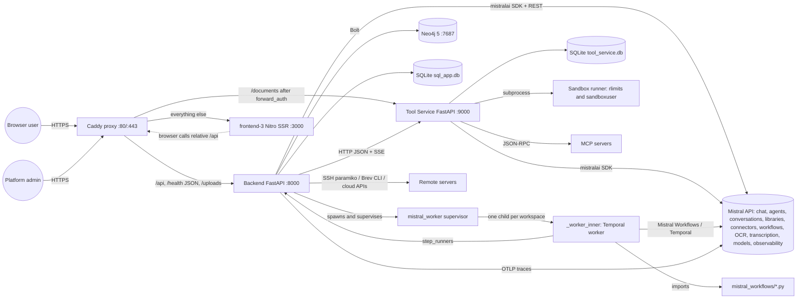

# System context

<!-- docsync:auto:begin - generated by docsync, edits inside this block are overwritten -->
> **Section status: CURRENT** - reviewed 2026-11-20; covers 13 files (globs in the front matter).
<!-- docsync:auto:end -->

<!-- The whole system on one page: every process, every external service, every arrow between them. -->

## Diagram

## Processes
| Process | Started by | Port | Talks to | State it owns |
|---|---|---|---|---|
| Backend API (`uvicorn app.main:app`) | Developer (`uvicorn --reload` from `backend/`), or the `backend` container | 8000 | Tool Service, Mistral, Neo4j, remote servers; spawns the worker supervisor | `backend/sql_app.db` (all backend tables), `backend/uploads/`, `backend/runtime_settings.json`, `backend/vault_key.secret` and `backend/remote_servers_key.secret` (when generated), the in-memory live runs and executions |
| Mistral Workflows supervisor (`services/mistral_worker.py`) | The backend's lifespan, as a subprocess (when `MISTRAL_WORKER_ENABLED`) | none | Children; reads the workspace keys from the database | `mistral_workflows/.worker_status.json` |
| Worker child (`services/_worker_inner.py`) | The supervisor, one per enabled workspace that has a valid key and at least one compiled workflow file | none | Mistral Workflows (Temporal task queue `DEPLOYMENT_NAME` or `<base>-<ws8>`), the Tool Service, Mistral | none (it runs compiled modules from `mistral_workflows/`) |
| Tool Service (`uvicorn app.main:app` in `tool-service/`) | Developer (Docker compose in `tool-service/`), or the `tool-service` container | 9000 | Mistral (synthesis models), MCP servers, the sandbox subprocesses | `tool_service.db` (`tools`, `synthesis_jobs`), `dynamic_tools/` (generated modules), `db/runtime_settings.json`, `db/mcp_registry.json`, the documents folder |
| Sandbox runner (`synthesis/sandbox_runner.py`) | The Tool Service, per verification run | none | stdin and stdout with its parent | Temporary files only |
| Frontend (`frontend-3`) | `npm run dev` (Vite, port 8080) or the `frontend` container (Nitro Node, port 3000) | 8080 dev / 3000 prod | The backend through the `/api` proxy | Browser localStorage only |
| Caddy | The `proxy` container (production) | 80 / 443 | Frontend, backend, Tool Service | Its certificates (caddy-data volume) |
| Neo4j | `docker compose up -d neo4j` (root) or the production compose | 7474 HTTP, 7687 Bolt | none | The graph (Library, Document, Entity, taxonomy nodes) |

## External services
| Service | Used for | How we authenticate | Failure impact | Swap-out notes |
|---|---|---|---|---|
| Mistral API (`https://api.mistral.ai`, `MISTRAL_API_BASE_URL`) | Chat completions for every decision layer; Agents, Conversations, Libraries, Connectors, Workflows; OCR (`mistral-ocr-latest`); transcription (`voxtral-mini-latest`); embeddings (`mistral-embed`); the model list; observability traces | Bearer API key. The platform key is `MISTRAL_API_KEY`. Each workspace has its own key, stored encrypted in `auth_workspaces`. | Nothing can be planned, created or chatted with. Decision layers fall back to the fallback model, then to never-fatal defaults. Health shows Mistral as down. | The whole product is Mistral-specific (Agents, Libraries, Workflows, connectors). Replacing it is a rewrite. |
| Mistral Workflows (Temporal, managed by Mistral) | Running published workflows on the worker | The workspace's Mistral key, through the SDK's environment variables | Published workflows cannot run. Local DAG execution still works. | Optional: the `WITH_MISTRAL_WORKFLOWS` build argument. |
| Neo4j 5 | Graph RAG: entities, relations, the taxonomy mirror and the unified graph | `NEO4J_URI`, `NEO4J_USER` and `NEO4J_PASSWORD` | Graph RAG features report unavailable; everything else works | Any Neo4j 5 instance. |
| Remote hosts (SSH, Brev, AWS EC2, GCP Compute, Azure VM, DigitalOcean, HTTP deploy or MCP code endpoints) | Deploying workflow workers and tools | SSH keys or passwords, provider tokens and cloud credentials, Fernet-encrypted in `remote_servers.secrets` and `remote_provider_accounts.secrets` | Only remote deployment is affected | Providers are listed in `remote_servers/providers.py`. |
| MCP servers (third-party) | Extra tools through the Tool Service's MCP registry | Per-server headers in the registry | Those tools fail | Optional (`MCP_SERVERS_ENABLED`). |
| Mistral console | Deep links from the logs (`OBSERVABILITY_CONSOLE_URL`) | The user's own Mistral sign-in | Links only | none |

## Trust boundaries
- **Browser to backend.**
  - Every `/api` request passes `auth/middleware.py`. It checks the session cookie (`mdat_session` for users, `mdat_admin` for admins), the same-site Origin check for writes, and the deny-by-default route policy in `auth/permissions.py`.
  - `/uploads/*` and `/documents/*` are guarded by Caddy's `forward_auth` to `/api/auth/check`.
- **Uploaded files** (attachments, documents, process documents, knowledge sources):
  - size limits apply: `UPLOAD_MAX_MB` 20, `KNOWLEDGE_SOURCE_MAX_MB` 25, `PROCESS_DOC_MAX_KB` 512;
  - process documents are validated against a JSON schema;
  - files are stored under generated names; they are never executed.
- **LLM output** is treated as data:
  - every decision layer parses JSON and validates it;
  - invalid output is repaired or replaced by a safe default;
  - workflow definitions produced by the planner are validated (`workflow_engine/validation.py`) before saving;
  - expressions in conditions and transforms run in `expression_sandbox.py`, never `eval`.
- **Generated code** (tools and activities):
  - the backend's R2 policy gate screens it;
  - the Tool Service then checks it with AST and policy checks, and runs it in a sandbox subprocess (`SANDBOX_TIMEOUT_SECONDS` 20, `SANDBOX_MEMORY_MB` 512, user `sandboxuser`) before registration;
  - tool-safety rules add organisation policy;
  - tools with write or delete side effects need approval.
  - **Caveat:** approved code then runs in-process in the Tool Service at `/execute`, without the sandbox limits (see 06_nuances/04_security_and_access.md).
- **The Tool Service is a trusted internal component with no authentication.** It must not be exposed publicly; Caddy only routes `/documents` to it, after auth.
- **Secrets cross into tools** only as vault-resolved values in the execute request, after a 428 tells the backend which names are needed. Results are scrubbed of secret values (`VAULT_REDACT_RESULTS`), and traces are redacted (`OBSERVABILITY_REDACT`). Sign-in and admin requests are never exported to Mistral traces.

## Change log
- 2026-11-20 - `91d48cfa` - first description
