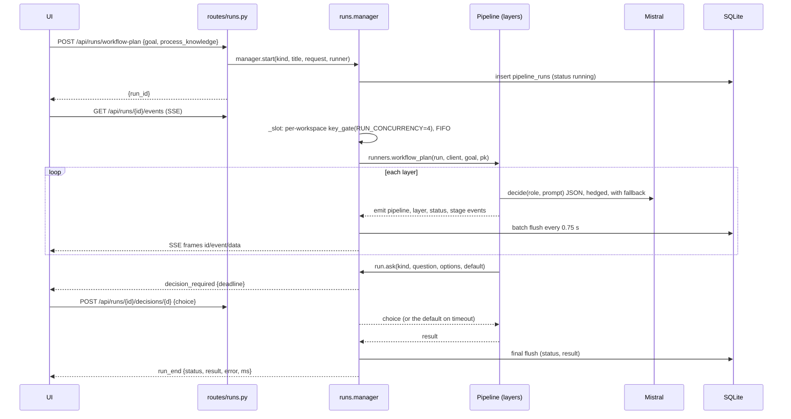
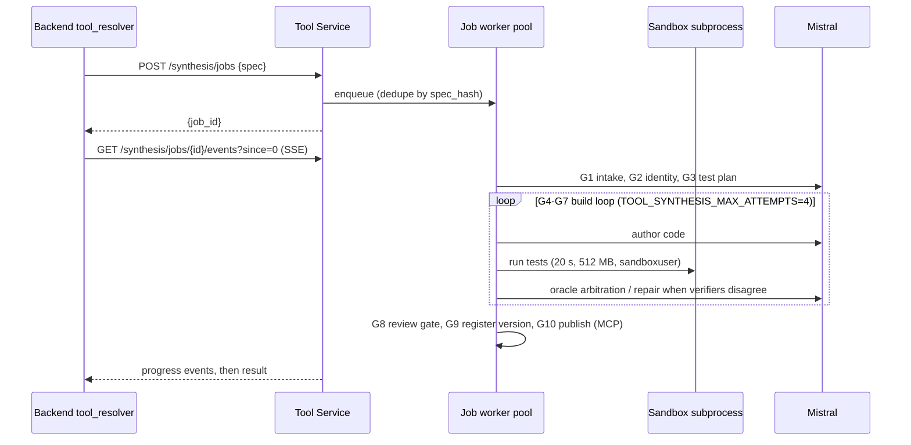

# Runtime flows

<!-- docsync:auto:begin - generated by docsync, edits inside this block are overwritten -->
> **Section status: CURRENT** - reviewed 2026-11-20; covers 111 files (globs in the front matter).
<!-- docsync:auto:end -->

<!-- Sequence of the important flows, step by step, naming the function at each step. -->

## Flow 1: Background run (agent or workflow plan) with user decisions

1. **`POST /api/runs/<kind>`** (`routes/runs.py`) checks the permission and calls `manager.start(kind, title, request, runner)`. That inserts the `pipeline_runs` row and starts the task `run:<kind>:<id>`. It returns `{run_id}` at once.
2. **`_drive`** binds `progress.tracker` to the run, opens the root span `run <kind>`, and calls `_drive_run`.
3. **`_drive_run`:**
   1. starts the flusher (every 0.75 s);
   2. waits for a per-workspace slot (`RUN_CONCURRENCY`, default 4), emitting "Waiting for a free slot — N ahead of you";
   3. calls the runner from `runs/runners.py`.
4. **The runner** builds a `PipelineContext` with `event_queue=run` and runs the pipeline.
   - `workflow_plan` runs `workflow_pipeline` (stages understand → contract → plan → build → assemble → govern → check → verify → deliver; see the per-file doc of `layers/__init__.py` for the exact layer list).
   - `agent` runs `chat_pipeline` (understand → equip → ground → design (parallel facets) → govern → author → verify → answer).
5. **Each decision layer** calls `core.decision.decide()`:
   1. it runs the sync SDK in a thread under the per-key concurrency gate (`DECISION_CONCURRENCY` 6);
   2. it hedges to the fallback model after `DECISION_HEDGE_SECONDS` (45);
   3. it retries rate limits up to `DECISION_MAX_RETRIES` (4), with jittered backoff from `DECISION_RETRY_BASE_SECONDS` (2);
   4. it parses fenced JSON;
   5. it runs self-check repair rounds;
   6. on total failure it falls back to a safe default.
6. **Validation issues** found by a later layer can rewind to the owning earlier layer (`core/stages.py`, `layers/workflow/issue_owners.py`), up to `WORKFLOW_BUILD_AUTO_ATTEMPTS` (3).
7. **Tool gaps** call `codegen.pipeline.resolve_code_needs` (concurrency 3): R1–R3 decide reuse, R4–R6 author and check a spec (up to `MAX_REAUTHORS` 2), R4b checks credentials, R7 submits a Tool Service job and tracks it, R7b smoke-tests, and R8 binds and refreshes.
8. **User decisions:** `run.ask()` emits `decision_required` with a deadline (`RUN_DECISION_TIMEOUT_SECONDS`, 120 s). The UI answers through `POST /runs/{id}/decisions/{decision_id}` or extends it through `/extend` (30–3600 s). On timeout the default is applied and `decision_made {by: "timeout"}` is emitted.
9. **The end:** `run_end {status, result, error, ms}`. The run stays in memory for 600 s, then is served from the database.
   - On cancel, `workflow_plan` reclaims the agents it created (`reclaim_unused`).
   - On server shutdown, a running run becomes `interrupted`.
   - At the next start, `runs/recovery.py` marks orphaned runs interrupted, and the planner's interrupted-plan reclamation runs in the background.

## Flow 2: Tool or activity synthesis in the Tool Service

1. **`tool_resolver.submit_job(spec)`** sends `POST /synthesis/jobs` (30 s timeout), then `await_job` reads the SSE events for up to 1200 s. If the stream drops, it polls `GET /synthesis/jobs/{id}` every 2 s.
2. **The Tool Service job manager** (`synthesis/jobs.py`) persists `synthesis_jobs` and runs `run_synthesis` on a thread pool (`SYNTHESIS_WORKERS` 3) with a wall clock of `SYNTHESIS_WALL_CLOCK_SECONDS` (900).
3. **G1–G10** (`synthesis/layers/`):
   - intake and spec normalisation, policy and tool-safety checks;
   - identity (name, version);
   - the test plan from examples;
   - the build loop: author, sandbox run, verifiers and fault classification (code, spec, harness, transport), with oracle arbitration and autocorrection when `ORACLE_ARBITRATION` and `ORACLE_AUTOCORRECT` are on, repeated up to `TOOL_SYNTHESIS_MAX_ATTEMPTS` (4);
   - the review gate (`review_required` for side effects);
   - registration into `tools` (a new `version_no`, `hash`, status pending_approval or active);
   - publishing to MCP when configured.
4. **The result** is `{status, tool_name, version, …, fault}`.
5. **The backend** auto-approves when `AUTO_APPROVE_DYNAMIC_TOOLS` is set (backend default True), except for write or delete side effects. It then refreshes the dynamic-tool registry (`tool_registry`).

## Flow 3: Local workflow execution
1. **`POST /api/workflows/{name}/execute`** (`routes/workflows.py`):
   1. `workflow_inputs.run_input.check` validates the inputs;
   2. prerequisites are checked when `PREREQ_BLOCK_RUN_ON_MISSING` is set;
   3. it calls `engine.execute_workflow(name, input, wait_for_result=False)` as a task;
   4. it returns `{execution_id}`.
2. **`execute_workflow`:**
   1. records RUNNING in `local_executions` first;
   2. opens the root span `workflow <name>`;
   3. loads the definition and attaches the output contracts;
   4. activates the workflow rules (`rules_runtime.activate_workflow`) with `max_steps` (rule step limit, default 50);
   5. checks the input against the rules.
3. **The loop:**
   - for each step: publish a "running" row, `run_step(step, variables)`, store `step_<id>_output`, and merge dict outputs into the variables;
   - parallel groups run with `asyncio.gather` on variable snapshots;
   - conditions choose `next_step`;
   - stop requests (cancel or terminate) are honoured between steps;
   - a revisit is treated as a cycle.
4. **`run_step`** (`step_runners.py`), by step type:
   - **agent:** calls the agent with hedging to `AGENT_FALLBACK_MODEL` after `AGENT_HEDGE_SECONDS` (40), with `AGENT_CALL_TIMEOUT_SECONDS` (180);
   - **tool:** runs it through `tool_resolver.execute`, retrying once with vault secrets on a 428;
   - **connector:** calls the connector's tool;
   - **transform and condition:** use the expression sandbox;
   - **human_review:** creates a `human_reviews` row and waits, up to `HUMAN_REVIEW_TIMEOUT_SECONDS` (86400), for `POST /reviews/{id}/decision`.
5. **The end:** COMPLETED with the last step's output, or FAILED with `{error, failed_step}`. The final run is recorded and the trace flushed. The UI follows `GET /workflows/executions/{id}/stream`.

## Flow 4: Publish and run on Mistral Workflows
1. **`POST /api/workflows/{name}/publish`:**
   1. `mistral_workflows_compiler` generates `mistral_workflows/workflow_<name>.py`, a Temporal workflow whose activities call `step_runners.run_step`;
   2. the workflow is registered with Mistral, waiting up to `WORKFLOW_REGISTRATION_WAIT` (30 s);
   3. `auth/workers` maps the workflow file to its workspace.
2. **The supervisor** (`mistral_worker.py`) notices the file change (watchfiles) or reconciles (every 30 s), and restarts the workspace's child with `WORKER_WORKFLOW_FILES`.
3. **The child** (`_worker_inner.py`) imports the modules and polls the task queue: `DEPLOYMENT_NAME` for the Default workspace, `<base>-<ws[:8]>` for the others.
4. **`POST /workflows/{name}/execute`** for a published workflow starts a Mistral execution. The step events stream live through `/workflows/executions/{id}/stream`, and traces come from Mistral observability.

## Flow 5: Sign-in and request authorisation
1. **`POST /api/auth/login {email, password}`:**
   1. rate limit and lockout check (`AUTH_LOCKOUT_MINUTES` 15);
   2. argon2 verification;
   3. a session row, and the cookie `mdat_session` (httpOnly, SameSite=Lax, Secure in auto mode on HTTPS);
   4. an audit entry.
2. **Every request:** `AuthMiddleware`:
   1. `permissions.match(method, path)`; no match means 403;
   2. PUBLIC passes;
   3. otherwise the session is loaded (idle timeout 720 min, maximum 168 h; for admins 30 min and 12 h);
   4. the active workspace is set in a context variable;
   5. the permission is checked against the membership's role;
   6. writes must come from the same site (Origin against Host or `X-Forwarded-Host`).
3. **Store queries** are filtered by `workspace_id` automatically for the registered models (`auth/scoping.py`).

## Background work
| Job / task | Trigger | Runs in | Frequency / lifetime | What it changes |
|---|---|---|---|---|
| Background runs | `POST /api/runs/*` | Backend event loop (`runs.manager`) | Until done; kept in memory 600 s after | `pipeline_runs`, `pipeline_run_events`, Mistral resources, the Tool Service registry |
| Run event flusher | Each live run | Backend | Every 0.75 s | `pipeline_run_events` |
| Model catalog refresh | Start-up | Backend task | Every `MODEL_CATALOG_REFRESH_HOURS` (24) | The model catalog file; may auto-upgrade deprecated models (`AUTO_UPGRADE_DEPRECATED_MODELS`) |
| Workspace provisioning and interrupted-plan reclamation | Start-up | Backend background tasks | Once | Workspace resources; deletes agents of abandoned plans |
| Agent classification | Start-up (unscoped agents), agent creation | Backend background task | Once per agent | `ontology_annotations` |
| Worker supervisor | Start-up | Subprocess | Reconcile every 30 s; restart backoff 5, 15, 30, 60, 120, 300 s | Worker children, `.worker_status.json` |
| Synthesis jobs | `POST /synthesis/jobs` | Tool Service thread pool (3) | ≤ 900 s each | `synthesis_jobs`, `tools`, `dynamic_tools/` |
| Workflow executions | `POST /workflows/{n}/execute` | Backend task (local) or the worker | Until done; human review ≤ 24 h | `local_executions`, `human_reviews` |
| RAG extraction | `POST /rag/documents/{id}/extract`, library uploads | Backend tasks | `RAG_EXTRACTION_CONCURRENCY` 4 | `rag_*`, Neo4j |
| Remote deployments | `POST /remote-servers/{id}/deploy-workflow`, build, commands | Backend threads (`asyncio.to_thread`) | ≤ 3600 s | `remote_deployments` |
| Prunes | Start-up | Backend | Once | Runs beyond the newest 200, old rule events, old RAG timelines, vault audit older than 180 days, expired sessions and links |

## Streaming and progress
- **Background runs:** `GET /api/runs/{id}/events?after=<seq>` (SSE).
  - Frames are `id: <seq>`, `event: <name>`, `data: <json>`.
  - Events include `pipeline` (the layer list), `layer` (active, completed, skipped, failed), `stage`, `status`, `log`, `text_chunk` (coalesced), `decision_required`, `decision_made`, `decision_extended`, layer-specific payloads (for example `synthesis_result`), `error` and `run_end`.
  - A `: keepalive` comment is sent every 15 s.
  - On reconnect, the client passes the last seq it saw. The server replays from memory or the database, then follows live.
- **Ops:** `GET /api/ops/{op_id}/events` (SSE) for requests tagged `X-Op-Id`: stages, pipeline layers, model calls and log lines.
- **Workflow executions:** `GET /api/workflows/executions/{id}/stream`, with step rows and status. The UI polls `/steps` as a fallback.
- **Chat:** `POST /api/chat/stream` streams text chunks.
- **RAG timelines:** `GET /api/rag/timeline/{trace_id}/stream`.
- **The Tool Service:** `GET /synthesis/jobs/{id}/events?since=N` (progress, then result).
- **The frontend** keeps run connections in `lib/runs/connections.ts` (one per run, resumable) and persists the list of runs in localStorage (`background_runs`).

## Concurrency
- **Per-key gates** (`core.runtime.key_gate`), so one workspace cannot starve another:
  - `DECISION_CONCURRENCY` 6 (model calls);
  - `RUN_CONCURRENCY` 4 (background runs, FIFO);
  - `WORKFLOW_DESIGN_CONCURRENCY` 4;
  - `AGENT_CREATION_CONCURRENCY` 5;
  - `RULE_SELECTION_CONCURRENCY` 4;
  - `TOOL_SYNTHESIS_CONCURRENCY` 6.
- **The sync Mistral SDK always runs in threads** (`sdk_offload`, `asyncio.to_thread`); the I/O pool size is set at start-up (`WORKER_THREADS`).
- **SQLite** runs in WAL mode with `busy_timeout=30000` and `synchronous=NORMAL` (`db_tuning.py`). Run events are batch-written.
- **Parallel facets** in the agent pipeline (tools, connectors, libraries, model and identity) run together. Backoff jitter keeps their retries out of lockstep.
- **Synthesis jobs are deduplicated by `spec_hash`.** Two needs cannot claim one tool name, because built names are appended to a shared catalogue.
- **Executions are never sent twice to the Tool Service;** only connection failures that never reached it are retried.
- **Idempotency:** workflow saves are upserts by name; tool registration is by content `hash` (unique); start-up seeds are insert-if-missing.
- **One worker process per workspace key,** because the Workflows SDK reads its key from process-wide environment variables and keeps a global activity registry.

## Change log
- 2026-11-20 - `a717382d` - first description
