# Data model

<!-- docsync:auto:begin - generated by docsync, edits inside this block are overwritten -->
> **Section status: CURRENT** - reviewed 2026-11-20; covers 20 files (globs in the front matter).
<!-- docsync:auto:end -->

<!-- Everything persisted, anywhere. -->

## Storage engines
| Store | Engine / version | Location | Created by | Backed up? |
|---|---|---|---|---|
| Backend database | SQLite (WAL) via SQLAlchemy | `DATABASE_URL`, default `backend/sql_app.db`; in production `sqlite:////srv/data/sql_app.db` (backend-data volume) | `db_setup.prepare_database()` at start-up | Not by the app. Back up the volume or file. |
| Tool Service database | SQLite via SQLAlchemy | `DATABASE_URL`, default `sqlite:////app/db/tool_service.db` (tool-db volume) | `tool-service/app/database.py` at start-up | No |
| Graph | Neo4j 5 community | `NEO4J_URI` (bolt://localhost:7687), database `NEO4J_DATABASE` (neo4j); volume neo4j-data | `rag/graph_store` constraints at start-up | No |
| Settings overrides | JSON file | `backend/runtime_settings.json` (`RUNTIME_SETTINGS_PATH`); Tool Service `db/runtime_settings.json` | The Settings page | No |
| Model catalog | JSON file | `backend/model_catalog.json` (`MODEL_CATALOG_PATH`) | The catalog refresh loop | Rebuilt from Mistral |
| Uploads | Files | `backend/uploads/` (backend-uploads volume) | `routes/uploads.py`, attachments | No |
| Generated tools | Python files | Tool Service `dynamic_tools/` (`DYNAMIC_TOOLS_DIR`) | Registration (G9) | Re-creatable from `tools.source_code` |
| Compiled workflows | Python files | `mistral_workflows/workflow_<name>.py` | The compiler on publish | Re-creatable by publishing again |
| MCP registry | JSON file | Tool Service `db/mcp_registry.json` | MCP routes | No |
| Key files | Fernet keys | `backend/vault_key.secret`, `backend/remote_servers_key.secret` (only when the env vars are unset) | First use | **Must be backed up.** Losing them makes the encrypted values unreadable. |
| Browser state | localStorage | Keys `background_runs`, `workflow-execution-watch`, `mistral-chat-sessions`, `agent_planner_history` | The frontend stores | No (per browser) |

## Entities

```mermaid
erDiagram
  auth_workspaces ||--o{ auth_memberships : has
  auth_users ||--o{ auth_memberships : has
  auth_roles ||--o{ auth_memberships : grants
  auth_users ||--o{ auth_sessions : "subject_id (kind=user)"
  auth_admins ||--o{ auth_sessions : "subject_id (kind=admin)"
  auth_workspaces ||--o{ workflow_definitions : workspace_id
  workflow_definitions ||--o{ workflow_versions : workflow_name
  workflow_definitions ||--o{ workflow_revisions : workflow_name
  workflow_definitions ||--o{ local_executions : workflow_name
  local_executions ||--o{ human_reviews : execution_id
  workflow_definitions ||--o{ workflow_input_libraries : workflow_name
  workflow_input_libraries ||--o{ workflow_input_documents : "library_id"
  pipeline_runs ||--o{ pipeline_run_events : run_id
  vault_secrets ||--o{ vault_secret_versions : secret_id
  vault_secrets ||--o{ vault_audit : secret_id
  remote_servers ||--o{ remote_deployments : server_id
  ontology_schemes ||--o{ ontology_concepts : scheme_id
  ontology_concepts ||--o{ ontology_annotations : concept_id
  ontology_concepts ||--o{ ontology_concept_links : "source/target"
  ontology_concepts ||--o{ industry_knowledge : concept_id
  ontology_concepts ||--o{ process_documents : concept_id
  process_templates ||--o{ process_documents : template_id
  process_documents ||--o{ process_usage : document_id
  knowledge_sources ||--o{ knowledge_items : source_id
  rules ||--o{ rule_assignments : rule_id
  rules ||--o{ rule_events : rule_id
  rag_documents ||--o{ rag_extraction_drafts : document_id
  rag_library_ontology }o--|| rag_documents : library_id
  tools ||--o{ synthesis_jobs : "name (Tool Service)"
```

Only `ontology_concepts.scheme_id` and `remote_deployments.server_id` are real foreign keys (with `ON DELETE CASCADE` on the latter). Every other link is by convention: an id or name column, cleaned up in code.

**Workspace scoping.** `auth/setup.register_scoped_models` scopes these tables with a `workspace_id` column (added by `ALTER TABLE` and back-filled with the Default workspace on first start):
- workflow_definitions, deleted_workflows, workflow_revisions, workflow_versions;
- pipeline_runs, human_reviews, local_executions;
- vault_secrets, vault_audit;
- remote_servers, remote_deployments.

`build_lessons` also has `workspace_id`, filtered by hand. Every other table is platform-wide (see 06_nuances/04_security_and_access.md).

The column tables below are generated from the SQLAlchemy models. For the meaning of each column, read the per-file doc of the defining module. JSON is stored as Text in every column whose name ends in `_json`, and in `params`, `targets`, `tags`, `conditions`, `payload`, `operations`, `meta` and similar fields. Times are naive UTC unless noted.

### auth_workspaces
Defined in `backend/app/auth/models.py`.

| Column | Type | Null | Default | Meaning / constraints |
|---|---|---|---|---|
| id | String | no |  | primary key |
| name | String | no |  | unique |
| description | Text | yes |  |  |
| key_source | String | no | 'stored' |  |
| key_ciphertext | Text | yes |  |  |
| key_version | Integer | no | 1 |  |
| key_fingerprint | String | yes |  | indexed |
| key_hint | String | yes |  |  |
| key_status | String | no | 'unchecked' |  |
| key_checked_at | DateTime | yes |  |  |
| key_error | Text | yes |  |  |
| key_rotated_at | DateTime | yes |  |  |
| is_default | Boolean | no | False |  |
| disabled | Boolean | no | False |  |
| created_by | String | yes |  |  |
| created_at | DateTime | yes |  |  |
| updated_at | DateTime | yes |  |  |

### auth_roles
Defined in `backend/app/auth/models.py`.

| Column | Type | Null | Default | Meaning / constraints |
|---|---|---|---|---|
| id | String | no |  | primary key |
| name | String | no |  | unique |
| description | Text | yes |  |  |
| permissions | Text | no | '[]' |  |
| system_key | String | yes |  | unique |
| created_by | String | yes |  |  |
| created_at | DateTime | yes |  |  |
| updated_at | DateTime | yes |  |  |

### auth_users
Defined in `backend/app/auth/models.py`.

| Column | Type | Null | Default | Meaning / constraints |
|---|---|---|---|---|
| id | String | no |  | primary key |
| email | String | no |  | unique, indexed |
| name | String | no |  |  |
| password_hash | String | yes |  |  |
| status | String | no | 'invited' |  |
| must_change_password | Boolean | no | False |  |
| failed_logins | Integer | no | 0 |  |
| locked_until | DateTime | yes |  |  |
| last_login_at | DateTime | yes |  |  |
| password_changed_at | DateTime | yes |  |  |
| last_workspace_id | String | yes |  |  |
| created_by | String | yes |  |  |
| created_at | DateTime | yes |  |  |
| updated_at | DateTime | yes |  |  |
| deleted_at | DateTime | yes |  |  |

### auth_memberships
Defined in `backend/app/auth/models.py`.

| Column | Type | Null | Default | Meaning / constraints |
|---|---|---|---|---|
| id | Integer | no |  | primary key |
| user_id | String | no |  | indexed |
| workspace_id | String | no |  | indexed |
| role_id | String | no |  | indexed |
| created_by | String | yes |  |  |
| created_at | DateTime | yes |  |  |

### auth_admins
Defined in `backend/app/auth/models.py`.

| Column | Type | Null | Default | Meaning / constraints |
|---|---|---|---|---|
| id | String | no |  | primary key |
| email | String | no |  | unique, indexed |
| name | String | no |  |  |
| password_hash | String | yes |  |  |
| status | String | no | 'active' |  |
| must_change_password | Boolean | no | False |  |
| failed_logins | Integer | no | 0 |  |
| locked_until | DateTime | yes |  |  |
| last_login_at | DateTime | yes |  |  |
| password_changed_at | DateTime | yes |  |  |
| created_by | String | yes |  |  |
| created_at | DateTime | yes |  |  |
| updated_at | DateTime | yes |  |  |

### auth_sessions
Defined in `backend/app/auth/models.py`.

| Column | Type | Null | Default | Meaning / constraints |
|---|---|---|---|---|
| id | String | no |  | primary key |
| public_id | String | no |  | unique |
| kind | String | no |  |  |
| subject_id | String | no |  | indexed |
| workspace_id | String | yes |  |  |
| created_at | DateTime | yes |  |  |
| last_seen_at | DateTime | yes |  |  |
| expires_at | DateTime | no |  |  |
| revoked_at | DateTime | yes |  |  |
| ip | String | yes |  |  |
| user_agent | String | yes |  |  |

### auth_tokens
Defined in `backend/app/auth/models.py`.

| Column | Type | Null | Default | Meaning / constraints |
|---|---|---|---|---|
| id | String | no |  | primary key |
| kind | String | no |  |  |
| subject_kind | String | no |  |  |
| subject_id | String | no |  | indexed |
| created_by | String | yes |  |  |
| created_at | DateTime | yes |  |  |
| expires_at | DateTime | no |  |  |
| used_at | DateTime | yes |  |  |

### auth_audit
Defined in `backend/app/auth/models.py`.

| Column | Type | Null | Default | Meaning / constraints |
|---|---|---|---|---|
| id | Integer | no |  | primary key |
| at | DateTime | yes |  | indexed |
| actor_kind | String | yes |  |  |
| actor_id | String | yes |  |  |
| actor_email | String | yes |  |  |
| action | String | no |  | indexed |
| target_type | String | yes |  |  |
| target_id | String | yes |  |  |
| workspace_id | String | yes |  |  |
| outcome | String | no | 'ok' |  |
| detail | Text | yes |  |  |
| ip | String | yes |  |  |

### ontology_schemes
Defined in `backend/app/catalog/models.py`.

| Column | Type | Null | Default | Meaning / constraints |
|---|---|---|---|---|
| id | String | no |  | primary key |
| label | String | no |  |  |
| description | Text | yes |  |  |
| created_at | DateTime | yes |  |  |

### ontology_concepts
Defined in `backend/app/catalog/models.py`.

| Column | Type | Null | Default | Meaning / constraints |
|---|---|---|---|---|
| id | String | no |  | primary key |
| scheme_id | String | no |  | FK('ontology_schemes.id'), indexed |
| parent_id | String | yes |  | indexed |
| label | String | no |  |  |
| definition | Text | yes |  |  |
| synonyms | Text | yes |  |  |
| created_at | DateTime | yes |  |  |

### industry_knowledge
Defined in `backend/app/catalog/models.py`.

| Column | Type | Null | Default | Meaning / constraints |
|---|---|---|---|---|
| id | Integer | no |  | primary key |
| concept_id | String | no |  | indexed |
| kind | String | no | 'definition' | indexed |
| title | String | no |  |  |
| body | Text | no |  |  |
| tags | Text | yes |  |  |
| as_of | String | yes |  |  |
| source | String | no | 'seed' |  |
| created_at | DateTime | yes |  |  |
| updated_at | DateTime | yes |  |  |

### ontology_annotations
Defined in `backend/app/catalog/models.py`.

| Column | Type | Null | Default | Meaning / constraints |
|---|---|---|---|---|
| id | Integer | no |  | primary key |
| subject_type | String | no |  | indexed |
| subject_id | String | no |  | indexed |
| predicate | String | no |  | indexed |
| concept_id | String | no |  | indexed |
| source | String | no | 'user' |  |
| created_at | DateTime | yes |  |  |

### ontology_concept_links
Defined in `backend/app/catalog/models.py`.

| Column | Type | Null | Default | Meaning / constraints |
|---|---|---|---|---|
| id | Integer | no |  | primary key |
| source_concept_id | String | no |  | indexed |
| predicate | String | no |  | indexed |
| target_concept_id | String | no |  | indexed |
| source | String | no | 'user' |  |
| created_at | DateTime | yes |  |  |

### knowledge_items
Defined in `backend/app/knowledge/models.py`.

| Column | Type | Null | Default | Meaning / constraints |
|---|---|---|---|---|
| id | Integer | no |  | primary key |
| kind | String | no | 'reference' | indexed |
| category | String | no | 'definition' | indexed |
| concept_id | String | yes |  | indexed |
| title | String | no |  |  |
| body | Text | no |  |  |
| tags | Text | yes |  |  |
| audience | String | no | 'runtime' |  |
| subject | String | no | 'both' |  |
| strength | String | yes |  |  |
| conditions | Text | yes |  |  |
| effect | Text | yes |  |  |
| layers | Text | yes |  |  |
| rationale | Text | yes |  |  |
| status | String | no | 'active' | indexed |
| confidence | String | yes |  |  |
| origin | String | no | 'user' |  |
| source_id | Integer | yes |  | indexed |
| source_ref | Text | yes |  |  |
| as_of | String | yes |  |  |
| embedding | Text | yes |  |  |
| content_hash | String | yes |  | indexed |
| legacy_id | Integer | yes |  | unique |
| used | Integer | no | 0 |  |
| accepted_builds | Integer | no | 0 |  |
| rolled_back_builds | Integer | no | 0 |  |
| created_at | DateTime | yes |  |  |
| updated_at | DateTime | yes |  |  |

### knowledge_sources
Defined in `backend/app/knowledge/models.py`.

| Column | Type | Null | Default | Meaning / constraints |
|---|---|---|---|---|
| id | Integer | no |  | primary key |
| title | String | no | '' |  |
| source_type | String | no | 'text' |  |
| filename | String | yes |  |  |
| url | String | yes |  |  |
| library_id | String | yes |  |  |
| document_id | String | yes |  |  |
| text | Text | yes |  |  |
| concept_id | String | yes |  |  |
| status | String | no | 'pending' |  |
| message | Text | yes |  |  |
| item_count | Integer | no | 0 |  |
| version | Integer | no | 1 |  |
| extraction_seconds | Float | yes |  |  |
| created_at | DateTime | yes |  |  |
| updated_at | DateTime | yes |  |  |

### build_lessons
Defined in `backend/app/learning/__init__.py`.

| Column | Type | Null | Default | Meaning / constraints |
|---|---|---|---|---|
| workspace_id | String | yes |  | indexed |
| id | Integer | no |  | primary key |
| signature | String | no |  | indexed |
| count | Integer | no | 0 |  |
| examples | Text | no | '[]' |  |
| proposed_item_id | Integer | yes |  |  |
| last_seen | DateTime | yes |  |  |

### process_templates
Defined in `backend/app/process/models.py`.

| Column | Type | Null | Default | Meaning / constraints |
|---|---|---|---|---|
| id | Integer | no |  | primary key |
| name | String | no |  |  |
| version | Integer | no | 1 |  |
| description | Text | yes |  |  |
| schema | Text | no |  |  |
| example | Text | yes |  |  |
| kind | String | no | 'schema' |  |
| concept_id | String | yes |  | indexed |
| is_default | Boolean | no | False |  |
| builtin | Boolean | no | False |  |
| created_at | DateTime | yes |  |  |

### process_documents
Defined in `backend/app/process/models.py`.

| Column | Type | Null | Default | Meaning / constraints |
|---|---|---|---|---|
| id | Integer | no |  | primary key |
| concept_id | String | yes |  | indexed |
| version | Integer | no | 1 |  |
| is_active | Boolean | no | False |  |
| title | String | no | '' |  |
| content | Text | yes |  |  |
| raw | Text | no | '' |  |
| status | String | no | 'invalid' | indexed |
| report | Text | yes |  |  |
| template_id | Integer | yes |  |  |
| template_version | Integer | yes |  |  |
| source | String | no | 'upload' |  |
| filename | String | yes |  |  |
| created_at | DateTime | yes |  |  |
| updated_at | DateTime | yes |  |  |

### process_usage
Defined in `backend/app/process/models.py`.

| Column | Type | Null | Default | Meaning / constraints |
|---|---|---|---|---|
| id | Integer | no |  | primary key |
| document_id | Integer | no |  | indexed |
| document_version | Integer | yes |  |  |
| concept_id | String | yes |  | indexed |
| subject_type | String | no |  |  |
| subject_id | String | no |  | indexed |
| subject_name | String | yes |  |  |
| layer | String | no |  |  |
| element | String | no |  |  |
| how | Text | yes |  |  |
| source_type | String | no | 'process' |  |
| created_at | DateTime | yes |  |  |

### rag_documents
Defined in `backend/app/rag/models.py`.

| Column | Type | Null | Default | Meaning / constraints |
|---|---|---|---|---|
| id | Integer | no |  | primary key |
| library_id | String | no |  | indexed |
| mistral_doc_id | String | no |  |  |
| filename | String | no |  |  |
| mime_type | String | yes |  |  |
| status | String | no | 'uploaded' | indexed |
| error | Text | yes |  |  |
| char_count | Integer | no | 0 |  |
| chunk_count | Integer | no | 0 |  |
| rules | Text | yes |  |  |
| trace_id | String | yes |  |  |
| ontology_version | Integer | yes |  |  |
| created_at | DateTime | yes |  |  |
| updated_at | DateTime | yes |  |  |

### rag_extraction_drafts
Defined in `backend/app/rag/models.py`.

| Column | Type | Null | Default | Meaning / constraints |
|---|---|---|---|---|
| id | Integer | no |  | primary key |
| document_id | Integer | no |  | indexed |
| payload | Text | no | '{}' |  |
| entity_count | Integer | no | 0 |  |
| relation_count | Integer | no | 0 |  |
| status | String | no | 'pending' | indexed |
| model | String | yes |  |  |
| rules | Text | yes |  |  |
| created_at | DateTime | yes |  |  |
| updated_at | DateTime | yes |  |  |

### rag_library_ontology
Defined in `backend/app/rag/models.py`.

| Column | Type | Null | Default | Meaning / constraints |
|---|---|---|---|---|
| id | Integer | no |  | primary key |
| library_id | String | no |  | indexed |
| version | Integer | no | 1 |  |
| status | String | no | 'draft' | indexed |
| summary | Text | yes |  |  |
| entity_types | Text | no | '[]' |  |
| predicates | Text | no | '[]' |  |
| prompt | Text | yes |  |  |
| source_document_ids | Text | yes |  |  |
| model | String | yes |  |  |
| created_at | DateTime | yes |  |  |
| updated_at | DateTime | yes |  |  |
| approved_at | DateTime | yes |  |  |

### rag_extraction_rules
Defined in `backend/app/rag/models.py`.

| Column | Type | Null | Default | Meaning / constraints |
|---|---|---|---|---|
| library_id | String | no |  | primary key |
| rules | Text | no | '' |  |
| updated_at | DateTime | yes |  |  |

### rag_system_agents
Defined in `backend/app/rag/models.py`.

| Column | Type | Null | Default | Meaning / constraints |
|---|---|---|---|---|
| key | String | no |  | primary key |
| agent_id | String | no |  |  |
| name | String | yes |  |  |
| model | String | yes |  |  |
| created_at | DateTime | yes |  |  |
| updated_at | DateTime | yes |  |  |

### rag_events
Defined in `backend/app/rag/models.py`.

| Column | Type | Null | Default | Meaning / constraints |
|---|---|---|---|---|
| id | Integer | no |  | primary key |
| trace_id | String | no |  | indexed |
| parent_id | Integer | yes |  |  |
| scope | String | no | 'ingest' | indexed |
| subject | String | no |  | indexed |
| stage | String | no |  |  |
| status | String | no | 'running' | indexed |
| message | Text | yes |  |  |
| meta | Text | yes |  |  |
| seq | Integer | no | 0 |  |
| started_at | DateTime | yes |  |  |
| ended_at | DateTime | yes |  |  |
| duration_ms | Integer | yes |  |  |

### remote_servers
Defined in `backend/app/remote_server_model.py`.

| Column | Type | Null | Default | Meaning / constraints |
|---|---|---|---|---|
| workspace_id | String | yes |  | indexed |
| id | Integer | no |  | primary key, indexed |
| name | String | no |  |  |
| url | String | no |  |  |
| description | Text | yes | '' |  |
| purpose | String | yes | 'tool' |  |
| provider | String | yes | 'mcp_code_endpoint' |  |
| config | Text | yes |  |  |
| secrets | Text | yes |  |  |
| last_status | String | yes |  |  |
| last_check | Text | yes |  |  |
| last_checked_at | DateTime | yes |  |  |
| created_at | DateTime | yes |  |  |
| updated_at | DateTime | yes |  |  |

### remote_deployments
Defined in `backend/app/remote_server_model.py`.

| Column | Type | Null | Default | Meaning / constraints |
|---|---|---|---|---|
| workspace_id | String | yes |  | indexed |
| id | Integer | no |  | primary key, indexed |
| server_id | Integer | yes |  | FK('remote_servers.id', ondelete='CASCADE'), indexed |
| kind | String | no |  |  |
| target | String | no |  |  |
| status | String | no | 'queued' |  |
| options | Text | yes |  |  |
| log | Text | yes | '' |  |
| error | Text | yes |  |  |
| created_at | DateTime | yes |  |  |
| finished_at | DateTime | yes |  |  |

### remote_provider_accounts
Defined in `backend/app/remote_server_model.py`.

| Column | Type | Null | Default | Meaning / constraints |
|---|---|---|---|---|
| provider | String | no |  | primary key |
| secrets | Text | yes |  |  |
| updated_at | DateTime | yes |  |  |

### rules
Defined in `backend/app/rules/models.py`.

| Column | Type | Null | Default | Meaning / constraints |
|---|---|---|---|---|
| id | String | no |  | primary key |
| scope | String | no |  | indexed |
| type | String | no |  |  |
| name | String | no |  |  |
| description | Text | yes |  |  |
| params | Text | no | '{}' |  |
| enforcement | String | no | 'block' |  |
| always_on | Boolean | no | False |  |
| enabled | Boolean | no | True |  |
| source | String | no | 'user' |  |
| category | String | yes |  |  |
| targets | Text | yes |  |  |
| created_at | DateTime | yes |  |  |
| updated_at | DateTime | yes |  |  |

### rule_categories
Defined in `backend/app/rules/models.py`.

| Column | Type | Null | Default | Meaning / constraints |
|---|---|---|---|---|
| id | String | no |  | primary key |
| name | String | no |  |  |
| description | Text | yes |  |  |
| color | String | no | 'slate' |  |
| icon | String | no | 'Tag' |  |
| scope | String | yes |  |  |
| rule_types | Text | yes |  |  |
| default_enforcement | String | yes |  |  |
| default_applies | String | yes |  |  |
| created_at | DateTime | yes |  |  |

### rule_assignments
Defined in `backend/app/rules/models.py`.

| Column | Type | Null | Default | Meaning / constraints |
|---|---|---|---|---|
| id | Integer | no |  | primary key |
| agent_id | String | no |  | indexed |
| rule_id | String | no |  | indexed |
| source | String | no | 'user' |  |
| reason | Text | yes |  |  |
| created_at | DateTime | yes |  |  |

### rule_events
Defined in `backend/app/rules/models.py`.

| Column | Type | Null | Default | Meaning / constraints |
|---|---|---|---|---|
| id | Integer | no |  | primary key |
| rule_id | String | no |  | indexed |
| rule_name | String | no |  |  |
| scope | String | no |  |  |
| subject_id | String | no |  |  |
| checkpoint | String | no |  |  |
| outcome | String | no |  |  |
| message | Text | yes |  |  |
| detail | Text | yes |  |  |
| conversation_id | String | yes |  |  |
| execution_id | String | yes |  |  |
| step_id | String | yes |  |  |
| created_at | DateTime | yes |  | indexed |

### pipeline_runs
Defined in `backend/app/runs/models.py`.

| Column | Type | Null | Default | Meaning / constraints |
|---|---|---|---|---|
| workspace_id | String | yes |  | indexed |
| id | String | no |  | primary key |
| kind | String | no |  | indexed |
| title | String | no | '' |  |
| status | String | no | 'running' | indexed |
| request | Text | no | '{}' |  |
| result | Text | yes |  |  |
| error | Text | yes |  |  |
| layers_total | Integer | no | 0 |  |
| layers_done | Integer | no | 0 |  |
| current_label | String | yes |  |  |
| note | Text | yes |  |  |
| last_seq | Integer | no | 0 |  |
| created_at | DateTime | yes |  |  |
| updated_at | DateTime | yes |  |  |
| finished_at | DateTime | yes |  |  |

### pipeline_run_events
Defined in `backend/app/runs/models.py`.

| Column | Type | Null | Default | Meaning / constraints |
|---|---|---|---|---|
| id | Integer | no |  | primary key |
| run_id | String | no |  |  |
| seq | Integer | no |  |  |
| event | String | no |  |  |
| data | Text | no | '' |  |
| at | Integer | yes |  |  |

### tool_safety_rules
Defined in `backend/app/safety/models.py`.

| Column | Type | Null | Default | Meaning / constraints |
|---|---|---|---|---|
| id | String | no |  | primary key |
| title | String | no |  |  |
| rule | Text | no |  |  |
| enabled | Boolean | no | False |  |
| strictness | String | no | 'standard' |  |
| applies_to | Text | no | '[]' |  |
| builtin | Boolean | no | False |  |
| sort | Integer | no | 100 |  |
| created_at | DateTime | yes |  |  |
| updated_at | DateTime | yes |  |  |

### workflow_definitions
Defined in `backend/app/services/workflow_engine/engine.py`.

| Column | Type | Null | Default | Meaning / constraints |
|---|---|---|---|---|
| workspace_id | String | yes |  | indexed |
| name | String | no |  | primary key, indexed |
| definition_json | Text | no |  |  |
| created_at | DateTime | yes | now (UTC) |  |
| updated_at | DateTime | yes | now (UTC) |  |

### deleted_workflows
Defined in `backend/app/services/workflow_engine/engine.py`.

| Column | Type | Null | Default | Meaning / constraints |
|---|---|---|---|---|
| workspace_id | String | yes |  | indexed |
| name | String | no |  | primary key |
| deleted_at | DateTime | yes | now (UTC) |  |

### human_reviews
Defined in `backend/app/services/workflow_engine/reviews.py`.

| Column | Type | Null | Default | Meaning / constraints |
|---|---|---|---|---|
| workspace_id | String | yes |  | indexed |
| id | Integer | no |  | primary key |
| execution_id | String | no |  | indexed |
| workflow_name | String | yes |  | indexed |
| step_id | String | no |  |  |
| engine | String | no | 'local' |  |
| status | String | no | 'pending' | indexed |
| title | String | yes |  |  |
| instructions | Text | yes |  |  |
| reviewer_role | String | yes |  |  |
| payload | Text | yes |  |  |
| editable | Text | yes |  |  |
| comment | Text | yes |  |  |
| edits | Text | yes |  |  |
| decided_by | String | yes |  |  |
| sla_seconds | Integer | yes |  |  |
| created_at | DateTime | yes |  |  |
| decided_at | DateTime | yes |  |  |

### local_executions
Defined in `backend/app/services/workflow_engine/run_history.py`.

| Column | Type | Null | Default | Meaning / constraints |
|---|---|---|---|---|
| workspace_id | String | yes |  | indexed |
| execution_id | String | no |  | primary key |
| workflow_name | String | no |  | indexed |
| status | String | no |  | indexed |
| start_time | DateTime | yes |  | indexed |
| end_time | DateTime | yes |  |  |
| payload | Text | no |  |  |
| updated_at | DateTime | yes |  |  |

### vault_secrets
Defined in `backend/app/vault/models.py`.

| Column | Type | Null | Default | Meaning / constraints |
|---|---|---|---|---|
| workspace_id | String | yes |  | indexed |
| id | String | no |  | primary key |
| name | String | no |  | unique, indexed |
| label | String | no |  |  |
| kind | String | no | 'api_key' |  |
| service | String | yes |  |  |
| description | Text | yes |  |  |
| sensitive | Boolean | no | True |  |
| tags | Text | no | '[]' |  |
| allowed_consumers | Text | no | '[]' |  |
| ciphertext | Text | no |  |  |
| key_id | String | yes |  |  |
| hint | String | yes |  |  |
| version | Integer | no | 1 |  |
| disabled | Boolean | no | False |  |
| expires_at | DateTime | yes |  |  |
| value_changed_at | DateTime | yes |  |  |
| last_used_at | DateTime | yes |  |  |
| last_used_by | String | yes |  |  |
| use_count | Integer | no | 0 |  |
| origin | String | no | 'settings' |  |
| origin_ref | String | yes |  |  |
| created_at | DateTime | yes |  |  |
| updated_at | DateTime | yes |  |  |

### vault_secret_versions
Defined in `backend/app/vault/models.py`.

| Column | Type | Null | Default | Meaning / constraints |
|---|---|---|---|---|
| id | Integer | no |  | primary key |
| secret_id | String | no |  | indexed |
| version | Integer | no |  |  |
| ciphertext | Text | no |  |  |
| key_id | String | yes |  |  |
| hint | String | yes |  |  |
| created_at | DateTime | yes |  |  |

### vault_audit
Defined in `backend/app/vault/models.py`.

| Column | Type | Null | Default | Meaning / constraints |
|---|---|---|---|---|
| workspace_id | String | yes |  | indexed |
| id | Integer | no |  | primary key |
| at | DateTime | yes |  | indexed |
| action | String | no |  |  |
| secret_id | String | yes |  | indexed |
| secret_name | String | yes |  |  |
| actor | String | no | 'user' |  |
| consumer | String | yes |  |  |
| outcome | String | no | 'ok' |  |
| detail | Text | yes |  |  |

### workflow_input_libraries
Defined in `backend/app/workflow_inputs/models.py`.

| Column | Type | Null | Default | Meaning / constraints |
|---|---|---|---|---|
| id | Integer | no |  | primary key |
| workflow_name | String | no |  | indexed |
| field | String | no |  |  |
| library_id | String | no |  | indexed |
| agent_ids | Text | yes |  |  |
| created_at | DateTime | yes |  |  |

### workflow_input_documents
Defined in `backend/app/workflow_inputs/models.py`.

| Column | Type | Null | Default | Meaning / constraints |
|---|---|---|---|---|
| id | Integer | no |  | primary key |
| workflow_name | String | no |  | indexed |
| field | String | no |  |  |
| library_id | String | no |  | indexed |
| document_id | String | no |  | unique |
| filename | String | no |  |  |
| mime | String | yes |  |  |
| size | Integer | yes |  |  |
| chars | Integer | yes |  |  |
| created_at | DateTime | yes |  |  |

### workflow_revisions
Defined in `backend/app/workflow_revisions/models.py`.

| Column | Type | Null | Default | Meaning / constraints |
|---|---|---|---|---|
| workspace_id | String | yes |  | indexed |
| id | String | no |  | primary key |
| workflow_name | String | no |  | indexed |
| status | String | no | 'proposed' | indexed |
| origin | String | no | 'editor' |  |
| instruction | Text | no | '' |  |
| focus_step_ids | Text | no | '[]' |  |
| base_hash | String | yes |  |  |
| summary | Text | yes |  |  |
| clarification | Text | yes |  |  |
| reasoning | Text | yes |  |  |
| operations | Text | no | '[]' |  |
| notes | Text | no | '[]' |  |
| diff | Text | yes |  |  |
| validation | Text | yes |  |  |
| proposed_definition | Text | yes |  |  |
| trace | Text | no | '[]' |  |
| plan | Text | yes |  |  |
| error | Text | yes |  |  |
| applied_version | Integer | yes |  |  |
| created_at | DateTime | yes |  |  |
| resolved_at | DateTime | yes |  |  |

### workflow_versions
Defined in `backend/app/workflow_revisions/models.py`.

| Column | Type | Null | Default | Meaning / constraints |
|---|---|---|---|---|
| workspace_id | String | yes |  | indexed |
| id | Integer | no |  | primary key |
| workflow_name | String | no |  |  |
| version_no | Integer | no |  |  |
| definition_json | Text | no |  |  |
| semantic_hash | String | no |  |  |
| source | String | no | 'revision' |  |
| label | Text | no | '' |  |
| revision_id | String | yes |  |  |
| step_count | Integer | no | 0 |  |
| created_at | DateTime | yes |  |  |

### tools
Defined in `tool-service/app/models.py`.

| Column | Type | Null | Default | Meaning / constraints |
|---|---|---|---|---|
| id | Integer | no |  | primary key, indexed |
| name | String | no |  | indexed |
| hash | String | no |  | unique, indexed |
| version | String | no | '1.0.0' |  |
| schema_json | Text | no |  |  |
| source_code | Text | no |  |  |
| module_path | String | yes |  |  |
| status | String | no | 'pending_approval' |  |
| sandbox_output | Text | yes |  |  |
| created_at | DateTime | yes |  |  |
| mcp_published | Boolean | no | False |  |
| mcp_server_name | String | yes |  |  |
| purpose | String | no | 'tool' |  |
| version_no | Integer | no | 1 |  |
| is_active | Boolean | no | False |  |
| kind | String | no | 'pure' |  |
| side_effects | String | no | 'none' |  |
| output_schema_json | Text | yes |  |  |
| spec_json | Text | yes |  |  |
| test_plan_json | Text | yes |  |  |
| report_json | Text | yes |  |  |
| review_required | Boolean | no | False |  |

### synthesis_jobs
Defined in `tool-service/app/models.py`.

| Column | Type | Null | Default | Meaning / constraints |
|---|---|---|---|---|
| id | String | no |  | primary key |
| spec_hash | String | no |  | indexed |
| name | String | no |  |  |
| purpose | String | no | 'tool' |  |
| status | String | no | 'queued' |  |
| spec_json | Text | no |  |  |
| result_json | Text | yes |  |  |
| events_json | Text | yes |  |  |
| created_at | DateTime | yes |  |  |
| updated_at | DateTime | yes |  |  |

## Schema creation and migration
- **No migration tool (no Alembic).** At every start, `db_setup.prepare_database()` does this, in order:
  1. imports every models module so its tables register on `Base`;
  2. `create_tables()` (`Base.metadata.create_all`);
  3. `auth.setup.prepare_auth()`: auth tables, scoped-model registration, the built-in roles, the Default workspace, `scoping.ensure_columns` (the `workspace_id` ALTERs and back-fill), the bootstrap admin, purging expired sessions and links;
  4. additive `ensure_schema()` per package (rules, remote_servers, workflow_revisions, knowledge reference, rag), which runs `ALTER TABLE ADD COLUMN` when a column is missing;
  5. the process templates' `ensure_schema()` and `ensure_builtin()`;
  6. `safety_store.seed()`;
  7. `vault_store.purge_audit()`;
  8. optionally `rules_seed.load_seed()`. The API calls it with `seed_rules=False` and seeds the rules later in its lifespan.
- **The workflow engine has its own engine and declarative base** on the same `DATABASE_URL`. Its tables are created when `engine.py` is imported.
- **The Tool Service** runs `Base.metadata.create_all` plus its own additive column checks in `tool-service/app/database.py`.
- **Rule:** migrations are additive only. Columns are never dropped or renamed, so an old database always opens with new code.

## Files and blobs
- **`backend/uploads/<YYYYmmdd_HHMMSS>_<8 hex><ext>`:** chat and playground attachments, served at `/uploads/*` behind auth. They are removed by Settings → Cleanup ("uploads"), not by any age-based job.
- **Workflow document inputs** are uploaded into Mistral libraries (one per workflow field). Only metadata is local (`workflow_input_*`).
- **The Tool Service `dynamic_tools/<name>_v<n>.py`:** the generated code. Removed by the Tool Service `/admin/cleanup`.
- **`mistral_workflows/workflow_<name>.py`** and `__pycache__`. Removed when a workflow is deleted or cleaned up; backups go to `backend/_archived_workflows/`.
- **The Tool Service documents folder** (tool-docs volume): files written by the `create_document` tool, served at `/documents/*` (`PUBLIC_DOCUMENTS_BASE_URL`).
- **Retention:**
  - runs: the newest 200 are kept (`runs.store.prune`);
  - vault audit: 180 days (`VAULT_AUDIT_RETENTION_DAYS`);
  - RAG timelines and rule events are pruned at start-up;
  - expired sessions and links are purged at start-up.

## Data in external systems
- **Mistral (per workspace key):** agents, conversations, libraries and their documents, connectors (custom), workflows (registered and archived), executions and traces.
  - The platform keeps only ids and annotations locally. The lists on the agents, connectors and libraries pages are read live from Mistral.
  - Deleting locally deletes at Mistral (Cleanup and the delete endpoints). The `deleted_workflows` table keeps Mistral's archived copies from reappearing.
  - The system agents' ids are recorded in `rag_system_agents` and re-created if missing.
- **Neo4j:** `Library`, `Document`, `Entity` and relationship nodes from committed extraction drafts, plus the taxonomy mirror of the catalog (`POST /rag/graph/sync-taxonomy`, also at start-up). `rag_documents.status` and the drafts are the source of truth; the graph can be rebuilt by committing again.
- **The Tool Service registry** is the source of truth for tools and activities. The backend refreshes its view at start-up and after each synthesis.
- **Remote servers:** deployed packages and compose projects. `remote_deployments` records the attempts. Interrupted deploys are recovered (marked) at start-up.

## Seed and reference data
- **Built-in roles:** maintainer, builder, operator, reviewer and viewer (`auth/permissions.SYSTEM_ROLES`), synced at every start.
- **The Default workspace** (key source `platform`, meaning `MISTRAL_API_KEY`) and the bootstrap admin (from the env).
- **The catalog seed YAML** (`backend/app/catalog/seed/*.yaml`): schemes, the industries → domain → subdomain tree, agent archetypes and industry knowledge. Loaded in sorted file order; later files win. Concept ids are never renamed.
- **The recommended rules** (`rules/seed`), inserted when missing.
- **Tool-safety rules** (`safety/store.seed`), inserted switched off.
- **The built-in process template** (`process/templates.ensure_builtin`).
- **The Tool Service native tools** (`tool-service/app/seed_native_tools.py`) and the backend bundled tools (`services/bundled_tools.py`).
- **The system agents** (the RAG query optimiser and the ontology architect), created at Mistral at start-up.
- **The model catalog** (`backend/model_catalog.json`), refreshed from Mistral.
- **Example data for testing** is in `test_assets/` (guidance items, recommendations, a process document, run inputs). It is not loaded automatically.

## Change log
- 2026-11-20 - `b77f38de` - first description
