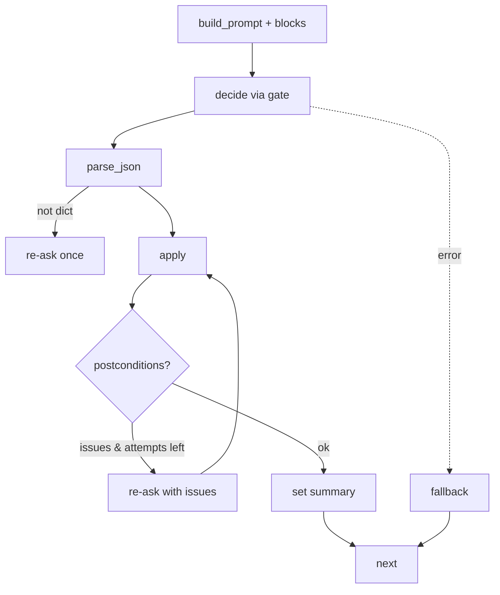

# backend/app/core/decision.py

<!-- docsync:auto:begin - generated by docsync, edits inside this block are overwritten -->
> **Description status: CURRENT** - reviewed 2026-11-19 against source `ee72e49ddee3cef2`.

| Fact | Value |
|---|---|
| Source | [`backend/app/core/decision.py`](../../../../../backend/app/core/decision.py) |
| Kind / language | code - Python |
| Size | 605 lines - 26,366 bytes |
| Content hash | `ee72e49ddee3cef2` |

**Self-description (docstring / first heading):** Decision — One focused LLM call, shared by every orchestration layer.

**Defines**
- const `DEFAULT_TIMEOUT_MS`
- const `LONG_TIMEOUT_MS`
- class `DecisionTimeout(Exception)` - A decision call exceeded its budget. Carries a message worth showing.
- class `DecisionRateLimited(Exception)` - A decision call was rate limited and never got through.
- def `_concurrency_gate()` - A fair (FIFO) queue of planning calls per Mistral key.
- def `_rate_limit_retry_after(exc)` - Seconds to wait if ``exc`` is a rate limit, else None.
- def `parse_json(raw, fallback)` - Parse a JSON response, tolerating markdown fences.
- async def `decide(client)` - Run one decision completion off the event loop, with a real timeout.
- def `reasoning_capable(model)` - Whether Mistral's model list marks ``model`` as a reasoning model.
- def `_orchestrator_effort()`
- def `_orchestrator_fallback(model)` - The second model for planning decisions; never the same as ``model``.
- def `rejects_effort(exc)` - The model refused the ``reasoning_effort`` value, or reasoning altogether.
- def `_is_timeout(exc)`
- async def `_complete(client, model, system, user, temperature, timeout_ms, effort, fallback)` - One completion, with the reasoning effort, the fallback model and the slow-model guard.
- class `DecisionLayer(Layer)` - Base for a layer whose whole job is one focused decision.  
  methods: postconditions, _checks, model_for, build_prompt, process_block, guidance_block, apply, fallback, process
- class `AgentDecisionLayer(DecisionLayer)` - A decision layer that only applies when an agent is being designed.  
  methods: should_run

**Imports - internal**
- [backend/app/app_settings/__init__.py](../app_settings/__init__.py.md)
- [backend/app/app_settings/catalog.py](../app_settings/catalog.py.md)
- [backend/app/build_prereqs/__init__.py](../build_prereqs/__init__.py.md)
- [backend/app/build_prereqs/guidance.py](../build_prereqs/guidance.py.md)
- [backend/app/config.py](../config.py.md)
- [backend/app/core/__init__.py](__init__.py.md)
- [backend/app/core/context.py](context.py.md)
- [backend/app/core/layer.py](layer.py.md)
- [backend/app/core/model_speed.py](model_speed.py.md)
- [backend/app/core/runtime.py](runtime.py.md)
- [backend/app/core/stages.py](stages.py.md)
- [backend/app/knowledge/__init__.py](../knowledge/__init__.py.md)
- [backend/app/knowledge/pipeline.py](../knowledge/pipeline.py.md)
- [backend/app/llm_routes.py](../llm_routes.py.md)
- [backend/app/process/__init__.py](../process/__init__.py.md)
- [backend/app/process/pipeline.py](../process/pipeline.py.md)

**Imports - standard library:** `__future__`, `asyncio`, `json`, `logging`, `random`, `time`, `typing`

**Imported by (40)**
- [backend/app/build_prereqs/analysis.py](../build_prereqs/analysis.py.md)
- [backend/app/knowledge/distill.py](../knowledge/distill.py.md)
- [backend/app/layers/agent/archetype_layer.py](../layers/agent/archetype_layer.py.md)
- [backend/app/layers/agent/capability_gap_layer.py](../layers/agent/capability_gap_layer.py.md)
- [backend/app/layers/agent/facets.py](../layers/agent/facets.py.md)
- [backend/app/layers/agent/guardrail_layer.py](../layers/agent/guardrail_layer.py.md)
- [backend/app/layers/agent/instruction_layer.py](../layers/agent/instruction_layer.py.md)
- [backend/app/layers/agent/requirement_layer.py](../layers/agent/requirement_layer.py.md)
- [backend/app/layers/agent/rule_selection_layer.py](../layers/agent/rule_selection_layer.py.md)
- [backend/app/layers/agent/verification_layers.py](../layers/agent/verification_layers.py.md)
- [backend/app/layers/codegen/feedback.py](../layers/codegen/feedback.py.md)
- [backend/app/layers/codegen/layers.py](../layers/codegen/layers.py.md)
- [backend/app/layers/revision/base.py](../layers/revision/base.py.md)
- [backend/app/layers/revision/repair_layer.py](../layers/revision/repair_layer.py.md)
- [backend/app/layers/workflow/base.py](../layers/workflow/base.py.md)
- [backend/app/layers/workflow/data_contract_layer.py](../layers/workflow/data_contract_layer.py.md)
- [backend/app/layers/workflow/dataflow_layer.py](../layers/workflow/dataflow_layer.py.md)
- [backend/app/layers/workflow/decomposition_layer.py](../layers/workflow/decomposition_layer.py.md)
- [backend/app/layers/workflow/design_layer.py](../layers/workflow/design_layer.py.md)
- [backend/app/layers/workflow/execution_mode_layer.py](../layers/workflow/execution_mode_layer.py.md)
- [backend/app/layers/workflow/guardrail_layer.py](../layers/workflow/guardrail_layer.py.md)
- [backend/app/layers/workflow/input_schema_layer.py](../layers/workflow/input_schema_layer.py.md)
- [backend/app/layers/workflow/topology_layer.py](../layers/workflow/topology_layer.py.md)
- [backend/app/layers/workflow/verify_layers.py](../layers/workflow/verify_layers.py.md)
- [backend/app/process/ai.py](../process/ai.py.md)
- [backend/app/rules/select.py](../rules/select.py.md)
- [backend/app/services/workflow_engine/argument_wiring.py](../services/workflow_engine/argument_wiring.py.md)
- [backend/app/services/workflow_engine/step_runners.py](../services/workflow_engine/step_runners.py.md)
- [backend/tests/test_archetype_precedence.py](../../tests/test_archetype_precedence.py.md)
- [backend/tests/test_decision_routes.py](../../tests/test_decision_routes.py.md)
- [backend/tests/test_fast_and_verified.py](../../tests/test_fast_and_verified.py.md)
- [backend/tests/test_goal_and_feedback.py](../../tests/test_goal_and_feedback.py.md)
- [backend/tests/test_governance_runtime.py](../../tests/test_governance_runtime.py.md)
- [backend/tests/test_guidance_ingest.py](../../tests/test_guidance_ingest.py.md)
- [backend/tests/test_knowledge_context.py](../../tests/test_knowledge_context.py.md)
- [backend/tests/test_planning_failures.py](../../tests/test_planning_failures.py.md)
- [backend/tests/test_process_knowledge.py](../../tests/test_process_knowledge.py.md)
- [backend/tests/test_rebuild_and_refine.py](../../tests/test_rebuild_and_refine.py.md)
- [backend/tests/test_stages.py](../../tests/test_stages.py.md)
- [backend/tests/test_workflow_revisions.py](../../tests/test_workflow_revisions.py.md)
<!-- docsync:auto:end -->

<!--
HOW TO FILL THIS IN
- The block above (between the docsync markers) is generated. Never edit it; it is rewritten on every sync.
- Everything below is yours. Replace every _TODO_. Write "None" where a heading does not apply — do not delete headings.
- Write for an engineer who has never seen this code base and must rebuild this file so it behaves identically.
- Explain WHY, not only what: the facts block already lists names; your job is meaning, intent and traps.
- When you finish: python replication/_tooling/docsync.py review backend/app/core/decision.py --note "first description"
-->

## Purpose
The single mechanism every orchestration layer uses to ask the model one focused question and get back a JSON object. It includes thread offload, a fair per-key concurrency queue, rate-limit retry, reasoning-effort handling, fallback models with hedging against slow models, fence-tolerant parsing, self-check repair loops, and a never-fatal fallback. It also defines `DecisionLayer`, the base class for every decision layer.

## Responsibilities
- `decide(client, model|route, system, user, phase, timeout_ms, temperature, tier)` returns the answer text.
- `parse_json(raw, fallback)` parses the answer, stripping ``` fences.
- `DecisionLayer.process` builds the prompt, appends context blocks, asks, parses, applies, self-checks and repairs, records refs, and falls back on failure.
- `AgentDecisionLayer` skips itself when an agent is already fixed (`agent_id`) or this is a follow-up (`conversation_id`).

## Key elements
- **Constants and exceptions:**
  - `DEFAULT_TIMEOUT_MS=120000`, `LONG_TIMEOUT_MS=240000`.
  - `DecisionTimeout` has the message "The '<phase>' step timed out after Ns. The request may be too broad — try narrowing it."
  - `DecisionRateLimited` has the message "...was rate limited after N attempts."
- **`_concurrency_gate()`** returns `runtime.key_gate("decision", DECISION_CONCURRENCY)`, a FIFO semaphore per Mistral key.
- **`_rate_limit_retry_after(exc)`:**
  - returns None unless the exception is a 429, detected from `status_code`/`raw_status_code` or from "status 429" or "rate limit" in the text;
  - then honours the `retry-after`, `Retry-After` or `x-ratelimit-reset` header;
  - otherwise returns 0.0, meaning "use your own backoff".
- **`decide`, model and effort choice:**
  - With a `route`: the route gives the model, the effort, the timeout floor (`max(timeout, route.timeout_ms)`), the temperature if set, and the fallback.
  - With the orchestrator model: the effort is `ORCHESTRATOR_REASONING_EFFORT`, unless `tier == "fast"` or the catalog marks the model as not reasoning-capable. The fallback is `_orchestrator_fallback(model)`, which returns `ORCHESTRATOR_FALLBACK_MODEL` but never the same model (`llm_routes.other_model`).
  - With no model at all it raises `ValueError`.
- **`decide`, the retry loop:**
  - runs up to `DECISION_MAX_RETRIES` attempts inside the gate;
  - a timeout (the text contains "timed out" or "timeout") raises `DecisionTimeout` immediately;
  - a rate limit sleeps *outside* the gate for `retry_after` or `base*2^attempt` seconds, plus jitter `uniform(0, base/2)`, where `base = DECISION_RETRY_BASE_SECONDS`;
  - any other error is re-raised;
  - on success it returns `llm_routes.extract_text(result.choices[0].message.content)`.
- **`reasoning_capable(model)`** reads `capabilities.reasoning` from the cached `/v1/models` catalog file (`app_settings.catalog`), reloading only when the file's mtime changes. It returns None when the model is unknown.
- **`rejects_effort(exc)`** matches text that contains "reasoning_effort" and one of "not supported", "not enabled", "invalid" or "unsupported".
- **`_complete(...)`:**
  1. Builds the messages; `response_format={"type":"json_object"}`; sends `reasoning_effort` when there is an effort, otherwise `temperature`.
  2. `call(m)` runs `client.chat.complete` in `asyncio.to_thread`. If the model rejects the effort it retries once without it, and records the latency in `model_speed`.
  3. If the primary is currently skipped by the breaker, it calls the fallback first and the primary only if the fallback fails (rate limits re-raised).
  4. Otherwise it starts the primary. If there is a fallback, `DECISION_HEDGE_SECONDS > 0` and `model_speed.expected(fallback) < expected(model)`, it waits only `hedge` seconds.
  5. If the primary has finished: success returns; a rate limit, or no fallback, re-raises; a timeout or other error records a timeout strike and calls the fallback.
  6. If the primary is still running after the hedge, it starts the fallback too. The first success wins. If the fallback wins, the primary gets a decisive strike. The losing task is left to finish in its thread, with a done-callback that swallows its result. If both fail, the primary's error is raised.
- **`DecisionLayer`:**
  - **Class attributes:** `name`, `phase`, `timeout_ms`, `temperature=0.1`, `status_message`, `route`, `tier` ("deep" or "fast"), `process_view`, `guidance_view` (defaults to process_view), `uses_prerequisites`, `max_repairs=2`, `rewindable`.
  - **Hooks to override:** `build_prompt(ctx)` returning `(system, user)`, `apply(ctx, data)`, `fallback(ctx)`, `postconditions(ctx)` returning a list of problem strings, and `model_for(ctx)` (default: the orchestrator model).
  - **`process` steps:**
    1. Emit `status_message`.
    2. Build the prompt.
    3. Append to the user prompt, in order:
       - the process-knowledge block (`app.process.pipeline.block`);
       - the guidance block (`app.knowledge.pipeline.block`);
       - the prerequisites block (`app.build_prereqs.guidance.block`), when `uses_prerequisites` is set;
       - the issues handed back by a rewind (`stages.repair_issues_for` and `repair_block`).
    4. Emit sublayer `decide`, labelled "Fix what the checks found" on a rewind and "Decide" otherwise.
    5. Ask and parse. If the reply is not a dict, ask once more with "Your previous reply could not be read. Reply with exactly one JSON object, as specified, and nothing else."
    6. Call `apply`.
    7. Self-check, only when the subclass overrides `postconditions`. Up to `max_repairs` times, emit `check`/`check_N`; on problems, re-ask with `## YOUR PREVIOUS ANSWER` (truncated to 12,000 chars) plus the repair block, and re-apply. Problems that remain after the last repair go into `metadata["unresolved_postconditions"][name]`.
    8. Record the process and guidance refs used.
    9. Set the layer summary from `data["reasoning"]`.
  - **Failure handling:** timeout, rate limit and other errors each set a summary ("Timed out — a default was used instead." / "Rate limited by the model API — a default was used instead." / "Could not be decided — a default was used instead.") and call `fallback`. `next(ctx)` is then always called.

## Control flow


## Data, state and side effects
- Reads `ctx`; layers write their own spec fields through `apply`.
- Writes `ctx.metadata` keys: `unresolved_postconditions`, `_layer_summaries`, plus the process and guidance refs.
- Module cache `_capability_cache`.
- Network calls to Mistral run in threads.

## Configuration
- `DECISION_CONCURRENCY` (6), `DECISION_MAX_RETRIES` (4), `DECISION_RETRY_BASE_SECONDS` (2.0), `DECISION_HEDGE_SECONDS` (45).
- `MISTRAL_ORCHESTRATOR_MODEL`, `ORCHESTRATOR_REASONING_EFFORT`, `ORCHESTRATOR_FALLBACK_MODEL`.
- The model routes in llm_routes.

## Interactions
- Subclassed by every layer in `app/layers/agent/*`, `app/layers/workflow/*` and the revision and codegen layers.
- Uses `app.core.model_speed`, `app.core.runtime`, `app.core.stages`, `app.llm_routes`, `app.app_settings.catalog`, `app.process.pipeline`, `app.knowledge.pipeline` and `app.build_prereqs.guidance`.

## Error handling and edge cases
- A decision failure is never fatal; the layer's `fallback` writes a safe default.
- Timeouts are not retried by `decide`, though `_complete` tries the fallback model first.
- A late answer from a losing hedge is discarded.

## Nuances and gotchas
- **The Mistral SDK is synchronous.** Without `to_thread`, a long planning call froze the whole API server.
- **The backoff jitter matters.** Five facet layers start together and would otherwise retry in lockstep.
- **The backoff sleep happens outside the semaphore**, so a backing-off call does not hold a slot.
- **The concurrency gate is per key**, so one workspace cannot starve another.
- **`apply` must replace what it wrote, not add to it**, because repair rounds call it again.
- **The rejected-effort detection strings were seen verbatim**: "reasoning_effort none is not supported for this model" from mistral-large-4, and "reasoning_effort is not enabled for this model" from mistral-large-2512.

## How to rebuild this file
Implement the pieces in this order: the constants and exceptions; `_concurrency_gate`; `_rate_limit_retry_after`; `parse_json`; `decide` with its retry loop; `reasoning_capable` with its mtime cache; `_orchestrator_effort` and `_orchestrator_fallback`; `rejects_effort`; `_is_timeout`; `_complete` with the breaker-skip, hedge and race logic; then `DecisionLayer` and `AgentDecisionLayer`. Follow the exact strings and order above.

## Tests
- `backend/tests/test_fast_and_verified.py` covers hedging, the breaker and the fast tier.
- `test_reliability.py` covers retries and rate limits.
- `test_stages.py` covers repair and rewind.
- `test_planning_failures.py` covers the fallbacks.

## Change log
<!-- newest first: YYYY-MM-DD · source hash · what changed and why. `docsync review --note` adds lines here. -->
- 2026-11-19 - `ee72e49d` - first description
