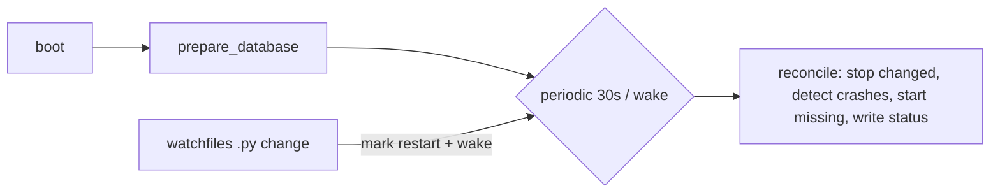

# backend/app/services/mistral_worker.py

<!-- docsync:auto:begin - generated by docsync, edits inside this block are overwritten -->
> **Description status: CURRENT** - reviewed 2026-11-19 against source `41e5157ad9bf0966`.

| Fact | Value |
|---|---|
| Source | [`backend/app/services/mistral_worker.py`](../../../../../backend/app/services/mistral_worker.py) |
| Kind / language | code - Python |
| Size | 299 lines - 12,520 bytes |
| Content hash | `41e5157ad9bf0966` |

**Self-description (docstring / first heading):** Mistral Workflows Worker — Subprocess Restart Edition.

**Defines**
- const `_WORKER_INNER`
- const `RECONCILE_SECONDS`
- const `_BACKOFF`
- def `_register_shutdown(stop_event)`
- async def `_kill_process(proc)` - Gracefully terminate child, force-kill if it doesn't exit within 8s.
- async def `_spawn_worker(workflows_dir, spec, key)` - Spawn _worker_inner.py for one workspace.
- def `_desired(workflows_dir)` - What should run now, and each workspace's key.
- class `_Child`  
  methods: __init__
- async def `main()`

**Environment variables / settings read**
- `WORKFLOWS_DIR`

**Imports - internal**
- [backend/app/auth/__init__.py](../auth/__init__.py.md)
- [backend/app/auth/store.py](../auth/store.py.md)
- [backend/app/auth/workers.py](../auth/workers.py.md)
- [backend/app/db_setup.py](../db_setup.py.md)

**Imports - external packages:** `dotenv`, `watchfiles`

**Imports - standard library:** `asyncio`, `json`, `logging`, `os`, `pathlib`, `signal`, `sys`, `time`
<!-- docsync:auto:end -->

<!--
HOW TO FILL THIS IN
- The block above (between the docsync markers) is generated. Never edit it; it is rewritten on every sync.
- Everything below is yours. Replace every _TODO_. Write "None" where a heading does not apply — do not delete headings.
- Write for an engineer who has never seen this code base and must rebuild this file so it behaves identically.
- Explain WHY, not only what: the facts block already lists names; your job is meaning, intent and traps.
- When you finish: python replication/_tooling/docsync.py review backend/app/services/mistral_worker.py --note "first description"
-->

## Purpose
The Mistral Workflows worker supervisor, started by `main.py` as a subprocess. It runs one child worker process (`_worker_inner.py`) per platform workspace that has published workflows, each with that workspace's Mistral key and task queue. It restarts a child when its workflow files or key change and when it crashes, and writes every child's state to the status file the admin console reads.

## Responsibilities
- **Bootstrap.** Adds `backend/` to `sys.path`, loads `backend/.env`, and configures logging as `%(asctime)s [%(levelname)s] %(message)s`.
- **Shutdown signals.** `_register_shutdown(stop_event)`:
  - on Windows, `signal.signal(SIGINT/SIGTERM)` handlers call `call_soon_threadsafe(stop_event.set)`;
  - elsewhere, `loop.add_signal_handler`.
- **`_kill_process(proc)`** sends `terminate()` on Windows or SIGTERM elsewhere, waits 8 s, then kills.
- **`_spawn_worker(dir, spec, key)`** starts `sys.executable _worker_inner.py` with an environment of `WORKFLOWS_DIR`, `DEPLOYMENT_NAME=spec.deployment`, `MISTRAL_API_KEY=key`, `APP_WORKSPACE_ID` and `WORKER_WORKFLOW_FILES` (a JSON list). stdout and stderr are inherited.
- **`_desired(dir)`** reads the workspaces and their keys (skipping disabled ones) and the files per workspace, then calls `workers.desired_workers(...)`.
- **`main()`:**
  1. Resolves `WORKFLOWS_DIR`, defaulting to `backend/../mistral_workflows`, writes the absolute path back into the environment, and creates the folder.
  2. Runs `prepare_database(seed_rules=False)`.
  3. Runs two tasks: `periodic` and `watch`.
  4. **`periodic`** runs `reconcile()` every `RECONCILE_SECONDS=30`, or sooner when woken.
  5. **`reconcile()`:**
     - stops children that are no longer wanted, or whose `same_process` spec changed, or that are queued for restart;
     - detects crashed children and schedules a retry with backoff `(5, 15, 30, 60, 120, 300)` seconds by failure count. A child that ran for more than 600 s before dying resets the count to 1. Its status becomes `crashed` with "Exited with code N; retrying in Ns.";
     - starts wanted children that are not running and are past their retry time. A start failure gives the status `crashed` and a 300 s retry;
     - updates the statuses (stopped for unwanted ones) and runs `workers.write_status`.
  6. **`watch`** uses `watchfiles.awatch(dir)`. On `.py` changes it marks the children whose files changed for restart and wakes `periodic`. Without watchfiles it logs a warning and hot reload is off.
  7. On stop: cancels the tasks, stops every child, marks every status stopped, and writes the status.

## Key elements
See Responsibilities. `_Child(spec, proc)` records `started`.

## Control flow

## Data, state and side effects
- Child processes.
- `<workflows dir>/.worker_status.json`.
- Reads the auth tables.

## Configuration
`WORKFLOWS_DIR`, `DEPLOYMENT_NAME` (the base queue), and the workspace keys from the database.

## Interactions
- Started by `main.lifespan` when `MISTRAL_WORKER_ENABLED`.
- Uses `app/auth/workers.py`.
- Children are `_worker_inner.py`.

## Error handling and edge cases
A failure to read the workspaces is logged and keeps the current children running.

## Nuances and gotchas
- **Why a fresh process per reload.** `@workflows.activity()` registers into a global registry inside the SDK at import time. Re-importing a module in the same process registers it twice, and Temporal raises "More than one activity named run_collect_inputs". Only a fresh process has a clean registry.
- **One process can hold only one key.** The SDK reads its key and queue from process-wide environment variables.

## How to rebuild this file
Implement the module as described, with the same constants and backoff.

## Tests
`backend/tests/test_workers.py` covers `desired_workers`. The supervisor loop is untested.

## Change log
<!-- newest first: YYYY-MM-DD · source hash · what changed and why. `docsync review --note` adds lines here. -->
- 2026-11-19 - `41e5157a` - first description
